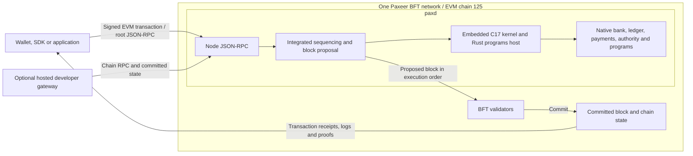
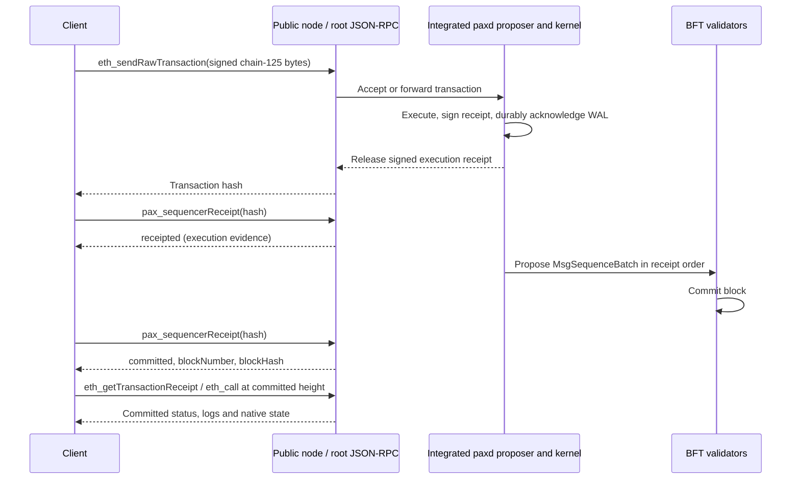

<div align="center">


  <h3><a href="https://paxeer.network/">Paxeer X Network</a> brings payments, code execution and intent routing into one network.</h3>
  <p>
    
[](https://github.com/Sidiora-Labs/paxeer-monorepo)
[](#)
[](#)
[](#)
[](https://github.com/org/Sidiora-Labs)
[](https://github.com/Sidiora-Labs/paxeer-monorepo/actions)


**Table of Contents**

<!--TOC--><p align="center">
  <a href="#what-is-paxeer-x-network"></a>
  <a href="#documentation"></a>
  <a href="#specification"></a>
  <a href="#community"></a>
  <a href="#contributing"></a>
  <a href="#security-policy-and-vulnerability-reporting"></a>
  <a href="#directory-structure"></a>
  <a href="#development-and-release-process"></a>
  <a href="#overview"></a>
  <a href="#build"></a>
  <a href="#test"></a>
  <a href="#releases-and-network-upgrades"></a>
  <a href="#downloading-and-shallow-cloning-the-monorepo"></a>
  <a href="#license"></a>
</p>
</div>
<!--TOC-->

## What is Paxeer X Network?

[Paxeer X Network](https://paxeer.network/) is a distributed HyperState Machine for payments, code execution and intent routing, developed by Sidiora Labs. Paxeer mainnet-beta is one BFT network with EVM chain ID **125** (`0x7d`). The LayerX kernel is embedded in the node and participates in block proposal and deterministic execution. The kernel is part of the network and proposes blocks inside `paxd`; validators commit those blocks through BFT consensus.

In this repository you’ll find the core components of the network: the Paxeer X chain, the LayerX kernel, on-chain contracts, off-chain services, client SDKs and user-facing applications. Together, they provide the infrastructure for developers to build applications and agents on a shared network.

The node integrates the following components:

- **Node and consensus.** `paxd` is built from [`daemon/paxd`](daemon/paxd/), with the application in [`node/`](node/), BFT consensus in [`consensus/`](consensus/), state machine modules in [`modules/`](modules/) and JSON-RPC servers in [`rpc/`](rpc/).
- **Kernel and programs.** The C17 kernel in `src/` and `include/` runs inside `paxd` through [`modules/lxphost`](modules/lxphost/). The node links `build/liblayerx.a` and the programs sandbox from [`programs/`](programs/). [`node/sequencer`](node/sequencer/) supplies execution ordering and the consensus block source within the node.

A receipt is final once its block is committed. A signed execution receipt can arrive before that commitment; [`pax_sequencerReceipt`](rpc/sequencer_receipt.go) distinguishes `submitted`, `receipted` and `committed`. See [committed block evidence](docs/site/docs/concepts/checkpoints.md) for verification. There is no separate kernel daemon, sequencer service or checkpoint deployment. External checkpoint settlement is retired.

Sub-chains are tenant domains stored in the database, managed by [`modules/layerxchains`](modules/layerxchains/). Creating a domain namespaces state within the shared network and does not require new node infrastructure.

The monorepo also includes the agent daemon and MCP server, interop gateway and bridge relayer, hosted developer platform, human control plane, embedded wallet service, explorer and launchpad services. Applications include the Hyperpax perps frontend, wallet, web app, explorer and launchpad web and mobile apps.

### Integrated network topology



The public API reaches the node directly at the root path on EVM chain ID 125: there is no router and no separate LayerX interface. The hosted gateway is optional developer tooling with its own declared contract; it is outside consensus and does not provide another execution or finality domain. The archive node `api2.mainnet-beta.paxeer.network` keeps full history; the other thirteen numbered public nodes prune. On a pruned node, `pax_sequencerReceipt` and state queries for heights outside that node's retention return JSON-RPC error `-32000`; this is expected retention behavior, not a defect. Send historical receipt and state queries to `https://api2.mainnet-beta.paxeer.network` at the root path. A configured standby follows the integrated node's durable WAL for recovery; restart and recovery belong to the node lifecycle, without an external settlement service. See the [sequencing implementation](node/sequencer/) and [consensus block source](node/sequencer/consensus_source.go).

## Documentation

- To build on Paxeer X Network, start with the [Paxeer documentation](https://docs.paxeer.app/) and the [developer wiki](docs/wiki/Home.md).
- To connect to the chain, see the [public JSON-RPC endpoints](docs/site/docs/reference/public-rpc.md) and [beta endpoint checklist](docs/wiki/Getting-Started-Beta.md).
- For wallets, funding and payments, follow the [Payments Quickstart](docs/wiki/PaymentsQuickstart.md).
- For hosted tooling and disposable integration environments, see the [hosted quickstart](docs/wiki/Quickstart.md). Build the merged node using the [commands below](#build).
- For protocol references, see [assets](docs/wiki/Assets.md), [committed block evidence](docs/site/docs/concepts/checkpoints.md) and [hosted gateway methods](docs/site/docs/platform/gateway-rpc.md). Hosted payment examples are in the [payment API guide](docs/wiki/PublicAPI.md).
- Component guides include the [launchpad production checklist](docs/launchpad/production-checklist.md), [perps data API](docs/perps/data-api.md), [agent compatibility matrix](docs/agent/COMPATIBILITY.md) and [portable verification guide](docs/interop/PORTABILITY.md).

### Quick start: connect to chain 125

Public node JSON-RPC uses the root URL: `https://api-mainnet-beta.paxeer.network` or the numbered nodes `https://api1.mainnet-beta.paxeer.network` through `https://api14.mainnet-beta.paxeer.network`. Send HTTPS JSON-RPC requests to the root path of these hosts, without a route suffix. Node API families include `debug`, `echo`, `eth`, `net`, `pax` and `txpool`; `test` is restricted to non-live chain IDs. The current [node registrations](rpc/server.go) also include `web3`, `pax2` and native `px_` account/history and receipt-key methods. Method availability depends on node configuration and the queried domain. Confirm the chain ID before signing or broadcasting:

```sh
curl --max-time 10 -sS https://api1.mainnet-beta.paxeer.network \
  -H 'Content-Type: application/json' \
  -d '{"jsonrpc":"2.0","id":1,"method":"eth_chainId","params":[]}'
# Expected result: "0x7d"
```

Configure more than one node and compare `eth_blockNumber` when selecting one near the head. `node.hyperpaxeer.com` is only the hpx library mirror used by build and installation tooling, never a JSON-RPC endpoint.

The hosted gateway's `px_` API is defined by [`services/platform/hosted/gateway/openrpc.json`](services/platform/hosted/gateway/openrpc.json). Obtain its deployment URL and credentials from the operator; the gateway contract does not establish method availability at public node URLs. The prefix alone does not identify the server: for example, `px_getReceiptKeys` is registered by the node, and the gateway relays its governed key ranges. Use each server's declared methods instead of assuming that every hosted method is served by every public node. Mainnet-beta uses real value; hosted funding and private test-environment faucets have their own access policies.

### Submit a transaction and follow its committed receipt

1. Confirm `eth_chainId` returns `0x7d`, fund the sender's gas balance, and use the account nonce from `eth_getTransactionCount`. Sign a secp256k1 EIP-1559 transaction for chain ID `125`, addressed to an EVM contract or a current native precompile. Native ledger, payment, authority and Programs operations use `0x101A`–`0x101D`; Programs payload bytes go to `0x101D`.
2. Broadcast the signed bytes with `eth_sendRawTransaction` to a public node's root JSON-RPC URL. Its result is a transaction hash. The [send path](rpc/send.go) accepts on the node's integrated sequencing path or forwards to the configured proposing node. Execution produces a signed receipt; [receipt release](node/sequencer/accepter.go) waits for durable WAL acknowledgement. Receipt order is proposal order.
3. Query `pax_sequencerReceipt` with the transaction hash. `submitted` has no execution receipt yet; `receipted` includes signed execution evidence; `committed` additionally names the block whose `MsgSequenceBatch` covers that sequence. A node serves this locally, forwards to its configured proposing node, or returns the explicit “served by sequencer” error when neither is configured. No separate service endpoint is required.
4. Wait for `committed` and authenticate the block commitment before treating the result as final. Read `eth_getTransactionReceipt` for the committed EVM result and inspect its status and logs: commitment does not mean execution succeeded. Read native precompile views with `eth_call` at an explicit committed height and balances from committed state. For independent trust, verify the signed receipt and committed proofs as described below.



### Accounts and native funding

An EVM address uses a secp256k1 key; a LayerX DID is `did:layerx:<64 lowercase hex characters of the Ed25519 public key>`. Bind them through the [`addr` precompile](precompiles/addr/abi.json) at `0x1004`: read `layerXBindNonce(address)`, sign the following bytes with the Ed25519 key, and submit `bindLayerX(bytes32,bytes)` from the EVM address:

```text
"LX:PAXEER-BIND:v1" || chainId:uint256be || evmAddress:20 || nonce:uint64be
```

The EVM transaction supplies the address owner's consent; the 64-byte Ed25519 signature supplies the DID's consent. After commit, confirm the binding with `getLayerXDid(address)` and `getUnifiedAccount(address)`. Binding does not fund an account. The [one-account guide](docs/site/docs/concepts/one-account.md) retains mnemonic derivation, external-wallet EIP-712/HKDF-SHA256 derivation and recovery details; preserve the original derivation context when recovering an identity.

Native sub-accounts map to derived bank addresses inside the node; see [`modules/lxphost/accountmap.go`](modules/lxphost/accountmap.go). For each registered Asset, the bound owner opens a per-asset account at the [`layerxledger` precompile](precompiles/layerxledger/abi.json), `0x101A`. Its funding and balance calls are:

| Operation | ABI method |
| --- | --- |
| Open the caller's per-asset account | `openAccount(bytes32)` |
| Derive an account ID from the DID public key and Asset ID | `accountId(bytes32,bytes32)` |
| Fund an opened account by authorized issuer mint | `mint(bytes32,bytes32,uint128)` |
| Transfer from a funded account owned by the bound caller | `payExact(bytes32,bytes32,bytes32,uint128,uint64,bytes32)` |
| Read the committed per-asset balance | `balanceOf(bytes32,bytes32)` |

Account ID derivation alone does not open or fund an account. Submit ledger writes as signed EVM transactions for chain ID `125` with zero EVM `value`; these methods are nonpayable. `payExact` takes an expiry in Unix milliseconds and a payment reference. Wait for commit and read `balanceOf` to confirm funding. Fund the EVM address's native gas balance separately and read it with `eth_getBalance(address,"latest")`. The custody deposit and credit-attestation funding flow is retired. See the [Payments Quickstart](docs/wiki/PaymentsQuickstart.md) for the complete transaction sequence.

### Receipt and proof verification

The node produces signed ProtocolReceipt v2 bytes through [`node/sequencer/receipt.go`](node/sequencer/receipt.go). Its [Ed25519 receipt key](node/sequencer/receiptkey.go) is separate from the validator consensus key and must be pinned for the receipt height. Verify canonical receipt bytes and their signature using [`layerxproof/verify/receipt.go`](layerxproof/verify/receipt.go); a public key supplied beside an untrusted receipt does not establish trust. A valid signature proves execution evidence, while the `committed` rung requires coverage by the committed block's `MsgSequenceBatch`.

For independent committed proofs, authenticate the block header and CometBFT commit against trusted validator information, then verify transaction or state inclusion against the authenticated root at the relevant height and key. The [chain proof verifier](programs/crates/layerx-programs-registry/src/chain_proof/) implements those checks. Neither a transaction hash nor a signed execution receipt alone establishes block commitment; the [committed block evidence guide](docs/site/docs/concepts/checkpoints.md) explains the current proof model.

### Client SDKs

| Language | Path |
| --- | --- |
| Rust | `services/agent/crates/layerx-sdk` |
| Python | `services/agent/sdk/python` |
| TypeScript | `services/agent/sdk/typescript` |
| Go | `sdk/platform/go` |
| JVM | `sdk/platform/jvm` |
| .NET | `sdk/platform/dotnet` |
| Swift | `sdk/platform/swift` |

The agent daemon is `services/agent/crates/layerx-agentd` and the MCP server is `services/agent/crates/layerx-mcp`. The developer CLI in `tools/platform/cli` installs those transports with `layerx install mcp` and `layerx install a2a`.

## Specification

This README is the maintained architecture entry point; translated and archived pages must be read against this network model. Detailed feature specifications live in [`spec/`](spec/). Each feature’s `spec.kvx` defines its requirements, acceptance criteria and dependency-ordered task list. The [specification workflow](spec/workflow.kvx) describes how work is planned and tracked. `spec/specgen` runs `tools/specgen` to generate agent instruction files, including `CLAUDE.md` and `AGENTS.md`.

The [LayerX merge specification](spec/layerx-merge/spec.kvx) tracks the integrated network's requirements and implementation tasks. Runtime behavior is implemented in the node, kernel host and native modules; activation is controlled by the upgrade handlers in [`node/upgrades.go`](node/upgrades.go). The [monorepo layout specification](spec/monorepo-layout/spec.kvx) describes the target repository structure.

### EVM and Native Precompiles

Contracts reach native modules and helpers through [`precompiles/`](precompiles/). [`precompiles/setup.go`](precompiles/setup.go) defines the base set, constructor registry and `MergeAddressTable`; [`node/upgrades.go`](node/upgrades.go) gates activation by upgrade and module state. The merge plan is `v7.0`, named by `MergeUpgrade` in [`precompiles/common/precompiles.go`](precompiles/common/precompiles.go).

The merge address table contains thirteen entries. Addresses below use short hex notation, left-padded to 20 bytes by EVM clients:

| Address | Merge precompile name |
| --- | --- |
| `0x101A` | `layerxledger` |
| `0x101B` | `layerxpay` |
| `0x101C` | `layerxauth` |
| `0x101D` | `layerxprograms` |
| `0x101E` | `layerxchains` |
| `0x0901` | `orob` |
| `0x0902` | `clearing` |
| `0x0903` | `oracle aggregator` |
| `0x0904` | `pofq` |
| `0x0905` | `scheduler` |
| `0x0906` | `streams` |
| `0x0907` | `tee attestor` |
| `0x0908` | `eip712` |

The base set includes `bank`, `wasmd`, `json`, `addr`, `staking`, `gov`, `distribution`, `oracle`, `ibc`, `pointer`, `pointerview`, `p256Verify` and `solo`. Other versioned interfaces include `layerxBridge` (`0x1016`), `feeToken` (`0x1018`, introduced at `v6.7`) and `xweb` (`0x1019`, introduced at `v6.8`).

The `v6.12.0` set built by `v6120Contracts` in [`node/app.go`](node/app.go) serves `perps` at `0x1015` in place of the earlier `layerxExchange`, the second-generation `launchpad` at `0x1017`, `pricefeed` at `0x1020`, and `spot_pecor`, `spot_orders`, `spot_stoporders`, `spot_quoter` and `spot_vault` at `0x1021`–`0x1025`. Constructor and ABI inventories include historical versions; select the interface for the upgrade active at the queried height.

The pre-merge `layerxVerify` (`0x1012`) and `layerxCustody` (`0x1013`) interfaces are retired at the merge. `layerxAnchor` (`0x1014`) rejects writes after the merge; its remaining historical views retire at `v7.0-anchor-store-delete`. See the retirement gates in [`precompiles/layerxverify`](precompiles/layerxverify/), [`precompiles/layerxcustody`](precompiles/layerxcustody/) and [`precompiles/layerxanchor`](precompiles/layerxanchor/). These are retired refusal surfaces retained for compatibility, not active funding or checkpoint executors. They return retirement errors (including `LXP_MODULE_DISABLED`) at their applicable upgrade gates. Historical anchor reads before store deletion are archive-only; they do not provide current funding or finality paths. The external native bridge at `0x1016` remains distinct from retired kernel custody: outward transfers use its native `bridgeOut` interface.

The retained [batch-header codec](layerxproof/codec/batch.go) and [archived settlement witness formats](docs/site/docs/operators/settlement-evidence.md) support historical interpretation. External checkpoint registration, guarantor attestations and the L0–L4 settlement ladder are retired; archived formats add no settlement step to current block finality.

## Community

Paxeer X Network is developed by [Sidiora Labs](https://www.sidioralabs.com/). Visit the [Paxeer website](https://paxeer.network/) for project information and [SUPPORT.md](SUPPORT.md) for support channels.

[GOVERNANCE.md](GOVERNANCE.md) explains how project decisions are made. Community participation follows the [Code of Conduct](CODE_OF_CONDUCT.md).

## Contributing

Paxeer X Network is an open-source project spanning protocol engineering, agent infrastructure, developer tooling and applications. Contributions across these components help improve the network and the experience of building on it.

[CONTRIBUTING.md](CONTRIBUTING.md) explains how to propose and land changes. Before starting, read the [monorepo guide](docs/MONOREPO.md), the relevant feature specification and the [development process](#development-and-release-process) below.

Every change must pass the public repository audit. Run the checks for the components you modify, and include the relevant validation with your contribution.

## Security Policy and Vulnerability Reporting

Please follow [SECURITY.md](SECURITY.md) to report vulnerabilities privately. **Do not disclose security vulnerabilities in public issues.**

## Directory Structure

| Path | Contents |
| --- | --- |
| `apps/` | User-facing frontends: `apps/perps` (the Hyperpax perps frontend), `apps/wallet` (wallet app), `apps/web` (web app), `apps/explorer` (block explorer frontend), `apps/launchpad` (launchpad web and mobile apps) |
| `services/` | Off-chain programs: `services/agent` (agent daemon, MCP server, Rust, TypeScript and Python SDKs), `services/interop` (interop gateway, bridge relayer), `services/platform` (hosted developer platform), `services/explorer` (block explorer backend), `services/launchpad` (launchpad services), `services/human` (human control plane Rust workspace), `services/wallet` (embedded wallet service, whose pnpm workspace also lists `sdk/wallet`), `services/bridge` (bridge deployment) |
| `sdk/` | Client SDKs: `sdk/platform` (Go, JVM, .NET, Swift), `sdk/integrations`, `sdk/launchpad` (launchpad protocol, shared libraries and client packages), `sdk/chainflow` (Chainflow client libraries for Go, Python, Rust and TypeScript), `sdk/wallet` (wallet SDK), `sdk/js`; it also holds the application framework fork the node builds from |
| `contracts/` | On-chain sources: the root Foundry tree, `contracts/bridge` (EVM vaults, the Solana program and test vectors) and `contracts/launchpad` |
| `core/deps/` | Pinned snapshots of the upstream libraries the node builds from, each with a `VENDOR.kvx` pin record |
| `tests/` | Kernel C tests, fuzz targets (`tests/fuzz`), integration tests (`tests/integration`), OCC tests (`tests/occ`), `tests/testutil`, `tests/fixtures`, Solidity and vector suites |
| `tools/` | Developer and operator tools, including `tools/hpx`, `tools/platform` (CLI, emulator, release), `tools/launchpad`, `tools/loadtest`, `tools/paxctl`, `tools/uci` and `tools/wasm-tools` |
| `migrations/` | SQL for kernel genesis import sections, rebuildable projections and the history index |
| `api/` | Protobuf definitions (buf module) |
| `deploy/`, `docker/` | Deployment descriptors (including `deploy/launchpad`) and container builds |
| `docs/` | Wiki, documentation site sources, translations and qualification notes |
| `spec/` | Feature specifications and the kvx workflow |
| `scripts/` | CI, qualification, release and workspace scripts |

The node and kernel source trees currently remain at the root: `src`, `include`, `cmd` and `migrations` (kernel sources and tools), `modules`, `precompiles`, `engine`, `consensus`, `node`, `rpc`, `storage`, `wasm`, `wasm-runtime`, `daemon`, `admin`, `custodyproof`, `layerxproof`, `utils`, `interchain`, the framework fork in `sdk`, and `programs`. Source directory names describe code organization, not separate network deployments. [`docs/MONOREPO.md`](docs/MONOREPO.md) maps these paths; planned destinations under `core/` and `sdk/programs` are specified in [`spec/monorepo-layout/spec.kvx`](spec/monorepo-layout/spec.kvx).

## Development and Release Process

### Overview

The chain, kernel, services, contracts and applications share this repository but use different toolchains and build targets. Read the relevant component documentation before making changes across their interfaces.

Toolchains: Go 1.25.8 (`go.mod`), a C17 compiler for the kernel (root `Makefile`), Rust 1.91.1 (`rust-toolchain.toml`), Solidity 0.8.27 with Foundry (`foundry.toml`), and Node.js for the npm workspaces in `package.json`. Replay qualification also needs GCC 13, Clang 18, Docker, an amd64 musl runner, and an AArch64 cross-compiler with QEMU; see [`docs/QUALIFICATION.md`](docs/QUALIFICATION.md).

### Build

Build the merged node from the repository root:

```sh
make paxd-build        # build/paxd, linked native libraries and release version stamp
```

`paxd-build` builds `build/liblayerx.a` and `programs/target/release/liblayerx_programs_sandbox.a` before invoking `chain.mk`. It stamps the version from [`tools/release/version.json`](tools/release/version.json). `make paxeer-build` and `make -f chain.mk build` also build the linked native prerequisites and produce `build/paxd`, using the chain makefile's version defaults.

For a checksummed operator package, use `tools/release/build-paxd.sh` with the pinned toolchains.
It packages the merged `paxd`, the price sidecar and the required shared libraries; the kernel and
programs archives remain linked into the node. [RELEASE.md](RELEASE.md) lists the artifacts,
release verification and recovery procedure. The package version and governance activation plan
must agree before an operator applies it to a network.

For an operator-provisioned, initialized node home containing the network genesis and configuration, the runtime command is:

```sh
./build/paxd version
./build/paxd start --home "$PAXD_HOME"
```

Set `PAXD_HOME` to that node home. Use the operator-provided genesis and consensus chain identifier; EVM chain ID `125` is the signing domain. [Node upgrade handlers](node/upgrades.go) control activation, and the [sequencing configuration](node/sequencer/config.go) controls the integrated proposer and standby. Building the binary alone does not provision network membership. Explorer operators use [`services/explorer`](services/explorer/); application clients can use the public quick start above without running a node.

For kernel library and development tools without rebuilding the node:

```sh
make build
```

This builds the kernel archive, genesis builder and module registry. The running network entry point is `paxd`.

The services and workspaces:

```sh
make agent-build
make interop-build
make platform-build
make human-build
make programs-build
make workspace-build   # kernel, services, node, app/tooling targets and root Foundry tree
```

### Test

```sh
make test                  # kernel test suite
scripts/ci/run-tests.sh    # the kernel suite at -O0 and -O2
make test-contracts
make paxeer-test           # node Go tests through chain.mk
make paxeer-lint           # node lint
make agent-test interop-test platform-test human-test programs-test
make bridge-test-evm bridge-test-solana
make ci                    # public audit, kernel tests, reproducible build, consensus symbol scan, sanitizers
make paxeer-ci             # node lint and tests
make monorepo-ci           # every workspace: build, test and lint
```

`make public-audit` runs `scripts/ci/public-repo-audit.sh`, which every change must pass. `scripts/ci/layout-check.sh` and `scripts/ci/vendor-verify.sh` check the layout and the vendored snapshots. A local pass is not authorization to deploy contracts, move custody, or handle real assets.

### Releases and Network Upgrades

See [CHANGELOG.md](CHANGELOG.md) for release notes. Network upgrades determine which native interfaces are active; refer to the precompile registrations and upgrade definitions when working with version-dependent functionality.

The merged runtime executes kernel activity inside `paxd` and commits it with the BFT chain state. The `v7.0` merge handler activates the merged interfaces and retires the old custody/checkpoint write paths; `v7.0-anchor-store-delete` removes the historical anchor store. Consult the code and the network's recorded upgrade height when interpreting historical blocks. Planned directory moves under `core/` change source organization, not this runtime model.

## Downloading and Shallow-Cloning the Monorepo

To fetch the default branch without downloading the full Git history:

```sh
git clone --depth 1 https://github.com/Sidiora-Labs/paxeer-monorepo.git
cd paxeer-monorepo
```

For a specific branch or tag, replace `<ref>` with the desired reference:

```sh
git clone --depth 1 --branch <ref> https://github.com/Sidiora-Labs/paxeer-monorepo.git
```

## License

Licensed under the [Apache License, Version 2.0](LICENSE). See [NOTICE](NOTICE) for attribution notices.

Paxeer X Network is developed by Sidiora Labs.
