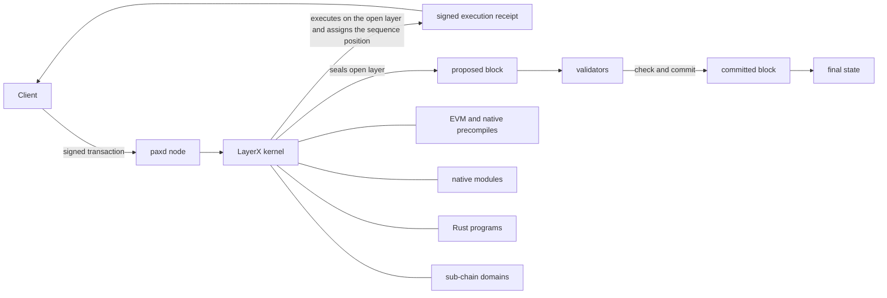

# Paxeer X Network

Paxeer X Network is a distributed HyperState Machine for payments, code execution and intent routing, developed by Sidiora Labs. The LayerX kernel is the core of the network and runs inside every `paxd` node. It executes each transaction when it arrives, assigns the next position in one global sequence and returns a signed execution receipt before any block is voted. It builds every block: the proposed block is the sealed sequence, with the signed sequence batch first and the executed transactions behind it in sequence order. Validators check that batch and the pinned proposer, replay the block and commit it; they do not select or order transactions. `paxd` uses EVM chain identifier **125** (`0x7d`) and native token **PAX**.

What runs on the kernel:

- [Native payments](modules/layerxpay/) with escrow, budgets, streams and services.
- [Spot](modules/spot/) and [perpetual markets](modules/perps/).
- [Rust programs](programs/).
- [Agents](modules/layerxagent/) with delegated authority and the [pooled inference market](programs/crates/layerx-programs-ai-market/).
- [Sub-chains](modules/layerxchains/) as tenant domains of the same sequence.
- [The EVM](modules/evm/) with its native precompiles.
- [The bridge](modules/layerxbridge/).

## Repository layout

| Directory | Holds | Page |
| --- | --- | --- |
| [`admin/`](admin/README.md) | Node administration tools and commands. | [README](admin/README.md) |
| [`api/`](api/README.md) | Protobuf API definitions and generated interfaces. | [README](api/README.md) |
| [`apps/`](apps/README.md) | User-facing Paxeer applications. | [README](apps/README.md) |
| [`cmd/`](cmd/README.md) | Paxeer command-line tools. | [README](cmd/README.md) |
| [`consensus/`](consensus/README.md) | The network consensus engine. | [README](consensus/README.md) |
| [`contracts/`](contracts/README.md) | On-chain contracts and contract tests. | [README](contracts/README.md) |
| [`core/`](core/README.md) | Pinned core dependencies. | [README](core/README.md) |
| [`custodyproof/`](custodyproof/README.md) | Custody proof types and verification. | [README](custodyproof/README.md) |
| [`daemon/`](daemon/README.md) | The `paxd` daemon and node entry point. | [README](daemon/README.md) |
| [`deploy/`](deploy/README.md) | Deployment configuration and manifests. | [README](deploy/README.md) |
| [`docker/`](docker/README.md) | Docker images and local container setup. | [README](docker/README.md) |
| [`docs/`](docs/README.md) | Network documentation and the documentation site. | [README](docs/README.md) |
| [`engine/`](engine/README.md) | Execution engine components. | [README](engine/README.md) |
| [`include/`](include/README.md) | LayerX kernel headers. | [README](include/README.md) |
| [`interchain/`](interchain/README.md) | IBC and interchain integration. | [README](interchain/README.md) |
| [`layerxproof/`](layerxproof/README.md) | LayerX proof codecs and verification. | [README](layerxproof/README.md) |
| [`migrations/`](migrations/README.md) | SQLite projection and import schemas. | [README](migrations/README.md) |
| [`modules/`](modules/README.md) | Paxeer X chain modules. | [README](modules/README.md) |
| [`node/`](node/README.md) | Paxeer node application wiring. | [README](node/README.md) |
| [`precompiles/`](precompiles/README.md) | EVM precompiles for native chain capabilities. | [README](precompiles/README.md) |
| [`programs/`](programs/README.md) | LayerX Programs runtime, guests and SDKs. | [README](programs/README.md) |
| [`rpc/`](rpc/README.md) | EVM JSON-RPC services. | [README](rpc/README.md) |
| [`scripts/`](scripts/README.md) | Build, CI, release and workspace scripts. | [README](scripts/README.md) |
| [`sdk/`](sdk/README.md) | Paxeer client SDKs and integrations. | [README](sdk/README.md) |
| [`services/`](services/README.md) | Off-chain network services. | [README](services/README.md) |
| [`src/`](src/README.md) | LayerX kernel implementation. | [README](src/README.md) |
| [`storage/`](storage/README.md) | PaxDB storage and state commitment. | [README](storage/README.md) |
| [`tests/`](tests/README.md) | Network, kernel, integration and protocol tests. | [README](tests/README.md) |
| [`tools/`](tools/README.md) | Developer and operator tools. | [README](tools/README.md) |
| [`utils/`](utils/README.md) | Shared node utilities. | [README](utils/README.md) |
| [`wasm/`](wasm/README.md) | The embedded CosmWasm module. | [README](wasm/README.md) |
| [`wasm-runtime/`](wasm-runtime/README.md) | The CosmWasm Go and Rust runtime wrapper. | [README](wasm-runtime/README.md) |

## Architecture



1. A client sends a signed transaction to `paxd`, and the kernel executes it on the open layer.
2. The kernel assigns the next global sequence position and returns a signed receipt; the transaction is **submitted** until that receipt exists, then **receipted**.
3. The kernel seals the layer into the proposed block, placing the signed sequence batch first and transactions in sequence order; validators check the batch and pinned proposer, replay, and commit.
4. Once its block is committed, the receipt is **committed** and the block supplies final state.

## Quick start

Build the node from the repository root:

```sh
make paxd-build
```

Run the repository’s Paxeer test target:

```sh
make paxeer-test
```

## Documentation

- [Documentation overview](docs/README.md)
- [Network reference](docs/readme/NETWORK.md)
- [Documentation site](docs/site/)
- [System documentation index](docs/system/INDEX.md), including [chain modules](docs/system/chain-modules.md), [kernel modules](docs/system/kernel-modules.md), [precompiles](docs/system/precompiles.md), [RPC](docs/system/rpc.md), [routes](docs/system/routes.md), [SDK](docs/system/sdk.md), [CLI](docs/system/cli.md), and [governance](docs/system/governance.md)

## Upgrade to version 7.0.0

The [7.0.0 systems inventory](docs/release/7.0.0-systems.kvx), [upgrade plan](docs/release/7.0.0-upgrade-plan.md), and [validator runbook](docs/release/7.0.0-validator-runbook.md) describe the release and its operating procedures.

## Community

- [Contributing](CONTRIBUTING.md)
- [Security policy](SECURITY.md)
- [Support](SUPPORT.md)
- [Governance](GOVERNANCE.md)
- [Code of Conduct](CODE_OF_CONDUCT.md)

## Licence

Paxeer X Network is distributed under the terms of the [Apache License 2.0](LICENSE).
