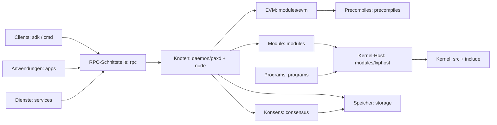

# Paxeer X Network

[English](../../README.md) · [Español](README.es.md) · [日本語](README.ja.md) · [Русский](README.ru.md) · [简体中文](README.zh-CN.md) · [Português](README.pt-BR.md) · Deutsch · [Français](README.fr.md)

Paxeer mainnet-beta ist ein einzelnes byzantinisch fehlertolerantes Netzwerk, das `paxd` ausführt, mit der EVM-Chain-ID **125** (`0x7d`) und **PAX** als nativem Token. Der Knoten integriert Konsens, EVM, native Module, Precompiles und den LayerX-Kernel, sodass bestätigte Blöcke den endgültigen Zustand des Netzwerks bereitstellen.

## Repository-Aufbau

| Verzeichnis | Inhalt | Seite |
| --- | --- | --- |
| [`admin/`](../../admin/README.md) | Werkzeuge und Befehle zur Knotenverwaltung. | [README](../../admin/README.md) |
| [`api/`](../../api/README.md) | Protobuf-API-Definitionen und generierte Schnittstellen. | [README](../../api/README.md) |
| [`apps/`](../../apps/README.md) | Paxeer-Anwendungen für Endnutzer. | [README](../../apps/README.md) |
| [`cmd/`](../../cmd/README.md) | Paxeer-Kommandozeilenwerkzeuge. | [README](../../cmd/README.md) |
| [`consensus/`](../../consensus/README.md) | Die Konsens-Engine des Netzwerks. | [README](../../consensus/README.md) |
| [`contracts/`](../../contracts/README.md) | On-Chain-Contracts und Contract-Tests. | [README](../../contracts/README.md) |
| [`core/`](../../core/README.md) | Festgelegte Kernabhängigkeiten. | [README](../../core/README.md) |
| [`custodyproof/`](../../custodyproof/README.md) | Typen und Verifikation für Verwahrungsnachweise. | [README](../../custodyproof/README.md) |
| [`daemon/`](../../daemon/README.md) | Der Daemon `paxd` und der Einstiegspunkt des Knotens. | [README](../../daemon/README.md) |
| [`deploy/`](../../deploy/README.md) | Deployment-Konfiguration und Manifeste. | [README](../../deploy/README.md) |
| [`docker/`](../../docker/README.md) | Docker-Images und lokale Container-Einrichtung. | [README](../../docker/README.md) |
| [`docs/`](../../docs/README.md) | Netzwerkdokumentation und Dokumentationsseite. | [README](../../docs/README.md) |
| [`engine/`](../../engine/README.md) | Komponenten der Ausführungs-Engine. | [README](../../engine/README.md) |
| [`include/`](../../include/README.md) | Header des LayerX-Kernels. | [README](../../include/README.md) |
| [`interchain/`](../../interchain/README.md) | IBC und Interchain-Integration. | [README](../../interchain/README.md) |
| [`layerxproof/`](../../layerxproof/README.md) | Codecs und Verifikation für LayerX-Nachweise. | [README](../../layerxproof/README.md) |
| [`migrations/`](../../migrations/README.md) | Schemas für SQLite-Projektionen und Importe. | [README](../../migrations/README.md) |
| [`modules/`](../../modules/README.md) | Chain-Module von Paxeer X. | [README](../../modules/README.md) |
| [`node/`](../../node/README.md) | Zusammenstellung der Paxeer-Knotenanwendung. | [README](../../node/README.md) |
| [`precompiles/`](../../precompiles/README.md) | EVM-Precompiles für native Chain-Funktionen. | [README](../../precompiles/README.md) |
| [`programs/`](../../programs/README.md) | LayerX Programs: Runtime, Gastprogramme und SDKs. | [README](../../programs/README.md) |
| [`rpc/`](../../rpc/README.md) | EVM-JSON-RPC-Dienste. | [README](../../rpc/README.md) |
| [`scripts/`](../../scripts/README.md) | Skripte für Build, CI, Release und Workspace. | [README](../../scripts/README.md) |
| [`sdk/`](../../sdk/README.md) | Paxeer-Client-SDKs und Integrationen. | [README](../../sdk/README.md) |
| [`services/`](../../services/README.md) | Off-Chain-Netzwerkdienste. | [README](../../services/README.md) |
| [`src/`](../../src/README.md) | Implementierung des LayerX-Kernels. | [README](../../src/README.md) |
| [`storage/`](../../storage/README.md) | PaxDB-Speicher und Zustands-Commitment. | [README](../../storage/README.md) |
| [`tests/`](../../tests/README.md) | Netzwerk-, Kernel-, Integrations- und Protokolltests. | [README](../../tests/README.md) |
| [`tools/`](../../tools/README.md) | Werkzeuge für Entwickler und Betreiber. | [README](../../tools/README.md) |
| [`utils/`](../../utils/README.md) | Gemeinsame Knotendienstprogramme. | [README](../../utils/README.md) |
| [`wasm/`](../../wasm/README.md) | Das eingebettete CosmWasm-Modul. | [README](../../wasm/README.md) |
| [`wasm-runtime/`](../../wasm-runtime/README.md) | Der Go- und Rust-Runtime-Wrapper für CosmWasm. | [README](../../wasm-runtime/README.md) |

## Architektur



## Schnellstart

Bauen Sie den Knoten aus dem Repository-Root:

```sh
make paxd-build
```

Führen Sie das Paxeer-Test-Target des Repositorys aus:

```sh
make paxeer-test
```

## Dokumentation

- [Dokumentationsübersicht](../../docs/README.md)
- [Dokumentationsseite](../../docs/site/)
- [Index der Systemdokumentation](../../docs/system/INDEX.md), einschließlich [Chain-Modulen](../../docs/system/chain-modules.md), [Kernel-Modulen](../../docs/system/kernel-modules.md), [Precompiles](../../docs/system/precompiles.md), [RPC](../../docs/system/rpc.md), [Routen](../../docs/system/routes.md), [SDK](../../docs/system/sdk.md), [CLI](../../docs/system/cli.md) und [Governance](../../docs/system/governance.md)

## Upgrade auf Version 7.0.0

Das [Systeminventar für 7.0.0](../../docs/release/7.0.0-systems.kvx), der [Upgrade-Plan](../../docs/release/7.0.0-upgrade-plan.md) und das [Validator-Betriebshandbuch](../../docs/release/7.0.0-validator-runbook.md) beschreiben das Release und seine Betriebsabläufe.

## Community

- [Mitwirken](../../CONTRIBUTING.md)
- [Sicherheitsrichtlinie](../../SECURITY.md)
- [Support](../../SUPPORT.md)
- [Governance](../../GOVERNANCE.md)
- [Verhaltenskodex](../../CODE_OF_CONDUCT.md)

## Lizenz

Paxeer X Network wird unter den Bedingungen der [Apache License 2.0](../../LICENSE) vertrieben.
