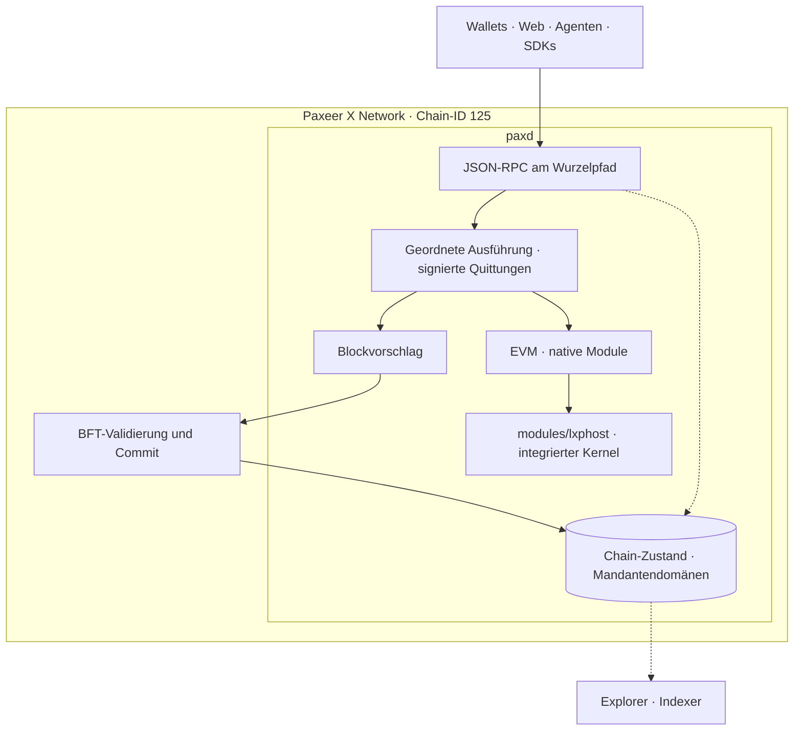
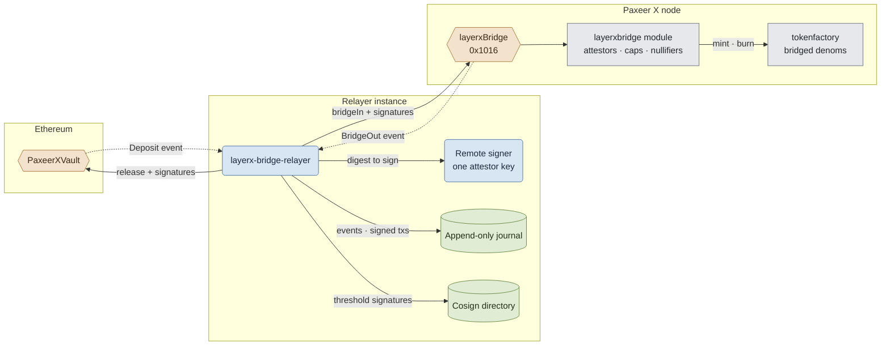

<p align="center"></p>

<h1 align="center">Paxeer X Network</h1>

[English](../../README.md) · [Español](README.es.md) · [日本語](README.ja.md) · [Русский](README.ru.md) · [简体中文](README.zh-CN.md) · [Português](README.pt-BR.md) · Deutsch · [Français](README.fr.md)

*Diese Fassung beschreibt das zusammengeführte Netzwerk gemäß [`spec/layerx-merge/spec.kvx`](../../spec/layerx-merge/spec.kvx).*

<p align="center">
  <!-- ═══ Network Identity ═══ -->
  
  
  
  
  
</p>

<p align="center">
  <!-- ═══ Language Stack ═══ -->
  
  
  
  
  
</p>

<p align="center">
  <!-- ═══ Repo Health ═══ -->
  
  
  
  
</p>

## Was Paxeer X Network ist

Paxeer X Network ist ein BFT-Netzwerk mit einem Ausführungsbereich im Knoten `paxd` und der EVM-Chain-ID **125** (`0x7d`). Der LayerX-Kernel ist in den Knoten integriert: Er führt Agentenaktivitäten deterministisch aus und ist Teil der Blockvorschlagserstellung. Eine signierte Ausführungsquittung ist final, sobald ihr Block durch den BFT-Konsens committed wurde. Offizielle Website: [paxeer.network](https://paxeer.network/). Dokumentation: [docs.paxeer.app](https://docs.paxeer.app/).

Der Go-Knoten bindet den C17-Kernel über [`modules/lxphost/host.go`](../../modules/lxphost/host.go) ein. EVM, native Module und Kernel arbeiten innerhalb desselben Netzwerks. Die früheren Custody- und Anchor-Precompiles an `0x1013` und `0x1014` sind seit dem Merge stillgelegt; sie sind kein Betriebsweg für Einzahlung oder Checkpoint-Abwicklung. Für die nativen Konstrukte führt die Merge-Adresstabelle in [`precompiles/setup.go`](../../precompiles/setup.go) folgende Precompiles auf (Adressen hier gekürzt):

| Precompile | Adresse |
| --- | --- |
| `layerxledger` | `0x101A` |
| `layerxpay` | `0x101B` |
| `layerxauth` | `0x101C` |
| `layerxprograms` | `0x101D` |
| `layerxchains` | `0x101E` |

Die Bridge bleibt über `layerxBridge` an `0x1016` mit dem Modul `layerxbridge` verbunden. Welche versionierten Precompiles an einer bestimmten Höhe aktiv sind, bestimmen die Upgrade-Registrierungen in [`node/app.go`](../../node/app.go) und [`precompiles/setup.go`](../../precompiles/setup.go).

Dieses Monorepo von Sidiora Labs enthält Knoten, Kernel, Contracts, Dienste und Clients. Die maßgebliche Merge-Spezifikation ist [`spec/layerx-merge/spec.kvx`](../../spec/layerx-merge/spec.kvx); Release Notes stehen in [`CHANGELOG.md`](../../CHANGELOG.md). Sub-Chains sind Mandantendomänen mit eigenem Namensraum in der Datenbank, verwaltet durch [`modules/layerxchains/`](../../modules/layerxchains/). Für eine solche Domäne ist keine neue Knoten-Infrastruktur erforderlich.

## Das Netzwerk ausprobieren

Die öffentliche Mainnet-Beta verwendet Chain-ID 125. Verbinden Sie Wallets und JSON-RPC-Clients direkt mit einem Knoten am URL-Wurzelpfad:

| Zugriff | Beispiel |
| --- | --- |
| HTTPS JSON-RPC | `https://api-mainnet-beta.paxeer.network` |
| Nummerierter Knoten | `https://api1.mainnet-beta.paxeer.network` |
| WebSocket | `wss://api1.mainnet-beta.paxeer.network` |

Die nummerierten Hosts reichen von `api1.mainnet-beta.paxeer.network` bis `api14.mainnet-beta.paxeer.network`. Die vollständige Liste und Nutzungshinweise stehen in [`docs/site/docs/reference/public-rpc.md`](../site/docs/reference/public-rpc.md). Prüfen Sie vor dem Signieren die Chain-ID; diese Anfrage erwartet `"0x7d"` als Ergebnis:

```sh
curl -sS --max-time 15 https://api1.mainnet-beta.paxeer.network \
  -H 'content-type: application/json' \
  -d '{"jsonrpc":"2.0","id":1,"method":"eth_chainId","params":[]}'
```

Die öffentlichen Knoten-Namensräume sind `debug`, `echo`, `eth`, `net`, `pax`, `px`, `test` und `txpool`; die verfügbare Methodenauswahl hängt von der Knotenkonfiguration ab. Der Namensraum `px` antwortet aus dem Knotenzustand; `px_register` und `px_requestFunds` sind Operationen der gehosteten Identitäts- und Faucet-Dienste, deren Vertrag in [`services/platform/hosted/gateway/openrpc.json`](../../services/platform/hosted/gateway/openrpc.json) steht. Der Bibliotheksmirror `node.hyperpaxeer.com` wird von hpx-Build-Skripten verwendet und ist kein JSON-RPC-Endpunkt.

Die Checkliste ist [`Getting-Started-Beta.md`](../wiki/Getting-Started-Beta.md); Wallet, Finanzierung und Zahlungen beschreibt [`PaymentsQuickstart.md`](../wiki/PaymentsQuickstart.md). Weitere Einstiege: [`Assets.md`](../wiki/Assets.md), [`PublicRpc.md`](../wiki/PublicRpc.md), [`CommitmentLevels.md`](../wiki/CommitmentLevels.md) und [`PublicAPI.md`](../wiki/PublicAPI.md). Hinweise zur lokalen Entwicklung stehen in [`Quickstart.md`](../wiki/Quickstart.md). Eine lokale Entwicklungsumgebung und öffentliches Mainnet sind unterschiedliche Betriebsumgebungen.

## Aus dem Quellcode bauen

Die Toolchain-Versionen stehen in den Build-Dateien: Go 1.25.8 in [`go.mod`](../../go.mod), C17 im Root-[`Makefile`](../../Makefile), Rust 1.91.1 in [`rust-toolchain.toml`](../../rust-toolchain.toml) und Solidity 0.8.27 für das Root-Foundry-Projekt in [`foundry.toml`](../../foundry.toml).

Bauen Sie den integrierten Knoten aus dem Repository-Root:

```sh
make paxd-build
```

Dieses Target baut zuerst die Kernel-Bibliothek und die Programs-Runtime, die `paxd` einbindet, und erzeugt dann `build/paxd` über `chain.mk`. `make paxeer-build` reicht nur den Go-Build weiter und ersetzt diese Vorbereitung nicht. Beide verwenden `GOPROXY=off`; die benötigten Go-Abhängigkeiten müssen bereits verfügbar sein. Die Kernel-Bibliothek und die vorhandenen Test-Targets können separat bearbeitet werden:

```sh
make build
make test
make test-contracts
make paxeer-test
make paxeer-lint
```

Diese Targets prüfen unterschiedliche Komponenten. Übergreifende Gates wie `make ci`, `make paxeer-ci` und `make monorepo-ci` sowie die zusätzlichen Replay-Toolchains sind in [`docs/QUALIFICATION.md`](../QUALIFICATION.md) beschrieben. Die Kernel-Bibliothek wird im Knoten ausgeführt; ihr eigener Build bedeutet keinen zusätzlichen Netzwerkprozess.

## Repository-Aufbau

| Pfad | Zweck |
| --- | --- |
| `src/`, `include/` | C17-Kernel: deterministische Zustandsmaschine, Speicher, Buchung und Replay |
| `modules/lxphost/` | cgo-Einbindung des Kernels und der Programs-Runtime in den Knoten |
| `node/`, `daemon/`, `consensus/`, `modules/` | Anwendung `paxd`, BFT-Konsens und native Chain-Module |
| `rpc/`, `precompiles/`, `storage/`, `wasm/` | JSON-RPC, EVM-Precompiles, Speicher und CosmWasm-Integration |
| `cmd/` | Kernel-Werkzeuge, darunter `layerxctl`, Genesis und Verifikation |
| `services/agent/` | Agenten-Clients, SDKs, `layerx-agentd`, MCP, Kodierung und Beweisprüfung |
| `services/human/` | Human-Steuerungsebene, Intent-Verarbeitung und KMS |
| `services/platform/` | Gehostete Plattformdienste und Middleware |
| `services/interop/` | Agenten-Commerce und Interoperabilität, einschließlich des Bridge-Relayers |
| `services/explorer/`, `apps/explorer/` | Explorer-Dienste und Blockscout-Anwendung |
| `apps/web/`, `apps/wallet/`, `apps/bridge/` | Web-, Wallet- und Bridge-Anwendungen |
| `programs/` | Programs-Runtime, Registry, Interpreter, Sandbox und Programm-SDKs |
| `contracts/`, `contracts/bridge/` | Solidity-Quellen sowie EVM-Vaults, Solana-Bridge-Programm und Testvektoren |
| `services/bridge/` | Bridge-Deployment-Material |
| `sdk/platform/`, `sdk/integrations/`, `tools/platform/` | Weitere SDKs, Integrationen, Entwickler-CLI, Emulator und Release-Werkzeuge |
| `spec/` | KVX-Spezifikationen, Anforderungen und Aufgabengraph |
| `tests/`, `tests/fuzz/` | Native Tests, Contract-, Replay-, Invarianten- und Fuzz-Suiten |
| `migrations/` | SQL für Genesis-Import und wiederaufbaubare Projektionen |
| `docs/` | Wiki, Dokumentationsseite, Übersetzungen und Qualifikationshinweise |

## Dokumentation

- Gehostete Dokumentation: [docs.paxeer.app](https://docs.paxeer.app/)
- Wiki-Index: [`docs/wiki/Home.md`](../../docs/wiki/Home.md)
- Erste Schritte: [`docs/wiki/Getting-Started-Beta.md`](../../docs/wiki/Getting-Started-Beta.md)
- Pfad für Payment-Entwickler: [`docs/wiki/PaymentsQuickstart.md`](../../docs/wiki/PaymentsQuickstart.md)
- Öffentliches JSON-RPC: [`docs/wiki/PublicRpc.md`](../../docs/wiki/PublicRpc.md)
- Assets und Tokens: [`docs/wiki/Assets.md`](../../docs/wiki/Assets.md)
- Commitment-Stufen: [`docs/wiki/CommitmentLevels.md`](../../docs/wiki/CommitmentLevels.md)
- Monorepo-Aufbau und Release-Tags: [`docs/MONOREPO.md`](../../docs/MONOREPO.md)
- Qualifikations-Gates: [`docs/QUALIFICATION.md`](../../docs/QUALIFICATION.md)
- Spezifikation: [`spec/layerx-merge/spec.kvx`](../../spec/layerx-merge/spec.kvx)
- Release Notes: [`CHANGELOG.md`](../../CHANGELOG.md)

## SDKs und Integrationen

| Sprache | Pfad |
| --- | --- |
| Rust | `services/agent/crates/layerx-sdk` |
| Python | `services/agent/sdk/python` |
| TypeScript | `services/agent/sdk/typescript` |
| Go | `sdk/platform/go` |
| JVM | `sdk/platform/jvm` |
| .NET | `sdk/platform/dotnet` |
| Swift | `sdk/platform/swift` |

`layerx-agentd` liegt in `services/agent/crates/layerx-agentd`. Der MCP-Server liegt in `services/agent/crates/layerx-mcp`. Die Entwickler-CLI in `tools/platform/cli` installiert diese Transporte mit `layerx install mcp` und `layerx install a2a`.

## Architektur

Der Knoten `paxd` enthält Ausführung, Kernel und Blockvorschlagserstellung. [`node/sequencer/`](../../node/sequencer/) implementiert die geordnete Ausführung und signierte Quittungen; die Vorschlagsprüfung ist in [`node/app.go`](../../node/app.go) eingebunden. Eine Quittung vor dem Block-Commit ist eine Ausführungsbestätigung; Finalität entsteht mit dem BFT-Commit ihres Blocks. Explorer und Indexer lesen Chain-Daten und schaffen keine zusätzliche Finalitätsstufe.



Die Bridge zu Ethereum bleibt eine Verbindung zu einem anderen Netzwerk. Der [`layerx-bridge-relayer`](../../services/interop/crates/layerx-bridge-relayer/src/lib.rs) verarbeitet `PaxeerXVault`-Einzahlungen über `bridgeIn` an `layerxBridge` (`0x1016`); in Gegenrichtung führen `BridgeOut`-Events zu `PaxeerXVault.release`. Das Modul [`layerxbridge`](../../modules/layerxbridge/) prüft Attestierungen, Limits und Nullifier und nutzt `tokenfactory` für Mint und Burn.

Jede Relayer-Instanz verwendet einen Attestor-Schlüssel über einen Remote-Signer, journalisiert beobachtete Events und signierte Transaktionsbytes vor dem Senden und tauscht Signaturen über ein Cosign-Verzeichnis aus, wenn die konfigurierte Schwelle größer als eins ist. Nach einem Neustart werden bereits signierte Bytes erneut gesendet; Nullifier verhindern die doppelte Verarbeitung. Die Finalitätsanforderungen der externen Chain und die Bridge-Signaturschwelle sind vom BFT-Commit auf Paxeer zu unterscheiden. Contracts und Vektoren stehen in [`contracts/bridge/`](../../contracts/bridge/).



## Mitwirken

Lesen Sie [`CONTRIBUTING.md`](../../CONTRIBUTING.md), bevor Sie einen Pull Request öffnen. Protokolländerungen beginnen in `spec/`. Melden Sie eine vermutete Schwachstelle nicht in einem öffentlichen Issue; folgen Sie [`SECURITY.md`](../../SECURITY.md).

## Sicherheit

Melden Sie Schwachstellen über das private Reporting von GitHub, wie in [`SECURITY.md`](../../SECURITY.md) beschrieben.

## Lizenz

Lizenziert unter der Apache License, Version 2.0. Siehe [`LICENSE`](../../LICENSE) und [`NOTICE`](../../NOTICE).

Paxeer X Network wird von Sidiora Labs entwickelt. Quellcode: [github.com/Sidiora-Labs/paxeer-monorepo](https://github.com/Sidiora-Labs/paxeer-monorepo).
