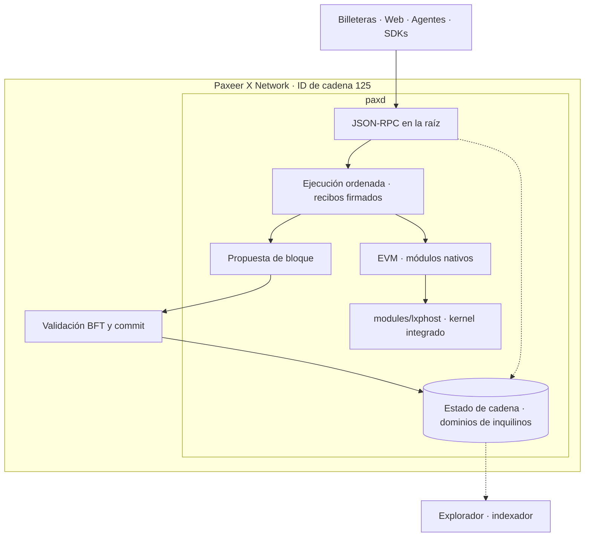
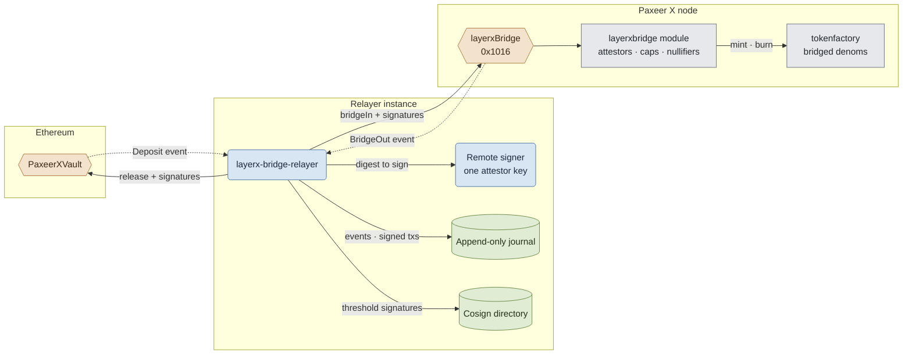

<p align="center"></p>

<h1 align="center">Paxeer X Network</h1>

[English](../../README.md) · Español · [日本語](README.ja.md) · [Русский](README.ru.md) · [简体中文](README.zh-CN.md) · [Português](README.pt-BR.md) · [Deutsch](README.de.md) · [Français](README.fr.md)

*Esta versión describe la red integrada según [`spec/layerx-merge/spec.kvx`](../../spec/layerx-merge/spec.kvx).*

<p align="center">
  <!-- ═══ Network Identity ═══ -->
  
  
  
  
  
</p>

<p align="center">
  <!-- ═══ Language Stack ═══ -->
  
  
  
  
  
</p>

<p align="center">
  <!-- ═══ Repo Health ═══ -->
  
  
  
  
</p>

## Qué es Paxeer X Network

Paxeer X Network es una red BFT con un único entorno de ejecución en el nodo `paxd` y el ID de cadena EVM **125** (`0x7d`). El kernel LayerX está integrado en el nodo: ejecuta las actividades de los agentes de forma determinista y participa en la propuesta de bloques. Un recibo de ejecución firmado es final cuando su bloque queda confirmado mediante el consenso BFT. Sitio oficial: [paxeer.network](https://paxeer.network/). Documentación: [docs.paxeer.app](https://docs.paxeer.app/).

El nodo Go incorpora el kernel C17 mediante [`modules/lxphost/host.go`](../../modules/lxphost/host.go). La EVM, los módulos nativos y el kernel trabajan dentro de la misma red. Los antiguos precompilados de custodia y anclaje en `0x1013` y `0x1014` quedaron retirados con la integración; ya no son una vía operativa para depósitos o liquidación de checkpoints. La tabla de direcciones de la integración en [`precompiles/setup.go`](../../precompiles/setup.go) enumera estos precompilados para los constructos nativos (direcciones abreviadas):

| Precompilado | Dirección |
| --- | --- |
| `layerxledger` | `0x101A` |
| `layerxpay` | `0x101B` |
| `layerxauth` | `0x101C` |
| `layerxprograms` | `0x101D` |
| `layerxchains` | `0x101E` |

El puente sigue conectado al módulo `layerxbridge` mediante `layerxBridge` en `0x1016`. Los registros de actualización en [`node/app.go`](../../node/app.go) y [`precompiles/setup.go`](../../precompiles/setup.go) determinan qué precompilados versionados están activos a una altura concreta.

Este monorepo de Sidiora Labs contiene el nodo, el kernel, los contratos, los servicios y los clientes. La especificación de la integración es [`spec/layerx-merge/spec.kvx`](../../spec/layerx-merge/spec.kvx); las notas de versión están en [`CHANGELOG.md`](../../CHANGELOG.md). Las subcadenas son dominios de inquilinos con su propio espacio de nombres en la base de datos, gestionados por [`modules/layerxchains/`](../../modules/layerxchains/). Crear uno de estos dominios no requiere nueva infraestructura de nodos.

## Probar la red

La mainnet beta pública usa el ID de cadena 125. Conecte las billeteras y los clientes JSON-RPC directamente a un nodo, en la ruta raíz de su URL:

| Acceso | Ejemplo |
| --- | --- |
| JSON-RPC por HTTPS | `https://api-mainnet-beta.paxeer.network` |
| Nodo numerado | `https://api1.mainnet-beta.paxeer.network` |
| WebSocket | `wss://api1.mainnet-beta.paxeer.network` |

Los hosts numerados van de `api1.mainnet-beta.paxeer.network` a `api14.mainnet-beta.paxeer.network`. La lista completa y las indicaciones de uso están en [`docs/site/docs/reference/public-rpc.md`](../site/docs/reference/public-rpc.md). Compruebe el ID de cadena antes de firmar; esta consulta debe devolver `"0x7d"` como resultado:

```sh
curl -sS --max-time 15 https://api1.mainnet-beta.paxeer.network \
  -H 'content-type: application/json' \
  -d '{"jsonrpc":"2.0","id":1,"method":"eth_chainId","params":[]}'
```

Los espacios de nombres de los nodos públicos son `debug`, `echo`, `eth`, `net`, `pax`, `test` y `txpool`; la selección de métodos disponible depende de la configuración del nodo. La API del gateway alojado tiene su propio contrato en [`services/platform/hosted/gateway/openrpc.json`](../../services/platform/hosted/gateway/openrpc.json). Sus métodos `px_` no están disponibles automáticamente en todos los nodos públicos. El mirror de bibliotecas `node.hyperpaxeer.com` se usa en los scripts de compilación de hpx y no es un endpoint JSON-RPC.

La lista de comprobación es [`Getting-Started-Beta.md`](../wiki/Getting-Started-Beta.md); [`PaymentsQuickstart.md`](../wiki/PaymentsQuickstart.md) explica billetera, financiación y pagos. Otros puntos de partida: [`Assets.md`](../wiki/Assets.md), [`PublicRpc.md`](../wiki/PublicRpc.md), [`CommitmentLevels.md`](../wiki/CommitmentLevels.md) y [`PublicAPI.md`](../wiki/PublicAPI.md). Consulte [`Quickstart.md`](../wiki/Quickstart.md) para el desarrollo local. El entorno de desarrollo local y la mainnet pública son entornos operativos diferentes.

## Compilar desde el código fuente

Los archivos de compilación fijan las versiones: Go 1.25.8 en [`go.mod`](../../go.mod), C17 en el [`Makefile`](../../Makefile) raíz, Rust 1.91.1 en [`rust-toolchain.toml`](../../rust-toolchain.toml) y Solidity 0.8.27 para el proyecto Foundry raíz en [`foundry.toml`](../../foundry.toml).

Compile el nodo integrado desde la raíz del repositorio:

```sh
make paxd-build
```

Este target compila primero la biblioteca del kernel y el runtime de Programs que enlaza `paxd`, y después genera `build/paxd` mediante `chain.mk`. `make paxeer-build` solo delega la compilación Go y no sustituye esa preparación. Ambos usan `GOPROXY=off`; las dependencias Go necesarias deben estar disponibles de antemano. La biblioteca del kernel y los targets de pruebas existentes se pueden trabajar por separado:

```sh
make build
make test
make test-contracts
make paxeer-test
make paxeer-lint
```

Estos targets comprueban componentes distintos. Las puertas generales como `make ci`, `make paxeer-ci` y `make monorepo-ci`, y las toolchains adicionales para calificar el replay, se describen en [`docs/QUALIFICATION.md`](../QUALIFICATION.md). La biblioteca del kernel se ejecuta dentro del nodo; compilarla por separado no implica un proceso de red adicional.

## Estructura del repositorio

| Ruta | Propósito |
| --- | --- |
| `src/`, `include/` | Kernel C17: máquina de estados determinista, almacenamiento, contabilidad y replay |
| `modules/lxphost/` | Integración cgo del kernel y del runtime de Programs en el nodo |
| `node/`, `daemon/`, `consensus/`, `modules/` | Aplicación `paxd`, consenso BFT y módulos nativos de la cadena |
| `rpc/`, `precompiles/`, `storage/`, `wasm/` | JSON-RPC, precompilados EVM, almacenamiento e integración CosmWasm |
| `cmd/` | Herramientas del kernel, entre ellas `layerxctl`, génesis y verificación |
| `services/agent/` | Clientes de agentes, SDKs, `layerx-agentd`, MCP, codificación y verificación de pruebas |
| `services/human/` | Plano de control humano, procesamiento de intenciones y KMS |
| `services/platform/` | Servicios de plataforma alojados y middleware |
| `services/interop/` | Comercio entre agentes e interoperabilidad, incluido el relayer del puente |
| `services/explorer/`, `apps/explorer/` | Servicios del explorador y aplicación Blockscout |
| `apps/web/`, `apps/wallet/`, `apps/bridge/` | Aplicaciones web, de billetera y de puente |
| `programs/` | Runtime de Programs, registro, intérprete, sandbox y SDKs de programas |
| `contracts/`, `contracts/bridge/` | Fuentes Solidity, bóvedas EVM, programa del puente en Solana y vectores de prueba |
| `services/bridge/` | Material de despliegue del puente |
| `sdk/platform/`, `sdk/integrations/`, `tools/platform/` | Otros SDKs, integraciones, CLI, emulador y herramientas de publicación |
| `spec/` | Especificaciones KVX, requisitos y grafo de tareas |
| `tests/`, `tests/fuzz/` | Pruebas nativas, de contratos, replay, invariantes y fuzzing |
| `migrations/` | SQL para importación de génesis y proyecciones reconstruibles |
| `docs/` | Wiki, sitio de documentación, traducciones y notas de calificación |

## Documentación

- Documentación alojada: [docs.paxeer.app](https://docs.paxeer.app/)
- Índice de la wiki: [`docs/wiki/Home.md`](../../docs/wiki/Home.md)
- Primeros pasos: [`docs/wiki/Getting-Started-Beta.md`](../../docs/wiki/Getting-Started-Beta.md)
- Recorrido para desarrolladores de pagos: [`docs/wiki/PaymentsQuickstart.md`](../../docs/wiki/PaymentsQuickstart.md)
- JSON-RPC público: [`docs/wiki/PublicRpc.md`](../../docs/wiki/PublicRpc.md)
- Assets y tokens: [`docs/wiki/Assets.md`](../../docs/wiki/Assets.md)
- Niveles de compromiso: [`docs/wiki/CommitmentLevels.md`](../../docs/wiki/CommitmentLevels.md)
- Estructura del monorepo y etiquetas de versión: [`docs/MONOREPO.md`](../../docs/MONOREPO.md)
- Puertas de calificación: [`docs/QUALIFICATION.md`](../../docs/QUALIFICATION.md)
- Especificación: [`spec/layerx-merge/spec.kvx`](../../spec/layerx-merge/spec.kvx)
- Notas de versión: [`CHANGELOG.md`](../../CHANGELOG.md)

## SDKs e integraciones

| Lenguaje | Ruta |
| --- | --- |
| Rust | `services/agent/crates/layerx-sdk` |
| Python | `services/agent/sdk/python` |
| TypeScript | `services/agent/sdk/typescript` |
| Go | `sdk/platform/go` |
| JVM | `sdk/platform/jvm` |
| .NET | `sdk/platform/dotnet` |
| Swift | `sdk/platform/swift` |

`layerx-agentd` está en `services/agent/crates/layerx-agentd`. El servidor MCP está en `services/agent/crates/layerx-mcp`. La CLI para desarrolladores en `tools/platform/cli` instala esos transportes con `layerx install mcp` y `layerx install a2a`.

## Arquitectura

El nodo `paxd` contiene la ejecución, el kernel y la propuesta de bloques. [`node/sequencer/`](../../node/sequencer/) implementa la ejecución ordenada y los recibos firmados; la validación de propuestas está integrada en [`node/app.go`](../../node/app.go). Un recibo anterior al commit del bloque confirma la ejecución; la finalidad llega con el commit BFT de su bloque. Los exploradores e indexadores leen datos de la cadena y no crean otra etapa de finalidad.



El puente hacia Ethereum sigue siendo una conexión a otra red. El [`layerx-bridge-relayer`](../../services/interop/crates/layerx-bridge-relayer/src/lib.rs) procesa los depósitos de `PaxeerXVault` mediante `bridgeIn` en `layerxBridge` (`0x1016`); en la dirección contraria, los eventos `BridgeOut` llevan a `PaxeerXVault.release`. El módulo [`layerxbridge`](../../modules/layerxbridge/) comprueba atestaciones, límites y nullifiers, y usa `tokenfactory` para acuñar y quemar tokens.

Cada instancia del relayer usa una clave de atestador mediante un firmante remoto, registra los eventos observados y los bytes de las transacciones firmadas antes de difundirlos, e intercambia firmas mediante un directorio de cofirma cuando el umbral configurado es mayor que uno. Tras reiniciarse, vuelve a difundir los bytes ya firmados; los nullifiers impiden el procesamiento duplicado. Los requisitos de finalidad de la cadena externa y el umbral de firmas del puente son distintos del commit BFT de Paxeer. Los contratos y vectores están en [`contracts/bridge/`](../../contracts/bridge/).



## Contribuir

Lea [`CONTRIBUTING.md`](../../CONTRIBUTING.md) antes de abrir un pull request. Los cambios de protocolo empiezan en `spec/`. No divulgue una posible vulnerabilidad en un issue público; siga [`SECURITY.md`](../../SECURITY.md).

## Seguridad

Informe de vulnerabilidades mediante el reporte privado de GitHub, como se describe en [`SECURITY.md`](../../SECURITY.md).

## Licencia

Con licencia Apache License, versión 2.0. Consulte [`LICENSE`](../../LICENSE) y [`NOTICE`](../../NOTICE).

Paxeer X Network está desarrollado por Sidiora Labs. Código fuente: [github.com/Sidiora-Labs/Paxeer-X-Network](https://github.com/Sidiora-Labs/Paxeer-X-Network).
