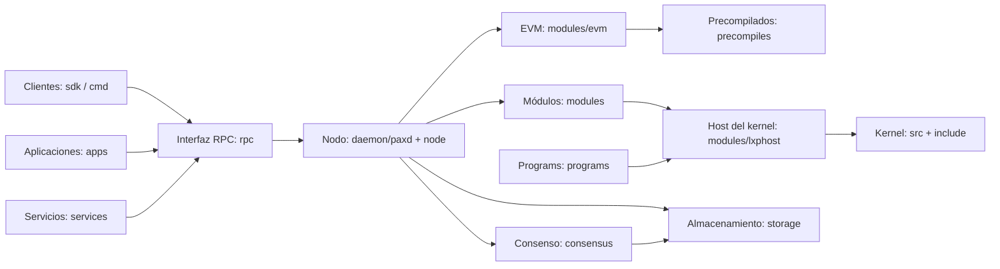

# Paxeer X Network

[English](../../README.md) · Español · [日本語](README.ja.md) · [Русский](README.ru.md) · [简体中文](README.zh-CN.md) · [Português](README.pt-BR.md) · [Deutsch](README.de.md) · [Français](README.fr.md)

Paxeer mainnet-beta es una única red tolerante a fallos bizantinos que ejecuta `paxd`, con el identificador de cadena EVM **125** (`0x7d`) y **PAX** como token nativo. El nodo integra el consenso, la EVM, los módulos nativos, los precompilados y el kernel LayerX, de modo que los bloques confirmados proporcionan el estado final de la red.

## Estructura del repositorio

| Directorio | Contenido | Página |
| --- | --- | --- |
| [`admin/`](../../admin/README.md) | Herramientas y comandos de administración de nodos. | [README](../../admin/README.md) |
| [`api/`](../../api/README.md) | Definiciones de API Protobuf e interfaces generadas. | [README](../../api/README.md) |
| [`apps/`](../../apps/README.md) | Aplicaciones de Paxeer para usuarios finales. | [README](../../apps/README.md) |
| [`cmd/`](../../cmd/README.md) | Herramientas de línea de comandos de Paxeer. | [README](../../cmd/README.md) |
| [`consensus/`](../../consensus/README.md) | El motor de consenso de la red. | [README](../../consensus/README.md) |
| [`contracts/`](../../contracts/README.md) | Contratos en cadena y pruebas de contratos. | [README](../../contracts/README.md) |
| [`core/`](../../core/README.md) | Dependencias principales con versiones fijadas. | [README](../../core/README.md) |
| [`custodyproof/`](../../custodyproof/README.md) | Tipos y verificación de pruebas de custodia. | [README](../../custodyproof/README.md) |
| [`daemon/`](../../daemon/README.md) | El demonio `paxd` y el punto de entrada del nodo. | [README](../../daemon/README.md) |
| [`deploy/`](../../deploy/README.md) | Configuración y manifiestos de despliegue. | [README](../../deploy/README.md) |
| [`docker/`](../../docker/README.md) | Imágenes Docker y configuración local de contenedores. | [README](../../docker/README.md) |
| [`docs/`](../../docs/README.md) | Documentación de la red y sitio de documentación. | [README](../../docs/README.md) |
| [`engine/`](../../engine/README.md) | Componentes del motor de ejecución. | [README](../../engine/README.md) |
| [`include/`](../../include/README.md) | Archivos de cabecera del kernel LayerX. | [README](../../include/README.md) |
| [`interchain/`](../../interchain/README.md) | IBC e integración entre cadenas. | [README](../../interchain/README.md) |
| [`layerxproof/`](../../layerxproof/README.md) | Códecs y verificación de pruebas de LayerX. | [README](../../layerxproof/README.md) |
| [`migrations/`](../../migrations/README.md) | Esquemas de proyección e importación de SQLite. | [README](../../migrations/README.md) |
| [`modules/`](../../modules/README.md) | Módulos de la cadena Paxeer X. | [README](../../modules/README.md) |
| [`node/`](../../node/README.md) | Ensamblaje de la aplicación del nodo Paxeer. | [README](../../node/README.md) |
| [`precompiles/`](../../precompiles/README.md) | Precompilados EVM para funciones nativas de la cadena. | [README](../../precompiles/README.md) |
| [`programs/`](../../programs/README.md) | Runtime, programas invitados y SDKs de LayerX Programs. | [README](../../programs/README.md) |
| [`rpc/`](../../rpc/README.md) | Servicios EVM JSON-RPC. | [README](../../rpc/README.md) |
| [`scripts/`](../../scripts/README.md) | Scripts de compilación, CI, publicación y espacio de trabajo. | [README](../../scripts/README.md) |
| [`sdk/`](../../sdk/README.md) | SDKs de cliente de Paxeer e integraciones. | [README](../../sdk/README.md) |
| [`services/`](../../services/README.md) | Servicios de red fuera de la cadena. | [README](../../services/README.md) |
| [`src/`](../../src/README.md) | Implementación del kernel LayerX. | [README](../../src/README.md) |
| [`storage/`](../../storage/README.md) | Almacenamiento PaxDB y compromiso de estado. | [README](../../storage/README.md) |
| [`tests/`](../../tests/README.md) | Pruebas de red, kernel, integración y protocolo. | [README](../../tests/README.md) |
| [`tools/`](../../tools/README.md) | Herramientas para desarrolladores y operadores. | [README](../../tools/README.md) |
| [`utils/`](../../utils/README.md) | Utilidades compartidas del nodo. | [README](../../utils/README.md) |
| [`wasm/`](../../wasm/README.md) | El módulo CosmWasm integrado. | [README](../../wasm/README.md) |
| [`wasm-runtime/`](../../wasm-runtime/README.md) | El wrapper del runtime de CosmWasm para Go y Rust. | [README](../../wasm-runtime/README.md) |

## Arquitectura



## Inicio rápido

Compile el nodo desde la raíz del repositorio:

```sh
make paxd-build
```

Ejecute el objetivo de pruebas de Paxeer del repositorio:

```sh
make paxeer-test
```

## Documentación

- [Resumen de la documentación](../../docs/README.md)
- [Sitio de documentación](../../docs/site/)
- [Índice de documentación del sistema](../../docs/system/INDEX.md), que incluye [módulos de la cadena](../../docs/system/chain-modules.md), [módulos del kernel](../../docs/system/kernel-modules.md), [precompilados](../../docs/system/precompiles.md), [RPC](../../docs/system/rpc.md), [rutas](../../docs/system/routes.md), [SDK](../../docs/system/sdk.md), [CLI](../../docs/system/cli.md) y [gobernanza](../../docs/system/governance.md)

## Actualización a la versión 7.0.0

El [inventario de sistemas de 7.0.0](../../docs/release/7.0.0-systems.kvx), el [plan de actualización](../../docs/release/7.0.0-upgrade-plan.md) y el [manual operativo de validadores](../../docs/release/7.0.0-validator-runbook.md) describen la versión y sus procedimientos operativos.

## Comunidad

- [Contribuir](../../CONTRIBUTING.md)
- [Política de seguridad](../../SECURITY.md)
- [Soporte](../../SUPPORT.md)
- [Gobernanza](../../GOVERNANCE.md)
- [Código de conducta](../../CODE_OF_CONDUCT.md)

## Licencia

Paxeer X Network se distribuye según los términos de la [licencia Apache 2.0](../../LICENSE).
