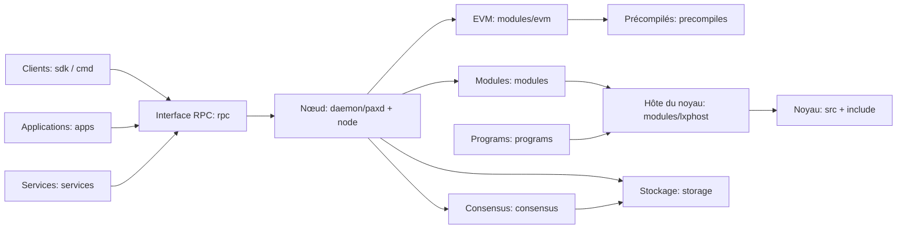

# Paxeer X Network

[English](../../README.md) · [Español](README.es.md) · [日本語](README.ja.md) · [Русский](README.ru.md) · [简体中文](README.zh-CN.md) · [Português](README.pt-BR.md) · [Deutsch](README.de.md) · Français

Paxeer mainnet-beta est un réseau unique tolérant aux fautes byzantines qui exécute `paxd`, avec l’identifiant de chaîne EVM **125** (`0x7d`) et **PAX** comme jeton natif. Le nœud intègre le consensus, l’EVM, les modules natifs, les précompilés et le noyau LayerX afin que les blocs validés fournissent l’état final du réseau.

## Organisation du dépôt

| Répertoire | Contenu | Page |
| --- | --- | --- |
| [`admin/`](../../admin/README.md) | Outils et commandes d’administration des nœuds. | [README](../../admin/README.md) |
| [`api/`](../../api/README.md) | Définitions d’API Protobuf et interfaces générées. | [README](../../api/README.md) |
| [`apps/`](../../apps/README.md) | Applications Paxeer destinées aux utilisateurs. | [README](../../apps/README.md) |
| [`cmd/`](../../cmd/README.md) | Outils en ligne de commande de Paxeer. | [README](../../cmd/README.md) |
| [`consensus/`](../../consensus/README.md) | Le moteur de consensus du réseau. | [README](../../consensus/README.md) |
| [`contracts/`](../../contracts/README.md) | Contrats sur la chaîne et tests de contrats. | [README](../../contracts/README.md) |
| [`core/`](../../core/README.md) | Dépendances principales aux versions fixées. | [README](../../core/README.md) |
| [`custodyproof/`](../../custodyproof/README.md) | Types et vérification des preuves de garde. | [README](../../custodyproof/README.md) |
| [`daemon/`](../../daemon/README.md) | Le démon `paxd` et le point d’entrée du nœud. | [README](../../daemon/README.md) |
| [`deploy/`](../../deploy/README.md) | Configuration et manifestes de déploiement. | [README](../../deploy/README.md) |
| [`docker/`](../../docker/README.md) | Images Docker et configuration locale des conteneurs. | [README](../../docker/README.md) |
| [`docs/`](../../docs/README.md) | Documentation du réseau et site de documentation. | [README](../../docs/README.md) |
| [`engine/`](../../engine/README.md) | Composants du moteur d’exécution. | [README](../../engine/README.md) |
| [`include/`](../../include/README.md) | En-têtes du noyau LayerX. | [README](../../include/README.md) |
| [`interchain/`](../../interchain/README.md) | IBC et intégration interchaînes. | [README](../../interchain/README.md) |
| [`layerxproof/`](../../layerxproof/README.md) | Codecs et vérification des preuves LayerX. | [README](../../layerxproof/README.md) |
| [`migrations/`](../../migrations/README.md) | Schémas de projection et d’importation SQLite. | [README](../../migrations/README.md) |
| [`modules/`](../../modules/README.md) | Modules de la chaîne Paxeer X. | [README](../../modules/README.md) |
| [`node/`](../../node/README.md) | Assemblage de l’application du nœud Paxeer. | [README](../../node/README.md) |
| [`precompiles/`](../../precompiles/README.md) | Précompilés EVM pour les fonctionnalités natives de la chaîne. | [README](../../precompiles/README.md) |
| [`programs/`](../../programs/README.md) | Runtime, programmes invités et SDK de LayerX Programs. | [README](../../programs/README.md) |
| [`rpc/`](../../rpc/README.md) | Services JSON-RPC EVM. | [README](../../rpc/README.md) |
| [`scripts/`](../../scripts/README.md) | Scripts de compilation, de CI, de publication et d’espace de travail. | [README](../../scripts/README.md) |
| [`sdk/`](../../sdk/README.md) | SDK clients Paxeer et intégrations. | [README](../../sdk/README.md) |
| [`services/`](../../services/README.md) | Services réseau hors chaîne. | [README](../../services/README.md) |
| [`src/`](../../src/README.md) | Implémentation du noyau LayerX. | [README](../../src/README.md) |
| [`storage/`](../../storage/README.md) | Stockage PaxDB et engagement d’état. | [README](../../storage/README.md) |
| [`tests/`](../../tests/README.md) | Tests du réseau, du noyau, d’intégration et du protocole. | [README](../../tests/README.md) |
| [`tools/`](../../tools/README.md) | Outils pour développeurs et opérateurs. | [README](../../tools/README.md) |
| [`utils/`](../../utils/README.md) | Utilitaires partagés du nœud. | [README](../../utils/README.md) |
| [`wasm/`](../../wasm/README.md) | Le module CosmWasm intégré. | [README](../../wasm/README.md) |
| [`wasm-runtime/`](../../wasm-runtime/README.md) | L’enveloppe Go et Rust du runtime CosmWasm. | [README](../../wasm-runtime/README.md) |

## Architecture



## Démarrage rapide

Compilez le nœud depuis la racine du dépôt :

```sh
make paxd-build
```

Exécutez la cible de tests Paxeer du dépôt :

```sh
make paxeer-test
```

## Documentation

- [Vue d’ensemble de la documentation](../../docs/README.md)
- [Site de documentation](../../docs/site/)
- [Index de la documentation système](../../docs/system/INDEX.md), comprenant les [modules de la chaîne](../../docs/system/chain-modules.md), les [modules du noyau](../../docs/system/kernel-modules.md), les [précompilés](../../docs/system/precompiles.md), [RPC](../../docs/system/rpc.md), les [routes](../../docs/system/routes.md), le [SDK](../../docs/system/sdk.md), la [CLI](../../docs/system/cli.md) et la [gouvernance](../../docs/system/governance.md)

## Mise à niveau vers la version 7.0.0

L’[inventaire des systèmes de la version 7.0.0](../../docs/release/7.0.0-systems.kvx), le [plan de mise à niveau](../../docs/release/7.0.0-upgrade-plan.md) et le [manuel d’exploitation des validateurs](../../docs/release/7.0.0-validator-runbook.md) décrivent la version et ses procédures d’exploitation.

## Communauté

- [Contribuer](../../CONTRIBUTING.md)
- [Politique de sécurité](../../SECURITY.md)
- [Assistance](../../SUPPORT.md)
- [Gouvernance](../../GOVERNANCE.md)
- [Code de conduite](../../CODE_OF_CONDUCT.md)

## Licence

Paxeer X Network est distribué selon les termes de la [licence Apache 2.0](../../LICENSE).
