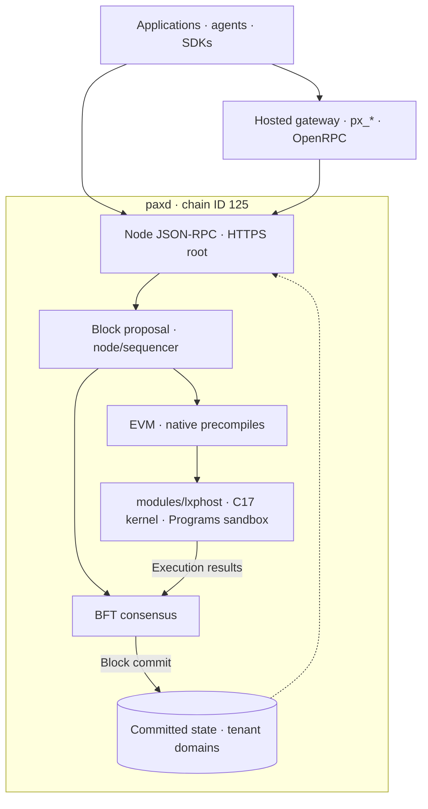
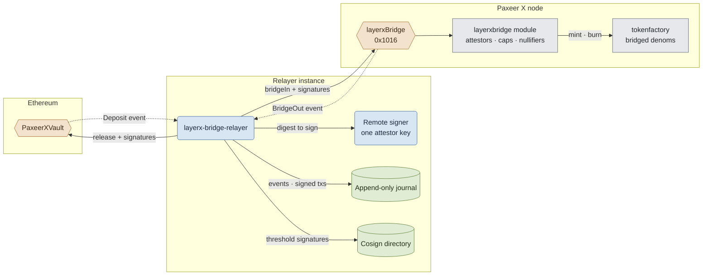

<p align="center"></p>

<h1 align="center">Paxeer X Network</h1>

[English](../../README.md) · [Español](README.es.md) · [日本語](README.ja.md) · [Русский](README.ru.md) · [简体中文](README.zh-CN.md) · [Português](README.pt-BR.md) · [Deutsch](README.de.md) · Français

*Cette traduction décrit le réseau intégré ; les références au code et à la spécification ci-dessous permettent de vérifier les interfaces.*

<p align="center">
  <!-- ═══ Network Identity ═══ -->
  
  
  
  
  
</p>

<p align="center">
  <!-- ═══ Language Stack ═══ -->
  
  
  
  
  
</p>

<p align="center">
  <!-- ═══ Repo Health ═══ -->
  
  
  
  
</p>

## Ce qu’est Paxeer X Network

Paxeer X Network est un réseau BFT unique : le nœud `paxd` (Go) intègre le noyau LayerX (C17), qui participe à l’exécution déterministe des activités et à la proposition des blocs. L’identifiant de chaîne EVM est **125** (`0x7d`). Un reçu est final lorsque son bloc est validé par le consensus. Site officiel : [paxeer.network](https://paxeer.network/). Documentation : [docs.paxeer.app](https://docs.paxeer.app/).

Le noyau est une bibliothèque liée à `paxd` via `modules/lxphost`, avec le bac à sable Programs de `programs/`. Les contrats EVM accèdent aux fonctionnalités natives par les précompilés ; l’exécution et la comptabilité appartiennent à la même machine à états du réseau. Les sous-chaînes sont des domaines locataires, isolés par un espace de noms dans la base de données et gérés par `modules/layerxchains`, sans nouvelle infrastructure à lancer pour chaque domaine.

Ce monorepo de Sidiora Labs réunit le nœud, le noyau, les contrats, les services et les SDK. La spécification de l’intégration est [`spec/layerx-merge/spec.kvx`](../../spec/layerx-merge/spec.kvx) ; les notes de version se trouvent dans [`CHANGELOG.md`](../../CHANGELOG.md).

## Essayer le réseau

Le JSON-RPC public de mainnet-beta utilise HTTPS à la racine des nœuds `api1.mainnet-beta.paxeer.network` à `api14.mainnet-beta.paxeer.network`, ainsi que `api-mainnet-beta.paxeer.network`. Exemple :

```sh
curl --fail --silent --show-error https://api1.mainnet-beta.paxeer.network \
  -H 'Content-Type: application/json' \
  --data '{"jsonrpc":"2.0","id":1,"method":"eth_chainId","params":[]}'
```

La valeur attendue de `result` est `0x7d`. Les espaces de noms publics sont `debug`, `echo`, `eth`, `net`, `pax`, `px`, `test` et `txpool` ; les méthodes disponibles dépendent du nœud et de sa configuration. Comparez `eth_blockNumber` entre plusieurs nœuds pour choisir un point d’accès à jour.

L’espace de noms `px` répond à partir de l’état du nœud ; `px_register` et `px_requestFunds` sont des opérations des services hébergés d’identité et de faucet, dont le contrat est [`services/platform/hosted/gateway/openrpc.json`](../../services/platform/hosted/gateway/openrpc.json). Consultez `px_getCapabilities` avant d’utiliser une fonctionnalité. `node.hyperpaxeer.com` est le miroir de bibliothèques hpx utilisé par les scripts de compilation (library mirror), et ne sert pas de point d’accès RPC.

Pour vous connecter à la chaîne Paxeer X (identifiant de chaîne 125), utilisez l’un des noms publics JSON-RPC listés dans [`docs/site/paxeer-docs/src/app/public-rpc/page.tsx`](../../docs/site/paxeer-docs/src/app/public-rpc/page.tsx). La liste de contrôle du point d’accès public est [`docs/wiki/Getting-Started-Beta.md`](../../docs/wiki/Getting-Started-Beta.md). Le parcours portefeuille, financement et paiements est [`docs/wiki/PaymentsQuickstart.md`](../../docs/wiki/PaymentsQuickstart.md). Assets : [`docs/wiki/Assets.md`](../../docs/wiki/Assets.md). Méthodes RPC : [`docs/wiki/PublicRpc.md`](../../docs/wiki/PublicRpc.md). Niveaux d’engagement : [`docs/wiki/CommitmentLevels.md`](../../docs/wiki/CommitmentLevels.md). API publique de paiement : [`docs/wiki/PublicAPI.md`](../../docs/wiki/PublicAPI.md).

Les développeurs du noyau commencent par la documentation hébergée sur [docs.paxeer.app](https://docs.paxeer.app/) ; le guide du cluster local est [`docs/wiki/Quickstart.md`](../../docs/wiki/Quickstart.md).

## Compiler depuis les sources

Le nœud utilise Go 1.25.8 (`go.mod`), le noyau C17 (`Makefile`) et les workspaces Rust la version 1.91.1 (`rust-toolchain.toml`). Le projet Solidity racine utilise la version 0.8.27 (`foundry.toml`). `chain.mk` et `modules/lxphost/host.go` décrivent la liaison native ; les compilations Go concernées nécessitent cgo, un compilateur C et les bibliothèques natives.

Depuis la racine, construisez le nœud intégré :

```sh
make paxd-build
```

Cette cible construit `build/liblayerx.a`, `programs/target/release/liblayerx_programs_sandbox.a` et evmone, puis le binaire `build/paxd` avec la version de `tools/release/version.json`. `make paxeer-build` reste la cible de compilation de la chaîne et construit aussi ses dépendances natives. Les recettes utilisent `GOPROXY=off` : les dépendances Go doivent déjà être disponibles localement.

Pour développer le noyau et les contrats :

```sh
make build
make test
make test-contracts
```

Les cibles de qualification de la chaîne sont `make paxeer-lint`, `make paxeer-test` et `make paxeer-ci`. `make ci` couvre le noyau, `public-audit`, la reproductibilité, les symboles de consensus et les sanitizers ; `make monorepo-ci` couvre plusieurs sous-systèmes. Les exigences des environnements de qualification sont décrites dans [`docs/QUALIFICATION.md`](../../docs/QUALIFICATION.md).

## Organisation du dépôt

| Chemin | Rôle |
| --- | --- |
| `src/`, `include/` | Bibliothèque C17 du noyau : exécution déterministe, état et rejeu |
| `modules/lxphost/` | Liaison cgo du noyau et du bac à sable Programs dans le nœud |
| `cmd/` | Outils du noyau : `layerxctl`, `layerx-genesis`, `layerx-module-registry` |
| `services/agent/` | SDK, démon agent, serveur MCP, encodage, cryptographie et preuves |
| `services/human/` | Plan de contrôle humain, intentions typées et services associés |
| `services/platform/` | Gateway et indexeur hébergés, middleware et plateforme développeur |
| `programs/` | Runtime, registre, interpréteur, bac à sable et SDK Programs |
| `services/interop/` | Commerce entre agents, intégrations et relayer du pont |
| `contracts/` | Sources Solidity, contrats de pont, de gouvernance et de nommage |
| `apps/` | Applications web, portefeuille, explorateur, perps, pont et launchpad |
| `daemon/paxd/`, `node/`, `consensus/` | Binaire du nœud, assemblage de l’application et consensus BFT |
| `modules/`, `precompiles/`, `rpc/`, `sdk/`, `storage/` | Modules natifs, accès EVM, serveurs RPC, SDK et stockage du nœud |
| `spec/` | Spécifications KVX, exigences et graphe de tâches |
| `tests/`, `migrations/` | Tests du noyau et migrations de données |
| `docs/` | Wiki, site de documentation et guides de qualification |

## Documentation

- Documentation hébergée: [docs.paxeer.app](https://docs.paxeer.app/)
- Index du wiki: [`docs/wiki/Home.md`](../../docs/wiki/Home.md)
- Premiers pas: [`docs/wiki/Getting-Started-Beta.md`](../../docs/wiki/Getting-Started-Beta.md)
- Parcours développeur pour les paiements: [`docs/wiki/PaymentsQuickstart.md`](../../docs/wiki/PaymentsQuickstart.md)
- JSON-RPC public: [`docs/wiki/PublicRpc.md`](../../docs/wiki/PublicRpc.md)
- Assets et jetons: [`docs/wiki/Assets.md`](../../docs/wiki/Assets.md)
- Niveaux d’engagement: [`docs/wiki/CommitmentLevels.md`](../../docs/wiki/CommitmentLevels.md)
- Organisation du monorepo et tags de version: [`docs/MONOREPO.md`](../../docs/MONOREPO.md)
- Portes de qualification: [`docs/QUALIFICATION.md`](../../docs/QUALIFICATION.md)
- Spécification: [`spec/layerx-merge/spec.kvx`](../../spec/layerx-merge/spec.kvx)
- Notes de version: [`CHANGELOG.md`](../../CHANGELOG.md)

## SDK et intégrations

| Langage | Chemin |
| --- | --- |
| Rust | `services/agent/crates/layerx-sdk` |
| Python | `services/agent/sdk/python` |
| TypeScript | `services/agent/sdk/typescript` |
| Go | `sdk/platform/go` |
| JVM | `sdk/platform/jvm` |
| .NET | `sdk/platform/dotnet` |
| Swift | `sdk/platform/swift` |

`layerx-agentd` se trouve dans `services/agent/crates/layerx-agentd`. Le serveur MCP se trouve dans `services/agent/crates/layerx-mcp`. La CLI développeur de `tools/platform/cli` installe ces transports avec `layerx install mcp` et `layerx install a2a`.

## Architecture

Le noyau et l’EVM sont intégrés au nœud `paxd`. Le chemin de proposition des blocs est implémenté dans `node/sequencer/`, et le noyau est appelé par `modules/lxphost`. Les reçus anticipés décrivent une exécution ; la finalité provient de la validation du bloc par le consensus BFT.

Le tableau suivant donne les noms et adresses de `MergeAddressTable` dans `precompiles/setup.go`. Ces précompilés sont activés à la hauteur du plan `v7.0` (`MergeUpgrade`), avec leurs constructeurs enregistrés dans le nœud ; la présence du code ne prouve pas l’activation sur un point d’accès donné.

| Précompilé | Adresse courte |
| --- | --- |
| `layerxledger` | `0x101A` |
| `layerxpay` | `0x101B` |
| `layerxauth` | `0x101C` |
| `layerxprograms` | `0x101D` |
| `layerxchains` | `0x101E` |
| `orob` | `0x0901` |
| `clearing` | `0x0902` |
| `oracle aggregator` | `0x0903` |
| `pofq` | `0x0904` |
| `scheduler` | `0x0905` |
| `streams` | `0x0906` |
| `tee attestor` | `0x0907` |
| `eip712` | `0x0908` |

Les adresses sont des adresses EVM de 20 octets complétées par des zéros à gauche. Le code comprend aussi `perps` à `0x1015`, `layerxBridge` à `0x1016` et `launchpad` à `0x1017`, selon l’activation des versions dans le nœud. Les sources `precompiles/` et `node/app.go` font référence pour le jeu servi à une hauteur donnée.

Le diagramme montre les composants intégrés et les accès clients ; les services hébergés utilisent le nœud et ne déterminent pas sa finalité.



Le code du pont externe reste dans `services/interop/crates/layerx-bridge-relayer` et `contracts/bridge/`. Chaque instance utilise un signataire distant, journalise les événements et les transactions signées avant diffusion, et échange les signatures via un répertoire de cosignature pour atteindre le seuil requis. `bridgeIn` et `bridgeOut` passent par `layerxBridge` (`0x1016`) et `modules/layerxbridge`. Ce flux concerne les transferts entre réseaux ; la finalité des blocs Paxeer reste celle du consensus BFT.



## Contribuer

Lisez [`CONTRIBUTING.md`](../../CONTRIBUTING.md) avant d’ouvrir une pull request. Les changements de protocole commencent dans `spec/`. Ne divulguez pas une vulnérabilité présumée dans une issue publique ; suivez [`SECURITY.md`](../../SECURITY.md).

## Sécurité

Signalez les vulnérabilités via le signalement privé de GitHub, comme décrit dans [`SECURITY.md`](../../SECURITY.md).

## Licence

Distribué sous Apache License, version 2.0. Voir [`LICENSE`](../../LICENSE) et [`NOTICE`](../../NOTICE).

Paxeer X Network est développé par Sidiora Labs. Code source du monorepo : [github.com/Sidiora-Labs/paxeer-monorepo](https://github.com/Sidiora-Labs/paxeer-monorepo).
