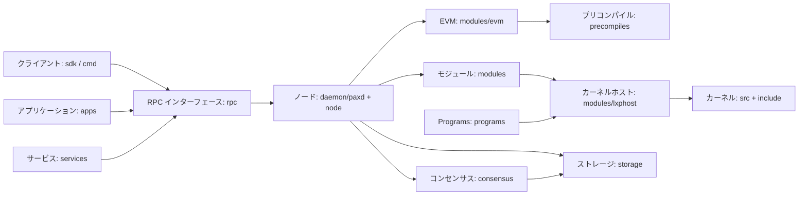

# Paxeer X Network

[English](../../README.md) · [Español](README.es.md) · 日本語 · [Русский](README.ru.md) · [简体中文](README.zh-CN.md) · [Português](README.pt-BR.md) · [Deutsch](README.de.md) · [Français](README.fr.md)

Paxeer mainnet-beta は、`paxd` を実行する単一のビザンチン障害耐性ネットワークで、EVM チェーン ID は **125**（`0x7d`）、ネイティブトークンは **PAX** です。ノードはコンセンサス、EVM、ネイティブモジュール、プリコンパイル、LayerX カーネルを統合しており、コミットされたブロックがネットワークの確定状態を提供します。

## リポジトリ構成

| ディレクトリ | 内容 | ページ |
| --- | --- | --- |
| [`admin/`](../../admin/README.md) | ノード管理ツールとコマンド。 | [README](../../admin/README.md) |
| [`api/`](../../api/README.md) | Protobuf API 定義と生成されたインターフェース。 | [README](../../api/README.md) |
| [`apps/`](../../apps/README.md) | ユーザー向けの Paxeer アプリケーション。 | [README](../../apps/README.md) |
| [`cmd/`](../../cmd/README.md) | Paxeer のコマンドラインツール。 | [README](../../cmd/README.md) |
| [`consensus/`](../../consensus/README.md) | ネットワークのコンセンサスエンジン。 | [README](../../consensus/README.md) |
| [`contracts/`](../../contracts/README.md) | オンチェーンコントラクトとコントラクトテスト。 | [README](../../contracts/README.md) |
| [`core/`](../../core/README.md) | バージョンが固定されたコア依存関係。 | [README](../../core/README.md) |
| [`custodyproof/`](../../custodyproof/README.md) | カストディ証明の型と検証。 | [README](../../custodyproof/README.md) |
| [`daemon/`](../../daemon/README.md) | `paxd` デーモンとノードのエントリーポイント。 | [README](../../daemon/README.md) |
| [`deploy/`](../../deploy/README.md) | デプロイ設定とマニフェスト。 | [README](../../deploy/README.md) |
| [`docker/`](../../docker/README.md) | Docker イメージとローカルコンテナ環境の設定。 | [README](../../docker/README.md) |
| [`docs/`](../../docs/README.md) | ネットワークのドキュメントとドキュメントサイト。 | [README](../../docs/README.md) |
| [`engine/`](../../engine/README.md) | 実行エンジンのコンポーネント。 | [README](../../engine/README.md) |
| [`include/`](../../include/README.md) | LayerX カーネルのヘッダー。 | [README](../../include/README.md) |
| [`interchain/`](../../interchain/README.md) | IBC とチェーン間の連携。 | [README](../../interchain/README.md) |
| [`layerxproof/`](../../layerxproof/README.md) | LayerX 証明のコーデックと検証。 | [README](../../layerxproof/README.md) |
| [`migrations/`](../../migrations/README.md) | SQLite のプロジェクションとインポートのスキーマ。 | [README](../../migrations/README.md) |
| [`modules/`](../../modules/README.md) | Paxeer X のチェーンモジュール。 | [README](../../modules/README.md) |
| [`node/`](../../node/README.md) | Paxeer ノードアプリケーションの構成。 | [README](../../node/README.md) |
| [`precompiles/`](../../precompiles/README.md) | チェーンのネイティブ機能を提供する EVM プリコンパイル。 | [README](../../precompiles/README.md) |
| [`programs/`](../../programs/README.md) | LayerX Programs のランタイム、ゲストプログラム、SDK。 | [README](../../programs/README.md) |
| [`rpc/`](../../rpc/README.md) | EVM JSON-RPC サービス。 | [README](../../rpc/README.md) |
| [`scripts/`](../../scripts/README.md) | ビルド、CI、リリース、ワークスペース用のスクリプト。 | [README](../../scripts/README.md) |
| [`sdk/`](../../sdk/README.md) | Paxeer クライアント SDK と連携機能。 | [README](../../sdk/README.md) |
| [`services/`](../../services/README.md) | オフチェーンのネットワークサービス。 | [README](../../services/README.md) |
| [`src/`](../../src/README.md) | LayerX カーネルの実装。 | [README](../../src/README.md) |
| [`storage/`](../../storage/README.md) | PaxDB ストレージと状態コミットメント。 | [README](../../storage/README.md) |
| [`tests/`](../../tests/README.md) | ネットワーク、カーネル、統合、プロトコルのテスト。 | [README](../../tests/README.md) |
| [`tools/`](../../tools/README.md) | 開発者と運用者向けのツール。 | [README](../../tools/README.md) |
| [`utils/`](../../utils/README.md) | ノード共通のユーティリティ。 | [README](../../utils/README.md) |
| [`wasm/`](../../wasm/README.md) | 組み込みの CosmWasm モジュール。 | [README](../../wasm/README.md) |
| [`wasm-runtime/`](../../wasm-runtime/README.md) | CosmWasm の Go および Rust ランタイムラッパー。 | [README](../../wasm-runtime/README.md) |

## アーキテクチャ



## クイックスタート

リポジトリのルートからノードをビルドします。

```sh
make paxd-build
```

リポジトリの Paxeer テストターゲットを実行します。

```sh
make paxeer-test
```

## ドキュメント

- [ドキュメントの概要](../../docs/README.md)
- [ドキュメントサイト](../../docs/site/)
- [システムドキュメントの索引](../../docs/system/INDEX.md)：[チェーンモジュール](../../docs/system/chain-modules.md)、[カーネルモジュール](../../docs/system/kernel-modules.md)、[プリコンパイル](../../docs/system/precompiles.md)、[RPC](../../docs/system/rpc.md)、[ルート](../../docs/system/routes.md)、[SDK](../../docs/system/sdk.md)、[CLI](../../docs/system/cli.md)、[ガバナンス](../../docs/system/governance.md)を含みます。

## バージョン 7.0.0 へのアップグレード

[7.0.0 システム一覧](../../docs/release/7.0.0-systems.kvx)、[アップグレード計画](../../docs/release/7.0.0-upgrade-plan.md)、[バリデーター運用手順書](../../docs/release/7.0.0-validator-runbook.md)に、リリースとその運用手順が記載されています。

## コミュニティ

- [コントリビュート](../../CONTRIBUTING.md)
- [セキュリティポリシー](../../SECURITY.md)
- [サポート](../../SUPPORT.md)
- [ガバナンス](../../GOVERNANCE.md)
- [行動規範](../../CODE_OF_CONDUCT.md)

## ライセンス

Paxeer X Network は [Apache License 2.0](../../LICENSE) の条件に従って配布されます。
