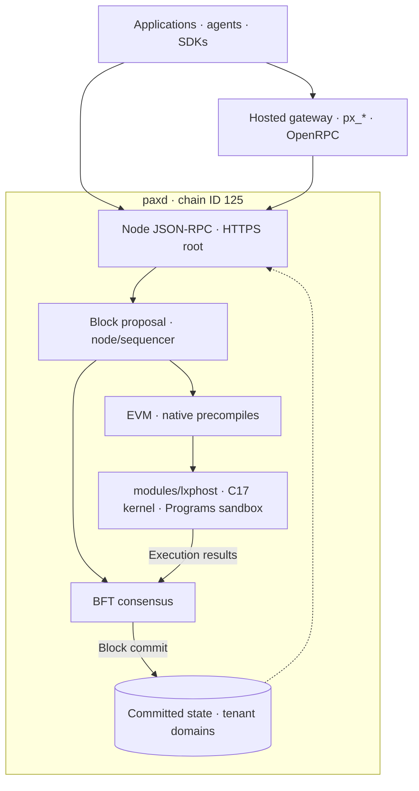
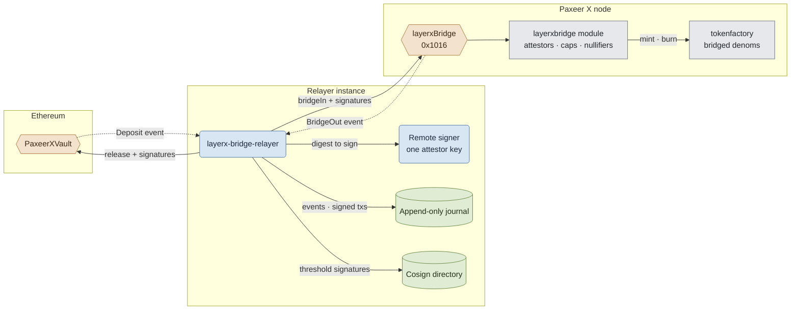

<p align="center"></p>

<h1 align="center">Paxeer X Network</h1>

[English](../../README.md) · [Español](README.es.md) · 日本語 · [Русский](README.ru.md) · [简体中文](README.zh-CN.md) · [Português](README.pt-BR.md) · [Deutsch](README.de.md) · [Français](README.fr.md)

*この翻訳は統合後のネットワークを説明します。インターフェースの詳細は、以下に参照するコードと仕様で確認してください。*

<p align="center">
  <!-- ═══ Network Identity ═══ -->
  
  
  
  
  
</p>

<p align="center">
  <!-- ═══ Language Stack ═══ -->
  
  
  
  
  
</p>

<p align="center">
  <!-- ═══ Repo Health ═══ -->
  
  
  
  
</p>

## Paxeer X Network とは

Paxeer X Network は、Go 製ノード `paxd` に C17 製の LayerX カーネルを組み込んだ単一の BFT ネットワークです。カーネルはアクティビティの決定的な実行とブロック提案に関わります。EVM チェーン ID は **125**（`0x7d`）です。レシートは、そのブロックがコンセンサスでコミットされると確定します。公式サイト: [paxeer.network](https://paxeer.network/)。ドキュメント: [docs.paxeer.app](https://docs.paxeer.app/)。

カーネルは `modules/lxphost` を介して `paxd` にリンクされるライブラリであり、`programs/` の Programs サンドボックスも同じノードに組み込まれます。EVM コントラクトはプリコンパイルを通じてネイティブ機能を利用し、実行と会計はネットワークの同じステートマシンに属します。サブチェーンはデータベース内の名前空間で分離されたテナントドメインです。`modules/layerxchains` が管理し、ドメインごとに新たなインフラを起動する必要はありません。

この Sidiora Labs のモノレポには、ノード、カーネル、コントラクト、サービス、SDK が含まれます。統合仕様は [`spec/layerx-merge/spec.kvx`](../../spec/layerx-merge/spec.kvx)、リリースノートは [`CHANGELOG.md`](../../CHANGELOG.md) にあります。

## ネットワークを試す

mainnet-beta の公開 JSON-RPC は、`api1.mainnet-beta.paxeer.network` から `api14.mainnet-beta.paxeer.network` までのノードと `api-mainnet-beta.paxeer.network` のルートパスで HTTPS を受け付けます。例:

```sh
curl --fail --silent --show-error https://api1.mainnet-beta.paxeer.network \
  -H 'Content-Type: application/json' \
  --data '{"jsonrpc":"2.0","id":1,"method":"eth_chainId","params":[]}'
```

`result` の期待値は `0x7d` です。公開名前空間は `debug`、`echo`、`eth`、`net`、`pax`、`px`、`test`、`txpool` で、利用できるメソッドはノードとその設定に依存します。最新のノードを選ぶには、複数のノードの `eth_blockNumber` を比較してください。

`px` 名前空間はノードの状態から応答します。`px_register` と `px_requestFunds` はホスト型の ID およびフォーセットサービスの操作で、その契約は [`services/platform/hosted/gateway/openrpc.json`](../../services/platform/hosted/gateway/openrpc.json) にあります。機能を利用する前に `px_getCapabilities` を確認してください。`node.hyperpaxeer.com` はビルドスクリプトが利用する hpx ライブラリのミラー（library mirror）で、RPC エンドポイントではありません。

Paxeer X チェーン（チェーン ID 125）に接続するには、[`docs/site/docs/reference/public-rpc.md`](../../docs/site/docs/reference/public-rpc.md) に掲載されている公開 JSON-RPC 名のいずれかを使ってください。公開エンドポイントのチェックリストは [`docs/wiki/Getting-Started-Beta.md`](../../docs/wiki/Getting-Started-Beta.md) です。ウォレット、入金、決済の手順は [`docs/wiki/PaymentsQuickstart.md`](../../docs/wiki/PaymentsQuickstart.md) です。Asset: [`docs/wiki/Assets.md`](../../docs/wiki/Assets.md)。RPC メソッド: [`docs/wiki/PublicRpc.md`](../../docs/wiki/PublicRpc.md)。コミットメントレベル: [`docs/wiki/CommitmentLevels.md`](../../docs/wiki/CommitmentLevels.md)。公開決済 API: [`docs/wiki/PublicAPI.md`](../../docs/wiki/PublicAPI.md)。

カーネル開発者は [docs.paxeer.app](https://docs.paxeer.app/) のホスト型ドキュメントから始めてください。ローカルクラスタの手順は [`docs/wiki/Quickstart.md`](../../docs/wiki/Quickstart.md) です。

## ソースからビルドする

ノードは Go 1.25.8（`go.mod`）、カーネルは C17（`Makefile`）、Rust ワークスペースは 1.91.1（`rust-toolchain.toml`）を使用します。ルートの Solidity プロジェクトは 0.8.27（`foundry.toml`）です。ネイティブリンクは `chain.mk` と `modules/lxphost/host.go` に定義されており、該当する Go ビルドには cgo、C コンパイラ、ネイティブライブラリが必要です。

リポジトリのルートで統合ノードをビルドします:

```sh
make paxd-build
```

このターゲットは `build/liblayerx.a`、`programs/target/release/liblayerx_programs_sandbox.a`、evmone を構築してから、`tools/release/version.json` のバージョンで `build/paxd` を生成します。チェーンのビルドターゲット `make paxeer-build` もネイティブ依存関係を構築します。レシピは `GOPROXY=off` を使用するため、Go の依存関係は事前にローカルへ用意する必要があります。

カーネルとコントラクトの開発用ターゲット:

```sh
make build
make test
make test-contracts
```

チェーンの検証ターゲットは `make paxeer-lint`、`make paxeer-test`、`make paxeer-ci` です。`make ci` はカーネル、`public-audit`、再現性、コンセンサスシンボル、サニタイザーを対象とし、`make monorepo-ci` は複数のサブシステムを対象とします。検証環境の要件は [`docs/QUALIFICATION.md`](../../docs/QUALIFICATION.md) を参照してください。

## リポジトリ構成

| パス | 用途 |
| --- | --- |
| `src/`, `include/` | C17 カーネルライブラリ: 決定的実行、状態、リプレイ |
| `modules/lxphost/` | カーネルと Programs サンドボックスをノードに組み込む cgo 層 |
| `cmd/` | カーネルのツール: `layerxctl`、`layerx-genesis`、`layerx-module-registry` |
| `services/agent/` | SDK、エージェントデーモン、MCP サーバー、エンコーディング、暗号、証明 |
| `services/human/` | 人間向けコントロールプレーン、型付きインテント、関連サービス |
| `services/platform/` | ホスト型ゲートウェイとインデクサー、ミドルウェア、開発者プラットフォーム |
| `programs/` | Programs ランタイム、レジストリ、インタープリター、サンドボックス、SDK |
| `services/interop/` | エージェント間コマース、連携機能、ブリッジリレイヤー |
| `contracts/` | Solidity ソース、ブリッジ、ガバナンス、名前管理のコントラクト |
| `apps/` | Web、ウォレット、エクスプローラー、perps、ブリッジ、launchpad のアプリ |
| `daemon/paxd/`, `node/`, `consensus/` | ノードバイナリ、アプリケーションの組み立て、BFT コンセンサス |
| `modules/`, `precompiles/`, `rpc/`, `sdk/`, `storage/` | ネイティブモジュール、EVM アクセス、RPC サーバー、SDK、ノードストレージ |
| `spec/` | KVX 仕様、要件、タスクグラフ |
| `tests/`, `migrations/` | カーネルのテストとデータ移行 |
| `docs/` | Wiki、ドキュメントサイト、検証ガイド |

## ドキュメント

- ホスト型ドキュメント: [docs.paxeer.app](https://docs.paxeer.app/)
- Wiki 目次: [`docs/wiki/Home.md`](../../docs/wiki/Home.md)
- はじめに: [`docs/wiki/Getting-Started-Beta.md`](../../docs/wiki/Getting-Started-Beta.md)
- 決済開発者向け手順: [`docs/wiki/PaymentsQuickstart.md`](../../docs/wiki/PaymentsQuickstart.md)
- 公開 JSON-RPC: [`docs/wiki/PublicRpc.md`](../../docs/wiki/PublicRpc.md)
- Asset とトークン: [`docs/wiki/Assets.md`](../../docs/wiki/Assets.md)
- コミットメントレベル: [`docs/wiki/CommitmentLevels.md`](../../docs/wiki/CommitmentLevels.md)
- モノレポ構成とリリースタグ: [`docs/MONOREPO.md`](../../docs/MONOREPO.md)
- 検定ゲート: [`docs/QUALIFICATION.md`](../../docs/QUALIFICATION.md)
- 仕様: [`spec/layerx-merge/spec.kvx`](../../spec/layerx-merge/spec.kvx)
- リリースノート: [`CHANGELOG.md`](../../CHANGELOG.md)

## SDK と連携

| 言語 | パス |
| --- | --- |
| Rust | `services/agent/crates/layerx-sdk` |
| Python | `services/agent/sdk/python` |
| TypeScript | `services/agent/sdk/typescript` |
| Go | `sdk/platform/go` |
| JVM | `sdk/platform/jvm` |
| .NET | `sdk/platform/dotnet` |
| Swift | `sdk/platform/swift` |

`layerx-agentd` は `services/agent/crates/layerx-agentd` にあります。MCP サーバーは `services/agent/crates/layerx-mcp` にあります。`tools/platform/cli` の開発者 CLI は、`layerx install mcp` と `layerx install a2a` でこれらのトランスポートをインストールします。

## アーキテクチャ

カーネルと EVM は `paxd` ノードに統合されています。ブロック提案の経路は `node/sequencer/` に実装され、カーネルは `modules/lxphost` から呼び出されます。早期のレシートは実行結果を示し、ファイナリティは BFT コンセンサスによるブロックのコミットで得られます。

次の表は `precompiles/setup.go` の `MergeAddressTable` にある名前とアドレスです。これらはノードにコンストラクターが登録され、アップグレード計画 `v7.0`（`MergeUpgrade`）の高さから有効になります。ソースコードに存在することだけでは、特定のエンドポイントでの有効化は確認できません。

| プリコンパイル | 省略アドレス |
| --- | --- |
| `layerxledger` | `0x101A` |
| `layerxpay` | `0x101B` |
| `layerxauth` | `0x101C` |
| `layerxprograms` | `0x101D` |
| `layerxchains` | `0x101E` |
| `orob` | `0x0901` |
| `clearing` | `0x0902` |
| `oracle aggregator` | `0x0903` |
| `pofq` | `0x0904` |
| `scheduler` | `0x0905` |
| `streams` | `0x0906` |
| `tee attestor` | `0x0907` |
| `eip712` | `0x0908` |

アドレスは左側をゼロで埋めた 20 バイトの EVM アドレスです。コードには `perps`（`0x1015`）、`layerxBridge`（`0x1016`）、`launchpad`（`0x1017`）もあり、ノードのバージョン有効化に従います。各高さで提供される構成は `precompiles/` と `node/app.go` を参照してください。

図は統合された構成要素とクライアントのアクセスを示します。ホスト型サービスはノードを利用し、ノードのファイナリティはコンセンサスが決定します。



外部ブリッジのコードは `services/interop/crates/layerx-bridge-relayer` と `contracts/bridge/` にあります。各インスタンスはリモート署名者を使用し、イベントと署名済みトランザクションを送信前にジャーナルへ記録します。必要な署名閾値を満たすために、共同署名ディレクトリで署名を交換します。`bridgeIn` と `bridgeOut` は `layerxBridge`（`0x1016`）と `modules/layerxbridge` を経由します。この経路はネットワーク間の転送用であり、Paxeer ブロックは BFT コンセンサスで確定します。



## コントリビュート

プルリクエストを開く前に [`CONTRIBUTING.md`](../../CONTRIBUTING.md) を読んでください。プロトコルの変更は `spec/` から始まります。脆弱性の疑いを公開 issue で開示しないでください。[`SECURITY.md`](../../SECURITY.md) に従ってください。

## セキュリティ

脆弱性は [`SECURITY.md`](../../SECURITY.md) に記載のとおり、GitHub のプライベート報告から報告してください。

## ライセンス

Apache License, Version 2.0 の下でライセンスされています。[`LICENSE`](../../LICENSE) と [`NOTICE`](../../NOTICE) を参照してください。

Paxeer X Network は Sidiora Labs が開発しています。ソース: [github.com/Sidiora-Labs/paxeer-monorepo](https://github.com/Sidiora-Labs/paxeer-monorepo)。
