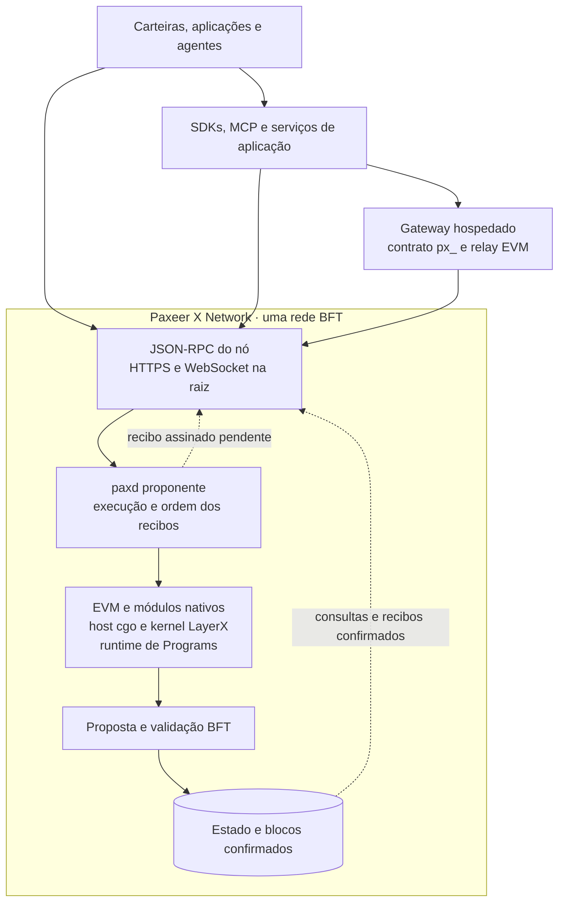

<p align="center"></p>

<h1 align="center">Paxeer X Network</h1>

[English](../../README.md) · [Español](README.es.md) · [日本語](README.ja.md) · [Русский](README.ru.md) · [简体中文](README.zh-CN.md) · Português · [Deutsch](README.de.md) · [Français](README.fr.md)

*Visão geral em português do Brasil. Para os contratos de interface e detalhes de implementação, consulte os arquivos vinculados abaixo.*

<p align="center">
  <!-- ═══ Network Identity ═══ -->
  
  
  
  
  
</p>

<p align="center">
  <!-- ═══ Language Stack ═══ -->
  
  
  
  
  
</p>

<p align="center">
  <!-- ═══ Repo Health ═══ -->
  
  
  
  
</p>

## O que é a Paxeer X Network

A Paxeer X Network é uma única rede BFT, compatível com a EVM, com ID de cadeia `125` (`0x7d`) na mainnet-beta. O kernel LayerX faz parte do nó `paxd`: seus módulos C17 e o runtime Rust de Programs são integrados pelo host cgo em [`modules/lxphost/`](../../modules/lxphost/). O kernel participa da execução e da proposta de blocos da própria rede. Site oficial: [paxeer.network](https://paxeer.network/). Documentação: [docs.paxeer.app](https://docs.paxeer.app/).

O proponente executa as transações e propõe sua ordem; os validadores verificam a proposta e confirmam o bloco por consenso. Um recibo assinado antes dessa confirmação representa execução recebida, ainda pendente. O recibo é final quando seu bloco é confirmado. Não há uma etapa posterior de liquidação por checkpoints ou garantidores.

Este monorepo reúne o nó, o kernel, contratos, SDKs e serviços para agentes, usuários e desenvolvedores. A especificação da integração é [`spec/layerx-merge/spec.kvx`](../../spec/layerx-merge/spec.kvx); as notas de versão estão em [`CHANGELOG.md`](../../CHANGELOG.md). Subcadeias são domínios de tenants, com namespaces no banco de dados da rede, e podem ser criadas sem provisionar uma nova infraestrutura de cadeia.

## Experimentar a rede

Para conectar uma carteira ou aplicação à mainnet-beta, use o JSON-RPC de um nó público por HTTPS no caminho raiz. O alias é `https://api-mainnet-beta.paxeer.network`; os nós numerados vão de `https://api1.mainnet-beta.paxeer.network` a `https://api14.mainnet-beta.paxeer.network`. A lista de URLs HTTPS e WebSocket está em [endpoints públicos](../site/docs/reference/public-rpc.md).

Confira o ID da cadeia antes de assinar ou transmitir transações. Esta consulta deve retornar `"0x7d"`:

```sh
curl --fail --silent --show-error --max-time 15 \
  https://api1.mainnet-beta.paxeer.network \
  -H 'Content-Type: application/json' \
  -d '{"jsonrpc":"2.0","id":1,"method":"eth_chainId","params":[]}'
```

Os namespaces dos nós públicos são `debug`, `echo`, `eth`, `net`, `pax`, `test` e `txpool`; os métodos disponíveis dependem da configuração do nó. Os métodos `px_` do gateway hospedado têm seu contrato em [`services/platform/hosted/gateway/openrpc.json`](../../services/platform/hosted/gateway/openrpc.json). Consulte esse contrato e as capacidades anunciadas pelo serviço antes de usar uma integração; a API hospedada não está automaticamente disponível em todo nó público.

A conexão pública vai diretamente ao nó, sem um roteador intermediário ou uma interface LayerX separada. O host `node.hyperpaxeer.com` é somente o mirror de bibliotecas hpx usado pelos scripts de build.

Para carteira, financiamento e pagamentos, consulte [primeiros passos](../wiki/Getting-Started-Beta.md), [guia de pagamentos](../wiki/PaymentsQuickstart.md), [ativos](../wiki/Assets.md) e [API pública de pagamentos](../wiki/PublicAPI.md). Os [níveis de compromisso](../wiki/CommitmentLevels.md) distinguem envio, recibo e confirmação. O [guia local](../wiki/Quickstart.md) reúne as instruções de desenvolvimento.

## Compilar a partir do código-fonte

O nó usa Go `1.25.8`, conforme [`go.mod`](../../go.mod). O kernel é compilado como C17 pelo [`Makefile`](../../Makefile). A versão Rust é `1.91.1`, fixada em [`rust-toolchain.toml`](../../rust-toolchain.toml). Os projetos Solidity em [`foundry.toml`](../../foundry.toml) e [`foundry.paxeer.toml`](../../foundry.paxeer.toml) fixam o compilador `0.8.27`.

Execute na raiz do repositório:

```sh
make paxd-build
```

Esse alvo prepara `build/liblayerx.a` e o sandbox de Programs em `programs/target/release/`, depois compila o nó em `build/paxd`. As dependências nativas são ligadas pelo host cgo. O `Makefile` e [`chain.mk`](../../chain.mk) definem os detalhes de compilação; os alvos Go usam `GOPROXY=off`, portanto as dependências precisam estar disponíveis no ambiente.

Para trabalhar na biblioteca do kernel, os alvos existentes incluem:

```sh
make build
make test
make test-contracts
```

Os alvos `make paxeer-build`, `make paxeer-lint` e `make paxeer-test` encaminham operações do nó para `chain.mk`. `make ci` inclui auditoria pública, testes do kernel, reprodutibilidade, inspeção de símbolos de consenso e sanitizers; `make monorepo-ci` encaminha para a qualificação dos workspaces. Escolha as verificações exigidas pela mudança. Os requisitos e procedimentos de qualificação estão em [`docs/QUALIFICATION.md`](../QUALIFICATION.md).

## Estrutura do repositório

| Caminho | Finalidade |
| --- | --- |
| `daemon/paxd/`, `node/`, `consensus/` | Executável do nó, aplicação e consenso BFT |
| `node/sequencer/`, `modules/sequencer/` | Execução pelo proponente, recibos e verificação da ordem dos lotes |
| `modules/lxphost/` | Integração cgo do kernel e de Programs com o estado transacional do nó |
| `src/`, `include/` | Biblioteca C17 do kernel, módulos, protocolos e interfaces nativas |
| `cmd/` | Ferramentas auxiliares, incluindo geração de gênese |
| `modules/`, `precompiles/` | Módulos nativos e interfaces EVM |
| `rpc/`, `sdk/`, `storage/`, `wasm/` | JSON-RPC, infraestrutura do SDK, armazenamento e integração Wasm |
| `services/agent/` | SDKs de agentes, cliente, daemon de agentes, MCP e verificação de provas |
| `services/human/` | Serviços e aplicativos para usuários, intenções, assinatura e indexação |
| `services/platform/`, `tools/platform/`, `sdk/platform/` | Serviços hospedados, ferramentas, CLI e SDKs para desenvolvedores |
| `programs/` | Runtime, registro, sandbox e SDKs de Programs |
| `services/interop/` | Integrações de comércio e interoperabilidade |
| `contracts/`, `contracts/bridge/` | Contratos Solidity e contratos de ponte |
| `services/explorer/` | Explorador de blocos baseado no Blockscout |
| `migrations/` | Migrações SQL e projeções persistidas dos serviços |
| `tests/`, `tests/fuzz/` | Testes nativos, de contratos, replay, invariantes e fuzzing |
| `spec/` | Especificações KVX, requisitos, interfaces e tarefas |
| `docs/` | Wiki, site, documentação do monorepo e qualificação |

## Documentação

- Documentação hospedada: [docs.paxeer.app](https://docs.paxeer.app/)
- Índice da wiki: [Home](../wiki/Home.md)
- Primeiros passos: [Getting-Started-Beta](../wiki/Getting-Started-Beta.md)
- Pagamentos: [PaymentsQuickstart](../wiki/PaymentsQuickstart.md)
- Endpoints públicos: [Public RPC endpoints](../site/docs/reference/public-rpc.md)
- Métodos JSON-RPC: [PublicRpc](../wiki/PublicRpc.md)
- Ativos e tokens: [Assets](../wiki/Assets.md)
- Níveis de compromisso: [CommitmentLevels](../wiki/CommitmentLevels.md)
- Estrutura e releases: [MONOREPO](../MONOREPO.md)
- Qualificação: [QUALIFICATION](../QUALIFICATION.md)
- Especificação da rede integrada: [layerx-merge](../../spec/layerx-merge/spec.kvx)
- Notas de versão: [CHANGELOG](../../CHANGELOG.md)

## SDKs e integrações

| Linguagem | Caminho |
| --- | --- |
| Rust | `services/agent/crates/layerx-sdk` |
| Python | `services/agent/sdk/python` |
| TypeScript | `services/agent/sdk/typescript` |
| Go | `sdk/platform/go` |
| JVM | `sdk/platform/jvm` |
| .NET | `sdk/platform/dotnet` |
| Swift | `sdk/platform/swift` |

O daemon de agentes `layerx-agentd` fica em [`services/agent/crates/layerx-agentd/`](../../services/agent/crates/layerx-agentd/). O servidor MCP fica em [`services/agent/crates/layerx-mcp/`](../../services/agent/crates/layerx-mcp/). A CLI `layerx`, em [`tools/platform/cli/`](../../tools/platform/cli/), oferece `layerx install mcp` e `layerx install a2a`. Esses componentes atendem às aplicações e aos agentes; a execução e a confirmação das transações pertencem ao nó da rede.

## Arquitetura

O kernel, a EVM e os módulos nativos participam da mesma execução transacional em `paxd`. O host integra os efeitos do kernel ao armazenamento do nó, e o commit do bloco estabelece a finalização. O caminho de proposta e a validação de ordem estão em [`node/sequencer/`](../../node/sequencer/) e [`node/process_proposal_order.go`](../../node/process_proposal_order.go); os estados `submitted`, `receipted` e `committed` estão definidos em [`rpc/sequencer_receipt.go`](../../rpc/sequencer_receipt.go).

O diagrama mostra os limites de integração, sem representar todos os processos de uma implantação:



Os pré-compilados expõem capacidades nativas aos contratos EVM. Entre as interfaces registradas estão `perps` em `0x1015`, `layerxBridge` em `0x1016` e `launchpad` em `0x1017` (endereços abreviados de 20 bytes, preenchidos com zeros à esquerda). A seleção de versões em `0x1015` e `0x1017` depende da ativação da atualização; veja [`node/precompiles_v6120.go`](../../node/precompiles_v6120.go) e [`node/app.go`](../../node/app.go). A presença de um endereço no código não comprova sua ativação em um nó público.

A ponte é uma integração com redes externas. Seu módulo está em [`modules/layerxbridge/`](../../modules/layerxbridge/), a interface EVM em [`precompiles/layerxbridge/`](../../precompiles/layerxbridge/) e os contratos externos em [`contracts/bridge/`](../../contracts/bridge/). As regras dessa integração não acrescentam uma etapa de finalização aos recibos da rede Paxeer.

## Contribuir

Leia [`CONTRIBUTING.md`](../../CONTRIBUTING.md) antes de abrir um pull request. Mudanças de protocolo começam em `spec/`. Não divulgue uma suspeita de vulnerabilidade em uma issue pública; siga [`SECURITY.md`](../../SECURITY.md).

## Segurança

Relate vulnerabilidades pelo relato privado do GitHub, conforme descrito em [`SECURITY.md`](../../SECURITY.md).

## Licença

Licenciado sob a Apache License, versão 2.0. Consulte [`LICENSE`](../../LICENSE) e [`NOTICE`](../../NOTICE).

A Paxeer X Network é desenvolvida pela Sidiora Labs. Código-fonte: [github.com/Sidiora-Labs/Paxeer-X-Network](https://github.com/Sidiora-Labs/Paxeer-X-Network).
