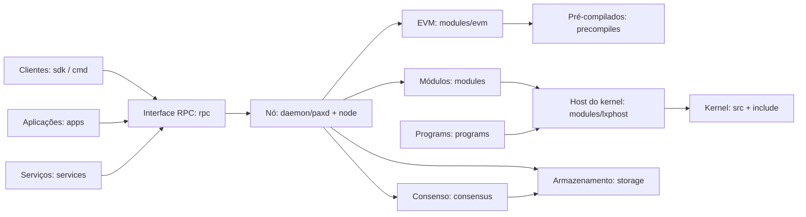

# Paxeer X Network

[English](../../README.md) · [Español](README.es.md) · [日本語](README.ja.md) · [Русский](README.ru.md) · [简体中文](README.zh-CN.md) · Português · [Deutsch](README.de.md) · [Français](README.fr.md)

A Paxeer mainnet-beta é uma única rede tolerante a falhas bizantinas que executa `paxd`, com identificador de cadeia EVM **125** (`0x7d`) e **PAX** como token nativo. O nó integra consenso, EVM, módulos nativos, pré-compilados e o kernel LayerX, de modo que os blocos confirmados fornecem o estado final da rede.

## Estrutura do repositório

| Diretório | Conteúdo | Página |
| --- | --- | --- |
| [`admin/`](../../admin/README.md) | Ferramentas e comandos de administração de nós. | [README](../../admin/README.md) |
| [`api/`](../../api/README.md) | Definições de API Protobuf e interfaces geradas. | [README](../../api/README.md) |
| [`apps/`](../../apps/README.md) | Aplicações Paxeer voltadas aos usuários. | [README](../../apps/README.md) |
| [`cmd/`](../../cmd/README.md) | Ferramentas de linha de comando do Paxeer. | [README](../../cmd/README.md) |
| [`consensus/`](../../consensus/README.md) | O mecanismo de consenso da rede. | [README](../../consensus/README.md) |
| [`contracts/`](../../contracts/README.md) | Contratos na cadeia e testes de contratos. | [README](../../contracts/README.md) |
| [`core/`](../../core/README.md) | Dependências principais com versões fixadas. | [README](../../core/README.md) |
| [`custodyproof/`](../../custodyproof/README.md) | Tipos e verificação de provas de custódia. | [README](../../custodyproof/README.md) |
| [`daemon/`](../../daemon/README.md) | O daemon `paxd` e o ponto de entrada do nó. | [README](../../daemon/README.md) |
| [`deploy/`](../../deploy/README.md) | Configuração e manifestos de implantação. | [README](../../deploy/README.md) |
| [`docker/`](../../docker/README.md) | Imagens Docker e configuração local de contêineres. | [README](../../docker/README.md) |
| [`docs/`](../../docs/README.md) | Documentação da rede e site de documentação. | [README](../../docs/README.md) |
| [`engine/`](../../engine/README.md) | Componentes do mecanismo de execução. | [README](../../engine/README.md) |
| [`include/`](../../include/README.md) | Cabeçalhos do kernel LayerX. | [README](../../include/README.md) |
| [`interchain/`](../../interchain/README.md) | IBC e integração entre cadeias. | [README](../../interchain/README.md) |
| [`layerxproof/`](../../layerxproof/README.md) | Codecs e verificação de provas do LayerX. | [README](../../layerxproof/README.md) |
| [`migrations/`](../../migrations/README.md) | Esquemas de projeção e importação do SQLite. | [README](../../migrations/README.md) |
| [`modules/`](../../modules/README.md) | Módulos da cadeia Paxeer X. | [README](../../modules/README.md) |
| [`node/`](../../node/README.md) | Composição da aplicação do nó Paxeer. | [README](../../node/README.md) |
| [`precompiles/`](../../precompiles/README.md) | Pré-compilados EVM para recursos nativos da cadeia. | [README](../../precompiles/README.md) |
| [`programs/`](../../programs/README.md) | Runtime, programas convidados e SDKs do LayerX Programs. | [README](../../programs/README.md) |
| [`rpc/`](../../rpc/README.md) | Serviços EVM JSON-RPC. | [README](../../rpc/README.md) |
| [`scripts/`](../../scripts/README.md) | Scripts de compilação, CI, lançamento e workspace. | [README](../../scripts/README.md) |
| [`sdk/`](../../sdk/README.md) | SDKs de cliente Paxeer e integrações. | [README](../../sdk/README.md) |
| [`services/`](../../services/README.md) | Serviços de rede fora da cadeia. | [README](../../services/README.md) |
| [`src/`](../../src/README.md) | Implementação do kernel LayerX. | [README](../../src/README.md) |
| [`storage/`](../../storage/README.md) | Armazenamento PaxDB e compromisso de estado. | [README](../../storage/README.md) |
| [`tests/`](../../tests/README.md) | Testes de rede, kernel, integração e protocolo. | [README](../../tests/README.md) |
| [`tools/`](../../tools/README.md) | Ferramentas para desenvolvedores e operadores. | [README](../../tools/README.md) |
| [`utils/`](../../utils/README.md) | Utilitários compartilhados do nó. | [README](../../utils/README.md) |
| [`wasm/`](../../wasm/README.md) | O módulo CosmWasm integrado. | [README](../../wasm/README.md) |
| [`wasm-runtime/`](../../wasm-runtime/README.md) | O wrapper do runtime CosmWasm para Go e Rust. | [README](../../wasm-runtime/README.md) |

## Arquitetura



## Início rápido

Compile o nó a partir da raiz do repositório:

```sh
make paxd-build
```

Execute o alvo de testes Paxeer do repositório:

```sh
make paxeer-test
```

## Documentação

- [Visão geral da documentação](../../docs/README.md)
- [Site de documentação](../../docs/site/)
- [Índice da documentação do sistema](../../docs/system/INDEX.md), incluindo [módulos da cadeia](../../docs/system/chain-modules.md), [módulos do kernel](../../docs/system/kernel-modules.md), [pré-compilados](../../docs/system/precompiles.md), [RPC](../../docs/system/rpc.md), [rotas](../../docs/system/routes.md), [SDK](../../docs/system/sdk.md), [CLI](../../docs/system/cli.md) e [governança](../../docs/system/governance.md)

## Atualização para a versão 7.0.0

O [inventário de sistemas da versão 7.0.0](../../docs/release/7.0.0-systems.kvx), o [plano de atualização](../../docs/release/7.0.0-upgrade-plan.md) e o [manual operacional dos validadores](../../docs/release/7.0.0-validator-runbook.md) descrevem a versão e seus procedimentos operacionais.

## Comunidade

- [Contribuir](../../CONTRIBUTING.md)
- [Política de segurança](../../SECURITY.md)
- [Suporte](../../SUPPORT.md)
- [Governança](../../GOVERNANCE.md)
- [Código de conduta](../../CODE_OF_CONDUCT.md)

## Licença

A Paxeer X Network é distribuída sob os termos da [licença Apache 2.0](../../LICENSE).
