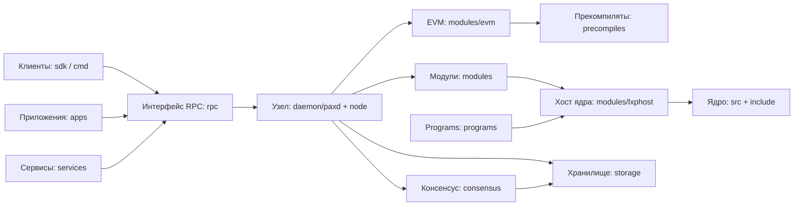

# Paxeer X Network

[English](../../README.md) · [Español](README.es.md) · [日本語](README.ja.md) · Русский · [简体中文](README.zh-CN.md) · [Português](README.pt-BR.md) · [Deutsch](README.de.md) · [Français](README.fr.md)

Paxeer mainnet-beta — единая сеть, устойчивая к византийским отказам, которая работает на `paxd`, с идентификатором EVM-цепочки **125** (`0x7d`) и нативным токеном **PAX**. Узел объединяет консенсус, EVM, нативные модули, прекомпиляты и ядро LayerX, поэтому зафиксированные блоки определяют окончательное состояние сети.

## Структура репозитория

| Каталог | Содержимое | Страница |
| --- | --- | --- |
| [`admin/`](../../admin/README.md) | Инструменты и команды администрирования узлов. | [README](../../admin/README.md) |
| [`api/`](../../api/README.md) | Определения API Protobuf и сгенерированные интерфейсы. | [README](../../api/README.md) |
| [`apps/`](../../apps/README.md) | Пользовательские приложения Paxeer. | [README](../../apps/README.md) |
| [`cmd/`](../../cmd/README.md) | Инструменты командной строки Paxeer. | [README](../../cmd/README.md) |
| [`consensus/`](../../consensus/README.md) | Механизм консенсуса сети. | [README](../../consensus/README.md) |
| [`contracts/`](../../contracts/README.md) | Контракты в цепочке и тесты контрактов. | [README](../../contracts/README.md) |
| [`core/`](../../core/README.md) | Основные зависимости с закреплёнными версиями. | [README](../../core/README.md) |
| [`custodyproof/`](../../custodyproof/README.md) | Типы и проверка доказательств хранения активов. | [README](../../custodyproof/README.md) |
| [`daemon/`](../../daemon/README.md) | Демон `paxd` и точка входа узла. | [README](../../daemon/README.md) |
| [`deploy/`](../../deploy/README.md) | Конфигурация и манифесты развёртывания. | [README](../../deploy/README.md) |
| [`docker/`](../../docker/README.md) | Образы Docker и настройка локальных контейнеров. | [README](../../docker/README.md) |
| [`docs/`](../../docs/README.md) | Документация сети и сайт документации. | [README](../../docs/README.md) |
| [`engine/`](../../engine/README.md) | Компоненты механизма исполнения. | [README](../../engine/README.md) |
| [`include/`](../../include/README.md) | Заголовочные файлы ядра LayerX. | [README](../../include/README.md) |
| [`interchain/`](../../interchain/README.md) | IBC и межцепочечная интеграция. | [README](../../interchain/README.md) |
| [`layerxproof/`](../../layerxproof/README.md) | Кодеки и проверка доказательств LayerX. | [README](../../layerxproof/README.md) |
| [`migrations/`](../../migrations/README.md) | Схемы проекций и импорта SQLite. | [README](../../migrations/README.md) |
| [`modules/`](../../modules/README.md) | Модули цепочки Paxeer X. | [README](../../modules/README.md) |
| [`node/`](../../node/README.md) | Сборка компонентов приложения узла Paxeer. | [README](../../node/README.md) |
| [`precompiles/`](../../precompiles/README.md) | Прекомпиляты EVM для нативных возможностей цепочки. | [README](../../precompiles/README.md) |
| [`programs/`](../../programs/README.md) | Среда исполнения, гостевые программы и SDK LayerX Programs. | [README](../../programs/README.md) |
| [`rpc/`](../../rpc/README.md) | Сервисы EVM JSON-RPC. | [README](../../rpc/README.md) |
| [`scripts/`](../../scripts/README.md) | Скрипты сборки, CI, выпуска и рабочего пространства. | [README](../../scripts/README.md) |
| [`sdk/`](../../sdk/README.md) | Клиентские SDK Paxeer и интеграции. | [README](../../sdk/README.md) |
| [`services/`](../../services/README.md) | Внецепочечные сетевые сервисы. | [README](../../services/README.md) |
| [`src/`](../../src/README.md) | Реализация ядра LayerX. | [README](../../src/README.md) |
| [`storage/`](../../storage/README.md) | Хранилище PaxDB и криптографическая фиксация состояния. | [README](../../storage/README.md) |
| [`tests/`](../../tests/README.md) | Тесты сети, ядра, интеграции и протокола. | [README](../../tests/README.md) |
| [`tools/`](../../tools/README.md) | Инструменты для разработчиков и операторов. | [README](../../tools/README.md) |
| [`utils/`](../../utils/README.md) | Общие утилиты узла. | [README](../../utils/README.md) |
| [`wasm/`](../../wasm/README.md) | Встроенный модуль CosmWasm. | [README](../../wasm/README.md) |
| [`wasm-runtime/`](../../wasm-runtime/README.md) | Обёртка среды исполнения CosmWasm для Go и Rust. | [README](../../wasm-runtime/README.md) |

## Архитектура



## Быстрый старт

Соберите узел из корня репозитория:

```sh
make paxd-build
```

Запустите цель тестирования Paxeer из репозитория:

```sh
make paxeer-test
```

## Документация

- [Обзор документации](../../docs/README.md)
- [Сайт документации](../../docs/site/)
- [Указатель системной документации](../../docs/system/INDEX.md), включая [модули цепочки](../../docs/system/chain-modules.md), [модули ядра](../../docs/system/kernel-modules.md), [прекомпиляты](../../docs/system/precompiles.md), [RPC](../../docs/system/rpc.md), [маршруты](../../docs/system/routes.md), [SDK](../../docs/system/sdk.md), [CLI](../../docs/system/cli.md) и [управление](../../docs/system/governance.md)

## Обновление до версии 7.0.0

[Перечень систем версии 7.0.0](../../docs/release/7.0.0-systems.kvx), [план обновления](../../docs/release/7.0.0-upgrade-plan.md) и [руководство по эксплуатации для валидаторов](../../docs/release/7.0.0-validator-runbook.md) описывают выпуск и порядок его эксплуатации.

## Сообщество

- [Участие в разработке](../../CONTRIBUTING.md)
- [Политика безопасности](../../SECURITY.md)
- [Поддержка](../../SUPPORT.md)
- [Управление](../../GOVERNANCE.md)
- [Кодекс поведения](../../CODE_OF_CONDUCT.md)

## Лицензия

Paxeer X Network распространяется на условиях [лицензии Apache 2.0](../../LICENSE).
