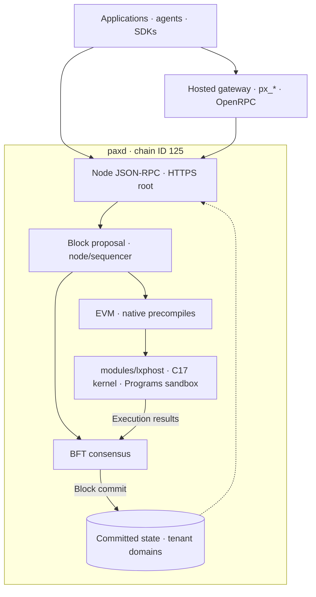
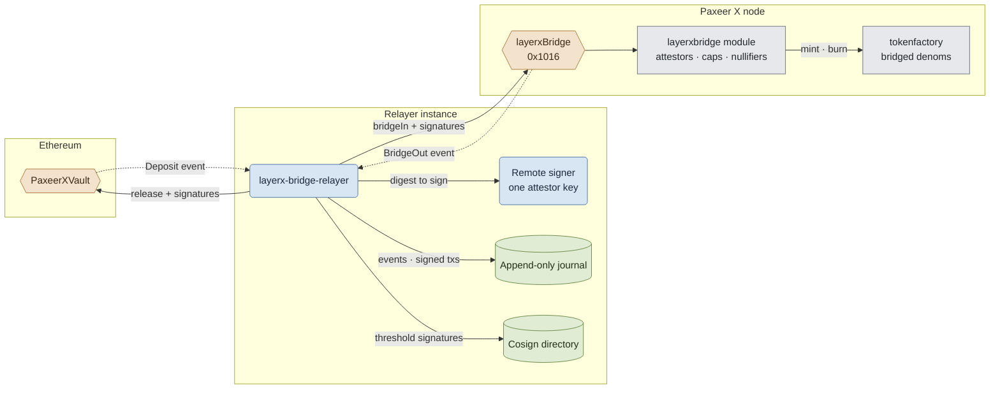

<p align="center"></p>

<h1 align="center">Paxeer X Network</h1>

[English](../../README.md) · [Español](README.es.md) · [日本語](README.ja.md) · Русский · [简体中文](README.zh-CN.md) · [Português](README.pt-BR.md) · [Deutsch](README.de.md) · [Français](README.fr.md)

*Этот перевод описывает интегрированную сеть; интерфейсы можно сверить с указанными ниже исходниками и спецификацией.*

<p align="center">
  <!-- ═══ Network Identity ═══ -->
  
  
  
  
  
</p>

<p align="center">
  <!-- ═══ Language Stack ═══ -->
  
  
  
  
  
</p>

<p align="center">
  <!-- ═══ Repo Health ═══ -->
  
  
  
  
</p>

## Что такое Paxeer X Network

Paxeer X Network — единая сеть с консенсусом BFT. Узел `paxd` на Go включает ядро LayerX на C17, которое участвует в детерминированном исполнении активностей и формировании предложений блоков. Идентификатор EVM-цепочки — **125** (`0x7d`). Квитанция окончательна после фиксации её блока консенсусом. Официальный сайт: [paxeer.network](https://paxeer.network/). Документация: [docs.paxeer.app](https://docs.paxeer.app/).

Ядро — библиотека, связанная с `paxd` через `modules/lxphost`; песочница Programs из `programs/` также встроена в узел. EVM-контракты обращаются к нативным функциям через прекомпиляты, а исполнение и учёт входят в одну машину состояний сети. Подцепочки — домены арендаторов, разделённые пространствами имён в базе данных. Их ведёт `modules/layerxchains`; для каждого домена не требуется запускать новую инфраструктуру.

Монорепозиторий Sidiora Labs объединяет узел, ядро, контракты, сервисы и SDK. Спецификация интеграции — [`spec/layerx-merge/spec.kvx`](../../spec/layerx-merge/spec.kvx), заметки о выпусках — [`CHANGELOG.md`](../../CHANGELOG.md).

## Попробовать сеть

Публичный JSON-RPC mainnet-beta доступен по HTTPS на корневом пути узлов от `api1.mainnet-beta.paxeer.network` до `api14.mainnet-beta.paxeer.network`, а также `api-mainnet-beta.paxeer.network`. Пример:

```sh
curl --fail --silent --show-error https://api1.mainnet-beta.paxeer.network \
  -H 'Content-Type: application/json' \
  --data '{"jsonrpc":"2.0","id":1,"method":"eth_chainId","params":[]}'
```

Ожидаемое значение `result` — `0x7d`. Публичные пространства имён: `debug`, `echo`, `eth`, `net`, `pax`, `px`, `test`, `txpool`; доступность методов зависит от узла и его настроек. Сравнивайте `eth_blockNumber` на нескольких узлах, чтобы выбрать актуальный узел.

Пространство имён `px` отвечает из состояния узла; `px_register` и `px_requestFunds` — операции размещённых сервисов идентификации и faucet, их контракт находится в [`services/platform/hosted/gateway/openrpc.json`](../../services/platform/hosted/gateway/openrpc.json). Перед использованием функции сверяйтесь с `px_getCapabilities`. `node.hyperpaxeer.com` — зеркало библиотек hpx для скриптов сборки (library mirror), а не точка доступа RPC.

Чтобы подключиться к цепочке Paxeer X (chain ID 125), используйте одно из публичных имён JSON-RPC, перечисленных в [`docs/site/docs/reference/public-rpc.md`](../../docs/site/docs/reference/public-rpc.md). Контрольный список для публичной точки доступа — [`docs/wiki/Getting-Started-Beta.md`](../../docs/wiki/Getting-Started-Beta.md). Путь для кошелька, пополнения и платежей — [`docs/wiki/PaymentsQuickstart.md`](../../docs/wiki/PaymentsQuickstart.md). Активы: [`docs/wiki/Assets.md`](../../docs/wiki/Assets.md). Методы RPC: [`docs/wiki/PublicRpc.md`](../../docs/wiki/PublicRpc.md). Уровни подтверждения: [`docs/wiki/CommitmentLevels.md`](../../docs/wiki/CommitmentLevels.md). Публичный платёжный API: [`docs/wiki/PublicAPI.md`](../../docs/wiki/PublicAPI.md).

Разработчикам ядра стоит начать с размещённой документации на [docs.paxeer.app](https://docs.paxeer.app/); пошаговое руководство по локальному кластеру — [`docs/wiki/Quickstart.md`](../../docs/wiki/Quickstart.md).

## Сборка из исходного кода

Узел использует Go 1.25.8 (`go.mod`), ядро — C17 (`Makefile`), рабочие пространства Rust — 1.91.1 (`rust-toolchain.toml`). Корневой проект Solidity использует 0.8.27 (`foundry.toml`). Нативная линковка описана в `chain.mk` и `modules/lxphost/host.go`; соответствующие Go-сборки требуют cgo, компилятора C и нативных библиотек.

Из корня репозитория соберите интегрированный узел:

```sh
make paxd-build
```

Эта цель собирает `build/liblayerx.a` и `programs/target/release/liblayerx_programs_sandbox.a`, затем создаёт `build/paxd`. Цель сборки цепочки `make paxeer-build` также собирает нативные зависимости. Рецепты используют `GOPROXY=off`, поэтому зависимости Go должны быть заранее доступны локально.

Цели для разработки ядра и контрактов:

```sh
make build
make test
make test-contracts
```

Цели квалификации цепочки: `make paxeer-lint`, `make paxeer-test`, `make paxeer-ci`. `make ci` охватывает ядро, `public-audit`, воспроизводимость, символы консенсуса и санитайзеры; `make monorepo-ci` охватывает несколько подсистем. Требования к среде квалификации описаны в [`docs/QUALIFICATION.md`](../../docs/QUALIFICATION.md).

## Структура репозитория

| Путь | Назначение |
| --- | --- |
| `src/`, `include/` | Библиотека ядра на C17: детерминированное исполнение, состояние и воспроизведение |
| `modules/lxphost/` | Слой cgo, встраивающий ядро и песочницу Programs в узел |
| `cmd/` | Инструменты ядра: `layerxctl`, `layerx-genesis`, `layerx-module-registry` |
| `services/agent/` | SDK, демон агента, MCP-сервер, кодирование, криптография и доказательства |
| `services/human/` | Плоскость управления для людей, типизированные намерения и связанные сервисы |
| `services/platform/` | Размещённые шлюз и индексатор, промежуточное ПО и платформа разработчика |
| `programs/` | Среда исполнения Programs, реестр, интерпретатор, песочница и SDK |
| `services/interop/` | Коммерция между агентами, интеграции и релейер моста |
| `contracts/` | Исходники Solidity, контракты моста, управления и имён |
| `apps/` | Веб-приложения, кошелёк, обозреватель, perps, мост и launchpad |
| `daemon/paxd/`, `node/`, `consensus/` | Бинарный файл узла, сборка приложения и консенсус BFT |
| `modules/`, `precompiles/`, `rpc/`, `sdk/`, `storage/` | Нативные модули, доступ из EVM, RPC-серверы, SDK и хранилище узла |
| `spec/` | Спецификации KVX, требования и граф задач |
| `tests/`, `migrations/` | Тесты ядра и миграции данных |
| `docs/` | Вики, сайт документации и руководства по квалификации |

## Документация

- Размещённая документация: [docs.paxeer.app](https://docs.paxeer.app/)
- Оглавление вики: [`docs/wiki/Home.md`](../../docs/wiki/Home.md)
- Начало работы: [`docs/wiki/Getting-Started-Beta.md`](../../docs/wiki/Getting-Started-Beta.md)
- Путь разработчика платежей: [`docs/wiki/PaymentsQuickstart.md`](../../docs/wiki/PaymentsQuickstart.md)
- Публичный JSON-RPC: [`docs/wiki/PublicRpc.md`](../../docs/wiki/PublicRpc.md)
- Активы и токены: [`docs/wiki/Assets.md`](../../docs/wiki/Assets.md)
- Уровни подтверждения: [`docs/wiki/CommitmentLevels.md`](../../docs/wiki/CommitmentLevels.md)
- Структура монорепозитория и теги выпусков: [`docs/MONOREPO.md`](../../docs/MONOREPO.md)
- Квалификационные проверки: [`docs/QUALIFICATION.md`](../../docs/QUALIFICATION.md)
- Спецификация: [`spec/layerx-merge/spec.kvx`](../../spec/layerx-merge/spec.kvx)
- Заметки о выпусках: [`CHANGELOG.md`](../../CHANGELOG.md)

## SDK и интеграции

| Язык | Путь |
| --- | --- |
| Rust | `services/agent/crates/layerx-sdk` |
| Python | `services/agent/sdk/python` |
| TypeScript | `services/agent/sdk/typescript` |
| Go | `sdk/platform/go` |
| JVM | `sdk/platform/jvm` |
| .NET | `sdk/platform/dotnet` |
| Swift | `sdk/platform/swift` |

`layerx-agentd` находится в `services/agent/crates/layerx-agentd`. MCP-сервер находится в `services/agent/crates/layerx-mcp`. CLI для разработчиков из `tools/platform/cli` устанавливает эти транспорты командами `layerx install mcp` и `layerx install a2a`.

## Архитектура

Ядро и EVM встроены в узел `paxd`. Путь формирования предложений блоков реализован в `node/sequencer/`, а ядро вызывается через `modules/lxphost`. Ранняя квитанция описывает исполнение; окончательность наступает после фиксации блока консенсусом BFT.

Таблица содержит имена и адреса из `MergeAddressTable` в `precompiles/setup.go`. Эти прекомпиляты активируются с высоты плана обновления `v7.0` (`MergeUpgrade`) при зарегистрированных в узле конструкторах. Наличие исходников само по себе не подтверждает активацию на конкретной точке доступа.

| Прекомпилят | Краткий адрес |
| --- | --- |
| `layerxledger` | `0x101A` |
| `layerxpay` | `0x101B` |
| `layerxauth` | `0x101C` |
| `layerxprograms` | `0x101D` |
| `layerxchains` | `0x101E` |
| `orob` | `0x0901` |
| `clearing` | `0x0902` |
| `oracle aggregator` | `0x0903` |
| `pofq` | `0x0904` |
| `scheduler` | `0x0905` |
| `streams` | `0x0906` |
| `tee attestor` | `0x0907` |
| `eip712` | `0x0908` |

Это 20-байтовые EVM-адреса с ведущими нулями. Код также содержит `perps` по адресу `0x1015`, `layerxBridge` по адресу `0x1016` и `launchpad` по адресу `0x1017`; их доступность зависит от активации версий в узле. Состав на конкретной высоте определяется кодом в `precompiles/` и `node/app.go`.

Диаграмма показывает встроенные компоненты и доступ клиентов. Размещённые сервисы используют узел, а окончательность его блоков определяется консенсусом.



Код внешнего моста находится в `services/interop/crates/layerx-bridge-relayer` и `contracts/bridge/`. Каждый экземпляр использует удалённого подписанта, записывает события и подписанные транзакции в журнал до отправки и обменивается подписями через каталог совместного подписания для достижения нужного порога. `bridgeIn` и `bridgeOut` проходят через `layerxBridge` (`0x1016`) и `modules/layerxbridge`. Этот путь обслуживает переводы между сетями; блоки Paxeer окончательны по правилам консенсуса BFT.



## Участие в разработке

Прочитайте [`CONTRIBUTING.md`](../../CONTRIBUTING.md) перед открытием pull request. Изменения протокола начинаются в `spec/`. Не раскрывайте предполагаемую уязвимость в публичном issue; следуйте [`SECURITY.md`](../../SECURITY.md).

## Безопасность

Сообщайте об уязвимостях через приватные отчёты GitHub, как описано в [`SECURITY.md`](../../SECURITY.md).

## Лицензия

Распространяется по лицензии Apache License, версия 2.0. См. [`LICENSE`](../../LICENSE) и [`NOTICE`](../../NOTICE).

Paxeer X Network разрабатывает Sidiora Labs. Исходный код: [github.com/Sidiora-Labs/paxeer-monorepo](https://github.com/Sidiora-Labs/paxeer-monorepo).
