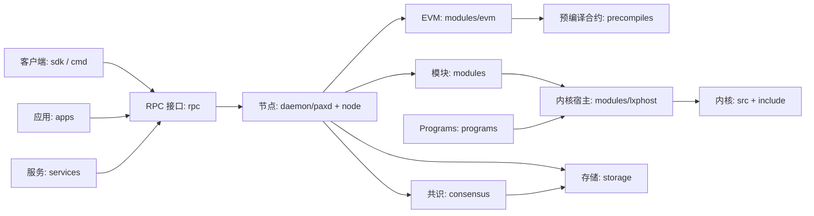

# Paxeer X Network

[English](../../README.md) · [Español](README.es.md) · [日本語](README.ja.md) · [Русский](README.ru.md) · 简体中文 · [Português](README.pt-BR.md) · [Deutsch](README.de.md) · [Français](README.fr.md)

Paxeer mainnet-beta 是运行 `paxd` 的单一拜占庭容错网络，EVM 链标识符为 **125**（`0x7d`），原生代币为 **PAX**。节点集成了共识、EVM、原生模块、预编译合约和 LayerX 内核，因此已提交的区块提供网络的最终状态。

## 仓库结构

| 目录 | 内容 | 页面 |
| --- | --- | --- |
| [`admin/`](../../admin/README.md) | 节点管理工具和命令。 | [README](../../admin/README.md) |
| [`api/`](../../api/README.md) | Protobuf API 定义和生成的接口。 | [README](../../api/README.md) |
| [`apps/`](../../apps/README.md) | 面向用户的 Paxeer 应用。 | [README](../../apps/README.md) |
| [`cmd/`](../../cmd/README.md) | Paxeer 命令行工具。 | [README](../../cmd/README.md) |
| [`consensus/`](../../consensus/README.md) | 网络共识引擎。 | [README](../../consensus/README.md) |
| [`contracts/`](../../contracts/README.md) | 链上合约和合约测试。 | [README](../../contracts/README.md) |
| [`core/`](../../core/README.md) | 版本固定的核心依赖。 | [README](../../core/README.md) |
| [`custodyproof/`](../../custodyproof/README.md) | 托管证明的类型和验证。 | [README](../../custodyproof/README.md) |
| [`daemon/`](../../daemon/README.md) | `paxd` 守护进程和节点入口。 | [README](../../daemon/README.md) |
| [`deploy/`](../../deploy/README.md) | 部署配置和清单。 | [README](../../deploy/README.md) |
| [`docker/`](../../docker/README.md) | Docker 镜像和本地容器配置。 | [README](../../docker/README.md) |
| [`docs/`](../../docs/README.md) | 网络文档和文档站点。 | [README](../../docs/README.md) |
| [`engine/`](../../engine/README.md) | 执行引擎组件。 | [README](../../engine/README.md) |
| [`include/`](../../include/README.md) | LayerX 内核头文件。 | [README](../../include/README.md) |
| [`interchain/`](../../interchain/README.md) | IBC 和链间集成。 | [README](../../interchain/README.md) |
| [`layerxproof/`](../../layerxproof/README.md) | LayerX 证明的编解码器和验证。 | [README](../../layerxproof/README.md) |
| [`migrations/`](../../migrations/README.md) | SQLite 投影和导入模式。 | [README](../../migrations/README.md) |
| [`modules/`](../../modules/README.md) | Paxeer X 链模块。 | [README](../../modules/README.md) |
| [`node/`](../../node/README.md) | Paxeer 节点应用的组件装配。 | [README](../../node/README.md) |
| [`precompiles/`](../../precompiles/README.md) | 提供链原生功能的 EVM 预编译合约。 | [README](../../precompiles/README.md) |
| [`programs/`](../../programs/README.md) | LayerX Programs 运行时、来宾程序和 SDK。 | [README](../../programs/README.md) |
| [`rpc/`](../../rpc/README.md) | EVM JSON-RPC 服务。 | [README](../../rpc/README.md) |
| [`scripts/`](../../scripts/README.md) | 构建、CI、发布和工作区脚本。 | [README](../../scripts/README.md) |
| [`sdk/`](../../sdk/README.md) | Paxeer 客户端 SDK 和集成。 | [README](../../sdk/README.md) |
| [`services/`](../../services/README.md) | 链下网络服务。 | [README](../../services/README.md) |
| [`src/`](../../src/README.md) | LayerX 内核实现。 | [README](../../src/README.md) |
| [`storage/`](../../storage/README.md) | PaxDB 存储和状态承诺。 | [README](../../storage/README.md) |
| [`tests/`](../../tests/README.md) | 网络、内核、集成和协议测试。 | [README](../../tests/README.md) |
| [`tools/`](../../tools/README.md) | 开发者和运维工具。 | [README](../../tools/README.md) |
| [`utils/`](../../utils/README.md) | 共享的节点工具。 | [README](../../utils/README.md) |
| [`wasm/`](../../wasm/README.md) | 嵌入式 CosmWasm 模块。 | [README](../../wasm/README.md) |
| [`wasm-runtime/`](../../wasm-runtime/README.md) | CosmWasm 的 Go 和 Rust 运行时封装。 | [README](../../wasm-runtime/README.md) |

## 架构



## 快速开始

在仓库根目录构建节点：

```sh
make paxd-build
```

运行仓库的 Paxeer 测试目标：

```sh
make paxeer-test
```

## 文档

- [文档概览](../../docs/README.md)
- [文档站点](../../docs/site/)
- [系统文档索引](../../docs/system/INDEX.md)，包括[链模块](../../docs/system/chain-modules.md)、[内核模块](../../docs/system/kernel-modules.md)、[预编译合约](../../docs/system/precompiles.md)、[RPC](../../docs/system/rpc.md)、[路由](../../docs/system/routes.md)、[SDK](../../docs/system/sdk.md)、[CLI](../../docs/system/cli.md) 和[治理](../../docs/system/governance.md)

## 升级到版本 7.0.0

[7.0.0 系统清单](../../docs/release/7.0.0-systems.kvx)、[升级计划](../../docs/release/7.0.0-upgrade-plan.md)和[验证者操作手册](../../docs/release/7.0.0-validator-runbook.md)介绍了该版本及其操作流程。

## 社区

- [参与贡献](../../CONTRIBUTING.md)
- [安全政策](../../SECURITY.md)
- [支持](../../SUPPORT.md)
- [治理](../../GOVERNANCE.md)
- [行为准则](../../CODE_OF_CONDUCT.md)

## 许可证

Paxeer X Network 按照 [Apache License 2.0](../../LICENSE) 的条款分发。
