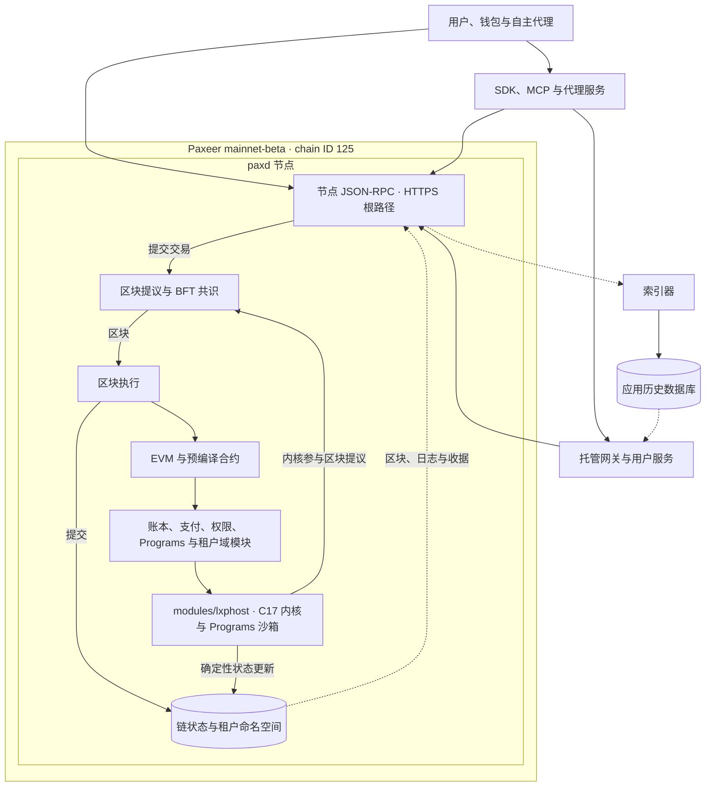
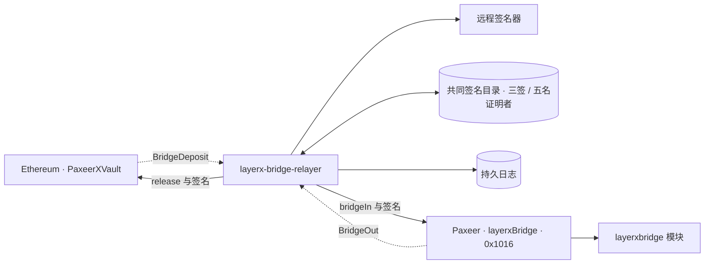

<p align="center"></p>

<h1 align="center">Paxeer X Network</h1>

[English](../../README.md) · [Español](README.es.md) · [日本語](README.ja.md) · [Русский](README.ru.md) · 简体中文 · [Português](README.pt-BR.md) · [Deutsch](README.de.md) · [Français](README.fr.md)

*本页按当前合并网络及仓库实现说明；其他语言版本可通过上方链接访问。*

<p align="center">
  <!-- ═══ Network Identity ═══ -->
  
  
  
  
  
</p>

<p align="center">
  <!-- ═══ Language Stack ═══ -->
  
  
  
  
  
</p>

<p align="center">
  <!-- ═══ Repo Health ═══ -->
  
  
  
  
</p>

## Paxeer X Network 是什么

Paxeer X Network（mainnet-beta）是一个 BFT 网络，节点程序为 `paxd`，EVM 链 ID 为 **125（`0x7d`）**。LayerX 内核是网络的一部分，参与区块提议，并在节点进程内执行确定性的代理活动。EVM 与内核活动共享链的共识和提交过程；交易收据在其所在区块提交后具有最终性。官方网站：[paxeer.network](https://paxeer.network/)。文档：[docs.paxeer.app](https://docs.paxeer.app/)。

`paxd` 通过 [`modules/lxphost/`](../../modules/lxphost/) 将 C17 内核与 Programs 沙箱链接进节点。合约通过 EVM 预编译合约访问账本、支付、权限、Programs 和租户域等原生功能。子链是数据库中的租户域，共享网络基础设施；创建租户域无需另行部署节点或共识网络。

本仓库由 Sidiora Labs 维护，包含节点、内核、合约、SDK 和应用。合并网络的规范见 [`spec/layerx-merge/spec.kvx`](../../spec/layerx-merge/spec.kvx)，发布说明见 [`CHANGELOG.md`](../../CHANGELOG.md)。

## 试用网络

公共链的读取与交易广播使用节点的 JSON-RPC。HTTPS 请求发送至根路径，例如 `https://api1.mainnet-beta.paxeer.network`。节点名称包括 `api1.mainnet-beta.paxeer.network` 至 `api14.mainnet-beta.paxeer.network`，以及 `api-mainnet-beta.paxeer.network`。连接后可调用 `eth_chainId` 确认链 ID：

```sh
curl -sS https://api1.mainnet-beta.paxeer.network \
  -H 'Content-Type: application/json' \
  -d '{"jsonrpc":"2.0","id":1,"method":"eth_chainId","params":[]}'
```

结果中的 `result` 应为 `"0x7d"`。不同节点可能暂时落后于链头，需要最新高度时可比较多个节点的 `eth_blockNumber`。公共节点的命名空间包括 `debug`、`echo`、`eth`、`net`、`pax`、`test` 和 `txpool`；具体可调用的方法取决于节点配置。

网络不再使用独立的内核排序服务或统一路由接口。`node.hyperpaxeer.com` 仅为构建脚本使用的 hpx 库镜像（library mirror），不提供节点 RPC。

公共端点列表见 [公共 JSON-RPC](../site/docs/reference/public-rpc.md)，方法说明见 [PublicRpc](../wiki/PublicRpc.md)。托管网关的 `px_*` 方法另有 [OpenRPC 契约](../../services/platform/hosted/gateway/openrpc.json)；接入托管功能时应使用该服务的实际部署配置，不能据此推断公共节点支持所有网关方法。

钱包、注资与支付流程见 [支付入门](../wiki/PaymentsQuickstart.md)，资产说明见 [Assets](../wiki/Assets.md)，提交语义见 [CommitmentLevels](../wiki/CommitmentLevels.md)。本地开发操作见 [Quickstart](../wiki/Quickstart.md)；主网测试版与开发者接入说明见 [Getting Started](../wiki/Getting-Started-Beta.md)。

## 从源码构建

在仓库根目录构建。节点使用 Go 1.25.8（[`go.mod`](../../go.mod)），内核使用 C17（[`Makefile`](../../Makefile)），Rust 工具链固定为 1.91.1（[`rust-toolchain.toml`](../../rust-toolchain.toml)）。根目录 Foundry 配置使用 Solidity 0.8.27（[`foundry.toml`](../../foundry.toml)）；其他合约项目的配置以各自目录为准。

构建完整节点：

```sh
make paxd-build
```

该目标先构建 `build/liblayerx.a` 和 `programs/target/release/liblayerx_programs_sandbox.a`，再通过 `chain.mk` 构建 `build/paxd`。Go 与 C 通过 cgo 链接，需要可用的 C 编译器、OpenSSL 开发库和 Rust 工具链。`make paxeer-build` 也构建节点；这两个目标的 Go 步骤均设置 `GOPROXY=off`，因此需预先准备依赖缓存。

内核库及开发工具的目标仍保留在根目录：

```sh
make build
make test
make test-contracts
```

`make build` 构建内核静态库和创世、模块注册表工具；它本身不生成完整节点。节点的检查目标定义在 `chain.mk`，可从根目录调用：

```sh
make paxeer-lint
make paxeer-test
```

`make ci` 包含公开源码审计、内核测试、可复现构建比较、共识符号检查和 sanitizer 检查。`make paxeer-ci` 调用链侧 CI；`make monorepo-ci` 调用工作区 CI。完整资格验证所需的工具与运行环境见 [`docs/QUALIFICATION.md`](../QUALIFICATION.md)。

## 仓库结构

| 路径 | 用途 |
| --- | --- |
| `src/`, `include/` | C17 内核、确定性状态机、原生模块与头文件 |
| `cmd/` | `layerxctl`、创世和模块注册表工具；退役组件说明位于 `cmd/retirement/` |
| `daemon/paxd/`, `node/`, `consensus/` | 节点入口、应用装配、区块执行和共识实现 |
| `modules/lxphost/` | 节点内的 C 内核与 Programs 沙箱绑定 |
| `modules/`, `precompiles/` | 链模块与合约可调用的 EVM 预编译合约 |
| `rpc/`, `storage/`, `sdk/` | 节点 RPC、存储和链侧 SDK |
| `services/agent/` | Rust 代理服务、SDK、MCP、客户端、编码与密码学 |
| `services/human/` | 面向用户的服务、类型化意图、密钥管理和索引功能 |
| `services/platform/` | 托管网关、索引器、开发者平台及支持服务 |
| `services/interop/` | 跨网络互操作与 `layerx-bridge-relayer` |
| `programs/` | Programs 运行时、注册表、沙箱、市场与程序 SDK |
| `contracts/` | Solidity 合约与测试，包括桥、治理、命名和 launchpad 项目 |
| `services/bridge/`, `contracts/bridge/` | 桥部署资料及 EVM、Solana 金库代码 |
| `services/explorer/`, `apps/explorer/` | 浏览器服务与前端 |
| `apps/` | Web、钱包、交易、桥、命名和 launchpad 应用 |
| `sdk/platform/`, `tools/platform/cli/` | 多语言平台 SDK 与开发者 CLI |
| `spec/` | KVX 规范、接口、需求和任务图 |
| `tests/`, `migrations/` | 测试、重放与故障验证，以及数据库迁移 |
| `docs/` | Wiki、文档站点源文件、仓库说明与资格验证文档 |

## 文档

- 托管文档：[docs.paxeer.app](https://docs.paxeer.app/)
- Wiki 索引：[Home](../wiki/Home.md)
- 入门：[Getting Started](../wiki/Getting-Started-Beta.md)
- 支付开发者指南：[PaymentsQuickstart](../wiki/PaymentsQuickstart.md)
- 公共端点：[Public RPC endpoints](../site/docs/reference/public-rpc.md)
- RPC 方法：[PublicRpc](../wiki/PublicRpc.md)
- 资产与代币：[Assets](../wiki/Assets.md)
- 提交语义：[CommitmentLevels](../wiki/CommitmentLevels.md)
- 仓库结构与发布标签：[MONOREPO](../MONOREPO.md)
- 资格验证：[QUALIFICATION](../QUALIFICATION.md)
- 合并网络规范：[layerx-merge](../../spec/layerx-merge/spec.kvx)
- 发布说明：[CHANGELOG](../../CHANGELOG.md)

## SDK 与集成

| 语言 | 路径 |
| --- | --- |
| Rust | `services/agent/crates/layerx-sdk` |
| Python | `services/agent/sdk/python` |
| TypeScript | `services/agent/sdk/typescript` |
| Go | `sdk/platform/go` |
| JVM | `sdk/platform/jvm` |
| .NET | `sdk/platform/dotnet` |
| Swift | `sdk/platform/swift` |

代理服务 `layerx-agentd` 位于 `services/agent/crates/layerx-agentd`，MCP 服务器位于 `services/agent/crates/layerx-mcp`，节点 JSON-RPC 客户端位于 `services/agent/crates/layerx-client`。这些是客户端与应用集成组件。开发者 CLI 位于 `tools/platform/cli`，支持 `layerx install mcp` 和 `layerx install a2a`。连接地址、凭据与能力应按所选组件的配置设置。

## 架构

网络只有一套区块提交与最终性流程。下图将节点内部执行与外部应用分开展示：内核是 `paxd` 的组成部分，参与区块提议；代理活动与 EVM 交易由网络执行并写入链状态。托管服务可以提供应用能力与历史索引，索引数据不决定共识最终性。



节点的应用装配见 [`node/app.go`](../../node/app.go)，内核绑定见 [`modules/lxphost/host.go`](../../modules/lxphost/host.go)。合并后的主要预编译合约如下，地址是补齐为 20 字节后的 EVM 地址的简写：

| 名称 | 地址 | 实现 |
| --- | --- | --- |
| `layerxledger` | `0x101A` | [`precompiles/layerxledger/`](../../precompiles/layerxledger/) |
| `layerxpay` | `0x101B` | [`precompiles/layerxpay/`](../../precompiles/layerxpay/) |
| `layerxauth` | `0x101C` | [`precompiles/layerxauth/`](../../precompiles/layerxauth/) |
| `layerxprograms` | `0x101D` | [`precompiles/layerxprograms/`](../../precompiles/layerxprograms/) |
| `layerxchains` | `0x101E` | [`precompiles/layerxchains/`](../../precompiles/layerxchains/) |
| `perps` | `0x1015` | [`precompiles/perps/`](../../precompiles/perps/) |
| `layerxBridge` | `0x1016` | [`precompiles/layerxbridge/`](../../precompiles/layerxbridge/) |
| `launchpad` | `0x1017` | [`precompiles/launchpad/`](../../precompiles/launchpad/) |

合并地址表还包含 `0x0901`–`0x0908` 的代理功能，见 [`precompiles/setup.go`](../../precompiles/setup.go)。可用集合受链上升级激活高度约束；`0x1015` 的 `perps` 和 launchpad 的版本选择见 [`node/precompiles_v6120.go`](../../node/precompiles_v6120.go)。旧的资产托管与检查点结算拓扑已退役，不用于描述当前网络的最终性。

`layerxchains` 将子链注册为链状态中的租户域，保存域参数与资源额度；执行时按域隔离状态。实现见 [`modules/layerxchains/`](../../modules/layerxchains/)。

跨网络桥是应用层集成。以 Ethereum 为例，中继器观察源链事件，收集证明者签名，并向目标链提交交易。配置要求五名不同的证明者、三签阈值，通过远程签名器与共同签名目录协作；观察结果与签名交易写入持久日志以支持恢复。代码见 [`services/interop/crates/layerx-bridge-relayer/`](../../services/interop/crates/layerx-bridge-relayer/)。



跨链事件的确认深度和目标链释放策略由桥配置决定；本网络内交易的最终性来自 BFT 区块提交。

## 参与贡献

提交 pull request 前请阅读 [`CONTRIBUTING.md`](../../CONTRIBUTING.md)。协议变更从 `spec/` 开始。请勿在公开 issue 中披露疑似漏洞；请遵循 [`SECURITY.md`](../../SECURITY.md)。

## 安全

请按照 [`SECURITY.md`](../../SECURITY.md) 中的说明，通过 GitHub 私密报告渠道报告漏洞。

## 许可证

采用 Apache License 2.0 许可。参见 [`LICENSE`](../../LICENSE) 和 [`NOTICE`](../../NOTICE)。

Paxeer X Network 由 Sidiora Labs 开发。源码：[github.com/Sidiora-Labs/Paxeer-X-Network](https://github.com/Sidiora-Labs/Paxeer-X-Network)。
