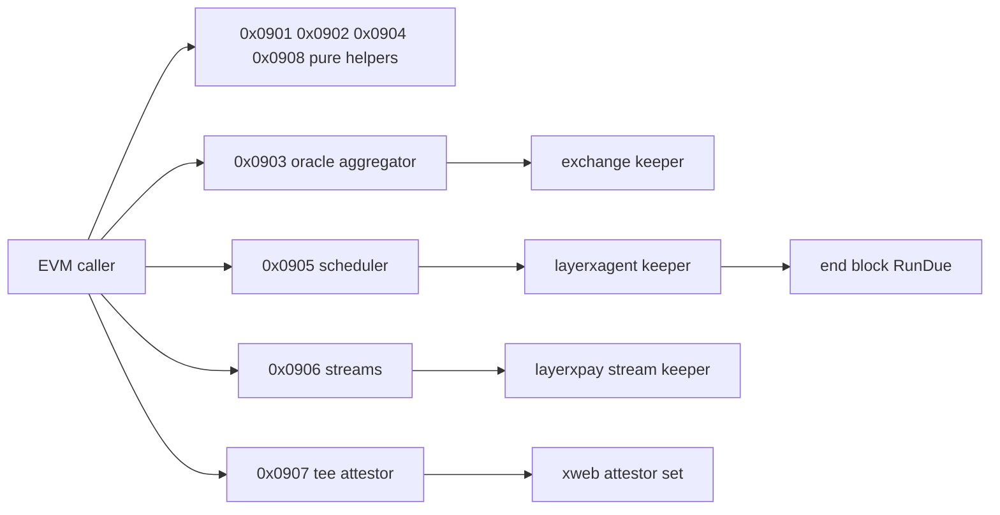

# Agent functions contract: precompiles 0x0901 to 0x0908 and the layerxagent module

This contract freezes the eight agent function precompiles, their shared framework, error registry and gas table, and the layerxagent module that holds scheduled jobs. At the pinned revision `precompiles/layerxagent` holds the packages orob (0x0901), clearing (0x0902), pofq (0x0904), teeattestor (0x0907) and eip712 (0x0908) with the shared `common` framework, but no production import registers their merge constructors; 0x0903, 0x0905 and 0x0906 have no package. `mergePrecompileGate` gates all eight addresses (`node/upgrades.go:529-536`).

0x0901 orob, 0x0902 clearing, 0x0904 pofq and 0x0908 eip712 are pure helpers; 0x0903 aggregates oracle feeds through the exchange keeper; 0x0905 schedules jobs in the layerxagent keeper; 0x0906 runs agent streams through the layerxpay stream keeper; 0x0907 verifies TEE attestations against the xweb attestor set.

Revision `2a1033aa2`. Every `path:line` below was read at that revision; `(planned)` marks a file that does not exist there.

## Contents

- [framework](#framework)
- [errors](#errors)
- [orob-0x0901](#orob-0x0901)
- [clearing-0x0902](#clearing-0x0902)
- [oracle-aggregator-0x0903](#oracle-aggregator-0x0903)
- [pofq-0x0904](#pofq-0x0904)
- [scheduler-0x0905](#scheduler-0x0905)
- [scheduler-events](#scheduler-events)
- [scheduler-params](#scheduler-params)
- [scheduler-end-block](#scheduler-end-block)
- [streams-0x0906](#streams-0x0906)
- [tee-attestor-0x0907](#tee-attestor-0x0907)
- [eip712-0x0908](#eip712-0x0908)
- [layerxagent-module](#layerxagent-module)
- [proto-layerxagent-eventjobexecuted](#proto-layerxagent-eventjobexecuted)
- [proto-layerxagent-eventjobfailed](#proto-layerxagent-eventjobfailed)
- [decisions](#decisions)

## framework

The shared executor framework of `precompiles/layerxagent/common`: ABI binding, gas charged on the full call input including the selector (decision.231) and merge constructors with explicit provisional caps (decision.230).

Contract context `2.agent-functions-errors`:

| Aspect | Rule |
|---|---|
| Interface | The layerxagent framework (precompiles/layerxagent/common/common.go:147) and its error codes shared by 0x0901 to 0x0908 |
| Storage | None |
| Errors | Error(string) reasons in registry form LXP_&lt;code&gt;: &lt;message&gt; through pcommon.LXPRevert for every layerxagent common error, including the new LXP_AGENT_NOT_ACTIVE and LXP_AGENT_SCHEDULER_CALLDATA_TOO_LARGE rows (decision.228) |
| Events | None |
| Gas | D2 table rows of precompiles/layerxagent/common/gas.go:30-57 charged on the full call input including the selector (decision.231); merge constructors pass explicit provisional caps (decision.230) |
| Activation | Served from the height where MergeUpgrade is done, gated by mergePrecompileGate (node/upgrades.go:521) on the layerxagent module, 0x0903 also on layerxexchange and 0x0906 on layerxpay (node/upgrades.go:529-536) |
| Invariants | Every framework refusal maps to exactly one registry row and no revert is LXP_UNKNOWN |
| Pause | layerxagent Params.Paused refuses schedule and reschedule with LXP_PAUSED_SCOPE and keeps cancel as the only exit (decision.225); 0x0906 follows the layerxpay pause scope; pure helpers and views always answer |

Frozen interfaces: 14 (stable 12, change 2).

**Other interfaces**

| Interface block | Kind | Signature | Status | Defined at |
|---|---|---|---|---|
| `interface.2.go-layerxagent-common-errorcode-j24` | go_exported | `type ErrorCode string` | change | `precompiles/layerxagent/common/common.go:19` |
| `interface.2.go-layerxagent-common-errorcode-error-j24` | go_exported | `func (code ErrorCode) Error() string { return string(code) }` | stable | `precompiles/layerxagent/common/common.go:21` |
| `interface.2.go-layerxagent-common-guardwrite-j24` | go_exported | `func GuardWrite(ctx sdk.Context, readOnly, isDelegate bool) error` | stable | `precompiles/layerxagent/common/common.go:68` |
| `interface.2.go-layerxagent-common-withheightgate-j24` | go_exported | `func WithHeightGate(ctx sdk.Context, upgrade *upgradekeeper.Keeper, planName string) sdk.Context` | stable | `precompiles/layerxagent/common/common.go:85` |
| `interface.2.go-layerxagent-common-heightgate-j24` | go_exported | `func HeightGate(ctx sdk.Context) error` | stable | `precompiles/layerxagent/common/common.go:92` |
| `interface.2.go-layerxagent-common-validateargslength-j24` | go_exported | `func ValidateArgsLength(args []interface{}, length int) error` | stable | `precompiles/layerxagent/common/common.go:107` |
| `interface.2.go-layerxagent-common-validatenonpayable-j24` | go_exported | `func ValidateNonPayable(value *big.Int) error` | stable | `precompiles/layerxagent/common/common.go:114` |
| `interface.2.go-layerxagent-common-precompile-j24` | go_exported | `type Precompile struct` | stable | `precompiles/layerxagent/common/common.go:121` |
| `interface.2.go-layerxagent-common-boundexecutor-requiredgas-j24` | go_exported | `func (p boundExecutor) RequiredGas(input []byte, method *abi.Method) uint64` | stable | `precompiles/layerxagent/common/common.go:134` |
| `interface.2.go-layerxagent-common-boundexecutor-execute-j24` | go_exported | `func (p boundExecutor) Execute(ctx sdk.Context, method *abi.Method, caller ethcommon.Address, callingContract ethcommon.Address, args []interface{}, value *big.Int, readOnly bool, evm *vm.EVM, hooks *tracing.Hooks) ([]byte, error)` | stable | `precompiles/layerxagent/common/common.go:141` |
| `interface.2.go-layerxagent-common-newprecompile-j24` | go_exported | `func NewPrecompile(a abi.ABI, executor pcommon.PrecompileExecutor, address ethcommon.Address, name string, upgrade *upgradekeeper.Keeper, planName string) *Precompile` | stable | `precompiles/layerxagent/common/common.go:147` |
| `interface.2.go-layerxagent-common-precompile-requiredgas-j24` | go_exported | `func (p *Precompile) RequiredGas(input []byte) uint64` | stable | `precompiles/layerxagent/common/common.go:156` |
| `interface.2.go-layerxagent-common-precompile-run-j24` | go_exported | `func (p *Precompile) Run(evm *vm.EVM, caller ethcommon.Address, callingContract ethcommon.Address, input []byte, value *big.Int, readOnly bool, isFromDelegateCall bool, hooks *tracing.Hooks) ([]byte, error)` | change | `precompiles/layerxagent/common/common.go:167` |
| `interface.2.go-layerxagent-common-methodgas-j24` | go_exported | `func MethodGas(selector []byte, inputLen int) uint64` | stable | `precompiles/layerxagent/common/gas.go:10` |

Capabilities verified against this section: 2.38.1.

| Acceptance | Requirement | Test |
|---|---|---|
| 2.303.1 | 2303.1 | `precompiles/layerxagent/served/served_test.go::TestAgentMergeAddressesServedAfterUpgrade (planned)` |
| 2.303.2 | 2303.2 | `precompiles/layerxagent/served/served_test.go::TestTeeAttestorServedRevertsRegistryCode (planned)` |

## errors

Agent function errors revert `Error(string)` in registry form `LXP_<CODE>: <message>` through `pcommon.LXPRevert`; LXP_AGENT_NOT_ACTIVE and LXP_AGENT_SCHEDULER_CALLDATA_TOO_LARGE are new rows (decision.228).

Contract context `2.agent-functions-errors`:

| Aspect | Rule |
|---|---|
| Interface | The layerxagent framework (precompiles/layerxagent/common/common.go:147) and its error codes shared by 0x0901 to 0x0908 |
| Storage | None |
| Errors | Error(string) reasons in registry form LXP_&lt;code&gt;: &lt;message&gt; through pcommon.LXPRevert for every layerxagent common error, including the new LXP_AGENT_NOT_ACTIVE and LXP_AGENT_SCHEDULER_CALLDATA_TOO_LARGE rows (decision.228) |
| Events | None |
| Gas | D2 table rows of precompiles/layerxagent/common/gas.go:30-57 charged on the full call input including the selector (decision.231); merge constructors pass explicit provisional caps (decision.230) |
| Activation | Served from the height where MergeUpgrade is done, gated by mergePrecompileGate (node/upgrades.go:521) on the layerxagent module, 0x0903 also on layerxexchange and 0x0906 on layerxpay (node/upgrades.go:529-536) |
| Invariants | Every framework refusal maps to exactly one registry row and no revert is LXP_UNKNOWN |
| Pause | layerxagent Params.Paused refuses schedule and reschedule with LXP_PAUSED_SCOPE and keeps cancel as the only exit (decision.225); 0x0906 follows the layerxpay pause scope; pure helpers and views always answer |

Frozen interfaces: 44 (change 42, new 2).

**Other interfaces**

| Interface block | Kind | Signature | Status | Defined at |
|---|---|---|---|---|
| `interface.2.go-layerxagent-common-reverterror-j24` | go_exported | `func RevertError(err error) error` | new | `precompiles/layerxagent/common/errors.go` (planned) |
| `interface.2.pc-agent-err-lxp-agent-scheduler-calldata-too-large-j24` | precompile_error | `revert Error(string) "LXP_AGENT_SCHEDULER_CALLDATA_TOO_LARGE" (ErrSchedulerCallDataTooLarge)` | new | `precompiles/layerxagent/common/common.go` (planned) |
| `interface.2.pc-agent-err-lxp-precompile-input-too-short` | precompile_error | `revert Error(string) "LXP_PRECOMPILE_INPUT_TOO_SHORT" (ErrInputTooShort)` | change | `precompiles/layerxagent/common/common.go:24` |
| `interface.2.pc-agent-err-lxp-precompile-unknown-method` | precompile_error | `revert Error(string) "LXP_PRECOMPILE_UNKNOWN_METHOD" (ErrUnknownMethod)` | change | `precompiles/layerxagent/common/common.go:25` |
| `interface.2.pc-agent-err-lxp-precompile-arg-count` | precompile_error | `revert Error(string) "LXP_PRECOMPILE_ARG_COUNT" (ErrArgCount)` | change | `precompiles/layerxagent/common/common.go:26` |
| `interface.2.pc-agent-err-lxp-precompile-non-payable` | precompile_error | `revert Error(string) "LXP_PRECOMPILE_NON_PAYABLE" (ErrNonPayable)` | change | `precompiles/layerxagent/common/common.go:27` |
| `interface.2.pc-agent-err-lxp-precompile-no-context` | precompile_error | `revert Error(string) "LXP_PRECOMPILE_NO_CONTEXT" (ErrNoContext)` | change | `precompiles/layerxagent/common/common.go:28` |
| `interface.2.pc-agent-err-lxp-agent-abi-decode` | precompile_error | `revert Error(string) "LXP_AGENT_ABI_DECODE" (ErrABIDecode)` | change | `precompiles/layerxagent/common/common.go:29` |
| `interface.2.pc-agent-err-lxp-agent-read-only` | precompile_error | `revert Error(string) "LXP_AGENT_READ_ONLY" (ErrReadOnly)` | change | `precompiles/layerxagent/common/common.go:30` |
| `interface.2.pc-agent-err-lxp-agent-delegatecall` | precompile_error | `revert Error(string) "LXP_AGENT_DELEGATECALL" (ErrDelegatecall)` | change | `precompiles/layerxagent/common/common.go:31` |
| `interface.2.pc-agent-err-lxp-agent-overflow` | precompile_error | `revert Error(string) "LXP_AGENT_OVERFLOW" (ErrOverflow)` | change | `precompiles/layerxagent/common/common.go:32` |
| `interface.2.pc-agent-err-lxp-agent-batch-too-large` | precompile_error | `revert Error(string) "LXP_AGENT_BATCH_TOO_LARGE" (ErrBatchTooLarge)` | change | `precompiles/layerxagent/common/common.go:33` |
| `interface.2.pc-agent-err-lxp-agent-orob-oracle-price` | precompile_error | `revert Error(string) "LXP_AGENT_OROB_ORACLE_PRICE" (ErrOrobOraclePrice)` | change | `precompiles/layerxagent/common/common.go:34` |
| `interface.2.pc-agent-err-lxp-agent-orob-offset-range` | precompile_error | `revert Error(string) "LXP_AGENT_OROB_OFFSET_RANGE" (ErrOrobOffsetRange)` | change | `precompiles/layerxagent/common/common.go:35` |
| `interface.2.pc-agent-err-lxp-agent-clearing-length-mismatch` | precompile_error | `revert Error(string) "LXP_AGENT_CLEARING_LENGTH_MISMATCH" (ErrClearingLengthMismatch)` | change | `precompiles/layerxagent/common/common.go:36` |
| `interface.2.pc-agent-err-lxp-agent-oracle-no-feeds` | precompile_error | `revert Error(string) "LXP_AGENT_ORACLE_NO_FEEDS" (ErrOracleNoFeeds)` | change | `precompiles/layerxagent/common/common.go:37` |
| `interface.2.pc-agent-err-lxp-agent-oracle-no-confident-feeds` | precompile_error | `revert Error(string) "LXP_AGENT_ORACLE_NO_CONFIDENT_FEEDS" (ErrOracleNoConfidentFeeds)` | change | `precompiles/layerxagent/common/common.go:38` |
| `interface.2.pc-agent-err-lxp-agent-oracle-not-signer` | precompile_error | `revert Error(string) "LXP_AGENT_ORACLE_NOT_SIGNER" (ErrOracleNotSigner)` | change | `precompiles/layerxagent/common/common.go:39` |
| `interface.2.pc-agent-err-lxp-agent-oracle-price` | precompile_error | `revert Error(string) "LXP_AGENT_ORACLE_PRICE" (ErrOraclePrice)` | change | `precompiles/layerxagent/common/common.go:40` |
| `interface.2.pc-agent-err-lxp-agent-oracle-confidence` | precompile_error | `revert Error(string) "LXP_AGENT_ORACLE_CONFIDENCE" (ErrOracleConfidence)` | change | `precompiles/layerxagent/common/common.go:41` |
| `interface.2.pc-agent-err-lxp-agent-pofq-length-mismatch` | precompile_error | `revert Error(string) "LXP_AGENT_POFQ_LENGTH_MISMATCH" (ErrPofqLengthMismatch)` | change | `precompiles/layerxagent/common/common.go:42` |
| `interface.2.pc-agent-err-lxp-agent-pofq-decay-range` | precompile_error | `revert Error(string) "LXP_AGENT_POFQ_DECAY_RANGE" (ErrPofqDecayRange)` | change | `precompiles/layerxagent/common/common.go:43` |
| `interface.2.pc-agent-err-lxp-agent-scheduler-job-not-found` | precompile_error | `revert Error(string) "LXP_AGENT_SCHEDULER_JOB_NOT_FOUND" (ErrSchedulerJobNotFound)` | change | `precompiles/layerxagent/common/common.go:44` |
| `interface.2.pc-agent-err-lxp-agent-scheduler-unauthorized` | precompile_error | `revert Error(string) "LXP_AGENT_SCHEDULER_UNAUTHORIZED" (ErrSchedulerUnauthorized)` | change | `precompiles/layerxagent/common/common.go:45` |
| `interface.2.pc-agent-err-lxp-agent-scheduler-horizon-exceeded` | precompile_error | `revert Error(string) "LXP_AGENT_SCHEDULER_HORIZON_EXCEEDED" (ErrSchedulerHorizonExceeded)` | change | `precompiles/layerxagent/common/common.go:46` |
| `interface.2.pc-agent-err-lxp-agent-scheduler-past-block` | precompile_error | `revert Error(string) "LXP_AGENT_SCHEDULER_PAST_BLOCK" (ErrSchedulerPastBlock)` | change | `precompiles/layerxagent/common/common.go:47` |
| `interface.2.pc-agent-err-lxp-agent-scheduler-max-jobs` | precompile_error | `revert Error(string) "LXP_AGENT_SCHEDULER_MAX_JOBS" (ErrSchedulerMaxJobs)` | change | `precompiles/layerxagent/common/common.go:48` |
| `interface.2.pc-agent-err-lxp-agent-scheduler-deposit-too-low` | precompile_error | `revert Error(string) "LXP_AGENT_SCHEDULER_DEPOSIT_TOO_LOW" (ErrSchedulerDepositTooLow)` | change | `precompiles/layerxagent/common/common.go:49` |
| `interface.2.pc-agent-err-lxp-agent-scheduler-invalid-gas-limit` | precompile_error | `revert Error(string) "LXP_AGENT_SCHEDULER_INVALID_GAS_LIMIT" (ErrSchedulerInvalidGasLimit)` | change | `precompiles/layerxagent/common/common.go:50` |
| `interface.2.pc-agent-err-lxp-agent-scheduler-invalid-target` | precompile_error | `revert Error(string) "LXP_AGENT_SCHEDULER_INVALID_TARGET" (ErrSchedulerInvalidTarget)` | change | `precompiles/layerxagent/common/common.go:51` |
| `interface.2.pc-agent-err-lxp-agent-scheduler-job-inactive` | precompile_error | `revert Error(string) "LXP_AGENT_SCHEDULER_JOB_INACTIVE" (ErrSchedulerJobInactive)` | change | `precompiles/layerxagent/common/common.go:52` |
| `interface.2.pc-agent-err-lxp-agent-scheduler-escrow` | precompile_error | `revert Error(string) "LXP_AGENT_SCHEDULER_ESCROW" (ErrSchedulerEscrow)` | change | `precompiles/layerxagent/common/common.go:53` |
| `interface.2.pc-agent-err-lxp-agent-streams-invalid-payee` | precompile_error | `revert Error(string) "LXP_AGENT_STREAMS_INVALID_PAYEE" (ErrStreamsInvalidPayee)` | change | `precompiles/layerxagent/common/common.go:54` |
| `interface.2.pc-agent-err-lxp-agent-streams-self-payment` | precompile_error | `revert Error(string) "LXP_AGENT_STREAMS_SELF_PAYMENT" (ErrStreamsSelfPayment)` | change | `precompiles/layerxagent/common/common.go:55` |
| `interface.2.pc-agent-err-lxp-agent-streams-unknown-token` | precompile_error | `revert Error(string) "LXP_AGENT_STREAMS_UNKNOWN_TOKEN" (ErrStreamsUnknownToken)` | change | `precompiles/layerxagent/common/common.go:56` |
| `interface.2.pc-agent-err-lxp-agent-tee-unknown-family` | precompile_error | `revert Error(string) "LXP_AGENT_TEE_UNKNOWN_FAMILY" (ErrTEEUnknownFamily)` | change | `precompiles/layerxagent/common/common.go:57` |
| `interface.2.pc-agent-err-lxp-agent-tee-no-roots` | precompile_error | `revert Error(string) "LXP_AGENT_TEE_NO_ROOTS" (ErrTEENoRoots)` | change | `precompiles/layerxagent/common/common.go:58` |
| `interface.2.pc-agent-err-lxp-agent-tee-invalid-quote` | precompile_error | `revert Error(string) "LXP_AGENT_TEE_INVALID_QUOTE" (ErrTEEInvalidQuote)` | change | `precompiles/layerxagent/common/common.go:59` |
| `interface.2.pc-agent-err-lxp-agent-tee-untrusted-chain` | precompile_error | `revert Error(string) "LXP_AGENT_TEE_UNTRUSTED_CHAIN" (ErrTEEUntrustedChain)` | change | `precompiles/layerxagent/common/common.go:60` |
| `interface.2.pc-agent-err-lxp-agent-tee-stale` | precompile_error | `revert Error(string) "LXP_AGENT_TEE_STALE" (ErrTEEStale)` | change | `precompiles/layerxagent/common/common.go:61` |
| `interface.2.pc-agent-err-lxp-agent-tee-debug-refused` | precompile_error | `revert Error(string) "LXP_AGENT_TEE_DEBUG_REFUSED" (ErrTEEDebugRefused)` | change | `precompiles/layerxagent/common/common.go:62` |
| `interface.2.pc-agent-err-lxp-agent-tee-report-data-mismatch` | precompile_error | `revert Error(string) "LXP_AGENT_TEE_REPORT_DATA_MISMATCH" (ErrTEEReportDataMismatch)` | change | `precompiles/layerxagent/common/common.go:63` |
| `interface.2.pc-agent-err-lxp-agent-tee-unauthorized-update` | precompile_error | `revert Error(string) "LXP_AGENT_TEE_UNAUTHORIZED_UPDATE" (ErrTEEUnauthorizedUpdate)` | change | `precompiles/layerxagent/common/common.go:64` |
| `interface.2.pc-agent-err-lxp-agent-not-active` | precompile_error | `revert Error(string) "LXP_AGENT_NOT_ACTIVE" (ErrNotActive)` | change | `precompiles/layerxagent/common/common.go:65` |

Capabilities verified against this section: 2.39.1.

| Acceptance | Requirement | Test |
|---|---|---|
| 2.310.1 | 2310.1 | `precompiles/layerxagent/common/errors_registry_test.go::TestAgentErrorCodesHaveRegistryRows (planned)` |
| 2.310.2 | 2310.2 | `precompiles/layerxagent/common/errors_registry_test.go::TestAgentRunRevertsThroughLXPReason (planned)` |
| 2.310.3 | 2310.3 | `precompiles/layerxagent/common/errors_registry_test.go::TestAgentRevertErrorMapsPayCodes (planned)` |

## orob-0x0901

Precompile 0x0901 orob: pure tick offset resolution; toOffset outside int16 reverts LXP_AGENT_OVERFLOW and an empty resolveOffsetBatch reverts LXP_AGENT_ABI_DECODE (decision.229); merge cap MergeMaxBatchSize 64 (decision.230).

| Aspect | Rule |
|---|---|
| Authority | Any caller; no state. |

Contract context `2.agent-pure-helpers`:

| Aspect | Rule |
|---|---|
| Interface | Pure precompiles 0x0901 orob, 0x0902 clearing, 0x0904 pofq and 0x0908 eip712 and their merge constructors |
| Storage | None; outputs depend only on the inputs |
| Errors | Error(string) reasons in registry form LXP_&lt;code&gt;: &lt;message&gt; through pcommon.LXPRevert for every layerxagent common error, including the new LXP_AGENT_NOT_ACTIVE and LXP_AGENT_SCHEDULER_CALLDATA_TOO_LARGE rows (decision.228); 0x0901 refusal codes follow the code at HEAD (decision.229) |
| Events | None |
| Gas | D2 table rows of precompiles/layerxagent/common/gas.go:30-57 charged on the full call input including the selector (decision.231); merge constructors pass explicit provisional caps (decision.230) |
| Activation | Served from the height where MergeUpgrade is done, gated by mergePrecompileGate (node/upgrades.go:521) on the layerxagent module, 0x0903 also on layerxexchange and 0x0906 on layerxpay (node/upgrades.go:529-536) |
| Invariants | Deterministic over their inputs; batch and name caps refuse oversized inputs before work |
| Pause | Not pausable |

Frozen interfaces: 16 (stable 12, change 3, new 1).

**ABI methods**

| Method | Address | Selector | Status | Gas | Defined at |
|---|---|---|---|---|---|
| `resolveOffset(int256,int16) pure returns (int256)` | 0x0901 | `0x454ad3a1` | change | 1000 + 3/byte (`precompiles/layerxagent/common/gas.go:36`) | `precompiles/layerxagent/orob/orob.go:26` |
| `resolveOffsetBatch(int256,int16[]) pure returns (int256[])` | 0x0901 | `0x3df597e3` | change | 1000 + 3/byte (`precompiles/layerxagent/common/gas.go:36`) | `precompiles/layerxagent/orob/orob.go:27` |
| `toOffset(int256,int256) pure returns (int16)` | 0x0901 | `0x3f779aef` | change | 1000 + 3/byte (`precompiles/layerxagent/common/gas.go:36`) | `precompiles/layerxagent/orob/orob.go:28` |

**Other interfaces**

| Interface block | Kind | Signature | Status | Defined at |
|---|---|---|---|---|
| `interface.2.go-layerxagent-orob-newmergeprecompile-j24` | go_exported | `func NewMergePrecompile(keepers utils.Keepers, planName string) (precompiles.IPrecompile, error)` | new | `precompiles/layerxagent/orob/merge.go` (planned) |
| `interface.2.go-layerxagent-orob-orobaddress-j24` | go_exported | `OrobAddress              = "0x0000000000000000000000000000000000000901"` | stable | `precompiles/layerxagent/orob/orob.go:20` |
| `interface.2.go-layerxagent-orob-precompilename-j24` | go_exported | `PrecompileName           = "orob"` | stable | `precompiles/layerxagent/orob/orob.go:21` |
| `interface.2.go-layerxagent-orob-resolveoffsetmethod-j24` | go_exported | `ResolveOffsetMethod      = "resolveOffset"` | stable | `precompiles/layerxagent/orob/orob.go:22` |
| `interface.2.go-layerxagent-orob-resolveoffsetbatchmethod-j24` | go_exported | `ResolveOffsetBatchMethod = "resolveOffsetBatch"` | stable | `precompiles/layerxagent/orob/orob.go:23` |
| `interface.2.go-layerxagent-orob-tooffsetmethod-j24` | go_exported | `ToOffsetMethod           = "toOffset"` | stable | `precompiles/layerxagent/orob/orob.go:24` |
| `interface.2.go-layerxagent-orob-orobprecompile-j24` | go_exported | `type OrobPrecompile struct` | stable | `precompiles/layerxagent/orob/orob.go:32` |
| `interface.2.go-layerxagent-orob-newprecompile-j24` | go_exported | `func NewPrecompile(upgrade *upgradekeeper.Keeper, planName string, maxBatchSize int) (*agentcommon.Precompile, error)` | stable | `precompiles/layerxagent/orob/orob.go:39` |
| `interface.2.go-layerxagent-orob-orobprecompile-requiredgas-j24` | go_exported | `func (p *OrobPrecompile) RequiredGas(input []byte, method *abi.Method) uint64` | stable | `precompiles/layerxagent/orob/orob.go:54` |
| `interface.2.go-layerxagent-orob-orobprecompile-execute-j24` | go_exported | `func (p *OrobPrecompile) Execute(ctx sdk.Context, method *abi.Method, _ common.Address, _ common.Address, args []interface{}, value *big.Int, _ bool, _ *vm.EVM, _ *tracing.Hooks) ([]byte, error)` | stable | `precompiles/layerxagent/orob/orob.go:68` |
| `interface.2.go-layerxagent-orob-resolveoffset-j24` | go_exported | `func ResolveOffset(oraclePrice *big.Int, offsetBps int16) (*big.Int, error)` | stable | `precompiles/layerxagent/orob/orob.go:135` |
| `interface.2.go-layerxagent-orob-resolveoffsetbatch-j24` | go_exported | `func ResolveOffsetBatch(oraclePrice *big.Int, offsetsBps []int16, maxBatchSize int) ([]*big.Int, error)` | stable | `precompiles/layerxagent/orob/orob.go:150` |
| `interface.2.go-layerxagent-orob-tooffset-j24` | go_exported | `func ToOffset(oraclePrice, absolutePrice *big.Int) (int16, error)` | stable | `precompiles/layerxagent/orob/orob.go:171` |

Capabilities verified against this section: 2.37.1.

| Acceptance | Requirement | Test |
|---|---|---|
| 2.299.1 | 2299.1 | `precompiles/layerxagent/orob/merge_test.go::TestOrobMergeConstructorRegistered (planned)` |
| 2.299.2 | 2299.2 | `precompiles/layerxagent/orob/merge_test.go::TestOrobMergeBatchCapAndOverflow (planned)` |

## clearing-0x0902

Precompile 0x0902 clearing: pure uniform-price clearing over at most MergeMaxOrders 256 orders (decision.230).

| Aspect | Rule |
|---|---|
| Authority | Any caller; no state. |

Contract context `2.agent-pure-helpers`:

| Aspect | Rule |
|---|---|
| Interface | Pure precompiles 0x0901 orob, 0x0902 clearing, 0x0904 pofq and 0x0908 eip712 and their merge constructors |
| Storage | None; outputs depend only on the inputs |
| Errors | Error(string) reasons in registry form LXP_&lt;code&gt;: &lt;message&gt; through pcommon.LXPRevert for every layerxagent common error, including the new LXP_AGENT_NOT_ACTIVE and LXP_AGENT_SCHEDULER_CALLDATA_TOO_LARGE rows (decision.228); 0x0901 refusal codes follow the code at HEAD (decision.229) |
| Events | None |
| Gas | D2 table rows of precompiles/layerxagent/common/gas.go:30-57 charged on the full call input including the selector (decision.231); merge constructors pass explicit provisional caps (decision.230) |
| Activation | Served from the height where MergeUpgrade is done, gated by mergePrecompileGate (node/upgrades.go:521) on the layerxagent module, 0x0903 also on layerxexchange and 0x0906 on layerxpay (node/upgrades.go:529-536) |
| Invariants | Deterministic over their inputs; batch and name caps refuse oversized inputs before work |
| Pause | Not pausable |

Frozen interfaces: 10 (stable 8, change 1, new 1).

**ABI methods**

| Method | Address | Selector | Status | Gas | Defined at |
|---|---|---|---|---|---|
| `computeClearing(int256,(int16,uint128)[],(int16,uint128)[]) pure returns (int16,int256,uint256)` | 0x0902 | `0x8397e9f8` | change | 6000 + 3/byte (`precompiles/layerxagent/common/gas.go:38`) | `precompiles/layerxagent/clearing/clearing.go:23` |

**Other interfaces**

| Interface block | Kind | Signature | Status | Defined at |
|---|---|---|---|---|
| `interface.2.go-layerxagent-clearing-clearingaddress-j24` | go_exported | `ClearingAddress       = "0x0000000000000000000000000000000000000902"` | stable | `precompiles/layerxagent/clearing/clearing.go:21` |
| `interface.2.go-layerxagent-clearing-computeclearingmethod-j24` | go_exported | `ComputeClearingMethod = "computeClearing"` | stable | `precompiles/layerxagent/clearing/clearing.go:22` |
| `interface.2.go-layerxagent-clearing-clearingprecompile-j24` | go_exported | `type ClearingPrecompile struct` | stable | `precompiles/layerxagent/clearing/clearing.go:31` |
| `interface.2.go-layerxagent-clearing-precompileexecutor-j24` | go_exported | `type PrecompileExecutor struct` | stable | `precompiles/layerxagent/clearing/clearing.go:35` |
| `interface.2.go-layerxagent-clearing-newprecompile-j24` | go_exported | `func NewPrecompile(upgrade *upgradekeeper.Keeper, planName string, maxOrders int) (*ClearingPrecompile, error)` | stable | `precompiles/layerxagent/clearing/clearing.go:42` |
| `interface.2.go-layerxagent-clearing-precompileexecutor-requiredgas-j24` | go_exported | `func (p PrecompileExecutor) RequiredGas(input []byte, method *abi.Method) uint64` | stable | `precompiles/layerxagent/clearing/clearing.go:53` |
| `interface.2.go-layerxagent-clearing-precompileexecutor-execute-j24` | go_exported | `func (p PrecompileExecutor) Execute(ctx sdk.Context, method *abi.Method, _ ethcommon.Address, _ ethcommon.Address, args []interface{}, value *big.Int, _ bool, _ *vm.EVM, _ *tracing.Hooks) ([]byte, error)` | stable | `precompiles/layerxagent/clearing/clearing.go:63` |
| `interface.2.go-layerxagent-clearing-computeclearing-j24` | go_exported | `func ComputeClearing(oraclePrice *big.Int, buys, sells []clearingOrder, maxOrders int) (int16, *big.Int, *big.Int, error)` | stable | `precompiles/layerxagent/clearing/clearing.go:99` |
| `interface.2.go-layerxagent-clearing-newmergeprecompile-j24` | go_exported | `func NewMergePrecompile(keepers utils.Keepers, planName string) (precompiles.IPrecompile, error)` | new | `precompiles/layerxagent/clearing/merge.go` (planned) |

Capabilities verified against this section: 2.37.2.

| Acceptance | Requirement | Test |
|---|---|---|
| 2.300.1 | 2300.1 | `precompiles/layerxagent/clearing/merge_test.go::TestClearingMergeConstructorRegistered (planned)` |
| 2.300.2 | 2300.2 | `precompiles/layerxagent/clearing/merge_test.go::TestClearingMergeOrderCap (planned)` |

## oracle-aggregator-0x0903

Precompile 0x0903 oracle aggregator: aggregate returns the weighted median of at most MergeMaxFeeds feeds; submitPrice and getValidatorPrice call the exchange keeper methods SubmitOracleObservation and CommittedOraclePrice (decision.239).

| Aspect | Rule |
|---|---|
| Authority | submitPrice accepts only a permitted validator key; aggregate and getValidatorPrice answer any caller. |

Contract context `2.agent-oracle-tee`:

| Aspect | Rule |
|---|---|
| Interface | 0x0903 oracle aggregator and 0x0907 tee attestor |
| Storage | 0x0903 writes and reads through the exchange keeper (decision.239); 0x0907 reads the xweb attestor set (decision.232) |
| Errors | Error(string) reasons in registry form LXP_&lt;code&gt;: &lt;message&gt; through pcommon.LXPRevert for every layerxagent common error, including the new LXP_AGENT_NOT_ACTIVE and LXP_AGENT_SCHEDULER_CALLDATA_TOO_LARGE rows (decision.228) |
| Events | AttestationVerified stays in the frozen ABI and is never emitted (decision.233) |
| Gas | D2 table rows of precompiles/layerxagent/common/gas.go:30-57 charged on the full call input including the selector (decision.231); merge constructors pass explicit provisional caps (decision.230) |
| Activation | Served from the height where MergeUpgrade is done, gated by mergePrecompileGate (node/upgrades.go:521) on the layerxagent module, 0x0903 also on layerxexchange and 0x0906 on layerxpay (node/upgrades.go:529-536) |
| Invariants | Aggregate returns the weighted median of at most MergeMaxFeeds feeds; submitPrice accepts only a permitted validator key |
| Pause | Views always answer; submitPrice follows the exchange keeper rules |

Frozen interfaces: 6 (new 6).

**ABI methods**

| Method | Address | Selector | Status | Gas | Defined at |
|---|---|---|---|---|---|
| `aggregate((int256,uint256,uint256)[]) (planned)` | 0x0903 | `0x81097a95` | new | 1000 + 3/byte (`precompiles/layerxagent/common/gas.go:36`) | `precompiles/layerxagent/oracle/oracle.go` (planned) |
| `getValidatorPrice(bytes32) (planned)` | 0x0903 | `0x99812615` | new | 1000 + 3/byte (`precompiles/layerxagent/common/gas.go:36`) | `precompiles/layerxagent/oracle/oracle.go` (planned) |
| `submitPrice(bytes32,int256,uint256) (planned)` | 0x0903 | `0xdc9c2875` | new | 30000 + 30/byte (`precompiles/layerxagent/common/gas.go:40`) | `precompiles/layerxagent/oracle/oracle.go` (planned) |

**Other interfaces**

| Interface block | Kind | Signature | Status | Defined at |
|---|---|---|---|---|
| `interface.2.go-layerxagent-oracle-newmergeprecompile-j24` | go_exported | `func NewMergePrecompile(keepers utils.Keepers, planName string) (precompiles.IPrecompile, error)` | new | `precompiles/layerxagent/oracle/merge.go` (planned) |
| `interface.2.go-layerxagent-oracle-address-j24` | go_exported | `const OracleAddress = "0x0000000000000000000000000000000000000903"; const PrecompileName = "oracle aggregator"` | new | `precompiles/layerxagent/oracle/oracle.go` (planned) |
| `interface.2.go-layerxagent-oracle-aggregate-j24` | go_exported | `func Aggregate(feeds []Feed, maxFeeds int) (*big.Int, *big.Int, error)` | new | `precompiles/layerxagent/oracle/oracle.go` (planned) |

Capabilities verified against this section: 2.36.1, 2.36.2.

| Acceptance | Requirement | Test |
|---|---|---|
| 2.297.1 | 2297.1 | `precompiles/layerxagent/oracle/oracle_test.go::TestOracleAggregateWeightedMedian (planned)` |
| 2.297.2 | 2297.2 | `precompiles/layerxagent/oracle/oracle_test.go::TestOracleAggregateRefusals (planned)` |
| 2.297.3 | 2297.3 | `precompiles/layerxagent/oracle/oracle_test.go::TestOracleSubmitPriceRequiresPermittedKey (planned)` |
| 2.298.1 | 2298.1 | `precompiles/layerxagent/oracle/merge_test.go::TestOracleMergeConstructorCaps (planned)` |

## pofq-0x0904

Precompile 0x0904 pofq: pure fill-quality scoring with merge cap MergeMaxBatch 256 (decision.230).

| Aspect | Rule |
|---|---|
| Authority | Any caller; no state. |

Contract context `2.agent-pure-helpers`:

| Aspect | Rule |
|---|---|
| Interface | Pure precompiles 0x0901 orob, 0x0902 clearing, 0x0904 pofq and 0x0908 eip712 and their merge constructors |
| Storage | None; outputs depend only on the inputs |
| Errors | Error(string) reasons in registry form LXP_&lt;code&gt;: &lt;message&gt; through pcommon.LXPRevert for every layerxagent common error, including the new LXP_AGENT_NOT_ACTIVE and LXP_AGENT_SCHEDULER_CALLDATA_TOO_LARGE rows (decision.228); 0x0901 refusal codes follow the code at HEAD (decision.229) |
| Events | None |
| Gas | D2 table rows of precompiles/layerxagent/common/gas.go:30-57 charged on the full call input including the selector (decision.231); merge constructors pass explicit provisional caps (decision.230) |
| Activation | Served from the height where MergeUpgrade is done, gated by mergePrecompileGate (node/upgrades.go:521) on the layerxagent module, 0x0903 also on layerxexchange and 0x0906 on layerxpay (node/upgrades.go:529-536) |
| Invariants | Deterministic over their inputs; batch and name caps refuse oversized inputs before work |
| Pause | Not pausable |

Frozen interfaces: 18 (stable 14, change 3, new 1).

**ABI methods**

| Method | Address | Selector | Status | Gas | Defined at |
|---|---|---|---|---|---|
| `scoreBatch((int256,int256,uint128)[]) pure returns (uint256,uint256)` | 0x0904 | `0x1b1fba48` | change | 1000 + 3/byte (`precompiles/layerxagent/common/gas.go:36`) | `precompiles/layerxagent/pofq/pofq.go:29` |
| `scoreFill(int256,int256) pure returns (uint256)` | 0x0904 | `0xe087a6ba` | change | 1000 + 3/byte (`precompiles/layerxagent/common/gas.go:36`) | `precompiles/layerxagent/pofq/pofq.go:28` |
| `updateRollingScore(uint256,uint256,uint256,uint256,uint16) pure returns (uint256,uint256)` | 0x0904 | `0xa8f32b0e` | change | 1000 + 3/byte (`precompiles/layerxagent/common/gas.go:36`) | `precompiles/layerxagent/pofq/pofq.go:30` |

**Other interfaces**

| Interface block | Kind | Signature | Status | Defined at |
|---|---|---|---|---|
| `interface.2.go-layerxagent-pofq-newmergeprecompile-j24` | go_exported | `func NewMergePrecompile(keepers utils.Keepers, planName string) (precompiles.IPrecompile, error)` | new | `precompiles/layerxagent/pofq/merge.go` (planned) |
| `interface.2.go-layerxagent-pofq-pofqaddress-j24` | go_exported | `PofqAddress              = "0x0000000000000000000000000000000000000904"` | stable | `precompiles/layerxagent/pofq/pofq.go:20` |
| `interface.2.go-layerxagent-pofq-precompilename-j24` | go_exported | `PrecompileName           = "pofq"` | stable | `precompiles/layerxagent/pofq/pofq.go:21` |
| `interface.2.go-layerxagent-pofq-scorefillmethod-j24` | go_exported | `ScoreFillMethod          = "scoreFill"` | stable | `precompiles/layerxagent/pofq/pofq.go:22` |
| `interface.2.go-layerxagent-pofq-scorebatchmethod-j24` | go_exported | `ScoreBatchMethod         = "scoreBatch"` | stable | `precompiles/layerxagent/pofq/pofq.go:23` |
| `interface.2.go-layerxagent-pofq-updaterollingscoremethod-j24` | go_exported | `UpdateRollingScoreMethod = "updateRollingScore"` | stable | `precompiles/layerxagent/pofq/pofq.go:24` |
| `interface.2.go-layerxagent-pofq-fill-j24` | go_exported | `type Fill = struct` | stable | `precompiles/layerxagent/pofq/pofq.go:33` |
| `interface.2.go-layerxagent-pofq-pofqprecompile-j24` | go_exported | `type PofqPrecompile struct` | stable | `precompiles/layerxagent/pofq/pofq.go:39` |
| `interface.2.go-layerxagent-pofq-precompileexecutor-j24` | go_exported | `type PrecompileExecutor struct` | stable | `precompiles/layerxagent/pofq/pofq.go:43` |
| `interface.2.go-layerxagent-pofq-newprecompile-j24` | go_exported | `func NewPrecompile(upgrade *upgradekeeper.Keeper, planName string, maxBatch uint64) (*PofqPrecompile, error)` | stable | `precompiles/layerxagent/pofq/pofq.go:51` |
| `interface.2.go-layerxagent-pofq-precompileexecutor-requiredgas-j24` | go_exported | `func (p *PrecompileExecutor) RequiredGas(input []byte, method *abi.Method) uint64` | stable | `precompiles/layerxagent/pofq/pofq.go:63` |
| `interface.2.go-layerxagent-pofq-precompileexecutor-execute-j24` | go_exported | `func (p *PrecompileExecutor) Execute(ctx sdk.Context, method *abi.Method, _ common.Address, _ common.Address, args []interface{}, value *big.Int, readOnly bool, _ *vm.EVM, _ *tracing.Hooks) ([]byte, error)` | stable | `precompiles/layerxagent/pofq/pofq.go:76` |
| `interface.2.go-layerxagent-pofq-scorefill-j24` | go_exported | `func ScoreFill(fillPrice, oraclePrice *big.Int) (*big.Int, error)` | stable | `precompiles/layerxagent/pofq/pofq.go:143` |
| `interface.2.go-layerxagent-pofq-scorebatch-j24` | go_exported | `func ScoreBatch(fills []Fill, maxBatch uint64) (*big.Int, *big.Int, error)` | stable | `precompiles/layerxagent/pofq/pofq.go:165` |
| `interface.2.go-layerxagent-pofq-updaterollingscore-j24` | go_exported | `func UpdateRollingScore(currentScore, currentWeight, newScore, newWeight *big.Int, decayBps uint16) (*big.Int, *big.Int, error)` | stable | `precompiles/layerxagent/pofq/pofq.go:195` |

Capabilities verified against this section: 2.37.3.

| Acceptance | Requirement | Test |
|---|---|---|
| 2.301.1 | 2301.1 | `precompiles/layerxagent/pofq/merge_test.go::TestPofqMergeConstructorRegistered (planned)` |
| 2.301.2 | 2301.2 | `precompiles/layerxagent/pofq/merge_test.go::TestPofqMergeBatchCap (planned)` |

## scheduler-0x0905

Precompile 0x0905 scheduler over the layerxagent keeper: schedule, reschedule, cancel, getJob and pending; a scheduled job deposit is refunded or spent exactly once.

| Aspect | Rule |
|---|---|
| Authority | The job creator alone reschedules and cancels its job; cancel stays open while the module is paused (decision.225). |

Contract context `2.agent-scheduler-streams`:

| Aspect | Rule |
|---|---|
| Interface | 0x0905 scheduler over the layerxagent keeper and 0x0906 streams over the pay stream keeper |
| Storage | 0x0905 jobs live in the layerxagent store; 0x0906 streams are the pay kernel stream records (decision.237) |
| Errors | Error(string) reasons in registry form LXP_&lt;code&gt;: &lt;message&gt; through pcommon.LXPRevert for every layerxagent common error, including the new LXP_AGENT_NOT_ACTIVE and LXP_AGENT_SCHEDULER_CALLDATA_TOO_LARGE rows (decision.228) |
| Events | JobScheduled, JobCancelled, JobRescheduled, StreamOpened, StreamSettled, StreamClosed and StreamRateUpdated EVM logs; JobExecuted and JobFailed stay ABI topics with typed module events as their only record (decision.233) |
| Gas | D2 table rows of precompiles/layerxagent/common/gas.go:30-57 charged on the full call input including the selector (decision.231); merge constructors pass explicit provisional caps (decision.230) |
| Activation | Served from the height where MergeUpgrade is done, gated by mergePrecompileGate (node/upgrades.go:521) on the layerxagent module, 0x0903 also on layerxexchange and 0x0906 on layerxpay (node/upgrades.go:529-536) |
| Invariants | A scheduled job deposit is refunded or spent exactly once; a 0x0906 stream record is identical to the 0x101B stream record of the same id; settle from payer or recipient and close from payer only (decision.238) |
| Pause | layerxagent Params.Paused refuses schedule and reschedule with LXP_PAUSED_SCOPE and keeps cancel as the only exit (decision.225); 0x0906 follows the layerxpay pause scope; pure helpers and views always answer |

Frozen interfaces: 13 (new 13).

**ABI methods**

| Method | Address | Selector | Status | Gas | Defined at |
|---|---|---|---|---|---|
| `cancel(uint256) (planned)` | 0x0905 | `0x40e58ee5` | new | 20000 + 30/byte (`precompiles/layerxagent/common/gas.go:44`) | `precompiles/layerxagent/scheduler/scheduler.go` (planned) |
| `getJob(uint256) (planned)` | 0x0905 | `0xbf22c457` | new | 1000 + 3/byte (`precompiles/layerxagent/common/gas.go:36`) | `precompiles/layerxagent/scheduler/scheduler.go` (planned) |
| `pending(address) (planned)` | 0x0905 | `0x5eebea20` | new | 1000 + 3/byte (`precompiles/layerxagent/common/gas.go:36`) | `precompiles/layerxagent/scheduler/scheduler.go` (planned) |
| `reschedule(uint256,uint64) (planned)` | 0x0905 | `0x08e6f770` | new | 20000 + 30/byte (`precompiles/layerxagent/common/gas.go:44`) | `precompiles/layerxagent/scheduler/scheduler.go` (planned) |
| `schedule(address,bytes,uint64,uint64) (planned)` | 0x0905 | `0x849ba0a3` | new | 25000 + 30/byte (`precompiles/layerxagent/common/gas.go:42`) | `precompiles/layerxagent/scheduler/scheduler.go` (planned) |

**Events**

| Event | Address | topic0 | Status | Defined at |
|---|---|---|---|---|
| `JobCancelled(uint256 indexed,address indexed,uint256) (planned)` | 0x0905 | `0xa80c76c474b34cc7af71dec63d733b959fff08f4eb0789e288be5db6b608f942` | new | `precompiles/layerxagent/scheduler/scheduler.go` (planned) |
| `JobExecuted(uint256 indexed,address indexed,uint64,uint256) (planned)` | 0x0905 | `0x2052025f45e2d6b12cb8a34d6b7ff4754b5cedda17c3781b420f341933da273b` | new | `precompiles/layerxagent/scheduler/scheduler.go` (planned) |
| `JobFailed(uint256 indexed,address indexed,string) (planned)` | 0x0905 | `0x0bf83276f88d28dd259bbe90cade9458a526aa69f119c31d6a6f511e0ef46cf7` | new | `precompiles/layerxagent/scheduler/scheduler.go` (planned) |
| `JobRescheduled(uint256 indexed,uint64) (planned)` | 0x0905 | `0xb060fcde04def7313b0c93134d231aaaa8ac911995a00d5225e41b025cb1c5f1` | new | `precompiles/layerxagent/scheduler/scheduler.go` (planned) |
| `JobScheduled(uint256 indexed,address indexed,address,uint64,uint64,uint256) (planned)` | 0x0905 | `0xf946d531c7fc16d876afe80d23d130e85e58df4f16c73aec1c0deb0d21b94f34` | new | `precompiles/layerxagent/scheduler/scheduler.go` (planned) |

**Other interfaces**

| Interface block | Kind | Signature | Status | Defined at |
|---|---|---|---|---|
| `interface.2.go-layerxagent-scheduler-layerxagentkeepers-j24` | go_exported | `type LayerXAgentKeepers interface { LayerXAgentK() agentkeeper.Keeper }` | new | `precompiles/layerxagent/scheduler/merge.go` (planned) |
| `interface.2.go-layerxagent-scheduler-newmergeprecompile-j24` | go_exported | `func NewMergePrecompile(keepers utils.Keepers, planName string) (precompiles.IPrecompile, error)` | new | `precompiles/layerxagent/scheduler/merge.go` (planned) |
| `interface.2.go-layerxagent-scheduler-address-j24` | go_exported | `const SchedulerAddress = "0x0000000000000000000000000000000000000905"; const PrecompileName = "scheduler"` | new | `precompiles/layerxagent/scheduler/scheduler.go` (planned) |

Capabilities verified against this section: 2.34.1, 2.34.2, 2.40.7.

| Acceptance | Requirement | Test |
|---|---|---|
| 2.293.1 | 2293.1 | `precompiles/layerxagent/scheduler/scheduler_test.go::TestSchedulerPrecompileSchedulePayable (planned)` |
| 2.293.2 | 2293.2 | `precompiles/layerxagent/scheduler/scheduler_test.go::TestSchedulerPrecompileCancelAndReschedule (planned)` |
| 2.293.3 | 2293.3 | `precompiles/layerxagent/scheduler/scheduler_test.go::TestSchedulerPrecompileViews (planned)` |
| 2.293.4 | 2293.4 | `precompiles/layerxagent/scheduler/scheduler_test.go::TestSchedulerPrecompileWriteGuards (planned)` |
| 2.294.1 | 2294.1 | `precompiles/layerxagent/scheduler/merge_test.go::TestSchedulerMergeConstructorNeedsAgentKeeper (planned)` |
| 2.294.2 | 2294.2 | `precompiles/layerxagent/scheduler/merge_test.go::TestSchedulerJobOutcomesAreTypedEvents (planned)` |
| 2.317.1 | 2317.1 | `precompiles/layerxagent/scheduler/topics_test.go::TestSchedulerEventTopicsMatchContract (planned)` |

## scheduler-events

JobScheduled, JobRescheduled and JobCancelled are EVM logs of 0x0905; JobExecuted and JobFailed stay ABI topics and their only record is the typed module events EventJobExecuted and EventJobFailed (decision.233).

Frozen interfaces: 2 (stable 2).

**Events**

| Event | Address | topic0 | Status | Defined at |
|---|---|---|---|---|
| `paxprotocol.paxchain.layerxagent.EventJobExecuted{job_id, creator, gas_used, refund}` |  |  | stable | `modules/layerxagent/keeper/scheduler.go:68` |
| `paxprotocol.paxchain.layerxagent.EventJobFailed{job_id, creator, reason}` |  |  | stable | `modules/layerxagent/keeper/scheduler.go:75` |

## scheduler-params

layerxagent Params bound scheduling: MaxCallDataBytes 8192 refuses longer callData with LXP_AGENT_SCHEDULER_CALLDATA_TOO_LARGE (decision.228) and Paused refuses schedule and reschedule (decision.225).

Capabilities verified against this section: 2.32.3.

| Acceptance | Requirement | Test |
|---|---|---|
| 2.286.1 | 2286.1 | `modules/layerxagent/keeper/params_test.go::TestAgentScheduleCallDataCap (planned)` |
| 2.286.2 | 2286.2 | `modules/layerxagent/keeper/params_test.go::TestAgentPausedRefusesScheduleAllowsCancel (planned)` |
| 2.286.3 | 2286.3 | `modules/layerxagent/keeper/params_test.go::TestAgentParamsAliasTypesParams (planned)` |

## scheduler-end-block

The end block runs due jobs in ascending (executeAtBlock, id) order (decision.226), admits at most Params.MaxBlockGas 30000000 of summed GasLimit per height and adds the gas RunDue returns to block gas (decision.227).

Frozen interfaces: 1 (new 1).

**Other interfaces**

| Interface block | Kind | Signature | Status | Defined at |
|---|---|---|---|---|
| `interface.2.go-layerxagent-keeper-rundue-j24` | go_exported | `func (k Keeper) RunDue(ctx sdk.Context) (gasUsed uint64, err error)` | new | `modules/layerxagent/keeper/scheduler.go` (planned) |

Capabilities verified against this section: 2.32.4, 2.38.3, 2.40.6.

| Acceptance | Requirement | Test |
|---|---|---|
| 2.287.1 | 2287.1 | `modules/layerxagent/keeper/scheduler_gas_test.go::TestRunDueStopsAtMaxBlockGas (planned)` |
| 2.287.2 | 2287.2 | `modules/layerxagent/keeper/scheduler_gas_test.go::TestRunDueReportsGasUsed (planned)` |
| 2.287.3 | 2287.3 | `modules/layerxagent/keeper/scheduler_gas_test.go::TestRunDuePausedRunsNothing (planned)` |
| 2.305.1 | 2305.1 | `modules/layerxagent/integration/endblock_test.go::TestAppEndBlockRunsAgentJobs (planned)` |
| 2.305.2 | 2305.2 | `modules/layerxagent/integration/endblock_test.go::TestAppEndBlockCountsAgentGas (planned)` |
| 2.316.1 | 2316.1 | `modules/layerxagent/keeper/blockgas_bound_test.go::TestRunDueWorstCaseWithinMaxBlockGas (planned)` |

## streams-0x0906

Precompile 0x0906 agent streams: open, settle, close, updateRate, getStream and accrued over the layerxpay stream keeper; a 0x0906 stream record is identical to the 0x101B stream record of the same id.

| Aspect | Rule |
|---|---|
| Authority | settle from payer or recipient, close from the payer only, as the kernel enforces (decision.238); stream ids derive from the transaction (decision.223). |

Contract context `2.agent-scheduler-streams`:

| Aspect | Rule |
|---|---|
| Interface | 0x0905 scheduler over the layerxagent keeper and 0x0906 streams over the pay stream keeper |
| Storage | 0x0905 jobs live in the layerxagent store; 0x0906 streams are the pay kernel stream records (decision.237) |
| Errors | Error(string) reasons in registry form LXP_&lt;code&gt;: &lt;message&gt; through pcommon.LXPRevert for every layerxagent common error, including the new LXP_AGENT_NOT_ACTIVE and LXP_AGENT_SCHEDULER_CALLDATA_TOO_LARGE rows (decision.228) |
| Events | JobScheduled, JobCancelled, JobRescheduled, StreamOpened, StreamSettled, StreamClosed and StreamRateUpdated EVM logs; JobExecuted and JobFailed stay ABI topics with typed module events as their only record (decision.233) |
| Gas | D2 table rows of precompiles/layerxagent/common/gas.go:30-57 charged on the full call input including the selector (decision.231); merge constructors pass explicit provisional caps (decision.230) |
| Activation | Served from the height where MergeUpgrade is done, gated by mergePrecompileGate (node/upgrades.go:521) on the layerxagent module, 0x0903 also on layerxexchange and 0x0906 on layerxpay (node/upgrades.go:529-536) |
| Invariants | A scheduled job deposit is refunded or spent exactly once; a 0x0906 stream record is identical to the 0x101B stream record of the same id; settle from payer or recipient and close from payer only (decision.238) |
| Pause | layerxagent Params.Paused refuses schedule and reschedule with LXP_PAUSED_SCOPE and keeps cancel as the only exit (decision.225); 0x0906 follows the layerxpay pause scope; pure helpers and views always answer |

Frozen interfaces: 17 (new 17).

**ABI methods**

| Method | Address | Selector | Status | Gas | Defined at |
|---|---|---|---|---|---|
| `accrued(uint256) (planned)` | 0x0906 | `0xf52981f4` | new | 1000 + 3/byte (`precompiles/layerxagent/common/gas.go:36`) | `precompiles/layerxagent/streams/streams.go` (planned) |
| `close(uint256) (planned)` | 0x0906 | `0x0aebeb4e` | new | 80000 + 30/byte (`precompiles/layerxagent/common/gas.go:50`) | `precompiles/layerxagent/streams/streams.go` (planned) |
| `getStream(uint256) (planned)` | 0x0906 | `0x894e9a0d` | new | 1000 + 3/byte (`precompiles/layerxagent/common/gas.go:36`) | `precompiles/layerxagent/streams/streams.go` (planned) |
| `open(address,address,uint256,uint64,uint64,uint256) (planned)` | 0x0906 | `0x93e5b08b` | new | 50000 + 30/byte (`precompiles/layerxagent/common/gas.go:46`) | `precompiles/layerxagent/streams/streams.go` (planned) |
| `settle(uint256) (planned)` | 0x0906 | `0x8df82800` | new | 60000 + 30/byte (`precompiles/layerxagent/common/gas.go:48`) | `precompiles/layerxagent/streams/streams.go` (planned) |
| `updateRate(uint256,uint256) (planned)` | 0x0906 | `0x405abb41` | new | 60000 + 30/byte (`precompiles/layerxagent/common/gas.go:48`) | `precompiles/layerxagent/streams/streams.go` (planned) |

**Events**

| Event | Address | topic0 | Status | Defined at |
|---|---|---|---|---|
| `StreamClosed(uint256 indexed,uint256,uint256) (planned)` | 0x0906 | `0xbd03ee89416a2d44203c48d8655c11fea0add5437f20b8026356e9a22481aca0` | new | `precompiles/layerxagent/streams/streams.go` (planned) |
| `StreamOpened(uint256 indexed,address indexed,address indexed,address,uint256,uint256) (planned)` | 0x0906 | `0xc87f2fb1c03b6bebafb5b0fa1b73c2f3665342c2fdc395c1a9df98a364ef6ed1` | new | `precompiles/layerxagent/streams/streams.go` (planned) |
| `StreamRateUpdated(uint256 indexed,uint256,uint256) (planned)` | 0x0906 | `0xd3372d2ac6b969b6649a339fe08ef2b791ab59c8818e02c48568c85f6571dbbc` | new | `precompiles/layerxagent/streams/streams.go` (planned) |
| `StreamSettled(uint256 indexed,address indexed,uint256,uint256) (planned)` | 0x0906 | `0x0ad296c73d151b1f325c282f0de78c0efb4588bbd70ea579b30b25a16f62917a` | new | `precompiles/layerxagent/streams/streams.go` (planned) |

**Other interfaces**

| Interface block | Kind | Signature | Status | Defined at |
|---|---|---|---|---|
| `interface.2.go-layerxpay-keeper-agentstreamview-j24` | go_exported | `func (k Keeper) AgentStreamView(ctx sdk.Context, streamID [32]byte) (AgentStream, bool, error)` | new | `modules/layerxpay/keeper/stream_agent.go` (planned) |
| `interface.2.go-layerxpay-keeper-closeagentstream-j24` | go_exported | `func (k Keeper) CloseAgentStream(ctx sdk.Context, caller Caller, streamID, idempotencyKey [32]byte) (finalPaid, refund *big.Int, err error)` | new | `modules/layerxpay/keeper/stream_agent.go` (planned) |
| `interface.2.go-layerxpay-keeper-openagentstream-j24` | go_exported | `func (k Keeper) OpenAgentStream(ctx sdk.Context, caller Caller, payee, token common.Address, ratePerSecond *big.Int, startTime, stopTime uint64, cap *big.Int, streamID [32]byte) error` | new | `modules/layerxpay/keeper/stream_agent.go` (planned) |
| `interface.2.go-layerxpay-keeper-settleagentstream-j24` | go_exported | `func (k Keeper) SettleAgentStream(ctx sdk.Context, caller Caller, streamID, idempotencyKey [32]byte) (*big.Int, error)` | new | `modules/layerxpay/keeper/stream_agent.go` (planned) |
| `interface.2.go-layerxpay-keeper-updateagentstreamrate-j24` | go_exported | `func (k Keeper) UpdateAgentStreamRate(ctx sdk.Context, caller Caller, streamID [32]byte, newRate *big.Int, idempotencyKey [32]byte) (oldRate *big.Int, err error)` | new | `modules/layerxpay/keeper/stream_agent.go` (planned) |
| `interface.2.go-layerxagent-streams-newmergeprecompile-j24` | go_exported | `func NewMergePrecompile(keepers utils.Keepers, planName string) (precompiles.IPrecompile, error)` | new | `precompiles/layerxagent/streams/merge.go` (planned) |
| `interface.2.go-layerxagent-streams-address-j24` | go_exported | `const StreamsAddress = "0x0000000000000000000000000000000000000906"; const PrecompileName = "streams"` | new | `precompiles/layerxagent/streams/streams.go` (planned) |

Capabilities verified against this section: 2.35.1, 2.35.2, 2.40.4, 2.40.8.

| Acceptance | Requirement | Test |
|---|---|---|
| 2.295.1 | 2295.1 | `precompiles/layerxagent/streams/streams_test.go::TestStreamsOpenThroughPayKeeper (planned)` |
| 2.295.2 | 2295.2 | `precompiles/layerxagent/streams/streams_test.go::TestStreamsSettleCloseAuthority (planned)` |
| 2.295.3 | 2295.3 | `precompiles/layerxagent/streams/streams_test.go::TestStreamsUpdateRateLogsBothAddresses (planned)` |
| 2.295.4 | 2295.4 | `precompiles/layerxagent/streams/streams_test.go::TestStreamsViewsAndGuards (planned)` |
| 2.296.1 | 2296.1 | `precompiles/layerxagent/streams/merge_test.go::TestStreamsMergeConstructorNeedsPayKeeper (planned)` |
| 2.296.2 | 2296.2 | `precompiles/layerxagent/streams/merge_test.go::TestStreamsMergePrecompileHeightGated (planned)` |
| 2.314.1 | 2314.1 | `precompiles/layerxagent/streams/parity_test.go::TestStreamsAndPayStreamRecordsIdentical (planned)` |
| 2.318.1 | 2318.1 | `precompiles/layerxagent/streams/topics_test.go::TestStreamsEventTopicsMatchContract (planned)` |

## tee-attestor-0x0907

Precompile 0x0907 TEE attestor: verify and verifyAndExpect accept envelopes signed by the xweb attestor set at its threshold; the nonce is decoded and reported but not checked (decision.232). AttestationVerified stays in the ABI and is never emitted (decision.233).

| Aspect | Rule |
|---|---|
| Authority | Any caller; views only. |

Contract context `2.agent-oracle-tee`:

| Aspect | Rule |
|---|---|
| Interface | 0x0903 oracle aggregator and 0x0907 tee attestor |
| Storage | 0x0903 writes and reads through the exchange keeper (decision.239); 0x0907 reads the xweb attestor set (decision.232) |
| Errors | Error(string) reasons in registry form LXP_&lt;code&gt;: &lt;message&gt; through pcommon.LXPRevert for every layerxagent common error, including the new LXP_AGENT_NOT_ACTIVE and LXP_AGENT_SCHEDULER_CALLDATA_TOO_LARGE rows (decision.228) |
| Events | AttestationVerified stays in the frozen ABI and is never emitted (decision.233) |
| Gas | D2 table rows of precompiles/layerxagent/common/gas.go:30-57 charged on the full call input including the selector (decision.231); merge constructors pass explicit provisional caps (decision.230) |
| Activation | Served from the height where MergeUpgrade is done, gated by mergePrecompileGate (node/upgrades.go:521) on the layerxagent module, 0x0903 also on layerxexchange and 0x0906 on layerxpay (node/upgrades.go:529-536) |
| Invariants | Aggregate returns the weighted median of at most MergeMaxFeeds feeds; submitPrice accepts only a permitted validator key |
| Pause | Views always answer; submitPrice follows the exchange keeper rules |

Frozen interfaces: 23 (stable 18, change 5).

**ABI methods**

| Method | Address | Selector | Status | Gas | Defined at |
|---|---|---|---|---|---|
| `rootCount(uint8) view returns (uint256)` | 0x0907 | `0x26f02502` | change | 1000 + 3/byte (`precompiles/layerxagent/common/gas.go:36`) | `precompiles/layerxagent/teeattestor/teeattestor.go:46` |
| `rootOf(uint8,uint256) view returns (bytes)` | 0x0907 | `0x01ec24b8` | change | 1000 + 3/byte (`precompiles/layerxagent/common/gas.go:36`) | `precompiles/layerxagent/teeattestor/teeattestor.go:45` |
| `verify(uint8,bytes) view returns ((uint8,bytes32,bytes32,uint64,bool))` | 0x0907 | `0x5fa55ca7` | change | 46000 + 3/byte (`precompiles/layerxagent/common/gas.go:52`) | `precompiles/layerxagent/teeattestor/teeattestor.go:43` |
| `verifyAndExpect(uint8,bytes,bytes32) view returns ((uint8,bytes32,bytes32,uint64,bool))` | 0x0907 | `0x71ded4b3` | change | 46000 + 3/byte (`precompiles/layerxagent/common/gas.go:52`) | `precompiles/layerxagent/teeattestor/teeattestor.go:44` |

**Events**

| Event | Address | topic0 | Status | Defined at |
|---|---|---|---|---|
| `AttestationVerified(uint8 indexed,bytes32 indexed,bytes32,uint64,bool)` | 0x0907 | `0x936ac9b70043ceb389e1dd6abcc51ed17a45cfd257a5b3379b934eed92f52316` | change | `precompiles/layerxagent/teeattestor/teeattestor.go:47` |

**Other interfaces**

| Interface block | Kind | Signature | Status | Defined at |
|---|---|---|---|---|
| `interface.2.go-layerxagent-teeattestor-teeattestoraddress-j24` | go_exported | `TeeAttestorAddress            = "0x0000000000000000000000000000000000000907"` | stable | `precompiles/layerxagent/teeattestor/teeattestor.go:29` |
| `interface.2.go-layerxagent-teeattestor-precompilename-j24` | go_exported | `PrecompileName                = "tee attestor"` | stable | `precompiles/layerxagent/teeattestor/teeattestor.go:30` |
| `interface.2.go-layerxagent-teeattestor-verifymethod-j24` | go_exported | `VerifyMethod                  = "verify"` | stable | `precompiles/layerxagent/teeattestor/teeattestor.go:31` |
| `interface.2.go-layerxagent-teeattestor-verifyandexpectmethod-j24` | go_exported | `VerifyAndExpectMethod         = "verifyAndExpect"` | stable | `precompiles/layerxagent/teeattestor/teeattestor.go:32` |
| `interface.2.go-layerxagent-teeattestor-rootofmethod-j24` | go_exported | `RootOfMethod                  = "rootOf"` | stable | `precompiles/layerxagent/teeattestor/teeattestor.go:33` |
| `interface.2.go-layerxagent-teeattestor-rootcountmethod-j24` | go_exported | `RootCountMethod               = "rootCount"` | stable | `precompiles/layerxagent/teeattestor/teeattestor.go:34` |
| `interface.2.go-layerxagent-teeattestor-maxattestationage-j24` | go_exported | `MaxAttestationAge      uint64 = 600` | stable | `precompiles/layerxagent/teeattestor/teeattestor.go:35` |
| `interface.2.go-layerxagent-teeattestor-attestation-j24` | go_exported | `type Attestation struct` | stable | `precompiles/layerxagent/teeattestor/teeattestor.go:60` |
| `interface.2.go-layerxagent-teeattestor-teeattestorprecompile-j24` | go_exported | `type TeeAttestorPrecompile struct` | stable | `precompiles/layerxagent/teeattestor/teeattestor.go:75` |
| `interface.2.go-layerxagent-teeattestor-precompileexecutor-j24` | go_exported | `type PrecompileExecutor struct` | stable | `precompiles/layerxagent/teeattestor/teeattestor.go:79` |
| `interface.2.go-layerxagent-teeattestor-newprecompile-j24` | go_exported | `func NewPrecompile(keeper *xwebkeeper.Keeper, evmKeeper *evmkeeper.Keeper, upgrade *upgradekeeper.Keeper, planName string) (*TeeAttestorPrecompile, error)` | stable | `precompiles/layerxagent/teeattestor/teeattestor.go:88` |
| `interface.2.go-layerxagent-teeattestor-newmergeprecompile-j24` | go_exported | `func NewMergePrecompile(keepers utils.Keepers, planName string) (precompiles.IPrecompile, error)` | stable | `precompiles/layerxagent/teeattestor/teeattestor.go:111` |
| `interface.2.go-layerxagent-teeattestor-precompileexecutor-requiredgas-j24` | go_exported | `func (p *PrecompileExecutor) RequiredGas(input []byte, method *abi.Method) uint64` | stable | `precompiles/layerxagent/teeattestor/teeattestor.go:130` |
| `interface.2.go-layerxagent-teeattestor-precompileexecutor-execute-j24` | go_exported | `func (p *PrecompileExecutor) Execute(ctx sdk.Context, method *abi.Method, caller ethcommon.Address, callingContract ethcommon.Address, args []interface{}, value *big.Int, readOnly bool, evm *vm.EVM, hooks *tracing.Hooks) ([]byte, error)` | stable | `precompiles/layerxagent/teeattestor/teeattestor.go:137` |
| `interface.2.go-layerxagent-teeattestor-precompileexecutor-verify-j24` | go_exported | `func (p *PrecompileExecutor) Verify(ctx sdk.Context, family uint8, quote []byte) (Attestation, error)` | stable | `precompiles/layerxagent/teeattestor/teeattestor.go:232` |
| `interface.2.go-layerxagent-teeattestor-precompileexecutor-verifyandexpect-j24` | go_exported | `func (p *PrecompileExecutor) VerifyAndExpect(ctx sdk.Context, family uint8, quote []byte, expectedReportData [32]byte) (Attestation, error)` | stable | `precompiles/layerxagent/teeattestor/teeattestor.go:282` |
| `interface.2.go-layerxagent-teeattestor-precompileexecutor-rootof-j24` | go_exported | `func (p *PrecompileExecutor) RootOf(ctx sdk.Context, family uint8, index *big.Int) ([]byte, error)` | stable | `precompiles/layerxagent/teeattestor/teeattestor.go:293` |
| `interface.2.go-layerxagent-teeattestor-precompileexecutor-rootcount-j24` | go_exported | `func (p *PrecompileExecutor) RootCount(ctx sdk.Context, family uint8) (*big.Int, error)` | stable | `precompiles/layerxagent/teeattestor/teeattestor.go:314` |

## eip712-0x0908

Precompile 0x0908 eip712: pure domain separator, typed data hash and signer recovery with name and version capped at 256 bytes (decision.230).

| Aspect | Rule |
|---|---|
| Authority | Any caller; no state. |

Contract context `2.agent-pure-helpers`:

| Aspect | Rule |
|---|---|
| Interface | Pure precompiles 0x0901 orob, 0x0902 clearing, 0x0904 pofq and 0x0908 eip712 and their merge constructors |
| Storage | None; outputs depend only on the inputs |
| Errors | Error(string) reasons in registry form LXP_&lt;code&gt;: &lt;message&gt; through pcommon.LXPRevert for every layerxagent common error, including the new LXP_AGENT_NOT_ACTIVE and LXP_AGENT_SCHEDULER_CALLDATA_TOO_LARGE rows (decision.228); 0x0901 refusal codes follow the code at HEAD (decision.229) |
| Events | None |
| Gas | D2 table rows of precompiles/layerxagent/common/gas.go:30-57 charged on the full call input including the selector (decision.231); merge constructors pass explicit provisional caps (decision.230) |
| Activation | Served from the height where MergeUpgrade is done, gated by mergePrecompileGate (node/upgrades.go:521) on the layerxagent module, 0x0903 also on layerxexchange and 0x0906 on layerxpay (node/upgrades.go:529-536) |
| Invariants | Deterministic over their inputs; batch and name caps refuse oversized inputs before work |
| Pause | Not pausable |

Frozen interfaces: 13 (stable 9, change 3, new 1).

**ABI methods**

| Method | Address | Selector | Status | Gas | Defined at |
|---|---|---|---|---|---|
| `domainSeparator(string,string,uint256,address) pure returns (bytes32)` | 0x0908 | `0xe6d341cd` | change | 1000 + 3/byte (`precompiles/layerxagent/common/gas.go:36`) | `precompiles/layerxagent/eip712/eip712.go:28` |
| `hashTypedData(bytes32,bytes32) pure returns (bytes32)` | 0x0908 | `0xd61c3c34` | change | 1000 + 3/byte (`precompiles/layerxagent/common/gas.go:36`) | `precompiles/layerxagent/eip712/eip712.go:27` |
| `recoverTypedSigner(bytes32,bytes32,bytes) view returns (address)` | 0x0908 | `0xac580b5c` | change | 4000 + 3/byte (`precompiles/layerxagent/common/gas.go:54`) | `precompiles/layerxagent/eip712/eip712.go:29` |

**Other interfaces**

| Interface block | Kind | Signature | Status | Defined at |
|---|---|---|---|---|
| `interface.2.go-layerxagent-eip712-eip712address-j24` | go_exported | `Eip712Address            = "0x0000000000000000000000000000000000000908"` | stable | `precompiles/layerxagent/eip712/eip712.go:21` |
| `interface.2.go-layerxagent-eip712-precompilename-j24` | go_exported | `PrecompileName           = "eip712"` | stable | `precompiles/layerxagent/eip712/eip712.go:22` |
| `interface.2.go-layerxagent-eip712-hashtypeddatamethod-j24` | go_exported | `HashTypedDataMethod      = "hashTypedData"` | stable | `precompiles/layerxagent/eip712/eip712.go:23` |
| `interface.2.go-layerxagent-eip712-domainseparatormethod-j24` | go_exported | `DomainSeparatorMethod    = "domainSeparator"` | stable | `precompiles/layerxagent/eip712/eip712.go:24` |
| `interface.2.go-layerxagent-eip712-recovertypedsignermethod-j24` | go_exported | `RecoverTypedSignerMethod = "recoverTypedSigner"` | stable | `precompiles/layerxagent/eip712/eip712.go:25` |
| `interface.2.go-layerxagent-eip712-eip712precompile-j24` | go_exported | `type Eip712Precompile struct` | stable | `precompiles/layerxagent/eip712/eip712.go:33` |
| `interface.2.go-layerxagent-eip712-newprecompile-j24` | go_exported | `func NewPrecompile(upgrade *upgradekeeper.Keeper, planName string, maxNameBytes, maxVersionBytes int) (*agentcommon.Precompile, error)` | stable | `precompiles/layerxagent/eip712/eip712.go:41` |
| `interface.2.go-layerxagent-eip712-hashtypeddata-j24` | go_exported | `func HashTypedData(domainSeparator, structHash [32]byte) [32]byte` | stable | `precompiles/layerxagent/eip712/eip712.go:121` |
| `interface.2.go-layerxagent-eip712-recovertypedsigner-j24` | go_exported | `func RecoverTypedSigner(domainSeparator, structHash [32]byte, signature []byte) common.Address` | stable | `precompiles/layerxagent/eip712/eip712.go:145` |
| `interface.2.go-layerxagent-eip712-newmergeprecompile-j24` | go_exported | `func NewMergePrecompile(keepers utils.Keepers, planName string) (precompiles.IPrecompile, error)` | new | `precompiles/layerxagent/eip712/merge.go` (planned) |

Capabilities verified against this section: 2.37.4.

| Acceptance | Requirement | Test |
|---|---|---|
| 2.302.1 | 2302.1 | `precompiles/layerxagent/eip712/merge_test.go::TestEip712MergeConstructorRegistered (planned)` |
| 2.302.2 | 2302.2 | `precompiles/layerxagent/eip712/merge_test.go::TestEip712MergeNameCap (planned)` |

## layerxagent-module

Module layerxagent: Params, MsgUpdateParams, GenesisState and Job, the Params, Job and Pending queries, CLI query commands, typed job events and the keeper RunDue end-block entry.

| Aspect | Rule |
|---|---|
| Authority | MsgUpdateParams from a non-governance authority is refused. |

Contract context `2.layerxagent-module`:

| Aspect | Rule |
|---|---|
| Interface | Module layerxagent: proto Params, MsgUpdateParams, GenesisState and Job, gRPC queries Params, Job and Pending, CLI query commands, typed job events and the keeper RunDue end-block entry |
| Storage | layerxagent store: params, next job id, job records and the due index keyed by block BE then id BE (modules/layerxagent/keeper/keeper.go:167-169); escrowed deposits held by the module account |
| Errors | Keeper refusals map to the layerxagent registry codes; MsgUpdateParams from a non-governance authority is refused; genesis with an underfunded escrow is refused at InitGenesis |
| Events | Typed module events EventJobExecuted and EventJobFailed per run job (modules/layerxagent/keeper/scheduler.go:66-75) |
| Gas | Params.MaxBlockGas 30000000 bounds the summed GasLimit admitted per height and RunDue returns the gas used, which the legacy end block adds to blockGasUsed (decision.227); MaxCallDataBytes 8192 (decision.228) |
| Activation | Jobs run only after the MergeUpgrade plan is active (modules/layerxagent/keeper/keeper.go:113); the AppModule registers genesis and services and has no end block of its own |
| Invariants | Due jobs run in ascending (block, id) order (decision.226); next job id exceeds every stored id; module account balance covers every active job deposit |
| Pause | Params.Paused stops RunDue from running jobs, which stay due, and refuses schedule and reschedule while cancel stays open (decision.225) |

Frozen interfaces: 58 (stable 26, change 7, new 25).

**Other interfaces**

| Interface block | Kind | Signature | Status | Defined at |
|---|---|---|---|---|
| `interface.2.cli-layerxagent-query-job-j24` | cli_command | `query layerxagent job [id]` | new | `modules/layerxagent/client/cli/query.go` (planned) |
| `interface.2.cli-layerxagent-query-params-j24` | cli_command | `query layerxagent params` | new | `modules/layerxagent/client/cli/query.go` (planned) |
| `interface.2.cli-layerxagent-query-pending-j24` | cli_command | `query layerxagent pending [creator-0x-address]` | new | `modules/layerxagent/client/cli/query.go` (planned) |
| `interface.2.msg-layerxagent-updateparams-j24` | cosmos_msg | `rpc UpdateParams(MsgUpdateParams) returns (MsgUpdateParamsResponse)` | new | `api/layerxagent/tx.proto` (planned) |
| `interface.2.gen-layerxagent-jobs-j24` | genesis_param | `GenesisState.jobs = 2, GenesisState.next_job_id = 3` | new | `api/layerxagent/genesis.proto` (planned) |
| `interface.2.gen-layerxagent-max-block-gas-j24` | genesis_param | `Params.max_block_gas = 8 (default 30000000)` | new | `api/layerxagent/tx.proto` (planned) |
| `interface.2.gen-layerxagent-max-call-data-bytes-j24` | genesis_param | `Params.max_call_data_bytes = 7 (default 8192)` | new | `api/layerxagent/tx.proto` (planned) |
| `interface.2.gen-layerxagent-paused-j24` | genesis_param | `Params.paused = 9 (default false)` | new | `api/layerxagent/tx.proto` (planned) |
| `interface.2.go-layerxagent-keeper-exportgenesis-j24` | go_exported | `func (k Keeper) ExportGenesis(ctx sdk.Context) *types.GenesisState` | new | `modules/layerxagent/keeper/genesis.go` (planned) |
| `interface.2.go-layerxagent-keeper-initgenesis-j24` | go_exported | `func (k Keeper) InitGenesis(ctx sdk.Context, gs types.GenesisState) error` | new | `modules/layerxagent/keeper/genesis.go` (planned) |
| `interface.2.go-layerxagent-keeper-queryserver-j24` | go_exported | `func NewQueryServer(k Keeper) types.QueryServer` | new | `modules/layerxagent/keeper/grpc_query.go` (planned) |
| `interface.2.go-layerxagent-keeper-modulename-j24` | go_exported | `ModuleName = "layerxagent"` | change | `modules/layerxagent/keeper/keeper.go:22` |
| `interface.2.go-layerxagent-keeper-storekey-j24` | go_exported | `StoreKey   = ModuleName` | stable | `modules/layerxagent/keeper/keeper.go:23` |
| `interface.2.go-layerxagent-keeper-defaultmaxjobspercreator-j24` | go_exported | `DefaultMaxJobsPerCreator  uint64 = 1024` | stable | `modules/layerxagent/keeper/keeper.go:37` |
| `interface.2.go-layerxagent-keeper-defaultmaxschedulehorizon-j24` | go_exported | `DefaultMaxScheduleHorizon uint64 = 2_592_000` | stable | `modules/layerxagent/keeper/keeper.go:38` |
| `interface.2.go-layerxagent-keeper-defaultmindepositfactor-j24` | go_exported | `DefaultMinDepositFactor   uint64 = 2` | stable | `modules/layerxagent/keeper/keeper.go:39` |
| `interface.2.go-layerxagent-keeper-defaultmaxjobsperblock-j24` | go_exported | `DefaultMaxJobsPerBlock    uint64 = 64` | stable | `modules/layerxagent/keeper/keeper.go:40` |
| `interface.2.go-layerxagent-keeper-defaultmaxjobgaslimit-j24` | go_exported | `DefaultMaxJobGasLimit     uint64 = 10_000_000` | stable | `modules/layerxagent/keeper/keeper.go:41` |
| `interface.2.go-layerxagent-keeper-defaultmaxreasonbytes-j24` | go_exported | `DefaultMaxReasonBytes     uint64 = 256` | stable | `modules/layerxagent/keeper/keeper.go:42` |
| `interface.2.go-layerxagent-keeper-params-j24` | go_exported | `type Params struct` | change | `modules/layerxagent/keeper/keeper.go:47` |
| `interface.2.go-layerxagent-keeper-defaultparams-j24` | go_exported | `func DefaultParams() Params` | change | `modules/layerxagent/keeper/keeper.go:56` |
| `interface.2.go-layerxagent-keeper-params-validate-j24` | go_exported | `func (p Params) Validate() error` | change | `modules/layerxagent/keeper/keeper.go:67` |
| `interface.2.go-layerxagent-keeper-job-j24` | go_exported | `type Job struct` | stable | `modules/layerxagent/keeper/keeper.go:85` |
| `interface.2.go-layerxagent-keeper-keeper-j24` | go_exported | `type Keeper struct` | stable | `modules/layerxagent/keeper/keeper.go:96` |
| `interface.2.go-layerxagent-keeper-newkeeper-j24` | go_exported | `func NewKeeper(storeKey sdk.StoreKey, evm *evmkeeper.Keeper, planName string) Keeper` | stable | `modules/layerxagent/keeper/keeper.go:104` |
| `interface.2.go-layerxagent-keeper-keeper-moduleaddress-j24` | go_exported | `func (k Keeper) ModuleAddress() sdk.AccAddress { return authtypes.NewModuleAddress(ModuleName) }` | stable | `modules/layerxagent/keeper/keeper.go:109` |
| `interface.2.go-layerxagent-keeper-keeper-active-j24` | go_exported | `func (k Keeper) Active(ctx sdk.Context) error` | stable | `modules/layerxagent/keeper/keeper.go:113` |
| `interface.2.go-layerxagent-keeper-keeper-getparams-j24` | go_exported | `func (k Keeper) GetParams(ctx sdk.Context) Params` | stable | `modules/layerxagent/keeper/keeper.go:126` |
| `interface.2.go-layerxagent-keeper-keeper-setparams-j24` | go_exported | `func (k Keeper) SetParams(ctx sdk.Context, params Params) error` | stable | `modules/layerxagent/keeper/keeper.go:138` |
| `interface.2.go-layerxagent-keeper-keeper-nextjobid-j24` | go_exported | `func (k Keeper) NextJobID(ctx sdk.Context) uint64` | stable | `modules/layerxagent/keeper/keeper.go:151` |
| `interface.2.go-layerxagent-keeper-keeper-getjob-j24` | go_exported | `func (k Keeper) GetJob(ctx sdk.Context, id uint64) (Job, bool)` | stable | `modules/layerxagent/keeper/keeper.go:179` |
| `interface.2.go-layerxagent-keeper-keeper-setjob-j24` | go_exported | `func (k Keeper) SetJob(ctx sdk.Context, job Job)` | stable | `modules/layerxagent/keeper/keeper.go:193` |
| `interface.2.go-layerxagent-keeper-keeper-deletejob-j24` | go_exported | `func (k Keeper) DeleteJob(ctx sdk.Context, job Job)` | stable | `modules/layerxagent/keeper/keeper.go:209` |
| `interface.2.go-layerxagent-keeper-keeper-iteratedue-j24` | go_exported | `func (k Keeper) IterateDue(ctx sdk.Context, height uint64, visit func(Job) (stop bool))` | stable | `modules/layerxagent/keeper/keeper.go:218` |
| `interface.2.go-layerxagent-keeper-keeper-pending-j24` | go_exported | `func (k Keeper) Pending(ctx sdk.Context, creator common.Address) []uint64` | stable | `modules/layerxagent/keeper/keeper.go:235` |
| `interface.2.go-layerxagent-keeper-keeper-schedule-j24` | go_exported | `func (k Keeper) Schedule(ctx sdk.Context, payer sdk.AccAddress, creator, target common.Address, callData []byte,` | change | `modules/layerxagent/keeper/keeper.go:265` |
| `interface.2.go-layerxagent-keeper-keeper-cancel-j24` | go_exported | `func (k Keeper) Cancel(ctx sdk.Context, caller common.Address, id uint64) (sdk.Int, error)` | stable | `modules/layerxagent/keeper/keeper.go:318` |
| `interface.2.go-layerxagent-keeper-keeper-reschedule-j24` | go_exported | `func (k Keeper) Reschedule(ctx sdk.Context, caller common.Address, id, newBlock uint64) error` | change | `modules/layerxagent/keeper/keeper.go:331` |
| `interface.2.go-layerxagent-keeper-msgserver-j24` | go_exported | `func NewMsgServerImpl(k Keeper, authority string) types.MsgServer` | new | `modules/layerxagent/keeper/msg_server.go` (planned) |
| `interface.2.go-layerxagent-keeper-keeper-endblocker-j24` | go_exported | `func (k Keeper) EndBlocker(ctx sdk.Context) error` | change | `modules/layerxagent/keeper/scheduler.go:27` |
| `interface.2.go-layerxagent-appmodule-j24` | go_exported | `func NewAppModule(k keeper.Keeper, authority string) AppModule` | new | `modules/layerxagent/module.go` (planned) |
| `interface.2.go-layerxagent-types-registerinterfaces-j24` | go_exported | `func RegisterInterfaces(registry cdctypes.InterfaceRegistry)` | new | `modules/layerxagent/types/codec.go` (planned) |
| `interface.2.go-layerxagent-types-genesisvalidate-j24` | go_exported | `func (gs GenesisState) Validate() error` | new | `modules/layerxagent/types/genesis.go` (planned) |
| `interface.2.go-layerxagent-types-modulename-j24` | go_exported | `const ModuleName = "layerxagent"; StoreKey = ModuleName; RouterKey = ModuleName; QuerierRoute = ModuleName` | new | `modules/layerxagent/types/keys.go` (planned) |
| `interface.2.go-layerxagent-types-defaultparams-j24` | go_exported | `func DefaultParams() Params` | new | `modules/layerxagent/types/params.go` (planned) |
| `interface.2.qry-layerxagent-job-j24` | grpc_query | `rpc Job(QueryJobRequest) returns (QueryJobResponse) GET /paxprotocol/paxchain/layerxagent/jobs/{id}` | new | `api/layerxagent/query.proto` (planned) |
| `interface.2.qry-layerxagent-params-j24` | grpc_query | `rpc Params(QueryParamsRequest) returns (QueryParamsResponse) GET /paxprotocol/paxchain/layerxagent/params` | new | `api/layerxagent/query.proto` (planned) |
| `interface.2.qry-layerxagent-pending-j24` | grpc_query | `rpc Pending(QueryPendingRequest) returns (QueryPendingResponse) GET /paxprotocol/paxchain/layerxagent/pending/{creator}` | new | `api/layerxagent/query.proto` (planned) |
| `interface.2.proto-layerxagent-genesisstate-j24` | proto_message | `message GenesisState { Params params = 1; repeated Job jobs = 2; uint64 next_job_id = 3; }` | new | `api/layerxagent/genesis.proto` (planned) |
| `interface.2.proto-layerxagent-job-j24` | proto_message | `message Job { uint64 id = 1; string creator = 2; string target = 3; bytes call_data = 4; uint64 execute_at_block = 5; uint64 gas_limit = 6; string deposit = 7; bool active = 8; }` | new | `api/layerxagent/genesis.proto` (planned) |
| `interface.2.proto-layerxagent-msgupdateparams-j24` | proto_message | `message MsgUpdateParams { string authority = 1; Params params = 2; }` | new | `api/layerxagent/tx.proto` (planned) |
| `interface.2.proto-layerxagent-msgupdateparamsresponse-j24` | proto_message | `message MsgUpdateParamsResponse {}` | new | `api/layerxagent/tx.proto` (planned) |
| `interface.2.proto-layerxagent-params-j24` | proto_message | `message Params { uint64 max_jobs_per_creator = 1; uint64 max_schedule_horizon = 2; uint64 min_deposit_factor = 3; uint64 max_jobs_per_block = 4; uint64 max_job_gas_limit = 5; uint64 max_reason_bytes = 6; uint64 max_call_data_bytes = 7; uint64 max_block_gas = 8; bool paused = 9; }` | new | `api/layerxagent/tx.proto` (planned) |
| `interface.2.key-layerxagent-keeper-duekeyprefix-j24` | storage_key | `DueKeyPrefix     = []byte{0x01}` | stable | `modules/layerxagent/keeper/keeper.go:29` |
| `interface.2.key-layerxagent-keeper-creatorkeyprefix-j24` | storage_key | `CreatorKeyPrefix = []byte{0x02}` | stable | `modules/layerxagent/keeper/keeper.go:30` |
| `interface.2.key-layerxagent-keeper-jobkeyprefix-j24` | storage_key | `JobKeyPrefix     = []byte{0x03}` | stable | `modules/layerxagent/keeper/keeper.go:31` |
| `interface.2.key-layerxagent-keeper-paramskey-j24` | storage_key | `ParamsKey        = []byte{0x04}` | stable | `modules/layerxagent/keeper/keeper.go:32` |
| `interface.2.key-layerxagent-keeper-nextjobidkey-j24` | storage_key | `NextJobIDKey     = []byte{0x05}` | stable | `modules/layerxagent/keeper/keeper.go:33` |

Capabilities verified against this section: 2.32.1, 2.32.2, 2.32.5, 2.32.6, 2.32.7, 2.32.8, 2.32.9, 2.38.5, 2.38.7.

| Acceptance | Requirement | Test |
|---|---|---|
| 2.284.1 | 2284.1 | `modules/layerxagent/types/params_test.go::TestAgentParamsDefaultsAndValidate (planned)` |
| 2.284.2 | 2284.2 | `modules/layerxagent/types/msgs_test.go::TestAgentMsgUpdateParamsValidateBasic (planned)` |
| 2.285.1 | 2285.1 | `modules/layerxagent/types/genesis_test.go::TestAgentGenesisValidateJobs (planned)` |
| 2.285.2 | 2285.2 | `modules/layerxagent/types/genesis_test.go::TestAgentDefaultGenesisRoundTrip (planned)` |
| 2.288.1 | 2288.1 | `modules/layerxagent/keeper/job_proto_test.go::TestAgentJobProtoRoundTrip (planned)` |
| 2.288.2 | 2288.2 | `modules/layerxagent/keeper/job_proto_test.go::TestAgentJobFromProtoRefusesMalformed (planned)` |
| 2.289.1 | 2289.1 | `modules/layerxagent/keeper/genesis_test.go::TestAgentGenesisRoundTrip (planned)` |
| 2.289.2 | 2289.2 | `modules/layerxagent/keeper/genesis_test.go::TestAgentInitGenesisRefusesUnderfundedEscrow (planned)` |
| 2.290.1 | 2290.1 | `modules/layerxagent/keeper/msg_server_test.go::TestAgentMsgUpdateParamsAuthority (planned)` |
| 2.290.2 | 2290.2 | `modules/layerxagent/keeper/grpc_query_test.go::TestAgentQueryJobAndPending (planned)` |
| 2.290.3 | 2290.3 | `modules/layerxagent/keeper/grpc_query_test.go::TestAgentQueryParams (planned)` |
| 2.291.1 | 2291.1 | `modules/layerxagent/module_test.go::TestAgentAppModuleGenesisAndServices (planned)` |
| 2.291.2 | 2291.2 | `modules/layerxagent/module_test.go::TestAgentAppModuleHasNoOwnEndBlock (planned)` |
| 2.292.1 | 2292.1 | `modules/layerxagent/client/cli/query_test.go::TestAgentQueryCmdArgs (planned)` |
| 2.307.1 | 2307.1 | `modules/layerxagent/integration/gov_test.go::TestAgentParamsThroughLayerXProposal (planned)` |
| 2.307.2 | 2307.2 | `modules/layerxagent/integration/gov_test.go::TestAgentPauseThroughProposalKeepsCancel (planned)` |
| 2.309.1 | 2309.1 | `modules/layerxagent/integration/genesis_test.go::TestAppExportsAgentGenesis (planned)` |

## proto-layerxagent-eventjobexecuted

Freezes `message paxprotocol.paxchain.layerxagent.EventJobExecuted { uint64 job_id = 1; string creator = 2; uint64 gas_used = 3; string refund = 4; }` (proto_message, stable).

Frozen interfaces: 1 (stable 1).

**Other interfaces**

| Interface block | Kind | Signature | Status | Defined at |
|---|---|---|---|---|
| `interface.2.proto-layerxagent-eventjobexecuted` | proto_message | `message paxprotocol.paxchain.layerxagent.EventJobExecuted { uint64 job_id = 1; string creator = 2; uint64 gas_used = 3; string refund = 4; }` | stable | `api/layerxagent/events.proto:8` |

## proto-layerxagent-eventjobfailed

Freezes `message paxprotocol.paxchain.layerxagent.EventJobFailed { uint64 job_id = 1; string creator = 2; string reason = 3; }` (proto_message, stable).

Frozen interfaces: 1 (stable 1).

**Other interfaces**

| Interface block | Kind | Signature | Status | Defined at |
|---|---|---|---|---|
| `interface.2.proto-layerxagent-eventjobfailed` | proto_message | `message paxprotocol.paxchain.layerxagent.EventJobFailed { uint64 job_id = 1; string creator = 2; string reason = 3; }` | stable | `api/layerxagent/events.proto:18` |

## decisions

Rulings of the merged specification that this contract applies.

| Decision | Title | Value |
|---|---|---|
| 225 | Pause lives in module Params and the layerxgov pause scope | layerxpay and layerxagent each carry Params.Paused; writes call CheckPauseScope with their module name and method, the pay exit paths stay as listed and layerxagent gets the scope with cancel as its only exit; a paused scheduler runs no job and keeps them due. |
| 226 | Scheduled jobs run in (block, id) order | The end block runs due jobs in ascending executeAtBlock, then ascending id, the order of the due index. |
| 227 | Agent end-block gas is capped by MaxBlockGas and counted in block gas | Params.MaxBlockGas defaults to 30000000 and bounds the summed GasLimit of the jobs admitted per height; RunDue returns the gas used and the legacy end block adds it to blockGasUsed before the EVM end block. |
| 228 | Scheduled calldata is capped at MaxCallDataBytes 8192 | Params.MaxCallDataBytes defaults to 8192 and Schedule refuses longer callData with the new code LXP_AGENT_SCHEDULER_CALLDATA_TOO_LARGE. |
| 229 | 0x0901 refusal codes follow the code at HEAD | toOffset with a result outside int16 reverts LXP_AGENT_OVERFLOW and an empty resolveOffsetBatch reverts LXP_AGENT_ABI_DECODE, as the code does. |
| 230 | Merge constructors pass explicit provisional caps | Each merge.go names its caps as constants: orob MergeMaxBatchSize 64, clearing MergeMaxOrders 256, pofq MergeMaxBatch 256, eip712 name and version 256 bytes, oracle MergeMaxFeeds 32 and MergeMaxConfidence 10^18; the activation rehearsal replaces the values, not the shape. |
| 231 | Agent gas is charged on the full call input | The bound executor charges MethodGas on len(input)+4, counting the selector the framework strips, and Precompile.RequiredGas charges MethodGas on the full input; both give the D2 table numbers. |
| 232 | 0x0907 trusts the xweb attestor set and does not check the envelope nonce | Verify accepts envelopes signed by members of the xweb attestor set at its threshold; the nonce field is decoded and reported but never checked, replay protection resting with reportData. |
| 233 | AttestationVerified stays in the frozen ABI and is never emitted | verify and verifyAndExpect remain view methods and emit no log; the event stays in the ABI for selector compatibility, and JobExecuted and JobFailed of 0x0905 likewise stay ABI topics with typed Cosmos events as their only record. |
| 237 | The rate change is a kernel activity; StreamRateUpdated is logged at both addresses | 0x0906 updateRate submits LX_STREAM_RATE_CHANGE 0x00040008 through the pay keeper and emits StreamRateUpdated at 0x0906 and, through EmitStreamRateUpdated, at 0x101B, which has no rate method of its own. |
| 238 | 0x0906 accepts the kernel stream authority | settle is accepted from payer or recipient and close from the payer only, as the kernel enforces. |
| 239 | The 0x0903 oracle write and committed read belong to the exchange keeper | submitPrice and getValidatorPrice call exchange keeper methods SubmitOracleObservation and CommittedOraclePrice requested from domain 3; 0x0903 holds no price store. |
