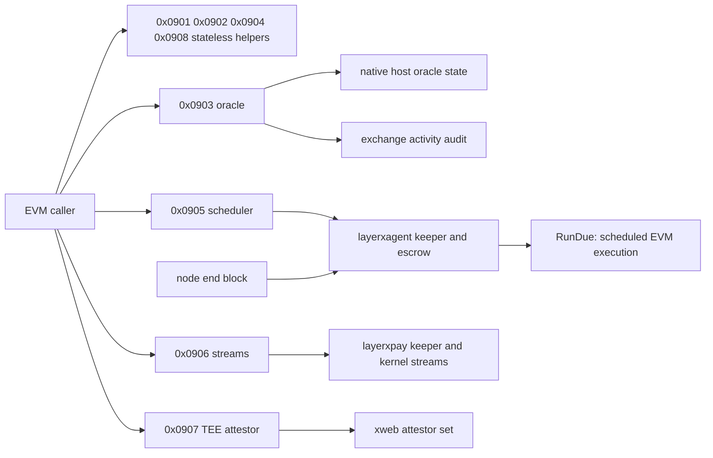

# Agent functions contract: precompiles 0x0901 to 0x0908 and the layerxagent module

Agent functions execute inside the merged Paxeer network. The kernel is part of the network and proposes blocks; EVM calls and scheduled jobs use the same chain state. Paxeer mainnet-beta has EVM chain id 125 (`0x7d`), and a transaction receipt is final when its block commits. Public JSON-RPC uses the configured node origin at the root path.

All eight packages under `precompiles/layerxagent` and their merge constructors exist. [Node precompile wiring](../../../node/precompiles.go) imports them and supplies the application keepers. [Upgrade wiring](../../../node/upgrades.go) declares their activation dependencies in `mergePrecompileGate` and checks for missing constructors. Construction alone does not activate a precompile: calls also require the configured merge plan to be active at the current height.

| Address suffix | Package | Function | Module activation dependencies |
|---|---|---|---|
| `0x0901` | `orob` | Integer price offsets | `layerxagent` |
| `0x0902` | `clearing` | Uniform-price clearing | `layerxagent` |
| `0x0903` | `oracle` | Feed aggregation and committed oracle access | `layerxagent`, `layerxexchange` |
| `0x0904` | `pofq` | Fill-quality scoring | `layerxagent` |
| `0x0905` | `scheduler` | Scheduled EVM calls | `layerxagent` |
| `0x0906` | `streams` | Pay kernel stream operations | `layerxpay` |
| `0x0907` | `teeattestor` | Verification against the xweb attestor set | `layerxagent` |
| `0x0908` | `eip712` | Domain hashing and signer recovery | `layerxagent` |

Each suffix denotes the full 20-byte EVM address with leading zeroes, for example `0x0000000000000000000000000000000000000905`.



## Contents

- [framework](#framework)
- [errors](#errors)
- [orob-0x0901](#orob-0x0901)
- [clearing-0x0902](#clearing-0x0902)
- [oracle-aggregator-0x0903](#oracle-aggregator-0x0903)
- [pofq-0x0904](#pofq-0x0904)
- [scheduler-0x0905](#scheduler-0x0905)
- [scheduler-events](#scheduler-events)
- [scheduler-params](#scheduler-params)
- [scheduler-end-block](#scheduler-end-block)
- [streams-0x0906](#streams-0x0906)
- [tee-attestor-0x0907](#tee-attestor-0x0907)
- [eip712-0x0908](#eip712-0x0908)
- [layerxagent-module](#layerxagent-module)
- [proto-layerxagent-eventjobexecuted](#proto-layerxagent-eventjobexecuted)
- [proto-layerxagent-eventjobfailed](#proto-layerxagent-eventjobfailed)
- [decisions](#decisions)

## framework

The [common framework](../../../precompiles/layerxagent/common/common.go) binds each ABI and executor to an upgrade reader and plan name. `HeightGate` requires a usable SDK context and `IsUpgradeActiveAtHeight`; this applies to views and stateless helpers as well as writes. A missing activation binding fails closed with `LXP_AGENT_NOT_ACTIVE`.

`Run` validates the context, height gate, selector, call mode, nonpayable value and ABI input before dispatch. `GuardWrite` refuses state changes under staticcall or delegatecall with `LXP_AGENT_READ_ONLY` or `LXP_AGENT_DELEGATECALL`. Only scheduler `schedule` is payable among the methods below. Module pause checks apply independently of activation: scheduler cancellation remains available while paused, and streams follow the pay module's method policy. Read methods and pure helpers are not disabled by those pause flags, but remain subject to activation.

[Gas policy](../../../precompiles/layerxagent/common/gas.go) is `base + perByte * N`, where `N` is the full call input length including the four-byte selector. `Precompile.RequiredGas` uses that length directly; the bound executor adds four to the selector-stripped input length. Unknown selectors use `pcommon.UnknownMethodCallGas`; arithmetic overflow saturates to `math.MaxUint64`.

| Methods | Base gas | Gas per input byte |
|---|---:|---:|
| All OROB and POFQ methods | 1,000 | 3 |
| `computeClearing` | 6,000 | 3 |
| Oracle `aggregate`, `getValidatorPrice` | 1,000 | 3 |
| Oracle `submitPrice` | 30,000 | 30 |
| Scheduler `getJob`, `pending` | 1,000 | 3 |
| Scheduler `schedule` | 25,000 | 30 |
| Scheduler `cancel`, `reschedule` | 20,000 | 30 |
| Streams `getStream`, `accrued` | 1,000 | 3 |
| Streams `open` | 50,000 | 30 |
| Streams `settle`, `updateRate` | 60,000 | 30 |
| Streams `close` | 80,000 | 30 |
| TEE `rootOf`, `rootCount` | 1,000 | 3 |
| TEE `verify`, `verifyAndExpect` | 46,000 | 3 |
| EIP-712 `domainSeparator`, `hashTypedData` | 1,000 | 3 |
| EIP-712 `recoverTypedSigner` | 4,000 | 3 |

The merge constructors pass explicit caps: OROB 64 offsets, clearing 256 orders across both sides, POFQ 256 fills, oracle 32 feeds with confidence at most `10^18`, and EIP-712 name and version each at most 256 bytes. These are constructor policy constants in the packages' `merge.go` files, not scheduler Params.

## errors

The framework enables LXP reason encoding. Agent refusals are ABI `Error(string)` reverts in the form `LXP_<CODE>: <message>`, with `vm.ErrExecutionReverted` at the EVM boundary. Match the code rather than the detail text. [Error definitions](../../../precompiles/layerxagent/common/common.go), [pay error mapping](../../../precompiles/layerxagent/common/errors.go) and the [shared revert encoder](../../../precompiles/common) are the implementation sources. `RevertError` preserves wrapped agent `ErrorCode` values and prefixes recognized pay errors with their pay registry code without replacing the underlying cause.

The table lists the exact suffixes under each prefix; each suffix denotes a separate code.

| Prefix | Defined suffixes |
|---|---|
| `LXP_PRECOMPILE_` | `INPUT_TOO_SHORT`, `UNKNOWN_METHOD`, `ARG_COUNT`, `NON_PAYABLE`, `NO_CONTEXT` |
| `LXP_AGENT_` | `ABI_DECODE`, `READ_ONLY`, `DELEGATECALL`, `OVERFLOW`, `BATCH_TOO_LARGE`, `NOT_ACTIVE` |
| `LXP_AGENT_OROB_` | `ORACLE_PRICE`, `OFFSET_RANGE` |
| `LXP_AGENT_CLEARING_` | `LENGTH_MISMATCH` |
| `LXP_AGENT_ORACLE_` | `NO_FEEDS`, `NO_CONFIDENT_FEEDS`, `NOT_SIGNER`, `PRICE`, `CONFIDENCE` |
| `LXP_AGENT_POFQ_` | `LENGTH_MISMATCH`, `DECAY_RANGE` |
| `LXP_AGENT_SCHEDULER_` | `JOB_NOT_FOUND`, `UNAUTHORIZED`, `HORIZON_EXCEEDED`, `PAST_BLOCK`, `MAX_JOBS`, `DEPOSIT_TOO_LOW`, `INVALID_GAS_LIMIT`, `INVALID_TARGET`, `JOB_INACTIVE`, `ESCROW`, `CALLDATA_TOO_LARGE` |
| `LXP_AGENT_STREAMS_` | `INVALID_PAYEE`, `SELF_PAYMENT`, `UNKNOWN_TOKEN` |
| `LXP_AGENT_TEE_` | `UNKNOWN_FAMILY`, `NO_ROOTS`, `INVALID_QUOTE`, `UNTRUSTED_CHAIN`, `STALE`, `DEBUG_REFUSED`, `REPORT_DATA_MISMATCH`, `UNAUTHORIZED_UPDATE` |

Definition in this registry does not imply a method emits every code. For example, the TEE ABI has no update method. Scheduler pause refusals use `LXP_PAUSED_SCOPE`; stream operations can also return pay/kernel refusal codes. The specific integer-helper refusal cases are described below.

## orob-0x0901

[OROB implementation and ABI](../../../precompiles/layerxagent/orob/orob.go); [merge constructor](../../../precompiles/layerxagent/orob/merge.go).

| Method | Mutability | Returns |
|---|---|---|
| `resolveOffset(int256 oraclePrice,int16 offsetBps)` | pure | `int256 absolutePrice` |
| `resolveOffsetBatch(int256 oraclePrice,int16[] offsetsBps)` | pure | `int256[] absolutePrices` |
| `toOffset(int256 oraclePrice,int256 absolutePrice)` | pure | `int16 offsetBps` |

Any caller can use these stateless helpers after activation. Integer division truncates toward zero. Resolution computes `oraclePrice * (10000 + offsetBps) / 10000`. Input prices must be positive; offsets at or below `-10000` return `LXP_AGENT_OROB_OFFSET_RANGE`. A price outside the positive int256 range or an overflowing result returns `LXP_AGENT_OVERFLOW`.

`toOffset` computes `(absolutePrice - oraclePrice) * 10000 / oraclePrice`; a result outside int16 returns `LXP_AGENT_OVERFLOW`. A nonpositive price returns `LXP_AGENT_OROB_ORACLE_PRICE`. An empty batch returns `LXP_AGENT_ABI_DECODE`; more than `MergeMaxBatchSize = 64` entries returns `LXP_AGENT_BATCH_TOO_LARGE`. These methods write no state and emit no events.

## clearing-0x0902

[Clearing implementation and ABI](../../../precompiles/layerxagent/clearing/clearing.go); [merge constructor](../../../precompiles/layerxagent/clearing/merge.go).

`computeClearing(int256 oraclePrice,(int16 offsetBps,uint128 size)[] buyOrders,(int16 offsetBps,uint128 size)[] sellOrders)` is pure and returns `(int16 clearingOffsetBps,int256 clearingPrice,uint256 matchedVolume)`.

The combined number of buy and sell orders must not exceed `MergeMaxOrders = 256`. Prices must be positive int256 values; offsets must exceed `-10000`; sizes are uint128. The helper sorts candidate offsets ascending, computes demand from buys at or above each offset and supply from sells at or below it, and selects the greatest matched volume. A tie retains the first, lowest offset because replacement requires a strictly greater volume. An empty side or zero matched volume returns offset zero, the original oracle price and zero volume.

The price uses the same integer offset formula as OROB. The helper checks result widths, returns `LXP_AGENT_BATCH_TOO_LARGE` for the order cap and `LXP_AGENT_OVERFLOW` for overflowing results, and emits no events.

## oracle-aggregator-0x0903

[Oracle implementation and ABI](../../../precompiles/layerxagent/oracle/oracle.go), [constructor](../../../precompiles/layerxagent/oracle/merge.go), [submission transport](../../../precompiles/layerxagent/oracle/transport.go), [keeper](../../../precompiles/layerxagent/oracle/keeper.go) and [committed read](../../../precompiles/layerxagent/oracle/committed.go) define the current path.

| Method | Mutability | Returns |
|---|---|---|
| `aggregate((int256 price,uint256 confidence,uint256 timestamp)[] feeds)` | pure | `(int256 price,uint256 confidence)` |
| `submitPrice(bytes32 feedID,int256 price,uint256 confidence)` | nonpayable | Nothing |
| `getValidatorPrice(bytes32 feedID)` | view | `(int256 price,uint256 quorum,uint256 timestamp)` |

`aggregate` accepts at most `MergeMaxFeeds = 32`. Prices must be positive int256 values and confidence must be in `[0,10^18]`. Zero-confidence entries do not participate. Remaining feeds are sorted by price; the result is the first price whose cumulative confidence reaches `ceil(totalConfidence / 2)`, paired with the minimum nonzero confidence. Timestamps are carried by the input ABI but are not used to filter or weight these feeds. Empty input returns `LXP_AGENT_ORACLE_NO_FEEDS`; all-zero confidence returns `LXP_AGENT_ORACLE_NO_CONFIDENT_FEEDS`.

Submission requires the caller's bound LayerX identity key and a signed native oracle activity. Ordinary external submissions append the versioned transport produced by `PackSubmitPrice` to the 100-byte selector-plus-arguments call. Its 311-byte suffix starts with the bytes `L`, `X`, `O`, `0x01` and carries the protocol version, authority key, account sequence, validity bounds, idempotency key, fee limit, signed observation and activity signature. `SignObservation` produces the observation and outer activity signatures. The internal `WithOracleReplay` path binds the verified key, validator and activity instead. Plain ABI arguments alone do not supply submission authority.

`submitPrice` checks that the activity actor and authority match the caller key and that the signed observation matches the feed and price. Submitted prices must be positive and fit uint128; confidence is bounded by `10^18` and must fit uint64. The live constructor binds `LayerXHost()`: the oracle keeper executes the activity through the native host, stores the activity audit under `oracle/activity/` in the exchange store and reads prices from host state.

`getValidatorPrice` reads the committed native oracle record. It returns its price, quorum `1`, and `ObservedAt / 1000` in seconds. A missing record returns `LXP_AGENT_ORACLE_NO_FEEDS`. Signer failures use `LXP_AGENT_ORACLE_NOT_SIGNER`; invalid or missing signed transport uses `LXP_AGENT_ABI_DECODE`. There are no oracle EVM events in this ABI.

## pofq-0x0904

[POFQ implementation and ABI](../../../precompiles/layerxagent/pofq/pofq.go); [merge constructor](../../../precompiles/layerxagent/pofq/merge.go).

| Method | Returns |
|---|---|
| `scoreFill(int256 fillPrice,int256 oraclePrice)` | `uint256 score` |
| `scoreBatch((int256 fillPrice,int256 oraclePrice,uint128 size)[] fills)` | `(uint256 avgScore,uint256 totalVolume)` |
| `updateRollingScore(uint256 currentScore,uint256 currentWeight,uint256 newScore,uint256 newWeight,uint16 decayBps)` | `(uint256 updatedScore,uint256 updatedWeight)` |

All three methods are pure. Fill and oracle prices must be positive. `scoreFill` returns `max(0, 10^18 - floor(abs(fillPrice - oraclePrice) * 10^18 / oraclePrice))`. `scoreBatch` accepts at most `MergeMaxBatch = 256` fills, returns the size-weighted integer average and summed volume, and returns zero score for zero volume, including an empty batch.

Rolling score uses `oldWeight = currentWeight * (10000 - decayBps)`, `addedWeight = newWeight * 10000`, then divides the weighted score sum by `oldWeight + addedWeight`. Returned weight is `(oldWeight + addedWeight) / 10000`. A zero combined weight returns two zeroes. `decayBps` must be below 10000 or the call returns `LXP_AGENT_POFQ_DECAY_RANGE`. Output widths are checked for `LXP_AGENT_OVERFLOW`. No scores are stored and no events are emitted.

## scheduler-0x0905

[Scheduler implementation and ABI](../../../precompiles/layerxagent/scheduler/scheduler.go), [merge constructor](../../../precompiles/layerxagent/scheduler/merge.go) and [job keeper](../../../modules/layerxagent/keeper/keeper.go) implement scheduling. The constructor requires `LayerXAgentK() *agentkeeper.Keeper` and the EVM keeper.

| Method | Mutability | Returns |
|---|---|---|
| `schedule(address target,bytes callData,uint64 executeAtBlock,uint64 gasLimit)` | payable | `uint256 jobId` |
| `cancel(uint256 jobId)` | nonpayable | Nothing |
| `reschedule(uint256 jobId,uint64 newBlock)` | nonpayable | Nothing |
| `getJob(uint256 jobId)` | view | `(uint256 id,address creator,address target,bytes callData,uint64 executeAtBlock,uint64 gasLimit,uint256 deposit,bool active)` |
| `pending(address creator)` | view | `uint256[] jobIds` |

`schedule` uses the EVM caller as creator and `msg.value` as the wei deposit. EVM CALL credits the scheduler address before the keeper escrows that value in the module account. The target must be nonzero, calldata must fit `MaxCallDataBytes`, gas must be positive and at most `MaxJobGasLimit`, and execution must be strictly after the current height and within `MaxScheduleHorizon`. The creator's active-job count is bounded by `MaxJobsPerCreator`. The minimum deposit is `gasLimit * currentBaseFee * MinDepositFactor`.

Stored job ids are uint64, allocated from 1. `cancel` and `reschedule` require an existing active job owned by the caller; oversized ABI ids are refused with `LXP_AGENT_ABI_DECODE`. Cancellation refunds the full deposit and deletes the job and indexes. Rescheduling moves the due index under the same future-block and horizon bounds without adding a deposit. `getJob` returns a zero-valued inactive record for a missing or out-of-uint64 id; `pending` returns creator job ids in ascending id order.

A deposit is accounted for once: cancellation refunds it, or execution splits it into a fee and refund. Persistent payment obligations prevent a failed transfer from causing the EVM call to execute again; see [scheduler-end-block](#scheduler-end-block).

## scheduler-events

Transaction operations emit the following EVM logs at `0x0905`:

```solidity
event JobScheduled(uint256 indexed jobId, address indexed creator, address target, uint64 executeAtBlock, uint64 gasLimit, uint256 deposit);
event JobCancelled(uint256 indexed jobId, address indexed creator, uint256 refund);
event JobRescheduled(uint256 indexed jobId, uint64 newBlock);
```

The merge constructor also adds `JobExecuted(uint256,address,uint64,uint256)` and `JobFailed(uint256,address,string)` to the ABI, with job id and creator indexed. They are compatibility topics, not emitted EVM logs. End-block execution has no transaction receipt, so its outcome is the typed module event [EventJobExecuted](#proto-layerxagent-eventjobexecuted) or [EventJobFailed](#proto-layerxagent-eventjobfailed). Consumers must read those events rather than wait for a receipt log at the scheduler address.

## scheduler-params

The authoritative type is [types.Params](../../../modules/layerxagent/types/params.go); keeper `Params` is an alias. Its protobuf fields are declared in [tx.proto](../../../api/layerxagent/tx.proto).

| Protobuf/configuration field | Go field | Default |
|---|---|---:|
| `max_jobs_per_creator` | `MaxJobsPerCreator` | 1024 |
| `max_schedule_horizon` | `MaxScheduleHorizon` | 2592000 blocks |
| `min_deposit_factor` | `MinDepositFactor` | 2 |
| `max_jobs_per_block` | `MaxJobsPerBlock` | 64 |
| `max_job_gas_limit` | `MaxJobGasLimit` | 10000000 |
| `max_reason_bytes` | `MaxReasonBytes` | 256 |
| `max_call_data_bytes` | `MaxCallDataBytes` | 8192 |
| `max_block_gas` | `MaxBlockGas` | 30000000 |
| `paused` | `Paused` | false |

All numeric parameters must be positive, and `MaxJobGasLimit` must not exceed `MaxBlockGas`. Oversized calldata returns `LXP_AGENT_SCHEDULER_CALLDATA_TOO_LARGE`. `Paused` refuses schedule and reschedule through the `layerxagent` pause scope with `LXP_PAUSED_SCOPE`, leaves cancellation and queries available, and prevents new job execution while keeping jobs due. Settlement payments are still retried while paused.

## scheduler-end-block

[RunDue](../../../modules/layerxagent/keeper/scheduler.go) returns `(gasUsed uint64, err error)`. [The node end block](../../../node/legacyabci/end_block.go) calls it when the merge is live, adds actual gas used to `blockGasUsed` and then calls the EVM end block. The agent AppModule has no separate end-block hook.

Due jobs are visited in ascending `(executeAtBlock, id)` order using big-endian index keys. Admission stops at `MaxJobsPerBlock` or when the next job's declared gas limit would exceed the remaining `MaxBlockGas` budget. Remaining jobs stay due for a later height. The keeper rereads each admitted job before execution so a job cancelled or moved by an earlier job is not run from a stale admission snapshot.

Each job runs as its creator, sends zero value and uses its own gas limit. The EVM `GASPRICE` reflects the current base fee. Target state changes are committed only on success; a panic consumes the job gas limit and becomes a failure reason. The fee is `min(deposit, gasUsed * currentBaseFee)` to the fee collector, with the remainder refunded to the creator's resolved account.

Execution effects, removal from the runnable indexes and the settlement obligation are committed together. [Settlement handling](../../../modules/layerxagent/keeper/settlement.go) commits each payment and its paid flag atomically, with recipients fixed at execution time. Failed legs remain persisted under prefix `0x06`; `RetrySettlements` retries payments without rerunning EVM execution. It visits at most `MaxJobsPerBlock` obligations per pass and stops on the first failed obligation. Both paid legs remove the obligation. This retry pass runs before the pause check.

A successful execution and settlement emits `EventJobExecuted`; an execution or payment failure emits `EventJobFailed`. Reasons are deterministic strings truncated to `MaxReasonBytes` without splitting UTF-8 runes. Returned errors include payment or typed-event encoding failures; the node logs them and continues its end-block path.

## streams-0x0906

[Stream ABI and executor](../../../precompiles/layerxagent/streams/streams.go), [constructor](../../../precompiles/layerxagent/streams/merge.go) and [pay keeper adapter](../../../modules/layerxpay/keeper/stream_agent.go) use the same underlying kernel stream records as pay address `0x000000000000000000000000000000000000101B`. See also the [pay contract](pay.md).

| Method | Mutability | Returns |
|---|---|---|
| `open(address payee,address token,uint256 ratePerSecond,uint64 startTime,uint64 stopTime,uint256 cap)` | nonpayable | `uint256 streamId` |
| `settle(uint256 streamId)` | nonpayable | `uint256 paid` |
| `close(uint256 streamId)` | nonpayable | `uint256 finalPaid` |
| `updateRate(uint256 streamId,uint256 newRate)` | nonpayable | Nothing |
| `getStream(uint256 streamId)` | view | `(uint256 id,address payer,address payee,address token,uint256 ratePerSecond,uint256 cap,uint64 startTime,uint64 stopTime,uint256 settled,bool active)` as one tuple |
| `accrued(uint256 streamId)` | view | `uint256 amount` |

The Go boundary used by the real `PrecompileExecutor` in `precompiles/layerxagent/streams/streams.go` is:

```go
OpenAgentStream(ctx sdk.Context, payer, payee, token common.Address, ratePerSecond *big.Int, startTime, stopTime uint64, cap *big.Int) (*big.Int, error)
SettleAgentStream(ctx sdk.Context, caller common.Address, streamID *big.Int) (*big.Int, error)
CloseAgentStream(ctx sdk.Context, caller common.Address, streamID *big.Int) (finalPaid, refund *big.Int, err error)
UpdateAgentStreamRate(ctx sdk.Context, caller common.Address, streamID *big.Int, newRate *big.Int) (*big.Int, error)
AgentStreamView(ctx sdk.Context, streamID *big.Int) (AgentStream, bool, error)
```

For example, the executor's `open` handler passes the EVM caller as `payer`, ABI-decoded payee/token addresses, rate, start/stop seconds and cap to `OpenAgentStream`, then packs the returned `*big.Int` as `uint256 streamId`. The caller supplies neither a stream identifier nor an idempotency key.

The `settle`, `close` and `updateRate` handlers pass the EVM caller address and ABI-decoded `*big.Int` identifier. The keeper accepts only a positive identifier of at most 256 bits, and derives operation keys from the transaction hash, shared pay call ordinal and each method's selector. Failed operations discard their ordinal and state writes. `SettleAgentStream` returns the amount paid in this operation. `CloseAgentStream` returns final paid and refund amounts; the ABI returns final paid while `StreamClosed` carries both. `UpdateAgentStreamRate` settles at the previous rate before changing it and returns that previous rate; the ABI returns no values while `StreamRateUpdated` carries old/new rates.

`AgentStreamView` reads kernel state plus exactly 60 persisted address bytes (payer, payee, token, 20 bytes each). A valid absent identifier returns `(AgentStream{}, false, nil)`; an existing stream with missing or malformed address metadata returns an error. Its `*big.Int` fields preserve uint256 identifiers and uint128 token amounts, and its times are seconds.

Opening resolves payer and payee authority to kernel accounts and maps the token through custody. Zero token selects the mapped base denomination; unknown mappings return `LXP_AGENT_STREAMS_UNKNOWN_TOKEN`. A payee whose authority cannot be resolved returns `LXP_AGENT_STREAMS_INVALID_PAYEE`. Self-payment is refused both for equal EVM addresses and for equal resolved kernel accounts. Rate and cap must be positive uint128 amounts despite the uint256 ABI; oversized values return `LXP_AGENT_OVERFLOW`.

Start and stop times are ABI seconds, converted to kernel milliseconds with overflow checks; rate uses a 1000-millisecond unit. The cap is also the initial funding. The stream id derives from the EVM transaction hash, pay call ordinal and payer account. The adapter persists payer/payee/token address metadata alongside the kernel stream, rather than keeping a second balance or accrual state.

Kernel authority permits settlement by payer or recipient, and closure and rate changes by the payer. The enforcement lives in [stream execution](../../../src/modules/stream/lx_stream_execution.h) and [lifecycle rules](../../../src/modules/stream/lx_stream_lifecycle.c). Operations follow the [pay gate](../../../modules/layerxpay/keeper/gate.go), including its pause policy. `getStream` and `accrued` return zero values for a missing id; a kernel record without the required agent address metadata is refused by `AgentStreamView`. Thus the shared record does not imply every native stream has an agent projection.

Transaction operations emit these logs at `0x0906`:

```solidity
event StreamOpened(uint256 indexed streamId, address indexed payer, address indexed payee, address token, uint256 ratePerSecond, uint256 cap);
event StreamSettled(uint256 indexed streamId, address indexed payee, uint256 paid, uint256 committed);
event StreamClosed(uint256 indexed streamId, uint256 finalPaid, uint256 refund);
event StreamRateUpdated(uint256 indexed streamId, uint256 oldRate, uint256 newRate);
```

`StreamSettled` currently packs the returned paid amount into both `paid` and `committed`. `updateRate` submits the kernel `LX_STREAM_RATE_CHANGE` activity (`0x00040008`), settles under the old rate and emits the agent event plus the pay event through [EmitStreamRateUpdated](../../../precompiles/layerxpay/stream.go). The pay event at `0x101B` has signature `StreamRateUpdated(bytes32 indexed streamId,uint128 oldRate,uint128 newRate,uint128 paid)`: its topic and data layout differ from the agent event. The pay ABI has no EVM rate-change method of its own.

## tee-attestor-0x0907

[TEE implementation, ABI and merge constructor](../../../precompiles/layerxagent/teeattestor/teeattestor.go) verify attestor-signed envelopes using the xweb attestor set. These view methods emit no logs and do not directly validate a vendor certificate chain.

| Method | Returns |
|---|---|
| `verify(uint8 family,bytes quote)` | `(uint8 family,bytes32 mrtd,bytes32 reportData,uint64 timestamp,bool debug)` as one tuple |
| `verifyAndExpect(uint8 family,bytes quote,bytes32 expectedReportData)` | The same tuple, after checking report data equality |
| `rootOf(uint8 family,uint256 index)` | `bytes` containing the selected 20-byte attestor signer address |
| `rootCount(uint8 family)` | `uint256` number of attestors |

Accepted families are numeric values 0 through 3. The version-one `PXVE` envelope layout is:

| Byte offsets (inclusive) | Field |
|---|---|
| 0–3 | ASCII `PXVE` |
| 4 | Version `1` |
| 5 | Family, equal to the method argument |
| 6 | Debug byte, 0 or 1 |
| 7–38 | Measurement `mrtd` |
| 39–70 | Report data |
| 71–78 | Timestamp, uint64 big-endian seconds |
| 79–86 | EVM chain id, uint64 big-endian |
| 87–94 | Nonce, uint64 big-endian |
| 95 | Signature count |
| 96 onward | Exactly count × 65 signature bytes |

Verification checks the envelope chain id against the EVM keeper and verifies signatures over the Keccak-256 digest of bytes 0 through 94. The attestor set must contain exactly five entries and have threshold between three and five. Recovered signers must belong to the set, appear in strictly increasing address order and meet the threshold. The timestamp cannot be in the future or more than `MaxAttestationAge = 600` seconds old; debug attestations are refused.

The nonce is part of the signed preimage and is parsed internally, but is neither checked for replay nor returned in the ABI tuple. Callers must bind expected application context through report data; `verifyAndExpect` checks equality with `expectedReportData`.

Unknown families are refused by verification. For root enumeration, a family above 3 instead yields zero count or empty bytes, and an out-of-range index yields empty bytes. Valid families enumerate the same xweb attestor set. Empty sets, invalid envelopes, untrusted signatures, stale timestamps, debug flags and mismatching report data use the corresponding TEE errors in [errors](#errors). `AttestationVerified(uint8,bytes32,bytes32,uint64,bool)` remains in the ABI, with family and measurement indexed, but is never emitted.

## eip712-0x0908

[EIP-712 implementation and ABI](../../../precompiles/layerxagent/eip712/eip712.go); [merge constructor](../../../precompiles/layerxagent/eip712/merge.go).

| Method | Mutability | Returns |
|---|---|---|
| `domainSeparator(string name,string version,uint256 chainId,address verifyingContract)` | pure | `bytes32 separator` |
| `hashTypedData(bytes32 domainSeparator,bytes32 structHash)` | pure | `bytes32 digest` |
| `recoverTypedSigner(bytes32 domainSeparator,bytes32 structHash,bytes signature)` | view | `address signer` |

The domain type is `EIP712Domain(string name,string version,uint256 chainId,address verifyingContract)`. Name and version are each capped at 256 bytes; exceeding a cap returns `LXP_AGENT_BATCH_TOO_LARGE`. The supplied chain id is hashed as a uint256 input, not replaced with the current chain id. `hashTypedData` returns `keccak256(0x1901 || domainSeparator || structHash)`.

Recovery requires a 65-byte signature with `v` equal to 27 or 28 and valid low-s secp256k1 values. A malformed or unrecoverable signature returns the zero address. These methods keep no state and emit no events.

## layerxagent-module

[AppModule](../../../modules/layerxagent/module.go) registers genesis, interfaces, the message service, queries, gRPC gateway handlers and CLI query commands. [Application wiring](../../../node/app.go) constructs the keeper with the EVM keeper and `MergeUpgrade` and mounts the module. Module and store name are `layerxagent`; deposits are held by its module account.

| Store key/prefix | Content |
|---|---|
| `0x01` | Due index: big-endian block then big-endian id |
| `0x02` | Creator index: address then big-endian id |
| `0x03` | Job records keyed by big-endian id |
| `0x04` | Params |
| `0x05` | Next job id |
| `0x06` | Outstanding execution settlement obligations |

[GenesisState and Job](../../../api/layerxagent/genesis.proto) carry parameters, jobs and next id. Job fields are `id`, `creator`, `target`, `call_data`, `execute_at_block`, `gas_limit`, `deposit` and `active`; deposit is a decimal wei string. [Genesis handling](../../../modules/layerxagent/keeper/genesis.go) validates jobs and parameters, requires the next id to exceed stored ids and checks that the existing module bank balance covers deposits. It does not mint missing escrow.

Outstanding settlement obligations are not fields of the current protobuf `GenesisState`. `ExportGenesis` panics rather than discard them; `InitGenesis` refuses a store already containing them. The keeper exposes version-one `RecoveryGenesis`, `ExportRecoveryGenesis` and `InitRecoveryGenesis` to preserve obligations and unpaid legs with their fixed recipients. The AppModule still calls the ordinary genesis methods, so the recovery snapshot is a keeper interface, not a wired replacement for application genesis export. Normal database restart retains the stored obligations for `RunDue` retries.

[MsgUpdateParams](../../../modules/layerxagent/keeper/msg_server.go) accepts only the configured governance authority, validates the message and parameters, then stores them; unauthorized authority returns the SDK unauthorized error. See the [governance contract](layerxgov.md) for proposal context.

The [query service](../../../modules/layerxagent/keeper/grpc_query.go), declared in [query.proto](../../../api/layerxagent/query.proto), exposes:

| Query | gRPC gateway GET path | CLI arguments after `paxd` |
|---|---|---|
| `Params` | `/paxprotocol/paxchain/layerxagent/params` | `query layerxagent params` |
| `Job` | `/paxprotocol/paxchain/layerxagent/jobs/{id}` | `query layerxagent job [id]` |
| `Pending` | `/paxprotocol/paxchain/layerxagent/pending/{creator}` | `query layerxagent pending [creator-0x-address]` |

These are module gateway routes when that API is enabled, distinct from the node root JSON-RPC service. CLI commands are implemented in [query.go](../../../modules/layerxagent/client/cli/query.go). Job ids parse as decimal uint64. Pending requires a `0x`-prefixed 20-byte hex creator address. Nil query requests and malformed creators return gRPC `InvalidArgument`; a missing job returns `NotFound`, unlike the EVM `getJob` zero record. Queries return parameters, a protobuf job or repeated uint64 job ids respectively.

Existing source coverage includes [served-address tests](../../../precompiles/layerxagent/served/served_test.go), [error registry tests](../../../precompiles/layerxagent/common/errors_registry_test.go), [scheduler outcome tests](../../../precompiles/layerxagent/scheduler/merge_test.go) and [stream parity tests](../../../precompiles/layerxagent/streams/parity_test.go). 

## proto-layerxagent-eventjobexecuted

[events.proto](../../../api/layerxagent/events.proto) declares this end-block outcome in package `paxprotocol.paxchain.layerxagent`:

```protobuf
message EventJobExecuted {
  uint64 job_id = 1;
  string creator = 2;
  uint64 gas_used = 3;
  string refund = 4;
}
```

The scheduler emits the creator as a hex EVM address and refund as a decimal wei string after execution and settlement succeed. This is a typed module event, not an EVM receipt log.

## proto-layerxagent-eventjobfailed

The same [events.proto](../../../api/layerxagent/events.proto) declares:

```protobuf
message EventJobFailed {
  uint64 job_id = 1;
  string creator = 2;
  string reason = 3;
}
```

The reason records execution or payment failure and is truncated under `MaxReasonBytes`. A payment failure leaves a persisted obligation for retry; it does not make the job runnable again.

## decisions

The [feature specification](../spec.kvx) defines the module and precompile behavior summarized below.

| Decision | Contract retained in the implementation |
|---|---|
| 225 | Module Params govern pause scopes; scheduler cancellation remains available and due jobs wait while paused. |
| 226 | Due jobs run in ascending block, then id order. |
| 227 | Summed admitted gas limits are capped by `MaxBlockGas`; actual gas used is added to node end-block gas. |
| 228 | Calldata is bounded by `MaxCallDataBytes`, default 8192. |
| 229 | OROB out-of-int16 conversion uses `LXP_AGENT_OVERFLOW`; empty batches use `LXP_AGENT_ABI_DECODE`. |
| 230 | Merge constructors supply explicit batch, feed, confidence and domain-string caps. |
| 231 | Gas charges include the four-byte selector. |
| 232 | TEE verification trusts the xweb attestor set; nonce replay prevention is not implemented by this view. |
| 233 | TEE verification emits no log; scheduler outcome ABI topics correspond to typed module events only. |
| 237 | Agent rate changes are kernel activities and log at both agent and pay addresses with their respective ABIs. |
| 238 | Stream settlement accepts payer or recipient; close requires payer authority. |
| 239 | Oracle submission and committed reads remain keeper-owned. The current oracle constructor uses its native-host keeper and exchange activity audit. |
