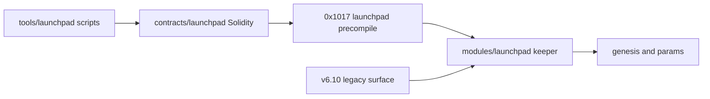

# Launchpad contract: module, precompile 0x1017, Solidity contracts and tooling

## Scope and reading guide

The native [launchpad module](../../../modules/launchpad) and [precompile at `0x1017`](../../../precompiles/launchpad) serve the launchpad role surfaces. [Solidity contracts](../../../contracts/launchpad/contracts) and [deployment scripts](../../../contracts/launchpad/scripts) provide contract integration. Off-chain services are described in [services](services.md), and client interfaces in [clients](clients.md).

### Surface summary

## Launchpad module

The native launchpad module is `modules/launchpad`; `LaunchpadAddress` is `0x1017` in [keys.go](../../../modules/launchpad/types/keys.go). Keeper, query, CLI, genesis, params, store, events and error codes follow.

### launchpad-errors

| Interface | Kind | Source | Signature |
|---|---|---|---|
| <code>err-sdk-launchpad-v610-2-invalid-params</code> | <code>error_code</code> | [modules/launchpad/legacy/v610/types/errors.go](../../../modules/launchpad/legacy/v610/types/errors.go) | <code>ErrInvalidParams = Register("launchpad_legacy_v610", 2, "LXP_LAUNCHPAD_INVALID_PARAMS")</code> |
| <code>err-sdk-launchpad-v610-3-overflow</code> | <code>error_code</code> | [modules/launchpad/legacy/v610/types/errors.go](../../../modules/launchpad/legacy/v610/types/errors.go) | <code>ErrOverflow = Register("launchpad_legacy_v610", 3, "LXP_LAUNCHPAD_OVERFLOW")</code> |
| <code>err-sdk-launchpad-v610-4-division-by-zero</code> | <code>error_code</code> | [modules/launchpad/legacy/v610/types/errors.go](../../../modules/launchpad/legacy/v610/types/errors.go) | <code>ErrDivisionByZero = Register("launchpad_legacy_v610", 4, "LXP_LAUNCHPAD_DIVISION_BY_ZERO")</code> |
| <code>err-sdk-launchpad-v610-5-insufficient-input</code> | <code>error_code</code> | [modules/launchpad/legacy/v610/types/errors.go](../../../modules/launchpad/legacy/v610/types/errors.go) | <code>ErrInsufficientInput = Register("launchpad_legacy_v610", 5, "LXP_LAUNCHPAD_INSUFFICIENT_INPUT")</code> |
| <code>err-sdk-launchpad-v610-6-insufficient-liquidity</code> | <code>error_code</code> | [modules/launchpad/legacy/v610/types/errors.go](../../../modules/launchpad/legacy/v610/types/errors.go) | <code>ErrInsufficientLiquidity = Register("launchpad_legacy_v610", 6, "LXP_LAUNCHPAD_INSUFFICIENT_LIQUIDITY")</code> |
| <code>err-sdk-launchpad-v610-7-virtual-floor-breached</code> | <code>error_code</code> | [modules/launchpad/legacy/v610/types/errors.go](../../../modules/launchpad/legacy/v610/types/errors.go) | <code>ErrVirtualFloorBreached = Register("launchpad_legacy_v610", 7, "LXP_LAUNCHPAD_VIRTUAL_FLOOR_BREACHED")</code> |
| <code>err-sdk-launchpad-v610-8-slippage-exceeded</code> | <code>error_code</code> | [modules/launchpad/legacy/v610/types/errors.go](../../../modules/launchpad/legacy/v610/types/errors.go) | <code>ErrSlippageExceeded = Register("launchpad_legacy_v610", 8, "LXP_LAUNCHPAD_SLIPPAGE_EXCEEDED")</code> |
| <code>err-sdk-launchpad-v610-9-deadline-expired</code> | <code>error_code</code> | [modules/launchpad/legacy/v610/types/errors.go](../../../modules/launchpad/legacy/v610/types/errors.go) | <code>ErrDeadlineExpired = Register("launchpad_legacy_v610", 9, "LXP_LAUNCHPAD_DEADLINE_EXPIRED")</code> |
| <code>err-sdk-launchpad-v610-10-zero-address</code> | <code>error_code</code> | [modules/launchpad/legacy/v610/types/errors.go](../../../modules/launchpad/legacy/v610/types/errors.go) | <code>ErrZeroAddress = Register("launchpad_legacy_v610", 10, "LXP_LAUNCHPAD_ZERO_ADDRESS")</code> |
| <code>err-sdk-launchpad-v610-11-zero-amount</code> | <code>error_code</code> | [modules/launchpad/legacy/v610/types/errors.go](../../../modules/launchpad/legacy/v610/types/errors.go) | <code>ErrZeroAmount = Register("launchpad_legacy_v610", 11, "LXP_LAUNCHPAD_ZERO_AMOUNT")</code> |
| <code>err-sdk-launchpad-v610-12-unknown-market</code> | <code>error_code</code> | [modules/launchpad/legacy/v610/types/errors.go](../../../modules/launchpad/legacy/v610/types/errors.go) | <code>ErrUnknownMarket = Register("launchpad_legacy_v610", 12, "LXP_LAUNCHPAD_UNKNOWN_MARKET")</code> |
| <code>err-sdk-launchpad-v610-13-paused</code> | <code>error_code</code> | [modules/launchpad/legacy/v610/types/errors.go](../../../modules/launchpad/legacy/v610/types/errors.go) | <code>ErrPaused = Register("launchpad_legacy_v610", 13, "LXP_LAUNCHPAD_PAUSED")</code> |
| <code>err-sdk-launchpad-v610-14-not-paused</code> | <code>error_code</code> | [modules/launchpad/legacy/v610/types/errors.go](../../../modules/launchpad/legacy/v610/types/errors.go) | <code>ErrNotPaused = Register("launchpad_legacy_v610", 14, "LXP_LAUNCHPAD_NOT_PAUSED")</code> |
| <code>err-sdk-launchpad-v610-15-not-guardian</code> | <code>error_code</code> | [modules/launchpad/legacy/v610/types/errors.go](../../../modules/launchpad/legacy/v610/types/errors.go) | <code>ErrNotGuardian = Register("launchpad_legacy_v610", 15, "LXP_LAUNCHPAD_NOT_GUARDIAN")</code> |
| <code>err-sdk-launchpad-v610-16-not-fee-rights-holder</code> | <code>error_code</code> | [modules/launchpad/legacy/v610/types/errors.go](../../../modules/launchpad/legacy/v610/types/errors.go) | <code>ErrNotFeeRightsHolder = Register("launchpad_legacy_v610", 16, "LXP_LAUNCHPAD_NOT_FEE_RIGHTS_HOLDER")</code> |
| <code>err-sdk-launchpad-v610-17-wrong-strategy</code> | <code>error_code</code> | [modules/launchpad/legacy/v610/types/errors.go](../../../modules/launchpad/legacy/v610/types/errors.go) | <code>ErrWrongStrategy = Register("launchpad_legacy_v610", 17, "LXP_LAUNCHPAD_WRONG_STRATEGY")</code> |
| <code>err-sdk-launchpad-v610-18-invalid-strategy</code> | <code>error_code</code> | [modules/launchpad/legacy/v610/types/errors.go](../../../modules/launchpad/legacy/v610/types/errors.go) | <code>ErrInvalidStrategy = Register("launchpad_legacy_v610", 18, "LXP_LAUNCHPAD_INVALID_STRATEGY")</code> |
| <code>err-sdk-launchpad-v610-19-no-fees-accumulated</code> | <code>error_code</code> | [modules/launchpad/legacy/v610/types/errors.go](../../../modules/launchpad/legacy/v610/types/errors.go) | <code>ErrNoFeesAccumulated = Register("launchpad_legacy_v610", 19, "LXP_LAUNCHPAD_NO_FEES_ACCUMULATED")</code> |
| <code>err-sdk-launchpad-v610-20-airdrop-not-triggered</code> | <code>error_code</code> | [modules/launchpad/legacy/v610/types/errors.go](../../../modules/launchpad/legacy/v610/types/errors.go) | <code>ErrAirdropNotTriggered = Register("launchpad_legacy_v610", 20, "LXP_LAUNCHPAD_AIRDROP_NOT_TRIGGERED")</code> |
| <code>err-sdk-launchpad-v610-21-already-claimed</code> | <code>error_code</code> | [modules/launchpad/legacy/v610/types/errors.go](../../../modules/launchpad/legacy/v610/types/errors.go) | <code>ErrAlreadyClaimed = Register("launchpad_legacy_v610", 21, "LXP_LAUNCHPAD_ALREADY_CLAIMED")</code> |
| <code>err-sdk-launchpad-v610-22-invalid-market</code> | <code>error_code</code> | [modules/launchpad/legacy/v610/types/errors.go](../../../modules/launchpad/legacy/v610/types/errors.go) | <code>ErrInvalidMarket = Register("launchpad_legacy_v610", 22, "LXP_LAUNCHPAD_INVALID_MARKET")</code> |
| <code>err-sdk-launchpad-v610-23-unauthorized</code> | <code>error_code</code> | [modules/launchpad/legacy/v610/types/errors.go](../../../modules/launchpad/legacy/v610/types/errors.go) | <code>ErrUnauthorized = Register("launchpad_legacy_v610", 23, "LXP_LAUNCHPAD_UNAUTHORIZED")</code> |
| <code>err-sdk-launchpad-v610-24-invalid-genesis</code> | <code>error_code</code> | [modules/launchpad/legacy/v610/types/errors.go](../../../modules/launchpad/legacy/v610/types/errors.go) | <code>ErrInvalidGenesis = Register("launchpad_legacy_v610", 24, "LXP_LAUNCHPAD_INVALID_GENESIS")</code> |
| <code>err-sdk-launchpad-v610-25-holding-history</code> | <code>error_code</code> | [modules/launchpad/legacy/v610/types/errors.go](../../../modules/launchpad/legacy/v610/types/errors.go) | <code>ErrHoldingHistory = Register("launchpad_legacy_v610", 25, "LXP_LAUNCHPAD_HOLDING_HISTORY")</code> |
| <code>err-sdk-launchpad-v610-26-unsupported-holding-epoch</code> | <code>error_code</code> | [modules/launchpad/legacy/v610/types/errors.go](../../../modules/launchpad/legacy/v610/types/errors.go) | <code>ErrUnsupportedHoldingEpoch = Register("launchpad_legacy_v610", 26, "LXP_LAUNCHPAD_UNSUPPORTED_HOLDING_EPOCH")</code> |
| <code>err-sdk-launchpad-v610-27-invalid-airdrop-epoch</code> | <code>error_code</code> | [modules/launchpad/legacy/v610/types/errors.go](../../../modules/launchpad/legacy/v610/types/errors.go) | <code>ErrInvalidAirdropEpoch = Register("launchpad_legacy_v610", 27, "LXP_LAUNCHPAD_INVALID_AIRDROP_EPOCH")</code> |
| <code>err-sdk-launchpad-v610-28-legacy-airdrop-epoch</code> | <code>error_code</code> | [modules/launchpad/legacy/v610/types/errors.go](../../../modules/launchpad/legacy/v610/types/errors.go) | <code>ErrLegacyAirdropEpoch = Register("launchpad_legacy_v610", 28, "LXP_LAUNCHPAD_LEGACY_AIRDROP_EPOCH")</code> |
| <code>err-sdk-launchpad-v610-29-airdrop-basis</code> | <code>error_code</code> | [modules/launchpad/legacy/v610/types/errors.go](../../../modules/launchpad/legacy/v610/types/errors.go) | <code>ErrAirdropBasis = Register("launchpad_legacy_v610", 29, "LXP_LAUNCHPAD_AIRDROP_BASIS")</code> |
| <code>err-sdk-launchpad-v610-30-invalid-range</code> | <code>error_code</code> | [modules/launchpad/legacy/v610/types/errors.go](../../../modules/launchpad/legacy/v610/types/errors.go) | <code>ErrInvalidRange = Register("launchpad_legacy_v610", 30, "LXP_LAUNCHPAD_INVALID_RANGE")</code> |
| <code>err-sdk-launchpad-2-invalid-params</code> | <code>error_code</code> | [modules/launchpad/types/errors.go](../../../modules/launchpad/types/errors.go) | <code>ErrInvalidParams = Register("launchpad", 2, "LXP_LAUNCHPAD_INVALID_PARAMS")</code> |
| <code>err-sdk-launchpad-3-overflow</code> | <code>error_code</code> | [modules/launchpad/types/errors.go](../../../modules/launchpad/types/errors.go) | <code>ErrOverflow = Register("launchpad", 3, "LXP_LAUNCHPAD_OVERFLOW")</code> |
| <code>err-sdk-launchpad-4-division-by-zero</code> | <code>error_code</code> | [modules/launchpad/types/errors.go](../../../modules/launchpad/types/errors.go) | <code>ErrDivisionByZero = Register("launchpad", 4, "LXP_LAUNCHPAD_DIVISION_BY_ZERO")</code> |
| <code>err-sdk-launchpad-5-insufficient-input</code> | <code>error_code</code> | [modules/launchpad/types/errors.go](../../../modules/launchpad/types/errors.go) | <code>ErrInsufficientInput = Register("launchpad", 5, "LXP_LAUNCHPAD_INSUFFICIENT_INPUT")</code> |
| <code>err-sdk-launchpad-6-insufficient-liquidity</code> | <code>error_code</code> | [modules/launchpad/types/errors.go](../../../modules/launchpad/types/errors.go) | <code>ErrInsufficientLiquidity = Register("launchpad", 6, "LXP_LAUNCHPAD_INSUFFICIENT_LIQUIDITY")</code> |
| <code>err-sdk-launchpad-7-virtual-floor-breached</code> | <code>error_code</code> | [modules/launchpad/types/errors.go](../../../modules/launchpad/types/errors.go) | <code>ErrVirtualFloorBreached = Register("launchpad", 7, "LXP_LAUNCHPAD_VIRTUAL_FLOOR_BREACHED")</code> |
| <code>err-sdk-launchpad-8-slippage-exceeded</code> | <code>error_code</code> | [modules/launchpad/types/errors.go](../../../modules/launchpad/types/errors.go) | <code>ErrSlippageExceeded = Register("launchpad", 8, "LXP_LAUNCHPAD_SLIPPAGE_EXCEEDED")</code> |
| <code>err-sdk-launchpad-9-deadline-expired</code> | <code>error_code</code> | [modules/launchpad/types/errors.go](../../../modules/launchpad/types/errors.go) | <code>ErrDeadlineExpired = Register("launchpad", 9, "LXP_LAUNCHPAD_DEADLINE_EXPIRED")</code> |
| <code>err-sdk-launchpad-10-zero-address</code> | <code>error_code</code> | [modules/launchpad/types/errors.go](../../../modules/launchpad/types/errors.go) | <code>ErrZeroAddress = Register("launchpad", 10, "LXP_LAUNCHPAD_ZERO_ADDRESS")</code> |
| <code>err-sdk-launchpad-11-zero-amount</code> | <code>error_code</code> | [modules/launchpad/types/errors.go](../../../modules/launchpad/types/errors.go) | <code>ErrZeroAmount = Register("launchpad", 11, "LXP_LAUNCHPAD_ZERO_AMOUNT")</code> |
| <code>err-sdk-launchpad-12-unknown-market</code> | <code>error_code</code> | [modules/launchpad/types/errors.go](../../../modules/launchpad/types/errors.go) | <code>ErrUnknownMarket = Register("launchpad", 12, "LXP_LAUNCHPAD_UNKNOWN_MARKET")</code> |
| <code>err-sdk-launchpad-13-paused</code> | <code>error_code</code> | [modules/launchpad/types/errors.go](../../../modules/launchpad/types/errors.go) | <code>ErrPaused = Register("launchpad", 13, "LXP_LAUNCHPAD_PAUSED")</code> |
| <code>err-sdk-launchpad-14-not-paused</code> | <code>error_code</code> | [modules/launchpad/types/errors.go](../../../modules/launchpad/types/errors.go) | <code>ErrNotPaused = Register("launchpad", 14, "LXP_LAUNCHPAD_NOT_PAUSED")</code> |
| <code>err-sdk-launchpad-15-not-guardian</code> | <code>error_code</code> | [modules/launchpad/types/errors.go](../../../modules/launchpad/types/errors.go) | <code>ErrNotGuardian = Register("launchpad", 15, "LXP_LAUNCHPAD_NOT_GUARDIAN")</code> |
| <code>err-sdk-launchpad-16-not-fee-rights-holder</code> | <code>error_code</code> | [modules/launchpad/types/errors.go](../../../modules/launchpad/types/errors.go) | <code>ErrNotFeeRightsHolder = Register("launchpad", 16, "LXP_LAUNCHPAD_NOT_FEE_RIGHTS_HOLDER")</code> |
| <code>err-sdk-launchpad-17-wrong-strategy</code> | <code>error_code</code> | [modules/launchpad/types/errors.go](../../../modules/launchpad/types/errors.go) | <code>ErrWrongStrategy = Register("launchpad", 17, "LXP_LAUNCHPAD_WRONG_STRATEGY")</code> |
| <code>err-sdk-launchpad-18-invalid-strategy</code> | <code>error_code</code> | [modules/launchpad/types/errors.go](../../../modules/launchpad/types/errors.go) | <code>ErrInvalidStrategy = Register("launchpad", 18, "LXP_LAUNCHPAD_INVALID_STRATEGY")</code> |
| <code>err-sdk-launchpad-19-no-fees-accumulated</code> | <code>error_code</code> | [modules/launchpad/types/errors.go](../../../modules/launchpad/types/errors.go) | <code>ErrNoFeesAccumulated = Register("launchpad", 19, "LXP_LAUNCHPAD_NO_FEES_ACCUMULATED")</code> |
| <code>err-sdk-launchpad-20-airdrop-not-triggered</code> | <code>error_code</code> | [modules/launchpad/types/errors.go](../../../modules/launchpad/types/errors.go) | <code>ErrAirdropNotTriggered = Register("launchpad", 20, "LXP_LAUNCHPAD_AIRDROP_NOT_TRIGGERED")</code> |
| <code>err-sdk-launchpad-21-already-claimed</code> | <code>error_code</code> | [modules/launchpad/types/errors.go](../../../modules/launchpad/types/errors.go) | <code>ErrAlreadyClaimed = Register("launchpad", 21, "LXP_LAUNCHPAD_ALREADY_CLAIMED")</code> |
| <code>err-sdk-launchpad-22-invalid-market</code> | <code>error_code</code> | [modules/launchpad/types/errors.go](../../../modules/launchpad/types/errors.go) | <code>ErrInvalidMarket = Register("launchpad", 22, "LXP_LAUNCHPAD_INVALID_MARKET")</code> |
| <code>err-sdk-launchpad-23-unauthorized</code> | <code>error_code</code> | [modules/launchpad/types/errors.go](../../../modules/launchpad/types/errors.go) | <code>ErrUnauthorized = Register("launchpad", 23, "LXP_LAUNCHPAD_UNAUTHORIZED")</code> |
| <code>err-sdk-launchpad-24-invalid-genesis</code> | <code>error_code</code> | [modules/launchpad/types/errors.go](../../../modules/launchpad/types/errors.go) | <code>ErrInvalidGenesis = Register("launchpad", 24, "LXP_LAUNCHPAD_INVALID_GENESIS")</code> |
| <code>err-sdk-launchpad-25-holding-history</code> | <code>error_code</code> | [modules/launchpad/types/errors.go](../../../modules/launchpad/types/errors.go) | <code>ErrHoldingHistory = Register("launchpad", 25, "LXP_LAUNCHPAD_HOLDING_HISTORY")</code> |
| <code>err-sdk-launchpad-26-unsupported-holding-epoch</code> | <code>error_code</code> | [modules/launchpad/types/errors.go](../../../modules/launchpad/types/errors.go) | <code>ErrUnsupportedHoldingEpoch = Register("launchpad", 26, "LXP_LAUNCHPAD_UNSUPPORTED_HOLDING_EPOCH")</code> |
| <code>err-sdk-launchpad-27-invalid-airdrop-epoch</code> | <code>error_code</code> | [modules/launchpad/types/errors.go](../../../modules/launchpad/types/errors.go) | <code>ErrInvalidAirdropEpoch = Register("launchpad", 27, "LXP_LAUNCHPAD_INVALID_AIRDROP_EPOCH")</code> |
| <code>err-sdk-launchpad-28-legacy-airdrop-epoch</code> | <code>error_code</code> | [modules/launchpad/types/errors.go](../../../modules/launchpad/types/errors.go) | <code>ErrLegacyAirdropEpoch = Register("launchpad", 28, "LXP_LAUNCHPAD_LEGACY_AIRDROP_EPOCH")</code> |
| <code>err-sdk-launchpad-29-airdrop-basis</code> | <code>error_code</code> | [modules/launchpad/types/errors.go](../../../modules/launchpad/types/errors.go) | <code>ErrAirdropBasis = Register("launchpad", 29, "LXP_LAUNCHPAD_AIRDROP_BASIS")</code> |
| <code>err-sdk-launchpad-30-invalid-range</code> | <code>error_code</code> | [modules/launchpad/types/errors.go](../../../modules/launchpad/types/errors.go) | <code>ErrInvalidRange = Register("launchpad", 30, "LXP_LAUNCHPAD_INVALID_RANGE")</code> |
| <code>err-sdk-launchpad-31-already-initialized</code> | <code>error_code</code> | [modules/launchpad/types/errors.go](../../../modules/launchpad/types/errors.go) | <code>ErrAlreadyInitialized = Register("launchpad", 31, "LXP_LAUNCHPAD_ALREADY_INITIALIZED")</code> |
| <code>err-sdk-launchpad-32-already-minted</code> | <code>error_code</code> | [modules/launchpad/types/errors.go](../../../modules/launchpad/types/errors.go) | <code>ErrAlreadyMinted = Register("launchpad", 32, "LXP_LAUNCHPAD_ALREADY_MINTED")</code> |
| <code>err-sdk-launchpad-33-approve-failed</code> | <code>error_code</code> | [modules/launchpad/types/errors.go](../../../modules/launchpad/types/errors.go) | <code>ErrApproveFailed = Register("launchpad", 33, "LXP_LAUNCHPAD_APPROVE_FAILED")</code> |
| <code>err-sdk-launchpad-34-duplicate-pool</code> | <code>error_code</code> | [modules/launchpad/types/errors.go](../../../modules/launchpad/types/errors.go) | <code>ErrDuplicatePool = Register("launchpad", 34, "LXP_LAUNCHPAD_DUPLICATE_POOL")</code> |
| <code>err-sdk-launchpad-35-duplicate-token</code> | <code>error_code</code> | [modules/launchpad/types/errors.go](../../../modules/launchpad/types/errors.go) | <code>ErrDuplicateToken = Register("launchpad", 35, "LXP_LAUNCHPAD_DUPLICATE_TOKEN")</code> |
| <code>err-sdk-launchpad-36-fee-out-of-range</code> | <code>error_code</code> | [modules/launchpad/types/errors.go](../../../modules/launchpad/types/errors.go) | <code>ErrFeeOutOfRange = Register("launchpad", 36, "LXP_LAUNCHPAD_FEE_OUT_OF_RANGE")</code> |
| <code>err-sdk-launchpad-37-index-out-of-bounds</code> | <code>error_code</code> | [modules/launchpad/types/errors.go](../../../modules/launchpad/types/errors.go) | <code>ErrIndexOutOfBounds = Register("launchpad", 37, "LXP_LAUNCHPAD_INDEX_OUT_OF_BOUNDS")</code> |
| <code>err-sdk-launchpad-38-insufficient-balance</code> | <code>error_code</code> | [modules/launchpad/types/errors.go](../../../modules/launchpad/types/errors.go) | <code>ErrInsufficientBalance = Register("launchpad", 38, "LXP_LAUNCHPAD_INSUFFICIENT_BALANCE")</code> |
| <code>err-sdk-launchpad-39-insufficient-creation-fee</code> | <code>error_code</code> | [modules/launchpad/types/errors.go](../../../modules/launchpad/types/errors.go) | <code>ErrInsufficientCreationFee = Register("launchpad", 39, "LXP_LAUNCHPAD_INSUFFICIENT_CREATION_FEE")</code> |
| <code>err-sdk-launchpad-40-insufficient-surplus</code> | <code>error_code</code> | [modules/launchpad/types/errors.go](../../../modules/launchpad/types/errors.go) | <code>ErrInsufficientSurplus = Register("launchpad", 40, "LXP_LAUNCHPAD_INSUFFICIENT_SURPLUS")</code> |
| <code>err-sdk-launchpad-41-invalid-balance</code> | <code>error_code</code> | [modules/launchpad/types/errors.go](../../../modules/launchpad/types/errors.go) | <code>ErrInvalidBalance = Register("launchpad", 41, "LXP_LAUNCHPAD_INVALID_BALANCE")</code> |
| <code>err-sdk-launchpad-42-invalid-configuration</code> | <code>error_code</code> | [modules/launchpad/types/errors.go](../../../modules/launchpad/types/errors.go) | <code>ErrInvalidConfiguration = Register("launchpad", 42, "LXP_LAUNCHPAD_INVALID_CONFIGURATION")</code> |
| <code>err-sdk-launchpad-43-invalid-hook-response</code> | <code>error_code</code> | [modules/launchpad/types/errors.go](../../../modules/launchpad/types/errors.go) | <code>ErrInvalidHookResponse = Register("launchpad", 43, "LXP_LAUNCHPAD_INVALID_HOOK_RESPONSE")</code> |
| <code>err-sdk-launchpad-44-invalid-implementation</code> | <code>error_code</code> | [modules/launchpad/types/errors.go](../../../modules/launchpad/types/errors.go) | <code>ErrInvalidImplementation = Register("launchpad", 44, "LXP_LAUNCHPAD_INVALID_IMPLEMENTATION")</code> |
| <code>err-sdk-launchpad-45-invalid-role-account</code> | <code>error_code</code> | [modules/launchpad/types/errors.go](../../../modules/launchpad/types/errors.go) | <code>ErrInvalidRoleAccount = Register("launchpad", 45, "LXP_LAUNCHPAD_INVALID_ROLE_ACCOUNT")</code> |
| <code>err-sdk-launchpad-46-last-default-admin</code> | <code>error_code</code> | [modules/launchpad/types/errors.go](../../../modules/launchpad/types/errors.go) | <code>ErrLastDefaultAdmin = Register("launchpad", 46, "LXP_LAUNCHPAD_LAST_DEFAULT_ADMIN")</code> |
| <code>err-sdk-launchpad-47-missing-role</code> | <code>error_code</code> | [modules/launchpad/types/errors.go](../../../modules/launchpad/types/errors.go) | <code>ErrMissingRole = Register("launchpad", 47, "LXP_LAUNCHPAD_MISSING_ROLE")</code> |
| <code>err-sdk-launchpad-48-multicall-failed</code> | <code>error_code</code> | [modules/launchpad/types/errors.go](../../../modules/launchpad/types/errors.go) | <code>ErrMulticallFailed = Register("launchpad", 48, "LXP_LAUNCHPAD_MULTICALL_FAILED")</code> |
| <code>err-sdk-launchpad-49-non-erc721-receiver</code> | <code>error_code</code> | [modules/launchpad/types/errors.go](../../../modules/launchpad/types/errors.go) | <code>ErrNonERC721Receiver = Register("launchpad", 49, "LXP_LAUNCHPAD_NON_ERC721_RECEIVER")</code> |
| <code>err-sdk-launchpad-50-non-payable-upgrade</code> | <code>error_code</code> | [modules/launchpad/types/errors.go](../../../modules/launchpad/types/errors.go) | <code>ErrNonPayableUpgrade = Register("launchpad", 50, "LXP_LAUNCHPAD_NON_PAYABLE_UPGRADE")</code> |
| <code>err-sdk-launchpad-51-not-approved</code> | <code>error_code</code> | [modules/launchpad/types/errors.go](../../../modules/launchpad/types/errors.go) | <code>ErrNotApproved = Register("launchpad", 51, "LXP_LAUNCHPAD_NOT_APPROVED")</code> |
| <code>err-sdk-launchpad-52-not-initializing</code> | <code>error_code</code> | [modules/launchpad/types/errors.go](../../../modules/launchpad/types/errors.go) | <code>ErrNotInitializing = Register("launchpad", 52, "LXP_LAUNCHPAD_NOT_INITIALIZING")</code> |
| <code>err-sdk-launchpad-53-not-token-owner</code> | <code>error_code</code> | [modules/launchpad/types/errors.go](../../../modules/launchpad/types/errors.go) | <code>ErrNotTokenOwner = Register("launchpad", 53, "LXP_LAUNCHPAD_NOT_TOKEN_OWNER")</code> |
| <code>err-sdk-launchpad-54-optical-quote-unsupported</code> | <code>error_code</code> | [modules/launchpad/types/errors.go](../../../modules/launchpad/types/errors.go) | <code>ErrOpticalQuoteUnsupported = Register("launchpad", 54, "LXP_LAUNCHPAD_OPTICAL_QUOTE_UNSUPPORTED")</code> |
| <code>err-sdk-launchpad-55-pool-index-migration-required</code> | <code>error_code</code> | [modules/launchpad/types/errors.go](../../../modules/launchpad/types/errors.go) | <code>ErrPoolIndexMigrationRequired = Register("launchpad", 55, "LXP_LAUNCHPAD_POOL_INDEX_MIGRATION_REQUIRED")</code> |
| <code>err-sdk-launchpad-56-reentrancy-guard-reentrant-call</code> | <code>error_code</code> | [modules/launchpad/types/errors.go](../../../modules/launchpad/types/errors.go) | <code>ErrReentrancyGuardReentrantCall = Register("launchpad", 56, "LXP_LAUNCHPAD_REENTRANCY_GUARD_REENTRANT_CALL")</code> |
| <code>err-sdk-launchpad-57-same-token</code> | <code>error_code</code> | [modules/launchpad/types/errors.go](../../../modules/launchpad/types/errors.go) | <code>ErrSameToken = Register("launchpad", 57, "LXP_LAUNCHPAD_SAME_TOKEN")</code> |
| <code>err-sdk-launchpad-58-token-not-found</code> | <code>error_code</code> | [modules/launchpad/types/errors.go](../../../modules/launchpad/types/errors.go) | <code>ErrTokenNotFound = Register("launchpad", 58, "LXP_LAUNCHPAD_TOKEN_NOT_FOUND")</code> |
| <code>err-sdk-launchpad-59-transfer-failed</code> | <code>error_code</code> | [modules/launchpad/types/errors.go](../../../modules/launchpad/types/errors.go) | <code>ErrTransferFailed = Register("launchpad", 59, "LXP_LAUNCHPAD_TRANSFER_FAILED")</code> |
| <code>err-sdk-launchpad-60-transfer-from-failed</code> | <code>error_code</code> | [modules/launchpad/types/errors.go](../../../modules/launchpad/types/errors.go) | <code>ErrTransferFromFailed = Register("launchpad", 60, "LXP_LAUNCHPAD_TRANSFER_FROM_FAILED")</code> |
| <code>err-sdk-launchpad-61-uupsnot-through-active-proxy</code> | <code>error_code</code> | [modules/launchpad/types/errors.go](../../../modules/launchpad/types/errors.go) | <code>ErrUUPSNotThroughActiveProxy = Register("launchpad", 61, "LXP_LAUNCHPAD_UUPS_NOT_THROUGH_ACTIVE_PROXY")</code> |
| <code>err-sdk-launchpad-62-uupsnot-through-proxy</code> | <code>error_code</code> | [modules/launchpad/types/errors.go](../../../modules/launchpad/types/errors.go) | <code>ErrUUPSNotThroughProxy = Register("launchpad", 62, "LXP_LAUNCHPAD_UUPS_NOT_THROUGH_PROXY")</code> |
| <code>err-sdk-launchpad-63-unauthorized-upgrade</code> | <code>error_code</code> | [modules/launchpad/types/errors.go](../../../modules/launchpad/types/errors.go) | <code>ErrUnauthorizedUpgrade = Register("launchpad", 63, "LXP_LAUNCHPAD_UNAUTHORIZED_UPGRADE")</code> |
| <code>err-sdk-launchpad-64-unexecutable-quote</code> | <code>error_code</code> | [modules/launchpad/types/errors.go](../../../modules/launchpad/types/errors.go) | <code>ErrUnexecutableQuote = Register("launchpad", 64, "LXP_LAUNCHPAD_UNEXECUTABLE_QUOTE")</code> |
| <code>err-sdk-launchpad-65-unsupported-snapshot-token</code> | <code>error_code</code> | [modules/launchpad/types/errors.go](../../../modules/launchpad/types/errors.go) | <code>ErrUnsupportedSnapshotToken = Register("launchpad", 65, "LXP_LAUNCHPAD_UNSUPPORTED_SNAPSHOT_TOKEN")</code> |
| <code>err-sdk-launchpad-66-upgrade-initialization-failed</code> | <code>error_code</code> | [modules/launchpad/types/errors.go](../../../modules/launchpad/types/errors.go) | <code>ErrUpgradeInitializationFailed = Register("launchpad", 66, "LXP_LAUNCHPAD_UPGRADE_INITIALIZATION_FAILED")</code> |
| <code>err-sdk-launchpad-67-invalid-token</code> | <code>error_code</code> | [modules/launchpad/types/errors.go](../../../modules/launchpad/types/errors.go) | <code>ErrInvalidToken = Register("launchpad", 67, "LXP_LAUNCHPAD_INVALID_TOKEN")</code> |
| <code>err-sdk-launchpad-68-reentrant-call</code> | <code>error_code</code> | [modules/launchpad/types/errors.go](../../../modules/launchpad/types/errors.go) | <code>ErrReentrantCall = Register("launchpad", 68, "LXP_LAUNCHPAD_REENTRANT_CALL")</code> |
| <code>err-sdk-launchpad-69-access-control-unauthorized-account</code> | <code>error_code</code> | [modules/launchpad/types/errors.go](../../../modules/launchpad/types/errors.go) | <code>ErrAccessControlUnauthorizedAccount = Register("launchpad", 69, "LXP_LAUNCHPAD_ACCESS_CONTROL_UNAUTHORIZED_ACCOUNT")</code> |
| <code>err-sdk-launchpad-70-retired</code> | <code>error_code</code> | [modules/launchpad/types/errors.go](../../../modules/launchpad/types/errors.go) | <code>ErrRetired = Register("launchpad", 70, "LXP_LAUNCHPAD_RETIRED")</code> |
| <code>err-sdk-launchpad-71-future-lookup</code> | <code>error_code</code> | [modules/launchpad/types/errors.go](../../../modules/launchpad/types/errors.go) | <code>ErrFutureLookup = Register("launchpad", 71, "LXP_LAUNCHPAD_FUTURE_LOOKUP")</code> |
| <code>err-sdk-launchpad-72-insufficient-allowance</code> | <code>error_code</code> | [modules/launchpad/types/errors.go](../../../modules/launchpad/types/errors.go) | <code>ErrInsufficientAllowance = Register("launchpad", 72, "LXP_LAUNCHPAD_INSUFFICIENT_ALLOWANCE")</code> |
| <code>err-sdk-launchpad-73-invalid-permit</code> | <code>error_code</code> | [modules/launchpad/types/errors.go](../../../modules/launchpad/types/errors.go) | <code>ErrInvalidPermit = Register("launchpad", 73, "LXP_LAUNCHPAD_INVALID_PERMIT")</code> |
| <code>err-sdk-launchpad-74-invalid-pool-binding</code> | <code>error_code</code> | [modules/launchpad/types/errors.go](../../../modules/launchpad/types/errors.go) | <code>ErrInvalidPoolBinding = Register("launchpad", 74, "LXP_LAUNCHPAD_INVALID_POOL_BINDING")</code> |
| <code>err-sdk-launchpad-75-permit-expired</code> | <code>error_code</code> | [modules/launchpad/types/errors.go](../../../modules/launchpad/types/errors.go) | <code>ErrPermitExpired = Register("launchpad", 75, "LXP_LAUNCHPAD_PERMIT_EXPIRED")</code> |

| Field | Rule |
|---|---|
| interface | Launchpad module error codes 2 to 81 are registered in modules/launchpad/types/errors.go; contract surfaces encode mapped custom errors through ContractErrorOf |
| storage | None |
| errors | KeeperOnlyErrors lists errors that use an LXP_LAUNCHPAD_ reason without a contract custom error |
| events | None |
| gas | None |
| invariants | Module errors retain their launchpad codespace and numeric code |
| pause | Not applicable |

### launchpad-events

| Interface | Kind | Source | Signature |
|---|---|---|---|
| <code>evt-launchpad-launchpad-treasury-deposited</code> | <code>event</code> | [modules/launchpad/keeper/fees.go](../../../modules/launchpad/keeper/fees.go) | <code>launchpad_treasury_deposited(contract, token, depositor, amount)</code> |
| <code>evt-launchpad-launchpad-optical-surplus-recorded</code> | <code>event</code> | [modules/launchpad/keeper/fees.go](../../../modules/launchpad/keeper/fees.go) | <code>launchpad_optical_surplus_recorded(contract, pool, amount)</code> |
| <code>evt-launchpad-launchpad-optical-surplus-claimed</code> | <code>event</code> | [modules/launchpad/keeper/fees.go](../../../modules/launchpad/keeper/fees.go) | <code>launchpad_optical_surplus_claimed(contract, pool, recipient, amount)</code> |
| <code>evt-launchpad-launchpad-migration-protocol-config-diff</code> | <code>event</code> | [modules/launchpad/keeper/migrate_v6120.go](../../../modules/launchpad/keeper/migrate_v6120.go) | <code>launchpad_migration_protocol_config_diff(field, generation_1, generation_2)</code> |
| <code>evt-launchpad-launchpad-migration-settled-protocol-fees</code> | <code>event</code> | [modules/launchpad/keeper/migrate_v6120.go](../../../modules/launchpad/keeper/migrate_v6120.go) | <code>launchpad_migration_settled_protocol_fees(address, treasury, amount)</code> |
| <code>evt-launchpad-launchpad-migration-market-name-trimmed</code> | <code>event</code> | [modules/launchpad/keeper/migrate_v6120.go](../../../modules/launchpad/keeper/migrate_v6120.go) | <code>launchpad_migration_market_name_trimmed(pool, field, stored, trimmed)</code> |
| <code>evt-launchpad-launchpad-migration-book-held-delta</code> | <code>event</code> | [modules/launchpad/keeper/migration_record.go](../../../modules/launchpad/keeper/migration_record.go) | <code>launchpad_migration_book_held_delta(pool, asset, book, held, delta)</code> |
| <code>evt-launchpad-launchpad-migration-fee-right-id</code> | <code>event</code> | [modules/launchpad/keeper/migration_record.go](../../../modules/launchpad/keeper/migration_record.go) | <code>launchpad_migration_fee_right_id(generation_1_id, generation_2_id)</code> |
| <code>evt-launchpad-launchpad-migration-retired</code> | <code>event</code> | [modules/launchpad/keeper/migration_record.go](../../../modules/launchpad/keeper/migration_record.go) | <code>launchpad_migration_retired(address, role, replacement)</code> |
| <code>evt-launchpad-log-config-updated-3</code> | <code>event</code> | [modules/launchpad/keeper/msg_server.go](../../../modules/launchpad/keeper/msg_server.go) | <code>ConfigUpdated(bytes32,uint256,uint256)</code> |
| <code>evt-launchpad-log-config-updated-5</code> | <code>event</code> | [modules/launchpad/keeper/msg_server.go](../../../modules/launchpad/keeper/msg_server.go) | <code>ConfigUpdated(bytes32,uint256,uint256,uint256,uint256)</code> |
| <code>evt-launchpad-log-role-granted-3</code> | <code>event</code> | [modules/launchpad/keeper/msg_server.go](../../../modules/launchpad/keeper/msg_server.go) | <code>RoleGranted(bytes32,address,address)</code> |
| <code>evt-launchpad-log-role-revoked-3</code> | <code>event</code> | [modules/launchpad/keeper/msg_server.go](../../../modules/launchpad/keeper/msg_server.go) | <code>RoleRevoked(bytes32,address,address)</code> |
| <code>evt-launchpad-log-withdrawn-3</code> | <code>event</code> | [modules/launchpad/keeper/msg_server.go](../../../modules/launchpad/keeper/msg_server.go) | <code>Withdrawn(address,address,uint256)</code> |
| <code>evt-launchpad-log-surplus-recovered-3</code> | <code>event</code> | [modules/launchpad/keeper/msg_server.go](../../../modules/launchpad/keeper/msg_server.go) | <code>SurplusRecovered(address,address,uint256)</code> |
| <code>evt-launchpad-log-input-adjustment-2</code> | <code>event</code> | [modules/launchpad/keeper/swap.go](../../../modules/launchpad/keeper/swap.go) | <code>InputAdjustment(uint256,uint256)</code> |
| <code>evt-launchpad-log-fee-recorded-4</code> | <code>event</code> | [modules/launchpad/keeper/swap.go](../../../modules/launchpad/keeper/swap.go) | <code>FeeRecorded(address,uint256,uint256,uint256)</code> |
| <code>evt-launchpad-log-optical-surplus-recorded-2</code> | <code>event</code> | [modules/launchpad/keeper/swap.go](../../../modules/launchpad/keeper/swap.go) | <code>OpticalSurplusRecorded(address,uint256)</code> |
| <code>evt-launchpad-log-deposited-3</code> | <code>event</code> | [modules/launchpad/keeper/swap.go](../../../modules/launchpad/keeper/swap.go) | <code>Deposited(address,address,uint256)</code> |
| <code>evt-launchpad-v610-launchpad-market-created</code> | <code>event</code> | [modules/launchpad/legacy/v610/types/events.go](../../../modules/launchpad/legacy/v610/types/events.go) | <code>launchpad_market_created(denom, pointer, creator, strategy)</code> |
| <code>evt-launchpad-v610-launchpad-swap</code> | <code>event</code> | [modules/launchpad/legacy/v610/types/events.go](../../../modules/launchpad/legacy/v610/types/events.go) | <code>launchpad_swap(denom, trader, recipient, is_buy, amount_in, amount_out, fee, fee_bps, price)</code> |
| <code>evt-launchpad-v610-launchpad-fee-recorded</code> | <code>event</code> | [modules/launchpad/legacy/v610/types/events.go](../../../modules/launchpad/legacy/v610/types/events.go) | <code>launchpad_fee_recorded(denom, fee, protocol_cut, pool_cut)</code> |
| <code>evt-launchpad-v610-launchpad-fee-strategy-changed</code> | <code>event</code> | [modules/launchpad/legacy/v610/types/events.go](../../../modules/launchpad/legacy/v610/types/events.go) | <code>launchpad_fee_strategy_changed(denom, old_strategy, strategy)</code> |
| <code>evt-launchpad-v610-launchpad-fees-claimed</code> | <code>event</code> | [modules/launchpad/legacy/v610/types/events.go](../../../modules/launchpad/legacy/v610/types/events.go) | <code>launchpad_fees_claimed(denom, recipient, amount)</code> |
| <code>evt-launchpad-v610-launchpad-fees-burned</code> | <code>event</code> | [modules/launchpad/legacy/v610/types/events.go](../../../modules/launchpad/legacy/v610/types/events.go) | <code>launchpad_fees_burned(denom, amount)</code> |
| <code>evt-launchpad-v610-launchpad-airdrop-triggered</code> | <code>event</code> | [modules/launchpad/legacy/v610/types/events.go](../../../modules/launchpad/legacy/v610/types/events.go) | <code>launchpad_airdrop_triggered(denom, amount, epoch)</code> |
| <code>evt-launchpad-v610-launchpad-airdrop-claimed</code> | <code>event</code> | [modules/launchpad/legacy/v610/types/events.go](../../../modules/launchpad/legacy/v610/types/events.go) | <code>launchpad_airdrop_claimed(denom, holder, amount, epoch)</code> |
| <code>evt-launchpad-v610-launchpad-lp-rewards-sent</code> | <code>event</code> | [modules/launchpad/legacy/v610/types/events.go](../../../modules/launchpad/legacy/v610/types/events.go) | <code>launchpad_lp_rewards_sent(denom, amount)</code> |
| <code>evt-launchpad-v610-launchpad-pause-toggled</code> | <code>event</code> | [modules/launchpad/legacy/v610/types/events.go](../../../modules/launchpad/legacy/v610/types/events.go) | <code>launchpad_pause_toggled(denom, paused)</code> |
| <code>evt-launchpad-v610-launchpad-params-updated</code> | <code>event</code> | [modules/launchpad/legacy/v610/types/events.go](../../../modules/launchpad/legacy/v610/types/events.go) | <code>launchpad_params_updated()</code> |
| <code>evt-launchpad-launchpad-market-created</code> | <code>event</code> | [modules/launchpad/types/events.go](../../../modules/launchpad/types/events.go) | <code>launchpad_market_created()</code> |
| <code>evt-launchpad-launchpad-swap</code> | <code>event</code> | [modules/launchpad/types/events.go](../../../modules/launchpad/types/events.go) | <code>launchpad_swap(denom, trader, recipient, is_buy, amount_in, amount_out, fee, fee_bps, price)</code> |
| <code>evt-launchpad-launchpad-fee-recorded</code> | <code>event</code> | [modules/launchpad/types/events.go](../../../modules/launchpad/types/events.go) | <code>launchpad_fee_recorded(contract, denom, pool, fee, protocol_cut, pool_cut)</code> |
| <code>evt-launchpad-launchpad-fee-strategy-changed</code> | <code>event</code> | [modules/launchpad/types/events.go](../../../modules/launchpad/types/events.go) | <code>launchpad_fee_strategy_changed(denom, old_strategy, strategy)</code> |
| <code>evt-launchpad-launchpad-fees-claimed</code> | <code>event</code> | [modules/launchpad/types/events.go](../../../modules/launchpad/types/events.go) | <code>launchpad_fees_claimed(denom, recipient, amount)</code> |
| <code>evt-launchpad-launchpad-fees-burned</code> | <code>event</code> | [modules/launchpad/types/events.go](../../../modules/launchpad/types/events.go) | <code>launchpad_fees_burned(denom, amount)</code> |
| <code>evt-launchpad-launchpad-airdrop-triggered</code> | <code>event</code> | [modules/launchpad/types/events.go](../../../modules/launchpad/types/events.go) | <code>launchpad_airdrop_triggered(denom, amount, epoch)</code> |
| <code>evt-launchpad-launchpad-airdrop-claimed</code> | <code>event</code> | [modules/launchpad/types/events.go](../../../modules/launchpad/types/events.go) | <code>launchpad_airdrop_claimed(denom, holder, amount, epoch)</code> |
| <code>evt-launchpad-launchpad-lp-rewards-sent</code> | <code>event</code> | [modules/launchpad/types/events.go](../../../modules/launchpad/types/events.go) | <code>launchpad_lp_rewards_sent(denom, pool, amount)</code> |
| <code>evt-launchpad-launchpad-pause-toggled</code> | <code>event</code> | [modules/launchpad/types/events.go](../../../modules/launchpad/types/events.go) | <code>launchpad_pause_toggled(denom, paused)</code> |
| <code>evt-launchpad-launchpad-params-updated</code> | <code>event</code> | [modules/launchpad/types/events.go](../../../modules/launchpad/types/events.go) | <code>launchpad_params_updated()</code> |
| <code>evt-launchpad-launchpad-guardian-transfer-started</code> | <code>event</code> | [modules/launchpad/types/events.go](../../../modules/launchpad/types/events.go) | <code>launchpad_guardian_transfer_started(denom, guardian, pending_guardian)</code> |
| <code>evt-launchpad-launchpad-guardian-transferred</code> | <code>event</code> | [modules/launchpad/types/events.go](../../../modules/launchpad/types/events.go) | <code>launchpad_guardian_transferred(denom, previous_guardian, guardian)</code> |
| <code>evt-launchpad-launchpad-pool-state-updated</code> | <code>event</code> | [modules/launchpad/types/events.go](../../../modules/launchpad/types/events.go) | <code>launchpad_pool_state_updated(denom, pool, virtual_quote_reserve, real_quote_balance, token_reserve, price)</code> |

### module-cli

| Interface | Kind | Source | Signature |
|---|---|---|---|
| <code>go-launchpad-cli-get-query-cmd-j28</code> | <code>go_exported</code> | [modules/launchpad/client/cli/query.go](../../../modules/launchpad/client/cli/query.go) | <code>func GetQueryCmd() *cobra.Command</code> |
| <code>cli-launchpad-query-airdrop-claimed-j28</code> | <code>cli_command</code> | [modules/launchpad/client/cli/query_airdrop.go](../../../modules/launchpad/client/cli/query_airdrop.go) | <code>paxd query launchpad airdrop-claimed [pool] [holder] [epoch]</code> |
| <code>cli-launchpad-query-airdrop-epoch-j28</code> | <code>cli_command</code> | [modules/launchpad/client/cli/query_airdrop.go](../../../modules/launchpad/client/cli/query_airdrop.go) | <code>paxd query launchpad airdrop-epoch [pool] [epoch]</code> |
| <code>cli-launchpad-query-fee-right-j28</code> | <code>cli_command</code> | [modules/launchpad/client/cli/query_feeright.go](../../../modules/launchpad/client/cli/query_feeright.go) | <code>paxd query launchpad fee-right [collection] [id]</code> |
| <code>cli-launchpad-query-pool-metadata-j28</code> | <code>cli_command</code> | [modules/launchpad/client/cli/query_feeright.go](../../../modules/launchpad/client/cli/query_feeright.go) | <code>paxd query launchpad pool-metadata [pool]</code> |
| <code>cli-launchpad-query-quote-ledger-j28</code> | <code>cli_command</code> | [modules/launchpad/client/cli/query_ledger.go](../../../modules/launchpad/client/cli/query_ledger.go) | <code>paxd query launchpad quote-ledger [held&#124;fee-held&#124;treasury-held] [address]</code> |
| <code>cli-launchpad-query-treasury-j28</code> | <code>cli_command</code> | [modules/launchpad/client/cli/query_ledger.go](../../../modules/launchpad/client/cli/query_ledger.go) | <code>paxd query launchpad treasury [token]</code> |
| <code>cli-launchpad-query-market-by-address-j28</code> | <code>cli_command</code> | [modules/launchpad/client/cli/query_market.go](../../../modules/launchpad/client/cli/query_market.go) | <code>paxd query launchpad market-by-address [address]</code> |
| <code>cli-launchpad-query-market-j28</code> | <code>cli_command</code> | [modules/launchpad/client/cli/query_market.go](../../../modules/launchpad/client/cli/query_market.go) | <code>paxd query launchpad market [denom]</code> |
| <code>cli-launchpad-query-markets-by-creator-j28</code> | <code>cli_command</code> | [modules/launchpad/client/cli/query_markets.go](../../../modules/launchpad/client/cli/query_markets.go) | <code>paxd query launchpad markets-by-creator [creator] --offset --limit</code> |
| <code>cli-launchpad-query-markets-j28</code> | <code>cli_command</code> | [modules/launchpad/client/cli/query_markets.go](../../../modules/launchpad/client/cli/query_markets.go) | <code>paxd query launchpad markets --offset --limit</code> |
| <code>cli-launchpad-query-fee-accounting-j28</code> | <code>cli_command</code> | [modules/launchpad/client/cli/query_params.go](../../../modules/launchpad/client/cli/query_params.go) | <code>paxd query launchpad fee-accounting</code> |
| <code>cli-launchpad-query-params-j28</code> | <code>cli_command</code> | [modules/launchpad/client/cli/query_params.go](../../../modules/launchpad/client/cli/query_params.go) | <code>paxd query launchpad params</code> |
| <code>cli-launchpad-query-price-history-j28</code> | <code>cli_command</code> | [modules/launchpad/client/cli/query_price.go](../../../modules/launchpad/client/cli/query_price.go) | <code>paxd query launchpad price-history [denom] --from-height --to-height</code> |
| <code>cli-launchpad-query-quote-j28</code> | <code>cli_command</code> | [modules/launchpad/client/cli/query_price.go](../../../modules/launchpad/client/cli/query_price.go) | <code>paxd query launchpad quote [denom] [buy&#124;sell] [amount-in]</code> |
| <code>cli-launchpad-query-has-role-j28</code> | <code>cli_command</code> | [modules/launchpad/client/cli/query_surface.go](../../../modules/launchpad/client/cli/query_surface.go) | <code>paxd query launchpad has-role [contract] [role] [account]</code> |
| <code>cli-launchpad-query-retired-j28</code> | <code>cli_command</code> | [modules/launchpad/client/cli/query_surface.go](../../../modules/launchpad/client/cli/query_surface.go) | <code>paxd query launchpad retired [address]</code> |
| <code>cli-launchpad-query-surface-j28</code> | <code>cli_command</code> | [modules/launchpad/client/cli/query_surface.go](../../../modules/launchpad/client/cli/query_surface.go) | <code>paxd query launchpad surface [address]</code> |
| <code>go-launchpad-app-module-basic-get-query-cmd-j28</code> | <code>go_exported</code> | [modules/launchpad/module.go](../../../modules/launchpad/module.go) | <code>func (AppModuleBasic) GetQueryCmd() *cobra.Command</code> |

| Field | Rule |
|---|---|
| interface | paxd query launchpad with 17 subcommands returned by GetQueryCmd of modules/launchpad/client/cli/query.go; GetTxCmd returns nil |
| storage | None |
| errors | Cobra argument-count errors before any RPC; node errors passed through with the launchpad codespace |
| events | None |
| gas | None |
| invariants | Each command calls exactly one Query rpc and prints the proto response |
| pause | Not applicable |

### module-errors

| Interface | Kind | Source | Signature |
|---|---|---|---|
| <code>err-launchpad-invalid-params-j11</code> | <code>error_code</code> | [modules/launchpad/types/errors.go](../../../modules/launchpad/types/errors.go) | <code>ErrInvalidParams           = sdkerrors.Register(ModuleName, 2, LaunchpadCode("INVALID_PARAMS"))</code> |
| <code>err-launchpad-overflow-j11</code> | <code>error_code</code> | [modules/launchpad/types/errors.go](../../../modules/launchpad/types/errors.go) | <code>ErrOverflow                = sdkerrors.Register(ModuleName, 3, LaunchpadCode("OVERFLOW"))</code> |
| <code>err-launchpad-division-by-zero-j11</code> | <code>error_code</code> | [modules/launchpad/types/errors.go](../../../modules/launchpad/types/errors.go) | <code>ErrDivisionByZero          = sdkerrors.Register(ModuleName, 4, LaunchpadCode("DIVISION_BY_ZERO"))</code> |
| <code>err-launchpad-insufficient-input-j11</code> | <code>error_code</code> | [modules/launchpad/types/errors.go](../../../modules/launchpad/types/errors.go) | <code>ErrInsufficientInput       = sdkerrors.Register(ModuleName, 5, LaunchpadCode("INSUFFICIENT_INPUT"))</code> |
| <code>err-launchpad-insufficient-liquidity-j11</code> | <code>error_code</code> | [modules/launchpad/types/errors.go](../../../modules/launchpad/types/errors.go) | <code>ErrInsufficientLiquidity   = sdkerrors.Register(ModuleName, 6, LaunchpadCode("INSUFFICIENT_LIQUIDITY"))</code> |
| <code>err-launchpad-virtual-floor-breached-j11</code> | <code>error_code</code> | [modules/launchpad/types/errors.go](../../../modules/launchpad/types/errors.go) | <code>ErrVirtualFloorBreached    = sdkerrors.Register(ModuleName, 7, LaunchpadCode("VIRTUAL_FLOOR_BREACHED"))</code> |
| <code>err-launchpad-slippage-exceeded-j11</code> | <code>error_code</code> | [modules/launchpad/types/errors.go](../../../modules/launchpad/types/errors.go) | <code>ErrSlippageExceeded        = sdkerrors.Register(ModuleName, 8, LaunchpadCode("SLIPPAGE_EXCEEDED"))</code> |
| <code>err-launchpad-deadline-expired-j11</code> | <code>error_code</code> | [modules/launchpad/types/errors.go](../../../modules/launchpad/types/errors.go) | <code>ErrDeadlineExpired         = sdkerrors.Register(ModuleName, 9, LaunchpadCode("DEADLINE_EXPIRED"))</code> |
| <code>err-launchpad-zero-address-j11</code> | <code>error_code</code> | [modules/launchpad/types/errors.go](../../../modules/launchpad/types/errors.go) | <code>ErrZeroAddress             = sdkerrors.Register(ModuleName, 10, LaunchpadCode("ZERO_ADDRESS"))</code> |
| <code>err-launchpad-zero-amount-j11</code> | <code>error_code</code> | [modules/launchpad/types/errors.go](../../../modules/launchpad/types/errors.go) | <code>ErrZeroAmount              = sdkerrors.Register(ModuleName, 11, LaunchpadCode("ZERO_AMOUNT"))</code> |
| <code>err-launchpad-unknown-market-j11</code> | <code>error_code</code> | [modules/launchpad/types/errors.go](../../../modules/launchpad/types/errors.go) | <code>ErrUnknownMarket           = sdkerrors.Register(ModuleName, 12, LaunchpadCode("UNKNOWN_MARKET"))</code> |
| <code>err-launchpad-paused-j11</code> | <code>error_code</code> | [modules/launchpad/types/errors.go](../../../modules/launchpad/types/errors.go) | <code>ErrPaused                  = sdkerrors.Register(ModuleName, 13, LaunchpadCode("PAUSED"))</code> |
| <code>err-launchpad-not-paused-j11</code> | <code>error_code</code> | [modules/launchpad/types/errors.go](../../../modules/launchpad/types/errors.go) | <code>ErrNotPaused               = sdkerrors.Register(ModuleName, 14, LaunchpadCode("NOT_PAUSED"))</code> |
| <code>err-launchpad-not-guardian-j11</code> | <code>error_code</code> | [modules/launchpad/types/errors.go](../../../modules/launchpad/types/errors.go) | <code>ErrNotGuardian             = sdkerrors.Register(ModuleName, 15, LaunchpadCode("NOT_GUARDIAN"))</code> |
| <code>err-launchpad-not-fee-rights-holder-j11</code> | <code>error_code</code> | [modules/launchpad/types/errors.go](../../../modules/launchpad/types/errors.go) | <code>ErrNotFeeRightsHolder      = sdkerrors.Register(ModuleName, 16, LaunchpadCode("NOT_FEE_RIGHTS_HOLDER"))</code> |
| <code>err-launchpad-wrong-strategy-j11</code> | <code>error_code</code> | [modules/launchpad/types/errors.go](../../../modules/launchpad/types/errors.go) | <code>ErrWrongStrategy           = sdkerrors.Register(ModuleName, 17, LaunchpadCode("WRONG_STRATEGY"))</code> |
| <code>err-launchpad-invalid-strategy-j11</code> | <code>error_code</code> | [modules/launchpad/types/errors.go](../../../modules/launchpad/types/errors.go) | <code>ErrInvalidStrategy         = sdkerrors.Register(ModuleName, 18, LaunchpadCode("INVALID_STRATEGY"))</code> |
| <code>err-launchpad-no-fees-accumulated-j11</code> | <code>error_code</code> | [modules/launchpad/types/errors.go](../../../modules/launchpad/types/errors.go) | <code>ErrNoFeesAccumulated       = sdkerrors.Register(ModuleName, 19, LaunchpadCode("NO_FEES_ACCUMULATED"))</code> |
| <code>err-launchpad-airdrop-not-triggered-j11</code> | <code>error_code</code> | [modules/launchpad/types/errors.go](../../../modules/launchpad/types/errors.go) | <code>ErrAirdropNotTriggered     = sdkerrors.Register(ModuleName, 20, LaunchpadCode("AIRDROP_NOT_TRIGGERED"))</code> |
| <code>err-launchpad-already-claimed-j11</code> | <code>error_code</code> | [modules/launchpad/types/errors.go](../../../modules/launchpad/types/errors.go) | <code>ErrAlreadyClaimed          = sdkerrors.Register(ModuleName, 21, LaunchpadCode("ALREADY_CLAIMED"))</code> |
| <code>err-launchpad-invalid-market-j11</code> | <code>error_code</code> | [modules/launchpad/types/errors.go](../../../modules/launchpad/types/errors.go) | <code>ErrInvalidMarket           = sdkerrors.Register(ModuleName, 22, LaunchpadCode("INVALID_MARKET"))</code> |
| <code>err-launchpad-unauthorized-j11</code> | <code>error_code</code> | [modules/launchpad/types/errors.go](../../../modules/launchpad/types/errors.go) | <code>ErrUnauthorized            = sdkerrors.Register(ModuleName, 23, LaunchpadCode("UNAUTHORIZED"))</code> |
| <code>err-launchpad-invalid-genesis-j11</code> | <code>error_code</code> | [modules/launchpad/types/errors.go](../../../modules/launchpad/types/errors.go) | <code>ErrInvalidGenesis          = sdkerrors.Register(ModuleName, 24, LaunchpadCode("INVALID_GENESIS"))</code> |
| <code>err-launchpad-holding-history-j11</code> | <code>error_code</code> | [modules/launchpad/types/errors.go](../../../modules/launchpad/types/errors.go) | <code>ErrHoldingHistory          = sdkerrors.Register(ModuleName, 25, LaunchpadCode("HOLDING_HISTORY"))</code> |
| <code>err-launchpad-unsupported-holding-epoch-j11</code> | <code>error_code</code> | [modules/launchpad/types/errors.go](../../../modules/launchpad/types/errors.go) | <code>ErrUnsupportedHoldingEpoch = sdkerrors.Register(ModuleName, 26, LaunchpadCode("UNSUPPORTED_HOLDING_EPOCH"))</code> |
| <code>err-launchpad-invalid-airdrop-epoch-j11</code> | <code>error_code</code> | [modules/launchpad/types/errors.go](../../../modules/launchpad/types/errors.go) | <code>ErrInvalidAirdropEpoch     = sdkerrors.Register(ModuleName, 27, LaunchpadCode("INVALID_AIRDROP_EPOCH"))</code> |
| <code>err-launchpad-legacy-airdrop-epoch-j11</code> | <code>error_code</code> | [modules/launchpad/types/errors.go](../../../modules/launchpad/types/errors.go) | <code>ErrLegacyAirdropEpoch      = sdkerrors.Register(ModuleName, 28, LaunchpadCode("LEGACY_AIRDROP_EPOCH"))</code> |
| <code>err-launchpad-airdrop-basis-j11</code> | <code>error_code</code> | [modules/launchpad/types/errors.go](../../../modules/launchpad/types/errors.go) | <code>ErrAirdropBasis            = sdkerrors.Register(ModuleName, 29, LaunchpadCode("AIRDROP_BASIS"))</code> |
| <code>err-launchpad-invalid-range-j11</code> | <code>error_code</code> | [modules/launchpad/types/errors.go](../../../modules/launchpad/types/errors.go) | <code>ErrInvalidRange            = sdkerrors.Register(ModuleName, 30, LaunchpadCode("INVALID_RANGE"))</code> |
| <code>err-launchpad-already-initialized-j11</code> | <code>error_code</code> | [modules/launchpad/types/errors.go](../../../modules/launchpad/types/errors.go) | <code>ErrAlreadyInitialized               = sdkerrors.Register(ModuleName, 31, LaunchpadCode("ALREADY_INITIALIZED"))</code> |
| <code>err-launchpad-already-minted-j11</code> | <code>error_code</code> | [modules/launchpad/types/errors.go](../../../modules/launchpad/types/errors.go) | <code>ErrAlreadyMinted                    = sdkerrors.Register(ModuleName, 32, LaunchpadCode("ALREADY_MINTED"))</code> |
| <code>err-launchpad-approve-failed-j11</code> | <code>error_code</code> | [modules/launchpad/types/errors.go](../../../modules/launchpad/types/errors.go) | <code>ErrApproveFailed                    = sdkerrors.Register(ModuleName, 33, LaunchpadCode("APPROVE_FAILED"))</code> |
| <code>err-launchpad-duplicate-pool-j11</code> | <code>error_code</code> | [modules/launchpad/types/errors.go](../../../modules/launchpad/types/errors.go) | <code>ErrDuplicatePool                    = sdkerrors.Register(ModuleName, 34, LaunchpadCode("DUPLICATE_POOL"))</code> |
| <code>err-launchpad-duplicate-token-j11</code> | <code>error_code</code> | [modules/launchpad/types/errors.go](../../../modules/launchpad/types/errors.go) | <code>ErrDuplicateToken                   = sdkerrors.Register(ModuleName, 35, LaunchpadCode("DUPLICATE_TOKEN"))</code> |
| <code>err-launchpad-fee-out-of-range-j11</code> | <code>error_code</code> | [modules/launchpad/types/errors.go](../../../modules/launchpad/types/errors.go) | <code>ErrFeeOutOfRange                    = sdkerrors.Register(ModuleName, 36, LaunchpadCode("FEE_OUT_OF_RANGE"))</code> |
| <code>err-launchpad-index-out-of-bounds-j11</code> | <code>error_code</code> | [modules/launchpad/types/errors.go](../../../modules/launchpad/types/errors.go) | <code>ErrIndexOutOfBounds                 = sdkerrors.Register(ModuleName, 37, LaunchpadCode("INDEX_OUT_OF_BOUNDS"))</code> |
| <code>err-launchpad-insufficient-balance-j11</code> | <code>error_code</code> | [modules/launchpad/types/errors.go](../../../modules/launchpad/types/errors.go) | <code>ErrInsufficientBalance              = sdkerrors.Register(ModuleName, 38, LaunchpadCode("INSUFFICIENT_BALANCE"))</code> |
| <code>err-launchpad-insufficient-creation-fee-j11</code> | <code>error_code</code> | [modules/launchpad/types/errors.go](../../../modules/launchpad/types/errors.go) | <code>ErrInsufficientCreationFee          = sdkerrors.Register(ModuleName, 39, LaunchpadCode("INSUFFICIENT_CREATION_FEE"))</code> |
| <code>err-launchpad-insufficient-surplus-j11</code> | <code>error_code</code> | [modules/launchpad/types/errors.go](../../../modules/launchpad/types/errors.go) | <code>ErrInsufficientSurplus              = sdkerrors.Register(ModuleName, 40, LaunchpadCode("INSUFFICIENT_SURPLUS"))</code> |
| <code>err-launchpad-invalid-balance-j11</code> | <code>error_code</code> | [modules/launchpad/types/errors.go](../../../modules/launchpad/types/errors.go) | <code>ErrInvalidBalance                   = sdkerrors.Register(ModuleName, 41, LaunchpadCode("INVALID_BALANCE"))</code> |
| <code>err-launchpad-invalid-configuration-j11</code> | <code>error_code</code> | [modules/launchpad/types/errors.go](../../../modules/launchpad/types/errors.go) | <code>ErrInvalidConfiguration             = sdkerrors.Register(ModuleName, 42, LaunchpadCode("INVALID_CONFIGURATION"))</code> |
| <code>err-launchpad-invalid-hook-response-j11</code> | <code>error_code</code> | [modules/launchpad/types/errors.go](../../../modules/launchpad/types/errors.go) | <code>ErrInvalidHookResponse              = sdkerrors.Register(ModuleName, 43, LaunchpadCode("INVALID_HOOK_RESPONSE"))</code> |
| <code>err-launchpad-invalid-implementation-j11</code> | <code>error_code</code> | [modules/launchpad/types/errors.go](../../../modules/launchpad/types/errors.go) | <code>ErrInvalidImplementation            = sdkerrors.Register(ModuleName, 44, LaunchpadCode("INVALID_IMPLEMENTATION"))</code> |
| <code>err-launchpad-invalid-role-account-j11</code> | <code>error_code</code> | [modules/launchpad/types/errors.go](../../../modules/launchpad/types/errors.go) | <code>ErrInvalidRoleAccount               = sdkerrors.Register(ModuleName, 45, LaunchpadCode("INVALID_ROLE_ACCOUNT"))</code> |
| <code>err-launchpad-last-default-admin-j11</code> | <code>error_code</code> | [modules/launchpad/types/errors.go](../../../modules/launchpad/types/errors.go) | <code>ErrLastDefaultAdmin                 = sdkerrors.Register(ModuleName, 46, LaunchpadCode("LAST_DEFAULT_ADMIN"))</code> |
| <code>err-launchpad-missing-role-j11</code> | <code>error_code</code> | [modules/launchpad/types/errors.go](../../../modules/launchpad/types/errors.go) | <code>ErrMissingRole                      = sdkerrors.Register(ModuleName, 47, LaunchpadCode("MISSING_ROLE"))</code> |
| <code>err-launchpad-multicall-failed-j11</code> | <code>error_code</code> | [modules/launchpad/types/errors.go](../../../modules/launchpad/types/errors.go) | <code>ErrMulticallFailed                  = sdkerrors.Register(ModuleName, 48, LaunchpadCode("MULTICALL_FAILED"))</code> |
| <code>err-launchpad-non-erc721-receiver-j11</code> | <code>error_code</code> | [modules/launchpad/types/errors.go](../../../modules/launchpad/types/errors.go) | <code>ErrNonERC721Receiver                = sdkerrors.Register(ModuleName, 49, LaunchpadCode("NON_ERC721_RECEIVER"))</code> |
| <code>err-launchpad-non-payable-upgrade-j11</code> | <code>error_code</code> | [modules/launchpad/types/errors.go](../../../modules/launchpad/types/errors.go) | <code>ErrNonPayableUpgrade                = sdkerrors.Register(ModuleName, 50, LaunchpadCode("NON_PAYABLE_UPGRADE"))</code> |
| <code>err-launchpad-not-approved-j11</code> | <code>error_code</code> | [modules/launchpad/types/errors.go](../../../modules/launchpad/types/errors.go) | <code>ErrNotApproved                      = sdkerrors.Register(ModuleName, 51, LaunchpadCode("NOT_APPROVED"))</code> |
| <code>err-launchpad-not-initializing-j11</code> | <code>error_code</code> | [modules/launchpad/types/errors.go](../../../modules/launchpad/types/errors.go) | <code>ErrNotInitializing                  = sdkerrors.Register(ModuleName, 52, LaunchpadCode("NOT_INITIALIZING"))</code> |
| <code>err-launchpad-not-token-owner-j11</code> | <code>error_code</code> | [modules/launchpad/types/errors.go](../../../modules/launchpad/types/errors.go) | <code>ErrNotTokenOwner                    = sdkerrors.Register(ModuleName, 53, LaunchpadCode("NOT_TOKEN_OWNER"))</code> |
| <code>err-launchpad-optical-quote-unsupported-j11</code> | <code>error_code</code> | [modules/launchpad/types/errors.go](../../../modules/launchpad/types/errors.go) | <code>ErrOpticalQuoteUnsupported          = sdkerrors.Register(ModuleName, 54, LaunchpadCode("OPTICAL_QUOTE_UNSUPPORTED"))</code> |
| <code>err-launchpad-pool-index-migration-required-j11</code> | <code>error_code</code> | [modules/launchpad/types/errors.go](../../../modules/launchpad/types/errors.go) | <code>ErrPoolIndexMigrationRequired       = sdkerrors.Register(ModuleName, 55, LaunchpadCode("POOL_INDEX_MIGRATION_REQUIRED"))</code> |
| <code>err-launchpad-reentrancy-guard-reentrant-call-j11</code> | <code>error_code</code> | [modules/launchpad/types/errors.go](../../../modules/launchpad/types/errors.go) | <code>ErrReentrancyGuardReentrantCall     = sdkerrors.Register(ModuleName, 56, LaunchpadCode("REENTRANCY_GUARD_REENTRANT_CALL"))</code> |
| <code>err-launchpad-same-token-j11</code> | <code>error_code</code> | [modules/launchpad/types/errors.go](../../../modules/launchpad/types/errors.go) | <code>ErrSameToken                        = sdkerrors.Register(ModuleName, 57, LaunchpadCode("SAME_TOKEN"))</code> |
| <code>err-launchpad-token-not-found-j11</code> | <code>error_code</code> | [modules/launchpad/types/errors.go](../../../modules/launchpad/types/errors.go) | <code>ErrTokenNotFound                    = sdkerrors.Register(ModuleName, 58, LaunchpadCode("TOKEN_NOT_FOUND"))</code> |
| <code>err-launchpad-transfer-failed-j11</code> | <code>error_code</code> | [modules/launchpad/types/errors.go](../../../modules/launchpad/types/errors.go) | <code>ErrTransferFailed                   = sdkerrors.Register(ModuleName, 59, LaunchpadCode("TRANSFER_FAILED"))</code> |
| <code>err-launchpad-transfer-from-failed-j11</code> | <code>error_code</code> | [modules/launchpad/types/errors.go](../../../modules/launchpad/types/errors.go) | <code>ErrTransferFromFailed               = sdkerrors.Register(ModuleName, 60, LaunchpadCode("TRANSFER_FROM_FAILED"))</code> |
| <code>err-launchpad-uups-not-through-active-proxy-j11</code> | <code>error_code</code> | [modules/launchpad/types/errors.go](../../../modules/launchpad/types/errors.go) | <code>ErrUUPSNotThroughActiveProxy        = sdkerrors.Register(ModuleName, 61, LaunchpadCode("UUPS_NOT_THROUGH_ACTIVE_PROXY"))</code> |
| <code>err-launchpad-uups-not-through-proxy-j11</code> | <code>error_code</code> | [modules/launchpad/types/errors.go](../../../modules/launchpad/types/errors.go) | <code>ErrUUPSNotThroughProxy              = sdkerrors.Register(ModuleName, 62, LaunchpadCode("UUPS_NOT_THROUGH_PROXY"))</code> |
| <code>err-launchpad-unauthorized-upgrade-j11</code> | <code>error_code</code> | [modules/launchpad/types/errors.go](../../../modules/launchpad/types/errors.go) | <code>ErrUnauthorizedUpgrade              = sdkerrors.Register(ModuleName, 63, LaunchpadCode("UNAUTHORIZED_UPGRADE"))</code> |
| <code>err-launchpad-unexecutable-quote-j11</code> | <code>error_code</code> | [modules/launchpad/types/errors.go](../../../modules/launchpad/types/errors.go) | <code>ErrUnexecutableQuote                = sdkerrors.Register(ModuleName, 64, LaunchpadCode("UNEXECUTABLE_QUOTE"))</code> |
| <code>err-launchpad-unsupported-snapshot-token-j11</code> | <code>error_code</code> | [modules/launchpad/types/errors.go](../../../modules/launchpad/types/errors.go) | <code>ErrUnsupportedSnapshotToken         = sdkerrors.Register(ModuleName, 65, LaunchpadCode("UNSUPPORTED_SNAPSHOT_TOKEN"))</code> |
| <code>err-launchpad-upgrade-initialization-failed-j11</code> | <code>error_code</code> | [modules/launchpad/types/errors.go](../../../modules/launchpad/types/errors.go) | <code>ErrUpgradeInitializationFailed      = sdkerrors.Register(ModuleName, 66, LaunchpadCode("UPGRADE_INITIALIZATION_FAILED"))</code> |
| <code>err-launchpad-invalid-token-j11</code> | <code>error_code</code> | [modules/launchpad/types/errors.go](../../../modules/launchpad/types/errors.go) | <code>ErrInvalidToken                     = sdkerrors.Register(ModuleName, 67, LaunchpadCode("INVALID_TOKEN"))</code> |
| <code>err-launchpad-reentrant-call-j11</code> | <code>error_code</code> | [modules/launchpad/types/errors.go](../../../modules/launchpad/types/errors.go) | <code>ErrReentrantCall                    = sdkerrors.Register(ModuleName, 68, LaunchpadCode("REENTRANT_CALL"))</code> |
| <code>err-launchpad-access-control-unauthorized-account-j11</code> | <code>error_code</code> | [modules/launchpad/types/errors.go](../../../modules/launchpad/types/errors.go) | <code>ErrAccessControlUnauthorizedAccount = sdkerrors.Register(ModuleName, 69, LaunchpadCode("ACCESS_CONTROL_UNAUTHORIZED_ACCOUNT"))</code> |
| <code>err-launchpad-retired-j11</code> | <code>error_code</code> | [modules/launchpad/types/errors.go](../../../modules/launchpad/types/errors.go) | <code>ErrRetired                          = sdkerrors.Register(ModuleName, 70, LaunchpadCode("RETIRED"))</code> |
| <code>err-launchpad-future-lookup-j11</code> | <code>error_code</code> | [modules/launchpad/types/errors.go](../../../modules/launchpad/types/errors.go) | <code>ErrFutureLookup                     = sdkerrors.Register(ModuleName, 71, LaunchpadCode("FUTURE_LOOKUP"))</code> |
| <code>err-launchpad-insufficient-allowance-j11</code> | <code>error_code</code> | [modules/launchpad/types/errors.go](../../../modules/launchpad/types/errors.go) | <code>ErrInsufficientAllowance            = sdkerrors.Register(ModuleName, 72, LaunchpadCode("INSUFFICIENT_ALLOWANCE"))</code> |
| <code>err-launchpad-invalid-permit-j11</code> | <code>error_code</code> | [modules/launchpad/types/errors.go](../../../modules/launchpad/types/errors.go) | <code>ErrInvalidPermit                    = sdkerrors.Register(ModuleName, 73, LaunchpadCode("INVALID_PERMIT"))</code> |
| <code>err-launchpad-invalid-pool-binding-j11</code> | <code>error_code</code> | [modules/launchpad/types/errors.go](../../../modules/launchpad/types/errors.go) | <code>ErrInvalidPoolBinding               = sdkerrors.Register(ModuleName, 74, LaunchpadCode("INVALID_POOL_BINDING"))</code> |
| <code>err-launchpad-permit-expired-j11</code> | <code>error_code</code> | [modules/launchpad/types/errors.go](../../../modules/launchpad/types/errors.go) | <code>ErrPermitExpired                    = sdkerrors.Register(ModuleName, 75, LaunchpadCode("PERMIT_EXPIRED"))</code> |

### module-events

| Interface | Kind | Source | Signature |
|---|---|---|---|
| <code>evt-launchpad-launchpad-treasury-deposited-j11</code> | <code>event</code> | [modules/launchpad/keeper/fees.go](../../../modules/launchpad/keeper/fees.go) | <code>EventTypeDeposited = "launchpad_treasury_deposited"</code> |
| <code>evt-launchpad-launchpad-optical-surplus-recorded-j11</code> | <code>event</code> | [modules/launchpad/keeper/fees.go](../../../modules/launchpad/keeper/fees.go) | <code>EventTypeOpticalSurplusRecorded = "launchpad_optical_surplus_recorded"</code> |
| <code>evt-launchpad-launchpad-optical-surplus-claimed-j11</code> | <code>event</code> | [modules/launchpad/keeper/fees.go](../../../modules/launchpad/keeper/fees.go) | <code>EventTypeOpticalSurplusClaimed = "launchpad_optical_surplus_claimed"</code> |
| <code>evt-launchpad-launchpad-migration-protocol-config-diff-j11</code> | <code>event</code> | [modules/launchpad/keeper/migrate_v6120.go](../../../modules/launchpad/keeper/migrate_v6120.go) | <code>EventTypeMigrationProtocolConfigDiff = "launchpad_migration_protocol_config_diff"</code> |
| <code>evt-launchpad-launchpad-migration-settled-protocol-fees-j11</code> | <code>event</code> | [modules/launchpad/keeper/migrate_v6120.go](../../../modules/launchpad/keeper/migrate_v6120.go) | <code>EventTypeMigrationSettledProtocolFees = "launchpad_migration_settled_protocol_fees"</code> |
| <code>evt-launchpad-launchpad-migration-market-name-trimmed-j11</code> | <code>event</code> | [modules/launchpad/keeper/migrate_v6120.go](../../../modules/launchpad/keeper/migrate_v6120.go) | <code>EventTypeMigrationMarketNameTrimmed = "launchpad_migration_market_name_trimmed"</code> |
| <code>evt-launchpad-launchpad-migration-book-held-delta-j11</code> | <code>event</code> | [modules/launchpad/keeper/migration_record.go](../../../modules/launchpad/keeper/migration_record.go) | <code>EventTypeMigrationBookHeldDelta = "launchpad_migration_book_held_delta"</code> |
| <code>evt-launchpad-launchpad-migration-fee-right-id-j11</code> | <code>event</code> | [modules/launchpad/keeper/migration_record.go](../../../modules/launchpad/keeper/migration_record.go) | <code>EventTypeMigrationFeeRightID    = "launchpad_migration_fee_right_id"</code> |
| <code>evt-launchpad-launchpad-migration-retired-j11</code> | <code>event</code> | [modules/launchpad/keeper/migration_record.go](../../../modules/launchpad/keeper/migration_record.go) | <code>EventTypeMigrationRetired       = "launchpad_migration_retired"</code> |
| <code>evt-launchpad-launchpad-market-created-j11</code> | <code>event</code> | [modules/launchpad/types/events.go](../../../modules/launchpad/types/events.go) | <code>EventTypeMarketCreated      = "launchpad_market_created"</code> |
| <code>evt-launchpad-launchpad-swap-j11</code> | <code>event</code> | [modules/launchpad/types/events.go](../../../modules/launchpad/types/events.go) | <code>EventTypeSwap               = "launchpad_swap"</code> |
| <code>evt-launchpad-launchpad-fee-recorded-j11</code> | <code>event</code> | [modules/launchpad/types/events.go](../../../modules/launchpad/types/events.go) | <code>EventTypeFeeRecorded        = "launchpad_fee_recorded"</code> |
| <code>evt-launchpad-launchpad-fee-strategy-changed-j11</code> | <code>event</code> | [modules/launchpad/types/events.go](../../../modules/launchpad/types/events.go) | <code>EventTypeFeeStrategyChanged = "launchpad_fee_strategy_changed"</code> |
| <code>evt-launchpad-launchpad-fees-claimed-j11</code> | <code>event</code> | [modules/launchpad/types/events.go](../../../modules/launchpad/types/events.go) | <code>EventTypeFeesClaimed        = "launchpad_fees_claimed"</code> |
| <code>evt-launchpad-launchpad-fees-burned-j11</code> | <code>event</code> | [modules/launchpad/types/events.go](../../../modules/launchpad/types/events.go) | <code>EventTypeFeesBurned         = "launchpad_fees_burned"</code> |
| <code>evt-launchpad-launchpad-airdrop-triggered-j11</code> | <code>event</code> | [modules/launchpad/types/events.go](../../../modules/launchpad/types/events.go) | <code>EventTypeAirdropTriggered   = "launchpad_airdrop_triggered"</code> |
| <code>evt-launchpad-launchpad-airdrop-claimed-j11</code> | <code>event</code> | [modules/launchpad/types/events.go](../../../modules/launchpad/types/events.go) | <code>EventTypeAirdropClaimed     = "launchpad_airdrop_claimed"</code> |
| <code>evt-launchpad-launchpad-lp-rewards-sent-j11</code> | <code>event</code> | [modules/launchpad/types/events.go](../../../modules/launchpad/types/events.go) | <code>EventTypeLpRewardsSent      = "launchpad_lp_rewards_sent"</code> |
| <code>evt-launchpad-launchpad-pause-toggled-j11</code> | <code>event</code> | [modules/launchpad/types/events.go](../../../modules/launchpad/types/events.go) | <code>EventTypePauseToggled       = "launchpad_pause_toggled"</code> |
| <code>evt-launchpad-launchpad-params-updated-j11</code> | <code>event</code> | [modules/launchpad/types/events.go](../../../modules/launchpad/types/events.go) | <code>EventTypeParamsUpdated      = "launchpad_params_updated"</code> |
| <code>evt-launchpad-launchpad-guardian-transfer-started-j11</code> | <code>event</code> | [modules/launchpad/types/events.go](../../../modules/launchpad/types/events.go) | <code>EventTypeGuardianTransferStarted = "launchpad_guardian_transfer_started"</code> |
| <code>evt-launchpad-launchpad-guardian-transferred-j11</code> | <code>event</code> | [modules/launchpad/types/events.go](../../../modules/launchpad/types/events.go) | <code>EventTypeGuardianTransferred     = "launchpad_guardian_transferred"</code> |
| <code>evt-launchpad-launchpad-pool-state-updated-j11</code> | <code>event</code> | [modules/launchpad/types/events.go](../../../modules/launchpad/types/events.go) | <code>EventTypePoolStateUpdated        = "launchpad_pool_state_updated"</code> |

| Field | Rule |
|---|---|
| interface | Cosmos event launchpad_market_created with attributes denom, pointer, creator and strategy |
| storage | None |
| errors | No event on a refused createMarket |
| events | launchpad_market_created once per created market |
| gas | Event emission is not separately charged |
| invariants | Exactly one launchpad_market_created per new MarketKey |
| pause | Not applicable |

### module-genesis

| Interface | Kind | Source | Signature |
|---|---|---|---|
| <code>gen-launchpad-airdrop-epochs-j28</code> | <code>genesis_param</code> | [modules/launchpad/types/genesis.go](../../../modules/launchpad/types/genesis.go) | <code>GenesisState.AirdropEpochs</code> |
| <code>gen-launchpad-airdrop-claims-j28</code> | <code>genesis_param</code> | [modules/launchpad/types/genesis.go](../../../modules/launchpad/types/genesis.go) | <code>GenesisState.AirdropClaims</code> |
| <code>gen-launchpad-protocol-fees-j28</code> | <code>genesis_param</code> | [modules/launchpad/types/genesis.go](../../../modules/launchpad/types/genesis.go) | <code>GenesisState.ProtocolFees</code> |
| <code>gen-launchpad-airdrop-bases-j28</code> | <code>genesis_param</code> | [modules/launchpad/types/genesis.go](../../../modules/launchpad/types/genesis.go) | <code>GenesisState.AirdropBases</code> |
| <code>gen-launchpad-holding-histories-j28</code> | <code>genesis_param</code> | [modules/launchpad/types/genesis.go](../../../modules/launchpad/types/genesis.go) | <code>GenesisState.HoldingHistories</code> |
| <code>gen-launchpad-holding-checkpoints-j28</code> | <code>genesis_param</code> | [modules/launchpad/types/genesis.go](../../../modules/launchpad/types/genesis.go) | <code>GenesisState.HoldingCheckpoints</code> |

| Field | Rule |
|---|---|
| interface | GenesisState of modules/launchpad/types/genesis.go with InitGenesis and ExportGenesis of modules/launchpad/keeper/genesis.go |
| storage | Writes params, markets, surfaces, roles, fee rights and contract state; generation 1 fields stay in the JSON shape and must be empty |
| errors | ErrInvalidGenesis code 24 for any non-empty generation 1 field |
| events | None |
| gas | Not metered |
| activation | Applies to every genesis import and export of the binary |
| invariants | ExportGenesis then InitGenesis round-trips the state |
| pause | Not applicable |

### module-keeper

| Interface | Kind | Source | Signature |
|---|---|---|---|
| <code>go-launchpad-keeper-fees-router-role</code> | <code>go_exported</code> | [modules/launchpad/keeper/airdrop.go](../../../modules/launchpad/keeper/airdrop.go) | <code>var FeesRouterRole = [32]byte(crypto.Keccak256Hash([]byte("FEES_ROUTER_ROLE")))</code> |
| <code>go-launchpad-keeper-keeper-get-pool-airdrop-epoch</code> | <code>go_exported</code> | [modules/launchpad/keeper/airdrop.go](../../../modules/launchpad/keeper/airdrop.go) | <code>func (k *Keeper) GetPoolAirdropEpoch(ctx sdk.Context, pool common.Address, epoch uint64) (types.PoolAirdropEpoch,</code> |
| <code>go-launchpad-keeper-keeper-has-claimed-pool-airdrop</code> | <code>go_exported</code> | [modules/launchpad/keeper/airdrop.go](../../../modules/launchpad/keeper/airdrop.go) | <code>func (k *Keeper) HasClaimedPoolAirdrop(ctx sdk.Context, pool, holder common.Address, epoch uint64) bool</code> |
| <code>go-launchpad-keeper-keeper-trigger-airdrop</code> | <code>go_exported</code> | [modules/launchpad/keeper/airdrop.go](../../../modules/launchpad/keeper/airdrop.go) | <code>func (k *Keeper) TriggerAirdrop(ctx sdk.Context, caller NestedCaller, sender, pool common.Address) (sdk.Int, error)</code> |
| <code>go-launchpad-keeper-keeper-claim-airdrop-epoch</code> | <code>go_exported</code> | [modules/launchpad/keeper/airdrop.go](../../../modules/launchpad/keeper/airdrop.go) | <code>func (k *Keeper) ClaimAirdropEpoch(ctx sdk.Context, caller NestedCaller, pool, holder common.Address,</code> |
| <code>go-launchpad-keeper-keeper-claim-legacy-airdrop</code> | <code>go_exported</code> | [modules/launchpad/keeper/airdrop.go](../../../modules/launchpad/keeper/airdrop.go) | <code>func (k *Keeper) ClaimLegacyAirdrop(ctx sdk.Context, caller NestedCaller, pool common.Address, epoch uint64,</code> |
| <code>go-launchpad-keeper-nested-caller</code> | <code>go_exported</code> | [modules/launchpad/keeper/custody.go](../../../modules/launchpad/keeper/custody.go) | <code>type NestedCaller interface</code> |
| <code>go-launchpad-keeper-keeper-module-caller</code> | <code>go_exported</code> | [modules/launchpad/keeper/custody.go](../../../modules/launchpad/keeper/custody.go) | <code>func (k *Keeper) ModuleCaller() NestedCaller { return evmKeeperCaller{evm: k.evmKeeper} }</code> |
| <code>go-launchpad-keeper-keeper-module-evmaddress</code> | <code>go_exported</code> | [modules/launchpad/keeper/custody.go](../../../modules/launchpad/keeper/custody.go) | <code>func (k *Keeper) ModuleEVMAddress(ctx sdk.Context) common.Address</code> |
| <code>go-launchpad-keeper-quote-ledger</code> | <code>go_exported</code> | [modules/launchpad/keeper/custody.go](../../../modules/launchpad/keeper/custody.go) | <code>type QuoteLedger struct</code> |
| <code>go-launchpad-keeper-held-quote-ledger</code> | <code>go_exported</code> | [modules/launchpad/keeper/custody.go](../../../modules/launchpad/keeper/custody.go) | <code>func HeldQuoteLedger(pool common.Address) QuoteLedger</code> |
| <code>go-launchpad-keeper-fee-held-ledger</code> | <code>go_exported</code> | [modules/launchpad/keeper/custody.go](../../../modules/launchpad/keeper/custody.go) | <code>func FeeHeldLedger(accumulator common.Address) QuoteLedger</code> |
| <code>go-launchpad-keeper-treasury-held-ledger</code> | <code>go_exported</code> | [modules/launchpad/keeper/custody.go](../../../modules/launchpad/keeper/custody.go) | <code>func TreasuryHeldLedger() QuoteLedger { return QuoteLedger{kind: ledgerTreasuryHeld} }</code> |
| <code>go-launchpad-keeper-keeper-get-quote-ledger</code> | <code>go_exported</code> | [modules/launchpad/keeper/custody.go](../../../modules/launchpad/keeper/custody.go) | <code>func (k *Keeper) GetQuoteLedger(ctx sdk.Context, ledger QuoteLedger) (sdk.Int, error)</code> |
| <code>go-launchpad-keeper-keeper-pull-quote</code> | <code>go_exported</code> | [modules/launchpad/keeper/custody.go](../../../modules/launchpad/keeper/custody.go) | <code>func (k *Keeper) PullQuote(ctx sdk.Context, caller NestedCaller, user common.Address, ledger QuoteLedger,</code> |
| <code>go-launchpad-keeper-fee-right-minter-role</code> | <code>go_exported</code> | [modules/launchpad/keeper/feerights.go](../../../modules/launchpad/keeper/feerights.go) | <code>var FeeRightMinterRole = crypto.Keccak256Hash([]byte("MINTER_ROLE"))</code> |
| <code>go-launchpad-keeper-fee-right-strategy-setter-role</code> | <code>go_exported</code> | [modules/launchpad/keeper/feerights.go](../../../modules/launchpad/keeper/feerights.go) | <code>var FeeRightStrategySetterRole = crypto.Keccak256Hash([]byte("STRATEGY_SETTER_ROLE"))</code> |
| <code>go-launchpad-keeper-keeper-get-fee-right-collection</code> | <code>go_exported</code> | [modules/launchpad/keeper/feerights.go](../../../modules/launchpad/keeper/feerights.go) | <code>func (k *Keeper) GetFeeRightCollection(ctx sdk.Context, collection common.Address) (FeeRightCollectionState, error)</code> |
| <code>go-launchpad-keeper-keeper-get-fee-right</code> | <code>go_exported</code> | [modules/launchpad/keeper/feerights.go](../../../modules/launchpad/keeper/feerights.go) | <code>func (k *Keeper) GetFeeRight(ctx sdk.Context, collection common.Address, id uint64) (types.FeeRight, bool, error)</code> |
| <code>go-launchpad-keeper-keeper-fee-right-balance-of</code> | <code>go_exported</code> | [modules/launchpad/keeper/feerights.go](../../../modules/launchpad/keeper/feerights.go) | <code>func (k *Keeper) FeeRightBalanceOf(ctx sdk.Context, collection, owner common.Address) (uint64, error)</code> |
| <code>go-launchpad-keeper-keeper-fee-right-is-approved-for-all</code> | <code>go_exported</code> | [modules/launchpad/keeper/feerights.go](../../../modules/launchpad/keeper/feerights.go) | <code>func (k *Keeper) FeeRightIsApprovedForAll(ctx sdk.Context, collection, owner, operator common.Address) bool</code> |
| <code>go-launchpad-keeper-keeper-fee-right-pool-token-id</code> | <code>go_exported</code> | [modules/launchpad/keeper/feerights.go](../../../modules/launchpad/keeper/feerights.go) | <code>func (k *Keeper) FeeRightPoolTokenID(ctx sdk.Context, collection, pool common.Address) uint64</code> |
| <code>go-launchpad-keeper-keeper-fee-right-by-index</code> | <code>go_exported</code> | [modules/launchpad/keeper/feerights.go](../../../modules/launchpad/keeper/feerights.go) | <code>func (k *Keeper) FeeRightByIndex(ctx sdk.Context, collection common.Address, index uint64) (uint64, error)</code> |
| <code>go-launchpad-keeper-keeper-fee-right-of-owner-by-index</code> | <code>go_exported</code> | [modules/launchpad/keeper/feerights.go](../../../modules/launchpad/keeper/feerights.go) | <code>func (k *Keeper) FeeRightOfOwnerByIndex(ctx sdk.Context, collection, owner common.Address, index uint64) (uint64, error)</code> |
| <code>go-launchpad-keeper-keeper-mint-fee-right</code> | <code>go_exported</code> | [modules/launchpad/keeper/feerights.go](../../../modules/launchpad/keeper/feerights.go) | <code>func (k *Keeper) MintFeeRight(ctx sdk.Context, collection, to, pool common.Address, strategy types.FeeStrategy) (uint64, error)</code> |
| <code>go-launchpad-keeper-keeper-approve-fee-right</code> | <code>go_exported</code> | [modules/launchpad/keeper/feerights.go](../../../modules/launchpad/keeper/feerights.go) | <code>func (k *Keeper) ApproveFeeRight(ctx sdk.Context, collection, caller, to common.Address, id uint64) error</code> |
| <code>go-launchpad-keeper-keeper-set-fee-right-approval-for-all</code> | <code>go_exported</code> | [modules/launchpad/keeper/feerights.go](../../../modules/launchpad/keeper/feerights.go) | <code>func (k *Keeper) SetFeeRightApprovalForAll(ctx sdk.Context, collection, caller, operator common.Address, approved bool)</code> |
| <code>go-launchpad-keeper-keeper-transfer-fee-right</code> | <code>go_exported</code> | [modules/launchpad/keeper/feerights.go](../../../modules/launchpad/keeper/feerights.go) | <code>func (k *Keeper) TransferFeeRight(ctx sdk.Context, collection, caller, from, to common.Address, id uint64) error</code> |
| <code>go-launchpad-keeper-keeper-set-fee-right-strategy</code> | <code>go_exported</code> | [modules/launchpad/keeper/feerights.go](../../../modules/launchpad/keeper/feerights.go) | <code>func (k *Keeper) SetFeeRightStrategy(ctx sdk.Context, collection, caller common.Address, id uint64, strategy types.FeeStrategy) (types.FeeStrategy, error)</code> |
| <code>go-launchpad-keeper-keeper-require-fee-right-holder</code> | <code>go_exported</code> | [modules/launchpad/keeper/feerights.go](../../../modules/launchpad/keeper/feerights.go) | <code>func (k *Keeper) RequireFeeRightHolder(ctx sdk.Context, collection, caller common.Address, id uint64) (types.FeeRight, error)</code> |
| <code>go-launchpad-keeper-keeper-total-liabilities</code> | <code>go_exported</code> | [modules/launchpad/keeper/fees.go](../../../modules/launchpad/keeper/fees.go) | <code>func (k *Keeper) TotalLiabilities(ctx sdk.Context) (sdk.Int, error)</code> |
| <code>go-launchpad-keeper-keeper-lp-rewards-balance</code> | <code>go_exported</code> | [modules/launchpad/keeper/fees.go](../../../modules/launchpad/keeper/fees.go) | <code>func (k *Keeper) LpRewardsBalance(ctx sdk.Context, pool common.Address) (sdk.Int, error)</code> |
| <code>go-launchpad-keeper-keeper-optical-surplus</code> | <code>go_exported</code> | [modules/launchpad/keeper/fees.go](../../../modules/launchpad/keeper/fees.go) | <code>func (k *Keeper) OpticalSurplus(ctx sdk.Context, pool common.Address) (sdk.Int, error)</code> |
| <code>go-launchpad-keeper-keeper-record-fee</code> | <code>go_exported</code> | [modules/launchpad/keeper/fees.go](../../../modules/launchpad/keeper/fees.go) | <code>func (k *Keeper) RecordFee(ctx sdk.Context, caller NestedCaller, denom string, fee sdk.Int) (sdk.Context, sdk.Int,</code> |
| <code>go-launchpad-keeper-keeper-record-optical-surplus</code> | <code>go_exported</code> | [modules/launchpad/keeper/fees.go](../../../modules/launchpad/keeper/fees.go) | <code>func (k *Keeper) RecordOpticalSurplus(ctx sdk.Context, denom string, amount sdk.Int) error</code> |
| <code>go-launchpad-keeper-keeper-claim-optical-surplus</code> | <code>go_exported</code> | [modules/launchpad/keeper/fees.go](../../../modules/launchpad/keeper/fees.go) | <code>func (k *Keeper) ClaimOpticalSurplus(ctx sdk.Context, caller NestedCaller, sender common.Address, denom string,</code> |
| <code>go-launchpad-keeper-keeper-set-fee-strategy</code> | <code>go_exported</code> | [modules/launchpad/keeper/fees.go](../../../modules/launchpad/keeper/fees.go) | <code>func (k *Keeper) SetFeeStrategy(ctx sdk.Context, caller sdk.AccAddress, denom string, strategy types.FeeStrategy) error</code> |
| <code>go-launchpad-keeper-keeper-claim</code> | <code>go_exported</code> | [modules/launchpad/keeper/fees.go](../../../modules/launchpad/keeper/fees.go) | <code>func (k *Keeper) Claim(ctx sdk.Context, caller NestedCaller, sender common.Address, denom string,</code> |
| <code>go-launchpad-keeper-keeper-router-claim</code> | <code>go_exported</code> | [modules/launchpad/keeper/fees.go](../../../modules/launchpad/keeper/fees.go) | <code>func (k *Keeper) RouterClaim(ctx sdk.Context, caller NestedCaller, sender, pool, recipient common.Address) (sdk.Context,</code> |
| <code>go-launchpad-keeper-keeper-burn</code> | <code>go_exported</code> | [modules/launchpad/keeper/fees.go](../../../modules/launchpad/keeper/fees.go) | <code>func (k *Keeper) Burn(ctx sdk.Context, caller NestedCaller, sender common.Address, denom string) (sdk.Context,</code> |
| <code>go-launchpad-keeper-keeper-router-burn</code> | <code>go_exported</code> | [modules/launchpad/keeper/fees.go](../../../modules/launchpad/keeper/fees.go) | <code>func (k *Keeper) RouterBurn(ctx sdk.Context, caller NestedCaller, sender, pool common.Address) (sdk.Context, sdk.Int,</code> |
| <code>go-launchpad-keeper-keeper-execute-lp-rewards</code> | <code>go_exported</code> | [modules/launchpad/keeper/fees.go](../../../modules/launchpad/keeper/fees.go) | <code>func (k *Keeper) ExecuteLpRewards(ctx sdk.Context, caller sdk.AccAddress, denom string) (sdk.Int, error)</code> |
| <code>go-launchpad-keeper-keeper-router-send-lp-rewards</code> | <code>go_exported</code> | [modules/launchpad/keeper/fees.go](../../../modules/launchpad/keeper/fees.go) | <code>func (k *Keeper) RouterSendLpRewards(ctx sdk.Context, sender, pool common.Address) (sdk.Int, error)</code> |
| <code>go-launchpad-keeper-keeper-pause</code> | <code>go_exported</code> | [modules/launchpad/keeper/fees.go](../../../modules/launchpad/keeper/fees.go) | <code>func (k *Keeper) Pause(ctx sdk.Context, caller sdk.AccAddress, denom string) error</code> |
| <code>go-launchpad-keeper-keeper-unpause</code> | <code>go_exported</code> | [modules/launchpad/keeper/fees.go](../../../modules/launchpad/keeper/fees.go) | <code>func (k *Keeper) Unpause(ctx sdk.Context, caller sdk.AccAddress, denom string) error</code> |
| <code>go-launchpad-keeper-keeper-init-genesis</code> | <code>go_exported</code> | [modules/launchpad/keeper/genesis.go](../../../modules/launchpad/keeper/genesis.go) | <code>func (k *Keeper) InitGenesis(ctx sdk.Context, gs types.GenesisState)</code> |
| <code>go-launchpad-keeper-keeper-export-genesis</code> | <code>go_exported</code> | [modules/launchpad/keeper/genesis.go](../../../modules/launchpad/keeper/genesis.go) | <code>func (k *Keeper) ExportGenesis(ctx sdk.Context) *types.GenesisState</code> |
| <code>go-launchpad-keeper-keeper-transfer-guardian</code> | <code>go_exported</code> | [modules/launchpad/keeper/guardian.go](../../../modules/launchpad/keeper/guardian.go) | <code>func (k *Keeper) TransferGuardian(ctx sdk.Context, caller sdk.AccAddress, denom string, next sdk.AccAddress) error</code> |
| <code>go-launchpad-keeper-keeper-accept-guardian</code> | <code>go_exported</code> | [modules/launchpad/keeper/guardian.go](../../../modules/launchpad/keeper/guardian.go) | <code>func (k *Keeper) AcceptGuardian(ctx sdk.Context, caller sdk.AccAddress, denom string) error</code> |
| <code>go-launchpad-keeper-register-invariants</code> | <code>go_exported</code> | [modules/launchpad/keeper/invariants.go](../../../modules/launchpad/keeper/invariants.go) | <code>func RegisterInvariants(registry sdk.InvariantRegistry, k *Keeper)</code> |
| <code>go-launchpad-keeper-solvency-invariant</code> | <code>go_exported</code> | [modules/launchpad/keeper/invariants.go](../../../modules/launchpad/keeper/invariants.go) | <code>func SolvencyInvariant(k *Keeper) sdk.Invariant</code> |
| <code>go-launchpad-keeper-custody-invariant</code> | <code>go_exported</code> | [modules/launchpad/keeper/invariants.go](../../../modules/launchpad/keeper/invariants.go) | <code>func CustodyInvariant(k *Keeper) sdk.Invariant</code> |
| <code>go-launchpad-keeper-keeper</code> | <code>go_exported</code> | [modules/launchpad/keeper/keeper.go](../../../modules/launchpad/keeper/keeper.go) | <code>type Keeper struct</code> |
| <code>go-launchpad-keeper-role-addresses</code> | <code>go_exported</code> | [modules/launchpad/keeper/keeper.go](../../../modules/launchpad/keeper/keeper.go) | <code>type RoleAddresses struct</code> |
| <code>go-launchpad-keeper-new-keeper</code> | <code>go_exported</code> | [modules/launchpad/keeper/keeper.go](../../../modules/launchpad/keeper/keeper.go) | <code>func NewKeeper(storeKey sdk.StoreKey, bankKeeper types.BankKeeper, tokenFactory types.TokenFactory,</code> |
| <code>go-launchpad-keeper-keeper-module-address</code> | <code>go_exported</code> | [modules/launchpad/keeper/keeper.go](../../../modules/launchpad/keeper/keeper.go) | <code>func (k *Keeper) ModuleAddress() sdk.AccAddress { return authtypes.NewModuleAddress(types.ModuleName) }</code> |
| <code>go-launchpad-keeper-keeper-generation2</code> | <code>go_exported</code> | [modules/launchpad/keeper/keeper.go](../../../modules/launchpad/keeper/keeper.go) | <code>func (k *Keeper) Generation2() RoleAddresses { return k.generation2 }</code> |
| <code>go-launchpad-keeper-keeper-treasury-contract</code> | <code>go_exported</code> | [modules/launchpad/keeper/keeper.go](../../../modules/launchpad/keeper/keeper.go) | <code>func (k *Keeper) TreasuryContract() common.Address { return k.generation2.Treasury }</code> |
| <code>go-launchpad-keeper-keeper-authority</code> | <code>go_exported</code> | [modules/launchpad/keeper/keeper.go](../../../modules/launchpad/keeper/keeper.go) | <code>func (k *Keeper) Authority() string { return k.authority }</code> |
| <code>go-launchpad-keeper-keeper-get-params</code> | <code>go_exported</code> | [modules/launchpad/keeper/keeper.go](../../../modules/launchpad/keeper/keeper.go) | <code>func (k *Keeper) GetParams(ctx sdk.Context) types.Params</code> |
| <code>go-launchpad-keeper-keeper-update-params</code> | <code>go_exported</code> | [modules/launchpad/keeper/keeper.go](../../../modules/launchpad/keeper/keeper.go) | <code>func (k *Keeper) UpdateParams(ctx sdk.Context, authority string, params types.Params) error</code> |
| <code>go-launchpad-keeper-keeper-get-market-count</code> | <code>go_exported</code> | [modules/launchpad/keeper/keeper.go](../../../modules/launchpad/keeper/keeper.go) | <code>func (k *Keeper) GetMarketCount(ctx sdk.Context) uint64</code> |
| <code>go-launchpad-keeper-keeper-get-market</code> | <code>go_exported</code> | [modules/launchpad/keeper/keeper.go](../../../modules/launchpad/keeper/keeper.go) | <code>func (k *Keeper) GetMarket(ctx sdk.Context, denom string) (types.Market, bool)</code> |
| <code>go-launchpad-keeper-keeper-iterate-markets</code> | <code>go_exported</code> | [modules/launchpad/keeper/keeper.go](../../../modules/launchpad/keeper/keeper.go) | <code>func (k *Keeper) IterateMarkets(ctx sdk.Context, cb func(types.Market) bool)</code> |
| <code>go-launchpad-keeper-transient-store</code> | <code>go_exported</code> | [modules/launchpad/keeper/locks.go](../../../modules/launchpad/keeper/locks.go) | <code>type TransientStore interface</code> |
| <code>go-launchpad-keeper-lock</code> | <code>go_exported</code> | [modules/launchpad/keeper/locks.go](../../../modules/launchpad/keeper/locks.go) | <code>type Lock struct</code> |
| <code>go-launchpad-keeper-pool-lock</code> | <code>go_exported</code> | [modules/launchpad/keeper/locks.go](../../../modules/launchpad/keeper/locks.go) | <code>func PoolLock(pool common.Address) Lock { return Lock{role: lockPool, pool: pool} }</code> |
| <code>go-launchpad-keeper-fee-accumulator-lock</code> | <code>go_exported</code> | [modules/launchpad/keeper/locks.go](../../../modules/launchpad/keeper/locks.go) | <code>var FeeAccumulatorLock = Lock{role: lockFeeAccumulator}</code> |
| <code>go-launchpad-keeper-treasury-lock</code> | <code>go_exported</code> | [modules/launchpad/keeper/locks.go](../../../modules/launchpad/keeper/locks.go) | <code>var TreasuryLock = Lock{role: lockTreasury}</code> |
| <code>go-launchpad-keeper-router-lock</code> | <code>go_exported</code> | [modules/launchpad/keeper/locks.go](../../../modules/launchpad/keeper/locks.go) | <code>var RouterLock = Lock{role: lockRouter}</code> |
| <code>go-launchpad-keeper-fees-router-lock</code> | <code>go_exported</code> | [modules/launchpad/keeper/locks.go](../../../modules/launchpad/keeper/locks.go) | <code>var FeesRouterLock = Lock{role: lockFeesRouter}</code> |
| <code>go-launchpad-keeper-keeper-enter-lock</code> | <code>go_exported</code> | [modules/launchpad/keeper/locks.go](../../../modules/launchpad/keeper/locks.go) | <code>func (k *Keeper) EnterLock(store TransientStore, lock Lock) (func(), error)</code> |
| <code>go-launchpad-keeper-keeper-lock-held</code> | <code>go_exported</code> | [modules/launchpad/keeper/locks.go](../../../modules/launchpad/keeper/locks.go) | <code>func (k *Keeper) LockHeld(store TransientStore, lock Lock) bool</code> |
| <code>go-launchpad-keeper-surface-runtime-j28</code> | <code>go_exported</code> | [modules/launchpad/keeper/market.go](../../../modules/launchpad/keeper/market.go) | <code>var SurfaceRuntime = common.FromHex("0x3415600957600080fd5b363d3d373360601b36523d3d601436013d3d6110175af13d600060003e602e573d6000fd5b3d6000f3")</code> |
| <code>go-launchpad-keeper-pool-metadata</code> | <code>go_exported</code> | [modules/launchpad/keeper/market.go](../../../modules/launchpad/keeper/market.go) | <code>type PoolMetadata struct</code> |
| <code>go-launchpad-keeper-address-taken-error</code> | <code>go_exported</code> | [modules/launchpad/keeper/market.go](../../../modules/launchpad/keeper/market.go) | <code>type AddressTakenError struct</code> |
| <code>go-launchpad-keeper-address-taken-error-error</code> | <code>go_exported</code> | [modules/launchpad/keeper/market.go](../../../modules/launchpad/keeper/market.go) | <code>func (e *AddressTakenError) Error() string</code> |
| <code>go-launchpad-keeper-address-taken-error-revert</code> | <code>go_exported</code> | [modules/launchpad/keeper/market.go](../../../modules/launchpad/keeper/market.go) | <code>func (e *AddressTakenError) Revert() ([]byte, error) { return []byte{}, nil }</code> |
| <code>go-launchpad-keeper-keeper-factory-nonce</code> | <code>go_exported</code> | [modules/launchpad/keeper/market.go](../../../modules/launchpad/keeper/market.go) | <code>func (k *Keeper) FactoryNonce(ctx sdk.Context, creator common.Address) uint64</code> |
| <code>go-launchpad-keeper-keeper-get-pool-metadata</code> | <code>go_exported</code> | [modules/launchpad/keeper/market.go](../../../modules/launchpad/keeper/market.go) | <code>func (k *Keeper) GetPoolMetadata(ctx sdk.Context, pool common.Address) (PoolMetadata, bool, error)</code> |
| <code>go-launchpad-keeper-keeper-pool-by-token</code> | <code>go_exported</code> | [modules/launchpad/keeper/market.go](../../../modules/launchpad/keeper/market.go) | <code>func (k *Keeper) PoolByToken(ctx sdk.Context, token common.Address) (common.Address, bool)</code> |
| <code>go-launchpad-keeper-create-market-for-j65</code> | <code>go_exported</code> | [modules/launchpad/keeper/market.go](../../../modules/launchpad/keeper/market.go) | <code>func (k *Keeper) CreateMarketFor(ctx sdk.Context, caller NestedCaller, evm *vm.EVM, creator common.Address, name, symbol string, strategy types.FeeStrategy, optical common.Address) (sdk.Context, types.Market, error)</code> |
| <code>go-launchpad-keeper-keeper-predict-pool-address</code> | <code>go_exported</code> | [modules/launchpad/keeper/market.go](../../../modules/launchpad/keeper/market.go) | <code>func (k *Keeper) PredictPoolAddress(ctx sdk.Context, token, creator, optical common.Address) (common.Address, error)</code> |
| <code>go-launchpad-keeper-keeper-fee-bps</code> | <code>go_exported</code> | [modules/launchpad/keeper/market.go](../../../modules/launchpad/keeper/market.go) | <code>func (k *Keeper) FeeBps(ctx sdk.Context, market types.Market) (*big.Int, error)</code> |
| <code>go-launchpad-keeper-migrate-v6120</code> | <code>go_exported</code> | [modules/launchpad/keeper/migrate_v6120.go](../../../modules/launchpad/keeper/migrate_v6120.go) | <code>func MigrateV6120(ctx sdk.Context, k Keeper, evm EVMReader) error</code> |
| <code>go-launchpad-keeper-keeper-get-retired</code> | <code>go_exported</code> | [modules/launchpad/keeper/migration_record.go](../../../modules/launchpad/keeper/migration_record.go) | <code>func (k *Keeper) GetRetired(ctx sdk.Context, address common.Address) (types.RetiredAddress, bool, error)</code> |
| <code>go-launchpad-keeper-new-msg-server-impl</code> | <code>go_exported</code> | [modules/launchpad/keeper/msg_server.go](../../../modules/launchpad/keeper/msg_server.go) | <code>func NewMsgServerImpl(k *Keeper) types.MsgServer { return msgServer{keeper: k} }</code> |
| <code>go-launchpad-keeper-keeper-price-history-j28</code> | <code>go_exported</code> | [modules/launchpad/keeper/price_history.go](../../../modules/launchpad/keeper/price_history.go) | <code>func (k *Keeper) PriceHistory(ctx sdk.Context, denom string, fromHeight, toHeight uint64) ([]types.PricePoint, error)</code> |
| <code>go-launchpad-keeper-default-admin-role</code> | <code>go_exported</code> | [modules/launchpad/keeper/roles.go](../../../modules/launchpad/keeper/roles.go) | <code>var DefaultAdminRole = [32]byte{}</code> |
| <code>go-launchpad-keeper-role-error</code> | <code>go_exported</code> | [modules/launchpad/keeper/roles.go](../../../modules/launchpad/keeper/roles.go) | <code>type RoleError struct</code> |
| <code>go-launchpad-keeper-role-error-error</code> | <code>go_exported</code> | [modules/launchpad/keeper/roles.go](../../../modules/launchpad/keeper/roles.go) | <code>func (e *RoleError) Error() string</code> |
| <code>go-launchpad-keeper-role-error-revert</code> | <code>go_exported</code> | [modules/launchpad/keeper/roles.go](../../../modules/launchpad/keeper/roles.go) | <code>func (e *RoleError) Revert() ([]byte, error)</code> |
| <code>go-launchpad-keeper-admin-refusal</code> | <code>go_exported</code> | [modules/launchpad/keeper/roles.go](../../../modules/launchpad/keeper/roles.go) | <code>func AdminRefusal(caller common.Address) error</code> |
| <code>go-launchpad-keeper-keeper-has-role</code> | <code>go_exported</code> | [modules/launchpad/keeper/roles.go](../../../modules/launchpad/keeper/roles.go) | <code>func (k *Keeper) HasRole(ctx sdk.Context, contract common.Address, role [32]byte, account common.Address) bool</code> |
| <code>go-launchpad-keeper-keeper-role-admin</code> | <code>go_exported</code> | [modules/launchpad/keeper/roles.go](../../../modules/launchpad/keeper/roles.go) | <code>func (k *Keeper) RoleAdmin(_ sdk.Context, _ common.Address, _ [32]byte) [32]byte</code> |
| <code>go-launchpad-keeper-keeper-registered-default-admin-count</code> | <code>go_exported</code> | [modules/launchpad/keeper/roles.go](../../../modules/launchpad/keeper/roles.go) | <code>func (k *Keeper) RegisteredDefaultAdminCount(_ sdk.Context, _ common.Address) uint64 { return 0 }</code> |
| <code>go-launchpad-keeper-keeper-check-role</code> | <code>go_exported</code> | [modules/launchpad/keeper/roles.go](../../../modules/launchpad/keeper/roles.go) | <code>func (k *Keeper) CheckRole(ctx sdk.Context, contract common.Address, role [32]byte, account common.Address) error</code> |
| <code>go-launchpad-keeper-keeper-renounce-role</code> | <code>go_exported</code> | [modules/launchpad/keeper/roles.go](../../../modules/launchpad/keeper/roles.go) | <code>func (k *Keeper) RenounceRole(ctx sdk.Context, contract common.Address, role [32]byte,</code> |
| <code>go-launchpad-keeper-keeper-governance-grant</code> | <code>go_exported</code> | [modules/launchpad/keeper/roles.go](../../../modules/launchpad/keeper/roles.go) | <code>func (k *Keeper) GovernanceGrant(ctx sdk.Context, authority string, contract common.Address, role [32]byte,</code> |
| <code>go-launchpad-keeper-generation2-surfaces</code> | <code>go_exported</code> | [modules/launchpad/keeper/surfaces.go](../../../modules/launchpad/keeper/surfaces.go) | <code>var Generation2Surfaces = map[string]common.Address</code> |
| <code>go-launchpad-keeper-surface</code> | <code>go_exported</code> | [modules/launchpad/keeper/surfaces.go](../../../modules/launchpad/keeper/surfaces.go) | <code>type Surface struct</code> |
| <code>go-launchpad-keeper-keeper-set-surface</code> | <code>go_exported</code> | [modules/launchpad/keeper/surfaces.go](../../../modules/launchpad/keeper/surfaces.go) | <code>func (k *Keeper) SetSurface(ctx sdk.Context, address common.Address, surface Surface) error</code> |
| <code>go-launchpad-keeper-keeper-get-surface</code> | <code>go_exported</code> | [modules/launchpad/keeper/surfaces.go](../../../modules/launchpad/keeper/surfaces.go) | <code>func (k *Keeper) GetSurface(ctx sdk.Context, address common.Address) (Surface, bool, error)</code> |
| <code>go-launchpad-keeper-keeper-install-role-surfaces</code> | <code>go_exported</code> | [modules/launchpad/keeper/surfaces.go](../../../modules/launchpad/keeper/surfaces.go) | <code>func (k *Keeper) InstallRoleSurfaces(ctx sdk.Context, evm CodeWriter) error</code> |
| <code>go-launchpad-keeper-swap-state</code> | <code>go_exported</code> | [modules/launchpad/keeper/swap.go](../../../modules/launchpad/keeper/swap.go) | <code>type SwapState interface</code> |
| <code>go-launchpad-keeper-swap-result</code> | <code>go_exported</code> | [modules/launchpad/keeper/swap.go](../../../modules/launchpad/keeper/swap.go) | <code>type SwapResult struct</code> |
| <code>go-launchpad-keeper-keeper-quote-buy</code> | <code>go_exported</code> | [modules/launchpad/keeper/swap.go](../../../modules/launchpad/keeper/swap.go) | <code>func (k *Keeper) QuoteBuy(ctx sdk.Context, denom string, quoteIn *big.Int) (SwapResult, error)</code> |
| <code>go-launchpad-keeper-keeper-swap</code> | <code>go_exported</code> | [modules/launchpad/keeper/swap.go](../../../modules/launchpad/keeper/swap.go) | <code>func (k *Keeper) Swap(ctx sdk.Context, caller NestedCaller, locks SwapState, denom string, isBuy bool,</code> |
| <code>go-launchpad-keeper-keeper-sync-reserves</code> | <code>go_exported</code> | [modules/launchpad/keeper/sync.go](../../../modules/launchpad/keeper/sync.go) | <code>func (k *Keeper) SyncReserves(ctx sdk.Context, caller NestedCaller, locks TransientStore,</code> |
| <code>go-launchpad-keeper-treasury-depositor-role</code> | <code>go_exported</code> | [modules/launchpad/keeper/treasury.go](../../../modules/launchpad/keeper/treasury.go) | <code>var TreasuryDepositorRole = crypto.Keccak256Hash([]byte("DEPOSITOR_ROLE"))</code> |
| <code>go-launchpad-keeper-keeper-treasury-get-balance</code> | <code>go_exported</code> | [modules/launchpad/keeper/treasury.go](../../../modules/launchpad/keeper/treasury.go) | <code>func (k *Keeper) TreasuryGetBalance(ctx sdk.Context, token common.Address) (sdk.Int, error)</code> |
| <code>go-launchpad-keeper-keeper-treasury-held</code> | <code>go_exported</code> | [modules/launchpad/keeper/treasury.go](../../../modules/launchpad/keeper/treasury.go) | <code>func (k *Keeper) TreasuryHeld(ctx sdk.Context, token common.Address) (sdk.Int, error)</code> |
| <code>go-launchpad-keeper-keeper-treasury-deposit</code> | <code>go_exported</code> | [modules/launchpad/keeper/treasury.go](../../../modules/launchpad/keeper/treasury.go) | <code>func (k *Keeper) TreasuryDeposit(ctx sdk.Context, caller NestedCaller, depositor, token common.Address,</code> |
| <code>go-launchpad-keeper-keeper-treasury-record-deposit</code> | <code>go_exported</code> | [modules/launchpad/keeper/treasury.go](../../../modules/launchpad/keeper/treasury.go) | <code>func (k *Keeper) TreasuryRecordDeposit(ctx sdk.Context, caller NestedCaller, depositor, token common.Address,</code> |
| <code>go-launchpad-keeper-keeper-treasury-withdraw</code> | <code>go_exported</code> | [modules/launchpad/keeper/treasury.go](../../../modules/launchpad/keeper/treasury.go) | <code>func (k *Keeper) TreasuryWithdraw(ctx sdk.Context, caller NestedCaller, authority string, token, to common.Address,</code> |
| <code>go-launchpadtest-with-store</code> | <code>go_exported</code> | [modules/launchpad/launchpadtest/store.go](../../../modules/launchpad/launchpadtest/store.go) | <code>func WithStore(ctx sdk.Context, key storetypes.StoreKey) sdk.Context</code> |
| <code>go-launchpadtest-new-keeper</code> | <code>go_exported</code> | [modules/launchpad/launchpadtest/store.go](../../../modules/launchpad/launchpadtest/store.go) | <code>func NewKeeper(testApp *app.App, ctx sdk.Context) (*keeper.Keeper, sdk.Context)</code> |
| <code>go-launchpad-v610-keeper-keeper-set-fee-strategy</code> | <code>go_exported</code> | [modules/launchpad/legacy/v610/keeper/fees.go](../../../modules/launchpad/legacy/v610/keeper/fees.go) | <code>func (k *Keeper) SetFeeStrategy(ctx sdk.Context, caller sdk.AccAddress, denom string, strategy types.FeeStrategy) error</code> |
| <code>go-launchpad-v610-keeper-keeper-claim-fees</code> | <code>go_exported</code> | [modules/launchpad/legacy/v610/keeper/fees.go](../../../modules/launchpad/legacy/v610/keeper/fees.go) | <code>func (k *Keeper) ClaimFees(ctx sdk.Context, caller sdk.AccAddress, denom string, recipient sdk.AccAddress) (sdk.Int, error)</code> |
| <code>go-launchpad-v610-keeper-keeper-execute-burn</code> | <code>go_exported</code> | [modules/launchpad/legacy/v610/keeper/fees.go](../../../modules/launchpad/legacy/v610/keeper/fees.go) | <code>func (k *Keeper) ExecuteBurn(ctx sdk.Context, caller sdk.AccAddress, denom string) (sdk.Int, error)</code> |
| <code>go-launchpad-v610-keeper-keeper-execute-airdrop</code> | <code>go_exported</code> | [modules/launchpad/legacy/v610/keeper/fees.go](../../../modules/launchpad/legacy/v610/keeper/fees.go) | <code>func (k *Keeper) ExecuteAirdrop(ctx sdk.Context, caller sdk.AccAddress, denom string) (sdk.Int, error)</code> |
| <code>go-launchpad-v610-keeper-keeper-claim-airdrop</code> | <code>go_exported</code> | [modules/launchpad/legacy/v610/keeper/fees.go](../../../modules/launchpad/legacy/v610/keeper/fees.go) | <code>func (k *Keeper) ClaimAirdrop(ctx sdk.Context, holder sdk.AccAddress, denom string) (sdk.Int, error)</code> |
| <code>go-launchpad-v610-keeper-keeper-claim-airdrop-for-epoch</code> | <code>go_exported</code> | [modules/launchpad/legacy/v610/keeper/fees.go](../../../modules/launchpad/legacy/v610/keeper/fees.go) | <code>func (k *Keeper) ClaimAirdropForEpoch(ctx sdk.Context, holder sdk.AccAddress, denom string, epoch uint64) (sdk.Int, error)</code> |
| <code>go-launchpad-v610-keeper-keeper-execute-lp-rewards</code> | <code>go_exported</code> | [modules/launchpad/legacy/v610/keeper/fees.go](../../../modules/launchpad/legacy/v610/keeper/fees.go) | <code>func (k *Keeper) ExecuteLpRewards(ctx sdk.Context, caller sdk.AccAddress, denom string) (sdk.Int, error)</code> |
| <code>go-launchpad-v610-keeper-keeper-pause</code> | <code>go_exported</code> | [modules/launchpad/legacy/v610/keeper/fees.go](../../../modules/launchpad/legacy/v610/keeper/fees.go) | <code>func (k *Keeper) Pause(ctx sdk.Context, caller sdk.AccAddress, denom string) error</code> |
| <code>go-launchpad-v610-keeper-keeper-unpause</code> | <code>go_exported</code> | [modules/launchpad/legacy/v610/keeper/fees.go](../../../modules/launchpad/legacy/v610/keeper/fees.go) | <code>func (k *Keeper) Unpause(ctx sdk.Context, caller sdk.AccAddress, denom string) error</code> |
| <code>go-launchpad-v610-keeper-keeper-init-genesis</code> | <code>go_exported</code> | [modules/launchpad/legacy/v610/keeper/genesis.go](../../../modules/launchpad/legacy/v610/keeper/genesis.go) | <code>func (k *Keeper) InitGenesis(ctx sdk.Context, gs types.GenesisState)</code> |
| <code>go-launchpad-v610-keeper-keeper-export-genesis</code> | <code>go_exported</code> | [modules/launchpad/legacy/v610/keeper/genesis.go](../../../modules/launchpad/legacy/v610/keeper/genesis.go) | <code>func (k *Keeper) ExportGenesis(ctx sdk.Context) *types.GenesisState</code> |
| <code>go-launchpad-v610-keeper-solvency-invariant</code> | <code>go_exported</code> | [modules/launchpad/legacy/v610/keeper/invariants.go](../../../modules/launchpad/legacy/v610/keeper/invariants.go) | <code>func SolvencyInvariant(k *Keeper) sdk.Invariant</code> |
| <code>go-launchpad-v610-keeper-keeper</code> | <code>go_exported</code> | [modules/launchpad/legacy/v610/keeper/keeper.go](../../../modules/launchpad/legacy/v610/keeper/keeper.go) | <code>type Keeper struct</code> |
| <code>go-launchpad-v610-keeper-new-keeper</code> | <code>go_exported</code> | [modules/launchpad/legacy/v610/keeper/keeper.go](../../../modules/launchpad/legacy/v610/keeper/keeper.go) | <code>func NewKeeper(storeKey sdk.StoreKey, bankKeeper types.BankKeeper, tokenFactory types.TokenFactory,</code> |
| <code>go-launchpad-v610-keeper-keeper-module-address</code> | <code>go_exported</code> | [modules/launchpad/legacy/v610/keeper/keeper.go](../../../modules/launchpad/legacy/v610/keeper/keeper.go) | <code>func (k *Keeper) ModuleAddress() sdk.AccAddress { return authtypes.NewModuleAddress(types.ModuleName) }</code> |
| <code>go-launchpad-v610-keeper-keeper-treasury-address</code> | <code>go_exported</code> | [modules/launchpad/legacy/v610/keeper/keeper.go](../../../modules/launchpad/legacy/v610/keeper/keeper.go) | <code>func (k *Keeper) TreasuryAddress() sdk.AccAddress</code> |
| <code>go-launchpad-v610-keeper-keeper-authority</code> | <code>go_exported</code> | [modules/launchpad/legacy/v610/keeper/keeper.go](../../../modules/launchpad/legacy/v610/keeper/keeper.go) | <code>func (k *Keeper) Authority() string { return k.authority }</code> |
| <code>go-launchpad-v610-keeper-keeper-get-params</code> | <code>go_exported</code> | [modules/launchpad/legacy/v610/keeper/keeper.go](../../../modules/launchpad/legacy/v610/keeper/keeper.go) | <code>func (k *Keeper) GetParams(ctx sdk.Context) types.Params</code> |
| <code>go-launchpad-v610-keeper-keeper-update-params</code> | <code>go_exported</code> | [modules/launchpad/legacy/v610/keeper/keeper.go](../../../modules/launchpad/legacy/v610/keeper/keeper.go) | <code>func (k *Keeper) UpdateParams(ctx sdk.Context, authority string, params types.Params) error</code> |
| <code>go-launchpad-v610-keeper-keeper-get-market-count</code> | <code>go_exported</code> | [modules/launchpad/legacy/v610/keeper/keeper.go](../../../modules/launchpad/legacy/v610/keeper/keeper.go) | <code>func (k *Keeper) GetMarketCount(ctx sdk.Context) uint64</code> |
| <code>go-launchpad-v610-keeper-keeper-get-protocol-fees</code> | <code>go_exported</code> | [modules/launchpad/legacy/v610/keeper/keeper.go](../../../modules/launchpad/legacy/v610/keeper/keeper.go) | <code>func (k *Keeper) GetProtocolFees(ctx sdk.Context, denom string) (sdk.Int, error)</code> |
| <code>go-launchpad-v610-keeper-keeper-get-market</code> | <code>go_exported</code> | [modules/launchpad/legacy/v610/keeper/keeper.go](../../../modules/launchpad/legacy/v610/keeper/keeper.go) | <code>func (k *Keeper) GetMarket(ctx sdk.Context, denom string) (types.Market, bool)</code> |
| <code>go-launchpad-v610-keeper-keeper-get-market-by-index</code> | <code>go_exported</code> | [modules/launchpad/legacy/v610/keeper/keeper.go](../../../modules/launchpad/legacy/v610/keeper/keeper.go) | <code>func (k *Keeper) GetMarketByIndex(ctx sdk.Context, index uint64) (types.Market, bool)</code> |
| <code>go-launchpad-v610-keeper-keeper-get-market-by-pointer</code> | <code>go_exported</code> | [modules/launchpad/legacy/v610/keeper/keeper.go](../../../modules/launchpad/legacy/v610/keeper/keeper.go) | <code>func (k *Keeper) GetMarketByPointer(ctx sdk.Context, pointer common.Address) (types.Market, bool)</code> |
| <code>go-launchpad-v610-keeper-keeper-get-markets</code> | <code>go_exported</code> | [modules/launchpad/legacy/v610/keeper/keeper.go](../../../modules/launchpad/legacy/v610/keeper/keeper.go) | <code>func (k *Keeper) GetMarkets(ctx sdk.Context, offset, limit uint64) []types.Market</code> |
| <code>go-launchpad-v610-keeper-keeper-get-markets-by-creator</code> | <code>go_exported</code> | [modules/launchpad/legacy/v610/keeper/keeper.go](../../../modules/launchpad/legacy/v610/keeper/keeper.go) | <code>func (k *Keeper) GetMarketsByCreator(ctx sdk.Context, creator sdk.AccAddress, offset, limit uint64) []types.Market</code> |
| <code>go-launchpad-v610-keeper-keeper-create-market</code> | <code>go_exported</code> | [modules/launchpad/legacy/v610/keeper/market.go](../../../modules/launchpad/legacy/v610/keeper/market.go) | <code>func (k *Keeper) CreateMarket(ctx sdk.Context, evm *vm.EVM, creator sdk.AccAddress, name, symbol string,</code> |
| <code>go-launchpad-v610-keeper-keeper-fee-bps</code> | <code>go_exported</code> | [modules/launchpad/legacy/v610/keeper/market.go](../../../modules/launchpad/legacy/v610/keeper/market.go) | <code>func (k *Keeper) FeeBps(ctx sdk.Context, market types.Market) (*big.Int, error)</code> |
| <code>go-launchpad-v610-keeper-swap-result</code> | <code>go_exported</code> | [modules/launchpad/legacy/v610/keeper/swap.go](../../../modules/launchpad/legacy/v610/keeper/swap.go) | <code>type SwapResult struct</code> |
| <code>go-launchpad-v610-keeper-keeper-quote-buy</code> | <code>go_exported</code> | [modules/launchpad/legacy/v610/keeper/swap.go](../../../modules/launchpad/legacy/v610/keeper/swap.go) | <code>func (k *Keeper) QuoteBuy(ctx sdk.Context, denom string, quoteIn *big.Int) (SwapResult, error)</code> |
| <code>go-launchpad-v610-keeper-keeper-quote-sell</code> | <code>go_exported</code> | [modules/launchpad/legacy/v610/keeper/swap.go](../../../modules/launchpad/legacy/v610/keeper/swap.go) | <code>func (k *Keeper) QuoteSell(ctx sdk.Context, denom string, amountIn *big.Int) (SwapResult, error)</code> |
| <code>go-launchpad-v610-keeper-keeper-swap</code> | <code>go_exported</code> | [modules/launchpad/legacy/v610/keeper/swap.go](../../../modules/launchpad/legacy/v610/keeper/swap.go) | <code>func (k *Keeper) Swap(ctx sdk.Context, trader sdk.AccAddress, denom string, isBuy bool, amountIn, minAmountOut *big.Int,</code> |
| <code>go-launchpad-v610-types-register-codec</code> | <code>go_exported</code> | [modules/launchpad/legacy/v610/types/codec.go](../../../modules/launchpad/legacy/v610/types/codec.go) | <code>func RegisterCodec(cdc *codec.LegacyAmino)</code> |
| <code>go-launchpad-v610-types-register-interfaces</code> | <code>go_exported</code> | [modules/launchpad/legacy/v610/types/codec.go](../../../modules/launchpad/legacy/v610/types/codec.go) | <code>func RegisterInterfaces(registry cdctypes.InterfaceRegistry)</code> |
| <code>go-launchpad-v610-types-module-cdc</code> | <code>go_exported</code> | [modules/launchpad/legacy/v610/types/codec.go](../../../modules/launchpad/legacy/v610/types/codec.go) | <code>var ModuleCdc = codec.NewAminoCodec(amino)</code> |
| <code>go-launchpad-v610-types-params-string</code> | <code>go_exported</code> | [modules/launchpad/legacy/v610/types/codec.go](../../../modules/launchpad/legacy/v610/types/codec.go) | <code>func (p Params) String() string                                  { return jsonString(p) }</code> |
| <code>go-launchpad-v610-types-params-unmarshal-jsonpb</code> | <code>go_exported</code> | [modules/launchpad/legacy/v610/types/codec.go](../../../modules/launchpad/legacy/v610/types/codec.go) | <code>func (p *Params) UnmarshalJSONPB(u *jsonpb.Unmarshaler, raw []byte) error</code> |
| <code>go-launchpad-v610-types-codespace</code> | <code>go_exported</code> | [modules/launchpad/legacy/v610/types/errors.go](../../../modules/launchpad/legacy/v610/types/errors.go) | <code>const Codespace = ModuleName + "_legacy_v610"</code> |
| <code>go-launchpad-v610-types-err-invalid-params</code> | <code>go_exported</code> | [modules/launchpad/legacy/v610/types/errors.go](../../../modules/launchpad/legacy/v610/types/errors.go) | <code>var ErrInvalidParams = sdkerrors.Register(Codespace, 2, LaunchpadCode("INVALID_PARAMS"))</code> |
| <code>go-launchpad-v610-types-err-overflow</code> | <code>go_exported</code> | [modules/launchpad/legacy/v610/types/errors.go](../../../modules/launchpad/legacy/v610/types/errors.go) | <code>var ErrOverflow = sdkerrors.Register(Codespace, 3, LaunchpadCode("OVERFLOW"))</code> |
| <code>go-launchpad-v610-types-err-division-by-zero</code> | <code>go_exported</code> | [modules/launchpad/legacy/v610/types/errors.go](../../../modules/launchpad/legacy/v610/types/errors.go) | <code>var ErrDivisionByZero = sdkerrors.Register(Codespace, 4, LaunchpadCode("DIVISION_BY_ZERO"))</code> |
| <code>go-launchpad-v610-types-err-insufficient-input</code> | <code>go_exported</code> | [modules/launchpad/legacy/v610/types/errors.go](../../../modules/launchpad/legacy/v610/types/errors.go) | <code>var ErrInsufficientInput = sdkerrors.Register(Codespace, 5, LaunchpadCode("INSUFFICIENT_INPUT"))</code> |
| <code>go-launchpad-v610-types-err-insufficient-liquidity</code> | <code>go_exported</code> | [modules/launchpad/legacy/v610/types/errors.go](../../../modules/launchpad/legacy/v610/types/errors.go) | <code>var ErrInsufficientLiquidity = sdkerrors.Register(Codespace, 6, LaunchpadCode("INSUFFICIENT_LIQUIDITY"))</code> |
| <code>go-launchpad-v610-types-err-virtual-floor-breached</code> | <code>go_exported</code> | [modules/launchpad/legacy/v610/types/errors.go](../../../modules/launchpad/legacy/v610/types/errors.go) | <code>var ErrVirtualFloorBreached = sdkerrors.Register(Codespace, 7, LaunchpadCode("VIRTUAL_FLOOR_BREACHED"))</code> |
| <code>go-launchpad-v610-types-err-slippage-exceeded</code> | <code>go_exported</code> | [modules/launchpad/legacy/v610/types/errors.go](../../../modules/launchpad/legacy/v610/types/errors.go) | <code>var ErrSlippageExceeded = sdkerrors.Register(Codespace, 8, LaunchpadCode("SLIPPAGE_EXCEEDED"))</code> |
| <code>go-launchpad-v610-types-err-deadline-expired</code> | <code>go_exported</code> | [modules/launchpad/legacy/v610/types/errors.go](../../../modules/launchpad/legacy/v610/types/errors.go) | <code>var ErrDeadlineExpired = sdkerrors.Register(Codespace, 9, LaunchpadCode("DEADLINE_EXPIRED"))</code> |
| <code>go-launchpad-v610-types-err-zero-address</code> | <code>go_exported</code> | [modules/launchpad/legacy/v610/types/errors.go](../../../modules/launchpad/legacy/v610/types/errors.go) | <code>var ErrZeroAddress = sdkerrors.Register(Codespace, 10, LaunchpadCode("ZERO_ADDRESS"))</code> |
| <code>go-launchpad-v610-types-err-zero-amount</code> | <code>go_exported</code> | [modules/launchpad/legacy/v610/types/errors.go](../../../modules/launchpad/legacy/v610/types/errors.go) | <code>var ErrZeroAmount = sdkerrors.Register(Codespace, 11, LaunchpadCode("ZERO_AMOUNT"))</code> |
| <code>go-launchpad-v610-types-err-unknown-market</code> | <code>go_exported</code> | [modules/launchpad/legacy/v610/types/errors.go](../../../modules/launchpad/legacy/v610/types/errors.go) | <code>var ErrUnknownMarket = sdkerrors.Register(Codespace, 12, LaunchpadCode("UNKNOWN_MARKET"))</code> |
| <code>go-launchpad-v610-types-err-paused</code> | <code>go_exported</code> | [modules/launchpad/legacy/v610/types/errors.go](../../../modules/launchpad/legacy/v610/types/errors.go) | <code>var ErrPaused = sdkerrors.Register(Codespace, 13, LaunchpadCode("PAUSED"))</code> |
| <code>go-launchpad-v610-types-err-not-paused</code> | <code>go_exported</code> | [modules/launchpad/legacy/v610/types/errors.go](../../../modules/launchpad/legacy/v610/types/errors.go) | <code>var ErrNotPaused = sdkerrors.Register(Codespace, 14, LaunchpadCode("NOT_PAUSED"))</code> |
| <code>go-launchpad-v610-types-err-not-guardian</code> | <code>go_exported</code> | [modules/launchpad/legacy/v610/types/errors.go](../../../modules/launchpad/legacy/v610/types/errors.go) | <code>var ErrNotGuardian = sdkerrors.Register(Codespace, 15, LaunchpadCode("NOT_GUARDIAN"))</code> |
| <code>go-launchpad-v610-types-err-not-fee-rights-holder</code> | <code>go_exported</code> | [modules/launchpad/legacy/v610/types/errors.go](../../../modules/launchpad/legacy/v610/types/errors.go) | <code>var ErrNotFeeRightsHolder = sdkerrors.Register(Codespace, 16, LaunchpadCode("NOT_FEE_RIGHTS_HOLDER"))</code> |
| <code>go-launchpad-v610-types-err-wrong-strategy</code> | <code>go_exported</code> | [modules/launchpad/legacy/v610/types/errors.go](../../../modules/launchpad/legacy/v610/types/errors.go) | <code>var ErrWrongStrategy = sdkerrors.Register(Codespace, 17, LaunchpadCode("WRONG_STRATEGY"))</code> |
| <code>go-launchpad-v610-types-err-invalid-strategy</code> | <code>go_exported</code> | [modules/launchpad/legacy/v610/types/errors.go](../../../modules/launchpad/legacy/v610/types/errors.go) | <code>var ErrInvalidStrategy = sdkerrors.Register(Codespace, 18, LaunchpadCode("INVALID_STRATEGY"))</code> |
| <code>go-launchpad-v610-types-err-no-fees-accumulated</code> | <code>go_exported</code> | [modules/launchpad/legacy/v610/types/errors.go](../../../modules/launchpad/legacy/v610/types/errors.go) | <code>var ErrNoFeesAccumulated = sdkerrors.Register(Codespace, 19, LaunchpadCode("NO_FEES_ACCUMULATED"))</code> |
| <code>go-launchpad-v610-types-err-airdrop-not-triggered</code> | <code>go_exported</code> | [modules/launchpad/legacy/v610/types/errors.go](../../../modules/launchpad/legacy/v610/types/errors.go) | <code>var ErrAirdropNotTriggered = sdkerrors.Register(Codespace, 20, LaunchpadCode("AIRDROP_NOT_TRIGGERED"))</code> |
| <code>go-launchpad-v610-types-err-already-claimed</code> | <code>go_exported</code> | [modules/launchpad/legacy/v610/types/errors.go](../../../modules/launchpad/legacy/v610/types/errors.go) | <code>var ErrAlreadyClaimed = sdkerrors.Register(Codespace, 21, LaunchpadCode("ALREADY_CLAIMED"))</code> |
| <code>go-launchpad-v610-types-err-invalid-market</code> | <code>go_exported</code> | [modules/launchpad/legacy/v610/types/errors.go](../../../modules/launchpad/legacy/v610/types/errors.go) | <code>var ErrInvalidMarket = sdkerrors.Register(Codespace, 22, LaunchpadCode("INVALID_MARKET"))</code> |
| <code>go-launchpad-v610-types-err-unauthorized</code> | <code>go_exported</code> | [modules/launchpad/legacy/v610/types/errors.go](../../../modules/launchpad/legacy/v610/types/errors.go) | <code>var ErrUnauthorized = sdkerrors.Register(Codespace, 23, LaunchpadCode("UNAUTHORIZED"))</code> |
| <code>go-launchpad-v610-types-err-invalid-genesis</code> | <code>go_exported</code> | [modules/launchpad/legacy/v610/types/errors.go](../../../modules/launchpad/legacy/v610/types/errors.go) | <code>var ErrInvalidGenesis = sdkerrors.Register(Codespace, 24, LaunchpadCode("INVALID_GENESIS"))</code> |
| <code>go-launchpad-v610-types-err-holding-history</code> | <code>go_exported</code> | [modules/launchpad/legacy/v610/types/errors.go](../../../modules/launchpad/legacy/v610/types/errors.go) | <code>var ErrHoldingHistory = sdkerrors.Register(Codespace, 25, LaunchpadCode("HOLDING_HISTORY"))</code> |
| <code>go-launchpad-v610-types-err-unsupported-holding-epoch</code> | <code>go_exported</code> | [modules/launchpad/legacy/v610/types/errors.go](../../../modules/launchpad/legacy/v610/types/errors.go) | <code>var ErrUnsupportedHoldingEpoch = sdkerrors.Register(Codespace, 26, LaunchpadCode("UNSUPPORTED_HOLDING_EPOCH"))</code> |
| <code>go-launchpad-v610-types-err-invalid-airdrop-epoch</code> | <code>go_exported</code> | [modules/launchpad/legacy/v610/types/errors.go](../../../modules/launchpad/legacy/v610/types/errors.go) | <code>var ErrInvalidAirdropEpoch = sdkerrors.Register(Codespace, 27, LaunchpadCode("INVALID_AIRDROP_EPOCH"))</code> |
| <code>go-launchpad-v610-types-err-legacy-airdrop-epoch</code> | <code>go_exported</code> | [modules/launchpad/legacy/v610/types/errors.go](../../../modules/launchpad/legacy/v610/types/errors.go) | <code>var ErrLegacyAirdropEpoch = sdkerrors.Register(Codespace, 28, LaunchpadCode("LEGACY_AIRDROP_EPOCH"))</code> |
| <code>go-launchpad-v610-types-err-airdrop-basis</code> | <code>go_exported</code> | [modules/launchpad/legacy/v610/types/errors.go](../../../modules/launchpad/legacy/v610/types/errors.go) | <code>var ErrAirdropBasis = sdkerrors.Register(Codespace, 29, LaunchpadCode("AIRDROP_BASIS"))</code> |
| <code>go-launchpad-v610-types-err-invalid-range</code> | <code>go_exported</code> | [modules/launchpad/legacy/v610/types/errors.go](../../../modules/launchpad/legacy/v610/types/errors.go) | <code>var ErrInvalidRange = sdkerrors.Register(Codespace, 30, LaunchpadCode("INVALID_RANGE"))</code> |
| <code>go-launchpad-v610-types-event-type-market-created</code> | <code>go_exported</code> | [modules/launchpad/legacy/v610/types/events.go](../../../modules/launchpad/legacy/v610/types/events.go) | <code>const EventTypeMarketCreated = "launchpad_market_created"</code> |
| <code>go-launchpad-v610-types-event-type-swap</code> | <code>go_exported</code> | [modules/launchpad/legacy/v610/types/events.go](../../../modules/launchpad/legacy/v610/types/events.go) | <code>const EventTypeSwap = "launchpad_swap"</code> |
| <code>go-launchpad-v610-types-event-type-fee-recorded</code> | <code>go_exported</code> | [modules/launchpad/legacy/v610/types/events.go](../../../modules/launchpad/legacy/v610/types/events.go) | <code>const EventTypeFeeRecorded = "launchpad_fee_recorded"</code> |
| <code>go-launchpad-v610-types-event-type-fee-strategy-changed</code> | <code>go_exported</code> | [modules/launchpad/legacy/v610/types/events.go](../../../modules/launchpad/legacy/v610/types/events.go) | <code>const EventTypeFeeStrategyChanged = "launchpad_fee_strategy_changed"</code> |
| <code>go-launchpad-v610-types-event-type-fees-claimed</code> | <code>go_exported</code> | [modules/launchpad/legacy/v610/types/events.go](../../../modules/launchpad/legacy/v610/types/events.go) | <code>const EventTypeFeesClaimed = "launchpad_fees_claimed"</code> |
| <code>go-launchpad-v610-types-event-type-fees-burned</code> | <code>go_exported</code> | [modules/launchpad/legacy/v610/types/events.go](../../../modules/launchpad/legacy/v610/types/events.go) | <code>const EventTypeFeesBurned = "launchpad_fees_burned"</code> |
| <code>go-launchpad-v610-types-event-type-airdrop-triggered</code> | <code>go_exported</code> | [modules/launchpad/legacy/v610/types/events.go](../../../modules/launchpad/legacy/v610/types/events.go) | <code>const EventTypeAirdropTriggered = "launchpad_airdrop_triggered"</code> |
| <code>go-launchpad-v610-types-event-type-airdrop-claimed</code> | <code>go_exported</code> | [modules/launchpad/legacy/v610/types/events.go](../../../modules/launchpad/legacy/v610/types/events.go) | <code>const EventTypeAirdropClaimed = "launchpad_airdrop_claimed"</code> |
| <code>go-launchpad-v610-types-event-type-lp-rewards-sent</code> | <code>go_exported</code> | [modules/launchpad/legacy/v610/types/events.go](../../../modules/launchpad/legacy/v610/types/events.go) | <code>const EventTypeLpRewardsSent = "launchpad_lp_rewards_sent"</code> |
| <code>go-launchpad-v610-types-event-type-pause-toggled</code> | <code>go_exported</code> | [modules/launchpad/legacy/v610/types/events.go](../../../modules/launchpad/legacy/v610/types/events.go) | <code>const EventTypePauseToggled = "launchpad_pause_toggled"</code> |
| <code>go-launchpad-v610-types-event-type-params-updated</code> | <code>go_exported</code> | [modules/launchpad/legacy/v610/types/events.go](../../../modules/launchpad/legacy/v610/types/events.go) | <code>const EventTypeParamsUpdated = "launchpad_params_updated"</code> |
| <code>go-launchpad-v610-types-attribute-key-denom</code> | <code>go_exported</code> | [modules/launchpad/legacy/v610/types/events.go](../../../modules/launchpad/legacy/v610/types/events.go) | <code>const AttributeKeyDenom = "denom"</code> |
| <code>go-launchpad-v610-types-attribute-key-pointer</code> | <code>go_exported</code> | [modules/launchpad/legacy/v610/types/events.go](../../../modules/launchpad/legacy/v610/types/events.go) | <code>const AttributeKeyPointer = "pointer"</code> |
| <code>go-launchpad-v610-types-attribute-key-creator</code> | <code>go_exported</code> | [modules/launchpad/legacy/v610/types/events.go](../../../modules/launchpad/legacy/v610/types/events.go) | <code>const AttributeKeyCreator = "creator"</code> |
| <code>go-launchpad-v610-types-attribute-key-trader</code> | <code>go_exported</code> | [modules/launchpad/legacy/v610/types/events.go](../../../modules/launchpad/legacy/v610/types/events.go) | <code>const AttributeKeyTrader = "trader"</code> |
| <code>go-launchpad-v610-types-attribute-key-recipient</code> | <code>go_exported</code> | [modules/launchpad/legacy/v610/types/events.go](../../../modules/launchpad/legacy/v610/types/events.go) | <code>const AttributeKeyRecipient = "recipient"</code> |
| <code>go-launchpad-v610-types-attribute-key-holder</code> | <code>go_exported</code> | [modules/launchpad/legacy/v610/types/events.go](../../../modules/launchpad/legacy/v610/types/events.go) | <code>const AttributeKeyHolder = "holder"</code> |
| <code>go-launchpad-v610-types-attribute-key-is-buy</code> | <code>go_exported</code> | [modules/launchpad/legacy/v610/types/events.go](../../../modules/launchpad/legacy/v610/types/events.go) | <code>const AttributeKeyIsBuy = "is_buy"</code> |
| <code>go-launchpad-v610-types-attribute-key-amount-in</code> | <code>go_exported</code> | [modules/launchpad/legacy/v610/types/events.go](../../../modules/launchpad/legacy/v610/types/events.go) | <code>const AttributeKeyAmountIn = "amount_in"</code> |
| <code>go-launchpad-v610-types-attribute-key-amount-out</code> | <code>go_exported</code> | [modules/launchpad/legacy/v610/types/events.go](../../../modules/launchpad/legacy/v610/types/events.go) | <code>const AttributeKeyAmountOut = "amount_out"</code> |
| <code>go-launchpad-v610-types-attribute-key-fee</code> | <code>go_exported</code> | [modules/launchpad/legacy/v610/types/events.go](../../../modules/launchpad/legacy/v610/types/events.go) | <code>const AttributeKeyFee = "fee"</code> |
| <code>go-launchpad-v610-types-attribute-key-fee-bps</code> | <code>go_exported</code> | [modules/launchpad/legacy/v610/types/events.go](../../../modules/launchpad/legacy/v610/types/events.go) | <code>const AttributeKeyFeeBps = "fee_bps"</code> |
| <code>go-launchpad-v610-types-attribute-key-price</code> | <code>go_exported</code> | [modules/launchpad/legacy/v610/types/events.go](../../../modules/launchpad/legacy/v610/types/events.go) | <code>const AttributeKeyPrice = "price"</code> |
| <code>go-launchpad-v610-types-attribute-key-protocol-cut</code> | <code>go_exported</code> | [modules/launchpad/legacy/v610/types/events.go](../../../modules/launchpad/legacy/v610/types/events.go) | <code>const AttributeKeyProtocolCut = "protocol_cut"</code> |
| <code>go-launchpad-v610-types-attribute-key-pool-cut</code> | <code>go_exported</code> | [modules/launchpad/legacy/v610/types/events.go](../../../modules/launchpad/legacy/v610/types/events.go) | <code>const AttributeKeyPoolCut = "pool_cut"</code> |
| <code>go-launchpad-v610-types-attribute-key-amount</code> | <code>go_exported</code> | [modules/launchpad/legacy/v610/types/events.go](../../../modules/launchpad/legacy/v610/types/events.go) | <code>const AttributeKeyAmount = "amount"</code> |
| <code>go-launchpad-v610-types-attribute-key-epoch</code> | <code>go_exported</code> | [modules/launchpad/legacy/v610/types/events.go](../../../modules/launchpad/legacy/v610/types/events.go) | <code>const AttributeKeyEpoch = "epoch"</code> |
| <code>go-launchpad-v610-types-attribute-key-strategy</code> | <code>go_exported</code> | [modules/launchpad/legacy/v610/types/events.go](../../../modules/launchpad/legacy/v610/types/events.go) | <code>const AttributeKeyStrategy = "strategy"</code> |
| <code>go-launchpad-v610-types-attribute-key-paused</code> | <code>go_exported</code> | [modules/launchpad/legacy/v610/types/events.go](../../../modules/launchpad/legacy/v610/types/events.go) | <code>const AttributeKeyPaused = "paused"</code> |
| <code>go-launchpad-v610-types-bank-keeper</code> | <code>go_exported</code> | [modules/launchpad/legacy/v610/types/expected_keepers.go](../../../modules/launchpad/legacy/v610/types/expected_keepers.go) | <code>type BankKeeper interface</code> |
| <code>go-launchpad-v610-types-token-factory</code> | <code>go_exported</code> | [modules/launchpad/legacy/v610/types/expected_keepers.go](../../../modules/launchpad/legacy/v610/types/expected_keepers.go) | <code>type TokenFactory interface</code> |
| <code>go-launchpad-v610-types-evmkeeper</code> | <code>go_exported</code> | [modules/launchpad/legacy/v610/types/expected_keepers.go](../../../modules/launchpad/legacy/v610/types/expected_keepers.go) | <code>type EVMKeeper interface</code> |
| <code>go-launchpad-v610-types-airdrop-epoch-amount</code> | <code>go_exported</code> | [modules/launchpad/legacy/v610/types/genesis.go](../../../modules/launchpad/legacy/v610/types/genesis.go) | <code>type AirdropEpochAmount struct</code> |
| <code>go-launchpad-v610-types-airdrop-claim</code> | <code>go_exported</code> | [modules/launchpad/legacy/v610/types/genesis.go](../../../modules/launchpad/legacy/v610/types/genesis.go) | <code>type AirdropClaim struct</code> |
| <code>go-launchpad-v610-types-airdrop-epoch-basis</code> | <code>go_exported</code> | [modules/launchpad/legacy/v610/types/genesis.go](../../../modules/launchpad/legacy/v610/types/genesis.go) | <code>type AirdropEpochBasis struct</code> |
| <code>go-launchpad-v610-types-holding-history</code> | <code>go_exported</code> | [modules/launchpad/legacy/v610/types/genesis.go](../../../modules/launchpad/legacy/v610/types/genesis.go) | <code>type HoldingHistory struct</code> |
| <code>go-launchpad-v610-types-holding-checkpoint</code> | <code>go_exported</code> | [modules/launchpad/legacy/v610/types/genesis.go](../../../modules/launchpad/legacy/v610/types/genesis.go) | <code>type HoldingCheckpoint struct</code> |
| <code>go-launchpad-v610-types-protocol-fee-entry</code> | <code>go_exported</code> | [modules/launchpad/legacy/v610/types/genesis.go](../../../modules/launchpad/legacy/v610/types/genesis.go) | <code>type ProtocolFeeEntry struct</code> |
| <code>go-launchpad-v610-types-genesis-state</code> | <code>go_exported</code> | [modules/launchpad/legacy/v610/types/genesis.go](../../../modules/launchpad/legacy/v610/types/genesis.go) | <code>type GenesisState struct</code> |
| <code>go-launchpad-v610-types-default-genesis</code> | <code>go_exported</code> | [modules/launchpad/legacy/v610/types/genesis.go](../../../modules/launchpad/legacy/v610/types/genesis.go) | <code>func DefaultGenesis() *GenesisState</code> |
| <code>go-launchpad-v610-types-genesis-state-validate</code> | <code>go_exported</code> | [modules/launchpad/legacy/v610/types/genesis.go](../../../modules/launchpad/legacy/v610/types/genesis.go) | <code>func (gs GenesisState) Validate() error</code> |
| <code>go-launchpad-v610-types-module-name</code> | <code>go_exported</code> | [modules/launchpad/legacy/v610/types/keys.go](../../../modules/launchpad/legacy/v610/types/keys.go) | <code>const ModuleName = "launchpad"</code> |
| <code>go-launchpad-v610-types-treasury-name</code> | <code>go_exported</code> | [modules/launchpad/legacy/v610/types/keys.go](../../../modules/launchpad/legacy/v610/types/keys.go) | <code>const TreasuryName = "launchpad_treasury"</code> |
| <code>go-launchpad-v610-types-store-key</code> | <code>go_exported</code> | [modules/launchpad/legacy/v610/types/keys.go](../../../modules/launchpad/legacy/v610/types/keys.go) | <code>const StoreKey = ModuleName</code> |
| <code>go-launchpad-v610-types-router-key</code> | <code>go_exported</code> | [modules/launchpad/legacy/v610/types/keys.go](../../../modules/launchpad/legacy/v610/types/keys.go) | <code>const RouterKey = ModuleName</code> |
| <code>go-launchpad-v610-types-launchpad-address</code> | <code>go_exported</code> | [modules/launchpad/legacy/v610/types/keys.go](../../../modules/launchpad/legacy/v610/types/keys.go) | <code>const LaunchpadAddress = "0x0000000000000000000000000000000000001017"</code> |
| <code>go-launchpad-v610-types-dead-address</code> | <code>go_exported</code> | [modules/launchpad/legacy/v610/types/keys.go](../../../modules/launchpad/legacy/v610/types/keys.go) | <code>const DeadAddress = "0x000000000000000000000000000000000000dEaD"</code> |
| <code>go-launchpad-v610-types-token-decimals</code> | <code>go_exported</code> | [modules/launchpad/legacy/v610/types/keys.go](../../../modules/launchpad/legacy/v610/types/keys.go) | <code>const TokenDecimals = 6</code> |
| <code>go-launchpad-v610-types-params-key</code> | <code>go_exported</code> | [modules/launchpad/legacy/v610/types/keys.go](../../../modules/launchpad/legacy/v610/types/keys.go) | <code>var ParamsKey = []byte{0x01}</code> |
| <code>go-launchpad-v610-types-market-count-key</code> | <code>go_exported</code> | [modules/launchpad/legacy/v610/types/keys.go](../../../modules/launchpad/legacy/v610/types/keys.go) | <code>var MarketCountKey = []byte{0x02}</code> |
| <code>go-launchpad-v610-types-protocol-fees-prefix</code> | <code>go_exported</code> | [modules/launchpad/legacy/v610/types/keys.go](../../../modules/launchpad/legacy/v610/types/keys.go) | <code>var ProtocolFeesPrefix = []byte{0x03}</code> |
| <code>go-launchpad-v610-types-airdrop-claim-prefix</code> | <code>go_exported</code> | [modules/launchpad/legacy/v610/types/keys.go](../../../modules/launchpad/legacy/v610/types/keys.go) | <code>var AirdropClaimPrefix = []byte{0x21}</code> |
| <code>go-launchpad-v610-types-holding-history-prefix</code> | <code>go_exported</code> | [modules/launchpad/legacy/v610/types/keys.go](../../../modules/launchpad/legacy/v610/types/keys.go) | <code>var HoldingHistoryPrefix = []byte{0x22}</code> |
| <code>go-launchpad-v610-types-holding-entry-prefix</code> | <code>go_exported</code> | [modules/launchpad/legacy/v610/types/keys.go](../../../modules/launchpad/legacy/v610/types/keys.go) | <code>var HoldingEntryPrefix = []byte{0x24}</code> |
| <code>go-launchpad-v610-types-protocol-fees-key</code> | <code>go_exported</code> | [modules/launchpad/legacy/v610/types/keys.go](../../../modules/launchpad/legacy/v610/types/keys.go) | <code>func ProtocolFeesKey(denom string) []byte      { return join(ProtocolFeesPrefix, []byte(denom)) }</code> |
| <code>go-launchpad-v610-types-market-key</code> | <code>go_exported</code> | [modules/launchpad/legacy/v610/types/keys.go](../../../modules/launchpad/legacy/v610/types/keys.go) | <code>func MarketKey(denom string) []byte            { return join(MarketPrefix, []byte(denom)) }</code> |
| <code>go-launchpad-v610-types-market-index-key</code> | <code>go_exported</code> | [modules/launchpad/legacy/v610/types/keys.go](../../../modules/launchpad/legacy/v610/types/keys.go) | <code>func MarketIndexKey(index uint64) []byte       { return join(MarketIndexPrefix, uint64Bytes(index)) }</code> |
| <code>go-launchpad-v610-types-market-pointer-key</code> | <code>go_exported</code> | [modules/launchpad/legacy/v610/types/keys.go](../../../modules/launchpad/legacy/v610/types/keys.go) | <code>func MarketPointerKey(pointer [20]byte) []byte { return join(MarketPointerPrefix, pointer[:]) }</code> |
| <code>go-launchpad-v610-types-creator-market-prefix-for</code> | <code>go_exported</code> | [modules/launchpad/legacy/v610/types/keys.go](../../../modules/launchpad/legacy/v610/types/keys.go) | <code>func CreatorMarketPrefixFor(creator []byte) []byte</code> |
| <code>go-launchpad-v610-types-creator-market-key</code> | <code>go_exported</code> | [modules/launchpad/legacy/v610/types/keys.go](../../../modules/launchpad/legacy/v610/types/keys.go) | <code>func CreatorMarketKey(creator []byte, index uint64) []byte</code> |
| <code>go-launchpad-v610-types-airdrop-epoch-key</code> | <code>go_exported</code> | [modules/launchpad/legacy/v610/types/keys.go](../../../modules/launchpad/legacy/v610/types/keys.go) | <code>func AirdropEpochKey(denom string, epoch uint64) []byte</code> |
| <code>go-launchpad-v610-types-airdrop-claim-key</code> | <code>go_exported</code> | [modules/launchpad/legacy/v610/types/keys.go](../../../modules/launchpad/legacy/v610/types/keys.go) | <code>func AirdropClaimKey(denom string, holder []byte, epoch uint64) []byte</code> |
| <code>go-launchpad-v610-types-parse-airdrop-claim-key</code> | <code>go_exported</code> | [modules/launchpad/legacy/v610/types/keys.go](../../../modules/launchpad/legacy/v610/types/keys.go) | <code>func ParseAirdropClaimKey(key []byte) (string, []byte, uint64, bool)</code> |
| <code>go-launchpad-v610-types-holding-history-key</code> | <code>go_exported</code> | [modules/launchpad/legacy/v610/types/keys.go](../../../modules/launchpad/legacy/v610/types/keys.go) | <code>func HoldingHistoryKey(denom string) []byte</code> |
| <code>go-launchpad-v610-types-holding-count-key</code> | <code>go_exported</code> | [modules/launchpad/legacy/v610/types/keys.go](../../../modules/launchpad/legacy/v610/types/keys.go) | <code>func HoldingCountKey(denom string, holder []byte) []byte</code> |
| <code>go-launchpad-v610-types-holding-entry-key</code> | <code>go_exported</code> | [modules/launchpad/legacy/v610/types/keys.go](../../../modules/launchpad/legacy/v610/types/keys.go) | <code>func HoldingEntryKey(denom string, holder []byte, index uint64) []byte</code> |
| <code>go-launchpad-v610-types-airdrop-basis-key</code> | <code>go_exported</code> | [modules/launchpad/legacy/v610/types/keys.go](../../../modules/launchpad/legacy/v610/types/keys.go) | <code>func AirdropBasisKey(denom string, epoch uint64) []byte</code> |
| <code>go-launchpad-v610-types-parse-holding-history-key</code> | <code>go_exported</code> | [modules/launchpad/legacy/v610/types/keys.go](../../../modules/launchpad/legacy/v610/types/keys.go) | <code>func ParseHoldingHistoryKey(key []byte) (string, bool)</code> |
| <code>go-launchpad-v610-types-parse-holding-entry-key</code> | <code>go_exported</code> | [modules/launchpad/legacy/v610/types/keys.go](../../../modules/launchpad/legacy/v610/types/keys.go) | <code>func ParseHoldingEntryKey(key []byte) (string, []byte, uint64, bool)</code> |
| <code>go-launchpad-v610-types-fee-strategy</code> | <code>go_exported</code> | [modules/launchpad/legacy/v610/types/market.go](../../../modules/launchpad/legacy/v610/types/market.go) | <code>type FeeStrategy uint8</code> |
| <code>go-launchpad-v610-types-fee-strategy-claim</code> | <code>go_exported</code> | [modules/launchpad/legacy/v610/types/market.go](../../../modules/launchpad/legacy/v610/types/market.go) | <code>const FeeStrategyClaim FeeStrategy = iota</code> |
| <code>go-launchpad-v610-types-fee-strategy-burn</code> | <code>go_exported</code> | [modules/launchpad/legacy/v610/types/market.go](../../../modules/launchpad/legacy/v610/types/market.go) | <code>const FeeStrategyBurn</code> |
| <code>go-launchpad-v610-types-fee-strategy-airdrop</code> | <code>go_exported</code> | [modules/launchpad/legacy/v610/types/market.go](../../../modules/launchpad/legacy/v610/types/market.go) | <code>const FeeStrategyAirdrop</code> |
| <code>go-launchpad-v610-types-fee-strategy-lp-rewards</code> | <code>go_exported</code> | [modules/launchpad/legacy/v610/types/market.go](../../../modules/launchpad/legacy/v610/types/market.go) | <code>const FeeStrategyLpRewards</code> |
| <code>go-launchpad-v610-types-fee-strategy-validate</code> | <code>go_exported</code> | [modules/launchpad/legacy/v610/types/market.go](../../../modules/launchpad/legacy/v610/types/market.go) | <code>func (s FeeStrategy) Validate() error</code> |
| <code>go-launchpad-v610-types-validate-name-symbol</code> | <code>go_exported</code> | [modules/launchpad/legacy/v610/types/market.go](../../../modules/launchpad/legacy/v610/types/market.go) | <code>func ValidateNameSymbol(name, symbol string) error</code> |
| <code>go-launchpad-v610-types-market</code> | <code>go_exported</code> | [modules/launchpad/legacy/v610/types/market.go](../../../modules/launchpad/legacy/v610/types/market.go) | <code>type Market struct</code> |
| <code>go-launchpad-v610-types-market-snapshots</code> | <code>go_exported</code> | [modules/launchpad/legacy/v610/types/market.go](../../../modules/launchpad/legacy/v610/types/market.go) | <code>func (m Market) Snapshots() [SnapshotSlots]*big.Int</code> |
| <code>go-launchpad-v610-types-market-effective-quote</code> | <code>go_exported</code> | [modules/launchpad/legacy/v610/types/market.go](../../../modules/launchpad/legacy/v610/types/market.go) | <code>func (m Market) EffectiveQuote() *big.Int</code> |
| <code>go-launchpad-v610-types-market-price</code> | <code>go_exported</code> | [modules/launchpad/legacy/v610/types/market.go](../../../modules/launchpad/legacy/v610/types/market.go) | <code>func (m Market) Price() (*big.Int, error)</code> |
| <code>go-launchpad-v610-types-market-validate</code> | <code>go_exported</code> | [modules/launchpad/legacy/v610/types/market.go](../../../modules/launchpad/legacy/v610/types/market.go) | <code>func (m Market) Validate() error</code> |
| <code>go-launchpad-v610-types-snapshot-slots</code> | <code>go_exported</code> | [modules/launchpad/legacy/v610/types/math.go](../../../modules/launchpad/legacy/v610/types/math.go) | <code>const SnapshotSlots = 8</code> |
| <code>go-launchpad-v610-types-max-uint256</code> | <code>go_exported</code> | [modules/launchpad/legacy/v610/types/math.go](../../../modules/launchpad/legacy/v610/types/math.go) | <code>func MaxUint256() *big.Int { return new(big.Int).Set(maxUint256) }</code> |
| <code>go-launchpad-v610-types-mul-div</code> | <code>go_exported</code> | [modules/launchpad/legacy/v610/types/math.go](../../../modules/launchpad/legacy/v610/types/math.go) | <code>func MulDiv(a, b, denominator *big.Int) (*big.Int, error)</code> |
| <code>go-launchpad-v610-types-get-amount-out</code> | <code>go_exported</code> | [modules/launchpad/legacy/v610/types/math.go](../../../modules/launchpad/legacy/v610/types/math.go) | <code>func GetAmountOut(reserveIn, reserveOut, amountIn *big.Int) (*big.Int, error)</code> |
| <code>go-launchpad-v610-types-calculate-dynamic-fee</code> | <code>go_exported</code> | [modules/launchpad/legacy/v610/types/math.go](../../../modules/launchpad/legacy/v610/types/math.go) | <code>func CalculateDynamicFee(in FeeInputs) (*big.Int, error)</code> |
| <code>go-launchpad-v610-types-calculate-volatility</code> | <code>go_exported</code> | [modules/launchpad/legacy/v610/types/math.go](../../../modules/launchpad/legacy/v610/types/math.go) | <code>func CalculateVolatility(snapshots [SnapshotSlots]*big.Int, count uint64) (*big.Int, error)</code> |
| <code>go-launchpad-v610-types-fee-amount</code> | <code>go_exported</code> | [modules/launchpad/legacy/v610/types/math.go](../../../modules/launchpad/legacy/v610/types/math.go) | <code>func FeeAmount(amountIn, feeBps *big.Int) (*big.Int, error)</code> |
| <code>go-launchpad-v610-types-type-msg-update-params</code> | <code>go_exported</code> | [modules/launchpad/legacy/v610/types/msgs.go](../../../modules/launchpad/legacy/v610/types/msgs.go) | <code>const TypeMsgUpdateParams = "update_params"</code> |
| <code>go-launchpad-v610-types-msg-update-params-route</code> | <code>go_exported</code> | [modules/launchpad/legacy/v610/types/msgs.go](../../../modules/launchpad/legacy/v610/types/msgs.go) | <code>func (m MsgUpdateParams) Route() string { return RouterKey }</code> |
| <code>go-launchpad-v610-types-msg-update-params-type</code> | <code>go_exported</code> | [modules/launchpad/legacy/v610/types/msgs.go](../../../modules/launchpad/legacy/v610/types/msgs.go) | <code>func (m MsgUpdateParams) Type() string  { return TypeMsgUpdateParams }</code> |
| <code>go-launchpad-v610-types-msg-update-params-get-signers</code> | <code>go_exported</code> | [modules/launchpad/legacy/v610/types/msgs.go](../../../modules/launchpad/legacy/v610/types/msgs.go) | <code>func (m MsgUpdateParams) GetSigners() []sdk.AccAddress</code> |
| <code>go-launchpad-v610-types-msg-update-params-get-sign-bytes</code> | <code>go_exported</code> | [modules/launchpad/legacy/v610/types/msgs.go](../../../modules/launchpad/legacy/v610/types/msgs.go) | <code>func (m MsgUpdateParams) GetSignBytes() []byte</code> |
| <code>go-launchpad-v610-types-msg-update-params-string</code> | <code>go_exported</code> | [modules/launchpad/legacy/v610/types/msgs.go](../../../modules/launchpad/legacy/v610/types/msgs.go) | <code>func (m MsgUpdateParams) String() string { return jsonString(m) }</code> |
| <code>go-launchpad-v610-types-msg-update-params-validate-basic</code> | <code>go_exported</code> | [modules/launchpad/legacy/v610/types/msgs.go](../../../modules/launchpad/legacy/v610/types/msgs.go) | <code>func (m MsgUpdateParams) ValidateBasic() error</code> |
| <code>go-launchpad-v610-types-params</code> | <code>go_exported</code> | [modules/launchpad/legacy/v610/types/params.go](../../../modules/launchpad/legacy/v610/types/params.go) | <code>type Params struct</code> |
| <code>go-launchpad-v610-types-default-quote-denom</code> | <code>go_exported</code> | [modules/launchpad/legacy/v610/types/params.go](../../../modules/launchpad/legacy/v610/types/params.go) | <code>const DefaultQuoteDenom = "uusdl"</code> |
| <code>go-launchpad-v610-types-default-params</code> | <code>go_exported</code> | [modules/launchpad/legacy/v610/types/params.go](../../../modules/launchpad/legacy/v610/types/params.go) | <code>func DefaultParams() Params</code> |
| <code>go-launchpad-v610-types-params-validate</code> | <code>go_exported</code> | [modules/launchpad/legacy/v610/types/params.go](../../../modules/launchpad/legacy/v610/types/params.go) | <code>func (p Params) Validate() error</code> |
| <code>go-launchpad-v610-types-params-fee-inputs</code> | <code>go_exported</code> | [modules/launchpad/legacy/v610/types/params.go](../../../modules/launchpad/legacy/v610/types/params.go) | <code>func (p Params) FeeInputs(poolAgeSeconds, volatility *big.Int) FeeInputs</code> |
| <code>go-launchpad-v610-types-msg-update-params</code> | <code>go_exported</code> | [modules/launchpad/legacy/v610/types/tx.pb.go](../../../modules/launchpad/legacy/v610/types/tx.pb.go) | <code>type MsgUpdateParams struct</code> |
| <code>go-launchpad-v610-types-msg-update-params-response</code> | <code>go_exported</code> | [modules/launchpad/legacy/v610/types/tx.pb.go](../../../modules/launchpad/legacy/v610/types/tx.pb.go) | <code>type MsgUpdateParamsResponse struct</code> |
| <code>go-launchpad-v610-types-msg-server</code> | <code>go_exported</code> | [modules/launchpad/legacy/v610/types/tx.pb.go](../../../modules/launchpad/legacy/v610/types/tx.pb.go) | <code>type MsgServer interface</code> |
| <code>go-launchpad-app-module-basic</code> | <code>go_exported</code> | [modules/launchpad/module.go](../../../modules/launchpad/module.go) | <code>type AppModuleBasic struct{}</code> |
| <code>go-launchpad-new-app-module</code> | <code>go_exported</code> | [modules/launchpad/module.go](../../../modules/launchpad/module.go) | <code>func NewAppModule(k *keeper.Keeper) AppModule</code> |
| <code>go-launchpad-app-module-name</code> | <code>go_exported</code> | [modules/launchpad/module.go](../../../modules/launchpad/module.go) | <code>func (am AppModule) Name() string { return am.AppModuleBasic.Name() }</code> |
| <code>go-launchpad-app-module-register-services</code> | <code>go_exported</code> | [modules/launchpad/module.go](../../../modules/launchpad/module.go) | <code>func (am AppModule) RegisterServices(cfg module.Configurator)</code> |
| <code>go-launchpad-app-module-init-genesis</code> | <code>go_exported</code> | [modules/launchpad/module.go](../../../modules/launchpad/module.go) | <code>func (am AppModule) InitGenesis(ctx sdk.Context, _ codec.JSONCodec, gs json.RawMessage) []abci.ValidatorUpdate</code> |
| <code>go-launchpad-app-module-export-genesis</code> | <code>go_exported</code> | [modules/launchpad/module.go](../../../modules/launchpad/module.go) | <code>func (am AppModule) ExportGenesis(ctx sdk.Context, _ codec.JSONCodec) json.RawMessage</code> |
| <code>go-launchpad-app-module-register-store-decoder-j28</code> | <code>go_exported</code> | [modules/launchpad/module.go](../../../modules/launchpad/module.go) | <code>func (am AppModule) RegisterStoreDecoder(sdr sdk.StoreDecoderRegistry)</code> |
| <code>go-launchpad-simulation-new-decode-store-j28</code> | <code>go_exported</code> | [modules/launchpad/simulation/decoder.go](../../../modules/launchpad/simulation/decoder.go) | <code>func NewDecodeStore() func(kvA, kvB kv.Pair) string</code> |
| <code>go-launchpad-types-register-codec</code> | <code>go_exported</code> | [modules/launchpad/types/codec.go](../../../modules/launchpad/types/codec.go) | <code>func RegisterCodec(cdc *codec.LegacyAmino)</code> |
| <code>go-launchpad-types-register-interfaces</code> | <code>go_exported</code> | [modules/launchpad/types/codec.go](../../../modules/launchpad/types/codec.go) | <code>func RegisterInterfaces(registry cdctypes.InterfaceRegistry)</code> |
| <code>go-launchpad-types-module-cdc</code> | <code>go_exported</code> | [modules/launchpad/types/codec.go](../../../modules/launchpad/types/codec.go) | <code>var ModuleCdc = codec.NewAminoCodec(amino)</code> |
| <code>go-launchpad-types-params-string</code> | <code>go_exported</code> | [modules/launchpad/types/codec.go](../../../modules/launchpad/types/codec.go) | <code>func (p Params) String() string                                  { return jsonString(p) }</code> |
| <code>go-launchpad-types-params-unmarshal-jsonpb</code> | <code>go_exported</code> | [modules/launchpad/types/codec.go](../../../modules/launchpad/types/codec.go) | <code>func (p *Params) UnmarshalJSONPB(u *jsonpb.Unmarshaler, raw []byte) error</code> |
| <code>go-launchpad-types-keeper-only-errors</code> | <code>go_exported</code> | [modules/launchpad/types/errors.go](../../../modules/launchpad/types/errors.go) | <code>var KeeperOnlyErrors = []*sdkerrors.Error</code> |
| <code>go-launchpad-types-contract-error-signature</code> | <code>go_exported</code> | [modules/launchpad/types/errors.go](../../../modules/launchpad/types/errors.go) | <code>func (c ContractError) Signature() string</code> |
| <code>go-launchpad-types-contract-error-revert</code> | <code>go_exported</code> | [modules/launchpad/types/errors.go](../../../modules/launchpad/types/errors.go) | <code>func (c ContractError) Revert(values ...interface{}) ([]byte, error)</code> |
| <code>go-launchpad-types-contract-error-of</code> | <code>go_exported</code> | [modules/launchpad/types/errors.go](../../../modules/launchpad/types/errors.go) | <code>func ContractErrorOf(err error) (ContractError, bool)</code> |
| <code>go-launchpad-types-attribute-key-denom</code> | <code>go_exported</code> | [modules/launchpad/types/events.go](../../../modules/launchpad/types/events.go) | <code>const AttributeKeyDenom = "denom"</code> |
| <code>go-launchpad-types-attribute-key-trader</code> | <code>go_exported</code> | [modules/launchpad/types/events.go](../../../modules/launchpad/types/events.go) | <code>const AttributeKeyTrader = "trader"</code> |
| <code>go-launchpad-types-attribute-key-recipient</code> | <code>go_exported</code> | [modules/launchpad/types/events.go](../../../modules/launchpad/types/events.go) | <code>const AttributeKeyRecipient = "recipient"</code> |
| <code>go-launchpad-types-attribute-key-holder</code> | <code>go_exported</code> | [modules/launchpad/types/events.go](../../../modules/launchpad/types/events.go) | <code>const AttributeKeyHolder = "holder"</code> |
| <code>go-launchpad-types-attribute-key-is-buy</code> | <code>go_exported</code> | [modules/launchpad/types/events.go](../../../modules/launchpad/types/events.go) | <code>const AttributeKeyIsBuy = "is_buy"</code> |
| <code>go-launchpad-types-attribute-key-amount-in</code> | <code>go_exported</code> | [modules/launchpad/types/events.go](../../../modules/launchpad/types/events.go) | <code>const AttributeKeyAmountIn = "amount_in"</code> |
| <code>go-launchpad-types-attribute-key-amount-out</code> | <code>go_exported</code> | [modules/launchpad/types/events.go](../../../modules/launchpad/types/events.go) | <code>const AttributeKeyAmountOut = "amount_out"</code> |
| <code>go-launchpad-types-attribute-key-fee</code> | <code>go_exported</code> | [modules/launchpad/types/events.go](../../../modules/launchpad/types/events.go) | <code>const AttributeKeyFee = "fee"</code> |
| <code>go-launchpad-types-attribute-key-fee-bps</code> | <code>go_exported</code> | [modules/launchpad/types/events.go](../../../modules/launchpad/types/events.go) | <code>const AttributeKeyFeeBps = "fee_bps"</code> |
| <code>go-launchpad-types-attribute-key-price</code> | <code>go_exported</code> | [modules/launchpad/types/events.go](../../../modules/launchpad/types/events.go) | <code>const AttributeKeyPrice = "price"</code> |
| <code>go-launchpad-types-attribute-key-protocol-cut</code> | <code>go_exported</code> | [modules/launchpad/types/events.go](../../../modules/launchpad/types/events.go) | <code>const AttributeKeyProtocolCut = "protocol_cut"</code> |
| <code>go-launchpad-types-attribute-key-pool-cut</code> | <code>go_exported</code> | [modules/launchpad/types/events.go](../../../modules/launchpad/types/events.go) | <code>const AttributeKeyPoolCut = "pool_cut"</code> |
| <code>go-launchpad-types-attribute-key-amount</code> | <code>go_exported</code> | [modules/launchpad/types/events.go](../../../modules/launchpad/types/events.go) | <code>const AttributeKeyAmount = "amount"</code> |
| <code>go-launchpad-types-attribute-key-epoch</code> | <code>go_exported</code> | [modules/launchpad/types/events.go](../../../modules/launchpad/types/events.go) | <code>const AttributeKeyEpoch = "epoch"</code> |
| <code>go-launchpad-types-attribute-key-strategy</code> | <code>go_exported</code> | [modules/launchpad/types/events.go](../../../modules/launchpad/types/events.go) | <code>const AttributeKeyStrategy = "strategy"</code> |
| <code>go-launchpad-types-attribute-key-paused</code> | <code>go_exported</code> | [modules/launchpad/types/events.go](../../../modules/launchpad/types/events.go) | <code>const AttributeKeyPaused = "paused"</code> |
| <code>go-launchpad-types-attribute-key-guardian</code> | <code>go_exported</code> | [modules/launchpad/types/events.go](../../../modules/launchpad/types/events.go) | <code>const AttributeKeyGuardian = "guardian"</code> |
| <code>go-launchpad-types-attribute-key-previous-guardian</code> | <code>go_exported</code> | [modules/launchpad/types/events.go](../../../modules/launchpad/types/events.go) | <code>const AttributeKeyPreviousGuardian = "previous_guardian"</code> |
| <code>go-launchpad-types-attribute-key-pending-guardian</code> | <code>go_exported</code> | [modules/launchpad/types/events.go](../../../modules/launchpad/types/events.go) | <code>const AttributeKeyPendingGuardian = "pending_guardian"</code> |
| <code>go-launchpad-types-attribute-key-virtual-quote-reserve</code> | <code>go_exported</code> | [modules/launchpad/types/events.go](../../../modules/launchpad/types/events.go) | <code>const AttributeKeyVirtualQuoteReserve = "virtual_quote_reserve"</code> |
| <code>go-launchpad-types-attribute-key-real-quote-balance</code> | <code>go_exported</code> | [modules/launchpad/types/events.go](../../../modules/launchpad/types/events.go) | <code>const AttributeKeyRealQuoteBalance = "real_quote_balance"</code> |
| <code>go-launchpad-types-attribute-key-token-reserve</code> | <code>go_exported</code> | [modules/launchpad/types/events.go](../../../modules/launchpad/types/events.go) | <code>const AttributeKeyTokenReserve = "token_reserve"</code> |
| <code>go-launchpad-types-bank-keeper</code> | <code>go_exported</code> | [modules/launchpad/types/expected_keepers.go](../../../modules/launchpad/types/expected_keepers.go) | <code>type BankKeeper interface</code> |
| <code>go-launchpad-types-token-factory</code> | <code>go_exported</code> | [modules/launchpad/types/expected_keepers.go](../../../modules/launchpad/types/expected_keepers.go) | <code>type TokenFactory interface</code> |
| <code>go-launchpad-types-evmkeeper</code> | <code>go_exported</code> | [modules/launchpad/types/expected_keepers.go](../../../modules/launchpad/types/expected_keepers.go) | <code>type EVMKeeper interface</code> |
| <code>go-launchpad-types-airdrop-epoch-amount</code> | <code>go_exported</code> | [modules/launchpad/types/genesis.go](../../../modules/launchpad/types/genesis.go) | <code>type AirdropEpochAmount struct</code> |
| <code>go-launchpad-types-airdrop-claim</code> | <code>go_exported</code> | [modules/launchpad/types/genesis.go](../../../modules/launchpad/types/genesis.go) | <code>type AirdropClaim struct</code> |
| <code>go-launchpad-types-airdrop-epoch-basis</code> | <code>go_exported</code> | [modules/launchpad/types/genesis.go](../../../modules/launchpad/types/genesis.go) | <code>type AirdropEpochBasis struct</code> |
| <code>go-launchpad-types-holding-history</code> | <code>go_exported</code> | [modules/launchpad/types/genesis.go](../../../modules/launchpad/types/genesis.go) | <code>type HoldingHistory struct</code> |
| <code>go-launchpad-types-holding-checkpoint</code> | <code>go_exported</code> | [modules/launchpad/types/genesis.go](../../../modules/launchpad/types/genesis.go) | <code>type HoldingCheckpoint struct</code> |
| <code>go-launchpad-types-protocol-fee-entry</code> | <code>go_exported</code> | [modules/launchpad/types/genesis.go](../../../modules/launchpad/types/genesis.go) | <code>type ProtocolFeeEntry struct</code> |
| <code>go-launchpad-types-role-pool</code> | <code>go_exported</code> | [modules/launchpad/types/genesis.go](../../../modules/launchpad/types/genesis.go) | <code>const RolePool = "SidioraPool"</code> |
| <code>go-launchpad-types-role-factory</code> | <code>go_exported</code> | [modules/launchpad/types/genesis.go](../../../modules/launchpad/types/genesis.go) | <code>const RoleFactory = "SidioraFactory"</code> |
| <code>go-launchpad-types-role-router</code> | <code>go_exported</code> | [modules/launchpad/types/genesis.go](../../../modules/launchpad/types/genesis.go) | <code>const RoleRouter = "Router"</code> |
| <code>go-launchpad-types-role-quoter</code> | <code>go_exported</code> | [modules/launchpad/types/genesis.go](../../../modules/launchpad/types/genesis.go) | <code>const RoleQuoter = "Quoter"</code> |
| <code>go-launchpad-types-role-fees-router</code> | <code>go_exported</code> | [modules/launchpad/types/genesis.go](../../../modules/launchpad/types/genesis.go) | <code>const RoleFeesRouter = "FeesRouter"</code> |
| <code>go-launchpad-types-role-fee-accumulator</code> | <code>go_exported</code> | [modules/launchpad/types/genesis.go](../../../modules/launchpad/types/genesis.go) | <code>const RoleFeeAccumulator = "FeeAccumulator"</code> |
| <code>go-launchpad-types-role-pool-registry</code> | <code>go_exported</code> | [modules/launchpad/types/genesis.go](../../../modules/launchpad/types/genesis.go) | <code>const RolePoolRegistry = "PoolRegistry"</code> |
| <code>go-launchpad-types-role-protocol-config</code> | <code>go_exported</code> | [modules/launchpad/types/genesis.go](../../../modules/launchpad/types/genesis.go) | <code>const RoleProtocolConfig = "ProtocolConfig"</code> |
| <code>go-launchpad-types-role-fee-rights</code> | <code>go_exported</code> | [modules/launchpad/types/genesis.go](../../../modules/launchpad/types/genesis.go) | <code>const RoleFeeRights = "SidioraNFT"</code> |
| <code>go-launchpad-types-role-treasury</code> | <code>go_exported</code> | [modules/launchpad/types/genesis.go](../../../modules/launchpad/types/genesis.go) | <code>const RoleTreasury = "Treasury"</code> |
| <code>go-launchpad-types-role-optical-registry</code> | <code>go_exported</code> | [modules/launchpad/types/genesis.go](../../../modules/launchpad/types/genesis.go) | <code>const RoleOpticalRegistry = "OpticalRegistry"</code> |
| <code>go-launchpad-types-surface</code> | <code>go_exported</code> | [modules/launchpad/types/genesis.go](../../../modules/launchpad/types/genesis.go) | <code>type Surface struct</code> |
| <code>go-launchpad-types-role-member</code> | <code>go_exported</code> | [modules/launchpad/types/genesis.go](../../../modules/launchpad/types/genesis.go) | <code>type RoleMember struct</code> |
| <code>go-launchpad-types-fee-right</code> | <code>go_exported</code> | [modules/launchpad/types/genesis.go](../../../modules/launchpad/types/genesis.go) | <code>type FeeRight struct</code> |
| <code>go-launchpad-types-fee-right-operator</code> | <code>go_exported</code> | [modules/launchpad/types/genesis.go](../../../modules/launchpad/types/genesis.go) | <code>type FeeRightOperator struct</code> |
| <code>go-launchpad-types-fee-right-idmapping</code> | <code>go_exported</code> | [modules/launchpad/types/genesis.go](../../../modules/launchpad/types/genesis.go) | <code>type FeeRightIDMapping struct</code> |
| <code>go-launchpad-types-fee-right-collection</code> | <code>go_exported</code> | [modules/launchpad/types/genesis.go](../../../modules/launchpad/types/genesis.go) | <code>type FeeRightCollection struct</code> |
| <code>go-launchpad-types-pool-fee-account</code> | <code>go_exported</code> | [modules/launchpad/types/genesis.go](../../../modules/launchpad/types/genesis.go) | <code>type PoolFeeAccount struct</code> |
| <code>go-launchpad-types-pool-airdrop-epoch</code> | <code>go_exported</code> | [modules/launchpad/types/genesis.go](../../../modules/launchpad/types/genesis.go) | <code>type PoolAirdropEpoch struct</code> |
| <code>go-launchpad-types-pool-airdrop-claim</code> | <code>go_exported</code> | [modules/launchpad/types/genesis.go](../../../modules/launchpad/types/genesis.go) | <code>type PoolAirdropClaim struct</code> |
| <code>go-launchpad-types-fee-accounting</code> | <code>go_exported</code> | [modules/launchpad/types/genesis.go](../../../modules/launchpad/types/genesis.go) | <code>type FeeAccounting struct</code> |
| <code>go-launchpad-types-held-quote</code> | <code>go_exported</code> | [modules/launchpad/types/genesis.go](../../../modules/launchpad/types/genesis.go) | <code>type HeldQuote struct</code> |
| <code>go-launchpad-types-treasury-balance</code> | <code>go_exported</code> | [modules/launchpad/types/genesis.go](../../../modules/launchpad/types/genesis.go) | <code>type TreasuryBalance struct</code> |
| <code>go-launchpad-types-book-held-delta</code> | <code>go_exported</code> | [modules/launchpad/types/genesis.go](../../../modules/launchpad/types/genesis.go) | <code>type BookHeldDelta struct</code> |
| <code>go-launchpad-types-retired-address</code> | <code>go_exported</code> | [modules/launchpad/types/genesis.go](../../../modules/launchpad/types/genesis.go) | <code>type RetiredAddress struct</code> |
| <code>go-launchpad-types-pool-metadata</code> | <code>go_exported</code> | [modules/launchpad/types/genesis.go](../../../modules/launchpad/types/genesis.go) | <code>type PoolMetadata struct</code> |
| <code>go-launchpad-types-genesis-state</code> | <code>go_exported</code> | [modules/launchpad/types/genesis.go](../../../modules/launchpad/types/genesis.go) | <code>type GenesisState struct</code> |
| <code>go-launchpad-types-default-genesis</code> | <code>go_exported</code> | [modules/launchpad/types/genesis.go](../../../modules/launchpad/types/genesis.go) | <code>func DefaultGenesis() *GenesisState</code> |
| <code>go-launchpad-types-genesis-state-validate</code> | <code>go_exported</code> | [modules/launchpad/types/genesis.go](../../../modules/launchpad/types/genesis.go) | <code>func (gs GenesisState) Validate() error</code> |
| <code>go-launchpad-types-module-name</code> | <code>go_exported</code> | [modules/launchpad/types/keys.go](../../../modules/launchpad/types/keys.go) | <code>const ModuleName = "launchpad"</code> |
| <code>go-launchpad-types-treasury-name</code> | <code>go_exported</code> | [modules/launchpad/types/keys.go](../../../modules/launchpad/types/keys.go) | <code>const TreasuryName = "launchpad_treasury"</code> |
| <code>go-launchpad-types-store-key</code> | <code>go_exported</code> | [modules/launchpad/types/keys.go](../../../modules/launchpad/types/keys.go) | <code>const StoreKey = ModuleName</code> |
| <code>go-launchpad-types-router-key</code> | <code>go_exported</code> | [modules/launchpad/types/keys.go](../../../modules/launchpad/types/keys.go) | <code>const RouterKey = ModuleName</code> |
| <code>go-launchpad-types-querier-route</code> | <code>go_exported</code> | [modules/launchpad/types/keys.go](../../../modules/launchpad/types/keys.go) | <code>const QuerierRoute = ModuleName</code> |
| <code>go-launchpad-types-launchpad-address</code> | <code>go_exported</code> | [modules/launchpad/types/keys.go](../../../modules/launchpad/types/keys.go) | <code>const LaunchpadAddress = "0x0000000000000000000000000000000000001017"</code> |
| <code>go-launchpad-types-dead-address</code> | <code>go_exported</code> | [modules/launchpad/types/keys.go](../../../modules/launchpad/types/keys.go) | <code>const DeadAddress = "0x000000000000000000000000000000000000dEaD"</code> |
| <code>go-launchpad-types-token-decimals</code> | <code>go_exported</code> | [modules/launchpad/types/keys.go](../../../modules/launchpad/types/keys.go) | <code>const TokenDecimals = 6</code> |
| <code>go-launchpad-types-market-key</code> | <code>go_exported</code> | [modules/launchpad/types/keys.go](../../../modules/launchpad/types/keys.go) | <code>func MarketKey(denom string) []byte            { return join(MarketPrefix, []byte(denom)) }</code> |
| <code>go-launchpad-types-market-index-key</code> | <code>go_exported</code> | [modules/launchpad/types/keys.go](../../../modules/launchpad/types/keys.go) | <code>func MarketIndexKey(index uint64) []byte       { return join(MarketIndexPrefix, uint64Bytes(index)) }</code> |
| <code>go-launchpad-types-market-pointer-key</code> | <code>go_exported</code> | [modules/launchpad/types/keys.go](../../../modules/launchpad/types/keys.go) | <code>func MarketPointerKey(pointer [20]byte) []byte { return join(MarketPointerPrefix, pointer[:]) }</code> |
| <code>go-launchpad-types-creator-market-prefix-for</code> | <code>go_exported</code> | [modules/launchpad/types/keys.go](../../../modules/launchpad/types/keys.go) | <code>func CreatorMarketPrefixFor(creator []byte) []byte</code> |
| <code>go-launchpad-types-creator-market-key</code> | <code>go_exported</code> | [modules/launchpad/types/keys.go](../../../modules/launchpad/types/keys.go) | <code>func CreatorMarketKey(creator []byte, index uint64) []byte</code> |
| <code>go-launchpad-types-surface-key</code> | <code>go_exported</code> | [modules/launchpad/types/keys.go](../../../modules/launchpad/types/keys.go) | <code>func SurfaceKey(surface [20]byte) []byte { return join(SurfacePrefix, surface[:]) }</code> |
| <code>go-launchpad-types-role-key</code> | <code>go_exported</code> | [modules/launchpad/types/keys.go](../../../modules/launchpad/types/keys.go) | <code>func RoleKey(contract [20]byte, role [32]byte, account [20]byte) []byte</code> |
| <code>go-launchpad-types-held-quote-key</code> | <code>go_exported</code> | [modules/launchpad/types/keys.go](../../../modules/launchpad/types/keys.go) | <code>func HeldQuoteKey(pool [20]byte) []byte { return join(HeldQuotePrefix, pool[:]) }</code> |
| <code>go-launchpad-types-fee-held-key</code> | <code>go_exported</code> | [modules/launchpad/types/keys.go](../../../modules/launchpad/types/keys.go) | <code>func FeeHeldKey(accumulator [20]byte) []byte { return join(FeeHeldPrefix, accumulator[:]) }</code> |
| <code>go-launchpad-types-treasury-ledger-key</code> | <code>go_exported</code> | [modules/launchpad/types/keys.go](../../../modules/launchpad/types/keys.go) | <code>func TreasuryLedgerKey(token [20]byte) []byte { return join(TreasuryLedgerPrefix, token[:]) }</code> |
| <code>go-launchpad-types-treasury-held-key</code> | <code>go_exported</code> | [modules/launchpad/types/keys.go](../../../modules/launchpad/types/keys.go) | <code>func TreasuryHeldKey(token [20]byte) []byte { return join(TreasuryHeldPrefix, token[:]) }</code> |
| <code>go-launchpad-types-book-held-delta-key</code> | <code>go_exported</code> | [modules/launchpad/types/keys.go](../../../modules/launchpad/types/keys.go) | <code>func BookHeldDeltaKey(pool [20]byte, asset [20]byte) []byte</code> |
| <code>go-launchpad-types-fee-right-idmap-key</code> | <code>go_exported</code> | [modules/launchpad/types/keys.go](../../../modules/launchpad/types/keys.go) | <code>func FeeRightIDMapKey(generation1ID uint64) []byte</code> |
| <code>go-launchpad-types-retired-key</code> | <code>go_exported</code> | [modules/launchpad/types/keys.go](../../../modules/launchpad/types/keys.go) | <code>func RetiredKey(address [20]byte) []byte { return join(RetiredPrefix, address[:]) }</code> |
| <code>go-launchpad-types-fee-strategy</code> | <code>go_exported</code> | [modules/launchpad/types/market.go](../../../modules/launchpad/types/market.go) | <code>type FeeStrategy uint8</code> |
| <code>go-launchpad-types-fee-strategy-claim</code> | <code>go_exported</code> | [modules/launchpad/types/market.go](../../../modules/launchpad/types/market.go) | <code>const FeeStrategyClaim FeeStrategy = iota</code> |
| <code>go-launchpad-types-fee-strategy-burn</code> | <code>go_exported</code> | [modules/launchpad/types/market.go](../../../modules/launchpad/types/market.go) | <code>const FeeStrategyBurn</code> |
| <code>go-launchpad-types-fee-strategy-airdrop</code> | <code>go_exported</code> | [modules/launchpad/types/market.go](../../../modules/launchpad/types/market.go) | <code>const FeeStrategyAirdrop</code> |
| <code>go-launchpad-types-fee-strategy-lp-rewards</code> | <code>go_exported</code> | [modules/launchpad/types/market.go](../../../modules/launchpad/types/market.go) | <code>const FeeStrategyLpRewards</code> |
| <code>go-launchpad-types-fee-strategy-validate</code> | <code>go_exported</code> | [modules/launchpad/types/market.go](../../../modules/launchpad/types/market.go) | <code>func (s FeeStrategy) Validate() error</code> |
| <code>go-launchpad-types-validate-name-symbol</code> | <code>go_exported</code> | [modules/launchpad/types/market.go](../../../modules/launchpad/types/market.go) | <code>func ValidateNameSymbol(name, symbol string) error</code> |
| <code>go-launchpad-types-generation</code> | <code>go_exported</code> | [modules/launchpad/types/market.go](../../../modules/launchpad/types/market.go) | <code>type Generation uint8</code> |
| <code>go-launchpad-types-generation-native</code> | <code>go_exported</code> | [modules/launchpad/types/market.go](../../../modules/launchpad/types/market.go) | <code>const GenerationNative Generation = iota</code> |
| <code>go-launchpad-types-generation1</code> | <code>go_exported</code> | [modules/launchpad/types/market.go](../../../modules/launchpad/types/market.go) | <code>const Generation1</code> |
| <code>go-launchpad-types-generation2</code> | <code>go_exported</code> | [modules/launchpad/types/market.go](../../../modules/launchpad/types/market.go) | <code>const Generation2</code> |
| <code>go-launchpad-types-market</code> | <code>go_exported</code> | [modules/launchpad/types/market.go](../../../modules/launchpad/types/market.go) | <code>type Market struct</code> |
| <code>go-launchpad-types-market-snapshots</code> | <code>go_exported</code> | [modules/launchpad/types/market.go](../../../modules/launchpad/types/market.go) | <code>func (m Market) Snapshots() [SnapshotSlots]*big.Int</code> |
| <code>go-launchpad-types-market-effective-quote</code> | <code>go_exported</code> | [modules/launchpad/types/market.go](../../../modules/launchpad/types/market.go) | <code>func (m Market) EffectiveQuote() *big.Int</code> |
| <code>go-launchpad-types-market-price</code> | <code>go_exported</code> | [modules/launchpad/types/market.go](../../../modules/launchpad/types/market.go) | <code>func (m Market) Price() (*big.Int, error)</code> |
| <code>go-launchpad-types-market-validate</code> | <code>go_exported</code> | [modules/launchpad/types/market.go](../../../modules/launchpad/types/market.go) | <code>func (m Market) Validate() error</code> |
| <code>go-launchpad-types-bps-denominator</code> | <code>go_exported</code> | [modules/launchpad/types/math.go](../../../modules/launchpad/types/math.go) | <code>const BpsDenominator = 10_000</code> |
| <code>go-launchpad-types-snapshot-slots</code> | <code>go_exported</code> | [modules/launchpad/types/math.go](../../../modules/launchpad/types/math.go) | <code>const SnapshotSlots = 8</code> |
| <code>go-launchpad-types-max-uint256</code> | <code>go_exported</code> | [modules/launchpad/types/math.go](../../../modules/launchpad/types/math.go) | <code>func MaxUint256() *big.Int { return new(big.Int).Set(maxUint256) }</code> |
| <code>go-launchpad-types-mul-div</code> | <code>go_exported</code> | [modules/launchpad/types/math.go](../../../modules/launchpad/types/math.go) | <code>func MulDiv(a, b, denominator *big.Int) (*big.Int, error)</code> |
| <code>go-launchpad-types-get-amount-out</code> | <code>go_exported</code> | [modules/launchpad/types/math.go](../../../modules/launchpad/types/math.go) | <code>func GetAmountOut(reserveIn, reserveOut, amountIn *big.Int) (*big.Int, error)</code> |
| <code>go-launchpad-types-get-price</code> | <code>go_exported</code> | [modules/launchpad/types/math.go](../../../modules/launchpad/types/math.go) | <code>func GetPrice(effectiveQuote, tokenReserve *big.Int) (*big.Int, error)</code> |
| <code>go-launchpad-types-get-market-cap</code> | <code>go_exported</code> | [modules/launchpad/types/math.go](../../../modules/launchpad/types/math.go) | <code>func GetMarketCap(effectiveQuote, tokenReserve, totalSupply *big.Int) (*big.Int, error)</code> |
| <code>go-launchpad-types-calculate-dynamic-fee</code> | <code>go_exported</code> | [modules/launchpad/types/math.go](../../../modules/launchpad/types/math.go) | <code>func CalculateDynamicFee(in FeeInputs) (*big.Int, error)</code> |
| <code>go-launchpad-types-calculate-volatility</code> | <code>go_exported</code> | [modules/launchpad/types/math.go](../../../modules/launchpad/types/math.go) | <code>func CalculateVolatility(snapshots [SnapshotSlots]*big.Int, count uint64) (*big.Int, error)</code> |
| <code>go-launchpad-types-fee-amount</code> | <code>go_exported</code> | [modules/launchpad/types/math.go](../../../modules/launchpad/types/math.go) | <code>func FeeAmount(amountIn, feeBps *big.Int) (*big.Int, error)</code> |
| <code>go-launchpad-types-type-msg-update-params</code> | <code>go_exported</code> | [modules/launchpad/types/msgs.go](../../../modules/launchpad/types/msgs.go) | <code>const TypeMsgUpdateParams = "update_params"</code> |
| <code>go-launchpad-types-msg-update-params-route</code> | <code>go_exported</code> | [modules/launchpad/types/msgs.go](../../../modules/launchpad/types/msgs.go) | <code>func (m MsgUpdateParams) Route() string { return RouterKey }</code> |
| <code>go-launchpad-types-msg-update-params-type</code> | <code>go_exported</code> | [modules/launchpad/types/msgs.go](../../../modules/launchpad/types/msgs.go) | <code>func (m MsgUpdateParams) Type() string  { return TypeMsgUpdateParams }</code> |
| <code>go-launchpad-types-msg-update-params-get-signers</code> | <code>go_exported</code> | [modules/launchpad/types/msgs.go](../../../modules/launchpad/types/msgs.go) | <code>func (m MsgUpdateParams) GetSigners() []sdk.AccAddress</code> |
| <code>go-launchpad-types-msg-update-params-get-sign-bytes</code> | <code>go_exported</code> | [modules/launchpad/types/msgs.go](../../../modules/launchpad/types/msgs.go) | <code>func (m MsgUpdateParams) GetSignBytes() []byte</code> |
| <code>go-launchpad-types-msg-update-params-string</code> | <code>go_exported</code> | [modules/launchpad/types/msgs.go](../../../modules/launchpad/types/msgs.go) | <code>func (m MsgUpdateParams) String() string { return jsonString(m) }</code> |
| <code>go-launchpad-types-msg-update-params-validate-basic</code> | <code>go_exported</code> | [modules/launchpad/types/msgs.go](../../../modules/launchpad/types/msgs.go) | <code>func (m MsgUpdateParams) ValidateBasic() error</code> |
| <code>go-launchpad-types-msg-treasury-withdraw-route</code> | <code>go_exported</code> | [modules/launchpad/types/msgs.go](../../../modules/launchpad/types/msgs.go) | <code>func (m MsgTreasuryWithdraw) Route() string { return RouterKey }</code> |
| <code>go-launchpad-types-msg-treasury-withdraw-type</code> | <code>go_exported</code> | [modules/launchpad/types/msgs.go](../../../modules/launchpad/types/msgs.go) | <code>func (m MsgTreasuryWithdraw) Type() string  { return TypeMsgTreasuryWithdraw }</code> |
| <code>go-launchpad-types-msg-treasury-withdraw-get-signers</code> | <code>go_exported</code> | [modules/launchpad/types/msgs.go](../../../modules/launchpad/types/msgs.go) | <code>func (m MsgTreasuryWithdraw) GetSigners() []sdk.AccAddress</code> |
| <code>go-launchpad-types-msg-treasury-withdraw-get-sign-bytes</code> | <code>go_exported</code> | [modules/launchpad/types/msgs.go](../../../modules/launchpad/types/msgs.go) | <code>func (m MsgTreasuryWithdraw) GetSignBytes() []byte</code> |
| <code>go-launchpad-types-msg-treasury-withdraw-string</code> | <code>go_exported</code> | [modules/launchpad/types/msgs.go](../../../modules/launchpad/types/msgs.go) | <code>func (m MsgTreasuryWithdraw) String() string { return jsonString(m) }</code> |
| <code>go-launchpad-types-msg-treasury-withdraw-validate-basic</code> | <code>go_exported</code> | [modules/launchpad/types/msgs.go](../../../modules/launchpad/types/msgs.go) | <code>func (m MsgTreasuryWithdraw) ValidateBasic() error</code> |
| <code>go-launchpad-types-max-protocol-fee-bps</code> | <code>go_exported</code> | [modules/launchpad/types/params.go](../../../modules/launchpad/types/params.go) | <code>const MaxProtocolFeeBps = 5_000</code> |
| <code>go-launchpad-types-params</code> | <code>go_exported</code> | [modules/launchpad/types/params.go](../../../modules/launchpad/types/params.go) | <code>type Params struct</code> |
| <code>go-launchpad-types-default-quote-token</code> | <code>go_exported</code> | [modules/launchpad/types/params.go](../../../modules/launchpad/types/params.go) | <code>const DefaultQuoteToken = "0x85FcD13735F4309833A503EE804ea32395851479"</code> |
| <code>go-launchpad-types-default-params</code> | <code>go_exported</code> | [modules/launchpad/types/params.go](../../../modules/launchpad/types/params.go) | <code>func DefaultParams() Params</code> |
| <code>go-launchpad-types-params-validate</code> | <code>go_exported</code> | [modules/launchpad/types/params.go](../../../modules/launchpad/types/params.go) | <code>func (p Params) Validate() error</code> |
| <code>go-launchpad-types-params-fee-inputs</code> | <code>go_exported</code> | [modules/launchpad/types/params.go](../../../modules/launchpad/types/params.go) | <code>func (p Params) FeeInputs(poolAgeSeconds, volatility *big.Int) FeeInputs</code> |
| <code>go-launchpad-types-market-price-history-j28</code> | <code>go_exported</code> | [modules/launchpad/types/price.go](../../../modules/launchpad/types/price.go) | <code>func (m Market) PriceHistory(fromHeight, toHeight uint64) ([]PricePoint, error)</code> |
| <code>go-launchpad-types-msg-update-params</code> | <code>go_exported</code> | [modules/launchpad/types/tx.pb.go](../../../modules/launchpad/types/tx.pb.go) | <code>type MsgUpdateParams struct</code> |
| <code>go-launchpad-types-role-assignment</code> | <code>go_exported</code> | [modules/launchpad/types/tx.pb.go](../../../modules/launchpad/types/tx.pb.go) | <code>type RoleAssignment struct</code> |
| <code>go-launchpad-types-msg-update-params-response</code> | <code>go_exported</code> | [modules/launchpad/types/tx.pb.go](../../../modules/launchpad/types/tx.pb.go) | <code>type MsgUpdateParamsResponse struct</code> |
| <code>go-launchpad-types-msg-treasury-withdraw</code> | <code>go_exported</code> | [modules/launchpad/types/tx.pb.go](../../../modules/launchpad/types/tx.pb.go) | <code>type MsgTreasuryWithdraw struct</code> |
| <code>go-launchpad-types-msg-treasury-withdraw-response</code> | <code>go_exported</code> | [modules/launchpad/types/tx.pb.go](../../../modules/launchpad/types/tx.pb.go) | <code>type MsgTreasuryWithdrawResponse struct</code> |
| <code>go-launchpad-types-msg-server</code> | <code>go_exported</code> | [modules/launchpad/types/tx.pb.go](../../../modules/launchpad/types/tx.pb.go) | <code>type MsgServer interface</code> |
| <code>go-launchpad-types-register-msg-server</code> | <code>go_exported</code> | [modules/launchpad/types/tx.pb.go](../../../modules/launchpad/types/tx.pb.go) | <code>func RegisterMsgServer(s grpc1.Server, srv MsgServer)</code> |

| Field | Rule |
|---|---|
| interface | Keeper of modules/launchpad/keeper serving the generation 2 role surfaces, the Msg service and the Querier |
| storage | ParamsKey and the market, surface, role and fee-right prefixes of modules/launchpad/types/keys.go; generation 1 prefixes 0x03 and 0x20-0x25 stay reserved and empty |
| errors | sdk errors registered at modules/launchpad/types/errors.go |
| events | Cosmos events of modules/launchpad/types/events.go and the EVM logs of the EventEmitter role |
| gas | Precompile gas of the launchpad executor; keeper reads charge KV gas |
| activation | v6.12.0 migration MigrateV6120 refuses any pre-existing native market through CheckNoNativeMarkets |
| invariants | No generation 1 airdrop, holding or protocol-fee key exists after the migration |
| pause | Market pause of the pool role refuses trades; views and queries always answer |

### module-msgs

| Interface | Kind | Source | Signature |
|---|---|---|---|
| <code>msg-launchpad-update-params</code> | <code>cosmos_msg</code> | [api/launchpad/tx.proto](../../../api/launchpad/tx.proto) | <code>rpc UpdateParams(MsgUpdateParams) returns (MsgUpdateParamsResponse);</code> |
| <code>msg-launchpad-treasury-withdraw</code> | <code>cosmos_msg</code> | [api/launchpad/tx.proto](../../../api/launchpad/tx.proto) | <code>rpc TreasuryWithdraw(MsgTreasuryWithdraw) returns (MsgTreasuryWithdrawResponse);</code> |

### module-params

| Interface | Kind | Source | Signature |
|---|---|---|---|
| <code>gen-launchpad-virtual-quote-default</code> | <code>genesis_param</code> | [modules/launchpad/types/params.go](../../../modules/launchpad/types/params.go) | <code>VirtualQuoteDefault sdk.Int 'json:"virtual_quote_default"'</code> |
| <code>gen-launchpad-virtual-token-default</code> | <code>genesis_param</code> | [modules/launchpad/types/params.go](../../../modules/launchpad/types/params.go) | <code>VirtualTokenDefault sdk.Int 'json:"virtual_token_default"'</code> |
| <code>gen-launchpad-min-fee-bps</code> | <code>genesis_param</code> | [modules/launchpad/types/params.go](../../../modules/launchpad/types/params.go) | <code>MinFeeBps           uint64  'json:"min_fee_bps"'</code> |
| <code>gen-launchpad-max-fee-bps</code> | <code>genesis_param</code> | [modules/launchpad/types/params.go](../../../modules/launchpad/types/params.go) | <code>MaxFeeBps           uint64  'json:"max_fee_bps"'</code> |
| <code>gen-launchpad-base-fee-bps</code> | <code>genesis_param</code> | [modules/launchpad/types/params.go](../../../modules/launchpad/types/params.go) | <code>BaseFeeBps          uint64  'json:"base_fee_bps"'</code> |
| <code>gen-launchpad-protocol-fee-bps</code> | <code>genesis_param</code> | [modules/launchpad/types/params.go](../../../modules/launchpad/types/params.go) | <code>ProtocolFeeBps      uint64  'json:"protocol_fee_bps"'</code> |
| <code>gen-launchpad-fee-decay-rate</code> | <code>genesis_param</code> | [modules/launchpad/types/params.go](../../../modules/launchpad/types/params.go) | <code>FeeDecayRate        uint64  'json:"fee_decay_rate"'</code> |
| <code>gen-launchpad-volatility-weight</code> | <code>genesis_param</code> | [modules/launchpad/types/params.go](../../../modules/launchpad/types/params.go) | <code>VolatilityWeight    uint64  'json:"volatility_weight"'</code> |
| <code>gen-launchpad-concentration-weight</code> | <code>genesis_param</code> | [modules/launchpad/types/params.go](../../../modules/launchpad/types/params.go) | <code>ConcentrationWeight uint64  'json:"concentration_weight"'</code> |
| <code>gen-launchpad-creation-fee</code> | <code>genesis_param</code> | [modules/launchpad/types/params.go](../../../modules/launchpad/types/params.go) | <code>CreationFee         sdk.Int 'json:"creation_fee"'</code> |
| <code>gen-launchpad-quote-token</code> | <code>genesis_param</code> | [modules/launchpad/types/params.go](../../../modules/launchpad/types/params.go) | <code>QuoteToken          string  'json:"quote_token"'</code> |

### module-query

| Interface | Kind | Source | Signature |
|---|---|---|---|
| <code>proto-launchpad-airdrop-epoch-info-j28</code> | <code>proto_message</code> | [api/launchpad/query.proto](../../../api/launchpad/query.proto) | <code>message AirdropEpochInfo</code> |
| <code>proto-launchpad-fee-accounting-info-j28</code> | <code>proto_message</code> | [api/launchpad/query.proto](../../../api/launchpad/query.proto) | <code>message FeeAccountingInfo</code> |
| <code>proto-launchpad-fee-right-info-j28</code> | <code>proto_message</code> | [api/launchpad/query.proto](../../../api/launchpad/query.proto) | <code>message FeeRightInfo</code> |
| <code>proto-launchpad-market-info-j28</code> | <code>proto_message</code> | [api/launchpad/query.proto](../../../api/launchpad/query.proto) | <code>message MarketInfo</code> |
| <code>proto-launchpad-pool-metadata-info-j28</code> | <code>proto_message</code> | [api/launchpad/query.proto](../../../api/launchpad/query.proto) | <code>message PoolMetadataInfo</code> |
| <code>proto-launchpad-price-point-j28</code> | <code>proto_message</code> | [api/launchpad/query.proto](../../../api/launchpad/query.proto) | <code>message PricePoint</code> |
| <code>proto-launchpad-quote-ledger-kind-j28</code> | <code>proto_message</code> | [api/launchpad/query.proto](../../../api/launchpad/query.proto) | <code>enum QuoteLedgerKind</code> |
| <code>proto-launchpad-retired-info-j28</code> | <code>proto_message</code> | [api/launchpad/query.proto](../../../api/launchpad/query.proto) | <code>message RetiredInfo</code> |
| <code>proto-launchpad-surface-info-j28</code> | <code>proto_message</code> | [api/launchpad/query.proto](../../../api/launchpad/query.proto) | <code>message SurfaceInfo</code> |
| <code>proto-launchpad-swap-quote-j28</code> | <code>proto_message</code> | [api/launchpad/query.proto](../../../api/launchpad/query.proto) | <code>message SwapQuote</code> |
| <code>qry-launchpad-airdrop-claimed-j28</code> | <code>grpc_query</code> | [api/launchpad/query.proto](../../../api/launchpad/query.proto) | <code>rpc AirdropClaimed(QueryAirdropClaimedRequest) returns (QueryAirdropClaimedResponse); request QueryAirdropClaimedRequest{pool, holder, epoch}</code> |
| <code>qry-launchpad-airdrop-epoch-j28</code> | <code>grpc_query</code> | [api/launchpad/query.proto](../../../api/launchpad/query.proto) | <code>rpc AirdropEpoch(QueryAirdropEpochRequest) returns (QueryAirdropEpochResponse); request QueryAirdropEpochRequest{pool, epoch}</code> |
| <code>qry-launchpad-fee-accounting-j28</code> | <code>grpc_query</code> | [api/launchpad/query.proto](../../../api/launchpad/query.proto) | <code>rpc FeeAccounting(QueryFeeAccountingRequest) returns (QueryFeeAccountingResponse); request QueryFeeAccountingRequest{}</code> |
| <code>qry-launchpad-fee-right-j28</code> | <code>grpc_query</code> | [api/launchpad/query.proto](../../../api/launchpad/query.proto) | <code>rpc FeeRight(QueryFeeRightRequest) returns (QueryFeeRightResponse); request QueryFeeRightRequest{collection, id}</code> |
| <code>qry-launchpad-has-role-j28</code> | <code>grpc_query</code> | [api/launchpad/query.proto](../../../api/launchpad/query.proto) | <code>rpc HasRole(QueryHasRoleRequest) returns (QueryHasRoleResponse); request QueryHasRoleRequest{contract, role, account}</code> |
| <code>qry-launchpad-market-by-address-j28</code> | <code>grpc_query</code> | [api/launchpad/query.proto](../../../api/launchpad/query.proto) | <code>rpc MarketByAddress(QueryMarketByAddressRequest) returns (QueryMarketByAddressResponse); request QueryMarketByAddressRequest{address}</code> |
| <code>qry-launchpad-market-j28</code> | <code>grpc_query</code> | [api/launchpad/query.proto](../../../api/launchpad/query.proto) | <code>rpc Market(QueryMarketRequest) returns (QueryMarketResponse); request QueryMarketRequest{denom}</code> |
| <code>qry-launchpad-markets-by-creator-j28</code> | <code>grpc_query</code> | [api/launchpad/query.proto](../../../api/launchpad/query.proto) | <code>rpc MarketsByCreator(QueryMarketsByCreatorRequest) returns (QueryMarketsByCreatorResponse); request QueryMarketsByCreatorRequest{creator, offset, limit}</code> |
| <code>qry-launchpad-markets-j28</code> | <code>grpc_query</code> | [api/launchpad/query.proto](../../../api/launchpad/query.proto) | <code>rpc Markets(QueryMarketsRequest) returns (QueryMarketsResponse); request QueryMarketsRequest{offset, limit}</code> |
| <code>qry-launchpad-params-j28</code> | <code>grpc_query</code> | [api/launchpad/query.proto](../../../api/launchpad/query.proto) | <code>rpc Params(QueryParamsRequest) returns (QueryParamsResponse); request QueryParamsRequest{}</code> |
| <code>qry-launchpad-pool-metadata-j28</code> | <code>grpc_query</code> | [api/launchpad/query.proto](../../../api/launchpad/query.proto) | <code>rpc PoolMetadata(QueryPoolMetadataRequest) returns (QueryPoolMetadataResponse); request QueryPoolMetadataRequest{pool}</code> |
| <code>qry-launchpad-price-history-j28</code> | <code>grpc_query</code> | [api/launchpad/query.proto](../../../api/launchpad/query.proto) | <code>rpc PriceHistory(QueryPriceHistoryRequest) returns (QueryPriceHistoryResponse); request QueryPriceHistoryRequest{denom, from_height, to_height}</code> |
| <code>qry-launchpad-quote-j28</code> | <code>grpc_query</code> | [api/launchpad/query.proto](../../../api/launchpad/query.proto) | <code>rpc Quote(QueryQuoteRequest) returns (QueryQuoteResponse); request QueryQuoteRequest{denom, is_buy, amount_in}</code> |
| <code>qry-launchpad-quote-ledger-j28</code> | <code>grpc_query</code> | [api/launchpad/query.proto](../../../api/launchpad/query.proto) | <code>rpc QuoteLedger(QueryQuoteLedgerRequest) returns (QueryQuoteLedgerResponse); request QueryQuoteLedgerRequest{kind, address}</code> |
| <code>qry-launchpad-retired-j28</code> | <code>grpc_query</code> | [api/launchpad/query.proto](../../../api/launchpad/query.proto) | <code>rpc Retired(QueryRetiredRequest) returns (QueryRetiredResponse); request QueryRetiredRequest{address}</code> |
| <code>qry-launchpad-surface-j28</code> | <code>grpc_query</code> | [api/launchpad/query.proto](../../../api/launchpad/query.proto) | <code>rpc Surface(QuerySurfaceRequest) returns (QuerySurfaceResponse); request QuerySurfaceRequest{address}</code> |
| <code>qry-launchpad-treasury-j28</code> | <code>grpc_query</code> | [api/launchpad/query.proto](../../../api/launchpad/query.proto) | <code>rpc Treasury(QueryTreasuryRequest) returns (QueryTreasuryResponse); request QueryTreasuryRequest{token}</code> |
| <code>rest-launchpad-airdrop-claimed-j28</code> | <code>rest_route</code> | [api/launchpad/query.proto](../../../api/launchpad/query.proto) | <code>GET /pax-protocol/paxchain/launchpad/airdrop_claimed/{pool}/{holder}/{epoch}</code> |
| <code>rest-launchpad-airdrop-epoch-j28</code> | <code>rest_route</code> | [api/launchpad/query.proto](../../../api/launchpad/query.proto) | <code>GET /pax-protocol/paxchain/launchpad/airdrop_epoch/{pool}/{epoch}</code> |
| <code>rest-launchpad-fee-accounting-j28</code> | <code>rest_route</code> | [api/launchpad/query.proto](../../../api/launchpad/query.proto) | <code>GET /pax-protocol/paxchain/launchpad/fee_accounting</code> |
| <code>rest-launchpad-fee-right-j28</code> | <code>rest_route</code> | [api/launchpad/query.proto](../../../api/launchpad/query.proto) | <code>GET /pax-protocol/paxchain/launchpad/fee_right/{collection}/{id}</code> |
| <code>rest-launchpad-has-role-j28</code> | <code>rest_route</code> | [api/launchpad/query.proto](../../../api/launchpad/query.proto) | <code>GET /pax-protocol/paxchain/launchpad/has_role/{contract}/{role}/{account}</code> |
| <code>rest-launchpad-market-by-address-j28</code> | <code>rest_route</code> | [api/launchpad/query.proto](../../../api/launchpad/query.proto) | <code>GET /pax-protocol/paxchain/launchpad/market_by_address/{address}</code> |
| <code>rest-launchpad-market-j28</code> | <code>rest_route</code> | [api/launchpad/query.proto](../../../api/launchpad/query.proto) | <code>GET /pax-protocol/paxchain/launchpad/market</code> |
| <code>rest-launchpad-markets-by-creator-j28</code> | <code>rest_route</code> | [api/launchpad/query.proto](../../../api/launchpad/query.proto) | <code>GET /pax-protocol/paxchain/launchpad/markets_by_creator/{creator}</code> |
| <code>rest-launchpad-markets-j28</code> | <code>rest_route</code> | [api/launchpad/query.proto](../../../api/launchpad/query.proto) | <code>GET /pax-protocol/paxchain/launchpad/markets</code> |
| <code>rest-launchpad-params-j28</code> | <code>rest_route</code> | [api/launchpad/query.proto](../../../api/launchpad/query.proto) | <code>GET /pax-protocol/paxchain/launchpad/params</code> |
| <code>rest-launchpad-pool-metadata-j28</code> | <code>rest_route</code> | [api/launchpad/query.proto](../../../api/launchpad/query.proto) | <code>GET /pax-protocol/paxchain/launchpad/pool_metadata/{pool}</code> |
| <code>rest-launchpad-price-history-j28</code> | <code>rest_route</code> | [api/launchpad/query.proto](../../../api/launchpad/query.proto) | <code>GET /pax-protocol/paxchain/launchpad/price_history</code> |
| <code>rest-launchpad-quote-j28</code> | <code>rest_route</code> | [api/launchpad/query.proto](../../../api/launchpad/query.proto) | <code>GET /pax-protocol/paxchain/launchpad/quote</code> |
| <code>rest-launchpad-quote-ledger-j28</code> | <code>rest_route</code> | [api/launchpad/query.proto](../../../api/launchpad/query.proto) | <code>GET /pax-protocol/paxchain/launchpad/quote_ledger/{kind}/{address}</code> |
| <code>rest-launchpad-retired-j28</code> | <code>rest_route</code> | [api/launchpad/query.proto](../../../api/launchpad/query.proto) | <code>GET /pax-protocol/paxchain/launchpad/retired/{address}</code> |
| <code>rest-launchpad-surface-j28</code> | <code>rest_route</code> | [api/launchpad/query.proto](../../../api/launchpad/query.proto) | <code>GET /pax-protocol/paxchain/launchpad/surface/{address}</code> |
| <code>rest-launchpad-treasury-j28</code> | <code>rest_route</code> | [api/launchpad/query.proto](../../../api/launchpad/query.proto) | <code>GET /pax-protocol/paxchain/launchpad/treasury/{token}</code> |
| <code>go-launchpad-keeper-new-querier-j28</code> | <code>go_exported</code> | [modules/launchpad/keeper/grpc_query.go](../../../modules/launchpad/keeper/grpc_query.go) | <code>func NewQuerier(k *Keeper) Querier</code> |
| <code>go-launchpad-keeper-querier-j28</code> | <code>go_exported</code> | [modules/launchpad/keeper/grpc_query.go](../../../modules/launchpad/keeper/grpc_query.go) | <code>type Querier struct { *Keeper; types.UnimplementedQueryServer }</code> |
| <code>go-launchpad-app-module-basic-register-grpc-gateway-routes-j28</code> | <code>go_exported</code> | [modules/launchpad/module.go](../../../modules/launchpad/module.go) | <code>func (AppModuleBasic) RegisterGRPCGatewayRoutes(clientCtx client.Context, mux *runtime.ServeMux)</code> |
| <code>go-launchpad-types-fee-accounting-info-of-j28</code> | <code>go_exported</code> | [modules/launchpad/types/query_ledger.go](../../../modules/launchpad/types/query_ledger.go) | <code>func FeeAccountingInfoOf(a FeeAccounting) FeeAccountingInfo</code> |
| <code>go-launchpad-types-parse-quote-ledger-kind-j28</code> | <code>go_exported</code> | [modules/launchpad/types/query_ledger.go](../../../modules/launchpad/types/query_ledger.go) | <code>func ParseQuoteLedgerKind(kind string) (QuoteLedgerKind, error)</code> |
| <code>go-launchpad-types-market-info-of-j28</code> | <code>go_exported</code> | [modules/launchpad/types/query_market.go](../../../modules/launchpad/types/query_market.go) | <code>func MarketInfoOf(m Market) MarketInfo</code> |
| <code>go-launchpad-types-registry-info-of-j28</code> | <code>go_exported</code> | [modules/launchpad/types/query_registry.go](../../../modules/launchpad/types/query_registry.go) | <code>func FeeRightInfoOf(FeeRight) FeeRightInfo; func AirdropEpochInfoOf(PoolAirdropEpoch) AirdropEpochInfo; func RetiredInfoOf(RetiredAddress) RetiredInfo</code> |
| <code>go-launchpad-types-parse-hex-address-j28</code> | <code>go_exported</code> | [modules/launchpad/types/query_validate.go](../../../modules/launchpad/types/query_validate.go) | <code>func ParseHexAddress(field, value string) (common.Address, error)</code> |
| <code>go-launchpad-types-validate-page-j28</code> | <code>go_exported</code> | [modules/launchpad/types/query_validate.go](../../../modules/launchpad/types/query_validate.go) | <code>func ValidatePage(offset, limit uint64) error</code> |

| Field | Rule |
|---|---|
| interface | paxprotocol.paxchain.launchpad.Query service of api/launchpad/query.proto with 17 RPCs served by keeper.NewQuerier and mounted under /pax-protocol/paxchain/launchpad/ by the gateway |
| storage | Read-only over the launchpad store prefixes of modules/launchpad/types/keys.go; no query writes state |
| errors | ErrUnknownMarket code 12, ErrInvalidRange code 30 and ErrInvalidAirdropEpoch code 27 of modules/launchpad/types/errors.go; malformed addresses refused with codes.InvalidArgument |
| events | None |
| gas | Ordinary gRPC query gas metered by the query context |
| activation | Served from the binary that registers the Query server in RegisterServices; no store migration and ConsensusVersion stays 1 |
| invariants | Every query answer equals the precompile view of the same state; page limits are bounded at 100 |
| pause | Queries answer while markets are paused |

### module-store

| Interface | Kind | Source | Signature |
|---|---|---|---|
| <code>key-launchpad-params-key</code> | <code>storage_key</code> | [modules/launchpad/types/keys.go](../../../modules/launchpad/types/keys.go) | <code>ParamsKey            = []byte{0x01}</code> |
| <code>key-launchpad-market-count-key</code> | <code>storage_key</code> | [modules/launchpad/types/keys.go](../../../modules/launchpad/types/keys.go) | <code>MarketCountKey       = []byte{0x02}</code> |
| <code>key-launchpad-protocol-fees-prefix</code> | <code>storage_key</code> | [modules/launchpad/types/keys.go](../../../modules/launchpad/types/keys.go) | <code>ProtocolFeesPrefix   = []byte{0x03}</code> |
| <code>key-launchpad-market-prefix</code> | <code>storage_key</code> | [modules/launchpad/types/keys.go](../../../modules/launchpad/types/keys.go) | <code>MarketPrefix         = []byte{0x10}</code> |
| <code>key-launchpad-market-index-prefix</code> | <code>storage_key</code> | [modules/launchpad/types/keys.go](../../../modules/launchpad/types/keys.go) | <code>MarketIndexPrefix    = []byte{0x11}</code> |
| <code>key-launchpad-market-pointer-prefix</code> | <code>storage_key</code> | [modules/launchpad/types/keys.go](../../../modules/launchpad/types/keys.go) | <code>MarketPointerPrefix  = []byte{0x12}</code> |
| <code>key-launchpad-creator-market-prefix</code> | <code>storage_key</code> | [modules/launchpad/types/keys.go](../../../modules/launchpad/types/keys.go) | <code>CreatorMarketPrefix  = []byte{0x13}</code> |
| <code>key-launchpad-airdrop-epoch-prefix</code> | <code>storage_key</code> | [modules/launchpad/types/keys.go](../../../modules/launchpad/types/keys.go) | <code>AirdropEpochPrefix   = []byte{0x20}</code> |
| <code>key-launchpad-airdrop-claim-prefix</code> | <code>storage_key</code> | [modules/launchpad/types/keys.go](../../../modules/launchpad/types/keys.go) | <code>AirdropClaimPrefix   = []byte{0x21}</code> |
| <code>key-launchpad-holding-history-prefix</code> | <code>storage_key</code> | [modules/launchpad/types/keys.go](../../../modules/launchpad/types/keys.go) | <code>HoldingHistoryPrefix = []byte{0x22}</code> |
| <code>key-launchpad-holding-count-prefix</code> | <code>storage_key</code> | [modules/launchpad/types/keys.go](../../../modules/launchpad/types/keys.go) | <code>HoldingCountPrefix   = []byte{0x23}</code> |
| <code>key-launchpad-holding-entry-prefix</code> | <code>storage_key</code> | [modules/launchpad/types/keys.go](../../../modules/launchpad/types/keys.go) | <code>HoldingEntryPrefix   = []byte{0x24}</code> |
| <code>key-launchpad-airdrop-basis-prefix</code> | <code>storage_key</code> | [modules/launchpad/types/keys.go](../../../modules/launchpad/types/keys.go) | <code>AirdropBasisPrefix   = []byte{0x25}</code> |
| <code>key-launchpad-surface-prefix</code> | <code>storage_key</code> | [modules/launchpad/types/keys.go](../../../modules/launchpad/types/keys.go) | <code>SurfacePrefix        = []byte{0x30}</code> |
| <code>key-launchpad-role-prefix</code> | <code>storage_key</code> | [modules/launchpad/types/keys.go](../../../modules/launchpad/types/keys.go) | <code>RolePrefix           = []byte{0x31}</code> |
| <code>key-launchpad-held-quote-prefix</code> | <code>storage_key</code> | [modules/launchpad/types/keys.go](../../../modules/launchpad/types/keys.go) | <code>HeldQuotePrefix      = []byte{0x32}</code> |
| <code>key-launchpad-fee-held-prefix</code> | <code>storage_key</code> | [modules/launchpad/types/keys.go](../../../modules/launchpad/types/keys.go) | <code>FeeHeldPrefix        = []byte{0x33}</code> |
| <code>key-launchpad-treasury-ledger-prefix</code> | <code>storage_key</code> | [modules/launchpad/types/keys.go](../../../modules/launchpad/types/keys.go) | <code>TreasuryLedgerPrefix = []byte{0x34}</code> |
| <code>key-launchpad-treasury-held-prefix</code> | <code>storage_key</code> | [modules/launchpad/types/keys.go](../../../modules/launchpad/types/keys.go) | <code>TreasuryHeldPrefix   = []byte{0x35}</code> |
| <code>key-launchpad-book-held-delta-prefix</code> | <code>storage_key</code> | [modules/launchpad/types/keys.go](../../../modules/launchpad/types/keys.go) | <code>BookHeldDeltaPrefix  = []byte{0x36}</code> |
| <code>key-launchpad-fee-right-idmap-prefix</code> | <code>storage_key</code> | [modules/launchpad/types/keys.go](../../../modules/launchpad/types/keys.go) | <code>FeeRightIDMapPrefix  = []byte{0x37}</code> |
| <code>key-launchpad-retired-prefix</code> | <code>storage_key</code> | [modules/launchpad/types/keys.go](../../../modules/launchpad/types/keys.go) | <code>RetiredPrefix        = []byte{0x38}</code> |
| <code>key-launchpad-migrated-key</code> | <code>storage_key</code> | [modules/launchpad/types/keys.go](../../../modules/launchpad/types/keys.go) | <code>MigratedKey          = []byte{0x39}</code> |

### proto-launchpad-msgtreasurywithdraw

| Interface | Kind | Source | Signature |
|---|---|---|---|
| <code>proto-launchpad-msgtreasurywithdraw</code> | <code>proto_message</code> | [api/launchpad/tx.proto](../../../api/launchpad/tx.proto) | <code>message paxprotocol.paxchain.launchpad.MsgTreasuryWithdraw { string authority = 1; string token = 2; string to = 3; string amount = 4; bool surplus = 5; }</code> |

### proto-launchpad-msgtreasurywithdrawresponse

| Interface | Kind | Source | Signature |
|---|---|---|---|
| <code>proto-launchpad-msgtreasurywithdrawresponse</code> | <code>proto_message</code> | [api/launchpad/tx.proto](../../../api/launchpad/tx.proto) | <code>message paxprotocol.paxchain.launchpad.MsgTreasuryWithdrawResponse { }</code> |

### proto-launchpad-msgupdateparams

| Interface | Kind | Source | Signature |
|---|---|---|---|
| <code>proto-launchpad-msgupdateparams</code> | <code>proto_message</code> | [api/launchpad/tx.proto](../../../api/launchpad/tx.proto) | <code>message paxprotocol.paxchain.launchpad.MsgUpdateParams { string authority = 1; Params params = 2; repeated RoleAssignment role_grants = 3; repeated RoleAssignment role_revokes = 4; }</code> |

### proto-launchpad-msgupdateparamsresponse

| Interface | Kind | Source | Signature |
|---|---|---|---|
| <code>proto-launchpad-msgupdateparamsresponse</code> | <code>proto_message</code> | [api/launchpad/tx.proto](../../../api/launchpad/tx.proto) | <code>message paxprotocol.paxchain.launchpad.MsgUpdateParamsResponse { }</code> |

### proto-launchpad-params

| Interface | Kind | Source | Signature |
|---|---|---|---|
| <code>proto-launchpad-params</code> | <code>proto_message</code> | [api/launchpad/tx.proto](../../../api/launchpad/tx.proto) | <code>message paxprotocol.paxchain.launchpad.Params { reserved 1; reserved "quote_denom"; string virtual_quote_default = 2; string virtual_token_default = 3; uint64 min_fee_bps = 4; uint64 max_fee_bps = 5; uint64 base_fee_bps = 6; uint64 protocol_fee_bps = 7; uint64 fee_decay_rate = 8; uint64 volatility_weight = 9; uint64 concentration_weight = 10; string creation_fee = 11; string quote_token = 12; }</code> |

### proto-launchpad-roleassignment

| Interface | Kind | Source | Signature |
|---|---|---|---|
| <code>proto-launchpad-roleassignment</code> | <code>proto_message</code> | [api/launchpad/tx.proto](../../../api/launchpad/tx.proto) | <code>message paxprotocol.paxchain.launchpad.RoleAssignment { string contract = 1; string role = 2; string account = 3; }</code> |

## Launchpad precompile 0x1017

The [precompile version registry](../../../precompiles/launchpad/setup.go) registers the current surface under `v6.12.0` and the supplied `latestUpgrade` key, and the legacy surface under `v6.10`. Gas and pause behavior follow the selected executor.

### precompile-errors

| Interface | Kind | Source | Signature |
|---|---|---|---|
| <code>pc-err-airdrop-not-triggered</code> | <code>precompile_error</code> | [precompiles/launchpad/abi/FeeAccumulator.json](../../../precompiles/launchpad/abi/FeeAccumulator.json) | <code>error AirdropNotTriggered()</code> |
| <code>pc-err-already-claimed</code> | <code>precompile_error</code> | [precompiles/launchpad/abi/FeeAccumulator.json](../../../precompiles/launchpad/abi/FeeAccumulator.json) | <code>error AlreadyClaimed()</code> |
| <code>pc-err-approve-failed</code> | <code>precompile_error</code> | [precompiles/launchpad/abi/FeeAccumulator.json](../../../precompiles/launchpad/abi/FeeAccumulator.json) | <code>error ApproveFailed()</code> |
| <code>pc-err-insufficient-surplus</code> | <code>precompile_error</code> | [precompiles/launchpad/abi/FeeAccumulator.json](../../../precompiles/launchpad/abi/FeeAccumulator.json) | <code>error InsufficientSurplus()</code> |
| <code>pc-err-no-fees-accumulated</code> | <code>precompile_error</code> | [precompiles/launchpad/abi/FeeAccumulator.json](../../../precompiles/launchpad/abi/FeeAccumulator.json) | <code>error NoFeesAccumulated()</code> |
| <code>pc-err-not-nft-owner</code> | <code>precompile_error</code> | [precompiles/launchpad/abi/FeesRouter.json](../../../precompiles/launchpad/abi/FeesRouter.json) | <code>error NotNftOwner()</code> |
| <code>pc-err-unsupported-snapshot-token</code> | <code>precompile_error</code> | [precompiles/launchpad/abi/FeesRouter.json](../../../precompiles/launchpad/abi/FeesRouter.json) | <code>error UnsupportedSnapshotToken()</code> |
| <code>pc-err-wrong-strategy</code> | <code>precompile_error</code> | [precompiles/launchpad/abi/FeesRouter.json](../../../precompiles/launchpad/abi/FeesRouter.json) | <code>error WrongStrategy()</code> |
| <code>pc-err-duplicate-pool</code> | <code>precompile_error</code> | [precompiles/launchpad/abi/PoolRegistry.json](../../../precompiles/launchpad/abi/PoolRegistry.json) | <code>error DuplicatePool()</code> |
| <code>pc-err-unauthorized</code> | <code>precompile_error</code> | [precompiles/launchpad/abi/PoolRegistry.json](../../../precompiles/launchpad/abi/PoolRegistry.json) | <code>error Unauthorized()</code> |
| <code>pc-err-fee-out-of-range</code> | <code>precompile_error</code> | [precompiles/launchpad/abi/ProtocolConfig.json](../../../precompiles/launchpad/abi/ProtocolConfig.json) | <code>error FeeOutOfRange()</code> |
| <code>pc-err-division-by-zero</code> | <code>precompile_error</code> | [precompiles/launchpad/abi/Quoter.json](../../../precompiles/launchpad/abi/Quoter.json) | <code>error DivisionByZero()</code> |
| <code>pc-err-insufficient-input</code> | <code>precompile_error</code> | [precompiles/launchpad/abi/Quoter.json](../../../precompiles/launchpad/abi/Quoter.json) | <code>error InsufficientInput()</code> |
| <code>pc-err-insufficient-liquidity</code> | <code>precompile_error</code> | [precompiles/launchpad/abi/Quoter.json](../../../precompiles/launchpad/abi/Quoter.json) | <code>error InsufficientLiquidity()</code> |
| <code>pc-err-optical-quote-unsupported</code> | <code>precompile_error</code> | [precompiles/launchpad/abi/Quoter.json](../../../precompiles/launchpad/abi/Quoter.json) | <code>error OpticalQuoteUnsupported()</code> |
| <code>pc-err-overflow</code> | <code>precompile_error</code> | [precompiles/launchpad/abi/Quoter.json](../../../precompiles/launchpad/abi/Quoter.json) | <code>error Overflow()</code> |
| <code>pc-err-unexecutable-quote</code> | <code>precompile_error</code> | [precompiles/launchpad/abi/Quoter.json](../../../precompiles/launchpad/abi/Quoter.json) | <code>error UnexecutableQuote()</code> |
| <code>pc-err-already-initialized</code> | <code>precompile_error</code> | [precompiles/launchpad/abi/Router.json](../../../precompiles/launchpad/abi/Router.json) | <code>error AlreadyInitialized()</code> |
| <code>pc-err-deadline-expired</code> | <code>precompile_error</code> | [precompiles/launchpad/abi/Router.json](../../../precompiles/launchpad/abi/Router.json) | <code>error DeadlineExpired()</code> |
| <code>pc-err-insufficient-balance</code> | <code>precompile_error</code> | [precompiles/launchpad/abi/Router.json](../../../precompiles/launchpad/abi/Router.json) | <code>error InsufficientBalance()</code> |
| <code>pc-err-invalid-implementation</code> | <code>precompile_error</code> | [precompiles/launchpad/abi/Router.json](../../../precompiles/launchpad/abi/Router.json) | <code>error InvalidImplementation()</code> |
| <code>pc-err-invalid-role-account</code> | <code>precompile_error</code> | [precompiles/launchpad/abi/Router.json](../../../precompiles/launchpad/abi/Router.json) | <code>error InvalidRoleAccount()</code> |
| <code>pc-err-last-default-admin</code> | <code>precompile_error</code> | [precompiles/launchpad/abi/Router.json](../../../precompiles/launchpad/abi/Router.json) | <code>error LastDefaultAdmin()</code> |
| <code>pc-err-missing-role</code> | <code>precompile_error</code> | [precompiles/launchpad/abi/Router.json](../../../precompiles/launchpad/abi/Router.json) | <code>error MissingRole(address,bytes32)</code> |
| <code>pc-err-multicall-failed</code> | <code>precompile_error</code> | [precompiles/launchpad/abi/Router.json](../../../precompiles/launchpad/abi/Router.json) | <code>error MulticallFailed(uint256,bytes)</code> |
| <code>pc-err-non-payable-upgrade</code> | <code>precompile_error</code> | [precompiles/launchpad/abi/Router.json](../../../precompiles/launchpad/abi/Router.json) | <code>error NonPayableUpgrade()</code> |
| <code>pc-err-not-initializing</code> | <code>precompile_error</code> | [precompiles/launchpad/abi/Router.json](../../../precompiles/launchpad/abi/Router.json) | <code>error NotInitializing()</code> |
| <code>pc-err-pool-not-found</code> | <code>precompile_error</code> | [precompiles/launchpad/abi/Router.json](../../../precompiles/launchpad/abi/Router.json) | <code>error PoolNotFound()</code> |
| <code>pc-err-reentrancy-guard-reentrant-call</code> | <code>precompile_error</code> | [precompiles/launchpad/abi/Router.json](../../../precompiles/launchpad/abi/Router.json) | <code>error ReentrancyGuardReentrantCall()</code> |
| <code>pc-err-same-token</code> | <code>precompile_error</code> | [precompiles/launchpad/abi/Router.json](../../../precompiles/launchpad/abi/Router.json) | <code>error SameToken()</code> |
| <code>pc-err-transfer-failed</code> | <code>precompile_error</code> | [precompiles/launchpad/abi/Router.json](../../../precompiles/launchpad/abi/Router.json) | <code>error TransferFailed()</code> |
| <code>pc-err-transfer-from-failed</code> | <code>precompile_error</code> | [precompiles/launchpad/abi/Router.json](../../../precompiles/launchpad/abi/Router.json) | <code>error TransferFromFailed()</code> |
| <code>pc-err-uupsnot-through-active-proxy</code> | <code>precompile_error</code> | [precompiles/launchpad/abi/Router.json](../../../precompiles/launchpad/abi/Router.json) | <code>error UUPSNotThroughActiveProxy()</code> |
| <code>pc-err-uupsnot-through-proxy</code> | <code>precompile_error</code> | [precompiles/launchpad/abi/Router.json](../../../precompiles/launchpad/abi/Router.json) | <code>error UUPSNotThroughProxy()</code> |
| <code>pc-err-unauthorized-upgrade</code> | <code>precompile_error</code> | [precompiles/launchpad/abi/Router.json](../../../precompiles/launchpad/abi/Router.json) | <code>error UnauthorizedUpgrade()</code> |
| <code>pc-err-upgrade-initialization-failed</code> | <code>precompile_error</code> | [precompiles/launchpad/abi/Router.json](../../../precompiles/launchpad/abi/Router.json) | <code>error UpgradeInitializationFailed()</code> |
| <code>pc-err-zero-address</code> | <code>precompile_error</code> | [precompiles/launchpad/abi/Router.json](../../../precompiles/launchpad/abi/Router.json) | <code>error ZeroAddress()</code> |
| <code>pc-err-zero-amount</code> | <code>precompile_error</code> | [precompiles/launchpad/abi/Router.json](../../../precompiles/launchpad/abi/Router.json) | <code>error ZeroAmount()</code> |
| <code>pc-err-duplicate-token</code> | <code>precompile_error</code> | [precompiles/launchpad/abi/SidioraFactory.json](../../../precompiles/launchpad/abi/SidioraFactory.json) | <code>error DuplicateToken()</code> |
| <code>pc-err-insufficient-creation-fee</code> | <code>precompile_error</code> | [precompiles/launchpad/abi/SidioraFactory.json](../../../precompiles/launchpad/abi/SidioraFactory.json) | <code>error InsufficientCreationFee()</code> |
| <code>pc-err-already-minted</code> | <code>precompile_error</code> | [precompiles/launchpad/abi/SidioraNFT.json](../../../precompiles/launchpad/abi/SidioraNFT.json) | <code>error AlreadyMinted()</code> |
| <code>pc-err-index-out-of-bounds</code> | <code>precompile_error</code> | [precompiles/launchpad/abi/SidioraNFT.json](../../../precompiles/launchpad/abi/SidioraNFT.json) | <code>error IndexOutOfBounds()</code> |
| <code>pc-err-invalid-strategy</code> | <code>precompile_error</code> | [precompiles/launchpad/abi/SidioraNFT.json](../../../precompiles/launchpad/abi/SidioraNFT.json) | <code>error InvalidStrategy()</code> |
| <code>pc-err-non-erc721-receiver</code> | <code>precompile_error</code> | [precompiles/launchpad/abi/SidioraNFT.json](../../../precompiles/launchpad/abi/SidioraNFT.json) | <code>error NonERC721Receiver()</code> |
| <code>pc-err-not-approved</code> | <code>precompile_error</code> | [precompiles/launchpad/abi/SidioraNFT.json](../../../precompiles/launchpad/abi/SidioraNFT.json) | <code>error NotApproved()</code> |
| <code>pc-err-not-token-owner</code> | <code>precompile_error</code> | [precompiles/launchpad/abi/SidioraNFT.json](../../../precompiles/launchpad/abi/SidioraNFT.json) | <code>error NotTokenOwner()</code> |
| <code>pc-err-pool-index-migration-required</code> | <code>precompile_error</code> | [precompiles/launchpad/abi/SidioraNFT.json](../../../precompiles/launchpad/abi/SidioraNFT.json) | <code>error PoolIndexMigrationRequired()</code> |
| <code>pc-err-token-not-found</code> | <code>precompile_error</code> | [precompiles/launchpad/abi/SidioraNFT.json](../../../precompiles/launchpad/abi/SidioraNFT.json) | <code>error TokenNotFound()</code> |
| <code>pc-err-invalid-balance</code> | <code>precompile_error</code> | [precompiles/launchpad/abi/SidioraPool.json](../../../precompiles/launchpad/abi/SidioraPool.json) | <code>error InvalidBalance()</code> |
| <code>pc-err-invalid-configuration</code> | <code>precompile_error</code> | [precompiles/launchpad/abi/SidioraPool.json](../../../precompiles/launchpad/abi/SidioraPool.json) | <code>error InvalidConfiguration()</code> |
| <code>pc-err-invalid-hook-response</code> | <code>precompile_error</code> | [precompiles/launchpad/abi/SidioraPool.json](../../../precompiles/launchpad/abi/SidioraPool.json) | <code>error InvalidHookResponse()</code> |
| <code>pc-err-not-paused</code> | <code>precompile_error</code> | [precompiles/launchpad/abi/SidioraPool.json](../../../precompiles/launchpad/abi/SidioraPool.json) | <code>error NotPaused()</code> |
| <code>pc-err-paused</code> | <code>precompile_error</code> | [precompiles/launchpad/abi/SidioraPool.json](../../../precompiles/launchpad/abi/SidioraPool.json) | <code>error Paused()</code> |
| <code>pc-err-slippage-exceeded</code> | <code>precompile_error</code> | [precompiles/launchpad/abi/SidioraPool.json](../../../precompiles/launchpad/abi/SidioraPool.json) | <code>error SlippageExceeded()</code> |
| <code>pc-err-virtual-floor-breached</code> | <code>precompile_error</code> | [precompiles/launchpad/abi/SidioraPool.json](../../../precompiles/launchpad/abi/SidioraPool.json) | <code>error VirtualFloorBreached()</code> |
| <code>pc-err-invalid-token</code> | <code>precompile_error</code> | [precompiles/launchpad/abi/Treasury.json](../../../precompiles/launchpad/abi/Treasury.json) | <code>error InvalidToken()</code> |
| <code>pc-err-reentrant-call</code> | <code>precompile_error</code> | [precompiles/launchpad/abi/Treasury.json](../../../precompiles/launchpad/abi/Treasury.json) | <code>error ReentrantCall()</code> |

### precompile-events

| Interface | Kind | Source | Signature |
|---|---|---|---|
| <code>pc-event-accounting-migrated</code> | <code>precompile_event</code> | [precompiles/launchpad/abi/FeeAccumulator.json](../../../precompiles/launchpad/abi/FeeAccumulator.json) | <code>event AccountingMigrated(uint256 liabilities)</code> |
| <code>pc-event-legacy-airdrop-allocated</code> | <code>precompile_event</code> | [precompiles/launchpad/abi/FeeAccumulator.json](../../../precompiles/launchpad/abi/FeeAccumulator.json) | <code>event LegacyAirdropAllocated(indexed address pool,indexed uint256 epoch,bytes32 root,uint256 budget)</code> |
| <code>pc-event-protocol-fee-swept</code> | <code>precompile_event</code> | [precompiles/launchpad/abi/FeeAccumulator.json](../../../precompiles/launchpad/abi/FeeAccumulator.json) | <code>event ProtocolFeeSwept(uint256 amount)</code> |
| <code>pc-event-factory-migrated</code> | <code>precompile_event</code> | [precompiles/launchpad/abi/SidioraPool.json](../../../precompiles/launchpad/abi/SidioraPool.json) | <code>event FactoryMigrated(indexed address factory)</code> |
| <code>pc-event-input-adjustment</code> | <code>precompile_event</code> | [precompiles/launchpad/abi/SidioraPool.json](../../../precompiles/launchpad/abi/SidioraPool.json) | <code>event InputAdjustment(uint256 paidInput,uint256 pricedInput)</code> |
| <code>pc-event-surplus-recovered</code> | <code>precompile_event</code> | [precompiles/launchpad/abi/Treasury.json](../../../precompiles/launchpad/abi/Treasury.json) | <code>event SurplusRecovered(indexed address token,indexed address to,uint256 amount)</code> |
| <code>pc-event-withdrawn</code> | <code>precompile_event</code> | [precompiles/launchpad/abi/Treasury.json](../../../precompiles/launchpad/abi/Treasury.json) | <code>event Withdrawn(indexed address token,indexed address to,uint256 amount)</code> |
| <code>pc-event-mirror-failed</code> | <code>precompile_event</code> | [precompiles/launchpad/events.go](../../../precompiles/launchpad/events.go) | <code>event MirrorFailed(indexed bytes4 selector)</code> |
| <code>pc-event-role-admin-changed</code> | <code>precompile_event</code> | [precompiles/launchpad/events.go](../../../precompiles/launchpad/events.go) | <code>event RoleAdminChanged(indexed bytes32 role,indexed bytes32 previousAdminRole,indexed bytes32 newAdminRole)</code> |
| <code>pc-event-upgraded</code> | <code>precompile_event</code> | [precompiles/launchpad/events.go](../../../precompiles/launchpad/events.go) | <code>event Upgraded(indexed address implementation)</code> |
| <code>pc-event-initialized</code> | <code>precompile_event</code> | [precompiles/launchpad/events.go](../../../precompiles/launchpad/events.go) | <code>event Initialized(uint64 version)</code> |
| <code>pc-event-role-granted</code> | <code>precompile_event</code> | [precompiles/launchpad/events.go](../../../precompiles/launchpad/events.go) | <code>event RoleGranted(indexed bytes32 role,indexed address account,indexed address sender)</code> |
| <code>pc-event-role-revoked</code> | <code>precompile_event</code> | [precompiles/launchpad/events.go](../../../precompiles/launchpad/events.go) | <code>event RoleRevoked(indexed bytes32 role,indexed address account,indexed address sender)</code> |
| <code>pc-event-fee-strategy-changed</code> | <code>precompile_event</code> | [precompiles/launchpad/events.go](../../../precompiles/launchpad/events.go) | <code>event FeeStrategyChanged(indexed uint256 nftId,uint8 oldStrategy,uint8 newStrategy)</code> |
| <code>pc-event-market-created-de3c5cd2</code> | <code>precompile_event</code> | [precompiles/launchpad/events.go](../../../precompiles/launchpad/events.go) | <code>event MarketCreated(indexed address token,indexed address pool,indexed address creator,uint256 nftId,address optical)</code> |
| <code>pc-event-market-created-fe7e33f2</code> | <code>precompile_event</code> | [precompiles/launchpad/events.go](../../../precompiles/launchpad/events.go) | <code>event MarketCreated(indexed address token,indexed address pool,indexed address creator,uint256 nftId)</code> |
| <code>pc-event-config-updated</code> | <code>precompile_event</code> | [precompiles/launchpad/events.go](../../../precompiles/launchpad/events.go) | <code>event ConfigUpdated(indexed bytes32 key,uint256 oldValue,uint256 newValue)</code> |
| <code>pc-event-pool-registered</code> | <code>precompile_event</code> | [precompiles/launchpad/events.go](../../../precompiles/launchpad/events.go) | <code>event PoolRegistered(indexed address pool,indexed address token,indexed address creator,address optical,uint256 nftId,uint256 timestamp)</code> |
| <code>pc-event-fees-claimed-2227733f</code> | <code>precompile_event</code> | [precompiles/launchpad/fees.go](../../../precompiles/launchpad/fees.go) | <code>event FeesClaimed(indexed uint256 nftId,indexed address owner,uint256 amount)</code> |
| <code>pc-event-fees-claimed-fe3464cd</code> | <code>precompile_event</code> | [precompiles/launchpad/fees.go](../../../precompiles/launchpad/fees.go) | <code>event FeesClaimed(indexed address pool,indexed address recipient,uint256 amount)</code> |
| <code>pc-event-fees-burned-0d9575a7</code> | <code>precompile_event</code> | [precompiles/launchpad/fees.go](../../../precompiles/launchpad/fees.go) | <code>event FeesBurned(indexed address pool,uint256 amount)</code> |
| <code>pc-event-fees-burned-9768e1fe</code> | <code>precompile_event</code> | [precompiles/launchpad/fees.go](../../../precompiles/launchpad/fees.go) | <code>event FeesBurned(indexed uint256 nftId,uint256 amount)</code> |
| <code>pc-event-lp-rewards-sent</code> | <code>precompile_event</code> | [precompiles/launchpad/fees.go](../../../precompiles/launchpad/fees.go) | <code>event LpRewardsSent(indexed address pool,uint256 amount)</code> |
| <code>pc-event-lp-rewards-executed</code> | <code>precompile_event</code> | [precompiles/launchpad/fees.go](../../../precompiles/launchpad/fees.go) | <code>event LpRewardsExecuted(indexed uint256 nftId,uint256 amount)</code> |
| <code>pc-event-airdrop-executed</code> | <code>precompile_event</code> | [precompiles/launchpad/fees.go](../../../precompiles/launchpad/fees.go) | <code>event AirdropExecuted(indexed uint256 nftId,uint256 amount)</code> |
| <code>pc-event-airdrop-claimed-752d3a5d</code> | <code>precompile_event</code> | [precompiles/launchpad/fees.go](../../../precompiles/launchpad/fees.go) | <code>event AirdropClaimed(indexed uint256 nftId,indexed address holder,uint256 amount)</code> |
| <code>pc-event-airdrop-claimed-d399c6e7</code> | <code>precompile_event</code> | [precompiles/launchpad/fees.go](../../../precompiles/launchpad/fees.go) | <code>event AirdropClaimed(indexed address pool,indexed address holder,uint256 amount,uint256 epoch)</code> |
| <code>pc-event-optical-surplus-recorded</code> | <code>precompile_event</code> | [precompiles/launchpad/fees.go](../../../precompiles/launchpad/fees.go) | <code>event OpticalSurplusRecorded(indexed address pool,uint256 amount)</code> |
| <code>pc-event-deposited</code> | <code>precompile_event</code> | [precompiles/launchpad/fees.go](../../../precompiles/launchpad/fees.go) | <code>event Deposited(indexed address token,indexed address from,uint256 amount)</code> |
| <code>pc-event-fee-recorded</code> | <code>precompile_event</code> | [precompiles/launchpad/fees.go](../../../precompiles/launchpad/fees.go) | <code>event FeeRecorded(indexed address pool,uint256 feeAmount,uint256 protocolCut,uint256 poolCut)</code> |
| <code>pc-event-airdrop-triggered</code> | <code>precompile_event</code> | [precompiles/launchpad/fees.go](../../../precompiles/launchpad/fees.go) | <code>event AirdropTriggered(indexed address pool,uint256 totalAmount,uint256 epoch)</code> |
| <code>pc-event-optical-surplus-claimed</code> | <code>precompile_event</code> | [precompiles/launchpad/fees.go](../../../precompiles/launchpad/fees.go) | <code>event OpticalSurplusClaimed(indexed address pool,indexed address recipient,uint256 amount)</code> |
| <code>pc-event-approval-for-all</code> | <code>precompile_event</code> | [precompiles/launchpad/nft.go](../../../precompiles/launchpad/nft.go) | <code>event ApprovalForAll(indexed address owner,indexed address operator,bool approved)</code> |
| <code>pc-event-transfer</code> | <code>precompile_event</code> | [precompiles/launchpad/nft.go](../../../precompiles/launchpad/nft.go) | <code>event Transfer(indexed address from,indexed address to,indexed uint256 tokenId)</code> |
| <code>pc-event-pool-nftminted</code> | <code>precompile_event</code> | [precompiles/launchpad/nft.go](../../../precompiles/launchpad/nft.go) | <code>event PoolNFTMinted(indexed uint256 tokenId,indexed address creator,indexed address pool)</code> |
| <code>pc-event-approval</code> | <code>precompile_event</code> | [precompiles/launchpad/nft.go](../../../precompiles/launchpad/nft.go) | <code>event Approval(indexed address owner,indexed address approved,indexed uint256 tokenId)</code> |
| <code>pc-event-pause-toggled</code> | <code>precompile_event</code> | [precompiles/launchpad/pool.go](../../../precompiles/launchpad/pool.go) | <code>event PauseToggled(bool paused)</code> |
| <code>pc-event-guardian-transfer-started</code> | <code>precompile_event</code> | [precompiles/launchpad/pool.go](../../../precompiles/launchpad/pool.go) | <code>event GuardianTransferStarted(indexed address guardian,indexed address pendingGuardian)</code> |
| <code>pc-event-guardian-transferred</code> | <code>precompile_event</code> | [precompiles/launchpad/pool.go](../../../precompiles/launchpad/pool.go) | <code>event GuardianTransferred(indexed address previousGuardian,indexed address guardian)</code> |
| <code>pc-event-buy</code> | <code>precompile_event</code> | [precompiles/launchpad/router.go](../../../precompiles/launchpad/router.go) | <code>event Buy(indexed address pool,indexed address buyer,uint256 usdlIn,uint256 tokensOut)</code> |
| <code>pc-event-sell</code> | <code>precompile_event</code> | [precompiles/launchpad/router.go](../../../precompiles/launchpad/router.go) | <code>event Sell(indexed address pool,indexed address seller,uint256 tokensIn,uint256 usdlOut)</code> |
| <code>pc-event-multihop-swap</code> | <code>precompile_event</code> | [precompiles/launchpad/router.go](../../../precompiles/launchpad/router.go) | <code>event MultihopSwap(indexed address sender,indexed address tokenIn,indexed address tokenOut,uint256 amountIn,uint256 intermediateUsdl,uint256 amountOut)</code> |

### precompile-fee-accumulator

| Interface | Kind | Source | Signature |
|---|---|---|---|
| <code>pc-fee-accumulator-claim-optical-surplus</code> | <code>precompile_method</code> | [precompiles/launchpad/fees.go](../../../precompiles/launchpad/fees.go) | <code>FeeAccumulator.claimOpticalSurplus(address,uint256,address) nonpayable</code> |
| <code>pc-fee-accumulator-allocate-legacy-airdrop</code> | <code>precompile_method</code> | [precompiles/launchpad/fees.go](../../../precompiles/launchpad/fees.go) | <code>FeeAccumulator.allocateLegacyAirdrop(address,uint256,bytes32,uint256) nonpayable</code> |
| <code>pc-fee-accumulator-migrate-accounting</code> | <code>precompile_method</code> | [precompiles/launchpad/fees.go](../../../precompiles/launchpad/fees.go) | <code>FeeAccumulator.migrateAccounting(uint256) nonpayable</code> |
| <code>pc-fee-accumulator-grant-role</code> | <code>precompile_method</code> | [precompiles/launchpad/fees.go](../../../precompiles/launchpad/fees.go) | <code>FeeAccumulator.grantRole(bytes32,address) nonpayable</code> |
| <code>pc-fee-accumulator-migrate-additional-accounting</code> | <code>precompile_method</code> | [precompiles/launchpad/fees.go](../../../precompiles/launchpad/fees.go) | <code>FeeAccumulator.migrateAdditionalAccounting(address[]) nonpayable</code> |
| <code>pc-fee-accumulator-revoke-role</code> | <code>precompile_method</code> | [precompiles/launchpad/fees.go](../../../precompiles/launchpad/fees.go) | <code>FeeAccumulator.revokeRole(bytes32,address) nonpayable</code> |
| <code>pc-fee-accumulator-upgrade-to-and-call</code> | <code>precompile_method</code> | [precompiles/launchpad/fees.go](../../../precompiles/launchpad/fees.go) | <code>FeeAccumulator.upgradeToAndCall(address,bytes) payable</code> |
| <code>pc-fee-accumulator-default-admin-role</code> | <code>precompile_method</code> | [precompiles/launchpad/fees.go](../../../precompiles/launchpad/fees.go) | <code>FeeAccumulator.DEFAULT_ADMIN_ROLE() view returns (bytes32)</code> |
| <code>pc-fee-accumulator-has-role</code> | <code>precompile_method</code> | [precompiles/launchpad/fees.go](../../../precompiles/launchpad/fees.go) | <code>FeeAccumulator.hasRole(bytes32,address) view returns (bool)</code> |
| <code>pc-fee-accumulator-get-role-admin</code> | <code>precompile_method</code> | [precompiles/launchpad/fees.go](../../../precompiles/launchpad/fees.go) | <code>FeeAccumulator.getRoleAdmin(bytes32) view returns (bytes32)</code> |
| <code>pc-fee-accumulator-registered-default-admin-count</code> | <code>precompile_method</code> | [precompiles/launchpad/fees.go](../../../precompiles/launchpad/fees.go) | <code>FeeAccumulator.registeredDefaultAdminCount() view returns (uint256)</code> |
| <code>pc-fee-accumulator-renounce-role</code> | <code>precompile_method</code> | [precompiles/launchpad/fees.go](../../../precompiles/launchpad/fees.go) | <code>FeeAccumulator.renounceRole(bytes32,address) nonpayable</code> |
| <code>pc-fee-accumulator-initialize</code> | <code>precompile_method</code> | [precompiles/launchpad/fees.go](../../../precompiles/launchpad/fees.go) | <code>FeeAccumulator.initialize(address,address,address,address,address,address) nonpayable</code> |
| <code>pc-fee-accumulator-proxiable-uuid</code> | <code>precompile_method</code> | [precompiles/launchpad/fees.go](../../../precompiles/launchpad/fees.go) | <code>FeeAccumulator.proxiableUUID() view returns (bytes32)</code> |
| <code>pc-fee-accumulator-pool-registry</code> | <code>precompile_method</code> | [precompiles/launchpad/fees.go](../../../precompiles/launchpad/fees.go) | <code>FeeAccumulator.poolRegistry() view returns (address)</code> |
| <code>pc-fee-accumulator-claim-airdrop</code> | <code>precompile_method</code> | [precompiles/launchpad/fees.go](../../../precompiles/launchpad/fees.go) | <code>FeeAccumulator.claimAirdrop(address,address) nonpayable returns (uint256)</code> |
| <code>pc-fee-accumulator-claim-airdrop-epoch</code> | <code>precompile_method</code> | [precompiles/launchpad/fees.go](../../../precompiles/launchpad/fees.go) | <code>FeeAccumulator.claimAirdropEpoch(address,address,uint256) nonpayable returns (uint256)</code> |
| <code>pc-fee-accumulator-dead-address</code> | <code>precompile_method</code> | [precompiles/launchpad/fees.go](../../../precompiles/launchpad/fees.go) | <code>FeeAccumulator.DEAD_ADDRESS() view returns (address)</code> |
| <code>pc-fee-accumulator-pool-role</code> | <code>precompile_method</code> | [precompiles/launchpad/fees.go](../../../precompiles/launchpad/fees.go) | <code>FeeAccumulator.POOL_ROLE() view returns (bytes32)</code> |
| <code>pc-fee-accumulator-fees-router-role</code> | <code>precompile_method</code> | [precompiles/launchpad/fees.go](../../../precompiles/launchpad/fees.go) | <code>FeeAccumulator.FEES_ROUTER_ROLE() view returns (bytes32)</code> |
| <code>pc-fee-accumulator-factory-role</code> | <code>precompile_method</code> | [precompiles/launchpad/fees.go](../../../precompiles/launchpad/fees.go) | <code>FeeAccumulator.FACTORY_ROLE() view returns (bytes32)</code> |
| <code>pc-fee-accumulator-optical-claim-role</code> | <code>precompile_method</code> | [precompiles/launchpad/fees.go](../../../precompiles/launchpad/fees.go) | <code>FeeAccumulator.OPTICAL_CLAIM_ROLE() view returns (bytes32)</code> |
| <code>pc-fee-accumulator-optical-granter-role</code> | <code>precompile_method</code> | [precompiles/launchpad/fees.go](../../../precompiles/launchpad/fees.go) | <code>FeeAccumulator.OPTICAL_GRANTER_ROLE() view returns (bytes32)</code> |
| <code>pc-fee-accumulator-protocol-config</code> | <code>precompile_method</code> | [precompiles/launchpad/fees.go](../../../precompiles/launchpad/fees.go) | <code>FeeAccumulator.protocolConfig() view returns (address)</code> |
| <code>pc-fee-accumulator-treasury</code> | <code>precompile_method</code> | [precompiles/launchpad/fees.go](../../../precompiles/launchpad/fees.go) | <code>FeeAccumulator.treasury() view returns (address)</code> |
| <code>pc-fee-accumulator-event-emitter</code> | <code>precompile_method</code> | [precompiles/launchpad/fees.go](../../../precompiles/launchpad/fees.go) | <code>FeeAccumulator.eventEmitter() view returns (address)</code> |
| <code>pc-fee-accumulator-usdl-address</code> | <code>precompile_method</code> | [precompiles/launchpad/fees.go](../../../precompiles/launchpad/fees.go) | <code>FeeAccumulator.usdlAddress() view returns (address)</code> |
| <code>pc-fee-accumulator-total-liabilities</code> | <code>precompile_method</code> | [precompiles/launchpad/fees.go](../../../precompiles/launchpad/fees.go) | <code>FeeAccumulator.totalLiabilities() view returns (uint256)</code> |
| <code>pc-fee-accumulator-get-optical-surplus</code> | <code>precompile_method</code> | [precompiles/launchpad/fees.go](../../../precompiles/launchpad/fees.go) | <code>FeeAccumulator.getOpticalSurplus(address) view returns (uint256)</code> |
| <code>pc-fee-accumulator-get-accumulated-fees</code> | <code>precompile_method</code> | [precompiles/launchpad/fees.go](../../../precompiles/launchpad/fees.go) | <code>FeeAccumulator.getAccumulatedFees(address) view returns (uint256)</code> |
| <code>pc-fee-accumulator-get-airdrop-balance</code> | <code>precompile_method</code> | [precompiles/launchpad/fees.go](../../../precompiles/launchpad/fees.go) | <code>FeeAccumulator.getAirdropBalance(address) view returns (uint256)</code> |
| <code>pc-fee-accumulator-get-airdrop-epoch</code> | <code>precompile_method</code> | [precompiles/launchpad/fees.go](../../../precompiles/launchpad/fees.go) | <code>FeeAccumulator.getAirdropEpoch(address) view returns (uint256)</code> |
| <code>pc-fee-accumulator-airdrop-claimed-supply</code> | <code>precompile_method</code> | [precompiles/launchpad/fees.go](../../../precompiles/launchpad/fees.go) | <code>FeeAccumulator.airdropClaimedSupply(address,uint256) view returns (uint256)</code> |
| <code>pc-fee-accumulator-airdrop-eligible-supply</code> | <code>precompile_method</code> | [precompiles/launchpad/fees.go](../../../precompiles/launchpad/fees.go) | <code>FeeAccumulator.airdropEligibleSupply(address,uint256) view returns (uint256)</code> |
| <code>pc-fee-accumulator-airdrop-epoch-remaining</code> | <code>precompile_method</code> | [precompiles/launchpad/fees.go](../../../precompiles/launchpad/fees.go) | <code>FeeAccumulator.airdropEpochRemaining(address,uint256) view returns (uint256)</code> |
| <code>pc-fee-accumulator-airdrop-snapshot-block</code> | <code>precompile_method</code> | [precompiles/launchpad/fees.go](../../../precompiles/launchpad/fees.go) | <code>FeeAccumulator.airdropSnapshotBlock(address,uint256) view returns (uint256)</code> |
| <code>pc-fee-accumulator-legacy-airdrop-remaining</code> | <code>precompile_method</code> | [precompiles/launchpad/fees.go](../../../precompiles/launchpad/fees.go) | <code>FeeAccumulator.legacyAirdropRemaining(address,uint256) view returns (uint256)</code> |
| <code>pc-fee-accumulator-has-claimed-airdrop</code> | <code>precompile_method</code> | [precompiles/launchpad/fees.go](../../../precompiles/launchpad/fees.go) | <code>FeeAccumulator.hasClaimedAirdrop(address,address,uint256) view returns (bool)</code> |
| <code>pc-fee-accumulator-supports-airdrop</code> | <code>precompile_method</code> | [precompiles/launchpad/fees.go](../../../precompiles/launchpad/fees.go) | <code>FeeAccumulator.supportsAirdrop(address) view returns (bool)</code> |
| <code>pc-fee-accumulator-accounting-initialized</code> | <code>precompile_method</code> | [precompiles/launchpad/fees.go](../../../precompiles/launchpad/fees.go) | <code>FeeAccumulator.accountingInitialized() view returns (bool)</code> |
| <code>pc-fee-accumulator-accounting-migration-cursor</code> | <code>precompile_method</code> | [precompiles/launchpad/fees.go](../../../precompiles/launchpad/fees.go) | <code>FeeAccumulator.accountingMigrationCursor() view returns (uint256)</code> |
| <code>pc-fee-accumulator-get-protocol-fees-pending</code> | <code>precompile_method</code> | [precompiles/launchpad/fees.go](../../../precompiles/launchpad/fees.go) | <code>FeeAccumulator.getProtocolFeesPending() view returns (uint256)</code> |
| <code>pc-fee-accumulator-legacy-airdrop-unallocated</code> | <code>precompile_method</code> | [precompiles/launchpad/fees.go](../../../precompiles/launchpad/fees.go) | <code>FeeAccumulator.legacyAirdropUnallocated(address) view returns (uint256)</code> |
| <code>pc-fee-accumulator-get-lp-rewards-balance</code> | <code>precompile_method</code> | [precompiles/launchpad/fees.go](../../../precompiles/launchpad/fees.go) | <code>FeeAccumulator.getLpRewardsBalance(address) view returns (uint256)</code> |
| <code>pc-fee-accumulator-authorize-optical</code> | <code>precompile_method</code> | [precompiles/launchpad/fees.go](../../../precompiles/launchpad/fees.go) | <code>FeeAccumulator.authorizeOptical(address) nonpayable</code> |
| <code>pc-fee-accumulator-authorize-pool</code> | <code>precompile_method</code> | [precompiles/launchpad/fees.go](../../../precompiles/launchpad/fees.go) | <code>FeeAccumulator.authorizePool(address) nonpayable</code> |
| <code>pc-fee-accumulator-legacy-airdrop-root</code> | <code>precompile_method</code> | [precompiles/launchpad/fees.go](../../../precompiles/launchpad/fees.go) | <code>FeeAccumulator.legacyAirdropRoot(address,uint256) view returns (bytes32)</code> |
| <code>pc-fee-accumulator-record-fee</code> | <code>precompile_method</code> | [precompiles/launchpad/fees.go](../../../precompiles/launchpad/fees.go) | <code>FeeAccumulator.recordFee(address,uint256) nonpayable</code> |
| <code>pc-fee-accumulator-record-optical-surplus</code> | <code>precompile_method</code> | [precompiles/launchpad/fees.go](../../../precompiles/launchpad/fees.go) | <code>FeeAccumulator.recordOpticalSurplus(address,uint256) nonpayable</code> |
| <code>pc-fee-accumulator-trigger-airdrop</code> | <code>precompile_method</code> | [precompiles/launchpad/fees.go](../../../precompiles/launchpad/fees.go) | <code>FeeAccumulator.triggerAirdrop(address) nonpayable returns (uint256)</code> |
| <code>pc-fee-accumulator-claim</code> | <code>precompile_method</code> | [precompiles/launchpad/fees.go](../../../precompiles/launchpad/fees.go) | <code>FeeAccumulator.claim(address,address) nonpayable returns (uint256)</code> |
| <code>pc-fee-accumulator-burn</code> | <code>precompile_method</code> | [precompiles/launchpad/fees.go](../../../precompiles/launchpad/fees.go) | <code>FeeAccumulator.burn(address) nonpayable returns (uint256)</code> |
| <code>pc-fee-accumulator-send-lp-rewards</code> | <code>precompile_method</code> | [precompiles/launchpad/fees.go](../../../precompiles/launchpad/fees.go) | <code>FeeAccumulator.sendLpRewards(address) nonpayable returns (uint256)</code> |
| <code>pc-fee-accumulator-claim-legacy-airdrop</code> | <code>precompile_method</code> | [precompiles/launchpad/fees.go](../../../precompiles/launchpad/fees.go) | <code>FeeAccumulator.claimLegacyAirdrop(address,uint256,address,uint256,bytes32[]) nonpayable</code> |

### precompile-fees-router

| Interface | Kind | Source | Signature |
|---|---|---|---|
| <code>pc-fees-router-grant-role</code> | <code>precompile_method</code> | [precompiles/launchpad/fees.go](../../../precompiles/launchpad/fees.go) | <code>FeesRouter.grantRole(bytes32,address) nonpayable</code> |
| <code>pc-fees-router-revoke-role</code> | <code>precompile_method</code> | [precompiles/launchpad/fees.go](../../../precompiles/launchpad/fees.go) | <code>FeesRouter.revokeRole(bytes32,address) nonpayable</code> |
| <code>pc-fees-router-upgrade-to-and-call</code> | <code>precompile_method</code> | [precompiles/launchpad/fees.go](../../../precompiles/launchpad/fees.go) | <code>FeesRouter.upgradeToAndCall(address,bytes) payable</code> |
| <code>pc-fees-router-default-admin-role</code> | <code>precompile_method</code> | [precompiles/launchpad/fees.go](../../../precompiles/launchpad/fees.go) | <code>FeesRouter.DEFAULT_ADMIN_ROLE() view returns (bytes32)</code> |
| <code>pc-fees-router-has-role</code> | <code>precompile_method</code> | [precompiles/launchpad/fees.go](../../../precompiles/launchpad/fees.go) | <code>FeesRouter.hasRole(bytes32,address) view returns (bool)</code> |
| <code>pc-fees-router-get-role-admin</code> | <code>precompile_method</code> | [precompiles/launchpad/fees.go](../../../precompiles/launchpad/fees.go) | <code>FeesRouter.getRoleAdmin(bytes32) view returns (bytes32)</code> |
| <code>pc-fees-router-registered-default-admin-count</code> | <code>precompile_method</code> | [precompiles/launchpad/fees.go](../../../precompiles/launchpad/fees.go) | <code>FeesRouter.registeredDefaultAdminCount() view returns (uint256)</code> |
| <code>pc-fees-router-renounce-role</code> | <code>precompile_method</code> | [precompiles/launchpad/fees.go](../../../precompiles/launchpad/fees.go) | <code>FeesRouter.renounceRole(bytes32,address) nonpayable</code> |
| <code>pc-fees-router-initialize</code> | <code>precompile_method</code> | [precompiles/launchpad/fees.go](../../../precompiles/launchpad/fees.go) | <code>FeesRouter.initialize(address,address,address,address) nonpayable</code> |
| <code>pc-fees-router-proxiable-uuid</code> | <code>precompile_method</code> | [precompiles/launchpad/fees.go](../../../precompiles/launchpad/fees.go) | <code>FeesRouter.proxiableUUID() view returns (bytes32)</code> |
| <code>pc-fees-router-nft-contract</code> | <code>precompile_method</code> | [precompiles/launchpad/fees.go](../../../precompiles/launchpad/fees.go) | <code>FeesRouter.nftContract() view returns (address)</code> |
| <code>pc-fees-router-fee-accumulator</code> | <code>precompile_method</code> | [precompiles/launchpad/fees.go](../../../precompiles/launchpad/fees.go) | <code>FeesRouter.feeAccumulator() view returns (address)</code> |
| <code>pc-fees-router-pool-registry</code> | <code>precompile_method</code> | [precompiles/launchpad/fees.go](../../../precompiles/launchpad/fees.go) | <code>FeesRouter.poolRegistry() view returns (address)</code> |
| <code>pc-fees-router-set-fee-strategy</code> | <code>precompile_method</code> | [precompiles/launchpad/fees.go](../../../precompiles/launchpad/fees.go) | <code>FeesRouter.setFeeStrategy(uint256,uint8) nonpayable</code> |
| <code>pc-fees-router-claim-airdrop</code> | <code>precompile_method</code> | [precompiles/launchpad/fees.go](../../../precompiles/launchpad/fees.go) | <code>FeesRouter.claimAirdrop(uint256) nonpayable returns (uint256)</code> |
| <code>pc-fees-router-claim-airdrop-epoch</code> | <code>precompile_method</code> | [precompiles/launchpad/fees.go](../../../precompiles/launchpad/fees.go) | <code>FeesRouter.claimAirdropEpoch(uint256,uint256) nonpayable returns (uint256)</code> |
| <code>pc-fees-router-claim-fees</code> | <code>precompile_method</code> | [precompiles/launchpad/fees.go](../../../precompiles/launchpad/fees.go) | <code>FeesRouter.claimFees(uint256) nonpayable returns (uint256)</code> |
| <code>pc-fees-router-execute-airdrop</code> | <code>precompile_method</code> | [precompiles/launchpad/fees.go](../../../precompiles/launchpad/fees.go) | <code>FeesRouter.executeAirdrop(uint256) nonpayable returns (uint256)</code> |
| <code>pc-fees-router-execute-burn</code> | <code>precompile_method</code> | [precompiles/launchpad/fees.go](../../../precompiles/launchpad/fees.go) | <code>FeesRouter.executeBurn(uint256) nonpayable returns (uint256)</code> |
| <code>pc-fees-router-execute-lp-rewards</code> | <code>precompile_method</code> | [precompiles/launchpad/fees.go](../../../precompiles/launchpad/fees.go) | <code>FeesRouter.executeLpRewards(uint256) nonpayable returns (uint256)</code> |

### precompile-go

| Interface | Kind | Source | Signature |
|---|---|---|---|
| <code>fmt-lppc-launchpad-sol-j28</code> | <code>file_format</code> | [precompiles/launchpad/Launchpad.sol](../../../precompiles/launchpad/Launchpad.sol) | <code>interface of the direct 0x1017 ABI</code> |
| <code>fmt-lppc-direct-abi-json-j28</code> | <code>file_format</code> | [precompiles/launchpad/abi.json](../../../precompiles/launchpad/abi.json) | <code>direct 0x1017 ABI: 126 functions, 16 events, 69 errors</code> |
| <code>go-lppc-launchpad-address</code> | <code>go_exported</code> | [precompiles/launchpad/launchpad.go](../../../precompiles/launchpad/launchpad.go) | <code>const LaunchpadAddress = types.LaunchpadAddress</code> |
| <code>go-lppc-precompile-name</code> | <code>go_exported</code> | [precompiles/launchpad/launchpad.go](../../../precompiles/launchpad/launchpad.go) | <code>const PrecompileName = "launchpad"</code> |
| <code>go-lppc-new-precompile</code> | <code>go_exported</code> | [precompiles/launchpad/launchpad.go](../../../precompiles/launchpad/launchpad.go) | <code>func NewPrecompile(keepers utils.Keepers) (*Precompile, error)</code> |
| <code>go-lppc-new-precompile-with-keeper</code> | <code>go_exported</code> | [precompiles/launchpad/launchpad.go](../../../precompiles/launchpad/launchpad.go) | <code>func NewPrecompileWithKeeper(k *launchpadkeeper.Keeper, evmKeeper utils.EVMKeeper) (*Precompile, error)</code> |
| <code>go-lppc-v610-create-market-method</code> | <code>go_exported</code> | [precompiles/launchpad/legacy/v610/launchpad.go](../../../precompiles/launchpad/legacy/v610/launchpad.go) | <code>const CreateMarketMethod = "createMarket"</code> |
| <code>go-lppc-v610-buy-method</code> | <code>go_exported</code> | [precompiles/launchpad/legacy/v610/launchpad.go](../../../precompiles/launchpad/legacy/v610/launchpad.go) | <code>const BuyMethod = "buy"</code> |
| <code>go-lppc-v610-sell-method</code> | <code>go_exported</code> | [precompiles/launchpad/legacy/v610/launchpad.go](../../../precompiles/launchpad/legacy/v610/launchpad.go) | <code>const SellMethod = "sell"</code> |
| <code>go-lppc-v610-set-fee-strategy-method</code> | <code>go_exported</code> | [precompiles/launchpad/legacy/v610/launchpad.go](../../../precompiles/launchpad/legacy/v610/launchpad.go) | <code>const SetFeeStrategyMethod = "setFeeStrategy"</code> |
| <code>go-lppc-v610-claim-fees-method</code> | <code>go_exported</code> | [precompiles/launchpad/legacy/v610/launchpad.go](../../../precompiles/launchpad/legacy/v610/launchpad.go) | <code>const ClaimFeesMethod = "claimFees"</code> |
| <code>go-lppc-v610-execute-burn-method</code> | <code>go_exported</code> | [precompiles/launchpad/legacy/v610/launchpad.go](../../../precompiles/launchpad/legacy/v610/launchpad.go) | <code>const ExecuteBurnMethod = "executeBurn"</code> |
| <code>go-lppc-v610-execute-airdrop-method</code> | <code>go_exported</code> | [precompiles/launchpad/legacy/v610/launchpad.go](../../../precompiles/launchpad/legacy/v610/launchpad.go) | <code>const ExecuteAirdropMethod = "executeAirdrop"</code> |
| <code>go-lppc-v610-claim-airdrop-method</code> | <code>go_exported</code> | [precompiles/launchpad/legacy/v610/launchpad.go](../../../precompiles/launchpad/legacy/v610/launchpad.go) | <code>const ClaimAirdropMethod = "claimAirdrop"</code> |
| <code>go-lppc-v610-claim-airdrop-for-epoch-method</code> | <code>go_exported</code> | [precompiles/launchpad/legacy/v610/launchpad.go](../../../precompiles/launchpad/legacy/v610/launchpad.go) | <code>const ClaimAirdropForEpochMethod = "claimAirdropForEpoch"</code> |
| <code>go-lppc-v610-execute-lp-rewards-method</code> | <code>go_exported</code> | [precompiles/launchpad/legacy/v610/launchpad.go](../../../precompiles/launchpad/legacy/v610/launchpad.go) | <code>const ExecuteLpRewardsMethod = "executeLpRewards"</code> |
| <code>go-lppc-v610-pause-method</code> | <code>go_exported</code> | [precompiles/launchpad/legacy/v610/launchpad.go](../../../precompiles/launchpad/legacy/v610/launchpad.go) | <code>const PauseMethod = "pause"</code> |
| <code>go-lppc-v610-unpause-method</code> | <code>go_exported</code> | [precompiles/launchpad/legacy/v610/launchpad.go](../../../precompiles/launchpad/legacy/v610/launchpad.go) | <code>const UnpauseMethod = "unpause"</code> |
| <code>go-lppc-v610-quote-buy-method</code> | <code>go_exported</code> | [precompiles/launchpad/legacy/v610/launchpad.go](../../../precompiles/launchpad/legacy/v610/launchpad.go) | <code>const QuoteBuyMethod = "quoteBuy"</code> |
| <code>go-lppc-v610-quote-sell-method</code> | <code>go_exported</code> | [precompiles/launchpad/legacy/v610/launchpad.go](../../../precompiles/launchpad/legacy/v610/launchpad.go) | <code>const QuoteSellMethod = "quoteSell"</code> |
| <code>go-lppc-v610-get-reserves-method</code> | <code>go_exported</code> | [precompiles/launchpad/legacy/v610/launchpad.go](../../../precompiles/launchpad/legacy/v610/launchpad.go) | <code>const GetReservesMethod = "getReserves"</code> |
| <code>go-lppc-v610-get-price-method</code> | <code>go_exported</code> | [precompiles/launchpad/legacy/v610/launchpad.go](../../../precompiles/launchpad/legacy/v610/launchpad.go) | <code>const GetPriceMethod = "getPrice"</code> |
| <code>go-lppc-v610-get-price-snapshots-method</code> | <code>go_exported</code> | [precompiles/launchpad/legacy/v610/launchpad.go](../../../precompiles/launchpad/legacy/v610/launchpad.go) | <code>const GetPriceSnapshotsMethod = "getPriceSnapshots"</code> |
| <code>go-lppc-v610-get-fee-bps-method</code> | <code>go_exported</code> | [precompiles/launchpad/legacy/v610/launchpad.go](../../../precompiles/launchpad/legacy/v610/launchpad.go) | <code>const GetFeeBpsMethod = "getFeeBps"</code> |
| <code>go-lppc-v610-get-market-method</code> | <code>go_exported</code> | [precompiles/launchpad/legacy/v610/launchpad.go](../../../precompiles/launchpad/legacy/v610/launchpad.go) | <code>const GetMarketMethod = "getMarket"</code> |
| <code>go-lppc-v610-get-markets-method</code> | <code>go_exported</code> | [precompiles/launchpad/legacy/v610/launchpad.go](../../../precompiles/launchpad/legacy/v610/launchpad.go) | <code>const GetMarketsMethod = "getMarkets"</code> |
| <code>go-lppc-v610-get-markets-by-creator-method</code> | <code>go_exported</code> | [precompiles/launchpad/legacy/v610/launchpad.go](../../../precompiles/launchpad/legacy/v610/launchpad.go) | <code>const GetMarketsByCreatorMethod = "getMarketsByCreator"</code> |
| <code>go-lppc-v610-get-market-count-method</code> | <code>go_exported</code> | [precompiles/launchpad/legacy/v610/launchpad.go](../../../precompiles/launchpad/legacy/v610/launchpad.go) | <code>const GetMarketCountMethod = "getMarketCount"</code> |
| <code>go-lppc-v610-get-accumulated-fees-method</code> | <code>go_exported</code> | [precompiles/launchpad/legacy/v610/launchpad.go](../../../precompiles/launchpad/legacy/v610/launchpad.go) | <code>const GetAccumulatedFeesMethod = "getAccumulatedFees"</code> |
| <code>go-lppc-v610-get-protocol-fees-method</code> | <code>go_exported</code> | [precompiles/launchpad/legacy/v610/launchpad.go](../../../precompiles/launchpad/legacy/v610/launchpad.go) | <code>const GetProtocolFeesMethod = "getProtocolFees"</code> |
| <code>go-lppc-v610-get-config-method</code> | <code>go_exported</code> | [precompiles/launchpad/legacy/v610/launchpad.go](../../../precompiles/launchpad/legacy/v610/launchpad.go) | <code>const GetConfigMethod = "getConfig"</code> |
| <code>go-lppc-v610-launchpad-address</code> | <code>go_exported</code> | [precompiles/launchpad/legacy/v610/launchpad.go](../../../precompiles/launchpad/legacy/v610/launchpad.go) | <code>const LaunchpadAddress = types.LaunchpadAddress</code> |
| <code>go-lppc-v610-market</code> | <code>go_exported</code> | [precompiles/launchpad/legacy/v610/launchpad.go](../../../precompiles/launchpad/legacy/v610/launchpad.go) | <code>type Market struct</code> |
| <code>go-lppc-v610-config</code> | <code>go_exported</code> | [precompiles/launchpad/legacy/v610/launchpad.go](../../../precompiles/launchpad/legacy/v610/launchpad.go) | <code>type Config struct</code> |
| <code>go-lppc-v610-new-precompile</code> | <code>go_exported</code> | [precompiles/launchpad/legacy/v610/launchpad.go](../../../precompiles/launchpad/legacy/v610/launchpad.go) | <code>func NewPrecompile(keepers utils.Keepers) (*pcommon.Precompile, error)</code> |
| <code>go-lppc-v610-new-precompile-with-keeper</code> | <code>go_exported</code> | [precompiles/launchpad/legacy/v610/launchpad.go](../../../precompiles/launchpad/legacy/v610/launchpad.go) | <code>func NewPrecompileWithKeeper(k Keeper, evmKeeper utils.EVMKeeper) (*pcommon.Precompile, error)</code> |
| <code>go-lppc-v610-precompile-executor-required-gas</code> | <code>go_exported</code> | [precompiles/launchpad/legacy/v610/launchpad.go](../../../precompiles/launchpad/legacy/v610/launchpad.go) | <code>func (p PrecompileExecutor) RequiredGas(input []byte, method *abi.Method) uint64</code> |
| <code>go-lppc-nested-revert-error</code> | <code>go_exported</code> | [precompiles/launchpad/nested.go](../../../precompiles/launchpad/nested.go) | <code>type NestedRevertError struct</code> |
| <code>go-lppc-nested-revert-error-error</code> | <code>go_exported</code> | [precompiles/launchpad/nested.go](../../../precompiles/launchpad/nested.go) | <code>func (e *NestedRevertError) Error() string</code> |
| <code>go-lppc-nested-revert-error-revert</code> | <code>go_exported</code> | [precompiles/launchpad/nested.go](../../../precompiles/launchpad/nested.go) | <code>func (e *NestedRevertError) Revert() ([]byte, error) { return append([]byte{}, e.Data...), nil }</code> |
| <code>go-lppc-run-caller</code> | <code>go_exported</code> | [precompiles/launchpad/nested.go](../../../precompiles/launchpad/nested.go) | <code>type RunCaller struct</code> |
| <code>go-lppc-new-run-caller</code> | <code>go_exported</code> | [precompiles/launchpad/nested.go](../../../precompiles/launchpad/nested.go) | <code>func NewRunCaller(evm *vm.EVM, gas *uint64) (*RunCaller, error)</code> |
| <code>go-lppc-run-caller-call</code> | <code>go_exported</code> | [precompiles/launchpad/nested.go](../../../precompiles/launchpad/nested.go) | <code>func (c *RunCaller) Call(ctx sdk.Context, caller common.Address, to common.Address,</code> |
| <code>go-lppc-run-caller-static-call</code> | <code>go_exported</code> | [precompiles/launchpad/nested.go](../../../precompiles/launchpad/nested.go) | <code>func (c *RunCaller) StaticCall(ctx sdk.Context, caller common.Address, to common.Address,</code> |
| <code>go-lppc-run-caller-permit</code> | <code>go_exported</code> | [precompiles/launchpad/nested.go](../../../precompiles/launchpad/nested.go) | <code>func (c *RunCaller) Permit(ctx sdk.Context, caller, token, owner, spender common.Address, value, deadline *big.Int,</code> |
| <code>go-lppc-run-caller-on-erc721-received</code> | <code>go_exported</code> | [precompiles/launchpad/nested.go](../../../precompiles/launchpad/nested.go) | <code>func (c *RunCaller) OnERC721Received(ctx sdk.Context, collection, operator, from, to common.Address,</code> |
| <code>go-lppc-pool-keeper-j28</code> | <code>go_exported</code> | [precompiles/launchpad/pool.go](../../../precompiles/launchpad/pool.go) | <code>type PoolKeeper interface</code> |
| <code>go-lppc-pool-info</code> | <code>go_exported</code> | [precompiles/launchpad/pool.go](../../../precompiles/launchpad/pool.go) | <code>type PoolInfo struct</code> |
| <code>go-lppc-install-retired</code> | <code>go_exported</code> | [precompiles/launchpad/retired.go](../../../precompiles/launchpad/retired.go) | <code>func InstallRetired(ctx sdk.Context, k interface</code> |
| <code>go-lppc-precompile-run</code> | <code>go_exported</code> | [precompiles/launchpad/run.go](../../../precompiles/launchpad/run.go) | <code>func (p *Precompile) Run(evm *vm.EVM, caller common.Address, _ common.Address, input []byte, value *big.Int,</code> |
| <code>go-lppc-get-versioned</code> | <code>go_exported</code> | [precompiles/launchpad/setup.go](../../../precompiles/launchpad/setup.go) | <code>func GetVersioned(latestUpgrade string, keepers utils.Keepers) utils.VersionedPrecompiles</code> |
| <code>go-lppc-surface-runtime</code> | <code>go_exported</code> | [precompiles/launchpad/surface.go](../../../precompiles/launchpad/surface.go) | <code>var SurfaceRuntime = common.CopyBytes(launchpadkeeper.SurfaceRuntime)</code> |
| <code>go-lppc-install-surface</code> | <code>go_exported</code> | [precompiles/launchpad/surface.go](../../../precompiles/launchpad/surface.go) | <code>func InstallSurface(ctx sdk.Context, evmKeeper codeWriter, k *launchpadkeeper.Keeper, address common.Address,</code> |
| <code>go-lppc-install-role-surfaces</code> | <code>go_exported</code> | [precompiles/launchpad/surface.go](../../../precompiles/launchpad/surface.go) | <code>func InstallRoleSurfaces(ctx sdk.Context, evmKeeper codeWriter, k *launchpadkeeper.Keeper) error</code> |
| <code>go-lppc-factory-role</code> | <code>go_exported</code> | [precompiles/launchpad/views.go](../../../precompiles/launchpad/views.go) | <code>var FactoryRole = crypto.Keccak256Hash([]byte("FACTORY_ROLE"))</code> |
| <code>go-lppc-quoter-quote-result</code> | <code>go_exported</code> | [precompiles/launchpad/views.go](../../../precompiles/launchpad/views.go) | <code>type QuoterQuoteResult struct</code> |
| <code>go-lppc-quoter-pool-stats</code> | <code>go_exported</code> | [precompiles/launchpad/views.go](../../../precompiles/launchpad/views.go) | <code>type QuoterPoolStats struct</code> |
| <code>go-lppc-quoter-multihop-result</code> | <code>go_exported</code> | [precompiles/launchpad/views.go](../../../precompiles/launchpad/views.go) | <code>type QuoterMultihopResult struct</code> |
| <code>go-lppc-registry-pool-metadata</code> | <code>go_exported</code> | [precompiles/launchpad/views.go](../../../precompiles/launchpad/views.go) | <code>type RegistryPoolMetadata struct</code> |

| Field | Rule |
|---|---|
| interface | Launchpad precompile at 0x1017 serving the twelve role ABIs under precompiles/launchpad/abi and the direct ABI precompiles/launchpad/abi.json |
| storage | Through the keeper only |
| errors | Contract custom errors returned by contractRevertData for the direct roles |
| events | Sixteen events of the direct ABI |
| gas | Per-method gas of the launchpad executor |
| activation | Served versions listed in the precompile versions file |
| invariants | The keeper satisfies PoolKeeper at compile time and the surface runtime has one definition |
| pause | Pool pause refuses trades; views always answer |

### precompile-legacy-v610

| Interface | Kind | Source | Signature |
|---|---|---|---|
| <code>pc-v610-event-market-created</code> | <code>precompile_event</code> | [precompiles/launchpad/legacy/v610/launchpad.go](../../../precompiles/launchpad/legacy/v610/launchpad.go) | <code>v6.10 event MarketCreated(indexed address token,indexed address creator,string denom,string name,string symbol,uint8 feeStrategy)</code> |
| <code>pc-v610-event-swap</code> | <code>precompile_event</code> | [precompiles/launchpad/legacy/v610/launchpad.go](../../../precompiles/launchpad/legacy/v610/launchpad.go) | <code>v6.10 event Swap(indexed address token,indexed address trader,indexed address recipient,bool isBuy,uint256 amountIn,uint256 amountOut,uint256 feeAmount,uint256 price)</code> |
| <code>pc-v610-event-fee-recorded</code> | <code>precompile_event</code> | [precompiles/launchpad/legacy/v610/launchpad.go](../../../precompiles/launchpad/legacy/v610/launchpad.go) | <code>v6.10 event FeeRecorded(indexed address token,uint256 feeAmount,uint256 protocolCut,uint256 poolCut)</code> |
| <code>pc-v610-event-fee-strategy-changed</code> | <code>precompile_event</code> | [precompiles/launchpad/legacy/v610/launchpad.go](../../../precompiles/launchpad/legacy/v610/launchpad.go) | <code>v6.10 event FeeStrategyChanged(indexed address token,uint8 oldStrategy,uint8 newStrategy)</code> |
| <code>pc-v610-event-fees-claimed</code> | <code>precompile_event</code> | [precompiles/launchpad/legacy/v610/launchpad.go](../../../precompiles/launchpad/legacy/v610/launchpad.go) | <code>v6.10 event FeesClaimed(indexed address token,indexed address recipient,uint256 amount)</code> |
| <code>pc-v610-event-fees-burned</code> | <code>precompile_event</code> | [precompiles/launchpad/legacy/v610/launchpad.go](../../../precompiles/launchpad/legacy/v610/launchpad.go) | <code>v6.10 event FeesBurned(indexed address token,uint256 amount)</code> |
| <code>pc-v610-event-airdrop-executed</code> | <code>precompile_event</code> | [precompiles/launchpad/legacy/v610/launchpad.go](../../../precompiles/launchpad/legacy/v610/launchpad.go) | <code>v6.10 event AirdropExecuted(indexed address token,uint256 amount,uint256 epoch)</code> |
| <code>pc-v610-event-airdrop-claimed</code> | <code>precompile_event</code> | [precompiles/launchpad/legacy/v610/launchpad.go](../../../precompiles/launchpad/legacy/v610/launchpad.go) | <code>v6.10 event AirdropClaimed(indexed address token,indexed address holder,uint256 amount,uint256 epoch)</code> |
| <code>pc-v610-event-lp-rewards-executed</code> | <code>precompile_event</code> | [precompiles/launchpad/legacy/v610/launchpad.go](../../../precompiles/launchpad/legacy/v610/launchpad.go) | <code>v6.10 event LpRewardsExecuted(indexed address token,uint256 amount)</code> |
| <code>pc-v610-event-pause-toggled</code> | <code>precompile_event</code> | [precompiles/launchpad/legacy/v610/launchpad.go](../../../precompiles/launchpad/legacy/v610/launchpad.go) | <code>v6.10 event PauseToggled(indexed address token,bool paused)</code> |
| <code>pc-v610-create-market</code> | <code>precompile_method</code> | [precompiles/launchpad/legacy/v610/launchpad.go](../../../precompiles/launchpad/legacy/v610/launchpad.go) | <code>v6.10 createMarket(string,string,uint8) nonpayable returns (address,string)</code> |
| <code>pc-v610-buy</code> | <code>precompile_method</code> | [precompiles/launchpad/legacy/v610/launchpad.go](../../../precompiles/launchpad/legacy/v610/launchpad.go) | <code>v6.10 buy(address,uint256,uint256,address,uint256) nonpayable returns (uint256)</code> |
| <code>pc-v610-sell</code> | <code>precompile_method</code> | [precompiles/launchpad/legacy/v610/launchpad.go](../../../precompiles/launchpad/legacy/v610/launchpad.go) | <code>v6.10 sell(address,uint256,uint256,address,uint256) nonpayable returns (uint256)</code> |
| <code>pc-v610-set-fee-strategy</code> | <code>precompile_method</code> | [precompiles/launchpad/legacy/v610/launchpad.go](../../../precompiles/launchpad/legacy/v610/launchpad.go) | <code>v6.10 setFeeStrategy(address,uint8) nonpayable returns (uint8)</code> |
| <code>pc-v610-claim-fees</code> | <code>precompile_method</code> | [precompiles/launchpad/legacy/v610/launchpad.go](../../../precompiles/launchpad/legacy/v610/launchpad.go) | <code>v6.10 claimFees(address,address) nonpayable returns (uint256)</code> |
| <code>pc-v610-execute-airdrop</code> | <code>precompile_method</code> | [precompiles/launchpad/legacy/v610/launchpad.go](../../../precompiles/launchpad/legacy/v610/launchpad.go) | <code>v6.10 executeAirdrop(address) nonpayable returns (uint256)</code> |
| <code>pc-v610-execute-burn</code> | <code>precompile_method</code> | [precompiles/launchpad/legacy/v610/launchpad.go](../../../precompiles/launchpad/legacy/v610/launchpad.go) | <code>v6.10 executeBurn(address) nonpayable returns (uint256)</code> |
| <code>pc-v610-execute-lp-rewards</code> | <code>precompile_method</code> | [precompiles/launchpad/legacy/v610/launchpad.go](../../../precompiles/launchpad/legacy/v610/launchpad.go) | <code>v6.10 executeLpRewards(address) nonpayable returns (uint256)</code> |
| <code>pc-v610-claim-airdrop</code> | <code>precompile_method</code> | [precompiles/launchpad/legacy/v610/launchpad.go](../../../precompiles/launchpad/legacy/v610/launchpad.go) | <code>v6.10 claimAirdrop(address) nonpayable returns (uint256)</code> |
| <code>pc-v610-claim-airdrop-for-epoch</code> | <code>precompile_method</code> | [precompiles/launchpad/legacy/v610/launchpad.go](../../../precompiles/launchpad/legacy/v610/launchpad.go) | <code>v6.10 claimAirdropForEpoch(address,uint64) nonpayable returns (uint256)</code> |
| <code>pc-v610-pause</code> | <code>precompile_method</code> | [precompiles/launchpad/legacy/v610/launchpad.go](../../../precompiles/launchpad/legacy/v610/launchpad.go) | <code>v6.10 pause(address) nonpayable returns (bool)</code> |
| <code>pc-v610-unpause</code> | <code>precompile_method</code> | [precompiles/launchpad/legacy/v610/launchpad.go](../../../precompiles/launchpad/legacy/v610/launchpad.go) | <code>v6.10 unpause(address) nonpayable returns (bool)</code> |
| <code>pc-v610-quote-buy</code> | <code>precompile_method</code> | [precompiles/launchpad/legacy/v610/launchpad.go](../../../precompiles/launchpad/legacy/v610/launchpad.go) | <code>v6.10 quoteBuy(address,uint256) view returns (uint256,uint256,uint256)</code> |
| <code>pc-v610-quote-sell</code> | <code>precompile_method</code> | [precompiles/launchpad/legacy/v610/launchpad.go](../../../precompiles/launchpad/legacy/v610/launchpad.go) | <code>v6.10 quoteSell(address,uint256) view returns (uint256,uint256,uint256)</code> |
| <code>pc-v610-get-reserves</code> | <code>precompile_method</code> | [precompiles/launchpad/legacy/v610/launchpad.go](../../../precompiles/launchpad/legacy/v610/launchpad.go) | <code>v6.10 getReserves(address) view returns (uint256,uint256,uint256)</code> |
| <code>pc-v610-get-price</code> | <code>precompile_method</code> | [precompiles/launchpad/legacy/v610/launchpad.go](../../../precompiles/launchpad/legacy/v610/launchpad.go) | <code>v6.10 getPrice(address) view returns (uint256)</code> |
| <code>pc-v610-get-price-snapshots</code> | <code>precompile_method</code> | [precompiles/launchpad/legacy/v610/launchpad.go](../../../precompiles/launchpad/legacy/v610/launchpad.go) | <code>v6.10 getPriceSnapshots(address) view returns (uint256[8],uint256,uint256)</code> |
| <code>pc-v610-get-fee-bps</code> | <code>precompile_method</code> | [precompiles/launchpad/legacy/v610/launchpad.go](../../../precompiles/launchpad/legacy/v610/launchpad.go) | <code>v6.10 getFeeBps(address) view returns (uint256)</code> |
| <code>pc-v610-get-market</code> | <code>precompile_method</code> | [precompiles/launchpad/legacy/v610/launchpad.go](../../../precompiles/launchpad/legacy/v610/launchpad.go) | <code>v6.10 getMarket(address) view returns ((address,string,uint64,string,string,address,address,address,uint8,bool,uint256,uint256,uint256,uint256,uint256,uint256,uint256,uint256,uint256,uint256,uint256,uint256))</code> |
| <code>pc-v610-get-markets</code> | <code>precompile_method</code> | [precompiles/launchpad/legacy/v610/launchpad.go](../../../precompiles/launchpad/legacy/v610/launchpad.go) | <code>v6.10 getMarkets(uint256,uint256) view returns ((address,string,uint64,string,string,address,address,address,uint8,bool,uint256,uint256,uint256,uint256,uint256,uint256,uint256,uint256,uint256,uint256,uint256,uint256)[])</code> |
| <code>pc-v610-get-markets-by-creator</code> | <code>precompile_method</code> | [precompiles/launchpad/legacy/v610/launchpad.go](../../../precompiles/launchpad/legacy/v610/launchpad.go) | <code>v6.10 getMarketsByCreator(address) view returns ((address,string,uint64,string,string,address,address,address,uint8,bool,uint256,uint256,uint256,uint256,uint256,uint256,uint256,uint256,uint256,uint256,uint256,uint256)[])</code> |
| <code>pc-v610-get-market-count</code> | <code>precompile_method</code> | [precompiles/launchpad/legacy/v610/launchpad.go](../../../precompiles/launchpad/legacy/v610/launchpad.go) | <code>v6.10 getMarketCount() view returns (uint256)</code> |
| <code>pc-v610-get-accumulated-fees</code> | <code>precompile_method</code> | [precompiles/launchpad/legacy/v610/launchpad.go](../../../precompiles/launchpad/legacy/v610/launchpad.go) | <code>v6.10 getAccumulatedFees(address) view returns (uint256)</code> |
| <code>pc-v610-get-protocol-fees</code> | <code>precompile_method</code> | [precompiles/launchpad/legacy/v610/launchpad.go](../../../precompiles/launchpad/legacy/v610/launchpad.go) | <code>v6.10 getProtocolFees(address) view returns (uint256)</code> |
| <code>pc-v610-get-config</code> | <code>precompile_method</code> | [precompiles/launchpad/legacy/v610/launchpad.go](../../../precompiles/launchpad/legacy/v610/launchpad.go) | <code>v6.10 getConfig() view returns ((string,uint256,uint256,uint256,uint256,uint256,uint256,uint256,uint256,uint256,uint256))</code> |

### precompile-pool-registry

| Interface | Kind | Source | Signature |
|---|---|---|---|
| <code>pc-pool-registry-default-admin-role</code> | <code>precompile_method</code> | [precompiles/launchpad/views.go](../../../precompiles/launchpad/views.go) | <code>PoolRegistry.DEFAULT_ADMIN_ROLE() view returns (bytes32)</code> |
| <code>pc-pool-registry-get-role-admin</code> | <code>precompile_method</code> | [precompiles/launchpad/views.go](../../../precompiles/launchpad/views.go) | <code>PoolRegistry.getRoleAdmin(bytes32) view returns (bytes32)</code> |
| <code>pc-pool-registry-has-role</code> | <code>precompile_method</code> | [precompiles/launchpad/views.go](../../../precompiles/launchpad/views.go) | <code>PoolRegistry.hasRole(bytes32,address) view returns (bool)</code> |
| <code>pc-pool-registry-registered-default-admin-count</code> | <code>precompile_method</code> | [precompiles/launchpad/views.go](../../../precompiles/launchpad/views.go) | <code>PoolRegistry.registeredDefaultAdminCount() view returns (uint256)</code> |
| <code>pc-pool-registry-grant-role</code> | <code>precompile_method</code> | [precompiles/launchpad/views.go](../../../precompiles/launchpad/views.go) | <code>PoolRegistry.grantRole(bytes32,address) nonpayable</code> |
| <code>pc-pool-registry-revoke-role</code> | <code>precompile_method</code> | [precompiles/launchpad/views.go](../../../precompiles/launchpad/views.go) | <code>PoolRegistry.revokeRole(bytes32,address) nonpayable</code> |
| <code>pc-pool-registry-upgrade-to-and-call</code> | <code>precompile_method</code> | [precompiles/launchpad/views.go](../../../precompiles/launchpad/views.go) | <code>PoolRegistry.upgradeToAndCall(address,bytes) payable</code> |
| <code>pc-pool-registry-renounce-role</code> | <code>precompile_method</code> | [precompiles/launchpad/views.go](../../../precompiles/launchpad/views.go) | <code>PoolRegistry.renounceRole(bytes32,address) nonpayable</code> |
| <code>pc-pool-registry-proxiable-uuid</code> | <code>precompile_method</code> | [precompiles/launchpad/views.go](../../../precompiles/launchpad/views.go) | <code>PoolRegistry.proxiableUUID() view returns (bytes32)</code> |
| <code>pc-pool-registry-initialize</code> | <code>precompile_method</code> | [precompiles/launchpad/views.go](../../../precompiles/launchpad/views.go) | <code>PoolRegistry.initialize(address,address) nonpayable</code> |
| <code>pc-pool-registry-get-all-pools</code> | <code>precompile_method</code> | [precompiles/launchpad/views.go](../../../precompiles/launchpad/views.go) | <code>PoolRegistry.getAllPools(uint256,uint256) view returns (address[])</code> |
| <code>pc-pool-registry-get-pools-by-creator</code> | <code>precompile_method</code> | [precompiles/launchpad/views.go](../../../precompiles/launchpad/views.go) | <code>PoolRegistry.getPoolsByCreator(address) view returns (address[])</code> |
| <code>pc-pool-registry-factory-role</code> | <code>precompile_method</code> | [precompiles/launchpad/views.go](../../../precompiles/launchpad/views.go) | <code>PoolRegistry.FACTORY_ROLE() view returns (bytes32)</code> |
| <code>pc-pool-registry-event-emitter</code> | <code>precompile_method</code> | [precompiles/launchpad/views.go](../../../precompiles/launchpad/views.go) | <code>PoolRegistry.eventEmitter() view returns (address)</code> |
| <code>pc-pool-registry-get-pool-count</code> | <code>precompile_method</code> | [precompiles/launchpad/views.go](../../../precompiles/launchpad/views.go) | <code>PoolRegistry.getPoolCount() view returns (uint256)</code> |
| <code>pc-pool-registry-get-pool-count-by-creator</code> | <code>precompile_method</code> | [precompiles/launchpad/views.go](../../../precompiles/launchpad/views.go) | <code>PoolRegistry.getPoolCountByCreator(address) view returns (uint256)</code> |
| <code>pc-pool-registry-get-pools-by-creator-page</code> | <code>precompile_method</code> | [precompiles/launchpad/views.go](../../../precompiles/launchpad/views.go) | <code>PoolRegistry.getPoolsByCreatorPage(address,uint256,uint256) view returns (address[])</code> |
| <code>pc-pool-registry-get-pool-by-token</code> | <code>precompile_method</code> | [precompiles/launchpad/views.go](../../../precompiles/launchpad/views.go) | <code>PoolRegistry.getPoolByToken(address) view returns (address)</code> |
| <code>pc-pool-registry-is-registered-pool</code> | <code>precompile_method</code> | [precompiles/launchpad/views.go](../../../precompiles/launchpad/views.go) | <code>PoolRegistry.isRegisteredPool(address) view returns (bool)</code> |
| <code>pc-pool-registry-get-nft-id-by-pool</code> | <code>precompile_method</code> | [precompiles/launchpad/views.go](../../../precompiles/launchpad/views.go) | <code>PoolRegistry.getNftIdByPool(address) view returns (uint256)</code> |
| <code>pc-pool-registry-get-pool-metadata</code> | <code>precompile_method</code> | [precompiles/launchpad/views.go](../../../precompiles/launchpad/views.go) | <code>PoolRegistry.getPoolMetadata(address) view returns ((address,address,address,uint256,uint256,uint256))</code> |
| <code>pc-pool-registry-register</code> | <code>precompile_method</code> | [precompiles/launchpad/views.go](../../../precompiles/launchpad/views.go) | <code>PoolRegistry.register(address,address,address,address,uint256) nonpayable</code> |

### precompile-protocol-config

| Interface | Kind | Source | Signature |
|---|---|---|---|
| <code>pc-protocol-config-default-admin-role</code> | <code>precompile_method</code> | [precompiles/launchpad/views.go](../../../precompiles/launchpad/views.go) | <code>ProtocolConfig.DEFAULT_ADMIN_ROLE() view returns (bytes32)</code> |
| <code>pc-protocol-config-get-role-admin</code> | <code>precompile_method</code> | [precompiles/launchpad/views.go](../../../precompiles/launchpad/views.go) | <code>ProtocolConfig.getRoleAdmin(bytes32) view returns (bytes32)</code> |
| <code>pc-protocol-config-has-role</code> | <code>precompile_method</code> | [precompiles/launchpad/views.go](../../../precompiles/launchpad/views.go) | <code>ProtocolConfig.hasRole(bytes32,address) view returns (bool)</code> |
| <code>pc-protocol-config-registered-default-admin-count</code> | <code>precompile_method</code> | [precompiles/launchpad/views.go](../../../precompiles/launchpad/views.go) | <code>ProtocolConfig.registeredDefaultAdminCount() view returns (uint256)</code> |
| <code>pc-protocol-config-grant-role</code> | <code>precompile_method</code> | [precompiles/launchpad/views.go](../../../precompiles/launchpad/views.go) | <code>ProtocolConfig.grantRole(bytes32,address) nonpayable</code> |
| <code>pc-protocol-config-revoke-role</code> | <code>precompile_method</code> | [precompiles/launchpad/views.go](../../../precompiles/launchpad/views.go) | <code>ProtocolConfig.revokeRole(bytes32,address) nonpayable</code> |
| <code>pc-protocol-config-upgrade-to-and-call</code> | <code>precompile_method</code> | [precompiles/launchpad/views.go](../../../precompiles/launchpad/views.go) | <code>ProtocolConfig.upgradeToAndCall(address,bytes) payable</code> |
| <code>pc-protocol-config-renounce-role</code> | <code>precompile_method</code> | [precompiles/launchpad/views.go](../../../precompiles/launchpad/views.go) | <code>ProtocolConfig.renounceRole(bytes32,address) nonpayable</code> |
| <code>pc-protocol-config-proxiable-uuid</code> | <code>precompile_method</code> | [precompiles/launchpad/views.go](../../../precompiles/launchpad/views.go) | <code>ProtocolConfig.proxiableUUID() view returns (bytes32)</code> |
| <code>pc-protocol-config-initialize</code> | <code>precompile_method</code> | [precompiles/launchpad/views.go](../../../precompiles/launchpad/views.go) | <code>ProtocolConfig.initialize(address,address,address) nonpayable</code> |
| <code>pc-protocol-config-event-emitter</code> | <code>precompile_method</code> | [precompiles/launchpad/views.go](../../../precompiles/launchpad/views.go) | <code>ProtocolConfig.eventEmitter() view returns (address)</code> |
| <code>pc-protocol-config-usdl-address</code> | <code>precompile_method</code> | [precompiles/launchpad/views.go](../../../precompiles/launchpad/views.go) | <code>ProtocolConfig.usdlAddress() view returns (address)</code> |
| <code>pc-protocol-config-virtual-usdl-default</code> | <code>precompile_method</code> | [precompiles/launchpad/views.go](../../../precompiles/launchpad/views.go) | <code>ProtocolConfig.virtualUsdlDefault() view returns (uint256)</code> |
| <code>pc-protocol-config-virtual-token-default</code> | <code>precompile_method</code> | [precompiles/launchpad/views.go](../../../precompiles/launchpad/views.go) | <code>ProtocolConfig.virtualTokenDefault() view returns (uint256)</code> |
| <code>pc-protocol-config-min-fee-bps</code> | <code>precompile_method</code> | [precompiles/launchpad/views.go](../../../precompiles/launchpad/views.go) | <code>ProtocolConfig.minFeeBps() view returns (uint256)</code> |
| <code>pc-protocol-config-max-fee-bps</code> | <code>precompile_method</code> | [precompiles/launchpad/views.go](../../../precompiles/launchpad/views.go) | <code>ProtocolConfig.maxFeeBps() view returns (uint256)</code> |
| <code>pc-protocol-config-base-fee-bps</code> | <code>precompile_method</code> | [precompiles/launchpad/views.go](../../../precompiles/launchpad/views.go) | <code>ProtocolConfig.baseFeeBps() view returns (uint256)</code> |
| <code>pc-protocol-config-protocol-fee-bps</code> | <code>precompile_method</code> | [precompiles/launchpad/views.go](../../../precompiles/launchpad/views.go) | <code>ProtocolConfig.protocolFeeBps() view returns (uint256)</code> |
| <code>pc-protocol-config-fee-decay-rate</code> | <code>precompile_method</code> | [precompiles/launchpad/views.go](../../../precompiles/launchpad/views.go) | <code>ProtocolConfig.feeDecayRate() view returns (uint256)</code> |
| <code>pc-protocol-config-volatility-weight</code> | <code>precompile_method</code> | [precompiles/launchpad/views.go](../../../precompiles/launchpad/views.go) | <code>ProtocolConfig.volatilityWeight() view returns (uint256)</code> |
| <code>pc-protocol-config-concentration-weight</code> | <code>precompile_method</code> | [precompiles/launchpad/views.go](../../../precompiles/launchpad/views.go) | <code>ProtocolConfig.concentrationWeight() view returns (uint256)</code> |
| <code>pc-protocol-config-creation-fee</code> | <code>precompile_method</code> | [precompiles/launchpad/views.go](../../../precompiles/launchpad/views.go) | <code>ProtocolConfig.creationFee() view returns (uint256)</code> |
| <code>pc-protocol-config-set-base-fee-bps</code> | <code>precompile_method</code> | [precompiles/launchpad/views.go](../../../precompiles/launchpad/views.go) | <code>ProtocolConfig.setBaseFeeBps(uint256) nonpayable</code> |
| <code>pc-protocol-config-set-creation-fee</code> | <code>precompile_method</code> | [precompiles/launchpad/views.go](../../../precompiles/launchpad/views.go) | <code>ProtocolConfig.setCreationFee(uint256) nonpayable</code> |
| <code>pc-protocol-config-set-fee-weights</code> | <code>precompile_method</code> | [precompiles/launchpad/views.go](../../../precompiles/launchpad/views.go) | <code>ProtocolConfig.setFeeWeights(uint256,uint256,uint256) nonpayable</code> |
| <code>pc-protocol-config-set-protocol-fee-bps</code> | <code>precompile_method</code> | [precompiles/launchpad/views.go](../../../precompiles/launchpad/views.go) | <code>ProtocolConfig.setProtocolFeeBps(uint256) nonpayable</code> |
| <code>pc-protocol-config-set-virtual-defaults</code> | <code>precompile_method</code> | [precompiles/launchpad/views.go](../../../precompiles/launchpad/views.go) | <code>ProtocolConfig.setVirtualDefaults(uint256,uint256) nonpayable</code> |

### precompile-quoter

| Interface | Kind | Source | Signature |
|---|---|---|---|
| <code>pc-quoter-default-admin-role</code> | <code>precompile_method</code> | [precompiles/launchpad/views.go](../../../precompiles/launchpad/views.go) | <code>Quoter.DEFAULT_ADMIN_ROLE() view returns (bytes32)</code> |
| <code>pc-quoter-get-role-admin</code> | <code>precompile_method</code> | [precompiles/launchpad/views.go](../../../precompiles/launchpad/views.go) | <code>Quoter.getRoleAdmin(bytes32) view returns (bytes32)</code> |
| <code>pc-quoter-has-role</code> | <code>precompile_method</code> | [precompiles/launchpad/views.go](../../../precompiles/launchpad/views.go) | <code>Quoter.hasRole(bytes32,address) view returns (bool)</code> |
| <code>pc-quoter-registered-default-admin-count</code> | <code>precompile_method</code> | [precompiles/launchpad/views.go](../../../precompiles/launchpad/views.go) | <code>Quoter.registeredDefaultAdminCount() view returns (uint256)</code> |
| <code>pc-quoter-grant-role</code> | <code>precompile_method</code> | [precompiles/launchpad/views.go](../../../precompiles/launchpad/views.go) | <code>Quoter.grantRole(bytes32,address) nonpayable</code> |
| <code>pc-quoter-revoke-role</code> | <code>precompile_method</code> | [precompiles/launchpad/views.go](../../../precompiles/launchpad/views.go) | <code>Quoter.revokeRole(bytes32,address) nonpayable</code> |
| <code>pc-quoter-upgrade-to-and-call</code> | <code>precompile_method</code> | [precompiles/launchpad/views.go](../../../precompiles/launchpad/views.go) | <code>Quoter.upgradeToAndCall(address,bytes) payable</code> |
| <code>pc-quoter-renounce-role</code> | <code>precompile_method</code> | [precompiles/launchpad/views.go](../../../precompiles/launchpad/views.go) | <code>Quoter.renounceRole(bytes32,address) nonpayable</code> |
| <code>pc-quoter-proxiable-uuid</code> | <code>precompile_method</code> | [precompiles/launchpad/views.go](../../../precompiles/launchpad/views.go) | <code>Quoter.proxiableUUID() view returns (bytes32)</code> |
| <code>pc-quoter-initialize</code> | <code>precompile_method</code> | [precompiles/launchpad/views.go](../../../precompiles/launchpad/views.go) | <code>Quoter.initialize(address,address,address) nonpayable</code> |
| <code>pc-quoter-pool-registry</code> | <code>precompile_method</code> | [precompiles/launchpad/views.go](../../../precompiles/launchpad/views.go) | <code>Quoter.poolRegistry() view returns (address)</code> |
| <code>pc-quoter-protocol-config</code> | <code>precompile_method</code> | [precompiles/launchpad/views.go](../../../precompiles/launchpad/views.go) | <code>Quoter.protocolConfig() view returns (address)</code> |
| <code>pc-quoter-get-all-pools</code> | <code>precompile_method</code> | [precompiles/launchpad/views.go](../../../precompiles/launchpad/views.go) | <code>Quoter.getAllPools(uint256,uint256) view returns (address[])</code> |
| <code>pc-quoter-get-pools-by-creator</code> | <code>precompile_method</code> | [precompiles/launchpad/views.go](../../../precompiles/launchpad/views.go) | <code>Quoter.getPoolsByCreator(address) view returns (address[])</code> |
| <code>pc-quoter-get-pool-price</code> | <code>precompile_method</code> | [precompiles/launchpad/views.go](../../../precompiles/launchpad/views.go) | <code>Quoter.getPoolPrice(address) view returns (uint256)</code> |
| <code>pc-quoter-get-pool-stats</code> | <code>precompile_method</code> | [precompiles/launchpad/views.go](../../../precompiles/launchpad/views.go) | <code>Quoter.getPoolStats(address) view returns ((uint256,uint256,uint256,uint256,uint256,uint256,uint256,uint256))</code> |
| <code>pc-quoter-get-market-cap</code> | <code>precompile_method</code> | [precompiles/launchpad/views.go](../../../precompiles/launchpad/views.go) | <code>Quoter.getMarketCap(address) view returns (uint256)</code> |
| <code>pc-quoter-quote-exact-input</code> | <code>precompile_method</code> | [precompiles/launchpad/views.go](../../../precompiles/launchpad/views.go) | <code>Quoter.quoteExactInput(address,uint256,bool) view returns ((uint256,uint256,uint256))</code> |
| <code>pc-quoter-quote-multihop</code> | <code>precompile_method</code> | [precompiles/launchpad/views.go](../../../precompiles/launchpad/views.go) | <code>Quoter.quoteMultihop(address,address,uint256) view returns ((uint256,uint256,uint256,uint256,uint256,uint256,uint256,address,address))</code> |

### precompile-router

| Interface | Kind | Source | Signature |
|---|---|---|---|
| <code>pc-router-factory</code> | <code>precompile_method</code> | [precompiles/launchpad/router.go](../../../precompiles/launchpad/router.go) | <code>Router.factory() view returns (address)</code> |
| <code>pc-router-pool-registry</code> | <code>precompile_method</code> | [precompiles/launchpad/router.go](../../../precompiles/launchpad/router.go) | <code>Router.poolRegistry() view returns (address)</code> |
| <code>pc-router-protocol-config</code> | <code>precompile_method</code> | [precompiles/launchpad/router.go](../../../precompiles/launchpad/router.go) | <code>Router.protocolConfig() view returns (address)</code> |
| <code>pc-router-usdl-address</code> | <code>precompile_method</code> | [precompiles/launchpad/router.go](../../../precompiles/launchpad/router.go) | <code>Router.usdlAddress() view returns (address)</code> |
| <code>pc-router-multicall</code> | <code>precompile_method</code> | [precompiles/launchpad/router.go](../../../precompiles/launchpad/router.go) | <code>Router.multicall(bytes[]) nonpayable returns (bytes[])</code> |
| <code>pc-router-buy</code> | <code>precompile_method</code> | [precompiles/launchpad/router.go](../../../precompiles/launchpad/router.go) | <code>Router.buy(address,uint256,uint256,uint256) nonpayable returns (uint256)</code> |
| <code>pc-router-buy-with-permit</code> | <code>precompile_method</code> | [precompiles/launchpad/router.go](../../../precompiles/launchpad/router.go) | <code>Router.buyWithPermit(address,uint256,uint256,uint256,(uint256,uint256,uint8,bytes32,bytes32)) nonpayable returns (uint256)</code> |
| <code>pc-router-create-market</code> | <code>precompile_method</code> | [precompiles/launchpad/router.go](../../../precompiles/launchpad/router.go) | <code>Router.createMarket(string,string,uint8,address) nonpayable returns (address,address,uint256)</code> |
| <code>pc-router-create-market-with-permit</code> | <code>precompile_method</code> | [precompiles/launchpad/router.go](../../../precompiles/launchpad/router.go) | <code>Router.createMarketWithPermit(string,string,uint8,address,(uint256,uint256,uint8,bytes32,bytes32)) nonpayable returns (address,address,uint256)</code> |
| <code>pc-router-sell</code> | <code>precompile_method</code> | [precompiles/launchpad/router.go](../../../precompiles/launchpad/router.go) | <code>Router.sell(address,uint256,uint256,uint256) nonpayable returns (uint256)</code> |
| <code>pc-router-sell-with-permit</code> | <code>precompile_method</code> | [precompiles/launchpad/router.go](../../../precompiles/launchpad/router.go) | <code>Router.sellWithPermit(address,uint256,uint256,uint256,(uint256,uint256,uint8,bytes32,bytes32)) nonpayable returns (uint256)</code> |
| <code>pc-router-swap-token-for-token-with-permit</code> | <code>precompile_method</code> | [precompiles/launchpad/router.go](../../../precompiles/launchpad/router.go) | <code>Router.swapTokenForTokenWithPermit(address,address,uint256,uint256,uint256,(uint256,uint256,uint8,bytes32,bytes32)) nonpayable returns (uint256,uint256)</code> |
| <code>pc-router-swap-token-for-token</code> | <code>precompile_method</code> | [precompiles/launchpad/router.go](../../../precompiles/launchpad/router.go) | <code>Router.swapTokenForToken(address,address,uint256,uint256,uint256) nonpayable returns (uint256,uint256)</code> |
| <code>pc-router-default-admin-role</code> | <code>precompile_method</code> | [precompiles/launchpad/router.go](../../../precompiles/launchpad/router.go) | <code>Router.DEFAULT_ADMIN_ROLE() view returns (bytes32)</code> |
| <code>pc-router-get-role-admin</code> | <code>precompile_method</code> | [precompiles/launchpad/router.go](../../../precompiles/launchpad/router.go) | <code>Router.getRoleAdmin(bytes32) view returns (bytes32)</code> |
| <code>pc-router-has-role</code> | <code>precompile_method</code> | [precompiles/launchpad/router.go](../../../precompiles/launchpad/router.go) | <code>Router.hasRole(bytes32,address) view returns (bool)</code> |
| <code>pc-router-registered-default-admin-count</code> | <code>precompile_method</code> | [precompiles/launchpad/router.go](../../../precompiles/launchpad/router.go) | <code>Router.registeredDefaultAdminCount() view returns (uint256)</code> |
| <code>pc-router-grant-role</code> | <code>precompile_method</code> | [precompiles/launchpad/router.go](../../../precompiles/launchpad/router.go) | <code>Router.grantRole(bytes32,address) nonpayable</code> |
| <code>pc-router-revoke-role</code> | <code>precompile_method</code> | [precompiles/launchpad/router.go](../../../precompiles/launchpad/router.go) | <code>Router.revokeRole(bytes32,address) nonpayable</code> |
| <code>pc-router-upgrade-to-and-call</code> | <code>precompile_method</code> | [precompiles/launchpad/router.go](../../../precompiles/launchpad/router.go) | <code>Router.upgradeToAndCall(address,bytes) payable</code> |
| <code>pc-router-renounce-role</code> | <code>precompile_method</code> | [precompiles/launchpad/router.go](../../../precompiles/launchpad/router.go) | <code>Router.renounceRole(bytes32,address) nonpayable</code> |
| <code>pc-router-proxiable-uuid</code> | <code>precompile_method</code> | [precompiles/launchpad/router.go](../../../precompiles/launchpad/router.go) | <code>Router.proxiableUUID() view returns (bytes32)</code> |
| <code>pc-router-initialize</code> | <code>precompile_method</code> | [precompiles/launchpad/router.go](../../../precompiles/launchpad/router.go) | <code>Router.initialize(address,address,address,address,address) nonpayable</code> |

### precompile-sidiora-factory

| Interface | Kind | Source | Signature |
|---|---|---|---|
| <code>pc-sidiora-factory-pool-registry</code> | <code>precompile_method</code> | [precompiles/launchpad/router.go](../../../precompiles/launchpad/router.go) | <code>SidioraFactory.poolRegistry() view returns (address)</code> |
| <code>pc-sidiora-factory-protocol-config</code> | <code>precompile_method</code> | [precompiles/launchpad/router.go](../../../precompiles/launchpad/router.go) | <code>SidioraFactory.protocolConfig() view returns (address)</code> |
| <code>pc-sidiora-factory-usdl-address</code> | <code>precompile_method</code> | [precompiles/launchpad/router.go](../../../precompiles/launchpad/router.go) | <code>SidioraFactory.usdlAddress() view returns (address)</code> |
| <code>pc-sidiora-factory-create-market</code> | <code>precompile_method</code> | [precompiles/launchpad/router.go](../../../precompiles/launchpad/router.go) | <code>SidioraFactory.createMarket(string,string,uint8,address) nonpayable returns (address,address,uint256)</code> |
| <code>pc-sidiora-factory-default-admin-role</code> | <code>precompile_method</code> | [precompiles/launchpad/router.go](../../../precompiles/launchpad/router.go) | <code>SidioraFactory.DEFAULT_ADMIN_ROLE() view returns (bytes32)</code> |
| <code>pc-sidiora-factory-get-role-admin</code> | <code>precompile_method</code> | [precompiles/launchpad/router.go](../../../precompiles/launchpad/router.go) | <code>SidioraFactory.getRoleAdmin(bytes32) view returns (bytes32)</code> |
| <code>pc-sidiora-factory-has-role</code> | <code>precompile_method</code> | [precompiles/launchpad/router.go](../../../precompiles/launchpad/router.go) | <code>SidioraFactory.hasRole(bytes32,address) view returns (bool)</code> |
| <code>pc-sidiora-factory-registered-default-admin-count</code> | <code>precompile_method</code> | [precompiles/launchpad/router.go](../../../precompiles/launchpad/router.go) | <code>SidioraFactory.registeredDefaultAdminCount() view returns (uint256)</code> |
| <code>pc-sidiora-factory-grant-role</code> | <code>precompile_method</code> | [precompiles/launchpad/router.go](../../../precompiles/launchpad/router.go) | <code>SidioraFactory.grantRole(bytes32,address) nonpayable</code> |
| <code>pc-sidiora-factory-revoke-role</code> | <code>precompile_method</code> | [precompiles/launchpad/router.go](../../../precompiles/launchpad/router.go) | <code>SidioraFactory.revokeRole(bytes32,address) nonpayable</code> |
| <code>pc-sidiora-factory-upgrade-to-and-call</code> | <code>precompile_method</code> | [precompiles/launchpad/router.go](../../../precompiles/launchpad/router.go) | <code>SidioraFactory.upgradeToAndCall(address,bytes) payable</code> |
| <code>pc-sidiora-factory-renounce-role</code> | <code>precompile_method</code> | [precompiles/launchpad/router.go](../../../precompiles/launchpad/router.go) | <code>SidioraFactory.renounceRole(bytes32,address) nonpayable</code> |
| <code>pc-sidiora-factory-proxiable-uuid</code> | <code>precompile_method</code> | [precompiles/launchpad/router.go](../../../precompiles/launchpad/router.go) | <code>SidioraFactory.proxiableUUID() view returns (bytes32)</code> |
| <code>pc-sidiora-factory-initialize</code> | <code>precompile_method</code> | [precompiles/launchpad/router.go](../../../precompiles/launchpad/router.go) | <code>SidioraFactory.initialize(address,address,address,address,address,address,address,address,address) nonpayable</code> |
| <code>pc-sidiora-factory-router-role</code> | <code>precompile_method</code> | [precompiles/launchpad/router.go](../../../precompiles/launchpad/router.go) | <code>SidioraFactory.ROUTER_ROLE() view returns (bytes32)</code> |
| <code>pc-sidiora-factory-pool-beacon</code> | <code>precompile_method</code> | [precompiles/launchpad/router.go](../../../precompiles/launchpad/router.go) | <code>SidioraFactory.poolBeacon() view returns (address)</code> |
| <code>pc-sidiora-factory-nft-contract</code> | <code>precompile_method</code> | [precompiles/launchpad/router.go](../../../precompiles/launchpad/router.go) | <code>SidioraFactory.nftContract() view returns (address)</code> |
| <code>pc-sidiora-factory-event-emitter</code> | <code>precompile_method</code> | [precompiles/launchpad/router.go](../../../precompiles/launchpad/router.go) | <code>SidioraFactory.eventEmitter() view returns (address)</code> |
| <code>pc-sidiora-factory-treasury</code> | <code>precompile_method</code> | [precompiles/launchpad/router.go](../../../precompiles/launchpad/router.go) | <code>SidioraFactory.treasury() view returns (address)</code> |
| <code>pc-sidiora-factory-fee-accumulator</code> | <code>precompile_method</code> | [precompiles/launchpad/router.go](../../../precompiles/launchpad/router.go) | <code>SidioraFactory.feeAccumulator() view returns (address)</code> |
| <code>pc-sidiora-factory-get-nonce</code> | <code>precompile_method</code> | [precompiles/launchpad/router.go](../../../precompiles/launchpad/router.go) | <code>SidioraFactory.getNonce(address) view returns (uint256)</code> |
| <code>pc-sidiora-factory-predict-pool-address</code> | <code>precompile_method</code> | [precompiles/launchpad/router.go](../../../precompiles/launchpad/router.go) | <code>SidioraFactory.predictPoolAddress(address,address,address) view returns (address)</code> |
| <code>pc-sidiora-factory-create-market-for</code> | <code>precompile_method</code> | [precompiles/launchpad/router.go](../../../precompiles/launchpad/router.go) | <code>SidioraFactory.createMarketFor(address,string,string,uint8,address) nonpayable returns (address,address,uint256)</code> |

### precompile-sidiora-nft

| Interface | Kind | Source | Signature |
|---|---|---|---|
| <code>pc-sidiora-nft-mint</code> | <code>precompile_method</code> | [precompiles/launchpad/nft.go](../../../precompiles/launchpad/nft.go) | <code>SidioraNFT.mint(address,address,uint8) nonpayable returns (uint256)</code> |
| <code>pc-sidiora-nft-approve</code> | <code>precompile_method</code> | [precompiles/launchpad/nft.go](../../../precompiles/launchpad/nft.go) | <code>SidioraNFT.approve(address,uint256) nonpayable</code> |
| <code>pc-sidiora-nft-set-approval-for-all</code> | <code>precompile_method</code> | [precompiles/launchpad/nft.go](../../../precompiles/launchpad/nft.go) | <code>SidioraNFT.setApprovalForAll(address,bool) nonpayable</code> |
| <code>pc-sidiora-nft-transfer-from</code> | <code>precompile_method</code> | [precompiles/launchpad/nft.go](../../../precompiles/launchpad/nft.go) | <code>SidioraNFT.transferFrom(address,address,uint256) nonpayable</code> |
| <code>pc-sidiora-nft-safe-transfer-from</code> | <code>precompile_method</code> | [precompiles/launchpad/nft.go](../../../precompiles/launchpad/nft.go) | <code>SidioraNFT.safeTransferFrom(address,address,uint256) nonpayable</code> |
| <code>pc-sidiora-nft-safe-transfer-from-b88d4fde</code> | <code>precompile_method</code> | [precompiles/launchpad/nft.go](../../../precompiles/launchpad/nft.go) | <code>SidioraNFT.safeTransferFrom(address,address,uint256,bytes) nonpayable</code> |
| <code>pc-sidiora-nft-set-fee-strategy</code> | <code>precompile_method</code> | [precompiles/launchpad/nft.go](../../../precompiles/launchpad/nft.go) | <code>SidioraNFT.setFeeStrategy(uint256,uint8) nonpayable</code> |
| <code>pc-sidiora-nft-renounce-role</code> | <code>precompile_method</code> | [precompiles/launchpad/nft.go](../../../precompiles/launchpad/nft.go) | <code>SidioraNFT.renounceRole(bytes32,address) nonpayable</code> |
| <code>pc-sidiora-nft-grant-role</code> | <code>precompile_method</code> | [precompiles/launchpad/nft.go](../../../precompiles/launchpad/nft.go) | <code>SidioraNFT.grantRole(bytes32,address) nonpayable</code> |
| <code>pc-sidiora-nft-migrate-pool-index</code> | <code>precompile_method</code> | [precompiles/launchpad/nft.go](../../../precompiles/launchpad/nft.go) | <code>SidioraNFT.migratePoolIndex(uint256) nonpayable</code> |
| <code>pc-sidiora-nft-revoke-role</code> | <code>precompile_method</code> | [precompiles/launchpad/nft.go](../../../precompiles/launchpad/nft.go) | <code>SidioraNFT.revokeRole(bytes32,address) nonpayable</code> |
| <code>pc-sidiora-nft-upgrade-to-and-call</code> | <code>precompile_method</code> | [precompiles/launchpad/nft.go](../../../precompiles/launchpad/nft.go) | <code>SidioraNFT.upgradeToAndCall(address,bytes) payable</code> |
| <code>pc-sidiora-nft-initialize</code> | <code>precompile_method</code> | [precompiles/launchpad/nft.go](../../../precompiles/launchpad/nft.go) | <code>SidioraNFT.initialize(string,string,address,address) nonpayable</code> |
| <code>pc-sidiora-nft-proxiable-uuid</code> | <code>precompile_method</code> | [precompiles/launchpad/nft.go](../../../precompiles/launchpad/nft.go) | <code>SidioraNFT.proxiableUUID() view returns (bytes32)</code> |
| <code>pc-sidiora-nft-minter-role</code> | <code>precompile_method</code> | [precompiles/launchpad/nft.go](../../../precompiles/launchpad/nft.go) | <code>SidioraNFT.MINTER_ROLE() view returns (bytes32)</code> |
| <code>pc-sidiora-nft-strategy-setter-role</code> | <code>precompile_method</code> | [precompiles/launchpad/nft.go](../../../precompiles/launchpad/nft.go) | <code>SidioraNFT.STRATEGY_SETTER_ROLE() view returns (bytes32)</code> |
| <code>pc-sidiora-nft-default-admin-role</code> | <code>precompile_method</code> | [precompiles/launchpad/nft.go](../../../precompiles/launchpad/nft.go) | <code>SidioraNFT.DEFAULT_ADMIN_ROLE() view returns (bytes32)</code> |
| <code>pc-sidiora-nft-get-role-admin</code> | <code>precompile_method</code> | [precompiles/launchpad/nft.go](../../../precompiles/launchpad/nft.go) | <code>SidioraNFT.getRoleAdmin(bytes32) view returns (bytes32)</code> |
| <code>pc-sidiora-nft-has-role</code> | <code>precompile_method</code> | [precompiles/launchpad/nft.go](../../../precompiles/launchpad/nft.go) | <code>SidioraNFT.hasRole(bytes32,address) view returns (bool)</code> |
| <code>pc-sidiora-nft-registered-default-admin-count</code> | <code>precompile_method</code> | [precompiles/launchpad/nft.go](../../../precompiles/launchpad/nft.go) | <code>SidioraNFT.registeredDefaultAdminCount() view returns (uint256)</code> |
| <code>pc-sidiora-nft-supports-interface</code> | <code>precompile_method</code> | [precompiles/launchpad/nft.go](../../../precompiles/launchpad/nft.go) | <code>SidioraNFT.supportsInterface(bytes4) view returns (bool)</code> |
| <code>pc-sidiora-nft-name</code> | <code>precompile_method</code> | [precompiles/launchpad/nft.go](../../../precompiles/launchpad/nft.go) | <code>SidioraNFT.name() view returns (string)</code> |
| <code>pc-sidiora-nft-symbol</code> | <code>precompile_method</code> | [precompiles/launchpad/nft.go](../../../precompiles/launchpad/nft.go) | <code>SidioraNFT.symbol() view returns (string)</code> |
| <code>pc-sidiora-nft-event-emitter</code> | <code>precompile_method</code> | [precompiles/launchpad/nft.go](../../../precompiles/launchpad/nft.go) | <code>SidioraNFT.eventEmitter() view returns (address)</code> |
| <code>pc-sidiora-nft-balance-of</code> | <code>precompile_method</code> | [precompiles/launchpad/nft.go](../../../precompiles/launchpad/nft.go) | <code>SidioraNFT.balanceOf(address) view returns (uint256)</code> |
| <code>pc-sidiora-nft-get-approved</code> | <code>precompile_method</code> | [precompiles/launchpad/nft.go](../../../precompiles/launchpad/nft.go) | <code>SidioraNFT.getApproved(uint256) view returns (address)</code> |
| <code>pc-sidiora-nft-get-fee-strategy</code> | <code>precompile_method</code> | [precompiles/launchpad/nft.go](../../../precompiles/launchpad/nft.go) | <code>SidioraNFT.getFeeStrategy(uint256) view returns (uint8)</code> |
| <code>pc-sidiora-nft-get-pool-address</code> | <code>precompile_method</code> | [precompiles/launchpad/nft.go](../../../precompiles/launchpad/nft.go) | <code>SidioraNFT.getPoolAddress(uint256) view returns (address)</code> |
| <code>pc-sidiora-nft-owner-of</code> | <code>precompile_method</code> | [precompiles/launchpad/nft.go](../../../precompiles/launchpad/nft.go) | <code>SidioraNFT.ownerOf(uint256) view returns (address)</code> |
| <code>pc-sidiora-nft-is-approved-for-all</code> | <code>precompile_method</code> | [precompiles/launchpad/nft.go](../../../precompiles/launchpad/nft.go) | <code>SidioraNFT.isApprovedForAll(address,address) view returns (bool)</code> |
| <code>pc-sidiora-nft-pool-token-id</code> | <code>precompile_method</code> | [precompiles/launchpad/nft.go](../../../precompiles/launchpad/nft.go) | <code>SidioraNFT.poolTokenId(address) view returns (uint256)</code> |
| <code>pc-sidiora-nft-next-token-id</code> | <code>precompile_method</code> | [precompiles/launchpad/nft.go](../../../precompiles/launchpad/nft.go) | <code>SidioraNFT.nextTokenId() view returns (uint256)</code> |
| <code>pc-sidiora-nft-pool-index-migration-cursor</code> | <code>precompile_method</code> | [precompiles/launchpad/nft.go](../../../precompiles/launchpad/nft.go) | <code>SidioraNFT.poolIndexMigrationCursor() view returns (uint256)</code> |
| <code>pc-sidiora-nft-pool-index-ready</code> | <code>precompile_method</code> | [precompiles/launchpad/nft.go](../../../precompiles/launchpad/nft.go) | <code>SidioraNFT.poolIndexReady() view returns (bool)</code> |
| <code>pc-sidiora-nft-total-supply</code> | <code>precompile_method</code> | [precompiles/launchpad/nft.go](../../../precompiles/launchpad/nft.go) | <code>SidioraNFT.totalSupply() view returns (uint256)</code> |
| <code>pc-sidiora-nft-token-by-index</code> | <code>precompile_method</code> | [precompiles/launchpad/nft.go](../../../precompiles/launchpad/nft.go) | <code>SidioraNFT.tokenByIndex(uint256) view returns (uint256)</code> |
| <code>pc-sidiora-nft-token-of-owner-by-index</code> | <code>precompile_method</code> | [precompiles/launchpad/nft.go](../../../precompiles/launchpad/nft.go) | <code>SidioraNFT.tokenOfOwnerByIndex(address,uint256) view returns (uint256)</code> |

### precompile-sidiora-pool

| Interface | Kind | Source | Signature |
|---|---|---|---|
| <code>pc-sidiora-pool-swap</code> | <code>precompile_method</code> | [precompiles/launchpad/pool.go](../../../precompiles/launchpad/pool.go) | <code>SidioraPool.swap(uint256,uint256,bool,address,uint256) nonpayable returns (uint256)</code> |
| <code>pc-sidiora-pool-swap-for</code> | <code>precompile_method</code> | [precompiles/launchpad/pool.go](../../../precompiles/launchpad/pool.go) | <code>SidioraPool.swapFor(uint256,uint256,bool,address,address,uint256) nonpayable returns (uint256)</code> |
| <code>pc-sidiora-pool-sync-reserves</code> | <code>precompile_method</code> | [precompiles/launchpad/pool.go](../../../precompiles/launchpad/pool.go) | <code>SidioraPool.syncReserves() nonpayable returns (uint256,uint256)</code> |
| <code>pc-sidiora-pool-accept-guardian</code> | <code>precompile_method</code> | [precompiles/launchpad/pool.go](../../../precompiles/launchpad/pool.go) | <code>SidioraPool.acceptGuardian() nonpayable</code> |
| <code>pc-sidiora-pool-initialize</code> | <code>precompile_method</code> | [precompiles/launchpad/pool.go](../../../precompiles/launchpad/pool.go) | <code>SidioraPool.initialize(address,address,address,address,address,address,address,uint256,uint256) nonpayable</code> |
| <code>pc-sidiora-pool-migrate-factory</code> | <code>precompile_method</code> | [precompiles/launchpad/pool.go](../../../precompiles/launchpad/pool.go) | <code>SidioraPool.migrateFactory(address) nonpayable</code> |
| <code>pc-sidiora-pool-pause</code> | <code>precompile_method</code> | [precompiles/launchpad/pool.go](../../../precompiles/launchpad/pool.go) | <code>SidioraPool.pause() nonpayable</code> |
| <code>pc-sidiora-pool-transfer-guardian</code> | <code>precompile_method</code> | [precompiles/launchpad/pool.go](../../../precompiles/launchpad/pool.go) | <code>SidioraPool.transferGuardian(address) nonpayable</code> |
| <code>pc-sidiora-pool-unpause</code> | <code>precompile_method</code> | [precompiles/launchpad/pool.go](../../../precompiles/launchpad/pool.go) | <code>SidioraPool.unpause() nonpayable</code> |
| <code>pc-sidiora-pool-pauser-role</code> | <code>precompile_method</code> | [precompiles/launchpad/pool.go](../../../precompiles/launchpad/pool.go) | <code>SidioraPool.PAUSER_ROLE() view returns (bytes32)</code> |
| <code>pc-sidiora-pool-snapshot-interval</code> | <code>precompile_method</code> | [precompiles/launchpad/pool.go](../../../precompiles/launchpad/pool.go) | <code>SidioraPool.SNAPSHOT_INTERVAL() view returns (uint256)</code> |
| <code>pc-sidiora-pool-snapshot-min-volume-bps</code> | <code>precompile_method</code> | [precompiles/launchpad/pool.go](../../../precompiles/launchpad/pool.go) | <code>SidioraPool.SNAPSHOT_MIN_VOLUME_BPS() view returns (uint256)</code> |
| <code>pc-sidiora-pool-token-address</code> | <code>precompile_method</code> | [precompiles/launchpad/pool.go](../../../precompiles/launchpad/pool.go) | <code>SidioraPool.tokenAddress() view returns (address)</code> |
| <code>pc-sidiora-pool-usdl-address</code> | <code>precompile_method</code> | [precompiles/launchpad/pool.go](../../../precompiles/launchpad/pool.go) | <code>SidioraPool.usdlAddress() view returns (address)</code> |
| <code>pc-sidiora-pool-optical-address</code> | <code>precompile_method</code> | [precompiles/launchpad/pool.go](../../../precompiles/launchpad/pool.go) | <code>SidioraPool.opticalAddress() view returns (address)</code> |
| <code>pc-sidiora-pool-fee-accumulator</code> | <code>precompile_method</code> | [precompiles/launchpad/pool.go](../../../precompiles/launchpad/pool.go) | <code>SidioraPool.feeAccumulator() view returns (address)</code> |
| <code>pc-sidiora-pool-event-emitter</code> | <code>precompile_method</code> | [precompiles/launchpad/pool.go](../../../precompiles/launchpad/pool.go) | <code>SidioraPool.eventEmitter() view returns (address)</code> |
| <code>pc-sidiora-pool-protocol-config</code> | <code>precompile_method</code> | [precompiles/launchpad/pool.go](../../../precompiles/launchpad/pool.go) | <code>SidioraPool.protocolConfig() view returns (address)</code> |
| <code>pc-sidiora-pool-factory</code> | <code>precompile_method</code> | [precompiles/launchpad/pool.go](../../../precompiles/launchpad/pool.go) | <code>SidioraPool.factory() view returns (address)</code> |
| <code>pc-sidiora-pool-guardian</code> | <code>precompile_method</code> | [precompiles/launchpad/pool.go](../../../precompiles/launchpad/pool.go) | <code>SidioraPool.guardian() view returns (address)</code> |
| <code>pc-sidiora-pool-pending-guardian</code> | <code>precompile_method</code> | [precompiles/launchpad/pool.go](../../../precompiles/launchpad/pool.go) | <code>SidioraPool.pendingGuardian() view returns (address)</code> |
| <code>pc-sidiora-pool-emergency-paused</code> | <code>precompile_method</code> | [precompiles/launchpad/pool.go](../../../precompiles/launchpad/pool.go) | <code>SidioraPool.emergencyPaused() view returns (bool)</code> |
| <code>pc-sidiora-pool-paused</code> | <code>precompile_method</code> | [precompiles/launchpad/pool.go](../../../precompiles/launchpad/pool.go) | <code>SidioraPool.paused() view returns (bool)</code> |
| <code>pc-sidiora-pool-virtual-usdl-reserve</code> | <code>precompile_method</code> | [precompiles/launchpad/pool.go](../../../precompiles/launchpad/pool.go) | <code>SidioraPool.virtualUsdlReserve() view returns (uint256)</code> |
| <code>pc-sidiora-pool-real-usdl-balance</code> | <code>precompile_method</code> | [precompiles/launchpad/pool.go](../../../precompiles/launchpad/pool.go) | <code>SidioraPool.realUsdlBalance() view returns (uint256)</code> |
| <code>pc-sidiora-pool-token-reserve</code> | <code>precompile_method</code> | [precompiles/launchpad/pool.go](../../../precompiles/launchpad/pool.go) | <code>SidioraPool.tokenReserve() view returns (uint256)</code> |
| <code>pc-sidiora-pool-creation-timestamp</code> | <code>precompile_method</code> | [precompiles/launchpad/pool.go](../../../precompiles/launchpad/pool.go) | <code>SidioraPool.creationTimestamp() view returns (uint256)</code> |
| <code>pc-sidiora-pool-cumulative-volume</code> | <code>precompile_method</code> | [precompiles/launchpad/pool.go](../../../precompiles/launchpad/pool.go) | <code>SidioraPool.cumulativeVolume() view returns (uint256)</code> |
| <code>pc-sidiora-pool-cumulative-buy-usdl-volume</code> | <code>precompile_method</code> | [precompiles/launchpad/pool.go](../../../precompiles/launchpad/pool.go) | <code>SidioraPool.cumulativeBuyUsdlVolume() view returns (uint256)</code> |
| <code>pc-sidiora-pool-cumulative-sell-usdl-volume</code> | <code>precompile_method</code> | [precompiles/launchpad/pool.go](../../../precompiles/launchpad/pool.go) | <code>SidioraPool.cumulativeSellUsdlVolume() view returns (uint256)</code> |
| <code>pc-sidiora-pool-accumulated-usdl-fees</code> | <code>precompile_method</code> | [precompiles/launchpad/pool.go](../../../precompiles/launchpad/pool.go) | <code>SidioraPool.accumulatedUsdlFees() view returns (uint256)</code> |
| <code>pc-sidiora-pool-accumulated-token-fees</code> | <code>precompile_method</code> | [precompiles/launchpad/pool.go](../../../precompiles/launchpad/pool.go) | <code>SidioraPool.accumulatedTokenFees() view returns (uint256)</code> |
| <code>pc-sidiora-pool-last-snapshot-timestamp</code> | <code>precompile_method</code> | [precompiles/launchpad/pool.go](../../../precompiles/launchpad/pool.go) | <code>SidioraPool.lastSnapshotTimestamp() view returns (uint256)</code> |
| <code>pc-sidiora-pool-snapshot-index</code> | <code>precompile_method</code> | [precompiles/launchpad/pool.go](../../../precompiles/launchpad/pool.go) | <code>SidioraPool.snapshotIndex() view returns (uint256)</code> |
| <code>pc-sidiora-pool-snapshot-count</code> | <code>precompile_method</code> | [precompiles/launchpad/pool.go](../../../precompiles/launchpad/pool.go) | <code>SidioraPool.snapshotCount() view returns (uint256)</code> |
| <code>pc-sidiora-pool-price-snapshots</code> | <code>precompile_method</code> | [precompiles/launchpad/pool.go](../../../precompiles/launchpad/pool.go) | <code>SidioraPool.priceSnapshots(uint256) view returns (uint256)</code> |
| <code>pc-sidiora-pool-get-price-snapshots</code> | <code>precompile_method</code> | [precompiles/launchpad/pool.go](../../../precompiles/launchpad/pool.go) | <code>SidioraPool.getPriceSnapshots() view returns (uint256[8])</code> |
| <code>pc-sidiora-pool-get-reserves</code> | <code>precompile_method</code> | [precompiles/launchpad/pool.go](../../../precompiles/launchpad/pool.go) | <code>SidioraPool.getReserves() view returns (uint256,uint256,uint256)</code> |
| <code>pc-sidiora-pool-get-effective-reserves</code> | <code>precompile_method</code> | [precompiles/launchpad/pool.go](../../../precompiles/launchpad/pool.go) | <code>SidioraPool.getEffectiveReserves() view returns (uint256,uint256)</code> |
| <code>pc-sidiora-pool-get-price</code> | <code>precompile_method</code> | [precompiles/launchpad/pool.go](../../../precompiles/launchpad/pool.go) | <code>SidioraPool.getPrice() view returns (uint256)</code> |
| <code>pc-sidiora-pool-current-fee-bps</code> | <code>precompile_method</code> | [precompiles/launchpad/pool.go](../../../precompiles/launchpad/pool.go) | <code>SidioraPool.currentFeeBps() view returns (uint256)</code> |
| <code>pc-sidiora-pool-get-pool-info</code> | <code>precompile_method</code> | [precompiles/launchpad/pool.go](../../../precompiles/launchpad/pool.go) | <code>SidioraPool.getPoolInfo() view returns ((address,address,uint256,uint256,uint256,uint256,uint256))</code> |

### precompile-treasury

| Interface | Kind | Source | Signature |
|---|---|---|---|
| <code>pc-treasury-default-admin-role</code> | <code>precompile_method</code> | [precompiles/launchpad/treasury.go](../../../precompiles/launchpad/treasury.go) | <code>Treasury.DEFAULT_ADMIN_ROLE() view returns (bytes32)</code> |
| <code>pc-treasury-depositor-role</code> | <code>precompile_method</code> | [precompiles/launchpad/treasury.go](../../../precompiles/launchpad/treasury.go) | <code>Treasury.DEPOSITOR_ROLE() view returns (bytes32)</code> |
| <code>pc-treasury-event-emitter</code> | <code>precompile_method</code> | [precompiles/launchpad/treasury.go](../../../precompiles/launchpad/treasury.go) | <code>Treasury.eventEmitter() view returns (address)</code> |
| <code>pc-treasury-get-balance</code> | <code>precompile_method</code> | [precompiles/launchpad/treasury.go](../../../precompiles/launchpad/treasury.go) | <code>Treasury.getBalance(address) view returns (uint256)</code> |
| <code>pc-treasury-get-role-admin</code> | <code>precompile_method</code> | [precompiles/launchpad/treasury.go](../../../precompiles/launchpad/treasury.go) | <code>Treasury.getRoleAdmin(bytes32) view returns (bytes32)</code> |
| <code>pc-treasury-has-role</code> | <code>precompile_method</code> | [precompiles/launchpad/treasury.go](../../../precompiles/launchpad/treasury.go) | <code>Treasury.hasRole(bytes32,address) view returns (bool)</code> |
| <code>pc-treasury-registered-default-admin-count</code> | <code>precompile_method</code> | [precompiles/launchpad/treasury.go](../../../precompiles/launchpad/treasury.go) | <code>Treasury.registeredDefaultAdminCount() view returns (uint256)</code> |
| <code>pc-treasury-deposit</code> | <code>precompile_method</code> | [precompiles/launchpad/treasury.go](../../../precompiles/launchpad/treasury.go) | <code>Treasury.deposit(address,uint256) nonpayable</code> |
| <code>pc-treasury-record-deposit</code> | <code>precompile_method</code> | [precompiles/launchpad/treasury.go](../../../precompiles/launchpad/treasury.go) | <code>Treasury.recordDeposit(address,uint256) nonpayable</code> |
| <code>pc-treasury-renounce-role</code> | <code>precompile_method</code> | [precompiles/launchpad/treasury.go](../../../precompiles/launchpad/treasury.go) | <code>Treasury.renounceRole(bytes32,address) nonpayable</code> |
| <code>pc-treasury-grant-role</code> | <code>precompile_method</code> | [precompiles/launchpad/treasury.go](../../../precompiles/launchpad/treasury.go) | <code>Treasury.grantRole(bytes32,address) nonpayable</code> |
| <code>pc-treasury-recover-surplus</code> | <code>precompile_method</code> | [precompiles/launchpad/treasury.go](../../../precompiles/launchpad/treasury.go) | <code>Treasury.recoverSurplus(address,address,uint256) nonpayable</code> |
| <code>pc-treasury-revoke-role</code> | <code>precompile_method</code> | [precompiles/launchpad/treasury.go](../../../precompiles/launchpad/treasury.go) | <code>Treasury.revokeRole(bytes32,address) nonpayable</code> |
| <code>pc-treasury-upgrade-to-and-call</code> | <code>precompile_method</code> | [precompiles/launchpad/treasury.go](../../../precompiles/launchpad/treasury.go) | <code>Treasury.upgradeToAndCall(address,bytes) payable</code> |
| <code>pc-treasury-withdraw</code> | <code>precompile_method</code> | [precompiles/launchpad/treasury.go](../../../precompiles/launchpad/treasury.go) | <code>Treasury.withdraw(address,address,uint256) nonpayable</code> |
| <code>pc-treasury-initialize</code> | <code>precompile_method</code> | [precompiles/launchpad/treasury.go](../../../precompiles/launchpad/treasury.go) | <code>Treasury.initialize(address,address) nonpayable</code> |
| <code>pc-treasury-proxiable-uuid</code> | <code>precompile_method</code> | [precompiles/launchpad/treasury.go](../../../precompiles/launchpad/treasury.go) | <code>Treasury.proxiableUUID() view returns (bytes32)</code> |

## Launchpad Solidity contracts

Solidity contracts are defined under [contracts/launchpad/contracts](../../../contracts/launchpad/contracts). The paired `solidity-` and `sol-` sections refer to the same source declarations.

### sol-imockmintableerc20

| Interface | Kind | Source | Signature |
|---|---|---|---|
| <code>sol-imockmintableerc20-transfer-a9059cbb</code> | <code>sol_function</code> | [contracts/launchpad/contracts/meta-ag/mocks/MockProtocolAdapter.sol](../../../contracts/launchpad/contracts/meta-ag/mocks/MockProtocolAdapter.sol) | <code>function transfer(address to, uint256 amount) external returns (bool)</code> |
| <code>sol-imockmintableerc20-transferfrom-23b872dd</code> | <code>sol_function</code> | [contracts/launchpad/contracts/meta-ag/mocks/MockProtocolAdapter.sol](../../../contracts/launchpad/contracts/meta-ag/mocks/MockProtocolAdapter.sol) | <code>function transferFrom(address from, address to, uint256 amount) external returns (bool)</code> |
| <code>sol-imockmintableerc20-balanceof-70a08231</code> | <code>sol_function</code> | [contracts/launchpad/contracts/meta-ag/mocks/MockProtocolAdapter.sol](../../../contracts/launchpad/contracts/meta-ag/mocks/MockProtocolAdapter.sol) | <code>function balanceOf(address who) external view returns (uint256)</code> |

### sol-mockfeedadaptera

| Interface | Kind | Source | Signature |
|---|---|---|---|
| <code>sol-mockfeedadaptera-sourceid-d069aab9</code> | <code>sol_function</code> | [contracts/launchpad/contracts/meta-ag/mocks/MockFeedAdapter.sol](../../../contracts/launchpad/contracts/meta-ag/mocks/MockFeedAdapter.sol) | <code>function sourceId() external pure override returns (bytes32)</code> |
| <code>sol-mockfeedadaptera-adaptername-ba286578</code> | <code>sol_function</code> | [contracts/launchpad/contracts/meta-ag/mocks/MockFeedAdapter.sol](../../../contracts/launchpad/contracts/meta-ag/mocks/MockFeedAdapter.sol) | <code>function adapterName() external pure override returns (string memory)</code> |

### sol-mockfeedadapterb

| Interface | Kind | Source | Signature |
|---|---|---|---|
| <code>sol-mockfeedadapterb-sourceid-d069aab9</code> | <code>sol_function</code> | [contracts/launchpad/contracts/meta-ag/mocks/MockFeedAdapter.sol](../../../contracts/launchpad/contracts/meta-ag/mocks/MockFeedAdapter.sol) | <code>function sourceId() external pure override returns (bytes32)</code> |
| <code>sol-mockfeedadapterb-adaptername-ba286578</code> | <code>sol_function</code> | [contracts/launchpad/contracts/meta-ag/mocks/MockFeedAdapter.sol](../../../contracts/launchpad/contracts/meta-ag/mocks/MockFeedAdapter.sol) | <code>function adapterName() external pure override returns (string memory)</code> |

### sol-mockfeedadapterbase

| Interface | Kind | Source | Signature |
|---|---|---|---|
| <code>sol-mockfeedadapterbase-revertonget-dcb8d69b</code> | <code>sol_function</code> | [contracts/launchpad/contracts/meta-ag/mocks/MockFeedAdapter.sol](../../../contracts/launchpad/contracts/meta-ag/mocks/MockFeedAdapter.sol) | <code>bool public revertOnGet</code> |
| <code>sol-mockfeedadapterbase-sourceid-d069aab9</code> | <code>sol_function</code> | [contracts/launchpad/contracts/meta-ag/mocks/MockFeedAdapter.sol](../../../contracts/launchpad/contracts/meta-ag/mocks/MockFeedAdapter.sol) | <code>function sourceId() external pure virtual override returns (bytes32)</code> |
| <code>sol-mockfeedadapterbase-adaptername-ba286578</code> | <code>sol_function</code> | [contracts/launchpad/contracts/meta-ag/mocks/MockFeedAdapter.sol](../../../contracts/launchpad/contracts/meta-ag/mocks/MockFeedAdapter.sol) | <code>function adapterName() external pure virtual override returns (string memory)</code> |
| <code>sol-mockfeedadapterbase-setprice-0450d53e</code> | <code>sol_function</code> | [contracts/launchpad/contracts/meta-ag/mocks/MockFeedAdapter.sol](../../../contracts/launchpad/contracts/meta-ag/mocks/MockFeedAdapter.sol) | <code>function setPrice( address token, uint256 price, uint256 timestamp, uint256 confidence ) external</code> |
| <code>sol-mockfeedadapterbase-setsupported-d5936b7f</code> | <code>sol_function</code> | [contracts/launchpad/contracts/meta-ag/mocks/MockFeedAdapter.sol](../../../contracts/launchpad/contracts/meta-ag/mocks/MockFeedAdapter.sol) | <code>function setSupported(address token, bool supported) external</code> |
| <code>sol-mockfeedadapterbase-setmaxstaleness-100bc9e1</code> | <code>sol_function</code> | [contracts/launchpad/contracts/meta-ag/mocks/MockFeedAdapter.sol](../../../contracts/launchpad/contracts/meta-ag/mocks/MockFeedAdapter.sol) | <code>function setMaxStaleness(uint256 s) external</code> |
| <code>sol-mockfeedadapterbase-setrevertonget-1c988b6f</code> | <code>sol_function</code> | [contracts/launchpad/contracts/meta-ag/mocks/MockFeedAdapter.sol](../../../contracts/launchpad/contracts/meta-ag/mocks/MockFeedAdapter.sol) | <code>function setRevertOnGet(bool v) external</code> |
| <code>sol-mockfeedadapterbase-getfeedprice-e1238d9d</code> | <code>sol_function</code> | [contracts/launchpad/contracts/meta-ag/mocks/MockFeedAdapter.sol](../../../contracts/launchpad/contracts/meta-ag/mocks/MockFeedAdapter.sol) | <code>function getFeedPrice(address token) external view override returns (FeedPrice memory feed)</code> |
| <code>sol-mockfeedadapterbase-supportstoken-061f7650</code> | <code>sol_function</code> | [contracts/launchpad/contracts/meta-ag/mocks/MockFeedAdapter.sol](../../../contracts/launchpad/contracts/meta-ag/mocks/MockFeedAdapter.sol) | <code>function supportsToken(address token) external view override returns (bool)</code> |
| <code>sol-mockfeedadapterbase-getfeedprices-a3a776d3</code> | <code>sol_function</code> | [contracts/launchpad/contracts/meta-ag/mocks/MockFeedAdapter.sol](../../../contracts/launchpad/contracts/meta-ag/mocks/MockFeedAdapter.sol) | <code>function getFeedPrices( address[] calldata tokens ) external view override returns (FeedPrice[] memory feeds)</code> |
| <code>sol-mockfeedadapterbase-maxstaleness-87cf4696</code> | <code>sol_function</code> | [contracts/launchpad/contracts/meta-ag/mocks/MockFeedAdapter.sol](../../../contracts/launchpad/contracts/meta-ag/mocks/MockFeedAdapter.sol) | <code>function maxStaleness() external view override returns (uint256)</code> |
| <code>sol-mockfeedadapterbase-getsupportedtokens-d3c7c2c7</code> | <code>sol_function</code> | [contracts/launchpad/contracts/meta-ag/mocks/MockFeedAdapter.sol](../../../contracts/launchpad/contracts/meta-ag/mocks/MockFeedAdapter.sol) | <code>function getSupportedTokens() external view override returns (address[] memory)</code> |

### sol-mockfeedadapterc

| Interface | Kind | Source | Signature |
|---|---|---|---|
| <code>sol-mockfeedadapterc-sourceid-d069aab9</code> | <code>sol_function</code> | [contracts/launchpad/contracts/meta-ag/mocks/MockFeedAdapter.sol](../../../contracts/launchpad/contracts/meta-ag/mocks/MockFeedAdapter.sol) | <code>function sourceId() external pure override returns (bytes32)</code> |
| <code>sol-mockfeedadapterc-adaptername-ba286578</code> | <code>sol_function</code> | [contracts/launchpad/contracts/meta-ag/mocks/MockFeedAdapter.sol](../../../contracts/launchpad/contracts/meta-ag/mocks/MockFeedAdapter.sol) | <code>function adapterName() external pure override returns (string memory)</code> |

### sol-mockfeeontransfererc20

| Interface | Kind | Source | Signature |
|---|---|---|---|
| <code>sol-mockfeeontransfererc20-bps-denominator-e1a45218</code> | <code>sol_function</code> | [contracts/launchpad/contracts/meta-ag/mocks/MockFeeOnTransferERC20.sol](../../../contracts/launchpad/contracts/meta-ag/mocks/MockFeeOnTransferERC20.sol) | <code>uint256 public constant BPS_DENOMINATOR</code> |
| <code>sol-mockfeeontransfererc20-name-06fdde03</code> | <code>sol_function</code> | [contracts/launchpad/contracts/meta-ag/mocks/MockFeeOnTransferERC20.sol](../../../contracts/launchpad/contracts/meta-ag/mocks/MockFeeOnTransferERC20.sol) | <code>string public name</code> |
| <code>sol-mockfeeontransfererc20-symbol-95d89b41</code> | <code>sol_function</code> | [contracts/launchpad/contracts/meta-ag/mocks/MockFeeOnTransferERC20.sol](../../../contracts/launchpad/contracts/meta-ag/mocks/MockFeeOnTransferERC20.sol) | <code>string public symbol</code> |
| <code>sol-mockfeeontransfererc20-decimals-313ce567</code> | <code>sol_function</code> | [contracts/launchpad/contracts/meta-ag/mocks/MockFeeOnTransferERC20.sol](../../../contracts/launchpad/contracts/meta-ag/mocks/MockFeeOnTransferERC20.sol) | <code>uint8 public decimals</code> |
| <code>sol-mockfeeontransfererc20-totalsupply-18160ddd</code> | <code>sol_function</code> | [contracts/launchpad/contracts/meta-ag/mocks/MockFeeOnTransferERC20.sol](../../../contracts/launchpad/contracts/meta-ag/mocks/MockFeeOnTransferERC20.sol) | <code>uint256 public totalSupply</code> |
| <code>sol-mockfeeontransfererc20-feebps-24a9d853</code> | <code>sol_function</code> | [contracts/launchpad/contracts/meta-ag/mocks/MockFeeOnTransferERC20.sol](../../../contracts/launchpad/contracts/meta-ag/mocks/MockFeeOnTransferERC20.sol) | <code>uint256 public feeBps</code> |
| <code>sol-mockfeeontransfererc20-taxedrecipient-dabbe9e2</code> | <code>sol_function</code> | [contracts/launchpad/contracts/meta-ag/mocks/MockFeeOnTransferERC20.sol](../../../contracts/launchpad/contracts/meta-ag/mocks/MockFeeOnTransferERC20.sol) | <code>address public taxedRecipient</code> |
| <code>sol-mockfeeontransfererc20-settaxedrecipient-aec9eac4</code> | <code>sol_function</code> | [contracts/launchpad/contracts/meta-ag/mocks/MockFeeOnTransferERC20.sol](../../../contracts/launchpad/contracts/meta-ag/mocks/MockFeeOnTransferERC20.sol) | <code>function setTaxedRecipient(address recipient) external</code> |
| <code>sol-mockfeeontransfererc20-balanceof-70a08231</code> | <code>sol_function</code> | [contracts/launchpad/contracts/meta-ag/mocks/MockFeeOnTransferERC20.sol](../../../contracts/launchpad/contracts/meta-ag/mocks/MockFeeOnTransferERC20.sol) | <code>mapping(address</code> |
| <code>sol-mockfeeontransfererc20-allowance-dd62ed3e</code> | <code>sol_function</code> | [contracts/launchpad/contracts/meta-ag/mocks/MockFeeOnTransferERC20.sol](../../../contracts/launchpad/contracts/meta-ag/mocks/MockFeeOnTransferERC20.sol) | <code>mapping(address</code> |
| <code>sevt-mockfeeontransfererc20-transfer-ddf252ad</code> | <code>sol_event</code> | [contracts/launchpad/contracts/meta-ag/mocks/MockFeeOnTransferERC20.sol](../../../contracts/launchpad/contracts/meta-ag/mocks/MockFeeOnTransferERC20.sol) | <code>event Transfer(address indexed from, address indexed to, uint256 value)</code> |
| <code>sevt-mockfeeontransfererc20-approval-8c5be1e5</code> | <code>sol_event</code> | [contracts/launchpad/contracts/meta-ag/mocks/MockFeeOnTransferERC20.sol](../../../contracts/launchpad/contracts/meta-ag/mocks/MockFeeOnTransferERC20.sol) | <code>event Approval(address indexed owner, address indexed spender, uint256 value)</code> |
| <code>sevt-mockfeeontransfererc20-feeupdated-8c4d35e5</code> | <code>sol_event</code> | [contracts/launchpad/contracts/meta-ag/mocks/MockFeeOnTransferERC20.sol](../../../contracts/launchpad/contracts/meta-ag/mocks/MockFeeOnTransferERC20.sol) | <code>event FeeUpdated(uint256 bps)</code> |
| <code>sol-mockfeeontransfererc20-setfeebps-72c27b62</code> | <code>sol_function</code> | [contracts/launchpad/contracts/meta-ag/mocks/MockFeeOnTransferERC20.sol](../../../contracts/launchpad/contracts/meta-ag/mocks/MockFeeOnTransferERC20.sol) | <code>function setFeeBps(uint256 bps) external</code> |
| <code>sol-mockfeeontransfererc20-mint-40c10f19</code> | <code>sol_function</code> | [contracts/launchpad/contracts/meta-ag/mocks/MockFeeOnTransferERC20.sol](../../../contracts/launchpad/contracts/meta-ag/mocks/MockFeeOnTransferERC20.sol) | <code>function mint(address to, uint256 amount) external</code> |
| <code>sol-mockfeeontransfererc20-approve-095ea7b3</code> | <code>sol_function</code> | [contracts/launchpad/contracts/meta-ag/mocks/MockFeeOnTransferERC20.sol](../../../contracts/launchpad/contracts/meta-ag/mocks/MockFeeOnTransferERC20.sol) | <code>function approve(address spender, uint256 amount) external returns (bool)</code> |
| <code>sol-mockfeeontransfererc20-transfer-a9059cbb</code> | <code>sol_function</code> | [contracts/launchpad/contracts/meta-ag/mocks/MockFeeOnTransferERC20.sol](../../../contracts/launchpad/contracts/meta-ag/mocks/MockFeeOnTransferERC20.sol) | <code>function transfer(address to, uint256 amount) external returns (bool)</code> |
| <code>sol-mockfeeontransfererc20-transferfrom-23b872dd</code> | <code>sol_function</code> | [contracts/launchpad/contracts/meta-ag/mocks/MockFeeOnTransferERC20.sol](../../../contracts/launchpad/contracts/meta-ag/mocks/MockFeeOnTransferERC20.sol) | <code>function transferFrom(address from, address to, uint256 amount) external returns (bool)</code> |

### sol-mockoraclehub

| Interface | Kind | Source | Signature |
|---|---|---|---|
| <code>sol-mockoraclehub-confidence-f98fdb3b</code> | <code>sol_function</code> | [contracts/launchpad/contracts/meta-ag/mocks/MockOracleHub.sol](../../../contracts/launchpad/contracts/meta-ag/mocks/MockOracleHub.sol) | <code>uint256 public constant CONFIDENCE</code> |
| <code>sol-mockoraclehub-setprice-00e4768b</code> | <code>sol_function</code> | [contracts/launchpad/contracts/meta-ag/mocks/MockOracleHub.sol](../../../contracts/launchpad/contracts/meta-ag/mocks/MockOracleHub.sol) | <code>function setPrice(address token, uint256 price) external</code> |
| <code>sol-mockoraclehub-setavailable-dbe55eab</code> | <code>sol_function</code> | [contracts/launchpad/contracts/meta-ag/mocks/MockOracleHub.sol](../../../contracts/launchpad/contracts/meta-ag/mocks/MockOracleHub.sol) | <code>function setAvailable(address token, bool flag) external</code> |
| <code>sol-mockoraclehub-ispriceavailable-d0f307b0</code> | <code>sol_function</code> | [contracts/launchpad/contracts/meta-ag/mocks/MockOracleHub.sol](../../../contracts/launchpad/contracts/meta-ag/mocks/MockOracleHub.sol) | <code>function isPriceAvailable( address token ) external view returns (bool available, uint256 bestConfidence)</code> |
| <code>sol-mockoraclehub-getprice-41976e09</code> | <code>sol_function</code> | [contracts/launchpad/contracts/meta-ag/mocks/MockOracleHub.sol](../../../contracts/launchpad/contracts/meta-ag/mocks/MockOracleHub.sol) | <code>function getPrice(address token) external view returns (uint256)</code> |

### sol-mockprotocoladapter

| Interface | Kind | Source | Signature |
|---|---|---|---|
| <code>err-mockprotocoladapter-mockforcedrevert-70d2c25c</code> | <code>error_code</code> | [contracts/launchpad/contracts/meta-ag/mocks/MockProtocolAdapter.sol](../../../contracts/launchpad/contracts/meta-ag/mocks/MockProtocolAdapter.sol) | <code>error MockForcedRevert()</code> |
| <code>err-mockprotocoladapter-mockunexpectedadapterdata-a6681da8</code> | <code>error_code</code> | [contracts/launchpad/contracts/meta-ag/mocks/MockProtocolAdapter.sol](../../../contracts/launchpad/contracts/meta-ag/mocks/MockProtocolAdapter.sol) | <code>error MockUnexpectedAdapterData()</code> |
| <code>sol-mockprotocoladapter-quoteavailable-44c23a5d</code> | <code>sol_function</code> | [contracts/launchpad/contracts/meta-ag/mocks/MockProtocolAdapter.sol](../../../contracts/launchpad/contracts/meta-ag/mocks/MockProtocolAdapter.sol) | <code>bool public quoteAvailable</code> |
| <code>sol-mockprotocoladapter-quoteamountout-a9e15286</code> | <code>sol_function</code> | [contracts/launchpad/contracts/meta-ag/mocks/MockProtocolAdapter.sol](../../../contracts/launchpad/contracts/meta-ag/mocks/MockProtocolAdapter.sol) | <code>uint256 public quoteAmountOut</code> |
| <code>sol-mockprotocoladapter-quotepriceimpactbps-b67bcad8</code> | <code>sol_function</code> | [contracts/launchpad/contracts/meta-ag/mocks/MockProtocolAdapter.sol](../../../contracts/launchpad/contracts/meta-ag/mocks/MockProtocolAdapter.sol) | <code>uint256 public quotePriceImpactBps</code> |
| <code>sol-mockprotocoladapter-quotefeebps-9e2af846</code> | <code>sol_function</code> | [contracts/launchpad/contracts/meta-ag/mocks/MockProtocolAdapter.sol](../../../contracts/launchpad/contracts/meta-ag/mocks/MockProtocolAdapter.sol) | <code>uint256 public quoteFeeBps</code> |
| <code>sol-mockprotocoladapter-quotefeeamount-80756e17</code> | <code>sol_function</code> | [contracts/launchpad/contracts/meta-ag/mocks/MockProtocolAdapter.sol](../../../contracts/launchpad/contracts/meta-ag/mocks/MockProtocolAdapter.sol) | <code>uint256 public quoteFeeAmount</code> |
| <code>sol-mockprotocoladapter-quoteadapterdata-ba736031</code> | <code>sol_function</code> | [contracts/launchpad/contracts/meta-ag/mocks/MockProtocolAdapter.sol](../../../contracts/launchpad/contracts/meta-ag/mocks/MockProtocolAdapter.sol) | <code>bytes public quoteAdapterData</code> |
| <code>sol-mockprotocoladapter-revertonquote-49f066d4</code> | <code>sol_function</code> | [contracts/launchpad/contracts/meta-ag/mocks/MockProtocolAdapter.sol](../../../contracts/launchpad/contracts/meta-ag/mocks/MockProtocolAdapter.sol) | <code>bool public revertOnQuote</code> |
| <code>sol-mockprotocoladapter-swapamountout-22cedf7d</code> | <code>sol_function</code> | [contracts/launchpad/contracts/meta-ag/mocks/MockProtocolAdapter.sol](../../../contracts/launchpad/contracts/meta-ag/mocks/MockProtocolAdapter.sol) | <code>uint256 public swapAmountOut</code> |
| <code>sol-mockprotocoladapter-swapfeeamount-38f0eb97</code> | <code>sol_function</code> | [contracts/launchpad/contracts/meta-ag/mocks/MockProtocolAdapter.sol](../../../contracts/launchpad/contracts/meta-ag/mocks/MockProtocolAdapter.sol) | <code>uint256 public swapFeeAmount</code> |
| <code>sol-mockprotocoladapter-swapresultadapterdata-23fa797b</code> | <code>sol_function</code> | [contracts/launchpad/contracts/meta-ag/mocks/MockProtocolAdapter.sol](../../../contracts/launchpad/contracts/meta-ag/mocks/MockProtocolAdapter.sol) | <code>bytes public swapResultAdapterData</code> |
| <code>sol-mockprotocoladapter-revertonswap-88968d7d</code> | <code>sol_function</code> | [contracts/launchpad/contracts/meta-ag/mocks/MockProtocolAdapter.sol](../../../contracts/launchpad/contracts/meta-ag/mocks/MockProtocolAdapter.sol) | <code>bool public revertOnSwap</code> |
| <code>sol-mockprotocoladapter-expectedadapterdata-d6428a18</code> | <code>sol_function</code> | [contracts/launchpad/contracts/meta-ag/mocks/MockProtocolAdapter.sol](../../../contracts/launchpad/contracts/meta-ag/mocks/MockProtocolAdapter.sol) | <code>bytes public expectedAdapterData</code> |
| <code>sol-mockprotocoladapter-expectedadapterdataset-e44492c5</code> | <code>sol_function</code> | [contracts/launchpad/contracts/meta-ag/mocks/MockProtocolAdapter.sol](../../../contracts/launchpad/contracts/meta-ag/mocks/MockProtocolAdapter.sol) | <code>bool public expectedAdapterDataSet</code> |
| <code>sol-mockprotocoladapter-lastswap-00ff2d44</code> | <code>sol_function</code> | [contracts/launchpad/contracts/meta-ag/mocks/MockProtocolAdapter.sol](../../../contracts/launchpad/contracts/meta-ag/mocks/MockProtocolAdapter.sol) | <code>LastSwap public lastSwap</code> |
| <code>sol-mockprotocoladapter-swapcallcount-18a1a4c1</code> | <code>sol_function</code> | [contracts/launchpad/contracts/meta-ag/mocks/MockProtocolAdapter.sol](../../../contracts/launchpad/contracts/meta-ag/mocks/MockProtocolAdapter.sol) | <code>uint256 public swapCallCount</code> |
| <code>sol-mockprotocoladapter-supportsswap-21c10f13</code> | <code>sol_function</code> | [contracts/launchpad/contracts/meta-ag/mocks/MockProtocolAdapter.sol](../../../contracts/launchpad/contracts/meta-ag/mocks/MockProtocolAdapter.sol) | <code>bool public _supportsSwap</code> |
| <code>sol-mockprotocoladapter-setquoteresult-86c284b1</code> | <code>sol_function</code> | [contracts/launchpad/contracts/meta-ag/mocks/MockProtocolAdapter.sol](../../../contracts/launchpad/contracts/meta-ag/mocks/MockProtocolAdapter.sol) | <code>function setQuoteResult( bool available, uint256 amountOut, uint256 priceImpactBps, uint256 feeBps, uint256 feeAmount, bytes calldata adapterData ) external</code> |
| <code>sol-mockprotocoladapter-setswapresult-c9113c4d</code> | <code>sol_function</code> | [contracts/launchpad/contracts/meta-ag/mocks/MockProtocolAdapter.sol](../../../contracts/launchpad/contracts/meta-ag/mocks/MockProtocolAdapter.sol) | <code>function setSwapResult( uint256 amountOut, uint256 feeAmount, bytes calldata adapterData ) external</code> |
| <code>sol-mockprotocoladapter-setrevertonquote-1fbb5c97</code> | <code>sol_function</code> | [contracts/launchpad/contracts/meta-ag/mocks/MockProtocolAdapter.sol](../../../contracts/launchpad/contracts/meta-ag/mocks/MockProtocolAdapter.sol) | <code>function setRevertOnQuote(bool flag) external</code> |
| <code>sol-mockprotocoladapter-setrevertonswap-489fb148</code> | <code>sol_function</code> | [contracts/launchpad/contracts/meta-ag/mocks/MockProtocolAdapter.sol](../../../contracts/launchpad/contracts/meta-ag/mocks/MockProtocolAdapter.sol) | <code>function setRevertOnSwap(bool flag) external</code> |
| <code>sol-mockprotocoladapter-setsupportsswap-968e6e66</code> | <code>sol_function</code> | [contracts/launchpad/contracts/meta-ag/mocks/MockProtocolAdapter.sol](../../../contracts/launchpad/contracts/meta-ag/mocks/MockProtocolAdapter.sol) | <code>function setSupportsSwap(bool flag) external</code> |
| <code>sol-mockprotocoladapter-expectadapterdata-84959454</code> | <code>sol_function</code> | [contracts/launchpad/contracts/meta-ag/mocks/MockProtocolAdapter.sol](../../../contracts/launchpad/contracts/meta-ag/mocks/MockProtocolAdapter.sol) | <code>function expectAdapterData(bytes calldata data) external</code> |
| <code>sol-mockprotocoladapter-clearexpectedadapterdata-baf69ecb</code> | <code>sol_function</code> | [contracts/launchpad/contracts/meta-ag/mocks/MockProtocolAdapter.sol](../../../contracts/launchpad/contracts/meta-ag/mocks/MockProtocolAdapter.sol) | <code>function clearExpectedAdapterData() external</code> |
| <code>sol-mockprotocoladapter-getquote-c515ee23</code> | <code>sol_function</code> | [contracts/launchpad/contracts/meta-ag/mocks/MockProtocolAdapter.sol](../../../contracts/launchpad/contracts/meta-ag/mocks/MockProtocolAdapter.sol) | <code>function getQuote( address , address , uint256 ) external view override returns (QuoteResult memory result)</code> |
| <code>sol-mockprotocoladapter-executeswap-824e885e</code> | <code>sol_function</code> | [contracts/launchpad/contracts/meta-ag/mocks/MockProtocolAdapter.sol](../../../contracts/launchpad/contracts/meta-ag/mocks/MockProtocolAdapter.sol) | <code>function executeSwap( address tokenIn, address tokenOut, uint256 amountIn, uint256 amountOutMin, address from, address recipient, uint256 deadline, bytes calldata adapterData ) external override returns (SwapResult memory result)</code> |
| <code>sol-mockprotocoladapter-supportsswap-86616b52</code> | <code>sol_function</code> | [contracts/launchpad/contracts/meta-ag/mocks/MockProtocolAdapter.sol](../../../contracts/launchpad/contracts/meta-ag/mocks/MockProtocolAdapter.sol) | <code>function supportsSwap( address , address ) external view override returns (bool)</code> |
| <code>sol-mockprotocoladapter-getsupportedpairs-d527c998</code> | <code>sol_function</code> | [contracts/launchpad/contracts/meta-ag/mocks/MockProtocolAdapter.sol](../../../contracts/launchpad/contracts/meta-ag/mocks/MockProtocolAdapter.sol) | <code>function getSupportedPairs() external pure override returns (address[] memory tokenIns, address[] memory tokenOuts)</code> |
| <code>sol-mockprotocoladapter-getmaxinput-b2b08fba</code> | <code>sol_function</code> | [contracts/launchpad/contracts/meta-ag/mocks/MockProtocolAdapter.sol](../../../contracts/launchpad/contracts/meta-ag/mocks/MockProtocolAdapter.sol) | <code>function getMaxInput( address , address ) external pure override returns (uint256)</code> |
| <code>sol-mockprotocoladapter-adapterid-5fb86b01</code> | <code>sol_function</code> | [contracts/launchpad/contracts/meta-ag/mocks/MockProtocolAdapter.sol](../../../contracts/launchpad/contracts/meta-ag/mocks/MockProtocolAdapter.sol) | <code>function adapterId() external view override returns (bytes32)</code> |
| <code>sol-mockprotocoladapter-adaptername-ba286578</code> | <code>sol_function</code> | [contracts/launchpad/contracts/meta-ag/mocks/MockProtocolAdapter.sol](../../../contracts/launchpad/contracts/meta-ag/mocks/MockProtocolAdapter.sol) | <code>function adapterName() external view override returns (string memory)</code> |
| <code>sol-mockprotocoladapter-adapterversion-a77ec9e0</code> | <code>sol_function</code> | [contracts/launchpad/contracts/meta-ag/mocks/MockProtocolAdapter.sol](../../../contracts/launchpad/contracts/meta-ag/mocks/MockProtocolAdapter.sol) | <code>function adapterVersion() external view override returns (string memory)</code> |

### sol-mockreentranterc20

| Interface | Kind | Source | Signature |
|---|---|---|---|
| <code>sol-mockreentranterc20-name-06fdde03</code> | <code>sol_function</code> | [contracts/launchpad/contracts/meta-ag/mocks/MockReentrantERC20.sol](../../../contracts/launchpad/contracts/meta-ag/mocks/MockReentrantERC20.sol) | <code>string public name</code> |
| <code>sol-mockreentranterc20-symbol-95d89b41</code> | <code>sol_function</code> | [contracts/launchpad/contracts/meta-ag/mocks/MockReentrantERC20.sol](../../../contracts/launchpad/contracts/meta-ag/mocks/MockReentrantERC20.sol) | <code>string public symbol</code> |
| <code>sol-mockreentranterc20-decimals-313ce567</code> | <code>sol_function</code> | [contracts/launchpad/contracts/meta-ag/mocks/MockReentrantERC20.sol](../../../contracts/launchpad/contracts/meta-ag/mocks/MockReentrantERC20.sol) | <code>uint8 public decimals</code> |
| <code>sol-mockreentranterc20-totalsupply-18160ddd</code> | <code>sol_function</code> | [contracts/launchpad/contracts/meta-ag/mocks/MockReentrantERC20.sol](../../../contracts/launchpad/contracts/meta-ag/mocks/MockReentrantERC20.sol) | <code>uint256 public totalSupply</code> |
| <code>sol-mockreentranterc20-balanceof-70a08231</code> | <code>sol_function</code> | [contracts/launchpad/contracts/meta-ag/mocks/MockReentrantERC20.sol](../../../contracts/launchpad/contracts/meta-ag/mocks/MockReentrantERC20.sol) | <code>mapping(address</code> |
| <code>sol-mockreentranterc20-allowance-dd62ed3e</code> | <code>sol_function</code> | [contracts/launchpad/contracts/meta-ag/mocks/MockReentrantERC20.sol](../../../contracts/launchpad/contracts/meta-ag/mocks/MockReentrantERC20.sol) | <code>mapping(address</code> |
| <code>sol-mockreentranterc20-reentrytarget-eb9d77f9</code> | <code>sol_function</code> | [contracts/launchpad/contracts/meta-ag/mocks/MockReentrantERC20.sol](../../../contracts/launchpad/contracts/meta-ag/mocks/MockReentrantERC20.sol) | <code>address public reentryTarget</code> |
| <code>sol-mockreentranterc20-reentrycalldata-88478a39</code> | <code>sol_function</code> | [contracts/launchpad/contracts/meta-ag/mocks/MockReentrantERC20.sol](../../../contracts/launchpad/contracts/meta-ag/mocks/MockReentrantERC20.sol) | <code>bytes public reentryCalldata</code> |
| <code>sol-mockreentranterc20-reentryarmed-42a67569</code> | <code>sol_function</code> | [contracts/launchpad/contracts/meta-ag/mocks/MockReentrantERC20.sol](../../../contracts/launchpad/contracts/meta-ag/mocks/MockReentrantERC20.sol) | <code>bool public reentryArmed</code> |
| <code>sol-mockreentranterc20-lastreentryok-9be091ce</code> | <code>sol_function</code> | [contracts/launchpad/contracts/meta-ag/mocks/MockReentrantERC20.sol](../../../contracts/launchpad/contracts/meta-ag/mocks/MockReentrantERC20.sol) | <code>bool public lastReentryOk</code> |
| <code>sol-mockreentranterc20-lastreentryret-add90d59</code> | <code>sol_function</code> | [contracts/launchpad/contracts/meta-ag/mocks/MockReentrantERC20.sol](../../../contracts/launchpad/contracts/meta-ag/mocks/MockReentrantERC20.sol) | <code>bytes public lastReentryRet</code> |
| <code>sol-mockreentranterc20-lastreentryrecorded-f389b48f</code> | <code>sol_function</code> | [contracts/launchpad/contracts/meta-ag/mocks/MockReentrantERC20.sol](../../../contracts/launchpad/contracts/meta-ag/mocks/MockReentrantERC20.sol) | <code>bool public lastReentryRecorded</code> |
| <code>sevt-mockreentranterc20-transfer-ddf252ad</code> | <code>sol_event</code> | [contracts/launchpad/contracts/meta-ag/mocks/MockReentrantERC20.sol](../../../contracts/launchpad/contracts/meta-ag/mocks/MockReentrantERC20.sol) | <code>event Transfer(address indexed from, address indexed to, uint256 value)</code> |
| <code>sevt-mockreentranterc20-approval-8c5be1e5</code> | <code>sol_event</code> | [contracts/launchpad/contracts/meta-ag/mocks/MockReentrantERC20.sol](../../../contracts/launchpad/contracts/meta-ag/mocks/MockReentrantERC20.sol) | <code>event Approval(address indexed owner, address indexed spender, uint256 value)</code> |
| <code>sevt-mockreentranterc20-reentryarmed-2b0502af</code> | <code>sol_event</code> | [contracts/launchpad/contracts/meta-ag/mocks/MockReentrantERC20.sol](../../../contracts/launchpad/contracts/meta-ag/mocks/MockReentrantERC20.sol) | <code>event ReentryArmed(address target, bytes payload)</code> |
| <code>sevt-mockreentranterc20-reentryattempted-b934eb23</code> | <code>sol_event</code> | [contracts/launchpad/contracts/meta-ag/mocks/MockReentrantERC20.sol](../../../contracts/launchpad/contracts/meta-ag/mocks/MockReentrantERC20.sol) | <code>event ReentryAttempted(bool ok, bytes ret)</code> |
| <code>sol-mockreentranterc20-mint-40c10f19</code> | <code>sol_function</code> | [contracts/launchpad/contracts/meta-ag/mocks/MockReentrantERC20.sol](../../../contracts/launchpad/contracts/meta-ag/mocks/MockReentrantERC20.sol) | <code>function mint(address to, uint256 amount) external</code> |
| <code>sol-mockreentranterc20-armreentry-88c96879</code> | <code>sol_function</code> | [contracts/launchpad/contracts/meta-ag/mocks/MockReentrantERC20.sol](../../../contracts/launchpad/contracts/meta-ag/mocks/MockReentrantERC20.sol) | <code>function armReentry(address target, bytes calldata payload) external</code> |
| <code>sol-mockreentranterc20-disarmreentry-49ac1088</code> | <code>sol_function</code> | [contracts/launchpad/contracts/meta-ag/mocks/MockReentrantERC20.sol](../../../contracts/launchpad/contracts/meta-ag/mocks/MockReentrantERC20.sol) | <code>function disarmReentry() external</code> |
| <code>sol-mockreentranterc20-approve-095ea7b3</code> | <code>sol_function</code> | [contracts/launchpad/contracts/meta-ag/mocks/MockReentrantERC20.sol](../../../contracts/launchpad/contracts/meta-ag/mocks/MockReentrantERC20.sol) | <code>function approve(address spender, uint256 amount) external returns (bool)</code> |
| <code>sol-mockreentranterc20-transfer-a9059cbb</code> | <code>sol_function</code> | [contracts/launchpad/contracts/meta-ag/mocks/MockReentrantERC20.sol](../../../contracts/launchpad/contracts/meta-ag/mocks/MockReentrantERC20.sol) | <code>function transfer(address to, uint256 amount) external returns (bool)</code> |
| <code>sol-mockreentranterc20-transferfrom-23b872dd</code> | <code>sol_function</code> | [contracts/launchpad/contracts/meta-ag/mocks/MockReentrantERC20.sol](../../../contracts/launchpad/contracts/meta-ag/mocks/MockReentrantERC20.sol) | <code>function transferFrom(address from, address to, uint256 amount) external returns (bool)</code> |

### sol-mocksidiorapool

| Interface | Kind | Source | Signature |
|---|---|---|---|
| <code>sol-mocksidiorapool-opticaladdress-a2d02927</code> | <code>sol_function</code> | [contracts/launchpad/contracts/meta-ag/mocks/MockSidioraPool.sol](../../../contracts/launchpad/contracts/meta-ag/mocks/MockSidioraPool.sol) | <code>address public opticalAddress</code> |
| <code>sol-mocksidiorapool-setopticaladdress-909f45fe</code> | <code>sol_function</code> | [contracts/launchpad/contracts/meta-ag/mocks/MockSidioraPool.sol](../../../contracts/launchpad/contracts/meta-ag/mocks/MockSidioraPool.sol) | <code>function setOpticalAddress(address optical) external</code> |
| <code>sol-mocksidiorapool-price-a035b1fe</code> | <code>sol_function</code> | [contracts/launchpad/contracts/meta-ag/mocks/MockSidioraPool.sol](../../../contracts/launchpad/contracts/meta-ag/mocks/MockSidioraPool.sol) | <code>uint256 public price</code> |
| <code>sol-mocksidiorapool-virtualusdl-35392ec7</code> | <code>sol_function</code> | [contracts/launchpad/contracts/meta-ag/mocks/MockSidioraPool.sol](../../../contracts/launchpad/contracts/meta-ag/mocks/MockSidioraPool.sol) | <code>uint256 public virtualUsdl</code> |
| <code>sol-mocksidiorapool-realusdl-2c607b05</code> | <code>sol_function</code> | [contracts/launchpad/contracts/meta-ag/mocks/MockSidioraPool.sol](../../../contracts/launchpad/contracts/meta-ag/mocks/MockSidioraPool.sol) | <code>uint256 public realUsdl</code> |
| <code>sol-mocksidiorapool-tokenreserve-cbcb3171</code> | <code>sol_function</code> | [contracts/launchpad/contracts/meta-ag/mocks/MockSidioraPool.sol](../../../contracts/launchpad/contracts/meta-ag/mocks/MockSidioraPool.sol) | <code>uint256 public tokenReserve</code> |
| <code>sol-mocksidiorapool-revertongetprice-90fd6673</code> | <code>sol_function</code> | [contracts/launchpad/contracts/meta-ag/mocks/MockSidioraPool.sol](../../../contracts/launchpad/contracts/meta-ag/mocks/MockSidioraPool.sol) | <code>bool public revertOnGetPrice</code> |
| <code>sol-mocksidiorapool-revertongetreserves-404cedc4</code> | <code>sol_function</code> | [contracts/launchpad/contracts/meta-ag/mocks/MockSidioraPool.sol](../../../contracts/launchpad/contracts/meta-ag/mocks/MockSidioraPool.sol) | <code>bool public revertOnGetReserves</code> |
| <code>sol-mocksidiorapool-setprice-91b7f5ed</code> | <code>sol_function</code> | [contracts/launchpad/contracts/meta-ag/mocks/MockSidioraPool.sol](../../../contracts/launchpad/contracts/meta-ag/mocks/MockSidioraPool.sol) | <code>function setPrice(uint256 p) external</code> |
| <code>sol-mocksidiorapool-setreserves-713f2621</code> | <code>sol_function</code> | [contracts/launchpad/contracts/meta-ag/mocks/MockSidioraPool.sol](../../../contracts/launchpad/contracts/meta-ag/mocks/MockSidioraPool.sol) | <code>function setReserves(uint256 v, uint256 r, uint256 t) external</code> |
| <code>sol-mocksidiorapool-setrevertongetprice-eecc65c8</code> | <code>sol_function</code> | [contracts/launchpad/contracts/meta-ag/mocks/MockSidioraPool.sol](../../../contracts/launchpad/contracts/meta-ag/mocks/MockSidioraPool.sol) | <code>function setRevertOnGetPrice(bool v) external</code> |
| <code>sol-mocksidiorapool-setrevertongetreserves-fd3630a6</code> | <code>sol_function</code> | [contracts/launchpad/contracts/meta-ag/mocks/MockSidioraPool.sol](../../../contracts/launchpad/contracts/meta-ag/mocks/MockSidioraPool.sol) | <code>function setRevertOnGetReserves(bool v) external</code> |
| <code>sol-mocksidiorapool-getprice-98d5fdca</code> | <code>sol_function</code> | [contracts/launchpad/contracts/meta-ag/mocks/MockSidioraPool.sol](../../../contracts/launchpad/contracts/meta-ag/mocks/MockSidioraPool.sol) | <code>function getPrice() external view returns (uint256)</code> |
| <code>sol-mocksidiorapool-getreserves-0902f1ac</code> | <code>sol_function</code> | [contracts/launchpad/contracts/meta-ag/mocks/MockSidioraPool.sol](../../../contracts/launchpad/contracts/meta-ag/mocks/MockSidioraPool.sol) | <code>function getReserves() external view returns (uint256, uint256, uint256)</code> |

### sol-mocksidiorapoolregistry

| Interface | Kind | Source | Signature |
|---|---|---|---|
| <code>sol-mocksidiorapoolregistry-revertonlookup-7dd17d91</code> | <code>sol_function</code> | [contracts/launchpad/contracts/meta-ag/mocks/MockSidioraPoolRegistry.sol](../../../contracts/launchpad/contracts/meta-ag/mocks/MockSidioraPoolRegistry.sol) | <code>bool public revertOnLookup</code> |
| <code>sol-mocksidiorapoolregistry-setpoolbytoken-7049fe0f</code> | <code>sol_function</code> | [contracts/launchpad/contracts/meta-ag/mocks/MockSidioraPoolRegistry.sol](../../../contracts/launchpad/contracts/meta-ag/mocks/MockSidioraPoolRegistry.sol) | <code>function setPoolByToken(address token, address pool) external</code> |
| <code>sol-mocksidiorapoolregistry-setrevertonlookup-d5fa3980</code> | <code>sol_function</code> | [contracts/launchpad/contracts/meta-ag/mocks/MockSidioraPoolRegistry.sol](../../../contracts/launchpad/contracts/meta-ag/mocks/MockSidioraPoolRegistry.sol) | <code>function setRevertOnLookup(bool v) external</code> |
| <code>sol-mocksidiorapoolregistry-getpoolbytoken-bbadc03b</code> | <code>sol_function</code> | [contracts/launchpad/contracts/meta-ag/mocks/MockSidioraPoolRegistry.sol](../../../contracts/launchpad/contracts/meta-ag/mocks/MockSidioraPoolRegistry.sol) | <code>function getPoolByToken(address token) external view returns (address)</code> |

### sol-mocksidioraquoter

| Interface | Kind | Source | Signature |
|---|---|---|---|
| <code>sol-mocksidioraquoter-revertonbuyquote-d4f8c226</code> | <code>sol_function</code> | [contracts/launchpad/contracts/meta-ag/mocks/MockSidioraQuoter.sol](../../../contracts/launchpad/contracts/meta-ag/mocks/MockSidioraQuoter.sol) | <code>bool public revertOnBuyQuote</code> |
| <code>sol-mocksidioraquoter-revertonsellquote-f8a6d7f7</code> | <code>sol_function</code> | [contracts/launchpad/contracts/meta-ag/mocks/MockSidioraQuoter.sol](../../../contracts/launchpad/contracts/meta-ag/mocks/MockSidioraQuoter.sol) | <code>bool public revertOnSellQuote</code> |
| <code>sol-mocksidioraquoter-revertonmultihopquote-c84d6c68</code> | <code>sol_function</code> | [contracts/launchpad/contracts/meta-ag/mocks/MockSidioraQuoter.sol](../../../contracts/launchpad/contracts/meta-ag/mocks/MockSidioraQuoter.sol) | <code>bool public revertOnMultihopQuote</code> |
| <code>sol-mocksidioraquoter-setbuyquote-e2e5e2f5</code> | <code>sol_function</code> | [contracts/launchpad/contracts/meta-ag/mocks/MockSidioraQuoter.sol](../../../contracts/launchpad/contracts/meta-ag/mocks/MockSidioraQuoter.sol) | <code>function setBuyQuote( uint256 amountOut_, uint256 feeAmount_, uint256 priceImpactBps_ ) external</code> |
| <code>sol-mocksidioraquoter-setsellquote-d64466f6</code> | <code>sol_function</code> | [contracts/launchpad/contracts/meta-ag/mocks/MockSidioraQuoter.sol](../../../contracts/launchpad/contracts/meta-ag/mocks/MockSidioraQuoter.sol) | <code>function setSellQuote( uint256 amountOut_, uint256 feeAmount_, uint256 priceImpactBps_ ) external</code> |
| <code>sol-mocksidioraquoter-setmultihopquote-087d7380</code> | <code>sol_function</code> | [contracts/launchpad/contracts/meta-ag/mocks/MockSidioraQuoter.sol](../../../contracts/launchpad/contracts/meta-ag/mocks/MockSidioraQuoter.sol) | <code>function setMultihopQuote( uint256 amountOut_, uint256 intermediateUsdl_, uint256 sellFee_, uint256 buyFee_, uint256 combinedImpactBps_, address poolA_, address poolB_ ) external</code> |
| <code>sol-mocksidioraquoter-setrevertonbuyquote-94a0fd8e</code> | <code>sol_function</code> | [contracts/launchpad/contracts/meta-ag/mocks/MockSidioraQuoter.sol](../../../contracts/launchpad/contracts/meta-ag/mocks/MockSidioraQuoter.sol) | <code>function setRevertOnBuyQuote(bool v) external</code> |
| <code>sol-mocksidioraquoter-setrevertonsellquote-4e4ea6d5</code> | <code>sol_function</code> | [contracts/launchpad/contracts/meta-ag/mocks/MockSidioraQuoter.sol](../../../contracts/launchpad/contracts/meta-ag/mocks/MockSidioraQuoter.sol) | <code>function setRevertOnSellQuote(bool v) external</code> |
| <code>sol-mocksidioraquoter-setrevertonmultihopquote-7ba97f66</code> | <code>sol_function</code> | [contracts/launchpad/contracts/meta-ag/mocks/MockSidioraQuoter.sol](../../../contracts/launchpad/contracts/meta-ag/mocks/MockSidioraQuoter.sol) | <code>function setRevertOnMultihopQuote(bool v) external</code> |
| <code>sol-mocksidioraquoter-quoteexactinput-4d9f71e4</code> | <code>sol_function</code> | [contracts/launchpad/contracts/meta-ag/mocks/MockSidioraQuoter.sol](../../../contracts/launchpad/contracts/meta-ag/mocks/MockSidioraQuoter.sol) | <code>function quoteExactInput( address , uint256 , bool isBuy ) external view returns (QuoteResult memory result)</code> |
| <code>sol-mocksidioraquoter-quotemultihop-7f1737ce</code> | <code>sol_function</code> | [contracts/launchpad/contracts/meta-ag/mocks/MockSidioraQuoter.sol](../../../contracts/launchpad/contracts/meta-ag/mocks/MockSidioraQuoter.sol) | <code>function quoteMultihop( address , address , uint256 ) external view returns (MultihopQuoteResult memory result)</code> |

### sol-mocksidiorarouter

| Interface | Kind | Source | Signature |
|---|---|---|---|
| <code>sol-mocksidiorarouter-lastbuy-705b2cd6</code> | <code>sol_function</code> | [contracts/launchpad/contracts/meta-ag/mocks/MockSidioraRouter.sol](../../../contracts/launchpad/contracts/meta-ag/mocks/MockSidioraRouter.sol) | <code>LastBuy public lastBuy</code> |
| <code>sol-mocksidiorarouter-lastsell-b255912b</code> | <code>sol_function</code> | [contracts/launchpad/contracts/meta-ag/mocks/MockSidioraRouter.sol](../../../contracts/launchpad/contracts/meta-ag/mocks/MockSidioraRouter.sol) | <code>LastSell public lastSell</code> |
| <code>sol-mocksidiorarouter-lastmultihop-ba66b222</code> | <code>sol_function</code> | [contracts/launchpad/contracts/meta-ag/mocks/MockSidioraRouter.sol](../../../contracts/launchpad/contracts/meta-ag/mocks/MockSidioraRouter.sol) | <code>LastMultihop public lastMultihop</code> |
| <code>sol-mocksidiorarouter-buycallcount-db23d46b</code> | <code>sol_function</code> | [contracts/launchpad/contracts/meta-ag/mocks/MockSidioraRouter.sol](../../../contracts/launchpad/contracts/meta-ag/mocks/MockSidioraRouter.sol) | <code>uint256 public buyCallCount</code> |
| <code>sol-mocksidiorarouter-sellcallcount-f1ac65af</code> | <code>sol_function</code> | [contracts/launchpad/contracts/meta-ag/mocks/MockSidioraRouter.sol](../../../contracts/launchpad/contracts/meta-ag/mocks/MockSidioraRouter.sol) | <code>uint256 public sellCallCount</code> |
| <code>sol-mocksidiorarouter-multihopcallcount-dc3a993f</code> | <code>sol_function</code> | [contracts/launchpad/contracts/meta-ag/mocks/MockSidioraRouter.sol](../../../contracts/launchpad/contracts/meta-ag/mocks/MockSidioraRouter.sol) | <code>uint256 public multihopCallCount</code> |
| <code>sol-mocksidiorarouter-buyreturn-185928c0</code> | <code>sol_function</code> | [contracts/launchpad/contracts/meta-ag/mocks/MockSidioraRouter.sol](../../../contracts/launchpad/contracts/meta-ag/mocks/MockSidioraRouter.sol) | <code>uint256 public buyReturn</code> |
| <code>sol-mocksidiorarouter-sellreturn-b5049b24</code> | <code>sol_function</code> | [contracts/launchpad/contracts/meta-ag/mocks/MockSidioraRouter.sol](../../../contracts/launchpad/contracts/meta-ag/mocks/MockSidioraRouter.sol) | <code>uint256 public sellReturn</code> |
| <code>sol-mocksidiorarouter-multihopamountout-fe4f5a1e</code> | <code>sol_function</code> | [contracts/launchpad/contracts/meta-ag/mocks/MockSidioraRouter.sol](../../../contracts/launchpad/contracts/meta-ag/mocks/MockSidioraRouter.sol) | <code>uint256 public multihopAmountOut</code> |
| <code>sol-mocksidiorarouter-multihopintermediateusdl-02e2260a</code> | <code>sol_function</code> | [contracts/launchpad/contracts/meta-ag/mocks/MockSidioraRouter.sol](../../../contracts/launchpad/contracts/meta-ag/mocks/MockSidioraRouter.sol) | <code>uint256 public multihopIntermediateUsdl</code> |
| <code>sol-mocksidiorarouter-revertonbuy-d67e9d3c</code> | <code>sol_function</code> | [contracts/launchpad/contracts/meta-ag/mocks/MockSidioraRouter.sol](../../../contracts/launchpad/contracts/meta-ag/mocks/MockSidioraRouter.sol) | <code>bool public revertOnBuy</code> |
| <code>sol-mocksidiorarouter-revertonsell-3b533d13</code> | <code>sol_function</code> | [contracts/launchpad/contracts/meta-ag/mocks/MockSidioraRouter.sol](../../../contracts/launchpad/contracts/meta-ag/mocks/MockSidioraRouter.sol) | <code>bool public revertOnSell</code> |
| <code>sol-mocksidiorarouter-revertonmultihop-bb5ba8c5</code> | <code>sol_function</code> | [contracts/launchpad/contracts/meta-ag/mocks/MockSidioraRouter.sol](../../../contracts/launchpad/contracts/meta-ag/mocks/MockSidioraRouter.sol) | <code>bool public revertOnMultihop</code> |
| <code>sol-mocksidiorarouter-revertreason-61b5b636</code> | <code>sol_function</code> | [contracts/launchpad/contracts/meta-ag/mocks/MockSidioraRouter.sol](../../../contracts/launchpad/contracts/meta-ag/mocks/MockSidioraRouter.sol) | <code>string public revertReason</code> |
| <code>sol-mocksidiorarouter-skiptransfers-e94572f6</code> | <code>sol_function</code> | [contracts/launchpad/contracts/meta-ag/mocks/MockSidioraRouter.sol](../../../contracts/launchpad/contracts/meta-ag/mocks/MockSidioraRouter.sol) | <code>bool public skipTransfers</code> |
| <code>sol-mocksidiorarouter-usdl-f073658a</code> | <code>sol_function</code> | [contracts/launchpad/contracts/meta-ag/mocks/MockSidioraRouter.sol](../../../contracts/launchpad/contracts/meta-ag/mocks/MockSidioraRouter.sol) | <code>address public usdl</code> |
| <code>sol-mocksidiorarouter-buytokenout-22890761</code> | <code>sol_function</code> | [contracts/launchpad/contracts/meta-ag/mocks/MockSidioraRouter.sol](../../../contracts/launchpad/contracts/meta-ag/mocks/MockSidioraRouter.sol) | <code>address public buyTokenOut</code> |
| <code>sol-mocksidiorarouter-setusdl-48621657</code> | <code>sol_function</code> | [contracts/launchpad/contracts/meta-ag/mocks/MockSidioraRouter.sol](../../../contracts/launchpad/contracts/meta-ag/mocks/MockSidioraRouter.sol) | <code>function setUsdl(address usdl_) external</code> |
| <code>sol-mocksidiorarouter-setbuytokenout-d13f717f</code> | <code>sol_function</code> | [contracts/launchpad/contracts/meta-ag/mocks/MockSidioraRouter.sol](../../../contracts/launchpad/contracts/meta-ag/mocks/MockSidioraRouter.sol) | <code>function setBuyTokenOut(address token) external</code> |
| <code>sol-mocksidiorarouter-setbuyreturn-08dc6372</code> | <code>sol_function</code> | [contracts/launchpad/contracts/meta-ag/mocks/MockSidioraRouter.sol](../../../contracts/launchpad/contracts/meta-ag/mocks/MockSidioraRouter.sol) | <code>function setBuyReturn(uint256 v) external</code> |
| <code>sol-mocksidiorarouter-setsellreturn-5ffcb50b</code> | <code>sol_function</code> | [contracts/launchpad/contracts/meta-ag/mocks/MockSidioraRouter.sol](../../../contracts/launchpad/contracts/meta-ag/mocks/MockSidioraRouter.sol) | <code>function setSellReturn(uint256 v) external</code> |
| <code>sol-mocksidiorarouter-setmultihopreturn-c45464b0</code> | <code>sol_function</code> | [contracts/launchpad/contracts/meta-ag/mocks/MockSidioraRouter.sol](../../../contracts/launchpad/contracts/meta-ag/mocks/MockSidioraRouter.sol) | <code>function setMultihopReturn(uint256 amountOut_, uint256 intermediateUsdl_) external</code> |
| <code>sol-mocksidiorarouter-setrevertonbuy-ff87e5ea</code> | <code>sol_function</code> | [contracts/launchpad/contracts/meta-ag/mocks/MockSidioraRouter.sol](../../../contracts/launchpad/contracts/meta-ag/mocks/MockSidioraRouter.sol) | <code>function setRevertOnBuy(bool v, string calldata reason) external</code> |
| <code>sol-mocksidiorarouter-setrevertonsell-1aabb666</code> | <code>sol_function</code> | [contracts/launchpad/contracts/meta-ag/mocks/MockSidioraRouter.sol](../../../contracts/launchpad/contracts/meta-ag/mocks/MockSidioraRouter.sol) | <code>function setRevertOnSell(bool v, string calldata reason) external</code> |
| <code>sol-mocksidiorarouter-setrevertonmultihop-ba9dd809</code> | <code>sol_function</code> | [contracts/launchpad/contracts/meta-ag/mocks/MockSidioraRouter.sol](../../../contracts/launchpad/contracts/meta-ag/mocks/MockSidioraRouter.sol) | <code>function setRevertOnMultihop(bool v, string calldata reason) external</code> |
| <code>sol-mocksidiorarouter-setskiptransfers-49633ddf</code> | <code>sol_function</code> | [contracts/launchpad/contracts/meta-ag/mocks/MockSidioraRouter.sol](../../../contracts/launchpad/contracts/meta-ag/mocks/MockSidioraRouter.sol) | <code>function setSkipTransfers(bool v) external</code> |
| <code>sol-mocksidiorarouter-resetcounts-fa951c07</code> | <code>sol_function</code> | [contracts/launchpad/contracts/meta-ag/mocks/MockSidioraRouter.sol](../../../contracts/launchpad/contracts/meta-ag/mocks/MockSidioraRouter.sol) | <code>function resetCounts() external</code> |
| <code>sol-mocksidiorarouter-buy-1622dbe4</code> | <code>sol_function</code> | [contracts/launchpad/contracts/meta-ag/mocks/MockSidioraRouter.sol](../../../contracts/launchpad/contracts/meta-ag/mocks/MockSidioraRouter.sol) | <code>function buy( address pool, uint256 usdlAmountIn, uint256 minTokensOut, uint256 deadline ) external returns (uint256 amountOut)</code> |
| <code>sol-mocksidiorarouter-sell-92cdbac5</code> | <code>sol_function</code> | [contracts/launchpad/contracts/meta-ag/mocks/MockSidioraRouter.sol](../../../contracts/launchpad/contracts/meta-ag/mocks/MockSidioraRouter.sol) | <code>function sell( address pool, uint256 tokenAmountIn, uint256 minUsdlOut, uint256 deadline ) external returns (uint256 amountOut)</code> |
| <code>sol-mocksidiorarouter-selltokenin-0dc7dfee</code> | <code>sol_function</code> | [contracts/launchpad/contracts/meta-ag/mocks/MockSidioraRouter.sol](../../../contracts/launchpad/contracts/meta-ag/mocks/MockSidioraRouter.sol) | <code>address public sellTokenIn</code> |
| <code>sol-mocksidiorarouter-setselltokenin-7d45c02b</code> | <code>sol_function</code> | [contracts/launchpad/contracts/meta-ag/mocks/MockSidioraRouter.sol](../../../contracts/launchpad/contracts/meta-ag/mocks/MockSidioraRouter.sol) | <code>function setSellTokenIn(address token) external</code> |
| <code>sol-mocksidiorarouter-swaptokenfortoken-8ef5184b</code> | <code>sol_function</code> | [contracts/launchpad/contracts/meta-ag/mocks/MockSidioraRouter.sol](../../../contracts/launchpad/contracts/meta-ag/mocks/MockSidioraRouter.sol) | <code>function swapTokenForToken( address tokenIn, address tokenOut, uint256 amountIn, uint256 minAmountOut, uint256 deadline ) external returns (uint256 amountOut, uint256 intermediateUsdl)</code> |

### sol-mockstandarderc20

| Interface | Kind | Source | Signature |
|---|---|---|---|
| <code>sol-mockstandarderc20-name-06fdde03</code> | <code>sol_function</code> | [contracts/launchpad/contracts/meta-ag/mocks/MockStandardERC20.sol](../../../contracts/launchpad/contracts/meta-ag/mocks/MockStandardERC20.sol) | <code>string public name</code> |
| <code>sol-mockstandarderc20-symbol-95d89b41</code> | <code>sol_function</code> | [contracts/launchpad/contracts/meta-ag/mocks/MockStandardERC20.sol](../../../contracts/launchpad/contracts/meta-ag/mocks/MockStandardERC20.sol) | <code>string public symbol</code> |
| <code>sol-mockstandarderc20-decimals-313ce567</code> | <code>sol_function</code> | [contracts/launchpad/contracts/meta-ag/mocks/MockStandardERC20.sol](../../../contracts/launchpad/contracts/meta-ag/mocks/MockStandardERC20.sol) | <code>uint8 public decimals</code> |
| <code>sol-mockstandarderc20-totalsupply-18160ddd</code> | <code>sol_function</code> | [contracts/launchpad/contracts/meta-ag/mocks/MockStandardERC20.sol](../../../contracts/launchpad/contracts/meta-ag/mocks/MockStandardERC20.sol) | <code>uint256 public totalSupply</code> |
| <code>sol-mockstandarderc20-balanceof-70a08231</code> | <code>sol_function</code> | [contracts/launchpad/contracts/meta-ag/mocks/MockStandardERC20.sol](../../../contracts/launchpad/contracts/meta-ag/mocks/MockStandardERC20.sol) | <code>mapping(address</code> |
| <code>sol-mockstandarderc20-allowance-dd62ed3e</code> | <code>sol_function</code> | [contracts/launchpad/contracts/meta-ag/mocks/MockStandardERC20.sol](../../../contracts/launchpad/contracts/meta-ag/mocks/MockStandardERC20.sol) | <code>mapping(address</code> |
| <code>sevt-mockstandarderc20-transfer-ddf252ad</code> | <code>sol_event</code> | [contracts/launchpad/contracts/meta-ag/mocks/MockStandardERC20.sol](../../../contracts/launchpad/contracts/meta-ag/mocks/MockStandardERC20.sol) | <code>event Transfer(address indexed from, address indexed to, uint256 value)</code> |
| <code>sevt-mockstandarderc20-approval-8c5be1e5</code> | <code>sol_event</code> | [contracts/launchpad/contracts/meta-ag/mocks/MockStandardERC20.sol](../../../contracts/launchpad/contracts/meta-ag/mocks/MockStandardERC20.sol) | <code>event Approval(address indexed owner, address indexed spender, uint256 value)</code> |
| <code>sol-mockstandarderc20-mint-40c10f19</code> | <code>sol_function</code> | [contracts/launchpad/contracts/meta-ag/mocks/MockStandardERC20.sol](../../../contracts/launchpad/contracts/meta-ag/mocks/MockStandardERC20.sol) | <code>function mint(address to, uint256 amount) external</code> |
| <code>sol-mockstandarderc20-burn-9dc29fac</code> | <code>sol_function</code> | [contracts/launchpad/contracts/meta-ag/mocks/MockStandardERC20.sol](../../../contracts/launchpad/contracts/meta-ag/mocks/MockStandardERC20.sol) | <code>function burn(address from, uint256 amount) external</code> |
| <code>sol-mockstandarderc20-approve-095ea7b3</code> | <code>sol_function</code> | [contracts/launchpad/contracts/meta-ag/mocks/MockStandardERC20.sol](../../../contracts/launchpad/contracts/meta-ag/mocks/MockStandardERC20.sol) | <code>function approve(address spender, uint256 amount) external returns (bool)</code> |
| <code>sol-mockstandarderc20-transfer-a9059cbb</code> | <code>sol_function</code> | [contracts/launchpad/contracts/meta-ag/mocks/MockStandardERC20.sol](../../../contracts/launchpad/contracts/meta-ag/mocks/MockStandardERC20.sol) | <code>function transfer(address to, uint256 amount) external returns (bool)</code> |
| <code>sol-mockstandarderc20-transferfrom-23b872dd</code> | <code>sol_function</code> | [contracts/launchpad/contracts/meta-ag/mocks/MockStandardERC20.sol](../../../contracts/launchpad/contracts/meta-ag/mocks/MockStandardERC20.sol) | <code>function transferFrom(address from, address to, uint256 amount) external returns (bool)</code> |

### sol-mockswapfeebeacon

| Interface | Kind | Source | Signature |
|---|---|---|---|
| <code>err-mockswapfeebeacon-forcedrevert-bafdf7ca</code> | <code>error_code</code> | [contracts/launchpad/contracts/meta-ag/mocks/MockSwapFeeBeacon.sol](../../../contracts/launchpad/contracts/meta-ag/mocks/MockSwapFeeBeacon.sol) | <code>error ForcedRevert()</code> |
| <code>sol-mockswapfeebeacon-setfeebps-72c27b62</code> | <code>sol_function</code> | [contracts/launchpad/contracts/meta-ag/mocks/MockSwapFeeBeacon.sol](../../../contracts/launchpad/contracts/meta-ag/mocks/MockSwapFeeBeacon.sol) | <code>function setFeeBps(uint256 newFeeBps) external</code> |
| <code>sol-mockswapfeebeacon-setrevert-8fb5f171</code> | <code>sol_function</code> | [contracts/launchpad/contracts/meta-ag/mocks/MockSwapFeeBeacon.sol](../../../contracts/launchpad/contracts/meta-ag/mocks/MockSwapFeeBeacon.sol) | <code>function setRevert(bool flag) external</code> |
| <code>sol-mockswapfeebeacon-swapfeebps-2ffdaf89</code> | <code>sol_function</code> | [contracts/launchpad/contracts/meta-ag/mocks/MockSwapFeeBeacon.sol](../../../contracts/launchpad/contracts/meta-ag/mocks/MockSwapFeeBeacon.sol) | <code>function swapFeeBps() external view returns (uint256)</code> |

### sol-mocktxtracker

| Interface | Kind | Source | Signature |
|---|---|---|---|
| <code>sol-mocktxtracker-lastcaller-2113522a</code> | <code>sol_function</code> | [contracts/launchpad/contracts/meta-ag/mocks/MockTxTracker.sol](../../../contracts/launchpad/contracts/meta-ag/mocks/MockTxTracker.sol) | <code>address public lastCaller</code> |
| <code>sol-mocktxtracker-lastpayload-4cc2aa3c</code> | <code>sol_function</code> | [contracts/launchpad/contracts/meta-ag/mocks/MockTxTracker.sol](../../../contracts/launchpad/contracts/meta-ag/mocks/MockTxTracker.sol) | <code>bytes public lastPayload</code> |
| <code>sol-mocktxtracker-callcount-4b28f9a2</code> | <code>sol_function</code> | [contracts/launchpad/contracts/meta-ag/mocks/MockTxTracker.sol](../../../contracts/launchpad/contracts/meta-ag/mocks/MockTxTracker.sol) | <code>uint256 public callCount</code> |
| <code>sevt-mocktxtracker-recorded-c04f0cb2</code> | <code>sol_event</code> | [contracts/launchpad/contracts/meta-ag/mocks/MockTxTracker.sol](../../../contracts/launchpad/contracts/meta-ag/mocks/MockTxTracker.sol) | <code>event Recorded(address indexed caller, bytes payload)</code> |
| <code>sol-mocktxtracker-record-e1112648</code> | <code>sol_function</code> | [contracts/launchpad/contracts/meta-ag/mocks/MockTxTracker.sol](../../../contracts/launchpad/contracts/meta-ag/mocks/MockTxTracker.sol) | <code>function record(bytes calldata payload) external</code> |

### sol-mockweth9

| Interface | Kind | Source | Signature |
|---|---|---|---|
| <code>sol-mockweth9-name-06fdde03</code> | <code>sol_function</code> | [contracts/launchpad/contracts/meta-ag/mocks/MockWETH9.sol](../../../contracts/launchpad/contracts/meta-ag/mocks/MockWETH9.sol) | <code>string public name</code> |
| <code>sol-mockweth9-symbol-95d89b41</code> | <code>sol_function</code> | [contracts/launchpad/contracts/meta-ag/mocks/MockWETH9.sol](../../../contracts/launchpad/contracts/meta-ag/mocks/MockWETH9.sol) | <code>string public symbol</code> |
| <code>sol-mockweth9-decimals-313ce567</code> | <code>sol_function</code> | [contracts/launchpad/contracts/meta-ag/mocks/MockWETH9.sol](../../../contracts/launchpad/contracts/meta-ag/mocks/MockWETH9.sol) | <code>uint8 public decimals</code> |
| <code>err-mockweth9-insufficientbalance-f4d678b8</code> | <code>error_code</code> | [contracts/launchpad/contracts/meta-ag/mocks/MockWETH9.sol](../../../contracts/launchpad/contracts/meta-ag/mocks/MockWETH9.sol) | <code>error InsufficientBalance()</code> |
| <code>err-mockweth9-insufficientallowance-13be252b</code> | <code>error_code</code> | [contracts/launchpad/contracts/meta-ag/mocks/MockWETH9.sol](../../../contracts/launchpad/contracts/meta-ag/mocks/MockWETH9.sol) | <code>error InsufficientAllowance()</code> |
| <code>sol-mockweth9-totalsupply-18160ddd</code> | <code>sol_function</code> | [contracts/launchpad/contracts/meta-ag/mocks/MockWETH9.sol](../../../contracts/launchpad/contracts/meta-ag/mocks/MockWETH9.sol) | <code>function totalSupply() external view override returns (uint256)</code> |
| <code>sol-mockweth9-balanceof-70a08231</code> | <code>sol_function</code> | [contracts/launchpad/contracts/meta-ag/mocks/MockWETH9.sol](../../../contracts/launchpad/contracts/meta-ag/mocks/MockWETH9.sol) | <code>function balanceOf(address owner) external view override returns (uint256)</code> |
| <code>sol-mockweth9-allowance-dd62ed3e</code> | <code>sol_function</code> | [contracts/launchpad/contracts/meta-ag/mocks/MockWETH9.sol](../../../contracts/launchpad/contracts/meta-ag/mocks/MockWETH9.sol) | <code>function allowance(address owner, address spender) external view override returns (uint256)</code> |
| <code>sol-mockweth9-deposit-d0e30db0</code> | <code>sol_function</code> | [contracts/launchpad/contracts/meta-ag/mocks/MockWETH9.sol](../../../contracts/launchpad/contracts/meta-ag/mocks/MockWETH9.sol) | <code>function deposit() external payable override</code> |
| <code>sol-mockweth9-withdraw-2e1a7d4d</code> | <code>sol_function</code> | [contracts/launchpad/contracts/meta-ag/mocks/MockWETH9.sol](../../../contracts/launchpad/contracts/meta-ag/mocks/MockWETH9.sol) | <code>function withdraw(uint256 wad) external override</code> |
| <code>sol-mockweth9-approve-095ea7b3</code> | <code>sol_function</code> | [contracts/launchpad/contracts/meta-ag/mocks/MockWETH9.sol](../../../contracts/launchpad/contracts/meta-ag/mocks/MockWETH9.sol) | <code>function approve(address spender, uint256 value) external override returns (bool)</code> |
| <code>sol-mockweth9-transfer-a9059cbb</code> | <code>sol_function</code> | [contracts/launchpad/contracts/meta-ag/mocks/MockWETH9.sol](../../../contracts/launchpad/contracts/meta-ag/mocks/MockWETH9.sol) | <code>function transfer(address to, uint256 value) external override returns (bool)</code> |
| <code>sol-mockweth9-transferfrom-23b872dd</code> | <code>sol_function</code> | [contracts/launchpad/contracts/meta-ag/mocks/MockWETH9.sol](../../../contracts/launchpad/contracts/meta-ag/mocks/MockWETH9.sol) | <code>function transferFrom(address from, address to, uint256 value) external override returns (bool)</code> |
| <code>sol-mockweth9-receive</code> | <code>sol_function</code> | [contracts/launchpad/contracts/meta-ag/mocks/MockWETH9.sol](../../../contracts/launchpad/contracts/meta-ag/mocks/MockWETH9.sol) | <code>receive() external payable</code> |

### sol-pecorauditmetadatatoken

| Interface | Kind | Source | Signature |
|---|---|---|---|
| <code>sol-pecorauditmetadatatoken-decimals-313ce567</code> | <code>sol_function</code> | [contracts/launchpad/contracts/meta-ag/engine/test/PECORAuditHarness.sol](../../../contracts/launchpad/contracts/meta-ag/engine/test/PECORAuditHarness.sol) | <code>uint256 public decimals</code> |
| <code>sol-pecorauditmetadatatoken-sendersurchargebps-995dc8ea</code> | <code>sol_function</code> | [contracts/launchpad/contracts/meta-ag/engine/test/PECORAuditHarness.sol](../../../contracts/launchpad/contracts/meta-ag/engine/test/PECORAuditHarness.sol) | <code>uint256 public senderSurchargeBps</code> |
| <code>sol-pecorauditmetadatatoken-balanceof-70a08231</code> | <code>sol_function</code> | [contracts/launchpad/contracts/meta-ag/engine/test/PECORAuditHarness.sol](../../../contracts/launchpad/contracts/meta-ag/engine/test/PECORAuditHarness.sol) | <code>mapping(address</code> |
| <code>sol-pecorauditmetadatatoken-allowance-dd62ed3e</code> | <code>sol_function</code> | [contracts/launchpad/contracts/meta-ag/engine/test/PECORAuditHarness.sol](../../../contracts/launchpad/contracts/meta-ag/engine/test/PECORAuditHarness.sol) | <code>mapping(address</code> |
| <code>sol-pecorauditmetadatatoken-mint-40c10f19</code> | <code>sol_function</code> | [contracts/launchpad/contracts/meta-ag/engine/test/PECORAuditHarness.sol](../../../contracts/launchpad/contracts/meta-ag/engine/test/PECORAuditHarness.sol) | <code>function mint(address user, uint256 amount) external</code> |
| <code>sol-pecorauditmetadatatoken-burn-9dc29fac</code> | <code>sol_function</code> | [contracts/launchpad/contracts/meta-ag/engine/test/PECORAuditHarness.sol](../../../contracts/launchpad/contracts/meta-ag/engine/test/PECORAuditHarness.sol) | <code>function burn(address user, uint256 amount) external</code> |
| <code>sol-pecorauditmetadatatoken-setsendersurcharge-a9ae6ca2</code> | <code>sol_function</code> | [contracts/launchpad/contracts/meta-ag/engine/test/PECORAuditHarness.sol](../../../contracts/launchpad/contracts/meta-ag/engine/test/PECORAuditHarness.sol) | <code>function setSenderSurcharge(uint256 bps) external</code> |
| <code>sol-pecorauditmetadatatoken-approve-095ea7b3</code> | <code>sol_function</code> | [contracts/launchpad/contracts/meta-ag/engine/test/PECORAuditHarness.sol](../../../contracts/launchpad/contracts/meta-ag/engine/test/PECORAuditHarness.sol) | <code>function approve(address spender, uint256 amount) external returns (bool)</code> |
| <code>sol-pecorauditmetadatatoken-transfer-a9059cbb</code> | <code>sol_function</code> | [contracts/launchpad/contracts/meta-ag/engine/test/PECORAuditHarness.sol](../../../contracts/launchpad/contracts/meta-ag/engine/test/PECORAuditHarness.sol) | <code>function transfer(address to, uint256 amount) external returns (bool)</code> |
| <code>sol-pecorauditmetadatatoken-transferfrom-23b872dd</code> | <code>sol_function</code> | [contracts/launchpad/contracts/meta-ag/engine/test/PECORAuditHarness.sol](../../../contracts/launchpad/contracts/meta-ag/engine/test/PECORAuditHarness.sol) | <code>function transferFrom(address from, address to, uint256 amount) external returns (bool)</code> |

### sol-pecorauditoracle

| Interface | Kind | Source | Signature |
|---|---|---|---|
| <code>sol-pecorauditoracle-prices-cfed246b</code> | <code>sol_function</code> | [contracts/launchpad/contracts/meta-ag/engine/test/PECORAuditHarness.sol](../../../contracts/launchpad/contracts/meta-ag/engine/test/PECORAuditHarness.sol) | <code>mapping(address</code> |
| <code>sol-pecorauditoracle-unavailable-5c20980d</code> | <code>sol_function</code> | [contracts/launchpad/contracts/meta-ag/engine/test/PECORAuditHarness.sol](../../../contracts/launchpad/contracts/meta-ag/engine/test/PECORAuditHarness.sol) | <code>mapping(address</code> |
| <code>sol-pecorauditoracle-setprice-00e4768b</code> | <code>sol_function</code> | [contracts/launchpad/contracts/meta-ag/engine/test/PECORAuditHarness.sol](../../../contracts/launchpad/contracts/meta-ag/engine/test/PECORAuditHarness.sol) | <code>function setPrice(address token, uint256 price) external</code> |
| <code>sol-pecorauditoracle-setunavailable-07ea6004</code> | <code>sol_function</code> | [contracts/launchpad/contracts/meta-ag/engine/test/PECORAuditHarness.sol](../../../contracts/launchpad/contracts/meta-ag/engine/test/PECORAuditHarness.sol) | <code>function setUnavailable(address token, bool value) external</code> |
| <code>sol-pecorauditoracle-getprice-41976e09</code> | <code>sol_function</code> | [contracts/launchpad/contracts/meta-ag/engine/test/PECORAuditHarness.sol](../../../contracts/launchpad/contracts/meta-ag/engine/test/PECORAuditHarness.sol) | <code>function getPrice(address token) external view returns (uint256)</code> |

### sol-pecoraudittracker

| Interface | Kind | Source | Signature |
|---|---|---|---|
| <code>sol-pecoraudittracker-fallback</code> | <code>sol_function</code> | [contracts/launchpad/contracts/meta-ag/engine/test/PECORAuditHarness.sol](../../../contracts/launchpad/contracts/meta-ag/engine/test/PECORAuditHarness.sol) | <code>fallback() external</code> |

### sol-pecormathharness

| Interface | Kind | Source | Signature |
|---|---|---|---|
| <code>sol-pecormathharness-convert-8dc4585c</code> | <code>sol_function</code> | [contracts/launchpad/contracts/meta-ag/engine/test/PECORAuditHarness.sol](../../../contracts/launchpad/contracts/meta-ag/engine/test/PECORAuditHarness.sol) | <code>function convert(uint256 amount, uint256 inputPrice, uint256 outputPrice, uint8 inputDecimals, uint8 outputDecimals, bool roundUp) external pure returns (uint256)</code> |

### solidity-access-control

| Interface | Kind | Source | Signature |
|---|---|---|---|
| <code>sol-lp-access-control-default-admin-role-j11</code> | <code>sol_function</code> | [contracts/launchpad/contracts/base/AccessControl.sol](../../../contracts/launchpad/contracts/base/AccessControl.sol) | <code>bytes32 public constant DEFAULT_ADMIN_ROLE = 0x00</code> |
| <code>err-lpsol-access-control-last-default-admin-j11</code> | <code>error_code</code> | [contracts/launchpad/contracts/base/AccessControl.sol](../../../contracts/launchpad/contracts/base/AccessControl.sol) | <code>error LastDefaultAdmin()</code> |
| <code>err-lpsol-access-control-invalid-role-account-j11</code> | <code>error_code</code> | [contracts/launchpad/contracts/base/AccessControl.sol](../../../contracts/launchpad/contracts/base/AccessControl.sol) | <code>error InvalidRoleAccount()</code> |
| <code>sol-lp-access-control-registered-default-admin-count-j11</code> | <code>sol_function</code> | [contracts/launchpad/contracts/base/AccessControl.sol](../../../contracts/launchpad/contracts/base/AccessControl.sol) | <code>function registeredDefaultAdminCount() external view returns (uint256)</code> |
| <code>err-lpsol-access-control-missing-role-j11</code> | <code>error_code</code> | [contracts/launchpad/contracts/base/AccessControl.sol](../../../contracts/launchpad/contracts/base/AccessControl.sol) | <code>error MissingRole(address account, bytes32 role)</code> |
| <code>sevt-lp-access-control-role-granted-j11</code> | <code>sol_event</code> | [contracts/launchpad/contracts/base/AccessControl.sol](../../../contracts/launchpad/contracts/base/AccessControl.sol) | <code>event RoleGranted(bytes32 indexed role, address indexed account, address indexed sender)</code> |
| <code>sevt-lp-access-control-role-revoked-j11</code> | <code>sol_event</code> | [contracts/launchpad/contracts/base/AccessControl.sol](../../../contracts/launchpad/contracts/base/AccessControl.sol) | <code>event RoleRevoked(bytes32 indexed role, address indexed account, address indexed sender)</code> |
| <code>sevt-lp-access-control-role-admin-changed-j11</code> | <code>sol_event</code> | [contracts/launchpad/contracts/base/AccessControl.sol](../../../contracts/launchpad/contracts/base/AccessControl.sol) | <code>event RoleAdminChanged(bytes32 indexed role, bytes32 indexed previousAdminRole, bytes32 indexed newAdminRole)</code> |
| <code>sol-lp-access-control-has-role-j11</code> | <code>sol_function</code> | [contracts/launchpad/contracts/base/AccessControl.sol](../../../contracts/launchpad/contracts/base/AccessControl.sol) | <code>function hasRole(bytes32 role, address account) public view returns (bool)</code> |
| <code>sol-lp-access-control-get-role-admin-j11</code> | <code>sol_function</code> | [contracts/launchpad/contracts/base/AccessControl.sol](../../../contracts/launchpad/contracts/base/AccessControl.sol) | <code>function getRoleAdmin(bytes32 role) public view returns (bytes32)</code> |
| <code>sol-lp-access-control-grant-role-j11</code> | <code>sol_function</code> | [contracts/launchpad/contracts/base/AccessControl.sol](../../../contracts/launchpad/contracts/base/AccessControl.sol) | <code>function grantRole(bytes32 role, address account) external onlyRole(getRoleAdmin(role))</code> |
| <code>sol-lp-access-control-revoke-role-j11</code> | <code>sol_function</code> | [contracts/launchpad/contracts/base/AccessControl.sol](../../../contracts/launchpad/contracts/base/AccessControl.sol) | <code>function revokeRole(bytes32 role, address account) external onlyRole(getRoleAdmin(role))</code> |
| <code>sol-lp-access-control-renounce-role-j11</code> | <code>sol_function</code> | [contracts/launchpad/contracts/base/AccessControl.sol](../../../contracts/launchpad/contracts/base/AccessControl.sol) | <code>function renounceRole(bytes32 role, address callerConfirmation) external</code> |

#### sol-accesscontrol

See [solidity-access-control](#solidity-access-control).

| Interface | Kind | Source | Signature |
|---|---|---|---|
| <code>sol-lp-access-control-default-admin-role-j11</code> | <code>solidity</code> | [contracts/launchpad/contracts/base/AccessControl.sol](../../../contracts/launchpad/contracts/base/AccessControl.sol) | <code>bytes32 public constant DEFAULT_ADMIN_ROLE</code> |
| <code>err-lpsol-access-control-last-default-admin-j11</code> | <code>solidity</code> | [contracts/launchpad/contracts/base/AccessControl.sol](../../../contracts/launchpad/contracts/base/AccessControl.sol) | <code>error LastDefaultAdmin()</code> |
| <code>err-lpsol-access-control-invalid-role-account-j11</code> | <code>solidity</code> | [contracts/launchpad/contracts/base/AccessControl.sol](../../../contracts/launchpad/contracts/base/AccessControl.sol) | <code>error InvalidRoleAccount()</code> |
| <code>sol-lp-access-control-registered-default-admin-count-j11</code> | <code>solidity</code> | [contracts/launchpad/contracts/base/AccessControl.sol](../../../contracts/launchpad/contracts/base/AccessControl.sol) | <code>function registeredDefaultAdminCount() external view returns (uint256)</code> |
| <code>err-lpsol-access-control-missing-role-j11</code> | <code>solidity</code> | [contracts/launchpad/contracts/base/AccessControl.sol](../../../contracts/launchpad/contracts/base/AccessControl.sol) | <code>error MissingRole(address account, bytes32 role)</code> |
| <code>sevt-lp-access-control-role-granted-j11</code> | <code>solidity</code> | [contracts/launchpad/contracts/base/AccessControl.sol](../../../contracts/launchpad/contracts/base/AccessControl.sol) | <code>event RoleGranted(bytes32 indexed role, address indexed account, address indexed sender)</code> |
| <code>sevt-lp-access-control-role-revoked-j11</code> | <code>solidity</code> | [contracts/launchpad/contracts/base/AccessControl.sol](../../../contracts/launchpad/contracts/base/AccessControl.sol) | <code>event RoleRevoked(bytes32 indexed role, address indexed account, address indexed sender)</code> |
| <code>sevt-lp-access-control-role-admin-changed-j11</code> | <code>solidity</code> | [contracts/launchpad/contracts/base/AccessControl.sol](../../../contracts/launchpad/contracts/base/AccessControl.sol) | <code>event RoleAdminChanged(bytes32 indexed role, bytes32 indexed previousAdminRole, bytes32 indexed newAdminRole)</code> |
| <code>sol-lp-access-control-has-role-j11</code> | <code>solidity</code> | [contracts/launchpad/contracts/base/AccessControl.sol](../../../contracts/launchpad/contracts/base/AccessControl.sol) | <code>function hasRole(bytes32 role, address account) public view returns (bool)</code> |
| <code>sol-lp-access-control-get-role-admin-j11</code> | <code>solidity</code> | [contracts/launchpad/contracts/base/AccessControl.sol](../../../contracts/launchpad/contracts/base/AccessControl.sol) | <code>function getRoleAdmin(bytes32 role) public view returns (bytes32)</code> |
| <code>sol-lp-access-control-grant-role-j11</code> | <code>solidity</code> | [contracts/launchpad/contracts/base/AccessControl.sol](../../../contracts/launchpad/contracts/base/AccessControl.sol) | <code>function grantRole(bytes32 role, address account) external onlyRole(getRoleAdmin(role))</code> |
| <code>sol-lp-access-control-revoke-role-j11</code> | <code>solidity</code> | [contracts/launchpad/contracts/base/AccessControl.sol](../../../contracts/launchpad/contracts/base/AccessControl.sol) | <code>function revokeRole(bytes32 role, address account) external onlyRole(getRoleAdmin(role))</code> |
| <code>sol-lp-access-control-renounce-role-j11</code> | <code>solidity</code> | [contracts/launchpad/contracts/base/AccessControl.sol](../../../contracts/launchpad/contracts/base/AccessControl.sol) | <code>function renounceRole(bytes32 role, address callerConfirmation) external</code> |

### solidity-anti-snipe-optical

| Interface | Kind | Source | Signature |
|---|---|---|---|
| <code>err-lpsol-anti-snipe-optical-protection-active-j11</code> | <code>error_code</code> | [contracts/launchpad/contracts/opticals/presets/AntiSnipeOptical.sol](../../../contracts/launchpad/contracts/opticals/presets/AntiSnipeOptical.sol) | <code>error ProtectionActive()</code> |
| <code>sol-lp-anti-snipe-optical-max-buy-bps-j11</code> | <code>sol_function</code> | [contracts/launchpad/contracts/opticals/presets/AntiSnipeOptical.sol](../../../contracts/launchpad/contracts/opticals/presets/AntiSnipeOptical.sol) | <code>uint256 public immutable maxBuyBps</code> |
| <code>sol-lp-anti-snipe-optical-protection-blocks-j11</code> | <code>sol_function</code> | [contracts/launchpad/contracts/opticals/presets/AntiSnipeOptical.sol](../../../contracts/launchpad/contracts/opticals/presets/AntiSnipeOptical.sol) | <code>uint256 public immutable protectionBlocks</code> |
| <code>sol-lp-anti-snipe-optical-pool-creation-block-j11</code> | <code>sol_function</code> | [contracts/launchpad/contracts/opticals/presets/AntiSnipeOptical.sol](../../../contracts/launchpad/contracts/opticals/presets/AntiSnipeOptical.sol) | <code>mapping(address =&gt; uint256) public poolCreationBlock</code> |
| <code>sol-lp-anti-snipe-optical-register-pool-j11</code> | <code>sol_function</code> | [contracts/launchpad/contracts/opticals/presets/AntiSnipeOptical.sol](../../../contracts/launchpad/contracts/opticals/presets/AntiSnipeOptical.sol) | <code>function registerPool(address pool) external</code> |
| <code>sol-lp-anti-snipe-optical-get-flags-j11</code> | <code>sol_function</code> | [contracts/launchpad/contracts/opticals/presets/AntiSnipeOptical.sol](../../../contracts/launchpad/contracts/opticals/presets/AntiSnipeOptical.sol) | <code>function getFlags() external pure override returns (uint8)</code> |
| <code>sol-lp-anti-snipe-optical-before-swap-j11</code> | <code>sol_function</code> | [contracts/launchpad/contracts/opticals/presets/AntiSnipeOptical.sol](../../../contracts/launchpad/contracts/opticals/presets/AntiSnipeOptical.sol) | <code>function beforeSwap( address pool, address, /* sender */ bool isBuy, uint256 amountIn ) external override onlyAttachedPool(pool) returns (bool proceed, int256 amountDelta)</code> |

#### sol-antisnipeoptical

See [solidity-anti-snipe-optical](#solidity-anti-snipe-optical).

| Interface | Kind | Source | Signature |
|---|---|---|---|
| <code>err-lpsol-anti-snipe-optical-protection-active-j11</code> | <code>solidity</code> | [contracts/launchpad/contracts/opticals/presets/AntiSnipeOptical.sol](../../../contracts/launchpad/contracts/opticals/presets/AntiSnipeOptical.sol) | <code>error ProtectionActive()</code> |
| <code>sol-lp-anti-snipe-optical-max-buy-bps-j11</code> | <code>solidity</code> | [contracts/launchpad/contracts/opticals/presets/AntiSnipeOptical.sol](../../../contracts/launchpad/contracts/opticals/presets/AntiSnipeOptical.sol) | <code>uint256 public immutable maxBuyBps</code> |
| <code>sol-lp-anti-snipe-optical-protection-blocks-j11</code> | <code>solidity</code> | [contracts/launchpad/contracts/opticals/presets/AntiSnipeOptical.sol](../../../contracts/launchpad/contracts/opticals/presets/AntiSnipeOptical.sol) | <code>uint256 public immutable protectionBlocks</code> |
| <code>sol-lp-anti-snipe-optical-pool-creation-block-j11</code> | <code>solidity</code> | [contracts/launchpad/contracts/opticals/presets/AntiSnipeOptical.sol](../../../contracts/launchpad/contracts/opticals/presets/AntiSnipeOptical.sol) | <code>mapping(address</code> |
| <code>sol-lp-anti-snipe-optical-register-pool-j11</code> | <code>solidity</code> | [contracts/launchpad/contracts/opticals/presets/AntiSnipeOptical.sol](../../../contracts/launchpad/contracts/opticals/presets/AntiSnipeOptical.sol) | <code>function registerPool(address pool) external</code> |
| <code>sol-lp-anti-snipe-optical-get-flags-j11</code> | <code>solidity</code> | [contracts/launchpad/contracts/opticals/presets/AntiSnipeOptical.sol](../../../contracts/launchpad/contracts/opticals/presets/AntiSnipeOptical.sol) | <code>function getFlags() external pure override returns (uint8)</code> |
| <code>sol-lp-anti-snipe-optical-before-swap-j11</code> | <code>solidity</code> | [contracts/launchpad/contracts/opticals/presets/AntiSnipeOptical.sol](../../../contracts/launchpad/contracts/opticals/presets/AntiSnipeOptical.sol) | <code>function beforeSwap( address pool, address, bool isBuy, uint256 amountIn ) external override onlyAttachedPool(pool) returns (bool proceed, int256 amountDelta)</code> |

### solidity-base-optical

| Interface | Kind | Source | Signature |
|---|---|---|---|
| <code>err-lpsol-base-optical-not-pool-j11</code> | <code>error_code</code> | [contracts/launchpad/contracts/opticals/BaseOptical.sol](../../../contracts/launchpad/contracts/opticals/BaseOptical.sol) | <code>error NotPool()</code> |
| <code>err-lpsol-base-optical-not-owner-j11</code> | <code>error_code</code> | [contracts/launchpad/contracts/opticals/BaseOptical.sol](../../../contracts/launchpad/contracts/opticals/BaseOptical.sol) | <code>error NotOwner()</code> |
| <code>sol-lp-base-optical-pool-registry-j11</code> | <code>sol_function</code> | [contracts/launchpad/contracts/opticals/BaseOptical.sol](../../../contracts/launchpad/contracts/opticals/BaseOptical.sol) | <code>address public immutable poolRegistry</code> |
| <code>sol-lp-base-optical-owner-j11</code> | <code>sol_function</code> | [contracts/launchpad/contracts/opticals/BaseOptical.sol](../../../contracts/launchpad/contracts/opticals/BaseOptical.sol) | <code>address public immutable owner</code> |
| <code>sol-lp-base-optical-before-swap-j11</code> | <code>sol_function</code> | [contracts/launchpad/contracts/opticals/BaseOptical.sol](../../../contracts/launchpad/contracts/opticals/BaseOptical.sol) | <code>function beforeSwap( address pool, /* pool */ address, /* sender */ bool, /* isBuy */ uint256 /* amountIn */ ) external virtual override onlyAttachedPool(pool) returns (bool proceed, int256 amountDelta)</code> |
| <code>sol-lp-base-optical-after-swap-j11</code> | <code>sol_function</code> | [contracts/launchpad/contracts/opticals/BaseOptical.sol](../../../contracts/launchpad/contracts/opticals/BaseOptical.sol) | <code>function afterSwap( address pool, /* pool */ address, /* sender */ bool, /* isBuy */ uint256, /* amountIn */ uint256 /* amountOut */ ) external virtual override onlyAttachedPool(pool) returns (bytes4)</code> |
| <code>sol-lp-base-optical-before-fee-distribution-j11</code> | <code>sol_function</code> | [contracts/launchpad/contracts/opticals/BaseOptical.sol](../../../contracts/launchpad/contracts/opticals/BaseOptical.sol) | <code>function beforeFeeDistribution( address pool, /* pool */ uint256 feeAmount ) external virtual override onlyFeeAccumulator(pool) returns (uint256 adjustedFee)</code> |
| <code>sol-lp-base-optical-after-fee-distribution-j11</code> | <code>sol_function</code> | [contracts/launchpad/contracts/opticals/BaseOptical.sol](../../../contracts/launchpad/contracts/opticals/BaseOptical.sol) | <code>function afterFeeDistribution( address pool, /* pool */ uint256 /* feeAmount */ ) external virtual override onlyFeeAccumulator(pool) returns (bytes4)</code> |
| <code>sol-lp-base-optical-get-flags-j11</code> | <code>sol_function</code> | [contracts/launchpad/contracts/opticals/BaseOptical.sol](../../../contracts/launchpad/contracts/opticals/BaseOptical.sol) | <code>function getFlags() external view virtual override returns (uint8)</code> |

#### sol-baseoptical

See [solidity-base-optical](#solidity-base-optical).

| Interface | Kind | Source | Signature |
|---|---|---|---|
| <code>err-lpsol-base-optical-not-pool-j11</code> | <code>solidity</code> | [contracts/launchpad/contracts/opticals/BaseOptical.sol](../../../contracts/launchpad/contracts/opticals/BaseOptical.sol) | <code>error NotPool()</code> |
| <code>err-lpsol-base-optical-not-owner-j11</code> | <code>solidity</code> | [contracts/launchpad/contracts/opticals/BaseOptical.sol](../../../contracts/launchpad/contracts/opticals/BaseOptical.sol) | <code>error NotOwner()</code> |
| <code>sol-lp-base-optical-pool-registry-j11</code> | <code>solidity</code> | [contracts/launchpad/contracts/opticals/BaseOptical.sol](../../../contracts/launchpad/contracts/opticals/BaseOptical.sol) | <code>address public immutable poolRegistry</code> |
| <code>sol-lp-base-optical-owner-j11</code> | <code>solidity</code> | [contracts/launchpad/contracts/opticals/BaseOptical.sol](../../../contracts/launchpad/contracts/opticals/BaseOptical.sol) | <code>address public immutable owner</code> |
| <code>sol-lp-base-optical-before-swap-j11</code> | <code>solidity</code> | [contracts/launchpad/contracts/opticals/BaseOptical.sol](../../../contracts/launchpad/contracts/opticals/BaseOptical.sol) | <code>function beforeSwap( address pool, address, bool, uint256 ) external virtual override onlyAttachedPool(pool) returns (bool proceed, int256 amountDelta)</code> |
| <code>sol-lp-base-optical-after-swap-j11</code> | <code>solidity</code> | [contracts/launchpad/contracts/opticals/BaseOptical.sol](../../../contracts/launchpad/contracts/opticals/BaseOptical.sol) | <code>function afterSwap( address pool, address, bool, uint256, uint256 ) external virtual override onlyAttachedPool(pool) returns (bytes4)</code> |
| <code>sol-lp-base-optical-before-fee-distribution-j11</code> | <code>solidity</code> | [contracts/launchpad/contracts/opticals/BaseOptical.sol](../../../contracts/launchpad/contracts/opticals/BaseOptical.sol) | <code>function beforeFeeDistribution( address pool, uint256 feeAmount ) external virtual override onlyFeeAccumulator(pool) returns (uint256 adjustedFee)</code> |
| <code>sol-lp-base-optical-after-fee-distribution-j11</code> | <code>solidity</code> | [contracts/launchpad/contracts/opticals/BaseOptical.sol](../../../contracts/launchpad/contracts/opticals/BaseOptical.sol) | <code>function afterFeeDistribution( address pool, uint256 ) external virtual override onlyFeeAccumulator(pool) returns (bytes4)</code> |
| <code>sol-lp-base-optical-get-flags-j11</code> | <code>solidity</code> | [contracts/launchpad/contracts/opticals/BaseOptical.sol](../../../contracts/launchpad/contracts/opticals/BaseOptical.sol) | <code>function getFlags() external view virtual override returns (uint8)</code> |

### solidity-beacon-proxy

| Interface | Kind | Source | Signature |
|---|---|---|---|
| <code>err-lpsol-beacon-proxy-beacon-call-failed-j11</code> | <code>error_code</code> | [contracts/launchpad/contracts/base/BeaconProxy.sol](../../../contracts/launchpad/contracts/base/BeaconProxy.sol) | <code>error BeaconCallFailed()</code> |
| <code>err-lpsol-beacon-proxy-beacon-initialization-failed-j11</code> | <code>error_code</code> | [contracts/launchpad/contracts/base/BeaconProxy.sol](../../../contracts/launchpad/contracts/base/BeaconProxy.sol) | <code>error BeaconInitializationFailed()</code> |

#### sol-beaconproxy

See [solidity-beacon-proxy](#solidity-beacon-proxy).

| Interface | Kind | Source | Signature |
|---|---|---|---|
| <code>err-lpsol-beacon-proxy-beacon-call-failed-j11</code> | <code>solidity</code> | [contracts/launchpad/contracts/base/BeaconProxy.sol](../../../contracts/launchpad/contracts/base/BeaconProxy.sol) | <code>error BeaconCallFailed()</code> |
| <code>err-lpsol-beacon-proxy-beacon-initialization-failed-j11</code> | <code>solidity</code> | [contracts/launchpad/contracts/base/BeaconProxy.sol](../../../contracts/launchpad/contracts/base/BeaconProxy.sol) | <code>error BeaconInitializationFailed()</code> |

### solidity-beacon-proxy-deployer

| Interface | Kind | Source | Signature |
|---|---|---|---|
| <code>err-lpsol-beacon-proxy-deployer-beacon-call-failed-j11</code> | <code>error_code</code> | [contracts/launchpad/contracts/core/SidioraFactory.sol](../../../contracts/launchpad/contracts/core/SidioraFactory.sol) | <code>error BeaconCallFailed()</code> |
| <code>sol-lp-beacon-proxy-deployer-fallback-j11</code> | <code>sol_function</code> | [contracts/launchpad/contracts/core/SidioraFactory.sol](../../../contracts/launchpad/contracts/core/SidioraFactory.sol) | <code>BeaconProxyDeployer.fallback() fallback() external payable</code> |
| <code>sol-lp-beacon-proxy-deployer-receive-j11</code> | <code>sol_function</code> | [contracts/launchpad/contracts/core/SidioraFactory.sol](../../../contracts/launchpad/contracts/core/SidioraFactory.sol) | <code>BeaconProxyDeployer.receive() receive() external payable</code> |

#### sol-beaconproxydeployer

See [solidity-beacon-proxy-deployer](#solidity-beacon-proxy-deployer).

| Interface | Kind | Source | Signature |
|---|---|---|---|
| <code>err-lpsol-beacon-proxy-deployer-beacon-call-failed-j11</code> | <code>solidity</code> | [contracts/launchpad/contracts/core/SidioraFactory.sol](../../../contracts/launchpad/contracts/core/SidioraFactory.sol) | <code>error BeaconCallFailed()</code> |
| <code>sol-lp-beacon-proxy-deployer-fallback-j11</code> | <code>solidity</code> | [contracts/launchpad/contracts/core/SidioraFactory.sol](../../../contracts/launchpad/contracts/core/SidioraFactory.sol) | <code>fallback() external payable</code> |
| <code>sol-lp-beacon-proxy-deployer-receive-j11</code> | <code>solidity</code> | [contracts/launchpad/contracts/core/SidioraFactory.sol](../../../contracts/launchpad/contracts/core/SidioraFactory.sol) | <code>receive() external payable</code> |

### solidity-buyback-burn-optical

| Interface | Kind | Source | Signature |
|---|---|---|---|
| <code>err-lpsol-buyback-burn-optical-nothing-to-execute-j11</code> | <code>error_code</code> | [contracts/launchpad/contracts/opticals/presets/BuybackBurnOptical.sol](../../../contracts/launchpad/contracts/opticals/presets/BuybackBurnOptical.sol) | <code>error NothingToExecute()</code> |
| <code>sol-lp-buyback-burn-optical-dead-address-j11</code> | <code>sol_function</code> | [contracts/launchpad/contracts/opticals/presets/BuybackBurnOptical.sol](../../../contracts/launchpad/contracts/opticals/presets/BuybackBurnOptical.sol) | <code>address public constant DEAD_ADDRESS = 0x000000000000000000000000000000000000dEaD</code> |
| <code>sol-lp-buyback-burn-optical-buyback-bps-j11</code> | <code>sol_function</code> | [contracts/launchpad/contracts/opticals/presets/BuybackBurnOptical.sol](../../../contracts/launchpad/contracts/opticals/presets/BuybackBurnOptical.sol) | <code>uint256 public immutable buybackBps</code> |
| <code>sol-lp-buyback-burn-optical-accumulated-usdl-j11</code> | <code>sol_function</code> | [contracts/launchpad/contracts/opticals/presets/BuybackBurnOptical.sol](../../../contracts/launchpad/contracts/opticals/presets/BuybackBurnOptical.sol) | <code>mapping(address =&gt; uint256) public accumulatedUsdl</code> |
| <code>sevt-lp-buyback-burn-optical-buyback-accumulated-j11</code> | <code>sol_event</code> | [contracts/launchpad/contracts/opticals/presets/BuybackBurnOptical.sol](../../../contracts/launchpad/contracts/opticals/presets/BuybackBurnOptical.sol) | <code>event BuybackAccumulated(address indexed pool, uint256 amount)</code> |
| <code>sevt-lp-buyback-burn-optical-buyback-executed-j11</code> | <code>sol_event</code> | [contracts/launchpad/contracts/opticals/presets/BuybackBurnOptical.sol](../../../contracts/launchpad/contracts/opticals/presets/BuybackBurnOptical.sol) | <code>event BuybackExecuted(address indexed pool, uint256 usdlUsed)</code> |
| <code>sol-lp-buyback-burn-optical-get-flags-j11</code> | <code>sol_function</code> | [contracts/launchpad/contracts/opticals/presets/BuybackBurnOptical.sol](../../../contracts/launchpad/contracts/opticals/presets/BuybackBurnOptical.sol) | <code>function getFlags() external pure override returns (uint8)</code> |
| <code>sol-lp-buyback-burn-optical-before-fee-distribution-j11</code> | <code>sol_function</code> | [contracts/launchpad/contracts/opticals/presets/BuybackBurnOptical.sol](../../../contracts/launchpad/contracts/opticals/presets/BuybackBurnOptical.sol) | <code>function beforeFeeDistribution( address pool, uint256 feeAmount ) external override onlyFeeAccumulator(pool) returns (uint256 adjustedFee)</code> |
| <code>sol-lp-buyback-burn-optical-get-accumulated-usdl-j11</code> | <code>sol_function</code> | [contracts/launchpad/contracts/opticals/presets/BuybackBurnOptical.sol](../../../contracts/launchpad/contracts/opticals/presets/BuybackBurnOptical.sol) | <code>function getAccumulatedUsdl(address pool) external view returns (uint256)</code> |
| <code>sol-lp-buyback-burn-optical-execute-buyback-burn-j11</code> | <code>sol_function</code> | [contracts/launchpad/contracts/opticals/presets/BuybackBurnOptical.sol](../../../contracts/launchpad/contracts/opticals/presets/BuybackBurnOptical.sol) | <code>function executeBuybackBurn(address pool, uint256 minTokensOut, uint256 deadline) external onlyOwner returns (uint256 tokensBurned)</code> |

#### sol-buybackburnoptical

See [solidity-buyback-burn-optical](#solidity-buyback-burn-optical).

| Interface | Kind | Source | Signature |
|---|---|---|---|
| <code>err-lpsol-buyback-burn-optical-nothing-to-execute-j11</code> | <code>solidity</code> | [contracts/launchpad/contracts/opticals/presets/BuybackBurnOptical.sol](../../../contracts/launchpad/contracts/opticals/presets/BuybackBurnOptical.sol) | <code>error NothingToExecute()</code> |
| <code>sol-lp-buyback-burn-optical-dead-address-j11</code> | <code>solidity</code> | [contracts/launchpad/contracts/opticals/presets/BuybackBurnOptical.sol](../../../contracts/launchpad/contracts/opticals/presets/BuybackBurnOptical.sol) | <code>address public constant DEAD_ADDRESS</code> |
| <code>sol-lp-buyback-burn-optical-buyback-bps-j11</code> | <code>solidity</code> | [contracts/launchpad/contracts/opticals/presets/BuybackBurnOptical.sol](../../../contracts/launchpad/contracts/opticals/presets/BuybackBurnOptical.sol) | <code>uint256 public immutable buybackBps</code> |
| <code>sol-lp-buyback-burn-optical-accumulated-usdl-j11</code> | <code>solidity</code> | [contracts/launchpad/contracts/opticals/presets/BuybackBurnOptical.sol](../../../contracts/launchpad/contracts/opticals/presets/BuybackBurnOptical.sol) | <code>mapping(address</code> |
| <code>sevt-lp-buyback-burn-optical-buyback-accumulated-j11</code> | <code>solidity</code> | [contracts/launchpad/contracts/opticals/presets/BuybackBurnOptical.sol](../../../contracts/launchpad/contracts/opticals/presets/BuybackBurnOptical.sol) | <code>event BuybackAccumulated(address indexed pool, uint256 amount)</code> |
| <code>sevt-lp-buyback-burn-optical-buyback-executed-j11</code> | <code>solidity</code> | [contracts/launchpad/contracts/opticals/presets/BuybackBurnOptical.sol](../../../contracts/launchpad/contracts/opticals/presets/BuybackBurnOptical.sol) | <code>event BuybackExecuted(address indexed pool, uint256 usdlUsed)</code> |
| <code>sol-lp-buyback-burn-optical-get-flags-j11</code> | <code>solidity</code> | [contracts/launchpad/contracts/opticals/presets/BuybackBurnOptical.sol](../../../contracts/launchpad/contracts/opticals/presets/BuybackBurnOptical.sol) | <code>function getFlags() external pure override returns (uint8)</code> |
| <code>sol-lp-buyback-burn-optical-before-fee-distribution-j11</code> | <code>solidity</code> | [contracts/launchpad/contracts/opticals/presets/BuybackBurnOptical.sol](../../../contracts/launchpad/contracts/opticals/presets/BuybackBurnOptical.sol) | <code>function beforeFeeDistribution( address pool, uint256 feeAmount ) external override onlyFeeAccumulator(pool) returns (uint256 adjustedFee)</code> |
| <code>sol-lp-buyback-burn-optical-get-accumulated-usdl-j11</code> | <code>solidity</code> | [contracts/launchpad/contracts/opticals/presets/BuybackBurnOptical.sol](../../../contracts/launchpad/contracts/opticals/presets/BuybackBurnOptical.sol) | <code>function getAccumulatedUsdl(address pool) external view returns (uint256)</code> |
| <code>sol-lp-buyback-burn-optical-execute-buyback-burn-j11</code> | <code>solidity</code> | [contracts/launchpad/contracts/opticals/presets/BuybackBurnOptical.sol](../../../contracts/launchpad/contracts/opticals/presets/BuybackBurnOptical.sol) | <code>function executeBuybackBurn(address pool, uint256 minTokensOut, uint256 deadline) external onlyOwner returns (uint256 tokensBurned)</code> |

### solidity-cooldown-optical

| Interface | Kind | Source | Signature |
|---|---|---|---|
| <code>err-lpsol-cooldown-optical-cooldown-active-j11</code> | <code>error_code</code> | [contracts/launchpad/contracts/opticals/presets/CooldownOptical.sol](../../../contracts/launchpad/contracts/opticals/presets/CooldownOptical.sol) | <code>error CooldownActive()</code> |
| <code>sol-lp-cooldown-optical-cooldown-seconds-j11</code> | <code>sol_function</code> | [contracts/launchpad/contracts/opticals/presets/CooldownOptical.sol](../../../contracts/launchpad/contracts/opticals/presets/CooldownOptical.sol) | <code>uint256 public immutable cooldownSeconds</code> |
| <code>sol-lp-cooldown-optical-last-trade-time-j11</code> | <code>sol_function</code> | [contracts/launchpad/contracts/opticals/presets/CooldownOptical.sol](../../../contracts/launchpad/contracts/opticals/presets/CooldownOptical.sol) | <code>mapping(address =&gt; mapping(address =&gt; uint256)) public lastTradeTime</code> |
| <code>sol-lp-cooldown-optical-get-flags-j11</code> | <code>sol_function</code> | [contracts/launchpad/contracts/opticals/presets/CooldownOptical.sol](../../../contracts/launchpad/contracts/opticals/presets/CooldownOptical.sol) | <code>function getFlags() external pure override returns (uint8)</code> |
| <code>sol-lp-cooldown-optical-before-swap-j11</code> | <code>sol_function</code> | [contracts/launchpad/contracts/opticals/presets/CooldownOptical.sol](../../../contracts/launchpad/contracts/opticals/presets/CooldownOptical.sol) | <code>function beforeSwap( address pool, address sender, bool, /* isBuy */ uint256 /* amountIn */ ) external override onlyAttachedPool(pool) returns (bool proceed, int256 amountDelta)</code> |

#### sol-cooldownoptical

See [solidity-cooldown-optical](#solidity-cooldown-optical).

| Interface | Kind | Source | Signature |
|---|---|---|---|
| <code>err-lpsol-cooldown-optical-cooldown-active-j11</code> | <code>solidity</code> | [contracts/launchpad/contracts/opticals/presets/CooldownOptical.sol](../../../contracts/launchpad/contracts/opticals/presets/CooldownOptical.sol) | <code>error CooldownActive()</code> |
| <code>sol-lp-cooldown-optical-cooldown-seconds-j11</code> | <code>solidity</code> | [contracts/launchpad/contracts/opticals/presets/CooldownOptical.sol](../../../contracts/launchpad/contracts/opticals/presets/CooldownOptical.sol) | <code>uint256 public immutable cooldownSeconds</code> |
| <code>sol-lp-cooldown-optical-last-trade-time-j11</code> | <code>solidity</code> | [contracts/launchpad/contracts/opticals/presets/CooldownOptical.sol](../../../contracts/launchpad/contracts/opticals/presets/CooldownOptical.sol) | <code>mapping(address</code> |
| <code>sol-lp-cooldown-optical-get-flags-j11</code> | <code>solidity</code> | [contracts/launchpad/contracts/opticals/presets/CooldownOptical.sol](../../../contracts/launchpad/contracts/opticals/presets/CooldownOptical.sol) | <code>function getFlags() external pure override returns (uint8)</code> |
| <code>sol-lp-cooldown-optical-before-swap-j11</code> | <code>solidity</code> | [contracts/launchpad/contracts/opticals/presets/CooldownOptical.sol](../../../contracts/launchpad/contracts/opticals/presets/CooldownOptical.sol) | <code>function beforeSwap( address pool, address sender, bool, uint256 ) external override onlyAttachedPool(pool) returns (bool proceed, int256 amountDelta)</code> |

### solidity-emergency-pause-controller

| Interface | Kind | Source | Signature |
|---|---|---|---|
| <code>sol-lp-emergency-pause-controller-incident-guardian-role-j11</code> | <code>sol_function</code> | [contracts/launchpad/contracts/protocol/EmergencyPauseController.sol](../../../contracts/launchpad/contracts/protocol/EmergencyPauseController.sol) | <code>bytes32 public constant INCIDENT_GUARDIAN_ROLE = keccak256("INCIDENT_GUARDIAN_ROLE")</code> |
| <code>sol-lp-emergency-pause-controller-max-targets-j11</code> | <code>sol_function</code> | [contracts/launchpad/contracts/protocol/EmergencyPauseController.sol](../../../contracts/launchpad/contracts/protocol/EmergencyPauseController.sol) | <code>uint256 public constant MAX_TARGETS = 32</code> |
| <code>sol-lp-emergency-pause-controller-target-call-gas-j11</code> | <code>sol_function</code> | [contracts/launchpad/contracts/protocol/EmergencyPauseController.sol](../../../contracts/launchpad/contracts/protocol/EmergencyPauseController.sol) | <code>uint256 public constant TARGET_CALL_GAS = 150_000</code> |
| <code>sol-lp-emergency-pause-controller-status-call-gas-j11</code> | <code>sol_function</code> | [contracts/launchpad/contracts/protocol/EmergencyPauseController.sol](../../../contracts/launchpad/contracts/protocol/EmergencyPauseController.sol) | <code>uint256 public constant STATUS_CALL_GAS = 30_000</code> |
| <code>sol-lp-emergency-pause-controller-allowed-targets-j11</code> | <code>sol_function</code> | [contracts/launchpad/contracts/protocol/EmergencyPauseController.sol](../../../contracts/launchpad/contracts/protocol/EmergencyPauseController.sol) | <code>mapping(address =&gt; bool) public allowedTargets</code> |
| <code>err-lpsol-emergency-pause-controller-invalid-target-j11</code> | <code>error_code</code> | [contracts/launchpad/contracts/protocol/EmergencyPauseController.sol](../../../contracts/launchpad/contracts/protocol/EmergencyPauseController.sol) | <code>error InvalidTarget()</code> |
| <code>err-lpsol-emergency-pause-controller-invalid-batch-length-j11</code> | <code>error_code</code> | [contracts/launchpad/contracts/protocol/EmergencyPauseController.sol](../../../contracts/launchpad/contracts/protocol/EmergencyPauseController.sol) | <code>error InvalidBatchLength()</code> |
| <code>err-lpsol-emergency-pause-controller-insufficient-incident-gas-j11</code> | <code>error_code</code> | [contracts/launchpad/contracts/protocol/EmergencyPauseController.sol](../../../contracts/launchpad/contracts/protocol/EmergencyPauseController.sol) | <code>error InsufficientIncidentGas()</code> |
| <code>sevt-lp-emergency-pause-controller-target-updated-j11</code> | <code>sol_event</code> | [contracts/launchpad/contracts/protocol/EmergencyPauseController.sol](../../../contracts/launchpad/contracts/protocol/EmergencyPauseController.sol) | <code>event TargetUpdated(address indexed target, bool allowed)</code> |
| <code>sevt-lp-emergency-pause-controller-incident-target-result-j11</code> | <code>sol_event</code> | [contracts/launchpad/contracts/protocol/EmergencyPauseController.sol](../../../contracts/launchpad/contracts/protocol/EmergencyPauseController.sol) | <code>event IncidentTargetResult(bytes32 indexed incidentId, address indexed target, PauseStatus status)</code> |
| <code>sevt-lp-emergency-pause-controller-incident-processed-j11</code> | <code>sol_event</code> | [contracts/launchpad/contracts/protocol/EmergencyPauseController.sol](../../../contracts/launchpad/contracts/protocol/EmergencyPauseController.sol) | <code>event IncidentProcessed(bytes32 indexed incidentId, address indexed responder, uint256 targetCount)</code> |
| <code>sol-lp-emergency-pause-controller-set-target-j11</code> | <code>sol_function</code> | [contracts/launchpad/contracts/protocol/EmergencyPauseController.sol](../../../contracts/launchpad/contracts/protocol/EmergencyPauseController.sol) | <code>function setTarget(address target, bool allowed) external onlyRole(DEFAULT_ADMIN_ROLE)</code> |
| <code>sol-lp-emergency-pause-controller-pause-targets-j11</code> | <code>sol_function</code> | [contracts/launchpad/contracts/protocol/EmergencyPauseController.sol](../../../contracts/launchpad/contracts/protocol/EmergencyPauseController.sol) | <code>function pauseTargets(address[] calldata targets, bytes32 incidentId) external onlyRole(INCIDENT_GUARDIAN_ROLE) nonReentrant</code> |

#### sol-emergencypausecontroller

See [solidity-emergency-pause-controller](#solidity-emergency-pause-controller).

| Interface | Kind | Source | Signature |
|---|---|---|---|
| <code>sol-lp-emergency-pause-controller-incident-guardian-role-j11</code> | <code>solidity</code> | [contracts/launchpad/contracts/protocol/EmergencyPauseController.sol](../../../contracts/launchpad/contracts/protocol/EmergencyPauseController.sol) | <code>bytes32 public constant INCIDENT_GUARDIAN_ROLE</code> |
| <code>sol-lp-emergency-pause-controller-max-targets-j11</code> | <code>solidity</code> | [contracts/launchpad/contracts/protocol/EmergencyPauseController.sol](../../../contracts/launchpad/contracts/protocol/EmergencyPauseController.sol) | <code>uint256 public constant MAX_TARGETS</code> |
| <code>sol-lp-emergency-pause-controller-target-call-gas-j11</code> | <code>solidity</code> | [contracts/launchpad/contracts/protocol/EmergencyPauseController.sol](../../../contracts/launchpad/contracts/protocol/EmergencyPauseController.sol) | <code>uint256 public constant TARGET_CALL_GAS</code> |
| <code>sol-lp-emergency-pause-controller-status-call-gas-j11</code> | <code>solidity</code> | [contracts/launchpad/contracts/protocol/EmergencyPauseController.sol](../../../contracts/launchpad/contracts/protocol/EmergencyPauseController.sol) | <code>uint256 public constant STATUS_CALL_GAS</code> |
| <code>sol-lp-emergency-pause-controller-allowed-targets-j11</code> | <code>solidity</code> | [contracts/launchpad/contracts/protocol/EmergencyPauseController.sol](../../../contracts/launchpad/contracts/protocol/EmergencyPauseController.sol) | <code>mapping(address</code> |
| <code>err-lpsol-emergency-pause-controller-invalid-target-j11</code> | <code>solidity</code> | [contracts/launchpad/contracts/protocol/EmergencyPauseController.sol](../../../contracts/launchpad/contracts/protocol/EmergencyPauseController.sol) | <code>error InvalidTarget()</code> |
| <code>err-lpsol-emergency-pause-controller-invalid-batch-length-j11</code> | <code>solidity</code> | [contracts/launchpad/contracts/protocol/EmergencyPauseController.sol](../../../contracts/launchpad/contracts/protocol/EmergencyPauseController.sol) | <code>error InvalidBatchLength()</code> |
| <code>err-lpsol-emergency-pause-controller-insufficient-incident-gas-j11</code> | <code>solidity</code> | [contracts/launchpad/contracts/protocol/EmergencyPauseController.sol](../../../contracts/launchpad/contracts/protocol/EmergencyPauseController.sol) | <code>error InsufficientIncidentGas()</code> |
| <code>sevt-lp-emergency-pause-controller-target-updated-j11</code> | <code>solidity</code> | [contracts/launchpad/contracts/protocol/EmergencyPauseController.sol](../../../contracts/launchpad/contracts/protocol/EmergencyPauseController.sol) | <code>event TargetUpdated(address indexed target, bool allowed)</code> |
| <code>sevt-lp-emergency-pause-controller-incident-target-result-j11</code> | <code>solidity</code> | [contracts/launchpad/contracts/protocol/EmergencyPauseController.sol](../../../contracts/launchpad/contracts/protocol/EmergencyPauseController.sol) | <code>event IncidentTargetResult(bytes32 indexed incidentId, address indexed target, PauseStatus status)</code> |
| <code>sevt-lp-emergency-pause-controller-incident-processed-j11</code> | <code>solidity</code> | [contracts/launchpad/contracts/protocol/EmergencyPauseController.sol](../../../contracts/launchpad/contracts/protocol/EmergencyPauseController.sol) | <code>event IncidentProcessed(bytes32 indexed incidentId, address indexed responder, uint256 targetCount)</code> |
| <code>sol-lp-emergency-pause-controller-set-target-j11</code> | <code>solidity</code> | [contracts/launchpad/contracts/protocol/EmergencyPauseController.sol](../../../contracts/launchpad/contracts/protocol/EmergencyPauseController.sol) | <code>function setTarget(address target, bool allowed) external onlyRole(DEFAULT_ADMIN_ROLE)</code> |
| <code>sol-lp-emergency-pause-controller-pause-targets-j11</code> | <code>solidity</code> | [contracts/launchpad/contracts/protocol/EmergencyPauseController.sol](../../../contracts/launchpad/contracts/protocol/EmergencyPauseController.sol) | <code>function pauseTargets(address[] calldata targets, bytes32 incidentId) external onlyRole(INCIDENT_GUARDIAN_ROLE) nonReentrant</code> |

### solidity-erc1967-proxy

| Interface | Kind | Source | Signature |
|---|---|---|---|
| <code>err-lpsol-erc1967-proxy-initialization-failed-j11</code> | <code>error_code</code> | [contracts/launchpad/contracts/meta-ag/proxy/ERC1967Proxy.sol](../../../contracts/launchpad/contracts/meta-ag/proxy/ERC1967Proxy.sol) | <code>error InitializationFailed()</code> |

#### sol-erc1967proxy

See [solidity-erc1967-proxy](#solidity-erc1967-proxy).

| Interface | Kind | Source | Signature |
|---|---|---|---|
| <code>err-lpsol-erc1967-proxy-initialization-failed-j11</code> | <code>solidity</code> | [contracts/launchpad/contracts/meta-ag/proxy/ERC1967Proxy.sol](../../../contracts/launchpad/contracts/meta-ag/proxy/ERC1967Proxy.sol) | <code>error InitializationFailed()</code> |

### solidity-erc1967-utils

| Interface | Kind | Source | Signature |
|---|---|---|---|
| <code>err-lpsol-erc1967-utils-invalid-implementation-j11</code> | <code>error_code</code> | [contracts/launchpad/contracts/base/ERC1967Utils.sol](../../../contracts/launchpad/contracts/base/ERC1967Utils.sol) | <code>error InvalidImplementation()</code> |
| <code>err-lpsol-erc1967-utils-invalid-beacon-j11</code> | <code>error_code</code> | [contracts/launchpad/contracts/base/ERC1967Utils.sol](../../../contracts/launchpad/contracts/base/ERC1967Utils.sol) | <code>error InvalidBeacon()</code> |
| <code>sevt-lp-erc1967-utils-upgraded-j11</code> | <code>sol_event</code> | [contracts/launchpad/contracts/base/ERC1967Utils.sol](../../../contracts/launchpad/contracts/base/ERC1967Utils.sol) | <code>event Upgraded(address indexed implementation)</code> |
| <code>sevt-lp-erc1967-utils-beacon-upgraded-j11</code> | <code>sol_event</code> | [contracts/launchpad/contracts/base/ERC1967Utils.sol](../../../contracts/launchpad/contracts/base/ERC1967Utils.sol) | <code>event BeaconUpgraded(address indexed beacon)</code> |
| <code>sevt-lp-erc1967-utils-admin-changed-j11</code> | <code>sol_event</code> | [contracts/launchpad/contracts/base/ERC1967Utils.sol](../../../contracts/launchpad/contracts/base/ERC1967Utils.sol) | <code>event AdminChanged(address previousAdmin, address newAdmin)</code> |

#### sol-erc1967utils

See [solidity-erc1967-utils](#solidity-erc1967-utils).

| Interface | Kind | Source | Signature |
|---|---|---|---|
| <code>err-lpsol-erc1967-utils-invalid-implementation-j11</code> | <code>solidity</code> | [contracts/launchpad/contracts/base/ERC1967Utils.sol](../../../contracts/launchpad/contracts/base/ERC1967Utils.sol) | <code>error InvalidImplementation()</code> |
| <code>err-lpsol-erc1967-utils-invalid-beacon-j11</code> | <code>solidity</code> | [contracts/launchpad/contracts/base/ERC1967Utils.sol](../../../contracts/launchpad/contracts/base/ERC1967Utils.sol) | <code>error InvalidBeacon()</code> |
| <code>sevt-lp-erc1967-utils-upgraded-j11</code> | <code>solidity</code> | [contracts/launchpad/contracts/base/ERC1967Utils.sol](../../../contracts/launchpad/contracts/base/ERC1967Utils.sol) | <code>event Upgraded(address indexed implementation)</code> |
| <code>sevt-lp-erc1967-utils-beacon-upgraded-j11</code> | <code>solidity</code> | [contracts/launchpad/contracts/base/ERC1967Utils.sol](../../../contracts/launchpad/contracts/base/ERC1967Utils.sol) | <code>event BeaconUpgraded(address indexed beacon)</code> |
| <code>sevt-lp-erc1967-utils-admin-changed-j11</code> | <code>solidity</code> | [contracts/launchpad/contracts/base/ERC1967Utils.sol](../../../contracts/launchpad/contracts/base/ERC1967Utils.sol) | <code>event AdminChanged(address previousAdmin, address newAdmin)</code> |

### solidity-erc20-base

| Interface | Kind | Source | Signature |
|---|---|---|---|
| <code>sol-lp-erc20-base-name-j11</code> | <code>sol_function</code> | [contracts/launchpad/contracts/base/ERC20Base.sol](../../../contracts/launchpad/contracts/base/ERC20Base.sol) | <code>string public name</code> |
| <code>sol-lp-erc20-base-symbol-j11</code> | <code>sol_function</code> | [contracts/launchpad/contracts/base/ERC20Base.sol](../../../contracts/launchpad/contracts/base/ERC20Base.sol) | <code>string public symbol</code> |
| <code>sol-lp-erc20-base-decimals-j11</code> | <code>sol_function</code> | [contracts/launchpad/contracts/base/ERC20Base.sol](../../../contracts/launchpad/contracts/base/ERC20Base.sol) | <code>uint8 public immutable decimals</code> |
| <code>sol-lp-erc20-base-total-supply-j11</code> | <code>sol_function</code> | [contracts/launchpad/contracts/base/ERC20Base.sol](../../../contracts/launchpad/contracts/base/ERC20Base.sol) | <code>uint256 public totalSupply</code> |
| <code>sol-lp-erc20-base-balance-of-j11</code> | <code>sol_function</code> | [contracts/launchpad/contracts/base/ERC20Base.sol](../../../contracts/launchpad/contracts/base/ERC20Base.sol) | <code>mapping(address =&gt; uint256) public balanceOf</code> |
| <code>sol-lp-erc20-base-allowance-j11</code> | <code>sol_function</code> | [contracts/launchpad/contracts/base/ERC20Base.sol](../../../contracts/launchpad/contracts/base/ERC20Base.sol) | <code>mapping(address =&gt; mapping(address =&gt; uint256)) public allowance</code> |
| <code>sol-lp-erc20-base-nonces-j11</code> | <code>sol_function</code> | [contracts/launchpad/contracts/base/ERC20Base.sol](../../../contracts/launchpad/contracts/base/ERC20Base.sol) | <code>mapping(address =&gt; uint256) public nonces</code> |
| <code>err-lpsol-erc20-base-future-lookup-j11</code> | <code>error_code</code> | [contracts/launchpad/contracts/base/ERC20Base.sol](../../../contracts/launchpad/contracts/base/ERC20Base.sol) | <code>error FutureLookup()</code> |
| <code>sol-lp-erc20-base-permit-typehash-j11</code> | <code>sol_function</code> | [contracts/launchpad/contracts/base/ERC20Base.sol](../../../contracts/launchpad/contracts/base/ERC20Base.sol) | <code>bytes32 public constant PERMIT_TYPEHASH = keccak256("Permit(address owner,address spender,uint256 value,uint256 nonce,uint256 deadline)")</code> |
| <code>err-lpsol-erc20-base-insufficient-balance-j11</code> | <code>error_code</code> | [contracts/launchpad/contracts/base/ERC20Base.sol](../../../contracts/launchpad/contracts/base/ERC20Base.sol) | <code>error InsufficientBalance()</code> |
| <code>err-lpsol-erc20-base-insufficient-allowance-j11</code> | <code>error_code</code> | [contracts/launchpad/contracts/base/ERC20Base.sol](../../../contracts/launchpad/contracts/base/ERC20Base.sol) | <code>error InsufficientAllowance()</code> |
| <code>err-lpsol-erc20-base-invalid-permit-j11</code> | <code>error_code</code> | [contracts/launchpad/contracts/base/ERC20Base.sol](../../../contracts/launchpad/contracts/base/ERC20Base.sol) | <code>error InvalidPermit()</code> |
| <code>err-lpsol-erc20-base-permit-expired-j11</code> | <code>error_code</code> | [contracts/launchpad/contracts/base/ERC20Base.sol](../../../contracts/launchpad/contracts/base/ERC20Base.sol) | <code>error PermitExpired()</code> |
| <code>err-lpsol-erc20-base-zero-address-j11</code> | <code>error_code</code> | [contracts/launchpad/contracts/base/ERC20Base.sol](../../../contracts/launchpad/contracts/base/ERC20Base.sol) | <code>error ZeroAddress()</code> |
| <code>sevt-lp-erc20-base-transfer-j11</code> | <code>sol_event</code> | [contracts/launchpad/contracts/base/ERC20Base.sol](../../../contracts/launchpad/contracts/base/ERC20Base.sol) | <code>event Transfer(address indexed from, address indexed to, uint256 value)</code> |
| <code>sevt-lp-erc20-base-approval-j11</code> | <code>sol_event</code> | [contracts/launchpad/contracts/base/ERC20Base.sol](../../../contracts/launchpad/contracts/base/ERC20Base.sol) | <code>event Approval(address indexed owner, address indexed spender, uint256 value)</code> |
| <code>sol-lp-erc20-base-domain-separator-j11</code> | <code>sol_function</code> | [contracts/launchpad/contracts/base/ERC20Base.sol](../../../contracts/launchpad/contracts/base/ERC20Base.sol) | <code>function DOMAIN_SEPARATOR() public view returns (bytes32)</code> |
| <code>sol-lp-erc20-base-get-past-balance-j11</code> | <code>sol_function</code> | [contracts/launchpad/contracts/base/ERC20Base.sol](../../../contracts/launchpad/contracts/base/ERC20Base.sol) | <code>function getPastBalance(address account, uint256 blockNumber) public view returns (uint256)</code> |
| <code>sol-lp-erc20-base-get-past-votes-j11</code> | <code>sol_function</code> | [contracts/launchpad/contracts/base/ERC20Base.sol](../../../contracts/launchpad/contracts/base/ERC20Base.sol) | <code>function getPastVotes(address account, uint256 blockNumber) external view returns (uint256)</code> |
| <code>sol-lp-erc20-base-get-past-total-supply-j11</code> | <code>sol_function</code> | [contracts/launchpad/contracts/base/ERC20Base.sol](../../../contracts/launchpad/contracts/base/ERC20Base.sol) | <code>function getPastTotalSupply(uint256 blockNumber) external view returns (uint256)</code> |
| <code>sol-lp-erc20-base-approve-j11</code> | <code>sol_function</code> | [contracts/launchpad/contracts/base/ERC20Base.sol](../../../contracts/launchpad/contracts/base/ERC20Base.sol) | <code>function approve(address spender, uint256 amount) external returns (bool)</code> |
| <code>sol-lp-erc20-base-transfer-j11</code> | <code>sol_function</code> | [contracts/launchpad/contracts/base/ERC20Base.sol](../../../contracts/launchpad/contracts/base/ERC20Base.sol) | <code>function transfer(address to, uint256 amount) external returns (bool)</code> |
| <code>sol-lp-erc20-base-transfer-from-j11</code> | <code>sol_function</code> | [contracts/launchpad/contracts/base/ERC20Base.sol](../../../contracts/launchpad/contracts/base/ERC20Base.sol) | <code>function transferFrom(address from, address to, uint256 amount) external returns (bool)</code> |
| <code>sol-lp-erc20-base-permit-j11</code> | <code>sol_function</code> | [contracts/launchpad/contracts/base/ERC20Base.sol](../../../contracts/launchpad/contracts/base/ERC20Base.sol) | <code>function permit( address owner_, address spender, uint256 value, uint256 deadline, uint8 v, bytes32 r, bytes32 s ) external</code> |

#### sol-erc20base

See [solidity-erc20-base](#solidity-erc20-base).

| Interface | Kind | Source | Signature |
|---|---|---|---|
| <code>sol-lp-erc20-base-name-j11</code> | <code>solidity</code> | [contracts/launchpad/contracts/base/ERC20Base.sol](../../../contracts/launchpad/contracts/base/ERC20Base.sol) | <code>string public name</code> |
| <code>sol-lp-erc20-base-symbol-j11</code> | <code>solidity</code> | [contracts/launchpad/contracts/base/ERC20Base.sol](../../../contracts/launchpad/contracts/base/ERC20Base.sol) | <code>string public symbol</code> |
| <code>sol-lp-erc20-base-decimals-j11</code> | <code>solidity</code> | [contracts/launchpad/contracts/base/ERC20Base.sol](../../../contracts/launchpad/contracts/base/ERC20Base.sol) | <code>uint8 public immutable decimals</code> |
| <code>sol-lp-erc20-base-total-supply-j11</code> | <code>solidity</code> | [contracts/launchpad/contracts/base/ERC20Base.sol](../../../contracts/launchpad/contracts/base/ERC20Base.sol) | <code>uint256 public totalSupply</code> |
| <code>sol-lp-erc20-base-balance-of-j11</code> | <code>solidity</code> | [contracts/launchpad/contracts/base/ERC20Base.sol](../../../contracts/launchpad/contracts/base/ERC20Base.sol) | <code>mapping(address</code> |
| <code>sol-lp-erc20-base-allowance-j11</code> | <code>solidity</code> | [contracts/launchpad/contracts/base/ERC20Base.sol](../../../contracts/launchpad/contracts/base/ERC20Base.sol) | <code>mapping(address</code> |
| <code>sol-lp-erc20-base-nonces-j11</code> | <code>solidity</code> | [contracts/launchpad/contracts/base/ERC20Base.sol](../../../contracts/launchpad/contracts/base/ERC20Base.sol) | <code>mapping(address</code> |
| <code>err-lpsol-erc20-base-future-lookup-j11</code> | <code>solidity</code> | [contracts/launchpad/contracts/base/ERC20Base.sol](../../../contracts/launchpad/contracts/base/ERC20Base.sol) | <code>error FutureLookup()</code> |
| <code>sol-lp-erc20-base-permit-typehash-j11</code> | <code>solidity</code> | [contracts/launchpad/contracts/base/ERC20Base.sol](../../../contracts/launchpad/contracts/base/ERC20Base.sol) | <code>bytes32 public constant PERMIT_TYPEHASH</code> |
| <code>err-lpsol-erc20-base-insufficient-balance-j11</code> | <code>solidity</code> | [contracts/launchpad/contracts/base/ERC20Base.sol](../../../contracts/launchpad/contracts/base/ERC20Base.sol) | <code>error InsufficientBalance()</code> |
| <code>err-lpsol-erc20-base-insufficient-allowance-j11</code> | <code>solidity</code> | [contracts/launchpad/contracts/base/ERC20Base.sol](../../../contracts/launchpad/contracts/base/ERC20Base.sol) | <code>error InsufficientAllowance()</code> |
| <code>err-lpsol-erc20-base-invalid-permit-j11</code> | <code>solidity</code> | [contracts/launchpad/contracts/base/ERC20Base.sol](../../../contracts/launchpad/contracts/base/ERC20Base.sol) | <code>error InvalidPermit()</code> |
| <code>err-lpsol-erc20-base-permit-expired-j11</code> | <code>solidity</code> | [contracts/launchpad/contracts/base/ERC20Base.sol](../../../contracts/launchpad/contracts/base/ERC20Base.sol) | <code>error PermitExpired()</code> |
| <code>err-lpsol-erc20-base-zero-address-j11</code> | <code>solidity</code> | [contracts/launchpad/contracts/base/ERC20Base.sol](../../../contracts/launchpad/contracts/base/ERC20Base.sol) | <code>error ZeroAddress()</code> |
| <code>sevt-lp-erc20-base-transfer-j11</code> | <code>solidity</code> | [contracts/launchpad/contracts/base/ERC20Base.sol](../../../contracts/launchpad/contracts/base/ERC20Base.sol) | <code>event Transfer(address indexed from, address indexed to, uint256 value)</code> |
| <code>sevt-lp-erc20-base-approval-j11</code> | <code>solidity</code> | [contracts/launchpad/contracts/base/ERC20Base.sol](../../../contracts/launchpad/contracts/base/ERC20Base.sol) | <code>event Approval(address indexed owner, address indexed spender, uint256 value)</code> |
| <code>sol-lp-erc20-base-domain-separator-j11</code> | <code>solidity</code> | [contracts/launchpad/contracts/base/ERC20Base.sol](../../../contracts/launchpad/contracts/base/ERC20Base.sol) | <code>function DOMAIN_SEPARATOR() public view returns (bytes32)</code> |
| <code>sol-lp-erc20-base-get-past-balance-j11</code> | <code>solidity</code> | [contracts/launchpad/contracts/base/ERC20Base.sol](../../../contracts/launchpad/contracts/base/ERC20Base.sol) | <code>function getPastBalance(address account, uint256 blockNumber) public view returns (uint256)</code> |
| <code>sol-lp-erc20-base-get-past-votes-j11</code> | <code>solidity</code> | [contracts/launchpad/contracts/base/ERC20Base.sol](../../../contracts/launchpad/contracts/base/ERC20Base.sol) | <code>function getPastVotes(address account, uint256 blockNumber) external view returns (uint256)</code> |
| <code>sol-lp-erc20-base-get-past-total-supply-j11</code> | <code>solidity</code> | [contracts/launchpad/contracts/base/ERC20Base.sol](../../../contracts/launchpad/contracts/base/ERC20Base.sol) | <code>function getPastTotalSupply(uint256 blockNumber) external view returns (uint256)</code> |
| <code>sol-lp-erc20-base-approve-j11</code> | <code>solidity</code> | [contracts/launchpad/contracts/base/ERC20Base.sol](../../../contracts/launchpad/contracts/base/ERC20Base.sol) | <code>function approve(address spender, uint256 amount) external returns (bool)</code> |
| <code>sol-lp-erc20-base-transfer-j11</code> | <code>solidity</code> | [contracts/launchpad/contracts/base/ERC20Base.sol](../../../contracts/launchpad/contracts/base/ERC20Base.sol) | <code>function transfer(address to, uint256 amount) external returns (bool)</code> |
| <code>sol-lp-erc20-base-transfer-from-j11</code> | <code>solidity</code> | [contracts/launchpad/contracts/base/ERC20Base.sol](../../../contracts/launchpad/contracts/base/ERC20Base.sol) | <code>function transferFrom(address from, address to, uint256 amount) external returns (bool)</code> |
| <code>sol-lp-erc20-base-permit-j11</code> | <code>solidity</code> | [contracts/launchpad/contracts/base/ERC20Base.sol](../../../contracts/launchpad/contracts/base/ERC20Base.sol) | <code>function permit( address owner_, address spender, uint256 value, uint256 deadline, uint8 v, bytes32 r, bytes32 s ) external</code> |

### solidity-erc721-base

| Interface | Kind | Source | Signature |
|---|---|---|---|
| <code>sol-lp-erc721-base-name-j11</code> | <code>sol_function</code> | [contracts/launchpad/contracts/base/ERC721Base.sol](../../../contracts/launchpad/contracts/base/ERC721Base.sol) | <code>string public name</code> |
| <code>sol-lp-erc721-base-symbol-j11</code> | <code>sol_function</code> | [contracts/launchpad/contracts/base/ERC721Base.sol](../../../contracts/launchpad/contracts/base/ERC721Base.sol) | <code>string public symbol</code> |
| <code>err-lpsol-erc721-base-token-not-found-j11</code> | <code>error_code</code> | [contracts/launchpad/contracts/base/ERC721Base.sol](../../../contracts/launchpad/contracts/base/ERC721Base.sol) | <code>error TokenNotFound()</code> |
| <code>err-lpsol-erc721-base-not-token-owner-j11</code> | <code>error_code</code> | [contracts/launchpad/contracts/base/ERC721Base.sol](../../../contracts/launchpad/contracts/base/ERC721Base.sol) | <code>error NotTokenOwner()</code> |
| <code>err-lpsol-erc721-base-not-approved-j11</code> | <code>error_code</code> | [contracts/launchpad/contracts/base/ERC721Base.sol](../../../contracts/launchpad/contracts/base/ERC721Base.sol) | <code>error NotApproved()</code> |
| <code>err-lpsol-erc721-base-zero-address-j11</code> | <code>error_code</code> | [contracts/launchpad/contracts/base/ERC721Base.sol](../../../contracts/launchpad/contracts/base/ERC721Base.sol) | <code>error ZeroAddress()</code> |
| <code>err-lpsol-erc721-base-already-minted-j11</code> | <code>error_code</code> | [contracts/launchpad/contracts/base/ERC721Base.sol](../../../contracts/launchpad/contracts/base/ERC721Base.sol) | <code>error AlreadyMinted()</code> |
| <code>err-lpsol-erc721-base-non-erc721-receiver-j11</code> | <code>error_code</code> | [contracts/launchpad/contracts/base/ERC721Base.sol](../../../contracts/launchpad/contracts/base/ERC721Base.sol) | <code>error NonERC721Receiver()</code> |
| <code>sevt-lp-erc721-base-transfer-j11</code> | <code>sol_event</code> | [contracts/launchpad/contracts/base/ERC721Base.sol](../../../contracts/launchpad/contracts/base/ERC721Base.sol) | <code>event Transfer(address indexed from, address indexed to, uint256 indexed tokenId)</code> |
| <code>sevt-lp-erc721-base-approval-j11</code> | <code>sol_event</code> | [contracts/launchpad/contracts/base/ERC721Base.sol](../../../contracts/launchpad/contracts/base/ERC721Base.sol) | <code>event Approval(address indexed owner, address indexed approved, uint256 indexed tokenId)</code> |
| <code>sevt-lp-erc721-base-approval-for-all-j11</code> | <code>sol_event</code> | [contracts/launchpad/contracts/base/ERC721Base.sol](../../../contracts/launchpad/contracts/base/ERC721Base.sol) | <code>event ApprovalForAll(address indexed owner, address indexed operator, bool approved)</code> |
| <code>sol-lp-erc721-base-supports-interface-j11</code> | <code>sol_function</code> | [contracts/launchpad/contracts/base/ERC721Base.sol](../../../contracts/launchpad/contracts/base/ERC721Base.sol) | <code>function supportsInterface(bytes4 interfaceId) public view virtual returns (bool)</code> |
| <code>sol-lp-erc721-base-balance-of-j11</code> | <code>sol_function</code> | [contracts/launchpad/contracts/base/ERC721Base.sol](../../../contracts/launchpad/contracts/base/ERC721Base.sol) | <code>function balanceOf(address owner_) public view returns (uint256)</code> |
| <code>sol-lp-erc721-base-owner-of-j11</code> | <code>sol_function</code> | [contracts/launchpad/contracts/base/ERC721Base.sol](../../../contracts/launchpad/contracts/base/ERC721Base.sol) | <code>function ownerOf(uint256 tokenId) public view returns (address owner_)</code> |
| <code>sol-lp-erc721-base-approve-j11</code> | <code>sol_function</code> | [contracts/launchpad/contracts/base/ERC721Base.sol](../../../contracts/launchpad/contracts/base/ERC721Base.sol) | <code>function approve(address to, uint256 tokenId) external</code> |
| <code>sol-lp-erc721-base-get-approved-j11</code> | <code>sol_function</code> | [contracts/launchpad/contracts/base/ERC721Base.sol](../../../contracts/launchpad/contracts/base/ERC721Base.sol) | <code>function getApproved(uint256 tokenId) public view returns (address)</code> |
| <code>sol-lp-erc721-base-set-approval-for-all-j11</code> | <code>sol_function</code> | [contracts/launchpad/contracts/base/ERC721Base.sol](../../../contracts/launchpad/contracts/base/ERC721Base.sol) | <code>function setApprovalForAll(address operator, bool approved) external</code> |
| <code>sol-lp-erc721-base-is-approved-for-all-j11</code> | <code>sol_function</code> | [contracts/launchpad/contracts/base/ERC721Base.sol](../../../contracts/launchpad/contracts/base/ERC721Base.sol) | <code>function isApprovedForAll(address owner_, address operator) public view returns (bool)</code> |
| <code>sol-lp-erc721-base-transfer-from-j11</code> | <code>sol_function</code> | [contracts/launchpad/contracts/base/ERC721Base.sol](../../../contracts/launchpad/contracts/base/ERC721Base.sol) | <code>function transferFrom(address from, address to, uint256 tokenId) public virtual</code> |
| <code>sol-lp-erc721-base-safe-transfer-from-j11</code> | <code>sol_function</code> | [contracts/launchpad/contracts/base/ERC721Base.sol](../../../contracts/launchpad/contracts/base/ERC721Base.sol) | <code>function safeTransferFrom(address from, address to, uint256 tokenId) external</code> |
| <code>sol-lp-erc721-base-safe-transfer-from-b88d4fde-j11</code> | <code>sol_function</code> | [contracts/launchpad/contracts/base/ERC721Base.sol](../../../contracts/launchpad/contracts/base/ERC721Base.sol) | <code>function safeTransferFrom(address from, address to, uint256 tokenId, bytes memory data) public</code> |

#### sol-erc721base

See [solidity-erc721-base](#solidity-erc721-base).

| Interface | Kind | Source | Signature |
|---|---|---|---|
| <code>sol-lp-erc721-base-name-j11</code> | <code>solidity</code> | [contracts/launchpad/contracts/base/ERC721Base.sol](../../../contracts/launchpad/contracts/base/ERC721Base.sol) | <code>string public name</code> |
| <code>sol-lp-erc721-base-symbol-j11</code> | <code>solidity</code> | [contracts/launchpad/contracts/base/ERC721Base.sol](../../../contracts/launchpad/contracts/base/ERC721Base.sol) | <code>string public symbol</code> |
| <code>err-lpsol-erc721-base-token-not-found-j11</code> | <code>solidity</code> | [contracts/launchpad/contracts/base/ERC721Base.sol](../../../contracts/launchpad/contracts/base/ERC721Base.sol) | <code>error TokenNotFound()</code> |
| <code>err-lpsol-erc721-base-not-token-owner-j11</code> | <code>solidity</code> | [contracts/launchpad/contracts/base/ERC721Base.sol](../../../contracts/launchpad/contracts/base/ERC721Base.sol) | <code>error NotTokenOwner()</code> |
| <code>err-lpsol-erc721-base-not-approved-j11</code> | <code>solidity</code> | [contracts/launchpad/contracts/base/ERC721Base.sol](../../../contracts/launchpad/contracts/base/ERC721Base.sol) | <code>error NotApproved()</code> |
| <code>err-lpsol-erc721-base-zero-address-j11</code> | <code>solidity</code> | [contracts/launchpad/contracts/base/ERC721Base.sol](../../../contracts/launchpad/contracts/base/ERC721Base.sol) | <code>error ZeroAddress()</code> |
| <code>err-lpsol-erc721-base-already-minted-j11</code> | <code>solidity</code> | [contracts/launchpad/contracts/base/ERC721Base.sol](../../../contracts/launchpad/contracts/base/ERC721Base.sol) | <code>error AlreadyMinted()</code> |
| <code>err-lpsol-erc721-base-non-erc721-receiver-j11</code> | <code>solidity</code> | [contracts/launchpad/contracts/base/ERC721Base.sol](../../../contracts/launchpad/contracts/base/ERC721Base.sol) | <code>error NonERC721Receiver()</code> |
| <code>sevt-lp-erc721-base-transfer-j11</code> | <code>solidity</code> | [contracts/launchpad/contracts/base/ERC721Base.sol](../../../contracts/launchpad/contracts/base/ERC721Base.sol) | <code>event Transfer(address indexed from, address indexed to, uint256 indexed tokenId)</code> |
| <code>sevt-lp-erc721-base-approval-j11</code> | <code>solidity</code> | [contracts/launchpad/contracts/base/ERC721Base.sol](../../../contracts/launchpad/contracts/base/ERC721Base.sol) | <code>event Approval(address indexed owner, address indexed approved, uint256 indexed tokenId)</code> |
| <code>sevt-lp-erc721-base-approval-for-all-j11</code> | <code>solidity</code> | [contracts/launchpad/contracts/base/ERC721Base.sol](../../../contracts/launchpad/contracts/base/ERC721Base.sol) | <code>event ApprovalForAll(address indexed owner, address indexed operator, bool approved)</code> |
| <code>sol-lp-erc721-base-supports-interface-j11</code> | <code>solidity</code> | [contracts/launchpad/contracts/base/ERC721Base.sol](../../../contracts/launchpad/contracts/base/ERC721Base.sol) | <code>function supportsInterface(bytes4 interfaceId) public view virtual returns (bool)</code> |
| <code>sol-lp-erc721-base-balance-of-j11</code> | <code>solidity</code> | [contracts/launchpad/contracts/base/ERC721Base.sol](../../../contracts/launchpad/contracts/base/ERC721Base.sol) | <code>function balanceOf(address owner_) public view returns (uint256)</code> |
| <code>sol-lp-erc721-base-owner-of-j11</code> | <code>solidity</code> | [contracts/launchpad/contracts/base/ERC721Base.sol](../../../contracts/launchpad/contracts/base/ERC721Base.sol) | <code>function ownerOf(uint256 tokenId) public view returns (address owner_)</code> |
| <code>sol-lp-erc721-base-approve-j11</code> | <code>solidity</code> | [contracts/launchpad/contracts/base/ERC721Base.sol](../../../contracts/launchpad/contracts/base/ERC721Base.sol) | <code>function approve(address to, uint256 tokenId) external</code> |
| <code>sol-lp-erc721-base-get-approved-j11</code> | <code>solidity</code> | [contracts/launchpad/contracts/base/ERC721Base.sol](../../../contracts/launchpad/contracts/base/ERC721Base.sol) | <code>function getApproved(uint256 tokenId) public view returns (address)</code> |
| <code>sol-lp-erc721-base-set-approval-for-all-j11</code> | <code>solidity</code> | [contracts/launchpad/contracts/base/ERC721Base.sol](../../../contracts/launchpad/contracts/base/ERC721Base.sol) | <code>function setApprovalForAll(address operator, bool approved) external</code> |
| <code>sol-lp-erc721-base-is-approved-for-all-j11</code> | <code>solidity</code> | [contracts/launchpad/contracts/base/ERC721Base.sol](../../../contracts/launchpad/contracts/base/ERC721Base.sol) | <code>function isApprovedForAll(address owner_, address operator) public view returns (bool)</code> |
| <code>sol-lp-erc721-base-transfer-from-j11</code> | <code>solidity</code> | [contracts/launchpad/contracts/base/ERC721Base.sol](../../../contracts/launchpad/contracts/base/ERC721Base.sol) | <code>function transferFrom(address from, address to, uint256 tokenId) public virtual</code> |
| <code>sol-lp-erc721-base-safe-transfer-from-j11</code> | <code>solidity</code> | [contracts/launchpad/contracts/base/ERC721Base.sol](../../../contracts/launchpad/contracts/base/ERC721Base.sol) | <code>function safeTransferFrom(address from, address to, uint256 tokenId) external</code> |
| <code>sol-lp-erc721-base-safe-transfer-from-b88d4fde-j11</code> | <code>solidity</code> | [contracts/launchpad/contracts/base/ERC721Base.sol](../../../contracts/launchpad/contracts/base/ERC721Base.sol) | <code>function safeTransferFrom(address from, address to, uint256 tokenId, bytes memory data) public</code> |

### solidity-erc721-enumerable

| Interface | Kind | Source | Signature |
|---|---|---|---|
| <code>err-lpsol-erc721-enumerable-index-out-of-bounds-j11</code> | <code>error_code</code> | [contracts/launchpad/contracts/base/ERC721Enumerable.sol](../../../contracts/launchpad/contracts/base/ERC721Enumerable.sol) | <code>error IndexOutOfBounds()</code> |
| <code>sol-lp-erc721-enumerable-supports-interface-j11</code> | <code>sol_function</code> | [contracts/launchpad/contracts/base/ERC721Enumerable.sol](../../../contracts/launchpad/contracts/base/ERC721Enumerable.sol) | <code>function supportsInterface(bytes4 interfaceId) public view virtual override returns (bool)</code> |
| <code>sol-lp-erc721-enumerable-total-supply-j11</code> | <code>sol_function</code> | [contracts/launchpad/contracts/base/ERC721Enumerable.sol](../../../contracts/launchpad/contracts/base/ERC721Enumerable.sol) | <code>function totalSupply() public view returns (uint256)</code> |
| <code>sol-lp-erc721-enumerable-token-by-index-j11</code> | <code>sol_function</code> | [contracts/launchpad/contracts/base/ERC721Enumerable.sol](../../../contracts/launchpad/contracts/base/ERC721Enumerable.sol) | <code>function tokenByIndex(uint256 index) external view returns (uint256)</code> |
| <code>sol-lp-erc721-enumerable-token-of-owner-by-index-j11</code> | <code>sol_function</code> | [contracts/launchpad/contracts/base/ERC721Enumerable.sol](../../../contracts/launchpad/contracts/base/ERC721Enumerable.sol) | <code>function tokenOfOwnerByIndex(address owner_, uint256 index) external view returns (uint256)</code> |

#### sol-erc721enumerable

See [solidity-erc721-enumerable](#solidity-erc721-enumerable).

| Interface | Kind | Source | Signature |
|---|---|---|---|
| <code>err-lpsol-erc721-enumerable-index-out-of-bounds-j11</code> | <code>solidity</code> | [contracts/launchpad/contracts/base/ERC721Enumerable.sol](../../../contracts/launchpad/contracts/base/ERC721Enumerable.sol) | <code>error IndexOutOfBounds()</code> |
| <code>sol-lp-erc721-enumerable-supports-interface-j11</code> | <code>solidity</code> | [contracts/launchpad/contracts/base/ERC721Enumerable.sol](../../../contracts/launchpad/contracts/base/ERC721Enumerable.sol) | <code>function supportsInterface(bytes4 interfaceId) public view virtual override returns (bool)</code> |
| <code>sol-lp-erc721-enumerable-total-supply-j11</code> | <code>solidity</code> | [contracts/launchpad/contracts/base/ERC721Enumerable.sol](../../../contracts/launchpad/contracts/base/ERC721Enumerable.sol) | <code>function totalSupply() public view returns (uint256)</code> |
| <code>sol-lp-erc721-enumerable-token-by-index-j11</code> | <code>solidity</code> | [contracts/launchpad/contracts/base/ERC721Enumerable.sol](../../../contracts/launchpad/contracts/base/ERC721Enumerable.sol) | <code>function tokenByIndex(uint256 index) external view returns (uint256)</code> |
| <code>sol-lp-erc721-enumerable-token-of-owner-by-index-j11</code> | <code>solidity</code> | [contracts/launchpad/contracts/base/ERC721Enumerable.sol](../../../contracts/launchpad/contracts/base/ERC721Enumerable.sol) | <code>function tokenOfOwnerByIndex(address owner_, uint256 index) external view returns (uint256)</code> |

### solidity-event-emitter

| Interface | Kind | Source | Signature |
|---|---|---|---|
| <code>sol-lp-event-emitter-emitter-admin-role-j11</code> | <code>sol_function</code> | [contracts/launchpad/contracts/data/EventEmitter.sol](../../../contracts/launchpad/contracts/data/EventEmitter.sol) | <code>bytes32 public constant EMITTER_ADMIN_ROLE = keccak256("EMITTER_ADMIN_ROLE")</code> |
| <code>sol-lp-event-emitter-event-emitter-role-j11</code> | <code>sol_function</code> | [contracts/launchpad/contracts/data/EventEmitter.sol](../../../contracts/launchpad/contracts/data/EventEmitter.sol) | <code>bytes32 public constant override EVENT_EMITTER_ROLE = keccak256("EVENT_EMITTER_ROLE")</code> |
| <code>sol-lp-event-emitter-pool-registry-j11</code> | <code>sol_function</code> | [contracts/launchpad/contracts/data/EventEmitter.sol](../../../contracts/launchpad/contracts/data/EventEmitter.sol) | <code>address public poolRegistry</code> |
| <code>sol-lp-event-emitter-optical-registry-j11</code> | <code>sol_function</code> | [contracts/launchpad/contracts/data/EventEmitter.sol](../../../contracts/launchpad/contracts/data/EventEmitter.sol) | <code>address public opticalRegistry</code> |
| <code>sol-lp-event-emitter-meta-agrouter-j11</code> | <code>sol_function</code> | [contracts/launchpad/contracts/data/EventEmitter.sol](../../../contracts/launchpad/contracts/data/EventEmitter.sol) | <code>address public metaAGRouter</code> |
| <code>sol-lp-event-emitter-sidiora-factory-j11</code> | <code>sol_function</code> | [contracts/launchpad/contracts/data/EventEmitter.sol](../../../contracts/launchpad/contracts/data/EventEmitter.sol) | <code>address public sidioraFactory</code> |
| <code>sol-lp-event-emitter-initialize-j11</code> | <code>sol_function</code> | [contracts/launchpad/contracts/data/EventEmitter.sol](../../../contracts/launchpad/contracts/data/EventEmitter.sol) | <code>function initialize(address _admin) external initializer</code> |
| <code>sol-lp-event-emitter-reinitialize-v2-j11</code> | <code>sol_function</code> | [contracts/launchpad/contracts/data/EventEmitter.sol](../../../contracts/launchpad/contracts/data/EventEmitter.sol) | <code>function reinitializeV2(address adminWithEmitterRole) external override onlyRole(DEFAULT_ADMIN_ROLE)</code> |
| <code>sol-lp-event-emitter-is-authorized-emitter-j11</code> | <code>sol_function</code> | [contracts/launchpad/contracts/data/EventEmitter.sol](../../../contracts/launchpad/contracts/data/EventEmitter.sol) | <code>function isAuthorizedEmitter(address emitter) external view override returns (bool)</code> |
| <code>sol-lp-event-emitter-is-registered-token-j11</code> | <code>sol_function</code> | [contracts/launchpad/contracts/data/EventEmitter.sol](../../../contracts/launchpad/contracts/data/EventEmitter.sol) | <code>function isRegisteredToken(address token) external view override returns (bool)</code> |
| <code>sol-lp-event-emitter-set-typed-emitter-j11</code> | <code>sol_function</code> | [contracts/launchpad/contracts/data/EventEmitter.sol](../../../contracts/launchpad/contracts/data/EventEmitter.sol) | <code>function setTypedEmitter(address emitter, bytes4 selector, bool allowed) external override onlyRole(DEFAULT_ADMIN_ROLE)</code> |
| <code>sol-lp-event-emitter-is-typed-emitter-j11</code> | <code>sol_function</code> | [contracts/launchpad/contracts/data/EventEmitter.sol](../../../contracts/launchpad/contracts/data/EventEmitter.sol) | <code>function isTypedEmitter(address emitter, bytes4 selector) external view override returns (bool)</code> |
| <code>sol-lp-event-emitter-set-pool-registry-j11</code> | <code>sol_function</code> | [contracts/launchpad/contracts/data/EventEmitter.sol](../../../contracts/launchpad/contracts/data/EventEmitter.sol) | <code>function setPoolRegistry(address _poolRegistry) external onlyRole(DEFAULT_ADMIN_ROLE)</code> |
| <code>sol-lp-event-emitter-set-authorized-emitter-j11</code> | <code>sol_function</code> | [contracts/launchpad/contracts/data/EventEmitter.sol](../../../contracts/launchpad/contracts/data/EventEmitter.sol) | <code>function setAuthorizedEmitter(address emitter, bool authorized) external override</code> |
| <code>sol-lp-event-emitter-set-optical-registry-j11</code> | <code>sol_function</code> | [contracts/launchpad/contracts/data/EventEmitter.sol](../../../contracts/launchpad/contracts/data/EventEmitter.sol) | <code>function setOpticalRegistry(address registry) external override</code> |
| <code>sol-lp-event-emitter-set-meta-agrouter-j11</code> | <code>sol_function</code> | [contracts/launchpad/contracts/data/EventEmitter.sol](../../../contracts/launchpad/contracts/data/EventEmitter.sol) | <code>function setMetaAGRouter(address router) external override</code> |
| <code>sol-lp-event-emitter-set-sidiora-factory-j11</code> | <code>sol_function</code> | [contracts/launchpad/contracts/data/EventEmitter.sol](../../../contracts/launchpad/contracts/data/EventEmitter.sol) | <code>function setSidioraFactory(address factory) external override</code> |
| <code>sol-lp-event-emitter-set-token-registry-j11</code> | <code>sol_function</code> | [contracts/launchpad/contracts/data/EventEmitter.sol](../../../contracts/launchpad/contracts/data/EventEmitter.sol) | <code>function setTokenRegistry(address /*registry*/ ) external override</code> |
| <code>sol-lp-event-emitter-register-token-j11</code> | <code>sol_function</code> | [contracts/launchpad/contracts/data/EventEmitter.sol](../../../contracts/launchpad/contracts/data/EventEmitter.sol) | <code>function registerToken(address token, address /*pool*/ ) external override</code> |
| <code>sol-lp-event-emitter-deregister-token-j11</code> | <code>sol_function</code> | [contracts/launchpad/contracts/data/EventEmitter.sol](../../../contracts/launchpad/contracts/data/EventEmitter.sol) | <code>function deregisterToken(address token) external override</code> |
| <code>sol-lp-event-emitter-version-j11</code> | <code>sol_function</code> | [contracts/launchpad/contracts/data/EventEmitter.sol](../../../contracts/launchpad/contracts/data/EventEmitter.sol) | <code>function VERSION() external pure override returns (string memory)</code> |
| <code>sol-lp-event-emitter-emit-market-created-j11</code> | <code>sol_function</code> | [contracts/launchpad/contracts/data/EventEmitter.sol](../../../contracts/launchpad/contracts/data/EventEmitter.sol) | <code>function emitMarketCreated( bytes32 poolId, address token, address creator, address pool, address optical ) external override onlyAuthorized</code> |
| <code>sol-lp-event-emitter-emit-swap-j11</code> | <code>sol_function</code> | [contracts/launchpad/contracts/data/EventEmitter.sol](../../../contracts/launchpad/contracts/data/EventEmitter.sol) | <code>function emitSwap( bytes32 poolId, address sender, bool isBuy, uint256 amountIn, uint256 amountOut, uint256 fee, uint256 price ) external override onlyAuthorized</code> |
| <code>sol-lp-event-emitter-emit-fee-recorded-j11</code> | <code>sol_function</code> | [contracts/launchpad/contracts/data/EventEmitter.sol](../../../contracts/launchpad/contracts/data/EventEmitter.sol) | <code>function emitFeeRecorded( bytes32 poolId, uint256 feeAmount, uint256 protocolCut, uint256 poolCut ) external override onlyAuthorized</code> |
| <code>sol-lp-event-emitter-emit-fee-distributed-j11</code> | <code>sol_function</code> | [contracts/launchpad/contracts/data/EventEmitter.sol](../../../contracts/launchpad/contracts/data/EventEmitter.sol) | <code>function emitFeeDistributed( bytes32 poolId, uint256 nftId, uint8 strategy, uint256 amount, address recipient ) external override onlyAuthorized</code> |
| <code>sol-lp-event-emitter-emit-fee-strategy-changed-j11</code> | <code>sol_function</code> | [contracts/launchpad/contracts/data/EventEmitter.sol](../../../contracts/launchpad/contracts/data/EventEmitter.sol) | <code>function emitFeeStrategyChanged( bytes32 poolId, uint256 nftId, uint8 oldStrategy, uint8 newStrategy ) external override onlyAuthorized</code> |
| <code>sol-lp-event-emitter-emit-pool-state-updated-j11</code> | <code>sol_function</code> | [contracts/launchpad/contracts/data/EventEmitter.sol](../../../contracts/launchpad/contracts/data/EventEmitter.sol) | <code>function emitPoolStateUpdated( bytes32 poolId, uint256 virtualReserve, uint256 realReserve, uint256 tokenReserve, uint256 price ) external override onlyAuthorized</code> |
| <code>sol-lp-event-emitter-emit-optical-executed-j11</code> | <code>sol_function</code> | [contracts/launchpad/contracts/data/EventEmitter.sol](../../../contracts/launchpad/contracts/data/EventEmitter.sol) | <code>function emitOpticalExecuted( bytes32 poolId, address optical, string calldata hookName, bytes calldata data ) external override onlyAuthorized</code> |
| <code>sol-lp-event-emitter-emit-config-updated-j11</code> | <code>sol_function</code> | [contracts/launchpad/contracts/data/EventEmitter.sol](../../../contracts/launchpad/contracts/data/EventEmitter.sol) | <code>function emitConfigUpdated( bytes32 key, uint256 oldValue, uint256 newValue ) external override onlyAuthorized</code> |
| <code>sol-lp-event-emitter-emit-event-log-j11</code> | <code>sol_function</code> | [contracts/launchpad/contracts/data/EventEmitter.sol](../../../contracts/launchpad/contracts/data/EventEmitter.sol) | <code>function emitEventLog( string calldata eventName, EventData calldata data ) external override onlyAuthorized</code> |
| <code>sol-lp-event-emitter-emit-event-log1-j11</code> | <code>sol_function</code> | [contracts/launchpad/contracts/data/EventEmitter.sol](../../../contracts/launchpad/contracts/data/EventEmitter.sol) | <code>function emitEventLog1( string calldata eventName, bytes32 topic1, EventData calldata data ) external override onlyAuthorized</code> |
| <code>sol-lp-event-emitter-emit-event-log2-j11</code> | <code>sol_function</code> | [contracts/launchpad/contracts/data/EventEmitter.sol](../../../contracts/launchpad/contracts/data/EventEmitter.sol) | <code>function emitEventLog2( string calldata eventName, bytes32 topic1, bytes32 topic2, EventData calldata data ) external override onlyAuthorized</code> |
| <code>sol-lp-event-emitter-emit-pecor-swap-j11</code> | <code>sol_function</code> | [contracts/launchpad/contracts/data/EventEmitter.sol](../../../contracts/launchpad/contracts/data/EventEmitter.sol) | <code>function emitPecorSwap( address user, address tokenIn, address tokenOut, uint256 amountIn, uint256 amountOut, uint256 priceIn, uint256 priceOut, uint256 volumeUSD, uint256 feeBps, uint256 feeAmount, uint256 impactBps, uint8 swapKind ) external override onlyAuthorized</code> |
| <code>sol-lp-event-emitter-emit-pecor-order-created-j11</code> | <code>sol_function</code> | [contracts/launchpad/contracts/data/EventEmitter.sol](../../../contracts/launchpad/contracts/data/EventEmitter.sol) | <code>function emitPecorOrderCreated( uint256 orderId, address user, uint8 orderKind, uint8 orderType, address tokenIn, address tokenOut, uint256 amount, uint256 targetPrice, uint256 stopPrice, uint256 limitPrice ) external override onlyAuthorized</code> |
| <code>sol-lp-event-emitter-emit-pecor-order-lifecycle-j11</code> | <code>sol_function</code> | [contracts/launchpad/contracts/data/EventEmitter.sol](../../../contracts/launchpad/contracts/data/EventEmitter.sol) | <code>function emitPecorOrderLifecycle( uint256 orderId, address user, uint8 orderKind, uint8 phase, uint256 price, bytes calldata payload ) external override onlyAuthorized</code> |
| <code>sol-lp-event-emitter-emit-best-route-swap-j11</code> | <code>sol_function</code> | [contracts/launchpad/contracts/data/EventEmitter.sol](../../../contracts/launchpad/contracts/data/EventEmitter.sol) | <code>function emitBestRouteSwap( address user, address tokenIn, address tokenOut, bytes32 routeId, uint256 amountIn, uint256 amountOut, address[] calldata hops, uint256 protocolFeeBps ) external override onlyAuthorized</code> |
| <code>sol-lp-event-emitter-emit-price-updated-j11</code> | <code>sol_function</code> | [contracts/launchpad/contracts/data/EventEmitter.sol](../../../contracts/launchpad/contracts/data/EventEmitter.sol) | <code>function emitPriceUpdated( address token, uint256 roundId, address relayer, uint256 price, uint256 confidence, bytes32 sourceId ) external override onlyAuthorized</code> |
| <code>sol-lp-event-emitter-emit-circuit-breaker-j11</code> | <code>sol_function</code> | [contracts/launchpad/contracts/data/EventEmitter.sol](../../../contracts/launchpad/contracts/data/EventEmitter.sol) | <code>function emitCircuitBreaker( address token, bytes32 sourceId, uint256 reportedPrice, uint256 referencePrice, uint256 deviationBps ) external override onlyAuthorized</code> |
| <code>sol-lp-event-emitter-emit-oracle-adapter-lifecycle-j11</code> | <code>sol_function</code> | [contracts/launchpad/contracts/data/EventEmitter.sol](../../../contracts/launchpad/contracts/data/EventEmitter.sol) | <code>function emitOracleAdapterLifecycle( bytes32 sourceId, address adapter, uint8 phase, uint256 priority ) external override onlyAuthorized</code> |
| <code>sol-lp-event-emitter-emit-vault-flow-j11</code> | <code>sol_function</code> | [contracts/launchpad/contracts/data/EventEmitter.sol](../../../contracts/launchpad/contracts/data/EventEmitter.sol) | <code>function emitVaultFlow( uint8 flowType, address token, address party, uint256 amount, uint256 newReserve ) external override onlyAuthorized</code> |
| <code>sol-lp-event-emitter-emit-governance-j11</code> | <code>sol_function</code> | [contracts/launchpad/contracts/data/EventEmitter.sol](../../../contracts/launchpad/contracts/data/EventEmitter.sol) | <code>function emitGovernance( uint8 action, bytes32 id, address actor, bytes calldata payload ) external override onlyAuthorized</code> |
| <code>sol-lp-event-emitter-emit-treasury-flow-j11</code> | <code>sol_function</code> | [contracts/launchpad/contracts/data/EventEmitter.sol](../../../contracts/launchpad/contracts/data/EventEmitter.sol) | <code>function emitTreasuryFlow( uint8 direction, address token, address party, uint256 amount ) external override onlyAuthorized</code> |
| <code>sol-lp-event-emitter-emit-optical-lifecycle-j11</code> | <code>sol_function</code> | [contracts/launchpad/contracts/data/EventEmitter.sol](../../../contracts/launchpad/contracts/data/EventEmitter.sol) | <code>function emitOpticalLifecycle( uint8 action, address optical, address pool, bytes32 name, bytes calldata payload ) external override onlyAuthorized</code> |
| <code>sol-lp-event-emitter-emit-token-transfer-j11</code> | <code>sol_function</code> | [contracts/launchpad/contracts/data/EventEmitter.sol](../../../contracts/launchpad/contracts/data/EventEmitter.sol) | <code>function emitTokenTransfer( address token, address from, address to, uint256 value ) external override onlyAuthorized</code> |
| <code>sol-lp-event-emitter-emit-nft-transfer-j11</code> | <code>sol_function</code> | [contracts/launchpad/contracts/data/EventEmitter.sol](../../../contracts/launchpad/contracts/data/EventEmitter.sol) | <code>function emitNftTransfer( address nft, address from, address to, uint256 tokenId ) external override onlyAuthorized</code> |
| <code>sol-lp-event-emitter-emit-asset-approval-j11</code> | <code>sol_function</code> | [contracts/launchpad/contracts/data/EventEmitter.sol](../../../contracts/launchpad/contracts/data/EventEmitter.sol) | <code>function emitAssetApproval( address asset, address owner, address spender, uint256 valueOrTokenId, bool isNft ) external override onlyAuthorized</code> |
| <code>sol-lp-event-emitter-emit-role-change-j11</code> | <code>sol_function</code> | [contracts/launchpad/contracts/data/EventEmitter.sol](../../../contracts/launchpad/contracts/data/EventEmitter.sol) | <code>function emitRoleChange( uint8 action, bytes32 role, address account, address sender, bytes32 previousAdminRole ) external override onlyAuthorized</code> |
| <code>sol-lp-event-emitter-emit-upgraded-j11</code> | <code>sol_function</code> | [contracts/launchpad/contracts/data/EventEmitter.sol](../../../contracts/launchpad/contracts/data/EventEmitter.sol) | <code>function emitUpgraded( address proxy, address newImplementation, uint8 kind ) external override onlyAuthorized</code> |
| <code>sol-lp-event-emitter-emit-pause-toggle-j11</code> | <code>sol_function</code> | [contracts/launchpad/contracts/data/EventEmitter.sol](../../../contracts/launchpad/contracts/data/EventEmitter.sol) | <code>function emitPauseToggle( address pausedContract, bool paused ) external override onlyAuthorized</code> |
| <code>sol-lp-event-emitter-emit-fee-flow-j11</code> | <code>sol_function</code> | [contracts/launchpad/contracts/data/EventEmitter.sol](../../../contracts/launchpad/contracts/data/EventEmitter.sol) | <code>function emitFeeFlow( uint8 kind, address pool, address party, uint256 amount, uint256 protocolCut, uint256 poolCut, uint256 epoch ) external override onlyAuthorized</code> |
| <code>sol-lp-event-emitter-emit-router-trade-j11</code> | <code>sol_function</code> | [contracts/launchpad/contracts/data/EventEmitter.sol](../../../contracts/launchpad/contracts/data/EventEmitter.sol) | <code>function emitRouterTrade( uint8 kind, address pool, address sender, address tokenIn, address tokenOut, uint256 amountIn, uint256 amountOut, uint256 intermediateUsdl ) external override onlyAuthorized</code> |
| <code>sol-lp-event-emitter-emit-nft-mint-j11</code> | <code>sol_function</code> | [contracts/launchpad/contracts/data/EventEmitter.sol](../../../contracts/launchpad/contracts/data/EventEmitter.sol) | <code>function emitNftMint( uint256 tokenId, address creator, address pool, uint8 strategy ) external override onlyAuthorized</code> |
| <code>sol-lp-event-emitter-emit-pool-registered-j11</code> | <code>sol_function</code> | [contracts/launchpad/contracts/data/EventEmitter.sol](../../../contracts/launchpad/contracts/data/EventEmitter.sol) | <code>function emitPoolRegistered( address pool, address token, address creator, address optical, uint256 nftId ) external override onlyAuthorized</code> |
| <code>sol-lp-event-emitter-emit-token-deployed-j11</code> | <code>sol_function</code> | [contracts/launchpad/contracts/data/EventEmitter.sol](../../../contracts/launchpad/contracts/data/EventEmitter.sol) | <code>function emitTokenDeployed( address token, address pool, address creator, bytes32 salt, string calldata name, string calldata symbol, uint8 decimals, uint256 totalSupply ) external override onlyAuthorized</code> |

#### sol-eventemitter

See [solidity-event-emitter](#solidity-event-emitter).

| Interface | Kind | Source | Signature |
|---|---|---|---|
| <code>sol-lp-event-emitter-emitter-admin-role-j11</code> | <code>solidity</code> | [contracts/launchpad/contracts/data/EventEmitter.sol](../../../contracts/launchpad/contracts/data/EventEmitter.sol) | <code>bytes32 public constant EMITTER_ADMIN_ROLE</code> |
| <code>sol-lp-event-emitter-event-emitter-role-j11</code> | <code>solidity</code> | [contracts/launchpad/contracts/data/EventEmitter.sol](../../../contracts/launchpad/contracts/data/EventEmitter.sol) | <code>bytes32 public constant override EVENT_EMITTER_ROLE</code> |
| <code>sol-lp-event-emitter-pool-registry-j11</code> | <code>solidity</code> | [contracts/launchpad/contracts/data/EventEmitter.sol](../../../contracts/launchpad/contracts/data/EventEmitter.sol) | <code>address public poolRegistry</code> |
| <code>sol-lp-event-emitter-optical-registry-j11</code> | <code>solidity</code> | [contracts/launchpad/contracts/data/EventEmitter.sol](../../../contracts/launchpad/contracts/data/EventEmitter.sol) | <code>address public opticalRegistry</code> |
| <code>sol-lp-event-emitter-meta-agrouter-j11</code> | <code>solidity</code> | [contracts/launchpad/contracts/data/EventEmitter.sol](../../../contracts/launchpad/contracts/data/EventEmitter.sol) | <code>address public metaAGRouter</code> |
| <code>sol-lp-event-emitter-sidiora-factory-j11</code> | <code>solidity</code> | [contracts/launchpad/contracts/data/EventEmitter.sol](../../../contracts/launchpad/contracts/data/EventEmitter.sol) | <code>address public sidioraFactory</code> |
| <code>sol-lp-event-emitter-initialize-j11</code> | <code>solidity</code> | [contracts/launchpad/contracts/data/EventEmitter.sol](../../../contracts/launchpad/contracts/data/EventEmitter.sol) | <code>function initialize(address _admin) external initializer</code> |
| <code>sol-lp-event-emitter-reinitialize-v2-j11</code> | <code>solidity</code> | [contracts/launchpad/contracts/data/EventEmitter.sol](../../../contracts/launchpad/contracts/data/EventEmitter.sol) | <code>function reinitializeV2(address adminWithEmitterRole) external override onlyRole(DEFAULT_ADMIN_ROLE)</code> |
| <code>sol-lp-event-emitter-is-authorized-emitter-j11</code> | <code>solidity</code> | [contracts/launchpad/contracts/data/EventEmitter.sol](../../../contracts/launchpad/contracts/data/EventEmitter.sol) | <code>function isAuthorizedEmitter(address emitter) external view override returns (bool)</code> |
| <code>sol-lp-event-emitter-is-registered-token-j11</code> | <code>solidity</code> | [contracts/launchpad/contracts/data/EventEmitter.sol](../../../contracts/launchpad/contracts/data/EventEmitter.sol) | <code>function isRegisteredToken(address token) external view override returns (bool)</code> |
| <code>sol-lp-event-emitter-set-typed-emitter-j11</code> | <code>solidity</code> | [contracts/launchpad/contracts/data/EventEmitter.sol](../../../contracts/launchpad/contracts/data/EventEmitter.sol) | <code>function setTypedEmitter(address emitter, bytes4 selector, bool allowed) external override onlyRole(DEFAULT_ADMIN_ROLE)</code> |
| <code>sol-lp-event-emitter-is-typed-emitter-j11</code> | <code>solidity</code> | [contracts/launchpad/contracts/data/EventEmitter.sol](../../../contracts/launchpad/contracts/data/EventEmitter.sol) | <code>function isTypedEmitter(address emitter, bytes4 selector) external view override returns (bool)</code> |
| <code>sol-lp-event-emitter-set-pool-registry-j11</code> | <code>solidity</code> | [contracts/launchpad/contracts/data/EventEmitter.sol](../../../contracts/launchpad/contracts/data/EventEmitter.sol) | <code>function setPoolRegistry(address _poolRegistry) external onlyRole(DEFAULT_ADMIN_ROLE)</code> |
| <code>sol-lp-event-emitter-set-authorized-emitter-j11</code> | <code>solidity</code> | [contracts/launchpad/contracts/data/EventEmitter.sol](../../../contracts/launchpad/contracts/data/EventEmitter.sol) | <code>function setAuthorizedEmitter(address emitter, bool authorized) external override</code> |
| <code>sol-lp-event-emitter-set-optical-registry-j11</code> | <code>solidity</code> | [contracts/launchpad/contracts/data/EventEmitter.sol](../../../contracts/launchpad/contracts/data/EventEmitter.sol) | <code>function setOpticalRegistry(address registry) external override</code> |
| <code>sol-lp-event-emitter-set-meta-agrouter-j11</code> | <code>solidity</code> | [contracts/launchpad/contracts/data/EventEmitter.sol](../../../contracts/launchpad/contracts/data/EventEmitter.sol) | <code>function setMetaAGRouter(address router) external override</code> |
| <code>sol-lp-event-emitter-set-sidiora-factory-j11</code> | <code>solidity</code> | [contracts/launchpad/contracts/data/EventEmitter.sol](../../../contracts/launchpad/contracts/data/EventEmitter.sol) | <code>function setSidioraFactory(address factory) external override</code> |
| <code>sol-lp-event-emitter-set-token-registry-j11</code> | <code>solidity</code> | [contracts/launchpad/contracts/data/EventEmitter.sol](../../../contracts/launchpad/contracts/data/EventEmitter.sol) | <code>function setTokenRegistry(address ) external override</code> |
| <code>sol-lp-event-emitter-register-token-j11</code> | <code>solidity</code> | [contracts/launchpad/contracts/data/EventEmitter.sol](../../../contracts/launchpad/contracts/data/EventEmitter.sol) | <code>function registerToken(address token, address ) external override</code> |
| <code>sol-lp-event-emitter-deregister-token-j11</code> | <code>solidity</code> | [contracts/launchpad/contracts/data/EventEmitter.sol](../../../contracts/launchpad/contracts/data/EventEmitter.sol) | <code>function deregisterToken(address token) external override</code> |
| <code>sol-lp-event-emitter-version-j11</code> | <code>solidity</code> | [contracts/launchpad/contracts/data/EventEmitter.sol](../../../contracts/launchpad/contracts/data/EventEmitter.sol) | <code>function VERSION() external pure override returns (string memory)</code> |
| <code>sol-lp-event-emitter-emit-market-created-j11</code> | <code>solidity</code> | [contracts/launchpad/contracts/data/EventEmitter.sol](../../../contracts/launchpad/contracts/data/EventEmitter.sol) | <code>function emitMarketCreated( bytes32 poolId, address token, address creator, address pool, address optical ) external override onlyAuthorized</code> |
| <code>sol-lp-event-emitter-emit-swap-j11</code> | <code>solidity</code> | [contracts/launchpad/contracts/data/EventEmitter.sol](../../../contracts/launchpad/contracts/data/EventEmitter.sol) | <code>function emitSwap( bytes32 poolId, address sender, bool isBuy, uint256 amountIn, uint256 amountOut, uint256 fee, uint256 price ) external override onlyAuthorized</code> |
| <code>sol-lp-event-emitter-emit-fee-recorded-j11</code> | <code>solidity</code> | [contracts/launchpad/contracts/data/EventEmitter.sol](../../../contracts/launchpad/contracts/data/EventEmitter.sol) | <code>function emitFeeRecorded( bytes32 poolId, uint256 feeAmount, uint256 protocolCut, uint256 poolCut ) external override onlyAuthorized</code> |
| <code>sol-lp-event-emitter-emit-fee-distributed-j11</code> | <code>solidity</code> | [contracts/launchpad/contracts/data/EventEmitter.sol](../../../contracts/launchpad/contracts/data/EventEmitter.sol) | <code>function emitFeeDistributed( bytes32 poolId, uint256 nftId, uint8 strategy, uint256 amount, address recipient ) external override onlyAuthorized</code> |
| <code>sol-lp-event-emitter-emit-fee-strategy-changed-j11</code> | <code>solidity</code> | [contracts/launchpad/contracts/data/EventEmitter.sol](../../../contracts/launchpad/contracts/data/EventEmitter.sol) | <code>function emitFeeStrategyChanged( bytes32 poolId, uint256 nftId, uint8 oldStrategy, uint8 newStrategy ) external override onlyAuthorized</code> |
| <code>sol-lp-event-emitter-emit-pool-state-updated-j11</code> | <code>solidity</code> | [contracts/launchpad/contracts/data/EventEmitter.sol](../../../contracts/launchpad/contracts/data/EventEmitter.sol) | <code>function emitPoolStateUpdated( bytes32 poolId, uint256 virtualReserve, uint256 realReserve, uint256 tokenReserve, uint256 price ) external override onlyAuthorized</code> |
| <code>sol-lp-event-emitter-emit-optical-executed-j11</code> | <code>solidity</code> | [contracts/launchpad/contracts/data/EventEmitter.sol](../../../contracts/launchpad/contracts/data/EventEmitter.sol) | <code>function emitOpticalExecuted( bytes32 poolId, address optical, string calldata hookName, bytes calldata data ) external override onlyAuthorized</code> |
| <code>sol-lp-event-emitter-emit-config-updated-j11</code> | <code>solidity</code> | [contracts/launchpad/contracts/data/EventEmitter.sol](../../../contracts/launchpad/contracts/data/EventEmitter.sol) | <code>function emitConfigUpdated( bytes32 key, uint256 oldValue, uint256 newValue ) external override onlyAuthorized</code> |
| <code>sol-lp-event-emitter-emit-event-log-j11</code> | <code>solidity</code> | [contracts/launchpad/contracts/data/EventEmitter.sol](../../../contracts/launchpad/contracts/data/EventEmitter.sol) | <code>function emitEventLog( string calldata eventName, EventData calldata data ) external override onlyAuthorized</code> |
| <code>sol-lp-event-emitter-emit-event-log1-j11</code> | <code>solidity</code> | [contracts/launchpad/contracts/data/EventEmitter.sol](../../../contracts/launchpad/contracts/data/EventEmitter.sol) | <code>function emitEventLog1( string calldata eventName, bytes32 topic1, EventData calldata data ) external override onlyAuthorized</code> |
| <code>sol-lp-event-emitter-emit-event-log2-j11</code> | <code>solidity</code> | [contracts/launchpad/contracts/data/EventEmitter.sol](../../../contracts/launchpad/contracts/data/EventEmitter.sol) | <code>function emitEventLog2( string calldata eventName, bytes32 topic1, bytes32 topic2, EventData calldata data ) external override onlyAuthorized</code> |
| <code>sol-lp-event-emitter-emit-pecor-swap-j11</code> | <code>solidity</code> | [contracts/launchpad/contracts/data/EventEmitter.sol](../../../contracts/launchpad/contracts/data/EventEmitter.sol) | <code>function emitPecorSwap( address user, address tokenIn, address tokenOut, uint256 amountIn, uint256 amountOut, uint256 priceIn, uint256 priceOut, uint256 volumeUSD, uint256 feeBps, uint256 feeAmount, uint256 impactBps, uint8 swapKind ) external override onlyAuthorized</code> |
| <code>sol-lp-event-emitter-emit-pecor-order-created-j11</code> | <code>solidity</code> | [contracts/launchpad/contracts/data/EventEmitter.sol](../../../contracts/launchpad/contracts/data/EventEmitter.sol) | <code>function emitPecorOrderCreated( uint256 orderId, address user, uint8 orderKind, uint8 orderType, address tokenIn, address tokenOut, uint256 amount, uint256 targetPrice, uint256 stopPrice, uint256 limitPrice ) external override onlyAuthorized</code> |
| <code>sol-lp-event-emitter-emit-pecor-order-lifecycle-j11</code> | <code>solidity</code> | [contracts/launchpad/contracts/data/EventEmitter.sol](../../../contracts/launchpad/contracts/data/EventEmitter.sol) | <code>function emitPecorOrderLifecycle( uint256 orderId, address user, uint8 orderKind, uint8 phase, uint256 price, bytes calldata payload ) external override onlyAuthorized</code> |
| <code>sol-lp-event-emitter-emit-best-route-swap-j11</code> | <code>solidity</code> | [contracts/launchpad/contracts/data/EventEmitter.sol](../../../contracts/launchpad/contracts/data/EventEmitter.sol) | <code>function emitBestRouteSwap( address user, address tokenIn, address tokenOut, bytes32 routeId, uint256 amountIn, uint256 amountOut, address[] calldata hops, uint256 protocolFeeBps ) external override onlyAuthorized</code> |
| <code>sol-lp-event-emitter-emit-price-updated-j11</code> | <code>solidity</code> | [contracts/launchpad/contracts/data/EventEmitter.sol](../../../contracts/launchpad/contracts/data/EventEmitter.sol) | <code>function emitPriceUpdated( address token, uint256 roundId, address relayer, uint256 price, uint256 confidence, bytes32 sourceId ) external override onlyAuthorized</code> |
| <code>sol-lp-event-emitter-emit-circuit-breaker-j11</code> | <code>solidity</code> | [contracts/launchpad/contracts/data/EventEmitter.sol](../../../contracts/launchpad/contracts/data/EventEmitter.sol) | <code>function emitCircuitBreaker( address token, bytes32 sourceId, uint256 reportedPrice, uint256 referencePrice, uint256 deviationBps ) external override onlyAuthorized</code> |
| <code>sol-lp-event-emitter-emit-oracle-adapter-lifecycle-j11</code> | <code>solidity</code> | [contracts/launchpad/contracts/data/EventEmitter.sol](../../../contracts/launchpad/contracts/data/EventEmitter.sol) | <code>function emitOracleAdapterLifecycle( bytes32 sourceId, address adapter, uint8 phase, uint256 priority ) external override onlyAuthorized</code> |
| <code>sol-lp-event-emitter-emit-vault-flow-j11</code> | <code>solidity</code> | [contracts/launchpad/contracts/data/EventEmitter.sol](../../../contracts/launchpad/contracts/data/EventEmitter.sol) | <code>function emitVaultFlow( uint8 flowType, address token, address party, uint256 amount, uint256 newReserve ) external override onlyAuthorized</code> |
| <code>sol-lp-event-emitter-emit-governance-j11</code> | <code>solidity</code> | [contracts/launchpad/contracts/data/EventEmitter.sol](../../../contracts/launchpad/contracts/data/EventEmitter.sol) | <code>function emitGovernance( uint8 action, bytes32 id, address actor, bytes calldata payload ) external override onlyAuthorized</code> |
| <code>sol-lp-event-emitter-emit-treasury-flow-j11</code> | <code>solidity</code> | [contracts/launchpad/contracts/data/EventEmitter.sol](../../../contracts/launchpad/contracts/data/EventEmitter.sol) | <code>function emitTreasuryFlow( uint8 direction, address token, address party, uint256 amount ) external override onlyAuthorized</code> |
| <code>sol-lp-event-emitter-emit-optical-lifecycle-j11</code> | <code>solidity</code> | [contracts/launchpad/contracts/data/EventEmitter.sol](../../../contracts/launchpad/contracts/data/EventEmitter.sol) | <code>function emitOpticalLifecycle( uint8 action, address optical, address pool, bytes32 name, bytes calldata payload ) external override onlyAuthorized</code> |
| <code>sol-lp-event-emitter-emit-token-transfer-j11</code> | <code>solidity</code> | [contracts/launchpad/contracts/data/EventEmitter.sol](../../../contracts/launchpad/contracts/data/EventEmitter.sol) | <code>function emitTokenTransfer( address token, address from, address to, uint256 value ) external override onlyAuthorized</code> |
| <code>sol-lp-event-emitter-emit-nft-transfer-j11</code> | <code>solidity</code> | [contracts/launchpad/contracts/data/EventEmitter.sol](../../../contracts/launchpad/contracts/data/EventEmitter.sol) | <code>function emitNftTransfer( address nft, address from, address to, uint256 tokenId ) external override onlyAuthorized</code> |
| <code>sol-lp-event-emitter-emit-asset-approval-j11</code> | <code>solidity</code> | [contracts/launchpad/contracts/data/EventEmitter.sol](../../../contracts/launchpad/contracts/data/EventEmitter.sol) | <code>function emitAssetApproval( address asset, address owner, address spender, uint256 valueOrTokenId, bool isNft ) external override onlyAuthorized</code> |
| <code>sol-lp-event-emitter-emit-role-change-j11</code> | <code>solidity</code> | [contracts/launchpad/contracts/data/EventEmitter.sol](../../../contracts/launchpad/contracts/data/EventEmitter.sol) | <code>function emitRoleChange( uint8 action, bytes32 role, address account, address sender, bytes32 previousAdminRole ) external override onlyAuthorized</code> |
| <code>sol-lp-event-emitter-emit-upgraded-j11</code> | <code>solidity</code> | [contracts/launchpad/contracts/data/EventEmitter.sol](../../../contracts/launchpad/contracts/data/EventEmitter.sol) | <code>function emitUpgraded( address proxy, address newImplementation, uint8 kind ) external override onlyAuthorized</code> |
| <code>sol-lp-event-emitter-emit-pause-toggle-j11</code> | <code>solidity</code> | [contracts/launchpad/contracts/data/EventEmitter.sol](../../../contracts/launchpad/contracts/data/EventEmitter.sol) | <code>function emitPauseToggle( address pausedContract, bool paused ) external override onlyAuthorized</code> |
| <code>sol-lp-event-emitter-emit-fee-flow-j11</code> | <code>solidity</code> | [contracts/launchpad/contracts/data/EventEmitter.sol](../../../contracts/launchpad/contracts/data/EventEmitter.sol) | <code>function emitFeeFlow( uint8 kind, address pool, address party, uint256 amount, uint256 protocolCut, uint256 poolCut, uint256 epoch ) external override onlyAuthorized</code> |
| <code>sol-lp-event-emitter-emit-router-trade-j11</code> | <code>solidity</code> | [contracts/launchpad/contracts/data/EventEmitter.sol](../../../contracts/launchpad/contracts/data/EventEmitter.sol) | <code>function emitRouterTrade( uint8 kind, address pool, address sender, address tokenIn, address tokenOut, uint256 amountIn, uint256 amountOut, uint256 intermediateUsdl ) external override onlyAuthorized</code> |
| <code>sol-lp-event-emitter-emit-nft-mint-j11</code> | <code>solidity</code> | [contracts/launchpad/contracts/data/EventEmitter.sol](../../../contracts/launchpad/contracts/data/EventEmitter.sol) | <code>function emitNftMint( uint256 tokenId, address creator, address pool, uint8 strategy ) external override onlyAuthorized</code> |
| <code>sol-lp-event-emitter-emit-pool-registered-j11</code> | <code>solidity</code> | [contracts/launchpad/contracts/data/EventEmitter.sol](../../../contracts/launchpad/contracts/data/EventEmitter.sol) | <code>function emitPoolRegistered( address pool, address token, address creator, address optical, uint256 nftId ) external override onlyAuthorized</code> |
| <code>sol-lp-event-emitter-emit-token-deployed-j11</code> | <code>solidity</code> | [contracts/launchpad/contracts/data/EventEmitter.sol](../../../contracts/launchpad/contracts/data/EventEmitter.sol) | <code>function emitTokenDeployed( address token, address pool, address creator, bytes32 salt, string calldata name, string calldata symbol, uint8 decimals, uint256 totalSupply ) external override onlyAuthorized</code> |

### solidity-fee-accumulator

| Interface | Kind | Source | Signature |
|---|---|---|---|
| <code>sevt-lp-fee-accumulator-mirror-failed-j11</code> | <code>sol_event</code> | [contracts/launchpad/contracts/data/FeeAccumulator.sol](../../../contracts/launchpad/contracts/data/FeeAccumulator.sol) | <code>event MirrorFailed(bytes4 indexed selector)</code> |
| <code>sol-lp-fee-accumulator-pool-role-j11</code> | <code>sol_function</code> | [contracts/launchpad/contracts/data/FeeAccumulator.sol](../../../contracts/launchpad/contracts/data/FeeAccumulator.sol) | <code>bytes32 public constant POOL_ROLE = keccak256("POOL_ROLE")</code> |
| <code>sol-lp-fee-accumulator-fees-router-role-j11</code> | <code>sol_function</code> | [contracts/launchpad/contracts/data/FeeAccumulator.sol](../../../contracts/launchpad/contracts/data/FeeAccumulator.sol) | <code>bytes32 public constant FEES_ROUTER_ROLE = keccak256("FEES_ROUTER_ROLE")</code> |
| <code>sol-lp-fee-accumulator-factory-role-j11</code> | <code>sol_function</code> | [contracts/launchpad/contracts/data/FeeAccumulator.sol](../../../contracts/launchpad/contracts/data/FeeAccumulator.sol) | <code>bytes32 public constant FACTORY_ROLE = keccak256("FACTORY_ROLE")</code> |
| <code>sol-lp-fee-accumulator-optical-claim-role-j11</code> | <code>sol_function</code> | [contracts/launchpad/contracts/data/FeeAccumulator.sol](../../../contracts/launchpad/contracts/data/FeeAccumulator.sol) | <code>bytes32 public constant OPTICAL_CLAIM_ROLE = keccak256("OPTICAL_CLAIM_ROLE")</code> |
| <code>sol-lp-fee-accumulator-optical-granter-role-j11</code> | <code>sol_function</code> | [contracts/launchpad/contracts/data/FeeAccumulator.sol](../../../contracts/launchpad/contracts/data/FeeAccumulator.sol) | <code>bytes32 public constant OPTICAL_GRANTER_ROLE = keccak256("OPTICAL_GRANTER_ROLE")</code> |
| <code>sol-lp-fee-accumulator-authorize-pool-j11</code> | <code>sol_function</code> | [contracts/launchpad/contracts/data/FeeAccumulator.sol](../../../contracts/launchpad/contracts/data/FeeAccumulator.sol) | <code>function authorizePool(address pool) external onlyRole(FACTORY_ROLE)</code> |
| <code>sol-lp-fee-accumulator-dead-address-j11</code> | <code>sol_function</code> | [contracts/launchpad/contracts/data/FeeAccumulator.sol](../../../contracts/launchpad/contracts/data/FeeAccumulator.sol) | <code>address public constant DEAD_ADDRESS = 0x000000000000000000000000000000000000dEaD</code> |
| <code>sol-lp-fee-accumulator-protocol-config-j11</code> | <code>sol_function</code> | [contracts/launchpad/contracts/data/FeeAccumulator.sol](../../../contracts/launchpad/contracts/data/FeeAccumulator.sol) | <code>address public protocolConfig</code> |
| <code>sol-lp-fee-accumulator-treasury-j11</code> | <code>sol_function</code> | [contracts/launchpad/contracts/data/FeeAccumulator.sol](../../../contracts/launchpad/contracts/data/FeeAccumulator.sol) | <code>address public treasury</code> |
| <code>sol-lp-fee-accumulator-pool-registry-j11</code> | <code>sol_function</code> | [contracts/launchpad/contracts/data/FeeAccumulator.sol](../../../contracts/launchpad/contracts/data/FeeAccumulator.sol) | <code>address public poolRegistry</code> |
| <code>sol-lp-fee-accumulator-event-emitter-j11</code> | <code>sol_function</code> | [contracts/launchpad/contracts/data/FeeAccumulator.sol](../../../contracts/launchpad/contracts/data/FeeAccumulator.sol) | <code>address public eventEmitter</code> |
| <code>sol-lp-fee-accumulator-usdl-address-j11</code> | <code>sol_function</code> | [contracts/launchpad/contracts/data/FeeAccumulator.sol](../../../contracts/launchpad/contracts/data/FeeAccumulator.sol) | <code>address public usdlAddress</code> |
| <code>sol-lp-fee-accumulator-total-liabilities-j11</code> | <code>sol_function</code> | [contracts/launchpad/contracts/data/FeeAccumulator.sol](../../../contracts/launchpad/contracts/data/FeeAccumulator.sol) | <code>uint256 public totalLiabilities</code> |
| <code>sol-lp-fee-accumulator-airdrop-snapshot-block-j11</code> | <code>sol_function</code> | [contracts/launchpad/contracts/data/FeeAccumulator.sol](../../../contracts/launchpad/contracts/data/FeeAccumulator.sol) | <code>mapping(address =&gt; mapping(uint256 =&gt; uint256)) public airdropSnapshotBlock</code> |
| <code>sol-lp-fee-accumulator-airdrop-eligible-supply-j11</code> | <code>sol_function</code> | [contracts/launchpad/contracts/data/FeeAccumulator.sol](../../../contracts/launchpad/contracts/data/FeeAccumulator.sol) | <code>mapping(address =&gt; mapping(uint256 =&gt; uint256)) public airdropEligibleSupply</code> |
| <code>sol-lp-fee-accumulator-airdrop-epoch-remaining-j11</code> | <code>sol_function</code> | [contracts/launchpad/contracts/data/FeeAccumulator.sol](../../../contracts/launchpad/contracts/data/FeeAccumulator.sol) | <code>mapping(address =&gt; mapping(uint256 =&gt; uint256)) public airdropEpochRemaining</code> |
| <code>sol-lp-fee-accumulator-airdrop-claimed-supply-j11</code> | <code>sol_function</code> | [contracts/launchpad/contracts/data/FeeAccumulator.sol](../../../contracts/launchpad/contracts/data/FeeAccumulator.sol) | <code>mapping(address =&gt; mapping(uint256 =&gt; uint256)) public airdropClaimedSupply</code> |
| <code>sol-lp-fee-accumulator-accounting-initialized-j11</code> | <code>sol_function</code> | [contracts/launchpad/contracts/data/FeeAccumulator.sol](../../../contracts/launchpad/contracts/data/FeeAccumulator.sol) | <code>bool public accountingInitialized</code> |
| <code>sol-lp-fee-accumulator-accounting-migration-cursor-j11</code> | <code>sol_function</code> | [contracts/launchpad/contracts/data/FeeAccumulator.sol](../../../contracts/launchpad/contracts/data/FeeAccumulator.sol) | <code>uint256 public accountingMigrationCursor</code> |
| <code>sol-lp-fee-accumulator-legacy-airdrop-unallocated-j11</code> | <code>sol_function</code> | [contracts/launchpad/contracts/data/FeeAccumulator.sol](../../../contracts/launchpad/contracts/data/FeeAccumulator.sol) | <code>mapping(address =&gt; uint256) public legacyAirdropUnallocated</code> |
| <code>sol-lp-fee-accumulator-legacy-airdrop-root-j11</code> | <code>sol_function</code> | [contracts/launchpad/contracts/data/FeeAccumulator.sol](../../../contracts/launchpad/contracts/data/FeeAccumulator.sol) | <code>mapping(address =&gt; mapping(uint256 =&gt; bytes32)) public legacyAirdropRoot</code> |
| <code>sol-lp-fee-accumulator-legacy-airdrop-remaining-j11</code> | <code>sol_function</code> | [contracts/launchpad/contracts/data/FeeAccumulator.sol](../../../contracts/launchpad/contracts/data/FeeAccumulator.sol) | <code>mapping(address =&gt; mapping(uint256 =&gt; uint256)) public legacyAirdropRemaining</code> |
| <code>sevt-lp-fee-accumulator-accounting-migrated-j11</code> | <code>sol_event</code> | [contracts/launchpad/contracts/data/FeeAccumulator.sol](../../../contracts/launchpad/contracts/data/FeeAccumulator.sol) | <code>event AccountingMigrated(uint256 liabilities)</code> |
| <code>sevt-lp-fee-accumulator-legacy-airdrop-allocated-j11</code> | <code>sol_event</code> | [contracts/launchpad/contracts/data/FeeAccumulator.sol](../../../contracts/launchpad/contracts/data/FeeAccumulator.sol) | <code>event LegacyAirdropAllocated(address indexed pool, uint256 indexed epoch, bytes32 root, uint256 budget)</code> |
| <code>sol-lp-fee-accumulator-initialize-j11</code> | <code>sol_function</code> | [contracts/launchpad/contracts/data/FeeAccumulator.sol](../../../contracts/launchpad/contracts/data/FeeAccumulator.sol) | <code>function initialize( address _protocolConfig, address _treasury, address _poolRegistry, address _eventEmitter, address _usdlAddress, address _admin ) external initializer</code> |
| <code>sol-lp-fee-accumulator-record-fee-j11</code> | <code>sol_function</code> | [contracts/launchpad/contracts/data/FeeAccumulator.sol](../../../contracts/launchpad/contracts/data/FeeAccumulator.sol) | <code>function recordFee(address pool, uint256 feeAmount) external override onlyRole(POOL_ROLE) nonReentrant</code> |
| <code>sol-lp-fee-accumulator-claim-j11</code> | <code>sol_function</code> | [contracts/launchpad/contracts/data/FeeAccumulator.sol](../../../contracts/launchpad/contracts/data/FeeAccumulator.sol) | <code>function claim( address pool, address recipient ) external override onlyRole(FEES_ROUTER_ROLE) nonReentrant returns (uint256 amount)</code> |
| <code>sol-lp-fee-accumulator-burn-j11</code> | <code>sol_function</code> | [contracts/launchpad/contracts/data/FeeAccumulator.sol](../../../contracts/launchpad/contracts/data/FeeAccumulator.sol) | <code>function burn( address pool ) external override onlyRole(FEES_ROUTER_ROLE) nonReentrant returns (uint256 amount)</code> |
| <code>sol-lp-fee-accumulator-trigger-airdrop-j11</code> | <code>sol_function</code> | [contracts/launchpad/contracts/data/FeeAccumulator.sol](../../../contracts/launchpad/contracts/data/FeeAccumulator.sol) | <code>function triggerAirdrop( address pool ) external override onlyRole(FEES_ROUTER_ROLE) nonReentrant returns (uint256 totalAmount)</code> |
| <code>sol-lp-fee-accumulator-claim-airdrop-j11</code> | <code>sol_function</code> | [contracts/launchpad/contracts/data/FeeAccumulator.sol](../../../contracts/launchpad/contracts/data/FeeAccumulator.sol) | <code>function claimAirdrop( address pool, address holder ) external override nonReentrant returns (uint256 amount)</code> |
| <code>sol-lp-fee-accumulator-claim-airdrop-epoch-j11</code> | <code>sol_function</code> | [contracts/launchpad/contracts/data/FeeAccumulator.sol](../../../contracts/launchpad/contracts/data/FeeAccumulator.sol) | <code>function claimAirdropEpoch(address pool, address holder, uint256 epoch) external override nonReentrant returns (uint256 amount)</code> |
| <code>sol-lp-fee-accumulator-send-lp-rewards-j11</code> | <code>sol_function</code> | [contracts/launchpad/contracts/data/FeeAccumulator.sol](../../../contracts/launchpad/contracts/data/FeeAccumulator.sol) | <code>function sendLpRewards( address pool ) external override onlyRole(FEES_ROUTER_ROLE) nonReentrant returns (uint256 amount)</code> |
| <code>sol-lp-fee-accumulator-get-accumulated-fees-j11</code> | <code>sol_function</code> | [contracts/launchpad/contracts/data/FeeAccumulator.sol](../../../contracts/launchpad/contracts/data/FeeAccumulator.sol) | <code>function getAccumulatedFees(address pool) external view override returns (uint256)</code> |
| <code>sol-lp-fee-accumulator-get-protocol-fees-pending-j11</code> | <code>sol_function</code> | [contracts/launchpad/contracts/data/FeeAccumulator.sol](../../../contracts/launchpad/contracts/data/FeeAccumulator.sol) | <code>function getProtocolFeesPending() external view override returns (uint256)</code> |
| <code>sol-lp-fee-accumulator-get-airdrop-balance-j11</code> | <code>sol_function</code> | [contracts/launchpad/contracts/data/FeeAccumulator.sol](../../../contracts/launchpad/contracts/data/FeeAccumulator.sol) | <code>function getAirdropBalance(address pool) external view override returns (uint256)</code> |
| <code>sol-lp-fee-accumulator-get-lp-rewards-balance-j11</code> | <code>sol_function</code> | [contracts/launchpad/contracts/data/FeeAccumulator.sol](../../../contracts/launchpad/contracts/data/FeeAccumulator.sol) | <code>function getLpRewardsBalance(address pool) external view override returns (uint256)</code> |
| <code>sol-lp-fee-accumulator-supports-airdrop-j11</code> | <code>sol_function</code> | [contracts/launchpad/contracts/data/FeeAccumulator.sol](../../../contracts/launchpad/contracts/data/FeeAccumulator.sol) | <code>function supportsAirdrop(address pool) public view override returns (bool)</code> |
| <code>sol-lp-fee-accumulator-get-airdrop-epoch-j11</code> | <code>sol_function</code> | [contracts/launchpad/contracts/data/FeeAccumulator.sol](../../../contracts/launchpad/contracts/data/FeeAccumulator.sol) | <code>function getAirdropEpoch(address pool) external view override returns (uint256)</code> |
| <code>sol-lp-fee-accumulator-has-claimed-airdrop-j11</code> | <code>sol_function</code> | [contracts/launchpad/contracts/data/FeeAccumulator.sol](../../../contracts/launchpad/contracts/data/FeeAccumulator.sol) | <code>function hasClaimedAirdrop( address pool, address holder, uint256 epoch ) external view override returns (bool)</code> |
| <code>sol-lp-fee-accumulator-authorize-optical-j11</code> | <code>sol_function</code> | [contracts/launchpad/contracts/data/FeeAccumulator.sol](../../../contracts/launchpad/contracts/data/FeeAccumulator.sol) | <code>function authorizeOptical(address optical) external onlyRole(OPTICAL_GRANTER_ROLE)</code> |
| <code>sol-lp-fee-accumulator-record-optical-surplus-j11</code> | <code>sol_function</code> | [contracts/launchpad/contracts/data/FeeAccumulator.sol](../../../contracts/launchpad/contracts/data/FeeAccumulator.sol) | <code>function recordOpticalSurplus(address pool, uint256 amount) external override onlyRole(POOL_ROLE) nonReentrant</code> |
| <code>sol-lp-fee-accumulator-claim-optical-surplus-j11</code> | <code>sol_function</code> | [contracts/launchpad/contracts/data/FeeAccumulator.sol](../../../contracts/launchpad/contracts/data/FeeAccumulator.sol) | <code>function claimOpticalSurplus( address pool, uint256 amount, address recipient ) external override nonReentrant</code> |
| <code>sol-lp-fee-accumulator-get-optical-surplus-j11</code> | <code>sol_function</code> | [contracts/launchpad/contracts/data/FeeAccumulator.sol](../../../contracts/launchpad/contracts/data/FeeAccumulator.sol) | <code>function getOpticalSurplus(address pool) external view override returns (uint256)</code> |
| <code>sol-lp-fee-accumulator-migrate-accounting-j11</code> | <code>sol_function</code> | [contracts/launchpad/contracts/data/FeeAccumulator.sol](../../../contracts/launchpad/contracts/data/FeeAccumulator.sol) | <code>function migrateAccounting(uint256 maxPools) external onlyRole(DEFAULT_ADMIN_ROLE)</code> |
| <code>sol-lp-fee-accumulator-migrate-additional-accounting-j11</code> | <code>sol_function</code> | [contracts/launchpad/contracts/data/FeeAccumulator.sol](../../../contracts/launchpad/contracts/data/FeeAccumulator.sol) | <code>function migrateAdditionalAccounting(address[] calldata pools) external onlyRole(DEFAULT_ADMIN_ROLE)</code> |
| <code>sol-lp-fee-accumulator-allocate-legacy-airdrop-j11</code> | <code>sol_function</code> | [contracts/launchpad/contracts/data/FeeAccumulator.sol](../../../contracts/launchpad/contracts/data/FeeAccumulator.sol) | <code>function allocateLegacyAirdrop(address pool, uint256 epoch, bytes32 root, uint256 budget) external onlyRole(DEFAULT_ADMIN_ROLE)</code> |
| <code>sol-lp-fee-accumulator-claim-legacy-airdrop-j11</code> | <code>sol_function</code> | [contracts/launchpad/contracts/data/FeeAccumulator.sol](../../../contracts/launchpad/contracts/data/FeeAccumulator.sol) | <code>function claimLegacyAirdrop(address pool, uint256 epoch, address holder, uint256 amount, bytes32[] calldata proof) external nonReentrant</code> |

#### sol-feeaccumulator

See [solidity-fee-accumulator](#solidity-fee-accumulator).

| Interface | Kind | Source | Signature |
|---|---|---|---|
| <code>sevt-lp-fee-accumulator-mirror-failed-j11</code> | <code>solidity</code> | [contracts/launchpad/contracts/data/FeeAccumulator.sol](../../../contracts/launchpad/contracts/data/FeeAccumulator.sol) | <code>event MirrorFailed(bytes4 indexed selector)</code> |
| <code>sol-lp-fee-accumulator-pool-role-j11</code> | <code>solidity</code> | [contracts/launchpad/contracts/data/FeeAccumulator.sol](../../../contracts/launchpad/contracts/data/FeeAccumulator.sol) | <code>bytes32 public constant POOL_ROLE</code> |
| <code>sol-lp-fee-accumulator-fees-router-role-j11</code> | <code>solidity</code> | [contracts/launchpad/contracts/data/FeeAccumulator.sol](../../../contracts/launchpad/contracts/data/FeeAccumulator.sol) | <code>bytes32 public constant FEES_ROUTER_ROLE</code> |
| <code>sol-lp-fee-accumulator-factory-role-j11</code> | <code>solidity</code> | [contracts/launchpad/contracts/data/FeeAccumulator.sol](../../../contracts/launchpad/contracts/data/FeeAccumulator.sol) | <code>bytes32 public constant FACTORY_ROLE</code> |
| <code>sol-lp-fee-accumulator-optical-claim-role-j11</code> | <code>solidity</code> | [contracts/launchpad/contracts/data/FeeAccumulator.sol](../../../contracts/launchpad/contracts/data/FeeAccumulator.sol) | <code>bytes32 public constant OPTICAL_CLAIM_ROLE</code> |
| <code>sol-lp-fee-accumulator-optical-granter-role-j11</code> | <code>solidity</code> | [contracts/launchpad/contracts/data/FeeAccumulator.sol](../../../contracts/launchpad/contracts/data/FeeAccumulator.sol) | <code>bytes32 public constant OPTICAL_GRANTER_ROLE</code> |
| <code>sol-lp-fee-accumulator-authorize-pool-j11</code> | <code>solidity</code> | [contracts/launchpad/contracts/data/FeeAccumulator.sol](../../../contracts/launchpad/contracts/data/FeeAccumulator.sol) | <code>function authorizePool(address pool) external onlyRole(FACTORY_ROLE)</code> |
| <code>sol-lp-fee-accumulator-dead-address-j11</code> | <code>solidity</code> | [contracts/launchpad/contracts/data/FeeAccumulator.sol](../../../contracts/launchpad/contracts/data/FeeAccumulator.sol) | <code>address public constant DEAD_ADDRESS</code> |
| <code>sol-lp-fee-accumulator-protocol-config-j11</code> | <code>solidity</code> | [contracts/launchpad/contracts/data/FeeAccumulator.sol](../../../contracts/launchpad/contracts/data/FeeAccumulator.sol) | <code>address public protocolConfig</code> |
| <code>sol-lp-fee-accumulator-treasury-j11</code> | <code>solidity</code> | [contracts/launchpad/contracts/data/FeeAccumulator.sol](../../../contracts/launchpad/contracts/data/FeeAccumulator.sol) | <code>address public treasury</code> |
| <code>sol-lp-fee-accumulator-pool-registry-j11</code> | <code>solidity</code> | [contracts/launchpad/contracts/data/FeeAccumulator.sol](../../../contracts/launchpad/contracts/data/FeeAccumulator.sol) | <code>address public poolRegistry</code> |
| <code>sol-lp-fee-accumulator-event-emitter-j11</code> | <code>solidity</code> | [contracts/launchpad/contracts/data/FeeAccumulator.sol](../../../contracts/launchpad/contracts/data/FeeAccumulator.sol) | <code>address public eventEmitter</code> |
| <code>sol-lp-fee-accumulator-usdl-address-j11</code> | <code>solidity</code> | [contracts/launchpad/contracts/data/FeeAccumulator.sol](../../../contracts/launchpad/contracts/data/FeeAccumulator.sol) | <code>address public usdlAddress</code> |
| <code>sol-lp-fee-accumulator-total-liabilities-j11</code> | <code>solidity</code> | [contracts/launchpad/contracts/data/FeeAccumulator.sol](../../../contracts/launchpad/contracts/data/FeeAccumulator.sol) | <code>uint256 public totalLiabilities</code> |
| <code>sol-lp-fee-accumulator-airdrop-snapshot-block-j11</code> | <code>solidity</code> | [contracts/launchpad/contracts/data/FeeAccumulator.sol](../../../contracts/launchpad/contracts/data/FeeAccumulator.sol) | <code>mapping(address</code> |
| <code>sol-lp-fee-accumulator-airdrop-eligible-supply-j11</code> | <code>solidity</code> | [contracts/launchpad/contracts/data/FeeAccumulator.sol](../../../contracts/launchpad/contracts/data/FeeAccumulator.sol) | <code>mapping(address</code> |
| <code>sol-lp-fee-accumulator-airdrop-epoch-remaining-j11</code> | <code>solidity</code> | [contracts/launchpad/contracts/data/FeeAccumulator.sol](../../../contracts/launchpad/contracts/data/FeeAccumulator.sol) | <code>mapping(address</code> |
| <code>sol-lp-fee-accumulator-airdrop-claimed-supply-j11</code> | <code>solidity</code> | [contracts/launchpad/contracts/data/FeeAccumulator.sol](../../../contracts/launchpad/contracts/data/FeeAccumulator.sol) | <code>mapping(address</code> |
| <code>sol-lp-fee-accumulator-accounting-initialized-j11</code> | <code>solidity</code> | [contracts/launchpad/contracts/data/FeeAccumulator.sol](../../../contracts/launchpad/contracts/data/FeeAccumulator.sol) | <code>bool public accountingInitialized</code> |
| <code>sol-lp-fee-accumulator-accounting-migration-cursor-j11</code> | <code>solidity</code> | [contracts/launchpad/contracts/data/FeeAccumulator.sol](../../../contracts/launchpad/contracts/data/FeeAccumulator.sol) | <code>uint256 public accountingMigrationCursor</code> |
| <code>sol-lp-fee-accumulator-legacy-airdrop-unallocated-j11</code> | <code>solidity</code> | [contracts/launchpad/contracts/data/FeeAccumulator.sol](../../../contracts/launchpad/contracts/data/FeeAccumulator.sol) | <code>mapping(address</code> |
| <code>sol-lp-fee-accumulator-legacy-airdrop-root-j11</code> | <code>solidity</code> | [contracts/launchpad/contracts/data/FeeAccumulator.sol](../../../contracts/launchpad/contracts/data/FeeAccumulator.sol) | <code>mapping(address</code> |
| <code>sol-lp-fee-accumulator-legacy-airdrop-remaining-j11</code> | <code>solidity</code> | [contracts/launchpad/contracts/data/FeeAccumulator.sol](../../../contracts/launchpad/contracts/data/FeeAccumulator.sol) | <code>mapping(address</code> |
| <code>sevt-lp-fee-accumulator-accounting-migrated-j11</code> | <code>solidity</code> | [contracts/launchpad/contracts/data/FeeAccumulator.sol](../../../contracts/launchpad/contracts/data/FeeAccumulator.sol) | <code>event AccountingMigrated(uint256 liabilities)</code> |
| <code>sevt-lp-fee-accumulator-legacy-airdrop-allocated-j11</code> | <code>solidity</code> | [contracts/launchpad/contracts/data/FeeAccumulator.sol](../../../contracts/launchpad/contracts/data/FeeAccumulator.sol) | <code>event LegacyAirdropAllocated(address indexed pool, uint256 indexed epoch, bytes32 root, uint256 budget)</code> |
| <code>sol-lp-fee-accumulator-initialize-j11</code> | <code>solidity</code> | [contracts/launchpad/contracts/data/FeeAccumulator.sol](../../../contracts/launchpad/contracts/data/FeeAccumulator.sol) | <code>function initialize( address _protocolConfig, address _treasury, address _poolRegistry, address _eventEmitter, address _usdlAddress, address _admin ) external initializer</code> |
| <code>sol-lp-fee-accumulator-record-fee-j11</code> | <code>solidity</code> | [contracts/launchpad/contracts/data/FeeAccumulator.sol](../../../contracts/launchpad/contracts/data/FeeAccumulator.sol) | <code>function recordFee(address pool, uint256 feeAmount) external override onlyRole(POOL_ROLE) nonReentrant</code> |
| <code>sol-lp-fee-accumulator-claim-j11</code> | <code>solidity</code> | [contracts/launchpad/contracts/data/FeeAccumulator.sol](../../../contracts/launchpad/contracts/data/FeeAccumulator.sol) | <code>function claim( address pool, address recipient ) external override onlyRole(FEES_ROUTER_ROLE) nonReentrant returns (uint256 amount)</code> |
| <code>sol-lp-fee-accumulator-burn-j11</code> | <code>solidity</code> | [contracts/launchpad/contracts/data/FeeAccumulator.sol](../../../contracts/launchpad/contracts/data/FeeAccumulator.sol) | <code>function burn( address pool ) external override onlyRole(FEES_ROUTER_ROLE) nonReentrant returns (uint256 amount)</code> |
| <code>sol-lp-fee-accumulator-trigger-airdrop-j11</code> | <code>solidity</code> | [contracts/launchpad/contracts/data/FeeAccumulator.sol](../../../contracts/launchpad/contracts/data/FeeAccumulator.sol) | <code>function triggerAirdrop( address pool ) external override onlyRole(FEES_ROUTER_ROLE) nonReentrant returns (uint256 totalAmount)</code> |
| <code>sol-lp-fee-accumulator-claim-airdrop-j11</code> | <code>solidity</code> | [contracts/launchpad/contracts/data/FeeAccumulator.sol](../../../contracts/launchpad/contracts/data/FeeAccumulator.sol) | <code>function claimAirdrop( address pool, address holder ) external override nonReentrant returns (uint256 amount)</code> |
| <code>sol-lp-fee-accumulator-claim-airdrop-epoch-j11</code> | <code>solidity</code> | [contracts/launchpad/contracts/data/FeeAccumulator.sol](../../../contracts/launchpad/contracts/data/FeeAccumulator.sol) | <code>function claimAirdropEpoch(address pool, address holder, uint256 epoch) external override nonReentrant returns (uint256 amount)</code> |
| <code>sol-lp-fee-accumulator-send-lp-rewards-j11</code> | <code>solidity</code> | [contracts/launchpad/contracts/data/FeeAccumulator.sol](../../../contracts/launchpad/contracts/data/FeeAccumulator.sol) | <code>function sendLpRewards( address pool ) external override onlyRole(FEES_ROUTER_ROLE) nonReentrant returns (uint256 amount)</code> |
| <code>sol-lp-fee-accumulator-get-accumulated-fees-j11</code> | <code>solidity</code> | [contracts/launchpad/contracts/data/FeeAccumulator.sol](../../../contracts/launchpad/contracts/data/FeeAccumulator.sol) | <code>function getAccumulatedFees(address pool) external view override returns (uint256)</code> |
| <code>sol-lp-fee-accumulator-get-protocol-fees-pending-j11</code> | <code>solidity</code> | [contracts/launchpad/contracts/data/FeeAccumulator.sol](../../../contracts/launchpad/contracts/data/FeeAccumulator.sol) | <code>function getProtocolFeesPending() external view override returns (uint256)</code> |
| <code>sol-lp-fee-accumulator-get-airdrop-balance-j11</code> | <code>solidity</code> | [contracts/launchpad/contracts/data/FeeAccumulator.sol](../../../contracts/launchpad/contracts/data/FeeAccumulator.sol) | <code>function getAirdropBalance(address pool) external view override returns (uint256)</code> |
| <code>sol-lp-fee-accumulator-get-lp-rewards-balance-j11</code> | <code>solidity</code> | [contracts/launchpad/contracts/data/FeeAccumulator.sol](../../../contracts/launchpad/contracts/data/FeeAccumulator.sol) | <code>function getLpRewardsBalance(address pool) external view override returns (uint256)</code> |
| <code>sol-lp-fee-accumulator-supports-airdrop-j11</code> | <code>solidity</code> | [contracts/launchpad/contracts/data/FeeAccumulator.sol](../../../contracts/launchpad/contracts/data/FeeAccumulator.sol) | <code>function supportsAirdrop(address pool) public view override returns (bool)</code> |
| <code>sol-lp-fee-accumulator-get-airdrop-epoch-j11</code> | <code>solidity</code> | [contracts/launchpad/contracts/data/FeeAccumulator.sol](../../../contracts/launchpad/contracts/data/FeeAccumulator.sol) | <code>function getAirdropEpoch(address pool) external view override returns (uint256)</code> |
| <code>sol-lp-fee-accumulator-has-claimed-airdrop-j11</code> | <code>solidity</code> | [contracts/launchpad/contracts/data/FeeAccumulator.sol](../../../contracts/launchpad/contracts/data/FeeAccumulator.sol) | <code>function hasClaimedAirdrop( address pool, address holder, uint256 epoch ) external view override returns (bool)</code> |
| <code>sol-lp-fee-accumulator-authorize-optical-j11</code> | <code>solidity</code> | [contracts/launchpad/contracts/data/FeeAccumulator.sol](../../../contracts/launchpad/contracts/data/FeeAccumulator.sol) | <code>function authorizeOptical(address optical) external onlyRole(OPTICAL_GRANTER_ROLE)</code> |
| <code>sol-lp-fee-accumulator-record-optical-surplus-j11</code> | <code>solidity</code> | [contracts/launchpad/contracts/data/FeeAccumulator.sol](../../../contracts/launchpad/contracts/data/FeeAccumulator.sol) | <code>function recordOpticalSurplus(address pool, uint256 amount) external override onlyRole(POOL_ROLE) nonReentrant</code> |
| <code>sol-lp-fee-accumulator-claim-optical-surplus-j11</code> | <code>solidity</code> | [contracts/launchpad/contracts/data/FeeAccumulator.sol](../../../contracts/launchpad/contracts/data/FeeAccumulator.sol) | <code>function claimOpticalSurplus( address pool, uint256 amount, address recipient ) external override nonReentrant</code> |
| <code>sol-lp-fee-accumulator-get-optical-surplus-j11</code> | <code>solidity</code> | [contracts/launchpad/contracts/data/FeeAccumulator.sol](../../../contracts/launchpad/contracts/data/FeeAccumulator.sol) | <code>function getOpticalSurplus(address pool) external view override returns (uint256)</code> |
| <code>sol-lp-fee-accumulator-migrate-accounting-j11</code> | <code>solidity</code> | [contracts/launchpad/contracts/data/FeeAccumulator.sol](../../../contracts/launchpad/contracts/data/FeeAccumulator.sol) | <code>function migrateAccounting(uint256 maxPools) external onlyRole(DEFAULT_ADMIN_ROLE)</code> |
| <code>sol-lp-fee-accumulator-migrate-additional-accounting-j11</code> | <code>solidity</code> | [contracts/launchpad/contracts/data/FeeAccumulator.sol](../../../contracts/launchpad/contracts/data/FeeAccumulator.sol) | <code>function migrateAdditionalAccounting(address[] calldata pools) external onlyRole(DEFAULT_ADMIN_ROLE)</code> |
| <code>sol-lp-fee-accumulator-allocate-legacy-airdrop-j11</code> | <code>solidity</code> | [contracts/launchpad/contracts/data/FeeAccumulator.sol](../../../contracts/launchpad/contracts/data/FeeAccumulator.sol) | <code>function allocateLegacyAirdrop(address pool, uint256 epoch, bytes32 root, uint256 budget) external onlyRole(DEFAULT_ADMIN_ROLE)</code> |
| <code>sol-lp-fee-accumulator-claim-legacy-airdrop-j11</code> | <code>solidity</code> | [contracts/launchpad/contracts/data/FeeAccumulator.sol](../../../contracts/launchpad/contracts/data/FeeAccumulator.sol) | <code>function claimLegacyAirdrop(address pool, uint256 epoch, address holder, uint256 amount, bytes32[] calldata proof) external nonReentrant</code> |

### solidity-fees-router

| Interface | Kind | Source | Signature |
|---|---|---|---|
| <code>sevt-lp-fees-router-mirror-failed-j11</code> | <code>sol_event</code> | [contracts/launchpad/contracts/periphery/FeesRouter.sol](../../../contracts/launchpad/contracts/periphery/FeesRouter.sol) | <code>event MirrorFailed(bytes4 indexed selector)</code> |
| <code>sol-lp-fees-router-nft-contract-j11</code> | <code>sol_function</code> | [contracts/launchpad/contracts/periphery/FeesRouter.sol](../../../contracts/launchpad/contracts/periphery/FeesRouter.sol) | <code>address public nftContract</code> |
| <code>sol-lp-fees-router-fee-accumulator-j11</code> | <code>sol_function</code> | [contracts/launchpad/contracts/periphery/FeesRouter.sol](../../../contracts/launchpad/contracts/periphery/FeesRouter.sol) | <code>address public feeAccumulator</code> |
| <code>sol-lp-fees-router-pool-registry-j11</code> | <code>sol_function</code> | [contracts/launchpad/contracts/periphery/FeesRouter.sol](../../../contracts/launchpad/contracts/periphery/FeesRouter.sol) | <code>address public poolRegistry</code> |
| <code>sol-lp-fees-router-initialize-j11</code> | <code>sol_function</code> | [contracts/launchpad/contracts/periphery/FeesRouter.sol](../../../contracts/launchpad/contracts/periphery/FeesRouter.sol) | <code>function initialize( address _nftContract, address _feeAccumulator, address _poolRegistry, address _admin ) external initializer</code> |
| <code>sol-lp-fees-router-set-fee-strategy-j11</code> | <code>sol_function</code> | [contracts/launchpad/contracts/periphery/FeesRouter.sol](../../../contracts/launchpad/contracts/periphery/FeesRouter.sol) | <code>function setFeeStrategy(uint256 nftId, uint8 newStrategy) external override</code> |
| <code>sol-lp-fees-router-claim-fees-j11</code> | <code>sol_function</code> | [contracts/launchpad/contracts/periphery/FeesRouter.sol](../../../contracts/launchpad/contracts/periphery/FeesRouter.sol) | <code>function claimFees(uint256 nftId) external override nonReentrant returns (uint256 amount)</code> |
| <code>sol-lp-fees-router-execute-burn-j11</code> | <code>sol_function</code> | [contracts/launchpad/contracts/periphery/FeesRouter.sol](../../../contracts/launchpad/contracts/periphery/FeesRouter.sol) | <code>function executeBurn(uint256 nftId) external override nonReentrant returns (uint256 amount)</code> |
| <code>sol-lp-fees-router-execute-airdrop-j11</code> | <code>sol_function</code> | [contracts/launchpad/contracts/periphery/FeesRouter.sol](../../../contracts/launchpad/contracts/periphery/FeesRouter.sol) | <code>function executeAirdrop(uint256 nftId) external override nonReentrant returns (uint256 amount)</code> |
| <code>sol-lp-fees-router-claim-airdrop-j11</code> | <code>sol_function</code> | [contracts/launchpad/contracts/periphery/FeesRouter.sol](../../../contracts/launchpad/contracts/periphery/FeesRouter.sol) | <code>function claimAirdrop(uint256 nftId) external override nonReentrant returns (uint256 amount)</code> |
| <code>sol-lp-fees-router-claim-airdrop-epoch-j11</code> | <code>sol_function</code> | [contracts/launchpad/contracts/periphery/FeesRouter.sol](../../../contracts/launchpad/contracts/periphery/FeesRouter.sol) | <code>function claimAirdropEpoch(uint256 nftId, uint256 epoch) external override nonReentrant returns (uint256 amount)</code> |
| <code>sol-lp-fees-router-execute-lp-rewards-j11</code> | <code>sol_function</code> | [contracts/launchpad/contracts/periphery/FeesRouter.sol](../../../contracts/launchpad/contracts/periphery/FeesRouter.sol) | <code>function executeLpRewards(uint256 nftId) external override nonReentrant returns (uint256 amount)</code> |

#### sol-feesrouter

See [solidity-fees-router](#solidity-fees-router).

| Interface | Kind | Source | Signature |
|---|---|---|---|
| <code>sevt-lp-fees-router-mirror-failed-j11</code> | <code>solidity</code> | [contracts/launchpad/contracts/periphery/FeesRouter.sol](../../../contracts/launchpad/contracts/periphery/FeesRouter.sol) | <code>event MirrorFailed(bytes4 indexed selector)</code> |
| <code>sol-lp-fees-router-nft-contract-j11</code> | <code>solidity</code> | [contracts/launchpad/contracts/periphery/FeesRouter.sol](../../../contracts/launchpad/contracts/periphery/FeesRouter.sol) | <code>address public nftContract</code> |
| <code>sol-lp-fees-router-fee-accumulator-j11</code> | <code>solidity</code> | [contracts/launchpad/contracts/periphery/FeesRouter.sol](../../../contracts/launchpad/contracts/periphery/FeesRouter.sol) | <code>address public feeAccumulator</code> |
| <code>sol-lp-fees-router-pool-registry-j11</code> | <code>solidity</code> | [contracts/launchpad/contracts/periphery/FeesRouter.sol](../../../contracts/launchpad/contracts/periphery/FeesRouter.sol) | <code>address public poolRegistry</code> |
| <code>sol-lp-fees-router-initialize-j11</code> | <code>solidity</code> | [contracts/launchpad/contracts/periphery/FeesRouter.sol](../../../contracts/launchpad/contracts/periphery/FeesRouter.sol) | <code>function initialize( address _nftContract, address _feeAccumulator, address _poolRegistry, address _admin ) external initializer</code> |
| <code>sol-lp-fees-router-set-fee-strategy-j11</code> | <code>solidity</code> | [contracts/launchpad/contracts/periphery/FeesRouter.sol](../../../contracts/launchpad/contracts/periphery/FeesRouter.sol) | <code>function setFeeStrategy(uint256 nftId, uint8 newStrategy) external override</code> |
| <code>sol-lp-fees-router-claim-fees-j11</code> | <code>solidity</code> | [contracts/launchpad/contracts/periphery/FeesRouter.sol](../../../contracts/launchpad/contracts/periphery/FeesRouter.sol) | <code>function claimFees(uint256 nftId) external override nonReentrant returns (uint256 amount)</code> |
| <code>sol-lp-fees-router-execute-burn-j11</code> | <code>solidity</code> | [contracts/launchpad/contracts/periphery/FeesRouter.sol](../../../contracts/launchpad/contracts/periphery/FeesRouter.sol) | <code>function executeBurn(uint256 nftId) external override nonReentrant returns (uint256 amount)</code> |
| <code>sol-lp-fees-router-execute-airdrop-j11</code> | <code>solidity</code> | [contracts/launchpad/contracts/periphery/FeesRouter.sol](../../../contracts/launchpad/contracts/periphery/FeesRouter.sol) | <code>function executeAirdrop(uint256 nftId) external override nonReentrant returns (uint256 amount)</code> |
| <code>sol-lp-fees-router-claim-airdrop-j11</code> | <code>solidity</code> | [contracts/launchpad/contracts/periphery/FeesRouter.sol](../../../contracts/launchpad/contracts/periphery/FeesRouter.sol) | <code>function claimAirdrop(uint256 nftId) external override nonReentrant returns (uint256 amount)</code> |
| <code>sol-lp-fees-router-claim-airdrop-epoch-j11</code> | <code>solidity</code> | [contracts/launchpad/contracts/periphery/FeesRouter.sol](../../../contracts/launchpad/contracts/periphery/FeesRouter.sol) | <code>function claimAirdropEpoch(uint256 nftId, uint256 epoch) external override nonReentrant returns (uint256 amount)</code> |
| <code>sol-lp-fees-router-execute-lp-rewards-j11</code> | <code>solidity</code> | [contracts/launchpad/contracts/periphery/FeesRouter.sol](../../../contracts/launchpad/contracts/periphery/FeesRouter.sol) | <code>function executeLpRewards(uint256 nftId) external override nonReentrant returns (uint256 amount)</code> |

### solidity-governance-module

| Interface | Kind | Source | Signature |
|---|---|---|---|
| <code>sol-lp-governance-module-admin-role-j11</code> | <code>sol_function</code> | [contracts/launchpad/contracts/protocol/GovernanceModule.sol](../../../contracts/launchpad/contracts/protocol/GovernanceModule.sol) | <code>bytes32 public constant ADMIN_ROLE = keccak256("ADMIN_ROLE")</code> |
| <code>sol-lp-governance-module-voting-token-j11</code> | <code>sol_function</code> | [contracts/launchpad/contracts/protocol/GovernanceModule.sol](../../../contracts/launchpad/contracts/protocol/GovernanceModule.sol) | <code>address public votingToken</code> |
| <code>sol-lp-governance-module-timelock-j11</code> | <code>sol_function</code> | [contracts/launchpad/contracts/protocol/GovernanceModule.sol](../../../contracts/launchpad/contracts/protocol/GovernanceModule.sol) | <code>address public timelock</code> |
| <code>sol-lp-governance-module-proposal-threshold-j11</code> | <code>sol_function</code> | [contracts/launchpad/contracts/protocol/GovernanceModule.sol](../../../contracts/launchpad/contracts/protocol/GovernanceModule.sol) | <code>uint256 public proposalThreshold</code> |
| <code>sol-lp-governance-module-voting-period-j11</code> | <code>sol_function</code> | [contracts/launchpad/contracts/protocol/GovernanceModule.sol](../../../contracts/launchpad/contracts/protocol/GovernanceModule.sol) | <code>uint256 public votingPeriod</code> |
| <code>sol-lp-governance-module-quorum-votes-j11</code> | <code>sol_function</code> | [contracts/launchpad/contracts/protocol/GovernanceModule.sol](../../../contracts/launchpad/contracts/protocol/GovernanceModule.sol) | <code>uint256 public quorumVotes</code> |
| <code>sol-lp-governance-module-proposal-count-j11</code> | <code>sol_function</code> | [contracts/launchpad/contracts/protocol/GovernanceModule.sol](../../../contracts/launchpad/contracts/protocol/GovernanceModule.sol) | <code>uint256 public proposalCount</code> |
| <code>sol-lp-governance-module-proposals-j11</code> | <code>sol_function</code> | [contracts/launchpad/contracts/protocol/GovernanceModule.sol](../../../contracts/launchpad/contracts/protocol/GovernanceModule.sol) | <code>mapping(uint256 =&gt; Proposal) public proposals</code> |
| <code>sol-lp-governance-module-has-voted-j11</code> | <code>sol_function</code> | [contracts/launchpad/contracts/protocol/GovernanceModule.sol](../../../contracts/launchpad/contracts/protocol/GovernanceModule.sol) | <code>mapping(uint256 =&gt; mapping(address =&gt; bool)) public hasVoted</code> |
| <code>sol-lp-governance-module-vote-snapshot-j11</code> | <code>sol_function</code> | [contracts/launchpad/contracts/protocol/GovernanceModule.sol](../../../contracts/launchpad/contracts/protocol/GovernanceModule.sol) | <code>mapping(uint256 =&gt; mapping(address =&gt; uint256)) public voteSnapshot</code> |
| <code>sol-lp-governance-module-admin-mode-active-j11</code> | <code>sol_function</code> | [contracts/launchpad/contracts/protocol/GovernanceModule.sol](../../../contracts/launchpad/contracts/protocol/GovernanceModule.sol) | <code>bool public adminModeActive</code> |
| <code>sol-lp-governance-module-proposal-operation-j11</code> | <code>sol_function</code> | [contracts/launchpad/contracts/protocol/GovernanceModule.sol](../../../contracts/launchpad/contracts/protocol/GovernanceModule.sol) | <code>mapping(uint256 =&gt; bytes32) public proposalOperation</code> |
| <code>sol-lp-governance-module-proposal-eta-j11</code> | <code>sol_function</code> | [contracts/launchpad/contracts/protocol/GovernanceModule.sol](../../../contracts/launchpad/contracts/protocol/GovernanceModule.sol) | <code>mapping(uint256 =&gt; uint256) public proposalEta</code> |
| <code>sol-lp-governance-module-admin-only-mode-j11</code> | <code>sol_function</code> | [contracts/launchpad/contracts/protocol/GovernanceModule.sol](../../../contracts/launchpad/contracts/protocol/GovernanceModule.sol) | <code>bool public adminOnlyMode</code> |
| <code>err-lpsol-governance-module-below-proposal-threshold-j11</code> | <code>error_code</code> | [contracts/launchpad/contracts/protocol/GovernanceModule.sol](../../../contracts/launchpad/contracts/protocol/GovernanceModule.sol) | <code>error BelowProposalThreshold()</code> |
| <code>err-lpsol-governance-module-already-voted-j11</code> | <code>error_code</code> | [contracts/launchpad/contracts/protocol/GovernanceModule.sol](../../../contracts/launchpad/contracts/protocol/GovernanceModule.sol) | <code>error AlreadyVoted()</code> |
| <code>err-lpsol-governance-module-voting-closed-j11</code> | <code>error_code</code> | [contracts/launchpad/contracts/protocol/GovernanceModule.sol](../../../contracts/launchpad/contracts/protocol/GovernanceModule.sol) | <code>error VotingClosed()</code> |
| <code>err-lpsol-governance-module-quorum-not-met-j11</code> | <code>error_code</code> | [contracts/launchpad/contracts/protocol/GovernanceModule.sol](../../../contracts/launchpad/contracts/protocol/GovernanceModule.sol) | <code>error QuorumNotMet()</code> |
| <code>err-lpsol-governance-module-proposal-not-passed-j11</code> | <code>error_code</code> | [contracts/launchpad/contracts/protocol/GovernanceModule.sol](../../../contracts/launchpad/contracts/protocol/GovernanceModule.sol) | <code>error ProposalNotPassed()</code> |
| <code>err-lpsol-governance-module-proposal-already-executed-j11</code> | <code>error_code</code> | [contracts/launchpad/contracts/protocol/GovernanceModule.sol](../../../contracts/launchpad/contracts/protocol/GovernanceModule.sol) | <code>error ProposalAlreadyExecuted()</code> |
| <code>err-lpsol-governance-module-proposal-is-cancelled-j11</code> | <code>error_code</code> | [contracts/launchpad/contracts/protocol/GovernanceModule.sol](../../../contracts/launchpad/contracts/protocol/GovernanceModule.sol) | <code>error ProposalIsCancelled()</code> |
| <code>err-lpsol-governance-module-invalid-proposal-j11</code> | <code>error_code</code> | [contracts/launchpad/contracts/protocol/GovernanceModule.sol](../../../contracts/launchpad/contracts/protocol/GovernanceModule.sol) | <code>error InvalidProposal()</code> |
| <code>err-lpsol-governance-module-unauthorized-j11</code> | <code>error_code</code> | [contracts/launchpad/contracts/protocol/GovernanceModule.sol](../../../contracts/launchpad/contracts/protocol/GovernanceModule.sol) | <code>error Unauthorized()</code> |
| <code>err-lpsol-governance-module-admin-mode-not-active-j11</code> | <code>error_code</code> | [contracts/launchpad/contracts/protocol/GovernanceModule.sol](../../../contracts/launchpad/contracts/protocol/GovernanceModule.sol) | <code>error AdminModeNotActive()</code> |
| <code>err-lpsol-governance-module-array-length-mismatch-j11</code> | <code>error_code</code> | [contracts/launchpad/contracts/protocol/GovernanceModule.sol](../../../contracts/launchpad/contracts/protocol/GovernanceModule.sol) | <code>error ArrayLengthMismatch()</code> |
| <code>err-lpsol-governance-module-admin-only-governance-j11</code> | <code>error_code</code> | [contracts/launchpad/contracts/protocol/GovernanceModule.sol](../../../contracts/launchpad/contracts/protocol/GovernanceModule.sol) | <code>error AdminOnlyGovernance()</code> |
| <code>sevt-lp-governance-module-proposal-created-j11</code> | <code>sol_event</code> | [contracts/launchpad/contracts/protocol/GovernanceModule.sol](../../../contracts/launchpad/contracts/protocol/GovernanceModule.sol) | <code>event ProposalCreated(uint256 indexed proposalId, address indexed proposer, string description)</code> |
| <code>sevt-lp-governance-module-vote-cast-j11</code> | <code>sol_event</code> | [contracts/launchpad/contracts/protocol/GovernanceModule.sol](../../../contracts/launchpad/contracts/protocol/GovernanceModule.sol) | <code>event VoteCast(uint256 indexed proposalId, address indexed voter, bool support, uint256 weight)</code> |
| <code>sevt-lp-governance-module-proposal-executed-j11</code> | <code>sol_event</code> | [contracts/launchpad/contracts/protocol/GovernanceModule.sol](../../../contracts/launchpad/contracts/protocol/GovernanceModule.sol) | <code>event ProposalExecuted(uint256 indexed proposalId)</code> |
| <code>sevt-lp-governance-module-proposal-queued-j11</code> | <code>sol_event</code> | [contracts/launchpad/contracts/protocol/GovernanceModule.sol](../../../contracts/launchpad/contracts/protocol/GovernanceModule.sol) | <code>event ProposalQueued(uint256 indexed proposalId, bytes32 indexed operationId, uint256 eta)</code> |
| <code>sevt-lp-governance-module-proposal-cancelled-j11</code> | <code>sol_event</code> | [contracts/launchpad/contracts/protocol/GovernanceModule.sol](../../../contracts/launchpad/contracts/protocol/GovernanceModule.sol) | <code>event ProposalCancelled(uint256 indexed proposalId)</code> |
| <code>sevt-lp-governance-module-admin-mode-deactivated-j11</code> | <code>sol_event</code> | [contracts/launchpad/contracts/protocol/GovernanceModule.sol](../../../contracts/launchpad/contracts/protocol/GovernanceModule.sol) | <code>event AdminModeDeactivated()</code> |
| <code>sol-lp-governance-module-initialize-j11</code> | <code>sol_function</code> | [contracts/launchpad/contracts/protocol/GovernanceModule.sol](../../../contracts/launchpad/contracts/protocol/GovernanceModule.sol) | <code>function initialize( address _votingToken, address _timelock, address _admin, uint256 _proposalThreshold, uint256 _votingPeriod, uint256 _quorumVotes ) external initializer</code> |
| <code>sol-lp-governance-module-initialize-admin-j11</code> | <code>sol_function</code> | [contracts/launchpad/contracts/protocol/GovernanceModule.sol](../../../contracts/launchpad/contracts/protocol/GovernanceModule.sol) | <code>function initializeAdmin(address _timelock, address _admin) external initializer</code> |
| <code>sol-lp-governance-module-propose-j11</code> | <code>sol_function</code> | [contracts/launchpad/contracts/protocol/GovernanceModule.sol](../../../contracts/launchpad/contracts/protocol/GovernanceModule.sol) | <code>function propose( address[] calldata targets, uint256[] calldata values, bytes[] calldata calldatas, string calldata description ) external returns (uint256 proposalId)</code> |
| <code>sol-lp-governance-module-cast-vote-j11</code> | <code>sol_function</code> | [contracts/launchpad/contracts/protocol/GovernanceModule.sol](../../../contracts/launchpad/contracts/protocol/GovernanceModule.sol) | <code>function castVote(uint256 proposalId, bool support) external</code> |
| <code>sol-lp-governance-module-execute-j11</code> | <code>sol_function</code> | [contracts/launchpad/contracts/protocol/GovernanceModule.sol](../../../contracts/launchpad/contracts/protocol/GovernanceModule.sol) | <code>function execute(uint256 proposalId, uint256) external</code> |
| <code>sol-lp-governance-module-execute-queued-j11</code> | <code>sol_function</code> | [contracts/launchpad/contracts/protocol/GovernanceModule.sol](../../../contracts/launchpad/contracts/protocol/GovernanceModule.sol) | <code>function executeQueued(uint256 proposalId) external</code> |
| <code>sol-lp-governance-module-cancel-j11</code> | <code>sol_function</code> | [contracts/launchpad/contracts/protocol/GovernanceModule.sol](../../../contracts/launchpad/contracts/protocol/GovernanceModule.sol) | <code>function cancel(uint256 proposalId) external</code> |
| <code>sol-lp-governance-module-admin-execute-j11</code> | <code>sol_function</code> | [contracts/launchpad/contracts/protocol/GovernanceModule.sol](../../../contracts/launchpad/contracts/protocol/GovernanceModule.sol) | <code>function adminExecute( address target, uint256 value, bytes calldata data, uint256 eta ) external onlyRole(ADMIN_ROLE)</code> |
| <code>sol-lp-governance-module-deactivate-admin-mode-j11</code> | <code>sol_function</code> | [contracts/launchpad/contracts/protocol/GovernanceModule.sol](../../../contracts/launchpad/contracts/protocol/GovernanceModule.sol) | <code>function deactivateAdminMode() external onlyRole(ADMIN_ROLE)</code> |
| <code>sol-lp-governance-module-get-proposal-state-j11</code> | <code>sol_function</code> | [contracts/launchpad/contracts/protocol/GovernanceModule.sol](../../../contracts/launchpad/contracts/protocol/GovernanceModule.sol) | <code>function getProposalState(uint256 proposalId) external view returns (ProposalState)</code> |
| <code>sol-lp-governance-module-get-proposal-actions-j11</code> | <code>sol_function</code> | [contracts/launchpad/contracts/protocol/GovernanceModule.sol](../../../contracts/launchpad/contracts/protocol/GovernanceModule.sol) | <code>function getProposalActions(uint256 proposalId) external view returns (address[] memory, uint256[] memory, bytes[] memory)</code> |

#### sol-governancemodule

See [solidity-governance-module](#solidity-governance-module).

| Interface | Kind | Source | Signature |
|---|---|---|---|
| <code>sol-lp-governance-module-admin-role-j11</code> | <code>solidity</code> | [contracts/launchpad/contracts/protocol/GovernanceModule.sol](../../../contracts/launchpad/contracts/protocol/GovernanceModule.sol) | <code>bytes32 public constant ADMIN_ROLE</code> |
| <code>sol-lp-governance-module-voting-token-j11</code> | <code>solidity</code> | [contracts/launchpad/contracts/protocol/GovernanceModule.sol](../../../contracts/launchpad/contracts/protocol/GovernanceModule.sol) | <code>address public votingToken</code> |
| <code>sol-lp-governance-module-timelock-j11</code> | <code>solidity</code> | [contracts/launchpad/contracts/protocol/GovernanceModule.sol](../../../contracts/launchpad/contracts/protocol/GovernanceModule.sol) | <code>address public timelock</code> |
| <code>sol-lp-governance-module-proposal-threshold-j11</code> | <code>solidity</code> | [contracts/launchpad/contracts/protocol/GovernanceModule.sol](../../../contracts/launchpad/contracts/protocol/GovernanceModule.sol) | <code>uint256 public proposalThreshold</code> |
| <code>sol-lp-governance-module-voting-period-j11</code> | <code>solidity</code> | [contracts/launchpad/contracts/protocol/GovernanceModule.sol](../../../contracts/launchpad/contracts/protocol/GovernanceModule.sol) | <code>uint256 public votingPeriod</code> |
| <code>sol-lp-governance-module-quorum-votes-j11</code> | <code>solidity</code> | [contracts/launchpad/contracts/protocol/GovernanceModule.sol](../../../contracts/launchpad/contracts/protocol/GovernanceModule.sol) | <code>uint256 public quorumVotes</code> |
| <code>sol-lp-governance-module-proposal-count-j11</code> | <code>solidity</code> | [contracts/launchpad/contracts/protocol/GovernanceModule.sol](../../../contracts/launchpad/contracts/protocol/GovernanceModule.sol) | <code>uint256 public proposalCount</code> |
| <code>sol-lp-governance-module-proposals-j11</code> | <code>solidity</code> | [contracts/launchpad/contracts/protocol/GovernanceModule.sol](../../../contracts/launchpad/contracts/protocol/GovernanceModule.sol) | <code>mapping(uint256</code> |
| <code>sol-lp-governance-module-has-voted-j11</code> | <code>solidity</code> | [contracts/launchpad/contracts/protocol/GovernanceModule.sol](../../../contracts/launchpad/contracts/protocol/GovernanceModule.sol) | <code>mapping(uint256</code> |
| <code>sol-lp-governance-module-vote-snapshot-j11</code> | <code>solidity</code> | [contracts/launchpad/contracts/protocol/GovernanceModule.sol](../../../contracts/launchpad/contracts/protocol/GovernanceModule.sol) | <code>mapping(uint256</code> |
| <code>sol-lp-governance-module-admin-mode-active-j11</code> | <code>solidity</code> | [contracts/launchpad/contracts/protocol/GovernanceModule.sol](../../../contracts/launchpad/contracts/protocol/GovernanceModule.sol) | <code>bool public adminModeActive</code> |
| <code>sol-lp-governance-module-proposal-operation-j11</code> | <code>solidity</code> | [contracts/launchpad/contracts/protocol/GovernanceModule.sol](../../../contracts/launchpad/contracts/protocol/GovernanceModule.sol) | <code>mapping(uint256</code> |
| <code>sol-lp-governance-module-proposal-eta-j11</code> | <code>solidity</code> | [contracts/launchpad/contracts/protocol/GovernanceModule.sol](../../../contracts/launchpad/contracts/protocol/GovernanceModule.sol) | <code>mapping(uint256</code> |
| <code>err-lpsol-governance-module-below-proposal-threshold-j11</code> | <code>solidity</code> | [contracts/launchpad/contracts/protocol/GovernanceModule.sol](../../../contracts/launchpad/contracts/protocol/GovernanceModule.sol) | <code>error BelowProposalThreshold()</code> |
| <code>err-lpsol-governance-module-already-voted-j11</code> | <code>solidity</code> | [contracts/launchpad/contracts/protocol/GovernanceModule.sol](../../../contracts/launchpad/contracts/protocol/GovernanceModule.sol) | <code>error AlreadyVoted()</code> |
| <code>err-lpsol-governance-module-voting-closed-j11</code> | <code>solidity</code> | [contracts/launchpad/contracts/protocol/GovernanceModule.sol](../../../contracts/launchpad/contracts/protocol/GovernanceModule.sol) | <code>error VotingClosed()</code> |
| <code>err-lpsol-governance-module-quorum-not-met-j11</code> | <code>solidity</code> | [contracts/launchpad/contracts/protocol/GovernanceModule.sol](../../../contracts/launchpad/contracts/protocol/GovernanceModule.sol) | <code>error QuorumNotMet()</code> |
| <code>err-lpsol-governance-module-proposal-not-passed-j11</code> | <code>solidity</code> | [contracts/launchpad/contracts/protocol/GovernanceModule.sol](../../../contracts/launchpad/contracts/protocol/GovernanceModule.sol) | <code>error ProposalNotPassed()</code> |
| <code>err-lpsol-governance-module-proposal-already-executed-j11</code> | <code>solidity</code> | [contracts/launchpad/contracts/protocol/GovernanceModule.sol](../../../contracts/launchpad/contracts/protocol/GovernanceModule.sol) | <code>error ProposalAlreadyExecuted()</code> |
| <code>err-lpsol-governance-module-proposal-is-cancelled-j11</code> | <code>solidity</code> | [contracts/launchpad/contracts/protocol/GovernanceModule.sol](../../../contracts/launchpad/contracts/protocol/GovernanceModule.sol) | <code>error ProposalIsCancelled()</code> |
| <code>err-lpsol-governance-module-invalid-proposal-j11</code> | <code>solidity</code> | [contracts/launchpad/contracts/protocol/GovernanceModule.sol](../../../contracts/launchpad/contracts/protocol/GovernanceModule.sol) | <code>error InvalidProposal()</code> |
| <code>err-lpsol-governance-module-unauthorized-j11</code> | <code>solidity</code> | [contracts/launchpad/contracts/protocol/GovernanceModule.sol](../../../contracts/launchpad/contracts/protocol/GovernanceModule.sol) | <code>error Unauthorized()</code> |
| <code>err-lpsol-governance-module-admin-mode-not-active-j11</code> | <code>solidity</code> | [contracts/launchpad/contracts/protocol/GovernanceModule.sol](../../../contracts/launchpad/contracts/protocol/GovernanceModule.sol) | <code>error AdminModeNotActive()</code> |
| <code>err-lpsol-governance-module-array-length-mismatch-j11</code> | <code>solidity</code> | [contracts/launchpad/contracts/protocol/GovernanceModule.sol](../../../contracts/launchpad/contracts/protocol/GovernanceModule.sol) | <code>error ArrayLengthMismatch()</code> |
| <code>sevt-lp-governance-module-proposal-created-j11</code> | <code>solidity</code> | [contracts/launchpad/contracts/protocol/GovernanceModule.sol](../../../contracts/launchpad/contracts/protocol/GovernanceModule.sol) | <code>event ProposalCreated(uint256 indexed proposalId, address indexed proposer, string description)</code> |
| <code>sevt-lp-governance-module-vote-cast-j11</code> | <code>solidity</code> | [contracts/launchpad/contracts/protocol/GovernanceModule.sol](../../../contracts/launchpad/contracts/protocol/GovernanceModule.sol) | <code>event VoteCast(uint256 indexed proposalId, address indexed voter, bool support, uint256 weight)</code> |
| <code>sevt-lp-governance-module-proposal-executed-j11</code> | <code>solidity</code> | [contracts/launchpad/contracts/protocol/GovernanceModule.sol](../../../contracts/launchpad/contracts/protocol/GovernanceModule.sol) | <code>event ProposalExecuted(uint256 indexed proposalId)</code> |
| <code>sevt-lp-governance-module-proposal-queued-j11</code> | <code>solidity</code> | [contracts/launchpad/contracts/protocol/GovernanceModule.sol](../../../contracts/launchpad/contracts/protocol/GovernanceModule.sol) | <code>event ProposalQueued(uint256 indexed proposalId, bytes32 indexed operationId, uint256 eta)</code> |
| <code>sevt-lp-governance-module-proposal-cancelled-j11</code> | <code>solidity</code> | [contracts/launchpad/contracts/protocol/GovernanceModule.sol](../../../contracts/launchpad/contracts/protocol/GovernanceModule.sol) | <code>event ProposalCancelled(uint256 indexed proposalId)</code> |
| <code>sevt-lp-governance-module-admin-mode-deactivated-j11</code> | <code>solidity</code> | [contracts/launchpad/contracts/protocol/GovernanceModule.sol](../../../contracts/launchpad/contracts/protocol/GovernanceModule.sol) | <code>event AdminModeDeactivated()</code> |
| <code>sol-lp-governance-module-initialize-j11</code> | <code>solidity</code> | [contracts/launchpad/contracts/protocol/GovernanceModule.sol](../../../contracts/launchpad/contracts/protocol/GovernanceModule.sol) | <code>function initialize( address _votingToken, address _timelock, address _admin, uint256 _proposalThreshold, uint256 _votingPeriod, uint256 _quorumVotes ) external initializer</code> |
| <code>sol-lp-governance-module-propose-j11</code> | <code>solidity</code> | [contracts/launchpad/contracts/protocol/GovernanceModule.sol](../../../contracts/launchpad/contracts/protocol/GovernanceModule.sol) | <code>function propose( address[] calldata targets, uint256[] calldata values, bytes[] calldata calldatas, string calldata description ) external returns (uint256 proposalId)</code> |
| <code>sol-lp-governance-module-cast-vote-j11</code> | <code>solidity</code> | [contracts/launchpad/contracts/protocol/GovernanceModule.sol](../../../contracts/launchpad/contracts/protocol/GovernanceModule.sol) | <code>function castVote(uint256 proposalId, bool support) external</code> |
| <code>sol-lp-governance-module-execute-j11</code> | <code>solidity</code> | [contracts/launchpad/contracts/protocol/GovernanceModule.sol](../../../contracts/launchpad/contracts/protocol/GovernanceModule.sol) | <code>function execute(uint256 proposalId, uint256) external</code> |
| <code>sol-lp-governance-module-execute-queued-j11</code> | <code>solidity</code> | [contracts/launchpad/contracts/protocol/GovernanceModule.sol](../../../contracts/launchpad/contracts/protocol/GovernanceModule.sol) | <code>function executeQueued(uint256 proposalId) external</code> |
| <code>sol-lp-governance-module-cancel-j11</code> | <code>solidity</code> | [contracts/launchpad/contracts/protocol/GovernanceModule.sol](../../../contracts/launchpad/contracts/protocol/GovernanceModule.sol) | <code>function cancel(uint256 proposalId) external</code> |
| <code>sol-lp-governance-module-admin-execute-j11</code> | <code>solidity</code> | [contracts/launchpad/contracts/protocol/GovernanceModule.sol](../../../contracts/launchpad/contracts/protocol/GovernanceModule.sol) | <code>function adminExecute( address target, uint256 value, bytes calldata data, uint256 eta ) external onlyRole(ADMIN_ROLE)</code> |
| <code>sol-lp-governance-module-deactivate-admin-mode-j11</code> | <code>solidity</code> | [contracts/launchpad/contracts/protocol/GovernanceModule.sol](../../../contracts/launchpad/contracts/protocol/GovernanceModule.sol) | <code>function deactivateAdminMode() external onlyRole(ADMIN_ROLE)</code> |
| <code>sol-lp-governance-module-get-proposal-state-j11</code> | <code>solidity</code> | [contracts/launchpad/contracts/protocol/GovernanceModule.sol](../../../contracts/launchpad/contracts/protocol/GovernanceModule.sol) | <code>function getProposalState(uint256 proposalId) external view returns (ProposalState)</code> |
| <code>sol-lp-governance-module-get-proposal-actions-j11</code> | <code>solidity</code> | [contracts/launchpad/contracts/protocol/GovernanceModule.sol](../../../contracts/launchpad/contracts/protocol/GovernanceModule.sol) | <code>function getProposalActions(uint256 proposalId) external view returns (address[] memory, uint256[] memory, bytes[] memory)</code> |

### solidity-icheckpoint-token

| Interface | Kind | Source | Signature |
|---|---|---|---|
| <code>sol-lp-icheckpoint-token-get-past-balance-j11</code> | <code>sol_function</code> | [contracts/launchpad/contracts/data/FeeAccumulator.sol](../../../contracts/launchpad/contracts/data/FeeAccumulator.sol) | <code>function getPastBalance(address account, uint256 blockNumber) external view returns (uint256)</code> |
| <code>sol-lp-icheckpoint-token-get-past-total-supply-j11</code> | <code>sol_function</code> | [contracts/launchpad/contracts/data/FeeAccumulator.sol](../../../contracts/launchpad/contracts/data/FeeAccumulator.sol) | <code>function getPastTotalSupply(uint256 blockNumber) external view returns (uint256)</code> |

#### sol-icheckpointtoken

See [solidity-icheckpoint-token](#solidity-icheckpoint-token).

| Interface | Kind | Source | Signature |
|---|---|---|---|
| <code>sol-lp-icheckpoint-token-get-past-balance-j11</code> | <code>solidity</code> | [contracts/launchpad/contracts/data/FeeAccumulator.sol](../../../contracts/launchpad/contracts/data/FeeAccumulator.sol) | <code>function getPastBalance(address account, uint256 blockNumber) external view returns (uint256)</code> |
| <code>sol-lp-icheckpoint-token-get-past-total-supply-j11</code> | <code>solidity</code> | [contracts/launchpad/contracts/data/FeeAccumulator.sol](../../../contracts/launchpad/contracts/data/FeeAccumulator.sol) | <code>function getPastTotalSupply(uint256 blockNumber) external view returns (uint256)</code> |

### solidity-idata-feed-adapter

| Interface | Kind | Source | Signature |
|---|---|---|---|
| <code>sol-lp-idata-feed-adapter-get-feed-price-j11</code> | <code>sol_function</code> | [contracts/launchpad/contracts/meta-ag/interfaces/IDataFeedAdapter.sol](../../../contracts/launchpad/contracts/meta-ag/interfaces/IDataFeedAdapter.sol) | <code>function getFeedPrice(address token) external view returns (FeedPrice memory feed)</code> |
| <code>sol-lp-idata-feed-adapter-supports-token-j11</code> | <code>sol_function</code> | [contracts/launchpad/contracts/meta-ag/interfaces/IDataFeedAdapter.sol](../../../contracts/launchpad/contracts/meta-ag/interfaces/IDataFeedAdapter.sol) | <code>function supportsToken(address token) external view returns (bool supported)</code> |
| <code>sol-lp-idata-feed-adapter-get-feed-prices-j11</code> | <code>sol_function</code> | [contracts/launchpad/contracts/meta-ag/interfaces/IDataFeedAdapter.sol](../../../contracts/launchpad/contracts/meta-ag/interfaces/IDataFeedAdapter.sol) | <code>function getFeedPrices(address[] calldata tokens) external view returns (FeedPrice[] memory feeds)</code> |
| <code>sol-lp-idata-feed-adapter-source-id-j11</code> | <code>sol_function</code> | [contracts/launchpad/contracts/meta-ag/interfaces/IDataFeedAdapter.sol](../../../contracts/launchpad/contracts/meta-ag/interfaces/IDataFeedAdapter.sol) | <code>function sourceId() external view returns (bytes32 id)</code> |
| <code>sol-lp-idata-feed-adapter-adapter-name-j11</code> | <code>sol_function</code> | [contracts/launchpad/contracts/meta-ag/interfaces/IDataFeedAdapter.sol](../../../contracts/launchpad/contracts/meta-ag/interfaces/IDataFeedAdapter.sol) | <code>function adapterName() external pure returns (string memory name)</code> |
| <code>sol-lp-idata-feed-adapter-max-staleness-j11</code> | <code>sol_function</code> | [contracts/launchpad/contracts/meta-ag/interfaces/IDataFeedAdapter.sol](../../../contracts/launchpad/contracts/meta-ag/interfaces/IDataFeedAdapter.sol) | <code>function maxStaleness() external view returns (uint256 staleness)</code> |
| <code>sol-lp-idata-feed-adapter-get-supported-tokens-j11</code> | <code>sol_function</code> | [contracts/launchpad/contracts/meta-ag/interfaces/IDataFeedAdapter.sol](../../../contracts/launchpad/contracts/meta-ag/interfaces/IDataFeedAdapter.sol) | <code>function getSupportedTokens() external view returns (address[] memory tokens)</code> |
| <code>sevt-lp-idata-feed-adapter-adapter-registered-j11</code> | <code>sol_event</code> | [contracts/launchpad/contracts/meta-ag/interfaces/IDataFeedAdapter.sol](../../../contracts/launchpad/contracts/meta-ag/interfaces/IDataFeedAdapter.sol) | <code>event AdapterRegistered(bytes32 indexed sourceId, address indexed adapter)</code> |
| <code>sevt-lp-idata-feed-adapter-adapter-price-served-j11</code> | <code>sol_event</code> | [contracts/launchpad/contracts/meta-ag/interfaces/IDataFeedAdapter.sol](../../../contracts/launchpad/contracts/meta-ag/interfaces/IDataFeedAdapter.sol) | <code>event AdapterPriceServed( bytes32 indexed sourceId, address indexed token, uint256 price, uint256 confidence )</code> |

#### sol-idatafeedadapter

See [solidity-idata-feed-adapter](#solidity-idata-feed-adapter).

| Interface | Kind | Source | Signature |
|---|---|---|---|
| <code>sol-lp-idata-feed-adapter-get-feed-price-j11</code> | <code>solidity</code> | [contracts/launchpad/contracts/meta-ag/interfaces/IDataFeedAdapter.sol](../../../contracts/launchpad/contracts/meta-ag/interfaces/IDataFeedAdapter.sol) | <code>function getFeedPrice(address token) external view returns (FeedPrice memory feed)</code> |
| <code>sol-lp-idata-feed-adapter-supports-token-j11</code> | <code>solidity</code> | [contracts/launchpad/contracts/meta-ag/interfaces/IDataFeedAdapter.sol](../../../contracts/launchpad/contracts/meta-ag/interfaces/IDataFeedAdapter.sol) | <code>function supportsToken(address token) external view returns (bool supported)</code> |
| <code>sol-lp-idata-feed-adapter-get-feed-prices-j11</code> | <code>solidity</code> | [contracts/launchpad/contracts/meta-ag/interfaces/IDataFeedAdapter.sol](../../../contracts/launchpad/contracts/meta-ag/interfaces/IDataFeedAdapter.sol) | <code>function getFeedPrices(address[] calldata tokens) external view returns (FeedPrice[] memory feeds)</code> |
| <code>sol-lp-idata-feed-adapter-source-id-j11</code> | <code>solidity</code> | [contracts/launchpad/contracts/meta-ag/interfaces/IDataFeedAdapter.sol](../../../contracts/launchpad/contracts/meta-ag/interfaces/IDataFeedAdapter.sol) | <code>function sourceId() external view returns (bytes32 id)</code> |
| <code>sol-lp-idata-feed-adapter-adapter-name-j11</code> | <code>solidity</code> | [contracts/launchpad/contracts/meta-ag/interfaces/IDataFeedAdapter.sol](../../../contracts/launchpad/contracts/meta-ag/interfaces/IDataFeedAdapter.sol) | <code>function adapterName() external pure returns (string memory name)</code> |
| <code>sol-lp-idata-feed-adapter-max-staleness-j11</code> | <code>solidity</code> | [contracts/launchpad/contracts/meta-ag/interfaces/IDataFeedAdapter.sol](../../../contracts/launchpad/contracts/meta-ag/interfaces/IDataFeedAdapter.sol) | <code>function maxStaleness() external view returns (uint256 staleness)</code> |
| <code>sol-lp-idata-feed-adapter-get-supported-tokens-j11</code> | <code>solidity</code> | [contracts/launchpad/contracts/meta-ag/interfaces/IDataFeedAdapter.sol](../../../contracts/launchpad/contracts/meta-ag/interfaces/IDataFeedAdapter.sol) | <code>function getSupportedTokens() external view returns (address[] memory tokens)</code> |
| <code>sevt-lp-idata-feed-adapter-adapter-registered-j11</code> | <code>solidity</code> | [contracts/launchpad/contracts/meta-ag/interfaces/IDataFeedAdapter.sol](../../../contracts/launchpad/contracts/meta-ag/interfaces/IDataFeedAdapter.sol) | <code>event AdapterRegistered(bytes32 indexed sourceId, address indexed adapter)</code> |
| <code>sevt-lp-idata-feed-adapter-adapter-price-served-j11</code> | <code>solidity</code> | [contracts/launchpad/contracts/meta-ag/interfaces/IDataFeedAdapter.sol](../../../contracts/launchpad/contracts/meta-ag/interfaces/IDataFeedAdapter.sol) | <code>event AdapterPriceServed( bytes32 indexed sourceId, address indexed token, uint256 price, uint256 confidence )</code> |

### solidity-ierc20-minimal

| Interface | Kind | Source | Signature |
|---|---|---|---|
| <code>sol-lp-ierc20-minimal-balance-of-j11</code> | <code>sol_function</code> | [contracts/launchpad/contracts/meta-ag/interfaces/IERC20Minimal.sol](../../../contracts/launchpad/contracts/meta-ag/interfaces/IERC20Minimal.sol) | <code>function balanceOf(address account) external view returns (uint256)</code> |
| <code>sol-lp-ierc20-minimal-total-supply-j11</code> | <code>sol_function</code> | [contracts/launchpad/contracts/meta-ag/interfaces/IERC20Minimal.sol](../../../contracts/launchpad/contracts/meta-ag/interfaces/IERC20Minimal.sol) | <code>function totalSupply() external view returns (uint256)</code> |
| <code>sol-lp-ierc20-minimal-transfer-j11</code> | <code>sol_function</code> | [contracts/launchpad/contracts/meta-ag/interfaces/IERC20Minimal.sol](../../../contracts/launchpad/contracts/meta-ag/interfaces/IERC20Minimal.sol) | <code>function transfer(address to, uint256 amount) external returns (bool)</code> |
| <code>sol-lp-ierc20-minimal-transfer-from-j11</code> | <code>sol_function</code> | [contracts/launchpad/contracts/meta-ag/interfaces/IERC20Minimal.sol](../../../contracts/launchpad/contracts/meta-ag/interfaces/IERC20Minimal.sol) | <code>function transferFrom(address from, address to, uint256 amount) external returns (bool)</code> |
| <code>sol-lp-ierc20-minimal-approve-j11</code> | <code>sol_function</code> | [contracts/launchpad/contracts/meta-ag/interfaces/IERC20Minimal.sol](../../../contracts/launchpad/contracts/meta-ag/interfaces/IERC20Minimal.sol) | <code>function approve(address spender, uint256 amount) external returns (bool)</code> |
| <code>sol-lp-ierc20-minimal-allowance-j11</code> | <code>sol_function</code> | [contracts/launchpad/contracts/meta-ag/interfaces/IERC20Minimal.sol](../../../contracts/launchpad/contracts/meta-ag/interfaces/IERC20Minimal.sol) | <code>function allowance(address owner, address spender) external view returns (uint256)</code> |
| <code>sol-lp-ierc20-minimal-decimals-j11</code> | <code>sol_function</code> | [contracts/launchpad/contracts/meta-ag/interfaces/IERC20Minimal.sol](../../../contracts/launchpad/contracts/meta-ag/interfaces/IERC20Minimal.sol) | <code>function decimals() external view returns (uint8)</code> |

#### sol-ierc20minimal

See [solidity-ierc20-minimal](#solidity-ierc20-minimal).

| Interface | Kind | Source | Signature |
|---|---|---|---|
| <code>sol-lp-ierc20-minimal-balance-of-j11</code> | <code>solidity</code> | [contracts/launchpad/contracts/meta-ag/interfaces/IERC20Minimal.sol](../../../contracts/launchpad/contracts/meta-ag/interfaces/IERC20Minimal.sol) | <code>function balanceOf(address account) external view returns (uint256)</code> |
| <code>sol-lp-ierc20-minimal-total-supply-j11</code> | <code>solidity</code> | [contracts/launchpad/contracts/meta-ag/interfaces/IERC20Minimal.sol](../../../contracts/launchpad/contracts/meta-ag/interfaces/IERC20Minimal.sol) | <code>function totalSupply() external view returns (uint256)</code> |
| <code>sol-lp-ierc20-minimal-transfer-j11</code> | <code>solidity</code> | [contracts/launchpad/contracts/meta-ag/interfaces/IERC20Minimal.sol](../../../contracts/launchpad/contracts/meta-ag/interfaces/IERC20Minimal.sol) | <code>function transfer(address to, uint256 amount) external returns (bool)</code> |
| <code>sol-lp-ierc20-minimal-transfer-from-j11</code> | <code>solidity</code> | [contracts/launchpad/contracts/meta-ag/interfaces/IERC20Minimal.sol](../../../contracts/launchpad/contracts/meta-ag/interfaces/IERC20Minimal.sol) | <code>function transferFrom(address from, address to, uint256 amount) external returns (bool)</code> |
| <code>sol-lp-ierc20-minimal-approve-j11</code> | <code>solidity</code> | [contracts/launchpad/contracts/meta-ag/interfaces/IERC20Minimal.sol](../../../contracts/launchpad/contracts/meta-ag/interfaces/IERC20Minimal.sol) | <code>function approve(address spender, uint256 amount) external returns (bool)</code> |
| <code>sol-lp-ierc20-minimal-allowance-j11</code> | <code>solidity</code> | [contracts/launchpad/contracts/meta-ag/interfaces/IERC20Minimal.sol](../../../contracts/launchpad/contracts/meta-ag/interfaces/IERC20Minimal.sol) | <code>function allowance(address owner, address spender) external view returns (uint256)</code> |
| <code>sol-lp-ierc20-minimal-decimals-j11</code> | <code>solidity</code> | [contracts/launchpad/contracts/meta-ag/interfaces/IERC20Minimal.sol](../../../contracts/launchpad/contracts/meta-ag/interfaces/IERC20Minimal.sol) | <code>function decimals() external view returns (uint8)</code> |

### solidity-ierc721-receiver

| Interface | Kind | Source | Signature |
|---|---|---|---|
| <code>sol-lp-ierc721-receiver-on-erc721-received-j11</code> | <code>sol_function</code> | [contracts/launchpad/contracts/base/ERC721Base.sol](../../../contracts/launchpad/contracts/base/ERC721Base.sol) | <code>function onERC721Received( address operator, address from, uint256 tokenId, bytes calldata data ) external returns (bytes4)</code> |

#### sol-ierc721receiver

See [solidity-ierc721-receiver](#solidity-ierc721-receiver).

| Interface | Kind | Source | Signature |
|---|---|---|---|
| <code>sol-lp-ierc721-receiver-on-erc721-received-j11</code> | <code>solidity</code> | [contracts/launchpad/contracts/base/ERC721Base.sol](../../../contracts/launchpad/contracts/base/ERC721Base.sol) | <code>function onERC721Received( address operator, address from, uint256 tokenId, bytes calldata data ) external returns (bytes4)</code> |

### solidity-ievent-emitter

| Interface | Kind | Source | Signature |
|---|---|---|---|
| <code>err-lpsol-ievent-emitter-unauthorized-j11</code> | <code>error_code</code> | [contracts/launchpad/contracts/interfaces/IEventEmitter.sol](../../../contracts/launchpad/contracts/interfaces/IEventEmitter.sol) | <code>error Unauthorized()</code> |
| <code>sevt-lp-ievent-emitter-market-created-j11</code> | <code>sol_event</code> | [contracts/launchpad/contracts/interfaces/IEventEmitter.sol](../../../contracts/launchpad/contracts/interfaces/IEventEmitter.sol) | <code>event MarketCreated( bytes32 indexed poolId, address indexed token, address indexed creator, address pool, address optical, uint256 timestamp, uint256 blockNumber )</code> |
| <code>sevt-lp-ievent-emitter-swap-j11</code> | <code>sol_event</code> | [contracts/launchpad/contracts/interfaces/IEventEmitter.sol](../../../contracts/launchpad/contracts/interfaces/IEventEmitter.sol) | <code>event Swap( bytes32 indexed poolId, address indexed sender, bool isBuy, uint256 amountIn, uint256 amountOut, uint256 fee, uint256 price, uint256 timestamp, uint256 blockNumber )</code> |
| <code>sevt-lp-ievent-emitter-fee-recorded-j11</code> | <code>sol_event</code> | [contracts/launchpad/contracts/interfaces/IEventEmitter.sol](../../../contracts/launchpad/contracts/interfaces/IEventEmitter.sol) | <code>event FeeRecorded( bytes32 indexed poolId, uint256 feeAmount, uint256 protocolCut, uint256 poolCut, uint256 timestamp, uint256 blockNumber )</code> |
| <code>sevt-lp-ievent-emitter-fee-distributed-j11</code> | <code>sol_event</code> | [contracts/launchpad/contracts/interfaces/IEventEmitter.sol](../../../contracts/launchpad/contracts/interfaces/IEventEmitter.sol) | <code>event FeeDistributed( bytes32 indexed poolId, uint256 nftId, uint8 strategy, uint256 amount, address recipient, uint256 timestamp, uint256 blockNumber )</code> |
| <code>sevt-lp-ievent-emitter-fee-strategy-changed-j11</code> | <code>sol_event</code> | [contracts/launchpad/contracts/interfaces/IEventEmitter.sol](../../../contracts/launchpad/contracts/interfaces/IEventEmitter.sol) | <code>event FeeStrategyChanged( bytes32 indexed poolId, uint256 nftId, uint8 oldStrategy, uint8 newStrategy, uint256 timestamp, uint256 blockNumber )</code> |
| <code>sevt-lp-ievent-emitter-optical-executed-j11</code> | <code>sol_event</code> | [contracts/launchpad/contracts/interfaces/IEventEmitter.sol](../../../contracts/launchpad/contracts/interfaces/IEventEmitter.sol) | <code>event OpticalExecuted( bytes32 indexed poolId, address indexed optical, string hookName, bytes data, uint256 timestamp, uint256 blockNumber )</code> |
| <code>sevt-lp-ievent-emitter-pool-state-updated-j11</code> | <code>sol_event</code> | [contracts/launchpad/contracts/interfaces/IEventEmitter.sol](../../../contracts/launchpad/contracts/interfaces/IEventEmitter.sol) | <code>event PoolStateUpdated( bytes32 indexed poolId, uint256 virtualReserve, uint256 realReserve, uint256 tokenReserve, uint256 price, uint256 timestamp, uint256 blockNumber )</code> |
| <code>sevt-lp-ievent-emitter-config-updated-j11</code> | <code>sol_event</code> | [contracts/launchpad/contracts/interfaces/IEventEmitter.sol](../../../contracts/launchpad/contracts/interfaces/IEventEmitter.sol) | <code>event ConfigUpdated( bytes32 indexed key, uint256 oldValue, uint256 newValue, uint256 timestamp, uint256 blockNumber )</code> |
| <code>sol-lp-ievent-emitter-emit-market-created-j11</code> | <code>sol_function</code> | [contracts/launchpad/contracts/interfaces/IEventEmitter.sol](../../../contracts/launchpad/contracts/interfaces/IEventEmitter.sol) | <code>function emitMarketCreated( bytes32 poolId, address token, address creator, address pool, address optical ) external</code> |
| <code>sol-lp-ievent-emitter-emit-swap-j11</code> | <code>sol_function</code> | [contracts/launchpad/contracts/interfaces/IEventEmitter.sol](../../../contracts/launchpad/contracts/interfaces/IEventEmitter.sol) | <code>function emitSwap( bytes32 poolId, address sender, bool isBuy, uint256 amountIn, uint256 amountOut, uint256 fee, uint256 price ) external</code> |
| <code>sol-lp-ievent-emitter-emit-fee-recorded-j11</code> | <code>sol_function</code> | [contracts/launchpad/contracts/interfaces/IEventEmitter.sol](../../../contracts/launchpad/contracts/interfaces/IEventEmitter.sol) | <code>function emitFeeRecorded( bytes32 poolId, uint256 feeAmount, uint256 protocolCut, uint256 poolCut ) external</code> |
| <code>sol-lp-ievent-emitter-emit-fee-distributed-j11</code> | <code>sol_function</code> | [contracts/launchpad/contracts/interfaces/IEventEmitter.sol](../../../contracts/launchpad/contracts/interfaces/IEventEmitter.sol) | <code>function emitFeeDistributed( bytes32 poolId, uint256 nftId, uint8 strategy, uint256 amount, address recipient ) external</code> |
| <code>sol-lp-ievent-emitter-emit-fee-strategy-changed-j11</code> | <code>sol_function</code> | [contracts/launchpad/contracts/interfaces/IEventEmitter.sol](../../../contracts/launchpad/contracts/interfaces/IEventEmitter.sol) | <code>function emitFeeStrategyChanged( bytes32 poolId, uint256 nftId, uint8 oldStrategy, uint8 newStrategy ) external</code> |
| <code>sol-lp-ievent-emitter-emit-pool-state-updated-j11</code> | <code>sol_function</code> | [contracts/launchpad/contracts/interfaces/IEventEmitter.sol](../../../contracts/launchpad/contracts/interfaces/IEventEmitter.sol) | <code>function emitPoolStateUpdated( bytes32 poolId, uint256 virtualReserve, uint256 realReserve, uint256 tokenReserve, uint256 price ) external</code> |
| <code>sol-lp-ievent-emitter-emit-optical-executed-j11</code> | <code>sol_function</code> | [contracts/launchpad/contracts/interfaces/IEventEmitter.sol](../../../contracts/launchpad/contracts/interfaces/IEventEmitter.sol) | <code>function emitOpticalExecuted( bytes32 poolId, address optical, string calldata hookName, bytes calldata data ) external</code> |
| <code>sol-lp-ievent-emitter-emit-config-updated-j11</code> | <code>sol_function</code> | [contracts/launchpad/contracts/interfaces/IEventEmitter.sol](../../../contracts/launchpad/contracts/interfaces/IEventEmitter.sol) | <code>function emitConfigUpdated(bytes32 key, uint256 oldValue, uint256 newValue) external</code> |
| <code>sol-lp-ievent-emitter-is-authorized-emitter-j11</code> | <code>sol_function</code> | [contracts/launchpad/contracts/interfaces/IEventEmitter.sol](../../../contracts/launchpad/contracts/interfaces/IEventEmitter.sol) | <code>function isAuthorizedEmitter(address emitter) external view returns (bool)</code> |
| <code>sol-lp-ievent-emitter-set-authorized-emitter-j11</code> | <code>sol_function</code> | [contracts/launchpad/contracts/interfaces/IEventEmitter.sol](../../../contracts/launchpad/contracts/interfaces/IEventEmitter.sol) | <code>function setAuthorizedEmitter(address emitter, bool authorized) external</code> |
| <code>sevt-lp-ievent-emitter-event-log-j11</code> | <code>sol_event</code> | [contracts/launchpad/contracts/interfaces/IEventEmitter.sol](../../../contracts/launchpad/contracts/interfaces/IEventEmitter.sol) | <code>event EventLog( address indexed msgSender, bytes32 indexed eventNameHash, string eventName, EventData eventData, uint256 timestamp, uint256 blockNumber )</code> |
| <code>sevt-lp-ievent-emitter-event-log1-j11</code> | <code>sol_event</code> | [contracts/launchpad/contracts/interfaces/IEventEmitter.sol](../../../contracts/launchpad/contracts/interfaces/IEventEmitter.sol) | <code>event EventLog1( address indexed msgSender, bytes32 indexed eventNameHash, bytes32 indexed topic1, string eventName, EventData eventData, uint256 timestamp, uint256 blockNumber )</code> |
| <code>sevt-lp-ievent-emitter-event-log2-j11</code> | <code>sol_event</code> | [contracts/launchpad/contracts/interfaces/IEventEmitter.sol](../../../contracts/launchpad/contracts/interfaces/IEventEmitter.sol) | <code>event EventLog2( address indexed msgSender, bytes32 indexed eventNameHash, bytes32 indexed topic1, bytes32 topic2, string eventName, EventData eventData, uint256 timestamp, uint256 blockNumber )</code> |
| <code>sol-lp-ievent-emitter-emit-event-log-j11</code> | <code>sol_function</code> | [contracts/launchpad/contracts/interfaces/IEventEmitter.sol](../../../contracts/launchpad/contracts/interfaces/IEventEmitter.sol) | <code>function emitEventLog( string calldata eventName, EventData calldata data ) external</code> |
| <code>sol-lp-ievent-emitter-emit-event-log1-j11</code> | <code>sol_function</code> | [contracts/launchpad/contracts/interfaces/IEventEmitter.sol](../../../contracts/launchpad/contracts/interfaces/IEventEmitter.sol) | <code>function emitEventLog1( string calldata eventName, bytes32 topic1, EventData calldata data ) external</code> |
| <code>sol-lp-ievent-emitter-emit-event-log2-j11</code> | <code>sol_function</code> | [contracts/launchpad/contracts/interfaces/IEventEmitter.sol](../../../contracts/launchpad/contracts/interfaces/IEventEmitter.sol) | <code>function emitEventLog2( string calldata eventName, bytes32 topic1, bytes32 topic2, EventData calldata data ) external</code> |
| <code>sevt-lp-ievent-emitter-pecor-swap-j11</code> | <code>sol_event</code> | [contracts/launchpad/contracts/interfaces/IEventEmitter.sol](../../../contracts/launchpad/contracts/interfaces/IEventEmitter.sol) | <code>event PecorSwap( address indexed user, address indexed tokenIn, address indexed tokenOut, uint256 amountIn, uint256 amountOut, uint256 priceIn, uint256 priceOut, uint256 volumeUSD, uint256 feeBps, uint256 feeAmount, uint256 impactBps, uint8 swapKind, // 0=ExactIn 1=ExactOut 2=Market 3=Native 4=BestRoute uint256 timestamp, uint256 blockNumber )</code> |
| <code>sevt-lp-ievent-emitter-pecor-order-created-j11</code> | <code>sol_event</code> | [contracts/launchpad/contracts/interfaces/IEventEmitter.sol](../../../contracts/launchpad/contracts/interfaces/IEventEmitter.sol) | <code>event PecorOrderCreated( uint256 indexed orderId, address indexed user, uint8 orderKind, // 0=Limit 1=StopLimit 2=StopLoss uint8 orderType, // 0=Buy 1=Sell address tokenIn, address tokenOut, uint256 amount, uint256 targetPrice, uint256 stopPrice, uint256 limitPrice, uint256 timestamp, uint256 blockNumber )</code> |
| <code>sevt-lp-ievent-emitter-pecor-order-lifecycle-j11</code> | <code>sol_event</code> | [contracts/launchpad/contracts/interfaces/IEventEmitter.sol](../../../contracts/launchpad/contracts/interfaces/IEventEmitter.sol) | <code>event PecorOrderLifecycle( uint256 indexed orderId, address indexed user, uint8 orderKind, // 0=Limit 1=StopLimit 2=StopLoss uint8 phase, // 0=Activated 1=Executed 2=Cancelled 3=KeeperUpdated uint256 price, bytes payload, uint256 timestamp, uint256 blockNumber )</code> |
| <code>sevt-lp-ievent-emitter-best-route-swap-j11</code> | <code>sol_event</code> | [contracts/launchpad/contracts/interfaces/IEventEmitter.sol](../../../contracts/launchpad/contracts/interfaces/IEventEmitter.sol) | <code>event BestRouteSwap( address indexed user, address indexed tokenIn, address indexed tokenOut, bytes32 routeId, uint256 amountIn, uint256 amountOut, address[] hops, uint256 protocolFeeBps, uint256 timestamp, uint256 blockNumber )</code> |
| <code>sol-lp-ievent-emitter-emit-pecor-swap-j11</code> | <code>sol_function</code> | [contracts/launchpad/contracts/interfaces/IEventEmitter.sol](../../../contracts/launchpad/contracts/interfaces/IEventEmitter.sol) | <code>function emitPecorSwap( address user, address tokenIn, address tokenOut, uint256 amountIn, uint256 amountOut, uint256 priceIn, uint256 priceOut, uint256 volumeUSD, uint256 feeBps, uint256 feeAmount, uint256 impactBps, uint8 swapKind ) external</code> |
| <code>sol-lp-ievent-emitter-emit-pecor-order-created-j11</code> | <code>sol_function</code> | [contracts/launchpad/contracts/interfaces/IEventEmitter.sol](../../../contracts/launchpad/contracts/interfaces/IEventEmitter.sol) | <code>function emitPecorOrderCreated( uint256 orderId, address user, uint8 orderKind, uint8 orderType, address tokenIn, address tokenOut, uint256 amount, uint256 targetPrice, uint256 stopPrice, uint256 limitPrice ) external</code> |
| <code>sol-lp-ievent-emitter-emit-pecor-order-lifecycle-j11</code> | <code>sol_function</code> | [contracts/launchpad/contracts/interfaces/IEventEmitter.sol](../../../contracts/launchpad/contracts/interfaces/IEventEmitter.sol) | <code>function emitPecorOrderLifecycle( uint256 orderId, address user, uint8 orderKind, uint8 phase, uint256 price, bytes calldata payload ) external</code> |
| <code>sol-lp-ievent-emitter-emit-best-route-swap-j11</code> | <code>sol_function</code> | [contracts/launchpad/contracts/interfaces/IEventEmitter.sol](../../../contracts/launchpad/contracts/interfaces/IEventEmitter.sol) | <code>function emitBestRouteSwap( address user, address tokenIn, address tokenOut, bytes32 routeId, uint256 amountIn, uint256 amountOut, address[] calldata hops, uint256 protocolFeeBps ) external</code> |
| <code>sevt-lp-ievent-emitter-price-updated-j11</code> | <code>sol_event</code> | [contracts/launchpad/contracts/interfaces/IEventEmitter.sol](../../../contracts/launchpad/contracts/interfaces/IEventEmitter.sol) | <code>event PriceUpdated( address indexed token, uint256 indexed roundId, address indexed relayer, uint256 price, uint256 confidence, bytes32 sourceId, uint256 timestamp, uint256 blockNumber )</code> |
| <code>sevt-lp-ievent-emitter-circuit-breaker-triggered-j11</code> | <code>sol_event</code> | [contracts/launchpad/contracts/interfaces/IEventEmitter.sol](../../../contracts/launchpad/contracts/interfaces/IEventEmitter.sol) | <code>event CircuitBreakerTriggered( address indexed token, bytes32 indexed sourceId, uint256 reportedPrice, uint256 referencePrice, uint256 deviationBps, uint256 timestamp, uint256 blockNumber )</code> |
| <code>sevt-lp-ievent-emitter-oracle-adapter-lifecycle-j11</code> | <code>sol_event</code> | [contracts/launchpad/contracts/interfaces/IEventEmitter.sol](../../../contracts/launchpad/contracts/interfaces/IEventEmitter.sol) | <code>event OracleAdapterLifecycle( bytes32 indexed sourceId, address indexed adapter, uint8 phase, // 0=Registered 1=Activated 2=Deactivated 3=PriorityUpdated uint256 priority, uint256 timestamp, uint256 blockNumber )</code> |
| <code>sol-lp-ievent-emitter-emit-price-updated-j11</code> | <code>sol_function</code> | [contracts/launchpad/contracts/interfaces/IEventEmitter.sol](../../../contracts/launchpad/contracts/interfaces/IEventEmitter.sol) | <code>function emitPriceUpdated( address token, uint256 roundId, address relayer, uint256 price, uint256 confidence, bytes32 sourceId ) external</code> |
| <code>sol-lp-ievent-emitter-emit-circuit-breaker-j11</code> | <code>sol_function</code> | [contracts/launchpad/contracts/interfaces/IEventEmitter.sol](../../../contracts/launchpad/contracts/interfaces/IEventEmitter.sol) | <code>function emitCircuitBreaker( address token, bytes32 sourceId, uint256 reportedPrice, uint256 referencePrice, uint256 deviationBps ) external</code> |
| <code>sol-lp-ievent-emitter-emit-oracle-adapter-lifecycle-j11</code> | <code>sol_function</code> | [contracts/launchpad/contracts/interfaces/IEventEmitter.sol](../../../contracts/launchpad/contracts/interfaces/IEventEmitter.sol) | <code>function emitOracleAdapterLifecycle( bytes32 sourceId, address adapter, uint8 phase, uint256 priority ) external</code> |
| <code>sevt-lp-ievent-emitter-vault-flow-j11</code> | <code>sol_event</code> | [contracts/launchpad/contracts/interfaces/IEventEmitter.sol](../../../contracts/launchpad/contracts/interfaces/IEventEmitter.sol) | <code>event VaultFlow( uint8 indexed flowType, // 0=Deposit 1=Withdrawal 2=NativeDeposit 3=NativeWithdrawal 4=Emergency 5=ReservesSync address indexed token, address indexed party, uint256 amount, uint256 newReserve, uint256 timestamp, uint256 blockNumber )</code> |
| <code>sol-lp-ievent-emitter-emit-vault-flow-j11</code> | <code>sol_function</code> | [contracts/launchpad/contracts/interfaces/IEventEmitter.sol](../../../contracts/launchpad/contracts/interfaces/IEventEmitter.sol) | <code>function emitVaultFlow( uint8 flowType, address token, address party, uint256 amount, uint256 newReserve ) external</code> |
| <code>sevt-lp-ievent-emitter-governance-j11</code> | <code>sol_event</code> | [contracts/launchpad/contracts/interfaces/IEventEmitter.sol](../../../contracts/launchpad/contracts/interfaces/IEventEmitter.sol) | <code>event Governance( uint8 indexed action, // 0=TxQueued 1=TxExecuted 2=TxCancelled // 3=ProposalCreated 4=VoteCast 5=ProposalExecuted 6=ProposalCancelled // 7=ProposerChanged 8=GuardianChanged 9=AdminModeDeactivated bytes32 indexed id, address indexed actor, bytes payload, uint256 timestamp, uint256 blockNumber )</code> |
| <code>sol-lp-ievent-emitter-emit-governance-j11</code> | <code>sol_function</code> | [contracts/launchpad/contracts/interfaces/IEventEmitter.sol](../../../contracts/launchpad/contracts/interfaces/IEventEmitter.sol) | <code>function emitGovernance( uint8 action, bytes32 id, address actor, bytes calldata payload ) external</code> |
| <code>sevt-lp-ievent-emitter-treasury-flow-j11</code> | <code>sol_event</code> | [contracts/launchpad/contracts/interfaces/IEventEmitter.sol](../../../contracts/launchpad/contracts/interfaces/IEventEmitter.sol) | <code>event TreasuryFlow( uint8 indexed direction, // 0=Deposit 1=Withdraw address indexed token, address indexed party, uint256 amount, uint256 timestamp, uint256 blockNumber )</code> |
| <code>sol-lp-ievent-emitter-emit-treasury-flow-j11</code> | <code>sol_function</code> | [contracts/launchpad/contracts/interfaces/IEventEmitter.sol](../../../contracts/launchpad/contracts/interfaces/IEventEmitter.sol) | <code>function emitTreasuryFlow( uint8 direction, address token, address party, uint256 amount ) external</code> |
| <code>sevt-lp-ievent-emitter-optical-lifecycle-j11</code> | <code>sol_event</code> | [contracts/launchpad/contracts/interfaces/IEventEmitter.sol](../../../contracts/launchpad/contracts/interfaces/IEventEmitter.sol) | <code>event OpticalLifecycle( uint8 indexed action, // 0=Registered 1=Deregistered 2=MetadataUpdated // 3=Deployed 4=Hooked 5=Triggered address indexed optical, address indexed pool, bytes32 name, bytes payload, uint256 timestamp, uint256 blockNumber )</code> |
| <code>sol-lp-ievent-emitter-emit-optical-lifecycle-j11</code> | <code>sol_function</code> | [contracts/launchpad/contracts/interfaces/IEventEmitter.sol](../../../contracts/launchpad/contracts/interfaces/IEventEmitter.sol) | <code>function emitOpticalLifecycle( uint8 action, address optical, address pool, bytes32 name, bytes calldata payload ) external</code> |
| <code>sevt-lp-ievent-emitter-token-transfer-j11</code> | <code>sol_event</code> | [contracts/launchpad/contracts/interfaces/IEventEmitter.sol](../../../contracts/launchpad/contracts/interfaces/IEventEmitter.sol) | <code>event TokenTransfer( address indexed token, address indexed from, address indexed to, uint256 value, uint256 timestamp, uint256 blockNumber )</code> |
| <code>sevt-lp-ievent-emitter-nft-transfer-j11</code> | <code>sol_event</code> | [contracts/launchpad/contracts/interfaces/IEventEmitter.sol](../../../contracts/launchpad/contracts/interfaces/IEventEmitter.sol) | <code>event NftTransfer( address indexed nft, address indexed from, address indexed to, uint256 tokenId, uint256 timestamp, uint256 blockNumber )</code> |
| <code>sevt-lp-ievent-emitter-asset-approval-j11</code> | <code>sol_event</code> | [contracts/launchpad/contracts/interfaces/IEventEmitter.sol](../../../contracts/launchpad/contracts/interfaces/IEventEmitter.sol) | <code>event AssetApproval( address indexed asset, address indexed owner, address indexed spender, uint256 valueOrTokenId, bool isNft, uint256 timestamp, uint256 blockNumber )</code> |
| <code>sol-lp-ievent-emitter-emit-token-transfer-j11</code> | <code>sol_function</code> | [contracts/launchpad/contracts/interfaces/IEventEmitter.sol](../../../contracts/launchpad/contracts/interfaces/IEventEmitter.sol) | <code>function emitTokenTransfer( address token, address from, address to, uint256 value ) external</code> |
| <code>sol-lp-ievent-emitter-emit-nft-transfer-j11</code> | <code>sol_function</code> | [contracts/launchpad/contracts/interfaces/IEventEmitter.sol](../../../contracts/launchpad/contracts/interfaces/IEventEmitter.sol) | <code>function emitNftTransfer( address nft, address from, address to, uint256 tokenId ) external</code> |
| <code>sol-lp-ievent-emitter-emit-asset-approval-j11</code> | <code>sol_function</code> | [contracts/launchpad/contracts/interfaces/IEventEmitter.sol](../../../contracts/launchpad/contracts/interfaces/IEventEmitter.sol) | <code>function emitAssetApproval( address asset, address owner, address spender, uint256 valueOrTokenId, bool isNft ) external</code> |
| <code>sevt-lp-ievent-emitter-role-change-j11</code> | <code>sol_event</code> | [contracts/launchpad/contracts/interfaces/IEventEmitter.sol](../../../contracts/launchpad/contracts/interfaces/IEventEmitter.sol) | <code>event RoleChange( uint8 indexed action, // 0=Granted 1=Revoked 2=AdminChanged bytes32 indexed role, address indexed account, address sender, bytes32 previousAdminRole, uint256 timestamp, uint256 blockNumber )</code> |
| <code>sevt-lp-ievent-emitter-contract-upgraded-j11</code> | <code>sol_event</code> | [contracts/launchpad/contracts/interfaces/IEventEmitter.sol](../../../contracts/launchpad/contracts/interfaces/IEventEmitter.sol) | <code>event ContractUpgraded( address indexed proxy, address indexed newImplementation, uint8 kind, // 0=UUPS 1=Beacon 2=AdminChanged uint256 timestamp, uint256 blockNumber )</code> |
| <code>sevt-lp-ievent-emitter-pause-toggle-j11</code> | <code>sol_event</code> | [contracts/launchpad/contracts/interfaces/IEventEmitter.sol](../../../contracts/launchpad/contracts/interfaces/IEventEmitter.sol) | <code>event PauseToggle( address indexed pausedContract, bool paused, uint256 timestamp, uint256 blockNumber )</code> |
| <code>sol-lp-ievent-emitter-emit-role-change-j11</code> | <code>sol_function</code> | [contracts/launchpad/contracts/interfaces/IEventEmitter.sol](../../../contracts/launchpad/contracts/interfaces/IEventEmitter.sol) | <code>function emitRoleChange( uint8 action, bytes32 role, address account, address sender, bytes32 previousAdminRole ) external</code> |
| <code>sol-lp-ievent-emitter-emit-upgraded-j11</code> | <code>sol_function</code> | [contracts/launchpad/contracts/interfaces/IEventEmitter.sol](../../../contracts/launchpad/contracts/interfaces/IEventEmitter.sol) | <code>function emitUpgraded( address proxy, address newImplementation, uint8 kind ) external</code> |
| <code>sol-lp-ievent-emitter-emit-pause-toggle-j11</code> | <code>sol_function</code> | [contracts/launchpad/contracts/interfaces/IEventEmitter.sol](../../../contracts/launchpad/contracts/interfaces/IEventEmitter.sol) | <code>function emitPauseToggle( address pausedContract, bool paused ) external</code> |
| <code>sevt-lp-ievent-emitter-fee-flow-j11</code> | <code>sol_event</code> | [contracts/launchpad/contracts/interfaces/IEventEmitter.sol](../../../contracts/launchpad/contracts/interfaces/IEventEmitter.sol) | <code>event FeeFlow( uint8 indexed kind, // 0=Recorded 1=Claimed 2=Burned // 3=AirdropTriggered 4=AirdropClaimed 5=LpRewardsSent // 6=ProtocolFeeSwept 7=OpticalSurplusRecorded 8=OpticalSurplusClaimed address indexed pool, address indexed party, uint256 amount, uint256 protocolCut, uint256 poolCut, uint256 epoch, uint256 timestamp, uint256 blockNumber )</code> |
| <code>sevt-lp-ievent-emitter-router-trade-j11</code> | <code>sol_event</code> | [contracts/launchpad/contracts/interfaces/IEventEmitter.sol](../../../contracts/launchpad/contracts/interfaces/IEventEmitter.sol) | <code>event RouterTrade( uint8 indexed kind, // 0=Buy 1=Sell 2=MultihopSwap address indexed pool, address indexed sender, address tokenIn, address tokenOut, uint256 amountIn, uint256 amountOut, uint256 intermediateUsdl, uint256 timestamp, uint256 blockNumber )</code> |
| <code>sevt-lp-ievent-emitter-nft-mint-j11</code> | <code>sol_event</code> | [contracts/launchpad/contracts/interfaces/IEventEmitter.sol](../../../contracts/launchpad/contracts/interfaces/IEventEmitter.sol) | <code>event NftMint( uint256 indexed tokenId, address indexed creator, address indexed pool, uint8 strategy, uint256 timestamp, uint256 blockNumber )</code> |
| <code>sevt-lp-ievent-emitter-pool-registered-j11</code> | <code>sol_event</code> | [contracts/launchpad/contracts/interfaces/IEventEmitter.sol](../../../contracts/launchpad/contracts/interfaces/IEventEmitter.sol) | <code>event PoolRegistered( address indexed pool, address indexed token, address indexed creator, address optical, uint256 nftId, uint256 timestamp, uint256 blockNumber )</code> |
| <code>sevt-lp-ievent-emitter-token-deployed-j11</code> | <code>sol_event</code> | [contracts/launchpad/contracts/interfaces/IEventEmitter.sol](../../../contracts/launchpad/contracts/interfaces/IEventEmitter.sol) | <code>event TokenDeployed( address indexed token, address indexed pool, address indexed creator, bytes32 salt, string name, string symbol, uint8 decimals, uint256 totalSupply, uint256 timestamp, uint256 blockNumber )</code> |
| <code>sol-lp-ievent-emitter-emit-fee-flow-j11</code> | <code>sol_function</code> | [contracts/launchpad/contracts/interfaces/IEventEmitter.sol](../../../contracts/launchpad/contracts/interfaces/IEventEmitter.sol) | <code>function emitFeeFlow( uint8 kind, address pool, address party, uint256 amount, uint256 protocolCut, uint256 poolCut, uint256 epoch ) external</code> |
| <code>sol-lp-ievent-emitter-emit-router-trade-j11</code> | <code>sol_function</code> | [contracts/launchpad/contracts/interfaces/IEventEmitter.sol](../../../contracts/launchpad/contracts/interfaces/IEventEmitter.sol) | <code>function emitRouterTrade( uint8 kind, address pool, address sender, address tokenIn, address tokenOut, uint256 amountIn, uint256 amountOut, uint256 intermediateUsdl ) external</code> |
| <code>sol-lp-ievent-emitter-emit-nft-mint-j11</code> | <code>sol_function</code> | [contracts/launchpad/contracts/interfaces/IEventEmitter.sol](../../../contracts/launchpad/contracts/interfaces/IEventEmitter.sol) | <code>function emitNftMint( uint256 tokenId, address creator, address pool, uint8 strategy ) external</code> |
| <code>sol-lp-ievent-emitter-emit-pool-registered-j11</code> | <code>sol_function</code> | [contracts/launchpad/contracts/interfaces/IEventEmitter.sol](../../../contracts/launchpad/contracts/interfaces/IEventEmitter.sol) | <code>function emitPoolRegistered( address pool, address token, address creator, address optical, uint256 nftId ) external</code> |
| <code>sol-lp-ievent-emitter-emit-token-deployed-j11</code> | <code>sol_function</code> | [contracts/launchpad/contracts/interfaces/IEventEmitter.sol](../../../contracts/launchpad/contracts/interfaces/IEventEmitter.sol) | <code>function emitTokenDeployed( address token, address pool, address creator, bytes32 salt, string calldata name, string calldata symbol, uint8 decimals, uint256 totalSupply ) external</code> |
| <code>sevt-lp-ievent-emitter-typed-emitter-permission-j11</code> | <code>sol_event</code> | [contracts/launchpad/contracts/interfaces/IEventEmitter.sol](../../../contracts/launchpad/contracts/interfaces/IEventEmitter.sol) | <code>event TypedEmitterPermission(address indexed emitter, bytes4 indexed selector, bool allowed)</code> |
| <code>sol-lp-ievent-emitter-set-typed-emitter-j11</code> | <code>sol_function</code> | [contracts/launchpad/contracts/interfaces/IEventEmitter.sol](../../../contracts/launchpad/contracts/interfaces/IEventEmitter.sol) | <code>function setTypedEmitter(address emitter, bytes4 selector, bool allowed) external</code> |
| <code>sol-lp-ievent-emitter-is-typed-emitter-j11</code> | <code>sol_function</code> | [contracts/launchpad/contracts/interfaces/IEventEmitter.sol](../../../contracts/launchpad/contracts/interfaces/IEventEmitter.sol) | <code>function isTypedEmitter(address emitter, bytes4 selector) external view returns (bool)</code> |
| <code>sol-lp-ievent-emitter-version-j11</code> | <code>sol_function</code> | [contracts/launchpad/contracts/interfaces/IEventEmitter.sol](../../../contracts/launchpad/contracts/interfaces/IEventEmitter.sol) | <code>function VERSION() external pure returns (string memory)</code> |
| <code>sol-lp-ievent-emitter-event-emitter-role-j11</code> | <code>sol_function</code> | [contracts/launchpad/contracts/interfaces/IEventEmitter.sol](../../../contracts/launchpad/contracts/interfaces/IEventEmitter.sol) | <code>function EVENT_EMITTER_ROLE() external view returns (bytes32)</code> |
| <code>sol-lp-ievent-emitter-set-optical-registry-j11</code> | <code>sol_function</code> | [contracts/launchpad/contracts/interfaces/IEventEmitter.sol](../../../contracts/launchpad/contracts/interfaces/IEventEmitter.sol) | <code>function setOpticalRegistry(address registry) external</code> |
| <code>sol-lp-ievent-emitter-set-meta-agrouter-j11</code> | <code>sol_function</code> | [contracts/launchpad/contracts/interfaces/IEventEmitter.sol](../../../contracts/launchpad/contracts/interfaces/IEventEmitter.sol) | <code>function setMetaAGRouter(address router) external</code> |
| <code>sol-lp-ievent-emitter-set-sidiora-factory-j11</code> | <code>sol_function</code> | [contracts/launchpad/contracts/interfaces/IEventEmitter.sol](../../../contracts/launchpad/contracts/interfaces/IEventEmitter.sol) | <code>function setSidioraFactory(address factory) external</code> |
| <code>sol-lp-ievent-emitter-set-token-registry-j11</code> | <code>sol_function</code> | [contracts/launchpad/contracts/interfaces/IEventEmitter.sol](../../../contracts/launchpad/contracts/interfaces/IEventEmitter.sol) | <code>function setTokenRegistry(address registry) external</code> |
| <code>sol-lp-ievent-emitter-register-token-j11</code> | <code>sol_function</code> | [contracts/launchpad/contracts/interfaces/IEventEmitter.sol](../../../contracts/launchpad/contracts/interfaces/IEventEmitter.sol) | <code>function registerToken(address token, address pool) external</code> |
| <code>sol-lp-ievent-emitter-deregister-token-j11</code> | <code>sol_function</code> | [contracts/launchpad/contracts/interfaces/IEventEmitter.sol](../../../contracts/launchpad/contracts/interfaces/IEventEmitter.sol) | <code>function deregisterToken(address token) external</code> |
| <code>sol-lp-ievent-emitter-is-registered-token-j11</code> | <code>sol_function</code> | [contracts/launchpad/contracts/interfaces/IEventEmitter.sol](../../../contracts/launchpad/contracts/interfaces/IEventEmitter.sol) | <code>function isRegisteredToken(address token) external view returns (bool)</code> |
| <code>sol-lp-ievent-emitter-reinitialize-v2-j11</code> | <code>sol_function</code> | [contracts/launchpad/contracts/interfaces/IEventEmitter.sol](../../../contracts/launchpad/contracts/interfaces/IEventEmitter.sol) | <code>function reinitializeV2(address adminWithEmitterRole) external</code> |

#### sol-ieventemitter

See [solidity-ievent-emitter](#solidity-ievent-emitter).

| Interface | Kind | Source | Signature |
|---|---|---|---|
| <code>err-lpsol-ievent-emitter-unauthorized-j11</code> | <code>solidity</code> | [contracts/launchpad/contracts/interfaces/IEventEmitter.sol](../../../contracts/launchpad/contracts/interfaces/IEventEmitter.sol) | <code>error Unauthorized()</code> |
| <code>sevt-lp-ievent-emitter-market-created-j11</code> | <code>solidity</code> | [contracts/launchpad/contracts/interfaces/IEventEmitter.sol](../../../contracts/launchpad/contracts/interfaces/IEventEmitter.sol) | <code>event MarketCreated( bytes32 indexed poolId, address indexed token, address indexed creator, address pool, address optical, uint256 timestamp, uint256 blockNumber )</code> |
| <code>sevt-lp-ievent-emitter-swap-j11</code> | <code>solidity</code> | [contracts/launchpad/contracts/interfaces/IEventEmitter.sol](../../../contracts/launchpad/contracts/interfaces/IEventEmitter.sol) | <code>event Swap( bytes32 indexed poolId, address indexed sender, bool isBuy, uint256 amountIn, uint256 amountOut, uint256 fee, uint256 price, uint256 timestamp, uint256 blockNumber )</code> |
| <code>sevt-lp-ievent-emitter-fee-recorded-j11</code> | <code>solidity</code> | [contracts/launchpad/contracts/interfaces/IEventEmitter.sol](../../../contracts/launchpad/contracts/interfaces/IEventEmitter.sol) | <code>event FeeRecorded( bytes32 indexed poolId, uint256 feeAmount, uint256 protocolCut, uint256 poolCut, uint256 timestamp, uint256 blockNumber )</code> |
| <code>sevt-lp-ievent-emitter-fee-distributed-j11</code> | <code>solidity</code> | [contracts/launchpad/contracts/interfaces/IEventEmitter.sol](../../../contracts/launchpad/contracts/interfaces/IEventEmitter.sol) | <code>event FeeDistributed( bytes32 indexed poolId, uint256 nftId, uint8 strategy, uint256 amount, address recipient, uint256 timestamp, uint256 blockNumber )</code> |
| <code>sevt-lp-ievent-emitter-fee-strategy-changed-j11</code> | <code>solidity</code> | [contracts/launchpad/contracts/interfaces/IEventEmitter.sol](../../../contracts/launchpad/contracts/interfaces/IEventEmitter.sol) | <code>event FeeStrategyChanged( bytes32 indexed poolId, uint256 nftId, uint8 oldStrategy, uint8 newStrategy, uint256 timestamp, uint256 blockNumber )</code> |
| <code>sevt-lp-ievent-emitter-optical-executed-j11</code> | <code>solidity</code> | [contracts/launchpad/contracts/interfaces/IEventEmitter.sol](../../../contracts/launchpad/contracts/interfaces/IEventEmitter.sol) | <code>event OpticalExecuted( bytes32 indexed poolId, address indexed optical, string hookName, bytes data, uint256 timestamp, uint256 blockNumber )</code> |
| <code>sevt-lp-ievent-emitter-pool-state-updated-j11</code> | <code>solidity</code> | [contracts/launchpad/contracts/interfaces/IEventEmitter.sol](../../../contracts/launchpad/contracts/interfaces/IEventEmitter.sol) | <code>event PoolStateUpdated( bytes32 indexed poolId, uint256 virtualReserve, uint256 realReserve, uint256 tokenReserve, uint256 price, uint256 timestamp, uint256 blockNumber )</code> |
| <code>sevt-lp-ievent-emitter-config-updated-j11</code> | <code>solidity</code> | [contracts/launchpad/contracts/interfaces/IEventEmitter.sol](../../../contracts/launchpad/contracts/interfaces/IEventEmitter.sol) | <code>event ConfigUpdated( bytes32 indexed key, uint256 oldValue, uint256 newValue, uint256 timestamp, uint256 blockNumber )</code> |
| <code>sol-lp-ievent-emitter-emit-market-created-j11</code> | <code>solidity</code> | [contracts/launchpad/contracts/interfaces/IEventEmitter.sol](../../../contracts/launchpad/contracts/interfaces/IEventEmitter.sol) | <code>function emitMarketCreated( bytes32 poolId, address token, address creator, address pool, address optical ) external</code> |
| <code>sol-lp-ievent-emitter-emit-swap-j11</code> | <code>solidity</code> | [contracts/launchpad/contracts/interfaces/IEventEmitter.sol](../../../contracts/launchpad/contracts/interfaces/IEventEmitter.sol) | <code>function emitSwap( bytes32 poolId, address sender, bool isBuy, uint256 amountIn, uint256 amountOut, uint256 fee, uint256 price ) external</code> |
| <code>sol-lp-ievent-emitter-emit-fee-recorded-j11</code> | <code>solidity</code> | [contracts/launchpad/contracts/interfaces/IEventEmitter.sol](../../../contracts/launchpad/contracts/interfaces/IEventEmitter.sol) | <code>function emitFeeRecorded( bytes32 poolId, uint256 feeAmount, uint256 protocolCut, uint256 poolCut ) external</code> |
| <code>sol-lp-ievent-emitter-emit-fee-distributed-j11</code> | <code>solidity</code> | [contracts/launchpad/contracts/interfaces/IEventEmitter.sol](../../../contracts/launchpad/contracts/interfaces/IEventEmitter.sol) | <code>function emitFeeDistributed( bytes32 poolId, uint256 nftId, uint8 strategy, uint256 amount, address recipient ) external</code> |
| <code>sol-lp-ievent-emitter-emit-fee-strategy-changed-j11</code> | <code>solidity</code> | [contracts/launchpad/contracts/interfaces/IEventEmitter.sol](../../../contracts/launchpad/contracts/interfaces/IEventEmitter.sol) | <code>function emitFeeStrategyChanged( bytes32 poolId, uint256 nftId, uint8 oldStrategy, uint8 newStrategy ) external</code> |
| <code>sol-lp-ievent-emitter-emit-pool-state-updated-j11</code> | <code>solidity</code> | [contracts/launchpad/contracts/interfaces/IEventEmitter.sol](../../../contracts/launchpad/contracts/interfaces/IEventEmitter.sol) | <code>function emitPoolStateUpdated( bytes32 poolId, uint256 virtualReserve, uint256 realReserve, uint256 tokenReserve, uint256 price ) external</code> |
| <code>sol-lp-ievent-emitter-emit-optical-executed-j11</code> | <code>solidity</code> | [contracts/launchpad/contracts/interfaces/IEventEmitter.sol](../../../contracts/launchpad/contracts/interfaces/IEventEmitter.sol) | <code>function emitOpticalExecuted( bytes32 poolId, address optical, string calldata hookName, bytes calldata data ) external</code> |
| <code>sol-lp-ievent-emitter-emit-config-updated-j11</code> | <code>solidity</code> | [contracts/launchpad/contracts/interfaces/IEventEmitter.sol](../../../contracts/launchpad/contracts/interfaces/IEventEmitter.sol) | <code>function emitConfigUpdated(bytes32 key, uint256 oldValue, uint256 newValue) external</code> |
| <code>sol-lp-ievent-emitter-is-authorized-emitter-j11</code> | <code>solidity</code> | [contracts/launchpad/contracts/interfaces/IEventEmitter.sol](../../../contracts/launchpad/contracts/interfaces/IEventEmitter.sol) | <code>function isAuthorizedEmitter(address emitter) external view returns (bool)</code> |
| <code>sol-lp-ievent-emitter-set-authorized-emitter-j11</code> | <code>solidity</code> | [contracts/launchpad/contracts/interfaces/IEventEmitter.sol](../../../contracts/launchpad/contracts/interfaces/IEventEmitter.sol) | <code>function setAuthorizedEmitter(address emitter, bool authorized) external</code> |
| <code>sevt-lp-ievent-emitter-event-log-j11</code> | <code>solidity</code> | [contracts/launchpad/contracts/interfaces/IEventEmitter.sol](../../../contracts/launchpad/contracts/interfaces/IEventEmitter.sol) | <code>event EventLog( address indexed msgSender, bytes32 indexed eventNameHash, string eventName, EventData eventData, uint256 timestamp, uint256 blockNumber )</code> |
| <code>sevt-lp-ievent-emitter-event-log1-j11</code> | <code>solidity</code> | [contracts/launchpad/contracts/interfaces/IEventEmitter.sol](../../../contracts/launchpad/contracts/interfaces/IEventEmitter.sol) | <code>event EventLog1( address indexed msgSender, bytes32 indexed eventNameHash, bytes32 indexed topic1, string eventName, EventData eventData, uint256 timestamp, uint256 blockNumber )</code> |
| <code>sevt-lp-ievent-emitter-event-log2-j11</code> | <code>solidity</code> | [contracts/launchpad/contracts/interfaces/IEventEmitter.sol](../../../contracts/launchpad/contracts/interfaces/IEventEmitter.sol) | <code>event EventLog2( address indexed msgSender, bytes32 indexed eventNameHash, bytes32 indexed topic1, bytes32 topic2, string eventName, EventData eventData, uint256 timestamp, uint256 blockNumber )</code> |
| <code>sol-lp-ievent-emitter-emit-event-log-j11</code> | <code>solidity</code> | [contracts/launchpad/contracts/interfaces/IEventEmitter.sol](../../../contracts/launchpad/contracts/interfaces/IEventEmitter.sol) | <code>function emitEventLog( string calldata eventName, EventData calldata data ) external</code> |
| <code>sol-lp-ievent-emitter-emit-event-log1-j11</code> | <code>solidity</code> | [contracts/launchpad/contracts/interfaces/IEventEmitter.sol](../../../contracts/launchpad/contracts/interfaces/IEventEmitter.sol) | <code>function emitEventLog1( string calldata eventName, bytes32 topic1, EventData calldata data ) external</code> |
| <code>sol-lp-ievent-emitter-emit-event-log2-j11</code> | <code>solidity</code> | [contracts/launchpad/contracts/interfaces/IEventEmitter.sol](../../../contracts/launchpad/contracts/interfaces/IEventEmitter.sol) | <code>function emitEventLog2( string calldata eventName, bytes32 topic1, bytes32 topic2, EventData calldata data ) external</code> |
| <code>sevt-lp-ievent-emitter-pecor-swap-j11</code> | <code>solidity</code> | [contracts/launchpad/contracts/interfaces/IEventEmitter.sol](../../../contracts/launchpad/contracts/interfaces/IEventEmitter.sol) | <code>event PecorSwap( address indexed user, address indexed tokenIn, address indexed tokenOut, uint256 amountIn, uint256 amountOut, uint256 priceIn, uint256 priceOut, uint256 volumeUSD, uint256 feeBps, uint256 feeAmount, uint256 impactBps, uint8 swapKind, uint256 timestamp, uint256 blockNumber )</code> |
| <code>sevt-lp-ievent-emitter-pecor-order-created-j11</code> | <code>solidity</code> | [contracts/launchpad/contracts/interfaces/IEventEmitter.sol](../../../contracts/launchpad/contracts/interfaces/IEventEmitter.sol) | <code>event PecorOrderCreated( uint256 indexed orderId, address indexed user, uint8 orderKind, uint8 orderType, address tokenIn, address tokenOut, uint256 amount, uint256 targetPrice, uint256 stopPrice, uint256 limitPrice, uint256 timestamp, uint256 blockNumber )</code> |
| <code>sevt-lp-ievent-emitter-pecor-order-lifecycle-j11</code> | <code>solidity</code> | [contracts/launchpad/contracts/interfaces/IEventEmitter.sol](../../../contracts/launchpad/contracts/interfaces/IEventEmitter.sol) | <code>event PecorOrderLifecycle( uint256 indexed orderId, address indexed user, uint8 orderKind, uint8 phase, uint256 price, bytes payload, uint256 timestamp, uint256 blockNumber )</code> |
| <code>sevt-lp-ievent-emitter-best-route-swap-j11</code> | <code>solidity</code> | [contracts/launchpad/contracts/interfaces/IEventEmitter.sol](../../../contracts/launchpad/contracts/interfaces/IEventEmitter.sol) | <code>event BestRouteSwap( address indexed user, address indexed tokenIn, address indexed tokenOut, bytes32 routeId, uint256 amountIn, uint256 amountOut, address[] hops, uint256 protocolFeeBps, uint256 timestamp, uint256 blockNumber )</code> |
| <code>sol-lp-ievent-emitter-emit-pecor-swap-j11</code> | <code>solidity</code> | [contracts/launchpad/contracts/interfaces/IEventEmitter.sol](../../../contracts/launchpad/contracts/interfaces/IEventEmitter.sol) | <code>function emitPecorSwap( address user, address tokenIn, address tokenOut, uint256 amountIn, uint256 amountOut, uint256 priceIn, uint256 priceOut, uint256 volumeUSD, uint256 feeBps, uint256 feeAmount, uint256 impactBps, uint8 swapKind ) external</code> |
| <code>sol-lp-ievent-emitter-emit-pecor-order-created-j11</code> | <code>solidity</code> | [contracts/launchpad/contracts/interfaces/IEventEmitter.sol](../../../contracts/launchpad/contracts/interfaces/IEventEmitter.sol) | <code>function emitPecorOrderCreated( uint256 orderId, address user, uint8 orderKind, uint8 orderType, address tokenIn, address tokenOut, uint256 amount, uint256 targetPrice, uint256 stopPrice, uint256 limitPrice ) external</code> |
| <code>sol-lp-ievent-emitter-emit-pecor-order-lifecycle-j11</code> | <code>solidity</code> | [contracts/launchpad/contracts/interfaces/IEventEmitter.sol](../../../contracts/launchpad/contracts/interfaces/IEventEmitter.sol) | <code>function emitPecorOrderLifecycle( uint256 orderId, address user, uint8 orderKind, uint8 phase, uint256 price, bytes calldata payload ) external</code> |
| <code>sol-lp-ievent-emitter-emit-best-route-swap-j11</code> | <code>solidity</code> | [contracts/launchpad/contracts/interfaces/IEventEmitter.sol](../../../contracts/launchpad/contracts/interfaces/IEventEmitter.sol) | <code>function emitBestRouteSwap( address user, address tokenIn, address tokenOut, bytes32 routeId, uint256 amountIn, uint256 amountOut, address[] calldata hops, uint256 protocolFeeBps ) external</code> |
| <code>sevt-lp-ievent-emitter-price-updated-j11</code> | <code>solidity</code> | [contracts/launchpad/contracts/interfaces/IEventEmitter.sol](../../../contracts/launchpad/contracts/interfaces/IEventEmitter.sol) | <code>event PriceUpdated( address indexed token, uint256 indexed roundId, address indexed relayer, uint256 price, uint256 confidence, bytes32 sourceId, uint256 timestamp, uint256 blockNumber )</code> |
| <code>sevt-lp-ievent-emitter-circuit-breaker-triggered-j11</code> | <code>solidity</code> | [contracts/launchpad/contracts/interfaces/IEventEmitter.sol](../../../contracts/launchpad/contracts/interfaces/IEventEmitter.sol) | <code>event CircuitBreakerTriggered( address indexed token, bytes32 indexed sourceId, uint256 reportedPrice, uint256 referencePrice, uint256 deviationBps, uint256 timestamp, uint256 blockNumber )</code> |
| <code>sevt-lp-ievent-emitter-oracle-adapter-lifecycle-j11</code> | <code>solidity</code> | [contracts/launchpad/contracts/interfaces/IEventEmitter.sol](../../../contracts/launchpad/contracts/interfaces/IEventEmitter.sol) | <code>event OracleAdapterLifecycle( bytes32 indexed sourceId, address indexed adapter, uint8 phase, uint256 priority, uint256 timestamp, uint256 blockNumber )</code> |
| <code>sol-lp-ievent-emitter-emit-price-updated-j11</code> | <code>solidity</code> | [contracts/launchpad/contracts/interfaces/IEventEmitter.sol](../../../contracts/launchpad/contracts/interfaces/IEventEmitter.sol) | <code>function emitPriceUpdated( address token, uint256 roundId, address relayer, uint256 price, uint256 confidence, bytes32 sourceId ) external</code> |
| <code>sol-lp-ievent-emitter-emit-circuit-breaker-j11</code> | <code>solidity</code> | [contracts/launchpad/contracts/interfaces/IEventEmitter.sol](../../../contracts/launchpad/contracts/interfaces/IEventEmitter.sol) | <code>function emitCircuitBreaker( address token, bytes32 sourceId, uint256 reportedPrice, uint256 referencePrice, uint256 deviationBps ) external</code> |
| <code>sol-lp-ievent-emitter-emit-oracle-adapter-lifecycle-j11</code> | <code>solidity</code> | [contracts/launchpad/contracts/interfaces/IEventEmitter.sol](../../../contracts/launchpad/contracts/interfaces/IEventEmitter.sol) | <code>function emitOracleAdapterLifecycle( bytes32 sourceId, address adapter, uint8 phase, uint256 priority ) external</code> |
| <code>sevt-lp-ievent-emitter-vault-flow-j11</code> | <code>solidity</code> | [contracts/launchpad/contracts/interfaces/IEventEmitter.sol](../../../contracts/launchpad/contracts/interfaces/IEventEmitter.sol) | <code>event VaultFlow( uint8 indexed flowType, address indexed token, address indexed party, uint256 amount, uint256 newReserve, uint256 timestamp, uint256 blockNumber )</code> |
| <code>sol-lp-ievent-emitter-emit-vault-flow-j11</code> | <code>solidity</code> | [contracts/launchpad/contracts/interfaces/IEventEmitter.sol](../../../contracts/launchpad/contracts/interfaces/IEventEmitter.sol) | <code>function emitVaultFlow( uint8 flowType, address token, address party, uint256 amount, uint256 newReserve ) external</code> |
| <code>sevt-lp-ievent-emitter-governance-j11</code> | <code>solidity</code> | [contracts/launchpad/contracts/interfaces/IEventEmitter.sol](../../../contracts/launchpad/contracts/interfaces/IEventEmitter.sol) | <code>event Governance( uint8 indexed action, bytes32 indexed id, address indexed actor, bytes payload, uint256 timestamp, uint256 blockNumber )</code> |
| <code>sol-lp-ievent-emitter-emit-governance-j11</code> | <code>solidity</code> | [contracts/launchpad/contracts/interfaces/IEventEmitter.sol](../../../contracts/launchpad/contracts/interfaces/IEventEmitter.sol) | <code>function emitGovernance( uint8 action, bytes32 id, address actor, bytes calldata payload ) external</code> |
| <code>sevt-lp-ievent-emitter-treasury-flow-j11</code> | <code>solidity</code> | [contracts/launchpad/contracts/interfaces/IEventEmitter.sol](../../../contracts/launchpad/contracts/interfaces/IEventEmitter.sol) | <code>event TreasuryFlow( uint8 indexed direction, address indexed token, address indexed party, uint256 amount, uint256 timestamp, uint256 blockNumber )</code> |
| <code>sol-lp-ievent-emitter-emit-treasury-flow-j11</code> | <code>solidity</code> | [contracts/launchpad/contracts/interfaces/IEventEmitter.sol](../../../contracts/launchpad/contracts/interfaces/IEventEmitter.sol) | <code>function emitTreasuryFlow( uint8 direction, address token, address party, uint256 amount ) external</code> |
| <code>sevt-lp-ievent-emitter-optical-lifecycle-j11</code> | <code>solidity</code> | [contracts/launchpad/contracts/interfaces/IEventEmitter.sol](../../../contracts/launchpad/contracts/interfaces/IEventEmitter.sol) | <code>event OpticalLifecycle( uint8 indexed action, address indexed optical, address indexed pool, bytes32 name, bytes payload, uint256 timestamp, uint256 blockNumber )</code> |
| <code>sol-lp-ievent-emitter-emit-optical-lifecycle-j11</code> | <code>solidity</code> | [contracts/launchpad/contracts/interfaces/IEventEmitter.sol](../../../contracts/launchpad/contracts/interfaces/IEventEmitter.sol) | <code>function emitOpticalLifecycle( uint8 action, address optical, address pool, bytes32 name, bytes calldata payload ) external</code> |
| <code>sevt-lp-ievent-emitter-token-transfer-j11</code> | <code>solidity</code> | [contracts/launchpad/contracts/interfaces/IEventEmitter.sol](../../../contracts/launchpad/contracts/interfaces/IEventEmitter.sol) | <code>event TokenTransfer( address indexed token, address indexed from, address indexed to, uint256 value, uint256 timestamp, uint256 blockNumber )</code> |
| <code>sevt-lp-ievent-emitter-nft-transfer-j11</code> | <code>solidity</code> | [contracts/launchpad/contracts/interfaces/IEventEmitter.sol](../../../contracts/launchpad/contracts/interfaces/IEventEmitter.sol) | <code>event NftTransfer( address indexed nft, address indexed from, address indexed to, uint256 tokenId, uint256 timestamp, uint256 blockNumber )</code> |
| <code>sevt-lp-ievent-emitter-asset-approval-j11</code> | <code>solidity</code> | [contracts/launchpad/contracts/interfaces/IEventEmitter.sol](../../../contracts/launchpad/contracts/interfaces/IEventEmitter.sol) | <code>event AssetApproval( address indexed asset, address indexed owner, address indexed spender, uint256 valueOrTokenId, bool isNft, uint256 timestamp, uint256 blockNumber )</code> |
| <code>sol-lp-ievent-emitter-emit-token-transfer-j11</code> | <code>solidity</code> | [contracts/launchpad/contracts/interfaces/IEventEmitter.sol](../../../contracts/launchpad/contracts/interfaces/IEventEmitter.sol) | <code>function emitTokenTransfer( address token, address from, address to, uint256 value ) external</code> |
| <code>sol-lp-ievent-emitter-emit-nft-transfer-j11</code> | <code>solidity</code> | [contracts/launchpad/contracts/interfaces/IEventEmitter.sol](../../../contracts/launchpad/contracts/interfaces/IEventEmitter.sol) | <code>function emitNftTransfer( address nft, address from, address to, uint256 tokenId ) external</code> |
| <code>sol-lp-ievent-emitter-emit-asset-approval-j11</code> | <code>solidity</code> | [contracts/launchpad/contracts/interfaces/IEventEmitter.sol](../../../contracts/launchpad/contracts/interfaces/IEventEmitter.sol) | <code>function emitAssetApproval( address asset, address owner, address spender, uint256 valueOrTokenId, bool isNft ) external</code> |
| <code>sevt-lp-ievent-emitter-role-change-j11</code> | <code>solidity</code> | [contracts/launchpad/contracts/interfaces/IEventEmitter.sol](../../../contracts/launchpad/contracts/interfaces/IEventEmitter.sol) | <code>event RoleChange( uint8 indexed action, bytes32 indexed role, address indexed account, address sender, bytes32 previousAdminRole, uint256 timestamp, uint256 blockNumber )</code> |
| <code>sevt-lp-ievent-emitter-contract-upgraded-j11</code> | <code>solidity</code> | [contracts/launchpad/contracts/interfaces/IEventEmitter.sol](../../../contracts/launchpad/contracts/interfaces/IEventEmitter.sol) | <code>event ContractUpgraded( address indexed proxy, address indexed newImplementation, uint8 kind, uint256 timestamp, uint256 blockNumber )</code> |
| <code>sevt-lp-ievent-emitter-pause-toggle-j11</code> | <code>solidity</code> | [contracts/launchpad/contracts/interfaces/IEventEmitter.sol](../../../contracts/launchpad/contracts/interfaces/IEventEmitter.sol) | <code>event PauseToggle( address indexed pausedContract, bool paused, uint256 timestamp, uint256 blockNumber )</code> |
| <code>sol-lp-ievent-emitter-emit-role-change-j11</code> | <code>solidity</code> | [contracts/launchpad/contracts/interfaces/IEventEmitter.sol](../../../contracts/launchpad/contracts/interfaces/IEventEmitter.sol) | <code>function emitRoleChange( uint8 action, bytes32 role, address account, address sender, bytes32 previousAdminRole ) external</code> |
| <code>sol-lp-ievent-emitter-emit-upgraded-j11</code> | <code>solidity</code> | [contracts/launchpad/contracts/interfaces/IEventEmitter.sol](../../../contracts/launchpad/contracts/interfaces/IEventEmitter.sol) | <code>function emitUpgraded( address proxy, address newImplementation, uint8 kind ) external</code> |
| <code>sol-lp-ievent-emitter-emit-pause-toggle-j11</code> | <code>solidity</code> | [contracts/launchpad/contracts/interfaces/IEventEmitter.sol](../../../contracts/launchpad/contracts/interfaces/IEventEmitter.sol) | <code>function emitPauseToggle( address pausedContract, bool paused ) external</code> |
| <code>sevt-lp-ievent-emitter-fee-flow-j11</code> | <code>solidity</code> | [contracts/launchpad/contracts/interfaces/IEventEmitter.sol](../../../contracts/launchpad/contracts/interfaces/IEventEmitter.sol) | <code>event FeeFlow( uint8 indexed kind, address indexed pool, address indexed party, uint256 amount, uint256 protocolCut, uint256 poolCut, uint256 epoch, uint256 timestamp, uint256 blockNumber )</code> |
| <code>sevt-lp-ievent-emitter-router-trade-j11</code> | <code>solidity</code> | [contracts/launchpad/contracts/interfaces/IEventEmitter.sol](../../../contracts/launchpad/contracts/interfaces/IEventEmitter.sol) | <code>event RouterTrade( uint8 indexed kind, address indexed pool, address indexed sender, address tokenIn, address tokenOut, uint256 amountIn, uint256 amountOut, uint256 intermediateUsdl, uint256 timestamp, uint256 blockNumber )</code> |
| <code>sevt-lp-ievent-emitter-nft-mint-j11</code> | <code>solidity</code> | [contracts/launchpad/contracts/interfaces/IEventEmitter.sol](../../../contracts/launchpad/contracts/interfaces/IEventEmitter.sol) | <code>event NftMint( uint256 indexed tokenId, address indexed creator, address indexed pool, uint8 strategy, uint256 timestamp, uint256 blockNumber )</code> |
| <code>sevt-lp-ievent-emitter-pool-registered-j11</code> | <code>solidity</code> | [contracts/launchpad/contracts/interfaces/IEventEmitter.sol](../../../contracts/launchpad/contracts/interfaces/IEventEmitter.sol) | <code>event PoolRegistered( address indexed pool, address indexed token, address indexed creator, address optical, uint256 nftId, uint256 timestamp, uint256 blockNumber )</code> |
| <code>sevt-lp-ievent-emitter-token-deployed-j11</code> | <code>solidity</code> | [contracts/launchpad/contracts/interfaces/IEventEmitter.sol](../../../contracts/launchpad/contracts/interfaces/IEventEmitter.sol) | <code>event TokenDeployed( address indexed token, address indexed pool, address indexed creator, bytes32 salt, string name, string symbol, uint8 decimals, uint256 totalSupply, uint256 timestamp, uint256 blockNumber )</code> |
| <code>sol-lp-ievent-emitter-emit-fee-flow-j11</code> | <code>solidity</code> | [contracts/launchpad/contracts/interfaces/IEventEmitter.sol](../../../contracts/launchpad/contracts/interfaces/IEventEmitter.sol) | <code>function emitFeeFlow( uint8 kind, address pool, address party, uint256 amount, uint256 protocolCut, uint256 poolCut, uint256 epoch ) external</code> |
| <code>sol-lp-ievent-emitter-emit-router-trade-j11</code> | <code>solidity</code> | [contracts/launchpad/contracts/interfaces/IEventEmitter.sol](../../../contracts/launchpad/contracts/interfaces/IEventEmitter.sol) | <code>function emitRouterTrade( uint8 kind, address pool, address sender, address tokenIn, address tokenOut, uint256 amountIn, uint256 amountOut, uint256 intermediateUsdl ) external</code> |
| <code>sol-lp-ievent-emitter-emit-nft-mint-j11</code> | <code>solidity</code> | [contracts/launchpad/contracts/interfaces/IEventEmitter.sol](../../../contracts/launchpad/contracts/interfaces/IEventEmitter.sol) | <code>function emitNftMint( uint256 tokenId, address creator, address pool, uint8 strategy ) external</code> |
| <code>sol-lp-ievent-emitter-emit-pool-registered-j11</code> | <code>solidity</code> | [contracts/launchpad/contracts/interfaces/IEventEmitter.sol](../../../contracts/launchpad/contracts/interfaces/IEventEmitter.sol) | <code>function emitPoolRegistered( address pool, address token, address creator, address optical, uint256 nftId ) external</code> |
| <code>sol-lp-ievent-emitter-emit-token-deployed-j11</code> | <code>solidity</code> | [contracts/launchpad/contracts/interfaces/IEventEmitter.sol](../../../contracts/launchpad/contracts/interfaces/IEventEmitter.sol) | <code>function emitTokenDeployed( address token, address pool, address creator, bytes32 salt, string calldata name, string calldata symbol, uint8 decimals, uint256 totalSupply ) external</code> |
| <code>sevt-lp-ievent-emitter-typed-emitter-permission-j11</code> | <code>solidity</code> | [contracts/launchpad/contracts/interfaces/IEventEmitter.sol](../../../contracts/launchpad/contracts/interfaces/IEventEmitter.sol) | <code>event TypedEmitterPermission(address indexed emitter, bytes4 indexed selector, bool allowed)</code> |
| <code>sol-lp-ievent-emitter-set-typed-emitter-j11</code> | <code>solidity</code> | [contracts/launchpad/contracts/interfaces/IEventEmitter.sol](../../../contracts/launchpad/contracts/interfaces/IEventEmitter.sol) | <code>function setTypedEmitter(address emitter, bytes4 selector, bool allowed) external</code> |
| <code>sol-lp-ievent-emitter-is-typed-emitter-j11</code> | <code>solidity</code> | [contracts/launchpad/contracts/interfaces/IEventEmitter.sol](../../../contracts/launchpad/contracts/interfaces/IEventEmitter.sol) | <code>function isTypedEmitter(address emitter, bytes4 selector) external view returns (bool)</code> |
| <code>sol-lp-ievent-emitter-version-j11</code> | <code>solidity</code> | [contracts/launchpad/contracts/interfaces/IEventEmitter.sol](../../../contracts/launchpad/contracts/interfaces/IEventEmitter.sol) | <code>function VERSION() external pure returns (string memory)</code> |
| <code>sol-lp-ievent-emitter-event-emitter-role-j11</code> | <code>solidity</code> | [contracts/launchpad/contracts/interfaces/IEventEmitter.sol](../../../contracts/launchpad/contracts/interfaces/IEventEmitter.sol) | <code>function EVENT_EMITTER_ROLE() external view returns (bytes32)</code> |
| <code>sol-lp-ievent-emitter-set-optical-registry-j11</code> | <code>solidity</code> | [contracts/launchpad/contracts/interfaces/IEventEmitter.sol](../../../contracts/launchpad/contracts/interfaces/IEventEmitter.sol) | <code>function setOpticalRegistry(address registry) external</code> |
| <code>sol-lp-ievent-emitter-set-meta-agrouter-j11</code> | <code>solidity</code> | [contracts/launchpad/contracts/interfaces/IEventEmitter.sol](../../../contracts/launchpad/contracts/interfaces/IEventEmitter.sol) | <code>function setMetaAGRouter(address router) external</code> |
| <code>sol-lp-ievent-emitter-set-sidiora-factory-j11</code> | <code>solidity</code> | [contracts/launchpad/contracts/interfaces/IEventEmitter.sol](../../../contracts/launchpad/contracts/interfaces/IEventEmitter.sol) | <code>function setSidioraFactory(address factory) external</code> |
| <code>sol-lp-ievent-emitter-set-token-registry-j11</code> | <code>solidity</code> | [contracts/launchpad/contracts/interfaces/IEventEmitter.sol](../../../contracts/launchpad/contracts/interfaces/IEventEmitter.sol) | <code>function setTokenRegistry(address registry) external</code> |
| <code>sol-lp-ievent-emitter-register-token-j11</code> | <code>solidity</code> | [contracts/launchpad/contracts/interfaces/IEventEmitter.sol](../../../contracts/launchpad/contracts/interfaces/IEventEmitter.sol) | <code>function registerToken(address token, address pool) external</code> |
| <code>sol-lp-ievent-emitter-deregister-token-j11</code> | <code>solidity</code> | [contracts/launchpad/contracts/interfaces/IEventEmitter.sol](../../../contracts/launchpad/contracts/interfaces/IEventEmitter.sol) | <code>function deregisterToken(address token) external</code> |
| <code>sol-lp-ievent-emitter-is-registered-token-j11</code> | <code>solidity</code> | [contracts/launchpad/contracts/interfaces/IEventEmitter.sol](../../../contracts/launchpad/contracts/interfaces/IEventEmitter.sol) | <code>function isRegisteredToken(address token) external view returns (bool)</code> |
| <code>sol-lp-ievent-emitter-reinitialize-v2-j11</code> | <code>solidity</code> | [contracts/launchpad/contracts/interfaces/IEventEmitter.sol](../../../contracts/launchpad/contracts/interfaces/IEventEmitter.sol) | <code>function reinitializeV2(address adminWithEmitterRole) external</code> |

### solidity-ifee-accumulator

| Interface | Kind | Source | Signature |
|---|---|---|---|
| <code>err-lpsol-ifee-accumulator-unauthorized-j11</code> | <code>error_code</code> | [contracts/launchpad/contracts/interfaces/IFeeAccumulator.sol](../../../contracts/launchpad/contracts/interfaces/IFeeAccumulator.sol) | <code>error Unauthorized()</code> |
| <code>err-lpsol-ifee-accumulator-zero-address-j11</code> | <code>error_code</code> | [contracts/launchpad/contracts/interfaces/IFeeAccumulator.sol](../../../contracts/launchpad/contracts/interfaces/IFeeAccumulator.sol) | <code>error ZeroAddress()</code> |
| <code>err-lpsol-ifee-accumulator-zero-amount-j11</code> | <code>error_code</code> | [contracts/launchpad/contracts/interfaces/IFeeAccumulator.sol](../../../contracts/launchpad/contracts/interfaces/IFeeAccumulator.sol) | <code>error ZeroAmount()</code> |
| <code>err-lpsol-ifee-accumulator-no-fees-accumulated-j11</code> | <code>error_code</code> | [contracts/launchpad/contracts/interfaces/IFeeAccumulator.sol](../../../contracts/launchpad/contracts/interfaces/IFeeAccumulator.sol) | <code>error NoFeesAccumulated()</code> |
| <code>err-lpsol-ifee-accumulator-wrong-strategy-j11</code> | <code>error_code</code> | [contracts/launchpad/contracts/interfaces/IFeeAccumulator.sol](../../../contracts/launchpad/contracts/interfaces/IFeeAccumulator.sol) | <code>error WrongStrategy()</code> |
| <code>err-lpsol-ifee-accumulator-already-claimed-j11</code> | <code>error_code</code> | [contracts/launchpad/contracts/interfaces/IFeeAccumulator.sol](../../../contracts/launchpad/contracts/interfaces/IFeeAccumulator.sol) | <code>error AlreadyClaimed()</code> |
| <code>err-lpsol-ifee-accumulator-airdrop-not-triggered-j11</code> | <code>error_code</code> | [contracts/launchpad/contracts/interfaces/IFeeAccumulator.sol](../../../contracts/launchpad/contracts/interfaces/IFeeAccumulator.sol) | <code>error AirdropNotTriggered()</code> |
| <code>err-lpsol-ifee-accumulator-insufficient-surplus-j11</code> | <code>error_code</code> | [contracts/launchpad/contracts/interfaces/IFeeAccumulator.sol](../../../contracts/launchpad/contracts/interfaces/IFeeAccumulator.sol) | <code>error InsufficientSurplus()</code> |
| <code>err-lpsol-ifee-accumulator-unsupported-snapshot-token-j11</code> | <code>error_code</code> | [contracts/launchpad/contracts/interfaces/IFeeAccumulator.sol](../../../contracts/launchpad/contracts/interfaces/IFeeAccumulator.sol) | <code>error UnsupportedSnapshotToken()</code> |
| <code>sevt-lp-ifee-accumulator-fee-recorded-j11</code> | <code>sol_event</code> | [contracts/launchpad/contracts/interfaces/IFeeAccumulator.sol](../../../contracts/launchpad/contracts/interfaces/IFeeAccumulator.sol) | <code>event FeeRecorded( address indexed pool, uint256 feeAmount, uint256 protocolCut, uint256 poolCut )</code> |
| <code>sevt-lp-ifee-accumulator-fees-claimed-j11</code> | <code>sol_event</code> | [contracts/launchpad/contracts/interfaces/IFeeAccumulator.sol](../../../contracts/launchpad/contracts/interfaces/IFeeAccumulator.sol) | <code>event FeesClaimed( address indexed pool, address indexed recipient, uint256 amount )</code> |
| <code>sevt-lp-ifee-accumulator-fees-burned-j11</code> | <code>sol_event</code> | [contracts/launchpad/contracts/interfaces/IFeeAccumulator.sol](../../../contracts/launchpad/contracts/interfaces/IFeeAccumulator.sol) | <code>event FeesBurned( address indexed pool, uint256 amount )</code> |
| <code>sevt-lp-ifee-accumulator-airdrop-triggered-j11</code> | <code>sol_event</code> | [contracts/launchpad/contracts/interfaces/IFeeAccumulator.sol](../../../contracts/launchpad/contracts/interfaces/IFeeAccumulator.sol) | <code>event AirdropTriggered( address indexed pool, uint256 totalAmount, uint256 epoch )</code> |
| <code>sevt-lp-ifee-accumulator-airdrop-claimed-j11</code> | <code>sol_event</code> | [contracts/launchpad/contracts/interfaces/IFeeAccumulator.sol](../../../contracts/launchpad/contracts/interfaces/IFeeAccumulator.sol) | <code>event AirdropClaimed( address indexed pool, address indexed holder, uint256 amount, uint256 epoch )</code> |
| <code>sevt-lp-ifee-accumulator-lp-rewards-sent-j11</code> | <code>sol_event</code> | [contracts/launchpad/contracts/interfaces/IFeeAccumulator.sol](../../../contracts/launchpad/contracts/interfaces/IFeeAccumulator.sol) | <code>event LpRewardsSent( address indexed pool, uint256 amount )</code> |
| <code>sevt-lp-ifee-accumulator-protocol-fee-swept-j11</code> | <code>sol_event</code> | [contracts/launchpad/contracts/interfaces/IFeeAccumulator.sol](../../../contracts/launchpad/contracts/interfaces/IFeeAccumulator.sol) | <code>event ProtocolFeeSwept( uint256 amount )</code> |
| <code>sevt-lp-ifee-accumulator-optical-surplus-recorded-j11</code> | <code>sol_event</code> | [contracts/launchpad/contracts/interfaces/IFeeAccumulator.sol](../../../contracts/launchpad/contracts/interfaces/IFeeAccumulator.sol) | <code>event OpticalSurplusRecorded( address indexed pool, uint256 amount )</code> |
| <code>sevt-lp-ifee-accumulator-optical-surplus-claimed-j11</code> | <code>sol_event</code> | [contracts/launchpad/contracts/interfaces/IFeeAccumulator.sol](../../../contracts/launchpad/contracts/interfaces/IFeeAccumulator.sol) | <code>event OpticalSurplusClaimed( address indexed pool, address indexed recipient, uint256 amount )</code> |
| <code>sol-lp-ifee-accumulator-record-fee-j11</code> | <code>sol_function</code> | [contracts/launchpad/contracts/interfaces/IFeeAccumulator.sol](../../../contracts/launchpad/contracts/interfaces/IFeeAccumulator.sol) | <code>function recordFee(address pool, uint256 feeAmount) external</code> |
| <code>sol-lp-ifee-accumulator-claim-j11</code> | <code>sol_function</code> | [contracts/launchpad/contracts/interfaces/IFeeAccumulator.sol](../../../contracts/launchpad/contracts/interfaces/IFeeAccumulator.sol) | <code>function claim(address pool, address recipient) external returns (uint256 amount)</code> |
| <code>sol-lp-ifee-accumulator-burn-j11</code> | <code>sol_function</code> | [contracts/launchpad/contracts/interfaces/IFeeAccumulator.sol](../../../contracts/launchpad/contracts/interfaces/IFeeAccumulator.sol) | <code>function burn(address pool) external returns (uint256 amount)</code> |
| <code>sol-lp-ifee-accumulator-trigger-airdrop-j11</code> | <code>sol_function</code> | [contracts/launchpad/contracts/interfaces/IFeeAccumulator.sol](../../../contracts/launchpad/contracts/interfaces/IFeeAccumulator.sol) | <code>function triggerAirdrop(address pool) external returns (uint256 totalAmount)</code> |
| <code>sol-lp-ifee-accumulator-supports-airdrop-j11</code> | <code>sol_function</code> | [contracts/launchpad/contracts/interfaces/IFeeAccumulator.sol](../../../contracts/launchpad/contracts/interfaces/IFeeAccumulator.sol) | <code>function supportsAirdrop(address pool) external view returns (bool)</code> |
| <code>sol-lp-ifee-accumulator-claim-airdrop-j11</code> | <code>sol_function</code> | [contracts/launchpad/contracts/interfaces/IFeeAccumulator.sol](../../../contracts/launchpad/contracts/interfaces/IFeeAccumulator.sol) | <code>function claimAirdrop(address pool, address holder) external returns (uint256 amount)</code> |
| <code>sol-lp-ifee-accumulator-claim-airdrop-epoch-j11</code> | <code>sol_function</code> | [contracts/launchpad/contracts/interfaces/IFeeAccumulator.sol](../../../contracts/launchpad/contracts/interfaces/IFeeAccumulator.sol) | <code>function claimAirdropEpoch(address pool, address holder, uint256 epoch) external returns (uint256 amount)</code> |
| <code>sol-lp-ifee-accumulator-send-lp-rewards-j11</code> | <code>sol_function</code> | [contracts/launchpad/contracts/interfaces/IFeeAccumulator.sol](../../../contracts/launchpad/contracts/interfaces/IFeeAccumulator.sol) | <code>function sendLpRewards(address pool) external returns (uint256 amount)</code> |
| <code>sol-lp-ifee-accumulator-authorize-pool-j11</code> | <code>sol_function</code> | [contracts/launchpad/contracts/interfaces/IFeeAccumulator.sol](../../../contracts/launchpad/contracts/interfaces/IFeeAccumulator.sol) | <code>function authorizePool(address pool) external</code> |
| <code>sol-lp-ifee-accumulator-get-accumulated-fees-j11</code> | <code>sol_function</code> | [contracts/launchpad/contracts/interfaces/IFeeAccumulator.sol](../../../contracts/launchpad/contracts/interfaces/IFeeAccumulator.sol) | <code>function getAccumulatedFees(address pool) external view returns (uint256)</code> |
| <code>sol-lp-ifee-accumulator-get-protocol-fees-pending-j11</code> | <code>sol_function</code> | [contracts/launchpad/contracts/interfaces/IFeeAccumulator.sol](../../../contracts/launchpad/contracts/interfaces/IFeeAccumulator.sol) | <code>function getProtocolFeesPending() external view returns (uint256)</code> |
| <code>sol-lp-ifee-accumulator-get-airdrop-balance-j11</code> | <code>sol_function</code> | [contracts/launchpad/contracts/interfaces/IFeeAccumulator.sol](../../../contracts/launchpad/contracts/interfaces/IFeeAccumulator.sol) | <code>function getAirdropBalance(address pool) external view returns (uint256)</code> |
| <code>sol-lp-ifee-accumulator-get-lp-rewards-balance-j11</code> | <code>sol_function</code> | [contracts/launchpad/contracts/interfaces/IFeeAccumulator.sol](../../../contracts/launchpad/contracts/interfaces/IFeeAccumulator.sol) | <code>function getLpRewardsBalance(address pool) external view returns (uint256)</code> |
| <code>sol-lp-ifee-accumulator-get-airdrop-epoch-j11</code> | <code>sol_function</code> | [contracts/launchpad/contracts/interfaces/IFeeAccumulator.sol](../../../contracts/launchpad/contracts/interfaces/IFeeAccumulator.sol) | <code>function getAirdropEpoch(address pool) external view returns (uint256)</code> |
| <code>sol-lp-ifee-accumulator-has-claimed-airdrop-j11</code> | <code>sol_function</code> | [contracts/launchpad/contracts/interfaces/IFeeAccumulator.sol](../../../contracts/launchpad/contracts/interfaces/IFeeAccumulator.sol) | <code>function hasClaimedAirdrop(address pool, address holder, uint256 epoch) external view returns (bool)</code> |
| <code>sol-lp-ifee-accumulator-authorize-optical-j11</code> | <code>sol_function</code> | [contracts/launchpad/contracts/interfaces/IFeeAccumulator.sol](../../../contracts/launchpad/contracts/interfaces/IFeeAccumulator.sol) | <code>function authorizeOptical(address optical) external</code> |
| <code>sol-lp-ifee-accumulator-record-optical-surplus-j11</code> | <code>sol_function</code> | [contracts/launchpad/contracts/interfaces/IFeeAccumulator.sol](../../../contracts/launchpad/contracts/interfaces/IFeeAccumulator.sol) | <code>function recordOpticalSurplus(address pool, uint256 amount) external</code> |
| <code>sol-lp-ifee-accumulator-claim-optical-surplus-j11</code> | <code>sol_function</code> | [contracts/launchpad/contracts/interfaces/IFeeAccumulator.sol](../../../contracts/launchpad/contracts/interfaces/IFeeAccumulator.sol) | <code>function claimOpticalSurplus(address pool, uint256 amount, address recipient) external</code> |
| <code>sol-lp-ifee-accumulator-get-optical-surplus-j11</code> | <code>sol_function</code> | [contracts/launchpad/contracts/interfaces/IFeeAccumulator.sol](../../../contracts/launchpad/contracts/interfaces/IFeeAccumulator.sol) | <code>function getOpticalSurplus(address pool) external view returns (uint256)</code> |

#### sol-ifeeaccumulator

See [solidity-ifee-accumulator](#solidity-ifee-accumulator).

| Interface | Kind | Source | Signature |
|---|---|---|---|
| <code>err-lpsol-ifee-accumulator-unauthorized-j11</code> | <code>solidity</code> | [contracts/launchpad/contracts/interfaces/IFeeAccumulator.sol](../../../contracts/launchpad/contracts/interfaces/IFeeAccumulator.sol) | <code>error Unauthorized()</code> |
| <code>err-lpsol-ifee-accumulator-zero-address-j11</code> | <code>solidity</code> | [contracts/launchpad/contracts/interfaces/IFeeAccumulator.sol](../../../contracts/launchpad/contracts/interfaces/IFeeAccumulator.sol) | <code>error ZeroAddress()</code> |
| <code>err-lpsol-ifee-accumulator-zero-amount-j11</code> | <code>solidity</code> | [contracts/launchpad/contracts/interfaces/IFeeAccumulator.sol](../../../contracts/launchpad/contracts/interfaces/IFeeAccumulator.sol) | <code>error ZeroAmount()</code> |
| <code>err-lpsol-ifee-accumulator-no-fees-accumulated-j11</code> | <code>solidity</code> | [contracts/launchpad/contracts/interfaces/IFeeAccumulator.sol](../../../contracts/launchpad/contracts/interfaces/IFeeAccumulator.sol) | <code>error NoFeesAccumulated()</code> |
| <code>err-lpsol-ifee-accumulator-wrong-strategy-j11</code> | <code>solidity</code> | [contracts/launchpad/contracts/interfaces/IFeeAccumulator.sol](../../../contracts/launchpad/contracts/interfaces/IFeeAccumulator.sol) | <code>error WrongStrategy()</code> |
| <code>err-lpsol-ifee-accumulator-already-claimed-j11</code> | <code>solidity</code> | [contracts/launchpad/contracts/interfaces/IFeeAccumulator.sol](../../../contracts/launchpad/contracts/interfaces/IFeeAccumulator.sol) | <code>error AlreadyClaimed()</code> |
| <code>err-lpsol-ifee-accumulator-airdrop-not-triggered-j11</code> | <code>solidity</code> | [contracts/launchpad/contracts/interfaces/IFeeAccumulator.sol](../../../contracts/launchpad/contracts/interfaces/IFeeAccumulator.sol) | <code>error AirdropNotTriggered()</code> |
| <code>err-lpsol-ifee-accumulator-insufficient-surplus-j11</code> | <code>solidity</code> | [contracts/launchpad/contracts/interfaces/IFeeAccumulator.sol](../../../contracts/launchpad/contracts/interfaces/IFeeAccumulator.sol) | <code>error InsufficientSurplus()</code> |
| <code>err-lpsol-ifee-accumulator-unsupported-snapshot-token-j11</code> | <code>solidity</code> | [contracts/launchpad/contracts/interfaces/IFeeAccumulator.sol](../../../contracts/launchpad/contracts/interfaces/IFeeAccumulator.sol) | <code>error UnsupportedSnapshotToken()</code> |
| <code>sevt-lp-ifee-accumulator-fee-recorded-j11</code> | <code>solidity</code> | [contracts/launchpad/contracts/interfaces/IFeeAccumulator.sol](../../../contracts/launchpad/contracts/interfaces/IFeeAccumulator.sol) | <code>event FeeRecorded( address indexed pool, uint256 feeAmount, uint256 protocolCut, uint256 poolCut )</code> |
| <code>sevt-lp-ifee-accumulator-fees-claimed-j11</code> | <code>solidity</code> | [contracts/launchpad/contracts/interfaces/IFeeAccumulator.sol](../../../contracts/launchpad/contracts/interfaces/IFeeAccumulator.sol) | <code>event FeesClaimed( address indexed pool, address indexed recipient, uint256 amount )</code> |
| <code>sevt-lp-ifee-accumulator-fees-burned-j11</code> | <code>solidity</code> | [contracts/launchpad/contracts/interfaces/IFeeAccumulator.sol](../../../contracts/launchpad/contracts/interfaces/IFeeAccumulator.sol) | <code>event FeesBurned( address indexed pool, uint256 amount )</code> |
| <code>sevt-lp-ifee-accumulator-airdrop-triggered-j11</code> | <code>solidity</code> | [contracts/launchpad/contracts/interfaces/IFeeAccumulator.sol](../../../contracts/launchpad/contracts/interfaces/IFeeAccumulator.sol) | <code>event AirdropTriggered( address indexed pool, uint256 totalAmount, uint256 epoch )</code> |
| <code>sevt-lp-ifee-accumulator-airdrop-claimed-j11</code> | <code>solidity</code> | [contracts/launchpad/contracts/interfaces/IFeeAccumulator.sol](../../../contracts/launchpad/contracts/interfaces/IFeeAccumulator.sol) | <code>event AirdropClaimed( address indexed pool, address indexed holder, uint256 amount, uint256 epoch )</code> |
| <code>sevt-lp-ifee-accumulator-lp-rewards-sent-j11</code> | <code>solidity</code> | [contracts/launchpad/contracts/interfaces/IFeeAccumulator.sol](../../../contracts/launchpad/contracts/interfaces/IFeeAccumulator.sol) | <code>event LpRewardsSent( address indexed pool, uint256 amount )</code> |
| <code>sevt-lp-ifee-accumulator-protocol-fee-swept-j11</code> | <code>solidity</code> | [contracts/launchpad/contracts/interfaces/IFeeAccumulator.sol](../../../contracts/launchpad/contracts/interfaces/IFeeAccumulator.sol) | <code>event ProtocolFeeSwept( uint256 amount )</code> |
| <code>sevt-lp-ifee-accumulator-optical-surplus-recorded-j11</code> | <code>solidity</code> | [contracts/launchpad/contracts/interfaces/IFeeAccumulator.sol](../../../contracts/launchpad/contracts/interfaces/IFeeAccumulator.sol) | <code>event OpticalSurplusRecorded( address indexed pool, uint256 amount )</code> |
| <code>sevt-lp-ifee-accumulator-optical-surplus-claimed-j11</code> | <code>solidity</code> | [contracts/launchpad/contracts/interfaces/IFeeAccumulator.sol](../../../contracts/launchpad/contracts/interfaces/IFeeAccumulator.sol) | <code>event OpticalSurplusClaimed( address indexed pool, address indexed recipient, uint256 amount )</code> |
| <code>sol-lp-ifee-accumulator-record-fee-j11</code> | <code>solidity</code> | [contracts/launchpad/contracts/interfaces/IFeeAccumulator.sol](../../../contracts/launchpad/contracts/interfaces/IFeeAccumulator.sol) | <code>function recordFee(address pool, uint256 feeAmount) external</code> |
| <code>sol-lp-ifee-accumulator-claim-j11</code> | <code>solidity</code> | [contracts/launchpad/contracts/interfaces/IFeeAccumulator.sol](../../../contracts/launchpad/contracts/interfaces/IFeeAccumulator.sol) | <code>function claim(address pool, address recipient) external returns (uint256 amount)</code> |
| <code>sol-lp-ifee-accumulator-burn-j11</code> | <code>solidity</code> | [contracts/launchpad/contracts/interfaces/IFeeAccumulator.sol](../../../contracts/launchpad/contracts/interfaces/IFeeAccumulator.sol) | <code>function burn(address pool) external returns (uint256 amount)</code> |
| <code>sol-lp-ifee-accumulator-trigger-airdrop-j11</code> | <code>solidity</code> | [contracts/launchpad/contracts/interfaces/IFeeAccumulator.sol](../../../contracts/launchpad/contracts/interfaces/IFeeAccumulator.sol) | <code>function triggerAirdrop(address pool) external returns (uint256 totalAmount)</code> |
| <code>sol-lp-ifee-accumulator-supports-airdrop-j11</code> | <code>solidity</code> | [contracts/launchpad/contracts/interfaces/IFeeAccumulator.sol](../../../contracts/launchpad/contracts/interfaces/IFeeAccumulator.sol) | <code>function supportsAirdrop(address pool) external view returns (bool)</code> |
| <code>sol-lp-ifee-accumulator-claim-airdrop-j11</code> | <code>solidity</code> | [contracts/launchpad/contracts/interfaces/IFeeAccumulator.sol](../../../contracts/launchpad/contracts/interfaces/IFeeAccumulator.sol) | <code>function claimAirdrop(address pool, address holder) external returns (uint256 amount)</code> |
| <code>sol-lp-ifee-accumulator-claim-airdrop-epoch-j11</code> | <code>solidity</code> | [contracts/launchpad/contracts/interfaces/IFeeAccumulator.sol](../../../contracts/launchpad/contracts/interfaces/IFeeAccumulator.sol) | <code>function claimAirdropEpoch(address pool, address holder, uint256 epoch) external returns (uint256 amount)</code> |
| <code>sol-lp-ifee-accumulator-send-lp-rewards-j11</code> | <code>solidity</code> | [contracts/launchpad/contracts/interfaces/IFeeAccumulator.sol](../../../contracts/launchpad/contracts/interfaces/IFeeAccumulator.sol) | <code>function sendLpRewards(address pool) external returns (uint256 amount)</code> |
| <code>sol-lp-ifee-accumulator-authorize-pool-j11</code> | <code>solidity</code> | [contracts/launchpad/contracts/interfaces/IFeeAccumulator.sol](../../../contracts/launchpad/contracts/interfaces/IFeeAccumulator.sol) | <code>function authorizePool(address pool) external</code> |
| <code>sol-lp-ifee-accumulator-get-accumulated-fees-j11</code> | <code>solidity</code> | [contracts/launchpad/contracts/interfaces/IFeeAccumulator.sol](../../../contracts/launchpad/contracts/interfaces/IFeeAccumulator.sol) | <code>function getAccumulatedFees(address pool) external view returns (uint256)</code> |
| <code>sol-lp-ifee-accumulator-get-protocol-fees-pending-j11</code> | <code>solidity</code> | [contracts/launchpad/contracts/interfaces/IFeeAccumulator.sol](../../../contracts/launchpad/contracts/interfaces/IFeeAccumulator.sol) | <code>function getProtocolFeesPending() external view returns (uint256)</code> |
| <code>sol-lp-ifee-accumulator-get-airdrop-balance-j11</code> | <code>solidity</code> | [contracts/launchpad/contracts/interfaces/IFeeAccumulator.sol](../../../contracts/launchpad/contracts/interfaces/IFeeAccumulator.sol) | <code>function getAirdropBalance(address pool) external view returns (uint256)</code> |
| <code>sol-lp-ifee-accumulator-get-lp-rewards-balance-j11</code> | <code>solidity</code> | [contracts/launchpad/contracts/interfaces/IFeeAccumulator.sol](../../../contracts/launchpad/contracts/interfaces/IFeeAccumulator.sol) | <code>function getLpRewardsBalance(address pool) external view returns (uint256)</code> |
| <code>sol-lp-ifee-accumulator-get-airdrop-epoch-j11</code> | <code>solidity</code> | [contracts/launchpad/contracts/interfaces/IFeeAccumulator.sol](../../../contracts/launchpad/contracts/interfaces/IFeeAccumulator.sol) | <code>function getAirdropEpoch(address pool) external view returns (uint256)</code> |
| <code>sol-lp-ifee-accumulator-has-claimed-airdrop-j11</code> | <code>solidity</code> | [contracts/launchpad/contracts/interfaces/IFeeAccumulator.sol](../../../contracts/launchpad/contracts/interfaces/IFeeAccumulator.sol) | <code>function hasClaimedAirdrop(address pool, address holder, uint256 epoch) external view returns (bool)</code> |
| <code>sol-lp-ifee-accumulator-authorize-optical-j11</code> | <code>solidity</code> | [contracts/launchpad/contracts/interfaces/IFeeAccumulator.sol](../../../contracts/launchpad/contracts/interfaces/IFeeAccumulator.sol) | <code>function authorizeOptical(address optical) external</code> |
| <code>sol-lp-ifee-accumulator-record-optical-surplus-j11</code> | <code>solidity</code> | [contracts/launchpad/contracts/interfaces/IFeeAccumulator.sol](../../../contracts/launchpad/contracts/interfaces/IFeeAccumulator.sol) | <code>function recordOpticalSurplus(address pool, uint256 amount) external</code> |
| <code>sol-lp-ifee-accumulator-claim-optical-surplus-j11</code> | <code>solidity</code> | [contracts/launchpad/contracts/interfaces/IFeeAccumulator.sol](../../../contracts/launchpad/contracts/interfaces/IFeeAccumulator.sol) | <code>function claimOpticalSurplus(address pool, uint256 amount, address recipient) external</code> |
| <code>sol-lp-ifee-accumulator-get-optical-surplus-j11</code> | <code>solidity</code> | [contracts/launchpad/contracts/interfaces/IFeeAccumulator.sol](../../../contracts/launchpad/contracts/interfaces/IFeeAccumulator.sol) | <code>function getOpticalSurplus(address pool) external view returns (uint256)</code> |

### solidity-ifees-router

| Interface | Kind | Source | Signature |
|---|---|---|---|
| <code>err-lpsol-ifees-router-unsupported-snapshot-token-j11</code> | <code>error_code</code> | [contracts/launchpad/contracts/interfaces/IFeesRouter.sol](../../../contracts/launchpad/contracts/interfaces/IFeesRouter.sol) | <code>error UnsupportedSnapshotToken()</code> |
| <code>err-lpsol-ifees-router-not-nft-owner-j11</code> | <code>error_code</code> | [contracts/launchpad/contracts/interfaces/IFeesRouter.sol](../../../contracts/launchpad/contracts/interfaces/IFeesRouter.sol) | <code>error NotNftOwner()</code> |
| <code>err-lpsol-ifees-router-wrong-strategy-j11</code> | <code>error_code</code> | [contracts/launchpad/contracts/interfaces/IFeesRouter.sol](../../../contracts/launchpad/contracts/interfaces/IFeesRouter.sol) | <code>error WrongStrategy()</code> |
| <code>err-lpsol-ifees-router-zero-address-j11</code> | <code>error_code</code> | [contracts/launchpad/contracts/interfaces/IFeesRouter.sol](../../../contracts/launchpad/contracts/interfaces/IFeesRouter.sol) | <code>error ZeroAddress()</code> |
| <code>sevt-lp-ifees-router-fees-claimed-j11</code> | <code>sol_event</code> | [contracts/launchpad/contracts/interfaces/IFeesRouter.sol](../../../contracts/launchpad/contracts/interfaces/IFeesRouter.sol) | <code>event FeesClaimed(uint256 indexed nftId, address indexed owner, uint256 amount)</code> |
| <code>sevt-lp-ifees-router-fees-burned-j11</code> | <code>sol_event</code> | [contracts/launchpad/contracts/interfaces/IFeesRouter.sol](../../../contracts/launchpad/contracts/interfaces/IFeesRouter.sol) | <code>event FeesBurned(uint256 indexed nftId, uint256 amount)</code> |
| <code>sevt-lp-ifees-router-airdrop-executed-j11</code> | <code>sol_event</code> | [contracts/launchpad/contracts/interfaces/IFeesRouter.sol](../../../contracts/launchpad/contracts/interfaces/IFeesRouter.sol) | <code>event AirdropExecuted(uint256 indexed nftId, uint256 amount)</code> |
| <code>sevt-lp-ifees-router-airdrop-claimed-j11</code> | <code>sol_event</code> | [contracts/launchpad/contracts/interfaces/IFeesRouter.sol](../../../contracts/launchpad/contracts/interfaces/IFeesRouter.sol) | <code>event AirdropClaimed(uint256 indexed nftId, address indexed holder, uint256 amount)</code> |
| <code>sevt-lp-ifees-router-lp-rewards-executed-j11</code> | <code>sol_event</code> | [contracts/launchpad/contracts/interfaces/IFeesRouter.sol](../../../contracts/launchpad/contracts/interfaces/IFeesRouter.sol) | <code>event LpRewardsExecuted(uint256 indexed nftId, uint256 amount)</code> |
| <code>sevt-lp-ifees-router-fee-strategy-changed-j11</code> | <code>sol_event</code> | [contracts/launchpad/contracts/interfaces/IFeesRouter.sol](../../../contracts/launchpad/contracts/interfaces/IFeesRouter.sol) | <code>event FeeStrategyChanged(uint256 indexed nftId, uint8 oldStrategy, uint8 newStrategy)</code> |
| <code>sol-lp-ifees-router-set-fee-strategy-j11</code> | <code>sol_function</code> | [contracts/launchpad/contracts/interfaces/IFeesRouter.sol](../../../contracts/launchpad/contracts/interfaces/IFeesRouter.sol) | <code>function setFeeStrategy(uint256 nftId, uint8 newStrategy) external</code> |
| <code>sol-lp-ifees-router-claim-fees-j11</code> | <code>sol_function</code> | [contracts/launchpad/contracts/interfaces/IFeesRouter.sol](../../../contracts/launchpad/contracts/interfaces/IFeesRouter.sol) | <code>function claimFees(uint256 nftId) external returns (uint256 amount)</code> |
| <code>sol-lp-ifees-router-execute-burn-j11</code> | <code>sol_function</code> | [contracts/launchpad/contracts/interfaces/IFeesRouter.sol](../../../contracts/launchpad/contracts/interfaces/IFeesRouter.sol) | <code>function executeBurn(uint256 nftId) external returns (uint256 amount)</code> |
| <code>sol-lp-ifees-router-execute-airdrop-j11</code> | <code>sol_function</code> | [contracts/launchpad/contracts/interfaces/IFeesRouter.sol](../../../contracts/launchpad/contracts/interfaces/IFeesRouter.sol) | <code>function executeAirdrop(uint256 nftId) external returns (uint256 amount)</code> |
| <code>sol-lp-ifees-router-claim-airdrop-j11</code> | <code>sol_function</code> | [contracts/launchpad/contracts/interfaces/IFeesRouter.sol](../../../contracts/launchpad/contracts/interfaces/IFeesRouter.sol) | <code>function claimAirdrop(uint256 nftId) external returns (uint256 amount)</code> |
| <code>sol-lp-ifees-router-claim-airdrop-epoch-j11</code> | <code>sol_function</code> | [contracts/launchpad/contracts/interfaces/IFeesRouter.sol](../../../contracts/launchpad/contracts/interfaces/IFeesRouter.sol) | <code>function claimAirdropEpoch(uint256 nftId, uint256 epoch) external returns (uint256 amount)</code> |
| <code>sol-lp-ifees-router-execute-lp-rewards-j11</code> | <code>sol_function</code> | [contracts/launchpad/contracts/interfaces/IFeesRouter.sol](../../../contracts/launchpad/contracts/interfaces/IFeesRouter.sol) | <code>function executeLpRewards(uint256 nftId) external returns (uint256 amount)</code> |

#### sol-ifeesrouter

See [solidity-ifees-router](#solidity-ifees-router).

| Interface | Kind | Source | Signature |
|---|---|---|---|
| <code>err-lpsol-ifees-router-unsupported-snapshot-token-j11</code> | <code>solidity</code> | [contracts/launchpad/contracts/interfaces/IFeesRouter.sol](../../../contracts/launchpad/contracts/interfaces/IFeesRouter.sol) | <code>error UnsupportedSnapshotToken()</code> |
| <code>err-lpsol-ifees-router-not-nft-owner-j11</code> | <code>solidity</code> | [contracts/launchpad/contracts/interfaces/IFeesRouter.sol](../../../contracts/launchpad/contracts/interfaces/IFeesRouter.sol) | <code>error NotNftOwner()</code> |
| <code>err-lpsol-ifees-router-wrong-strategy-j11</code> | <code>solidity</code> | [contracts/launchpad/contracts/interfaces/IFeesRouter.sol](../../../contracts/launchpad/contracts/interfaces/IFeesRouter.sol) | <code>error WrongStrategy()</code> |
| <code>err-lpsol-ifees-router-zero-address-j11</code> | <code>solidity</code> | [contracts/launchpad/contracts/interfaces/IFeesRouter.sol](../../../contracts/launchpad/contracts/interfaces/IFeesRouter.sol) | <code>error ZeroAddress()</code> |
| <code>sevt-lp-ifees-router-fees-claimed-j11</code> | <code>solidity</code> | [contracts/launchpad/contracts/interfaces/IFeesRouter.sol](../../../contracts/launchpad/contracts/interfaces/IFeesRouter.sol) | <code>event FeesClaimed(uint256 indexed nftId, address indexed owner, uint256 amount)</code> |
| <code>sevt-lp-ifees-router-fees-burned-j11</code> | <code>solidity</code> | [contracts/launchpad/contracts/interfaces/IFeesRouter.sol](../../../contracts/launchpad/contracts/interfaces/IFeesRouter.sol) | <code>event FeesBurned(uint256 indexed nftId, uint256 amount)</code> |
| <code>sevt-lp-ifees-router-airdrop-executed-j11</code> | <code>solidity</code> | [contracts/launchpad/contracts/interfaces/IFeesRouter.sol](../../../contracts/launchpad/contracts/interfaces/IFeesRouter.sol) | <code>event AirdropExecuted(uint256 indexed nftId, uint256 amount)</code> |
| <code>sevt-lp-ifees-router-airdrop-claimed-j11</code> | <code>solidity</code> | [contracts/launchpad/contracts/interfaces/IFeesRouter.sol](../../../contracts/launchpad/contracts/interfaces/IFeesRouter.sol) | <code>event AirdropClaimed(uint256 indexed nftId, address indexed holder, uint256 amount)</code> |
| <code>sevt-lp-ifees-router-lp-rewards-executed-j11</code> | <code>solidity</code> | [contracts/launchpad/contracts/interfaces/IFeesRouter.sol](../../../contracts/launchpad/contracts/interfaces/IFeesRouter.sol) | <code>event LpRewardsExecuted(uint256 indexed nftId, uint256 amount)</code> |
| <code>sevt-lp-ifees-router-fee-strategy-changed-j11</code> | <code>solidity</code> | [contracts/launchpad/contracts/interfaces/IFeesRouter.sol](../../../contracts/launchpad/contracts/interfaces/IFeesRouter.sol) | <code>event FeeStrategyChanged(uint256 indexed nftId, uint8 oldStrategy, uint8 newStrategy)</code> |
| <code>sol-lp-ifees-router-set-fee-strategy-j11</code> | <code>solidity</code> | [contracts/launchpad/contracts/interfaces/IFeesRouter.sol](../../../contracts/launchpad/contracts/interfaces/IFeesRouter.sol) | <code>function setFeeStrategy(uint256 nftId, uint8 newStrategy) external</code> |
| <code>sol-lp-ifees-router-claim-fees-j11</code> | <code>solidity</code> | [contracts/launchpad/contracts/interfaces/IFeesRouter.sol](../../../contracts/launchpad/contracts/interfaces/IFeesRouter.sol) | <code>function claimFees(uint256 nftId) external returns (uint256 amount)</code> |
| <code>sol-lp-ifees-router-execute-burn-j11</code> | <code>solidity</code> | [contracts/launchpad/contracts/interfaces/IFeesRouter.sol](../../../contracts/launchpad/contracts/interfaces/IFeesRouter.sol) | <code>function executeBurn(uint256 nftId) external returns (uint256 amount)</code> |
| <code>sol-lp-ifees-router-execute-airdrop-j11</code> | <code>solidity</code> | [contracts/launchpad/contracts/interfaces/IFeesRouter.sol](../../../contracts/launchpad/contracts/interfaces/IFeesRouter.sol) | <code>function executeAirdrop(uint256 nftId) external returns (uint256 amount)</code> |
| <code>sol-lp-ifees-router-claim-airdrop-j11</code> | <code>solidity</code> | [contracts/launchpad/contracts/interfaces/IFeesRouter.sol](../../../contracts/launchpad/contracts/interfaces/IFeesRouter.sol) | <code>function claimAirdrop(uint256 nftId) external returns (uint256 amount)</code> |
| <code>sol-lp-ifees-router-claim-airdrop-epoch-j11</code> | <code>solidity</code> | [contracts/launchpad/contracts/interfaces/IFeesRouter.sol](../../../contracts/launchpad/contracts/interfaces/IFeesRouter.sol) | <code>function claimAirdropEpoch(uint256 nftId, uint256 epoch) external returns (uint256 amount)</code> |
| <code>sol-lp-ifees-router-execute-lp-rewards-j11</code> | <code>solidity</code> | [contracts/launchpad/contracts/interfaces/IFeesRouter.sol](../../../contracts/launchpad/contracts/interfaces/IFeesRouter.sol) | <code>function executeLpRewards(uint256 nftId) external returns (uint256 amount)</code> |

### solidity-imeta-agquoter

| Interface | Kind | Source | Signature |
|---|---|---|---|
| <code>sol-lp-imeta-agquoter-initialize-j11</code> | <code>sol_function</code> | [contracts/launchpad/contracts/meta-ag/interfaces/IMetaAGQuoter.sol](../../../contracts/launchpad/contracts/meta-ag/interfaces/IMetaAGQuoter.sol) | <code>function initialize( address priceOracle, address vault, address weth, address pecor, address admin ) external</code> |
| <code>sol-lp-imeta-agquoter-quote-exact-in-j11</code> | <code>sol_function</code> | [contracts/launchpad/contracts/meta-ag/interfaces/IMetaAGQuoter.sol](../../../contracts/launchpad/contracts/meta-ag/interfaces/IMetaAGQuoter.sol) | <code>function quoteExactIn( address tokenIn, address tokenOut, uint256 amountIn ) external view returns (QuoteResult memory result)</code> |
| <code>sol-lp-imeta-agquoter-quote-exact-out-j11</code> | <code>sol_function</code> | [contracts/launchpad/contracts/meta-ag/interfaces/IMetaAGQuoter.sol](../../../contracts/launchpad/contracts/meta-ag/interfaces/IMetaAGQuoter.sol) | <code>function quoteExactOut( address tokenIn, address tokenOut, uint256 amountOut ) external view returns (QuoteResult memory result)</code> |
| <code>sol-lp-imeta-agquoter-quote-exact-in-native-j11</code> | <code>sol_function</code> | [contracts/launchpad/contracts/meta-ag/interfaces/IMetaAGQuoter.sol](../../../contracts/launchpad/contracts/meta-ag/interfaces/IMetaAGQuoter.sol) | <code>function quoteExactInNative( address tokenOut, uint256 nativeAmountIn ) external view returns (QuoteResult memory result)</code> |
| <code>sol-lp-imeta-agquoter-quote-exact-in-to-native-j11</code> | <code>sol_function</code> | [contracts/launchpad/contracts/meta-ag/interfaces/IMetaAGQuoter.sol](../../../contracts/launchpad/contracts/meta-ag/interfaces/IMetaAGQuoter.sol) | <code>function quoteExactInToNative( address tokenIn, uint256 amountIn ) external view returns (QuoteResult memory result)</code> |
| <code>sol-lp-imeta-agquoter-quote-market-buy-j11</code> | <code>sol_function</code> | [contracts/launchpad/contracts/meta-ag/interfaces/IMetaAGQuoter.sol](../../../contracts/launchpad/contracts/meta-ag/interfaces/IMetaAGQuoter.sol) | <code>function quoteMarketBuy( address stablecoin, address token, uint256 stablecoinAmount ) external view returns (QuoteResult memory result)</code> |
| <code>sol-lp-imeta-agquoter-quote-market-sell-j11</code> | <code>sol_function</code> | [contracts/launchpad/contracts/meta-ag/interfaces/IMetaAGQuoter.sol](../../../contracts/launchpad/contracts/meta-ag/interfaces/IMetaAGQuoter.sol) | <code>function quoteMarketSell( address token, address stablecoin, uint256 tokenAmount ) external view returns (QuoteResult memory result)</code> |
| <code>sol-lp-imeta-agquoter-batch-quote-j11</code> | <code>sol_function</code> | [contracts/launchpad/contracts/meta-ag/interfaces/IMetaAGQuoter.sol](../../../contracts/launchpad/contracts/meta-ag/interfaces/IMetaAGQuoter.sol) | <code>function batchQuote( QuoteRequest[] calldata requests ) external view returns (QuoteResult[] memory results)</code> |
| <code>sol-lp-imeta-agquoter-get-liquidity-info-j11</code> | <code>sol_function</code> | [contracts/launchpad/contracts/meta-ag/interfaces/IMetaAGQuoter.sol](../../../contracts/launchpad/contracts/meta-ag/interfaces/IMetaAGQuoter.sol) | <code>function getLiquidityInfo( address token ) external view returns (uint256 available, uint256 tokenPrice, bool isStale)</code> |
| <code>sol-lp-imeta-agquoter-get-all-liquidity-info-j11</code> | <code>sol_function</code> | [contracts/launchpad/contracts/meta-ag/interfaces/IMetaAGQuoter.sol](../../../contracts/launchpad/contracts/meta-ag/interfaces/IMetaAGQuoter.sol) | <code>function getAllLiquidityInfo() external view returns ( address[] memory tokens, uint256[] memory reserves, uint256[] memory prices, bool[] memory stale )</code> |
| <code>sol-lp-imeta-agquoter-get-token-price-j11</code> | <code>sol_function</code> | [contracts/launchpad/contracts/meta-ag/interfaces/IMetaAGQuoter.sol](../../../contracts/launchpad/contracts/meta-ag/interfaces/IMetaAGQuoter.sol) | <code>function getTokenPrice( address token ) external view returns (uint256 price, uint256 timestamp, bool isStale)</code> |
| <code>sol-lp-imeta-agquoter-get-token-prices-j11</code> | <code>sol_function</code> | [contracts/launchpad/contracts/meta-ag/interfaces/IMetaAGQuoter.sol](../../../contracts/launchpad/contracts/meta-ag/interfaces/IMetaAGQuoter.sol) | <code>function getTokenPrices( address[] calldata tokens ) external view returns (uint256[] memory prices, uint256[] memory timestamps, bool[] memory stale)</code> |
| <code>sol-lp-imeta-agquoter-get-twap-j11</code> | <code>sol_function</code> | [contracts/launchpad/contracts/meta-ag/interfaces/IMetaAGQuoter.sol](../../../contracts/launchpad/contracts/meta-ag/interfaces/IMetaAGQuoter.sol) | <code>function getTWAP(address token, uint256 period) external view returns (uint256)</code> |

#### sol-imetaagquoter

See [solidity-imeta-agquoter](#solidity-imeta-agquoter).

| Interface | Kind | Source | Signature |
|---|---|---|---|
| <code>sol-lp-imeta-agquoter-initialize-j11</code> | <code>solidity</code> | [contracts/launchpad/contracts/meta-ag/interfaces/IMetaAGQuoter.sol](../../../contracts/launchpad/contracts/meta-ag/interfaces/IMetaAGQuoter.sol) | <code>function initialize( address priceOracle, address vault, address weth, address pecor, address admin ) external</code> |
| <code>sol-lp-imeta-agquoter-quote-exact-in-j11</code> | <code>solidity</code> | [contracts/launchpad/contracts/meta-ag/interfaces/IMetaAGQuoter.sol](../../../contracts/launchpad/contracts/meta-ag/interfaces/IMetaAGQuoter.sol) | <code>function quoteExactIn( address tokenIn, address tokenOut, uint256 amountIn ) external view returns (QuoteResult memory result)</code> |
| <code>sol-lp-imeta-agquoter-quote-exact-out-j11</code> | <code>solidity</code> | [contracts/launchpad/contracts/meta-ag/interfaces/IMetaAGQuoter.sol](../../../contracts/launchpad/contracts/meta-ag/interfaces/IMetaAGQuoter.sol) | <code>function quoteExactOut( address tokenIn, address tokenOut, uint256 amountOut ) external view returns (QuoteResult memory result)</code> |
| <code>sol-lp-imeta-agquoter-quote-exact-in-native-j11</code> | <code>solidity</code> | [contracts/launchpad/contracts/meta-ag/interfaces/IMetaAGQuoter.sol](../../../contracts/launchpad/contracts/meta-ag/interfaces/IMetaAGQuoter.sol) | <code>function quoteExactInNative( address tokenOut, uint256 nativeAmountIn ) external view returns (QuoteResult memory result)</code> |
| <code>sol-lp-imeta-agquoter-quote-exact-in-to-native-j11</code> | <code>solidity</code> | [contracts/launchpad/contracts/meta-ag/interfaces/IMetaAGQuoter.sol](../../../contracts/launchpad/contracts/meta-ag/interfaces/IMetaAGQuoter.sol) | <code>function quoteExactInToNative( address tokenIn, uint256 amountIn ) external view returns (QuoteResult memory result)</code> |
| <code>sol-lp-imeta-agquoter-quote-market-buy-j11</code> | <code>solidity</code> | [contracts/launchpad/contracts/meta-ag/interfaces/IMetaAGQuoter.sol](../../../contracts/launchpad/contracts/meta-ag/interfaces/IMetaAGQuoter.sol) | <code>function quoteMarketBuy( address stablecoin, address token, uint256 stablecoinAmount ) external view returns (QuoteResult memory result)</code> |
| <code>sol-lp-imeta-agquoter-quote-market-sell-j11</code> | <code>solidity</code> | [contracts/launchpad/contracts/meta-ag/interfaces/IMetaAGQuoter.sol](../../../contracts/launchpad/contracts/meta-ag/interfaces/IMetaAGQuoter.sol) | <code>function quoteMarketSell( address token, address stablecoin, uint256 tokenAmount ) external view returns (QuoteResult memory result)</code> |
| <code>sol-lp-imeta-agquoter-batch-quote-j11</code> | <code>solidity</code> | [contracts/launchpad/contracts/meta-ag/interfaces/IMetaAGQuoter.sol](../../../contracts/launchpad/contracts/meta-ag/interfaces/IMetaAGQuoter.sol) | <code>function batchQuote( QuoteRequest[] calldata requests ) external view returns (QuoteResult[] memory results)</code> |
| <code>sol-lp-imeta-agquoter-get-liquidity-info-j11</code> | <code>solidity</code> | [contracts/launchpad/contracts/meta-ag/interfaces/IMetaAGQuoter.sol](../../../contracts/launchpad/contracts/meta-ag/interfaces/IMetaAGQuoter.sol) | <code>function getLiquidityInfo( address token ) external view returns (uint256 available, uint256 tokenPrice, bool isStale)</code> |
| <code>sol-lp-imeta-agquoter-get-all-liquidity-info-j11</code> | <code>solidity</code> | [contracts/launchpad/contracts/meta-ag/interfaces/IMetaAGQuoter.sol](../../../contracts/launchpad/contracts/meta-ag/interfaces/IMetaAGQuoter.sol) | <code>function getAllLiquidityInfo() external view returns ( address[] memory tokens, uint256[] memory reserves, uint256[] memory prices, bool[] memory stale )</code> |
| <code>sol-lp-imeta-agquoter-get-token-price-j11</code> | <code>solidity</code> | [contracts/launchpad/contracts/meta-ag/interfaces/IMetaAGQuoter.sol](../../../contracts/launchpad/contracts/meta-ag/interfaces/IMetaAGQuoter.sol) | <code>function getTokenPrice( address token ) external view returns (uint256 price, uint256 timestamp, bool isStale)</code> |
| <code>sol-lp-imeta-agquoter-get-token-prices-j11</code> | <code>solidity</code> | [contracts/launchpad/contracts/meta-ag/interfaces/IMetaAGQuoter.sol](../../../contracts/launchpad/contracts/meta-ag/interfaces/IMetaAGQuoter.sol) | <code>function getTokenPrices( address[] calldata tokens ) external view returns (uint256[] memory prices, uint256[] memory timestamps, bool[] memory stale)</code> |
| <code>sol-lp-imeta-agquoter-get-twap-j11</code> | <code>solidity</code> | [contracts/launchpad/contracts/meta-ag/interfaces/IMetaAGQuoter.sol](../../../contracts/launchpad/contracts/meta-ag/interfaces/IMetaAGQuoter.sol) | <code>function getTWAP(address token, uint256 period) external view returns (uint256)</code> |

### solidity-imeta-agrouter

| Interface | Kind | Source | Signature |
|---|---|---|---|
| <code>sol-lp-imeta-agrouter-initialize-j11</code> | <code>sol_function</code> | [contracts/launchpad/contracts/meta-ag/interfaces/IMetaAGRouter.sol](../../../contracts/launchpad/contracts/meta-ag/interfaces/IMetaAGRouter.sol) | <code>function initialize(address oracleHub, uint256 maxSanityDeviation, address admin) external</code> |
| <code>sol-lp-imeta-agrouter-register-adapter-j11</code> | <code>sol_function</code> | [contracts/launchpad/contracts/meta-ag/interfaces/IMetaAGRouter.sol](../../../contracts/launchpad/contracts/meta-ag/interfaces/IMetaAGRouter.sol) | <code>function registerAdapter(address adapter) external</code> |
| <code>sol-lp-imeta-agrouter-remove-adapter-j11</code> | <code>sol_function</code> | [contracts/launchpad/contracts/meta-ag/interfaces/IMetaAGRouter.sol](../../../contracts/launchpad/contracts/meta-ag/interfaces/IMetaAGRouter.sol) | <code>function removeAdapter(bytes32 adapterId) external</code> |
| <code>sol-lp-imeta-agrouter-deactivate-adapter-j11</code> | <code>sol_function</code> | [contracts/launchpad/contracts/meta-ag/interfaces/IMetaAGRouter.sol](../../../contracts/launchpad/contracts/meta-ag/interfaces/IMetaAGRouter.sol) | <code>function deactivateAdapter(bytes32 adapterId) external</code> |
| <code>sol-lp-imeta-agrouter-activate-adapter-j11</code> | <code>sol_function</code> | [contracts/launchpad/contracts/meta-ag/interfaces/IMetaAGRouter.sol](../../../contracts/launchpad/contracts/meta-ag/interfaces/IMetaAGRouter.sol) | <code>function activateAdapter(bytes32 adapterId) external</code> |
| <code>sol-lp-imeta-agrouter-set-oracle-hub-j11</code> | <code>sol_function</code> | [contracts/launchpad/contracts/meta-ag/interfaces/IMetaAGRouter.sol](../../../contracts/launchpad/contracts/meta-ag/interfaces/IMetaAGRouter.sol) | <code>function setOracleHub(address hub) external</code> |
| <code>sol-lp-imeta-agrouter-set-oracle-sanity-deviation-j11</code> | <code>sol_function</code> | [contracts/launchpad/contracts/meta-ag/interfaces/IMetaAGRouter.sol](../../../contracts/launchpad/contracts/meta-ag/interfaces/IMetaAGRouter.sol) | <code>function setOracleSanityDeviation(uint256 bps) external</code> |
| <code>sol-lp-imeta-agrouter-set-oracle-sanity-enabled-j11</code> | <code>sol_function</code> | [contracts/launchpad/contracts/meta-ag/interfaces/IMetaAGRouter.sol](../../../contracts/launchpad/contracts/meta-ag/interfaces/IMetaAGRouter.sol) | <code>function setOracleSanityEnabled(bool enabled) external</code> |
| <code>sol-lp-imeta-agrouter-pause-j11</code> | <code>sol_function</code> | [contracts/launchpad/contracts/meta-ag/interfaces/IMetaAGRouter.sol](../../../contracts/launchpad/contracts/meta-ag/interfaces/IMetaAGRouter.sol) | <code>function pause() external</code> |
| <code>sol-lp-imeta-agrouter-unpause-j11</code> | <code>sol_function</code> | [contracts/launchpad/contracts/meta-ag/interfaces/IMetaAGRouter.sol](../../../contracts/launchpad/contracts/meta-ag/interfaces/IMetaAGRouter.sol) | <code>function unpause() external</code> |
| <code>sol-lp-imeta-agrouter-get-best-quote-j11</code> | <code>sol_function</code> | [contracts/launchpad/contracts/meta-ag/interfaces/IMetaAGRouter.sol](../../../contracts/launchpad/contracts/meta-ag/interfaces/IMetaAGRouter.sol) | <code>function getBestQuote( address tokenIn, address tokenOut, uint256 amountIn ) external view returns (BestQuote memory best)</code> |
| <code>sol-lp-imeta-agrouter-get-all-quotes-j11</code> | <code>sol_function</code> | [contracts/launchpad/contracts/meta-ag/interfaces/IMetaAGRouter.sol](../../../contracts/launchpad/contracts/meta-ag/interfaces/IMetaAGRouter.sol) | <code>function getAllQuotes( address tokenIn, address tokenOut, uint256 amountIn ) external view returns ( IProtocolAdapter.QuoteResult[] memory quotes, bytes32[] memory adapterIds, string[] memory names )</code> |
| <code>sol-lp-imeta-agrouter-swap-best-route-j11</code> | <code>sol_function</code> | [contracts/launchpad/contracts/meta-ag/interfaces/IMetaAGRouter.sol](../../../contracts/launchpad/contracts/meta-ag/interfaces/IMetaAGRouter.sol) | <code>function swapBestRoute( address tokenIn, address tokenOut, uint256 amountIn, uint256 amountOutMin, uint256 deadline ) external returns (uint256 amountOut)</code> |
| <code>sol-lp-imeta-agrouter-swap-via-adapter-j11</code> | <code>sol_function</code> | [contracts/launchpad/contracts/meta-ag/interfaces/IMetaAGRouter.sol](../../../contracts/launchpad/contracts/meta-ag/interfaces/IMetaAGRouter.sol) | <code>function swapViaAdapter( bytes32 adapterId, address tokenIn, address tokenOut, uint256 amountIn, uint256 amountOutMin, uint256 deadline ) external returns (uint256 amountOut)</code> |
| <code>sol-lp-imeta-agrouter-swap-multi-hop-j11</code> | <code>sol_function</code> | [contracts/launchpad/contracts/meta-ag/interfaces/IMetaAGRouter.sol](../../../contracts/launchpad/contracts/meta-ag/interfaces/IMetaAGRouter.sol) | <code>function swapMultiHop( HopParams[] calldata hops, uint256 amountIn, uint256 amountOutMin, uint256 deadline ) external returns (uint256 amountOut)</code> |
| <code>sol-lp-imeta-agrouter-get-adapters-j11</code> | <code>sol_function</code> | [contracts/launchpad/contracts/meta-ag/interfaces/IMetaAGRouter.sol](../../../contracts/launchpad/contracts/meta-ag/interfaces/IMetaAGRouter.sol) | <code>function getAdapters() external view returns (AdapterEntry[] memory)</code> |
| <code>sol-lp-imeta-agrouter-get-adapter-j11</code> | <code>sol_function</code> | [contracts/launchpad/contracts/meta-ag/interfaces/IMetaAGRouter.sol](../../../contracts/launchpad/contracts/meta-ag/interfaces/IMetaAGRouter.sol) | <code>function getAdapter(bytes32 adapterId) external view returns (AdapterEntry memory)</code> |
| <code>sol-lp-imeta-agrouter-adapter-count-j11</code> | <code>sol_function</code> | [contracts/launchpad/contracts/meta-ag/interfaces/IMetaAGRouter.sol](../../../contracts/launchpad/contracts/meta-ag/interfaces/IMetaAGRouter.sol) | <code>function adapterCount() external view returns (uint256)</code> |
| <code>sol-lp-imeta-agrouter-is-adapter-active-j11</code> | <code>sol_function</code> | [contracts/launchpad/contracts/meta-ag/interfaces/IMetaAGRouter.sol](../../../contracts/launchpad/contracts/meta-ag/interfaces/IMetaAGRouter.sol) | <code>function isAdapterActive(bytes32 adapterId) external view returns (bool)</code> |
| <code>sol-lp-imeta-agrouter-oracle-hub-j11</code> | <code>sol_function</code> | [contracts/launchpad/contracts/meta-ag/interfaces/IMetaAGRouter.sol](../../../contracts/launchpad/contracts/meta-ag/interfaces/IMetaAGRouter.sol) | <code>function oracleHub() external view returns (address)</code> |
| <code>sol-lp-imeta-agrouter-max-oracle-sanity-deviation-j11</code> | <code>sol_function</code> | [contracts/launchpad/contracts/meta-ag/interfaces/IMetaAGRouter.sol](../../../contracts/launchpad/contracts/meta-ag/interfaces/IMetaAGRouter.sol) | <code>function maxOracleSanityDeviation() external view returns (uint256)</code> |
| <code>sol-lp-imeta-agrouter-oracle-sanity-enabled-j11</code> | <code>sol_function</code> | [contracts/launchpad/contracts/meta-ag/interfaces/IMetaAGRouter.sol](../../../contracts/launchpad/contracts/meta-ag/interfaces/IMetaAGRouter.sol) | <code>function oracleSanityEnabled() external view returns (bool)</code> |
| <code>sevt-lp-imeta-agrouter-adapter-registered-j11</code> | <code>sol_event</code> | [contracts/launchpad/contracts/meta-ag/interfaces/IMetaAGRouter.sol](../../../contracts/launchpad/contracts/meta-ag/interfaces/IMetaAGRouter.sol) | <code>event AdapterRegistered(bytes32 indexed adapterId, address indexed adapter, string name)</code> |
| <code>sevt-lp-imeta-agrouter-adapter-deactivated-j11</code> | <code>sol_event</code> | [contracts/launchpad/contracts/meta-ag/interfaces/IMetaAGRouter.sol](../../../contracts/launchpad/contracts/meta-ag/interfaces/IMetaAGRouter.sol) | <code>event AdapterDeactivated(bytes32 indexed adapterId)</code> |
| <code>sevt-lp-imeta-agrouter-adapter-activated-j11</code> | <code>sol_event</code> | [contracts/launchpad/contracts/meta-ag/interfaces/IMetaAGRouter.sol](../../../contracts/launchpad/contracts/meta-ag/interfaces/IMetaAGRouter.sol) | <code>event AdapterActivated(bytes32 indexed adapterId)</code> |
| <code>sevt-lp-imeta-agrouter-oracle-hub-updated-j11</code> | <code>sol_event</code> | [contracts/launchpad/contracts/meta-ag/interfaces/IMetaAGRouter.sol](../../../contracts/launchpad/contracts/meta-ag/interfaces/IMetaAGRouter.sol) | <code>event OracleHubUpdated(address indexed hub)</code> |
| <code>sevt-lp-imeta-agrouter-oracle-sanity-deviation-updated-j11</code> | <code>sol_event</code> | [contracts/launchpad/contracts/meta-ag/interfaces/IMetaAGRouter.sol](../../../contracts/launchpad/contracts/meta-ag/interfaces/IMetaAGRouter.sol) | <code>event OracleSanityDeviationUpdated(uint256 bps)</code> |
| <code>sevt-lp-imeta-agrouter-oracle-sanity-enabled-updated-j11</code> | <code>sol_event</code> | [contracts/launchpad/contracts/meta-ag/interfaces/IMetaAGRouter.sol](../../../contracts/launchpad/contracts/meta-ag/interfaces/IMetaAGRouter.sol) | <code>event OracleSanityEnabledUpdated(bool enabled)</code> |
| <code>sevt-lp-imeta-agrouter-best-route-swap-j11</code> | <code>sol_event</code> | [contracts/launchpad/contracts/meta-ag/interfaces/IMetaAGRouter.sol](../../../contracts/launchpad/contracts/meta-ag/interfaces/IMetaAGRouter.sol) | <code>event BestRouteSwap( address indexed user, address indexed tokenIn, address indexed tokenOut, uint256 amountIn, uint256 amountOut, bytes32 adapterId )</code> |
| <code>sevt-lp-imeta-agrouter-multi-hop-swap-j11</code> | <code>sol_event</code> | [contracts/launchpad/contracts/meta-ag/interfaces/IMetaAGRouter.sol](../../../contracts/launchpad/contracts/meta-ag/interfaces/IMetaAGRouter.sol) | <code>event MultiHopSwap( address indexed user, address indexed tokenIn, address indexed tokenOut, uint256 amountIn, uint256 amountOut, uint256 hops )</code> |
| <code>sevt-lp-imeta-agrouter-oracle-sanity-check-failed-j11</code> | <code>sol_event</code> | [contracts/launchpad/contracts/meta-ag/interfaces/IMetaAGRouter.sol](../../../contracts/launchpad/contracts/meta-ag/interfaces/IMetaAGRouter.sol) | <code>event OracleSanityCheckFailed( address indexed tokenOut, uint256 expectedPrice, uint256 actualAmountOut, uint256 deviationBps )</code> |

#### sol-imetaagrouter

See [solidity-imeta-agrouter](#solidity-imeta-agrouter).

| Interface | Kind | Source | Signature |
|---|---|---|---|
| <code>sol-lp-imeta-agrouter-initialize-j11</code> | <code>solidity</code> | [contracts/launchpad/contracts/meta-ag/interfaces/IMetaAGRouter.sol](../../../contracts/launchpad/contracts/meta-ag/interfaces/IMetaAGRouter.sol) | <code>function initialize(address oracleHub, uint256 maxSanityDeviation, address admin) external</code> |
| <code>sol-lp-imeta-agrouter-register-adapter-j11</code> | <code>solidity</code> | [contracts/launchpad/contracts/meta-ag/interfaces/IMetaAGRouter.sol](../../../contracts/launchpad/contracts/meta-ag/interfaces/IMetaAGRouter.sol) | <code>function registerAdapter(address adapter) external</code> |
| <code>sol-lp-imeta-agrouter-remove-adapter-j11</code> | <code>solidity</code> | [contracts/launchpad/contracts/meta-ag/interfaces/IMetaAGRouter.sol](../../../contracts/launchpad/contracts/meta-ag/interfaces/IMetaAGRouter.sol) | <code>function removeAdapter(bytes32 adapterId) external</code> |
| <code>sol-lp-imeta-agrouter-deactivate-adapter-j11</code> | <code>solidity</code> | [contracts/launchpad/contracts/meta-ag/interfaces/IMetaAGRouter.sol](../../../contracts/launchpad/contracts/meta-ag/interfaces/IMetaAGRouter.sol) | <code>function deactivateAdapter(bytes32 adapterId) external</code> |
| <code>sol-lp-imeta-agrouter-activate-adapter-j11</code> | <code>solidity</code> | [contracts/launchpad/contracts/meta-ag/interfaces/IMetaAGRouter.sol](../../../contracts/launchpad/contracts/meta-ag/interfaces/IMetaAGRouter.sol) | <code>function activateAdapter(bytes32 adapterId) external</code> |
| <code>sol-lp-imeta-agrouter-set-oracle-hub-j11</code> | <code>solidity</code> | [contracts/launchpad/contracts/meta-ag/interfaces/IMetaAGRouter.sol](../../../contracts/launchpad/contracts/meta-ag/interfaces/IMetaAGRouter.sol) | <code>function setOracleHub(address hub) external</code> |
| <code>sol-lp-imeta-agrouter-set-oracle-sanity-deviation-j11</code> | <code>solidity</code> | [contracts/launchpad/contracts/meta-ag/interfaces/IMetaAGRouter.sol](../../../contracts/launchpad/contracts/meta-ag/interfaces/IMetaAGRouter.sol) | <code>function setOracleSanityDeviation(uint256 bps) external</code> |
| <code>sol-lp-imeta-agrouter-set-oracle-sanity-enabled-j11</code> | <code>solidity</code> | [contracts/launchpad/contracts/meta-ag/interfaces/IMetaAGRouter.sol](../../../contracts/launchpad/contracts/meta-ag/interfaces/IMetaAGRouter.sol) | <code>function setOracleSanityEnabled(bool enabled) external</code> |
| <code>sol-lp-imeta-agrouter-pause-j11</code> | <code>solidity</code> | [contracts/launchpad/contracts/meta-ag/interfaces/IMetaAGRouter.sol](../../../contracts/launchpad/contracts/meta-ag/interfaces/IMetaAGRouter.sol) | <code>function pause() external</code> |
| <code>sol-lp-imeta-agrouter-unpause-j11</code> | <code>solidity</code> | [contracts/launchpad/contracts/meta-ag/interfaces/IMetaAGRouter.sol](../../../contracts/launchpad/contracts/meta-ag/interfaces/IMetaAGRouter.sol) | <code>function unpause() external</code> |
| <code>sol-lp-imeta-agrouter-get-best-quote-j11</code> | <code>solidity</code> | [contracts/launchpad/contracts/meta-ag/interfaces/IMetaAGRouter.sol](../../../contracts/launchpad/contracts/meta-ag/interfaces/IMetaAGRouter.sol) | <code>function getBestQuote( address tokenIn, address tokenOut, uint256 amountIn ) external view returns (BestQuote memory best)</code> |
| <code>sol-lp-imeta-agrouter-get-all-quotes-j11</code> | <code>solidity</code> | [contracts/launchpad/contracts/meta-ag/interfaces/IMetaAGRouter.sol](../../../contracts/launchpad/contracts/meta-ag/interfaces/IMetaAGRouter.sol) | <code>function getAllQuotes( address tokenIn, address tokenOut, uint256 amountIn ) external view returns ( IProtocolAdapter.QuoteResult[] memory quotes, bytes32[] memory adapterIds, string[] memory names )</code> |
| <code>sol-lp-imeta-agrouter-swap-best-route-j11</code> | <code>solidity</code> | [contracts/launchpad/contracts/meta-ag/interfaces/IMetaAGRouter.sol](../../../contracts/launchpad/contracts/meta-ag/interfaces/IMetaAGRouter.sol) | <code>function swapBestRoute( address tokenIn, address tokenOut, uint256 amountIn, uint256 amountOutMin, uint256 deadline ) external returns (uint256 amountOut)</code> |
| <code>sol-lp-imeta-agrouter-swap-via-adapter-j11</code> | <code>solidity</code> | [contracts/launchpad/contracts/meta-ag/interfaces/IMetaAGRouter.sol](../../../contracts/launchpad/contracts/meta-ag/interfaces/IMetaAGRouter.sol) | <code>function swapViaAdapter( bytes32 adapterId, address tokenIn, address tokenOut, uint256 amountIn, uint256 amountOutMin, uint256 deadline ) external returns (uint256 amountOut)</code> |
| <code>sol-lp-imeta-agrouter-swap-multi-hop-j11</code> | <code>solidity</code> | [contracts/launchpad/contracts/meta-ag/interfaces/IMetaAGRouter.sol](../../../contracts/launchpad/contracts/meta-ag/interfaces/IMetaAGRouter.sol) | <code>function swapMultiHop( HopParams[] calldata hops, uint256 amountIn, uint256 amountOutMin, uint256 deadline ) external returns (uint256 amountOut)</code> |
| <code>sol-lp-imeta-agrouter-get-adapters-j11</code> | <code>solidity</code> | [contracts/launchpad/contracts/meta-ag/interfaces/IMetaAGRouter.sol](../../../contracts/launchpad/contracts/meta-ag/interfaces/IMetaAGRouter.sol) | <code>function getAdapters() external view returns (AdapterEntry[] memory)</code> |
| <code>sol-lp-imeta-agrouter-get-adapter-j11</code> | <code>solidity</code> | [contracts/launchpad/contracts/meta-ag/interfaces/IMetaAGRouter.sol](../../../contracts/launchpad/contracts/meta-ag/interfaces/IMetaAGRouter.sol) | <code>function getAdapter(bytes32 adapterId) external view returns (AdapterEntry memory)</code> |
| <code>sol-lp-imeta-agrouter-adapter-count-j11</code> | <code>solidity</code> | [contracts/launchpad/contracts/meta-ag/interfaces/IMetaAGRouter.sol](../../../contracts/launchpad/contracts/meta-ag/interfaces/IMetaAGRouter.sol) | <code>function adapterCount() external view returns (uint256)</code> |
| <code>sol-lp-imeta-agrouter-is-adapter-active-j11</code> | <code>solidity</code> | [contracts/launchpad/contracts/meta-ag/interfaces/IMetaAGRouter.sol](../../../contracts/launchpad/contracts/meta-ag/interfaces/IMetaAGRouter.sol) | <code>function isAdapterActive(bytes32 adapterId) external view returns (bool)</code> |
| <code>sol-lp-imeta-agrouter-oracle-hub-j11</code> | <code>solidity</code> | [contracts/launchpad/contracts/meta-ag/interfaces/IMetaAGRouter.sol](../../../contracts/launchpad/contracts/meta-ag/interfaces/IMetaAGRouter.sol) | <code>function oracleHub() external view returns (address)</code> |
| <code>sol-lp-imeta-agrouter-max-oracle-sanity-deviation-j11</code> | <code>solidity</code> | [contracts/launchpad/contracts/meta-ag/interfaces/IMetaAGRouter.sol](../../../contracts/launchpad/contracts/meta-ag/interfaces/IMetaAGRouter.sol) | <code>function maxOracleSanityDeviation() external view returns (uint256)</code> |
| <code>sol-lp-imeta-agrouter-oracle-sanity-enabled-j11</code> | <code>solidity</code> | [contracts/launchpad/contracts/meta-ag/interfaces/IMetaAGRouter.sol](../../../contracts/launchpad/contracts/meta-ag/interfaces/IMetaAGRouter.sol) | <code>function oracleSanityEnabled() external view returns (bool)</code> |
| <code>sevt-lp-imeta-agrouter-adapter-registered-j11</code> | <code>solidity</code> | [contracts/launchpad/contracts/meta-ag/interfaces/IMetaAGRouter.sol](../../../contracts/launchpad/contracts/meta-ag/interfaces/IMetaAGRouter.sol) | <code>event AdapterRegistered(bytes32 indexed adapterId, address indexed adapter, string name)</code> |
| <code>sevt-lp-imeta-agrouter-adapter-deactivated-j11</code> | <code>solidity</code> | [contracts/launchpad/contracts/meta-ag/interfaces/IMetaAGRouter.sol](../../../contracts/launchpad/contracts/meta-ag/interfaces/IMetaAGRouter.sol) | <code>event AdapterDeactivated(bytes32 indexed adapterId)</code> |
| <code>sevt-lp-imeta-agrouter-adapter-activated-j11</code> | <code>solidity</code> | [contracts/launchpad/contracts/meta-ag/interfaces/IMetaAGRouter.sol](../../../contracts/launchpad/contracts/meta-ag/interfaces/IMetaAGRouter.sol) | <code>event AdapterActivated(bytes32 indexed adapterId)</code> |
| <code>sevt-lp-imeta-agrouter-oracle-hub-updated-j11</code> | <code>solidity</code> | [contracts/launchpad/contracts/meta-ag/interfaces/IMetaAGRouter.sol](../../../contracts/launchpad/contracts/meta-ag/interfaces/IMetaAGRouter.sol) | <code>event OracleHubUpdated(address indexed hub)</code> |
| <code>sevt-lp-imeta-agrouter-oracle-sanity-deviation-updated-j11</code> | <code>solidity</code> | [contracts/launchpad/contracts/meta-ag/interfaces/IMetaAGRouter.sol](../../../contracts/launchpad/contracts/meta-ag/interfaces/IMetaAGRouter.sol) | <code>event OracleSanityDeviationUpdated(uint256 bps)</code> |
| <code>sevt-lp-imeta-agrouter-oracle-sanity-enabled-updated-j11</code> | <code>solidity</code> | [contracts/launchpad/contracts/meta-ag/interfaces/IMetaAGRouter.sol](../../../contracts/launchpad/contracts/meta-ag/interfaces/IMetaAGRouter.sol) | <code>event OracleSanityEnabledUpdated(bool enabled)</code> |
| <code>sevt-lp-imeta-agrouter-best-route-swap-j11</code> | <code>solidity</code> | [contracts/launchpad/contracts/meta-ag/interfaces/IMetaAGRouter.sol](../../../contracts/launchpad/contracts/meta-ag/interfaces/IMetaAGRouter.sol) | <code>event BestRouteSwap( address indexed user, address indexed tokenIn, address indexed tokenOut, uint256 amountIn, uint256 amountOut, bytes32 adapterId )</code> |
| <code>sevt-lp-imeta-agrouter-multi-hop-swap-j11</code> | <code>solidity</code> | [contracts/launchpad/contracts/meta-ag/interfaces/IMetaAGRouter.sol](../../../contracts/launchpad/contracts/meta-ag/interfaces/IMetaAGRouter.sol) | <code>event MultiHopSwap( address indexed user, address indexed tokenIn, address indexed tokenOut, uint256 amountIn, uint256 amountOut, uint256 hops )</code> |
| <code>sevt-lp-imeta-agrouter-oracle-sanity-check-failed-j11</code> | <code>solidity</code> | [contracts/launchpad/contracts/meta-ag/interfaces/IMetaAGRouter.sol](../../../contracts/launchpad/contracts/meta-ag/interfaces/IMetaAGRouter.sol) | <code>event OracleSanityCheckFailed( address indexed tokenOut, uint256 expectedPrice, uint256 actualAmountOut, uint256 deviationBps )</code> |

### solidity-imeta-agrouter-minimal

| Interface | Kind | Source | Signature |
|---|---|---|---|
| <code>sol-lp-imeta-agrouter-minimal-is-adapter-active-j11</code> | <code>sol_function</code> | [contracts/launchpad/contracts/data/EventEmitter.sol](../../../contracts/launchpad/contracts/data/EventEmitter.sol) | <code>function isAdapterActive(bytes32 adapterId) external view returns (bool)</code> |

#### sol-imetaagrouterminimal

See [solidity-imeta-agrouter-minimal](#solidity-imeta-agrouter-minimal).

| Interface | Kind | Source | Signature |
|---|---|---|---|
| <code>sol-lp-imeta-agrouter-minimal-is-adapter-active-j11</code> | <code>solidity</code> | [contracts/launchpad/contracts/data/EventEmitter.sol](../../../contracts/launchpad/contracts/data/EventEmitter.sol) | <code>function isAdapterActive(bytes32 adapterId) external view returns (bool)</code> |

### solidity-initializable

| Interface | Kind | Source | Signature |
|---|---|---|---|
| <code>err-lpsol-initializable-already-initialized-j11</code> | <code>error_code</code> | [contracts/launchpad/contracts/base/Initializable.sol](../../../contracts/launchpad/contracts/base/Initializable.sol) | <code>error AlreadyInitialized()</code> |
| <code>err-lpsol-initializable-not-initializing-j11</code> | <code>error_code</code> | [contracts/launchpad/contracts/base/Initializable.sol](../../../contracts/launchpad/contracts/base/Initializable.sol) | <code>error NotInitializing()</code> |
| <code>sevt-lp-initializable-initialized-j11</code> | <code>sol_event</code> | [contracts/launchpad/contracts/base/Initializable.sol](../../../contracts/launchpad/contracts/base/Initializable.sol) | <code>event Initialized(uint64 version)</code> |

#### sol-initializable

See [solidity-initializable](#solidity-initializable).

| Interface | Kind | Source | Signature |
|---|---|---|---|
| <code>err-lpsol-initializable-already-initialized-j11</code> | <code>solidity</code> | [contracts/launchpad/contracts/base/Initializable.sol](../../../contracts/launchpad/contracts/base/Initializable.sol) | <code>error AlreadyInitialized()</code> |
| <code>err-lpsol-initializable-not-initializing-j11</code> | <code>solidity</code> | [contracts/launchpad/contracts/base/Initializable.sol](../../../contracts/launchpad/contracts/base/Initializable.sol) | <code>error NotInitializing()</code> |
| <code>sevt-lp-initializable-initialized-j11</code> | <code>solidity</code> | [contracts/launchpad/contracts/base/Initializable.sol](../../../contracts/launchpad/contracts/base/Initializable.sol) | <code>event Initialized(uint64 version)</code> |

### solidity-ioptical

| Interface | Kind | Source | Signature |
|---|---|---|---|
| <code>sol-lp-ioptical-before-swap-j11</code> | <code>sol_function</code> | [contracts/launchpad/contracts/opticals/interfaces/IOptical.sol](../../../contracts/launchpad/contracts/opticals/interfaces/IOptical.sol) | <code>function beforeSwap( address pool, address sender, bool isBuy, uint256 amountIn ) external returns (bool proceed, int256 amountDelta)</code> |
| <code>sol-lp-ioptical-after-swap-j11</code> | <code>sol_function</code> | [contracts/launchpad/contracts/opticals/interfaces/IOptical.sol](../../../contracts/launchpad/contracts/opticals/interfaces/IOptical.sol) | <code>function afterSwap( address pool, address sender, bool isBuy, uint256 amountIn, uint256 amountOut ) external returns (bytes4)</code> |
| <code>sol-lp-ioptical-before-fee-distribution-j11</code> | <code>sol_function</code> | [contracts/launchpad/contracts/opticals/interfaces/IOptical.sol](../../../contracts/launchpad/contracts/opticals/interfaces/IOptical.sol) | <code>function beforeFeeDistribution( address pool, uint256 feeAmount ) external returns (uint256 adjustedFee)</code> |
| <code>sol-lp-ioptical-after-fee-distribution-j11</code> | <code>sol_function</code> | [contracts/launchpad/contracts/opticals/interfaces/IOptical.sol](../../../contracts/launchpad/contracts/opticals/interfaces/IOptical.sol) | <code>function afterFeeDistribution( address pool, uint256 feeAmount ) external returns (bytes4)</code> |
| <code>sol-lp-ioptical-get-flags-j11</code> | <code>sol_function</code> | [contracts/launchpad/contracts/opticals/interfaces/IOptical.sol](../../../contracts/launchpad/contracts/opticals/interfaces/IOptical.sol) | <code>function getFlags() external view returns (uint8 flags)</code> |

#### sol-ioptical

See [solidity-ioptical](#solidity-ioptical).

| Interface | Kind | Source | Signature |
|---|---|---|---|
| <code>sol-lp-ioptical-before-swap-j11</code> | <code>solidity</code> | [contracts/launchpad/contracts/opticals/interfaces/IOptical.sol](../../../contracts/launchpad/contracts/opticals/interfaces/IOptical.sol) | <code>function beforeSwap( address pool, address sender, bool isBuy, uint256 amountIn ) external returns (bool proceed, int256 amountDelta)</code> |
| <code>sol-lp-ioptical-after-swap-j11</code> | <code>solidity</code> | [contracts/launchpad/contracts/opticals/interfaces/IOptical.sol](../../../contracts/launchpad/contracts/opticals/interfaces/IOptical.sol) | <code>function afterSwap( address pool, address sender, bool isBuy, uint256 amountIn, uint256 amountOut ) external returns (bytes4)</code> |
| <code>sol-lp-ioptical-before-fee-distribution-j11</code> | <code>solidity</code> | [contracts/launchpad/contracts/opticals/interfaces/IOptical.sol](../../../contracts/launchpad/contracts/opticals/interfaces/IOptical.sol) | <code>function beforeFeeDistribution( address pool, uint256 feeAmount ) external returns (uint256 adjustedFee)</code> |
| <code>sol-lp-ioptical-after-fee-distribution-j11</code> | <code>solidity</code> | [contracts/launchpad/contracts/opticals/interfaces/IOptical.sol](../../../contracts/launchpad/contracts/opticals/interfaces/IOptical.sol) | <code>function afterFeeDistribution( address pool, uint256 feeAmount ) external returns (bytes4)</code> |
| <code>sol-lp-ioptical-get-flags-j11</code> | <code>solidity</code> | [contracts/launchpad/contracts/opticals/interfaces/IOptical.sol](../../../contracts/launchpad/contracts/opticals/interfaces/IOptical.sol) | <code>function getFlags() external view returns (uint8 flags)</code> |

### solidity-ioptical-fee

| Interface | Kind | Source | Signature |
|---|---|---|---|
| <code>sol-lp-ioptical-fee-before-fee-distribution-j11</code> | <code>sol_function</code> | [contracts/launchpad/contracts/data/FeeAccumulator.sol](../../../contracts/launchpad/contracts/data/FeeAccumulator.sol) | <code>function beforeFeeDistribution(address pool, uint256 feeAmount) external returns (uint256 adjustedFee)</code> |
| <code>sol-lp-ioptical-fee-after-fee-distribution-j11</code> | <code>sol_function</code> | [contracts/launchpad/contracts/data/FeeAccumulator.sol](../../../contracts/launchpad/contracts/data/FeeAccumulator.sol) | <code>function afterFeeDistribution(address pool, uint256 feeAmount) external returns (bytes4)</code> |
| <code>sol-lp-ioptical-fee-get-flags-j11</code> | <code>sol_function</code> | [contracts/launchpad/contracts/data/FeeAccumulator.sol](../../../contracts/launchpad/contracts/data/FeeAccumulator.sol) | <code>function getFlags() external view returns (uint8)</code> |

#### sol-iopticalfee

See [solidity-ioptical-fee](#solidity-ioptical-fee).

| Interface | Kind | Source | Signature |
|---|---|---|---|
| <code>sol-lp-ioptical-fee-before-fee-distribution-j11</code> | <code>solidity</code> | [contracts/launchpad/contracts/data/FeeAccumulator.sol](../../../contracts/launchpad/contracts/data/FeeAccumulator.sol) | <code>function beforeFeeDistribution(address pool, uint256 feeAmount) external returns (uint256 adjustedFee)</code> |
| <code>sol-lp-ioptical-fee-after-fee-distribution-j11</code> | <code>solidity</code> | [contracts/launchpad/contracts/data/FeeAccumulator.sol](../../../contracts/launchpad/contracts/data/FeeAccumulator.sol) | <code>function afterFeeDistribution(address pool, uint256 feeAmount) external returns (bytes4)</code> |
| <code>sol-lp-ioptical-fee-get-flags-j11</code> | <code>solidity</code> | [contracts/launchpad/contracts/data/FeeAccumulator.sol](../../../contracts/launchpad/contracts/data/FeeAccumulator.sol) | <code>function getFlags() external view returns (uint8)</code> |

### solidity-ioptical-minimal

| Interface | Kind | Source | Signature |
|---|---|---|---|
| <code>sol-lp-ioptical-minimal-before-swap-j11</code> | <code>sol_function</code> | [contracts/launchpad/contracts/core/SidioraPool.sol](../../../contracts/launchpad/contracts/core/SidioraPool.sol) | <code>function beforeSwap(address pool, address sender, bool isBuy, uint256 amountIn) external returns (bool proceed, int256 amountDelta)</code> |
| <code>sol-lp-ioptical-minimal-after-swap-j11</code> | <code>sol_function</code> | [contracts/launchpad/contracts/core/SidioraPool.sol](../../../contracts/launchpad/contracts/core/SidioraPool.sol) | <code>function afterSwap(address pool, address sender, bool isBuy, uint256 amountIn, uint256 amountOut) external returns (bytes4)</code> |
| <code>sol-lp-ioptical-minimal-get-flags-j11</code> | <code>sol_function</code> | [contracts/launchpad/contracts/core/SidioraPool.sol](../../../contracts/launchpad/contracts/core/SidioraPool.sol) | <code>function getFlags() external view returns (uint8)</code> |

#### sol-iopticalminimal

See [solidity-ioptical-minimal](#solidity-ioptical-minimal).

| Interface | Kind | Source | Signature |
|---|---|---|---|
| <code>sol-lp-ioptical-minimal-before-swap-j11</code> | <code>solidity</code> | [contracts/launchpad/contracts/core/SidioraPool.sol](../../../contracts/launchpad/contracts/core/SidioraPool.sol) | <code>function beforeSwap(address pool, address sender, bool isBuy, uint256 amountIn) external returns (bool proceed, int256 amountDelta)</code> |
| <code>sol-lp-ioptical-minimal-after-swap-j11</code> | <code>solidity</code> | [contracts/launchpad/contracts/core/SidioraPool.sol](../../../contracts/launchpad/contracts/core/SidioraPool.sol) | <code>function afterSwap(address pool, address sender, bool isBuy, uint256 amountIn, uint256 amountOut) external returns (bytes4)</code> |
| <code>sol-lp-ioptical-minimal-get-flags-j11</code> | <code>solidity</code> | [contracts/launchpad/contracts/core/SidioraPool.sol](../../../contracts/launchpad/contracts/core/SidioraPool.sol) | <code>function getFlags() external view returns (uint8)</code> |

### solidity-ioptical-registry-minimal

| Interface | Kind | Source | Signature |
|---|---|---|---|
| <code>sol-lp-ioptical-registry-minimal-is-approved-j11</code> | <code>sol_function</code> | [contracts/launchpad/contracts/data/EventEmitter.sol](../../../contracts/launchpad/contracts/data/EventEmitter.sol) | <code>function isApproved(address optical) external view returns (bool)</code> |

#### sol-iopticalregistryminimal

See [solidity-ioptical-registry-minimal](#solidity-ioptical-registry-minimal).

| Interface | Kind | Source | Signature |
|---|---|---|---|
| <code>sol-lp-ioptical-registry-minimal-is-approved-j11</code> | <code>solidity</code> | [contracts/launchpad/contracts/data/EventEmitter.sol](../../../contracts/launchpad/contracts/data/EventEmitter.sol) | <code>function isApproved(address optical) external view returns (bool)</code> |

### solidity-ioracle-hub

| Interface | Kind | Source | Signature |
|---|---|---|---|
| <code>sol-lp-ioracle-hub-initialize-j11</code> | <code>sol_function</code> | [contracts/launchpad/contracts/meta-ag/interfaces/IOracleHub.sol](../../../contracts/launchpad/contracts/meta-ag/interfaces/IOracleHub.sol) | <code>function initialize( address primaryOracle, uint256 deviationBps, uint256 minConfidence, address admin ) external</code> |
| <code>sol-lp-ioracle-hub-get-price-j11</code> | <code>sol_function</code> | [contracts/launchpad/contracts/meta-ag/interfaces/IOracleHub.sol](../../../contracts/launchpad/contracts/meta-ag/interfaces/IOracleHub.sol) | <code>function getPrice(address token) external view returns (uint256 price)</code> |
| <code>sol-lp-ioracle-hub-get-aggregated-price-j11</code> | <code>sol_function</code> | [contracts/launchpad/contracts/meta-ag/interfaces/IOracleHub.sol](../../../contracts/launchpad/contracts/meta-ag/interfaces/IOracleHub.sol) | <code>function getAggregatedPrice( address token ) external view returns (AggregatedPrice memory result)</code> |
| <code>sol-lp-ioracle-hub-get-price-from-source-j11</code> | <code>sol_function</code> | [contracts/launchpad/contracts/meta-ag/interfaces/IOracleHub.sol](../../../contracts/launchpad/contracts/meta-ag/interfaces/IOracleHub.sol) | <code>function getPriceFromSource( address token, bytes32 sourceId ) external view returns (IDataFeedAdapter.FeedPrice memory feed)</code> |
| <code>sol-lp-ioracle-hub-get-prices-batch-j11</code> | <code>sol_function</code> | [contracts/launchpad/contracts/meta-ag/interfaces/IOracleHub.sol](../../../contracts/launchpad/contracts/meta-ag/interfaces/IOracleHub.sol) | <code>function getPricesBatch( address[] calldata tokens ) external view returns (uint256[] memory prices, uint256[] memory confidences)</code> |
| <code>sol-lp-ioracle-hub-get-twap-j11</code> | <code>sol_function</code> | [contracts/launchpad/contracts/meta-ag/interfaces/IOracleHub.sol](../../../contracts/launchpad/contracts/meta-ag/interfaces/IOracleHub.sol) | <code>function getTWAP(address token, uint256 period) external view returns (uint256 twapPrice)</code> |
| <code>sol-lp-ioracle-hub-is-price-available-j11</code> | <code>sol_function</code> | [contracts/launchpad/contracts/meta-ag/interfaces/IOracleHub.sol](../../../contracts/launchpad/contracts/meta-ag/interfaces/IOracleHub.sol) | <code>function isPriceAvailable( address token ) external view returns (bool available, uint256 bestConfidence)</code> |
| <code>sol-lp-ioracle-hub-register-adapter-j11</code> | <code>sol_function</code> | [contracts/launchpad/contracts/meta-ag/interfaces/IOracleHub.sol](../../../contracts/launchpad/contracts/meta-ag/interfaces/IOracleHub.sol) | <code>function registerAdapter(address adapter, uint256 priority) external</code> |
| <code>sol-lp-ioracle-hub-remove-adapter-j11</code> | <code>sol_function</code> | [contracts/launchpad/contracts/meta-ag/interfaces/IOracleHub.sol](../../../contracts/launchpad/contracts/meta-ag/interfaces/IOracleHub.sol) | <code>function removeAdapter(bytes32 sourceId) external</code> |
| <code>sol-lp-ioracle-hub-deactivate-adapter-j11</code> | <code>sol_function</code> | [contracts/launchpad/contracts/meta-ag/interfaces/IOracleHub.sol](../../../contracts/launchpad/contracts/meta-ag/interfaces/IOracleHub.sol) | <code>function deactivateAdapter(bytes32 sourceId) external</code> |
| <code>sol-lp-ioracle-hub-activate-adapter-j11</code> | <code>sol_function</code> | [contracts/launchpad/contracts/meta-ag/interfaces/IOracleHub.sol](../../../contracts/launchpad/contracts/meta-ag/interfaces/IOracleHub.sol) | <code>function activateAdapter(bytes32 sourceId) external</code> |
| <code>sol-lp-ioracle-hub-set-adapter-priority-j11</code> | <code>sol_function</code> | [contracts/launchpad/contracts/meta-ag/interfaces/IOracleHub.sol](../../../contracts/launchpad/contracts/meta-ag/interfaces/IOracleHub.sol) | <code>function setAdapterPriority(bytes32 sourceId, uint256 newPriority) external</code> |
| <code>sol-lp-ioracle-hub-set-deviation-threshold-j11</code> | <code>sol_function</code> | [contracts/launchpad/contracts/meta-ag/interfaces/IOracleHub.sol](../../../contracts/launchpad/contracts/meta-ag/interfaces/IOracleHub.sol) | <code>function setDeviationThreshold(uint256 deviationBps) external</code> |
| <code>sol-lp-ioracle-hub-set-min-confidence-j11</code> | <code>sol_function</code> | [contracts/launchpad/contracts/meta-ag/interfaces/IOracleHub.sol](../../../contracts/launchpad/contracts/meta-ag/interfaces/IOracleHub.sol) | <code>function setMinConfidence(uint256 minConfidence) external</code> |
| <code>sol-lp-ioracle-hub-set-primary-oracle-j11</code> | <code>sol_function</code> | [contracts/launchpad/contracts/meta-ag/interfaces/IOracleHub.sol](../../../contracts/launchpad/contracts/meta-ag/interfaces/IOracleHub.sol) | <code>function setPrimaryOracle(address oracle) external</code> |
| <code>sol-lp-ioracle-hub-get-adapters-j11</code> | <code>sol_function</code> | [contracts/launchpad/contracts/meta-ag/interfaces/IOracleHub.sol](../../../contracts/launchpad/contracts/meta-ag/interfaces/IOracleHub.sol) | <code>function getAdapters() external view returns (AdapterInfo[] memory adapters)</code> |
| <code>sol-lp-ioracle-hub-get-adapter-j11</code> | <code>sol_function</code> | [contracts/launchpad/contracts/meta-ag/interfaces/IOracleHub.sol](../../../contracts/launchpad/contracts/meta-ag/interfaces/IOracleHub.sol) | <code>function getAdapter(bytes32 sourceId) external view returns (AdapterInfo memory info)</code> |
| <code>sol-lp-ioracle-hub-adapter-count-j11</code> | <code>sol_function</code> | [contracts/launchpad/contracts/meta-ag/interfaces/IOracleHub.sol](../../../contracts/launchpad/contracts/meta-ag/interfaces/IOracleHub.sol) | <code>function adapterCount() external view returns (uint256 count)</code> |
| <code>sol-lp-ioracle-hub-deviation-threshold-bps-j11</code> | <code>sol_function</code> | [contracts/launchpad/contracts/meta-ag/interfaces/IOracleHub.sol](../../../contracts/launchpad/contracts/meta-ag/interfaces/IOracleHub.sol) | <code>function deviationThresholdBps() external view returns (uint256)</code> |
| <code>sol-lp-ioracle-hub-min-confidence-j11</code> | <code>sol_function</code> | [contracts/launchpad/contracts/meta-ag/interfaces/IOracleHub.sol](../../../contracts/launchpad/contracts/meta-ag/interfaces/IOracleHub.sol) | <code>function minConfidence() external view returns (uint256)</code> |
| <code>sol-lp-ioracle-hub-pause-j11</code> | <code>sol_function</code> | [contracts/launchpad/contracts/meta-ag/interfaces/IOracleHub.sol](../../../contracts/launchpad/contracts/meta-ag/interfaces/IOracleHub.sol) | <code>function pause() external</code> |
| <code>sol-lp-ioracle-hub-unpause-j11</code> | <code>sol_function</code> | [contracts/launchpad/contracts/meta-ag/interfaces/IOracleHub.sol](../../../contracts/launchpad/contracts/meta-ag/interfaces/IOracleHub.sol) | <code>function unpause() external</code> |
| <code>sevt-lp-ioracle-hub-adapter-registered-j11</code> | <code>sol_event</code> | [contracts/launchpad/contracts/meta-ag/interfaces/IOracleHub.sol](../../../contracts/launchpad/contracts/meta-ag/interfaces/IOracleHub.sol) | <code>event AdapterRegistered(bytes32 indexed sourceId, address indexed adapter, uint256 priority)</code> |
| <code>sevt-lp-ioracle-hub-adapter-deactivated-j11</code> | <code>sol_event</code> | [contracts/launchpad/contracts/meta-ag/interfaces/IOracleHub.sol](../../../contracts/launchpad/contracts/meta-ag/interfaces/IOracleHub.sol) | <code>event AdapterDeactivated(bytes32 indexed sourceId)</code> |
| <code>sevt-lp-ioracle-hub-adapter-activated-j11</code> | <code>sol_event</code> | [contracts/launchpad/contracts/meta-ag/interfaces/IOracleHub.sol](../../../contracts/launchpad/contracts/meta-ag/interfaces/IOracleHub.sol) | <code>event AdapterActivated(bytes32 indexed sourceId)</code> |
| <code>sevt-lp-ioracle-hub-adapter-priority-updated-j11</code> | <code>sol_event</code> | [contracts/launchpad/contracts/meta-ag/interfaces/IOracleHub.sol](../../../contracts/launchpad/contracts/meta-ag/interfaces/IOracleHub.sol) | <code>event AdapterPriorityUpdated(bytes32 indexed sourceId, uint256 newPriority)</code> |
| <code>sevt-lp-ioracle-hub-deviation-threshold-updated-j11</code> | <code>sol_event</code> | [contracts/launchpad/contracts/meta-ag/interfaces/IOracleHub.sol](../../../contracts/launchpad/contracts/meta-ag/interfaces/IOracleHub.sol) | <code>event DeviationThresholdUpdated(uint256 newThresholdBps)</code> |
| <code>sevt-lp-ioracle-hub-min-confidence-updated-j11</code> | <code>sol_event</code> | [contracts/launchpad/contracts/meta-ag/interfaces/IOracleHub.sol](../../../contracts/launchpad/contracts/meta-ag/interfaces/IOracleHub.sol) | <code>event MinConfidenceUpdated(uint256 newMinConfidence)</code> |
| <code>sevt-lp-ioracle-hub-primary-oracle-updated-j11</code> | <code>sol_event</code> | [contracts/launchpad/contracts/meta-ag/interfaces/IOracleHub.sol](../../../contracts/launchpad/contracts/meta-ag/interfaces/IOracleHub.sol) | <code>event PrimaryOracleUpdated(address indexed oracle)</code> |
| <code>sevt-lp-ioracle-hub-circuit-breaker-triggered-j11</code> | <code>sol_event</code> | [contracts/launchpad/contracts/meta-ag/interfaces/IOracleHub.sol](../../../contracts/launchpad/contracts/meta-ag/interfaces/IOracleHub.sol) | <code>event CircuitBreakerTriggered( address indexed token, bytes32 indexed sourceId, uint256 reportedPrice, uint256 referencePrice, uint256 deviationBps )</code> |
| <code>sevt-lp-ioracle-hub-price-served-j11</code> | <code>sol_event</code> | [contracts/launchpad/contracts/meta-ag/interfaces/IOracleHub.sol](../../../contracts/launchpad/contracts/meta-ag/interfaces/IOracleHub.sol) | <code>event PriceServed( address indexed token, uint256 price, uint256 confidence, uint256 sourceCount )</code> |

#### sol-ioraclehub

See [solidity-ioracle-hub](#solidity-ioracle-hub).

| Interface | Kind | Source | Signature |
|---|---|---|---|
| <code>sol-lp-ioracle-hub-initialize-j11</code> | <code>solidity</code> | [contracts/launchpad/contracts/meta-ag/interfaces/IOracleHub.sol](../../../contracts/launchpad/contracts/meta-ag/interfaces/IOracleHub.sol) | <code>function initialize( address primaryOracle, uint256 deviationBps, uint256 minConfidence, address admin ) external</code> |
| <code>sol-lp-ioracle-hub-get-price-j11</code> | <code>solidity</code> | [contracts/launchpad/contracts/meta-ag/interfaces/IOracleHub.sol](../../../contracts/launchpad/contracts/meta-ag/interfaces/IOracleHub.sol) | <code>function getPrice(address token) external view returns (uint256 price)</code> |
| <code>sol-lp-ioracle-hub-get-aggregated-price-j11</code> | <code>solidity</code> | [contracts/launchpad/contracts/meta-ag/interfaces/IOracleHub.sol](../../../contracts/launchpad/contracts/meta-ag/interfaces/IOracleHub.sol) | <code>function getAggregatedPrice( address token ) external view returns (AggregatedPrice memory result)</code> |
| <code>sol-lp-ioracle-hub-get-price-from-source-j11</code> | <code>solidity</code> | [contracts/launchpad/contracts/meta-ag/interfaces/IOracleHub.sol](../../../contracts/launchpad/contracts/meta-ag/interfaces/IOracleHub.sol) | <code>function getPriceFromSource( address token, bytes32 sourceId ) external view returns (IDataFeedAdapter.FeedPrice memory feed)</code> |
| <code>sol-lp-ioracle-hub-get-prices-batch-j11</code> | <code>solidity</code> | [contracts/launchpad/contracts/meta-ag/interfaces/IOracleHub.sol](../../../contracts/launchpad/contracts/meta-ag/interfaces/IOracleHub.sol) | <code>function getPricesBatch( address[] calldata tokens ) external view returns (uint256[] memory prices, uint256[] memory confidences)</code> |
| <code>sol-lp-ioracle-hub-get-twap-j11</code> | <code>solidity</code> | [contracts/launchpad/contracts/meta-ag/interfaces/IOracleHub.sol](../../../contracts/launchpad/contracts/meta-ag/interfaces/IOracleHub.sol) | <code>function getTWAP(address token, uint256 period) external view returns (uint256 twapPrice)</code> |
| <code>sol-lp-ioracle-hub-is-price-available-j11</code> | <code>solidity</code> | [contracts/launchpad/contracts/meta-ag/interfaces/IOracleHub.sol](../../../contracts/launchpad/contracts/meta-ag/interfaces/IOracleHub.sol) | <code>function isPriceAvailable( address token ) external view returns (bool available, uint256 bestConfidence)</code> |
| <code>sol-lp-ioracle-hub-register-adapter-j11</code> | <code>solidity</code> | [contracts/launchpad/contracts/meta-ag/interfaces/IOracleHub.sol](../../../contracts/launchpad/contracts/meta-ag/interfaces/IOracleHub.sol) | <code>function registerAdapter(address adapter, uint256 priority) external</code> |
| <code>sol-lp-ioracle-hub-remove-adapter-j11</code> | <code>solidity</code> | [contracts/launchpad/contracts/meta-ag/interfaces/IOracleHub.sol](../../../contracts/launchpad/contracts/meta-ag/interfaces/IOracleHub.sol) | <code>function removeAdapter(bytes32 sourceId) external</code> |
| <code>sol-lp-ioracle-hub-deactivate-adapter-j11</code> | <code>solidity</code> | [contracts/launchpad/contracts/meta-ag/interfaces/IOracleHub.sol](../../../contracts/launchpad/contracts/meta-ag/interfaces/IOracleHub.sol) | <code>function deactivateAdapter(bytes32 sourceId) external</code> |
| <code>sol-lp-ioracle-hub-activate-adapter-j11</code> | <code>solidity</code> | [contracts/launchpad/contracts/meta-ag/interfaces/IOracleHub.sol](../../../contracts/launchpad/contracts/meta-ag/interfaces/IOracleHub.sol) | <code>function activateAdapter(bytes32 sourceId) external</code> |
| <code>sol-lp-ioracle-hub-set-adapter-priority-j11</code> | <code>solidity</code> | [contracts/launchpad/contracts/meta-ag/interfaces/IOracleHub.sol](../../../contracts/launchpad/contracts/meta-ag/interfaces/IOracleHub.sol) | <code>function setAdapterPriority(bytes32 sourceId, uint256 newPriority) external</code> |
| <code>sol-lp-ioracle-hub-set-deviation-threshold-j11</code> | <code>solidity</code> | [contracts/launchpad/contracts/meta-ag/interfaces/IOracleHub.sol](../../../contracts/launchpad/contracts/meta-ag/interfaces/IOracleHub.sol) | <code>function setDeviationThreshold(uint256 deviationBps) external</code> |
| <code>sol-lp-ioracle-hub-set-min-confidence-j11</code> | <code>solidity</code> | [contracts/launchpad/contracts/meta-ag/interfaces/IOracleHub.sol](../../../contracts/launchpad/contracts/meta-ag/interfaces/IOracleHub.sol) | <code>function setMinConfidence(uint256 minConfidence) external</code> |
| <code>sol-lp-ioracle-hub-set-primary-oracle-j11</code> | <code>solidity</code> | [contracts/launchpad/contracts/meta-ag/interfaces/IOracleHub.sol](../../../contracts/launchpad/contracts/meta-ag/interfaces/IOracleHub.sol) | <code>function setPrimaryOracle(address oracle) external</code> |
| <code>sol-lp-ioracle-hub-get-adapters-j11</code> | <code>solidity</code> | [contracts/launchpad/contracts/meta-ag/interfaces/IOracleHub.sol](../../../contracts/launchpad/contracts/meta-ag/interfaces/IOracleHub.sol) | <code>function getAdapters() external view returns (AdapterInfo[] memory adapters)</code> |
| <code>sol-lp-ioracle-hub-get-adapter-j11</code> | <code>solidity</code> | [contracts/launchpad/contracts/meta-ag/interfaces/IOracleHub.sol](../../../contracts/launchpad/contracts/meta-ag/interfaces/IOracleHub.sol) | <code>function getAdapter(bytes32 sourceId) external view returns (AdapterInfo memory info)</code> |
| <code>sol-lp-ioracle-hub-adapter-count-j11</code> | <code>solidity</code> | [contracts/launchpad/contracts/meta-ag/interfaces/IOracleHub.sol](../../../contracts/launchpad/contracts/meta-ag/interfaces/IOracleHub.sol) | <code>function adapterCount() external view returns (uint256 count)</code> |
| <code>sol-lp-ioracle-hub-deviation-threshold-bps-j11</code> | <code>solidity</code> | [contracts/launchpad/contracts/meta-ag/interfaces/IOracleHub.sol](../../../contracts/launchpad/contracts/meta-ag/interfaces/IOracleHub.sol) | <code>function deviationThresholdBps() external view returns (uint256)</code> |
| <code>sol-lp-ioracle-hub-min-confidence-j11</code> | <code>solidity</code> | [contracts/launchpad/contracts/meta-ag/interfaces/IOracleHub.sol](../../../contracts/launchpad/contracts/meta-ag/interfaces/IOracleHub.sol) | <code>function minConfidence() external view returns (uint256)</code> |
| <code>sol-lp-ioracle-hub-pause-j11</code> | <code>solidity</code> | [contracts/launchpad/contracts/meta-ag/interfaces/IOracleHub.sol](../../../contracts/launchpad/contracts/meta-ag/interfaces/IOracleHub.sol) | <code>function pause() external</code> |
| <code>sol-lp-ioracle-hub-unpause-j11</code> | <code>solidity</code> | [contracts/launchpad/contracts/meta-ag/interfaces/IOracleHub.sol](../../../contracts/launchpad/contracts/meta-ag/interfaces/IOracleHub.sol) | <code>function unpause() external</code> |
| <code>sevt-lp-ioracle-hub-adapter-registered-j11</code> | <code>solidity</code> | [contracts/launchpad/contracts/meta-ag/interfaces/IOracleHub.sol](../../../contracts/launchpad/contracts/meta-ag/interfaces/IOracleHub.sol) | <code>event AdapterRegistered(bytes32 indexed sourceId, address indexed adapter, uint256 priority)</code> |
| <code>sevt-lp-ioracle-hub-adapter-deactivated-j11</code> | <code>solidity</code> | [contracts/launchpad/contracts/meta-ag/interfaces/IOracleHub.sol](../../../contracts/launchpad/contracts/meta-ag/interfaces/IOracleHub.sol) | <code>event AdapterDeactivated(bytes32 indexed sourceId)</code> |
| <code>sevt-lp-ioracle-hub-adapter-activated-j11</code> | <code>solidity</code> | [contracts/launchpad/contracts/meta-ag/interfaces/IOracleHub.sol](../../../contracts/launchpad/contracts/meta-ag/interfaces/IOracleHub.sol) | <code>event AdapterActivated(bytes32 indexed sourceId)</code> |
| <code>sevt-lp-ioracle-hub-adapter-priority-updated-j11</code> | <code>solidity</code> | [contracts/launchpad/contracts/meta-ag/interfaces/IOracleHub.sol](../../../contracts/launchpad/contracts/meta-ag/interfaces/IOracleHub.sol) | <code>event AdapterPriorityUpdated(bytes32 indexed sourceId, uint256 newPriority)</code> |
| <code>sevt-lp-ioracle-hub-deviation-threshold-updated-j11</code> | <code>solidity</code> | [contracts/launchpad/contracts/meta-ag/interfaces/IOracleHub.sol](../../../contracts/launchpad/contracts/meta-ag/interfaces/IOracleHub.sol) | <code>event DeviationThresholdUpdated(uint256 newThresholdBps)</code> |
| <code>sevt-lp-ioracle-hub-min-confidence-updated-j11</code> | <code>solidity</code> | [contracts/launchpad/contracts/meta-ag/interfaces/IOracleHub.sol](../../../contracts/launchpad/contracts/meta-ag/interfaces/IOracleHub.sol) | <code>event MinConfidenceUpdated(uint256 newMinConfidence)</code> |
| <code>sevt-lp-ioracle-hub-primary-oracle-updated-j11</code> | <code>solidity</code> | [contracts/launchpad/contracts/meta-ag/interfaces/IOracleHub.sol](../../../contracts/launchpad/contracts/meta-ag/interfaces/IOracleHub.sol) | <code>event PrimaryOracleUpdated(address indexed oracle)</code> |
| <code>sevt-lp-ioracle-hub-circuit-breaker-triggered-j11</code> | <code>solidity</code> | [contracts/launchpad/contracts/meta-ag/interfaces/IOracleHub.sol](../../../contracts/launchpad/contracts/meta-ag/interfaces/IOracleHub.sol) | <code>event CircuitBreakerTriggered( address indexed token, bytes32 indexed sourceId, uint256 reportedPrice, uint256 referencePrice, uint256 deviationBps )</code> |
| <code>sevt-lp-ioracle-hub-price-served-j11</code> | <code>solidity</code> | [contracts/launchpad/contracts/meta-ag/interfaces/IOracleHub.sol](../../../contracts/launchpad/contracts/meta-ag/interfaces/IOracleHub.sol) | <code>event PriceServed( address indexed token, uint256 price, uint256 confidence, uint256 sourceCount )</code> |

### solidity-ipecor

| Interface | Kind | Source | Signature |
|---|---|---|---|
| <code>sol-lp-ipecor-initialize-j11</code> | <code>sol_function</code> | [contracts/launchpad/contracts/meta-ag/interfaces/IPECOR.sol](../../../contracts/launchpad/contracts/meta-ag/interfaces/IPECOR.sol) | <code>function initialize( address priceOracle, address vault, address weth, address tracker, address admin ) external</code> |
| <code>sol-lp-ipecor-set-price-oracle-j11</code> | <code>sol_function</code> | [contracts/launchpad/contracts/meta-ag/interfaces/IPECOR.sol](../../../contracts/launchpad/contracts/meta-ag/interfaces/IPECOR.sol) | <code>function setPriceOracle(address oracle) external</code> |
| <code>sol-lp-ipecor-set-transaction-tracker-j11</code> | <code>sol_function</code> | [contracts/launchpad/contracts/meta-ag/interfaces/IPECOR.sol](../../../contracts/launchpad/contracts/meta-ag/interfaces/IPECOR.sol) | <code>function setTransactionTracker(address tracker) external</code> |
| <code>sol-lp-ipecor-set-swap-fee-j11</code> | <code>sol_function</code> | [contracts/launchpad/contracts/meta-ag/interfaces/IPECOR.sol](../../../contracts/launchpad/contracts/meta-ag/interfaces/IPECOR.sol) | <code>function setSwapFee(uint256 feeBps) external</code> |
| <code>sol-lp-ipecor-set-tiered-fees-j11</code> | <code>sol_function</code> | [contracts/launchpad/contracts/meta-ag/interfaces/IPECOR.sol](../../../contracts/launchpad/contracts/meta-ag/interfaces/IPECOR.sol) | <code>function setTieredFees(uint256 tier1FeeBps, uint256 tier2FeeBps) external</code> |
| <code>sol-lp-ipecor-set-price-impact-j11</code> | <code>sol_function</code> | [contracts/launchpad/contracts/meta-ag/interfaces/IPECOR.sol](../../../contracts/launchpad/contracts/meta-ag/interfaces/IPECOR.sol) | <code>function setPriceImpact(bool enabled, uint256 scalarBps) external</code> |
| <code>sol-lp-ipecor-set-fee-collector-j11</code> | <code>sol_function</code> | [contracts/launchpad/contracts/meta-ag/interfaces/IPECOR.sol](../../../contracts/launchpad/contracts/meta-ag/interfaces/IPECOR.sol) | <code>function setFeeCollector(address collector) external</code> |
| <code>sol-lp-ipecor-pause-j11</code> | <code>sol_function</code> | [contracts/launchpad/contracts/meta-ag/interfaces/IPECOR.sol](../../../contracts/launchpad/contracts/meta-ag/interfaces/IPECOR.sol) | <code>function pause() external</code> |
| <code>sol-lp-ipecor-unpause-j11</code> | <code>sol_function</code> | [contracts/launchpad/contracts/meta-ag/interfaces/IPECOR.sol](../../../contracts/launchpad/contracts/meta-ag/interfaces/IPECOR.sol) | <code>function unpause() external</code> |
| <code>sol-lp-ipecor-collect-fees-j11</code> | <code>sol_function</code> | [contracts/launchpad/contracts/meta-ag/interfaces/IPECOR.sol](../../../contracts/launchpad/contracts/meta-ag/interfaces/IPECOR.sol) | <code>function collectFees(address token) external</code> |
| <code>sol-lp-ipecor-swap-exact-in-j11</code> | <code>sol_function</code> | [contracts/launchpad/contracts/meta-ag/interfaces/IPECOR.sol](../../../contracts/launchpad/contracts/meta-ag/interfaces/IPECOR.sol) | <code>function swapExactIn( address tokenIn, address tokenOut, uint256 amountIn, uint256 amountOutMin, uint256 deadline ) external returns (uint256 amountOut)</code> |
| <code>sol-lp-ipecor-swap-exact-out-j11</code> | <code>sol_function</code> | [contracts/launchpad/contracts/meta-ag/interfaces/IPECOR.sol](../../../contracts/launchpad/contracts/meta-ag/interfaces/IPECOR.sol) | <code>function swapExactOut( address tokenIn, address tokenOut, uint256 amountOut, uint256 amountInMax, uint256 deadline ) external returns (uint256 amountIn)</code> |
| <code>sol-lp-ipecor-market-buy-j11</code> | <code>sol_function</code> | [contracts/launchpad/contracts/meta-ag/interfaces/IPECOR.sol](../../../contracts/launchpad/contracts/meta-ag/interfaces/IPECOR.sol) | <code>function marketBuy( address stablecoin, address token, uint256 stablecoinAmount, uint256 minTokenAmount, uint256 deadline ) external returns (uint256 tokenAmount)</code> |
| <code>sol-lp-ipecor-market-sell-j11</code> | <code>sol_function</code> | [contracts/launchpad/contracts/meta-ag/interfaces/IPECOR.sol](../../../contracts/launchpad/contracts/meta-ag/interfaces/IPECOR.sol) | <code>function marketSell( address token, address stablecoin, uint256 tokenAmount, uint256 minStablecoinAmount, uint256 deadline ) external returns (uint256 stablecoinAmount)</code> |
| <code>sol-lp-ipecor-swap-exact-in-native-j11</code> | <code>sol_function</code> | [contracts/launchpad/contracts/meta-ag/interfaces/IPECOR.sol](../../../contracts/launchpad/contracts/meta-ag/interfaces/IPECOR.sol) | <code>function swapExactInNative( address tokenOut, uint256 amountOutMin, uint256 deadline ) external payable returns (uint256 amountOut)</code> |
| <code>sol-lp-ipecor-swap-exact-in-to-native-j11</code> | <code>sol_function</code> | [contracts/launchpad/contracts/meta-ag/interfaces/IPECOR.sol](../../../contracts/launchpad/contracts/meta-ag/interfaces/IPECOR.sol) | <code>function swapExactInToNative( address tokenIn, uint256 amountIn, uint256 amountOutMin, uint256 deadline ) external returns (uint256 amountOut)</code> |
| <code>sol-lp-ipecor-get-quote-exact-in-j11</code> | <code>sol_function</code> | [contracts/launchpad/contracts/meta-ag/interfaces/IPECOR.sol](../../../contracts/launchpad/contracts/meta-ag/interfaces/IPECOR.sol) | <code>function getQuoteExactIn( address tokenIn, address tokenOut, uint256 amountIn ) external view returns (uint256 amountOut)</code> |
| <code>sol-lp-ipecor-get-quote-exact-out-j11</code> | <code>sol_function</code> | [contracts/launchpad/contracts/meta-ag/interfaces/IPECOR.sol](../../../contracts/launchpad/contracts/meta-ag/interfaces/IPECOR.sol) | <code>function getQuoteExactOut( address tokenIn, address tokenOut, uint256 amountOut ) external view returns (uint256 amountIn)</code> |
| <code>sol-lp-ipecor-get-detailed-quote-j11</code> | <code>sol_function</code> | [contracts/launchpad/contracts/meta-ag/interfaces/IPECOR.sol](../../../contracts/launchpad/contracts/meta-ag/interfaces/IPECOR.sol) | <code>function getDetailedQuote( address tokenIn, address tokenOut, uint256 amountIn ) external view returns ( uint256 grossOut, uint256 netOut, uint256 priceImpactBps, uint256 feeBps, uint256 feeAmount )</code> |
| <code>sol-lp-ipecor-multicall-j11</code> | <code>sol_function</code> | [contracts/launchpad/contracts/meta-ag/interfaces/IPECOR.sol](../../../contracts/launchpad/contracts/meta-ag/interfaces/IPECOR.sol) | <code>function multicall(bytes[] calldata data) external returns (bytes[] memory results)</code> |
| <code>sevt-lp-ipecor-simple-swap-j11</code> | <code>sol_event</code> | [contracts/launchpad/contracts/meta-ag/interfaces/IPECOR.sol](../../../contracts/launchpad/contracts/meta-ag/interfaces/IPECOR.sol) | <code>event SimpleSwap( address indexed user, address indexed tokenIn, address indexed tokenOut, uint256 amountIn, uint256 amountOut, uint256 executionPrice )</code> |
| <code>sevt-lp-ipecor-market-order-executed-j11</code> | <code>sol_event</code> | [contracts/launchpad/contracts/meta-ag/interfaces/IPECOR.sol](../../../contracts/launchpad/contracts/meta-ag/interfaces/IPECOR.sol) | <code>event MarketOrderExecuted( address indexed user, address indexed stablecoin, address indexed token, uint256 stablecoinAmount, uint256 tokenAmount, bool isBuy )</code> |
| <code>sevt-lp-ipecor-native-swap-j11</code> | <code>sol_event</code> | [contracts/launchpad/contracts/meta-ag/interfaces/IPECOR.sol](../../../contracts/launchpad/contracts/meta-ag/interfaces/IPECOR.sol) | <code>event NativeSwap( address indexed user, address indexed tokenOther, uint256 nativeAmount, uint256 tokenAmount, bool nativeIsInput )</code> |
| <code>sevt-lp-ipecor-price-impact-applied-j11</code> | <code>sol_event</code> | [contracts/launchpad/contracts/meta-ag/interfaces/IPECOR.sol](../../../contracts/launchpad/contracts/meta-ag/interfaces/IPECOR.sol) | <code>event PriceImpactApplied( address indexed user, address indexed tokenOut, uint256 impactBps, uint256 deductedAmount )</code> |
| <code>sevt-lp-ipecor-tiered-fee-applied-j11</code> | <code>sol_event</code> | [contracts/launchpad/contracts/meta-ag/interfaces/IPECOR.sol](../../../contracts/launchpad/contracts/meta-ag/interfaces/IPECOR.sol) | <code>event TieredFeeApplied( address indexed user, address indexed tokenOut, uint256 volumeUSD, uint256 feeBps, uint256 feeAmount )</code> |
| <code>sevt-lp-ipecor-swap-fee-updated-j11</code> | <code>sol_event</code> | [contracts/launchpad/contracts/meta-ag/interfaces/IPECOR.sol](../../../contracts/launchpad/contracts/meta-ag/interfaces/IPECOR.sol) | <code>event SwapFeeUpdated(uint256 feeBps)</code> |
| <code>sevt-lp-ipecor-tiered-fees-updated-j11</code> | <code>sol_event</code> | [contracts/launchpad/contracts/meta-ag/interfaces/IPECOR.sol](../../../contracts/launchpad/contracts/meta-ag/interfaces/IPECOR.sol) | <code>event TieredFeesUpdated(uint256 tier1FeeBps, uint256 tier2FeeBps)</code> |
| <code>sevt-lp-ipecor-price-impact-config-updated-j11</code> | <code>sol_event</code> | [contracts/launchpad/contracts/meta-ag/interfaces/IPECOR.sol](../../../contracts/launchpad/contracts/meta-ag/interfaces/IPECOR.sol) | <code>event PriceImpactConfigUpdated(bool enabled, uint256 scalarBps)</code> |
| <code>sevt-lp-ipecor-fee-collector-updated-j11</code> | <code>sol_event</code> | [contracts/launchpad/contracts/meta-ag/interfaces/IPECOR.sol](../../../contracts/launchpad/contracts/meta-ag/interfaces/IPECOR.sol) | <code>event FeeCollectorUpdated(address indexed collector)</code> |
| <code>sevt-lp-ipecor-price-oracle-updated-j11</code> | <code>sol_event</code> | [contracts/launchpad/contracts/meta-ag/interfaces/IPECOR.sol](../../../contracts/launchpad/contracts/meta-ag/interfaces/IPECOR.sol) | <code>event PriceOracleUpdated(address indexed oracle)</code> |
| <code>sevt-lp-ipecor-transaction-tracker-updated-j11</code> | <code>sol_event</code> | [contracts/launchpad/contracts/meta-ag/interfaces/IPECOR.sol](../../../contracts/launchpad/contracts/meta-ag/interfaces/IPECOR.sol) | <code>event TransactionTrackerUpdated(address indexed tracker)</code> |
| <code>sevt-lp-ipecor-fees-collected-j11</code> | <code>sol_event</code> | [contracts/launchpad/contracts/meta-ag/interfaces/IPECOR.sol](../../../contracts/launchpad/contracts/meta-ag/interfaces/IPECOR.sol) | <code>event FeesCollected(address indexed token, address indexed collector, uint256 amount)</code> |

#### sol-ipecor

See [solidity-ipecor](#solidity-ipecor).

| Interface | Kind | Source | Signature |
|---|---|---|---|
| <code>sol-lp-ipecor-initialize-j11</code> | <code>solidity</code> | [contracts/launchpad/contracts/meta-ag/interfaces/IPECOR.sol](../../../contracts/launchpad/contracts/meta-ag/interfaces/IPECOR.sol) | <code>function initialize( address priceOracle, address vault, address weth, address tracker, address admin ) external</code> |
| <code>sol-lp-ipecor-set-price-oracle-j11</code> | <code>solidity</code> | [contracts/launchpad/contracts/meta-ag/interfaces/IPECOR.sol](../../../contracts/launchpad/contracts/meta-ag/interfaces/IPECOR.sol) | <code>function setPriceOracle(address oracle) external</code> |
| <code>sol-lp-ipecor-set-transaction-tracker-j11</code> | <code>solidity</code> | [contracts/launchpad/contracts/meta-ag/interfaces/IPECOR.sol](../../../contracts/launchpad/contracts/meta-ag/interfaces/IPECOR.sol) | <code>function setTransactionTracker(address tracker) external</code> |
| <code>sol-lp-ipecor-set-swap-fee-j11</code> | <code>solidity</code> | [contracts/launchpad/contracts/meta-ag/interfaces/IPECOR.sol](../../../contracts/launchpad/contracts/meta-ag/interfaces/IPECOR.sol) | <code>function setSwapFee(uint256 feeBps) external</code> |
| <code>sol-lp-ipecor-set-tiered-fees-j11</code> | <code>solidity</code> | [contracts/launchpad/contracts/meta-ag/interfaces/IPECOR.sol](../../../contracts/launchpad/contracts/meta-ag/interfaces/IPECOR.sol) | <code>function setTieredFees(uint256 tier1FeeBps, uint256 tier2FeeBps) external</code> |
| <code>sol-lp-ipecor-set-price-impact-j11</code> | <code>solidity</code> | [contracts/launchpad/contracts/meta-ag/interfaces/IPECOR.sol](../../../contracts/launchpad/contracts/meta-ag/interfaces/IPECOR.sol) | <code>function setPriceImpact(bool enabled, uint256 scalarBps) external</code> |
| <code>sol-lp-ipecor-set-fee-collector-j11</code> | <code>solidity</code> | [contracts/launchpad/contracts/meta-ag/interfaces/IPECOR.sol](../../../contracts/launchpad/contracts/meta-ag/interfaces/IPECOR.sol) | <code>function setFeeCollector(address collector) external</code> |
| <code>sol-lp-ipecor-pause-j11</code> | <code>solidity</code> | [contracts/launchpad/contracts/meta-ag/interfaces/IPECOR.sol](../../../contracts/launchpad/contracts/meta-ag/interfaces/IPECOR.sol) | <code>function pause() external</code> |
| <code>sol-lp-ipecor-unpause-j11</code> | <code>solidity</code> | [contracts/launchpad/contracts/meta-ag/interfaces/IPECOR.sol](../../../contracts/launchpad/contracts/meta-ag/interfaces/IPECOR.sol) | <code>function unpause() external</code> |
| <code>sol-lp-ipecor-collect-fees-j11</code> | <code>solidity</code> | [contracts/launchpad/contracts/meta-ag/interfaces/IPECOR.sol](../../../contracts/launchpad/contracts/meta-ag/interfaces/IPECOR.sol) | <code>function collectFees(address token) external</code> |
| <code>sol-lp-ipecor-swap-exact-in-j11</code> | <code>solidity</code> | [contracts/launchpad/contracts/meta-ag/interfaces/IPECOR.sol](../../../contracts/launchpad/contracts/meta-ag/interfaces/IPECOR.sol) | <code>function swapExactIn( address tokenIn, address tokenOut, uint256 amountIn, uint256 amountOutMin, uint256 deadline ) external returns (uint256 amountOut)</code> |
| <code>sol-lp-ipecor-swap-exact-out-j11</code> | <code>solidity</code> | [contracts/launchpad/contracts/meta-ag/interfaces/IPECOR.sol](../../../contracts/launchpad/contracts/meta-ag/interfaces/IPECOR.sol) | <code>function swapExactOut( address tokenIn, address tokenOut, uint256 amountOut, uint256 amountInMax, uint256 deadline ) external returns (uint256 amountIn)</code> |
| <code>sol-lp-ipecor-market-buy-j11</code> | <code>solidity</code> | [contracts/launchpad/contracts/meta-ag/interfaces/IPECOR.sol](../../../contracts/launchpad/contracts/meta-ag/interfaces/IPECOR.sol) | <code>function marketBuy( address stablecoin, address token, uint256 stablecoinAmount, uint256 minTokenAmount, uint256 deadline ) external returns (uint256 tokenAmount)</code> |
| <code>sol-lp-ipecor-market-sell-j11</code> | <code>solidity</code> | [contracts/launchpad/contracts/meta-ag/interfaces/IPECOR.sol](../../../contracts/launchpad/contracts/meta-ag/interfaces/IPECOR.sol) | <code>function marketSell( address token, address stablecoin, uint256 tokenAmount, uint256 minStablecoinAmount, uint256 deadline ) external returns (uint256 stablecoinAmount)</code> |
| <code>sol-lp-ipecor-swap-exact-in-native-j11</code> | <code>solidity</code> | [contracts/launchpad/contracts/meta-ag/interfaces/IPECOR.sol](../../../contracts/launchpad/contracts/meta-ag/interfaces/IPECOR.sol) | <code>function swapExactInNative( address tokenOut, uint256 amountOutMin, uint256 deadline ) external payable returns (uint256 amountOut)</code> |
| <code>sol-lp-ipecor-swap-exact-in-to-native-j11</code> | <code>solidity</code> | [contracts/launchpad/contracts/meta-ag/interfaces/IPECOR.sol](../../../contracts/launchpad/contracts/meta-ag/interfaces/IPECOR.sol) | <code>function swapExactInToNative( address tokenIn, uint256 amountIn, uint256 amountOutMin, uint256 deadline ) external returns (uint256 amountOut)</code> |
| <code>sol-lp-ipecor-get-quote-exact-in-j11</code> | <code>solidity</code> | [contracts/launchpad/contracts/meta-ag/interfaces/IPECOR.sol](../../../contracts/launchpad/contracts/meta-ag/interfaces/IPECOR.sol) | <code>function getQuoteExactIn( address tokenIn, address tokenOut, uint256 amountIn ) external view returns (uint256 amountOut)</code> |
| <code>sol-lp-ipecor-get-quote-exact-out-j11</code> | <code>solidity</code> | [contracts/launchpad/contracts/meta-ag/interfaces/IPECOR.sol](../../../contracts/launchpad/contracts/meta-ag/interfaces/IPECOR.sol) | <code>function getQuoteExactOut( address tokenIn, address tokenOut, uint256 amountOut ) external view returns (uint256 amountIn)</code> |
| <code>sol-lp-ipecor-get-detailed-quote-j11</code> | <code>solidity</code> | [contracts/launchpad/contracts/meta-ag/interfaces/IPECOR.sol](../../../contracts/launchpad/contracts/meta-ag/interfaces/IPECOR.sol) | <code>function getDetailedQuote( address tokenIn, address tokenOut, uint256 amountIn ) external view returns ( uint256 grossOut, uint256 netOut, uint256 priceImpactBps, uint256 feeBps, uint256 feeAmount )</code> |
| <code>sol-lp-ipecor-multicall-j11</code> | <code>solidity</code> | [contracts/launchpad/contracts/meta-ag/interfaces/IPECOR.sol](../../../contracts/launchpad/contracts/meta-ag/interfaces/IPECOR.sol) | <code>function multicall(bytes[] calldata data) external returns (bytes[] memory results)</code> |
| <code>sevt-lp-ipecor-simple-swap-j11</code> | <code>solidity</code> | [contracts/launchpad/contracts/meta-ag/interfaces/IPECOR.sol](../../../contracts/launchpad/contracts/meta-ag/interfaces/IPECOR.sol) | <code>event SimpleSwap( address indexed user, address indexed tokenIn, address indexed tokenOut, uint256 amountIn, uint256 amountOut, uint256 executionPrice )</code> |
| <code>sevt-lp-ipecor-market-order-executed-j11</code> | <code>solidity</code> | [contracts/launchpad/contracts/meta-ag/interfaces/IPECOR.sol](../../../contracts/launchpad/contracts/meta-ag/interfaces/IPECOR.sol) | <code>event MarketOrderExecuted( address indexed user, address indexed stablecoin, address indexed token, uint256 stablecoinAmount, uint256 tokenAmount, bool isBuy )</code> |
| <code>sevt-lp-ipecor-native-swap-j11</code> | <code>solidity</code> | [contracts/launchpad/contracts/meta-ag/interfaces/IPECOR.sol](../../../contracts/launchpad/contracts/meta-ag/interfaces/IPECOR.sol) | <code>event NativeSwap( address indexed user, address indexed tokenOther, uint256 nativeAmount, uint256 tokenAmount, bool nativeIsInput )</code> |
| <code>sevt-lp-ipecor-price-impact-applied-j11</code> | <code>solidity</code> | [contracts/launchpad/contracts/meta-ag/interfaces/IPECOR.sol](../../../contracts/launchpad/contracts/meta-ag/interfaces/IPECOR.sol) | <code>event PriceImpactApplied( address indexed user, address indexed tokenOut, uint256 impactBps, uint256 deductedAmount )</code> |
| <code>sevt-lp-ipecor-tiered-fee-applied-j11</code> | <code>solidity</code> | [contracts/launchpad/contracts/meta-ag/interfaces/IPECOR.sol](../../../contracts/launchpad/contracts/meta-ag/interfaces/IPECOR.sol) | <code>event TieredFeeApplied( address indexed user, address indexed tokenOut, uint256 volumeUSD, uint256 feeBps, uint256 feeAmount )</code> |
| <code>sevt-lp-ipecor-swap-fee-updated-j11</code> | <code>solidity</code> | [contracts/launchpad/contracts/meta-ag/interfaces/IPECOR.sol](../../../contracts/launchpad/contracts/meta-ag/interfaces/IPECOR.sol) | <code>event SwapFeeUpdated(uint256 feeBps)</code> |
| <code>sevt-lp-ipecor-tiered-fees-updated-j11</code> | <code>solidity</code> | [contracts/launchpad/contracts/meta-ag/interfaces/IPECOR.sol](../../../contracts/launchpad/contracts/meta-ag/interfaces/IPECOR.sol) | <code>event TieredFeesUpdated(uint256 tier1FeeBps, uint256 tier2FeeBps)</code> |
| <code>sevt-lp-ipecor-price-impact-config-updated-j11</code> | <code>solidity</code> | [contracts/launchpad/contracts/meta-ag/interfaces/IPECOR.sol](../../../contracts/launchpad/contracts/meta-ag/interfaces/IPECOR.sol) | <code>event PriceImpactConfigUpdated(bool enabled, uint256 scalarBps)</code> |
| <code>sevt-lp-ipecor-fee-collector-updated-j11</code> | <code>solidity</code> | [contracts/launchpad/contracts/meta-ag/interfaces/IPECOR.sol](../../../contracts/launchpad/contracts/meta-ag/interfaces/IPECOR.sol) | <code>event FeeCollectorUpdated(address indexed collector)</code> |
| <code>sevt-lp-ipecor-price-oracle-updated-j11</code> | <code>solidity</code> | [contracts/launchpad/contracts/meta-ag/interfaces/IPECOR.sol](../../../contracts/launchpad/contracts/meta-ag/interfaces/IPECOR.sol) | <code>event PriceOracleUpdated(address indexed oracle)</code> |
| <code>sevt-lp-ipecor-transaction-tracker-updated-j11</code> | <code>solidity</code> | [contracts/launchpad/contracts/meta-ag/interfaces/IPECOR.sol](../../../contracts/launchpad/contracts/meta-ag/interfaces/IPECOR.sol) | <code>event TransactionTrackerUpdated(address indexed tracker)</code> |
| <code>sevt-lp-ipecor-fees-collected-j11</code> | <code>solidity</code> | [contracts/launchpad/contracts/meta-ag/interfaces/IPECOR.sol](../../../contracts/launchpad/contracts/meta-ag/interfaces/IPECOR.sol) | <code>event FeesCollected(address indexed token, address indexed collector, uint256 amount)</code> |

### solidity-ipecororder-view-state

| Interface | Kind | Source | Signature |
|---|---|---|---|
| <code>sol-lp-ipecororder-view-state-price-oracle-j11</code> | <code>sol_function</code> | [contracts/launchpad/contracts/meta-ag/engine/PECOROrderViews.sol](../../../contracts/launchpad/contracts/meta-ag/engine/PECOROrderViews.sol) | <code>function priceOracle() external view returns (address)</code> |
| <code>sol-lp-ipecororder-view-state-vault-j11</code> | <code>sol_function</code> | [contracts/launchpad/contracts/meta-ag/engine/PECOROrderViews.sol](../../../contracts/launchpad/contracts/meta-ag/engine/PECOROrderViews.sol) | <code>function vault() external view returns (address)</code> |
| <code>sol-lp-ipecororder-view-state-get-pricing-config-j11</code> | <code>sol_function</code> | [contracts/launchpad/contracts/meta-ag/engine/PECOROrderViews.sol](../../../contracts/launchpad/contracts/meta-ag/engine/PECOROrderViews.sol) | <code>function getPricingConfig() external view returns (PECOROrderPricing memory)</code> |
| <code>sol-lp-ipecororder-view-state-order-execution-paused-j11</code> | <code>sol_function</code> | [contracts/launchpad/contracts/meta-ag/engine/PECOROrderViews.sol](../../../contracts/launchpad/contracts/meta-ag/engine/PECOROrderViews.sol) | <code>function orderExecutionPaused() external view returns (bool)</code> |
| <code>sol-lp-ipecororder-view-state-order-min-output-j11</code> | <code>sol_function</code> | [contracts/launchpad/contracts/meta-ag/engine/PECOROrderViews.sol](../../../contracts/launchpad/contracts/meta-ag/engine/PECOROrderViews.sol) | <code>function orderMinOutput(uint256 id) external view returns (uint256)</code> |
| <code>sol-lp-ipecororder-view-state-active-limit-order-ids-j11</code> | <code>sol_function</code> | [contracts/launchpad/contracts/meta-ag/engine/PECOROrderViews.sol](../../../contracts/launchpad/contracts/meta-ag/engine/PECOROrderViews.sol) | <code>function activeLimitOrderIds(uint256 index) external view returns (uint256)</code> |
| <code>sol-lp-ipecororder-view-state-active-stop-limit-order-ids-j11</code> | <code>sol_function</code> | [contracts/launchpad/contracts/meta-ag/engine/PECOROrderViews.sol](../../../contracts/launchpad/contracts/meta-ag/engine/PECOROrderViews.sol) | <code>function activeStopLimitOrderIds(uint256 index) external view returns (uint256)</code> |
| <code>sol-lp-ipecororder-view-state-get-active-limit-order-count-j11</code> | <code>sol_function</code> | [contracts/launchpad/contracts/meta-ag/engine/PECOROrderViews.sol](../../../contracts/launchpad/contracts/meta-ag/engine/PECOROrderViews.sol) | <code>function getActiveLimitOrderCount() external view returns (uint256)</code> |
| <code>sol-lp-ipecororder-view-state-get-active-stop-limit-order-count-j11</code> | <code>sol_function</code> | [contracts/launchpad/contracts/meta-ag/engine/PECOROrderViews.sol](../../../contracts/launchpad/contracts/meta-ag/engine/PECOROrderViews.sol) | <code>function getActiveStopLimitOrderCount() external view returns (uint256)</code> |

#### sol-ipecororderviewstate

See [solidity-ipecororder-view-state](#solidity-ipecororder-view-state).

| Interface | Kind | Source | Signature |
|---|---|---|---|
| <code>sol-lp-ipecororder-view-state-price-oracle-j11</code> | <code>solidity</code> | [contracts/launchpad/contracts/meta-ag/engine/PECOROrderViews.sol](../../../contracts/launchpad/contracts/meta-ag/engine/PECOROrderViews.sol) | <code>function priceOracle() external view returns (address)</code> |
| <code>sol-lp-ipecororder-view-state-vault-j11</code> | <code>solidity</code> | [contracts/launchpad/contracts/meta-ag/engine/PECOROrderViews.sol](../../../contracts/launchpad/contracts/meta-ag/engine/PECOROrderViews.sol) | <code>function vault() external view returns (address)</code> |
| <code>sol-lp-ipecororder-view-state-get-pricing-config-j11</code> | <code>solidity</code> | [contracts/launchpad/contracts/meta-ag/engine/PECOROrderViews.sol](../../../contracts/launchpad/contracts/meta-ag/engine/PECOROrderViews.sol) | <code>function getPricingConfig() external view returns (PECOROrderPricing memory)</code> |
| <code>sol-lp-ipecororder-view-state-order-execution-paused-j11</code> | <code>solidity</code> | [contracts/launchpad/contracts/meta-ag/engine/PECOROrderViews.sol](../../../contracts/launchpad/contracts/meta-ag/engine/PECOROrderViews.sol) | <code>function orderExecutionPaused() external view returns (bool)</code> |
| <code>sol-lp-ipecororder-view-state-order-min-output-j11</code> | <code>solidity</code> | [contracts/launchpad/contracts/meta-ag/engine/PECOROrderViews.sol](../../../contracts/launchpad/contracts/meta-ag/engine/PECOROrderViews.sol) | <code>function orderMinOutput(uint256 id) external view returns (uint256)</code> |
| <code>sol-lp-ipecororder-view-state-active-limit-order-ids-j11</code> | <code>solidity</code> | [contracts/launchpad/contracts/meta-ag/engine/PECOROrderViews.sol](../../../contracts/launchpad/contracts/meta-ag/engine/PECOROrderViews.sol) | <code>function activeLimitOrderIds(uint256 index) external view returns (uint256)</code> |
| <code>sol-lp-ipecororder-view-state-active-stop-limit-order-ids-j11</code> | <code>solidity</code> | [contracts/launchpad/contracts/meta-ag/engine/PECOROrderViews.sol](../../../contracts/launchpad/contracts/meta-ag/engine/PECOROrderViews.sol) | <code>function activeStopLimitOrderIds(uint256 index) external view returns (uint256)</code> |
| <code>sol-lp-ipecororder-view-state-get-active-limit-order-count-j11</code> | <code>solidity</code> | [contracts/launchpad/contracts/meta-ag/engine/PECOROrderViews.sol](../../../contracts/launchpad/contracts/meta-ag/engine/PECOROrderViews.sol) | <code>function getActiveLimitOrderCount() external view returns (uint256)</code> |
| <code>sol-lp-ipecororder-view-state-get-active-stop-limit-order-count-j11</code> | <code>solidity</code> | [contracts/launchpad/contracts/meta-ag/engine/PECOROrderViews.sol](../../../contracts/launchpad/contracts/meta-ag/engine/PECOROrderViews.sol) | <code>function getActiveStopLimitOrderCount() external view returns (uint256)</code> |

### solidity-ipecororders

| Interface | Kind | Source | Signature |
|---|---|---|---|
| <code>sol-lp-ipecororders-place-order-j11</code> | <code>sol_function</code> | [contracts/launchpad/contracts/meta-ag/interfaces/IPECOROrders.sol](../../../contracts/launchpad/contracts/meta-ag/interfaces/IPECOROrders.sol) | <code>function placeOrder(OrderRequest calldata request) external returns (uint256 orderId)</code> |
| <code>sol-lp-ipecororders-initialize-j11</code> | <code>sol_function</code> | [contracts/launchpad/contracts/meta-ag/interfaces/IPECOROrders.sol](../../../contracts/launchpad/contracts/meta-ag/interfaces/IPECOROrders.sol) | <code>function initialize( address priceOracle, address vault, address tracker, address admin ) external</code> |
| <code>sol-lp-ipecororders-set-keeper-j11</code> | <code>sol_function</code> | [contracts/launchpad/contracts/meta-ag/interfaces/IPECOROrders.sol](../../../contracts/launchpad/contracts/meta-ag/interfaces/IPECOROrders.sol) | <code>function setKeeper(address keeper, bool authorized) external</code> |
| <code>sol-lp-ipecororders-pause-j11</code> | <code>sol_function</code> | [contracts/launchpad/contracts/meta-ag/interfaces/IPECOROrders.sol](../../../contracts/launchpad/contracts/meta-ag/interfaces/IPECOROrders.sol) | <code>function pause() external</code> |
| <code>sol-lp-ipecororders-unpause-j11</code> | <code>sol_function</code> | [contracts/launchpad/contracts/meta-ag/interfaces/IPECOROrders.sol](../../../contracts/launchpad/contracts/meta-ag/interfaces/IPECOROrders.sol) | <code>function unpause() external</code> |
| <code>sol-lp-ipecororders-place-limit-buy-j11</code> | <code>sol_function</code> | [contracts/launchpad/contracts/meta-ag/interfaces/IPECOROrders.sol](../../../contracts/launchpad/contracts/meta-ag/interfaces/IPECOROrders.sol) | <code>function placeLimitBuy( address stablecoin, address token, uint256 stablecoinAmount, uint256 targetPrice, uint256 expiresAt ) external returns (uint256 orderId)</code> |
| <code>sol-lp-ipecororders-place-limit-sell-j11</code> | <code>sol_function</code> | [contracts/launchpad/contracts/meta-ag/interfaces/IPECOROrders.sol](../../../contracts/launchpad/contracts/meta-ag/interfaces/IPECOROrders.sol) | <code>function placeLimitSell( address token, address stablecoin, uint256 tokenAmount, uint256 targetPrice, uint256 expiresAt ) external returns (uint256 orderId)</code> |
| <code>sol-lp-ipecororders-place-stop-loss-j11</code> | <code>sol_function</code> | [contracts/launchpad/contracts/meta-ag/interfaces/IPECOROrders.sol](../../../contracts/launchpad/contracts/meta-ag/interfaces/IPECOROrders.sol) | <code>function placeStopLoss( address token, address stablecoin, uint256 tokenAmount, uint256 triggerPrice, uint256 expiresAt ) external returns (uint256 orderId)</code> |
| <code>sol-lp-ipecororders-place-stop-limit-buy-j11</code> | <code>sol_function</code> | [contracts/launchpad/contracts/meta-ag/interfaces/IPECOROrders.sol](../../../contracts/launchpad/contracts/meta-ag/interfaces/IPECOROrders.sol) | <code>function placeStopLimitBuy( address stablecoin, address token, uint256 stablecoinAmount, uint256 stopPrice, uint256 limitPrice, uint256 expiresAt ) external returns (uint256 orderId)</code> |
| <code>sol-lp-ipecororders-place-stop-limit-sell-j11</code> | <code>sol_function</code> | [contracts/launchpad/contracts/meta-ag/interfaces/IPECOROrders.sol](../../../contracts/launchpad/contracts/meta-ag/interfaces/IPECOROrders.sol) | <code>function placeStopLimitSell( address token, address stablecoin, uint256 tokenAmount, uint256 stopPrice, uint256 limitPrice, uint256 expiresAt ) external returns (uint256 orderId)</code> |
| <code>sol-lp-ipecororders-cancel-limit-order-j11</code> | <code>sol_function</code> | [contracts/launchpad/contracts/meta-ag/interfaces/IPECOROrders.sol](../../../contracts/launchpad/contracts/meta-ag/interfaces/IPECOROrders.sol) | <code>function cancelLimitOrder(uint256 orderId) external</code> |
| <code>sol-lp-ipecororders-cancel-stop-limit-order-j11</code> | <code>sol_function</code> | [contracts/launchpad/contracts/meta-ag/interfaces/IPECOROrders.sol](../../../contracts/launchpad/contracts/meta-ag/interfaces/IPECOROrders.sol) | <code>function cancelStopLimitOrder(uint256 orderId) external</code> |
| <code>sol-lp-ipecororders-execute-limit-order-j11</code> | <code>sol_function</code> | [contracts/launchpad/contracts/meta-ag/interfaces/IPECOROrders.sol](../../../contracts/launchpad/contracts/meta-ag/interfaces/IPECOROrders.sol) | <code>function executeLimitOrder(uint256 orderId) external</code> |
| <code>sol-lp-ipecororders-execute-stop-limit-order-j11</code> | <code>sol_function</code> | [contracts/launchpad/contracts/meta-ag/interfaces/IPECOROrders.sol](../../../contracts/launchpad/contracts/meta-ag/interfaces/IPECOROrders.sol) | <code>function executeStopLimitOrder(uint256 orderId) external</code> |
| <code>sol-lp-ipecororders-check-stop-limit-activation-j11</code> | <code>sol_function</code> | [contracts/launchpad/contracts/meta-ag/interfaces/IPECOROrders.sol](../../../contracts/launchpad/contracts/meta-ag/interfaces/IPECOROrders.sol) | <code>function checkStopLimitActivation(uint256 orderId) external</code> |
| <code>sol-lp-ipecororders-batch-execute-limit-orders-j11</code> | <code>sol_function</code> | [contracts/launchpad/contracts/meta-ag/interfaces/IPECOROrders.sol](../../../contracts/launchpad/contracts/meta-ag/interfaces/IPECOROrders.sol) | <code>function batchExecuteLimitOrders( uint256[] calldata orderIds ) external returns (uint256 executedCount)</code> |
| <code>sol-lp-ipecororders-batch-check-and-execute-stop-limits-j11</code> | <code>sol_function</code> | [contracts/launchpad/contracts/meta-ag/interfaces/IPECOROrders.sol](../../../contracts/launchpad/contracts/meta-ag/interfaces/IPECOROrders.sol) | <code>function batchCheckAndExecuteStopLimits( uint256[] calldata orderIds ) external returns (uint256 activatedCount, uint256 executedCount)</code> |
| <code>sol-lp-ipecororders-get-limit-order-j11</code> | <code>sol_function</code> | [contracts/launchpad/contracts/meta-ag/interfaces/IPECOROrders.sol](../../../contracts/launchpad/contracts/meta-ag/interfaces/IPECOROrders.sol) | <code>function getLimitOrder(uint256 orderId) external view returns (LimitOrder memory)</code> |
| <code>sol-lp-ipecororders-get-stop-limit-order-j11</code> | <code>sol_function</code> | [contracts/launchpad/contracts/meta-ag/interfaces/IPECOROrders.sol](../../../contracts/launchpad/contracts/meta-ag/interfaces/IPECOROrders.sol) | <code>function getStopLimitOrder(uint256 orderId) external view returns (StopLimitOrder memory)</code> |
| <code>sol-lp-ipecororders-get-user-limit-orders-j11</code> | <code>sol_function</code> | [contracts/launchpad/contracts/meta-ag/interfaces/IPECOROrders.sol](../../../contracts/launchpad/contracts/meta-ag/interfaces/IPECOROrders.sol) | <code>function getUserLimitOrders(address user) external view returns (uint256[] memory)</code> |
| <code>sol-lp-ipecororders-get-user-stop-limit-orders-j11</code> | <code>sol_function</code> | [contracts/launchpad/contracts/meta-ag/interfaces/IPECOROrders.sol](../../../contracts/launchpad/contracts/meta-ag/interfaces/IPECOROrders.sol) | <code>function getUserStopLimitOrders(address user) external view returns (uint256[] memory)</code> |
| <code>sol-lp-ipecororders-can-execute-limit-order-j11</code> | <code>sol_function</code> | [contracts/launchpad/contracts/meta-ag/interfaces/IPECOROrders.sol](../../../contracts/launchpad/contracts/meta-ag/interfaces/IPECOROrders.sol) | <code>function canExecuteLimitOrder(uint256 orderId) external view returns (bool, string memory)</code> |
| <code>sol-lp-ipecororders-get-executable-limit-orders-j11</code> | <code>sol_function</code> | [contracts/launchpad/contracts/meta-ag/interfaces/IPECOROrders.sol](../../../contracts/launchpad/contracts/meta-ag/interfaces/IPECOROrders.sol) | <code>function getExecutableLimitOrders( uint256 maxCount ) external view returns (uint256[] memory orderIds)</code> |
| <code>sol-lp-ipecororders-get-activatable-stop-limits-j11</code> | <code>sol_function</code> | [contracts/launchpad/contracts/meta-ag/interfaces/IPECOROrders.sol](../../../contracts/launchpad/contracts/meta-ag/interfaces/IPECOROrders.sol) | <code>function getActivatableStopLimits( uint256 maxCount ) external view returns (uint256[] memory orderIds)</code> |
| <code>sol-lp-ipecororders-get-executable-stop-limits-j11</code> | <code>sol_function</code> | [contracts/launchpad/contracts/meta-ag/interfaces/IPECOROrders.sol](../../../contracts/launchpad/contracts/meta-ag/interfaces/IPECOROrders.sol) | <code>function getExecutableStopLimits( uint256 maxCount ) external view returns (uint256[] memory orderIds)</code> |
| <code>sevt-lp-ipecororders-limit-order-created-j11</code> | <code>sol_event</code> | [contracts/launchpad/contracts/meta-ag/interfaces/IPECOROrders.sol](../../../contracts/launchpad/contracts/meta-ag/interfaces/IPECOROrders.sol) | <code>event LimitOrderCreated( uint256 indexed orderId, address indexed user, OrderType orderType, uint256 amount, uint256 targetPrice )</code> |
| <code>sevt-lp-ipecororders-limit-order-executed-j11</code> | <code>sol_event</code> | [contracts/launchpad/contracts/meta-ag/interfaces/IPECOROrders.sol](../../../contracts/launchpad/contracts/meta-ag/interfaces/IPECOROrders.sol) | <code>event LimitOrderExecuted(uint256 indexed orderId, uint256 executionPrice)</code> |
| <code>sevt-lp-ipecororders-limit-order-cancelled-j11</code> | <code>sol_event</code> | [contracts/launchpad/contracts/meta-ag/interfaces/IPECOROrders.sol](../../../contracts/launchpad/contracts/meta-ag/interfaces/IPECOROrders.sol) | <code>event LimitOrderCancelled(uint256 indexed orderId)</code> |
| <code>sevt-lp-ipecororders-stop-limit-order-created-j11</code> | <code>sol_event</code> | [contracts/launchpad/contracts/meta-ag/interfaces/IPECOROrders.sol](../../../contracts/launchpad/contracts/meta-ag/interfaces/IPECOROrders.sol) | <code>event StopLimitOrderCreated( uint256 indexed orderId, address indexed user, OrderType orderType, uint256 amount, uint256 stopPrice, uint256 limitPrice )</code> |
| <code>sevt-lp-ipecororders-stop-limit-activated-j11</code> | <code>sol_event</code> | [contracts/launchpad/contracts/meta-ag/interfaces/IPECOROrders.sol](../../../contracts/launchpad/contracts/meta-ag/interfaces/IPECOROrders.sol) | <code>event StopLimitActivated(uint256 indexed orderId, uint256 activationPrice)</code> |
| <code>sevt-lp-ipecororders-stop-limit-executed-j11</code> | <code>sol_event</code> | [contracts/launchpad/contracts/meta-ag/interfaces/IPECOROrders.sol](../../../contracts/launchpad/contracts/meta-ag/interfaces/IPECOROrders.sol) | <code>event StopLimitExecuted(uint256 indexed orderId, uint256 executionPrice)</code> |
| <code>sevt-lp-ipecororders-stop-limit-cancelled-j11</code> | <code>sol_event</code> | [contracts/launchpad/contracts/meta-ag/interfaces/IPECOROrders.sol](../../../contracts/launchpad/contracts/meta-ag/interfaces/IPECOROrders.sol) | <code>event StopLimitCancelled(uint256 indexed orderId)</code> |
| <code>sevt-lp-ipecororders-keeper-updated-j11</code> | <code>sol_event</code> | [contracts/launchpad/contracts/meta-ag/interfaces/IPECOROrders.sol](../../../contracts/launchpad/contracts/meta-ag/interfaces/IPECOROrders.sol) | <code>event KeeperUpdated(address indexed keeper, bool authorized)</code> |

#### sol-ipecororders

See [solidity-ipecororders](#solidity-ipecororders).

| Interface | Kind | Source | Signature |
|---|---|---|---|
| <code>sol-lp-ipecororders-place-order-j11</code> | <code>solidity</code> | [contracts/launchpad/contracts/meta-ag/interfaces/IPECOROrders.sol](../../../contracts/launchpad/contracts/meta-ag/interfaces/IPECOROrders.sol) | <code>function placeOrder(OrderRequest calldata request) external returns (uint256 orderId)</code> |
| <code>sol-lp-ipecororders-initialize-j11</code> | <code>solidity</code> | [contracts/launchpad/contracts/meta-ag/interfaces/IPECOROrders.sol](../../../contracts/launchpad/contracts/meta-ag/interfaces/IPECOROrders.sol) | <code>function initialize( address priceOracle, address vault, address tracker, address admin ) external</code> |
| <code>sol-lp-ipecororders-set-keeper-j11</code> | <code>solidity</code> | [contracts/launchpad/contracts/meta-ag/interfaces/IPECOROrders.sol](../../../contracts/launchpad/contracts/meta-ag/interfaces/IPECOROrders.sol) | <code>function setKeeper(address keeper, bool authorized) external</code> |
| <code>sol-lp-ipecororders-pause-j11</code> | <code>solidity</code> | [contracts/launchpad/contracts/meta-ag/interfaces/IPECOROrders.sol](../../../contracts/launchpad/contracts/meta-ag/interfaces/IPECOROrders.sol) | <code>function pause() external</code> |
| <code>sol-lp-ipecororders-unpause-j11</code> | <code>solidity</code> | [contracts/launchpad/contracts/meta-ag/interfaces/IPECOROrders.sol](../../../contracts/launchpad/contracts/meta-ag/interfaces/IPECOROrders.sol) | <code>function unpause() external</code> |
| <code>sol-lp-ipecororders-place-limit-buy-j11</code> | <code>solidity</code> | [contracts/launchpad/contracts/meta-ag/interfaces/IPECOROrders.sol](../../../contracts/launchpad/contracts/meta-ag/interfaces/IPECOROrders.sol) | <code>function placeLimitBuy( address stablecoin, address token, uint256 stablecoinAmount, uint256 targetPrice, uint256 expiresAt ) external returns (uint256 orderId)</code> |
| <code>sol-lp-ipecororders-place-limit-sell-j11</code> | <code>solidity</code> | [contracts/launchpad/contracts/meta-ag/interfaces/IPECOROrders.sol](../../../contracts/launchpad/contracts/meta-ag/interfaces/IPECOROrders.sol) | <code>function placeLimitSell( address token, address stablecoin, uint256 tokenAmount, uint256 targetPrice, uint256 expiresAt ) external returns (uint256 orderId)</code> |
| <code>sol-lp-ipecororders-place-stop-loss-j11</code> | <code>solidity</code> | [contracts/launchpad/contracts/meta-ag/interfaces/IPECOROrders.sol](../../../contracts/launchpad/contracts/meta-ag/interfaces/IPECOROrders.sol) | <code>function placeStopLoss( address token, address stablecoin, uint256 tokenAmount, uint256 triggerPrice, uint256 expiresAt ) external returns (uint256 orderId)</code> |
| <code>sol-lp-ipecororders-place-stop-limit-buy-j11</code> | <code>solidity</code> | [contracts/launchpad/contracts/meta-ag/interfaces/IPECOROrders.sol](../../../contracts/launchpad/contracts/meta-ag/interfaces/IPECOROrders.sol) | <code>function placeStopLimitBuy( address stablecoin, address token, uint256 stablecoinAmount, uint256 stopPrice, uint256 limitPrice, uint256 expiresAt ) external returns (uint256 orderId)</code> |
| <code>sol-lp-ipecororders-place-stop-limit-sell-j11</code> | <code>solidity</code> | [contracts/launchpad/contracts/meta-ag/interfaces/IPECOROrders.sol](../../../contracts/launchpad/contracts/meta-ag/interfaces/IPECOROrders.sol) | <code>function placeStopLimitSell( address token, address stablecoin, uint256 tokenAmount, uint256 stopPrice, uint256 limitPrice, uint256 expiresAt ) external returns (uint256 orderId)</code> |
| <code>sol-lp-ipecororders-cancel-limit-order-j11</code> | <code>solidity</code> | [contracts/launchpad/contracts/meta-ag/interfaces/IPECOROrders.sol](../../../contracts/launchpad/contracts/meta-ag/interfaces/IPECOROrders.sol) | <code>function cancelLimitOrder(uint256 orderId) external</code> |
| <code>sol-lp-ipecororders-cancel-stop-limit-order-j11</code> | <code>solidity</code> | [contracts/launchpad/contracts/meta-ag/interfaces/IPECOROrders.sol](../../../contracts/launchpad/contracts/meta-ag/interfaces/IPECOROrders.sol) | <code>function cancelStopLimitOrder(uint256 orderId) external</code> |
| <code>sol-lp-ipecororders-execute-limit-order-j11</code> | <code>solidity</code> | [contracts/launchpad/contracts/meta-ag/interfaces/IPECOROrders.sol](../../../contracts/launchpad/contracts/meta-ag/interfaces/IPECOROrders.sol) | <code>function executeLimitOrder(uint256 orderId) external</code> |
| <code>sol-lp-ipecororders-execute-stop-limit-order-j11</code> | <code>solidity</code> | [contracts/launchpad/contracts/meta-ag/interfaces/IPECOROrders.sol](../../../contracts/launchpad/contracts/meta-ag/interfaces/IPECOROrders.sol) | <code>function executeStopLimitOrder(uint256 orderId) external</code> |
| <code>sol-lp-ipecororders-check-stop-limit-activation-j11</code> | <code>solidity</code> | [contracts/launchpad/contracts/meta-ag/interfaces/IPECOROrders.sol](../../../contracts/launchpad/contracts/meta-ag/interfaces/IPECOROrders.sol) | <code>function checkStopLimitActivation(uint256 orderId) external</code> |
| <code>sol-lp-ipecororders-batch-execute-limit-orders-j11</code> | <code>solidity</code> | [contracts/launchpad/contracts/meta-ag/interfaces/IPECOROrders.sol](../../../contracts/launchpad/contracts/meta-ag/interfaces/IPECOROrders.sol) | <code>function batchExecuteLimitOrders( uint256[] calldata orderIds ) external returns (uint256 executedCount)</code> |
| <code>sol-lp-ipecororders-batch-check-and-execute-stop-limits-j11</code> | <code>solidity</code> | [contracts/launchpad/contracts/meta-ag/interfaces/IPECOROrders.sol](../../../contracts/launchpad/contracts/meta-ag/interfaces/IPECOROrders.sol) | <code>function batchCheckAndExecuteStopLimits( uint256[] calldata orderIds ) external returns (uint256 activatedCount, uint256 executedCount)</code> |
| <code>sol-lp-ipecororders-get-limit-order-j11</code> | <code>solidity</code> | [contracts/launchpad/contracts/meta-ag/interfaces/IPECOROrders.sol](../../../contracts/launchpad/contracts/meta-ag/interfaces/IPECOROrders.sol) | <code>function getLimitOrder(uint256 orderId) external view returns (LimitOrder memory)</code> |
| <code>sol-lp-ipecororders-get-stop-limit-order-j11</code> | <code>solidity</code> | [contracts/launchpad/contracts/meta-ag/interfaces/IPECOROrders.sol](../../../contracts/launchpad/contracts/meta-ag/interfaces/IPECOROrders.sol) | <code>function getStopLimitOrder(uint256 orderId) external view returns (StopLimitOrder memory)</code> |
| <code>sol-lp-ipecororders-get-user-limit-orders-j11</code> | <code>solidity</code> | [contracts/launchpad/contracts/meta-ag/interfaces/IPECOROrders.sol](../../../contracts/launchpad/contracts/meta-ag/interfaces/IPECOROrders.sol) | <code>function getUserLimitOrders(address user) external view returns (uint256[] memory)</code> |
| <code>sol-lp-ipecororders-get-user-stop-limit-orders-j11</code> | <code>solidity</code> | [contracts/launchpad/contracts/meta-ag/interfaces/IPECOROrders.sol](../../../contracts/launchpad/contracts/meta-ag/interfaces/IPECOROrders.sol) | <code>function getUserStopLimitOrders(address user) external view returns (uint256[] memory)</code> |
| <code>sol-lp-ipecororders-can-execute-limit-order-j11</code> | <code>solidity</code> | [contracts/launchpad/contracts/meta-ag/interfaces/IPECOROrders.sol](../../../contracts/launchpad/contracts/meta-ag/interfaces/IPECOROrders.sol) | <code>function canExecuteLimitOrder(uint256 orderId) external view returns (bool, string memory)</code> |
| <code>sol-lp-ipecororders-get-executable-limit-orders-j11</code> | <code>solidity</code> | [contracts/launchpad/contracts/meta-ag/interfaces/IPECOROrders.sol](../../../contracts/launchpad/contracts/meta-ag/interfaces/IPECOROrders.sol) | <code>function getExecutableLimitOrders( uint256 maxCount ) external view returns (uint256[] memory orderIds)</code> |
| <code>sol-lp-ipecororders-get-activatable-stop-limits-j11</code> | <code>solidity</code> | [contracts/launchpad/contracts/meta-ag/interfaces/IPECOROrders.sol](../../../contracts/launchpad/contracts/meta-ag/interfaces/IPECOROrders.sol) | <code>function getActivatableStopLimits( uint256 maxCount ) external view returns (uint256[] memory orderIds)</code> |
| <code>sol-lp-ipecororders-get-executable-stop-limits-j11</code> | <code>solidity</code> | [contracts/launchpad/contracts/meta-ag/interfaces/IPECOROrders.sol](../../../contracts/launchpad/contracts/meta-ag/interfaces/IPECOROrders.sol) | <code>function getExecutableStopLimits( uint256 maxCount ) external view returns (uint256[] memory orderIds)</code> |
| <code>sevt-lp-ipecororders-limit-order-created-j11</code> | <code>solidity</code> | [contracts/launchpad/contracts/meta-ag/interfaces/IPECOROrders.sol](../../../contracts/launchpad/contracts/meta-ag/interfaces/IPECOROrders.sol) | <code>event LimitOrderCreated( uint256 indexed orderId, address indexed user, OrderType orderType, uint256 amount, uint256 targetPrice )</code> |
| <code>sevt-lp-ipecororders-limit-order-executed-j11</code> | <code>solidity</code> | [contracts/launchpad/contracts/meta-ag/interfaces/IPECOROrders.sol](../../../contracts/launchpad/contracts/meta-ag/interfaces/IPECOROrders.sol) | <code>event LimitOrderExecuted(uint256 indexed orderId, uint256 executionPrice)</code> |
| <code>sevt-lp-ipecororders-limit-order-cancelled-j11</code> | <code>solidity</code> | [contracts/launchpad/contracts/meta-ag/interfaces/IPECOROrders.sol](../../../contracts/launchpad/contracts/meta-ag/interfaces/IPECOROrders.sol) | <code>event LimitOrderCancelled(uint256 indexed orderId)</code> |
| <code>sevt-lp-ipecororders-stop-limit-order-created-j11</code> | <code>solidity</code> | [contracts/launchpad/contracts/meta-ag/interfaces/IPECOROrders.sol](../../../contracts/launchpad/contracts/meta-ag/interfaces/IPECOROrders.sol) | <code>event StopLimitOrderCreated( uint256 indexed orderId, address indexed user, OrderType orderType, uint256 amount, uint256 stopPrice, uint256 limitPrice )</code> |
| <code>sevt-lp-ipecororders-stop-limit-activated-j11</code> | <code>solidity</code> | [contracts/launchpad/contracts/meta-ag/interfaces/IPECOROrders.sol](../../../contracts/launchpad/contracts/meta-ag/interfaces/IPECOROrders.sol) | <code>event StopLimitActivated(uint256 indexed orderId, uint256 activationPrice)</code> |
| <code>sevt-lp-ipecororders-stop-limit-executed-j11</code> | <code>solidity</code> | [contracts/launchpad/contracts/meta-ag/interfaces/IPECOROrders.sol](../../../contracts/launchpad/contracts/meta-ag/interfaces/IPECOROrders.sol) | <code>event StopLimitExecuted(uint256 indexed orderId, uint256 executionPrice)</code> |
| <code>sevt-lp-ipecororders-stop-limit-cancelled-j11</code> | <code>solidity</code> | [contracts/launchpad/contracts/meta-ag/interfaces/IPECOROrders.sol](../../../contracts/launchpad/contracts/meta-ag/interfaces/IPECOROrders.sol) | <code>event StopLimitCancelled(uint256 indexed orderId)</code> |
| <code>sevt-lp-ipecororders-keeper-updated-j11</code> | <code>solidity</code> | [contracts/launchpad/contracts/meta-ag/interfaces/IPECOROrders.sol](../../../contracts/launchpad/contracts/meta-ag/interfaces/IPECOROrders.sol) | <code>event KeeperUpdated(address indexed keeper, bool authorized)</code> |

### solidity-ipecorvault

| Interface | Kind | Source | Signature |
|---|---|---|---|
| <code>sol-lp-ipecorvault-initialize-j11</code> | <code>sol_function</code> | [contracts/launchpad/contracts/meta-ag/interfaces/IPECORVault.sol](../../../contracts/launchpad/contracts/meta-ag/interfaces/IPECORVault.sol) | <code>function initialize(address weth, address tracker, address admin) external</code> |
| <code>sol-lp-ipecorvault-register-token-j11</code> | <code>sol_function</code> | [contracts/launchpad/contracts/meta-ag/interfaces/IPECORVault.sol](../../../contracts/launchpad/contracts/meta-ag/interfaces/IPECORVault.sol) | <code>function registerToken(address token, bool isStablecoin) external</code> |
| <code>sol-lp-ipecorvault-set-stablecoin-status-j11</code> | <code>sol_function</code> | [contracts/launchpad/contracts/meta-ag/interfaces/IPECORVault.sol](../../../contracts/launchpad/contracts/meta-ag/interfaces/IPECORVault.sol) | <code>function setStablecoinStatus(address token, bool isStablecoin) external</code> |
| <code>sol-lp-ipecorvault-set-operator-j11</code> | <code>sol_function</code> | [contracts/launchpad/contracts/meta-ag/interfaces/IPECORVault.sol](../../../contracts/launchpad/contracts/meta-ag/interfaces/IPECORVault.sol) | <code>function setOperator(address operator, bool authorized) external</code> |
| <code>sol-lp-ipecorvault-set-transaction-tracker-j11</code> | <code>sol_function</code> | [contracts/launchpad/contracts/meta-ag/interfaces/IPECORVault.sol](../../../contracts/launchpad/contracts/meta-ag/interfaces/IPECORVault.sol) | <code>function setTransactionTracker(address tracker) external</code> |
| <code>sol-lp-ipecorvault-emergency-withdraw-j11</code> | <code>sol_function</code> | [contracts/launchpad/contracts/meta-ag/interfaces/IPECORVault.sol](../../../contracts/launchpad/contracts/meta-ag/interfaces/IPECORVault.sol) | <code>function emergencyWithdraw(address token, uint256 amount, address recipient) external</code> |
| <code>sol-lp-ipecorvault-sync-reserves-j11</code> | <code>sol_function</code> | [contracts/launchpad/contracts/meta-ag/interfaces/IPECORVault.sol](../../../contracts/launchpad/contracts/meta-ag/interfaces/IPECORVault.sol) | <code>function syncReserves(address token) external</code> |
| <code>sol-lp-ipecorvault-sync-all-reserves-j11</code> | <code>sol_function</code> | [contracts/launchpad/contracts/meta-ag/interfaces/IPECORVault.sol](../../../contracts/launchpad/contracts/meta-ag/interfaces/IPECORVault.sol) | <code>function syncAllReserves() external</code> |
| <code>sol-lp-ipecorvault-deposit-j11</code> | <code>sol_function</code> | [contracts/launchpad/contracts/meta-ag/interfaces/IPECORVault.sol](../../../contracts/launchpad/contracts/meta-ag/interfaces/IPECORVault.sol) | <code>function deposit(address token, uint256 amount) external</code> |
| <code>sol-lp-ipecorvault-deposit-batch-j11</code> | <code>sol_function</code> | [contracts/launchpad/contracts/meta-ag/interfaces/IPECORVault.sol](../../../contracts/launchpad/contracts/meta-ag/interfaces/IPECORVault.sol) | <code>function depositBatch(address[] calldata tokenList, uint256[] calldata amounts) external</code> |
| <code>sol-lp-ipecorvault-deposit-native-j11</code> | <code>sol_function</code> | [contracts/launchpad/contracts/meta-ag/interfaces/IPECORVault.sol](../../../contracts/launchpad/contracts/meta-ag/interfaces/IPECORVault.sol) | <code>function depositNative() external payable</code> |
| <code>sol-lp-ipecorvault-pull-tokens-j11</code> | <code>sol_function</code> | [contracts/launchpad/contracts/meta-ag/interfaces/IPECORVault.sol](../../../contracts/launchpad/contracts/meta-ag/interfaces/IPECORVault.sol) | <code>function pullTokens( address token, address from, uint256 amount ) external returns (uint256 actualAmount)</code> |
| <code>sol-lp-ipecorvault-push-tokens-j11</code> | <code>sol_function</code> | [contracts/launchpad/contracts/meta-ag/interfaces/IPECORVault.sol](../../../contracts/launchpad/contracts/meta-ag/interfaces/IPECORVault.sol) | <code>function pushTokens(address token, address to, uint256 amount) external</code> |
| <code>sol-lp-ipecorvault-withdraw-native-j11</code> | <code>sol_function</code> | [contracts/launchpad/contracts/meta-ag/interfaces/IPECORVault.sol](../../../contracts/launchpad/contracts/meta-ag/interfaces/IPECORVault.sol) | <code>function withdrawNative(uint256 amount, address to) external</code> |
| <code>sol-lp-ipecorvault-update-reserves-j11</code> | <code>sol_function</code> | [contracts/launchpad/contracts/meta-ag/interfaces/IPECORVault.sol](../../../contracts/launchpad/contracts/meta-ag/interfaces/IPECORVault.sol) | <code>function updateReserves( address tokenIn, uint256 amountIn, address tokenOut, uint256 amountOut ) external</code> |
| <code>sol-lp-ipecorvault-reserve-tokens-j11</code> | <code>sol_function</code> | [contracts/launchpad/contracts/meta-ag/interfaces/IPECORVault.sol](../../../contracts/launchpad/contracts/meta-ag/interfaces/IPECORVault.sol) | <code>function reserveTokens(address token, uint256 amount) external</code> |
| <code>sol-lp-ipecorvault-release-tokens-j11</code> | <code>sol_function</code> | [contracts/launchpad/contracts/meta-ag/interfaces/IPECORVault.sol](../../../contracts/launchpad/contracts/meta-ag/interfaces/IPECORVault.sol) | <code>function releaseTokens(address token, uint256 amount) external</code> |
| <code>sol-lp-ipecorvault-get-available-reserves-j11</code> | <code>sol_function</code> | [contracts/launchpad/contracts/meta-ag/interfaces/IPECORVault.sol](../../../contracts/launchpad/contracts/meta-ag/interfaces/IPECORVault.sol) | <code>function getAvailableReserves(address token) external view returns (uint256)</code> |
| <code>sol-lp-ipecorvault-get-reserved-balance-j11</code> | <code>sol_function</code> | [contracts/launchpad/contracts/meta-ag/interfaces/IPECORVault.sol](../../../contracts/launchpad/contracts/meta-ag/interfaces/IPECORVault.sol) | <code>function getReservedBalance(address token) external view returns (uint256)</code> |
| <code>sol-lp-ipecorvault-get-reserves-j11</code> | <code>sol_function</code> | [contracts/launchpad/contracts/meta-ag/interfaces/IPECORVault.sol](../../../contracts/launchpad/contracts/meta-ag/interfaces/IPECORVault.sol) | <code>function getReserves(address token) external view returns (uint256)</code> |
| <code>sol-lp-ipecorvault-get-token-info-j11</code> | <code>sol_function</code> | [contracts/launchpad/contracts/meta-ag/interfaces/IPECORVault.sol](../../../contracts/launchpad/contracts/meta-ag/interfaces/IPECORVault.sol) | <code>function getTokenInfo( address token ) external view returns ( bool isRegistered, bool isStablecoin, uint8 decimals, uint256 reserves, uint256 totalDeposited, uint256 totalWithdrawn )</code> |
| <code>sol-lp-ipecorvault-is-stablecoin-j11</code> | <code>sol_function</code> | [contracts/launchpad/contracts/meta-ag/interfaces/IPECORVault.sol](../../../contracts/launchpad/contracts/meta-ag/interfaces/IPECORVault.sol) | <code>function isStablecoin(address token) external view returns (bool)</code> |
| <code>sol-lp-ipecorvault-get-token-decimals-j11</code> | <code>sol_function</code> | [contracts/launchpad/contracts/meta-ag/interfaces/IPECORVault.sol](../../../contracts/launchpad/contracts/meta-ag/interfaces/IPECORVault.sol) | <code>function getTokenDecimals(address token) external view returns (uint8)</code> |
| <code>sol-lp-ipecorvault-get-registered-tokens-j11</code> | <code>sol_function</code> | [contracts/launchpad/contracts/meta-ag/interfaces/IPECORVault.sol](../../../contracts/launchpad/contracts/meta-ag/interfaces/IPECORVault.sol) | <code>function getRegisteredTokens() external view returns (address[] memory)</code> |
| <code>sol-lp-ipecorvault-get-registered-stablecoins-j11</code> | <code>sol_function</code> | [contracts/launchpad/contracts/meta-ag/interfaces/IPECORVault.sol](../../../contracts/launchpad/contracts/meta-ag/interfaces/IPECORVault.sol) | <code>function getRegisteredStablecoins() external view returns (address[] memory)</code> |
| <code>sol-lp-ipecorvault-get-registered-token-count-j11</code> | <code>sol_function</code> | [contracts/launchpad/contracts/meta-ag/interfaces/IPECORVault.sol](../../../contracts/launchpad/contracts/meta-ag/interfaces/IPECORVault.sol) | <code>function getRegisteredTokenCount() external view returns (uint256)</code> |
| <code>sol-lp-ipecorvault-has-liquidity-j11</code> | <code>sol_function</code> | [contracts/launchpad/contracts/meta-ag/interfaces/IPECORVault.sol](../../../contracts/launchpad/contracts/meta-ag/interfaces/IPECORVault.sol) | <code>function hasLiquidity(address token, uint256 amount) external view returns (bool)</code> |
| <code>sol-lp-ipecorvault-get-all-reserves-j11</code> | <code>sol_function</code> | [contracts/launchpad/contracts/meta-ag/interfaces/IPECORVault.sol](../../../contracts/launchpad/contracts/meta-ag/interfaces/IPECORVault.sol) | <code>function getAllReserves() external view returns (address[] memory, uint256[] memory)</code> |
| <code>sol-lp-ipecorvault-get-untracked-funds-j11</code> | <code>sol_function</code> | [contracts/launchpad/contracts/meta-ag/interfaces/IPECORVault.sol](../../../contracts/launchpad/contracts/meta-ag/interfaces/IPECORVault.sol) | <code>function getUntrackedFunds(address token) external view returns (uint256)</code> |
| <code>sevt-lp-ipecorvault-token-registered-j11</code> | <code>sol_event</code> | [contracts/launchpad/contracts/meta-ag/interfaces/IPECORVault.sol](../../../contracts/launchpad/contracts/meta-ag/interfaces/IPECORVault.sol) | <code>event TokenRegistered(address indexed token, uint8 decimals, bool isStablecoin)</code> |
| <code>sevt-lp-ipecorvault-stablecoin-status-updated-j11</code> | <code>sol_event</code> | [contracts/launchpad/contracts/meta-ag/interfaces/IPECORVault.sol](../../../contracts/launchpad/contracts/meta-ag/interfaces/IPECORVault.sol) | <code>event StablecoinStatusUpdated(address indexed token, bool isStablecoin)</code> |
| <code>sevt-lp-ipecorvault-deposit-j11</code> | <code>sol_event</code> | [contracts/launchpad/contracts/meta-ag/interfaces/IPECORVault.sol](../../../contracts/launchpad/contracts/meta-ag/interfaces/IPECORVault.sol) | <code>event Deposit( address indexed token, address indexed depositor, uint256 amount, uint256 newReserve )</code> |
| <code>sevt-lp-ipecorvault-withdrawal-j11</code> | <code>sol_event</code> | [contracts/launchpad/contracts/meta-ag/interfaces/IPECORVault.sol](../../../contracts/launchpad/contracts/meta-ag/interfaces/IPECORVault.sol) | <code>event Withdrawal( address indexed token, address indexed recipient, uint256 amount, uint256 newReserve )</code> |
| <code>sevt-lp-ipecorvault-native-deposit-j11</code> | <code>sol_event</code> | [contracts/launchpad/contracts/meta-ag/interfaces/IPECORVault.sol](../../../contracts/launchpad/contracts/meta-ag/interfaces/IPECORVault.sol) | <code>event NativeDeposit(address indexed depositor, uint256 amount, uint256 newReserve)</code> |
| <code>sevt-lp-ipecorvault-native-withdrawal-j11</code> | <code>sol_event</code> | [contracts/launchpad/contracts/meta-ag/interfaces/IPECORVault.sol](../../../contracts/launchpad/contracts/meta-ag/interfaces/IPECORVault.sol) | <code>event NativeWithdrawal(address indexed recipient, uint256 amount, uint256 newReserve)</code> |
| <code>sevt-lp-ipecorvault-operator-updated-j11</code> | <code>sol_event</code> | [contracts/launchpad/contracts/meta-ag/interfaces/IPECORVault.sol](../../../contracts/launchpad/contracts/meta-ag/interfaces/IPECORVault.sol) | <code>event OperatorUpdated(address indexed operator, bool authorized)</code> |
| <code>sevt-lp-ipecorvault-transaction-tracker-updated-j11</code> | <code>sol_event</code> | [contracts/launchpad/contracts/meta-ag/interfaces/IPECORVault.sol](../../../contracts/launchpad/contracts/meta-ag/interfaces/IPECORVault.sol) | <code>event TransactionTrackerUpdated(address indexed tracker)</code> |
| <code>sevt-lp-ipecorvault-reserves-updated-j11</code> | <code>sol_event</code> | [contracts/launchpad/contracts/meta-ag/interfaces/IPECORVault.sol](../../../contracts/launchpad/contracts/meta-ag/interfaces/IPECORVault.sol) | <code>event ReservesUpdated(address indexed token, uint256 oldReserve, uint256 newReserve)</code> |
| <code>sevt-lp-ipecorvault-reserves-sync-j11</code> | <code>sol_event</code> | [contracts/launchpad/contracts/meta-ag/interfaces/IPECORVault.sol](../../../contracts/launchpad/contracts/meta-ag/interfaces/IPECORVault.sol) | <code>event ReservesSync( address indexed token, uint256 oldReserves, uint256 newReserves, uint256 recovered )</code> |
| <code>sevt-lp-ipecorvault-emergency-withdraw-j11</code> | <code>sol_event</code> | [contracts/launchpad/contracts/meta-ag/interfaces/IPECORVault.sol](../../../contracts/launchpad/contracts/meta-ag/interfaces/IPECORVault.sol) | <code>event EmergencyWithdraw( address indexed token, address indexed recipient, uint256 amount, uint256 newReserve )</code> |

#### sol-ipecorvault

See [solidity-ipecorvault](#solidity-ipecorvault).

| Interface | Kind | Source | Signature |
|---|---|---|---|
| <code>sol-lp-ipecorvault-initialize-j11</code> | <code>solidity</code> | [contracts/launchpad/contracts/meta-ag/interfaces/IPECORVault.sol](../../../contracts/launchpad/contracts/meta-ag/interfaces/IPECORVault.sol) | <code>function initialize(address weth, address tracker, address admin) external</code> |
| <code>sol-lp-ipecorvault-register-token-j11</code> | <code>solidity</code> | [contracts/launchpad/contracts/meta-ag/interfaces/IPECORVault.sol](../../../contracts/launchpad/contracts/meta-ag/interfaces/IPECORVault.sol) | <code>function registerToken(address token, bool isStablecoin) external</code> |
| <code>sol-lp-ipecorvault-set-stablecoin-status-j11</code> | <code>solidity</code> | [contracts/launchpad/contracts/meta-ag/interfaces/IPECORVault.sol](../../../contracts/launchpad/contracts/meta-ag/interfaces/IPECORVault.sol) | <code>function setStablecoinStatus(address token, bool isStablecoin) external</code> |
| <code>sol-lp-ipecorvault-set-operator-j11</code> | <code>solidity</code> | [contracts/launchpad/contracts/meta-ag/interfaces/IPECORVault.sol](../../../contracts/launchpad/contracts/meta-ag/interfaces/IPECORVault.sol) | <code>function setOperator(address operator, bool authorized) external</code> |
| <code>sol-lp-ipecorvault-set-transaction-tracker-j11</code> | <code>solidity</code> | [contracts/launchpad/contracts/meta-ag/interfaces/IPECORVault.sol](../../../contracts/launchpad/contracts/meta-ag/interfaces/IPECORVault.sol) | <code>function setTransactionTracker(address tracker) external</code> |
| <code>sol-lp-ipecorvault-emergency-withdraw-j11</code> | <code>solidity</code> | [contracts/launchpad/contracts/meta-ag/interfaces/IPECORVault.sol](../../../contracts/launchpad/contracts/meta-ag/interfaces/IPECORVault.sol) | <code>function emergencyWithdraw(address token, uint256 amount, address recipient) external</code> |
| <code>sol-lp-ipecorvault-sync-reserves-j11</code> | <code>solidity</code> | [contracts/launchpad/contracts/meta-ag/interfaces/IPECORVault.sol](../../../contracts/launchpad/contracts/meta-ag/interfaces/IPECORVault.sol) | <code>function syncReserves(address token) external</code> |
| <code>sol-lp-ipecorvault-sync-all-reserves-j11</code> | <code>solidity</code> | [contracts/launchpad/contracts/meta-ag/interfaces/IPECORVault.sol](../../../contracts/launchpad/contracts/meta-ag/interfaces/IPECORVault.sol) | <code>function syncAllReserves() external</code> |
| <code>sol-lp-ipecorvault-deposit-j11</code> | <code>solidity</code> | [contracts/launchpad/contracts/meta-ag/interfaces/IPECORVault.sol](../../../contracts/launchpad/contracts/meta-ag/interfaces/IPECORVault.sol) | <code>function deposit(address token, uint256 amount) external</code> |
| <code>sol-lp-ipecorvault-deposit-batch-j11</code> | <code>solidity</code> | [contracts/launchpad/contracts/meta-ag/interfaces/IPECORVault.sol](../../../contracts/launchpad/contracts/meta-ag/interfaces/IPECORVault.sol) | <code>function depositBatch(address[] calldata tokenList, uint256[] calldata amounts) external</code> |
| <code>sol-lp-ipecorvault-deposit-native-j11</code> | <code>solidity</code> | [contracts/launchpad/contracts/meta-ag/interfaces/IPECORVault.sol](../../../contracts/launchpad/contracts/meta-ag/interfaces/IPECORVault.sol) | <code>function depositNative() external payable</code> |
| <code>sol-lp-ipecorvault-pull-tokens-j11</code> | <code>solidity</code> | [contracts/launchpad/contracts/meta-ag/interfaces/IPECORVault.sol](../../../contracts/launchpad/contracts/meta-ag/interfaces/IPECORVault.sol) | <code>function pullTokens( address token, address from, uint256 amount ) external returns (uint256 actualAmount)</code> |
| <code>sol-lp-ipecorvault-push-tokens-j11</code> | <code>solidity</code> | [contracts/launchpad/contracts/meta-ag/interfaces/IPECORVault.sol](../../../contracts/launchpad/contracts/meta-ag/interfaces/IPECORVault.sol) | <code>function pushTokens(address token, address to, uint256 amount) external</code> |
| <code>sol-lp-ipecorvault-withdraw-native-j11</code> | <code>solidity</code> | [contracts/launchpad/contracts/meta-ag/interfaces/IPECORVault.sol](../../../contracts/launchpad/contracts/meta-ag/interfaces/IPECORVault.sol) | <code>function withdrawNative(uint256 amount, address to) external</code> |
| <code>sol-lp-ipecorvault-update-reserves-j11</code> | <code>solidity</code> | [contracts/launchpad/contracts/meta-ag/interfaces/IPECORVault.sol](../../../contracts/launchpad/contracts/meta-ag/interfaces/IPECORVault.sol) | <code>function updateReserves( address tokenIn, uint256 amountIn, address tokenOut, uint256 amountOut ) external</code> |
| <code>sol-lp-ipecorvault-reserve-tokens-j11</code> | <code>solidity</code> | [contracts/launchpad/contracts/meta-ag/interfaces/IPECORVault.sol](../../../contracts/launchpad/contracts/meta-ag/interfaces/IPECORVault.sol) | <code>function reserveTokens(address token, uint256 amount) external</code> |
| <code>sol-lp-ipecorvault-release-tokens-j11</code> | <code>solidity</code> | [contracts/launchpad/contracts/meta-ag/interfaces/IPECORVault.sol](../../../contracts/launchpad/contracts/meta-ag/interfaces/IPECORVault.sol) | <code>function releaseTokens(address token, uint256 amount) external</code> |
| <code>sol-lp-ipecorvault-get-available-reserves-j11</code> | <code>solidity</code> | [contracts/launchpad/contracts/meta-ag/interfaces/IPECORVault.sol](../../../contracts/launchpad/contracts/meta-ag/interfaces/IPECORVault.sol) | <code>function getAvailableReserves(address token) external view returns (uint256)</code> |
| <code>sol-lp-ipecorvault-get-reserved-balance-j11</code> | <code>solidity</code> | [contracts/launchpad/contracts/meta-ag/interfaces/IPECORVault.sol](../../../contracts/launchpad/contracts/meta-ag/interfaces/IPECORVault.sol) | <code>function getReservedBalance(address token) external view returns (uint256)</code> |
| <code>sol-lp-ipecorvault-get-reserves-j11</code> | <code>solidity</code> | [contracts/launchpad/contracts/meta-ag/interfaces/IPECORVault.sol](../../../contracts/launchpad/contracts/meta-ag/interfaces/IPECORVault.sol) | <code>function getReserves(address token) external view returns (uint256)</code> |
| <code>sol-lp-ipecorvault-get-token-info-j11</code> | <code>solidity</code> | [contracts/launchpad/contracts/meta-ag/interfaces/IPECORVault.sol](../../../contracts/launchpad/contracts/meta-ag/interfaces/IPECORVault.sol) | <code>function getTokenInfo( address token ) external view returns ( bool isRegistered, bool isStablecoin, uint8 decimals, uint256 reserves, uint256 totalDeposited, uint256 totalWithdrawn )</code> |
| <code>sol-lp-ipecorvault-is-stablecoin-j11</code> | <code>solidity</code> | [contracts/launchpad/contracts/meta-ag/interfaces/IPECORVault.sol](../../../contracts/launchpad/contracts/meta-ag/interfaces/IPECORVault.sol) | <code>function isStablecoin(address token) external view returns (bool)</code> |
| <code>sol-lp-ipecorvault-get-token-decimals-j11</code> | <code>solidity</code> | [contracts/launchpad/contracts/meta-ag/interfaces/IPECORVault.sol](../../../contracts/launchpad/contracts/meta-ag/interfaces/IPECORVault.sol) | <code>function getTokenDecimals(address token) external view returns (uint8)</code> |
| <code>sol-lp-ipecorvault-get-registered-tokens-j11</code> | <code>solidity</code> | [contracts/launchpad/contracts/meta-ag/interfaces/IPECORVault.sol](../../../contracts/launchpad/contracts/meta-ag/interfaces/IPECORVault.sol) | <code>function getRegisteredTokens() external view returns (address[] memory)</code> |
| <code>sol-lp-ipecorvault-get-registered-stablecoins-j11</code> | <code>solidity</code> | [contracts/launchpad/contracts/meta-ag/interfaces/IPECORVault.sol](../../../contracts/launchpad/contracts/meta-ag/interfaces/IPECORVault.sol) | <code>function getRegisteredStablecoins() external view returns (address[] memory)</code> |
| <code>sol-lp-ipecorvault-get-registered-token-count-j11</code> | <code>solidity</code> | [contracts/launchpad/contracts/meta-ag/interfaces/IPECORVault.sol](../../../contracts/launchpad/contracts/meta-ag/interfaces/IPECORVault.sol) | <code>function getRegisteredTokenCount() external view returns (uint256)</code> |
| <code>sol-lp-ipecorvault-has-liquidity-j11</code> | <code>solidity</code> | [contracts/launchpad/contracts/meta-ag/interfaces/IPECORVault.sol](../../../contracts/launchpad/contracts/meta-ag/interfaces/IPECORVault.sol) | <code>function hasLiquidity(address token, uint256 amount) external view returns (bool)</code> |
| <code>sol-lp-ipecorvault-get-all-reserves-j11</code> | <code>solidity</code> | [contracts/launchpad/contracts/meta-ag/interfaces/IPECORVault.sol](../../../contracts/launchpad/contracts/meta-ag/interfaces/IPECORVault.sol) | <code>function getAllReserves() external view returns (address[] memory, uint256[] memory)</code> |
| <code>sol-lp-ipecorvault-get-untracked-funds-j11</code> | <code>solidity</code> | [contracts/launchpad/contracts/meta-ag/interfaces/IPECORVault.sol](../../../contracts/launchpad/contracts/meta-ag/interfaces/IPECORVault.sol) | <code>function getUntrackedFunds(address token) external view returns (uint256)</code> |
| <code>sevt-lp-ipecorvault-token-registered-j11</code> | <code>solidity</code> | [contracts/launchpad/contracts/meta-ag/interfaces/IPECORVault.sol](../../../contracts/launchpad/contracts/meta-ag/interfaces/IPECORVault.sol) | <code>event TokenRegistered(address indexed token, uint8 decimals, bool isStablecoin)</code> |
| <code>sevt-lp-ipecorvault-stablecoin-status-updated-j11</code> | <code>solidity</code> | [contracts/launchpad/contracts/meta-ag/interfaces/IPECORVault.sol](../../../contracts/launchpad/contracts/meta-ag/interfaces/IPECORVault.sol) | <code>event StablecoinStatusUpdated(address indexed token, bool isStablecoin)</code> |
| <code>sevt-lp-ipecorvault-deposit-j11</code> | <code>solidity</code> | [contracts/launchpad/contracts/meta-ag/interfaces/IPECORVault.sol](../../../contracts/launchpad/contracts/meta-ag/interfaces/IPECORVault.sol) | <code>event Deposit( address indexed token, address indexed depositor, uint256 amount, uint256 newReserve )</code> |
| <code>sevt-lp-ipecorvault-withdrawal-j11</code> | <code>solidity</code> | [contracts/launchpad/contracts/meta-ag/interfaces/IPECORVault.sol](../../../contracts/launchpad/contracts/meta-ag/interfaces/IPECORVault.sol) | <code>event Withdrawal( address indexed token, address indexed recipient, uint256 amount, uint256 newReserve )</code> |
| <code>sevt-lp-ipecorvault-native-deposit-j11</code> | <code>solidity</code> | [contracts/launchpad/contracts/meta-ag/interfaces/IPECORVault.sol](../../../contracts/launchpad/contracts/meta-ag/interfaces/IPECORVault.sol) | <code>event NativeDeposit(address indexed depositor, uint256 amount, uint256 newReserve)</code> |
| <code>sevt-lp-ipecorvault-native-withdrawal-j11</code> | <code>solidity</code> | [contracts/launchpad/contracts/meta-ag/interfaces/IPECORVault.sol](../../../contracts/launchpad/contracts/meta-ag/interfaces/IPECORVault.sol) | <code>event NativeWithdrawal(address indexed recipient, uint256 amount, uint256 newReserve)</code> |
| <code>sevt-lp-ipecorvault-operator-updated-j11</code> | <code>solidity</code> | [contracts/launchpad/contracts/meta-ag/interfaces/IPECORVault.sol](../../../contracts/launchpad/contracts/meta-ag/interfaces/IPECORVault.sol) | <code>event OperatorUpdated(address indexed operator, bool authorized)</code> |
| <code>sevt-lp-ipecorvault-transaction-tracker-updated-j11</code> | <code>solidity</code> | [contracts/launchpad/contracts/meta-ag/interfaces/IPECORVault.sol](../../../contracts/launchpad/contracts/meta-ag/interfaces/IPECORVault.sol) | <code>event TransactionTrackerUpdated(address indexed tracker)</code> |
| <code>sevt-lp-ipecorvault-reserves-updated-j11</code> | <code>solidity</code> | [contracts/launchpad/contracts/meta-ag/interfaces/IPECORVault.sol](../../../contracts/launchpad/contracts/meta-ag/interfaces/IPECORVault.sol) | <code>event ReservesUpdated(address indexed token, uint256 oldReserve, uint256 newReserve)</code> |
| <code>sevt-lp-ipecorvault-reserves-sync-j11</code> | <code>solidity</code> | [contracts/launchpad/contracts/meta-ag/interfaces/IPECORVault.sol](../../../contracts/launchpad/contracts/meta-ag/interfaces/IPECORVault.sol) | <code>event ReservesSync( address indexed token, uint256 oldReserves, uint256 newReserves, uint256 recovered )</code> |
| <code>sevt-lp-ipecorvault-emergency-withdraw-j11</code> | <code>solidity</code> | [contracts/launchpad/contracts/meta-ag/interfaces/IPECORVault.sol](../../../contracts/launchpad/contracts/meta-ag/interfaces/IPECORVault.sol) | <code>event EmergencyWithdraw( address indexed token, address indexed recipient, uint256 amount, uint256 newReserve )</code> |

### solidity-ipool-registry

| Interface | Kind | Source | Signature |
|---|---|---|---|
| <code>err-lpsol-ipool-registry-unauthorized-j11</code> | <code>error_code</code> | [contracts/launchpad/contracts/interfaces/IPoolRegistry.sol](../../../contracts/launchpad/contracts/interfaces/IPoolRegistry.sol) | <code>error Unauthorized()</code> |
| <code>err-lpsol-ipool-registry-zero-address-j11</code> | <code>error_code</code> | [contracts/launchpad/contracts/interfaces/IPoolRegistry.sol](../../../contracts/launchpad/contracts/interfaces/IPoolRegistry.sol) | <code>error ZeroAddress()</code> |
| <code>err-lpsol-ipool-registry-duplicate-token-j11</code> | <code>error_code</code> | [contracts/launchpad/contracts/interfaces/IPoolRegistry.sol](../../../contracts/launchpad/contracts/interfaces/IPoolRegistry.sol) | <code>error DuplicateToken()</code> |
| <code>err-lpsol-ipool-registry-duplicate-pool-j11</code> | <code>error_code</code> | [contracts/launchpad/contracts/interfaces/IPoolRegistry.sol](../../../contracts/launchpad/contracts/interfaces/IPoolRegistry.sol) | <code>error DuplicatePool()</code> |
| <code>err-lpsol-ipool-registry-pool-not-found-j11</code> | <code>error_code</code> | [contracts/launchpad/contracts/interfaces/IPoolRegistry.sol](../../../contracts/launchpad/contracts/interfaces/IPoolRegistry.sol) | <code>error PoolNotFound()</code> |
| <code>sevt-lp-ipool-registry-pool-registered-j11</code> | <code>sol_event</code> | [contracts/launchpad/contracts/interfaces/IPoolRegistry.sol](../../../contracts/launchpad/contracts/interfaces/IPoolRegistry.sol) | <code>event PoolRegistered( address indexed pool, address indexed token, address indexed creator, address optical, uint256 nftId, uint256 timestamp )</code> |
| <code>sol-lp-ipool-registry-register-j11</code> | <code>sol_function</code> | [contracts/launchpad/contracts/interfaces/IPoolRegistry.sol](../../../contracts/launchpad/contracts/interfaces/IPoolRegistry.sol) | <code>function register( address pool, address token, address creator, address optical, uint256 nftId ) external</code> |
| <code>sol-lp-ipool-registry-get-pool-by-token-j11</code> | <code>sol_function</code> | [contracts/launchpad/contracts/interfaces/IPoolRegistry.sol](../../../contracts/launchpad/contracts/interfaces/IPoolRegistry.sol) | <code>function getPoolByToken(address token) external view returns (address)</code> |
| <code>sol-lp-ipool-registry-get-pools-by-creator-j11</code> | <code>sol_function</code> | [contracts/launchpad/contracts/interfaces/IPoolRegistry.sol](../../../contracts/launchpad/contracts/interfaces/IPoolRegistry.sol) | <code>function getPoolsByCreator(address creator) external view returns (address[] memory)</code> |
| <code>sol-lp-ipool-registry-get-pool-count-by-creator-j11</code> | <code>sol_function</code> | [contracts/launchpad/contracts/interfaces/IPoolRegistry.sol](../../../contracts/launchpad/contracts/interfaces/IPoolRegistry.sol) | <code>function getPoolCountByCreator(address creator) external view returns (uint256)</code> |
| <code>sol-lp-ipool-registry-get-pools-by-creator-page-j11</code> | <code>sol_function</code> | [contracts/launchpad/contracts/interfaces/IPoolRegistry.sol](../../../contracts/launchpad/contracts/interfaces/IPoolRegistry.sol) | <code>function getPoolsByCreatorPage(address creator, uint256 offset, uint256 limit) external view returns (address[] memory)</code> |
| <code>sol-lp-ipool-registry-get-nft-id-by-pool-j11</code> | <code>sol_function</code> | [contracts/launchpad/contracts/interfaces/IPoolRegistry.sol](../../../contracts/launchpad/contracts/interfaces/IPoolRegistry.sol) | <code>function getNftIdByPool(address pool) external view returns (uint256)</code> |
| <code>sol-lp-ipool-registry-get-pool-metadata-j11</code> | <code>sol_function</code> | [contracts/launchpad/contracts/interfaces/IPoolRegistry.sol](../../../contracts/launchpad/contracts/interfaces/IPoolRegistry.sol) | <code>function getPoolMetadata(address pool) external view returns (PoolMetadata memory)</code> |
| <code>sol-lp-ipool-registry-get-all-pools-j11</code> | <code>sol_function</code> | [contracts/launchpad/contracts/interfaces/IPoolRegistry.sol](../../../contracts/launchpad/contracts/interfaces/IPoolRegistry.sol) | <code>function getAllPools(uint256 offset, uint256 limit) external view returns (address[] memory)</code> |
| <code>sol-lp-ipool-registry-get-pool-count-j11</code> | <code>sol_function</code> | [contracts/launchpad/contracts/interfaces/IPoolRegistry.sol](../../../contracts/launchpad/contracts/interfaces/IPoolRegistry.sol) | <code>function getPoolCount() external view returns (uint256)</code> |
| <code>sol-lp-ipool-registry-is-registered-pool-j11</code> | <code>sol_function</code> | [contracts/launchpad/contracts/interfaces/IPoolRegistry.sol](../../../contracts/launchpad/contracts/interfaces/IPoolRegistry.sol) | <code>function isRegisteredPool(address pool) external view returns (bool)</code> |

#### sol-ipoolregistry

See [solidity-ipool-registry](#solidity-ipool-registry).

| Interface | Kind | Source | Signature |
|---|---|---|---|
| <code>err-lpsol-ipool-registry-unauthorized-j11</code> | <code>solidity</code> | [contracts/launchpad/contracts/interfaces/IPoolRegistry.sol](../../../contracts/launchpad/contracts/interfaces/IPoolRegistry.sol) | <code>error Unauthorized()</code> |
| <code>err-lpsol-ipool-registry-zero-address-j11</code> | <code>solidity</code> | [contracts/launchpad/contracts/interfaces/IPoolRegistry.sol](../../../contracts/launchpad/contracts/interfaces/IPoolRegistry.sol) | <code>error ZeroAddress()</code> |
| <code>err-lpsol-ipool-registry-duplicate-token-j11</code> | <code>solidity</code> | [contracts/launchpad/contracts/interfaces/IPoolRegistry.sol](../../../contracts/launchpad/contracts/interfaces/IPoolRegistry.sol) | <code>error DuplicateToken()</code> |
| <code>err-lpsol-ipool-registry-duplicate-pool-j11</code> | <code>solidity</code> | [contracts/launchpad/contracts/interfaces/IPoolRegistry.sol](../../../contracts/launchpad/contracts/interfaces/IPoolRegistry.sol) | <code>error DuplicatePool()</code> |
| <code>err-lpsol-ipool-registry-pool-not-found-j11</code> | <code>solidity</code> | [contracts/launchpad/contracts/interfaces/IPoolRegistry.sol](../../../contracts/launchpad/contracts/interfaces/IPoolRegistry.sol) | <code>error PoolNotFound()</code> |
| <code>sevt-lp-ipool-registry-pool-registered-j11</code> | <code>solidity</code> | [contracts/launchpad/contracts/interfaces/IPoolRegistry.sol](../../../contracts/launchpad/contracts/interfaces/IPoolRegistry.sol) | <code>event PoolRegistered( address indexed pool, address indexed token, address indexed creator, address optical, uint256 nftId, uint256 timestamp )</code> |
| <code>sol-lp-ipool-registry-register-j11</code> | <code>solidity</code> | [contracts/launchpad/contracts/interfaces/IPoolRegistry.sol](../../../contracts/launchpad/contracts/interfaces/IPoolRegistry.sol) | <code>function register( address pool, address token, address creator, address optical, uint256 nftId ) external</code> |
| <code>sol-lp-ipool-registry-get-pool-by-token-j11</code> | <code>solidity</code> | [contracts/launchpad/contracts/interfaces/IPoolRegistry.sol](../../../contracts/launchpad/contracts/interfaces/IPoolRegistry.sol) | <code>function getPoolByToken(address token) external view returns (address)</code> |
| <code>sol-lp-ipool-registry-get-pools-by-creator-j11</code> | <code>solidity</code> | [contracts/launchpad/contracts/interfaces/IPoolRegistry.sol](../../../contracts/launchpad/contracts/interfaces/IPoolRegistry.sol) | <code>function getPoolsByCreator(address creator) external view returns (address[] memory)</code> |
| <code>sol-lp-ipool-registry-get-pool-count-by-creator-j11</code> | <code>solidity</code> | [contracts/launchpad/contracts/interfaces/IPoolRegistry.sol](../../../contracts/launchpad/contracts/interfaces/IPoolRegistry.sol) | <code>function getPoolCountByCreator(address creator) external view returns (uint256)</code> |
| <code>sol-lp-ipool-registry-get-pools-by-creator-page-j11</code> | <code>solidity</code> | [contracts/launchpad/contracts/interfaces/IPoolRegistry.sol](../../../contracts/launchpad/contracts/interfaces/IPoolRegistry.sol) | <code>function getPoolsByCreatorPage(address creator, uint256 offset, uint256 limit) external view returns (address[] memory)</code> |
| <code>sol-lp-ipool-registry-get-nft-id-by-pool-j11</code> | <code>solidity</code> | [contracts/launchpad/contracts/interfaces/IPoolRegistry.sol](../../../contracts/launchpad/contracts/interfaces/IPoolRegistry.sol) | <code>function getNftIdByPool(address pool) external view returns (uint256)</code> |
| <code>sol-lp-ipool-registry-get-pool-metadata-j11</code> | <code>solidity</code> | [contracts/launchpad/contracts/interfaces/IPoolRegistry.sol](../../../contracts/launchpad/contracts/interfaces/IPoolRegistry.sol) | <code>function getPoolMetadata(address pool) external view returns (PoolMetadata memory)</code> |
| <code>sol-lp-ipool-registry-get-all-pools-j11</code> | <code>solidity</code> | [contracts/launchpad/contracts/interfaces/IPoolRegistry.sol](../../../contracts/launchpad/contracts/interfaces/IPoolRegistry.sol) | <code>function getAllPools(uint256 offset, uint256 limit) external view returns (address[] memory)</code> |
| <code>sol-lp-ipool-registry-get-pool-count-j11</code> | <code>solidity</code> | [contracts/launchpad/contracts/interfaces/IPoolRegistry.sol](../../../contracts/launchpad/contracts/interfaces/IPoolRegistry.sol) | <code>function getPoolCount() external view returns (uint256)</code> |
| <code>sol-lp-ipool-registry-is-registered-pool-j11</code> | <code>solidity</code> | [contracts/launchpad/contracts/interfaces/IPoolRegistry.sol](../../../contracts/launchpad/contracts/interfaces/IPoolRegistry.sol) | <code>function isRegisteredPool(address pool) external view returns (bool)</code> |

### solidity-iprice-oracle

| Interface | Kind | Source | Signature |
|---|---|---|---|
| <code>sol-lp-iprice-oracle-initialize-j11</code> | <code>sol_function</code> | [contracts/launchpad/contracts/meta-ag/interfaces/IPriceOracle.sol](../../../contracts/launchpad/contracts/meta-ag/interfaces/IPriceOracle.sol) | <code>function initialize(address admin) external</code> |
| <code>sol-lp-iprice-oracle-get-price-j11</code> | <code>sol_function</code> | [contracts/launchpad/contracts/meta-ag/interfaces/IPriceOracle.sol](../../../contracts/launchpad/contracts/meta-ag/interfaces/IPriceOracle.sol) | <code>function getPrice(address token) external view returns (uint256 price)</code> |
| <code>sol-lp-iprice-oracle-get-price-with-timestamp-j11</code> | <code>sol_function</code> | [contracts/launchpad/contracts/meta-ag/interfaces/IPriceOracle.sol](../../../contracts/launchpad/contracts/meta-ag/interfaces/IPriceOracle.sol) | <code>function getPriceWithTimestamp( address token ) external view returns (uint256 price, uint256 timestamp, uint256 roundId)</code> |
| <code>sol-lp-iprice-oracle-get-twap-j11</code> | <code>sol_function</code> | [contracts/launchpad/contracts/meta-ag/interfaces/IPriceOracle.sol](../../../contracts/launchpad/contracts/meta-ag/interfaces/IPriceOracle.sol) | <code>function getTWAP(address token, uint256 period) external view returns (uint256 twapPrice)</code> |
| <code>sol-lp-iprice-oracle-is-price-stale-j11</code> | <code>sol_function</code> | [contracts/launchpad/contracts/meta-ag/interfaces/IPriceOracle.sol](../../../contracts/launchpad/contracts/meta-ag/interfaces/IPriceOracle.sol) | <code>function isPriceStale(address token) external view returns (bool stale)</code> |
| <code>sol-lp-iprice-oracle-price-decimals-j11</code> | <code>sol_function</code> | [contracts/launchpad/contracts/meta-ag/interfaces/IPriceOracle.sol](../../../contracts/launchpad/contracts/meta-ag/interfaces/IPriceOracle.sol) | <code>function PRICE_DECIMALS() external pure returns (uint8 decimals)</code> |
| <code>sol-lp-iprice-oracle-get-prices-j11</code> | <code>sol_function</code> | [contracts/launchpad/contracts/meta-ag/interfaces/IPriceOracle.sol](../../../contracts/launchpad/contracts/meta-ag/interfaces/IPriceOracle.sol) | <code>function getPrices( address[] calldata tokens ) external view returns (uint256[] memory prices, uint256[] memory timestamps, bool[] memory staleFlags)</code> |
| <code>sol-lp-iprice-oracle-get-price-history-j11</code> | <code>sol_function</code> | [contracts/launchpad/contracts/meta-ag/interfaces/IPriceOracle.sol](../../../contracts/launchpad/contracts/meta-ag/interfaces/IPriceOracle.sol) | <code>function getPriceHistory( address token, uint256 count ) external view returns (PriceData[] memory history)</code> |
| <code>sol-lp-iprice-oracle-get-latest-round-j11</code> | <code>sol_function</code> | [contracts/launchpad/contracts/meta-ag/interfaces/IPriceOracle.sol](../../../contracts/launchpad/contracts/meta-ag/interfaces/IPriceOracle.sol) | <code>function getLatestRound(address token) external view returns (PriceData memory data)</code> |
| <code>sol-lp-iprice-oracle-get-round-data-j11</code> | <code>sol_function</code> | [contracts/launchpad/contracts/meta-ag/interfaces/IPriceOracle.sol](../../../contracts/launchpad/contracts/meta-ag/interfaces/IPriceOracle.sol) | <code>function getRoundData( address token, uint256 roundId ) external view returns (PriceData memory data)</code> |
| <code>sol-lp-iprice-oracle-get-token-config-j11</code> | <code>sol_function</code> | [contracts/launchpad/contracts/meta-ag/interfaces/IPriceOracle.sol](../../../contracts/launchpad/contracts/meta-ag/interfaces/IPriceOracle.sol) | <code>function getTokenConfig(address token) external view returns (TokenConfig memory config)</code> |
| <code>sol-lp-iprice-oracle-get-registered-tokens-j11</code> | <code>sol_function</code> | [contracts/launchpad/contracts/meta-ag/interfaces/IPriceOracle.sol](../../../contracts/launchpad/contracts/meta-ag/interfaces/IPriceOracle.sol) | <code>function getRegisteredTokens() external view returns (address[] memory tokens)</code> |
| <code>sol-lp-iprice-oracle-is-authorized-relayer-j11</code> | <code>sol_function</code> | [contracts/launchpad/contracts/meta-ag/interfaces/IPriceOracle.sol](../../../contracts/launchpad/contracts/meta-ag/interfaces/IPriceOracle.sol) | <code>function isAuthorizedRelayer(address relayer) external view returns (bool authorized)</code> |
| <code>sol-lp-iprice-oracle-update-price-j11</code> | <code>sol_function</code> | [contracts/launchpad/contracts/meta-ag/interfaces/IPriceOracle.sol](../../../contracts/launchpad/contracts/meta-ag/interfaces/IPriceOracle.sol) | <code>function updatePrice(address token, uint256 price) external</code> |
| <code>sol-lp-iprice-oracle-batch-update-prices-j11</code> | <code>sol_function</code> | [contracts/launchpad/contracts/meta-ag/interfaces/IPriceOracle.sol](../../../contracts/launchpad/contracts/meta-ag/interfaces/IPriceOracle.sol) | <code>function batchUpdatePrices(address[] calldata tokens, uint256[] calldata prices) external</code> |
| <code>sol-lp-iprice-oracle-register-token-j11</code> | <code>sol_function</code> | [contracts/launchpad/contracts/meta-ag/interfaces/IPriceOracle.sol](../../../contracts/launchpad/contracts/meta-ag/interfaces/IPriceOracle.sol) | <code>function registerToken( address token, uint256 heartbeatInterval, uint256 deviationThresholdBps, uint256 minPrice, uint256 maxPrice, uint256 maxStaleness ) external</code> |
| <code>sol-lp-iprice-oracle-update-token-config-j11</code> | <code>sol_function</code> | [contracts/launchpad/contracts/meta-ag/interfaces/IPriceOracle.sol](../../../contracts/launchpad/contracts/meta-ag/interfaces/IPriceOracle.sol) | <code>function updateTokenConfig(address token, TokenConfig calldata config) external</code> |
| <code>sol-lp-iprice-oracle-set-relayer-j11</code> | <code>sol_function</code> | [contracts/launchpad/contracts/meta-ag/interfaces/IPriceOracle.sol](../../../contracts/launchpad/contracts/meta-ag/interfaces/IPriceOracle.sol) | <code>function setRelayer(address relayer, bool authorized) external</code> |
| <code>sol-lp-iprice-oracle-pause-j11</code> | <code>sol_function</code> | [contracts/launchpad/contracts/meta-ag/interfaces/IPriceOracle.sol](../../../contracts/launchpad/contracts/meta-ag/interfaces/IPriceOracle.sol) | <code>function pause() external</code> |
| <code>sol-lp-iprice-oracle-unpause-j11</code> | <code>sol_function</code> | [contracts/launchpad/contracts/meta-ag/interfaces/IPriceOracle.sol](../../../contracts/launchpad/contracts/meta-ag/interfaces/IPriceOracle.sol) | <code>function unpause() external</code> |
| <code>sevt-lp-iprice-oracle-price-updated-j11</code> | <code>sol_event</code> | [contracts/launchpad/contracts/meta-ag/interfaces/IPriceOracle.sol](../../../contracts/launchpad/contracts/meta-ag/interfaces/IPriceOracle.sol) | <code>event PriceUpdated( address indexed token, uint256 price, uint256 indexed roundId, address indexed relayer, uint256 timestamp )</code> |
| <code>sevt-lp-iprice-oracle-batch-price-update-j11</code> | <code>sol_event</code> | [contracts/launchpad/contracts/meta-ag/interfaces/IPriceOracle.sol](../../../contracts/launchpad/contracts/meta-ag/interfaces/IPriceOracle.sol) | <code>event BatchPriceUpdate(address indexed relayer, uint256 tokenCount, uint256 timestamp)</code> |
| <code>sevt-lp-iprice-oracle-token-registered-j11</code> | <code>sol_event</code> | [contracts/launchpad/contracts/meta-ag/interfaces/IPriceOracle.sol](../../../contracts/launchpad/contracts/meta-ag/interfaces/IPriceOracle.sol) | <code>event TokenRegistered( address indexed token, uint256 heartbeatInterval, uint256 deviationThresholdBps, uint256 minPrice, uint256 maxPrice, uint256 maxStaleness )</code> |
| <code>sevt-lp-iprice-oracle-token-config-updated-j11</code> | <code>sol_event</code> | [contracts/launchpad/contracts/meta-ag/interfaces/IPriceOracle.sol](../../../contracts/launchpad/contracts/meta-ag/interfaces/IPriceOracle.sol) | <code>event TokenConfigUpdated( address indexed token, uint256 heartbeatInterval, uint256 deviationThresholdBps, uint256 minPrice, uint256 maxPrice, uint256 maxStaleness )</code> |
| <code>sevt-lp-iprice-oracle-relayer-updated-j11</code> | <code>sol_event</code> | [contracts/launchpad/contracts/meta-ag/interfaces/IPriceOracle.sol](../../../contracts/launchpad/contracts/meta-ag/interfaces/IPriceOracle.sol) | <code>event RelayerUpdated(address indexed relayer, bool authorized)</code> |
| <code>sevt-lp-iprice-oracle-stale-price-detected-j11</code> | <code>sol_event</code> | [contracts/launchpad/contracts/meta-ag/interfaces/IPriceOracle.sol](../../../contracts/launchpad/contracts/meta-ag/interfaces/IPriceOracle.sol) | <code>event StalePriceDetected( address indexed token, uint256 lastUpdateTimestamp, uint256 currentTimestamp, uint256 maxStaleness )</code> |

#### sol-ipriceoracle

See [solidity-iprice-oracle](#solidity-iprice-oracle).

| Interface | Kind | Source | Signature |
|---|---|---|---|
| <code>sol-lp-iprice-oracle-initialize-j11</code> | <code>solidity</code> | [contracts/launchpad/contracts/meta-ag/interfaces/IPriceOracle.sol](../../../contracts/launchpad/contracts/meta-ag/interfaces/IPriceOracle.sol) | <code>function initialize(address admin) external</code> |
| <code>sol-lp-iprice-oracle-get-price-j11</code> | <code>solidity</code> | [contracts/launchpad/contracts/meta-ag/interfaces/IPriceOracle.sol](../../../contracts/launchpad/contracts/meta-ag/interfaces/IPriceOracle.sol) | <code>function getPrice(address token) external view returns (uint256 price)</code> |
| <code>sol-lp-iprice-oracle-get-price-with-timestamp-j11</code> | <code>solidity</code> | [contracts/launchpad/contracts/meta-ag/interfaces/IPriceOracle.sol](../../../contracts/launchpad/contracts/meta-ag/interfaces/IPriceOracle.sol) | <code>function getPriceWithTimestamp( address token ) external view returns (uint256 price, uint256 timestamp, uint256 roundId)</code> |
| <code>sol-lp-iprice-oracle-get-twap-j11</code> | <code>solidity</code> | [contracts/launchpad/contracts/meta-ag/interfaces/IPriceOracle.sol](../../../contracts/launchpad/contracts/meta-ag/interfaces/IPriceOracle.sol) | <code>function getTWAP(address token, uint256 period) external view returns (uint256 twapPrice)</code> |
| <code>sol-lp-iprice-oracle-is-price-stale-j11</code> | <code>solidity</code> | [contracts/launchpad/contracts/meta-ag/interfaces/IPriceOracle.sol](../../../contracts/launchpad/contracts/meta-ag/interfaces/IPriceOracle.sol) | <code>function isPriceStale(address token) external view returns (bool stale)</code> |
| <code>sol-lp-iprice-oracle-price-decimals-j11</code> | <code>solidity</code> | [contracts/launchpad/contracts/meta-ag/interfaces/IPriceOracle.sol](../../../contracts/launchpad/contracts/meta-ag/interfaces/IPriceOracle.sol) | <code>function PRICE_DECIMALS() external pure returns (uint8 decimals)</code> |
| <code>sol-lp-iprice-oracle-get-prices-j11</code> | <code>solidity</code> | [contracts/launchpad/contracts/meta-ag/interfaces/IPriceOracle.sol](../../../contracts/launchpad/contracts/meta-ag/interfaces/IPriceOracle.sol) | <code>function getPrices( address[] calldata tokens ) external view returns (uint256[] memory prices, uint256[] memory timestamps, bool[] memory staleFlags)</code> |
| <code>sol-lp-iprice-oracle-get-price-history-j11</code> | <code>solidity</code> | [contracts/launchpad/contracts/meta-ag/interfaces/IPriceOracle.sol](../../../contracts/launchpad/contracts/meta-ag/interfaces/IPriceOracle.sol) | <code>function getPriceHistory( address token, uint256 count ) external view returns (PriceData[] memory history)</code> |
| <code>sol-lp-iprice-oracle-get-latest-round-j11</code> | <code>solidity</code> | [contracts/launchpad/contracts/meta-ag/interfaces/IPriceOracle.sol](../../../contracts/launchpad/contracts/meta-ag/interfaces/IPriceOracle.sol) | <code>function getLatestRound(address token) external view returns (PriceData memory data)</code> |
| <code>sol-lp-iprice-oracle-get-round-data-j11</code> | <code>solidity</code> | [contracts/launchpad/contracts/meta-ag/interfaces/IPriceOracle.sol](../../../contracts/launchpad/contracts/meta-ag/interfaces/IPriceOracle.sol) | <code>function getRoundData( address token, uint256 roundId ) external view returns (PriceData memory data)</code> |
| <code>sol-lp-iprice-oracle-get-token-config-j11</code> | <code>solidity</code> | [contracts/launchpad/contracts/meta-ag/interfaces/IPriceOracle.sol](../../../contracts/launchpad/contracts/meta-ag/interfaces/IPriceOracle.sol) | <code>function getTokenConfig(address token) external view returns (TokenConfig memory config)</code> |
| <code>sol-lp-iprice-oracle-get-registered-tokens-j11</code> | <code>solidity</code> | [contracts/launchpad/contracts/meta-ag/interfaces/IPriceOracle.sol](../../../contracts/launchpad/contracts/meta-ag/interfaces/IPriceOracle.sol) | <code>function getRegisteredTokens() external view returns (address[] memory tokens)</code> |
| <code>sol-lp-iprice-oracle-is-authorized-relayer-j11</code> | <code>solidity</code> | [contracts/launchpad/contracts/meta-ag/interfaces/IPriceOracle.sol](../../../contracts/launchpad/contracts/meta-ag/interfaces/IPriceOracle.sol) | <code>function isAuthorizedRelayer(address relayer) external view returns (bool authorized)</code> |
| <code>sol-lp-iprice-oracle-update-price-j11</code> | <code>solidity</code> | [contracts/launchpad/contracts/meta-ag/interfaces/IPriceOracle.sol](../../../contracts/launchpad/contracts/meta-ag/interfaces/IPriceOracle.sol) | <code>function updatePrice(address token, uint256 price) external</code> |
| <code>sol-lp-iprice-oracle-batch-update-prices-j11</code> | <code>solidity</code> | [contracts/launchpad/contracts/meta-ag/interfaces/IPriceOracle.sol](../../../contracts/launchpad/contracts/meta-ag/interfaces/IPriceOracle.sol) | <code>function batchUpdatePrices(address[] calldata tokens, uint256[] calldata prices) external</code> |
| <code>sol-lp-iprice-oracle-register-token-j11</code> | <code>solidity</code> | [contracts/launchpad/contracts/meta-ag/interfaces/IPriceOracle.sol](../../../contracts/launchpad/contracts/meta-ag/interfaces/IPriceOracle.sol) | <code>function registerToken( address token, uint256 heartbeatInterval, uint256 deviationThresholdBps, uint256 minPrice, uint256 maxPrice, uint256 maxStaleness ) external</code> |
| <code>sol-lp-iprice-oracle-update-token-config-j11</code> | <code>solidity</code> | [contracts/launchpad/contracts/meta-ag/interfaces/IPriceOracle.sol](../../../contracts/launchpad/contracts/meta-ag/interfaces/IPriceOracle.sol) | <code>function updateTokenConfig(address token, TokenConfig calldata config) external</code> |
| <code>sol-lp-iprice-oracle-set-relayer-j11</code> | <code>solidity</code> | [contracts/launchpad/contracts/meta-ag/interfaces/IPriceOracle.sol](../../../contracts/launchpad/contracts/meta-ag/interfaces/IPriceOracle.sol) | <code>function setRelayer(address relayer, bool authorized) external</code> |
| <code>sol-lp-iprice-oracle-pause-j11</code> | <code>solidity</code> | [contracts/launchpad/contracts/meta-ag/interfaces/IPriceOracle.sol](../../../contracts/launchpad/contracts/meta-ag/interfaces/IPriceOracle.sol) | <code>function pause() external</code> |
| <code>sol-lp-iprice-oracle-unpause-j11</code> | <code>solidity</code> | [contracts/launchpad/contracts/meta-ag/interfaces/IPriceOracle.sol](../../../contracts/launchpad/contracts/meta-ag/interfaces/IPriceOracle.sol) | <code>function unpause() external</code> |
| <code>sevt-lp-iprice-oracle-price-updated-j11</code> | <code>solidity</code> | [contracts/launchpad/contracts/meta-ag/interfaces/IPriceOracle.sol](../../../contracts/launchpad/contracts/meta-ag/interfaces/IPriceOracle.sol) | <code>event PriceUpdated( address indexed token, uint256 price, uint256 indexed roundId, address indexed relayer, uint256 timestamp )</code> |
| <code>sevt-lp-iprice-oracle-batch-price-update-j11</code> | <code>solidity</code> | [contracts/launchpad/contracts/meta-ag/interfaces/IPriceOracle.sol](../../../contracts/launchpad/contracts/meta-ag/interfaces/IPriceOracle.sol) | <code>event BatchPriceUpdate(address indexed relayer, uint256 tokenCount, uint256 timestamp)</code> |
| <code>sevt-lp-iprice-oracle-token-registered-j11</code> | <code>solidity</code> | [contracts/launchpad/contracts/meta-ag/interfaces/IPriceOracle.sol](../../../contracts/launchpad/contracts/meta-ag/interfaces/IPriceOracle.sol) | <code>event TokenRegistered( address indexed token, uint256 heartbeatInterval, uint256 deviationThresholdBps, uint256 minPrice, uint256 maxPrice, uint256 maxStaleness )</code> |
| <code>sevt-lp-iprice-oracle-token-config-updated-j11</code> | <code>solidity</code> | [contracts/launchpad/contracts/meta-ag/interfaces/IPriceOracle.sol](../../../contracts/launchpad/contracts/meta-ag/interfaces/IPriceOracle.sol) | <code>event TokenConfigUpdated( address indexed token, uint256 heartbeatInterval, uint256 deviationThresholdBps, uint256 minPrice, uint256 maxPrice, uint256 maxStaleness )</code> |
| <code>sevt-lp-iprice-oracle-relayer-updated-j11</code> | <code>solidity</code> | [contracts/launchpad/contracts/meta-ag/interfaces/IPriceOracle.sol](../../../contracts/launchpad/contracts/meta-ag/interfaces/IPriceOracle.sol) | <code>event RelayerUpdated(address indexed relayer, bool authorized)</code> |
| <code>sevt-lp-iprice-oracle-stale-price-detected-j11</code> | <code>solidity</code> | [contracts/launchpad/contracts/meta-ag/interfaces/IPriceOracle.sol](../../../contracts/launchpad/contracts/meta-ag/interfaces/IPriceOracle.sol) | <code>event StalePriceDetected( address indexed token, uint256 lastUpdateTimestamp, uint256 currentTimestamp, uint256 maxStaleness )</code> |

### solidity-iprotocol-adapter

| Interface | Kind | Source | Signature |
|---|---|---|---|
| <code>sol-lp-iprotocol-adapter-get-quote-j11</code> | <code>sol_function</code> | [contracts/launchpad/contracts/meta-ag/interfaces/IProtocolAdapter.sol](../../../contracts/launchpad/contracts/meta-ag/interfaces/IProtocolAdapter.sol) | <code>function getQuote( address tokenIn, address tokenOut, uint256 amountIn ) external view returns (QuoteResult memory result)</code> |
| <code>sol-lp-iprotocol-adapter-execute-swap-j11</code> | <code>sol_function</code> | [contracts/launchpad/contracts/meta-ag/interfaces/IProtocolAdapter.sol](../../../contracts/launchpad/contracts/meta-ag/interfaces/IProtocolAdapter.sol) | <code>function executeSwap( address tokenIn, address tokenOut, uint256 amountIn, uint256 minAmountOut, address from, address recipient, uint256 deadline, bytes calldata adapterData ) external returns (SwapResult memory result)</code> |
| <code>sol-lp-iprotocol-adapter-supports-swap-j11</code> | <code>sol_function</code> | [contracts/launchpad/contracts/meta-ag/interfaces/IProtocolAdapter.sol](../../../contracts/launchpad/contracts/meta-ag/interfaces/IProtocolAdapter.sol) | <code>function supportsSwap(address tokenIn, address tokenOut) external view returns (bool supported)</code> |
| <code>sol-lp-iprotocol-adapter-get-supported-pairs-j11</code> | <code>sol_function</code> | [contracts/launchpad/contracts/meta-ag/interfaces/IProtocolAdapter.sol](../../../contracts/launchpad/contracts/meta-ag/interfaces/IProtocolAdapter.sol) | <code>function getSupportedPairs() external view returns (address[] memory tokenIns, address[] memory tokenOuts)</code> |
| <code>sol-lp-iprotocol-adapter-get-max-input-j11</code> | <code>sol_function</code> | [contracts/launchpad/contracts/meta-ag/interfaces/IProtocolAdapter.sol](../../../contracts/launchpad/contracts/meta-ag/interfaces/IProtocolAdapter.sol) | <code>function getMaxInput(address tokenIn, address tokenOut) external view returns (uint256 maxIn)</code> |
| <code>sol-lp-iprotocol-adapter-adapter-id-j11</code> | <code>sol_function</code> | [contracts/launchpad/contracts/meta-ag/interfaces/IProtocolAdapter.sol](../../../contracts/launchpad/contracts/meta-ag/interfaces/IProtocolAdapter.sol) | <code>function adapterId() external view returns (bytes32 id)</code> |
| <code>sol-lp-iprotocol-adapter-adapter-name-j11</code> | <code>sol_function</code> | [contracts/launchpad/contracts/meta-ag/interfaces/IProtocolAdapter.sol](../../../contracts/launchpad/contracts/meta-ag/interfaces/IProtocolAdapter.sol) | <code>function adapterName() external view returns (string memory name)</code> |
| <code>sol-lp-iprotocol-adapter-adapter-version-j11</code> | <code>sol_function</code> | [contracts/launchpad/contracts/meta-ag/interfaces/IProtocolAdapter.sol](../../../contracts/launchpad/contracts/meta-ag/interfaces/IProtocolAdapter.sol) | <code>function adapterVersion() external view returns (string memory version)</code> |
| <code>sevt-lp-iprotocol-adapter-swap-executed-j11</code> | <code>sol_event</code> | [contracts/launchpad/contracts/meta-ag/interfaces/IProtocolAdapter.sol](../../../contracts/launchpad/contracts/meta-ag/interfaces/IProtocolAdapter.sol) | <code>event SwapExecuted( bytes32 indexed adapterId, address indexed tokenIn, address indexed tokenOut, uint256 amountIn, uint256 amountOut, address recipient )</code> |

#### sol-iprotocoladapter

See [solidity-iprotocol-adapter](#solidity-iprotocol-adapter).

| Interface | Kind | Source | Signature |
|---|---|---|---|
| <code>sol-lp-iprotocol-adapter-get-quote-j11</code> | <code>solidity</code> | [contracts/launchpad/contracts/meta-ag/interfaces/IProtocolAdapter.sol](../../../contracts/launchpad/contracts/meta-ag/interfaces/IProtocolAdapter.sol) | <code>function getQuote( address tokenIn, address tokenOut, uint256 amountIn ) external view returns (QuoteResult memory result)</code> |
| <code>sol-lp-iprotocol-adapter-execute-swap-j11</code> | <code>solidity</code> | [contracts/launchpad/contracts/meta-ag/interfaces/IProtocolAdapter.sol](../../../contracts/launchpad/contracts/meta-ag/interfaces/IProtocolAdapter.sol) | <code>function executeSwap( address tokenIn, address tokenOut, uint256 amountIn, uint256 minAmountOut, address from, address recipient, uint256 deadline, bytes calldata adapterData ) external returns (SwapResult memory result)</code> |
| <code>sol-lp-iprotocol-adapter-supports-swap-j11</code> | <code>solidity</code> | [contracts/launchpad/contracts/meta-ag/interfaces/IProtocolAdapter.sol](../../../contracts/launchpad/contracts/meta-ag/interfaces/IProtocolAdapter.sol) | <code>function supportsSwap(address tokenIn, address tokenOut) external view returns (bool supported)</code> |
| <code>sol-lp-iprotocol-adapter-get-supported-pairs-j11</code> | <code>solidity</code> | [contracts/launchpad/contracts/meta-ag/interfaces/IProtocolAdapter.sol](../../../contracts/launchpad/contracts/meta-ag/interfaces/IProtocolAdapter.sol) | <code>function getSupportedPairs() external view returns (address[] memory tokenIns, address[] memory tokenOuts)</code> |
| <code>sol-lp-iprotocol-adapter-get-max-input-j11</code> | <code>solidity</code> | [contracts/launchpad/contracts/meta-ag/interfaces/IProtocolAdapter.sol](../../../contracts/launchpad/contracts/meta-ag/interfaces/IProtocolAdapter.sol) | <code>function getMaxInput(address tokenIn, address tokenOut) external view returns (uint256 maxIn)</code> |
| <code>sol-lp-iprotocol-adapter-adapter-id-j11</code> | <code>solidity</code> | [contracts/launchpad/contracts/meta-ag/interfaces/IProtocolAdapter.sol](../../../contracts/launchpad/contracts/meta-ag/interfaces/IProtocolAdapter.sol) | <code>function adapterId() external view returns (bytes32 id)</code> |
| <code>sol-lp-iprotocol-adapter-adapter-name-j11</code> | <code>solidity</code> | [contracts/launchpad/contracts/meta-ag/interfaces/IProtocolAdapter.sol](../../../contracts/launchpad/contracts/meta-ag/interfaces/IProtocolAdapter.sol) | <code>function adapterName() external view returns (string memory name)</code> |
| <code>sol-lp-iprotocol-adapter-adapter-version-j11</code> | <code>solidity</code> | [contracts/launchpad/contracts/meta-ag/interfaces/IProtocolAdapter.sol](../../../contracts/launchpad/contracts/meta-ag/interfaces/IProtocolAdapter.sol) | <code>function adapterVersion() external view returns (string memory version)</code> |
| <code>sevt-lp-iprotocol-adapter-swap-executed-j11</code> | <code>solidity</code> | [contracts/launchpad/contracts/meta-ag/interfaces/IProtocolAdapter.sol](../../../contracts/launchpad/contracts/meta-ag/interfaces/IProtocolAdapter.sol) | <code>event SwapExecuted( bytes32 indexed adapterId, address indexed tokenIn, address indexed tokenOut, uint256 amountIn, uint256 amountOut, address recipient )</code> |

### solidity-iprotocol-config

| Interface | Kind | Source | Signature |
|---|---|---|---|
| <code>err-lpsol-iprotocol-config-fee-out-of-range-j11</code> | <code>error_code</code> | [contracts/launchpad/contracts/interfaces/IProtocolConfig.sol](../../../contracts/launchpad/contracts/interfaces/IProtocolConfig.sol) | <code>error FeeOutOfRange()</code> |
| <code>err-lpsol-iprotocol-config-zero-address-j11</code> | <code>error_code</code> | [contracts/launchpad/contracts/interfaces/IProtocolConfig.sol](../../../contracts/launchpad/contracts/interfaces/IProtocolConfig.sol) | <code>error ZeroAddress()</code> |
| <code>sevt-lp-iprotocol-config-config-updated-j11</code> | <code>sol_event</code> | [contracts/launchpad/contracts/interfaces/IProtocolConfig.sol](../../../contracts/launchpad/contracts/interfaces/IProtocolConfig.sol) | <code>event ConfigUpdated(bytes32 indexed key, uint256 oldValue, uint256 newValue)</code> |
| <code>sol-lp-iprotocol-config-usdl-address-j11</code> | <code>sol_function</code> | [contracts/launchpad/contracts/interfaces/IProtocolConfig.sol](../../../contracts/launchpad/contracts/interfaces/IProtocolConfig.sol) | <code>function usdlAddress() external view returns (address)</code> |
| <code>sol-lp-iprotocol-config-virtual-usdl-default-j11</code> | <code>sol_function</code> | [contracts/launchpad/contracts/interfaces/IProtocolConfig.sol](../../../contracts/launchpad/contracts/interfaces/IProtocolConfig.sol) | <code>function virtualUsdlDefault() external view returns (uint256)</code> |
| <code>sol-lp-iprotocol-config-virtual-token-default-j11</code> | <code>sol_function</code> | [contracts/launchpad/contracts/interfaces/IProtocolConfig.sol](../../../contracts/launchpad/contracts/interfaces/IProtocolConfig.sol) | <code>function virtualTokenDefault() external view returns (uint256)</code> |
| <code>sol-lp-iprotocol-config-min-fee-bps-j11</code> | <code>sol_function</code> | [contracts/launchpad/contracts/interfaces/IProtocolConfig.sol](../../../contracts/launchpad/contracts/interfaces/IProtocolConfig.sol) | <code>function minFeeBps() external view returns (uint256)</code> |
| <code>sol-lp-iprotocol-config-max-fee-bps-j11</code> | <code>sol_function</code> | [contracts/launchpad/contracts/interfaces/IProtocolConfig.sol](../../../contracts/launchpad/contracts/interfaces/IProtocolConfig.sol) | <code>function maxFeeBps() external view returns (uint256)</code> |
| <code>sol-lp-iprotocol-config-base-fee-bps-j11</code> | <code>sol_function</code> | [contracts/launchpad/contracts/interfaces/IProtocolConfig.sol](../../../contracts/launchpad/contracts/interfaces/IProtocolConfig.sol) | <code>function baseFeeBps() external view returns (uint256)</code> |
| <code>sol-lp-iprotocol-config-protocol-fee-bps-j11</code> | <code>sol_function</code> | [contracts/launchpad/contracts/interfaces/IProtocolConfig.sol](../../../contracts/launchpad/contracts/interfaces/IProtocolConfig.sol) | <code>function protocolFeeBps() external view returns (uint256)</code> |
| <code>sol-lp-iprotocol-config-fee-decay-rate-j11</code> | <code>sol_function</code> | [contracts/launchpad/contracts/interfaces/IProtocolConfig.sol](../../../contracts/launchpad/contracts/interfaces/IProtocolConfig.sol) | <code>function feeDecayRate() external view returns (uint256)</code> |
| <code>sol-lp-iprotocol-config-volatility-weight-j11</code> | <code>sol_function</code> | [contracts/launchpad/contracts/interfaces/IProtocolConfig.sol](../../../contracts/launchpad/contracts/interfaces/IProtocolConfig.sol) | <code>function volatilityWeight() external view returns (uint256)</code> |
| <code>sol-lp-iprotocol-config-concentration-weight-j11</code> | <code>sol_function</code> | [contracts/launchpad/contracts/interfaces/IProtocolConfig.sol](../../../contracts/launchpad/contracts/interfaces/IProtocolConfig.sol) | <code>function concentrationWeight() external view returns (uint256)</code> |
| <code>sol-lp-iprotocol-config-creation-fee-j11</code> | <code>sol_function</code> | [contracts/launchpad/contracts/interfaces/IProtocolConfig.sol](../../../contracts/launchpad/contracts/interfaces/IProtocolConfig.sol) | <code>function creationFee() external view returns (uint256)</code> |
| <code>sol-lp-iprotocol-config-set-base-fee-bps-j11</code> | <code>sol_function</code> | [contracts/launchpad/contracts/interfaces/IProtocolConfig.sol](../../../contracts/launchpad/contracts/interfaces/IProtocolConfig.sol) | <code>function setBaseFeeBps(uint256 newBaseFeeBps) external</code> |
| <code>sol-lp-iprotocol-config-set-protocol-fee-bps-j11</code> | <code>sol_function</code> | [contracts/launchpad/contracts/interfaces/IProtocolConfig.sol](../../../contracts/launchpad/contracts/interfaces/IProtocolConfig.sol) | <code>function setProtocolFeeBps(uint256 newProtocolFeeBps) external</code> |
| <code>sol-lp-iprotocol-config-set-creation-fee-j11</code> | <code>sol_function</code> | [contracts/launchpad/contracts/interfaces/IProtocolConfig.sol](../../../contracts/launchpad/contracts/interfaces/IProtocolConfig.sol) | <code>function setCreationFee(uint256 newCreationFee) external</code> |
| <code>sol-lp-iprotocol-config-set-fee-weights-j11</code> | <code>sol_function</code> | [contracts/launchpad/contracts/interfaces/IProtocolConfig.sol](../../../contracts/launchpad/contracts/interfaces/IProtocolConfig.sol) | <code>function setFeeWeights(uint256 newDecayRate, uint256 newVolWeight, uint256 newConcWeight) external</code> |
| <code>sol-lp-iprotocol-config-set-virtual-defaults-j11</code> | <code>sol_function</code> | [contracts/launchpad/contracts/interfaces/IProtocolConfig.sol](../../../contracts/launchpad/contracts/interfaces/IProtocolConfig.sol) | <code>function setVirtualDefaults(uint256 newVirtualUsdl, uint256 newVirtualToken) external</code> |

#### sol-iprotocolconfig

See [solidity-iprotocol-config](#solidity-iprotocol-config).

| Interface | Kind | Source | Signature |
|---|---|---|---|
| <code>err-lpsol-iprotocol-config-fee-out-of-range-j11</code> | <code>solidity</code> | [contracts/launchpad/contracts/interfaces/IProtocolConfig.sol](../../../contracts/launchpad/contracts/interfaces/IProtocolConfig.sol) | <code>error FeeOutOfRange()</code> |
| <code>err-lpsol-iprotocol-config-zero-address-j11</code> | <code>solidity</code> | [contracts/launchpad/contracts/interfaces/IProtocolConfig.sol](../../../contracts/launchpad/contracts/interfaces/IProtocolConfig.sol) | <code>error ZeroAddress()</code> |
| <code>sevt-lp-iprotocol-config-config-updated-j11</code> | <code>solidity</code> | [contracts/launchpad/contracts/interfaces/IProtocolConfig.sol](../../../contracts/launchpad/contracts/interfaces/IProtocolConfig.sol) | <code>event ConfigUpdated(bytes32 indexed key, uint256 oldValue, uint256 newValue)</code> |
| <code>sol-lp-iprotocol-config-usdl-address-j11</code> | <code>solidity</code> | [contracts/launchpad/contracts/interfaces/IProtocolConfig.sol](../../../contracts/launchpad/contracts/interfaces/IProtocolConfig.sol) | <code>function usdlAddress() external view returns (address)</code> |
| <code>sol-lp-iprotocol-config-virtual-usdl-default-j11</code> | <code>solidity</code> | [contracts/launchpad/contracts/interfaces/IProtocolConfig.sol](../../../contracts/launchpad/contracts/interfaces/IProtocolConfig.sol) | <code>function virtualUsdlDefault() external view returns (uint256)</code> |
| <code>sol-lp-iprotocol-config-virtual-token-default-j11</code> | <code>solidity</code> | [contracts/launchpad/contracts/interfaces/IProtocolConfig.sol](../../../contracts/launchpad/contracts/interfaces/IProtocolConfig.sol) | <code>function virtualTokenDefault() external view returns (uint256)</code> |
| <code>sol-lp-iprotocol-config-min-fee-bps-j11</code> | <code>solidity</code> | [contracts/launchpad/contracts/interfaces/IProtocolConfig.sol](../../../contracts/launchpad/contracts/interfaces/IProtocolConfig.sol) | <code>function minFeeBps() external view returns (uint256)</code> |
| <code>sol-lp-iprotocol-config-max-fee-bps-j11</code> | <code>solidity</code> | [contracts/launchpad/contracts/interfaces/IProtocolConfig.sol](../../../contracts/launchpad/contracts/interfaces/IProtocolConfig.sol) | <code>function maxFeeBps() external view returns (uint256)</code> |
| <code>sol-lp-iprotocol-config-base-fee-bps-j11</code> | <code>solidity</code> | [contracts/launchpad/contracts/interfaces/IProtocolConfig.sol](../../../contracts/launchpad/contracts/interfaces/IProtocolConfig.sol) | <code>function baseFeeBps() external view returns (uint256)</code> |
| <code>sol-lp-iprotocol-config-protocol-fee-bps-j11</code> | <code>solidity</code> | [contracts/launchpad/contracts/interfaces/IProtocolConfig.sol](../../../contracts/launchpad/contracts/interfaces/IProtocolConfig.sol) | <code>function protocolFeeBps() external view returns (uint256)</code> |
| <code>sol-lp-iprotocol-config-fee-decay-rate-j11</code> | <code>solidity</code> | [contracts/launchpad/contracts/interfaces/IProtocolConfig.sol](../../../contracts/launchpad/contracts/interfaces/IProtocolConfig.sol) | <code>function feeDecayRate() external view returns (uint256)</code> |
| <code>sol-lp-iprotocol-config-volatility-weight-j11</code> | <code>solidity</code> | [contracts/launchpad/contracts/interfaces/IProtocolConfig.sol](../../../contracts/launchpad/contracts/interfaces/IProtocolConfig.sol) | <code>function volatilityWeight() external view returns (uint256)</code> |
| <code>sol-lp-iprotocol-config-concentration-weight-j11</code> | <code>solidity</code> | [contracts/launchpad/contracts/interfaces/IProtocolConfig.sol](../../../contracts/launchpad/contracts/interfaces/IProtocolConfig.sol) | <code>function concentrationWeight() external view returns (uint256)</code> |
| <code>sol-lp-iprotocol-config-creation-fee-j11</code> | <code>solidity</code> | [contracts/launchpad/contracts/interfaces/IProtocolConfig.sol](../../../contracts/launchpad/contracts/interfaces/IProtocolConfig.sol) | <code>function creationFee() external view returns (uint256)</code> |
| <code>sol-lp-iprotocol-config-set-base-fee-bps-j11</code> | <code>solidity</code> | [contracts/launchpad/contracts/interfaces/IProtocolConfig.sol](../../../contracts/launchpad/contracts/interfaces/IProtocolConfig.sol) | <code>function setBaseFeeBps(uint256 newBaseFeeBps) external</code> |
| <code>sol-lp-iprotocol-config-set-protocol-fee-bps-j11</code> | <code>solidity</code> | [contracts/launchpad/contracts/interfaces/IProtocolConfig.sol](../../../contracts/launchpad/contracts/interfaces/IProtocolConfig.sol) | <code>function setProtocolFeeBps(uint256 newProtocolFeeBps) external</code> |
| <code>sol-lp-iprotocol-config-set-creation-fee-j11</code> | <code>solidity</code> | [contracts/launchpad/contracts/interfaces/IProtocolConfig.sol](../../../contracts/launchpad/contracts/interfaces/IProtocolConfig.sol) | <code>function setCreationFee(uint256 newCreationFee) external</code> |
| <code>sol-lp-iprotocol-config-set-fee-weights-j11</code> | <code>solidity</code> | [contracts/launchpad/contracts/interfaces/IProtocolConfig.sol](../../../contracts/launchpad/contracts/interfaces/IProtocolConfig.sol) | <code>function setFeeWeights(uint256 newDecayRate, uint256 newVolWeight, uint256 newConcWeight) external</code> |
| <code>sol-lp-iprotocol-config-set-virtual-defaults-j11</code> | <code>solidity</code> | [contracts/launchpad/contracts/interfaces/IProtocolConfig.sol](../../../contracts/launchpad/contracts/interfaces/IProtocolConfig.sol) | <code>function setVirtualDefaults(uint256 newVirtualUsdl, uint256 newVirtualToken) external</code> |

### solidity-iquoter

| Interface | Kind | Source | Signature |
|---|---|---|---|
| <code>sol-lp-iquoter-quote-exact-input-j11</code> | <code>sol_function</code> | [contracts/launchpad/contracts/interfaces/IQuoter.sol](../../../contracts/launchpad/contracts/interfaces/IQuoter.sol) | <code>function quoteExactInput( address pool, uint256 amountIn, bool isBuy ) external view returns (QuoteResult memory result)</code> |
| <code>sol-lp-iquoter-get-pool-price-j11</code> | <code>sol_function</code> | [contracts/launchpad/contracts/interfaces/IQuoter.sol](../../../contracts/launchpad/contracts/interfaces/IQuoter.sol) | <code>function getPoolPrice(address pool) external view returns (uint256)</code> |
| <code>sol-lp-iquoter-get-pool-stats-j11</code> | <code>sol_function</code> | [contracts/launchpad/contracts/interfaces/IQuoter.sol](../../../contracts/launchpad/contracts/interfaces/IQuoter.sol) | <code>function getPoolStats(address pool) external view returns (PoolStats memory)</code> |
| <code>sol-lp-iquoter-get-market-cap-j11</code> | <code>sol_function</code> | [contracts/launchpad/contracts/interfaces/IQuoter.sol](../../../contracts/launchpad/contracts/interfaces/IQuoter.sol) | <code>function getMarketCap(address pool) external view returns (uint256)</code> |
| <code>sol-lp-iquoter-get-all-pools-j11</code> | <code>sol_function</code> | [contracts/launchpad/contracts/interfaces/IQuoter.sol](../../../contracts/launchpad/contracts/interfaces/IQuoter.sol) | <code>function getAllPools(uint256 offset, uint256 limit) external view returns (address[] memory)</code> |
| <code>sol-lp-iquoter-get-pools-by-creator-j11</code> | <code>sol_function</code> | [contracts/launchpad/contracts/interfaces/IQuoter.sol](../../../contracts/launchpad/contracts/interfaces/IQuoter.sol) | <code>function getPoolsByCreator(address creator) external view returns (address[] memory)</code> |
| <code>sol-lp-iquoter-quote-multihop-j11</code> | <code>sol_function</code> | [contracts/launchpad/contracts/interfaces/IQuoter.sol](../../../contracts/launchpad/contracts/interfaces/IQuoter.sol) | <code>function quoteMultihop( address tokenIn, address tokenOut, uint256 amountIn ) external view returns (MultihopQuoteResult memory result)</code> |

#### sol-iquoter

See [solidity-iquoter](#solidity-iquoter).

| Interface | Kind | Source | Signature |
|---|---|---|---|
| <code>sol-lp-iquoter-quote-exact-input-j11</code> | <code>solidity</code> | [contracts/launchpad/contracts/interfaces/IQuoter.sol](../../../contracts/launchpad/contracts/interfaces/IQuoter.sol) | <code>function quoteExactInput( address pool, uint256 amountIn, bool isBuy ) external view returns (QuoteResult memory result)</code> |
| <code>sol-lp-iquoter-get-pool-price-j11</code> | <code>solidity</code> | [contracts/launchpad/contracts/interfaces/IQuoter.sol](../../../contracts/launchpad/contracts/interfaces/IQuoter.sol) | <code>function getPoolPrice(address pool) external view returns (uint256)</code> |
| <code>sol-lp-iquoter-get-pool-stats-j11</code> | <code>solidity</code> | [contracts/launchpad/contracts/interfaces/IQuoter.sol](../../../contracts/launchpad/contracts/interfaces/IQuoter.sol) | <code>function getPoolStats(address pool) external view returns (PoolStats memory)</code> |
| <code>sol-lp-iquoter-get-market-cap-j11</code> | <code>solidity</code> | [contracts/launchpad/contracts/interfaces/IQuoter.sol](../../../contracts/launchpad/contracts/interfaces/IQuoter.sol) | <code>function getMarketCap(address pool) external view returns (uint256)</code> |
| <code>sol-lp-iquoter-get-all-pools-j11</code> | <code>solidity</code> | [contracts/launchpad/contracts/interfaces/IQuoter.sol](../../../contracts/launchpad/contracts/interfaces/IQuoter.sol) | <code>function getAllPools(uint256 offset, uint256 limit) external view returns (address[] memory)</code> |
| <code>sol-lp-iquoter-get-pools-by-creator-j11</code> | <code>solidity</code> | [contracts/launchpad/contracts/interfaces/IQuoter.sol](../../../contracts/launchpad/contracts/interfaces/IQuoter.sol) | <code>function getPoolsByCreator(address creator) external view returns (address[] memory)</code> |
| <code>sol-lp-iquoter-quote-multihop-j11</code> | <code>solidity</code> | [contracts/launchpad/contracts/interfaces/IQuoter.sol](../../../contracts/launchpad/contracts/interfaces/IQuoter.sol) | <code>function quoteMultihop( address tokenIn, address tokenOut, uint256 amountIn ) external view returns (MultihopQuoteResult memory result)</code> |

### solidity-irouter

| Interface | Kind | Source | Signature |
|---|---|---|---|
| <code>err-lpsol-irouter-zero-address-j11</code> | <code>error_code</code> | [contracts/launchpad/contracts/interfaces/IRouter.sol](../../../contracts/launchpad/contracts/interfaces/IRouter.sol) | <code>error ZeroAddress()</code> |
| <code>err-lpsol-irouter-zero-amount-j11</code> | <code>error_code</code> | [contracts/launchpad/contracts/interfaces/IRouter.sol](../../../contracts/launchpad/contracts/interfaces/IRouter.sol) | <code>error ZeroAmount()</code> |
| <code>err-lpsol-irouter-deadline-expired-j11</code> | <code>error_code</code> | [contracts/launchpad/contracts/interfaces/IRouter.sol](../../../contracts/launchpad/contracts/interfaces/IRouter.sol) | <code>error DeadlineExpired()</code> |
| <code>err-lpsol-irouter-pool-not-found-j11</code> | <code>error_code</code> | [contracts/launchpad/contracts/interfaces/IRouter.sol](../../../contracts/launchpad/contracts/interfaces/IRouter.sol) | <code>error PoolNotFound()</code> |
| <code>err-lpsol-irouter-insufficient-balance-j11</code> | <code>error_code</code> | [contracts/launchpad/contracts/interfaces/IRouter.sol](../../../contracts/launchpad/contracts/interfaces/IRouter.sol) | <code>error InsufficientBalance()</code> |
| <code>err-lpsol-irouter-same-token-j11</code> | <code>error_code</code> | [contracts/launchpad/contracts/interfaces/IRouter.sol](../../../contracts/launchpad/contracts/interfaces/IRouter.sol) | <code>error SameToken()</code> |
| <code>sevt-lp-irouter-market-created-j11</code> | <code>sol_event</code> | [contracts/launchpad/contracts/interfaces/IRouter.sol](../../../contracts/launchpad/contracts/interfaces/IRouter.sol) | <code>event MarketCreated( address indexed token, address indexed pool, address indexed creator, uint256 nftId )</code> |
| <code>sevt-lp-irouter-buy-j11</code> | <code>sol_event</code> | [contracts/launchpad/contracts/interfaces/IRouter.sol](../../../contracts/launchpad/contracts/interfaces/IRouter.sol) | <code>event Buy( address indexed pool, address indexed buyer, uint256 usdlIn, uint256 tokensOut )</code> |
| <code>sevt-lp-irouter-sell-j11</code> | <code>sol_event</code> | [contracts/launchpad/contracts/interfaces/IRouter.sol](../../../contracts/launchpad/contracts/interfaces/IRouter.sol) | <code>event Sell( address indexed pool, address indexed seller, uint256 tokensIn, uint256 usdlOut )</code> |
| <code>sevt-lp-irouter-multihop-swap-j11</code> | <code>sol_event</code> | [contracts/launchpad/contracts/interfaces/IRouter.sol](../../../contracts/launchpad/contracts/interfaces/IRouter.sol) | <code>event MultihopSwap( address indexed sender, address indexed tokenIn, address indexed tokenOut, uint256 amountIn, uint256 intermediateUsdl, uint256 amountOut )</code> |
| <code>sol-lp-irouter-create-market-j11</code> | <code>sol_function</code> | [contracts/launchpad/contracts/interfaces/IRouter.sol](../../../contracts/launchpad/contracts/interfaces/IRouter.sol) | <code>function createMarket( string calldata name, string calldata symbol, uint8 feeStrategy, address optical ) external returns (address tokenAddr, address poolAddr, uint256 nftId)</code> |
| <code>sol-lp-irouter-buy-j11</code> | <code>sol_function</code> | [contracts/launchpad/contracts/interfaces/IRouter.sol](../../../contracts/launchpad/contracts/interfaces/IRouter.sol) | <code>function buy( address pool, uint256 usdlAmountIn, uint256 minTokensOut, uint256 deadline ) external returns (uint256 amountOut)</code> |
| <code>sol-lp-irouter-sell-j11</code> | <code>sol_function</code> | [contracts/launchpad/contracts/interfaces/IRouter.sol](../../../contracts/launchpad/contracts/interfaces/IRouter.sol) | <code>function sell( address pool, uint256 tokenAmountIn, uint256 minUsdlOut, uint256 deadline ) external returns (uint256 amountOut)</code> |
| <code>sol-lp-irouter-swap-token-for-token-j11</code> | <code>sol_function</code> | [contracts/launchpad/contracts/interfaces/IRouter.sol](../../../contracts/launchpad/contracts/interfaces/IRouter.sol) | <code>function swapTokenForToken( address tokenIn, address tokenOut, uint256 amountIn, uint256 minAmountOut, uint256 deadline ) external returns (uint256 amountOut, uint256 intermediateUsdl)</code> |
| <code>sol-lp-irouter-buy-with-permit-j11</code> | <code>sol_function</code> | [contracts/launchpad/contracts/interfaces/IRouter.sol](../../../contracts/launchpad/contracts/interfaces/IRouter.sol) | <code>function buyWithPermit( address pool, uint256 usdlAmountIn, uint256 minTokensOut, uint256 deadline, PermitParams calldata permit ) external returns (uint256 amountOut)</code> |
| <code>sol-lp-irouter-sell-with-permit-j11</code> | <code>sol_function</code> | [contracts/launchpad/contracts/interfaces/IRouter.sol](../../../contracts/launchpad/contracts/interfaces/IRouter.sol) | <code>function sellWithPermit( address pool, uint256 tokenAmountIn, uint256 minUsdlOut, uint256 deadline, PermitParams calldata permit ) external returns (uint256 amountOut)</code> |
| <code>sol-lp-irouter-swap-token-for-token-with-permit-j11</code> | <code>sol_function</code> | [contracts/launchpad/contracts/interfaces/IRouter.sol](../../../contracts/launchpad/contracts/interfaces/IRouter.sol) | <code>function swapTokenForTokenWithPermit( address tokenIn, address tokenOut, uint256 amountIn, uint256 minAmountOut, uint256 deadline, PermitParams calldata permit ) external returns (uint256 amountOut, uint256 intermediateUsdl)</code> |
| <code>sol-lp-irouter-create-market-with-permit-j11</code> | <code>sol_function</code> | [contracts/launchpad/contracts/interfaces/IRouter.sol](../../../contracts/launchpad/contracts/interfaces/IRouter.sol) | <code>function createMarketWithPermit( string calldata name, string calldata symbol, uint8 feeStrategy, address optical, PermitParams calldata permit ) external returns (address tokenAddr, address poolAddr, uint256 nftId)</code> |

#### sol-irouter

See [solidity-irouter](#solidity-irouter).

| Interface | Kind | Source | Signature |
|---|---|---|---|
| <code>err-lpsol-irouter-zero-address-j11</code> | <code>solidity</code> | [contracts/launchpad/contracts/interfaces/IRouter.sol](../../../contracts/launchpad/contracts/interfaces/IRouter.sol) | <code>error ZeroAddress()</code> |
| <code>err-lpsol-irouter-zero-amount-j11</code> | <code>solidity</code> | [contracts/launchpad/contracts/interfaces/IRouter.sol](../../../contracts/launchpad/contracts/interfaces/IRouter.sol) | <code>error ZeroAmount()</code> |
| <code>err-lpsol-irouter-deadline-expired-j11</code> | <code>solidity</code> | [contracts/launchpad/contracts/interfaces/IRouter.sol](../../../contracts/launchpad/contracts/interfaces/IRouter.sol) | <code>error DeadlineExpired()</code> |
| <code>err-lpsol-irouter-pool-not-found-j11</code> | <code>solidity</code> | [contracts/launchpad/contracts/interfaces/IRouter.sol](../../../contracts/launchpad/contracts/interfaces/IRouter.sol) | <code>error PoolNotFound()</code> |
| <code>err-lpsol-irouter-insufficient-balance-j11</code> | <code>solidity</code> | [contracts/launchpad/contracts/interfaces/IRouter.sol](../../../contracts/launchpad/contracts/interfaces/IRouter.sol) | <code>error InsufficientBalance()</code> |
| <code>err-lpsol-irouter-same-token-j11</code> | <code>solidity</code> | [contracts/launchpad/contracts/interfaces/IRouter.sol](../../../contracts/launchpad/contracts/interfaces/IRouter.sol) | <code>error SameToken()</code> |
| <code>sevt-lp-irouter-market-created-j11</code> | <code>solidity</code> | [contracts/launchpad/contracts/interfaces/IRouter.sol](../../../contracts/launchpad/contracts/interfaces/IRouter.sol) | <code>event MarketCreated( address indexed token, address indexed pool, address indexed creator, uint256 nftId )</code> |
| <code>sevt-lp-irouter-buy-j11</code> | <code>solidity</code> | [contracts/launchpad/contracts/interfaces/IRouter.sol](../../../contracts/launchpad/contracts/interfaces/IRouter.sol) | <code>event Buy( address indexed pool, address indexed buyer, uint256 usdlIn, uint256 tokensOut )</code> |
| <code>sevt-lp-irouter-sell-j11</code> | <code>solidity</code> | [contracts/launchpad/contracts/interfaces/IRouter.sol](../../../contracts/launchpad/contracts/interfaces/IRouter.sol) | <code>event Sell( address indexed pool, address indexed seller, uint256 tokensIn, uint256 usdlOut )</code> |
| <code>sevt-lp-irouter-multihop-swap-j11</code> | <code>solidity</code> | [contracts/launchpad/contracts/interfaces/IRouter.sol](../../../contracts/launchpad/contracts/interfaces/IRouter.sol) | <code>event MultihopSwap( address indexed sender, address indexed tokenIn, address indexed tokenOut, uint256 amountIn, uint256 intermediateUsdl, uint256 amountOut )</code> |
| <code>sol-lp-irouter-create-market-j11</code> | <code>solidity</code> | [contracts/launchpad/contracts/interfaces/IRouter.sol](../../../contracts/launchpad/contracts/interfaces/IRouter.sol) | <code>function createMarket( string calldata name, string calldata symbol, uint8 feeStrategy, address optical ) external returns (address tokenAddr, address poolAddr, uint256 nftId)</code> |
| <code>sol-lp-irouter-buy-j11</code> | <code>solidity</code> | [contracts/launchpad/contracts/interfaces/IRouter.sol](../../../contracts/launchpad/contracts/interfaces/IRouter.sol) | <code>function buy( address pool, uint256 usdlAmountIn, uint256 minTokensOut, uint256 deadline ) external returns (uint256 amountOut)</code> |
| <code>sol-lp-irouter-sell-j11</code> | <code>solidity</code> | [contracts/launchpad/contracts/interfaces/IRouter.sol](../../../contracts/launchpad/contracts/interfaces/IRouter.sol) | <code>function sell( address pool, uint256 tokenAmountIn, uint256 minUsdlOut, uint256 deadline ) external returns (uint256 amountOut)</code> |
| <code>sol-lp-irouter-swap-token-for-token-j11</code> | <code>solidity</code> | [contracts/launchpad/contracts/interfaces/IRouter.sol](../../../contracts/launchpad/contracts/interfaces/IRouter.sol) | <code>function swapTokenForToken( address tokenIn, address tokenOut, uint256 amountIn, uint256 minAmountOut, uint256 deadline ) external returns (uint256 amountOut, uint256 intermediateUsdl)</code> |
| <code>sol-lp-irouter-buy-with-permit-j11</code> | <code>solidity</code> | [contracts/launchpad/contracts/interfaces/IRouter.sol](../../../contracts/launchpad/contracts/interfaces/IRouter.sol) | <code>function buyWithPermit( address pool, uint256 usdlAmountIn, uint256 minTokensOut, uint256 deadline, PermitParams calldata permit ) external returns (uint256 amountOut)</code> |
| <code>sol-lp-irouter-sell-with-permit-j11</code> | <code>solidity</code> | [contracts/launchpad/contracts/interfaces/IRouter.sol](../../../contracts/launchpad/contracts/interfaces/IRouter.sol) | <code>function sellWithPermit( address pool, uint256 tokenAmountIn, uint256 minUsdlOut, uint256 deadline, PermitParams calldata permit ) external returns (uint256 amountOut)</code> |
| <code>sol-lp-irouter-swap-token-for-token-with-permit-j11</code> | <code>solidity</code> | [contracts/launchpad/contracts/interfaces/IRouter.sol](../../../contracts/launchpad/contracts/interfaces/IRouter.sol) | <code>function swapTokenForTokenWithPermit( address tokenIn, address tokenOut, uint256 amountIn, uint256 minAmountOut, uint256 deadline, PermitParams calldata permit ) external returns (uint256 amountOut, uint256 intermediateUsdl)</code> |
| <code>sol-lp-irouter-create-market-with-permit-j11</code> | <code>solidity</code> | [contracts/launchpad/contracts/interfaces/IRouter.sol](../../../contracts/launchpad/contracts/interfaces/IRouter.sol) | <code>function createMarketWithPermit( string calldata name, string calldata symbol, uint8 feeStrategy, address optical, PermitParams calldata permit ) external returns (address tokenAddr, address poolAddr, uint256 nftId)</code> |

### solidity-isidiora-factory

| Interface | Kind | Source | Signature |
|---|---|---|---|
| <code>err-lpsol-isidiora-factory-zero-address-j11</code> | <code>error_code</code> | [contracts/launchpad/contracts/interfaces/ISidioraFactory.sol](../../../contracts/launchpad/contracts/interfaces/ISidioraFactory.sol) | <code>error ZeroAddress()</code> |
| <code>err-lpsol-isidiora-factory-insufficient-creation-fee-j11</code> | <code>error_code</code> | [contracts/launchpad/contracts/interfaces/ISidioraFactory.sol](../../../contracts/launchpad/contracts/interfaces/ISidioraFactory.sol) | <code>error InsufficientCreationFee()</code> |
| <code>err-lpsol-isidiora-factory-duplicate-token-j11</code> | <code>error_code</code> | [contracts/launchpad/contracts/interfaces/ISidioraFactory.sol](../../../contracts/launchpad/contracts/interfaces/ISidioraFactory.sol) | <code>error DuplicateToken()</code> |
| <code>sevt-lp-isidiora-factory-market-created-j11</code> | <code>sol_event</code> | [contracts/launchpad/contracts/interfaces/ISidioraFactory.sol](../../../contracts/launchpad/contracts/interfaces/ISidioraFactory.sol) | <code>event MarketCreated( address indexed token, address indexed pool, address indexed creator, uint256 nftId, address optical )</code> |
| <code>sol-lp-isidiora-factory-create-market-j11</code> | <code>sol_function</code> | [contracts/launchpad/contracts/interfaces/ISidioraFactory.sol](../../../contracts/launchpad/contracts/interfaces/ISidioraFactory.sol) | <code>function createMarket( string calldata name, string calldata symbol, uint8 feeStrategy, address optical ) external returns (address tokenAddr, address poolAddr, uint256 nftId)</code> |
| <code>sol-lp-isidiora-factory-create-market-for-j11</code> | <code>sol_function</code> | [contracts/launchpad/contracts/interfaces/ISidioraFactory.sol](../../../contracts/launchpad/contracts/interfaces/ISidioraFactory.sol) | <code>function createMarketFor( address creator, string calldata name, string calldata symbol, uint8 feeStrategy, address optical ) external returns (address tokenAddr, address poolAddr, uint256 nftId)</code> |
| <code>sol-lp-isidiora-factory-get-nonce-j11</code> | <code>sol_function</code> | [contracts/launchpad/contracts/interfaces/ISidioraFactory.sol](../../../contracts/launchpad/contracts/interfaces/ISidioraFactory.sol) | <code>function getNonce(address creator) external view returns (uint256)</code> |
| <code>sol-lp-isidiora-factory-pool-beacon-j11</code> | <code>sol_function</code> | [contracts/launchpad/contracts/interfaces/ISidioraFactory.sol](../../../contracts/launchpad/contracts/interfaces/ISidioraFactory.sol) | <code>function poolBeacon() external view returns (address)</code> |
| <code>sol-lp-isidiora-factory-nft-contract-j11</code> | <code>sol_function</code> | [contracts/launchpad/contracts/interfaces/ISidioraFactory.sol](../../../contracts/launchpad/contracts/interfaces/ISidioraFactory.sol) | <code>function nftContract() external view returns (address)</code> |
| <code>sol-lp-isidiora-factory-pool-registry-j11</code> | <code>sol_function</code> | [contracts/launchpad/contracts/interfaces/ISidioraFactory.sol](../../../contracts/launchpad/contracts/interfaces/ISidioraFactory.sol) | <code>function poolRegistry() external view returns (address)</code> |
| <code>sol-lp-isidiora-factory-event-emitter-j11</code> | <code>sol_function</code> | [contracts/launchpad/contracts/interfaces/ISidioraFactory.sol](../../../contracts/launchpad/contracts/interfaces/ISidioraFactory.sol) | <code>function eventEmitter() external view returns (address)</code> |
| <code>sol-lp-isidiora-factory-protocol-config-j11</code> | <code>sol_function</code> | [contracts/launchpad/contracts/interfaces/ISidioraFactory.sol](../../../contracts/launchpad/contracts/interfaces/ISidioraFactory.sol) | <code>function protocolConfig() external view returns (address)</code> |
| <code>sol-lp-isidiora-factory-treasury-j11</code> | <code>sol_function</code> | [contracts/launchpad/contracts/interfaces/ISidioraFactory.sol](../../../contracts/launchpad/contracts/interfaces/ISidioraFactory.sol) | <code>function treasury() external view returns (address)</code> |

#### sol-isidiorafactory

See [solidity-isidiora-factory](#solidity-isidiora-factory).

| Interface | Kind | Source | Signature |
|---|---|---|---|
| <code>err-lpsol-isidiora-factory-zero-address-j11</code> | <code>solidity</code> | [contracts/launchpad/contracts/interfaces/ISidioraFactory.sol](../../../contracts/launchpad/contracts/interfaces/ISidioraFactory.sol) | <code>error ZeroAddress()</code> |
| <code>err-lpsol-isidiora-factory-insufficient-creation-fee-j11</code> | <code>solidity</code> | [contracts/launchpad/contracts/interfaces/ISidioraFactory.sol](../../../contracts/launchpad/contracts/interfaces/ISidioraFactory.sol) | <code>error InsufficientCreationFee()</code> |
| <code>err-lpsol-isidiora-factory-duplicate-token-j11</code> | <code>solidity</code> | [contracts/launchpad/contracts/interfaces/ISidioraFactory.sol](../../../contracts/launchpad/contracts/interfaces/ISidioraFactory.sol) | <code>error DuplicateToken()</code> |
| <code>sevt-lp-isidiora-factory-market-created-j11</code> | <code>solidity</code> | [contracts/launchpad/contracts/interfaces/ISidioraFactory.sol](../../../contracts/launchpad/contracts/interfaces/ISidioraFactory.sol) | <code>event MarketCreated( address indexed token, address indexed pool, address indexed creator, uint256 nftId, address optical )</code> |
| <code>sol-lp-isidiora-factory-create-market-j11</code> | <code>solidity</code> | [contracts/launchpad/contracts/interfaces/ISidioraFactory.sol](../../../contracts/launchpad/contracts/interfaces/ISidioraFactory.sol) | <code>function createMarket( string calldata name, string calldata symbol, uint8 feeStrategy, address optical ) external returns (address tokenAddr, address poolAddr, uint256 nftId)</code> |
| <code>sol-lp-isidiora-factory-create-market-for-j11</code> | <code>solidity</code> | [contracts/launchpad/contracts/interfaces/ISidioraFactory.sol](../../../contracts/launchpad/contracts/interfaces/ISidioraFactory.sol) | <code>function createMarketFor( address creator, string calldata name, string calldata symbol, uint8 feeStrategy, address optical ) external returns (address tokenAddr, address poolAddr, uint256 nftId)</code> |
| <code>sol-lp-isidiora-factory-get-nonce-j11</code> | <code>solidity</code> | [contracts/launchpad/contracts/interfaces/ISidioraFactory.sol](../../../contracts/launchpad/contracts/interfaces/ISidioraFactory.sol) | <code>function getNonce(address creator) external view returns (uint256)</code> |
| <code>sol-lp-isidiora-factory-pool-beacon-j11</code> | <code>solidity</code> | [contracts/launchpad/contracts/interfaces/ISidioraFactory.sol](../../../contracts/launchpad/contracts/interfaces/ISidioraFactory.sol) | <code>function poolBeacon() external view returns (address)</code> |
| <code>sol-lp-isidiora-factory-nft-contract-j11</code> | <code>solidity</code> | [contracts/launchpad/contracts/interfaces/ISidioraFactory.sol](../../../contracts/launchpad/contracts/interfaces/ISidioraFactory.sol) | <code>function nftContract() external view returns (address)</code> |
| <code>sol-lp-isidiora-factory-pool-registry-j11</code> | <code>solidity</code> | [contracts/launchpad/contracts/interfaces/ISidioraFactory.sol](../../../contracts/launchpad/contracts/interfaces/ISidioraFactory.sol) | <code>function poolRegistry() external view returns (address)</code> |
| <code>sol-lp-isidiora-factory-event-emitter-j11</code> | <code>solidity</code> | [contracts/launchpad/contracts/interfaces/ISidioraFactory.sol](../../../contracts/launchpad/contracts/interfaces/ISidioraFactory.sol) | <code>function eventEmitter() external view returns (address)</code> |
| <code>sol-lp-isidiora-factory-protocol-config-j11</code> | <code>solidity</code> | [contracts/launchpad/contracts/interfaces/ISidioraFactory.sol](../../../contracts/launchpad/contracts/interfaces/ISidioraFactory.sol) | <code>function protocolConfig() external view returns (address)</code> |
| <code>sol-lp-isidiora-factory-treasury-j11</code> | <code>solidity</code> | [contracts/launchpad/contracts/interfaces/ISidioraFactory.sol](../../../contracts/launchpad/contracts/interfaces/ISidioraFactory.sol) | <code>function treasury() external view returns (address)</code> |

### solidity-isidiora-nft

| Interface | Kind | Source | Signature |
|---|---|---|---|
| <code>err-lpsol-isidiora-nft-invalid-strategy-j11</code> | <code>error_code</code> | [contracts/launchpad/contracts/interfaces/ISidioraNFT.sol](../../../contracts/launchpad/contracts/interfaces/ISidioraNFT.sol) | <code>error InvalidStrategy()</code> |
| <code>sevt-lp-isidiora-nft-fee-strategy-changed-j11</code> | <code>sol_event</code> | [contracts/launchpad/contracts/interfaces/ISidioraNFT.sol](../../../contracts/launchpad/contracts/interfaces/ISidioraNFT.sol) | <code>event FeeStrategyChanged(uint256 indexed tokenId, uint8 oldStrategy, uint8 newStrategy)</code> |
| <code>sevt-lp-isidiora-nft-pool-nftminted-j11</code> | <code>sol_event</code> | [contracts/launchpad/contracts/interfaces/ISidioraNFT.sol](../../../contracts/launchpad/contracts/interfaces/ISidioraNFT.sol) | <code>event PoolNFTMinted(uint256 indexed tokenId, address indexed creator, address indexed pool)</code> |
| <code>sol-lp-isidiora-nft-mint-j11</code> | <code>sol_function</code> | [contracts/launchpad/contracts/interfaces/ISidioraNFT.sol](../../../contracts/launchpad/contracts/interfaces/ISidioraNFT.sol) | <code>function mint(address to, address pool, uint8 strategy) external returns (uint256 tokenId)</code> |
| <code>sol-lp-isidiora-nft-get-fee-strategy-j11</code> | <code>sol_function</code> | [contracts/launchpad/contracts/interfaces/ISidioraNFT.sol](../../../contracts/launchpad/contracts/interfaces/ISidioraNFT.sol) | <code>function getFeeStrategy(uint256 tokenId) external view returns (uint8)</code> |
| <code>sol-lp-isidiora-nft-set-fee-strategy-j11</code> | <code>sol_function</code> | [contracts/launchpad/contracts/interfaces/ISidioraNFT.sol](../../../contracts/launchpad/contracts/interfaces/ISidioraNFT.sol) | <code>function setFeeStrategy(uint256 tokenId, uint8 newStrategy) external</code> |
| <code>sol-lp-isidiora-nft-get-pool-address-j11</code> | <code>sol_function</code> | [contracts/launchpad/contracts/interfaces/ISidioraNFT.sol](../../../contracts/launchpad/contracts/interfaces/ISidioraNFT.sol) | <code>function getPoolAddress(uint256 tokenId) external view returns (address)</code> |
| <code>sol-lp-isidiora-nft-next-token-id-j11</code> | <code>sol_function</code> | [contracts/launchpad/contracts/interfaces/ISidioraNFT.sol](../../../contracts/launchpad/contracts/interfaces/ISidioraNFT.sol) | <code>function nextTokenId() external view returns (uint256)</code> |

#### sol-isidioranft

See [solidity-isidiora-nft](#solidity-isidiora-nft).

| Interface | Kind | Source | Signature |
|---|---|---|---|
| <code>err-lpsol-isidiora-nft-invalid-strategy-j11</code> | <code>solidity</code> | [contracts/launchpad/contracts/interfaces/ISidioraNFT.sol](../../../contracts/launchpad/contracts/interfaces/ISidioraNFT.sol) | <code>error InvalidStrategy()</code> |
| <code>sevt-lp-isidiora-nft-fee-strategy-changed-j11</code> | <code>solidity</code> | [contracts/launchpad/contracts/interfaces/ISidioraNFT.sol](../../../contracts/launchpad/contracts/interfaces/ISidioraNFT.sol) | <code>event FeeStrategyChanged(uint256 indexed tokenId, uint8 oldStrategy, uint8 newStrategy)</code> |
| <code>sevt-lp-isidiora-nft-pool-nftminted-j11</code> | <code>solidity</code> | [contracts/launchpad/contracts/interfaces/ISidioraNFT.sol](../../../contracts/launchpad/contracts/interfaces/ISidioraNFT.sol) | <code>event PoolNFTMinted(uint256 indexed tokenId, address indexed creator, address indexed pool)</code> |
| <code>sol-lp-isidiora-nft-mint-j11</code> | <code>solidity</code> | [contracts/launchpad/contracts/interfaces/ISidioraNFT.sol](../../../contracts/launchpad/contracts/interfaces/ISidioraNFT.sol) | <code>function mint(address to, address pool, uint8 strategy) external returns (uint256 tokenId)</code> |
| <code>sol-lp-isidiora-nft-get-fee-strategy-j11</code> | <code>solidity</code> | [contracts/launchpad/contracts/interfaces/ISidioraNFT.sol](../../../contracts/launchpad/contracts/interfaces/ISidioraNFT.sol) | <code>function getFeeStrategy(uint256 tokenId) external view returns (uint8)</code> |
| <code>sol-lp-isidiora-nft-set-fee-strategy-j11</code> | <code>solidity</code> | [contracts/launchpad/contracts/interfaces/ISidioraNFT.sol](../../../contracts/launchpad/contracts/interfaces/ISidioraNFT.sol) | <code>function setFeeStrategy(uint256 tokenId, uint8 newStrategy) external</code> |
| <code>sol-lp-isidiora-nft-get-pool-address-j11</code> | <code>solidity</code> | [contracts/launchpad/contracts/interfaces/ISidioraNFT.sol](../../../contracts/launchpad/contracts/interfaces/ISidioraNFT.sol) | <code>function getPoolAddress(uint256 tokenId) external view returns (address)</code> |
| <code>sol-lp-isidiora-nft-next-token-id-j11</code> | <code>solidity</code> | [contracts/launchpad/contracts/interfaces/ISidioraNFT.sol](../../../contracts/launchpad/contracts/interfaces/ISidioraNFT.sol) | <code>function nextTokenId() external view returns (uint256)</code> |

### solidity-isidiora-pool

| Interface | Kind | Source | Signature |
|---|---|---|---|
| <code>err-lpsol-isidiora-pool-deadline-expired-j11</code> | <code>error_code</code> | [contracts/launchpad/contracts/interfaces/ISidioraPool.sol](../../../contracts/launchpad/contracts/interfaces/ISidioraPool.sol) | <code>error DeadlineExpired()</code> |
| <code>err-lpsol-isidiora-pool-slippage-exceeded-j11</code> | <code>error_code</code> | [contracts/launchpad/contracts/interfaces/ISidioraPool.sol](../../../contracts/launchpad/contracts/interfaces/ISidioraPool.sol) | <code>error SlippageExceeded()</code> |
| <code>err-lpsol-isidiora-pool-insufficient-liquidity-j11</code> | <code>error_code</code> | [contracts/launchpad/contracts/interfaces/ISidioraPool.sol](../../../contracts/launchpad/contracts/interfaces/ISidioraPool.sol) | <code>error InsufficientLiquidity()</code> |
| <code>err-lpsol-isidiora-pool-insufficient-input-j11</code> | <code>error_code</code> | [contracts/launchpad/contracts/interfaces/ISidioraPool.sol](../../../contracts/launchpad/contracts/interfaces/ISidioraPool.sol) | <code>error InsufficientInput()</code> |
| <code>err-lpsol-isidiora-pool-zero-address-j11</code> | <code>error_code</code> | [contracts/launchpad/contracts/interfaces/ISidioraPool.sol](../../../contracts/launchpad/contracts/interfaces/ISidioraPool.sol) | <code>error ZeroAddress()</code> |
| <code>err-lpsol-isidiora-pool-zero-amount-j11</code> | <code>error_code</code> | [contracts/launchpad/contracts/interfaces/ISidioraPool.sol](../../../contracts/launchpad/contracts/interfaces/ISidioraPool.sol) | <code>error ZeroAmount()</code> |
| <code>sol-lp-isidiora-pool-initialize-j11</code> | <code>sol_function</code> | [contracts/launchpad/contracts/interfaces/ISidioraPool.sol](../../../contracts/launchpad/contracts/interfaces/ISidioraPool.sol) | <code>function initialize( address _tokenAddress, address _usdlAddress, address _opticalAddress, address _feeAccumulator, address _eventEmitter, address _protocolConfig, address _guardian, uint256 _virtualUsdlReserve, uint256 _tokenReserve ) external</code> |
| <code>sol-lp-isidiora-pool-swap-j11</code> | <code>sol_function</code> | [contracts/launchpad/contracts/interfaces/ISidioraPool.sol](../../../contracts/launchpad/contracts/interfaces/ISidioraPool.sol) | <code>function swap( uint256 amountIn, uint256 minAmountOut, bool isBuy, address recipient, uint256 deadline ) external returns (uint256 amountOut)</code> |
| <code>sol-lp-isidiora-pool-swap-for-j11</code> | <code>sol_function</code> | [contracts/launchpad/contracts/interfaces/ISidioraPool.sol](../../../contracts/launchpad/contracts/interfaces/ISidioraPool.sol) | <code>function swapFor(uint256 amountIn, uint256 minAmountOut, bool isBuy, address trader, address recipient, uint256 deadline) external returns (uint256)</code> |
| <code>sol-lp-isidiora-pool-current-fee-bps-j11</code> | <code>sol_function</code> | [contracts/launchpad/contracts/interfaces/ISidioraPool.sol](../../../contracts/launchpad/contracts/interfaces/ISidioraPool.sol) | <code>function currentFeeBps() external view returns (uint256)</code> |
| <code>sol-lp-isidiora-pool-sync-reserves-j11</code> | <code>sol_function</code> | [contracts/launchpad/contracts/interfaces/ISidioraPool.sol](../../../contracts/launchpad/contracts/interfaces/ISidioraPool.sol) | <code>function syncReserves() external returns (uint256 usdlBalance, uint256 tokenBalance)</code> |
| <code>sol-lp-isidiora-pool-get-reserves-j11</code> | <code>sol_function</code> | [contracts/launchpad/contracts/interfaces/ISidioraPool.sol](../../../contracts/launchpad/contracts/interfaces/ISidioraPool.sol) | <code>function getReserves() external view returns ( uint256 virtualUsdl, uint256 realUsdl, uint256 tokenReserve )</code> |
| <code>sol-lp-isidiora-pool-get-effective-reserves-j11</code> | <code>sol_function</code> | [contracts/launchpad/contracts/interfaces/ISidioraPool.sol](../../../contracts/launchpad/contracts/interfaces/ISidioraPool.sol) | <code>function getEffectiveReserves() external view returns ( uint256 effectiveUsdl, uint256 tokenReserve )</code> |
| <code>sol-lp-isidiora-pool-get-price-j11</code> | <code>sol_function</code> | [contracts/launchpad/contracts/interfaces/ISidioraPool.sol](../../../contracts/launchpad/contracts/interfaces/ISidioraPool.sol) | <code>function getPrice() external view returns (uint256)</code> |
| <code>sol-lp-isidiora-pool-get-pool-info-j11</code> | <code>sol_function</code> | [contracts/launchpad/contracts/interfaces/ISidioraPool.sol](../../../contracts/launchpad/contracts/interfaces/ISidioraPool.sol) | <code>function getPoolInfo() external view returns (PoolInfo memory)</code> |
| <code>sol-lp-isidiora-pool-token-address-j11</code> | <code>sol_function</code> | [contracts/launchpad/contracts/interfaces/ISidioraPool.sol](../../../contracts/launchpad/contracts/interfaces/ISidioraPool.sol) | <code>function tokenAddress() external view returns (address)</code> |
| <code>sol-lp-isidiora-pool-optical-address-j11</code> | <code>sol_function</code> | [contracts/launchpad/contracts/interfaces/ISidioraPool.sol](../../../contracts/launchpad/contracts/interfaces/ISidioraPool.sol) | <code>function opticalAddress() external view returns (address)</code> |
| <code>sol-lp-isidiora-pool-creation-timestamp-j11</code> | <code>sol_function</code> | [contracts/launchpad/contracts/interfaces/ISidioraPool.sol](../../../contracts/launchpad/contracts/interfaces/ISidioraPool.sol) | <code>function creationTimestamp() external view returns (uint256)</code> |
| <code>sol-lp-isidiora-pool-cumulative-volume-j11</code> | <code>sol_function</code> | [contracts/launchpad/contracts/interfaces/ISidioraPool.sol](../../../contracts/launchpad/contracts/interfaces/ISidioraPool.sol) | <code>function cumulativeVolume() external view returns (uint256)</code> |
| <code>sol-lp-isidiora-pool-get-price-snapshots-j11</code> | <code>sol_function</code> | [contracts/launchpad/contracts/interfaces/ISidioraPool.sol](../../../contracts/launchpad/contracts/interfaces/ISidioraPool.sol) | <code>function getPriceSnapshots() external view returns (uint256[8] memory)</code> |

#### sol-isidiorapool

See [solidity-isidiora-pool](#solidity-isidiora-pool).

| Interface | Kind | Source | Signature |
|---|---|---|---|
| <code>err-lpsol-isidiora-pool-deadline-expired-j11</code> | <code>solidity</code> | [contracts/launchpad/contracts/interfaces/ISidioraPool.sol](../../../contracts/launchpad/contracts/interfaces/ISidioraPool.sol) | <code>error DeadlineExpired()</code> |
| <code>err-lpsol-isidiora-pool-slippage-exceeded-j11</code> | <code>solidity</code> | [contracts/launchpad/contracts/interfaces/ISidioraPool.sol](../../../contracts/launchpad/contracts/interfaces/ISidioraPool.sol) | <code>error SlippageExceeded()</code> |
| <code>err-lpsol-isidiora-pool-insufficient-liquidity-j11</code> | <code>solidity</code> | [contracts/launchpad/contracts/interfaces/ISidioraPool.sol](../../../contracts/launchpad/contracts/interfaces/ISidioraPool.sol) | <code>error InsufficientLiquidity()</code> |
| <code>err-lpsol-isidiora-pool-insufficient-input-j11</code> | <code>solidity</code> | [contracts/launchpad/contracts/interfaces/ISidioraPool.sol](../../../contracts/launchpad/contracts/interfaces/ISidioraPool.sol) | <code>error InsufficientInput()</code> |
| <code>err-lpsol-isidiora-pool-zero-address-j11</code> | <code>solidity</code> | [contracts/launchpad/contracts/interfaces/ISidioraPool.sol](../../../contracts/launchpad/contracts/interfaces/ISidioraPool.sol) | <code>error ZeroAddress()</code> |
| <code>err-lpsol-isidiora-pool-zero-amount-j11</code> | <code>solidity</code> | [contracts/launchpad/contracts/interfaces/ISidioraPool.sol](../../../contracts/launchpad/contracts/interfaces/ISidioraPool.sol) | <code>error ZeroAmount()</code> |
| <code>sol-lp-isidiora-pool-initialize-j11</code> | <code>solidity</code> | [contracts/launchpad/contracts/interfaces/ISidioraPool.sol](../../../contracts/launchpad/contracts/interfaces/ISidioraPool.sol) | <code>function initialize( address _tokenAddress, address _usdlAddress, address _opticalAddress, address _feeAccumulator, address _eventEmitter, address _protocolConfig, address _guardian, uint256 _virtualUsdlReserve, uint256 _tokenReserve ) external</code> |
| <code>sol-lp-isidiora-pool-swap-j11</code> | <code>solidity</code> | [contracts/launchpad/contracts/interfaces/ISidioraPool.sol](../../../contracts/launchpad/contracts/interfaces/ISidioraPool.sol) | <code>function swap( uint256 amountIn, uint256 minAmountOut, bool isBuy, address recipient, uint256 deadline ) external returns (uint256 amountOut)</code> |
| <code>sol-lp-isidiora-pool-swap-for-j11</code> | <code>solidity</code> | [contracts/launchpad/contracts/interfaces/ISidioraPool.sol](../../../contracts/launchpad/contracts/interfaces/ISidioraPool.sol) | <code>function swapFor(uint256 amountIn, uint256 minAmountOut, bool isBuy, address trader, address recipient, uint256 deadline) external returns (uint256)</code> |
| <code>sol-lp-isidiora-pool-current-fee-bps-j11</code> | <code>solidity</code> | [contracts/launchpad/contracts/interfaces/ISidioraPool.sol](../../../contracts/launchpad/contracts/interfaces/ISidioraPool.sol) | <code>function currentFeeBps() external view returns (uint256)</code> |
| <code>sol-lp-isidiora-pool-sync-reserves-j11</code> | <code>solidity</code> | [contracts/launchpad/contracts/interfaces/ISidioraPool.sol](../../../contracts/launchpad/contracts/interfaces/ISidioraPool.sol) | <code>function syncReserves() external returns (uint256 usdlBalance, uint256 tokenBalance)</code> |
| <code>sol-lp-isidiora-pool-get-reserves-j11</code> | <code>solidity</code> | [contracts/launchpad/contracts/interfaces/ISidioraPool.sol](../../../contracts/launchpad/contracts/interfaces/ISidioraPool.sol) | <code>function getReserves() external view returns ( uint256 virtualUsdl, uint256 realUsdl, uint256 tokenReserve )</code> |
| <code>sol-lp-isidiora-pool-get-effective-reserves-j11</code> | <code>solidity</code> | [contracts/launchpad/contracts/interfaces/ISidioraPool.sol](../../../contracts/launchpad/contracts/interfaces/ISidioraPool.sol) | <code>function getEffectiveReserves() external view returns ( uint256 effectiveUsdl, uint256 tokenReserve )</code> |
| <code>sol-lp-isidiora-pool-get-price-j11</code> | <code>solidity</code> | [contracts/launchpad/contracts/interfaces/ISidioraPool.sol](../../../contracts/launchpad/contracts/interfaces/ISidioraPool.sol) | <code>function getPrice() external view returns (uint256)</code> |
| <code>sol-lp-isidiora-pool-get-pool-info-j11</code> | <code>solidity</code> | [contracts/launchpad/contracts/interfaces/ISidioraPool.sol](../../../contracts/launchpad/contracts/interfaces/ISidioraPool.sol) | <code>function getPoolInfo() external view returns (PoolInfo memory)</code> |
| <code>sol-lp-isidiora-pool-token-address-j11</code> | <code>solidity</code> | [contracts/launchpad/contracts/interfaces/ISidioraPool.sol](../../../contracts/launchpad/contracts/interfaces/ISidioraPool.sol) | <code>function tokenAddress() external view returns (address)</code> |
| <code>sol-lp-isidiora-pool-optical-address-j11</code> | <code>solidity</code> | [contracts/launchpad/contracts/interfaces/ISidioraPool.sol](../../../contracts/launchpad/contracts/interfaces/ISidioraPool.sol) | <code>function opticalAddress() external view returns (address)</code> |
| <code>sol-lp-isidiora-pool-creation-timestamp-j11</code> | <code>solidity</code> | [contracts/launchpad/contracts/interfaces/ISidioraPool.sol](../../../contracts/launchpad/contracts/interfaces/ISidioraPool.sol) | <code>function creationTimestamp() external view returns (uint256)</code> |
| <code>sol-lp-isidiora-pool-cumulative-volume-j11</code> | <code>solidity</code> | [contracts/launchpad/contracts/interfaces/ISidioraPool.sol](../../../contracts/launchpad/contracts/interfaces/ISidioraPool.sol) | <code>function cumulativeVolume() external view returns (uint256)</code> |
| <code>sol-lp-isidiora-pool-get-price-snapshots-j11</code> | <code>solidity</code> | [contracts/launchpad/contracts/interfaces/ISidioraPool.sol](../../../contracts/launchpad/contracts/interfaces/ISidioraPool.sol) | <code>function getPriceSnapshots() external view returns (uint256[8] memory)</code> |

### solidity-itimelock-queue

| Interface | Kind | Source | Signature |
|---|---|---|---|
| <code>sol-lp-itimelock-queue-queue-batch-j11</code> | <code>sol_function</code> | [contracts/launchpad/contracts/protocol/GovernanceModule.sol](../../../contracts/launchpad/contracts/protocol/GovernanceModule.sol) | <code>function queueBatch(address[] calldata, uint256[] calldata, bytes[] calldata, bytes32) external returns(bytes32,uint256)</code> |
| <code>sol-lp-itimelock-queue-execute-batch-j11</code> | <code>sol_function</code> | [contracts/launchpad/contracts/protocol/GovernanceModule.sol](../../../contracts/launchpad/contracts/protocol/GovernanceModule.sol) | <code>function executeBatch(address[] calldata, uint256[] calldata, bytes[] calldata, bytes32) external</code> |
| <code>sol-lp-itimelock-queue-cancel-batch-j11</code> | <code>sol_function</code> | [contracts/launchpad/contracts/protocol/GovernanceModule.sol](../../../contracts/launchpad/contracts/protocol/GovernanceModule.sol) | <code>function cancelBatch(bytes32) external</code> |
| <code>sol-lp-itimelock-queue-batch-status-j11</code> | <code>sol_function</code> | [contracts/launchpad/contracts/protocol/GovernanceModule.sol](../../../contracts/launchpad/contracts/protocol/GovernanceModule.sol) | <code>function batchStatus(bytes32) external view returns(uint8)</code> |
| <code>sol-lp-itimelock-queue-get-min-delay-j11</code> | <code>sol_function</code> | [contracts/launchpad/contracts/protocol/GovernanceModule.sol](../../../contracts/launchpad/contracts/protocol/GovernanceModule.sol) | <code>function getMinDelay() external view returns(uint256)</code> |
| <code>sol-lp-itimelock-queue-grace-period-j11</code> | <code>sol_function</code> | [contracts/launchpad/contracts/protocol/GovernanceModule.sol](../../../contracts/launchpad/contracts/protocol/GovernanceModule.sol) | <code>function GRACE_PERIOD() external view returns(uint256)</code> |
| <code>sol-lp-itimelock-queue-queue-transaction-j11</code> | <code>sol_function</code> | [contracts/launchpad/contracts/protocol/GovernanceModule.sol](../../../contracts/launchpad/contracts/protocol/GovernanceModule.sol) | <code>function queueTransaction(address target, uint256 value, bytes calldata data, uint256 eta) external returns (bytes32)</code> |

#### sol-itimelockqueue

See [solidity-itimelock-queue](#solidity-itimelock-queue).

| Interface | Kind | Source | Signature |
|---|---|---|---|
| <code>sol-lp-itimelock-queue-queue-batch-j11</code> | <code>solidity</code> | [contracts/launchpad/contracts/protocol/GovernanceModule.sol](../../../contracts/launchpad/contracts/protocol/GovernanceModule.sol) | <code>function queueBatch(address[] calldata, uint256[] calldata, bytes[] calldata, bytes32) external returns(bytes32,uint256)</code> |
| <code>sol-lp-itimelock-queue-execute-batch-j11</code> | <code>solidity</code> | [contracts/launchpad/contracts/protocol/GovernanceModule.sol](../../../contracts/launchpad/contracts/protocol/GovernanceModule.sol) | <code>function executeBatch(address[] calldata, uint256[] calldata, bytes[] calldata, bytes32) external</code> |
| <code>sol-lp-itimelock-queue-cancel-batch-j11</code> | <code>solidity</code> | [contracts/launchpad/contracts/protocol/GovernanceModule.sol](../../../contracts/launchpad/contracts/protocol/GovernanceModule.sol) | <code>function cancelBatch(bytes32) external</code> |
| <code>sol-lp-itimelock-queue-batch-status-j11</code> | <code>solidity</code> | [contracts/launchpad/contracts/protocol/GovernanceModule.sol](../../../contracts/launchpad/contracts/protocol/GovernanceModule.sol) | <code>function batchStatus(bytes32) external view returns(uint8)</code> |
| <code>sol-lp-itimelock-queue-get-min-delay-j11</code> | <code>solidity</code> | [contracts/launchpad/contracts/protocol/GovernanceModule.sol](../../../contracts/launchpad/contracts/protocol/GovernanceModule.sol) | <code>function getMinDelay() external view returns(uint256)</code> |
| <code>sol-lp-itimelock-queue-grace-period-j11</code> | <code>solidity</code> | [contracts/launchpad/contracts/protocol/GovernanceModule.sol](../../../contracts/launchpad/contracts/protocol/GovernanceModule.sol) | <code>function GRACE_PERIOD() external view returns(uint256)</code> |
| <code>sol-lp-itimelock-queue-queue-transaction-j11</code> | <code>solidity</code> | [contracts/launchpad/contracts/protocol/GovernanceModule.sol](../../../contracts/launchpad/contracts/protocol/GovernanceModule.sol) | <code>function queueTransaction(address target, uint256 value, bytes calldata data, uint256 eta) external returns (bytes32)</code> |

### solidity-itoken-transfer-optical

| Interface | Kind | Source | Signature |
|---|---|---|---|
| <code>sol-lp-itoken-transfer-optical-get-flags-j11</code> | <code>sol_function</code> | [contracts/launchpad/contracts/core/SidioraERC20.sol](../../../contracts/launchpad/contracts/core/SidioraERC20.sol) | <code>function getFlags() external view returns (uint8)</code> |
| <code>sol-lp-itoken-transfer-optical-before-token-transfer-j11</code> | <code>sol_function</code> | [contracts/launchpad/contracts/core/SidioraERC20.sol](../../../contracts/launchpad/contracts/core/SidioraERC20.sol) | <code>function beforeTokenTransfer(address pool, address from, address to, uint256 amount) external</code> |

#### sol-itokentransferoptical

See [solidity-itoken-transfer-optical](#solidity-itoken-transfer-optical).

| Interface | Kind | Source | Signature |
|---|---|---|---|
| <code>sol-lp-itoken-transfer-optical-get-flags-j11</code> | <code>solidity</code> | [contracts/launchpad/contracts/core/SidioraERC20.sol](../../../contracts/launchpad/contracts/core/SidioraERC20.sol) | <code>function getFlags() external view returns (uint8)</code> |
| <code>sol-lp-itoken-transfer-optical-before-token-transfer-j11</code> | <code>solidity</code> | [contracts/launchpad/contracts/core/SidioraERC20.sol](../../../contracts/launchpad/contracts/core/SidioraERC20.sol) | <code>function beforeTokenTransfer(address pool, address from, address to, uint256 amount) external</code> |

### solidity-itoken-transfer-pool

| Interface | Kind | Source | Signature |
|---|---|---|---|
| <code>sol-lp-itoken-transfer-pool-optical-address-j11</code> | <code>sol_function</code> | [contracts/launchpad/contracts/core/SidioraERC20.sol](../../../contracts/launchpad/contracts/core/SidioraERC20.sol) | <code>function opticalAddress() external view returns (address)</code> |

#### sol-itokentransferpool

See [solidity-itoken-transfer-pool](#solidity-itoken-transfer-pool).

| Interface | Kind | Source | Signature |
|---|---|---|---|
| <code>sol-lp-itoken-transfer-pool-optical-address-j11</code> | <code>solidity</code> | [contracts/launchpad/contracts/core/SidioraERC20.sol](../../../contracts/launchpad/contracts/core/SidioraERC20.sol) | <code>function opticalAddress() external view returns (address)</code> |

### solidity-itransaction-tracker

| Interface | Kind | Source | Signature |
|---|---|---|---|
| <code>sol-lp-itransaction-tracker-initialize-j11</code> | <code>sol_function</code> | [contracts/launchpad/contracts/meta-ag/interfaces/ITransactionTracker.sol](../../../contracts/launchpad/contracts/meta-ag/interfaces/ITransactionTracker.sol) | <code>function initialize(address admin) external</code> |
| <code>sol-lp-itransaction-tracker-set-authorized-emitter-j11</code> | <code>sol_function</code> | [contracts/launchpad/contracts/meta-ag/interfaces/ITransactionTracker.sol](../../../contracts/launchpad/contracts/meta-ag/interfaces/ITransactionTracker.sol) | <code>function setAuthorizedEmitter(address emitter, bool authorized) external</code> |
| <code>sol-lp-itransaction-tracker-force-day-snapshot-j11</code> | <code>sol_function</code> | [contracts/launchpad/contracts/meta-ag/interfaces/ITransactionTracker.sol](../../../contracts/launchpad/contracts/meta-ag/interfaces/ITransactionTracker.sol) | <code>function forceDaySnapshot() external</code> |
| <code>sol-lp-itransaction-tracker-record-trade-j11</code> | <code>sol_function</code> | [contracts/launchpad/contracts/meta-ag/interfaces/ITransactionTracker.sol](../../../contracts/launchpad/contracts/meta-ag/interfaces/ITransactionTracker.sol) | <code>function recordTrade( address user, address tokenIn, address tokenOut, uint256 amountIn, uint256 amountOut, uint256 volumeUSD ) external</code> |
| <code>sol-lp-itransaction-tracker-record-market-trade-j11</code> | <code>sol_function</code> | [contracts/launchpad/contracts/meta-ag/interfaces/ITransactionTracker.sol](../../../contracts/launchpad/contracts/meta-ag/interfaces/ITransactionTracker.sol) | <code>function recordMarketTrade( address user, address stablecoin, address token, uint256 stablecoinAmount, uint256 tokenAmount, bool isBuy, uint256 executionPrice ) external</code> |
| <code>sol-lp-itransaction-tracker-record-limit-order-placed-j11</code> | <code>sol_function</code> | [contracts/launchpad/contracts/meta-ag/interfaces/ITransactionTracker.sol](../../../contracts/launchpad/contracts/meta-ag/interfaces/ITransactionTracker.sol) | <code>function recordLimitOrderPlaced( uint256 orderId, address user, address token, address stablecoin, uint256 amount, uint256 targetPrice, bool isBuy ) external</code> |
| <code>sol-lp-itransaction-tracker-record-limit-order-executed-j11</code> | <code>sol_function</code> | [contracts/launchpad/contracts/meta-ag/interfaces/ITransactionTracker.sol](../../../contracts/launchpad/contracts/meta-ag/interfaces/ITransactionTracker.sol) | <code>function recordLimitOrderExecuted( uint256 orderId, address user, uint256 executionPrice ) external</code> |
| <code>sol-lp-itransaction-tracker-record-limit-order-cancelled-j11</code> | <code>sol_function</code> | [contracts/launchpad/contracts/meta-ag/interfaces/ITransactionTracker.sol](../../../contracts/launchpad/contracts/meta-ag/interfaces/ITransactionTracker.sol) | <code>function recordLimitOrderCancelled(uint256 orderId, address user) external</code> |
| <code>sol-lp-itransaction-tracker-record-stop-loss-placed-j11</code> | <code>sol_function</code> | [contracts/launchpad/contracts/meta-ag/interfaces/ITransactionTracker.sol](../../../contracts/launchpad/contracts/meta-ag/interfaces/ITransactionTracker.sol) | <code>function recordStopLossPlaced( uint256 orderId, address user, address token, uint256 tokenAmount, uint256 triggerPrice ) external</code> |
| <code>sol-lp-itransaction-tracker-record-stop-loss-triggered-j11</code> | <code>sol_function</code> | [contracts/launchpad/contracts/meta-ag/interfaces/ITransactionTracker.sol](../../../contracts/launchpad/contracts/meta-ag/interfaces/ITransactionTracker.sol) | <code>function recordStopLossTriggered( uint256 orderId, address user, uint256 triggerPrice, uint256 executionPrice, uint256 amountOut ) external</code> |
| <code>sol-lp-itransaction-tracker-record-stop-limit-placed-j11</code> | <code>sol_function</code> | [contracts/launchpad/contracts/meta-ag/interfaces/ITransactionTracker.sol](../../../contracts/launchpad/contracts/meta-ag/interfaces/ITransactionTracker.sol) | <code>function recordStopLimitPlaced( uint256 orderId, address user, address token, uint256 amount, uint256 stopPrice, uint256 limitPrice, bool isBuy ) external</code> |
| <code>sol-lp-itransaction-tracker-record-stop-limit-activated-j11</code> | <code>sol_function</code> | [contracts/launchpad/contracts/meta-ag/interfaces/ITransactionTracker.sol](../../../contracts/launchpad/contracts/meta-ag/interfaces/ITransactionTracker.sol) | <code>function recordStopLimitActivated(uint256 orderId, uint256 activationPrice) external</code> |
| <code>sol-lp-itransaction-tracker-record-stop-limit-executed-j11</code> | <code>sol_function</code> | [contracts/launchpad/contracts/meta-ag/interfaces/ITransactionTracker.sol](../../../contracts/launchpad/contracts/meta-ag/interfaces/ITransactionTracker.sol) | <code>function recordStopLimitExecuted( uint256 orderId, address user, uint256 executionPrice ) external</code> |
| <code>sol-lp-itransaction-tracker-record-liquidity-added-j11</code> | <code>sol_function</code> | [contracts/launchpad/contracts/meta-ag/interfaces/ITransactionTracker.sol](../../../contracts/launchpad/contracts/meta-ag/interfaces/ITransactionTracker.sol) | <code>function recordLiquidityAdded( address token, address provider, uint256 amount, uint256 newReserve ) external</code> |
| <code>sol-lp-itransaction-tracker-record-liquidity-removed-j11</code> | <code>sol_function</code> | [contracts/launchpad/contracts/meta-ag/interfaces/ITransactionTracker.sol](../../../contracts/launchpad/contracts/meta-ag/interfaces/ITransactionTracker.sol) | <code>function recordLiquidityRemoved( address token, address remover, uint256 amount, uint256 newReserve ) external</code> |
| <code>sol-lp-itransaction-tracker-get-daily-stats-j11</code> | <code>sol_function</code> | [contracts/launchpad/contracts/meta-ag/interfaces/ITransactionTracker.sol](../../../contracts/launchpad/contracts/meta-ag/interfaces/ITransactionTracker.sol) | <code>function getDailyStats(uint256 dayTimestamp) external view returns (DailyStats memory)</code> |
| <code>sol-lp-itransaction-tracker-get-token-stats-j11</code> | <code>sol_function</code> | [contracts/launchpad/contracts/meta-ag/interfaces/ITransactionTracker.sol](../../../contracts/launchpad/contracts/meta-ag/interfaces/ITransactionTracker.sol) | <code>function getTokenStats(address token) external view returns (TokenStats memory)</code> |
| <code>sol-lp-itransaction-tracker-get-user-stats-j11</code> | <code>sol_function</code> | [contracts/launchpad/contracts/meta-ag/interfaces/ITransactionTracker.sol](../../../contracts/launchpad/contracts/meta-ag/interfaces/ITransactionTracker.sol) | <code>function getUserStats(address user) external view returns (UserStats memory)</code> |
| <code>sol-lp-itransaction-tracker-get-current-day-stats-j11</code> | <code>sol_function</code> | [contracts/launchpad/contracts/meta-ag/interfaces/ITransactionTracker.sol](../../../contracts/launchpad/contracts/meta-ag/interfaces/ITransactionTracker.sol) | <code>function getCurrentDayStats() external view returns (DailyStats memory)</code> |
| <code>sevt-lp-itransaction-tracker-trade-executed-j11</code> | <code>sol_event</code> | [contracts/launchpad/contracts/meta-ag/interfaces/ITransactionTracker.sol](../../../contracts/launchpad/contracts/meta-ag/interfaces/ITransactionTracker.sol) | <code>event TradeExecuted( address indexed user, address indexed tokenIn, address indexed tokenOut, uint256 amountIn, uint256 amountOut, uint256 volumeUSD, uint256 timestamp )</code> |
| <code>sevt-lp-itransaction-tracker-market-trade-j11</code> | <code>sol_event</code> | [contracts/launchpad/contracts/meta-ag/interfaces/ITransactionTracker.sol](../../../contracts/launchpad/contracts/meta-ag/interfaces/ITransactionTracker.sol) | <code>event MarketTrade( address indexed user, address indexed stablecoin, address indexed token, uint256 stablecoinAmount, uint256 tokenAmount, bool isBuy, uint256 executionPrice, uint256 timestamp )</code> |
| <code>sevt-lp-itransaction-tracker-limit-order-placed-j11</code> | <code>sol_event</code> | [contracts/launchpad/contracts/meta-ag/interfaces/ITransactionTracker.sol](../../../contracts/launchpad/contracts/meta-ag/interfaces/ITransactionTracker.sol) | <code>event LimitOrderPlaced( uint256 indexed orderId, address indexed user, address indexed token, address stablecoin, uint256 amount, uint256 targetPrice, bool isBuy, uint256 timestamp )</code> |
| <code>sevt-lp-itransaction-tracker-limit-order-executed-j11</code> | <code>sol_event</code> | [contracts/launchpad/contracts/meta-ag/interfaces/ITransactionTracker.sol](../../../contracts/launchpad/contracts/meta-ag/interfaces/ITransactionTracker.sol) | <code>event LimitOrderExecuted( uint256 indexed orderId, address indexed user, uint256 executionPrice, uint256 timestamp )</code> |
| <code>sevt-lp-itransaction-tracker-limit-order-cancelled-j11</code> | <code>sol_event</code> | [contracts/launchpad/contracts/meta-ag/interfaces/ITransactionTracker.sol](../../../contracts/launchpad/contracts/meta-ag/interfaces/ITransactionTracker.sol) | <code>event LimitOrderCancelled( uint256 indexed orderId, address indexed user, uint256 timestamp )</code> |
| <code>sevt-lp-itransaction-tracker-stop-loss-placed-j11</code> | <code>sol_event</code> | [contracts/launchpad/contracts/meta-ag/interfaces/ITransactionTracker.sol](../../../contracts/launchpad/contracts/meta-ag/interfaces/ITransactionTracker.sol) | <code>event StopLossPlaced( uint256 indexed orderId, address indexed user, address indexed token, uint256 tokenAmount, uint256 triggerPrice, uint256 timestamp )</code> |
| <code>sevt-lp-itransaction-tracker-stop-loss-triggered-j11</code> | <code>sol_event</code> | [contracts/launchpad/contracts/meta-ag/interfaces/ITransactionTracker.sol](../../../contracts/launchpad/contracts/meta-ag/interfaces/ITransactionTracker.sol) | <code>event StopLossTriggered( uint256 indexed orderId, address indexed user, uint256 triggerPrice, uint256 executionPrice, uint256 amountOut, uint256 timestamp )</code> |
| <code>sevt-lp-itransaction-tracker-stop-limit-placed-j11</code> | <code>sol_event</code> | [contracts/launchpad/contracts/meta-ag/interfaces/ITransactionTracker.sol](../../../contracts/launchpad/contracts/meta-ag/interfaces/ITransactionTracker.sol) | <code>event StopLimitPlaced( uint256 indexed orderId, address indexed user, address indexed token, uint256 amount, uint256 stopPrice, uint256 limitPrice, bool isBuy, uint256 timestamp )</code> |
| <code>sevt-lp-itransaction-tracker-stop-limit-activated-j11</code> | <code>sol_event</code> | [contracts/launchpad/contracts/meta-ag/interfaces/ITransactionTracker.sol](../../../contracts/launchpad/contracts/meta-ag/interfaces/ITransactionTracker.sol) | <code>event StopLimitActivated( uint256 indexed orderId, uint256 activationPrice, uint256 timestamp )</code> |
| <code>sevt-lp-itransaction-tracker-stop-limit-executed-j11</code> | <code>sol_event</code> | [contracts/launchpad/contracts/meta-ag/interfaces/ITransactionTracker.sol](../../../contracts/launchpad/contracts/meta-ag/interfaces/ITransactionTracker.sol) | <code>event StopLimitExecuted( uint256 indexed orderId, address indexed user, uint256 executionPrice, uint256 timestamp )</code> |
| <code>sevt-lp-itransaction-tracker-liquidity-added-j11</code> | <code>sol_event</code> | [contracts/launchpad/contracts/meta-ag/interfaces/ITransactionTracker.sol](../../../contracts/launchpad/contracts/meta-ag/interfaces/ITransactionTracker.sol) | <code>event LiquidityAdded( address indexed token, address indexed provider, uint256 amount, uint256 newReserve, uint256 timestamp )</code> |
| <code>sevt-lp-itransaction-tracker-liquidity-removed-j11</code> | <code>sol_event</code> | [contracts/launchpad/contracts/meta-ag/interfaces/ITransactionTracker.sol](../../../contracts/launchpad/contracts/meta-ag/interfaces/ITransactionTracker.sol) | <code>event LiquidityRemoved( address indexed token, address indexed remover, uint256 amount, uint256 newReserve, uint256 timestamp )</code> |
| <code>sevt-lp-itransaction-tracker-daily-stats-snapshot-j11</code> | <code>sol_event</code> | [contracts/launchpad/contracts/meta-ag/interfaces/ITransactionTracker.sol](../../../contracts/launchpad/contracts/meta-ag/interfaces/ITransactionTracker.sol) | <code>event DailyStatsSnapshot( uint256 indexed dayTimestamp, uint256 totalVolume, uint256 totalTrades, uint256 uniqueTraders )</code> |
| <code>sevt-lp-itransaction-tracker-token-volume-update-j11</code> | <code>sol_event</code> | [contracts/launchpad/contracts/meta-ag/interfaces/ITransactionTracker.sol](../../../contracts/launchpad/contracts/meta-ag/interfaces/ITransactionTracker.sol) | <code>event TokenVolumeUpdate( address indexed token, uint256 dailyVolume, uint256 totalVolume, uint256 timestamp )</code> |
| <code>sevt-lp-itransaction-tracker-vault-liquidity-update-j11</code> | <code>sol_event</code> | [contracts/launchpad/contracts/meta-ag/interfaces/ITransactionTracker.sol](../../../contracts/launchpad/contracts/meta-ag/interfaces/ITransactionTracker.sol) | <code>event VaultLiquidityUpdate(address indexed token, uint256 reserve, uint256 timestamp)</code> |
| <code>sevt-lp-itransaction-tracker-user-trade-metrics-j11</code> | <code>sol_event</code> | [contracts/launchpad/contracts/meta-ag/interfaces/ITransactionTracker.sol](../../../contracts/launchpad/contracts/meta-ag/interfaces/ITransactionTracker.sol) | <code>event UserTradeMetrics( address indexed user, uint256 totalVolume, uint256 tradeCount, uint256 timestamp )</code> |
| <code>sevt-lp-itransaction-tracker-authorized-emitter-updated-j11</code> | <code>sol_event</code> | [contracts/launchpad/contracts/meta-ag/interfaces/ITransactionTracker.sol](../../../contracts/launchpad/contracts/meta-ag/interfaces/ITransactionTracker.sol) | <code>event AuthorizedEmitterUpdated(address indexed emitter, bool authorized)</code> |

#### sol-itransactiontracker

See [solidity-itransaction-tracker](#solidity-itransaction-tracker).

| Interface | Kind | Source | Signature |
|---|---|---|---|
| <code>sol-lp-itransaction-tracker-initialize-j11</code> | <code>solidity</code> | [contracts/launchpad/contracts/meta-ag/interfaces/ITransactionTracker.sol](../../../contracts/launchpad/contracts/meta-ag/interfaces/ITransactionTracker.sol) | <code>function initialize(address admin) external</code> |
| <code>sol-lp-itransaction-tracker-set-authorized-emitter-j11</code> | <code>solidity</code> | [contracts/launchpad/contracts/meta-ag/interfaces/ITransactionTracker.sol](../../../contracts/launchpad/contracts/meta-ag/interfaces/ITransactionTracker.sol) | <code>function setAuthorizedEmitter(address emitter, bool authorized) external</code> |
| <code>sol-lp-itransaction-tracker-force-day-snapshot-j11</code> | <code>solidity</code> | [contracts/launchpad/contracts/meta-ag/interfaces/ITransactionTracker.sol](../../../contracts/launchpad/contracts/meta-ag/interfaces/ITransactionTracker.sol) | <code>function forceDaySnapshot() external</code> |
| <code>sol-lp-itransaction-tracker-record-trade-j11</code> | <code>solidity</code> | [contracts/launchpad/contracts/meta-ag/interfaces/ITransactionTracker.sol](../../../contracts/launchpad/contracts/meta-ag/interfaces/ITransactionTracker.sol) | <code>function recordTrade( address user, address tokenIn, address tokenOut, uint256 amountIn, uint256 amountOut, uint256 volumeUSD ) external</code> |
| <code>sol-lp-itransaction-tracker-record-market-trade-j11</code> | <code>solidity</code> | [contracts/launchpad/contracts/meta-ag/interfaces/ITransactionTracker.sol](../../../contracts/launchpad/contracts/meta-ag/interfaces/ITransactionTracker.sol) | <code>function recordMarketTrade( address user, address stablecoin, address token, uint256 stablecoinAmount, uint256 tokenAmount, bool isBuy, uint256 executionPrice ) external</code> |
| <code>sol-lp-itransaction-tracker-record-limit-order-placed-j11</code> | <code>solidity</code> | [contracts/launchpad/contracts/meta-ag/interfaces/ITransactionTracker.sol](../../../contracts/launchpad/contracts/meta-ag/interfaces/ITransactionTracker.sol) | <code>function recordLimitOrderPlaced( uint256 orderId, address user, address token, address stablecoin, uint256 amount, uint256 targetPrice, bool isBuy ) external</code> |
| <code>sol-lp-itransaction-tracker-record-limit-order-executed-j11</code> | <code>solidity</code> | [contracts/launchpad/contracts/meta-ag/interfaces/ITransactionTracker.sol](../../../contracts/launchpad/contracts/meta-ag/interfaces/ITransactionTracker.sol) | <code>function recordLimitOrderExecuted( uint256 orderId, address user, uint256 executionPrice ) external</code> |
| <code>sol-lp-itransaction-tracker-record-limit-order-cancelled-j11</code> | <code>solidity</code> | [contracts/launchpad/contracts/meta-ag/interfaces/ITransactionTracker.sol](../../../contracts/launchpad/contracts/meta-ag/interfaces/ITransactionTracker.sol) | <code>function recordLimitOrderCancelled(uint256 orderId, address user) external</code> |
| <code>sol-lp-itransaction-tracker-record-stop-loss-placed-j11</code> | <code>solidity</code> | [contracts/launchpad/contracts/meta-ag/interfaces/ITransactionTracker.sol](../../../contracts/launchpad/contracts/meta-ag/interfaces/ITransactionTracker.sol) | <code>function recordStopLossPlaced( uint256 orderId, address user, address token, uint256 tokenAmount, uint256 triggerPrice ) external</code> |
| <code>sol-lp-itransaction-tracker-record-stop-loss-triggered-j11</code> | <code>solidity</code> | [contracts/launchpad/contracts/meta-ag/interfaces/ITransactionTracker.sol](../../../contracts/launchpad/contracts/meta-ag/interfaces/ITransactionTracker.sol) | <code>function recordStopLossTriggered( uint256 orderId, address user, uint256 triggerPrice, uint256 executionPrice, uint256 amountOut ) external</code> |
| <code>sol-lp-itransaction-tracker-record-stop-limit-placed-j11</code> | <code>solidity</code> | [contracts/launchpad/contracts/meta-ag/interfaces/ITransactionTracker.sol](../../../contracts/launchpad/contracts/meta-ag/interfaces/ITransactionTracker.sol) | <code>function recordStopLimitPlaced( uint256 orderId, address user, address token, uint256 amount, uint256 stopPrice, uint256 limitPrice, bool isBuy ) external</code> |
| <code>sol-lp-itransaction-tracker-record-stop-limit-activated-j11</code> | <code>solidity</code> | [contracts/launchpad/contracts/meta-ag/interfaces/ITransactionTracker.sol](../../../contracts/launchpad/contracts/meta-ag/interfaces/ITransactionTracker.sol) | <code>function recordStopLimitActivated(uint256 orderId, uint256 activationPrice) external</code> |
| <code>sol-lp-itransaction-tracker-record-stop-limit-executed-j11</code> | <code>solidity</code> | [contracts/launchpad/contracts/meta-ag/interfaces/ITransactionTracker.sol](../../../contracts/launchpad/contracts/meta-ag/interfaces/ITransactionTracker.sol) | <code>function recordStopLimitExecuted( uint256 orderId, address user, uint256 executionPrice ) external</code> |
| <code>sol-lp-itransaction-tracker-record-liquidity-added-j11</code> | <code>solidity</code> | [contracts/launchpad/contracts/meta-ag/interfaces/ITransactionTracker.sol](../../../contracts/launchpad/contracts/meta-ag/interfaces/ITransactionTracker.sol) | <code>function recordLiquidityAdded( address token, address provider, uint256 amount, uint256 newReserve ) external</code> |
| <code>sol-lp-itransaction-tracker-record-liquidity-removed-j11</code> | <code>solidity</code> | [contracts/launchpad/contracts/meta-ag/interfaces/ITransactionTracker.sol](../../../contracts/launchpad/contracts/meta-ag/interfaces/ITransactionTracker.sol) | <code>function recordLiquidityRemoved( address token, address remover, uint256 amount, uint256 newReserve ) external</code> |
| <code>sol-lp-itransaction-tracker-get-daily-stats-j11</code> | <code>solidity</code> | [contracts/launchpad/contracts/meta-ag/interfaces/ITransactionTracker.sol](../../../contracts/launchpad/contracts/meta-ag/interfaces/ITransactionTracker.sol) | <code>function getDailyStats(uint256 dayTimestamp) external view returns (DailyStats memory)</code> |
| <code>sol-lp-itransaction-tracker-get-token-stats-j11</code> | <code>solidity</code> | [contracts/launchpad/contracts/meta-ag/interfaces/ITransactionTracker.sol](../../../contracts/launchpad/contracts/meta-ag/interfaces/ITransactionTracker.sol) | <code>function getTokenStats(address token) external view returns (TokenStats memory)</code> |
| <code>sol-lp-itransaction-tracker-get-user-stats-j11</code> | <code>solidity</code> | [contracts/launchpad/contracts/meta-ag/interfaces/ITransactionTracker.sol](../../../contracts/launchpad/contracts/meta-ag/interfaces/ITransactionTracker.sol) | <code>function getUserStats(address user) external view returns (UserStats memory)</code> |
| <code>sol-lp-itransaction-tracker-get-current-day-stats-j11</code> | <code>solidity</code> | [contracts/launchpad/contracts/meta-ag/interfaces/ITransactionTracker.sol](../../../contracts/launchpad/contracts/meta-ag/interfaces/ITransactionTracker.sol) | <code>function getCurrentDayStats() external view returns (DailyStats memory)</code> |
| <code>sevt-lp-itransaction-tracker-trade-executed-j11</code> | <code>solidity</code> | [contracts/launchpad/contracts/meta-ag/interfaces/ITransactionTracker.sol](../../../contracts/launchpad/contracts/meta-ag/interfaces/ITransactionTracker.sol) | <code>event TradeExecuted( address indexed user, address indexed tokenIn, address indexed tokenOut, uint256 amountIn, uint256 amountOut, uint256 volumeUSD, uint256 timestamp )</code> |
| <code>sevt-lp-itransaction-tracker-market-trade-j11</code> | <code>solidity</code> | [contracts/launchpad/contracts/meta-ag/interfaces/ITransactionTracker.sol](../../../contracts/launchpad/contracts/meta-ag/interfaces/ITransactionTracker.sol) | <code>event MarketTrade( address indexed user, address indexed stablecoin, address indexed token, uint256 stablecoinAmount, uint256 tokenAmount, bool isBuy, uint256 executionPrice, uint256 timestamp )</code> |
| <code>sevt-lp-itransaction-tracker-limit-order-placed-j11</code> | <code>solidity</code> | [contracts/launchpad/contracts/meta-ag/interfaces/ITransactionTracker.sol](../../../contracts/launchpad/contracts/meta-ag/interfaces/ITransactionTracker.sol) | <code>event LimitOrderPlaced( uint256 indexed orderId, address indexed user, address indexed token, address stablecoin, uint256 amount, uint256 targetPrice, bool isBuy, uint256 timestamp )</code> |
| <code>sevt-lp-itransaction-tracker-limit-order-executed-j11</code> | <code>solidity</code> | [contracts/launchpad/contracts/meta-ag/interfaces/ITransactionTracker.sol](../../../contracts/launchpad/contracts/meta-ag/interfaces/ITransactionTracker.sol) | <code>event LimitOrderExecuted( uint256 indexed orderId, address indexed user, uint256 executionPrice, uint256 timestamp )</code> |
| <code>sevt-lp-itransaction-tracker-limit-order-cancelled-j11</code> | <code>solidity</code> | [contracts/launchpad/contracts/meta-ag/interfaces/ITransactionTracker.sol](../../../contracts/launchpad/contracts/meta-ag/interfaces/ITransactionTracker.sol) | <code>event LimitOrderCancelled( uint256 indexed orderId, address indexed user, uint256 timestamp )</code> |
| <code>sevt-lp-itransaction-tracker-stop-loss-placed-j11</code> | <code>solidity</code> | [contracts/launchpad/contracts/meta-ag/interfaces/ITransactionTracker.sol](../../../contracts/launchpad/contracts/meta-ag/interfaces/ITransactionTracker.sol) | <code>event StopLossPlaced( uint256 indexed orderId, address indexed user, address indexed token, uint256 tokenAmount, uint256 triggerPrice, uint256 timestamp )</code> |
| <code>sevt-lp-itransaction-tracker-stop-loss-triggered-j11</code> | <code>solidity</code> | [contracts/launchpad/contracts/meta-ag/interfaces/ITransactionTracker.sol](../../../contracts/launchpad/contracts/meta-ag/interfaces/ITransactionTracker.sol) | <code>event StopLossTriggered( uint256 indexed orderId, address indexed user, uint256 triggerPrice, uint256 executionPrice, uint256 amountOut, uint256 timestamp )</code> |
| <code>sevt-lp-itransaction-tracker-stop-limit-placed-j11</code> | <code>solidity</code> | [contracts/launchpad/contracts/meta-ag/interfaces/ITransactionTracker.sol](../../../contracts/launchpad/contracts/meta-ag/interfaces/ITransactionTracker.sol) | <code>event StopLimitPlaced( uint256 indexed orderId, address indexed user, address indexed token, uint256 amount, uint256 stopPrice, uint256 limitPrice, bool isBuy, uint256 timestamp )</code> |
| <code>sevt-lp-itransaction-tracker-stop-limit-activated-j11</code> | <code>solidity</code> | [contracts/launchpad/contracts/meta-ag/interfaces/ITransactionTracker.sol](../../../contracts/launchpad/contracts/meta-ag/interfaces/ITransactionTracker.sol) | <code>event StopLimitActivated( uint256 indexed orderId, uint256 activationPrice, uint256 timestamp )</code> |
| <code>sevt-lp-itransaction-tracker-stop-limit-executed-j11</code> | <code>solidity</code> | [contracts/launchpad/contracts/meta-ag/interfaces/ITransactionTracker.sol](../../../contracts/launchpad/contracts/meta-ag/interfaces/ITransactionTracker.sol) | <code>event StopLimitExecuted( uint256 indexed orderId, address indexed user, uint256 executionPrice, uint256 timestamp )</code> |
| <code>sevt-lp-itransaction-tracker-liquidity-added-j11</code> | <code>solidity</code> | [contracts/launchpad/contracts/meta-ag/interfaces/ITransactionTracker.sol](../../../contracts/launchpad/contracts/meta-ag/interfaces/ITransactionTracker.sol) | <code>event LiquidityAdded( address indexed token, address indexed provider, uint256 amount, uint256 newReserve, uint256 timestamp )</code> |
| <code>sevt-lp-itransaction-tracker-liquidity-removed-j11</code> | <code>solidity</code> | [contracts/launchpad/contracts/meta-ag/interfaces/ITransactionTracker.sol](../../../contracts/launchpad/contracts/meta-ag/interfaces/ITransactionTracker.sol) | <code>event LiquidityRemoved( address indexed token, address indexed remover, uint256 amount, uint256 newReserve, uint256 timestamp )</code> |
| <code>sevt-lp-itransaction-tracker-daily-stats-snapshot-j11</code> | <code>solidity</code> | [contracts/launchpad/contracts/meta-ag/interfaces/ITransactionTracker.sol](../../../contracts/launchpad/contracts/meta-ag/interfaces/ITransactionTracker.sol) | <code>event DailyStatsSnapshot( uint256 indexed dayTimestamp, uint256 totalVolume, uint256 totalTrades, uint256 uniqueTraders )</code> |
| <code>sevt-lp-itransaction-tracker-token-volume-update-j11</code> | <code>solidity</code> | [contracts/launchpad/contracts/meta-ag/interfaces/ITransactionTracker.sol](../../../contracts/launchpad/contracts/meta-ag/interfaces/ITransactionTracker.sol) | <code>event TokenVolumeUpdate( address indexed token, uint256 dailyVolume, uint256 totalVolume, uint256 timestamp )</code> |
| <code>sevt-lp-itransaction-tracker-vault-liquidity-update-j11</code> | <code>solidity</code> | [contracts/launchpad/contracts/meta-ag/interfaces/ITransactionTracker.sol](../../../contracts/launchpad/contracts/meta-ag/interfaces/ITransactionTracker.sol) | <code>event VaultLiquidityUpdate(address indexed token, uint256 reserve, uint256 timestamp)</code> |
| <code>sevt-lp-itransaction-tracker-user-trade-metrics-j11</code> | <code>solidity</code> | [contracts/launchpad/contracts/meta-ag/interfaces/ITransactionTracker.sol](../../../contracts/launchpad/contracts/meta-ag/interfaces/ITransactionTracker.sol) | <code>event UserTradeMetrics( address indexed user, uint256 totalVolume, uint256 tradeCount, uint256 timestamp )</code> |
| <code>sevt-lp-itransaction-tracker-authorized-emitter-updated-j11</code> | <code>solidity</code> | [contracts/launchpad/contracts/meta-ag/interfaces/ITransactionTracker.sol](../../../contracts/launchpad/contracts/meta-ag/interfaces/ITransactionTracker.sol) | <code>event AuthorizedEmitterUpdated(address indexed emitter, bool authorized)</code> |

### solidity-itreasury

| Interface | Kind | Source | Signature |
|---|---|---|---|
| <code>err-lpsol-itreasury-insufficient-balance-j11</code> | <code>error_code</code> | [contracts/launchpad/contracts/interfaces/ITreasury.sol](../../../contracts/launchpad/contracts/interfaces/ITreasury.sol) | <code>error InsufficientBalance()</code> |
| <code>err-lpsol-itreasury-unauthorized-j11</code> | <code>error_code</code> | [contracts/launchpad/contracts/interfaces/ITreasury.sol](../../../contracts/launchpad/contracts/interfaces/ITreasury.sol) | <code>error Unauthorized()</code> |
| <code>err-lpsol-itreasury-zero-address-j11</code> | <code>error_code</code> | [contracts/launchpad/contracts/interfaces/ITreasury.sol](../../../contracts/launchpad/contracts/interfaces/ITreasury.sol) | <code>error ZeroAddress()</code> |
| <code>err-lpsol-itreasury-zero-amount-j11</code> | <code>error_code</code> | [contracts/launchpad/contracts/interfaces/ITreasury.sol](../../../contracts/launchpad/contracts/interfaces/ITreasury.sol) | <code>error ZeroAmount()</code> |
| <code>sevt-lp-itreasury-deposited-j11</code> | <code>sol_event</code> | [contracts/launchpad/contracts/interfaces/ITreasury.sol](../../../contracts/launchpad/contracts/interfaces/ITreasury.sol) | <code>event Deposited(address indexed token, address indexed from, uint256 amount)</code> |
| <code>sevt-lp-itreasury-withdrawn-j11</code> | <code>sol_event</code> | [contracts/launchpad/contracts/interfaces/ITreasury.sol](../../../contracts/launchpad/contracts/interfaces/ITreasury.sol) | <code>event Withdrawn(address indexed token, address indexed to, uint256 amount)</code> |
| <code>sol-lp-itreasury-record-deposit-j11</code> | <code>sol_function</code> | [contracts/launchpad/contracts/interfaces/ITreasury.sol](../../../contracts/launchpad/contracts/interfaces/ITreasury.sol) | <code>function recordDeposit(address token, uint256 amount) external</code> |
| <code>sol-lp-itreasury-deposit-j11</code> | <code>sol_function</code> | [contracts/launchpad/contracts/interfaces/ITreasury.sol](../../../contracts/launchpad/contracts/interfaces/ITreasury.sol) | <code>function deposit(address token, uint256 amount) external</code> |
| <code>sol-lp-itreasury-withdraw-j11</code> | <code>sol_function</code> | [contracts/launchpad/contracts/interfaces/ITreasury.sol](../../../contracts/launchpad/contracts/interfaces/ITreasury.sol) | <code>function withdraw(address token, address to, uint256 amount) external</code> |
| <code>sol-lp-itreasury-get-balance-j11</code> | <code>sol_function</code> | [contracts/launchpad/contracts/interfaces/ITreasury.sol](../../../contracts/launchpad/contracts/interfaces/ITreasury.sol) | <code>function getBalance(address token) external view returns (uint256)</code> |

#### sol-itreasury

See [solidity-itreasury](#solidity-itreasury).

| Interface | Kind | Source | Signature |
|---|---|---|---|
| <code>err-lpsol-itreasury-insufficient-balance-j11</code> | <code>solidity</code> | [contracts/launchpad/contracts/interfaces/ITreasury.sol](../../../contracts/launchpad/contracts/interfaces/ITreasury.sol) | <code>error InsufficientBalance()</code> |
| <code>err-lpsol-itreasury-unauthorized-j11</code> | <code>solidity</code> | [contracts/launchpad/contracts/interfaces/ITreasury.sol](../../../contracts/launchpad/contracts/interfaces/ITreasury.sol) | <code>error Unauthorized()</code> |
| <code>err-lpsol-itreasury-zero-address-j11</code> | <code>solidity</code> | [contracts/launchpad/contracts/interfaces/ITreasury.sol](../../../contracts/launchpad/contracts/interfaces/ITreasury.sol) | <code>error ZeroAddress()</code> |
| <code>err-lpsol-itreasury-zero-amount-j11</code> | <code>solidity</code> | [contracts/launchpad/contracts/interfaces/ITreasury.sol](../../../contracts/launchpad/contracts/interfaces/ITreasury.sol) | <code>error ZeroAmount()</code> |
| <code>sevt-lp-itreasury-deposited-j11</code> | <code>solidity</code> | [contracts/launchpad/contracts/interfaces/ITreasury.sol](../../../contracts/launchpad/contracts/interfaces/ITreasury.sol) | <code>event Deposited(address indexed token, address indexed from, uint256 amount)</code> |
| <code>sevt-lp-itreasury-withdrawn-j11</code> | <code>solidity</code> | [contracts/launchpad/contracts/interfaces/ITreasury.sol](../../../contracts/launchpad/contracts/interfaces/ITreasury.sol) | <code>event Withdrawn(address indexed token, address indexed to, uint256 amount)</code> |
| <code>sol-lp-itreasury-record-deposit-j11</code> | <code>solidity</code> | [contracts/launchpad/contracts/interfaces/ITreasury.sol](../../../contracts/launchpad/contracts/interfaces/ITreasury.sol) | <code>function recordDeposit(address token, uint256 amount) external</code> |
| <code>sol-lp-itreasury-deposit-j11</code> | <code>solidity</code> | [contracts/launchpad/contracts/interfaces/ITreasury.sol](../../../contracts/launchpad/contracts/interfaces/ITreasury.sol) | <code>function deposit(address token, uint256 amount) external</code> |
| <code>sol-lp-itreasury-withdraw-j11</code> | <code>solidity</code> | [contracts/launchpad/contracts/interfaces/ITreasury.sol](../../../contracts/launchpad/contracts/interfaces/ITreasury.sol) | <code>function withdraw(address token, address to, uint256 amount) external</code> |
| <code>sol-lp-itreasury-get-balance-j11</code> | <code>solidity</code> | [contracts/launchpad/contracts/interfaces/ITreasury.sol](../../../contracts/launchpad/contracts/interfaces/ITreasury.sol) | <code>function getBalance(address token) external view returns (uint256)</code> |

### solidity-ivoting-checkpoints

| Interface | Kind | Source | Signature |
|---|---|---|---|
| <code>sol-lp-ivoting-checkpoints-get-past-votes-j11</code> | <code>sol_function</code> | [contracts/launchpad/contracts/protocol/GovernanceModule.sol](../../../contracts/launchpad/contracts/protocol/GovernanceModule.sol) | <code>function getPastVotes(address account, uint256 blockNumber) external view returns (uint256)</code> |

#### sol-ivotingcheckpoints

See [solidity-ivoting-checkpoints](#solidity-ivoting-checkpoints).

| Interface | Kind | Source | Signature |
|---|---|---|---|
| <code>sol-lp-ivoting-checkpoints-get-past-votes-j11</code> | <code>solidity</code> | [contracts/launchpad/contracts/protocol/GovernanceModule.sol](../../../contracts/launchpad/contracts/protocol/GovernanceModule.sol) | <code>function getPastVotes(address account, uint256 blockNumber) external view returns (uint256)</code> |

### solidity-iweth

| Interface | Kind | Source | Signature |
|---|---|---|---|
| <code>sol-lp-iweth-deposit-j11</code> | <code>sol_function</code> | [contracts/launchpad/contracts/meta-ag/interfaces/IWETH.sol](../../../contracts/launchpad/contracts/meta-ag/interfaces/IWETH.sol) | <code>function deposit() external payable</code> |
| <code>sol-lp-iweth-withdraw-j11</code> | <code>sol_function</code> | [contracts/launchpad/contracts/meta-ag/interfaces/IWETH.sol](../../../contracts/launchpad/contracts/meta-ag/interfaces/IWETH.sol) | <code>function withdraw(uint256 wad) external</code> |
| <code>sol-lp-iweth-total-supply-j11</code> | <code>sol_function</code> | [contracts/launchpad/contracts/meta-ag/interfaces/IWETH.sol](../../../contracts/launchpad/contracts/meta-ag/interfaces/IWETH.sol) | <code>function totalSupply() external view returns (uint256)</code> |
| <code>sol-lp-iweth-balance-of-j11</code> | <code>sol_function</code> | [contracts/launchpad/contracts/meta-ag/interfaces/IWETH.sol](../../../contracts/launchpad/contracts/meta-ag/interfaces/IWETH.sol) | <code>function balanceOf(address owner) external view returns (uint256)</code> |
| <code>sol-lp-iweth-transfer-j11</code> | <code>sol_function</code> | [contracts/launchpad/contracts/meta-ag/interfaces/IWETH.sol](../../../contracts/launchpad/contracts/meta-ag/interfaces/IWETH.sol) | <code>function transfer(address to, uint256 value) external returns (bool)</code> |
| <code>sol-lp-iweth-transfer-from-j11</code> | <code>sol_function</code> | [contracts/launchpad/contracts/meta-ag/interfaces/IWETH.sol](../../../contracts/launchpad/contracts/meta-ag/interfaces/IWETH.sol) | <code>function transferFrom(address from, address to, uint256 value) external returns (bool)</code> |
| <code>sol-lp-iweth-approve-j11</code> | <code>sol_function</code> | [contracts/launchpad/contracts/meta-ag/interfaces/IWETH.sol](../../../contracts/launchpad/contracts/meta-ag/interfaces/IWETH.sol) | <code>function approve(address spender, uint256 value) external returns (bool)</code> |
| <code>sol-lp-iweth-allowance-j11</code> | <code>sol_function</code> | [contracts/launchpad/contracts/meta-ag/interfaces/IWETH.sol](../../../contracts/launchpad/contracts/meta-ag/interfaces/IWETH.sol) | <code>function allowance(address owner, address spender) external view returns (uint256)</code> |
| <code>sevt-lp-iweth-deposit-j11</code> | <code>sol_event</code> | [contracts/launchpad/contracts/meta-ag/interfaces/IWETH.sol](../../../contracts/launchpad/contracts/meta-ag/interfaces/IWETH.sol) | <code>event Deposit(address indexed dst, uint256 wad)</code> |
| <code>sevt-lp-iweth-withdrawal-j11</code> | <code>sol_event</code> | [contracts/launchpad/contracts/meta-ag/interfaces/IWETH.sol](../../../contracts/launchpad/contracts/meta-ag/interfaces/IWETH.sol) | <code>event Withdrawal(address indexed src, uint256 wad)</code> |

#### sol-iweth

See [solidity-iweth](#solidity-iweth).

| Interface | Kind | Source | Signature |
|---|---|---|---|
| <code>sol-lp-iweth-deposit-j11</code> | <code>solidity</code> | [contracts/launchpad/contracts/meta-ag/interfaces/IWETH.sol](../../../contracts/launchpad/contracts/meta-ag/interfaces/IWETH.sol) | <code>function deposit() external payable</code> |
| <code>sol-lp-iweth-withdraw-j11</code> | <code>solidity</code> | [contracts/launchpad/contracts/meta-ag/interfaces/IWETH.sol](../../../contracts/launchpad/contracts/meta-ag/interfaces/IWETH.sol) | <code>function withdraw(uint256 wad) external</code> |
| <code>sol-lp-iweth-total-supply-j11</code> | <code>solidity</code> | [contracts/launchpad/contracts/meta-ag/interfaces/IWETH.sol](../../../contracts/launchpad/contracts/meta-ag/interfaces/IWETH.sol) | <code>function totalSupply() external view returns (uint256)</code> |
| <code>sol-lp-iweth-balance-of-j11</code> | <code>solidity</code> | [contracts/launchpad/contracts/meta-ag/interfaces/IWETH.sol](../../../contracts/launchpad/contracts/meta-ag/interfaces/IWETH.sol) | <code>function balanceOf(address owner) external view returns (uint256)</code> |
| <code>sol-lp-iweth-transfer-j11</code> | <code>solidity</code> | [contracts/launchpad/contracts/meta-ag/interfaces/IWETH.sol](../../../contracts/launchpad/contracts/meta-ag/interfaces/IWETH.sol) | <code>function transfer(address to, uint256 value) external returns (bool)</code> |
| <code>sol-lp-iweth-transfer-from-j11</code> | <code>solidity</code> | [contracts/launchpad/contracts/meta-ag/interfaces/IWETH.sol](../../../contracts/launchpad/contracts/meta-ag/interfaces/IWETH.sol) | <code>function transferFrom(address from, address to, uint256 value) external returns (bool)</code> |
| <code>sol-lp-iweth-approve-j11</code> | <code>solidity</code> | [contracts/launchpad/contracts/meta-ag/interfaces/IWETH.sol](../../../contracts/launchpad/contracts/meta-ag/interfaces/IWETH.sol) | <code>function approve(address spender, uint256 value) external returns (bool)</code> |
| <code>sol-lp-iweth-allowance-j11</code> | <code>solidity</code> | [contracts/launchpad/contracts/meta-ag/interfaces/IWETH.sol](../../../contracts/launchpad/contracts/meta-ag/interfaces/IWETH.sol) | <code>function allowance(address owner, address spender) external view returns (uint256)</code> |
| <code>sevt-lp-iweth-deposit-j11</code> | <code>solidity</code> | [contracts/launchpad/contracts/meta-ag/interfaces/IWETH.sol](../../../contracts/launchpad/contracts/meta-ag/interfaces/IWETH.sol) | <code>event Deposit(address indexed dst, uint256 wad)</code> |
| <code>sevt-lp-iweth-withdrawal-j11</code> | <code>solidity</code> | [contracts/launchpad/contracts/meta-ag/interfaces/IWETH.sol](../../../contracts/launchpad/contracts/meta-ag/interfaces/IWETH.sol) | <code>event Withdrawal(address indexed src, uint256 wad)</code> |

### solidity-launchpad-optical

| Interface | Kind | Source | Signature |
|---|---|---|---|
| <code>err-lpsol-launchpad-optical-cliff-active-j11</code> | <code>error_code</code> | [contracts/launchpad/contracts/opticals/presets/LaunchpadOptical.sol](../../../contracts/launchpad/contracts/opticals/presets/LaunchpadOptical.sol) | <code>error CliffActive()</code> |
| <code>err-lpsol-launchpad-optical-vesting-exceeded-j11</code> | <code>error_code</code> | [contracts/launchpad/contracts/opticals/presets/LaunchpadOptical.sol](../../../contracts/launchpad/contracts/opticals/presets/LaunchpadOptical.sol) | <code>error VestingExceeded()</code> |
| <code>err-lpsol-launchpad-optical-capital-raise-too-high-j11</code> | <code>error_code</code> | [contracts/launchpad/contracts/opticals/presets/LaunchpadOptical.sol](../../../contracts/launchpad/contracts/opticals/presets/LaunchpadOptical.sol) | <code>error CapitalRaiseTooHigh()</code> |
| <code>err-lpsol-launchpad-optical-duration-too-long-j11</code> | <code>error_code</code> | [contracts/launchpad/contracts/opticals/presets/LaunchpadOptical.sol](../../../contracts/launchpad/contracts/opticals/presets/LaunchpadOptical.sol) | <code>error DurationTooLong()</code> |
| <code>err-lpsol-launchpad-optical-no-team-wallets-j11</code> | <code>error_code</code> | [contracts/launchpad/contracts/opticals/presets/LaunchpadOptical.sol](../../../contracts/launchpad/contracts/opticals/presets/LaunchpadOptical.sol) | <code>error NoTeamWallets()</code> |
| <code>err-lpsol-launchpad-optical-too-many-team-wallets-j11</code> | <code>error_code</code> | [contracts/launchpad/contracts/opticals/presets/LaunchpadOptical.sol](../../../contracts/launchpad/contracts/opticals/presets/LaunchpadOptical.sol) | <code>error TooManyTeamWallets()</code> |
| <code>err-lpsol-launchpad-optical-nothing-to-claim-j11</code> | <code>error_code</code> | [contracts/launchpad/contracts/opticals/presets/LaunchpadOptical.sol](../../../contracts/launchpad/contracts/opticals/presets/LaunchpadOptical.sol) | <code>error NothingToClaim()</code> |
| <code>err-lpsol-launchpad-optical-not-team-j11</code> | <code>error_code</code> | [contracts/launchpad/contracts/opticals/presets/LaunchpadOptical.sol](../../../contracts/launchpad/contracts/opticals/presets/LaunchpadOptical.sol) | <code>error NotTeam()</code> |
| <code>sevt-lp-launchpad-optical-pool-start-time-recorded-j11</code> | <code>sol_event</code> | [contracts/launchpad/contracts/opticals/presets/LaunchpadOptical.sol](../../../contracts/launchpad/contracts/opticals/presets/LaunchpadOptical.sol) | <code>event PoolStartTimeRecorded(address indexed pool, uint256 startTime)</code> |
| <code>sevt-lp-launchpad-optical-sell-blocked-cliff-j11</code> | <code>sol_event</code> | [contracts/launchpad/contracts/opticals/presets/LaunchpadOptical.sol](../../../contracts/launchpad/contracts/opticals/presets/LaunchpadOptical.sol) | <code>event SellBlockedCliff(address indexed pool, address indexed sender, uint256 amountIn)</code> |
| <code>sevt-lp-launchpad-optical-sell-blocked-vesting-j11</code> | <code>sol_event</code> | [contracts/launchpad/contracts/opticals/presets/LaunchpadOptical.sol](../../../contracts/launchpad/contracts/opticals/presets/LaunchpadOptical.sol) | <code>event SellBlockedVesting(address indexed pool, address indexed sender, uint256 amountIn, uint256 maxSellable)</code> |
| <code>sevt-lp-launchpad-optical-capital-raise-accumulated-j11</code> | <code>sol_event</code> | [contracts/launchpad/contracts/opticals/presets/LaunchpadOptical.sol](../../../contracts/launchpad/contracts/opticals/presets/LaunchpadOptical.sol) | <code>event CapitalRaiseAccumulated(address indexed pool, uint256 amount, uint256 totalRaisedAmount)</code> |
| <code>sevt-lp-launchpad-optical-capital-raise-claimed-j11</code> | <code>sol_event</code> | [contracts/launchpad/contracts/opticals/presets/LaunchpadOptical.sol](../../../contracts/launchpad/contracts/opticals/presets/LaunchpadOptical.sol) | <code>event CapitalRaiseClaimed(address indexed pool, uint256 amount, address indexed recipient)</code> |
| <code>sol-lp-launchpad-optical-max-capital-raise-bps-j11</code> | <code>sol_function</code> | [contracts/launchpad/contracts/opticals/presets/LaunchpadOptical.sol](../../../contracts/launchpad/contracts/opticals/presets/LaunchpadOptical.sol) | <code>uint256 public constant MAX_CAPITAL_RAISE_BPS = 1000</code> |
| <code>sol-lp-launchpad-optical-max-cliff-duration-j11</code> | <code>sol_function</code> | [contracts/launchpad/contracts/opticals/presets/LaunchpadOptical.sol](../../../contracts/launchpad/contracts/opticals/presets/LaunchpadOptical.sol) | <code>uint256 public constant MAX_CLIFF_DURATION = 365 days</code> |
| <code>sol-lp-launchpad-optical-max-vesting-duration-j11</code> | <code>sol_function</code> | [contracts/launchpad/contracts/opticals/presets/LaunchpadOptical.sol](../../../contracts/launchpad/contracts/opticals/presets/LaunchpadOptical.sol) | <code>uint256 public constant MAX_VESTING_DURATION = 1095 days</code> |
| <code>sol-lp-launchpad-optical-max-raise-duration-j11</code> | <code>sol_function</code> | [contracts/launchpad/contracts/opticals/presets/LaunchpadOptical.sol](../../../contracts/launchpad/contracts/opticals/presets/LaunchpadOptical.sol) | <code>uint256 public constant MAX_RAISE_DURATION = 365 days</code> |
| <code>sol-lp-launchpad-optical-max-team-wallets-j11</code> | <code>sol_function</code> | [contracts/launchpad/contracts/opticals/presets/LaunchpadOptical.sol](../../../contracts/launchpad/contracts/opticals/presets/LaunchpadOptical.sol) | <code>uint256 public constant MAX_TEAM_WALLETS = 20</code> |
| <code>sol-lp-launchpad-optical-creator-j11</code> | <code>sol_function</code> | [contracts/launchpad/contracts/opticals/presets/LaunchpadOptical.sol](../../../contracts/launchpad/contracts/opticals/presets/LaunchpadOptical.sol) | <code>address public immutable creator</code> |
| <code>sol-lp-launchpad-optical-team-claim-address-j11</code> | <code>sol_function</code> | [contracts/launchpad/contracts/opticals/presets/LaunchpadOptical.sol](../../../contracts/launchpad/contracts/opticals/presets/LaunchpadOptical.sol) | <code>address public immutable teamClaimAddress</code> |
| <code>sol-lp-launchpad-optical-fee-accumulator-j11</code> | <code>sol_function</code> | [contracts/launchpad/contracts/opticals/presets/LaunchpadOptical.sol](../../../contracts/launchpad/contracts/opticals/presets/LaunchpadOptical.sol) | <code>address public immutable feeAccumulator</code> |
| <code>sol-lp-launchpad-optical-cliff-duration-j11</code> | <code>sol_function</code> | [contracts/launchpad/contracts/opticals/presets/LaunchpadOptical.sol](../../../contracts/launchpad/contracts/opticals/presets/LaunchpadOptical.sol) | <code>uint256 public immutable cliffDuration</code> |
| <code>sol-lp-launchpad-optical-vesting-duration-j11</code> | <code>sol_function</code> | [contracts/launchpad/contracts/opticals/presets/LaunchpadOptical.sol](../../../contracts/launchpad/contracts/opticals/presets/LaunchpadOptical.sol) | <code>uint256 public immutable vestingDuration</code> |
| <code>sol-lp-launchpad-optical-capital-raise-bps-j11</code> | <code>sol_function</code> | [contracts/launchpad/contracts/opticals/presets/LaunchpadOptical.sol](../../../contracts/launchpad/contracts/opticals/presets/LaunchpadOptical.sol) | <code>uint256 public immutable capitalRaiseBps</code> |
| <code>sol-lp-launchpad-optical-capital-raise-duration-j11</code> | <code>sol_function</code> | [contracts/launchpad/contracts/opticals/presets/LaunchpadOptical.sol](../../../contracts/launchpad/contracts/opticals/presets/LaunchpadOptical.sol) | <code>uint256 public immutable capitalRaiseDuration</code> |
| <code>sol-lp-launchpad-optical-team-wallet-count-j11</code> | <code>sol_function</code> | [contracts/launchpad/contracts/opticals/presets/LaunchpadOptical.sol](../../../contracts/launchpad/contracts/opticals/presets/LaunchpadOptical.sol) | <code>uint256 public immutable teamWalletCount</code> |
| <code>sol-lp-launchpad-optical-is-vested-j11</code> | <code>sol_function</code> | [contracts/launchpad/contracts/opticals/presets/LaunchpadOptical.sol](../../../contracts/launchpad/contracts/opticals/presets/LaunchpadOptical.sol) | <code>mapping(address =&gt; bool) public isVested</code> |
| <code>sol-lp-launchpad-optical-pool-start-time-j11</code> | <code>sol_function</code> | [contracts/launchpad/contracts/opticals/presets/LaunchpadOptical.sol](../../../contracts/launchpad/contracts/opticals/presets/LaunchpadOptical.sol) | <code>mapping(address =&gt; uint256) public poolStartTime</code> |
| <code>sol-lp-launchpad-optical-tokens-sold-j11</code> | <code>sol_function</code> | [contracts/launchpad/contracts/opticals/presets/LaunchpadOptical.sol](../../../contracts/launchpad/contracts/opticals/presets/LaunchpadOptical.sol) | <code>mapping(address =&gt; mapping(address =&gt; uint256)) public tokensSold</code> |
| <code>sol-lp-launchpad-optical-accumulated-usdl-j11</code> | <code>sol_function</code> | [contracts/launchpad/contracts/opticals/presets/LaunchpadOptical.sol](../../../contracts/launchpad/contracts/opticals/presets/LaunchpadOptical.sol) | <code>mapping(address =&gt; uint256) public accumulatedUsdl</code> |
| <code>sol-lp-launchpad-optical-total-raised-j11</code> | <code>sol_function</code> | [contracts/launchpad/contracts/opticals/presets/LaunchpadOptical.sol](../../../contracts/launchpad/contracts/opticals/presets/LaunchpadOptical.sol) | <code>mapping(address =&gt; uint256) public totalRaised</code> |
| <code>sol-lp-launchpad-optical-get-flags-j11</code> | <code>sol_function</code> | [contracts/launchpad/contracts/opticals/presets/LaunchpadOptical.sol](../../../contracts/launchpad/contracts/opticals/presets/LaunchpadOptical.sol) | <code>function getFlags() external pure override returns (uint8)</code> |
| <code>sol-lp-launchpad-optical-before-swap-j11</code> | <code>sol_function</code> | [contracts/launchpad/contracts/opticals/presets/LaunchpadOptical.sol](../../../contracts/launchpad/contracts/opticals/presets/LaunchpadOptical.sol) | <code>function beforeSwap( address pool, address sender, bool isBuy, uint256 amountIn ) external override onlyAttachedPool(pool) returns (bool proceed, int256 amountDelta)</code> |
| <code>sol-lp-launchpad-optical-after-swap-j11</code> | <code>sol_function</code> | [contracts/launchpad/contracts/opticals/presets/LaunchpadOptical.sol](../../../contracts/launchpad/contracts/opticals/presets/LaunchpadOptical.sol) | <code>function afterSwap(address pool, address, bool, uint256, uint256) external override onlyAttachedPool(pool) returns (bytes4)</code> |
| <code>sol-lp-launchpad-optical-before-token-transfer-j11</code> | <code>sol_function</code> | [contracts/launchpad/contracts/opticals/presets/LaunchpadOptical.sol](../../../contracts/launchpad/contracts/opticals/presets/LaunchpadOptical.sol) | <code>function beforeTokenTransfer(address pool, address from, address to, uint256 amount) external</code> |
| <code>sol-lp-launchpad-optical-before-fee-distribution-j11</code> | <code>sol_function</code> | [contracts/launchpad/contracts/opticals/presets/LaunchpadOptical.sol](../../../contracts/launchpad/contracts/opticals/presets/LaunchpadOptical.sol) | <code>function beforeFeeDistribution( address pool, uint256 feeAmount ) external override onlyFeeAccumulator(pool) returns (uint256 adjustedFee)</code> |
| <code>sol-lp-launchpad-optical-claim-capital-j11</code> | <code>sol_function</code> | [contracts/launchpad/contracts/opticals/presets/LaunchpadOptical.sol](../../../contracts/launchpad/contracts/opticals/presets/LaunchpadOptical.sol) | <code>function claimCapital(address pool) external</code> |
| <code>sol-lp-launchpad-optical-get-vesting-info-j11</code> | <code>sol_function</code> | [contracts/launchpad/contracts/opticals/presets/LaunchpadOptical.sol](../../../contracts/launchpad/contracts/opticals/presets/LaunchpadOptical.sol) | <code>function getVestingInfo(address pool, address wallet) external view returns ( bool vested, uint256 cliffEnd, uint256 vestEnd, uint256 vestedAmount, uint256 sold, uint256 maxSellableNow )</code> |
| <code>sol-lp-launchpad-optical-get-capital-raise-info-j11</code> | <code>sol_function</code> | [contracts/launchpad/contracts/opticals/presets/LaunchpadOptical.sol](../../../contracts/launchpad/contracts/opticals/presets/LaunchpadOptical.sol) | <code>function getCapitalRaiseInfo(address pool) external view returns ( uint256 accumulated, uint256 totalRaisedAmount, uint256 raiseEndTime, bool isActive )</code> |
| <code>sol-lp-launchpad-optical-is-team-wallet-j11</code> | <code>sol_function</code> | [contracts/launchpad/contracts/opticals/presets/LaunchpadOptical.sol](../../../contracts/launchpad/contracts/opticals/presets/LaunchpadOptical.sol) | <code>function isTeamWallet(address wallet) external view returns (bool)</code> |

#### sol-launchpadoptical

See [solidity-launchpad-optical](#solidity-launchpad-optical).

| Interface | Kind | Source | Signature |
|---|---|---|---|
| <code>err-lpsol-launchpad-optical-cliff-active-j11</code> | <code>solidity</code> | [contracts/launchpad/contracts/opticals/presets/LaunchpadOptical.sol](../../../contracts/launchpad/contracts/opticals/presets/LaunchpadOptical.sol) | <code>error CliffActive()</code> |
| <code>err-lpsol-launchpad-optical-vesting-exceeded-j11</code> | <code>solidity</code> | [contracts/launchpad/contracts/opticals/presets/LaunchpadOptical.sol](../../../contracts/launchpad/contracts/opticals/presets/LaunchpadOptical.sol) | <code>error VestingExceeded()</code> |
| <code>err-lpsol-launchpad-optical-capital-raise-too-high-j11</code> | <code>solidity</code> | [contracts/launchpad/contracts/opticals/presets/LaunchpadOptical.sol](../../../contracts/launchpad/contracts/opticals/presets/LaunchpadOptical.sol) | <code>error CapitalRaiseTooHigh()</code> |
| <code>err-lpsol-launchpad-optical-duration-too-long-j11</code> | <code>solidity</code> | [contracts/launchpad/contracts/opticals/presets/LaunchpadOptical.sol](../../../contracts/launchpad/contracts/opticals/presets/LaunchpadOptical.sol) | <code>error DurationTooLong()</code> |
| <code>err-lpsol-launchpad-optical-no-team-wallets-j11</code> | <code>solidity</code> | [contracts/launchpad/contracts/opticals/presets/LaunchpadOptical.sol](../../../contracts/launchpad/contracts/opticals/presets/LaunchpadOptical.sol) | <code>error NoTeamWallets()</code> |
| <code>err-lpsol-launchpad-optical-too-many-team-wallets-j11</code> | <code>solidity</code> | [contracts/launchpad/contracts/opticals/presets/LaunchpadOptical.sol](../../../contracts/launchpad/contracts/opticals/presets/LaunchpadOptical.sol) | <code>error TooManyTeamWallets()</code> |
| <code>err-lpsol-launchpad-optical-nothing-to-claim-j11</code> | <code>solidity</code> | [contracts/launchpad/contracts/opticals/presets/LaunchpadOptical.sol](../../../contracts/launchpad/contracts/opticals/presets/LaunchpadOptical.sol) | <code>error NothingToClaim()</code> |
| <code>err-lpsol-launchpad-optical-not-team-j11</code> | <code>solidity</code> | [contracts/launchpad/contracts/opticals/presets/LaunchpadOptical.sol](../../../contracts/launchpad/contracts/opticals/presets/LaunchpadOptical.sol) | <code>error NotTeam()</code> |
| <code>sevt-lp-launchpad-optical-pool-start-time-recorded-j11</code> | <code>solidity</code> | [contracts/launchpad/contracts/opticals/presets/LaunchpadOptical.sol](../../../contracts/launchpad/contracts/opticals/presets/LaunchpadOptical.sol) | <code>event PoolStartTimeRecorded(address indexed pool, uint256 startTime)</code> |
| <code>sevt-lp-launchpad-optical-sell-blocked-cliff-j11</code> | <code>solidity</code> | [contracts/launchpad/contracts/opticals/presets/LaunchpadOptical.sol](../../../contracts/launchpad/contracts/opticals/presets/LaunchpadOptical.sol) | <code>event SellBlockedCliff(address indexed pool, address indexed sender, uint256 amountIn)</code> |
| <code>sevt-lp-launchpad-optical-sell-blocked-vesting-j11</code> | <code>solidity</code> | [contracts/launchpad/contracts/opticals/presets/LaunchpadOptical.sol](../../../contracts/launchpad/contracts/opticals/presets/LaunchpadOptical.sol) | <code>event SellBlockedVesting(address indexed pool, address indexed sender, uint256 amountIn, uint256 maxSellable)</code> |
| <code>sevt-lp-launchpad-optical-capital-raise-accumulated-j11</code> | <code>solidity</code> | [contracts/launchpad/contracts/opticals/presets/LaunchpadOptical.sol](../../../contracts/launchpad/contracts/opticals/presets/LaunchpadOptical.sol) | <code>event CapitalRaiseAccumulated(address indexed pool, uint256 amount, uint256 totalRaisedAmount)</code> |
| <code>sevt-lp-launchpad-optical-capital-raise-claimed-j11</code> | <code>solidity</code> | [contracts/launchpad/contracts/opticals/presets/LaunchpadOptical.sol](../../../contracts/launchpad/contracts/opticals/presets/LaunchpadOptical.sol) | <code>event CapitalRaiseClaimed(address indexed pool, uint256 amount, address indexed recipient)</code> |
| <code>sol-lp-launchpad-optical-max-capital-raise-bps-j11</code> | <code>solidity</code> | [contracts/launchpad/contracts/opticals/presets/LaunchpadOptical.sol](../../../contracts/launchpad/contracts/opticals/presets/LaunchpadOptical.sol) | <code>uint256 public constant MAX_CAPITAL_RAISE_BPS</code> |
| <code>sol-lp-launchpad-optical-max-cliff-duration-j11</code> | <code>solidity</code> | [contracts/launchpad/contracts/opticals/presets/LaunchpadOptical.sol](../../../contracts/launchpad/contracts/opticals/presets/LaunchpadOptical.sol) | <code>uint256 public constant MAX_CLIFF_DURATION</code> |
| <code>sol-lp-launchpad-optical-max-vesting-duration-j11</code> | <code>solidity</code> | [contracts/launchpad/contracts/opticals/presets/LaunchpadOptical.sol](../../../contracts/launchpad/contracts/opticals/presets/LaunchpadOptical.sol) | <code>uint256 public constant MAX_VESTING_DURATION</code> |
| <code>sol-lp-launchpad-optical-max-raise-duration-j11</code> | <code>solidity</code> | [contracts/launchpad/contracts/opticals/presets/LaunchpadOptical.sol](../../../contracts/launchpad/contracts/opticals/presets/LaunchpadOptical.sol) | <code>uint256 public constant MAX_RAISE_DURATION</code> |
| <code>sol-lp-launchpad-optical-max-team-wallets-j11</code> | <code>solidity</code> | [contracts/launchpad/contracts/opticals/presets/LaunchpadOptical.sol](../../../contracts/launchpad/contracts/opticals/presets/LaunchpadOptical.sol) | <code>uint256 public constant MAX_TEAM_WALLETS</code> |
| <code>sol-lp-launchpad-optical-creator-j11</code> | <code>solidity</code> | [contracts/launchpad/contracts/opticals/presets/LaunchpadOptical.sol](../../../contracts/launchpad/contracts/opticals/presets/LaunchpadOptical.sol) | <code>address public immutable creator</code> |
| <code>sol-lp-launchpad-optical-team-claim-address-j11</code> | <code>solidity</code> | [contracts/launchpad/contracts/opticals/presets/LaunchpadOptical.sol](../../../contracts/launchpad/contracts/opticals/presets/LaunchpadOptical.sol) | <code>address public immutable teamClaimAddress</code> |
| <code>sol-lp-launchpad-optical-fee-accumulator-j11</code> | <code>solidity</code> | [contracts/launchpad/contracts/opticals/presets/LaunchpadOptical.sol](../../../contracts/launchpad/contracts/opticals/presets/LaunchpadOptical.sol) | <code>address public immutable feeAccumulator</code> |
| <code>sol-lp-launchpad-optical-cliff-duration-j11</code> | <code>solidity</code> | [contracts/launchpad/contracts/opticals/presets/LaunchpadOptical.sol](../../../contracts/launchpad/contracts/opticals/presets/LaunchpadOptical.sol) | <code>uint256 public immutable cliffDuration</code> |
| <code>sol-lp-launchpad-optical-vesting-duration-j11</code> | <code>solidity</code> | [contracts/launchpad/contracts/opticals/presets/LaunchpadOptical.sol](../../../contracts/launchpad/contracts/opticals/presets/LaunchpadOptical.sol) | <code>uint256 public immutable vestingDuration</code> |
| <code>sol-lp-launchpad-optical-capital-raise-bps-j11</code> | <code>solidity</code> | [contracts/launchpad/contracts/opticals/presets/LaunchpadOptical.sol](../../../contracts/launchpad/contracts/opticals/presets/LaunchpadOptical.sol) | <code>uint256 public immutable capitalRaiseBps</code> |
| <code>sol-lp-launchpad-optical-capital-raise-duration-j11</code> | <code>solidity</code> | [contracts/launchpad/contracts/opticals/presets/LaunchpadOptical.sol](../../../contracts/launchpad/contracts/opticals/presets/LaunchpadOptical.sol) | <code>uint256 public immutable capitalRaiseDuration</code> |
| <code>sol-lp-launchpad-optical-team-wallet-count-j11</code> | <code>solidity</code> | [contracts/launchpad/contracts/opticals/presets/LaunchpadOptical.sol](../../../contracts/launchpad/contracts/opticals/presets/LaunchpadOptical.sol) | <code>uint256 public immutable teamWalletCount</code> |
| <code>sol-lp-launchpad-optical-is-vested-j11</code> | <code>solidity</code> | [contracts/launchpad/contracts/opticals/presets/LaunchpadOptical.sol](../../../contracts/launchpad/contracts/opticals/presets/LaunchpadOptical.sol) | <code>mapping(address</code> |
| <code>sol-lp-launchpad-optical-pool-start-time-j11</code> | <code>solidity</code> | [contracts/launchpad/contracts/opticals/presets/LaunchpadOptical.sol](../../../contracts/launchpad/contracts/opticals/presets/LaunchpadOptical.sol) | <code>mapping(address</code> |
| <code>sol-lp-launchpad-optical-tokens-sold-j11</code> | <code>solidity</code> | [contracts/launchpad/contracts/opticals/presets/LaunchpadOptical.sol](../../../contracts/launchpad/contracts/opticals/presets/LaunchpadOptical.sol) | <code>mapping(address</code> |
| <code>sol-lp-launchpad-optical-accumulated-usdl-j11</code> | <code>solidity</code> | [contracts/launchpad/contracts/opticals/presets/LaunchpadOptical.sol](../../../contracts/launchpad/contracts/opticals/presets/LaunchpadOptical.sol) | <code>mapping(address</code> |
| <code>sol-lp-launchpad-optical-total-raised-j11</code> | <code>solidity</code> | [contracts/launchpad/contracts/opticals/presets/LaunchpadOptical.sol](../../../contracts/launchpad/contracts/opticals/presets/LaunchpadOptical.sol) | <code>mapping(address</code> |
| <code>sol-lp-launchpad-optical-get-flags-j11</code> | <code>solidity</code> | [contracts/launchpad/contracts/opticals/presets/LaunchpadOptical.sol](../../../contracts/launchpad/contracts/opticals/presets/LaunchpadOptical.sol) | <code>function getFlags() external pure override returns (uint8)</code> |
| <code>sol-lp-launchpad-optical-before-swap-j11</code> | <code>solidity</code> | [contracts/launchpad/contracts/opticals/presets/LaunchpadOptical.sol](../../../contracts/launchpad/contracts/opticals/presets/LaunchpadOptical.sol) | <code>function beforeSwap( address pool, address sender, bool isBuy, uint256 amountIn ) external override onlyAttachedPool(pool) returns (bool proceed, int256 amountDelta)</code> |
| <code>sol-lp-launchpad-optical-after-swap-j11</code> | <code>solidity</code> | [contracts/launchpad/contracts/opticals/presets/LaunchpadOptical.sol](../../../contracts/launchpad/contracts/opticals/presets/LaunchpadOptical.sol) | <code>function afterSwap(address pool, address, bool, uint256, uint256) external override onlyAttachedPool(pool) returns (bytes4)</code> |
| <code>sol-lp-launchpad-optical-before-token-transfer-j11</code> | <code>solidity</code> | [contracts/launchpad/contracts/opticals/presets/LaunchpadOptical.sol](../../../contracts/launchpad/contracts/opticals/presets/LaunchpadOptical.sol) | <code>function beforeTokenTransfer(address pool, address from, address to, uint256 amount) external</code> |
| <code>sol-lp-launchpad-optical-before-fee-distribution-j11</code> | <code>solidity</code> | [contracts/launchpad/contracts/opticals/presets/LaunchpadOptical.sol](../../../contracts/launchpad/contracts/opticals/presets/LaunchpadOptical.sol) | <code>function beforeFeeDistribution( address pool, uint256 feeAmount ) external override onlyFeeAccumulator(pool) returns (uint256 adjustedFee)</code> |
| <code>sol-lp-launchpad-optical-claim-capital-j11</code> | <code>solidity</code> | [contracts/launchpad/contracts/opticals/presets/LaunchpadOptical.sol](../../../contracts/launchpad/contracts/opticals/presets/LaunchpadOptical.sol) | <code>function claimCapital(address pool) external</code> |
| <code>sol-lp-launchpad-optical-get-vesting-info-j11</code> | <code>solidity</code> | [contracts/launchpad/contracts/opticals/presets/LaunchpadOptical.sol](../../../contracts/launchpad/contracts/opticals/presets/LaunchpadOptical.sol) | <code>function getVestingInfo(address pool, address wallet) external view returns ( bool vested, uint256 cliffEnd, uint256 vestEnd, uint256 vestedAmount, uint256 sold, uint256 maxSellableNow )</code> |
| <code>sol-lp-launchpad-optical-get-capital-raise-info-j11</code> | <code>solidity</code> | [contracts/launchpad/contracts/opticals/presets/LaunchpadOptical.sol](../../../contracts/launchpad/contracts/opticals/presets/LaunchpadOptical.sol) | <code>function getCapitalRaiseInfo(address pool) external view returns ( uint256 accumulated, uint256 totalRaisedAmount, uint256 raiseEndTime, bool isActive )</code> |
| <code>sol-lp-launchpad-optical-is-team-wallet-j11</code> | <code>solidity</code> | [contracts/launchpad/contracts/opticals/presets/LaunchpadOptical.sol](../../../contracts/launchpad/contracts/opticals/presets/LaunchpadOptical.sol) | <code>function isTeamWallet(address wallet) external view returns (bool)</code> |

### solidity-launchpad-optical-factory

| Interface | Kind | Source | Signature |
|---|---|---|---|
| <code>err-lpsol-launchpad-optical-factory-zero-address-j11</code> | <code>error_code</code> | [contracts/launchpad/contracts/opticals/LaunchpadOpticalFactory.sol](../../../contracts/launchpad/contracts/opticals/LaunchpadOpticalFactory.sol) | <code>error ZeroAddress()</code> |
| <code>err-lpsol-launchpad-optical-factory-array-too-long-j11</code> | <code>error_code</code> | [contracts/launchpad/contracts/opticals/LaunchpadOpticalFactory.sol](../../../contracts/launchpad/contracts/opticals/LaunchpadOpticalFactory.sol) | <code>error ArrayTooLong()</code> |
| <code>sevt-lp-launchpad-optical-factory-launchpad-optical-created-j11</code> | <code>sol_event</code> | [contracts/launchpad/contracts/opticals/LaunchpadOpticalFactory.sol](../../../contracts/launchpad/contracts/opticals/LaunchpadOpticalFactory.sol) | <code>event LaunchpadOpticalCreated( address indexed optical, address indexed creator, address teamClaimAddress, uint256 cliffDuration, uint256 vestingDuration, uint256 capitalRaiseBps, uint256 capitalRaiseDuration )</code> |
| <code>sol-lp-launchpad-optical-factory-pool-registry-j11</code> | <code>sol_function</code> | [contracts/launchpad/contracts/opticals/LaunchpadOpticalFactory.sol](../../../contracts/launchpad/contracts/opticals/LaunchpadOpticalFactory.sol) | <code>address public poolRegistry</code> |
| <code>sol-lp-launchpad-optical-factory-fee-accumulator-j11</code> | <code>sol_function</code> | [contracts/launchpad/contracts/opticals/LaunchpadOpticalFactory.sol](../../../contracts/launchpad/contracts/opticals/LaunchpadOpticalFactory.sol) | <code>address public feeAccumulator</code> |
| <code>sol-lp-launchpad-optical-factory-optical-registry-j11</code> | <code>sol_function</code> | [contracts/launchpad/contracts/opticals/LaunchpadOpticalFactory.sol](../../../contracts/launchpad/contracts/opticals/LaunchpadOpticalFactory.sol) | <code>address public opticalRegistry</code> |
| <code>sol-lp-launchpad-optical-factory-initialize-j11</code> | <code>sol_function</code> | [contracts/launchpad/contracts/opticals/LaunchpadOpticalFactory.sol](../../../contracts/launchpad/contracts/opticals/LaunchpadOpticalFactory.sol) | <code>function initialize( address _poolRegistry, address _feeAccumulator, address _opticalRegistry, address _admin ) external initializer</code> |
| <code>sol-lp-launchpad-optical-factory-create-launchpad-optical-j11</code> | <code>sol_function</code> | [contracts/launchpad/contracts/opticals/LaunchpadOpticalFactory.sol](../../../contracts/launchpad/contracts/opticals/LaunchpadOpticalFactory.sol) | <code>function createLaunchpadOptical( address[] calldata teamWallets, uint256 cliffDuration, uint256 vestingDuration, uint256 capitalRaiseBps, uint256 capitalRaiseDuration, address teamClaimAddress ) external returns (address optical)</code> |
| <code>sol-lp-launchpad-optical-factory-get-opticals-by-creator-j11</code> | <code>sol_function</code> | [contracts/launchpad/contracts/opticals/LaunchpadOpticalFactory.sol](../../../contracts/launchpad/contracts/opticals/LaunchpadOpticalFactory.sol) | <code>function getOpticalsByCreator(address creator) external view returns (address[] memory)</code> |
| <code>sol-lp-launchpad-optical-factory-get-deployed-count-j11</code> | <code>sol_function</code> | [contracts/launchpad/contracts/opticals/LaunchpadOpticalFactory.sol](../../../contracts/launchpad/contracts/opticals/LaunchpadOpticalFactory.sol) | <code>function getDeployedCount() external view returns (uint256)</code> |
| <code>sol-lp-launchpad-optical-factory-get-all-opticals-j11</code> | <code>sol_function</code> | [contracts/launchpad/contracts/opticals/LaunchpadOpticalFactory.sol](../../../contracts/launchpad/contracts/opticals/LaunchpadOpticalFactory.sol) | <code>function getAllOpticals(uint256 offset, uint256 limit) external view returns (address[] memory)</code> |

#### sol-launchpadopticalfactory

See [solidity-launchpad-optical-factory](#solidity-launchpad-optical-factory).

| Interface | Kind | Source | Signature |
|---|---|---|---|
| <code>err-lpsol-launchpad-optical-factory-zero-address-j11</code> | <code>solidity</code> | [contracts/launchpad/contracts/opticals/LaunchpadOpticalFactory.sol](../../../contracts/launchpad/contracts/opticals/LaunchpadOpticalFactory.sol) | <code>error ZeroAddress()</code> |
| <code>err-lpsol-launchpad-optical-factory-array-too-long-j11</code> | <code>solidity</code> | [contracts/launchpad/contracts/opticals/LaunchpadOpticalFactory.sol](../../../contracts/launchpad/contracts/opticals/LaunchpadOpticalFactory.sol) | <code>error ArrayTooLong()</code> |
| <code>sevt-lp-launchpad-optical-factory-launchpad-optical-created-j11</code> | <code>solidity</code> | [contracts/launchpad/contracts/opticals/LaunchpadOpticalFactory.sol](../../../contracts/launchpad/contracts/opticals/LaunchpadOpticalFactory.sol) | <code>event LaunchpadOpticalCreated( address indexed optical, address indexed creator, address teamClaimAddress, uint256 cliffDuration, uint256 vestingDuration, uint256 capitalRaiseBps, uint256 capitalRaiseDuration )</code> |
| <code>sol-lp-launchpad-optical-factory-pool-registry-j11</code> | <code>solidity</code> | [contracts/launchpad/contracts/opticals/LaunchpadOpticalFactory.sol](../../../contracts/launchpad/contracts/opticals/LaunchpadOpticalFactory.sol) | <code>address public poolRegistry</code> |
| <code>sol-lp-launchpad-optical-factory-fee-accumulator-j11</code> | <code>solidity</code> | [contracts/launchpad/contracts/opticals/LaunchpadOpticalFactory.sol](../../../contracts/launchpad/contracts/opticals/LaunchpadOpticalFactory.sol) | <code>address public feeAccumulator</code> |
| <code>sol-lp-launchpad-optical-factory-optical-registry-j11</code> | <code>solidity</code> | [contracts/launchpad/contracts/opticals/LaunchpadOpticalFactory.sol](../../../contracts/launchpad/contracts/opticals/LaunchpadOpticalFactory.sol) | <code>address public opticalRegistry</code> |
| <code>sol-lp-launchpad-optical-factory-initialize-j11</code> | <code>solidity</code> | [contracts/launchpad/contracts/opticals/LaunchpadOpticalFactory.sol](../../../contracts/launchpad/contracts/opticals/LaunchpadOpticalFactory.sol) | <code>function initialize( address _poolRegistry, address _feeAccumulator, address _opticalRegistry, address _admin ) external initializer</code> |
| <code>sol-lp-launchpad-optical-factory-create-launchpad-optical-j11</code> | <code>solidity</code> | [contracts/launchpad/contracts/opticals/LaunchpadOpticalFactory.sol](../../../contracts/launchpad/contracts/opticals/LaunchpadOpticalFactory.sol) | <code>function createLaunchpadOptical( address[] calldata teamWallets, uint256 cliffDuration, uint256 vestingDuration, uint256 capitalRaiseBps, uint256 capitalRaiseDuration, address teamClaimAddress ) external returns (address optical)</code> |
| <code>sol-lp-launchpad-optical-factory-get-opticals-by-creator-j11</code> | <code>solidity</code> | [contracts/launchpad/contracts/opticals/LaunchpadOpticalFactory.sol](../../../contracts/launchpad/contracts/opticals/LaunchpadOpticalFactory.sol) | <code>function getOpticalsByCreator(address creator) external view returns (address[] memory)</code> |
| <code>sol-lp-launchpad-optical-factory-get-deployed-count-j11</code> | <code>solidity</code> | [contracts/launchpad/contracts/opticals/LaunchpadOpticalFactory.sol](../../../contracts/launchpad/contracts/opticals/LaunchpadOpticalFactory.sol) | <code>function getDeployedCount() external view returns (uint256)</code> |
| <code>sol-lp-launchpad-optical-factory-get-all-opticals-j11</code> | <code>solidity</code> | [contracts/launchpad/contracts/opticals/LaunchpadOpticalFactory.sol](../../../contracts/launchpad/contracts/opticals/LaunchpadOpticalFactory.sol) | <code>function getAllOpticals(uint256 offset, uint256 limit) external view returns (address[] memory)</code> |

### solidity-max-wallet-optical

| Interface | Kind | Source | Signature |
|---|---|---|---|
| <code>err-lpsol-max-wallet-optical-max-wallet-exceeded-j11</code> | <code>error_code</code> | [contracts/launchpad/contracts/opticals/presets/MaxWalletOptical.sol](../../../contracts/launchpad/contracts/opticals/presets/MaxWalletOptical.sol) | <code>error MaxWalletExceeded()</code> |
| <code>sevt-lp-max-wallet-optical-exemption-updated-j11</code> | <code>sol_event</code> | [contracts/launchpad/contracts/opticals/presets/MaxWalletOptical.sol](../../../contracts/launchpad/contracts/opticals/presets/MaxWalletOptical.sol) | <code>event ExemptionUpdated(address indexed account, bool isExempt)</code> |
| <code>sol-lp-max-wallet-optical-max-wallet-bps-j11</code> | <code>sol_function</code> | [contracts/launchpad/contracts/opticals/presets/MaxWalletOptical.sol](../../../contracts/launchpad/contracts/opticals/presets/MaxWalletOptical.sol) | <code>uint256 public immutable maxWalletBps</code> |
| <code>sol-lp-max-wallet-optical-exempt-j11</code> | <code>sol_function</code> | [contracts/launchpad/contracts/opticals/presets/MaxWalletOptical.sol](../../../contracts/launchpad/contracts/opticals/presets/MaxWalletOptical.sol) | <code>mapping(address =&gt; bool) public exempt</code> |
| <code>sol-lp-max-wallet-optical-set-exempt-j11</code> | <code>sol_function</code> | [contracts/launchpad/contracts/opticals/presets/MaxWalletOptical.sol](../../../contracts/launchpad/contracts/opticals/presets/MaxWalletOptical.sol) | <code>function setExempt(address account, bool isExempt) external onlyOwner</code> |
| <code>sol-lp-max-wallet-optical-get-flags-j11</code> | <code>sol_function</code> | [contracts/launchpad/contracts/opticals/presets/MaxWalletOptical.sol](../../../contracts/launchpad/contracts/opticals/presets/MaxWalletOptical.sol) | <code>function getFlags() external pure override returns (uint8)</code> |
| <code>sol-lp-max-wallet-optical-before-token-transfer-j11</code> | <code>sol_function</code> | [contracts/launchpad/contracts/opticals/presets/MaxWalletOptical.sol](../../../contracts/launchpad/contracts/opticals/presets/MaxWalletOptical.sol) | <code>function beforeTokenTransfer(address pool, address from, address to, uint256 amount) external view</code> |

#### sol-maxwalletoptical

See [solidity-max-wallet-optical](#solidity-max-wallet-optical).

| Interface | Kind | Source | Signature |
|---|---|---|---|
| <code>err-lpsol-max-wallet-optical-max-wallet-exceeded-j11</code> | <code>solidity</code> | [contracts/launchpad/contracts/opticals/presets/MaxWalletOptical.sol](../../../contracts/launchpad/contracts/opticals/presets/MaxWalletOptical.sol) | <code>error MaxWalletExceeded()</code> |
| <code>sevt-lp-max-wallet-optical-exemption-updated-j11</code> | <code>solidity</code> | [contracts/launchpad/contracts/opticals/presets/MaxWalletOptical.sol](../../../contracts/launchpad/contracts/opticals/presets/MaxWalletOptical.sol) | <code>event ExemptionUpdated(address indexed account, bool isExempt)</code> |
| <code>sol-lp-max-wallet-optical-max-wallet-bps-j11</code> | <code>solidity</code> | [contracts/launchpad/contracts/opticals/presets/MaxWalletOptical.sol](../../../contracts/launchpad/contracts/opticals/presets/MaxWalletOptical.sol) | <code>uint256 public immutable maxWalletBps</code> |
| <code>sol-lp-max-wallet-optical-exempt-j11</code> | <code>solidity</code> | [contracts/launchpad/contracts/opticals/presets/MaxWalletOptical.sol](../../../contracts/launchpad/contracts/opticals/presets/MaxWalletOptical.sol) | <code>mapping(address</code> |
| <code>sol-lp-max-wallet-optical-set-exempt-j11</code> | <code>solidity</code> | [contracts/launchpad/contracts/opticals/presets/MaxWalletOptical.sol](../../../contracts/launchpad/contracts/opticals/presets/MaxWalletOptical.sol) | <code>function setExempt(address account, bool isExempt) external onlyOwner</code> |
| <code>sol-lp-max-wallet-optical-get-flags-j11</code> | <code>solidity</code> | [contracts/launchpad/contracts/opticals/presets/MaxWalletOptical.sol](../../../contracts/launchpad/contracts/opticals/presets/MaxWalletOptical.sol) | <code>function getFlags() external pure override returns (uint8)</code> |
| <code>sol-lp-max-wallet-optical-before-token-transfer-j11</code> | <code>solidity</code> | [contracts/launchpad/contracts/opticals/presets/MaxWalletOptical.sol](../../../contracts/launchpad/contracts/opticals/presets/MaxWalletOptical.sol) | <code>function beforeTokenTransfer(address pool, address from, address to, uint256 amount) external view</code> |

### solidity-meta-agquoter

| Interface | Kind | Source | Signature |
|---|---|---|---|
| <code>sol-lp-meta-agquoter-bps-denominator-j11</code> | <code>sol_function</code> | [contracts/launchpad/contracts/meta-ag/quoter/MetaAGQuoter.sol](../../../contracts/launchpad/contracts/meta-ag/quoter/MetaAGQuoter.sol) | <code>uint256 public constant BPS_DENOMINATOR = 10_000</code> |
| <code>err-lpsol-meta-agquoter-zero-address-j11</code> | <code>error_code</code> | [contracts/launchpad/contracts/meta-ag/quoter/MetaAGQuoter.sol](../../../contracts/launchpad/contracts/meta-ag/quoter/MetaAGQuoter.sol) | <code>error ZeroAddress()</code> |
| <code>sol-lp-meta-agquoter-price-oracle-j11</code> | <code>sol_function</code> | [contracts/launchpad/contracts/meta-ag/quoter/MetaAGQuoter.sol](../../../contracts/launchpad/contracts/meta-ag/quoter/MetaAGQuoter.sol) | <code>IPriceOracle public priceOracle</code> |
| <code>sol-lp-meta-agquoter-vault-j11</code> | <code>sol_function</code> | [contracts/launchpad/contracts/meta-ag/quoter/MetaAGQuoter.sol](../../../contracts/launchpad/contracts/meta-ag/quoter/MetaAGQuoter.sol) | <code>IPECORVault public vault</code> |
| <code>sol-lp-meta-agquoter-weth-j11</code> | <code>sol_function</code> | [contracts/launchpad/contracts/meta-ag/quoter/MetaAGQuoter.sol](../../../contracts/launchpad/contracts/meta-ag/quoter/MetaAGQuoter.sol) | <code>address public weth</code> |
| <code>sol-lp-meta-agquoter-pecor-j11</code> | <code>sol_function</code> | [contracts/launchpad/contracts/meta-ag/quoter/MetaAGQuoter.sol](../../../contracts/launchpad/contracts/meta-ag/quoter/MetaAGQuoter.sol) | <code>address public pecor</code> |
| <code>sol-lp-meta-agquoter-initialize-j11</code> | <code>sol_function</code> | [contracts/launchpad/contracts/meta-ag/quoter/MetaAGQuoter.sol](../../../contracts/launchpad/contracts/meta-ag/quoter/MetaAGQuoter.sol) | <code>function initialize( address priceOracle_, address vault_, address weth_, address pecor_, address admin ) external override initializer</code> |
| <code>sol-lp-meta-agquoter-quote-exact-in-j11</code> | <code>sol_function</code> | [contracts/launchpad/contracts/meta-ag/quoter/MetaAGQuoter.sol](../../../contracts/launchpad/contracts/meta-ag/quoter/MetaAGQuoter.sol) | <code>function quoteExactIn( address tokenIn, address tokenOut, uint256 amountIn ) external view override returns (QuoteResult memory)</code> |
| <code>sol-lp-meta-agquoter-quote-exact-out-j11</code> | <code>sol_function</code> | [contracts/launchpad/contracts/meta-ag/quoter/MetaAGQuoter.sol](../../../contracts/launchpad/contracts/meta-ag/quoter/MetaAGQuoter.sol) | <code>function quoteExactOut( address tokenIn, address tokenOut, uint256 amountOut ) external view override returns (QuoteResult memory)</code> |
| <code>sol-lp-meta-agquoter-quote-exact-in-native-j11</code> | <code>sol_function</code> | [contracts/launchpad/contracts/meta-ag/quoter/MetaAGQuoter.sol](../../../contracts/launchpad/contracts/meta-ag/quoter/MetaAGQuoter.sol) | <code>function quoteExactInNative( address tokenOut, uint256 nativeAmountIn ) external view override returns (QuoteResult memory)</code> |
| <code>sol-lp-meta-agquoter-quote-exact-in-to-native-j11</code> | <code>sol_function</code> | [contracts/launchpad/contracts/meta-ag/quoter/MetaAGQuoter.sol](../../../contracts/launchpad/contracts/meta-ag/quoter/MetaAGQuoter.sol) | <code>function quoteExactInToNative( address tokenIn, uint256 amountIn ) external view override returns (QuoteResult memory)</code> |
| <code>sol-lp-meta-agquoter-quote-market-buy-j11</code> | <code>sol_function</code> | [contracts/launchpad/contracts/meta-ag/quoter/MetaAGQuoter.sol](../../../contracts/launchpad/contracts/meta-ag/quoter/MetaAGQuoter.sol) | <code>function quoteMarketBuy( address stablecoin, address token, uint256 stablecoinAmount ) external view override returns (QuoteResult memory)</code> |
| <code>sol-lp-meta-agquoter-quote-market-sell-j11</code> | <code>sol_function</code> | [contracts/launchpad/contracts/meta-ag/quoter/MetaAGQuoter.sol](../../../contracts/launchpad/contracts/meta-ag/quoter/MetaAGQuoter.sol) | <code>function quoteMarketSell( address token, address stablecoin, uint256 tokenAmount ) external view override returns (QuoteResult memory)</code> |
| <code>sol-lp-meta-agquoter-batch-quote-j11</code> | <code>sol_function</code> | [contracts/launchpad/contracts/meta-ag/quoter/MetaAGQuoter.sol](../../../contracts/launchpad/contracts/meta-ag/quoter/MetaAGQuoter.sol) | <code>function batchQuote( QuoteRequest[] calldata requests ) external view override returns (QuoteResult[] memory results)</code> |
| <code>sol-lp-meta-agquoter-get-liquidity-info-j11</code> | <code>sol_function</code> | [contracts/launchpad/contracts/meta-ag/quoter/MetaAGQuoter.sol](../../../contracts/launchpad/contracts/meta-ag/quoter/MetaAGQuoter.sol) | <code>function getLiquidityInfo( address token ) external view override returns (uint256 available, uint256 tokenPrice, bool isStale)</code> |
| <code>sol-lp-meta-agquoter-get-all-liquidity-info-j11</code> | <code>sol_function</code> | [contracts/launchpad/contracts/meta-ag/quoter/MetaAGQuoter.sol](../../../contracts/launchpad/contracts/meta-ag/quoter/MetaAGQuoter.sol) | <code>function getAllLiquidityInfo() external view override returns ( address[] memory tokens, uint256[] memory reserves, uint256[] memory prices, bool[] memory stale )</code> |
| <code>sol-lp-meta-agquoter-get-token-price-j11</code> | <code>sol_function</code> | [contracts/launchpad/contracts/meta-ag/quoter/MetaAGQuoter.sol](../../../contracts/launchpad/contracts/meta-ag/quoter/MetaAGQuoter.sol) | <code>function getTokenPrice( address token ) external view override returns (uint256 price, uint256 timestamp, bool isStale)</code> |
| <code>sol-lp-meta-agquoter-get-token-prices-j11</code> | <code>sol_function</code> | [contracts/launchpad/contracts/meta-ag/quoter/MetaAGQuoter.sol](../../../contracts/launchpad/contracts/meta-ag/quoter/MetaAGQuoter.sol) | <code>function getTokenPrices( address[] calldata tokens ) external view override returns (uint256[] memory prices, uint256[] memory timestamps, bool[] memory stale)</code> |
| <code>sol-lp-meta-agquoter-get-twap-j11</code> | <code>sol_function</code> | [contracts/launchpad/contracts/meta-ag/quoter/MetaAGQuoter.sol](../../../contracts/launchpad/contracts/meta-ag/quoter/MetaAGQuoter.sol) | <code>function getTWAP( address token, uint256 period ) external view override returns (uint256)</code> |
| <code>sol-lp-meta-agquoter-quote-checked-j11</code> | <code>sol_function</code> | [contracts/launchpad/contracts/meta-ag/quoter/MetaAGQuoter.sol](../../../contracts/launchpad/contracts/meta-ag/quoter/MetaAGQuoter.sol) | <code>function quoteChecked(address tokenIn, address tokenOut, uint256 amount, bool isExactIn) external view returns (QuoteResult memory result)</code> |

#### sol-metaagquoter

See [solidity-meta-agquoter](#solidity-meta-agquoter).

| Interface | Kind | Source | Signature |
|---|---|---|---|
| <code>sol-lp-meta-agquoter-bps-denominator-j11</code> | <code>solidity</code> | [contracts/launchpad/contracts/meta-ag/quoter/MetaAGQuoter.sol](../../../contracts/launchpad/contracts/meta-ag/quoter/MetaAGQuoter.sol) | <code>uint256 public constant BPS_DENOMINATOR</code> |
| <code>err-lpsol-meta-agquoter-zero-address-j11</code> | <code>solidity</code> | [contracts/launchpad/contracts/meta-ag/quoter/MetaAGQuoter.sol](../../../contracts/launchpad/contracts/meta-ag/quoter/MetaAGQuoter.sol) | <code>error ZeroAddress()</code> |
| <code>sol-lp-meta-agquoter-price-oracle-j11</code> | <code>solidity</code> | [contracts/launchpad/contracts/meta-ag/quoter/MetaAGQuoter.sol](../../../contracts/launchpad/contracts/meta-ag/quoter/MetaAGQuoter.sol) | <code>IPriceOracle public priceOracle</code> |
| <code>sol-lp-meta-agquoter-vault-j11</code> | <code>solidity</code> | [contracts/launchpad/contracts/meta-ag/quoter/MetaAGQuoter.sol](../../../contracts/launchpad/contracts/meta-ag/quoter/MetaAGQuoter.sol) | <code>IPECORVault public vault</code> |
| <code>sol-lp-meta-agquoter-weth-j11</code> | <code>solidity</code> | [contracts/launchpad/contracts/meta-ag/quoter/MetaAGQuoter.sol](../../../contracts/launchpad/contracts/meta-ag/quoter/MetaAGQuoter.sol) | <code>address public weth</code> |
| <code>sol-lp-meta-agquoter-pecor-j11</code> | <code>solidity</code> | [contracts/launchpad/contracts/meta-ag/quoter/MetaAGQuoter.sol](../../../contracts/launchpad/contracts/meta-ag/quoter/MetaAGQuoter.sol) | <code>address public pecor</code> |
| <code>sol-lp-meta-agquoter-initialize-j11</code> | <code>solidity</code> | [contracts/launchpad/contracts/meta-ag/quoter/MetaAGQuoter.sol](../../../contracts/launchpad/contracts/meta-ag/quoter/MetaAGQuoter.sol) | <code>function initialize( address priceOracle_, address vault_, address weth_, address pecor_, address admin ) external override initializer</code> |
| <code>sol-lp-meta-agquoter-quote-exact-in-j11</code> | <code>solidity</code> | [contracts/launchpad/contracts/meta-ag/quoter/MetaAGQuoter.sol](../../../contracts/launchpad/contracts/meta-ag/quoter/MetaAGQuoter.sol) | <code>function quoteExactIn( address tokenIn, address tokenOut, uint256 amountIn ) external view override returns (QuoteResult memory)</code> |
| <code>sol-lp-meta-agquoter-quote-exact-out-j11</code> | <code>solidity</code> | [contracts/launchpad/contracts/meta-ag/quoter/MetaAGQuoter.sol](../../../contracts/launchpad/contracts/meta-ag/quoter/MetaAGQuoter.sol) | <code>function quoteExactOut( address tokenIn, address tokenOut, uint256 amountOut ) external view override returns (QuoteResult memory)</code> |
| <code>sol-lp-meta-agquoter-quote-exact-in-native-j11</code> | <code>solidity</code> | [contracts/launchpad/contracts/meta-ag/quoter/MetaAGQuoter.sol](../../../contracts/launchpad/contracts/meta-ag/quoter/MetaAGQuoter.sol) | <code>function quoteExactInNative( address tokenOut, uint256 nativeAmountIn ) external view override returns (QuoteResult memory)</code> |
| <code>sol-lp-meta-agquoter-quote-exact-in-to-native-j11</code> | <code>solidity</code> | [contracts/launchpad/contracts/meta-ag/quoter/MetaAGQuoter.sol](../../../contracts/launchpad/contracts/meta-ag/quoter/MetaAGQuoter.sol) | <code>function quoteExactInToNative( address tokenIn, uint256 amountIn ) external view override returns (QuoteResult memory)</code> |
| <code>sol-lp-meta-agquoter-quote-market-buy-j11</code> | <code>solidity</code> | [contracts/launchpad/contracts/meta-ag/quoter/MetaAGQuoter.sol](../../../contracts/launchpad/contracts/meta-ag/quoter/MetaAGQuoter.sol) | <code>function quoteMarketBuy( address stablecoin, address token, uint256 stablecoinAmount ) external view override returns (QuoteResult memory)</code> |
| <code>sol-lp-meta-agquoter-quote-market-sell-j11</code> | <code>solidity</code> | [contracts/launchpad/contracts/meta-ag/quoter/MetaAGQuoter.sol](../../../contracts/launchpad/contracts/meta-ag/quoter/MetaAGQuoter.sol) | <code>function quoteMarketSell( address token, address stablecoin, uint256 tokenAmount ) external view override returns (QuoteResult memory)</code> |
| <code>sol-lp-meta-agquoter-batch-quote-j11</code> | <code>solidity</code> | [contracts/launchpad/contracts/meta-ag/quoter/MetaAGQuoter.sol](../../../contracts/launchpad/contracts/meta-ag/quoter/MetaAGQuoter.sol) | <code>function batchQuote( QuoteRequest[] calldata requests ) external view override returns (QuoteResult[] memory results)</code> |
| <code>sol-lp-meta-agquoter-get-liquidity-info-j11</code> | <code>solidity</code> | [contracts/launchpad/contracts/meta-ag/quoter/MetaAGQuoter.sol](../../../contracts/launchpad/contracts/meta-ag/quoter/MetaAGQuoter.sol) | <code>function getLiquidityInfo( address token ) external view override returns (uint256 available, uint256 tokenPrice, bool isStale)</code> |
| <code>sol-lp-meta-agquoter-get-all-liquidity-info-j11</code> | <code>solidity</code> | [contracts/launchpad/contracts/meta-ag/quoter/MetaAGQuoter.sol](../../../contracts/launchpad/contracts/meta-ag/quoter/MetaAGQuoter.sol) | <code>function getAllLiquidityInfo() external view override returns ( address[] memory tokens, uint256[] memory reserves, uint256[] memory prices, bool[] memory stale )</code> |
| <code>sol-lp-meta-agquoter-get-token-price-j11</code> | <code>solidity</code> | [contracts/launchpad/contracts/meta-ag/quoter/MetaAGQuoter.sol](../../../contracts/launchpad/contracts/meta-ag/quoter/MetaAGQuoter.sol) | <code>function getTokenPrice( address token ) external view override returns (uint256 price, uint256 timestamp, bool isStale)</code> |
| <code>sol-lp-meta-agquoter-get-token-prices-j11</code> | <code>solidity</code> | [contracts/launchpad/contracts/meta-ag/quoter/MetaAGQuoter.sol](../../../contracts/launchpad/contracts/meta-ag/quoter/MetaAGQuoter.sol) | <code>function getTokenPrices( address[] calldata tokens ) external view override returns (uint256[] memory prices, uint256[] memory timestamps, bool[] memory stale)</code> |
| <code>sol-lp-meta-agquoter-get-twap-j11</code> | <code>solidity</code> | [contracts/launchpad/contracts/meta-ag/quoter/MetaAGQuoter.sol](../../../contracts/launchpad/contracts/meta-ag/quoter/MetaAGQuoter.sol) | <code>function getTWAP( address token, uint256 period ) external view override returns (uint256)</code> |
| <code>sol-lp-meta-agquoter-quote-checked-j11</code> | <code>solidity</code> | [contracts/launchpad/contracts/meta-ag/quoter/MetaAGQuoter.sol](../../../contracts/launchpad/contracts/meta-ag/quoter/MetaAGQuoter.sol) | <code>function quoteChecked(address tokenIn, address tokenOut, uint256 amount, bool isExactIn) external view returns (QuoteResult memory result)</code> |

### solidity-meta-agrouter

| Interface | Kind | Source | Signature |
|---|---|---|---|
| <code>sol-lp-meta-agrouter-bps-denominator-j11</code> | <code>sol_function</code> | [contracts/launchpad/contracts/meta-ag/router/MetaAGRouter.sol](../../../contracts/launchpad/contracts/meta-ag/router/MetaAGRouter.sol) | <code>uint256 public constant BPS_DENOMINATOR = 10_000</code> |
| <code>sol-lp-meta-agrouter-max-adapters-j11</code> | <code>sol_function</code> | [contracts/launchpad/contracts/meta-ag/router/MetaAGRouter.sol](../../../contracts/launchpad/contracts/meta-ag/router/MetaAGRouter.sol) | <code>uint256 public constant MAX_ADAPTERS = 20</code> |
| <code>sol-lp-meta-agrouter-max-hops-j11</code> | <code>sol_function</code> | [contracts/launchpad/contracts/meta-ag/router/MetaAGRouter.sol](../../../contracts/launchpad/contracts/meta-ag/router/MetaAGRouter.sol) | <code>uint256 public constant MAX_HOPS = 5</code> |
| <code>err-lpsol-meta-agrouter-invalid-path-j11</code> | <code>error_code</code> | [contracts/launchpad/contracts/meta-ag/router/MetaAGRouter.sol](../../../contracts/launchpad/contracts/meta-ag/router/MetaAGRouter.sol) | <code>error InvalidPath()</code> |
| <code>err-lpsol-meta-agrouter-transfer-amount-mismatch-j11</code> | <code>error_code</code> | [contracts/launchpad/contracts/meta-ag/router/MetaAGRouter.sol](../../../contracts/launchpad/contracts/meta-ag/router/MetaAGRouter.sol) | <code>error TransferAmountMismatch()</code> |
| <code>sevt-lp-meta-agrouter-adapter-removed-j11</code> | <code>sol_event</code> | [contracts/launchpad/contracts/meta-ag/router/MetaAGRouter.sol](../../../contracts/launchpad/contracts/meta-ag/router/MetaAGRouter.sol) | <code>event AdapterRemoved(bytes32 indexed adapterId, address adapter)</code> |
| <code>err-lpsol-meta-agrouter-zero-address-j11</code> | <code>error_code</code> | [contracts/launchpad/contracts/meta-ag/router/MetaAGRouter.sol](../../../contracts/launchpad/contracts/meta-ag/router/MetaAGRouter.sol) | <code>error ZeroAddress()</code> |
| <code>err-lpsol-meta-agrouter-zero-amount-j11</code> | <code>error_code</code> | [contracts/launchpad/contracts/meta-ag/router/MetaAGRouter.sol](../../../contracts/launchpad/contracts/meta-ag/router/MetaAGRouter.sol) | <code>error ZeroAmount()</code> |
| <code>err-lpsol-meta-agrouter-same-token-j11</code> | <code>error_code</code> | [contracts/launchpad/contracts/meta-ag/router/MetaAGRouter.sol](../../../contracts/launchpad/contracts/meta-ag/router/MetaAGRouter.sol) | <code>error SameToken()</code> |
| <code>err-lpsol-meta-agrouter-deadline-expired-j11</code> | <code>error_code</code> | [contracts/launchpad/contracts/meta-ag/router/MetaAGRouter.sol](../../../contracts/launchpad/contracts/meta-ag/router/MetaAGRouter.sol) | <code>error DeadlineExpired()</code> |
| <code>err-lpsol-meta-agrouter-invalid-bps-j11</code> | <code>error_code</code> | [contracts/launchpad/contracts/meta-ag/router/MetaAGRouter.sol](../../../contracts/launchpad/contracts/meta-ag/router/MetaAGRouter.sol) | <code>error InvalidBps()</code> |
| <code>err-lpsol-meta-agrouter-max-adapters-reached-j11</code> | <code>error_code</code> | [contracts/launchpad/contracts/meta-ag/router/MetaAGRouter.sol](../../../contracts/launchpad/contracts/meta-ag/router/MetaAGRouter.sol) | <code>error MaxAdaptersReached()</code> |
| <code>err-lpsol-meta-agrouter-adapter-already-registered-j11</code> | <code>error_code</code> | [contracts/launchpad/contracts/meta-ag/router/MetaAGRouter.sol](../../../contracts/launchpad/contracts/meta-ag/router/MetaAGRouter.sol) | <code>error AdapterAlreadyRegistered()</code> |
| <code>err-lpsol-meta-agrouter-adapter-not-found-j11</code> | <code>error_code</code> | [contracts/launchpad/contracts/meta-ag/router/MetaAGRouter.sol](../../../contracts/launchpad/contracts/meta-ag/router/MetaAGRouter.sol) | <code>error AdapterNotFound()</code> |
| <code>err-lpsol-meta-agrouter-adapter-inactive-j11</code> | <code>error_code</code> | [contracts/launchpad/contracts/meta-ag/router/MetaAGRouter.sol](../../../contracts/launchpad/contracts/meta-ag/router/MetaAGRouter.sol) | <code>error AdapterInactive()</code> |
| <code>err-lpsol-meta-agrouter-no-adapters-available-j11</code> | <code>error_code</code> | [contracts/launchpad/contracts/meta-ag/router/MetaAGRouter.sol](../../../contracts/launchpad/contracts/meta-ag/router/MetaAGRouter.sol) | <code>error NoAdaptersAvailable()</code> |
| <code>err-lpsol-meta-agrouter-best-quote-unavailable-j11</code> | <code>error_code</code> | [contracts/launchpad/contracts/meta-ag/router/MetaAGRouter.sol](../../../contracts/launchpad/contracts/meta-ag/router/MetaAGRouter.sol) | <code>error BestQuoteUnavailable()</code> |
| <code>err-lpsol-meta-agrouter-quote-unavailable-j11</code> | <code>error_code</code> | [contracts/launchpad/contracts/meta-ag/router/MetaAGRouter.sol](../../../contracts/launchpad/contracts/meta-ag/router/MetaAGRouter.sol) | <code>error QuoteUnavailable()</code> |
| <code>err-lpsol-meta-agrouter-slippage-too-high-j11</code> | <code>error_code</code> | [contracts/launchpad/contracts/meta-ag/router/MetaAGRouter.sol](../../../contracts/launchpad/contracts/meta-ag/router/MetaAGRouter.sol) | <code>error SlippageTooHigh()</code> |
| <code>err-lpsol-meta-agrouter-max-hops-exceeded-j11</code> | <code>error_code</code> | [contracts/launchpad/contracts/meta-ag/router/MetaAGRouter.sol](../../../contracts/launchpad/contracts/meta-ag/router/MetaAGRouter.sol) | <code>error MaxHopsExceeded()</code> |
| <code>err-lpsol-meta-agrouter-too-few-hops-j11</code> | <code>error_code</code> | [contracts/launchpad/contracts/meta-ag/router/MetaAGRouter.sol](../../../contracts/launchpad/contracts/meta-ag/router/MetaAGRouter.sol) | <code>error TooFewHops()</code> |
| <code>err-lpsol-meta-agrouter-oracle-sanity-failed-j11</code> | <code>error_code</code> | [contracts/launchpad/contracts/meta-ag/router/MetaAGRouter.sol](../../../contracts/launchpad/contracts/meta-ag/router/MetaAGRouter.sol) | <code>error OracleSanityFailed()</code> |
| <code>sol-lp-meta-agrouter-oracle-hub-j11</code> | <code>sol_function</code> | [contracts/launchpad/contracts/meta-ag/router/MetaAGRouter.sol](../../../contracts/launchpad/contracts/meta-ag/router/MetaAGRouter.sol) | <code>address public override oracleHub</code> |
| <code>sol-lp-meta-agrouter-max-oracle-sanity-deviation-j11</code> | <code>sol_function</code> | [contracts/launchpad/contracts/meta-ag/router/MetaAGRouter.sol](../../../contracts/launchpad/contracts/meta-ag/router/MetaAGRouter.sol) | <code>uint256 public override maxOracleSanityDeviation</code> |
| <code>sol-lp-meta-agrouter-oracle-sanity-enabled-j11</code> | <code>sol_function</code> | [contracts/launchpad/contracts/meta-ag/router/MetaAGRouter.sol](../../../contracts/launchpad/contracts/meta-ag/router/MetaAGRouter.sol) | <code>bool public override oracleSanityEnabled</code> |
| <code>sol-lp-meta-agrouter-initialize-j11</code> | <code>sol_function</code> | [contracts/launchpad/contracts/meta-ag/router/MetaAGRouter.sol](../../../contracts/launchpad/contracts/meta-ag/router/MetaAGRouter.sol) | <code>function initialize( address oracleHub_, uint256 maxSanityDeviation, address admin ) external override initializer</code> |
| <code>sol-lp-meta-agrouter-pause-j11</code> | <code>sol_function</code> | [contracts/launchpad/contracts/meta-ag/router/MetaAGRouter.sol](../../../contracts/launchpad/contracts/meta-ag/router/MetaAGRouter.sol) | <code>function pause() external override</code> |
| <code>sol-lp-meta-agrouter-unpause-j11</code> | <code>sol_function</code> | [contracts/launchpad/contracts/meta-ag/router/MetaAGRouter.sol](../../../contracts/launchpad/contracts/meta-ag/router/MetaAGRouter.sol) | <code>function unpause() external override onlyRole(DEFAULT_ADMIN_ROLE)</code> |
| <code>sol-lp-meta-agrouter-set-oracle-hub-j11</code> | <code>sol_function</code> | [contracts/launchpad/contracts/meta-ag/router/MetaAGRouter.sol](../../../contracts/launchpad/contracts/meta-ag/router/MetaAGRouter.sol) | <code>function setOracleHub(address hub) external override onlyRole(DEFAULT_ADMIN_ROLE)</code> |
| <code>sol-lp-meta-agrouter-set-oracle-sanity-deviation-j11</code> | <code>sol_function</code> | [contracts/launchpad/contracts/meta-ag/router/MetaAGRouter.sol](../../../contracts/launchpad/contracts/meta-ag/router/MetaAGRouter.sol) | <code>function setOracleSanityDeviation( uint256 bps ) external override onlyRole(DEFAULT_ADMIN_ROLE)</code> |
| <code>sol-lp-meta-agrouter-set-oracle-sanity-enabled-j11</code> | <code>sol_function</code> | [contracts/launchpad/contracts/meta-ag/router/MetaAGRouter.sol](../../../contracts/launchpad/contracts/meta-ag/router/MetaAGRouter.sol) | <code>function setOracleSanityEnabled( bool enabled ) external override onlyRole(DEFAULT_ADMIN_ROLE)</code> |
| <code>sol-lp-meta-agrouter-register-adapter-j11</code> | <code>sol_function</code> | [contracts/launchpad/contracts/meta-ag/router/MetaAGRouter.sol](../../../contracts/launchpad/contracts/meta-ag/router/MetaAGRouter.sol) | <code>function registerAdapter(address adapter) external override onlyRole(DEFAULT_ADMIN_ROLE)</code> |
| <code>sol-lp-meta-agrouter-remove-adapter-j11</code> | <code>sol_function</code> | [contracts/launchpad/contracts/meta-ag/router/MetaAGRouter.sol](../../../contracts/launchpad/contracts/meta-ag/router/MetaAGRouter.sol) | <code>function removeAdapter(bytes32 id) external override onlyRole(DEFAULT_ADMIN_ROLE)</code> |
| <code>sol-lp-meta-agrouter-deactivate-adapter-j11</code> | <code>sol_function</code> | [contracts/launchpad/contracts/meta-ag/router/MetaAGRouter.sol](../../../contracts/launchpad/contracts/meta-ag/router/MetaAGRouter.sol) | <code>function deactivateAdapter( bytes32 adapterId_ ) external override onlyRole(DEFAULT_ADMIN_ROLE)</code> |
| <code>sol-lp-meta-agrouter-activate-adapter-j11</code> | <code>sol_function</code> | [contracts/launchpad/contracts/meta-ag/router/MetaAGRouter.sol](../../../contracts/launchpad/contracts/meta-ag/router/MetaAGRouter.sol) | <code>function activateAdapter( bytes32 adapterId_ ) external override onlyRole(DEFAULT_ADMIN_ROLE)</code> |
| <code>sol-lp-meta-agrouter-get-best-quote-j11</code> | <code>sol_function</code> | [contracts/launchpad/contracts/meta-ag/router/MetaAGRouter.sol](../../../contracts/launchpad/contracts/meta-ag/router/MetaAGRouter.sol) | <code>function getBestQuote( address tokenIn, address tokenOut, uint256 amountIn ) public view override returns (BestQuote memory best)</code> |
| <code>sol-lp-meta-agrouter-get-all-quotes-j11</code> | <code>sol_function</code> | [contracts/launchpad/contracts/meta-ag/router/MetaAGRouter.sol](../../../contracts/launchpad/contracts/meta-ag/router/MetaAGRouter.sol) | <code>function getAllQuotes( address tokenIn, address tokenOut, uint256 amountIn ) external view override returns ( IProtocolAdapter.QuoteResult[] memory quotes, bytes32[] memory adapterIds, string[] memory names )</code> |
| <code>sol-lp-meta-agrouter-swap-best-route-j11</code> | <code>sol_function</code> | [contracts/launchpad/contracts/meta-ag/router/MetaAGRouter.sol](../../../contracts/launchpad/contracts/meta-ag/router/MetaAGRouter.sol) | <code>function swapBestRoute( address tokenIn, address tokenOut, uint256 amountIn, uint256 amountOutMin, uint256 deadline ) external override nonReentrant whenNotPaused ensure(deadline) returns (uint256 amountOut)</code> |
| <code>sol-lp-meta-agrouter-swap-via-adapter-j11</code> | <code>sol_function</code> | [contracts/launchpad/contracts/meta-ag/router/MetaAGRouter.sol](../../../contracts/launchpad/contracts/meta-ag/router/MetaAGRouter.sol) | <code>function swapViaAdapter( bytes32 adapterId_, address tokenIn, address tokenOut, uint256 amountIn, uint256 amountOutMin, uint256 deadline ) external override nonReentrant whenNotPaused ensure(deadline) returns (uint256 amountOut)</code> |
| <code>sol-lp-meta-agrouter-swap-multi-hop-j11</code> | <code>sol_function</code> | [contracts/launchpad/contracts/meta-ag/router/MetaAGRouter.sol](../../../contracts/launchpad/contracts/meta-ag/router/MetaAGRouter.sol) | <code>function swapMultiHop( HopParams[] calldata hops, uint256 amountIn, uint256 amountOutMin, uint256 deadline ) external override nonReentrant whenNotPaused ensure(deadline) returns (uint256 amountOut)</code> |
| <code>sol-lp-meta-agrouter-get-adapters-j11</code> | <code>sol_function</code> | [contracts/launchpad/contracts/meta-ag/router/MetaAGRouter.sol](../../../contracts/launchpad/contracts/meta-ag/router/MetaAGRouter.sol) | <code>function getAdapters() external view override returns (AdapterEntry[] memory)</code> |
| <code>sol-lp-meta-agrouter-get-adapter-j11</code> | <code>sol_function</code> | [contracts/launchpad/contracts/meta-ag/router/MetaAGRouter.sol](../../../contracts/launchpad/contracts/meta-ag/router/MetaAGRouter.sol) | <code>function getAdapter( bytes32 adapterId_ ) external view override returns (AdapterEntry memory)</code> |
| <code>sol-lp-meta-agrouter-adapter-count-j11</code> | <code>sol_function</code> | [contracts/launchpad/contracts/meta-ag/router/MetaAGRouter.sol](../../../contracts/launchpad/contracts/meta-ag/router/MetaAGRouter.sol) | <code>function adapterCount() external view override returns (uint256)</code> |
| <code>sol-lp-meta-agrouter-is-adapter-active-j11</code> | <code>sol_function</code> | [contracts/launchpad/contracts/meta-ag/router/MetaAGRouter.sol](../../../contracts/launchpad/contracts/meta-ag/router/MetaAGRouter.sol) | <code>function isAdapterActive(bytes32 adapterId_) external view override returns (bool)</code> |

#### sol-metaagrouter

See [solidity-meta-agrouter](#solidity-meta-agrouter).

| Interface | Kind | Source | Signature |
|---|---|---|---|
| <code>sol-lp-meta-agrouter-bps-denominator-j11</code> | <code>solidity</code> | [contracts/launchpad/contracts/meta-ag/router/MetaAGRouter.sol](../../../contracts/launchpad/contracts/meta-ag/router/MetaAGRouter.sol) | <code>uint256 public constant BPS_DENOMINATOR</code> |
| <code>sol-lp-meta-agrouter-max-adapters-j11</code> | <code>solidity</code> | [contracts/launchpad/contracts/meta-ag/router/MetaAGRouter.sol](../../../contracts/launchpad/contracts/meta-ag/router/MetaAGRouter.sol) | <code>uint256 public constant MAX_ADAPTERS</code> |
| <code>sol-lp-meta-agrouter-max-hops-j11</code> | <code>solidity</code> | [contracts/launchpad/contracts/meta-ag/router/MetaAGRouter.sol](../../../contracts/launchpad/contracts/meta-ag/router/MetaAGRouter.sol) | <code>uint256 public constant MAX_HOPS</code> |
| <code>err-lpsol-meta-agrouter-invalid-path-j11</code> | <code>solidity</code> | [contracts/launchpad/contracts/meta-ag/router/MetaAGRouter.sol](../../../contracts/launchpad/contracts/meta-ag/router/MetaAGRouter.sol) | <code>error InvalidPath()</code> |
| <code>err-lpsol-meta-agrouter-transfer-amount-mismatch-j11</code> | <code>solidity</code> | [contracts/launchpad/contracts/meta-ag/router/MetaAGRouter.sol](../../../contracts/launchpad/contracts/meta-ag/router/MetaAGRouter.sol) | <code>error TransferAmountMismatch()</code> |
| <code>sevt-lp-meta-agrouter-adapter-removed-j11</code> | <code>solidity</code> | [contracts/launchpad/contracts/meta-ag/router/MetaAGRouter.sol](../../../contracts/launchpad/contracts/meta-ag/router/MetaAGRouter.sol) | <code>event AdapterRemoved(bytes32 indexed adapterId, address adapter)</code> |
| <code>err-lpsol-meta-agrouter-zero-address-j11</code> | <code>solidity</code> | [contracts/launchpad/contracts/meta-ag/router/MetaAGRouter.sol](../../../contracts/launchpad/contracts/meta-ag/router/MetaAGRouter.sol) | <code>error ZeroAddress()</code> |
| <code>err-lpsol-meta-agrouter-zero-amount-j11</code> | <code>solidity</code> | [contracts/launchpad/contracts/meta-ag/router/MetaAGRouter.sol](../../../contracts/launchpad/contracts/meta-ag/router/MetaAGRouter.sol) | <code>error ZeroAmount()</code> |
| <code>err-lpsol-meta-agrouter-same-token-j11</code> | <code>solidity</code> | [contracts/launchpad/contracts/meta-ag/router/MetaAGRouter.sol](../../../contracts/launchpad/contracts/meta-ag/router/MetaAGRouter.sol) | <code>error SameToken()</code> |
| <code>err-lpsol-meta-agrouter-deadline-expired-j11</code> | <code>solidity</code> | [contracts/launchpad/contracts/meta-ag/router/MetaAGRouter.sol](../../../contracts/launchpad/contracts/meta-ag/router/MetaAGRouter.sol) | <code>error DeadlineExpired()</code> |
| <code>err-lpsol-meta-agrouter-invalid-bps-j11</code> | <code>solidity</code> | [contracts/launchpad/contracts/meta-ag/router/MetaAGRouter.sol](../../../contracts/launchpad/contracts/meta-ag/router/MetaAGRouter.sol) | <code>error InvalidBps()</code> |
| <code>err-lpsol-meta-agrouter-max-adapters-reached-j11</code> | <code>solidity</code> | [contracts/launchpad/contracts/meta-ag/router/MetaAGRouter.sol](../../../contracts/launchpad/contracts/meta-ag/router/MetaAGRouter.sol) | <code>error MaxAdaptersReached()</code> |
| <code>err-lpsol-meta-agrouter-adapter-already-registered-j11</code> | <code>solidity</code> | [contracts/launchpad/contracts/meta-ag/router/MetaAGRouter.sol](../../../contracts/launchpad/contracts/meta-ag/router/MetaAGRouter.sol) | <code>error AdapterAlreadyRegistered()</code> |
| <code>err-lpsol-meta-agrouter-adapter-not-found-j11</code> | <code>solidity</code> | [contracts/launchpad/contracts/meta-ag/router/MetaAGRouter.sol](../../../contracts/launchpad/contracts/meta-ag/router/MetaAGRouter.sol) | <code>error AdapterNotFound()</code> |
| <code>err-lpsol-meta-agrouter-adapter-inactive-j11</code> | <code>solidity</code> | [contracts/launchpad/contracts/meta-ag/router/MetaAGRouter.sol](../../../contracts/launchpad/contracts/meta-ag/router/MetaAGRouter.sol) | <code>error AdapterInactive()</code> |
| <code>err-lpsol-meta-agrouter-no-adapters-available-j11</code> | <code>solidity</code> | [contracts/launchpad/contracts/meta-ag/router/MetaAGRouter.sol](../../../contracts/launchpad/contracts/meta-ag/router/MetaAGRouter.sol) | <code>error NoAdaptersAvailable()</code> |
| <code>err-lpsol-meta-agrouter-best-quote-unavailable-j11</code> | <code>solidity</code> | [contracts/launchpad/contracts/meta-ag/router/MetaAGRouter.sol](../../../contracts/launchpad/contracts/meta-ag/router/MetaAGRouter.sol) | <code>error BestQuoteUnavailable()</code> |
| <code>err-lpsol-meta-agrouter-quote-unavailable-j11</code> | <code>solidity</code> | [contracts/launchpad/contracts/meta-ag/router/MetaAGRouter.sol](../../../contracts/launchpad/contracts/meta-ag/router/MetaAGRouter.sol) | <code>error QuoteUnavailable()</code> |
| <code>err-lpsol-meta-agrouter-slippage-too-high-j11</code> | <code>solidity</code> | [contracts/launchpad/contracts/meta-ag/router/MetaAGRouter.sol](../../../contracts/launchpad/contracts/meta-ag/router/MetaAGRouter.sol) | <code>error SlippageTooHigh()</code> |
| <code>err-lpsol-meta-agrouter-max-hops-exceeded-j11</code> | <code>solidity</code> | [contracts/launchpad/contracts/meta-ag/router/MetaAGRouter.sol](../../../contracts/launchpad/contracts/meta-ag/router/MetaAGRouter.sol) | <code>error MaxHopsExceeded()</code> |
| <code>err-lpsol-meta-agrouter-too-few-hops-j11</code> | <code>solidity</code> | [contracts/launchpad/contracts/meta-ag/router/MetaAGRouter.sol](../../../contracts/launchpad/contracts/meta-ag/router/MetaAGRouter.sol) | <code>error TooFewHops()</code> |
| <code>err-lpsol-meta-agrouter-oracle-sanity-failed-j11</code> | <code>solidity</code> | [contracts/launchpad/contracts/meta-ag/router/MetaAGRouter.sol](../../../contracts/launchpad/contracts/meta-ag/router/MetaAGRouter.sol) | <code>error OracleSanityFailed()</code> |
| <code>sol-lp-meta-agrouter-oracle-hub-j11</code> | <code>solidity</code> | [contracts/launchpad/contracts/meta-ag/router/MetaAGRouter.sol](../../../contracts/launchpad/contracts/meta-ag/router/MetaAGRouter.sol) | <code>address public override oracleHub</code> |
| <code>sol-lp-meta-agrouter-max-oracle-sanity-deviation-j11</code> | <code>solidity</code> | [contracts/launchpad/contracts/meta-ag/router/MetaAGRouter.sol](../../../contracts/launchpad/contracts/meta-ag/router/MetaAGRouter.sol) | <code>uint256 public override maxOracleSanityDeviation</code> |
| <code>sol-lp-meta-agrouter-oracle-sanity-enabled-j11</code> | <code>solidity</code> | [contracts/launchpad/contracts/meta-ag/router/MetaAGRouter.sol](../../../contracts/launchpad/contracts/meta-ag/router/MetaAGRouter.sol) | <code>bool public override oracleSanityEnabled</code> |
| <code>sol-lp-meta-agrouter-initialize-j11</code> | <code>solidity</code> | [contracts/launchpad/contracts/meta-ag/router/MetaAGRouter.sol](../../../contracts/launchpad/contracts/meta-ag/router/MetaAGRouter.sol) | <code>function initialize( address oracleHub_, uint256 maxSanityDeviation, address admin ) external override initializer</code> |
| <code>sol-lp-meta-agrouter-pause-j11</code> | <code>solidity</code> | [contracts/launchpad/contracts/meta-ag/router/MetaAGRouter.sol](../../../contracts/launchpad/contracts/meta-ag/router/MetaAGRouter.sol) | <code>function pause() external override</code> |
| <code>sol-lp-meta-agrouter-unpause-j11</code> | <code>solidity</code> | [contracts/launchpad/contracts/meta-ag/router/MetaAGRouter.sol](../../../contracts/launchpad/contracts/meta-ag/router/MetaAGRouter.sol) | <code>function unpause() external override onlyRole(DEFAULT_ADMIN_ROLE)</code> |
| <code>sol-lp-meta-agrouter-set-oracle-hub-j11</code> | <code>solidity</code> | [contracts/launchpad/contracts/meta-ag/router/MetaAGRouter.sol](../../../contracts/launchpad/contracts/meta-ag/router/MetaAGRouter.sol) | <code>function setOracleHub(address hub) external override onlyRole(DEFAULT_ADMIN_ROLE)</code> |
| <code>sol-lp-meta-agrouter-set-oracle-sanity-deviation-j11</code> | <code>solidity</code> | [contracts/launchpad/contracts/meta-ag/router/MetaAGRouter.sol](../../../contracts/launchpad/contracts/meta-ag/router/MetaAGRouter.sol) | <code>function setOracleSanityDeviation( uint256 bps ) external override onlyRole(DEFAULT_ADMIN_ROLE)</code> |
| <code>sol-lp-meta-agrouter-set-oracle-sanity-enabled-j11</code> | <code>solidity</code> | [contracts/launchpad/contracts/meta-ag/router/MetaAGRouter.sol](../../../contracts/launchpad/contracts/meta-ag/router/MetaAGRouter.sol) | <code>function setOracleSanityEnabled( bool enabled ) external override onlyRole(DEFAULT_ADMIN_ROLE)</code> |
| <code>sol-lp-meta-agrouter-register-adapter-j11</code> | <code>solidity</code> | [contracts/launchpad/contracts/meta-ag/router/MetaAGRouter.sol](../../../contracts/launchpad/contracts/meta-ag/router/MetaAGRouter.sol) | <code>function registerAdapter(address adapter) external override onlyRole(DEFAULT_ADMIN_ROLE)</code> |
| <code>sol-lp-meta-agrouter-remove-adapter-j11</code> | <code>solidity</code> | [contracts/launchpad/contracts/meta-ag/router/MetaAGRouter.sol](../../../contracts/launchpad/contracts/meta-ag/router/MetaAGRouter.sol) | <code>function removeAdapter(bytes32 id) external override onlyRole(DEFAULT_ADMIN_ROLE)</code> |
| <code>sol-lp-meta-agrouter-deactivate-adapter-j11</code> | <code>solidity</code> | [contracts/launchpad/contracts/meta-ag/router/MetaAGRouter.sol](../../../contracts/launchpad/contracts/meta-ag/router/MetaAGRouter.sol) | <code>function deactivateAdapter( bytes32 adapterId_ ) external override onlyRole(DEFAULT_ADMIN_ROLE)</code> |
| <code>sol-lp-meta-agrouter-activate-adapter-j11</code> | <code>solidity</code> | [contracts/launchpad/contracts/meta-ag/router/MetaAGRouter.sol](../../../contracts/launchpad/contracts/meta-ag/router/MetaAGRouter.sol) | <code>function activateAdapter( bytes32 adapterId_ ) external override onlyRole(DEFAULT_ADMIN_ROLE)</code> |
| <code>sol-lp-meta-agrouter-get-best-quote-j11</code> | <code>solidity</code> | [contracts/launchpad/contracts/meta-ag/router/MetaAGRouter.sol](../../../contracts/launchpad/contracts/meta-ag/router/MetaAGRouter.sol) | <code>function getBestQuote( address tokenIn, address tokenOut, uint256 amountIn ) public view override returns (BestQuote memory best)</code> |
| <code>sol-lp-meta-agrouter-get-all-quotes-j11</code> | <code>solidity</code> | [contracts/launchpad/contracts/meta-ag/router/MetaAGRouter.sol](../../../contracts/launchpad/contracts/meta-ag/router/MetaAGRouter.sol) | <code>function getAllQuotes( address tokenIn, address tokenOut, uint256 amountIn ) external view override returns ( IProtocolAdapter.QuoteResult[] memory quotes, bytes32[] memory adapterIds, string[] memory names )</code> |
| <code>sol-lp-meta-agrouter-swap-best-route-j11</code> | <code>solidity</code> | [contracts/launchpad/contracts/meta-ag/router/MetaAGRouter.sol](../../../contracts/launchpad/contracts/meta-ag/router/MetaAGRouter.sol) | <code>function swapBestRoute( address tokenIn, address tokenOut, uint256 amountIn, uint256 amountOutMin, uint256 deadline ) external override nonReentrant whenNotPaused ensure(deadline) returns (uint256 amountOut)</code> |
| <code>sol-lp-meta-agrouter-swap-via-adapter-j11</code> | <code>solidity</code> | [contracts/launchpad/contracts/meta-ag/router/MetaAGRouter.sol](../../../contracts/launchpad/contracts/meta-ag/router/MetaAGRouter.sol) | <code>function swapViaAdapter( bytes32 adapterId_, address tokenIn, address tokenOut, uint256 amountIn, uint256 amountOutMin, uint256 deadline ) external override nonReentrant whenNotPaused ensure(deadline) returns (uint256 amountOut)</code> |
| <code>sol-lp-meta-agrouter-swap-multi-hop-j11</code> | <code>solidity</code> | [contracts/launchpad/contracts/meta-ag/router/MetaAGRouter.sol](../../../contracts/launchpad/contracts/meta-ag/router/MetaAGRouter.sol) | <code>function swapMultiHop( HopParams[] calldata hops, uint256 amountIn, uint256 amountOutMin, uint256 deadline ) external override nonReentrant whenNotPaused ensure(deadline) returns (uint256 amountOut)</code> |
| <code>sol-lp-meta-agrouter-get-adapters-j11</code> | <code>solidity</code> | [contracts/launchpad/contracts/meta-ag/router/MetaAGRouter.sol](../../../contracts/launchpad/contracts/meta-ag/router/MetaAGRouter.sol) | <code>function getAdapters() external view override returns (AdapterEntry[] memory)</code> |
| <code>sol-lp-meta-agrouter-get-adapter-j11</code> | <code>solidity</code> | [contracts/launchpad/contracts/meta-ag/router/MetaAGRouter.sol](../../../contracts/launchpad/contracts/meta-ag/router/MetaAGRouter.sol) | <code>function getAdapter( bytes32 adapterId_ ) external view override returns (AdapterEntry memory)</code> |
| <code>sol-lp-meta-agrouter-adapter-count-j11</code> | <code>solidity</code> | [contracts/launchpad/contracts/meta-ag/router/MetaAGRouter.sol](../../../contracts/launchpad/contracts/meta-ag/router/MetaAGRouter.sol) | <code>function adapterCount() external view override returns (uint256)</code> |
| <code>sol-lp-meta-agrouter-is-adapter-active-j11</code> | <code>solidity</code> | [contracts/launchpad/contracts/meta-ag/router/MetaAGRouter.sol](../../../contracts/launchpad/contracts/meta-ag/router/MetaAGRouter.sol) | <code>function isAdapterActive(bytes32 adapterId_) external view override returns (bool)</code> |

### solidity-multicall

| Interface | Kind | Source | Signature |
|---|---|---|---|
| <code>err-lpsol-multicall-multicall-failed-j11</code> | <code>error_code</code> | [contracts/launchpad/contracts/base/Multicall.sol](../../../contracts/launchpad/contracts/base/Multicall.sol) | <code>error MulticallFailed(uint256 index, bytes reason)</code> |
| <code>sol-lp-multicall-multicall-j11</code> | <code>sol_function</code> | [contracts/launchpad/contracts/base/Multicall.sol](../../../contracts/launchpad/contracts/base/Multicall.sol) | <code>function multicall(bytes[] calldata data) external returns (bytes[] memory results)</code> |

#### sol-multicall

See [solidity-multicall](#solidity-multicall).

| Interface | Kind | Source | Signature |
|---|---|---|---|
| <code>err-lpsol-multicall-multicall-failed-j11</code> | <code>solidity</code> | [contracts/launchpad/contracts/base/Multicall.sol](../../../contracts/launchpad/contracts/base/Multicall.sol) | <code>error MulticallFailed(uint256 index, bytes reason)</code> |
| <code>sol-lp-multicall-multicall-j11</code> | <code>solidity</code> | [contracts/launchpad/contracts/base/Multicall.sol](../../../contracts/launchpad/contracts/base/Multicall.sol) | <code>function multicall(bytes[] calldata data) external returns (bytes[] memory results)</code> |

### solidity-optical-registry

| Interface | Kind | Source | Signature |
|---|---|---|---|
| <code>err-lpsol-optical-registry-zero-address-j11</code> | <code>error_code</code> | [contracts/launchpad/contracts/opticals/OpticalRegistry.sol](../../../contracts/launchpad/contracts/opticals/OpticalRegistry.sol) | <code>error ZeroAddress()</code> |
| <code>err-lpsol-optical-registry-already-registered-j11</code> | <code>error_code</code> | [contracts/launchpad/contracts/opticals/OpticalRegistry.sol](../../../contracts/launchpad/contracts/opticals/OpticalRegistry.sol) | <code>error AlreadyRegistered()</code> |
| <code>err-lpsol-optical-registry-not-registered-j11</code> | <code>error_code</code> | [contracts/launchpad/contracts/opticals/OpticalRegistry.sol](../../../contracts/launchpad/contracts/opticals/OpticalRegistry.sol) | <code>error NotRegistered()</code> |
| <code>sevt-lp-optical-registry-optical-registered-j11</code> | <code>sol_event</code> | [contracts/launchpad/contracts/opticals/OpticalRegistry.sol](../../../contracts/launchpad/contracts/opticals/OpticalRegistry.sol) | <code>event OpticalRegistered(address indexed optical, string name, uint8 riskLevel, uint256 timestamp)</code> |
| <code>sevt-lp-optical-registry-optical-deregistered-j11</code> | <code>sol_event</code> | [contracts/launchpad/contracts/opticals/OpticalRegistry.sol](../../../contracts/launchpad/contracts/opticals/OpticalRegistry.sol) | <code>event OpticalDeregistered(address indexed optical, uint256 timestamp)</code> |
| <code>sevt-lp-optical-registry-optical-metadata-updated-j11</code> | <code>sol_event</code> | [contracts/launchpad/contracts/opticals/OpticalRegistry.sol](../../../contracts/launchpad/contracts/opticals/OpticalRegistry.sol) | <code>event OpticalMetadataUpdated(address indexed optical, uint256 timestamp)</code> |
| <code>sol-lp-optical-registry-event-emitter-j11</code> | <code>sol_function</code> | [contracts/launchpad/contracts/opticals/OpticalRegistry.sol](../../../contracts/launchpad/contracts/opticals/OpticalRegistry.sol) | <code>address public eventEmitter</code> |
| <code>sol-lp-optical-registry-approved-code-hash-j11</code> | <code>sol_function</code> | [contracts/launchpad/contracts/opticals/OpticalRegistry.sol](../../../contracts/launchpad/contracts/opticals/OpticalRegistry.sol) | <code>mapping(address =&gt; bytes32) public approvedCodeHash</code> |
| <code>err-lpsol-optical-registry-invalid-optical-j11</code> | <code>error_code</code> | [contracts/launchpad/contracts/opticals/OpticalRegistry.sol](../../../contracts/launchpad/contracts/opticals/OpticalRegistry.sol) | <code>error InvalidOptical()</code> |
| <code>sol-lp-optical-registry-index-initialized-j11</code> | <code>sol_function</code> | [contracts/launchpad/contracts/opticals/OpticalRegistry.sol](../../../contracts/launchpad/contracts/opticals/OpticalRegistry.sol) | <code>bool public indexInitialized</code> |
| <code>sol-lp-optical-registry-index-migration-cursor-j11</code> | <code>sol_function</code> | [contracts/launchpad/contracts/opticals/OpticalRegistry.sol](../../../contracts/launchpad/contracts/opticals/OpticalRegistry.sol) | <code>uint256 public indexMigrationCursor</code> |
| <code>sol-lp-optical-registry-index-migration-written-j11</code> | <code>sol_function</code> | [contracts/launchpad/contracts/opticals/OpticalRegistry.sol](../../../contracts/launchpad/contracts/opticals/OpticalRegistry.sol) | <code>uint256 public indexMigrationWritten</code> |
| <code>sol-lp-optical-registry-identity-reviews-j11</code> | <code>sol_function</code> | [contracts/launchpad/contracts/opticals/OpticalRegistry.sol](../../../contracts/launchpad/contracts/opticals/OpticalRegistry.sol) | <code>mapping(address =&gt; IdentityReview) public identityReviews</code> |
| <code>sevt-lp-optical-registry-optical-identity-reviewed-j11</code> | <code>sol_event</code> | [contracts/launchpad/contracts/opticals/OpticalRegistry.sol](../../../contracts/launchpad/contracts/opticals/OpticalRegistry.sol) | <code>event OpticalIdentityReviewed(address indexed optical, bytes32 codeHash, uint8 flags, bytes32 evidenceDigest, uint256 reviewedAt)</code> |
| <code>err-lpsol-optical-registry-review-identity-mismatch-j11</code> | <code>error_code</code> | [contracts/launchpad/contracts/opticals/OpticalRegistry.sol](../../../contracts/launchpad/contracts/opticals/OpticalRegistry.sol) | <code>error ReviewIdentityMismatch()</code> |
| <code>sol-lp-optical-registry-initialize-j11</code> | <code>sol_function</code> | [contracts/launchpad/contracts/opticals/OpticalRegistry.sol](../../../contracts/launchpad/contracts/opticals/OpticalRegistry.sol) | <code>function initialize(address _eventEmitter, address _admin) external initializer</code> |
| <code>sol-lp-optical-registry-register-optical-j11</code> | <code>sol_function</code> | [contracts/launchpad/contracts/opticals/OpticalRegistry.sol](../../../contracts/launchpad/contracts/opticals/OpticalRegistry.sol) | <code>function registerOptical( address optical, string calldata name, string calldata description, uint8 riskLevel, string calldata auditor ) external onlyRole(DEFAULT_ADMIN_ROLE)</code> |
| <code>sol-lp-optical-registry-deregister-optical-j11</code> | <code>sol_function</code> | [contracts/launchpad/contracts/opticals/OpticalRegistry.sol](../../../contracts/launchpad/contracts/opticals/OpticalRegistry.sol) | <code>function deregisterOptical(address optical) external onlyRole(DEFAULT_ADMIN_ROLE)</code> |
| <code>sol-lp-optical-registry-update-metadata-j11</code> | <code>sol_function</code> | [contracts/launchpad/contracts/opticals/OpticalRegistry.sol](../../../contracts/launchpad/contracts/opticals/OpticalRegistry.sol) | <code>function updateMetadata( address optical, string calldata name, string calldata description, uint8 riskLevel, string calldata auditor ) external onlyRole(DEFAULT_ADMIN_ROLE)</code> |
| <code>sol-lp-optical-registry-is-registered-j11</code> | <code>sol_function</code> | [contracts/launchpad/contracts/opticals/OpticalRegistry.sol](../../../contracts/launchpad/contracts/opticals/OpticalRegistry.sol) | <code>function isRegistered(address optical) external view returns (bool)</code> |
| <code>sol-lp-optical-registry-is-approved-j11</code> | <code>sol_function</code> | [contracts/launchpad/contracts/opticals/OpticalRegistry.sol](../../../contracts/launchpad/contracts/opticals/OpticalRegistry.sol) | <code>function isApproved(address optical) external view returns (bool)</code> |
| <code>sol-lp-optical-registry-get-optical-metadata-j11</code> | <code>sol_function</code> | [contracts/launchpad/contracts/opticals/OpticalRegistry.sol](../../../contracts/launchpad/contracts/opticals/OpticalRegistry.sol) | <code>function getOpticalMetadata(address optical) external view returns (OpticalMetadata memory)</code> |
| <code>sol-lp-optical-registry-get-all-opticals-j11</code> | <code>sol_function</code> | [contracts/launchpad/contracts/opticals/OpticalRegistry.sol](../../../contracts/launchpad/contracts/opticals/OpticalRegistry.sol) | <code>function getAllOpticals(uint256 offset, uint256 limit) external view returns (address[] memory)</code> |
| <code>sol-lp-optical-registry-get-optical-count-j11</code> | <code>sol_function</code> | [contracts/launchpad/contracts/opticals/OpticalRegistry.sol](../../../contracts/launchpad/contracts/opticals/OpticalRegistry.sol) | <code>function getOpticalCount() external view returns (uint256)</code> |
| <code>sol-lp-optical-registry-migrate-index-j11</code> | <code>sol_function</code> | [contracts/launchpad/contracts/opticals/OpticalRegistry.sol](../../../contracts/launchpad/contracts/opticals/OpticalRegistry.sol) | <code>function migrateIndex(uint256 limit) external onlyRole(DEFAULT_ADMIN_ROLE)</code> |
| <code>sol-lp-optical-registry-renew-review-j11</code> | <code>sol_function</code> | [contracts/launchpad/contracts/opticals/OpticalRegistry.sol](../../../contracts/launchpad/contracts/opticals/OpticalRegistry.sol) | <code>function renewReview(address optical, bytes32 expectedCodeHash, uint8 expectedFlags, bytes32 evidenceDigest) external onlyRole(DEFAULT_ADMIN_ROLE)</code> |

#### sol-opticalregistry

See [solidity-optical-registry](#solidity-optical-registry).

| Interface | Kind | Source | Signature |
|---|---|---|---|
| <code>err-lpsol-optical-registry-zero-address-j11</code> | <code>solidity</code> | [contracts/launchpad/contracts/opticals/OpticalRegistry.sol](../../../contracts/launchpad/contracts/opticals/OpticalRegistry.sol) | <code>error ZeroAddress()</code> |
| <code>err-lpsol-optical-registry-already-registered-j11</code> | <code>solidity</code> | [contracts/launchpad/contracts/opticals/OpticalRegistry.sol](../../../contracts/launchpad/contracts/opticals/OpticalRegistry.sol) | <code>error AlreadyRegistered()</code> |
| <code>err-lpsol-optical-registry-not-registered-j11</code> | <code>solidity</code> | [contracts/launchpad/contracts/opticals/OpticalRegistry.sol](../../../contracts/launchpad/contracts/opticals/OpticalRegistry.sol) | <code>error NotRegistered()</code> |
| <code>sevt-lp-optical-registry-optical-registered-j11</code> | <code>solidity</code> | [contracts/launchpad/contracts/opticals/OpticalRegistry.sol](../../../contracts/launchpad/contracts/opticals/OpticalRegistry.sol) | <code>event OpticalRegistered(address indexed optical, string name, uint8 riskLevel, uint256 timestamp)</code> |
| <code>sevt-lp-optical-registry-optical-deregistered-j11</code> | <code>solidity</code> | [contracts/launchpad/contracts/opticals/OpticalRegistry.sol](../../../contracts/launchpad/contracts/opticals/OpticalRegistry.sol) | <code>event OpticalDeregistered(address indexed optical, uint256 timestamp)</code> |
| <code>sevt-lp-optical-registry-optical-metadata-updated-j11</code> | <code>solidity</code> | [contracts/launchpad/contracts/opticals/OpticalRegistry.sol](../../../contracts/launchpad/contracts/opticals/OpticalRegistry.sol) | <code>event OpticalMetadataUpdated(address indexed optical, uint256 timestamp)</code> |
| <code>sol-lp-optical-registry-event-emitter-j11</code> | <code>solidity</code> | [contracts/launchpad/contracts/opticals/OpticalRegistry.sol](../../../contracts/launchpad/contracts/opticals/OpticalRegistry.sol) | <code>address public eventEmitter</code> |
| <code>sol-lp-optical-registry-approved-code-hash-j11</code> | <code>solidity</code> | [contracts/launchpad/contracts/opticals/OpticalRegistry.sol](../../../contracts/launchpad/contracts/opticals/OpticalRegistry.sol) | <code>mapping(address</code> |
| <code>err-lpsol-optical-registry-invalid-optical-j11</code> | <code>solidity</code> | [contracts/launchpad/contracts/opticals/OpticalRegistry.sol](../../../contracts/launchpad/contracts/opticals/OpticalRegistry.sol) | <code>error InvalidOptical()</code> |
| <code>sol-lp-optical-registry-index-initialized-j11</code> | <code>solidity</code> | [contracts/launchpad/contracts/opticals/OpticalRegistry.sol](../../../contracts/launchpad/contracts/opticals/OpticalRegistry.sol) | <code>bool public indexInitialized</code> |
| <code>sol-lp-optical-registry-index-migration-cursor-j11</code> | <code>solidity</code> | [contracts/launchpad/contracts/opticals/OpticalRegistry.sol](../../../contracts/launchpad/contracts/opticals/OpticalRegistry.sol) | <code>uint256 public indexMigrationCursor</code> |
| <code>sol-lp-optical-registry-index-migration-written-j11</code> | <code>solidity</code> | [contracts/launchpad/contracts/opticals/OpticalRegistry.sol](../../../contracts/launchpad/contracts/opticals/OpticalRegistry.sol) | <code>uint256 public indexMigrationWritten</code> |
| <code>sol-lp-optical-registry-identity-reviews-j11</code> | <code>solidity</code> | [contracts/launchpad/contracts/opticals/OpticalRegistry.sol](../../../contracts/launchpad/contracts/opticals/OpticalRegistry.sol) | <code>mapping(address</code> |
| <code>sevt-lp-optical-registry-optical-identity-reviewed-j11</code> | <code>solidity</code> | [contracts/launchpad/contracts/opticals/OpticalRegistry.sol](../../../contracts/launchpad/contracts/opticals/OpticalRegistry.sol) | <code>event OpticalIdentityReviewed(address indexed optical, bytes32 codeHash, uint8 flags, bytes32 evidenceDigest, uint256 reviewedAt)</code> |
| <code>err-lpsol-optical-registry-review-identity-mismatch-j11</code> | <code>solidity</code> | [contracts/launchpad/contracts/opticals/OpticalRegistry.sol](../../../contracts/launchpad/contracts/opticals/OpticalRegistry.sol) | <code>error ReviewIdentityMismatch()</code> |
| <code>sol-lp-optical-registry-initialize-j11</code> | <code>solidity</code> | [contracts/launchpad/contracts/opticals/OpticalRegistry.sol](../../../contracts/launchpad/contracts/opticals/OpticalRegistry.sol) | <code>function initialize(address _eventEmitter, address _admin) external initializer</code> |
| <code>sol-lp-optical-registry-register-optical-j11</code> | <code>solidity</code> | [contracts/launchpad/contracts/opticals/OpticalRegistry.sol](../../../contracts/launchpad/contracts/opticals/OpticalRegistry.sol) | <code>function registerOptical( address optical, string calldata name, string calldata description, uint8 riskLevel, string calldata auditor ) external onlyRole(DEFAULT_ADMIN_ROLE)</code> |
| <code>sol-lp-optical-registry-deregister-optical-j11</code> | <code>solidity</code> | [contracts/launchpad/contracts/opticals/OpticalRegistry.sol](../../../contracts/launchpad/contracts/opticals/OpticalRegistry.sol) | <code>function deregisterOptical(address optical) external onlyRole(DEFAULT_ADMIN_ROLE)</code> |
| <code>sol-lp-optical-registry-update-metadata-j11</code> | <code>solidity</code> | [contracts/launchpad/contracts/opticals/OpticalRegistry.sol](../../../contracts/launchpad/contracts/opticals/OpticalRegistry.sol) | <code>function updateMetadata( address optical, string calldata name, string calldata description, uint8 riskLevel, string calldata auditor ) external onlyRole(DEFAULT_ADMIN_ROLE)</code> |
| <code>sol-lp-optical-registry-is-registered-j11</code> | <code>solidity</code> | [contracts/launchpad/contracts/opticals/OpticalRegistry.sol](../../../contracts/launchpad/contracts/opticals/OpticalRegistry.sol) | <code>function isRegistered(address optical) external view returns (bool)</code> |
| <code>sol-lp-optical-registry-is-approved-j11</code> | <code>solidity</code> | [contracts/launchpad/contracts/opticals/OpticalRegistry.sol](../../../contracts/launchpad/contracts/opticals/OpticalRegistry.sol) | <code>function isApproved(address optical) external view returns (bool)</code> |
| <code>sol-lp-optical-registry-get-optical-metadata-j11</code> | <code>solidity</code> | [contracts/launchpad/contracts/opticals/OpticalRegistry.sol](../../../contracts/launchpad/contracts/opticals/OpticalRegistry.sol) | <code>function getOpticalMetadata(address optical) external view returns (OpticalMetadata memory)</code> |
| <code>sol-lp-optical-registry-get-all-opticals-j11</code> | <code>solidity</code> | [contracts/launchpad/contracts/opticals/OpticalRegistry.sol](../../../contracts/launchpad/contracts/opticals/OpticalRegistry.sol) | <code>function getAllOpticals(uint256 offset, uint256 limit) external view returns (address[] memory)</code> |
| <code>sol-lp-optical-registry-get-optical-count-j11</code> | <code>solidity</code> | [contracts/launchpad/contracts/opticals/OpticalRegistry.sol](../../../contracts/launchpad/contracts/opticals/OpticalRegistry.sol) | <code>function getOpticalCount() external view returns (uint256)</code> |
| <code>sol-lp-optical-registry-migrate-index-j11</code> | <code>solidity</code> | [contracts/launchpad/contracts/opticals/OpticalRegistry.sol](../../../contracts/launchpad/contracts/opticals/OpticalRegistry.sol) | <code>function migrateIndex(uint256 limit) external onlyRole(DEFAULT_ADMIN_ROLE)</code> |
| <code>sol-lp-optical-registry-renew-review-j11</code> | <code>solidity</code> | [contracts/launchpad/contracts/opticals/OpticalRegistry.sol](../../../contracts/launchpad/contracts/opticals/OpticalRegistry.sol) | <code>function renewReview(address optical, bytes32 expectedCodeHash, uint8 expectedFlags, bytes32 evidenceDigest) external onlyRole(DEFAULT_ADMIN_ROLE)</code> |

### solidity-oracle-hub

| Interface | Kind | Source | Signature |
|---|---|---|---|
| <code>sol-lp-oracle-hub-bps-denominator-j11</code> | <code>sol_function</code> | [contracts/launchpad/contracts/meta-ag/oracle/OracleHub.sol](../../../contracts/launchpad/contracts/meta-ag/oracle/OracleHub.sol) | <code>uint256 public constant BPS_DENOMINATOR = 10_000</code> |
| <code>sol-lp-oracle-hub-max-adapters-j11</code> | <code>sol_function</code> | [contracts/launchpad/contracts/meta-ag/oracle/OracleHub.sol](../../../contracts/launchpad/contracts/meta-ag/oracle/OracleHub.sol) | <code>uint256 public constant MAX_ADAPTERS = 20</code> |
| <code>err-lpsol-oracle-hub-zero-address-j11</code> | <code>error_code</code> | [contracts/launchpad/contracts/meta-ag/oracle/OracleHub.sol](../../../contracts/launchpad/contracts/meta-ag/oracle/OracleHub.sol) | <code>error ZeroAddress()</code> |
| <code>err-lpsol-oracle-hub-invalid-config-j11</code> | <code>error_code</code> | [contracts/launchpad/contracts/meta-ag/oracle/OracleHub.sol](../../../contracts/launchpad/contracts/meta-ag/oracle/OracleHub.sol) | <code>error InvalidConfig()</code> |
| <code>err-lpsol-oracle-hub-max-adapters-reached-j11</code> | <code>error_code</code> | [contracts/launchpad/contracts/meta-ag/oracle/OracleHub.sol](../../../contracts/launchpad/contracts/meta-ag/oracle/OracleHub.sol) | <code>error MaxAdaptersReached()</code> |
| <code>err-lpsol-oracle-hub-adapter-already-registered-j11</code> | <code>error_code</code> | [contracts/launchpad/contracts/meta-ag/oracle/OracleHub.sol](../../../contracts/launchpad/contracts/meta-ag/oracle/OracleHub.sol) | <code>error AdapterAlreadyRegistered()</code> |
| <code>err-lpsol-oracle-hub-adapter-not-found-j11</code> | <code>error_code</code> | [contracts/launchpad/contracts/meta-ag/oracle/OracleHub.sol](../../../contracts/launchpad/contracts/meta-ag/oracle/OracleHub.sol) | <code>error AdapterNotFound()</code> |
| <code>err-lpsol-oracle-hub-no-active-adapters-j11</code> | <code>error_code</code> | [contracts/launchpad/contracts/meta-ag/oracle/OracleHub.sol](../../../contracts/launchpad/contracts/meta-ag/oracle/OracleHub.sol) | <code>error NoActiveAdapters()</code> |
| <code>err-lpsol-oracle-hub-source-id-conflict-j11</code> | <code>error_code</code> | [contracts/launchpad/contracts/meta-ag/oracle/OracleHub.sol](../../../contracts/launchpad/contracts/meta-ag/oracle/OracleHub.sol) | <code>error SourceIdConflict()</code> |
| <code>sevt-lp-oracle-hub-adapter-removed-j11</code> | <code>sol_event</code> | [contracts/launchpad/contracts/meta-ag/oracle/OracleHub.sol](../../../contracts/launchpad/contracts/meta-ag/oracle/OracleHub.sol) | <code>event AdapterRemoved(bytes32 indexed sourceId, address indexed adapter)</code> |
| <code>sol-lp-oracle-hub-deviation-threshold-bps-j11</code> | <code>sol_function</code> | [contracts/launchpad/contracts/meta-ag/oracle/OracleHub.sol](../../../contracts/launchpad/contracts/meta-ag/oracle/OracleHub.sol) | <code>uint256 public override deviationThresholdBps</code> |
| <code>sol-lp-oracle-hub-min-confidence-j11</code> | <code>sol_function</code> | [contracts/launchpad/contracts/meta-ag/oracle/OracleHub.sol](../../../contracts/launchpad/contracts/meta-ag/oracle/OracleHub.sol) | <code>uint256 public override minConfidence</code> |
| <code>sol-lp-oracle-hub-primary-oracle-j11</code> | <code>sol_function</code> | [contracts/launchpad/contracts/meta-ag/oracle/OracleHub.sol](../../../contracts/launchpad/contracts/meta-ag/oracle/OracleHub.sol) | <code>address public primaryOracle</code> |
| <code>sol-lp-oracle-hub-initialize-j11</code> | <code>sol_function</code> | [contracts/launchpad/contracts/meta-ag/oracle/OracleHub.sol](../../../contracts/launchpad/contracts/meta-ag/oracle/OracleHub.sol) | <code>function initialize( address _primaryOracle, uint256 _deviationBps, uint256 _minConfidence, address admin ) external override initializer</code> |
| <code>sol-lp-oracle-hub-pause-j11</code> | <code>sol_function</code> | [contracts/launchpad/contracts/meta-ag/oracle/OracleHub.sol](../../../contracts/launchpad/contracts/meta-ag/oracle/OracleHub.sol) | <code>function pause() external override</code> |
| <code>sol-lp-oracle-hub-unpause-j11</code> | <code>sol_function</code> | [contracts/launchpad/contracts/meta-ag/oracle/OracleHub.sol](../../../contracts/launchpad/contracts/meta-ag/oracle/OracleHub.sol) | <code>function unpause() external override onlyRole(DEFAULT_ADMIN_ROLE)</code> |
| <code>sol-lp-oracle-hub-set-primary-oracle-j11</code> | <code>sol_function</code> | [contracts/launchpad/contracts/meta-ag/oracle/OracleHub.sol](../../../contracts/launchpad/contracts/meta-ag/oracle/OracleHub.sol) | <code>function setPrimaryOracle(address oracle) external override onlyRole(DEFAULT_ADMIN_ROLE)</code> |
| <code>sol-lp-oracle-hub-set-deviation-threshold-j11</code> | <code>sol_function</code> | [contracts/launchpad/contracts/meta-ag/oracle/OracleHub.sol](../../../contracts/launchpad/contracts/meta-ag/oracle/OracleHub.sol) | <code>function setDeviationThreshold( uint256 deviationBps ) external override onlyRole(DEFAULT_ADMIN_ROLE)</code> |
| <code>sol-lp-oracle-hub-set-min-confidence-j11</code> | <code>sol_function</code> | [contracts/launchpad/contracts/meta-ag/oracle/OracleHub.sol](../../../contracts/launchpad/contracts/meta-ag/oracle/OracleHub.sol) | <code>function setMinConfidence( uint256 _minConfidence ) external override onlyRole(DEFAULT_ADMIN_ROLE)</code> |
| <code>sol-lp-oracle-hub-register-adapter-j11</code> | <code>sol_function</code> | [contracts/launchpad/contracts/meta-ag/oracle/OracleHub.sol](../../../contracts/launchpad/contracts/meta-ag/oracle/OracleHub.sol) | <code>function registerAdapter( address adapter, uint256 priority ) external override onlyRole(DEFAULT_ADMIN_ROLE)</code> |
| <code>sol-lp-oracle-hub-deactivate-adapter-j11</code> | <code>sol_function</code> | [contracts/launchpad/contracts/meta-ag/oracle/OracleHub.sol](../../../contracts/launchpad/contracts/meta-ag/oracle/OracleHub.sol) | <code>function deactivateAdapter(bytes32 sid) external override onlyRole(DEFAULT_ADMIN_ROLE)</code> |
| <code>sol-lp-oracle-hub-activate-adapter-j11</code> | <code>sol_function</code> | [contracts/launchpad/contracts/meta-ag/oracle/OracleHub.sol](../../../contracts/launchpad/contracts/meta-ag/oracle/OracleHub.sol) | <code>function activateAdapter(bytes32 sid) external override onlyRole(DEFAULT_ADMIN_ROLE)</code> |
| <code>sol-lp-oracle-hub-set-adapter-priority-j11</code> | <code>sol_function</code> | [contracts/launchpad/contracts/meta-ag/oracle/OracleHub.sol](../../../contracts/launchpad/contracts/meta-ag/oracle/OracleHub.sol) | <code>function setAdapterPriority( bytes32 sid, uint256 newPriority ) external override onlyRole(DEFAULT_ADMIN_ROLE)</code> |
| <code>sol-lp-oracle-hub-get-price-j11</code> | <code>sol_function</code> | [contracts/launchpad/contracts/meta-ag/oracle/OracleHub.sol](../../../contracts/launchpad/contracts/meta-ag/oracle/OracleHub.sol) | <code>function getPrice( address token ) external view override whenNotPaused returns (uint256 price)</code> |
| <code>sol-lp-oracle-hub-get-aggregated-price-j11</code> | <code>sol_function</code> | [contracts/launchpad/contracts/meta-ag/oracle/OracleHub.sol](../../../contracts/launchpad/contracts/meta-ag/oracle/OracleHub.sol) | <code>function getAggregatedPrice( address token ) external view override whenNotPaused returns (AggregatedPrice memory result)</code> |
| <code>sol-lp-oracle-hub-get-price-from-source-j11</code> | <code>sol_function</code> | [contracts/launchpad/contracts/meta-ag/oracle/OracleHub.sol](../../../contracts/launchpad/contracts/meta-ag/oracle/OracleHub.sol) | <code>function getPriceFromSource( address token, bytes32 sid ) external view override returns (IDataFeedAdapter.FeedPrice memory feed)</code> |
| <code>sol-lp-oracle-hub-get-prices-batch-j11</code> | <code>sol_function</code> | [contracts/launchpad/contracts/meta-ag/oracle/OracleHub.sol](../../../contracts/launchpad/contracts/meta-ag/oracle/OracleHub.sol) | <code>function getPricesBatch( address[] calldata tokens ) external view override whenNotPaused returns (uint256[] memory prices, uint256[] memory confidences)</code> |
| <code>sol-lp-oracle-hub-get-twap-j11</code> | <code>sol_function</code> | [contracts/launchpad/contracts/meta-ag/oracle/OracleHub.sol](../../../contracts/launchpad/contracts/meta-ag/oracle/OracleHub.sol) | <code>function getTWAP( address token, uint256 period ) external view override whenNotPaused returns (uint256 twapPrice)</code> |
| <code>sol-lp-oracle-hub-is-price-available-j11</code> | <code>sol_function</code> | [contracts/launchpad/contracts/meta-ag/oracle/OracleHub.sol](../../../contracts/launchpad/contracts/meta-ag/oracle/OracleHub.sol) | <code>function isPriceAvailable( address token ) external view override returns (bool available, uint256 bestConfidence)</code> |
| <code>sol-lp-oracle-hub-get-adapters-j11</code> | <code>sol_function</code> | [contracts/launchpad/contracts/meta-ag/oracle/OracleHub.sol](../../../contracts/launchpad/contracts/meta-ag/oracle/OracleHub.sol) | <code>function getAdapters() external view override returns (AdapterInfo[] memory adapters)</code> |
| <code>sol-lp-oracle-hub-get-adapter-j11</code> | <code>sol_function</code> | [contracts/launchpad/contracts/meta-ag/oracle/OracleHub.sol](../../../contracts/launchpad/contracts/meta-ag/oracle/OracleHub.sol) | <code>function getAdapter(bytes32 sid) external view override returns (AdapterInfo memory info)</code> |
| <code>sol-lp-oracle-hub-adapter-count-j11</code> | <code>sol_function</code> | [contracts/launchpad/contracts/meta-ag/oracle/OracleHub.sol](../../../contracts/launchpad/contracts/meta-ag/oracle/OracleHub.sol) | <code>function adapterCount() external view override returns (uint256 count)</code> |
| <code>sol-lp-oracle-hub-remove-adapter-j11</code> | <code>sol_function</code> | [contracts/launchpad/contracts/meta-ag/oracle/OracleHub.sol](../../../contracts/launchpad/contracts/meta-ag/oracle/OracleHub.sol) | <code>function removeAdapter(bytes32 sid) external override onlyRole(DEFAULT_ADMIN_ROLE)</code> |
| <code>sol-lp-oracle-hub-validated-feed-j11</code> | <code>sol_function</code> | [contracts/launchpad/contracts/meta-ag/oracle/OracleHub.sol](../../../contracts/launchpad/contracts/meta-ag/oracle/OracleHub.sol) | <code>function validatedFeed(address adapter, address token) external view returns (IDataFeedAdapter.FeedPrice memory feed)</code> |

#### sol-oraclehub

See [solidity-oracle-hub](#solidity-oracle-hub).

| Interface | Kind | Source | Signature |
|---|---|---|---|
| <code>sol-lp-oracle-hub-bps-denominator-j11</code> | <code>solidity</code> | [contracts/launchpad/contracts/meta-ag/oracle/OracleHub.sol](../../../contracts/launchpad/contracts/meta-ag/oracle/OracleHub.sol) | <code>uint256 public constant BPS_DENOMINATOR</code> |
| <code>sol-lp-oracle-hub-max-adapters-j11</code> | <code>solidity</code> | [contracts/launchpad/contracts/meta-ag/oracle/OracleHub.sol](../../../contracts/launchpad/contracts/meta-ag/oracle/OracleHub.sol) | <code>uint256 public constant MAX_ADAPTERS</code> |
| <code>err-lpsol-oracle-hub-zero-address-j11</code> | <code>solidity</code> | [contracts/launchpad/contracts/meta-ag/oracle/OracleHub.sol](../../../contracts/launchpad/contracts/meta-ag/oracle/OracleHub.sol) | <code>error ZeroAddress()</code> |
| <code>err-lpsol-oracle-hub-invalid-config-j11</code> | <code>solidity</code> | [contracts/launchpad/contracts/meta-ag/oracle/OracleHub.sol](../../../contracts/launchpad/contracts/meta-ag/oracle/OracleHub.sol) | <code>error InvalidConfig()</code> |
| <code>err-lpsol-oracle-hub-max-adapters-reached-j11</code> | <code>solidity</code> | [contracts/launchpad/contracts/meta-ag/oracle/OracleHub.sol](../../../contracts/launchpad/contracts/meta-ag/oracle/OracleHub.sol) | <code>error MaxAdaptersReached()</code> |
| <code>err-lpsol-oracle-hub-adapter-already-registered-j11</code> | <code>solidity</code> | [contracts/launchpad/contracts/meta-ag/oracle/OracleHub.sol](../../../contracts/launchpad/contracts/meta-ag/oracle/OracleHub.sol) | <code>error AdapterAlreadyRegistered()</code> |
| <code>err-lpsol-oracle-hub-adapter-not-found-j11</code> | <code>solidity</code> | [contracts/launchpad/contracts/meta-ag/oracle/OracleHub.sol](../../../contracts/launchpad/contracts/meta-ag/oracle/OracleHub.sol) | <code>error AdapterNotFound()</code> |
| <code>err-lpsol-oracle-hub-no-active-adapters-j11</code> | <code>solidity</code> | [contracts/launchpad/contracts/meta-ag/oracle/OracleHub.sol](../../../contracts/launchpad/contracts/meta-ag/oracle/OracleHub.sol) | <code>error NoActiveAdapters()</code> |
| <code>err-lpsol-oracle-hub-source-id-conflict-j11</code> | <code>solidity</code> | [contracts/launchpad/contracts/meta-ag/oracle/OracleHub.sol](../../../contracts/launchpad/contracts/meta-ag/oracle/OracleHub.sol) | <code>error SourceIdConflict()</code> |
| <code>sevt-lp-oracle-hub-adapter-removed-j11</code> | <code>solidity</code> | [contracts/launchpad/contracts/meta-ag/oracle/OracleHub.sol](../../../contracts/launchpad/contracts/meta-ag/oracle/OracleHub.sol) | <code>event AdapterRemoved(bytes32 indexed sourceId, address indexed adapter)</code> |
| <code>sol-lp-oracle-hub-deviation-threshold-bps-j11</code> | <code>solidity</code> | [contracts/launchpad/contracts/meta-ag/oracle/OracleHub.sol](../../../contracts/launchpad/contracts/meta-ag/oracle/OracleHub.sol) | <code>uint256 public override deviationThresholdBps</code> |
| <code>sol-lp-oracle-hub-min-confidence-j11</code> | <code>solidity</code> | [contracts/launchpad/contracts/meta-ag/oracle/OracleHub.sol](../../../contracts/launchpad/contracts/meta-ag/oracle/OracleHub.sol) | <code>uint256 public override minConfidence</code> |
| <code>sol-lp-oracle-hub-primary-oracle-j11</code> | <code>solidity</code> | [contracts/launchpad/contracts/meta-ag/oracle/OracleHub.sol](../../../contracts/launchpad/contracts/meta-ag/oracle/OracleHub.sol) | <code>address public primaryOracle</code> |
| <code>sol-lp-oracle-hub-initialize-j11</code> | <code>solidity</code> | [contracts/launchpad/contracts/meta-ag/oracle/OracleHub.sol](../../../contracts/launchpad/contracts/meta-ag/oracle/OracleHub.sol) | <code>function initialize( address _primaryOracle, uint256 _deviationBps, uint256 _minConfidence, address admin ) external override initializer</code> |
| <code>sol-lp-oracle-hub-pause-j11</code> | <code>solidity</code> | [contracts/launchpad/contracts/meta-ag/oracle/OracleHub.sol](../../../contracts/launchpad/contracts/meta-ag/oracle/OracleHub.sol) | <code>function pause() external override</code> |
| <code>sol-lp-oracle-hub-unpause-j11</code> | <code>solidity</code> | [contracts/launchpad/contracts/meta-ag/oracle/OracleHub.sol](../../../contracts/launchpad/contracts/meta-ag/oracle/OracleHub.sol) | <code>function unpause() external override onlyRole(DEFAULT_ADMIN_ROLE)</code> |
| <code>sol-lp-oracle-hub-set-primary-oracle-j11</code> | <code>solidity</code> | [contracts/launchpad/contracts/meta-ag/oracle/OracleHub.sol](../../../contracts/launchpad/contracts/meta-ag/oracle/OracleHub.sol) | <code>function setPrimaryOracle(address oracle) external override onlyRole(DEFAULT_ADMIN_ROLE)</code> |
| <code>sol-lp-oracle-hub-set-deviation-threshold-j11</code> | <code>solidity</code> | [contracts/launchpad/contracts/meta-ag/oracle/OracleHub.sol](../../../contracts/launchpad/contracts/meta-ag/oracle/OracleHub.sol) | <code>function setDeviationThreshold( uint256 deviationBps ) external override onlyRole(DEFAULT_ADMIN_ROLE)</code> |
| <code>sol-lp-oracle-hub-set-min-confidence-j11</code> | <code>solidity</code> | [contracts/launchpad/contracts/meta-ag/oracle/OracleHub.sol](../../../contracts/launchpad/contracts/meta-ag/oracle/OracleHub.sol) | <code>function setMinConfidence( uint256 _minConfidence ) external override onlyRole(DEFAULT_ADMIN_ROLE)</code> |
| <code>sol-lp-oracle-hub-register-adapter-j11</code> | <code>solidity</code> | [contracts/launchpad/contracts/meta-ag/oracle/OracleHub.sol](../../../contracts/launchpad/contracts/meta-ag/oracle/OracleHub.sol) | <code>function registerAdapter( address adapter, uint256 priority ) external override onlyRole(DEFAULT_ADMIN_ROLE)</code> |
| <code>sol-lp-oracle-hub-deactivate-adapter-j11</code> | <code>solidity</code> | [contracts/launchpad/contracts/meta-ag/oracle/OracleHub.sol](../../../contracts/launchpad/contracts/meta-ag/oracle/OracleHub.sol) | <code>function deactivateAdapter(bytes32 sid) external override onlyRole(DEFAULT_ADMIN_ROLE)</code> |
| <code>sol-lp-oracle-hub-activate-adapter-j11</code> | <code>solidity</code> | [contracts/launchpad/contracts/meta-ag/oracle/OracleHub.sol](../../../contracts/launchpad/contracts/meta-ag/oracle/OracleHub.sol) | <code>function activateAdapter(bytes32 sid) external override onlyRole(DEFAULT_ADMIN_ROLE)</code> |
| <code>sol-lp-oracle-hub-set-adapter-priority-j11</code> | <code>solidity</code> | [contracts/launchpad/contracts/meta-ag/oracle/OracleHub.sol](../../../contracts/launchpad/contracts/meta-ag/oracle/OracleHub.sol) | <code>function setAdapterPriority( bytes32 sid, uint256 newPriority ) external override onlyRole(DEFAULT_ADMIN_ROLE)</code> |
| <code>sol-lp-oracle-hub-get-price-j11</code> | <code>solidity</code> | [contracts/launchpad/contracts/meta-ag/oracle/OracleHub.sol](../../../contracts/launchpad/contracts/meta-ag/oracle/OracleHub.sol) | <code>function getPrice( address token ) external view override whenNotPaused returns (uint256 price)</code> |
| <code>sol-lp-oracle-hub-get-aggregated-price-j11</code> | <code>solidity</code> | [contracts/launchpad/contracts/meta-ag/oracle/OracleHub.sol](../../../contracts/launchpad/contracts/meta-ag/oracle/OracleHub.sol) | <code>function getAggregatedPrice( address token ) external view override whenNotPaused returns (AggregatedPrice memory result)</code> |
| <code>sol-lp-oracle-hub-get-price-from-source-j11</code> | <code>solidity</code> | [contracts/launchpad/contracts/meta-ag/oracle/OracleHub.sol](../../../contracts/launchpad/contracts/meta-ag/oracle/OracleHub.sol) | <code>function getPriceFromSource( address token, bytes32 sid ) external view override returns (IDataFeedAdapter.FeedPrice memory feed)</code> |
| <code>sol-lp-oracle-hub-get-prices-batch-j11</code> | <code>solidity</code> | [contracts/launchpad/contracts/meta-ag/oracle/OracleHub.sol](../../../contracts/launchpad/contracts/meta-ag/oracle/OracleHub.sol) | <code>function getPricesBatch( address[] calldata tokens ) external view override whenNotPaused returns (uint256[] memory prices, uint256[] memory confidences)</code> |
| <code>sol-lp-oracle-hub-get-twap-j11</code> | <code>solidity</code> | [contracts/launchpad/contracts/meta-ag/oracle/OracleHub.sol](../../../contracts/launchpad/contracts/meta-ag/oracle/OracleHub.sol) | <code>function getTWAP( address token, uint256 period ) external view override whenNotPaused returns (uint256 twapPrice)</code> |
| <code>sol-lp-oracle-hub-is-price-available-j11</code> | <code>solidity</code> | [contracts/launchpad/contracts/meta-ag/oracle/OracleHub.sol](../../../contracts/launchpad/contracts/meta-ag/oracle/OracleHub.sol) | <code>function isPriceAvailable( address token ) external view override returns (bool available, uint256 bestConfidence)</code> |
| <code>sol-lp-oracle-hub-get-adapters-j11</code> | <code>solidity</code> | [contracts/launchpad/contracts/meta-ag/oracle/OracleHub.sol](../../../contracts/launchpad/contracts/meta-ag/oracle/OracleHub.sol) | <code>function getAdapters() external view override returns (AdapterInfo[] memory adapters)</code> |
| <code>sol-lp-oracle-hub-get-adapter-j11</code> | <code>solidity</code> | [contracts/launchpad/contracts/meta-ag/oracle/OracleHub.sol](../../../contracts/launchpad/contracts/meta-ag/oracle/OracleHub.sol) | <code>function getAdapter(bytes32 sid) external view override returns (AdapterInfo memory info)</code> |
| <code>sol-lp-oracle-hub-adapter-count-j11</code> | <code>solidity</code> | [contracts/launchpad/contracts/meta-ag/oracle/OracleHub.sol](../../../contracts/launchpad/contracts/meta-ag/oracle/OracleHub.sol) | <code>function adapterCount() external view override returns (uint256 count)</code> |
| <code>sol-lp-oracle-hub-remove-adapter-j11</code> | <code>solidity</code> | [contracts/launchpad/contracts/meta-ag/oracle/OracleHub.sol](../../../contracts/launchpad/contracts/meta-ag/oracle/OracleHub.sol) | <code>function removeAdapter(bytes32 sid) external override onlyRole(DEFAULT_ADMIN_ROLE)</code> |
| <code>sol-lp-oracle-hub-validated-feed-j11</code> | <code>solidity</code> | [contracts/launchpad/contracts/meta-ag/oracle/OracleHub.sol](../../../contracts/launchpad/contracts/meta-ag/oracle/OracleHub.sol) | <code>function validatedFeed(address adapter, address token) external view returns (IDataFeedAdapter.FeedPrice memory feed)</code> |

### solidity-pausable

| Interface | Kind | Source | Signature |
|---|---|---|---|
| <code>sol-lp-pausable-pauser-role-j11</code> | <code>sol_function</code> | [contracts/launchpad/contracts/base/Pausable.sol](../../../contracts/launchpad/contracts/base/Pausable.sol) | <code>bytes32 public constant PAUSER_ROLE = keccak256("PAUSER_ROLE")</code> |
| <code>sol-lp-pausable-emergency-paused-j11</code> | <code>sol_function</code> | [contracts/launchpad/contracts/base/Pausable.sol](../../../contracts/launchpad/contracts/base/Pausable.sol) | <code>function emergencyPaused() external view returns (bool)</code> |
| <code>err-lpsol-pausable-paused-j11</code> | <code>error_code</code> | [contracts/launchpad/contracts/base/Pausable.sol](../../../contracts/launchpad/contracts/base/Pausable.sol) | <code>error Paused()</code> |
| <code>err-lpsol-pausable-not-paused-j11</code> | <code>error_code</code> | [contracts/launchpad/contracts/base/Pausable.sol](../../../contracts/launchpad/contracts/base/Pausable.sol) | <code>error NotPaused()</code> |
| <code>sevt-lp-pausable-pause-toggled-j11</code> | <code>sol_event</code> | [contracts/launchpad/contracts/base/Pausable.sol](../../../contracts/launchpad/contracts/base/Pausable.sol) | <code>event PauseToggled(bool paused)</code> |

#### sol-pausable

See [solidity-pausable](#solidity-pausable).

| Interface | Kind | Source | Signature |
|---|---|---|---|
| <code>sol-lp-pausable-pauser-role-j11</code> | <code>solidity</code> | [contracts/launchpad/contracts/base/Pausable.sol](../../../contracts/launchpad/contracts/base/Pausable.sol) | <code>bytes32 public constant PAUSER_ROLE</code> |
| <code>sol-lp-pausable-emergency-paused-j11</code> | <code>solidity</code> | [contracts/launchpad/contracts/base/Pausable.sol](../../../contracts/launchpad/contracts/base/Pausable.sol) | <code>function emergencyPaused() external view returns (bool)</code> |
| <code>err-lpsol-pausable-paused-j11</code> | <code>solidity</code> | [contracts/launchpad/contracts/base/Pausable.sol](../../../contracts/launchpad/contracts/base/Pausable.sol) | <code>error Paused()</code> |
| <code>err-lpsol-pausable-not-paused-j11</code> | <code>solidity</code> | [contracts/launchpad/contracts/base/Pausable.sol](../../../contracts/launchpad/contracts/base/Pausable.sol) | <code>error NotPaused()</code> |
| <code>sevt-lp-pausable-pause-toggled-j11</code> | <code>solidity</code> | [contracts/launchpad/contracts/base/Pausable.sol](../../../contracts/launchpad/contracts/base/Pausable.sol) | <code>event PauseToggled(bool paused)</code> |

### solidity-pecor

| Interface | Kind | Source | Signature |
|---|---|---|---|
| <code>sol-lp-pecor-fee-collector-role-j11</code> | <code>sol_function</code> | [contracts/launchpad/contracts/meta-ag/engine/PECOR.sol](../../../contracts/launchpad/contracts/meta-ag/engine/PECOR.sol) | <code>bytes32 public constant FEE_COLLECTOR_ROLE = keccak256("FEE_COLLECTOR_ROLE")</code> |
| <code>sol-lp-pecor-precision-j11</code> | <code>sol_function</code> | [contracts/launchpad/contracts/meta-ag/engine/PECOR.sol](../../../contracts/launchpad/contracts/meta-ag/engine/PECOR.sol) | <code>uint256 public constant PRECISION = 1e18</code> |
| <code>sol-lp-pecor-bps-denominator-j11</code> | <code>sol_function</code> | [contracts/launchpad/contracts/meta-ag/engine/PECOR.sol](../../../contracts/launchpad/contracts/meta-ag/engine/PECOR.sol) | <code>uint256 public constant BPS_DENOMINATOR = 10_000</code> |
| <code>sol-lp-pecor-max-fee-bps-j11</code> | <code>sol_function</code> | [contracts/launchpad/contracts/meta-ag/engine/PECOR.sol](../../../contracts/launchpad/contracts/meta-ag/engine/PECOR.sol) | <code>uint256 public constant MAX_FEE_BPS = 200</code> |
| <code>sol-lp-pecor-max-impact-bps-j11</code> | <code>sol_function</code> | [contracts/launchpad/contracts/meta-ag/engine/PECOR.sol](../../../contracts/launchpad/contracts/meta-ag/engine/PECOR.sol) | <code>uint256 public constant MAX_IMPACT_BPS = 500</code> |
| <code>sol-lp-pecor-tier1-threshold-j11</code> | <code>sol_function</code> | [contracts/launchpad/contracts/meta-ag/engine/PECOR.sol](../../../contracts/launchpad/contracts/meta-ag/engine/PECOR.sol) | <code>uint256 public constant TIER1_THRESHOLD = 10_000e18</code> |
| <code>sol-lp-pecor-tier2-threshold-j11</code> | <code>sol_function</code> | [contracts/launchpad/contracts/meta-ag/engine/PECOR.sol](../../../contracts/launchpad/contracts/meta-ag/engine/PECOR.sol) | <code>uint256 public constant TIER2_THRESHOLD = 100_000e18</code> |
| <code>err-lpsol-pecor-zero-address-j11</code> | <code>error_code</code> | [contracts/launchpad/contracts/meta-ag/engine/PECOR.sol](../../../contracts/launchpad/contracts/meta-ag/engine/PECOR.sol) | <code>error ZeroAddress()</code> |
| <code>err-lpsol-pecor-zero-amount-j11</code> | <code>error_code</code> | [contracts/launchpad/contracts/meta-ag/engine/PECOR.sol](../../../contracts/launchpad/contracts/meta-ag/engine/PECOR.sol) | <code>error ZeroAmount()</code> |
| <code>err-lpsol-pecor-same-token-j11</code> | <code>error_code</code> | [contracts/launchpad/contracts/meta-ag/engine/PECOR.sol](../../../contracts/launchpad/contracts/meta-ag/engine/PECOR.sol) | <code>error SameToken()</code> |
| <code>err-lpsol-pecor-expired-j11</code> | <code>error_code</code> | [contracts/launchpad/contracts/meta-ag/engine/PECOR.sol](../../../contracts/launchpad/contracts/meta-ag/engine/PECOR.sol) | <code>error Expired()</code> |
| <code>err-lpsol-pecor-insufficient-output-j11</code> | <code>error_code</code> | [contracts/launchpad/contracts/meta-ag/engine/PECOR.sol](../../../contracts/launchpad/contracts/meta-ag/engine/PECOR.sol) | <code>error InsufficientOutput()</code> |
| <code>err-lpsol-pecor-excessive-input-j11</code> | <code>error_code</code> | [contracts/launchpad/contracts/meta-ag/engine/PECOR.sol](../../../contracts/launchpad/contracts/meta-ag/engine/PECOR.sol) | <code>error ExcessiveInput()</code> |
| <code>err-lpsol-pecor-insufficient-liquidity-j11</code> | <code>error_code</code> | [contracts/launchpad/contracts/meta-ag/engine/PECOR.sol](../../../contracts/launchpad/contracts/meta-ag/engine/PECOR.sol) | <code>error InsufficientLiquidity()</code> |
| <code>err-lpsol-pecor-not-astablecoin-j11</code> | <code>error_code</code> | [contracts/launchpad/contracts/meta-ag/engine/PECOR.sol](../../../contracts/launchpad/contracts/meta-ag/engine/PECOR.sol) | <code>error NotAStablecoin()</code> |
| <code>err-lpsol-pecor-token-is-stablecoin-j11</code> | <code>error_code</code> | [contracts/launchpad/contracts/meta-ag/engine/PECOR.sol](../../../contracts/launchpad/contracts/meta-ag/engine/PECOR.sol) | <code>error TokenIsStablecoin()</code> |
| <code>err-lpsol-pecor-use-weth-deposit-j11</code> | <code>error_code</code> | [contracts/launchpad/contracts/meta-ag/engine/PECOR.sol](../../../contracts/launchpad/contracts/meta-ag/engine/PECOR.sol) | <code>error UseWethDeposit()</code> |
| <code>err-lpsol-pecor-use-weth-withdraw-j11</code> | <code>error_code</code> | [contracts/launchpad/contracts/meta-ag/engine/PECOR.sol](../../../contracts/launchpad/contracts/meta-ag/engine/PECOR.sol) | <code>error UseWethWithdraw()</code> |
| <code>err-lpsol-pecor-no-fees-to-collect-j11</code> | <code>error_code</code> | [contracts/launchpad/contracts/meta-ag/engine/PECOR.sol](../../../contracts/launchpad/contracts/meta-ag/engine/PECOR.sol) | <code>error NoFeesToCollect()</code> |
| <code>err-lpsol-pecor-fee-too-high-j11</code> | <code>error_code</code> | [contracts/launchpad/contracts/meta-ag/engine/PECOR.sol](../../../contracts/launchpad/contracts/meta-ag/engine/PECOR.sol) | <code>error FeeTooHigh()</code> |
| <code>err-lpsol-pecor-tier2-below-tier1-j11</code> | <code>error_code</code> | [contracts/launchpad/contracts/meta-ag/engine/PECOR.sol](../../../contracts/launchpad/contracts/meta-ag/engine/PECOR.sol) | <code>error Tier2BelowTier1()</code> |
| <code>err-lpsol-pecor-scalar-too-high-j11</code> | <code>error_code</code> | [contracts/launchpad/contracts/meta-ag/engine/PECOR.sol](../../../contracts/launchpad/contracts/meta-ag/engine/PECOR.sol) | <code>error ScalarTooHigh()</code> |
| <code>err-lpsol-pecor-native-transfer-failed-j11</code> | <code>error_code</code> | [contracts/launchpad/contracts/meta-ag/engine/PECOR.sol](../../../contracts/launchpad/contracts/meta-ag/engine/PECOR.sol) | <code>error NativeTransferFailed()</code> |
| <code>err-lpsol-pecor-multicall-failed-j11</code> | <code>error_code</code> | [contracts/launchpad/contracts/meta-ag/engine/PECOR.sol](../../../contracts/launchpad/contracts/meta-ag/engine/PECOR.sol) | <code>error MulticallFailed(uint256 index)</code> |
| <code>err-lpsol-pecor-unsupported-input-transfer-j11</code> | <code>error_code</code> | [contracts/launchpad/contracts/meta-ag/engine/PECOR.sol](../../../contracts/launchpad/contracts/meta-ag/engine/PECOR.sol) | <code>error UnsupportedInputTransfer()</code> |
| <code>err-lpsol-pecor-liability-migration-required-j11</code> | <code>error_code</code> | [contracts/launchpad/contracts/meta-ag/engine/PECOR.sol](../../../contracts/launchpad/contracts/meta-ag/engine/PECOR.sol) | <code>error LiabilityMigrationRequired()</code> |
| <code>err-lpsol-pecor-migration-already-complete-j11</code> | <code>error_code</code> | [contracts/launchpad/contracts/meta-ag/engine/PECOR.sol](../../../contracts/launchpad/contracts/meta-ag/engine/PECOR.sol) | <code>error MigrationAlreadyComplete()</code> |
| <code>sevt-lp-pecor-tracker-call-failed-j11</code> | <code>sol_event</code> | [contracts/launchpad/contracts/meta-ag/engine/PECOR.sol](../../../contracts/launchpad/contracts/meta-ag/engine/PECOR.sol) | <code>event TrackerCallFailed(address indexed tracker, bytes4 indexed selector)</code> |
| <code>sol-lp-pecor-price-oracle-j11</code> | <code>sol_function</code> | [contracts/launchpad/contracts/meta-ag/engine/PECOR.sol](../../../contracts/launchpad/contracts/meta-ag/engine/PECOR.sol) | <code>IPriceOracle public priceOracle</code> |
| <code>sol-lp-pecor-vault-j11</code> | <code>sol_function</code> | [contracts/launchpad/contracts/meta-ag/engine/PECOR.sol](../../../contracts/launchpad/contracts/meta-ag/engine/PECOR.sol) | <code>IPECORVault public vault</code> |
| <code>sol-lp-pecor-transaction-tracker-j11</code> | <code>sol_function</code> | [contracts/launchpad/contracts/meta-ag/engine/PECOR.sol](../../../contracts/launchpad/contracts/meta-ag/engine/PECOR.sol) | <code>ITransactionTracker public transactionTracker</code> |
| <code>sol-lp-pecor-weth-j11</code> | <code>sol_function</code> | [contracts/launchpad/contracts/meta-ag/engine/PECOR.sol](../../../contracts/launchpad/contracts/meta-ag/engine/PECOR.sol) | <code>address public weth</code> |
| <code>sol-lp-pecor-swap-fee-bps-j11</code> | <code>sol_function</code> | [contracts/launchpad/contracts/meta-ag/engine/PECOR.sol](../../../contracts/launchpad/contracts/meta-ag/engine/PECOR.sol) | <code>uint256 public swapFeeBps</code> |
| <code>sol-lp-pecor-tier1-fee-bps-j11</code> | <code>sol_function</code> | [contracts/launchpad/contracts/meta-ag/engine/PECOR.sol](../../../contracts/launchpad/contracts/meta-ag/engine/PECOR.sol) | <code>uint256 public tier1FeeBps</code> |
| <code>sol-lp-pecor-tier2-fee-bps-j11</code> | <code>sol_function</code> | [contracts/launchpad/contracts/meta-ag/engine/PECOR.sol](../../../contracts/launchpad/contracts/meta-ag/engine/PECOR.sol) | <code>uint256 public tier2FeeBps</code> |
| <code>sol-lp-pecor-price-impact-enabled-j11</code> | <code>sol_function</code> | [contracts/launchpad/contracts/meta-ag/engine/PECOR.sol](../../../contracts/launchpad/contracts/meta-ag/engine/PECOR.sol) | <code>bool public priceImpactEnabled</code> |
| <code>sol-lp-pecor-price-impact-scalar-bps-j11</code> | <code>sol_function</code> | [contracts/launchpad/contracts/meta-ag/engine/PECOR.sol](../../../contracts/launchpad/contracts/meta-ag/engine/PECOR.sol) | <code>uint256 public priceImpactScalarBps</code> |
| <code>sol-lp-pecor-fee-collector-j11</code> | <code>sol_function</code> | [contracts/launchpad/contracts/meta-ag/engine/PECOR.sol](../../../contracts/launchpad/contracts/meta-ag/engine/PECOR.sol) | <code>address public feeCollector</code> |
| <code>sol-lp-pecor-accrued-fees-j11</code> | <code>sol_function</code> | [contracts/launchpad/contracts/meta-ag/engine/PECOR.sol](../../../contracts/launchpad/contracts/meta-ag/engine/PECOR.sol) | <code>mapping(address =&gt; uint256) public accruedFees</code> |
| <code>sol-lp-pecor-fees-initialized-j11</code> | <code>sol_function</code> | [contracts/launchpad/contracts/meta-ag/engine/PECOR.sol](../../../contracts/launchpad/contracts/meta-ag/engine/PECOR.sol) | <code>bool public feesInitialized</code> |
| <code>sol-lp-pecor-fee-migration-cursor-j11</code> | <code>sol_function</code> | [contracts/launchpad/contracts/meta-ag/engine/PECOR.sol](../../../contracts/launchpad/contracts/meta-ag/engine/PECOR.sol) | <code>uint256 public feeMigrationCursor</code> |
| <code>sol-lp-pecor-initialize-j11</code> | <code>sol_function</code> | [contracts/launchpad/contracts/meta-ag/engine/PECOR.sol](../../../contracts/launchpad/contracts/meta-ag/engine/PECOR.sol) | <code>function initialize( address priceOracle_, address vault_, address weth_, address tracker_, address admin_ ) external override initializer</code> |
| <code>sol-lp-pecor-set-price-oracle-j11</code> | <code>sol_function</code> | [contracts/launchpad/contracts/meta-ag/engine/PECOR.sol](../../../contracts/launchpad/contracts/meta-ag/engine/PECOR.sol) | <code>function setPriceOracle(address oracle) external override onlyRole(DEFAULT_ADMIN_ROLE)</code> |
| <code>sol-lp-pecor-set-transaction-tracker-j11</code> | <code>sol_function</code> | [contracts/launchpad/contracts/meta-ag/engine/PECOR.sol](../../../contracts/launchpad/contracts/meta-ag/engine/PECOR.sol) | <code>function setTransactionTracker(address tracker) external override onlyRole(DEFAULT_ADMIN_ROLE)</code> |
| <code>sol-lp-pecor-set-swap-fee-j11</code> | <code>sol_function</code> | [contracts/launchpad/contracts/meta-ag/engine/PECOR.sol](../../../contracts/launchpad/contracts/meta-ag/engine/PECOR.sol) | <code>function setSwapFee(uint256 feeBps) external override onlyRole(DEFAULT_ADMIN_ROLE)</code> |
| <code>sol-lp-pecor-set-tiered-fees-j11</code> | <code>sol_function</code> | [contracts/launchpad/contracts/meta-ag/engine/PECOR.sol](../../../contracts/launchpad/contracts/meta-ag/engine/PECOR.sol) | <code>function setTieredFees( uint256 tier1FeeBps_, uint256 tier2FeeBps_ ) external override onlyRole(DEFAULT_ADMIN_ROLE)</code> |
| <code>sol-lp-pecor-set-price-impact-j11</code> | <code>sol_function</code> | [contracts/launchpad/contracts/meta-ag/engine/PECOR.sol](../../../contracts/launchpad/contracts/meta-ag/engine/PECOR.sol) | <code>function setPriceImpact( bool enabled, uint256 scalarBps ) external override onlyRole(DEFAULT_ADMIN_ROLE)</code> |
| <code>sol-lp-pecor-set-fee-collector-j11</code> | <code>sol_function</code> | [contracts/launchpad/contracts/meta-ag/engine/PECOR.sol](../../../contracts/launchpad/contracts/meta-ag/engine/PECOR.sol) | <code>function setFeeCollector(address collector) external override onlyRole(DEFAULT_ADMIN_ROLE)</code> |
| <code>sol-lp-pecor-pause-j11</code> | <code>sol_function</code> | [contracts/launchpad/contracts/meta-ag/engine/PECOR.sol](../../../contracts/launchpad/contracts/meta-ag/engine/PECOR.sol) | <code>function pause() external override</code> |
| <code>sol-lp-pecor-unpause-j11</code> | <code>sol_function</code> | [contracts/launchpad/contracts/meta-ag/engine/PECOR.sol](../../../contracts/launchpad/contracts/meta-ag/engine/PECOR.sol) | <code>function unpause() external override onlyRole(DEFAULT_ADMIN_ROLE)</code> |
| <code>sol-lp-pecor-collect-fees-j11</code> | <code>sol_function</code> | [contracts/launchpad/contracts/meta-ag/engine/PECOR.sol](../../../contracts/launchpad/contracts/meta-ag/engine/PECOR.sol) | <code>function collectFees(address token) external override onlyRole(FEE_COLLECTOR_ROLE) nonReentrant liabilitiesInitialized</code> |
| <code>sol-lp-pecor-swap-exact-in-j11</code> | <code>sol_function</code> | [contracts/launchpad/contracts/meta-ag/engine/PECOR.sol](../../../contracts/launchpad/contracts/meta-ag/engine/PECOR.sol) | <code>function swapExactIn( address tokenIn, address tokenOut, uint256 amountIn, uint256 amountOutMin, uint256 deadline ) external override nonReentrant liabilitiesInitialized whenNotPaused ensure(deadline) returns (uint256 amountOut)</code> |
| <code>sol-lp-pecor-swap-exact-out-j11</code> | <code>sol_function</code> | [contracts/launchpad/contracts/meta-ag/engine/PECOR.sol](../../../contracts/launchpad/contracts/meta-ag/engine/PECOR.sol) | <code>function swapExactOut( address tokenIn, address tokenOut, uint256 amountOut, uint256 amountInMax, uint256 deadline ) external override nonReentrant liabilitiesInitialized whenNotPaused ensure(deadline) returns (uint256 amountIn)</code> |
| <code>sol-lp-pecor-market-buy-j11</code> | <code>sol_function</code> | [contracts/launchpad/contracts/meta-ag/engine/PECOR.sol](../../../contracts/launchpad/contracts/meta-ag/engine/PECOR.sol) | <code>function marketBuy( address stablecoin, address token, uint256 stablecoinAmount, uint256 minTokenAmount, uint256 deadline ) external override nonReentrant liabilitiesInitialized whenNotPaused ensure(deadline) returns (uint256 tokenAmount)</code> |
| <code>sol-lp-pecor-market-sell-j11</code> | <code>sol_function</code> | [contracts/launchpad/contracts/meta-ag/engine/PECOR.sol](../../../contracts/launchpad/contracts/meta-ag/engine/PECOR.sol) | <code>function marketSell( address token, address stablecoin, uint256 tokenAmount, uint256 minStablecoinAmount, uint256 deadline ) external override nonReentrant liabilitiesInitialized whenNotPaused ensure(deadline) returns (uint256 stablecoinAmount)</code> |
| <code>sol-lp-pecor-swap-exact-in-native-j11</code> | <code>sol_function</code> | [contracts/launchpad/contracts/meta-ag/engine/PECOR.sol](../../../contracts/launchpad/contracts/meta-ag/engine/PECOR.sol) | <code>function swapExactInNative( address tokenOut, uint256 amountOutMin, uint256 deadline ) external payable override nonReentrant liabilitiesInitialized whenNotPaused ensure(deadline) returns (uint256 amountOut)</code> |
| <code>sol-lp-pecor-swap-exact-in-to-native-j11</code> | <code>sol_function</code> | [contracts/launchpad/contracts/meta-ag/engine/PECOR.sol](../../../contracts/launchpad/contracts/meta-ag/engine/PECOR.sol) | <code>function swapExactInToNative( address tokenIn, uint256 amountIn, uint256 amountOutMin, uint256 deadline ) external override nonReentrant liabilitiesInitialized whenNotPaused ensure(deadline) returns (uint256 amountOut)</code> |
| <code>sol-lp-pecor-get-quote-exact-in-j11</code> | <code>sol_function</code> | [contracts/launchpad/contracts/meta-ag/engine/PECOR.sol](../../../contracts/launchpad/contracts/meta-ag/engine/PECOR.sol) | <code>function getQuoteExactIn( address tokenIn, address tokenOut, uint256 amountIn ) external view override returns (uint256 amountOut)</code> |
| <code>sol-lp-pecor-get-quote-exact-out-j11</code> | <code>sol_function</code> | [contracts/launchpad/contracts/meta-ag/engine/PECOR.sol](../../../contracts/launchpad/contracts/meta-ag/engine/PECOR.sol) | <code>function getQuoteExactOut( address tokenIn, address tokenOut, uint256 amountOut ) external view override returns (uint256 amountIn)</code> |
| <code>sol-lp-pecor-get-detailed-quote-j11</code> | <code>sol_function</code> | [contracts/launchpad/contracts/meta-ag/engine/PECOR.sol](../../../contracts/launchpad/contracts/meta-ag/engine/PECOR.sol) | <code>function getDetailedQuote( address tokenIn, address tokenOut, uint256 amountIn ) external view override returns ( uint256 grossOut, uint256 netOut, uint256 priceImpactBps, uint256 feeBps, uint256 feeAmount )</code> |
| <code>sol-lp-pecor-multicall-j11</code> | <code>sol_function</code> | [contracts/launchpad/contracts/meta-ag/engine/PECOR.sol](../../../contracts/launchpad/contracts/meta-ag/engine/PECOR.sol) | <code>function multicall(bytes[] calldata data) external override returns (bytes[] memory results)</code> |
| <code>sol-lp-pecor-receive-j11</code> | <code>sol_function</code> | [contracts/launchpad/contracts/meta-ag/engine/PECOR.sol](../../../contracts/launchpad/contracts/meta-ag/engine/PECOR.sol) | <code>PECOR.receive() receive() external payable</code> |
| <code>sol-lp-pecor-liabilities-ready-j11</code> | <code>sol_function</code> | [contracts/launchpad/contracts/meta-ag/engine/PECOR.sol](../../../contracts/launchpad/contracts/meta-ag/engine/PECOR.sol) | <code>function liabilitiesReady() external view returns (bool)</code> |
| <code>sol-lp-pecor-migrate-fee-reservations-j11</code> | <code>sol_function</code> | [contracts/launchpad/contracts/meta-ag/engine/PECOR.sol](../../../contracts/launchpad/contracts/meta-ag/engine/PECOR.sol) | <code>function migrateFeeReservations(uint256 maxCount) external onlyRole(DEFAULT_ADMIN_ROLE) whenPaused nonReentrant</code> |

#### sol-pecor

See [solidity-pecor](#solidity-pecor).

| Interface | Kind | Source | Signature |
|---|---|---|---|
| <code>sol-lp-pecor-fee-collector-role-j11</code> | <code>solidity</code> | [contracts/launchpad/contracts/meta-ag/engine/PECOR.sol](../../../contracts/launchpad/contracts/meta-ag/engine/PECOR.sol) | <code>bytes32 public constant FEE_COLLECTOR_ROLE</code> |
| <code>sol-lp-pecor-precision-j11</code> | <code>solidity</code> | [contracts/launchpad/contracts/meta-ag/engine/PECOR.sol](../../../contracts/launchpad/contracts/meta-ag/engine/PECOR.sol) | <code>uint256 public constant PRECISION</code> |
| <code>sol-lp-pecor-bps-denominator-j11</code> | <code>solidity</code> | [contracts/launchpad/contracts/meta-ag/engine/PECOR.sol](../../../contracts/launchpad/contracts/meta-ag/engine/PECOR.sol) | <code>uint256 public constant BPS_DENOMINATOR</code> |
| <code>sol-lp-pecor-max-fee-bps-j11</code> | <code>solidity</code> | [contracts/launchpad/contracts/meta-ag/engine/PECOR.sol](../../../contracts/launchpad/contracts/meta-ag/engine/PECOR.sol) | <code>uint256 public constant MAX_FEE_BPS</code> |
| <code>sol-lp-pecor-max-impact-bps-j11</code> | <code>solidity</code> | [contracts/launchpad/contracts/meta-ag/engine/PECOR.sol](../../../contracts/launchpad/contracts/meta-ag/engine/PECOR.sol) | <code>uint256 public constant MAX_IMPACT_BPS</code> |
| <code>sol-lp-pecor-tier1-threshold-j11</code> | <code>solidity</code> | [contracts/launchpad/contracts/meta-ag/engine/PECOR.sol](../../../contracts/launchpad/contracts/meta-ag/engine/PECOR.sol) | <code>uint256 public constant TIER1_THRESHOLD</code> |
| <code>sol-lp-pecor-tier2-threshold-j11</code> | <code>solidity</code> | [contracts/launchpad/contracts/meta-ag/engine/PECOR.sol](../../../contracts/launchpad/contracts/meta-ag/engine/PECOR.sol) | <code>uint256 public constant TIER2_THRESHOLD</code> |
| <code>err-lpsol-pecor-zero-address-j11</code> | <code>solidity</code> | [contracts/launchpad/contracts/meta-ag/engine/PECOR.sol](../../../contracts/launchpad/contracts/meta-ag/engine/PECOR.sol) | <code>error ZeroAddress()</code> |
| <code>err-lpsol-pecor-zero-amount-j11</code> | <code>solidity</code> | [contracts/launchpad/contracts/meta-ag/engine/PECOR.sol](../../../contracts/launchpad/contracts/meta-ag/engine/PECOR.sol) | <code>error ZeroAmount()</code> |
| <code>err-lpsol-pecor-same-token-j11</code> | <code>solidity</code> | [contracts/launchpad/contracts/meta-ag/engine/PECOR.sol](../../../contracts/launchpad/contracts/meta-ag/engine/PECOR.sol) | <code>error SameToken()</code> |
| <code>err-lpsol-pecor-expired-j11</code> | <code>solidity</code> | [contracts/launchpad/contracts/meta-ag/engine/PECOR.sol](../../../contracts/launchpad/contracts/meta-ag/engine/PECOR.sol) | <code>error Expired()</code> |
| <code>err-lpsol-pecor-insufficient-output-j11</code> | <code>solidity</code> | [contracts/launchpad/contracts/meta-ag/engine/PECOR.sol](../../../contracts/launchpad/contracts/meta-ag/engine/PECOR.sol) | <code>error InsufficientOutput()</code> |
| <code>err-lpsol-pecor-excessive-input-j11</code> | <code>solidity</code> | [contracts/launchpad/contracts/meta-ag/engine/PECOR.sol](../../../contracts/launchpad/contracts/meta-ag/engine/PECOR.sol) | <code>error ExcessiveInput()</code> |
| <code>err-lpsol-pecor-insufficient-liquidity-j11</code> | <code>solidity</code> | [contracts/launchpad/contracts/meta-ag/engine/PECOR.sol](../../../contracts/launchpad/contracts/meta-ag/engine/PECOR.sol) | <code>error InsufficientLiquidity()</code> |
| <code>err-lpsol-pecor-not-astablecoin-j11</code> | <code>solidity</code> | [contracts/launchpad/contracts/meta-ag/engine/PECOR.sol](../../../contracts/launchpad/contracts/meta-ag/engine/PECOR.sol) | <code>error NotAStablecoin()</code> |
| <code>err-lpsol-pecor-token-is-stablecoin-j11</code> | <code>solidity</code> | [contracts/launchpad/contracts/meta-ag/engine/PECOR.sol](../../../contracts/launchpad/contracts/meta-ag/engine/PECOR.sol) | <code>error TokenIsStablecoin()</code> |
| <code>err-lpsol-pecor-use-weth-deposit-j11</code> | <code>solidity</code> | [contracts/launchpad/contracts/meta-ag/engine/PECOR.sol](../../../contracts/launchpad/contracts/meta-ag/engine/PECOR.sol) | <code>error UseWethDeposit()</code> |
| <code>err-lpsol-pecor-use-weth-withdraw-j11</code> | <code>solidity</code> | [contracts/launchpad/contracts/meta-ag/engine/PECOR.sol](../../../contracts/launchpad/contracts/meta-ag/engine/PECOR.sol) | <code>error UseWethWithdraw()</code> |
| <code>err-lpsol-pecor-no-fees-to-collect-j11</code> | <code>solidity</code> | [contracts/launchpad/contracts/meta-ag/engine/PECOR.sol](../../../contracts/launchpad/contracts/meta-ag/engine/PECOR.sol) | <code>error NoFeesToCollect()</code> |
| <code>err-lpsol-pecor-fee-too-high-j11</code> | <code>solidity</code> | [contracts/launchpad/contracts/meta-ag/engine/PECOR.sol](../../../contracts/launchpad/contracts/meta-ag/engine/PECOR.sol) | <code>error FeeTooHigh()</code> |
| <code>err-lpsol-pecor-tier2-below-tier1-j11</code> | <code>solidity</code> | [contracts/launchpad/contracts/meta-ag/engine/PECOR.sol](../../../contracts/launchpad/contracts/meta-ag/engine/PECOR.sol) | <code>error Tier2BelowTier1()</code> |
| <code>err-lpsol-pecor-scalar-too-high-j11</code> | <code>solidity</code> | [contracts/launchpad/contracts/meta-ag/engine/PECOR.sol](../../../contracts/launchpad/contracts/meta-ag/engine/PECOR.sol) | <code>error ScalarTooHigh()</code> |
| <code>err-lpsol-pecor-native-transfer-failed-j11</code> | <code>solidity</code> | [contracts/launchpad/contracts/meta-ag/engine/PECOR.sol](../../../contracts/launchpad/contracts/meta-ag/engine/PECOR.sol) | <code>error NativeTransferFailed()</code> |
| <code>err-lpsol-pecor-multicall-failed-j11</code> | <code>solidity</code> | [contracts/launchpad/contracts/meta-ag/engine/PECOR.sol](../../../contracts/launchpad/contracts/meta-ag/engine/PECOR.sol) | <code>error MulticallFailed(uint256 index)</code> |
| <code>err-lpsol-pecor-unsupported-input-transfer-j11</code> | <code>solidity</code> | [contracts/launchpad/contracts/meta-ag/engine/PECOR.sol](../../../contracts/launchpad/contracts/meta-ag/engine/PECOR.sol) | <code>error UnsupportedInputTransfer()</code> |
| <code>err-lpsol-pecor-liability-migration-required-j11</code> | <code>solidity</code> | [contracts/launchpad/contracts/meta-ag/engine/PECOR.sol](../../../contracts/launchpad/contracts/meta-ag/engine/PECOR.sol) | <code>error LiabilityMigrationRequired()</code> |
| <code>err-lpsol-pecor-migration-already-complete-j11</code> | <code>solidity</code> | [contracts/launchpad/contracts/meta-ag/engine/PECOR.sol](../../../contracts/launchpad/contracts/meta-ag/engine/PECOR.sol) | <code>error MigrationAlreadyComplete()</code> |
| <code>sevt-lp-pecor-tracker-call-failed-j11</code> | <code>solidity</code> | [contracts/launchpad/contracts/meta-ag/engine/PECOR.sol](../../../contracts/launchpad/contracts/meta-ag/engine/PECOR.sol) | <code>event TrackerCallFailed(address indexed tracker, bytes4 indexed selector)</code> |
| <code>sol-lp-pecor-price-oracle-j11</code> | <code>solidity</code> | [contracts/launchpad/contracts/meta-ag/engine/PECOR.sol](../../../contracts/launchpad/contracts/meta-ag/engine/PECOR.sol) | <code>IPriceOracle public priceOracle</code> |
| <code>sol-lp-pecor-vault-j11</code> | <code>solidity</code> | [contracts/launchpad/contracts/meta-ag/engine/PECOR.sol](../../../contracts/launchpad/contracts/meta-ag/engine/PECOR.sol) | <code>IPECORVault public vault</code> |
| <code>sol-lp-pecor-transaction-tracker-j11</code> | <code>solidity</code> | [contracts/launchpad/contracts/meta-ag/engine/PECOR.sol](../../../contracts/launchpad/contracts/meta-ag/engine/PECOR.sol) | <code>ITransactionTracker public transactionTracker</code> |
| <code>sol-lp-pecor-weth-j11</code> | <code>solidity</code> | [contracts/launchpad/contracts/meta-ag/engine/PECOR.sol](../../../contracts/launchpad/contracts/meta-ag/engine/PECOR.sol) | <code>address public weth</code> |
| <code>sol-lp-pecor-swap-fee-bps-j11</code> | <code>solidity</code> | [contracts/launchpad/contracts/meta-ag/engine/PECOR.sol](../../../contracts/launchpad/contracts/meta-ag/engine/PECOR.sol) | <code>uint256 public swapFeeBps</code> |
| <code>sol-lp-pecor-tier1-fee-bps-j11</code> | <code>solidity</code> | [contracts/launchpad/contracts/meta-ag/engine/PECOR.sol](../../../contracts/launchpad/contracts/meta-ag/engine/PECOR.sol) | <code>uint256 public tier1FeeBps</code> |
| <code>sol-lp-pecor-tier2-fee-bps-j11</code> | <code>solidity</code> | [contracts/launchpad/contracts/meta-ag/engine/PECOR.sol](../../../contracts/launchpad/contracts/meta-ag/engine/PECOR.sol) | <code>uint256 public tier2FeeBps</code> |
| <code>sol-lp-pecor-price-impact-enabled-j11</code> | <code>solidity</code> | [contracts/launchpad/contracts/meta-ag/engine/PECOR.sol](../../../contracts/launchpad/contracts/meta-ag/engine/PECOR.sol) | <code>bool public priceImpactEnabled</code> |
| <code>sol-lp-pecor-price-impact-scalar-bps-j11</code> | <code>solidity</code> | [contracts/launchpad/contracts/meta-ag/engine/PECOR.sol](../../../contracts/launchpad/contracts/meta-ag/engine/PECOR.sol) | <code>uint256 public priceImpactScalarBps</code> |
| <code>sol-lp-pecor-fee-collector-j11</code> | <code>solidity</code> | [contracts/launchpad/contracts/meta-ag/engine/PECOR.sol](../../../contracts/launchpad/contracts/meta-ag/engine/PECOR.sol) | <code>address public feeCollector</code> |
| <code>sol-lp-pecor-accrued-fees-j11</code> | <code>solidity</code> | [contracts/launchpad/contracts/meta-ag/engine/PECOR.sol](../../../contracts/launchpad/contracts/meta-ag/engine/PECOR.sol) | <code>mapping(address</code> |
| <code>sol-lp-pecor-fees-initialized-j11</code> | <code>solidity</code> | [contracts/launchpad/contracts/meta-ag/engine/PECOR.sol](../../../contracts/launchpad/contracts/meta-ag/engine/PECOR.sol) | <code>bool public feesInitialized</code> |
| <code>sol-lp-pecor-fee-migration-cursor-j11</code> | <code>solidity</code> | [contracts/launchpad/contracts/meta-ag/engine/PECOR.sol](../../../contracts/launchpad/contracts/meta-ag/engine/PECOR.sol) | <code>uint256 public feeMigrationCursor</code> |
| <code>sol-lp-pecor-initialize-j11</code> | <code>solidity</code> | [contracts/launchpad/contracts/meta-ag/engine/PECOR.sol](../../../contracts/launchpad/contracts/meta-ag/engine/PECOR.sol) | <code>function initialize( address priceOracle_, address vault_, address weth_, address tracker_, address admin_ ) external override initializer</code> |
| <code>sol-lp-pecor-set-price-oracle-j11</code> | <code>solidity</code> | [contracts/launchpad/contracts/meta-ag/engine/PECOR.sol](../../../contracts/launchpad/contracts/meta-ag/engine/PECOR.sol) | <code>function setPriceOracle(address oracle) external override onlyRole(DEFAULT_ADMIN_ROLE)</code> |
| <code>sol-lp-pecor-set-transaction-tracker-j11</code> | <code>solidity</code> | [contracts/launchpad/contracts/meta-ag/engine/PECOR.sol](../../../contracts/launchpad/contracts/meta-ag/engine/PECOR.sol) | <code>function setTransactionTracker(address tracker) external override onlyRole(DEFAULT_ADMIN_ROLE)</code> |
| <code>sol-lp-pecor-set-swap-fee-j11</code> | <code>solidity</code> | [contracts/launchpad/contracts/meta-ag/engine/PECOR.sol](../../../contracts/launchpad/contracts/meta-ag/engine/PECOR.sol) | <code>function setSwapFee(uint256 feeBps) external override onlyRole(DEFAULT_ADMIN_ROLE)</code> |
| <code>sol-lp-pecor-set-tiered-fees-j11</code> | <code>solidity</code> | [contracts/launchpad/contracts/meta-ag/engine/PECOR.sol](../../../contracts/launchpad/contracts/meta-ag/engine/PECOR.sol) | <code>function setTieredFees( uint256 tier1FeeBps_, uint256 tier2FeeBps_ ) external override onlyRole(DEFAULT_ADMIN_ROLE)</code> |
| <code>sol-lp-pecor-set-price-impact-j11</code> | <code>solidity</code> | [contracts/launchpad/contracts/meta-ag/engine/PECOR.sol](../../../contracts/launchpad/contracts/meta-ag/engine/PECOR.sol) | <code>function setPriceImpact( bool enabled, uint256 scalarBps ) external override onlyRole(DEFAULT_ADMIN_ROLE)</code> |
| <code>sol-lp-pecor-set-fee-collector-j11</code> | <code>solidity</code> | [contracts/launchpad/contracts/meta-ag/engine/PECOR.sol](../../../contracts/launchpad/contracts/meta-ag/engine/PECOR.sol) | <code>function setFeeCollector(address collector) external override onlyRole(DEFAULT_ADMIN_ROLE)</code> |
| <code>sol-lp-pecor-pause-j11</code> | <code>solidity</code> | [contracts/launchpad/contracts/meta-ag/engine/PECOR.sol](../../../contracts/launchpad/contracts/meta-ag/engine/PECOR.sol) | <code>function pause() external override</code> |
| <code>sol-lp-pecor-unpause-j11</code> | <code>solidity</code> | [contracts/launchpad/contracts/meta-ag/engine/PECOR.sol](../../../contracts/launchpad/contracts/meta-ag/engine/PECOR.sol) | <code>function unpause() external override onlyRole(DEFAULT_ADMIN_ROLE)</code> |
| <code>sol-lp-pecor-collect-fees-j11</code> | <code>solidity</code> | [contracts/launchpad/contracts/meta-ag/engine/PECOR.sol](../../../contracts/launchpad/contracts/meta-ag/engine/PECOR.sol) | <code>function collectFees(address token) external override onlyRole(FEE_COLLECTOR_ROLE) nonReentrant liabilitiesInitialized</code> |
| <code>sol-lp-pecor-swap-exact-in-j11</code> | <code>solidity</code> | [contracts/launchpad/contracts/meta-ag/engine/PECOR.sol](../../../contracts/launchpad/contracts/meta-ag/engine/PECOR.sol) | <code>function swapExactIn( address tokenIn, address tokenOut, uint256 amountIn, uint256 amountOutMin, uint256 deadline ) external override nonReentrant liabilitiesInitialized whenNotPaused ensure(deadline) returns (uint256 amountOut)</code> |
| <code>sol-lp-pecor-swap-exact-out-j11</code> | <code>solidity</code> | [contracts/launchpad/contracts/meta-ag/engine/PECOR.sol](../../../contracts/launchpad/contracts/meta-ag/engine/PECOR.sol) | <code>function swapExactOut( address tokenIn, address tokenOut, uint256 amountOut, uint256 amountInMax, uint256 deadline ) external override nonReentrant liabilitiesInitialized whenNotPaused ensure(deadline) returns (uint256 amountIn)</code> |
| <code>sol-lp-pecor-market-buy-j11</code> | <code>solidity</code> | [contracts/launchpad/contracts/meta-ag/engine/PECOR.sol](../../../contracts/launchpad/contracts/meta-ag/engine/PECOR.sol) | <code>function marketBuy( address stablecoin, address token, uint256 stablecoinAmount, uint256 minTokenAmount, uint256 deadline ) external override nonReentrant liabilitiesInitialized whenNotPaused ensure(deadline) returns (uint256 tokenAmount)</code> |
| <code>sol-lp-pecor-market-sell-j11</code> | <code>solidity</code> | [contracts/launchpad/contracts/meta-ag/engine/PECOR.sol](../../../contracts/launchpad/contracts/meta-ag/engine/PECOR.sol) | <code>function marketSell( address token, address stablecoin, uint256 tokenAmount, uint256 minStablecoinAmount, uint256 deadline ) external override nonReentrant liabilitiesInitialized whenNotPaused ensure(deadline) returns (uint256 stablecoinAmount)</code> |
| <code>sol-lp-pecor-swap-exact-in-native-j11</code> | <code>solidity</code> | [contracts/launchpad/contracts/meta-ag/engine/PECOR.sol](../../../contracts/launchpad/contracts/meta-ag/engine/PECOR.sol) | <code>function swapExactInNative( address tokenOut, uint256 amountOutMin, uint256 deadline ) external payable override nonReentrant liabilitiesInitialized whenNotPaused ensure(deadline) returns (uint256 amountOut)</code> |
| <code>sol-lp-pecor-swap-exact-in-to-native-j11</code> | <code>solidity</code> | [contracts/launchpad/contracts/meta-ag/engine/PECOR.sol](../../../contracts/launchpad/contracts/meta-ag/engine/PECOR.sol) | <code>function swapExactInToNative( address tokenIn, uint256 amountIn, uint256 amountOutMin, uint256 deadline ) external override nonReentrant liabilitiesInitialized whenNotPaused ensure(deadline) returns (uint256 amountOut)</code> |
| <code>sol-lp-pecor-get-quote-exact-in-j11</code> | <code>solidity</code> | [contracts/launchpad/contracts/meta-ag/engine/PECOR.sol](../../../contracts/launchpad/contracts/meta-ag/engine/PECOR.sol) | <code>function getQuoteExactIn( address tokenIn, address tokenOut, uint256 amountIn ) external view override returns (uint256 amountOut)</code> |
| <code>sol-lp-pecor-get-quote-exact-out-j11</code> | <code>solidity</code> | [contracts/launchpad/contracts/meta-ag/engine/PECOR.sol](../../../contracts/launchpad/contracts/meta-ag/engine/PECOR.sol) | <code>function getQuoteExactOut( address tokenIn, address tokenOut, uint256 amountOut ) external view override returns (uint256 amountIn)</code> |
| <code>sol-lp-pecor-get-detailed-quote-j11</code> | <code>solidity</code> | [contracts/launchpad/contracts/meta-ag/engine/PECOR.sol](../../../contracts/launchpad/contracts/meta-ag/engine/PECOR.sol) | <code>function getDetailedQuote( address tokenIn, address tokenOut, uint256 amountIn ) external view override returns ( uint256 grossOut, uint256 netOut, uint256 priceImpactBps, uint256 feeBps, uint256 feeAmount )</code> |
| <code>sol-lp-pecor-multicall-j11</code> | <code>solidity</code> | [contracts/launchpad/contracts/meta-ag/engine/PECOR.sol](../../../contracts/launchpad/contracts/meta-ag/engine/PECOR.sol) | <code>function multicall(bytes[] calldata data) external override returns (bytes[] memory results)</code> |
| <code>sol-lp-pecor-receive-j11</code> | <code>solidity</code> | [contracts/launchpad/contracts/meta-ag/engine/PECOR.sol](../../../contracts/launchpad/contracts/meta-ag/engine/PECOR.sol) | <code>receive() external payable</code> |
| <code>sol-lp-pecor-liabilities-ready-j11</code> | <code>solidity</code> | [contracts/launchpad/contracts/meta-ag/engine/PECOR.sol](../../../contracts/launchpad/contracts/meta-ag/engine/PECOR.sol) | <code>function liabilitiesReady() external view returns (bool)</code> |
| <code>sol-lp-pecor-migrate-fee-reservations-j11</code> | <code>solidity</code> | [contracts/launchpad/contracts/meta-ag/engine/PECOR.sol](../../../contracts/launchpad/contracts/meta-ag/engine/PECOR.sol) | <code>function migrateFeeReservations(uint256 maxCount) external onlyRole(DEFAULT_ADMIN_ROLE) whenPaused nonReentrant</code> |

### solidity-pecormath

| Interface | Kind | Source | Signature |
|---|---|---|---|
| <code>err-lpsol-pecormath-invalid-price-or-decimals-j11</code> | <code>error_code</code> | [contracts/launchpad/contracts/meta-ag/engine/PECORMath.sol](../../../contracts/launchpad/contracts/meta-ag/engine/PECORMath.sol) | <code>error InvalidPriceOrDecimals()</code> |
| <code>err-lpsol-pecormath-quote-overflow-j11</code> | <code>error_code</code> | [contracts/launchpad/contracts/meta-ag/engine/PECORMath.sol](../../../contracts/launchpad/contracts/meta-ag/engine/PECORMath.sol) | <code>error QuoteOverflow()</code> |

#### sol-pecormath

See [solidity-pecormath](#solidity-pecormath).

| Interface | Kind | Source | Signature |
|---|---|---|---|
| <code>err-lpsol-pecormath-invalid-price-or-decimals-j11</code> | <code>solidity</code> | [contracts/launchpad/contracts/meta-ag/engine/PECORMath.sol](../../../contracts/launchpad/contracts/meta-ag/engine/PECORMath.sol) | <code>error InvalidPriceOrDecimals()</code> |
| <code>err-lpsol-pecormath-quote-overflow-j11</code> | <code>solidity</code> | [contracts/launchpad/contracts/meta-ag/engine/PECORMath.sol](../../../contracts/launchpad/contracts/meta-ag/engine/PECORMath.sol) | <code>error QuoteOverflow()</code> |

### solidity-pecororder-views

| Interface | Kind | Source | Signature |
|---|---|---|---|
| <code>err-lpsol-pecororder-views-order-not-found-j11</code> | <code>error_code</code> | [contracts/launchpad/contracts/meta-ag/engine/PECOROrderViews.sol](../../../contracts/launchpad/contracts/meta-ag/engine/PECOROrderViews.sol) | <code>error OrderNotFound()</code> |
| <code>err-lpsol-pecororder-views-invalid-discovery-kind-j11</code> | <code>error_code</code> | [contracts/launchpad/contracts/meta-ag/engine/PECOROrderViews.sol](../../../contracts/launchpad/contracts/meta-ag/engine/PECOROrderViews.sol) | <code>error InvalidDiscoveryKind()</code> |
| <code>sol-lp-pecororder-views-price-j11</code> | <code>sol_function</code> | [contracts/launchpad/contracts/meta-ag/engine/PECOROrderViews.sol](../../../contracts/launchpad/contracts/meta-ag/engine/PECOROrderViews.sol) | <code>function price(address orders, address input, address output, uint256 amount) public view returns (uint256 gross, uint256 net)</code> |
| <code>sol-lp-pecororder-views-quote-order-j11</code> | <code>sol_function</code> | [contracts/launchpad/contracts/meta-ag/engine/PECOROrderViews.sol](../../../contracts/launchpad/contracts/meta-ag/engine/PECOROrderViews.sol) | <code>function quoteOrder(address orders, uint256 id, bool stop) external view returns (address output, uint256 gross, uint256 net)</code> |
| <code>sol-lp-pecororder-views-can-execute-limit-order-j11</code> | <code>sol_function</code> | [contracts/launchpad/contracts/meta-ag/engine/PECOROrderViews.sol](../../../contracts/launchpad/contracts/meta-ag/engine/PECOROrderViews.sol) | <code>function canExecuteLimitOrder(address orders, uint256 id) public view returns (bool, string memory)</code> |
| <code>sol-lp-pecororder-views-get-orders-page-j11</code> | <code>sol_function</code> | [contracts/launchpad/contracts/meta-ag/engine/PECOROrderViews.sol](../../../contracts/launchpad/contracts/meta-ag/engine/PECOROrderViews.sol) | <code>function getOrdersPage(address orders, uint256 cursor, uint256 maxScanned, uint256 maxCount, uint8 kind) external view returns (uint256[] memory ids, uint256 next)</code> |

#### sol-pecororderviews

See [solidity-pecororder-views](#solidity-pecororder-views).

| Interface | Kind | Source | Signature |
|---|---|---|---|
| <code>err-lpsol-pecororder-views-order-not-found-j11</code> | <code>solidity</code> | [contracts/launchpad/contracts/meta-ag/engine/PECOROrderViews.sol](../../../contracts/launchpad/contracts/meta-ag/engine/PECOROrderViews.sol) | <code>error OrderNotFound()</code> |
| <code>err-lpsol-pecororder-views-invalid-discovery-kind-j11</code> | <code>solidity</code> | [contracts/launchpad/contracts/meta-ag/engine/PECOROrderViews.sol](../../../contracts/launchpad/contracts/meta-ag/engine/PECOROrderViews.sol) | <code>error InvalidDiscoveryKind()</code> |
| <code>sol-lp-pecororder-views-price-j11</code> | <code>solidity</code> | [contracts/launchpad/contracts/meta-ag/engine/PECOROrderViews.sol](../../../contracts/launchpad/contracts/meta-ag/engine/PECOROrderViews.sol) | <code>function price(address orders, address input, address output, uint256 amount) public view returns (uint256 gross, uint256 net)</code> |
| <code>sol-lp-pecororder-views-quote-order-j11</code> | <code>solidity</code> | [contracts/launchpad/contracts/meta-ag/engine/PECOROrderViews.sol](../../../contracts/launchpad/contracts/meta-ag/engine/PECOROrderViews.sol) | <code>function quoteOrder(address orders, uint256 id, bool stop) external view returns (address output, uint256 gross, uint256 net)</code> |
| <code>sol-lp-pecororder-views-can-execute-limit-order-j11</code> | <code>solidity</code> | [contracts/launchpad/contracts/meta-ag/engine/PECOROrderViews.sol](../../../contracts/launchpad/contracts/meta-ag/engine/PECOROrderViews.sol) | <code>function canExecuteLimitOrder(address orders, uint256 id) public view returns (bool, string memory)</code> |
| <code>sol-lp-pecororder-views-get-orders-page-j11</code> | <code>solidity</code> | [contracts/launchpad/contracts/meta-ag/engine/PECOROrderViews.sol](../../../contracts/launchpad/contracts/meta-ag/engine/PECOROrderViews.sol) | <code>function getOrdersPage(address orders, uint256 cursor, uint256 maxScanned, uint256 maxCount, uint8 kind) external view returns (uint256[] memory ids, uint256 next)</code> |

### solidity-pecororders

| Interface | Kind | Source | Signature |
|---|---|---|---|
| <code>sol-lp-pecororders-keeper-role-j11</code> | <code>sol_function</code> | [contracts/launchpad/contracts/meta-ag/engine/PECOROrders.sol](../../../contracts/launchpad/contracts/meta-ag/engine/PECOROrders.sol) | <code>bytes32 public constant KEEPER_ROLE = keccak256("KEEPER_ROLE")</code> |
| <code>sol-lp-pecororders-bps-denominator-j11</code> | <code>sol_function</code> | [contracts/launchpad/contracts/meta-ag/engine/PECOROrders.sol](../../../contracts/launchpad/contracts/meta-ag/engine/PECOROrders.sol) | <code>uint256 public constant BPS_DENOMINATOR = 10_000</code> |
| <code>err-lpsol-pecororders-zero-address-j11</code> | <code>error_code</code> | [contracts/launchpad/contracts/meta-ag/engine/PECOROrders.sol](../../../contracts/launchpad/contracts/meta-ag/engine/PECOROrders.sol) | <code>error ZeroAddress()</code> |
| <code>err-lpsol-pecororders-zero-amount-j11</code> | <code>error_code</code> | [contracts/launchpad/contracts/meta-ag/engine/PECOROrders.sol](../../../contracts/launchpad/contracts/meta-ag/engine/PECOROrders.sol) | <code>error ZeroAmount()</code> |
| <code>err-lpsol-pecororders-invalid-price-j11</code> | <code>error_code</code> | [contracts/launchpad/contracts/meta-ag/engine/PECOROrders.sol](../../../contracts/launchpad/contracts/meta-ag/engine/PECOROrders.sol) | <code>error InvalidPrice()</code> |
| <code>err-lpsol-pecororders-invalid-expiry-j11</code> | <code>error_code</code> | [contracts/launchpad/contracts/meta-ag/engine/PECOROrders.sol](../../../contracts/launchpad/contracts/meta-ag/engine/PECOROrders.sol) | <code>error InvalidExpiry()</code> |
| <code>err-lpsol-pecororders-invalid-price-range-j11</code> | <code>error_code</code> | [contracts/launchpad/contracts/meta-ag/engine/PECOROrders.sol](../../../contracts/launchpad/contracts/meta-ag/engine/PECOROrders.sol) | <code>error InvalidPriceRange()</code> |
| <code>err-lpsol-pecororders-not-astablecoin-j11</code> | <code>error_code</code> | [contracts/launchpad/contracts/meta-ag/engine/PECOROrders.sol](../../../contracts/launchpad/contracts/meta-ag/engine/PECOROrders.sol) | <code>error NotAStablecoin()</code> |
| <code>err-lpsol-pecororders-token-is-stablecoin-j11</code> | <code>error_code</code> | [contracts/launchpad/contracts/meta-ag/engine/PECOROrders.sol](../../../contracts/launchpad/contracts/meta-ag/engine/PECOROrders.sol) | <code>error TokenIsStablecoin()</code> |
| <code>err-lpsol-pecororders-not-order-owner-j11</code> | <code>error_code</code> | [contracts/launchpad/contracts/meta-ag/engine/PECOROrders.sol](../../../contracts/launchpad/contracts/meta-ag/engine/PECOROrders.sol) | <code>error NotOrderOwner()</code> |
| <code>err-lpsol-pecororders-order-not-pending-j11</code> | <code>error_code</code> | [contracts/launchpad/contracts/meta-ag/engine/PECOROrders.sol](../../../contracts/launchpad/contracts/meta-ag/engine/PECOROrders.sol) | <code>error OrderNotPending()</code> |
| <code>err-lpsol-pecororders-order-not-activated-j11</code> | <code>error_code</code> | [contracts/launchpad/contracts/meta-ag/engine/PECOROrders.sol](../../../contracts/launchpad/contracts/meta-ag/engine/PECOROrders.sol) | <code>error OrderNotActivated()</code> |
| <code>err-lpsol-pecororders-order-expired-j11</code> | <code>error_code</code> | [contracts/launchpad/contracts/meta-ag/engine/PECOROrders.sol](../../../contracts/launchpad/contracts/meta-ag/engine/PECOROrders.sol) | <code>error OrderExpired()</code> |
| <code>err-lpsol-pecororders-order-cannot-cancel-j11</code> | <code>error_code</code> | [contracts/launchpad/contracts/meta-ag/engine/PECOROrders.sol](../../../contracts/launchpad/contracts/meta-ag/engine/PECOROrders.sol) | <code>error OrderCannotCancel()</code> |
| <code>err-lpsol-pecororders-price-not-met-j11</code> | <code>error_code</code> | [contracts/launchpad/contracts/meta-ag/engine/PECOROrders.sol](../../../contracts/launchpad/contracts/meta-ag/engine/PECOROrders.sol) | <code>error PriceNotMet()</code> |
| <code>err-lpsol-pecororders-insufficient-liquidity-j11</code> | <code>error_code</code> | [contracts/launchpad/contracts/meta-ag/engine/PECOROrders.sol](../../../contracts/launchpad/contracts/meta-ag/engine/PECOROrders.sol) | <code>error InsufficientLiquidity()</code> |
| <code>err-lpsol-pecororders-only-self-j11</code> | <code>error_code</code> | [contracts/launchpad/contracts/meta-ag/engine/PECOROrders.sol](../../../contracts/launchpad/contracts/meta-ag/engine/PECOROrders.sol) | <code>error OnlySelf()</code> |
| <code>err-lpsol-pecororders-liability-migration-required-j11</code> | <code>error_code</code> | [contracts/launchpad/contracts/meta-ag/engine/PECOROrders.sol](../../../contracts/launchpad/contracts/meta-ag/engine/PECOROrders.sol) | <code>error LiabilityMigrationRequired()</code> |
| <code>err-lpsol-pecororders-migration-already-complete-j11</code> | <code>error_code</code> | [contracts/launchpad/contracts/meta-ag/engine/PECOROrders.sol](../../../contracts/launchpad/contracts/meta-ag/engine/PECOROrders.sol) | <code>error MigrationAlreadyComplete()</code> |
| <code>err-lpsol-pecororders-invalid-pricing-j11</code> | <code>error_code</code> | [contracts/launchpad/contracts/meta-ag/engine/PECOROrders.sol](../../../contracts/launchpad/contracts/meta-ag/engine/PECOROrders.sol) | <code>error InvalidPricing()</code> |
| <code>err-lpsol-pecororders-insufficient-output-j11</code> | <code>error_code</code> | [contracts/launchpad/contracts/meta-ag/engine/PECOROrders.sol](../../../contracts/launchpad/contracts/meta-ag/engine/PECOROrders.sol) | <code>error InsufficientOutput()</code> |
| <code>sevt-lp-pecororders-order-execution-failed-j11</code> | <code>sol_event</code> | [contracts/launchpad/contracts/meta-ag/engine/PECOROrders.sol](../../../contracts/launchpad/contracts/meta-ag/engine/PECOROrders.sol) | <code>event OrderExecutionFailed(uint256 indexed orderId, bool stopLimit)</code> |
| <code>sevt-lp-pecororders-order-expired-and-refunded-j11</code> | <code>sol_event</code> | [contracts/launchpad/contracts/meta-ag/engine/PECOROrders.sol](../../../contracts/launchpad/contracts/meta-ag/engine/PECOROrders.sol) | <code>event OrderExpiredAndRefunded(uint256 indexed orderId, address indexed user, uint256 amount)</code> |
| <code>sevt-lp-pecororders-tracker-call-failed-j11</code> | <code>sol_event</code> | [contracts/launchpad/contracts/meta-ag/engine/PECOROrders.sol](../../../contracts/launchpad/contracts/meta-ag/engine/PECOROrders.sol) | <code>event TrackerCallFailed(address indexed tracker, bytes4 indexed selector)</code> |
| <code>sevt-lp-pecororders-transaction-tracker-updated-j11</code> | <code>sol_event</code> | [contracts/launchpad/contracts/meta-ag/engine/PECOROrders.sol](../../../contracts/launchpad/contracts/meta-ag/engine/PECOROrders.sol) | <code>event TransactionTrackerUpdated(address indexed tracker)</code> |
| <code>sevt-lp-pecororders-order-minimum-output-updated-j11</code> | <code>sol_event</code> | [contracts/launchpad/contracts/meta-ag/engine/PECOROrders.sol](../../../contracts/launchpad/contracts/meta-ag/engine/PECOROrders.sol) | <code>event OrderMinimumOutputUpdated(uint256 indexed orderId, uint256 minimum)</code> |
| <code>sevt-lp-pecororders-pricing-config-updated-j11</code> | <code>sol_event</code> | [contracts/launchpad/contracts/meta-ag/engine/PECOROrders.sol](../../../contracts/launchpad/contracts/meta-ag/engine/PECOROrders.sol) | <code>event PricingConfigUpdated(uint256 swapFeeBps, uint256 tier1FeeBps, uint256 tier2FeeBps, bool impactEnabled, uint256 scalarBps)</code> |
| <code>sevt-lp-pecororders-order-fees-collected-j11</code> | <code>sol_event</code> | [contracts/launchpad/contracts/meta-ag/engine/PECOROrders.sol](../../../contracts/launchpad/contracts/meta-ag/engine/PECOROrders.sol) | <code>event OrderFeesCollected(address indexed token, address indexed collector, uint256 amount)</code> |
| <code>sol-lp-pecororders-price-oracle-j11</code> | <code>sol_function</code> | [contracts/launchpad/contracts/meta-ag/engine/PECOROrders.sol](../../../contracts/launchpad/contracts/meta-ag/engine/PECOROrders.sol) | <code>IPriceOracle public priceOracle</code> |
| <code>sol-lp-pecororders-vault-j11</code> | <code>sol_function</code> | [contracts/launchpad/contracts/meta-ag/engine/PECOROrders.sol](../../../contracts/launchpad/contracts/meta-ag/engine/PECOROrders.sol) | <code>IPECORVault public vault</code> |
| <code>sol-lp-pecororders-transaction-tracker-j11</code> | <code>sol_function</code> | [contracts/launchpad/contracts/meta-ag/engine/PECOROrders.sol](../../../contracts/launchpad/contracts/meta-ag/engine/PECOROrders.sol) | <code>ITransactionTracker public transactionTracker</code> |
| <code>sol-lp-pecororders-next-order-id-j11</code> | <code>sol_function</code> | [contracts/launchpad/contracts/meta-ag/engine/PECOROrders.sol](../../../contracts/launchpad/contracts/meta-ag/engine/PECOROrders.sol) | <code>uint256 public nextOrderId</code> |
| <code>sol-lp-pecororders-limit-orders-j11</code> | <code>sol_function</code> | [contracts/launchpad/contracts/meta-ag/engine/PECOROrders.sol](../../../contracts/launchpad/contracts/meta-ag/engine/PECOROrders.sol) | <code>mapping(uint256 =&gt; LimitOrder) public limitOrders</code> |
| <code>sol-lp-pecororders-stop-limit-orders-j11</code> | <code>sol_function</code> | [contracts/launchpad/contracts/meta-ag/engine/PECOROrders.sol](../../../contracts/launchpad/contracts/meta-ag/engine/PECOROrders.sol) | <code>mapping(uint256 =&gt; StopLimitOrder) public stopLimitOrders</code> |
| <code>sol-lp-pecororders-user-limit-orders-j11</code> | <code>sol_function</code> | [contracts/launchpad/contracts/meta-ag/engine/PECOROrders.sol](../../../contracts/launchpad/contracts/meta-ag/engine/PECOROrders.sol) | <code>mapping(address =&gt; uint256[]) public userLimitOrders</code> |
| <code>sol-lp-pecororders-user-stop-limit-orders-j11</code> | <code>sol_function</code> | [contracts/launchpad/contracts/meta-ag/engine/PECOROrders.sol](../../../contracts/launchpad/contracts/meta-ag/engine/PECOROrders.sol) | <code>mapping(address =&gt; uint256[]) public userStopLimitOrders</code> |
| <code>sol-lp-pecororders-active-limit-order-ids-j11</code> | <code>sol_function</code> | [contracts/launchpad/contracts/meta-ag/engine/PECOROrders.sol](../../../contracts/launchpad/contracts/meta-ag/engine/PECOROrders.sol) | <code>uint256[] public activeLimitOrderIds</code> |
| <code>sol-lp-pecororders-active-stop-limit-order-ids-j11</code> | <code>sol_function</code> | [contracts/launchpad/contracts/meta-ag/engine/PECOROrders.sol](../../../contracts/launchpad/contracts/meta-ag/engine/PECOROrders.sol) | <code>uint256[] public activeStopLimitOrderIds</code> |
| <code>sol-lp-pecororders-keepers-j11</code> | <code>sol_function</code> | [contracts/launchpad/contracts/meta-ag/engine/PECOROrders.sol](../../../contracts/launchpad/contracts/meta-ag/engine/PECOROrders.sol) | <code>mapping(address =&gt; bool) public keepers</code> |
| <code>sol-lp-pecororders-order-min-output-j11</code> | <code>sol_function</code> | [contracts/launchpad/contracts/meta-ag/engine/PECOROrders.sol](../../../contracts/launchpad/contracts/meta-ag/engine/PECOROrders.sol) | <code>mapping(uint256 =&gt; uint256) public orderMinOutput</code> |
| <code>sol-lp-pecororders-swap-fee-bps-j11</code> | <code>sol_function</code> | [contracts/launchpad/contracts/meta-ag/engine/PECOROrders.sol](../../../contracts/launchpad/contracts/meta-ag/engine/PECOROrders.sol) | <code>uint256 public swapFeeBps</code> |
| <code>sol-lp-pecororders-tier1-fee-bps-j11</code> | <code>sol_function</code> | [contracts/launchpad/contracts/meta-ag/engine/PECOROrders.sol](../../../contracts/launchpad/contracts/meta-ag/engine/PECOROrders.sol) | <code>uint256 public tier1FeeBps</code> |
| <code>sol-lp-pecororders-tier2-fee-bps-j11</code> | <code>sol_function</code> | [contracts/launchpad/contracts/meta-ag/engine/PECOROrders.sol](../../../contracts/launchpad/contracts/meta-ag/engine/PECOROrders.sol) | <code>uint256 public tier2FeeBps</code> |
| <code>sol-lp-pecororders-price-impact-scalar-bps-j11</code> | <code>sol_function</code> | [contracts/launchpad/contracts/meta-ag/engine/PECOROrders.sol](../../../contracts/launchpad/contracts/meta-ag/engine/PECOROrders.sol) | <code>uint256 public priceImpactScalarBps</code> |
| <code>sol-lp-pecororders-price-impact-enabled-j11</code> | <code>sol_function</code> | [contracts/launchpad/contracts/meta-ag/engine/PECOROrders.sol](../../../contracts/launchpad/contracts/meta-ag/engine/PECOROrders.sol) | <code>bool public priceImpactEnabled</code> |
| <code>sol-lp-pecororders-fee-collector-j11</code> | <code>sol_function</code> | [contracts/launchpad/contracts/meta-ag/engine/PECOROrders.sol](../../../contracts/launchpad/contracts/meta-ag/engine/PECOROrders.sol) | <code>address public feeCollector</code> |
| <code>sol-lp-pecororders-accrued-fees-j11</code> | <code>sol_function</code> | [contracts/launchpad/contracts/meta-ag/engine/PECOROrders.sol](../../../contracts/launchpad/contracts/meta-ag/engine/PECOROrders.sol) | <code>mapping(address =&gt; uint256) public accruedFees</code> |
| <code>sol-lp-pecororders-escrow-initialized-j11</code> | <code>sol_function</code> | [contracts/launchpad/contracts/meta-ag/engine/PECOROrders.sol](../../../contracts/launchpad/contracts/meta-ag/engine/PECOROrders.sol) | <code>bool public escrowInitialized</code> |
| <code>sol-lp-pecororders-limit-migration-cursor-j11</code> | <code>sol_function</code> | [contracts/launchpad/contracts/meta-ag/engine/PECOROrders.sol](../../../contracts/launchpad/contracts/meta-ag/engine/PECOROrders.sol) | <code>uint256 public limitMigrationCursor</code> |
| <code>sol-lp-pecororders-stop-migration-cursor-j11</code> | <code>sol_function</code> | [contracts/launchpad/contracts/meta-ag/engine/PECOROrders.sol](../../../contracts/launchpad/contracts/meta-ag/engine/PECOROrders.sol) | <code>uint256 public stopMigrationCursor</code> |
| <code>sol-lp-pecororders-initialize-j11</code> | <code>sol_function</code> | [contracts/launchpad/contracts/meta-ag/engine/PECOROrders.sol](../../../contracts/launchpad/contracts/meta-ag/engine/PECOROrders.sol) | <code>function initialize( address priceOracle_, address vault_, address tracker_, address admin_ ) external override initializer</code> |
| <code>sol-lp-pecororders-set-keeper-j11</code> | <code>sol_function</code> | [contracts/launchpad/contracts/meta-ag/engine/PECOROrders.sol](../../../contracts/launchpad/contracts/meta-ag/engine/PECOROrders.sol) | <code>function setKeeper( address keeper, bool authorized ) external override onlyRole(DEFAULT_ADMIN_ROLE)</code> |
| <code>sol-lp-pecororders-pause-j11</code> | <code>sol_function</code> | [contracts/launchpad/contracts/meta-ag/engine/PECOROrders.sol](../../../contracts/launchpad/contracts/meta-ag/engine/PECOROrders.sol) | <code>function pause() external override</code> |
| <code>sol-lp-pecororders-unpause-j11</code> | <code>sol_function</code> | [contracts/launchpad/contracts/meta-ag/engine/PECOROrders.sol](../../../contracts/launchpad/contracts/meta-ag/engine/PECOROrders.sol) | <code>function unpause() external override onlyRole(DEFAULT_ADMIN_ROLE)</code> |
| <code>sol-lp-pecororders-place-limit-buy-j11</code> | <code>sol_function</code> | [contracts/launchpad/contracts/meta-ag/engine/PECOROrders.sol](../../../contracts/launchpad/contracts/meta-ag/engine/PECOROrders.sol) | <code>function placeLimitBuy(address stablecoin, address token, uint256 amount, uint256 target, uint256 expiry) external override nonReentrant liabilitiesInitialized whenNotPaused returns (uint256)</code> |
| <code>sol-lp-pecororders-place-limit-sell-j11</code> | <code>sol_function</code> | [contracts/launchpad/contracts/meta-ag/engine/PECOROrders.sol](../../../contracts/launchpad/contracts/meta-ag/engine/PECOROrders.sol) | <code>function placeLimitSell(address token, address stablecoin, uint256 amount, uint256 target, uint256 expiry) external override nonReentrant liabilitiesInitialized whenNotPaused returns (uint256)</code> |
| <code>sol-lp-pecororders-place-stop-loss-j11</code> | <code>sol_function</code> | [contracts/launchpad/contracts/meta-ag/engine/PECOROrders.sol](../../../contracts/launchpad/contracts/meta-ag/engine/PECOROrders.sol) | <code>function placeStopLoss(address token, address stablecoin, uint256 amount, uint256 trigger, uint256 expiry) external override nonReentrant liabilitiesInitialized whenNotPaused returns (uint256)</code> |
| <code>sol-lp-pecororders-place-stop-limit-buy-j11</code> | <code>sol_function</code> | [contracts/launchpad/contracts/meta-ag/engine/PECOROrders.sol](../../../contracts/launchpad/contracts/meta-ag/engine/PECOROrders.sol) | <code>function placeStopLimitBuy(address stablecoin, address token, uint256 amount, uint256 stop, uint256 limit, uint256 expiry) external override nonReentrant liabilitiesInitialized whenNotPaused returns (uint256)</code> |
| <code>sol-lp-pecororders-place-stop-limit-sell-j11</code> | <code>sol_function</code> | [contracts/launchpad/contracts/meta-ag/engine/PECOROrders.sol](../../../contracts/launchpad/contracts/meta-ag/engine/PECOROrders.sol) | <code>function placeStopLimitSell(address token, address stablecoin, uint256 amount, uint256 stop, uint256 limit, uint256 expiry) external override nonReentrant liabilitiesInitialized whenNotPaused returns (uint256)</code> |
| <code>sol-lp-pecororders-place-order-j11</code> | <code>sol_function</code> | [contracts/launchpad/contracts/meta-ag/engine/PECOROrders.sol](../../../contracts/launchpad/contracts/meta-ag/engine/PECOROrders.sol) | <code>function placeOrder(OrderRequest calldata request) external override nonReentrant liabilitiesInitialized whenNotPaused returns (uint256)</code> |
| <code>sol-lp-pecororders-cancel-limit-order-j11</code> | <code>sol_function</code> | [contracts/launchpad/contracts/meta-ag/engine/PECOROrders.sol](../../../contracts/launchpad/contracts/meta-ag/engine/PECOROrders.sol) | <code>function cancelLimitOrder(uint256 id) external override nonReentrant liabilitiesInitialized</code> |
| <code>sol-lp-pecororders-cancel-stop-limit-order-j11</code> | <code>sol_function</code> | [contracts/launchpad/contracts/meta-ag/engine/PECOROrders.sol](../../../contracts/launchpad/contracts/meta-ag/engine/PECOROrders.sol) | <code>function cancelStopLimitOrder(uint256 id) external override nonReentrant liabilitiesInitialized</code> |
| <code>sol-lp-pecororders-execute-limit-order-j11</code> | <code>sol_function</code> | [contracts/launchpad/contracts/meta-ag/engine/PECOROrders.sol](../../../contracts/launchpad/contracts/meta-ag/engine/PECOROrders.sol) | <code>function executeLimitOrder(uint256 orderId) external override nonReentrant liabilitiesInitialized whenNotPaused onlyRole(KEEPER_ROLE)</code> |
| <code>sol-lp-pecororders-execute-stop-limit-order-j11</code> | <code>sol_function</code> | [contracts/launchpad/contracts/meta-ag/engine/PECOROrders.sol](../../../contracts/launchpad/contracts/meta-ag/engine/PECOROrders.sol) | <code>function executeStopLimitOrder( uint256 orderId ) external override nonReentrant liabilitiesInitialized whenNotPaused onlyRole(KEEPER_ROLE)</code> |
| <code>sol-lp-pecororders-check-stop-limit-activation-j11</code> | <code>sol_function</code> | [contracts/launchpad/contracts/meta-ag/engine/PECOROrders.sol](../../../contracts/launchpad/contracts/meta-ag/engine/PECOROrders.sol) | <code>function checkStopLimitActivation(uint256 orderId) external override nonReentrant liabilitiesInitialized whenNotPaused onlyRole(KEEPER_ROLE)</code> |
| <code>sol-lp-pecororders-batch-execute-limit-orders-j11</code> | <code>sol_function</code> | [contracts/launchpad/contracts/meta-ag/engine/PECOROrders.sol](../../../contracts/launchpad/contracts/meta-ag/engine/PECOROrders.sol) | <code>function batchExecuteLimitOrders( uint256[] calldata orderIds ) external override nonReentrant liabilitiesInitialized whenNotPaused onlyRole(KEEPER_ROLE) returns (uint256 executedCount)</code> |
| <code>sol-lp-pecororders-batch-check-and-execute-stop-limits-j11</code> | <code>sol_function</code> | [contracts/launchpad/contracts/meta-ag/engine/PECOROrders.sol](../../../contracts/launchpad/contracts/meta-ag/engine/PECOROrders.sol) | <code>function batchCheckAndExecuteStopLimits( uint256[] calldata orderIds ) external override nonReentrant liabilitiesInitialized whenNotPaused onlyRole(KEEPER_ROLE) returns (uint256 activatedCount, uint256 executedCount)</code> |
| <code>sol-lp-pecororders-get-limit-order-j11</code> | <code>sol_function</code> | [contracts/launchpad/contracts/meta-ag/engine/PECOROrders.sol](../../../contracts/launchpad/contracts/meta-ag/engine/PECOROrders.sol) | <code>function getLimitOrder(uint256 orderId) external view override returns (LimitOrder memory)</code> |
| <code>sol-lp-pecororders-get-stop-limit-order-j11</code> | <code>sol_function</code> | [contracts/launchpad/contracts/meta-ag/engine/PECOROrders.sol](../../../contracts/launchpad/contracts/meta-ag/engine/PECOROrders.sol) | <code>function getStopLimitOrder( uint256 orderId ) external view override returns (StopLimitOrder memory)</code> |
| <code>sol-lp-pecororders-get-user-limit-orders-j11</code> | <code>sol_function</code> | [contracts/launchpad/contracts/meta-ag/engine/PECOROrders.sol](../../../contracts/launchpad/contracts/meta-ag/engine/PECOROrders.sol) | <code>function getUserLimitOrders( address user ) external view override returns (uint256[] memory)</code> |
| <code>sol-lp-pecororders-get-user-stop-limit-orders-j11</code> | <code>sol_function</code> | [contracts/launchpad/contracts/meta-ag/engine/PECOROrders.sol](../../../contracts/launchpad/contracts/meta-ag/engine/PECOROrders.sol) | <code>function getUserStopLimitOrders( address user ) external view override returns (uint256[] memory)</code> |
| <code>sol-lp-pecororders-get-active-limit-order-count-j11</code> | <code>sol_function</code> | [contracts/launchpad/contracts/meta-ag/engine/PECOROrders.sol](../../../contracts/launchpad/contracts/meta-ag/engine/PECOROrders.sol) | <code>function getActiveLimitOrderCount() external view returns (uint256)</code> |
| <code>sol-lp-pecororders-get-active-stop-limit-order-count-j11</code> | <code>sol_function</code> | [contracts/launchpad/contracts/meta-ag/engine/PECOROrders.sol](../../../contracts/launchpad/contracts/meta-ag/engine/PECOROrders.sol) | <code>function getActiveStopLimitOrderCount() external view returns (uint256)</code> |
| <code>sol-lp-pecororders-can-execute-limit-order-j11</code> | <code>sol_function</code> | [contracts/launchpad/contracts/meta-ag/engine/PECOROrders.sol](../../../contracts/launchpad/contracts/meta-ag/engine/PECOROrders.sol) | <code>function canExecuteLimitOrder(uint256 id) external view override returns (bool, string memory)</code> |
| <code>sol-lp-pecororders-order-execution-quote-j11</code> | <code>sol_function</code> | [contracts/launchpad/contracts/meta-ag/engine/PECOROrders.sol](../../../contracts/launchpad/contracts/meta-ag/engine/PECOROrders.sol) | <code>function orderExecutionQuote(uint256 id, bool stop) external view returns (address output, uint256 gross, uint256 net)</code> |
| <code>sol-lp-pecororders-get-pricing-config-j11</code> | <code>sol_function</code> | [contracts/launchpad/contracts/meta-ag/engine/PECOROrders.sol](../../../contracts/launchpad/contracts/meta-ag/engine/PECOROrders.sol) | <code>function getPricingConfig() external view returns (PECOROrderPricing memory)</code> |
| <code>sol-lp-pecororders-order-execution-paused-j11</code> | <code>sol_function</code> | [contracts/launchpad/contracts/meta-ag/engine/PECOROrders.sol](../../../contracts/launchpad/contracts/meta-ag/engine/PECOROrders.sol) | <code>function orderExecutionPaused() external view returns (bool)</code> |
| <code>sol-lp-pecororders-get-executable-limit-orders-j11</code> | <code>sol_function</code> | [contracts/launchpad/contracts/meta-ag/engine/PECOROrders.sol](../../../contracts/launchpad/contracts/meta-ag/engine/PECOROrders.sol) | <code>function getExecutableLimitOrders(uint256 maxCount) external view override returns (uint256[] memory orderIds)</code> |
| <code>sol-lp-pecororders-get-activatable-stop-limits-j11</code> | <code>sol_function</code> | [contracts/launchpad/contracts/meta-ag/engine/PECOROrders.sol](../../../contracts/launchpad/contracts/meta-ag/engine/PECOROrders.sol) | <code>function getActivatableStopLimits(uint256 maxCount) external view override returns (uint256[] memory orderIds)</code> |
| <code>sol-lp-pecororders-get-executable-stop-limits-j11</code> | <code>sol_function</code> | [contracts/launchpad/contracts/meta-ag/engine/PECOROrders.sol](../../../contracts/launchpad/contracts/meta-ag/engine/PECOROrders.sol) | <code>function getExecutableStopLimits(uint256 maxCount) external view override returns (uint256[] memory orderIds)</code> |
| <code>sol-lp-pecororders-get-orders-page-j11</code> | <code>sol_function</code> | [contracts/launchpad/contracts/meta-ag/engine/PECOROrders.sol](../../../contracts/launchpad/contracts/meta-ag/engine/PECOROrders.sol) | <code>function getOrdersPage(uint256 cursor, uint256 maxScanned, uint256 maxCount, uint8 kind) public view returns (uint256[] memory ids, uint256 next)</code> |
| <code>sol-lp-pecororders-execute-limit-order-isolated-j11</code> | <code>sol_function</code> | [contracts/launchpad/contracts/meta-ag/engine/PECOROrders.sol](../../../contracts/launchpad/contracts/meta-ag/engine/PECOROrders.sol) | <code>function executeLimitOrderIsolated(uint256 id) external whenNotPaused</code> |
| <code>sol-lp-pecororders-activate-and-execute-stop-limit-isolated-j11</code> | <code>sol_function</code> | [contracts/launchpad/contracts/meta-ag/engine/PECOROrders.sol](../../../contracts/launchpad/contracts/meta-ag/engine/PECOROrders.sol) | <code>function activateAndExecuteStopLimitIsolated(uint256 id) external whenNotPaused returns (bool activated, bool executed)</code> |
| <code>sol-lp-pecororders-execute-stop-limit-order-isolated-j11</code> | <code>sol_function</code> | [contracts/launchpad/contracts/meta-ag/engine/PECOROrders.sol](../../../contracts/launchpad/contracts/meta-ag/engine/PECOROrders.sol) | <code>function executeStopLimitOrderIsolated(uint256 id) external whenNotPaused</code> |
| <code>sol-lp-pecororders-set-transaction-tracker-j11</code> | <code>sol_function</code> | [contracts/launchpad/contracts/meta-ag/engine/PECOROrders.sol](../../../contracts/launchpad/contracts/meta-ag/engine/PECOROrders.sol) | <code>function setTransactionTracker(address tracker) external onlyRole(DEFAULT_ADMIN_ROLE)</code> |
| <code>sol-lp-pecororders-set-pricing-config-j11</code> | <code>sol_function</code> | [contracts/launchpad/contracts/meta-ag/engine/PECOROrders.sol](../../../contracts/launchpad/contracts/meta-ag/engine/PECOROrders.sol) | <code>function setPricingConfig(uint256 fee, uint256 tier1, uint256 tier2, bool impact, uint256 scalar) external onlyRole(DEFAULT_ADMIN_ROLE)</code> |
| <code>sol-lp-pecororders-set-fee-collector-j11</code> | <code>sol_function</code> | [contracts/launchpad/contracts/meta-ag/engine/PECOROrders.sol](../../../contracts/launchpad/contracts/meta-ag/engine/PECOROrders.sol) | <code>function setFeeCollector(address collector) external onlyRole(DEFAULT_ADMIN_ROLE)</code> |
| <code>sol-lp-pecororders-collect-fees-j11</code> | <code>sol_function</code> | [contracts/launchpad/contracts/meta-ag/engine/PECOROrders.sol](../../../contracts/launchpad/contracts/meta-ag/engine/PECOROrders.sol) | <code>function collectFees(address token) external nonReentrant liabilitiesInitialized</code> |
| <code>sol-lp-pecororders-set-order-min-output-j11</code> | <code>sol_function</code> | [contracts/launchpad/contracts/meta-ag/engine/PECOROrders.sol](../../../contracts/launchpad/contracts/meta-ag/engine/PECOROrders.sol) | <code>function setOrderMinOutput(uint256 id, uint256 minimum) external nonReentrant liabilitiesInitialized</code> |
| <code>sol-lp-pecororders-expire-limit-order-j11</code> | <code>sol_function</code> | [contracts/launchpad/contracts/meta-ag/engine/PECOROrders.sol](../../../contracts/launchpad/contracts/meta-ag/engine/PECOROrders.sol) | <code>function expireLimitOrder(uint256 id) external nonReentrant liabilitiesInitialized</code> |
| <code>sol-lp-pecororders-expire-stop-limit-order-j11</code> | <code>sol_function</code> | [contracts/launchpad/contracts/meta-ag/engine/PECOROrders.sol](../../../contracts/launchpad/contracts/meta-ag/engine/PECOROrders.sol) | <code>function expireStopLimitOrder(uint256 id) external nonReentrant liabilitiesInitialized</code> |
| <code>sol-lp-pecororders-refund-order-isolated-j11</code> | <code>sol_function</code> | [contracts/launchpad/contracts/meta-ag/engine/PECOROrders.sol](../../../contracts/launchpad/contracts/meta-ag/engine/PECOROrders.sol) | <code>function refundOrderIsolated(uint256 id, bool stop, bool expired, address caller) external</code> |
| <code>sol-lp-pecororders-liabilities-ready-j11</code> | <code>sol_function</code> | [contracts/launchpad/contracts/meta-ag/engine/PECOROrders.sol](../../../contracts/launchpad/contracts/meta-ag/engine/PECOROrders.sol) | <code>function liabilitiesReady() external view returns (bool)</code> |
| <code>sol-lp-pecororders-migrate-escrow-reservations-j11</code> | <code>sol_function</code> | [contracts/launchpad/contracts/meta-ag/engine/PECOROrders.sol](../../../contracts/launchpad/contracts/meta-ag/engine/PECOROrders.sol) | <code>function migrateEscrowReservations(uint256 maxCount) external onlyRole(DEFAULT_ADMIN_ROLE) whenPaused nonReentrant</code> |

#### sol-pecororders

See [solidity-pecororders](#solidity-pecororders).

| Interface | Kind | Source | Signature |
|---|---|---|---|
| <code>sol-lp-pecororders-keeper-role-j11</code> | <code>solidity</code> | [contracts/launchpad/contracts/meta-ag/engine/PECOROrders.sol](../../../contracts/launchpad/contracts/meta-ag/engine/PECOROrders.sol) | <code>bytes32 public constant KEEPER_ROLE</code> |
| <code>sol-lp-pecororders-bps-denominator-j11</code> | <code>solidity</code> | [contracts/launchpad/contracts/meta-ag/engine/PECOROrders.sol](../../../contracts/launchpad/contracts/meta-ag/engine/PECOROrders.sol) | <code>uint256 public constant BPS_DENOMINATOR</code> |
| <code>err-lpsol-pecororders-zero-address-j11</code> | <code>solidity</code> | [contracts/launchpad/contracts/meta-ag/engine/PECOROrders.sol](../../../contracts/launchpad/contracts/meta-ag/engine/PECOROrders.sol) | <code>error ZeroAddress()</code> |
| <code>err-lpsol-pecororders-zero-amount-j11</code> | <code>solidity</code> | [contracts/launchpad/contracts/meta-ag/engine/PECOROrders.sol](../../../contracts/launchpad/contracts/meta-ag/engine/PECOROrders.sol) | <code>error ZeroAmount()</code> |
| <code>err-lpsol-pecororders-invalid-price-j11</code> | <code>solidity</code> | [contracts/launchpad/contracts/meta-ag/engine/PECOROrders.sol](../../../contracts/launchpad/contracts/meta-ag/engine/PECOROrders.sol) | <code>error InvalidPrice()</code> |
| <code>err-lpsol-pecororders-invalid-expiry-j11</code> | <code>solidity</code> | [contracts/launchpad/contracts/meta-ag/engine/PECOROrders.sol](../../../contracts/launchpad/contracts/meta-ag/engine/PECOROrders.sol) | <code>error InvalidExpiry()</code> |
| <code>err-lpsol-pecororders-invalid-price-range-j11</code> | <code>solidity</code> | [contracts/launchpad/contracts/meta-ag/engine/PECOROrders.sol](../../../contracts/launchpad/contracts/meta-ag/engine/PECOROrders.sol) | <code>error InvalidPriceRange()</code> |
| <code>err-lpsol-pecororders-not-astablecoin-j11</code> | <code>solidity</code> | [contracts/launchpad/contracts/meta-ag/engine/PECOROrders.sol](../../../contracts/launchpad/contracts/meta-ag/engine/PECOROrders.sol) | <code>error NotAStablecoin()</code> |
| <code>err-lpsol-pecororders-token-is-stablecoin-j11</code> | <code>solidity</code> | [contracts/launchpad/contracts/meta-ag/engine/PECOROrders.sol](../../../contracts/launchpad/contracts/meta-ag/engine/PECOROrders.sol) | <code>error TokenIsStablecoin()</code> |
| <code>err-lpsol-pecororders-not-order-owner-j11</code> | <code>solidity</code> | [contracts/launchpad/contracts/meta-ag/engine/PECOROrders.sol](../../../contracts/launchpad/contracts/meta-ag/engine/PECOROrders.sol) | <code>error NotOrderOwner()</code> |
| <code>err-lpsol-pecororders-order-not-pending-j11</code> | <code>solidity</code> | [contracts/launchpad/contracts/meta-ag/engine/PECOROrders.sol](../../../contracts/launchpad/contracts/meta-ag/engine/PECOROrders.sol) | <code>error OrderNotPending()</code> |
| <code>err-lpsol-pecororders-order-not-activated-j11</code> | <code>solidity</code> | [contracts/launchpad/contracts/meta-ag/engine/PECOROrders.sol](../../../contracts/launchpad/contracts/meta-ag/engine/PECOROrders.sol) | <code>error OrderNotActivated()</code> |
| <code>err-lpsol-pecororders-order-expired-j11</code> | <code>solidity</code> | [contracts/launchpad/contracts/meta-ag/engine/PECOROrders.sol](../../../contracts/launchpad/contracts/meta-ag/engine/PECOROrders.sol) | <code>error OrderExpired()</code> |
| <code>err-lpsol-pecororders-order-cannot-cancel-j11</code> | <code>solidity</code> | [contracts/launchpad/contracts/meta-ag/engine/PECOROrders.sol](../../../contracts/launchpad/contracts/meta-ag/engine/PECOROrders.sol) | <code>error OrderCannotCancel()</code> |
| <code>err-lpsol-pecororders-price-not-met-j11</code> | <code>solidity</code> | [contracts/launchpad/contracts/meta-ag/engine/PECOROrders.sol](../../../contracts/launchpad/contracts/meta-ag/engine/PECOROrders.sol) | <code>error PriceNotMet()</code> |
| <code>err-lpsol-pecororders-insufficient-liquidity-j11</code> | <code>solidity</code> | [contracts/launchpad/contracts/meta-ag/engine/PECOROrders.sol](../../../contracts/launchpad/contracts/meta-ag/engine/PECOROrders.sol) | <code>error InsufficientLiquidity()</code> |
| <code>err-lpsol-pecororders-only-self-j11</code> | <code>solidity</code> | [contracts/launchpad/contracts/meta-ag/engine/PECOROrders.sol](../../../contracts/launchpad/contracts/meta-ag/engine/PECOROrders.sol) | <code>error OnlySelf()</code> |
| <code>err-lpsol-pecororders-liability-migration-required-j11</code> | <code>solidity</code> | [contracts/launchpad/contracts/meta-ag/engine/PECOROrders.sol](../../../contracts/launchpad/contracts/meta-ag/engine/PECOROrders.sol) | <code>error LiabilityMigrationRequired()</code> |
| <code>err-lpsol-pecororders-migration-already-complete-j11</code> | <code>solidity</code> | [contracts/launchpad/contracts/meta-ag/engine/PECOROrders.sol](../../../contracts/launchpad/contracts/meta-ag/engine/PECOROrders.sol) | <code>error MigrationAlreadyComplete()</code> |
| <code>err-lpsol-pecororders-invalid-pricing-j11</code> | <code>solidity</code> | [contracts/launchpad/contracts/meta-ag/engine/PECOROrders.sol](../../../contracts/launchpad/contracts/meta-ag/engine/PECOROrders.sol) | <code>error InvalidPricing()</code> |
| <code>err-lpsol-pecororders-insufficient-output-j11</code> | <code>solidity</code> | [contracts/launchpad/contracts/meta-ag/engine/PECOROrders.sol](../../../contracts/launchpad/contracts/meta-ag/engine/PECOROrders.sol) | <code>error InsufficientOutput()</code> |
| <code>sevt-lp-pecororders-order-execution-failed-j11</code> | <code>solidity</code> | [contracts/launchpad/contracts/meta-ag/engine/PECOROrders.sol](../../../contracts/launchpad/contracts/meta-ag/engine/PECOROrders.sol) | <code>event OrderExecutionFailed(uint256 indexed orderId, bool stopLimit)</code> |
| <code>sevt-lp-pecororders-order-expired-and-refunded-j11</code> | <code>solidity</code> | [contracts/launchpad/contracts/meta-ag/engine/PECOROrders.sol](../../../contracts/launchpad/contracts/meta-ag/engine/PECOROrders.sol) | <code>event OrderExpiredAndRefunded(uint256 indexed orderId, address indexed user, uint256 amount)</code> |
| <code>sevt-lp-pecororders-tracker-call-failed-j11</code> | <code>solidity</code> | [contracts/launchpad/contracts/meta-ag/engine/PECOROrders.sol](../../../contracts/launchpad/contracts/meta-ag/engine/PECOROrders.sol) | <code>event TrackerCallFailed(address indexed tracker, bytes4 indexed selector)</code> |
| <code>sevt-lp-pecororders-transaction-tracker-updated-j11</code> | <code>solidity</code> | [contracts/launchpad/contracts/meta-ag/engine/PECOROrders.sol](../../../contracts/launchpad/contracts/meta-ag/engine/PECOROrders.sol) | <code>event TransactionTrackerUpdated(address indexed tracker)</code> |
| <code>sevt-lp-pecororders-order-minimum-output-updated-j11</code> | <code>solidity</code> | [contracts/launchpad/contracts/meta-ag/engine/PECOROrders.sol](../../../contracts/launchpad/contracts/meta-ag/engine/PECOROrders.sol) | <code>event OrderMinimumOutputUpdated(uint256 indexed orderId, uint256 minimum)</code> |
| <code>sevt-lp-pecororders-pricing-config-updated-j11</code> | <code>solidity</code> | [contracts/launchpad/contracts/meta-ag/engine/PECOROrders.sol](../../../contracts/launchpad/contracts/meta-ag/engine/PECOROrders.sol) | <code>event PricingConfigUpdated(uint256 swapFeeBps, uint256 tier1FeeBps, uint256 tier2FeeBps, bool impactEnabled, uint256 scalarBps)</code> |
| <code>sevt-lp-pecororders-order-fees-collected-j11</code> | <code>solidity</code> | [contracts/launchpad/contracts/meta-ag/engine/PECOROrders.sol](../../../contracts/launchpad/contracts/meta-ag/engine/PECOROrders.sol) | <code>event OrderFeesCollected(address indexed token, address indexed collector, uint256 amount)</code> |
| <code>sol-lp-pecororders-price-oracle-j11</code> | <code>solidity</code> | [contracts/launchpad/contracts/meta-ag/engine/PECOROrders.sol](../../../contracts/launchpad/contracts/meta-ag/engine/PECOROrders.sol) | <code>IPriceOracle public priceOracle</code> |
| <code>sol-lp-pecororders-vault-j11</code> | <code>solidity</code> | [contracts/launchpad/contracts/meta-ag/engine/PECOROrders.sol](../../../contracts/launchpad/contracts/meta-ag/engine/PECOROrders.sol) | <code>IPECORVault public vault</code> |
| <code>sol-lp-pecororders-transaction-tracker-j11</code> | <code>solidity</code> | [contracts/launchpad/contracts/meta-ag/engine/PECOROrders.sol](../../../contracts/launchpad/contracts/meta-ag/engine/PECOROrders.sol) | <code>ITransactionTracker public transactionTracker</code> |
| <code>sol-lp-pecororders-next-order-id-j11</code> | <code>solidity</code> | [contracts/launchpad/contracts/meta-ag/engine/PECOROrders.sol](../../../contracts/launchpad/contracts/meta-ag/engine/PECOROrders.sol) | <code>uint256 public nextOrderId</code> |
| <code>sol-lp-pecororders-limit-orders-j11</code> | <code>solidity</code> | [contracts/launchpad/contracts/meta-ag/engine/PECOROrders.sol](../../../contracts/launchpad/contracts/meta-ag/engine/PECOROrders.sol) | <code>mapping(uint256</code> |
| <code>sol-lp-pecororders-stop-limit-orders-j11</code> | <code>solidity</code> | [contracts/launchpad/contracts/meta-ag/engine/PECOROrders.sol](../../../contracts/launchpad/contracts/meta-ag/engine/PECOROrders.sol) | <code>mapping(uint256</code> |
| <code>sol-lp-pecororders-user-limit-orders-j11</code> | <code>solidity</code> | [contracts/launchpad/contracts/meta-ag/engine/PECOROrders.sol](../../../contracts/launchpad/contracts/meta-ag/engine/PECOROrders.sol) | <code>mapping(address</code> |
| <code>sol-lp-pecororders-user-stop-limit-orders-j11</code> | <code>solidity</code> | [contracts/launchpad/contracts/meta-ag/engine/PECOROrders.sol](../../../contracts/launchpad/contracts/meta-ag/engine/PECOROrders.sol) | <code>mapping(address</code> |
| <code>sol-lp-pecororders-active-limit-order-ids-j11</code> | <code>solidity</code> | [contracts/launchpad/contracts/meta-ag/engine/PECOROrders.sol](../../../contracts/launchpad/contracts/meta-ag/engine/PECOROrders.sol) | <code>uint256[] public activeLimitOrderIds</code> |
| <code>sol-lp-pecororders-active-stop-limit-order-ids-j11</code> | <code>solidity</code> | [contracts/launchpad/contracts/meta-ag/engine/PECOROrders.sol](../../../contracts/launchpad/contracts/meta-ag/engine/PECOROrders.sol) | <code>uint256[] public activeStopLimitOrderIds</code> |
| <code>sol-lp-pecororders-keepers-j11</code> | <code>solidity</code> | [contracts/launchpad/contracts/meta-ag/engine/PECOROrders.sol](../../../contracts/launchpad/contracts/meta-ag/engine/PECOROrders.sol) | <code>mapping(address</code> |
| <code>sol-lp-pecororders-order-min-output-j11</code> | <code>solidity</code> | [contracts/launchpad/contracts/meta-ag/engine/PECOROrders.sol](../../../contracts/launchpad/contracts/meta-ag/engine/PECOROrders.sol) | <code>mapping(uint256</code> |
| <code>sol-lp-pecororders-swap-fee-bps-j11</code> | <code>solidity</code> | [contracts/launchpad/contracts/meta-ag/engine/PECOROrders.sol](../../../contracts/launchpad/contracts/meta-ag/engine/PECOROrders.sol) | <code>uint256 public swapFeeBps</code> |
| <code>sol-lp-pecororders-tier1-fee-bps-j11</code> | <code>solidity</code> | [contracts/launchpad/contracts/meta-ag/engine/PECOROrders.sol](../../../contracts/launchpad/contracts/meta-ag/engine/PECOROrders.sol) | <code>uint256 public tier1FeeBps</code> |
| <code>sol-lp-pecororders-tier2-fee-bps-j11</code> | <code>solidity</code> | [contracts/launchpad/contracts/meta-ag/engine/PECOROrders.sol](../../../contracts/launchpad/contracts/meta-ag/engine/PECOROrders.sol) | <code>uint256 public tier2FeeBps</code> |
| <code>sol-lp-pecororders-price-impact-scalar-bps-j11</code> | <code>solidity</code> | [contracts/launchpad/contracts/meta-ag/engine/PECOROrders.sol](../../../contracts/launchpad/contracts/meta-ag/engine/PECOROrders.sol) | <code>uint256 public priceImpactScalarBps</code> |
| <code>sol-lp-pecororders-price-impact-enabled-j11</code> | <code>solidity</code> | [contracts/launchpad/contracts/meta-ag/engine/PECOROrders.sol](../../../contracts/launchpad/contracts/meta-ag/engine/PECOROrders.sol) | <code>bool public priceImpactEnabled</code> |
| <code>sol-lp-pecororders-fee-collector-j11</code> | <code>solidity</code> | [contracts/launchpad/contracts/meta-ag/engine/PECOROrders.sol](../../../contracts/launchpad/contracts/meta-ag/engine/PECOROrders.sol) | <code>address public feeCollector</code> |
| <code>sol-lp-pecororders-accrued-fees-j11</code> | <code>solidity</code> | [contracts/launchpad/contracts/meta-ag/engine/PECOROrders.sol](../../../contracts/launchpad/contracts/meta-ag/engine/PECOROrders.sol) | <code>mapping(address</code> |
| <code>sol-lp-pecororders-escrow-initialized-j11</code> | <code>solidity</code> | [contracts/launchpad/contracts/meta-ag/engine/PECOROrders.sol](../../../contracts/launchpad/contracts/meta-ag/engine/PECOROrders.sol) | <code>bool public escrowInitialized</code> |
| <code>sol-lp-pecororders-limit-migration-cursor-j11</code> | <code>solidity</code> | [contracts/launchpad/contracts/meta-ag/engine/PECOROrders.sol](../../../contracts/launchpad/contracts/meta-ag/engine/PECOROrders.sol) | <code>uint256 public limitMigrationCursor</code> |
| <code>sol-lp-pecororders-stop-migration-cursor-j11</code> | <code>solidity</code> | [contracts/launchpad/contracts/meta-ag/engine/PECOROrders.sol](../../../contracts/launchpad/contracts/meta-ag/engine/PECOROrders.sol) | <code>uint256 public stopMigrationCursor</code> |
| <code>sol-lp-pecororders-initialize-j11</code> | <code>solidity</code> | [contracts/launchpad/contracts/meta-ag/engine/PECOROrders.sol](../../../contracts/launchpad/contracts/meta-ag/engine/PECOROrders.sol) | <code>function initialize( address priceOracle_, address vault_, address tracker_, address admin_ ) external override initializer</code> |
| <code>sol-lp-pecororders-set-keeper-j11</code> | <code>solidity</code> | [contracts/launchpad/contracts/meta-ag/engine/PECOROrders.sol](../../../contracts/launchpad/contracts/meta-ag/engine/PECOROrders.sol) | <code>function setKeeper( address keeper, bool authorized ) external override onlyRole(DEFAULT_ADMIN_ROLE)</code> |
| <code>sol-lp-pecororders-pause-j11</code> | <code>solidity</code> | [contracts/launchpad/contracts/meta-ag/engine/PECOROrders.sol](../../../contracts/launchpad/contracts/meta-ag/engine/PECOROrders.sol) | <code>function pause() external override</code> |
| <code>sol-lp-pecororders-unpause-j11</code> | <code>solidity</code> | [contracts/launchpad/contracts/meta-ag/engine/PECOROrders.sol](../../../contracts/launchpad/contracts/meta-ag/engine/PECOROrders.sol) | <code>function unpause() external override onlyRole(DEFAULT_ADMIN_ROLE)</code> |
| <code>sol-lp-pecororders-place-limit-buy-j11</code> | <code>solidity</code> | [contracts/launchpad/contracts/meta-ag/engine/PECOROrders.sol](../../../contracts/launchpad/contracts/meta-ag/engine/PECOROrders.sol) | <code>function placeLimitBuy(address stablecoin, address token, uint256 amount, uint256 target, uint256 expiry) external override nonReentrant liabilitiesInitialized whenNotPaused returns (uint256)</code> |
| <code>sol-lp-pecororders-place-limit-sell-j11</code> | <code>solidity</code> | [contracts/launchpad/contracts/meta-ag/engine/PECOROrders.sol](../../../contracts/launchpad/contracts/meta-ag/engine/PECOROrders.sol) | <code>function placeLimitSell(address token, address stablecoin, uint256 amount, uint256 target, uint256 expiry) external override nonReentrant liabilitiesInitialized whenNotPaused returns (uint256)</code> |
| <code>sol-lp-pecororders-place-stop-loss-j11</code> | <code>solidity</code> | [contracts/launchpad/contracts/meta-ag/engine/PECOROrders.sol](../../../contracts/launchpad/contracts/meta-ag/engine/PECOROrders.sol) | <code>function placeStopLoss(address token, address stablecoin, uint256 amount, uint256 trigger, uint256 expiry) external override nonReentrant liabilitiesInitialized whenNotPaused returns (uint256)</code> |
| <code>sol-lp-pecororders-place-stop-limit-buy-j11</code> | <code>solidity</code> | [contracts/launchpad/contracts/meta-ag/engine/PECOROrders.sol](../../../contracts/launchpad/contracts/meta-ag/engine/PECOROrders.sol) | <code>function placeStopLimitBuy(address stablecoin, address token, uint256 amount, uint256 stop, uint256 limit, uint256 expiry) external override nonReentrant liabilitiesInitialized whenNotPaused returns (uint256)</code> |
| <code>sol-lp-pecororders-place-stop-limit-sell-j11</code> | <code>solidity</code> | [contracts/launchpad/contracts/meta-ag/engine/PECOROrders.sol](../../../contracts/launchpad/contracts/meta-ag/engine/PECOROrders.sol) | <code>function placeStopLimitSell(address token, address stablecoin, uint256 amount, uint256 stop, uint256 limit, uint256 expiry) external override nonReentrant liabilitiesInitialized whenNotPaused returns (uint256)</code> |
| <code>sol-lp-pecororders-place-order-j11</code> | <code>solidity</code> | [contracts/launchpad/contracts/meta-ag/engine/PECOROrders.sol](../../../contracts/launchpad/contracts/meta-ag/engine/PECOROrders.sol) | <code>function placeOrder(OrderRequest calldata request) external override nonReentrant liabilitiesInitialized whenNotPaused returns (uint256)</code> |
| <code>sol-lp-pecororders-cancel-limit-order-j11</code> | <code>solidity</code> | [contracts/launchpad/contracts/meta-ag/engine/PECOROrders.sol](../../../contracts/launchpad/contracts/meta-ag/engine/PECOROrders.sol) | <code>function cancelLimitOrder(uint256 id) external override nonReentrant liabilitiesInitialized</code> |
| <code>sol-lp-pecororders-cancel-stop-limit-order-j11</code> | <code>solidity</code> | [contracts/launchpad/contracts/meta-ag/engine/PECOROrders.sol](../../../contracts/launchpad/contracts/meta-ag/engine/PECOROrders.sol) | <code>function cancelStopLimitOrder(uint256 id) external override nonReentrant liabilitiesInitialized</code> |
| <code>sol-lp-pecororders-execute-limit-order-j11</code> | <code>solidity</code> | [contracts/launchpad/contracts/meta-ag/engine/PECOROrders.sol](../../../contracts/launchpad/contracts/meta-ag/engine/PECOROrders.sol) | <code>function executeLimitOrder(uint256 orderId) external override nonReentrant liabilitiesInitialized whenNotPaused onlyRole(KEEPER_ROLE)</code> |
| <code>sol-lp-pecororders-execute-stop-limit-order-j11</code> | <code>solidity</code> | [contracts/launchpad/contracts/meta-ag/engine/PECOROrders.sol](../../../contracts/launchpad/contracts/meta-ag/engine/PECOROrders.sol) | <code>function executeStopLimitOrder( uint256 orderId ) external override nonReentrant liabilitiesInitialized whenNotPaused onlyRole(KEEPER_ROLE)</code> |
| <code>sol-lp-pecororders-check-stop-limit-activation-j11</code> | <code>solidity</code> | [contracts/launchpad/contracts/meta-ag/engine/PECOROrders.sol](../../../contracts/launchpad/contracts/meta-ag/engine/PECOROrders.sol) | <code>function checkStopLimitActivation(uint256 orderId) external override nonReentrant liabilitiesInitialized whenNotPaused onlyRole(KEEPER_ROLE)</code> |
| <code>sol-lp-pecororders-batch-execute-limit-orders-j11</code> | <code>solidity</code> | [contracts/launchpad/contracts/meta-ag/engine/PECOROrders.sol](../../../contracts/launchpad/contracts/meta-ag/engine/PECOROrders.sol) | <code>function batchExecuteLimitOrders( uint256[] calldata orderIds ) external override nonReentrant liabilitiesInitialized whenNotPaused onlyRole(KEEPER_ROLE) returns (uint256 executedCount)</code> |
| <code>sol-lp-pecororders-batch-check-and-execute-stop-limits-j11</code> | <code>solidity</code> | [contracts/launchpad/contracts/meta-ag/engine/PECOROrders.sol](../../../contracts/launchpad/contracts/meta-ag/engine/PECOROrders.sol) | <code>function batchCheckAndExecuteStopLimits( uint256[] calldata orderIds ) external override nonReentrant liabilitiesInitialized whenNotPaused onlyRole(KEEPER_ROLE) returns (uint256 activatedCount, uint256 executedCount)</code> |
| <code>sol-lp-pecororders-get-limit-order-j11</code> | <code>solidity</code> | [contracts/launchpad/contracts/meta-ag/engine/PECOROrders.sol](../../../contracts/launchpad/contracts/meta-ag/engine/PECOROrders.sol) | <code>function getLimitOrder(uint256 orderId) external view override returns (LimitOrder memory)</code> |
| <code>sol-lp-pecororders-get-stop-limit-order-j11</code> | <code>solidity</code> | [contracts/launchpad/contracts/meta-ag/engine/PECOROrders.sol](../../../contracts/launchpad/contracts/meta-ag/engine/PECOROrders.sol) | <code>function getStopLimitOrder( uint256 orderId ) external view override returns (StopLimitOrder memory)</code> |
| <code>sol-lp-pecororders-get-user-limit-orders-j11</code> | <code>solidity</code> | [contracts/launchpad/contracts/meta-ag/engine/PECOROrders.sol](../../../contracts/launchpad/contracts/meta-ag/engine/PECOROrders.sol) | <code>function getUserLimitOrders( address user ) external view override returns (uint256[] memory)</code> |
| <code>sol-lp-pecororders-get-user-stop-limit-orders-j11</code> | <code>solidity</code> | [contracts/launchpad/contracts/meta-ag/engine/PECOROrders.sol](../../../contracts/launchpad/contracts/meta-ag/engine/PECOROrders.sol) | <code>function getUserStopLimitOrders( address user ) external view override returns (uint256[] memory)</code> |
| <code>sol-lp-pecororders-get-active-limit-order-count-j11</code> | <code>solidity</code> | [contracts/launchpad/contracts/meta-ag/engine/PECOROrders.sol](../../../contracts/launchpad/contracts/meta-ag/engine/PECOROrders.sol) | <code>function getActiveLimitOrderCount() external view returns (uint256)</code> |
| <code>sol-lp-pecororders-get-active-stop-limit-order-count-j11</code> | <code>solidity</code> | [contracts/launchpad/contracts/meta-ag/engine/PECOROrders.sol](../../../contracts/launchpad/contracts/meta-ag/engine/PECOROrders.sol) | <code>function getActiveStopLimitOrderCount() external view returns (uint256)</code> |
| <code>sol-lp-pecororders-can-execute-limit-order-j11</code> | <code>solidity</code> | [contracts/launchpad/contracts/meta-ag/engine/PECOROrders.sol](../../../contracts/launchpad/contracts/meta-ag/engine/PECOROrders.sol) | <code>function canExecuteLimitOrder(uint256 id) external view override returns (bool, string memory)</code> |
| <code>sol-lp-pecororders-order-execution-quote-j11</code> | <code>solidity</code> | [contracts/launchpad/contracts/meta-ag/engine/PECOROrders.sol](../../../contracts/launchpad/contracts/meta-ag/engine/PECOROrders.sol) | <code>function orderExecutionQuote(uint256 id, bool stop) external view returns (address output, uint256 gross, uint256 net)</code> |
| <code>sol-lp-pecororders-get-pricing-config-j11</code> | <code>solidity</code> | [contracts/launchpad/contracts/meta-ag/engine/PECOROrders.sol](../../../contracts/launchpad/contracts/meta-ag/engine/PECOROrders.sol) | <code>function getPricingConfig() external view returns (PECOROrderPricing memory)</code> |
| <code>sol-lp-pecororders-order-execution-paused-j11</code> | <code>solidity</code> | [contracts/launchpad/contracts/meta-ag/engine/PECOROrders.sol](../../../contracts/launchpad/contracts/meta-ag/engine/PECOROrders.sol) | <code>function orderExecutionPaused() external view returns (bool)</code> |
| <code>sol-lp-pecororders-get-executable-limit-orders-j11</code> | <code>solidity</code> | [contracts/launchpad/contracts/meta-ag/engine/PECOROrders.sol](../../../contracts/launchpad/contracts/meta-ag/engine/PECOROrders.sol) | <code>function getExecutableLimitOrders(uint256 maxCount) external view override returns (uint256[] memory orderIds)</code> |
| <code>sol-lp-pecororders-get-activatable-stop-limits-j11</code> | <code>solidity</code> | [contracts/launchpad/contracts/meta-ag/engine/PECOROrders.sol](../../../contracts/launchpad/contracts/meta-ag/engine/PECOROrders.sol) | <code>function getActivatableStopLimits(uint256 maxCount) external view override returns (uint256[] memory orderIds)</code> |
| <code>sol-lp-pecororders-get-executable-stop-limits-j11</code> | <code>solidity</code> | [contracts/launchpad/contracts/meta-ag/engine/PECOROrders.sol](../../../contracts/launchpad/contracts/meta-ag/engine/PECOROrders.sol) | <code>function getExecutableStopLimits(uint256 maxCount) external view override returns (uint256[] memory orderIds)</code> |
| <code>sol-lp-pecororders-get-orders-page-j11</code> | <code>solidity</code> | [contracts/launchpad/contracts/meta-ag/engine/PECOROrders.sol](../../../contracts/launchpad/contracts/meta-ag/engine/PECOROrders.sol) | <code>function getOrdersPage(uint256 cursor, uint256 maxScanned, uint256 maxCount, uint8 kind) public view returns (uint256[] memory ids, uint256 next)</code> |
| <code>sol-lp-pecororders-execute-limit-order-isolated-j11</code> | <code>solidity</code> | [contracts/launchpad/contracts/meta-ag/engine/PECOROrders.sol](../../../contracts/launchpad/contracts/meta-ag/engine/PECOROrders.sol) | <code>function executeLimitOrderIsolated(uint256 id) external whenNotPaused</code> |
| <code>sol-lp-pecororders-activate-and-execute-stop-limit-isolated-j11</code> | <code>solidity</code> | [contracts/launchpad/contracts/meta-ag/engine/PECOROrders.sol](../../../contracts/launchpad/contracts/meta-ag/engine/PECOROrders.sol) | <code>function activateAndExecuteStopLimitIsolated(uint256 id) external whenNotPaused returns (bool activated, bool executed)</code> |
| <code>sol-lp-pecororders-execute-stop-limit-order-isolated-j11</code> | <code>solidity</code> | [contracts/launchpad/contracts/meta-ag/engine/PECOROrders.sol](../../../contracts/launchpad/contracts/meta-ag/engine/PECOROrders.sol) | <code>function executeStopLimitOrderIsolated(uint256 id) external whenNotPaused</code> |
| <code>sol-lp-pecororders-set-transaction-tracker-j11</code> | <code>solidity</code> | [contracts/launchpad/contracts/meta-ag/engine/PECOROrders.sol](../../../contracts/launchpad/contracts/meta-ag/engine/PECOROrders.sol) | <code>function setTransactionTracker(address tracker) external onlyRole(DEFAULT_ADMIN_ROLE)</code> |
| <code>sol-lp-pecororders-set-pricing-config-j11</code> | <code>solidity</code> | [contracts/launchpad/contracts/meta-ag/engine/PECOROrders.sol](../../../contracts/launchpad/contracts/meta-ag/engine/PECOROrders.sol) | <code>function setPricingConfig(uint256 fee, uint256 tier1, uint256 tier2, bool impact, uint256 scalar) external onlyRole(DEFAULT_ADMIN_ROLE)</code> |
| <code>sol-lp-pecororders-set-fee-collector-j11</code> | <code>solidity</code> | [contracts/launchpad/contracts/meta-ag/engine/PECOROrders.sol](../../../contracts/launchpad/contracts/meta-ag/engine/PECOROrders.sol) | <code>function setFeeCollector(address collector) external onlyRole(DEFAULT_ADMIN_ROLE)</code> |
| <code>sol-lp-pecororders-collect-fees-j11</code> | <code>solidity</code> | [contracts/launchpad/contracts/meta-ag/engine/PECOROrders.sol](../../../contracts/launchpad/contracts/meta-ag/engine/PECOROrders.sol) | <code>function collectFees(address token) external nonReentrant liabilitiesInitialized</code> |
| <code>sol-lp-pecororders-set-order-min-output-j11</code> | <code>solidity</code> | [contracts/launchpad/contracts/meta-ag/engine/PECOROrders.sol](../../../contracts/launchpad/contracts/meta-ag/engine/PECOROrders.sol) | <code>function setOrderMinOutput(uint256 id, uint256 minimum) external nonReentrant liabilitiesInitialized</code> |
| <code>sol-lp-pecororders-expire-limit-order-j11</code> | <code>solidity</code> | [contracts/launchpad/contracts/meta-ag/engine/PECOROrders.sol](../../../contracts/launchpad/contracts/meta-ag/engine/PECOROrders.sol) | <code>function expireLimitOrder(uint256 id) external nonReentrant liabilitiesInitialized</code> |
| <code>sol-lp-pecororders-expire-stop-limit-order-j11</code> | <code>solidity</code> | [contracts/launchpad/contracts/meta-ag/engine/PECOROrders.sol](../../../contracts/launchpad/contracts/meta-ag/engine/PECOROrders.sol) | <code>function expireStopLimitOrder(uint256 id) external nonReentrant liabilitiesInitialized</code> |
| <code>sol-lp-pecororders-refund-order-isolated-j11</code> | <code>solidity</code> | [contracts/launchpad/contracts/meta-ag/engine/PECOROrders.sol](../../../contracts/launchpad/contracts/meta-ag/engine/PECOROrders.sol) | <code>function refundOrderIsolated(uint256 id, bool stop, bool expired, address caller) external</code> |
| <code>sol-lp-pecororders-liabilities-ready-j11</code> | <code>solidity</code> | [contracts/launchpad/contracts/meta-ag/engine/PECOROrders.sol](../../../contracts/launchpad/contracts/meta-ag/engine/PECOROrders.sol) | <code>function liabilitiesReady() external view returns (bool)</code> |
| <code>sol-lp-pecororders-migrate-escrow-reservations-j11</code> | <code>solidity</code> | [contracts/launchpad/contracts/meta-ag/engine/PECOROrders.sol](../../../contracts/launchpad/contracts/meta-ag/engine/PECOROrders.sol) | <code>function migrateEscrowReservations(uint256 maxCount) external onlyRole(DEFAULT_ADMIN_ROLE) whenPaused nonReentrant</code> |

### solidity-pecorvault

| Interface | Kind | Source | Signature |
|---|---|---|---|
| <code>sol-lp-pecorvault-operator-role-j11</code> | <code>sol_function</code> | [contracts/launchpad/contracts/meta-ag/vault/PECORVault.sol](../../../contracts/launchpad/contracts/meta-ag/vault/PECORVault.sol) | <code>bytes32 public constant OPERATOR_ROLE = keccak256("OPERATOR_ROLE")</code> |
| <code>err-lpsol-pecorvault-zero-address-j11</code> | <code>error_code</code> | [contracts/launchpad/contracts/meta-ag/vault/PECORVault.sol](../../../contracts/launchpad/contracts/meta-ag/vault/PECORVault.sol) | <code>error ZeroAddress()</code> |
| <code>err-lpsol-pecorvault-zero-amount-j11</code> | <code>error_code</code> | [contracts/launchpad/contracts/meta-ag/vault/PECORVault.sol](../../../contracts/launchpad/contracts/meta-ag/vault/PECORVault.sol) | <code>error ZeroAmount()</code> |
| <code>err-lpsol-pecorvault-invalid-array-length-j11</code> | <code>error_code</code> | [contracts/launchpad/contracts/meta-ag/vault/PECORVault.sol](../../../contracts/launchpad/contracts/meta-ag/vault/PECORVault.sol) | <code>error InvalidArrayLength()</code> |
| <code>err-lpsol-pecorvault-token-already-registered-j11</code> | <code>error_code</code> | [contracts/launchpad/contracts/meta-ag/vault/PECORVault.sol](../../../contracts/launchpad/contracts/meta-ag/vault/PECORVault.sol) | <code>error TokenAlreadyRegistered()</code> |
| <code>err-lpsol-pecorvault-token-not-registered-j11</code> | <code>error_code</code> | [contracts/launchpad/contracts/meta-ag/vault/PECORVault.sol](../../../contracts/launchpad/contracts/meta-ag/vault/PECORVault.sol) | <code>error TokenNotRegistered()</code> |
| <code>err-lpsol-pecorvault-reserves-mismatch-j11</code> | <code>error_code</code> | [contracts/launchpad/contracts/meta-ag/vault/PECORVault.sol](../../../contracts/launchpad/contracts/meta-ag/vault/PECORVault.sol) | <code>error ReservesMismatch()</code> |
| <code>err-lpsol-pecorvault-native-transfer-failed-j11</code> | <code>error_code</code> | [contracts/launchpad/contracts/meta-ag/vault/PECORVault.sol](../../../contracts/launchpad/contracts/meta-ag/vault/PECORVault.sol) | <code>error NativeTransferFailed()</code> |
| <code>err-lpsol-pecorvault-weth-only-j11</code> | <code>error_code</code> | [contracts/launchpad/contracts/meta-ag/vault/PECORVault.sol](../../../contracts/launchpad/contracts/meta-ag/vault/PECORVault.sol) | <code>error WethOnly()</code> |
| <code>err-lpsol-pecorvault-unsupported-token-j11</code> | <code>error_code</code> | [contracts/launchpad/contracts/meta-ag/vault/PECORVault.sol](../../../contracts/launchpad/contracts/meta-ag/vault/PECORVault.sol) | <code>error UnsupportedToken()</code> |
| <code>err-lpsol-pecorvault-unsupported-transfer-j11</code> | <code>error_code</code> | [contracts/launchpad/contracts/meta-ag/vault/PECORVault.sol](../../../contracts/launchpad/contracts/meta-ag/vault/PECORVault.sol) | <code>error UnsupportedTransfer()</code> |
| <code>err-lpsol-pecorvault-token-quarantined-j11</code> | <code>error_code</code> | [contracts/launchpad/contracts/meta-ag/vault/PECORVault.sol](../../../contracts/launchpad/contracts/meta-ag/vault/PECORVault.sol) | <code>error TokenQuarantined()</code> |
| <code>err-lpsol-pecorvault-reserved-liabilities-j11</code> | <code>error_code</code> | [contracts/launchpad/contracts/meta-ag/vault/PECORVault.sol](../../../contracts/launchpad/contracts/meta-ag/vault/PECORVault.sol) | <code>error ReservedLiabilities()</code> |
| <code>err-lpsol-pecorvault-deprecated-book-mutation-j11</code> | <code>error_code</code> | [contracts/launchpad/contracts/meta-ag/vault/PECORVault.sol](../../../contracts/launchpad/contracts/meta-ag/vault/PECORVault.sol) | <code>error DeprecatedBookMutation()</code> |
| <code>err-lpsol-pecorvault-liability-migration-required-j11</code> | <code>error_code</code> | [contracts/launchpad/contracts/meta-ag/vault/PECORVault.sol](../../../contracts/launchpad/contracts/meta-ag/vault/PECORVault.sol) | <code>error LiabilityMigrationRequired()</code> |
| <code>err-lpsol-pecorvault-migration-already-complete-j11</code> | <code>error_code</code> | [contracts/launchpad/contracts/meta-ag/vault/PECORVault.sol](../../../contracts/launchpad/contracts/meta-ag/vault/PECORVault.sol) | <code>error MigrationAlreadyComplete()</code> |
| <code>sevt-lp-pecorvault-tokens-reserved-j11</code> | <code>sol_event</code> | [contracts/launchpad/contracts/meta-ag/vault/PECORVault.sol](../../../contracts/launchpad/contracts/meta-ag/vault/PECORVault.sol) | <code>event TokensReserved(address indexed operator, address indexed token, uint256 amount)</code> |
| <code>sevt-lp-pecorvault-tokens-released-j11</code> | <code>sol_event</code> | [contracts/launchpad/contracts/meta-ag/vault/PECORVault.sol](../../../contracts/launchpad/contracts/meta-ag/vault/PECORVault.sol) | <code>event TokensReleased(address indexed operator, address indexed token, uint256 amount)</code> |
| <code>sevt-lp-pecorvault-reserve-deficit-reconciled-j11</code> | <code>sol_event</code> | [contracts/launchpad/contracts/meta-ag/vault/PECORVault.sol](../../../contracts/launchpad/contracts/meta-ag/vault/PECORVault.sol) | <code>event ReserveDeficitReconciled(address indexed token, uint256 oldReserve, uint256 newReserve)</code> |
| <code>sevt-lp-pecorvault-token-quarantine-updated-j11</code> | <code>sol_event</code> | [contracts/launchpad/contracts/meta-ag/vault/PECORVault.sol](../../../contracts/launchpad/contracts/meta-ag/vault/PECORVault.sol) | <code>event TokenQuarantineUpdated(address indexed token, bool quarantined)</code> |
| <code>sevt-lp-pecorvault-native-surplus-recovered-j11</code> | <code>sol_event</code> | [contracts/launchpad/contracts/meta-ag/vault/PECORVault.sol](../../../contracts/launchpad/contracts/meta-ag/vault/PECORVault.sol) | <code>event NativeSurplusRecovered(address indexed recipient, uint256 amount)</code> |
| <code>sol-lp-pecorvault-weth-j11</code> | <code>sol_function</code> | [contracts/launchpad/contracts/meta-ag/vault/PECORVault.sol](../../../contracts/launchpad/contracts/meta-ag/vault/PECORVault.sol) | <code>address public weth</code> |
| <code>sol-lp-pecorvault-transaction-tracker-j11</code> | <code>sol_function</code> | [contracts/launchpad/contracts/meta-ag/vault/PECORVault.sol](../../../contracts/launchpad/contracts/meta-ag/vault/PECORVault.sol) | <code>address public transactionTracker</code> |
| <code>sol-lp-pecorvault-authorized-operators-j11</code> | <code>sol_function</code> | [contracts/launchpad/contracts/meta-ag/vault/PECORVault.sol](../../../contracts/launchpad/contracts/meta-ag/vault/PECORVault.sol) | <code>mapping(address =&gt; bool) public authorizedOperators</code> |
| <code>sol-lp-pecorvault-operator-reservations-j11</code> | <code>sol_function</code> | [contracts/launchpad/contracts/meta-ag/vault/PECORVault.sol](../../../contracts/launchpad/contracts/meta-ag/vault/PECORVault.sol) | <code>mapping(address =&gt; mapping(address =&gt; uint256)) public operatorReservations</code> |
| <code>sol-lp-pecorvault-quarantined-j11</code> | <code>sol_function</code> | [contracts/launchpad/contracts/meta-ag/vault/PECORVault.sol](../../../contracts/launchpad/contracts/meta-ag/vault/PECORVault.sol) | <code>mapping(address =&gt; bool) public quarantined</code> |
| <code>sol-lp-pecorvault-liabilities-initialized-j11</code> | <code>sol_function</code> | [contracts/launchpad/contracts/meta-ag/vault/PECORVault.sol](../../../contracts/launchpad/contracts/meta-ag/vault/PECORVault.sol) | <code>bool public liabilitiesInitialized</code> |
| <code>sol-lp-pecorvault-initialize-j11</code> | <code>sol_function</code> | [contracts/launchpad/contracts/meta-ag/vault/PECORVault.sol](../../../contracts/launchpad/contracts/meta-ag/vault/PECORVault.sol) | <code>function initialize( address weth_, address tracker_, address admin_ ) external override initializer</code> |
| <code>sol-lp-pecorvault-register-token-j11</code> | <code>sol_function</code> | [contracts/launchpad/contracts/meta-ag/vault/PECORVault.sol](../../../contracts/launchpad/contracts/meta-ag/vault/PECORVault.sol) | <code>function registerToken( address token, bool isStablecoin_ ) external override onlyRole(DEFAULT_ADMIN_ROLE)</code> |
| <code>sol-lp-pecorvault-set-stablecoin-status-j11</code> | <code>sol_function</code> | [contracts/launchpad/contracts/meta-ag/vault/PECORVault.sol](../../../contracts/launchpad/contracts/meta-ag/vault/PECORVault.sol) | <code>function setStablecoinStatus( address token, bool isStablecoin_ ) external override onlyRole(DEFAULT_ADMIN_ROLE)</code> |
| <code>sol-lp-pecorvault-set-operator-j11</code> | <code>sol_function</code> | [contracts/launchpad/contracts/meta-ag/vault/PECORVault.sol](../../../contracts/launchpad/contracts/meta-ag/vault/PECORVault.sol) | <code>function setOperator( address operator, bool authorized ) external override onlyRole(DEFAULT_ADMIN_ROLE)</code> |
| <code>sol-lp-pecorvault-set-transaction-tracker-j11</code> | <code>sol_function</code> | [contracts/launchpad/contracts/meta-ag/vault/PECORVault.sol](../../../contracts/launchpad/contracts/meta-ag/vault/PECORVault.sol) | <code>function setTransactionTracker( address tracker ) external override onlyRole(DEFAULT_ADMIN_ROLE)</code> |
| <code>sol-lp-pecorvault-emergency-withdraw-j11</code> | <code>sol_function</code> | [contracts/launchpad/contracts/meta-ag/vault/PECORVault.sol](../../../contracts/launchpad/contracts/meta-ag/vault/PECORVault.sol) | <code>function emergencyWithdraw( address token, uint256 amount, address recipient ) external override onlyRole(DEFAULT_ADMIN_ROLE) nonReentrant</code> |
| <code>sol-lp-pecorvault-sync-reserves-j11</code> | <code>sol_function</code> | [contracts/launchpad/contracts/meta-ag/vault/PECORVault.sol](../../../contracts/launchpad/contracts/meta-ag/vault/PECORVault.sol) | <code>function syncReserves( address token ) external override onlyRole(DEFAULT_ADMIN_ROLE) nonReentrant</code> |
| <code>sol-lp-pecorvault-sync-all-reserves-j11</code> | <code>sol_function</code> | [contracts/launchpad/contracts/meta-ag/vault/PECORVault.sol](../../../contracts/launchpad/contracts/meta-ag/vault/PECORVault.sol) | <code>function syncAllReserves() external override onlyRole(DEFAULT_ADMIN_ROLE) nonReentrant</code> |
| <code>sol-lp-pecorvault-deposit-j11</code> | <code>sol_function</code> | [contracts/launchpad/contracts/meta-ag/vault/PECORVault.sol](../../../contracts/launchpad/contracts/meta-ag/vault/PECORVault.sol) | <code>function deposit(address token, uint256 amount) external override nonReentrant</code> |
| <code>sol-lp-pecorvault-deposit-batch-j11</code> | <code>sol_function</code> | [contracts/launchpad/contracts/meta-ag/vault/PECORVault.sol](../../../contracts/launchpad/contracts/meta-ag/vault/PECORVault.sol) | <code>function depositBatch( address[] calldata tokenList, uint256[] calldata amounts ) external override nonReentrant</code> |
| <code>sol-lp-pecorvault-deposit-native-j11</code> | <code>sol_function</code> | [contracts/launchpad/contracts/meta-ag/vault/PECORVault.sol](../../../contracts/launchpad/contracts/meta-ag/vault/PECORVault.sol) | <code>function depositNative() external payable override nonReentrant</code> |
| <code>sol-lp-pecorvault-pull-tokens-j11</code> | <code>sol_function</code> | [contracts/launchpad/contracts/meta-ag/vault/PECORVault.sol](../../../contracts/launchpad/contracts/meta-ag/vault/PECORVault.sol) | <code>function pullTokens( address token, address from, uint256 amount ) external override onlyRole(OPERATOR_ROLE) nonReentrant returns (uint256 actualAmount)</code> |
| <code>sol-lp-pecorvault-push-tokens-j11</code> | <code>sol_function</code> | [contracts/launchpad/contracts/meta-ag/vault/PECORVault.sol](../../../contracts/launchpad/contracts/meta-ag/vault/PECORVault.sol) | <code>function pushTokens( address token, address to, uint256 amount ) external override onlyRole(OPERATOR_ROLE) nonReentrant</code> |
| <code>sol-lp-pecorvault-withdraw-native-j11</code> | <code>sol_function</code> | [contracts/launchpad/contracts/meta-ag/vault/PECORVault.sol](../../../contracts/launchpad/contracts/meta-ag/vault/PECORVault.sol) | <code>function withdrawNative( uint256 amount, address to ) external override onlyRole(OPERATOR_ROLE) nonReentrant</code> |
| <code>sol-lp-pecorvault-update-reserves-j11</code> | <code>sol_function</code> | [contracts/launchpad/contracts/meta-ag/vault/PECORVault.sol](../../../contracts/launchpad/contracts/meta-ag/vault/PECORVault.sol) | <code>function updateReserves( address tokenIn, uint256 amountIn, address tokenOut, uint256 amountOut ) external override onlyRole(OPERATOR_ROLE) nonReentrant</code> |
| <code>sol-lp-pecorvault-get-reserves-j11</code> | <code>sol_function</code> | [contracts/launchpad/contracts/meta-ag/vault/PECORVault.sol](../../../contracts/launchpad/contracts/meta-ag/vault/PECORVault.sol) | <code>function getReserves(address token) external view override returns (uint256)</code> |
| <code>sol-lp-pecorvault-get-token-info-j11</code> | <code>sol_function</code> | [contracts/launchpad/contracts/meta-ag/vault/PECORVault.sol](../../../contracts/launchpad/contracts/meta-ag/vault/PECORVault.sol) | <code>function getTokenInfo( address token ) external view override returns (bool, bool, uint8, uint256, uint256, uint256)</code> |
| <code>sol-lp-pecorvault-is-stablecoin-j11</code> | <code>sol_function</code> | [contracts/launchpad/contracts/meta-ag/vault/PECORVault.sol](../../../contracts/launchpad/contracts/meta-ag/vault/PECORVault.sol) | <code>function isStablecoin(address token) external view override returns (bool)</code> |
| <code>sol-lp-pecorvault-get-token-decimals-j11</code> | <code>sol_function</code> | [contracts/launchpad/contracts/meta-ag/vault/PECORVault.sol](../../../contracts/launchpad/contracts/meta-ag/vault/PECORVault.sol) | <code>function getTokenDecimals(address token) external view override returns (uint8)</code> |
| <code>sol-lp-pecorvault-has-liquidity-j11</code> | <code>sol_function</code> | [contracts/launchpad/contracts/meta-ag/vault/PECORVault.sol](../../../contracts/launchpad/contracts/meta-ag/vault/PECORVault.sol) | <code>function hasLiquidity(address token, uint256 amount) external view override returns (bool)</code> |
| <code>sol-lp-pecorvault-get-registered-tokens-j11</code> | <code>sol_function</code> | [contracts/launchpad/contracts/meta-ag/vault/PECORVault.sol](../../../contracts/launchpad/contracts/meta-ag/vault/PECORVault.sol) | <code>function getRegisteredTokens() external view override returns (address[] memory)</code> |
| <code>sol-lp-pecorvault-get-registered-stablecoins-j11</code> | <code>sol_function</code> | [contracts/launchpad/contracts/meta-ag/vault/PECORVault.sol](../../../contracts/launchpad/contracts/meta-ag/vault/PECORVault.sol) | <code>function getRegisteredStablecoins() external view override returns (address[] memory)</code> |
| <code>sol-lp-pecorvault-get-registered-token-count-j11</code> | <code>sol_function</code> | [contracts/launchpad/contracts/meta-ag/vault/PECORVault.sol](../../../contracts/launchpad/contracts/meta-ag/vault/PECORVault.sol) | <code>function getRegisteredTokenCount() external view override returns (uint256)</code> |
| <code>sol-lp-pecorvault-get-all-reserves-j11</code> | <code>sol_function</code> | [contracts/launchpad/contracts/meta-ag/vault/PECORVault.sol](../../../contracts/launchpad/contracts/meta-ag/vault/PECORVault.sol) | <code>function getAllReserves() external view override returns (address[] memory tokens, uint256[] memory reserves)</code> |
| <code>sol-lp-pecorvault-get-untracked-funds-j11</code> | <code>sol_function</code> | [contracts/launchpad/contracts/meta-ag/vault/PECORVault.sol](../../../contracts/launchpad/contracts/meta-ag/vault/PECORVault.sol) | <code>function getUntrackedFunds(address token) external view override returns (uint256)</code> |
| <code>sol-lp-pecorvault-receive-j11</code> | <code>sol_function</code> | [contracts/launchpad/contracts/meta-ag/vault/PECORVault.sol](../../../contracts/launchpad/contracts/meta-ag/vault/PECORVault.sol) | <code>PECORVault.receive() receive() external payable</code> |
| <code>sol-lp-pecorvault-reserve-tokens-j11</code> | <code>sol_function</code> | [contracts/launchpad/contracts/meta-ag/vault/PECORVault.sol](../../../contracts/launchpad/contracts/meta-ag/vault/PECORVault.sol) | <code>function reserveTokens(address token, uint256 amount) external override onlyRole(OPERATOR_ROLE)</code> |
| <code>sol-lp-pecorvault-release-tokens-j11</code> | <code>sol_function</code> | [contracts/launchpad/contracts/meta-ag/vault/PECORVault.sol](../../../contracts/launchpad/contracts/meta-ag/vault/PECORVault.sol) | <code>function releaseTokens(address token, uint256 amount) external override onlyRole(OPERATOR_ROLE)</code> |
| <code>sol-lp-pecorvault-get-available-reserves-j11</code> | <code>sol_function</code> | [contracts/launchpad/contracts/meta-ag/vault/PECORVault.sol](../../../contracts/launchpad/contracts/meta-ag/vault/PECORVault.sol) | <code>function getAvailableReserves(address token) external view override returns (uint256)</code> |
| <code>sol-lp-pecorvault-get-reserved-balance-j11</code> | <code>sol_function</code> | [contracts/launchpad/contracts/meta-ag/vault/PECORVault.sol](../../../contracts/launchpad/contracts/meta-ag/vault/PECORVault.sol) | <code>function getReservedBalance(address token) external view override returns (uint256)</code> |
| <code>sol-lp-pecorvault-set-token-quarantine-j11</code> | <code>sol_function</code> | [contracts/launchpad/contracts/meta-ag/vault/PECORVault.sol](../../../contracts/launchpad/contracts/meta-ag/vault/PECORVault.sol) | <code>function setTokenQuarantine(address token, bool value) external onlyRole(DEFAULT_ADMIN_ROLE)</code> |
| <code>sol-lp-pecorvault-sync-reserves-subset-j11</code> | <code>sol_function</code> | [contracts/launchpad/contracts/meta-ag/vault/PECORVault.sol](../../../contracts/launchpad/contracts/meta-ag/vault/PECORVault.sol) | <code>function syncReservesSubset(address[] calldata tokens) external onlyRole(DEFAULT_ADMIN_ROLE) nonReentrant</code> |
| <code>sol-lp-pecorvault-get-registered-tokens-page-j11</code> | <code>sol_function</code> | [contracts/launchpad/contracts/meta-ag/vault/PECORVault.sol](../../../contracts/launchpad/contracts/meta-ag/vault/PECORVault.sol) | <code>function getRegisteredTokensPage(uint256 cursor, uint256 count) external view returns (address[] memory page, uint256 next)</code> |
| <code>sol-lp-pecorvault-recover-native-surplus-j11</code> | <code>sol_function</code> | [contracts/launchpad/contracts/meta-ag/vault/PECORVault.sol](../../../contracts/launchpad/contracts/meta-ag/vault/PECORVault.sol) | <code>function recoverNativeSurplus(address payable recipient) external onlyRole(DEFAULT_ADMIN_ROLE) nonReentrant</code> |
| <code>sol-lp-pecorvault-finalize-liability-migration-j11</code> | <code>sol_function</code> | [contracts/launchpad/contracts/meta-ag/vault/PECORVault.sol](../../../contracts/launchpad/contracts/meta-ag/vault/PECORVault.sol) | <code>function finalizeLiabilityMigration(address[] calldata liabilityOperators) external onlyRole(DEFAULT_ADMIN_ROLE)</code> |

#### sol-pecorvault

See [solidity-pecorvault](#solidity-pecorvault).

| Interface | Kind | Source | Signature |
|---|---|---|---|
| <code>sol-lp-pecorvault-operator-role-j11</code> | <code>solidity</code> | [contracts/launchpad/contracts/meta-ag/vault/PECORVault.sol](../../../contracts/launchpad/contracts/meta-ag/vault/PECORVault.sol) | <code>bytes32 public constant OPERATOR_ROLE</code> |
| <code>err-lpsol-pecorvault-zero-address-j11</code> | <code>solidity</code> | [contracts/launchpad/contracts/meta-ag/vault/PECORVault.sol](../../../contracts/launchpad/contracts/meta-ag/vault/PECORVault.sol) | <code>error ZeroAddress()</code> |
| <code>err-lpsol-pecorvault-zero-amount-j11</code> | <code>solidity</code> | [contracts/launchpad/contracts/meta-ag/vault/PECORVault.sol](../../../contracts/launchpad/contracts/meta-ag/vault/PECORVault.sol) | <code>error ZeroAmount()</code> |
| <code>err-lpsol-pecorvault-invalid-array-length-j11</code> | <code>solidity</code> | [contracts/launchpad/contracts/meta-ag/vault/PECORVault.sol](../../../contracts/launchpad/contracts/meta-ag/vault/PECORVault.sol) | <code>error InvalidArrayLength()</code> |
| <code>err-lpsol-pecorvault-token-already-registered-j11</code> | <code>solidity</code> | [contracts/launchpad/contracts/meta-ag/vault/PECORVault.sol](../../../contracts/launchpad/contracts/meta-ag/vault/PECORVault.sol) | <code>error TokenAlreadyRegistered()</code> |
| <code>err-lpsol-pecorvault-token-not-registered-j11</code> | <code>solidity</code> | [contracts/launchpad/contracts/meta-ag/vault/PECORVault.sol](../../../contracts/launchpad/contracts/meta-ag/vault/PECORVault.sol) | <code>error TokenNotRegistered()</code> |
| <code>err-lpsol-pecorvault-reserves-mismatch-j11</code> | <code>solidity</code> | [contracts/launchpad/contracts/meta-ag/vault/PECORVault.sol](../../../contracts/launchpad/contracts/meta-ag/vault/PECORVault.sol) | <code>error ReservesMismatch()</code> |
| <code>err-lpsol-pecorvault-native-transfer-failed-j11</code> | <code>solidity</code> | [contracts/launchpad/contracts/meta-ag/vault/PECORVault.sol](../../../contracts/launchpad/contracts/meta-ag/vault/PECORVault.sol) | <code>error NativeTransferFailed()</code> |
| <code>err-lpsol-pecorvault-weth-only-j11</code> | <code>solidity</code> | [contracts/launchpad/contracts/meta-ag/vault/PECORVault.sol](../../../contracts/launchpad/contracts/meta-ag/vault/PECORVault.sol) | <code>error WethOnly()</code> |
| <code>err-lpsol-pecorvault-unsupported-token-j11</code> | <code>solidity</code> | [contracts/launchpad/contracts/meta-ag/vault/PECORVault.sol](../../../contracts/launchpad/contracts/meta-ag/vault/PECORVault.sol) | <code>error UnsupportedToken()</code> |
| <code>err-lpsol-pecorvault-unsupported-transfer-j11</code> | <code>solidity</code> | [contracts/launchpad/contracts/meta-ag/vault/PECORVault.sol](../../../contracts/launchpad/contracts/meta-ag/vault/PECORVault.sol) | <code>error UnsupportedTransfer()</code> |
| <code>err-lpsol-pecorvault-token-quarantined-j11</code> | <code>solidity</code> | [contracts/launchpad/contracts/meta-ag/vault/PECORVault.sol](../../../contracts/launchpad/contracts/meta-ag/vault/PECORVault.sol) | <code>error TokenQuarantined()</code> |
| <code>err-lpsol-pecorvault-reserved-liabilities-j11</code> | <code>solidity</code> | [contracts/launchpad/contracts/meta-ag/vault/PECORVault.sol](../../../contracts/launchpad/contracts/meta-ag/vault/PECORVault.sol) | <code>error ReservedLiabilities()</code> |
| <code>err-lpsol-pecorvault-deprecated-book-mutation-j11</code> | <code>solidity</code> | [contracts/launchpad/contracts/meta-ag/vault/PECORVault.sol](../../../contracts/launchpad/contracts/meta-ag/vault/PECORVault.sol) | <code>error DeprecatedBookMutation()</code> |
| <code>err-lpsol-pecorvault-liability-migration-required-j11</code> | <code>solidity</code> | [contracts/launchpad/contracts/meta-ag/vault/PECORVault.sol](../../../contracts/launchpad/contracts/meta-ag/vault/PECORVault.sol) | <code>error LiabilityMigrationRequired()</code> |
| <code>err-lpsol-pecorvault-migration-already-complete-j11</code> | <code>solidity</code> | [contracts/launchpad/contracts/meta-ag/vault/PECORVault.sol](../../../contracts/launchpad/contracts/meta-ag/vault/PECORVault.sol) | <code>error MigrationAlreadyComplete()</code> |
| <code>sevt-lp-pecorvault-tokens-reserved-j11</code> | <code>solidity</code> | [contracts/launchpad/contracts/meta-ag/vault/PECORVault.sol](../../../contracts/launchpad/contracts/meta-ag/vault/PECORVault.sol) | <code>event TokensReserved(address indexed operator, address indexed token, uint256 amount)</code> |
| <code>sevt-lp-pecorvault-tokens-released-j11</code> | <code>solidity</code> | [contracts/launchpad/contracts/meta-ag/vault/PECORVault.sol](../../../contracts/launchpad/contracts/meta-ag/vault/PECORVault.sol) | <code>event TokensReleased(address indexed operator, address indexed token, uint256 amount)</code> |
| <code>sevt-lp-pecorvault-reserve-deficit-reconciled-j11</code> | <code>solidity</code> | [contracts/launchpad/contracts/meta-ag/vault/PECORVault.sol](../../../contracts/launchpad/contracts/meta-ag/vault/PECORVault.sol) | <code>event ReserveDeficitReconciled(address indexed token, uint256 oldReserve, uint256 newReserve)</code> |
| <code>sevt-lp-pecorvault-token-quarantine-updated-j11</code> | <code>solidity</code> | [contracts/launchpad/contracts/meta-ag/vault/PECORVault.sol](../../../contracts/launchpad/contracts/meta-ag/vault/PECORVault.sol) | <code>event TokenQuarantineUpdated(address indexed token, bool quarantined)</code> |
| <code>sevt-lp-pecorvault-native-surplus-recovered-j11</code> | <code>solidity</code> | [contracts/launchpad/contracts/meta-ag/vault/PECORVault.sol](../../../contracts/launchpad/contracts/meta-ag/vault/PECORVault.sol) | <code>event NativeSurplusRecovered(address indexed recipient, uint256 amount)</code> |
| <code>sol-lp-pecorvault-weth-j11</code> | <code>solidity</code> | [contracts/launchpad/contracts/meta-ag/vault/PECORVault.sol](../../../contracts/launchpad/contracts/meta-ag/vault/PECORVault.sol) | <code>address public weth</code> |
| <code>sol-lp-pecorvault-transaction-tracker-j11</code> | <code>solidity</code> | [contracts/launchpad/contracts/meta-ag/vault/PECORVault.sol](../../../contracts/launchpad/contracts/meta-ag/vault/PECORVault.sol) | <code>address public transactionTracker</code> |
| <code>sol-lp-pecorvault-authorized-operators-j11</code> | <code>solidity</code> | [contracts/launchpad/contracts/meta-ag/vault/PECORVault.sol](../../../contracts/launchpad/contracts/meta-ag/vault/PECORVault.sol) | <code>mapping(address</code> |
| <code>sol-lp-pecorvault-operator-reservations-j11</code> | <code>solidity</code> | [contracts/launchpad/contracts/meta-ag/vault/PECORVault.sol](../../../contracts/launchpad/contracts/meta-ag/vault/PECORVault.sol) | <code>mapping(address</code> |
| <code>sol-lp-pecorvault-quarantined-j11</code> | <code>solidity</code> | [contracts/launchpad/contracts/meta-ag/vault/PECORVault.sol](../../../contracts/launchpad/contracts/meta-ag/vault/PECORVault.sol) | <code>mapping(address</code> |
| <code>sol-lp-pecorvault-liabilities-initialized-j11</code> | <code>solidity</code> | [contracts/launchpad/contracts/meta-ag/vault/PECORVault.sol](../../../contracts/launchpad/contracts/meta-ag/vault/PECORVault.sol) | <code>bool public liabilitiesInitialized</code> |
| <code>sol-lp-pecorvault-initialize-j11</code> | <code>solidity</code> | [contracts/launchpad/contracts/meta-ag/vault/PECORVault.sol](../../../contracts/launchpad/contracts/meta-ag/vault/PECORVault.sol) | <code>function initialize( address weth_, address tracker_, address admin_ ) external override initializer</code> |
| <code>sol-lp-pecorvault-register-token-j11</code> | <code>solidity</code> | [contracts/launchpad/contracts/meta-ag/vault/PECORVault.sol](../../../contracts/launchpad/contracts/meta-ag/vault/PECORVault.sol) | <code>function registerToken( address token, bool isStablecoin_ ) external override onlyRole(DEFAULT_ADMIN_ROLE)</code> |
| <code>sol-lp-pecorvault-set-stablecoin-status-j11</code> | <code>solidity</code> | [contracts/launchpad/contracts/meta-ag/vault/PECORVault.sol](../../../contracts/launchpad/contracts/meta-ag/vault/PECORVault.sol) | <code>function setStablecoinStatus( address token, bool isStablecoin_ ) external override onlyRole(DEFAULT_ADMIN_ROLE)</code> |
| <code>sol-lp-pecorvault-set-operator-j11</code> | <code>solidity</code> | [contracts/launchpad/contracts/meta-ag/vault/PECORVault.sol](../../../contracts/launchpad/contracts/meta-ag/vault/PECORVault.sol) | <code>function setOperator( address operator, bool authorized ) external override onlyRole(DEFAULT_ADMIN_ROLE)</code> |
| <code>sol-lp-pecorvault-set-transaction-tracker-j11</code> | <code>solidity</code> | [contracts/launchpad/contracts/meta-ag/vault/PECORVault.sol](../../../contracts/launchpad/contracts/meta-ag/vault/PECORVault.sol) | <code>function setTransactionTracker( address tracker ) external override onlyRole(DEFAULT_ADMIN_ROLE)</code> |
| <code>sol-lp-pecorvault-emergency-withdraw-j11</code> | <code>solidity</code> | [contracts/launchpad/contracts/meta-ag/vault/PECORVault.sol](../../../contracts/launchpad/contracts/meta-ag/vault/PECORVault.sol) | <code>function emergencyWithdraw( address token, uint256 amount, address recipient ) external override onlyRole(DEFAULT_ADMIN_ROLE) nonReentrant</code> |
| <code>sol-lp-pecorvault-sync-reserves-j11</code> | <code>solidity</code> | [contracts/launchpad/contracts/meta-ag/vault/PECORVault.sol](../../../contracts/launchpad/contracts/meta-ag/vault/PECORVault.sol) | <code>function syncReserves( address token ) external override onlyRole(DEFAULT_ADMIN_ROLE) nonReentrant</code> |
| <code>sol-lp-pecorvault-sync-all-reserves-j11</code> | <code>solidity</code> | [contracts/launchpad/contracts/meta-ag/vault/PECORVault.sol](../../../contracts/launchpad/contracts/meta-ag/vault/PECORVault.sol) | <code>function syncAllReserves() external override onlyRole(DEFAULT_ADMIN_ROLE) nonReentrant</code> |
| <code>sol-lp-pecorvault-deposit-j11</code> | <code>solidity</code> | [contracts/launchpad/contracts/meta-ag/vault/PECORVault.sol](../../../contracts/launchpad/contracts/meta-ag/vault/PECORVault.sol) | <code>function deposit(address token, uint256 amount) external override nonReentrant</code> |
| <code>sol-lp-pecorvault-deposit-batch-j11</code> | <code>solidity</code> | [contracts/launchpad/contracts/meta-ag/vault/PECORVault.sol](../../../contracts/launchpad/contracts/meta-ag/vault/PECORVault.sol) | <code>function depositBatch( address[] calldata tokenList, uint256[] calldata amounts ) external override nonReentrant</code> |
| <code>sol-lp-pecorvault-deposit-native-j11</code> | <code>solidity</code> | [contracts/launchpad/contracts/meta-ag/vault/PECORVault.sol](../../../contracts/launchpad/contracts/meta-ag/vault/PECORVault.sol) | <code>function depositNative() external payable override nonReentrant</code> |
| <code>sol-lp-pecorvault-pull-tokens-j11</code> | <code>solidity</code> | [contracts/launchpad/contracts/meta-ag/vault/PECORVault.sol](../../../contracts/launchpad/contracts/meta-ag/vault/PECORVault.sol) | <code>function pullTokens( address token, address from, uint256 amount ) external override onlyRole(OPERATOR_ROLE) nonReentrant returns (uint256 actualAmount)</code> |
| <code>sol-lp-pecorvault-push-tokens-j11</code> | <code>solidity</code> | [contracts/launchpad/contracts/meta-ag/vault/PECORVault.sol](../../../contracts/launchpad/contracts/meta-ag/vault/PECORVault.sol) | <code>function pushTokens( address token, address to, uint256 amount ) external override onlyRole(OPERATOR_ROLE) nonReentrant</code> |
| <code>sol-lp-pecorvault-withdraw-native-j11</code> | <code>solidity</code> | [contracts/launchpad/contracts/meta-ag/vault/PECORVault.sol](../../../contracts/launchpad/contracts/meta-ag/vault/PECORVault.sol) | <code>function withdrawNative( uint256 amount, address to ) external override onlyRole(OPERATOR_ROLE) nonReentrant</code> |
| <code>sol-lp-pecorvault-update-reserves-j11</code> | <code>solidity</code> | [contracts/launchpad/contracts/meta-ag/vault/PECORVault.sol](../../../contracts/launchpad/contracts/meta-ag/vault/PECORVault.sol) | <code>function updateReserves( address tokenIn, uint256 amountIn, address tokenOut, uint256 amountOut ) external override onlyRole(OPERATOR_ROLE) nonReentrant</code> |
| <code>sol-lp-pecorvault-get-reserves-j11</code> | <code>solidity</code> | [contracts/launchpad/contracts/meta-ag/vault/PECORVault.sol](../../../contracts/launchpad/contracts/meta-ag/vault/PECORVault.sol) | <code>function getReserves(address token) external view override returns (uint256)</code> |
| <code>sol-lp-pecorvault-get-token-info-j11</code> | <code>solidity</code> | [contracts/launchpad/contracts/meta-ag/vault/PECORVault.sol](../../../contracts/launchpad/contracts/meta-ag/vault/PECORVault.sol) | <code>function getTokenInfo( address token ) external view override returns (bool, bool, uint8, uint256, uint256, uint256)</code> |
| <code>sol-lp-pecorvault-is-stablecoin-j11</code> | <code>solidity</code> | [contracts/launchpad/contracts/meta-ag/vault/PECORVault.sol](../../../contracts/launchpad/contracts/meta-ag/vault/PECORVault.sol) | <code>function isStablecoin(address token) external view override returns (bool)</code> |
| <code>sol-lp-pecorvault-get-token-decimals-j11</code> | <code>solidity</code> | [contracts/launchpad/contracts/meta-ag/vault/PECORVault.sol](../../../contracts/launchpad/contracts/meta-ag/vault/PECORVault.sol) | <code>function getTokenDecimals(address token) external view override returns (uint8)</code> |
| <code>sol-lp-pecorvault-has-liquidity-j11</code> | <code>solidity</code> | [contracts/launchpad/contracts/meta-ag/vault/PECORVault.sol](../../../contracts/launchpad/contracts/meta-ag/vault/PECORVault.sol) | <code>function hasLiquidity(address token, uint256 amount) external view override returns (bool)</code> |
| <code>sol-lp-pecorvault-get-registered-tokens-j11</code> | <code>solidity</code> | [contracts/launchpad/contracts/meta-ag/vault/PECORVault.sol](../../../contracts/launchpad/contracts/meta-ag/vault/PECORVault.sol) | <code>function getRegisteredTokens() external view override returns (address[] memory)</code> |
| <code>sol-lp-pecorvault-get-registered-stablecoins-j11</code> | <code>solidity</code> | [contracts/launchpad/contracts/meta-ag/vault/PECORVault.sol](../../../contracts/launchpad/contracts/meta-ag/vault/PECORVault.sol) | <code>function getRegisteredStablecoins() external view override returns (address[] memory)</code> |
| <code>sol-lp-pecorvault-get-registered-token-count-j11</code> | <code>solidity</code> | [contracts/launchpad/contracts/meta-ag/vault/PECORVault.sol](../../../contracts/launchpad/contracts/meta-ag/vault/PECORVault.sol) | <code>function getRegisteredTokenCount() external view override returns (uint256)</code> |
| <code>sol-lp-pecorvault-get-all-reserves-j11</code> | <code>solidity</code> | [contracts/launchpad/contracts/meta-ag/vault/PECORVault.sol](../../../contracts/launchpad/contracts/meta-ag/vault/PECORVault.sol) | <code>function getAllReserves() external view override returns (address[] memory tokens, uint256[] memory reserves)</code> |
| <code>sol-lp-pecorvault-get-untracked-funds-j11</code> | <code>solidity</code> | [contracts/launchpad/contracts/meta-ag/vault/PECORVault.sol](../../../contracts/launchpad/contracts/meta-ag/vault/PECORVault.sol) | <code>function getUntrackedFunds(address token) external view override returns (uint256)</code> |
| <code>sol-lp-pecorvault-receive-j11</code> | <code>solidity</code> | [contracts/launchpad/contracts/meta-ag/vault/PECORVault.sol](../../../contracts/launchpad/contracts/meta-ag/vault/PECORVault.sol) | <code>receive() external payable</code> |
| <code>sol-lp-pecorvault-reserve-tokens-j11</code> | <code>solidity</code> | [contracts/launchpad/contracts/meta-ag/vault/PECORVault.sol](../../../contracts/launchpad/contracts/meta-ag/vault/PECORVault.sol) | <code>function reserveTokens(address token, uint256 amount) external override onlyRole(OPERATOR_ROLE)</code> |
| <code>sol-lp-pecorvault-release-tokens-j11</code> | <code>solidity</code> | [contracts/launchpad/contracts/meta-ag/vault/PECORVault.sol](../../../contracts/launchpad/contracts/meta-ag/vault/PECORVault.sol) | <code>function releaseTokens(address token, uint256 amount) external override onlyRole(OPERATOR_ROLE)</code> |
| <code>sol-lp-pecorvault-get-available-reserves-j11</code> | <code>solidity</code> | [contracts/launchpad/contracts/meta-ag/vault/PECORVault.sol](../../../contracts/launchpad/contracts/meta-ag/vault/PECORVault.sol) | <code>function getAvailableReserves(address token) external view override returns (uint256)</code> |
| <code>sol-lp-pecorvault-get-reserved-balance-j11</code> | <code>solidity</code> | [contracts/launchpad/contracts/meta-ag/vault/PECORVault.sol](../../../contracts/launchpad/contracts/meta-ag/vault/PECORVault.sol) | <code>function getReservedBalance(address token) external view override returns (uint256)</code> |
| <code>sol-lp-pecorvault-set-token-quarantine-j11</code> | <code>solidity</code> | [contracts/launchpad/contracts/meta-ag/vault/PECORVault.sol](../../../contracts/launchpad/contracts/meta-ag/vault/PECORVault.sol) | <code>function setTokenQuarantine(address token, bool value) external onlyRole(DEFAULT_ADMIN_ROLE)</code> |
| <code>sol-lp-pecorvault-sync-reserves-subset-j11</code> | <code>solidity</code> | [contracts/launchpad/contracts/meta-ag/vault/PECORVault.sol](../../../contracts/launchpad/contracts/meta-ag/vault/PECORVault.sol) | <code>function syncReservesSubset(address[] calldata tokens) external onlyRole(DEFAULT_ADMIN_ROLE) nonReentrant</code> |
| <code>sol-lp-pecorvault-get-registered-tokens-page-j11</code> | <code>solidity</code> | [contracts/launchpad/contracts/meta-ag/vault/PECORVault.sol](../../../contracts/launchpad/contracts/meta-ag/vault/PECORVault.sol) | <code>function getRegisteredTokensPage(uint256 cursor, uint256 count) external view returns (address[] memory page, uint256 next)</code> |
| <code>sol-lp-pecorvault-recover-native-surplus-j11</code> | <code>solidity</code> | [contracts/launchpad/contracts/meta-ag/vault/PECORVault.sol](../../../contracts/launchpad/contracts/meta-ag/vault/PECORVault.sol) | <code>function recoverNativeSurplus(address payable recipient) external onlyRole(DEFAULT_ADMIN_ROLE) nonReentrant</code> |
| <code>sol-lp-pecorvault-finalize-liability-migration-j11</code> | <code>solidity</code> | [contracts/launchpad/contracts/meta-ag/vault/PECORVault.sol](../../../contracts/launchpad/contracts/meta-ag/vault/PECORVault.sol) | <code>function finalizeLiabilityMigration(address[] calldata liabilityOperators) external onlyRole(DEFAULT_ADMIN_ROLE)</code> |

### solidity-pool-registry

| Interface | Kind | Source | Signature |
|---|---|---|---|
| <code>sevt-lp-pool-registry-mirror-failed-j11</code> | <code>sol_event</code> | [contracts/launchpad/contracts/data/PoolRegistry.sol](../../../contracts/launchpad/contracts/data/PoolRegistry.sol) | <code>event MirrorFailed(bytes4 indexed selector)</code> |
| <code>sol-lp-pool-registry-factory-role-j11</code> | <code>sol_function</code> | [contracts/launchpad/contracts/data/PoolRegistry.sol](../../../contracts/launchpad/contracts/data/PoolRegistry.sol) | <code>bytes32 public constant FACTORY_ROLE = keccak256("FACTORY_ROLE")</code> |
| <code>sol-lp-pool-registry-event-emitter-j11</code> | <code>sol_function</code> | [contracts/launchpad/contracts/data/PoolRegistry.sol](../../../contracts/launchpad/contracts/data/PoolRegistry.sol) | <code>address public eventEmitter</code> |
| <code>sol-lp-pool-registry-initialize-j11</code> | <code>sol_function</code> | [contracts/launchpad/contracts/data/PoolRegistry.sol](../../../contracts/launchpad/contracts/data/PoolRegistry.sol) | <code>function initialize(address _eventEmitter, address _admin) external initializer</code> |
| <code>sol-lp-pool-registry-register-j11</code> | <code>sol_function</code> | [contracts/launchpad/contracts/data/PoolRegistry.sol](../../../contracts/launchpad/contracts/data/PoolRegistry.sol) | <code>function register( address pool, address token, address creator, address optical, uint256 nftId ) external override onlyRole(FACTORY_ROLE)</code> |
| <code>sol-lp-pool-registry-get-pool-by-token-j11</code> | <code>sol_function</code> | [contracts/launchpad/contracts/data/PoolRegistry.sol](../../../contracts/launchpad/contracts/data/PoolRegistry.sol) | <code>function getPoolByToken(address token) external view override returns (address)</code> |
| <code>sol-lp-pool-registry-get-pools-by-creator-j11</code> | <code>sol_function</code> | [contracts/launchpad/contracts/data/PoolRegistry.sol](../../../contracts/launchpad/contracts/data/PoolRegistry.sol) | <code>function getPoolsByCreator(address creator) external view override returns (address[] memory)</code> |
| <code>sol-lp-pool-registry-get-nft-id-by-pool-j11</code> | <code>sol_function</code> | [contracts/launchpad/contracts/data/PoolRegistry.sol](../../../contracts/launchpad/contracts/data/PoolRegistry.sol) | <code>function getNftIdByPool(address pool) external view override returns (uint256)</code> |
| <code>sol-lp-pool-registry-get-pool-metadata-j11</code> | <code>sol_function</code> | [contracts/launchpad/contracts/data/PoolRegistry.sol](../../../contracts/launchpad/contracts/data/PoolRegistry.sol) | <code>function getPoolMetadata(address pool) external view override returns (PoolMetadata memory)</code> |
| <code>sol-lp-pool-registry-get-all-pools-j11</code> | <code>sol_function</code> | [contracts/launchpad/contracts/data/PoolRegistry.sol](../../../contracts/launchpad/contracts/data/PoolRegistry.sol) | <code>function getAllPools(uint256 offset, uint256 limit) external view override returns (address[] memory)</code> |
| <code>sol-lp-pool-registry-get-pool-count-j11</code> | <code>sol_function</code> | [contracts/launchpad/contracts/data/PoolRegistry.sol](../../../contracts/launchpad/contracts/data/PoolRegistry.sol) | <code>function getPoolCount() external view override returns (uint256)</code> |
| <code>sol-lp-pool-registry-is-registered-pool-j11</code> | <code>sol_function</code> | [contracts/launchpad/contracts/data/PoolRegistry.sol](../../../contracts/launchpad/contracts/data/PoolRegistry.sol) | <code>function isRegisteredPool(address pool) external view override returns (bool)</code> |
| <code>sol-lp-pool-registry-get-pool-count-by-creator-j11</code> | <code>sol_function</code> | [contracts/launchpad/contracts/data/PoolRegistry.sol](../../../contracts/launchpad/contracts/data/PoolRegistry.sol) | <code>function getPoolCountByCreator(address creator) external view override returns (uint256)</code> |
| <code>sol-lp-pool-registry-get-pools-by-creator-page-j11</code> | <code>sol_function</code> | [contracts/launchpad/contracts/data/PoolRegistry.sol](../../../contracts/launchpad/contracts/data/PoolRegistry.sol) | <code>function getPoolsByCreatorPage(address creator, uint256 offset, uint256 limit) external view override returns (address[] memory result)</code> |

#### sol-poolregistry

See [solidity-pool-registry](#solidity-pool-registry).

| Interface | Kind | Source | Signature |
|---|---|---|---|
| <code>sevt-lp-pool-registry-mirror-failed-j11</code> | <code>solidity</code> | [contracts/launchpad/contracts/data/PoolRegistry.sol](../../../contracts/launchpad/contracts/data/PoolRegistry.sol) | <code>event MirrorFailed(bytes4 indexed selector)</code> |
| <code>sol-lp-pool-registry-factory-role-j11</code> | <code>solidity</code> | [contracts/launchpad/contracts/data/PoolRegistry.sol](../../../contracts/launchpad/contracts/data/PoolRegistry.sol) | <code>bytes32 public constant FACTORY_ROLE</code> |
| <code>sol-lp-pool-registry-event-emitter-j11</code> | <code>solidity</code> | [contracts/launchpad/contracts/data/PoolRegistry.sol](../../../contracts/launchpad/contracts/data/PoolRegistry.sol) | <code>address public eventEmitter</code> |
| <code>sol-lp-pool-registry-initialize-j11</code> | <code>solidity</code> | [contracts/launchpad/contracts/data/PoolRegistry.sol](../../../contracts/launchpad/contracts/data/PoolRegistry.sol) | <code>function initialize(address _eventEmitter, address _admin) external initializer</code> |
| <code>sol-lp-pool-registry-register-j11</code> | <code>solidity</code> | [contracts/launchpad/contracts/data/PoolRegistry.sol](../../../contracts/launchpad/contracts/data/PoolRegistry.sol) | <code>function register( address pool, address token, address creator, address optical, uint256 nftId ) external override onlyRole(FACTORY_ROLE)</code> |
| <code>sol-lp-pool-registry-get-pool-by-token-j11</code> | <code>solidity</code> | [contracts/launchpad/contracts/data/PoolRegistry.sol](../../../contracts/launchpad/contracts/data/PoolRegistry.sol) | <code>function getPoolByToken(address token) external view override returns (address)</code> |
| <code>sol-lp-pool-registry-get-pools-by-creator-j11</code> | <code>solidity</code> | [contracts/launchpad/contracts/data/PoolRegistry.sol](../../../contracts/launchpad/contracts/data/PoolRegistry.sol) | <code>function getPoolsByCreator(address creator) external view override returns (address[] memory)</code> |
| <code>sol-lp-pool-registry-get-nft-id-by-pool-j11</code> | <code>solidity</code> | [contracts/launchpad/contracts/data/PoolRegistry.sol](../../../contracts/launchpad/contracts/data/PoolRegistry.sol) | <code>function getNftIdByPool(address pool) external view override returns (uint256)</code> |
| <code>sol-lp-pool-registry-get-pool-metadata-j11</code> | <code>solidity</code> | [contracts/launchpad/contracts/data/PoolRegistry.sol](../../../contracts/launchpad/contracts/data/PoolRegistry.sol) | <code>function getPoolMetadata(address pool) external view override returns (PoolMetadata memory)</code> |
| <code>sol-lp-pool-registry-get-all-pools-j11</code> | <code>solidity</code> | [contracts/launchpad/contracts/data/PoolRegistry.sol](../../../contracts/launchpad/contracts/data/PoolRegistry.sol) | <code>function getAllPools(uint256 offset, uint256 limit) external view override returns (address[] memory)</code> |
| <code>sol-lp-pool-registry-get-pool-count-j11</code> | <code>solidity</code> | [contracts/launchpad/contracts/data/PoolRegistry.sol](../../../contracts/launchpad/contracts/data/PoolRegistry.sol) | <code>function getPoolCount() external view override returns (uint256)</code> |
| <code>sol-lp-pool-registry-is-registered-pool-j11</code> | <code>solidity</code> | [contracts/launchpad/contracts/data/PoolRegistry.sol](../../../contracts/launchpad/contracts/data/PoolRegistry.sol) | <code>function isRegisteredPool(address pool) external view override returns (bool)</code> |
| <code>sol-lp-pool-registry-get-pool-count-by-creator-j11</code> | <code>solidity</code> | [contracts/launchpad/contracts/data/PoolRegistry.sol](../../../contracts/launchpad/contracts/data/PoolRegistry.sol) | <code>function getPoolCountByCreator(address creator) external view override returns (uint256)</code> |
| <code>sol-lp-pool-registry-get-pools-by-creator-page-j11</code> | <code>solidity</code> | [contracts/launchpad/contracts/data/PoolRegistry.sol](../../../contracts/launchpad/contracts/data/PoolRegistry.sol) | <code>function getPoolsByCreatorPage(address creator, uint256 offset, uint256 limit) external view override returns (address[] memory result)</code> |

### solidity-price-oracle

| Interface | Kind | Source | Signature |
|---|---|---|---|
| <code>sol-lp-price-oracle-relayer-role-j11</code> | <code>sol_function</code> | [contracts/launchpad/contracts/meta-ag/oracle/PriceOracle.sol](../../../contracts/launchpad/contracts/meta-ag/oracle/PriceOracle.sol) | <code>bytes32 public constant RELAYER_ROLE = keccak256("RELAYER_ROLE")</code> |
| <code>sol-lp-price-oracle-price-decimals-j11</code> | <code>sol_function</code> | [contracts/launchpad/contracts/meta-ag/oracle/PriceOracle.sol](../../../contracts/launchpad/contracts/meta-ag/oracle/PriceOracle.sol) | <code>uint8 public constant override PRICE_DECIMALS = 18</code> |
| <code>sol-lp-price-oracle-max-history-depth-j11</code> | <code>sol_function</code> | [contracts/launchpad/contracts/meta-ag/oracle/PriceOracle.sol](../../../contracts/launchpad/contracts/meta-ag/oracle/PriceOracle.sol) | <code>uint256 public constant MAX_HISTORY_DEPTH = 1000</code> |
| <code>sol-lp-price-oracle-max-token-page-size-j11</code> | <code>sol_function</code> | [contracts/launchpad/contracts/meta-ag/oracle/PriceOracle.sol](../../../contracts/launchpad/contracts/meta-ag/oracle/PriceOracle.sol) | <code>uint256 public constant MAX_TOKEN_PAGE_SIZE = 100</code> |
| <code>err-lpsol-price-oracle-zero-address-j11</code> | <code>error_code</code> | [contracts/launchpad/contracts/meta-ag/oracle/PriceOracle.sol](../../../contracts/launchpad/contracts/meta-ag/oracle/PriceOracle.sol) | <code>error ZeroAddress()</code> |
| <code>err-lpsol-price-oracle-invalid-array-length-j11</code> | <code>error_code</code> | [contracts/launchpad/contracts/meta-ag/oracle/PriceOracle.sol](../../../contracts/launchpad/contracts/meta-ag/oracle/PriceOracle.sol) | <code>error InvalidArrayLength()</code> |
| <code>err-lpsol-price-oracle-invalid-config-j11</code> | <code>error_code</code> | [contracts/launchpad/contracts/meta-ag/oracle/PriceOracle.sol](../../../contracts/launchpad/contracts/meta-ag/oracle/PriceOracle.sol) | <code>error InvalidConfig()</code> |
| <code>err-lpsol-price-oracle-token-already-registered-j11</code> | <code>error_code</code> | [contracts/launchpad/contracts/meta-ag/oracle/PriceOracle.sol](../../../contracts/launchpad/contracts/meta-ag/oracle/PriceOracle.sol) | <code>error TokenAlreadyRegistered()</code> |
| <code>err-lpsol-price-oracle-token-not-configured-j11</code> | <code>error_code</code> | [contracts/launchpad/contracts/meta-ag/oracle/PriceOracle.sol](../../../contracts/launchpad/contracts/meta-ag/oracle/PriceOracle.sol) | <code>error TokenNotConfigured()</code> |
| <code>err-lpsol-price-oracle-price-out-of-bounds-j11</code> | <code>error_code</code> | [contracts/launchpad/contracts/meta-ag/oracle/PriceOracle.sol](../../../contracts/launchpad/contracts/meta-ag/oracle/PriceOracle.sol) | <code>error PriceOutOfBounds()</code> |
| <code>err-lpsol-price-oracle-stale-price-j11</code> | <code>error_code</code> | [contracts/launchpad/contracts/meta-ag/oracle/PriceOracle.sol](../../../contracts/launchpad/contracts/meta-ag/oracle/PriceOracle.sol) | <code>error StalePrice()</code> |
| <code>err-lpsol-price-oracle-twap-window-invalid-j11</code> | <code>error_code</code> | [contracts/launchpad/contracts/meta-ag/oracle/PriceOracle.sol](../../../contracts/launchpad/contracts/meta-ag/oracle/PriceOracle.sol) | <code>error TwapWindowInvalid()</code> |
| <code>err-lpsol-price-oracle-price-jump-exceeded-j11</code> | <code>error_code</code> | [contracts/launchpad/contracts/meta-ag/oracle/PriceOracle.sol](../../../contracts/launchpad/contracts/meta-ag/oracle/PriceOracle.sol) | <code>error PriceJumpExceeded(address token, uint256 previousPrice, uint256 proposedPrice, uint256 limitBps)</code> |
| <code>sevt-lp-price-oracle-max-price-jump-updated-j11</code> | <code>sol_event</code> | [contracts/launchpad/contracts/meta-ag/oracle/PriceOracle.sol](../../../contracts/launchpad/contracts/meta-ag/oracle/PriceOracle.sol) | <code>event MaxPriceJumpUpdated(address indexed token, uint256 previousLimitBps, uint256 limitBps)</code> |
| <code>sol-lp-price-oracle-authorized-relayers-j11</code> | <code>sol_function</code> | [contracts/launchpad/contracts/meta-ag/oracle/PriceOracle.sol](../../../contracts/launchpad/contracts/meta-ag/oracle/PriceOracle.sol) | <code>mapping(address =&gt; bool) public authorizedRelayers</code> |
| <code>sol-lp-price-oracle-max-price-jump-bps-j11</code> | <code>sol_function</code> | [contracts/launchpad/contracts/meta-ag/oracle/PriceOracle.sol](../../../contracts/launchpad/contracts/meta-ag/oracle/PriceOracle.sol) | <code>mapping(address =&gt; uint256) public maxPriceJumpBps</code> |
| <code>sol-lp-price-oracle-initialize-j11</code> | <code>sol_function</code> | [contracts/launchpad/contracts/meta-ag/oracle/PriceOracle.sol](../../../contracts/launchpad/contracts/meta-ag/oracle/PriceOracle.sol) | <code>function initialize(address admin) external override initializer</code> |
| <code>sol-lp-price-oracle-update-price-j11</code> | <code>sol_function</code> | [contracts/launchpad/contracts/meta-ag/oracle/PriceOracle.sol](../../../contracts/launchpad/contracts/meta-ag/oracle/PriceOracle.sol) | <code>function updatePrice( address token, uint256 price ) external override onlyRole(RELAYER_ROLE) whenNotPaused tokenRegistered(token)</code> |
| <code>sol-lp-price-oracle-batch-update-prices-j11</code> | <code>sol_function</code> | [contracts/launchpad/contracts/meta-ag/oracle/PriceOracle.sol](../../../contracts/launchpad/contracts/meta-ag/oracle/PriceOracle.sol) | <code>function batchUpdatePrices( address[] calldata tokens, uint256[] calldata prices ) external override onlyRole(RELAYER_ROLE) whenNotPaused</code> |
| <code>sol-lp-price-oracle-get-price-j11</code> | <code>sol_function</code> | [contracts/launchpad/contracts/meta-ag/oracle/PriceOracle.sol](../../../contracts/launchpad/contracts/meta-ag/oracle/PriceOracle.sol) | <code>function getPrice( address token ) external view override tokenRegistered(token) returns (uint256 price)</code> |
| <code>sol-lp-price-oracle-get-price-with-timestamp-j11</code> | <code>sol_function</code> | [contracts/launchpad/contracts/meta-ag/oracle/PriceOracle.sol](../../../contracts/launchpad/contracts/meta-ag/oracle/PriceOracle.sol) | <code>function getPriceWithTimestamp( address token ) external view override tokenRegistered(token) returns (uint256 price, uint256 timestamp, uint256 roundId)</code> |
| <code>sol-lp-price-oracle-get-twap-j11</code> | <code>sol_function</code> | [contracts/launchpad/contracts/meta-ag/oracle/PriceOracle.sol](../../../contracts/launchpad/contracts/meta-ag/oracle/PriceOracle.sol) | <code>function getTWAP( address token, uint256 period ) external view override tokenRegistered(token) returns (uint256 twapPrice)</code> |
| <code>sol-lp-price-oracle-is-price-stale-j11</code> | <code>sol_function</code> | [contracts/launchpad/contracts/meta-ag/oracle/PriceOracle.sol](../../../contracts/launchpad/contracts/meta-ag/oracle/PriceOracle.sol) | <code>function isPriceStale(address token) external view override returns (bool stale)</code> |
| <code>sol-lp-price-oracle-get-prices-j11</code> | <code>sol_function</code> | [contracts/launchpad/contracts/meta-ag/oracle/PriceOracle.sol](../../../contracts/launchpad/contracts/meta-ag/oracle/PriceOracle.sol) | <code>function getPrices( address[] calldata tokens ) external view override returns (uint256[] memory prices, uint256[] memory timestamps, bool[] memory staleFlags)</code> |
| <code>sol-lp-price-oracle-get-price-history-j11</code> | <code>sol_function</code> | [contracts/launchpad/contracts/meta-ag/oracle/PriceOracle.sol](../../../contracts/launchpad/contracts/meta-ag/oracle/PriceOracle.sol) | <code>function getPriceHistory( address token, uint256 count ) external view override tokenRegistered(token) returns (PriceData[] memory history)</code> |
| <code>sol-lp-price-oracle-get-latest-round-j11</code> | <code>sol_function</code> | [contracts/launchpad/contracts/meta-ag/oracle/PriceOracle.sol](../../../contracts/launchpad/contracts/meta-ag/oracle/PriceOracle.sol) | <code>function getLatestRound( address token ) external view override tokenRegistered(token) returns (PriceData memory data)</code> |
| <code>sol-lp-price-oracle-get-round-data-j11</code> | <code>sol_function</code> | [contracts/launchpad/contracts/meta-ag/oracle/PriceOracle.sol](../../../contracts/launchpad/contracts/meta-ag/oracle/PriceOracle.sol) | <code>function getRoundData( address token, uint256 roundId ) external view override tokenRegistered(token) returns (PriceData memory data)</code> |
| <code>sol-lp-price-oracle-get-token-config-j11</code> | <code>sol_function</code> | [contracts/launchpad/contracts/meta-ag/oracle/PriceOracle.sol](../../../contracts/launchpad/contracts/meta-ag/oracle/PriceOracle.sol) | <code>function getTokenConfig( address token ) external view override returns (TokenConfig memory config)</code> |
| <code>sol-lp-price-oracle-get-registered-tokens-j11</code> | <code>sol_function</code> | [contracts/launchpad/contracts/meta-ag/oracle/PriceOracle.sol](../../../contracts/launchpad/contracts/meta-ag/oracle/PriceOracle.sol) | <code>function getRegisteredTokens() external view override returns (address[] memory tokens)</code> |
| <code>sol-lp-price-oracle-registered-token-count-j11</code> | <code>sol_function</code> | [contracts/launchpad/contracts/meta-ag/oracle/PriceOracle.sol](../../../contracts/launchpad/contracts/meta-ag/oracle/PriceOracle.sol) | <code>function registeredTokenCount() external view returns (uint256)</code> |
| <code>sol-lp-price-oracle-get-registered-tokens-page-j11</code> | <code>sol_function</code> | [contracts/launchpad/contracts/meta-ag/oracle/PriceOracle.sol](../../../contracts/launchpad/contracts/meta-ag/oracle/PriceOracle.sol) | <code>function getRegisteredTokensPage(uint256 cursor, uint256 limit) external view returns (address[] memory tokens, uint256 nextCursor)</code> |
| <code>sol-lp-price-oracle-get-price-status-j11</code> | <code>sol_function</code> | [contracts/launchpad/contracts/meta-ag/oracle/PriceOracle.sol](../../../contracts/launchpad/contracts/meta-ag/oracle/PriceOracle.sol) | <code>function getPriceStatus(address token, uint256 period) external view returns (PriceStatus memory status)</code> |
| <code>sol-lp-price-oracle-set-max-price-jump-bps-j11</code> | <code>sol_function</code> | [contracts/launchpad/contracts/meta-ag/oracle/PriceOracle.sol](../../../contracts/launchpad/contracts/meta-ag/oracle/PriceOracle.sol) | <code>function setMaxPriceJumpBps(address token, uint256 limitBps) external onlyRole(DEFAULT_ADMIN_ROLE) tokenRegistered(token)</code> |
| <code>sol-lp-price-oracle-is-authorized-relayer-j11</code> | <code>sol_function</code> | [contracts/launchpad/contracts/meta-ag/oracle/PriceOracle.sol](../../../contracts/launchpad/contracts/meta-ag/oracle/PriceOracle.sol) | <code>function isAuthorizedRelayer( address relayer ) external view override returns (bool authorized)</code> |
| <code>sol-lp-price-oracle-get-current-round-j11</code> | <code>sol_function</code> | [contracts/launchpad/contracts/meta-ag/oracle/PriceOracle.sol](../../../contracts/launchpad/contracts/meta-ag/oracle/PriceOracle.sol) | <code>function getCurrentRound(address token) external view returns (uint256)</code> |
| <code>sol-lp-price-oracle-register-token-j11</code> | <code>sol_function</code> | [contracts/launchpad/contracts/meta-ag/oracle/PriceOracle.sol](../../../contracts/launchpad/contracts/meta-ag/oracle/PriceOracle.sol) | <code>function registerToken( address token, uint256 heartbeatInterval, uint256 deviationThresholdBps, uint256 minPrice, uint256 maxPrice, uint256 maxStaleness ) external override onlyRole(DEFAULT_ADMIN_ROLE)</code> |
| <code>sol-lp-price-oracle-update-token-config-j11</code> | <code>sol_function</code> | [contracts/launchpad/contracts/meta-ag/oracle/PriceOracle.sol](../../../contracts/launchpad/contracts/meta-ag/oracle/PriceOracle.sol) | <code>function updateTokenConfig( address token, TokenConfig calldata config ) external override onlyRole(DEFAULT_ADMIN_ROLE) tokenRegistered(token)</code> |
| <code>sol-lp-price-oracle-set-relayer-j11</code> | <code>sol_function</code> | [contracts/launchpad/contracts/meta-ag/oracle/PriceOracle.sol](../../../contracts/launchpad/contracts/meta-ag/oracle/PriceOracle.sol) | <code>function setRelayer( address relayer, bool authorized ) external override onlyRole(DEFAULT_ADMIN_ROLE)</code> |
| <code>sol-lp-price-oracle-pause-j11</code> | <code>sol_function</code> | [contracts/launchpad/contracts/meta-ag/oracle/PriceOracle.sol](../../../contracts/launchpad/contracts/meta-ag/oracle/PriceOracle.sol) | <code>function pause() external override</code> |
| <code>sol-lp-price-oracle-unpause-j11</code> | <code>sol_function</code> | [contracts/launchpad/contracts/meta-ag/oracle/PriceOracle.sol](../../../contracts/launchpad/contracts/meta-ag/oracle/PriceOracle.sol) | <code>function unpause() external override onlyRole(DEFAULT_ADMIN_ROLE)</code> |

#### sol-priceoracle

See [solidity-price-oracle](#solidity-price-oracle).

| Interface | Kind | Source | Signature |
|---|---|---|---|
| <code>sol-lp-price-oracle-relayer-role-j11</code> | <code>solidity</code> | [contracts/launchpad/contracts/meta-ag/oracle/PriceOracle.sol](../../../contracts/launchpad/contracts/meta-ag/oracle/PriceOracle.sol) | <code>bytes32 public constant RELAYER_ROLE</code> |
| <code>sol-lp-price-oracle-price-decimals-j11</code> | <code>solidity</code> | [contracts/launchpad/contracts/meta-ag/oracle/PriceOracle.sol](../../../contracts/launchpad/contracts/meta-ag/oracle/PriceOracle.sol) | <code>uint8 public constant override PRICE_DECIMALS</code> |
| <code>sol-lp-price-oracle-max-history-depth-j11</code> | <code>solidity</code> | [contracts/launchpad/contracts/meta-ag/oracle/PriceOracle.sol](../../../contracts/launchpad/contracts/meta-ag/oracle/PriceOracle.sol) | <code>uint256 public constant MAX_HISTORY_DEPTH</code> |
| <code>sol-lp-price-oracle-max-token-page-size-j11</code> | <code>solidity</code> | [contracts/launchpad/contracts/meta-ag/oracle/PriceOracle.sol](../../../contracts/launchpad/contracts/meta-ag/oracle/PriceOracle.sol) | <code>uint256 public constant MAX_TOKEN_PAGE_SIZE</code> |
| <code>err-lpsol-price-oracle-zero-address-j11</code> | <code>solidity</code> | [contracts/launchpad/contracts/meta-ag/oracle/PriceOracle.sol](../../../contracts/launchpad/contracts/meta-ag/oracle/PriceOracle.sol) | <code>error ZeroAddress()</code> |
| <code>err-lpsol-price-oracle-invalid-array-length-j11</code> | <code>solidity</code> | [contracts/launchpad/contracts/meta-ag/oracle/PriceOracle.sol](../../../contracts/launchpad/contracts/meta-ag/oracle/PriceOracle.sol) | <code>error InvalidArrayLength()</code> |
| <code>err-lpsol-price-oracle-invalid-config-j11</code> | <code>solidity</code> | [contracts/launchpad/contracts/meta-ag/oracle/PriceOracle.sol](../../../contracts/launchpad/contracts/meta-ag/oracle/PriceOracle.sol) | <code>error InvalidConfig()</code> |
| <code>err-lpsol-price-oracle-token-already-registered-j11</code> | <code>solidity</code> | [contracts/launchpad/contracts/meta-ag/oracle/PriceOracle.sol](../../../contracts/launchpad/contracts/meta-ag/oracle/PriceOracle.sol) | <code>error TokenAlreadyRegistered()</code> |
| <code>err-lpsol-price-oracle-token-not-configured-j11</code> | <code>solidity</code> | [contracts/launchpad/contracts/meta-ag/oracle/PriceOracle.sol](../../../contracts/launchpad/contracts/meta-ag/oracle/PriceOracle.sol) | <code>error TokenNotConfigured()</code> |
| <code>err-lpsol-price-oracle-price-out-of-bounds-j11</code> | <code>solidity</code> | [contracts/launchpad/contracts/meta-ag/oracle/PriceOracle.sol](../../../contracts/launchpad/contracts/meta-ag/oracle/PriceOracle.sol) | <code>error PriceOutOfBounds()</code> |
| <code>err-lpsol-price-oracle-stale-price-j11</code> | <code>solidity</code> | [contracts/launchpad/contracts/meta-ag/oracle/PriceOracle.sol](../../../contracts/launchpad/contracts/meta-ag/oracle/PriceOracle.sol) | <code>error StalePrice()</code> |
| <code>err-lpsol-price-oracle-twap-window-invalid-j11</code> | <code>solidity</code> | [contracts/launchpad/contracts/meta-ag/oracle/PriceOracle.sol](../../../contracts/launchpad/contracts/meta-ag/oracle/PriceOracle.sol) | <code>error TwapWindowInvalid()</code> |
| <code>err-lpsol-price-oracle-price-jump-exceeded-j11</code> | <code>solidity</code> | [contracts/launchpad/contracts/meta-ag/oracle/PriceOracle.sol](../../../contracts/launchpad/contracts/meta-ag/oracle/PriceOracle.sol) | <code>error PriceJumpExceeded(address token, uint256 previousPrice, uint256 proposedPrice, uint256 limitBps)</code> |
| <code>sevt-lp-price-oracle-max-price-jump-updated-j11</code> | <code>solidity</code> | [contracts/launchpad/contracts/meta-ag/oracle/PriceOracle.sol](../../../contracts/launchpad/contracts/meta-ag/oracle/PriceOracle.sol) | <code>event MaxPriceJumpUpdated(address indexed token, uint256 previousLimitBps, uint256 limitBps)</code> |
| <code>sol-lp-price-oracle-authorized-relayers-j11</code> | <code>solidity</code> | [contracts/launchpad/contracts/meta-ag/oracle/PriceOracle.sol](../../../contracts/launchpad/contracts/meta-ag/oracle/PriceOracle.sol) | <code>mapping(address</code> |
| <code>sol-lp-price-oracle-max-price-jump-bps-j11</code> | <code>solidity</code> | [contracts/launchpad/contracts/meta-ag/oracle/PriceOracle.sol](../../../contracts/launchpad/contracts/meta-ag/oracle/PriceOracle.sol) | <code>mapping(address</code> |
| <code>sol-lp-price-oracle-initialize-j11</code> | <code>solidity</code> | [contracts/launchpad/contracts/meta-ag/oracle/PriceOracle.sol](../../../contracts/launchpad/contracts/meta-ag/oracle/PriceOracle.sol) | <code>function initialize(address admin) external override initializer</code> |
| <code>sol-lp-price-oracle-update-price-j11</code> | <code>solidity</code> | [contracts/launchpad/contracts/meta-ag/oracle/PriceOracle.sol](../../../contracts/launchpad/contracts/meta-ag/oracle/PriceOracle.sol) | <code>function updatePrice( address token, uint256 price ) external override onlyRole(RELAYER_ROLE) whenNotPaused tokenRegistered(token)</code> |
| <code>sol-lp-price-oracle-batch-update-prices-j11</code> | <code>solidity</code> | [contracts/launchpad/contracts/meta-ag/oracle/PriceOracle.sol](../../../contracts/launchpad/contracts/meta-ag/oracle/PriceOracle.sol) | <code>function batchUpdatePrices( address[] calldata tokens, uint256[] calldata prices ) external override onlyRole(RELAYER_ROLE) whenNotPaused</code> |
| <code>sol-lp-price-oracle-get-price-j11</code> | <code>solidity</code> | [contracts/launchpad/contracts/meta-ag/oracle/PriceOracle.sol](../../../contracts/launchpad/contracts/meta-ag/oracle/PriceOracle.sol) | <code>function getPrice( address token ) external view override tokenRegistered(token) returns (uint256 price)</code> |
| <code>sol-lp-price-oracle-get-price-with-timestamp-j11</code> | <code>solidity</code> | [contracts/launchpad/contracts/meta-ag/oracle/PriceOracle.sol](../../../contracts/launchpad/contracts/meta-ag/oracle/PriceOracle.sol) | <code>function getPriceWithTimestamp( address token ) external view override tokenRegistered(token) returns (uint256 price, uint256 timestamp, uint256 roundId)</code> |
| <code>sol-lp-price-oracle-get-twap-j11</code> | <code>solidity</code> | [contracts/launchpad/contracts/meta-ag/oracle/PriceOracle.sol](../../../contracts/launchpad/contracts/meta-ag/oracle/PriceOracle.sol) | <code>function getTWAP( address token, uint256 period ) external view override tokenRegistered(token) returns (uint256 twapPrice)</code> |
| <code>sol-lp-price-oracle-is-price-stale-j11</code> | <code>solidity</code> | [contracts/launchpad/contracts/meta-ag/oracle/PriceOracle.sol](../../../contracts/launchpad/contracts/meta-ag/oracle/PriceOracle.sol) | <code>function isPriceStale(address token) external view override returns (bool stale)</code> |
| <code>sol-lp-price-oracle-get-prices-j11</code> | <code>solidity</code> | [contracts/launchpad/contracts/meta-ag/oracle/PriceOracle.sol](../../../contracts/launchpad/contracts/meta-ag/oracle/PriceOracle.sol) | <code>function getPrices( address[] calldata tokens ) external view override returns (uint256[] memory prices, uint256[] memory timestamps, bool[] memory staleFlags)</code> |
| <code>sol-lp-price-oracle-get-price-history-j11</code> | <code>solidity</code> | [contracts/launchpad/contracts/meta-ag/oracle/PriceOracle.sol](../../../contracts/launchpad/contracts/meta-ag/oracle/PriceOracle.sol) | <code>function getPriceHistory( address token, uint256 count ) external view override tokenRegistered(token) returns (PriceData[] memory history)</code> |
| <code>sol-lp-price-oracle-get-latest-round-j11</code> | <code>solidity</code> | [contracts/launchpad/contracts/meta-ag/oracle/PriceOracle.sol](../../../contracts/launchpad/contracts/meta-ag/oracle/PriceOracle.sol) | <code>function getLatestRound( address token ) external view override tokenRegistered(token) returns (PriceData memory data)</code> |
| <code>sol-lp-price-oracle-get-round-data-j11</code> | <code>solidity</code> | [contracts/launchpad/contracts/meta-ag/oracle/PriceOracle.sol](../../../contracts/launchpad/contracts/meta-ag/oracle/PriceOracle.sol) | <code>function getRoundData( address token, uint256 roundId ) external view override tokenRegistered(token) returns (PriceData memory data)</code> |
| <code>sol-lp-price-oracle-get-token-config-j11</code> | <code>solidity</code> | [contracts/launchpad/contracts/meta-ag/oracle/PriceOracle.sol](../../../contracts/launchpad/contracts/meta-ag/oracle/PriceOracle.sol) | <code>function getTokenConfig( address token ) external view override returns (TokenConfig memory config)</code> |
| <code>sol-lp-price-oracle-get-registered-tokens-j11</code> | <code>solidity</code> | [contracts/launchpad/contracts/meta-ag/oracle/PriceOracle.sol](../../../contracts/launchpad/contracts/meta-ag/oracle/PriceOracle.sol) | <code>function getRegisteredTokens() external view override returns (address[] memory tokens)</code> |
| <code>sol-lp-price-oracle-registered-token-count-j11</code> | <code>solidity</code> | [contracts/launchpad/contracts/meta-ag/oracle/PriceOracle.sol](../../../contracts/launchpad/contracts/meta-ag/oracle/PriceOracle.sol) | <code>function registeredTokenCount() external view returns (uint256)</code> |
| <code>sol-lp-price-oracle-get-registered-tokens-page-j11</code> | <code>solidity</code> | [contracts/launchpad/contracts/meta-ag/oracle/PriceOracle.sol](../../../contracts/launchpad/contracts/meta-ag/oracle/PriceOracle.sol) | <code>function getRegisteredTokensPage(uint256 cursor, uint256 limit) external view returns (address[] memory tokens, uint256 nextCursor)</code> |
| <code>sol-lp-price-oracle-get-price-status-j11</code> | <code>solidity</code> | [contracts/launchpad/contracts/meta-ag/oracle/PriceOracle.sol](../../../contracts/launchpad/contracts/meta-ag/oracle/PriceOracle.sol) | <code>function getPriceStatus(address token, uint256 period) external view returns (PriceStatus memory status)</code> |
| <code>sol-lp-price-oracle-set-max-price-jump-bps-j11</code> | <code>solidity</code> | [contracts/launchpad/contracts/meta-ag/oracle/PriceOracle.sol](../../../contracts/launchpad/contracts/meta-ag/oracle/PriceOracle.sol) | <code>function setMaxPriceJumpBps(address token, uint256 limitBps) external onlyRole(DEFAULT_ADMIN_ROLE) tokenRegistered(token)</code> |
| <code>sol-lp-price-oracle-is-authorized-relayer-j11</code> | <code>solidity</code> | [contracts/launchpad/contracts/meta-ag/oracle/PriceOracle.sol](../../../contracts/launchpad/contracts/meta-ag/oracle/PriceOracle.sol) | <code>function isAuthorizedRelayer( address relayer ) external view override returns (bool authorized)</code> |
| <code>sol-lp-price-oracle-get-current-round-j11</code> | <code>solidity</code> | [contracts/launchpad/contracts/meta-ag/oracle/PriceOracle.sol](../../../contracts/launchpad/contracts/meta-ag/oracle/PriceOracle.sol) | <code>function getCurrentRound(address token) external view returns (uint256)</code> |
| <code>sol-lp-price-oracle-register-token-j11</code> | <code>solidity</code> | [contracts/launchpad/contracts/meta-ag/oracle/PriceOracle.sol](../../../contracts/launchpad/contracts/meta-ag/oracle/PriceOracle.sol) | <code>function registerToken( address token, uint256 heartbeatInterval, uint256 deviationThresholdBps, uint256 minPrice, uint256 maxPrice, uint256 maxStaleness ) external override onlyRole(DEFAULT_ADMIN_ROLE)</code> |
| <code>sol-lp-price-oracle-update-token-config-j11</code> | <code>solidity</code> | [contracts/launchpad/contracts/meta-ag/oracle/PriceOracle.sol](../../../contracts/launchpad/contracts/meta-ag/oracle/PriceOracle.sol) | <code>function updateTokenConfig( address token, TokenConfig calldata config ) external override onlyRole(DEFAULT_ADMIN_ROLE) tokenRegistered(token)</code> |
| <code>sol-lp-price-oracle-set-relayer-j11</code> | <code>solidity</code> | [contracts/launchpad/contracts/meta-ag/oracle/PriceOracle.sol](../../../contracts/launchpad/contracts/meta-ag/oracle/PriceOracle.sol) | <code>function setRelayer( address relayer, bool authorized ) external override onlyRole(DEFAULT_ADMIN_ROLE)</code> |
| <code>sol-lp-price-oracle-pause-j11</code> | <code>solidity</code> | [contracts/launchpad/contracts/meta-ag/oracle/PriceOracle.sol](../../../contracts/launchpad/contracts/meta-ag/oracle/PriceOracle.sol) | <code>function pause() external override</code> |
| <code>sol-lp-price-oracle-unpause-j11</code> | <code>solidity</code> | [contracts/launchpad/contracts/meta-ag/oracle/PriceOracle.sol](../../../contracts/launchpad/contracts/meta-ag/oracle/PriceOracle.sol) | <code>function unpause() external override onlyRole(DEFAULT_ADMIN_ROLE)</code> |

### solidity-price-oracle-adapter

| Interface | Kind | Source | Signature |
|---|---|---|---|
| <code>sol-lp-price-oracle-adapter-confidence-fresh-j11</code> | <code>sol_function</code> | [contracts/launchpad/contracts/meta-ag/oracle/adapters/PriceOracleAdapter.sol](../../../contracts/launchpad/contracts/meta-ag/oracle/adapters/PriceOracleAdapter.sol) | <code>uint256 public constant CONFIDENCE_FRESH = 9000</code> |
| <code>sol-lp-price-oracle-adapter-confidence-aging-j11</code> | <code>sol_function</code> | [contracts/launchpad/contracts/meta-ag/oracle/adapters/PriceOracleAdapter.sol](../../../contracts/launchpad/contracts/meta-ag/oracle/adapters/PriceOracleAdapter.sol) | <code>uint256 public constant CONFIDENCE_AGING = 6000</code> |
| <code>sol-lp-price-oracle-adapter-confidence-near-stale-j11</code> | <code>sol_function</code> | [contracts/launchpad/contracts/meta-ag/oracle/adapters/PriceOracleAdapter.sol](../../../contracts/launchpad/contracts/meta-ag/oracle/adapters/PriceOracleAdapter.sol) | <code>uint256 public constant CONFIDENCE_NEAR_STALE = 3000</code> |
| <code>err-lpsol-price-oracle-adapter-zero-address-j11</code> | <code>error_code</code> | [contracts/launchpad/contracts/meta-ag/oracle/adapters/PriceOracleAdapter.sol](../../../contracts/launchpad/contracts/meta-ag/oracle/adapters/PriceOracleAdapter.sol) | <code>error ZeroAddress()</code> |
| <code>sol-lp-price-oracle-adapter-price-oracle-j11</code> | <code>sol_function</code> | [contracts/launchpad/contracts/meta-ag/oracle/adapters/PriceOracleAdapter.sol](../../../contracts/launchpad/contracts/meta-ag/oracle/adapters/PriceOracleAdapter.sol) | <code>IPriceOracle public immutable priceOracle</code> |
| <code>sol-lp-price-oracle-adapter-source-id-j11</code> | <code>sol_function</code> | [contracts/launchpad/contracts/meta-ag/oracle/adapters/PriceOracleAdapter.sol](../../../contracts/launchpad/contracts/meta-ag/oracle/adapters/PriceOracleAdapter.sol) | <code>function sourceId() external pure override returns (bytes32)</code> |
| <code>sol-lp-price-oracle-adapter-adapter-name-j11</code> | <code>sol_function</code> | [contracts/launchpad/contracts/meta-ag/oracle/adapters/PriceOracleAdapter.sol](../../../contracts/launchpad/contracts/meta-ag/oracle/adapters/PriceOracleAdapter.sol) | <code>function adapterName() external pure override returns (string memory)</code> |
| <code>sol-lp-price-oracle-adapter-max-staleness-j11</code> | <code>sol_function</code> | [contracts/launchpad/contracts/meta-ag/oracle/adapters/PriceOracleAdapter.sol](../../../contracts/launchpad/contracts/meta-ag/oracle/adapters/PriceOracleAdapter.sol) | <code>function maxStaleness() external pure override returns (uint256)</code> |
| <code>sol-lp-price-oracle-adapter-supports-token-j11</code> | <code>sol_function</code> | [contracts/launchpad/contracts/meta-ag/oracle/adapters/PriceOracleAdapter.sol](../../../contracts/launchpad/contracts/meta-ag/oracle/adapters/PriceOracleAdapter.sol) | <code>function supportsToken(address token) external view override returns (bool)</code> |
| <code>sol-lp-price-oracle-adapter-get-supported-tokens-j11</code> | <code>sol_function</code> | [contracts/launchpad/contracts/meta-ag/oracle/adapters/PriceOracleAdapter.sol](../../../contracts/launchpad/contracts/meta-ag/oracle/adapters/PriceOracleAdapter.sol) | <code>function getSupportedTokens() external view override returns (address[] memory tokens)</code> |
| <code>sol-lp-price-oracle-adapter-get-feed-price-j11</code> | <code>sol_function</code> | [contracts/launchpad/contracts/meta-ag/oracle/adapters/PriceOracleAdapter.sol](../../../contracts/launchpad/contracts/meta-ag/oracle/adapters/PriceOracleAdapter.sol) | <code>function getFeedPrice(address token) external view override returns (FeedPrice memory feed)</code> |
| <code>sol-lp-price-oracle-adapter-get-feed-prices-j11</code> | <code>sol_function</code> | [contracts/launchpad/contracts/meta-ag/oracle/adapters/PriceOracleAdapter.sol](../../../contracts/launchpad/contracts/meta-ag/oracle/adapters/PriceOracleAdapter.sol) | <code>function getFeedPrices( address[] calldata tokens ) external view override returns (FeedPrice[] memory feeds)</code> |

#### sol-priceoracleadapter

See [solidity-price-oracle-adapter](#solidity-price-oracle-adapter).

| Interface | Kind | Source | Signature |
|---|---|---|---|
| <code>sol-lp-price-oracle-adapter-confidence-fresh-j11</code> | <code>solidity</code> | [contracts/launchpad/contracts/meta-ag/oracle/adapters/PriceOracleAdapter.sol](../../../contracts/launchpad/contracts/meta-ag/oracle/adapters/PriceOracleAdapter.sol) | <code>uint256 public constant CONFIDENCE_FRESH</code> |
| <code>sol-lp-price-oracle-adapter-confidence-aging-j11</code> | <code>solidity</code> | [contracts/launchpad/contracts/meta-ag/oracle/adapters/PriceOracleAdapter.sol](../../../contracts/launchpad/contracts/meta-ag/oracle/adapters/PriceOracleAdapter.sol) | <code>uint256 public constant CONFIDENCE_AGING</code> |
| <code>sol-lp-price-oracle-adapter-confidence-near-stale-j11</code> | <code>solidity</code> | [contracts/launchpad/contracts/meta-ag/oracle/adapters/PriceOracleAdapter.sol](../../../contracts/launchpad/contracts/meta-ag/oracle/adapters/PriceOracleAdapter.sol) | <code>uint256 public constant CONFIDENCE_NEAR_STALE</code> |
| <code>err-lpsol-price-oracle-adapter-zero-address-j11</code> | <code>solidity</code> | [contracts/launchpad/contracts/meta-ag/oracle/adapters/PriceOracleAdapter.sol](../../../contracts/launchpad/contracts/meta-ag/oracle/adapters/PriceOracleAdapter.sol) | <code>error ZeroAddress()</code> |
| <code>sol-lp-price-oracle-adapter-price-oracle-j11</code> | <code>solidity</code> | [contracts/launchpad/contracts/meta-ag/oracle/adapters/PriceOracleAdapter.sol](../../../contracts/launchpad/contracts/meta-ag/oracle/adapters/PriceOracleAdapter.sol) | <code>IPriceOracle public immutable priceOracle</code> |
| <code>sol-lp-price-oracle-adapter-source-id-j11</code> | <code>solidity</code> | [contracts/launchpad/contracts/meta-ag/oracle/adapters/PriceOracleAdapter.sol](../../../contracts/launchpad/contracts/meta-ag/oracle/adapters/PriceOracleAdapter.sol) | <code>function sourceId() external pure override returns (bytes32)</code> |
| <code>sol-lp-price-oracle-adapter-adapter-name-j11</code> | <code>solidity</code> | [contracts/launchpad/contracts/meta-ag/oracle/adapters/PriceOracleAdapter.sol](../../../contracts/launchpad/contracts/meta-ag/oracle/adapters/PriceOracleAdapter.sol) | <code>function adapterName() external pure override returns (string memory)</code> |
| <code>sol-lp-price-oracle-adapter-max-staleness-j11</code> | <code>solidity</code> | [contracts/launchpad/contracts/meta-ag/oracle/adapters/PriceOracleAdapter.sol](../../../contracts/launchpad/contracts/meta-ag/oracle/adapters/PriceOracleAdapter.sol) | <code>function maxStaleness() external pure override returns (uint256)</code> |
| <code>sol-lp-price-oracle-adapter-supports-token-j11</code> | <code>solidity</code> | [contracts/launchpad/contracts/meta-ag/oracle/adapters/PriceOracleAdapter.sol](../../../contracts/launchpad/contracts/meta-ag/oracle/adapters/PriceOracleAdapter.sol) | <code>function supportsToken(address token) external view override returns (bool)</code> |
| <code>sol-lp-price-oracle-adapter-get-supported-tokens-j11</code> | <code>solidity</code> | [contracts/launchpad/contracts/meta-ag/oracle/adapters/PriceOracleAdapter.sol](../../../contracts/launchpad/contracts/meta-ag/oracle/adapters/PriceOracleAdapter.sol) | <code>function getSupportedTokens() external view override returns (address[] memory tokens)</code> |
| <code>sol-lp-price-oracle-adapter-get-feed-price-j11</code> | <code>solidity</code> | [contracts/launchpad/contracts/meta-ag/oracle/adapters/PriceOracleAdapter.sol](../../../contracts/launchpad/contracts/meta-ag/oracle/adapters/PriceOracleAdapter.sol) | <code>function getFeedPrice(address token) external view override returns (FeedPrice memory feed)</code> |
| <code>sol-lp-price-oracle-adapter-get-feed-prices-j11</code> | <code>solidity</code> | [contracts/launchpad/contracts/meta-ag/oracle/adapters/PriceOracleAdapter.sol](../../../contracts/launchpad/contracts/meta-ag/oracle/adapters/PriceOracleAdapter.sol) | <code>function getFeedPrices( address[] calldata tokens ) external view override returns (FeedPrice[] memory feeds)</code> |

### solidity-protocol-config

| Interface | Kind | Source | Signature |
|---|---|---|---|
| <code>sol-lp-protocol-config-usdl-address-j11</code> | <code>sol_function</code> | [contracts/launchpad/contracts/protocol/ProtocolConfig.sol](../../../contracts/launchpad/contracts/protocol/ProtocolConfig.sol) | <code>address public override usdlAddress</code> |
| <code>sol-lp-protocol-config-virtual-usdl-default-j11</code> | <code>sol_function</code> | [contracts/launchpad/contracts/protocol/ProtocolConfig.sol](../../../contracts/launchpad/contracts/protocol/ProtocolConfig.sol) | <code>uint256 public override virtualUsdlDefault</code> |
| <code>sol-lp-protocol-config-virtual-token-default-j11</code> | <code>sol_function</code> | [contracts/launchpad/contracts/protocol/ProtocolConfig.sol](../../../contracts/launchpad/contracts/protocol/ProtocolConfig.sol) | <code>uint256 public override virtualTokenDefault</code> |
| <code>sol-lp-protocol-config-min-fee-bps-j11</code> | <code>sol_function</code> | [contracts/launchpad/contracts/protocol/ProtocolConfig.sol](../../../contracts/launchpad/contracts/protocol/ProtocolConfig.sol) | <code>uint256 public override minFeeBps</code> |
| <code>sol-lp-protocol-config-max-fee-bps-j11</code> | <code>sol_function</code> | [contracts/launchpad/contracts/protocol/ProtocolConfig.sol](../../../contracts/launchpad/contracts/protocol/ProtocolConfig.sol) | <code>uint256 public override maxFeeBps</code> |
| <code>sol-lp-protocol-config-base-fee-bps-j11</code> | <code>sol_function</code> | [contracts/launchpad/contracts/protocol/ProtocolConfig.sol](../../../contracts/launchpad/contracts/protocol/ProtocolConfig.sol) | <code>uint256 public override baseFeeBps</code> |
| <code>sol-lp-protocol-config-protocol-fee-bps-j11</code> | <code>sol_function</code> | [contracts/launchpad/contracts/protocol/ProtocolConfig.sol](../../../contracts/launchpad/contracts/protocol/ProtocolConfig.sol) | <code>uint256 public override protocolFeeBps</code> |
| <code>sol-lp-protocol-config-fee-decay-rate-j11</code> | <code>sol_function</code> | [contracts/launchpad/contracts/protocol/ProtocolConfig.sol](../../../contracts/launchpad/contracts/protocol/ProtocolConfig.sol) | <code>uint256 public override feeDecayRate</code> |
| <code>sol-lp-protocol-config-volatility-weight-j11</code> | <code>sol_function</code> | [contracts/launchpad/contracts/protocol/ProtocolConfig.sol](../../../contracts/launchpad/contracts/protocol/ProtocolConfig.sol) | <code>uint256 public override volatilityWeight</code> |
| <code>sol-lp-protocol-config-concentration-weight-j11</code> | <code>sol_function</code> | [contracts/launchpad/contracts/protocol/ProtocolConfig.sol](../../../contracts/launchpad/contracts/protocol/ProtocolConfig.sol) | <code>uint256 public override concentrationWeight</code> |
| <code>sol-lp-protocol-config-creation-fee-j11</code> | <code>sol_function</code> | [contracts/launchpad/contracts/protocol/ProtocolConfig.sol](../../../contracts/launchpad/contracts/protocol/ProtocolConfig.sol) | <code>uint256 public override creationFee</code> |
| <code>sol-lp-protocol-config-event-emitter-j11</code> | <code>sol_function</code> | [contracts/launchpad/contracts/protocol/ProtocolConfig.sol](../../../contracts/launchpad/contracts/protocol/ProtocolConfig.sol) | <code>address public eventEmitter</code> |
| <code>sol-lp-protocol-config-initialize-j11</code> | <code>sol_function</code> | [contracts/launchpad/contracts/protocol/ProtocolConfig.sol](../../../contracts/launchpad/contracts/protocol/ProtocolConfig.sol) | <code>function initialize( address _usdlAddress, address _eventEmitter, address _admin ) external initializer</code> |
| <code>sol-lp-protocol-config-set-base-fee-bps-j11</code> | <code>sol_function</code> | [contracts/launchpad/contracts/protocol/ProtocolConfig.sol](../../../contracts/launchpad/contracts/protocol/ProtocolConfig.sol) | <code>function setBaseFeeBps(uint256 newBaseFeeBps) external override onlyRole(DEFAULT_ADMIN_ROLE)</code> |
| <code>sol-lp-protocol-config-set-protocol-fee-bps-j11</code> | <code>sol_function</code> | [contracts/launchpad/contracts/protocol/ProtocolConfig.sol](../../../contracts/launchpad/contracts/protocol/ProtocolConfig.sol) | <code>function setProtocolFeeBps(uint256 newProtocolFeeBps) external override onlyRole(DEFAULT_ADMIN_ROLE)</code> |
| <code>sol-lp-protocol-config-set-creation-fee-j11</code> | <code>sol_function</code> | [contracts/launchpad/contracts/protocol/ProtocolConfig.sol](../../../contracts/launchpad/contracts/protocol/ProtocolConfig.sol) | <code>function setCreationFee(uint256 newCreationFee) external override onlyRole(DEFAULT_ADMIN_ROLE)</code> |
| <code>sol-lp-protocol-config-set-fee-weights-j11</code> | <code>sol_function</code> | [contracts/launchpad/contracts/protocol/ProtocolConfig.sol](../../../contracts/launchpad/contracts/protocol/ProtocolConfig.sol) | <code>function setFeeWeights( uint256 newDecayRate, uint256 newVolWeight, uint256 newConcWeight ) external override onlyRole(DEFAULT_ADMIN_ROLE)</code> |
| <code>sol-lp-protocol-config-set-virtual-defaults-j11</code> | <code>sol_function</code> | [contracts/launchpad/contracts/protocol/ProtocolConfig.sol](../../../contracts/launchpad/contracts/protocol/ProtocolConfig.sol) | <code>function setVirtualDefaults( uint256 newVirtualUsdl, uint256 newVirtualToken ) external override onlyRole(DEFAULT_ADMIN_ROLE)</code> |

#### sol-protocolconfig

See [solidity-protocol-config](#solidity-protocol-config).

| Interface | Kind | Source | Signature |
|---|---|---|---|
| <code>sol-lp-protocol-config-usdl-address-j11</code> | <code>solidity</code> | [contracts/launchpad/contracts/protocol/ProtocolConfig.sol](../../../contracts/launchpad/contracts/protocol/ProtocolConfig.sol) | <code>address public override usdlAddress</code> |
| <code>sol-lp-protocol-config-virtual-usdl-default-j11</code> | <code>solidity</code> | [contracts/launchpad/contracts/protocol/ProtocolConfig.sol](../../../contracts/launchpad/contracts/protocol/ProtocolConfig.sol) | <code>uint256 public override virtualUsdlDefault</code> |
| <code>sol-lp-protocol-config-virtual-token-default-j11</code> | <code>solidity</code> | [contracts/launchpad/contracts/protocol/ProtocolConfig.sol](../../../contracts/launchpad/contracts/protocol/ProtocolConfig.sol) | <code>uint256 public override virtualTokenDefault</code> |
| <code>sol-lp-protocol-config-min-fee-bps-j11</code> | <code>solidity</code> | [contracts/launchpad/contracts/protocol/ProtocolConfig.sol](../../../contracts/launchpad/contracts/protocol/ProtocolConfig.sol) | <code>uint256 public override minFeeBps</code> |
| <code>sol-lp-protocol-config-max-fee-bps-j11</code> | <code>solidity</code> | [contracts/launchpad/contracts/protocol/ProtocolConfig.sol](../../../contracts/launchpad/contracts/protocol/ProtocolConfig.sol) | <code>uint256 public override maxFeeBps</code> |
| <code>sol-lp-protocol-config-base-fee-bps-j11</code> | <code>solidity</code> | [contracts/launchpad/contracts/protocol/ProtocolConfig.sol](../../../contracts/launchpad/contracts/protocol/ProtocolConfig.sol) | <code>uint256 public override baseFeeBps</code> |
| <code>sol-lp-protocol-config-protocol-fee-bps-j11</code> | <code>solidity</code> | [contracts/launchpad/contracts/protocol/ProtocolConfig.sol](../../../contracts/launchpad/contracts/protocol/ProtocolConfig.sol) | <code>uint256 public override protocolFeeBps</code> |
| <code>sol-lp-protocol-config-fee-decay-rate-j11</code> | <code>solidity</code> | [contracts/launchpad/contracts/protocol/ProtocolConfig.sol](../../../contracts/launchpad/contracts/protocol/ProtocolConfig.sol) | <code>uint256 public override feeDecayRate</code> |
| <code>sol-lp-protocol-config-volatility-weight-j11</code> | <code>solidity</code> | [contracts/launchpad/contracts/protocol/ProtocolConfig.sol](../../../contracts/launchpad/contracts/protocol/ProtocolConfig.sol) | <code>uint256 public override volatilityWeight</code> |
| <code>sol-lp-protocol-config-concentration-weight-j11</code> | <code>solidity</code> | [contracts/launchpad/contracts/protocol/ProtocolConfig.sol](../../../contracts/launchpad/contracts/protocol/ProtocolConfig.sol) | <code>uint256 public override concentrationWeight</code> |
| <code>sol-lp-protocol-config-creation-fee-j11</code> | <code>solidity</code> | [contracts/launchpad/contracts/protocol/ProtocolConfig.sol](../../../contracts/launchpad/contracts/protocol/ProtocolConfig.sol) | <code>uint256 public override creationFee</code> |
| <code>sol-lp-protocol-config-event-emitter-j11</code> | <code>solidity</code> | [contracts/launchpad/contracts/protocol/ProtocolConfig.sol](../../../contracts/launchpad/contracts/protocol/ProtocolConfig.sol) | <code>address public eventEmitter</code> |
| <code>sol-lp-protocol-config-initialize-j11</code> | <code>solidity</code> | [contracts/launchpad/contracts/protocol/ProtocolConfig.sol](../../../contracts/launchpad/contracts/protocol/ProtocolConfig.sol) | <code>function initialize( address _usdlAddress, address _eventEmitter, address _admin ) external initializer</code> |
| <code>sol-lp-protocol-config-set-base-fee-bps-j11</code> | <code>solidity</code> | [contracts/launchpad/contracts/protocol/ProtocolConfig.sol](../../../contracts/launchpad/contracts/protocol/ProtocolConfig.sol) | <code>function setBaseFeeBps(uint256 newBaseFeeBps) external override onlyRole(DEFAULT_ADMIN_ROLE)</code> |
| <code>sol-lp-protocol-config-set-protocol-fee-bps-j11</code> | <code>solidity</code> | [contracts/launchpad/contracts/protocol/ProtocolConfig.sol](../../../contracts/launchpad/contracts/protocol/ProtocolConfig.sol) | <code>function setProtocolFeeBps(uint256 newProtocolFeeBps) external override onlyRole(DEFAULT_ADMIN_ROLE)</code> |
| <code>sol-lp-protocol-config-set-creation-fee-j11</code> | <code>solidity</code> | [contracts/launchpad/contracts/protocol/ProtocolConfig.sol](../../../contracts/launchpad/contracts/protocol/ProtocolConfig.sol) | <code>function setCreationFee(uint256 newCreationFee) external override onlyRole(DEFAULT_ADMIN_ROLE)</code> |
| <code>sol-lp-protocol-config-set-fee-weights-j11</code> | <code>solidity</code> | [contracts/launchpad/contracts/protocol/ProtocolConfig.sol](../../../contracts/launchpad/contracts/protocol/ProtocolConfig.sol) | <code>function setFeeWeights( uint256 newDecayRate, uint256 newVolWeight, uint256 newConcWeight ) external override onlyRole(DEFAULT_ADMIN_ROLE)</code> |
| <code>sol-lp-protocol-config-set-virtual-defaults-j11</code> | <code>solidity</code> | [contracts/launchpad/contracts/protocol/ProtocolConfig.sol](../../../contracts/launchpad/contracts/protocol/ProtocolConfig.sol) | <code>function setVirtualDefaults( uint256 newVirtualUsdl, uint256 newVirtualToken ) external override onlyRole(DEFAULT_ADMIN_ROLE)</code> |

### solidity-proxy

| Interface | Kind | Source | Signature |
|---|---|---|---|
| <code>sol-lp-proxy-fallback-j11</code> | <code>sol_function</code> | [contracts/launchpad/contracts/base/Proxy.sol](../../../contracts/launchpad/contracts/base/Proxy.sol) | <code>Proxy.fallback() fallback() external payable virtual</code> |
| <code>sol-lp-proxy-receive-j11</code> | <code>sol_function</code> | [contracts/launchpad/contracts/base/Proxy.sol](../../../contracts/launchpad/contracts/base/Proxy.sol) | <code>Proxy.receive() receive() external payable virtual</code> |

#### sol-proxy

See [solidity-proxy](#solidity-proxy).

| Interface | Kind | Source | Signature |
|---|---|---|---|
| <code>sol-lp-proxy-fallback-j11</code> | <code>solidity</code> | [contracts/launchpad/contracts/base/Proxy.sol](../../../contracts/launchpad/contracts/base/Proxy.sol) | <code>fallback() external payable virtual</code> |
| <code>sol-lp-proxy-receive-j11</code> | <code>solidity</code> | [contracts/launchpad/contracts/base/Proxy.sol](../../../contracts/launchpad/contracts/base/Proxy.sol) | <code>receive() external payable virtual</code> |

### solidity-quoter

| Interface | Kind | Source | Signature |
|---|---|---|---|
| <code>err-lpsol-quoter-zero-address-j11</code> | <code>error_code</code> | [contracts/launchpad/contracts/periphery/Quoter.sol](../../../contracts/launchpad/contracts/periphery/Quoter.sol) | <code>error ZeroAddress()</code> |
| <code>err-lpsol-quoter-unexecutable-quote-j11</code> | <code>error_code</code> | [contracts/launchpad/contracts/periphery/Quoter.sol](../../../contracts/launchpad/contracts/periphery/Quoter.sol) | <code>error UnexecutableQuote()</code> |
| <code>err-lpsol-quoter-optical-quote-unsupported-j11</code> | <code>error_code</code> | [contracts/launchpad/contracts/periphery/Quoter.sol](../../../contracts/launchpad/contracts/periphery/Quoter.sol) | <code>error OpticalQuoteUnsupported()</code> |
| <code>sol-lp-quoter-pool-registry-j11</code> | <code>sol_function</code> | [contracts/launchpad/contracts/periphery/Quoter.sol](../../../contracts/launchpad/contracts/periphery/Quoter.sol) | <code>address public poolRegistry</code> |
| <code>sol-lp-quoter-protocol-config-j11</code> | <code>sol_function</code> | [contracts/launchpad/contracts/periphery/Quoter.sol](../../../contracts/launchpad/contracts/periphery/Quoter.sol) | <code>address public protocolConfig</code> |
| <code>sol-lp-quoter-initialize-j11</code> | <code>sol_function</code> | [contracts/launchpad/contracts/periphery/Quoter.sol](../../../contracts/launchpad/contracts/periphery/Quoter.sol) | <code>function initialize( address _poolRegistry, address _protocolConfig, address _admin ) external initializer</code> |
| <code>sol-lp-quoter-quote-exact-input-j11</code> | <code>sol_function</code> | [contracts/launchpad/contracts/periphery/Quoter.sol](../../../contracts/launchpad/contracts/periphery/Quoter.sol) | <code>function quoteExactInput( address pool, uint256 amountIn, bool isBuy ) external view override returns (QuoteResult memory result)</code> |
| <code>sol-lp-quoter-get-pool-price-j11</code> | <code>sol_function</code> | [contracts/launchpad/contracts/periphery/Quoter.sol](../../../contracts/launchpad/contracts/periphery/Quoter.sol) | <code>function getPoolPrice(address pool) external view override returns (uint256)</code> |
| <code>sol-lp-quoter-get-pool-stats-j11</code> | <code>sol_function</code> | [contracts/launchpad/contracts/periphery/Quoter.sol](../../../contracts/launchpad/contracts/periphery/Quoter.sol) | <code>function getPoolStats(address pool) external view override returns (PoolStats memory stats)</code> |
| <code>sol-lp-quoter-get-market-cap-j11</code> | <code>sol_function</code> | [contracts/launchpad/contracts/periphery/Quoter.sol](../../../contracts/launchpad/contracts/periphery/Quoter.sol) | <code>function getMarketCap(address pool) external view override returns (uint256)</code> |
| <code>sol-lp-quoter-get-all-pools-j11</code> | <code>sol_function</code> | [contracts/launchpad/contracts/periphery/Quoter.sol](../../../contracts/launchpad/contracts/periphery/Quoter.sol) | <code>function getAllPools(uint256 offset, uint256 limit) external view override returns (address[] memory)</code> |
| <code>sol-lp-quoter-get-pools-by-creator-j11</code> | <code>sol_function</code> | [contracts/launchpad/contracts/periphery/Quoter.sol](../../../contracts/launchpad/contracts/periphery/Quoter.sol) | <code>function getPoolsByCreator(address creator) external view override returns (address[] memory)</code> |
| <code>sol-lp-quoter-quote-multihop-j11</code> | <code>sol_function</code> | [contracts/launchpad/contracts/periphery/Quoter.sol](../../../contracts/launchpad/contracts/periphery/Quoter.sol) | <code>function quoteMultihop( address tokenIn, address tokenOut, uint256 amountIn ) external view override returns (MultihopQuoteResult memory result)</code> |

#### sol-quoter

See [solidity-quoter](#solidity-quoter).

| Interface | Kind | Source | Signature |
|---|---|---|---|
| <code>err-lpsol-quoter-zero-address-j11</code> | <code>solidity</code> | [contracts/launchpad/contracts/periphery/Quoter.sol](../../../contracts/launchpad/contracts/periphery/Quoter.sol) | <code>error ZeroAddress()</code> |
| <code>err-lpsol-quoter-unexecutable-quote-j11</code> | <code>solidity</code> | [contracts/launchpad/contracts/periphery/Quoter.sol](../../../contracts/launchpad/contracts/periphery/Quoter.sol) | <code>error UnexecutableQuote()</code> |
| <code>err-lpsol-quoter-optical-quote-unsupported-j11</code> | <code>solidity</code> | [contracts/launchpad/contracts/periphery/Quoter.sol](../../../contracts/launchpad/contracts/periphery/Quoter.sol) | <code>error OpticalQuoteUnsupported()</code> |
| <code>sol-lp-quoter-pool-registry-j11</code> | <code>solidity</code> | [contracts/launchpad/contracts/periphery/Quoter.sol](../../../contracts/launchpad/contracts/periphery/Quoter.sol) | <code>address public poolRegistry</code> |
| <code>sol-lp-quoter-protocol-config-j11</code> | <code>solidity</code> | [contracts/launchpad/contracts/periphery/Quoter.sol](../../../contracts/launchpad/contracts/periphery/Quoter.sol) | <code>address public protocolConfig</code> |
| <code>sol-lp-quoter-initialize-j11</code> | <code>solidity</code> | [contracts/launchpad/contracts/periphery/Quoter.sol](../../../contracts/launchpad/contracts/periphery/Quoter.sol) | <code>function initialize( address _poolRegistry, address _protocolConfig, address _admin ) external initializer</code> |
| <code>sol-lp-quoter-quote-exact-input-j11</code> | <code>solidity</code> | [contracts/launchpad/contracts/periphery/Quoter.sol](../../../contracts/launchpad/contracts/periphery/Quoter.sol) | <code>function quoteExactInput( address pool, uint256 amountIn, bool isBuy ) external view override returns (QuoteResult memory result)</code> |
| <code>sol-lp-quoter-get-pool-price-j11</code> | <code>solidity</code> | [contracts/launchpad/contracts/periphery/Quoter.sol](../../../contracts/launchpad/contracts/periphery/Quoter.sol) | <code>function getPoolPrice(address pool) external view override returns (uint256)</code> |
| <code>sol-lp-quoter-get-pool-stats-j11</code> | <code>solidity</code> | [contracts/launchpad/contracts/periphery/Quoter.sol](../../../contracts/launchpad/contracts/periphery/Quoter.sol) | <code>function getPoolStats(address pool) external view override returns (PoolStats memory stats)</code> |
| <code>sol-lp-quoter-get-market-cap-j11</code> | <code>solidity</code> | [contracts/launchpad/contracts/periphery/Quoter.sol](../../../contracts/launchpad/contracts/periphery/Quoter.sol) | <code>function getMarketCap(address pool) external view override returns (uint256)</code> |
| <code>sol-lp-quoter-get-all-pools-j11</code> | <code>solidity</code> | [contracts/launchpad/contracts/periphery/Quoter.sol](../../../contracts/launchpad/contracts/periphery/Quoter.sol) | <code>function getAllPools(uint256 offset, uint256 limit) external view override returns (address[] memory)</code> |
| <code>sol-lp-quoter-get-pools-by-creator-j11</code> | <code>solidity</code> | [contracts/launchpad/contracts/periphery/Quoter.sol](../../../contracts/launchpad/contracts/periphery/Quoter.sol) | <code>function getPoolsByCreator(address creator) external view override returns (address[] memory)</code> |
| <code>sol-lp-quoter-quote-multihop-j11</code> | <code>solidity</code> | [contracts/launchpad/contracts/periphery/Quoter.sol](../../../contracts/launchpad/contracts/periphery/Quoter.sol) | <code>function quoteMultihop( address tokenIn, address tokenOut, uint256 amountIn ) external view override returns (MultihopQuoteResult memory result)</code> |

### solidity-reentrancy-guard

| Interface | Kind | Source | Signature |
|---|---|---|---|
| <code>err-lpsol-reentrancy-guard-reentrancy-guard-reentrant-call-j11</code> | <code>error_code</code> | [contracts/launchpad/contracts/base/ReentrancyGuard.sol](../../../contracts/launchpad/contracts/base/ReentrancyGuard.sol) | <code>error ReentrancyGuardReentrantCall()</code> |

#### sol-reentrancyguard

See [solidity-reentrancy-guard](#solidity-reentrancy-guard).

| Interface | Kind | Source | Signature |
|---|---|---|---|
| <code>err-lpsol-reentrancy-guard-reentrancy-guard-reentrant-call-j11</code> | <code>solidity</code> | [contracts/launchpad/contracts/base/ReentrancyGuard.sol](../../../contracts/launchpad/contracts/base/ReentrancyGuard.sol) | <code>error ReentrancyGuardReentrantCall()</code> |

### solidity-reserve-lib

| Interface | Kind | Source | Signature |
|---|---|---|---|
| <code>err-lpsol-reserve-lib-insufficient-input-j11</code> | <code>error_code</code> | [contracts/launchpad/contracts/libraries/ReserveLib.sol](../../../contracts/launchpad/contracts/libraries/ReserveLib.sol) | <code>error InsufficientInput()</code> |
| <code>err-lpsol-reserve-lib-insufficient-liquidity-j11</code> | <code>error_code</code> | [contracts/launchpad/contracts/libraries/ReserveLib.sol](../../../contracts/launchpad/contracts/libraries/ReserveLib.sol) | <code>error InsufficientLiquidity()</code> |

#### sol-reservelib

See [solidity-reserve-lib](#solidity-reserve-lib).

| Interface | Kind | Source | Signature |
|---|---|---|---|
| <code>err-lpsol-reserve-lib-insufficient-input-j11</code> | <code>solidity</code> | [contracts/launchpad/contracts/libraries/ReserveLib.sol](../../../contracts/launchpad/contracts/libraries/ReserveLib.sol) | <code>error InsufficientInput()</code> |
| <code>err-lpsol-reserve-lib-insufficient-liquidity-j11</code> | <code>solidity</code> | [contracts/launchpad/contracts/libraries/ReserveLib.sol](../../../contracts/launchpad/contracts/libraries/ReserveLib.sol) | <code>error InsufficientLiquidity()</code> |

### solidity-router

| Interface | Kind | Source | Signature |
|---|---|---|---|
| <code>sol-lp-router-factory-j11</code> | <code>sol_function</code> | [contracts/launchpad/contracts/periphery/Router.sol](../../../contracts/launchpad/contracts/periphery/Router.sol) | <code>address public factory</code> |
| <code>sol-lp-router-pool-registry-j11</code> | <code>sol_function</code> | [contracts/launchpad/contracts/periphery/Router.sol](../../../contracts/launchpad/contracts/periphery/Router.sol) | <code>address public poolRegistry</code> |
| <code>sol-lp-router-protocol-config-j11</code> | <code>sol_function</code> | [contracts/launchpad/contracts/periphery/Router.sol](../../../contracts/launchpad/contracts/periphery/Router.sol) | <code>address public protocolConfig</code> |
| <code>sol-lp-router-usdl-address-j11</code> | <code>sol_function</code> | [contracts/launchpad/contracts/periphery/Router.sol](../../../contracts/launchpad/contracts/periphery/Router.sol) | <code>address public usdlAddress</code> |
| <code>sol-lp-router-initialize-j11</code> | <code>sol_function</code> | [contracts/launchpad/contracts/periphery/Router.sol](../../../contracts/launchpad/contracts/periphery/Router.sol) | <code>function initialize( address _factory, address _poolRegistry, address _protocolConfig, address _usdlAddress, address _admin ) external initializer</code> |
| <code>sol-lp-router-create-market-j11</code> | <code>sol_function</code> | [contracts/launchpad/contracts/periphery/Router.sol](../../../contracts/launchpad/contracts/periphery/Router.sol) | <code>function createMarket( string calldata name, string calldata symbol, uint8 feeStrategy, address optical ) external override nonReentrant returns (address tokenAddr, address poolAddr, uint256 nftId)</code> |
| <code>sol-lp-router-buy-j11</code> | <code>sol_function</code> | [contracts/launchpad/contracts/periphery/Router.sol](../../../contracts/launchpad/contracts/periphery/Router.sol) | <code>function buy( address pool, uint256 usdlAmountIn, uint256 minTokensOut, uint256 deadline ) external override nonReentrant returns (uint256 amountOut)</code> |
| <code>sol-lp-router-sell-j11</code> | <code>sol_function</code> | [contracts/launchpad/contracts/periphery/Router.sol](../../../contracts/launchpad/contracts/periphery/Router.sol) | <code>function sell( address pool, uint256 tokenAmountIn, uint256 minUsdlOut, uint256 deadline ) external override nonReentrant returns (uint256 amountOut)</code> |
| <code>sol-lp-router-swap-token-for-token-j11</code> | <code>sol_function</code> | [contracts/launchpad/contracts/periphery/Router.sol](../../../contracts/launchpad/contracts/periphery/Router.sol) | <code>function swapTokenForToken( address tokenIn, address tokenOut, uint256 amountIn, uint256 minAmountOut, uint256 deadline ) external override nonReentrant returns (uint256 amountOut, uint256 intermediateUsdl)</code> |
| <code>sol-lp-router-buy-with-permit-j11</code> | <code>sol_function</code> | [contracts/launchpad/contracts/periphery/Router.sol](../../../contracts/launchpad/contracts/periphery/Router.sol) | <code>function buyWithPermit( address pool, uint256 usdlAmountIn, uint256 minTokensOut, uint256 deadline, PermitParams calldata permit ) external override nonReentrant returns (uint256 amountOut)</code> |
| <code>sol-lp-router-sell-with-permit-j11</code> | <code>sol_function</code> | [contracts/launchpad/contracts/periphery/Router.sol](../../../contracts/launchpad/contracts/periphery/Router.sol) | <code>function sellWithPermit( address pool, uint256 tokenAmountIn, uint256 minUsdlOut, uint256 deadline, PermitParams calldata permit ) external override nonReentrant returns (uint256 amountOut)</code> |
| <code>sol-lp-router-swap-token-for-token-with-permit-j11</code> | <code>sol_function</code> | [contracts/launchpad/contracts/periphery/Router.sol](../../../contracts/launchpad/contracts/periphery/Router.sol) | <code>function swapTokenForTokenWithPermit( address tokenIn, address tokenOut, uint256 amountIn, uint256 minAmountOut, uint256 deadline, PermitParams calldata permit ) external override nonReentrant returns (uint256 amountOut, uint256 intermediateUsdl)</code> |
| <code>sol-lp-router-create-market-with-permit-j11</code> | <code>sol_function</code> | [contracts/launchpad/contracts/periphery/Router.sol](../../../contracts/launchpad/contracts/periphery/Router.sol) | <code>function createMarketWithPermit( string calldata name, string calldata symbol, uint8 feeStrategy, address optical, PermitParams calldata permit ) external override nonReentrant returns (address tokenAddr, address poolAddr, uint256 nftId)</code> |

#### sol-router

See [solidity-router](#solidity-router).

| Interface | Kind | Source | Signature |
|---|---|---|---|
| <code>sol-lp-router-factory-j11</code> | <code>solidity</code> | [contracts/launchpad/contracts/periphery/Router.sol](../../../contracts/launchpad/contracts/periphery/Router.sol) | <code>address public factory</code> |
| <code>sol-lp-router-pool-registry-j11</code> | <code>solidity</code> | [contracts/launchpad/contracts/periphery/Router.sol](../../../contracts/launchpad/contracts/periphery/Router.sol) | <code>address public poolRegistry</code> |
| <code>sol-lp-router-protocol-config-j11</code> | <code>solidity</code> | [contracts/launchpad/contracts/periphery/Router.sol](../../../contracts/launchpad/contracts/periphery/Router.sol) | <code>address public protocolConfig</code> |
| <code>sol-lp-router-usdl-address-j11</code> | <code>solidity</code> | [contracts/launchpad/contracts/periphery/Router.sol](../../../contracts/launchpad/contracts/periphery/Router.sol) | <code>address public usdlAddress</code> |
| <code>sol-lp-router-initialize-j11</code> | <code>solidity</code> | [contracts/launchpad/contracts/periphery/Router.sol](../../../contracts/launchpad/contracts/periphery/Router.sol) | <code>function initialize( address _factory, address _poolRegistry, address _protocolConfig, address _usdlAddress, address _admin ) external initializer</code> |
| <code>sol-lp-router-create-market-j11</code> | <code>solidity</code> | [contracts/launchpad/contracts/periphery/Router.sol](../../../contracts/launchpad/contracts/periphery/Router.sol) | <code>function createMarket( string calldata name, string calldata symbol, uint8 feeStrategy, address optical ) external override nonReentrant returns (address tokenAddr, address poolAddr, uint256 nftId)</code> |
| <code>sol-lp-router-buy-j11</code> | <code>solidity</code> | [contracts/launchpad/contracts/periphery/Router.sol](../../../contracts/launchpad/contracts/periphery/Router.sol) | <code>function buy( address pool, uint256 usdlAmountIn, uint256 minTokensOut, uint256 deadline ) external override nonReentrant returns (uint256 amountOut)</code> |
| <code>sol-lp-router-sell-j11</code> | <code>solidity</code> | [contracts/launchpad/contracts/periphery/Router.sol](../../../contracts/launchpad/contracts/periphery/Router.sol) | <code>function sell( address pool, uint256 tokenAmountIn, uint256 minUsdlOut, uint256 deadline ) external override nonReentrant returns (uint256 amountOut)</code> |
| <code>sol-lp-router-swap-token-for-token-j11</code> | <code>solidity</code> | [contracts/launchpad/contracts/periphery/Router.sol](../../../contracts/launchpad/contracts/periphery/Router.sol) | <code>function swapTokenForToken( address tokenIn, address tokenOut, uint256 amountIn, uint256 minAmountOut, uint256 deadline ) external override nonReentrant returns (uint256 amountOut, uint256 intermediateUsdl)</code> |
| <code>sol-lp-router-buy-with-permit-j11</code> | <code>solidity</code> | [contracts/launchpad/contracts/periphery/Router.sol](../../../contracts/launchpad/contracts/periphery/Router.sol) | <code>function buyWithPermit( address pool, uint256 usdlAmountIn, uint256 minTokensOut, uint256 deadline, PermitParams calldata permit ) external override nonReentrant returns (uint256 amountOut)</code> |
| <code>sol-lp-router-sell-with-permit-j11</code> | <code>solidity</code> | [contracts/launchpad/contracts/periphery/Router.sol](../../../contracts/launchpad/contracts/periphery/Router.sol) | <code>function sellWithPermit( address pool, uint256 tokenAmountIn, uint256 minUsdlOut, uint256 deadline, PermitParams calldata permit ) external override nonReentrant returns (uint256 amountOut)</code> |
| <code>sol-lp-router-swap-token-for-token-with-permit-j11</code> | <code>solidity</code> | [contracts/launchpad/contracts/periphery/Router.sol](../../../contracts/launchpad/contracts/periphery/Router.sol) | <code>function swapTokenForTokenWithPermit( address tokenIn, address tokenOut, uint256 amountIn, uint256 minAmountOut, uint256 deadline, PermitParams calldata permit ) external override nonReentrant returns (uint256 amountOut, uint256 intermediateUsdl)</code> |
| <code>sol-lp-router-create-market-with-permit-j11</code> | <code>solidity</code> | [contracts/launchpad/contracts/periphery/Router.sol](../../../contracts/launchpad/contracts/periphery/Router.sol) | <code>function createMarketWithPermit( string calldata name, string calldata symbol, uint8 feeStrategy, address optical, PermitParams calldata permit ) external override nonReentrant returns (address tokenAddr, address poolAddr, uint256 nftId)</code> |

### solidity-sidiora-adapter

| Interface | Kind | Source | Signature |
|---|---|---|---|
| <code>err-lpsol-sidiora-adapter-unauthorized-payer-j11</code> | <code>error_code</code> | [contracts/launchpad/contracts/meta-ag/adapters/SidioraAdapter.sol](../../../contracts/launchpad/contracts/meta-ag/adapters/SidioraAdapter.sol) | <code>error UnauthorizedPayer()</code> |
| <code>err-lpsol-sidiora-adapter-transfer-amount-mismatch-j11</code> | <code>error_code</code> | [contracts/launchpad/contracts/meta-ag/adapters/SidioraAdapter.sol](../../../contracts/launchpad/contracts/meta-ag/adapters/SidioraAdapter.sol) | <code>error TransferAmountMismatch()</code> |
| <code>sevt-lp-sidiora-adapter-configuration-updated-j11</code> | <code>sol_event</code> | [contracts/launchpad/contracts/meta-ag/adapters/SidioraAdapter.sol](../../../contracts/launchpad/contracts/meta-ag/adapters/SidioraAdapter.sol) | <code>event ConfigurationUpdated(bytes32 indexed field, address oldValue, address newValue)</code> |
| <code>err-lpsol-sidiora-adapter-zero-address-j11</code> | <code>error_code</code> | [contracts/launchpad/contracts/meta-ag/adapters/SidioraAdapter.sol](../../../contracts/launchpad/contracts/meta-ag/adapters/SidioraAdapter.sol) | <code>error ZeroAddress()</code> |
| <code>err-lpsol-sidiora-adapter-zero-amount-j11</code> | <code>error_code</code> | [contracts/launchpad/contracts/meta-ag/adapters/SidioraAdapter.sol](../../../contracts/launchpad/contracts/meta-ag/adapters/SidioraAdapter.sol) | <code>error ZeroAmount()</code> |
| <code>err-lpsol-sidiora-adapter-expired-j11</code> | <code>error_code</code> | [contracts/launchpad/contracts/meta-ag/adapters/SidioraAdapter.sol](../../../contracts/launchpad/contracts/meta-ag/adapters/SidioraAdapter.sol) | <code>error Expired()</code> |
| <code>err-lpsol-sidiora-adapter-pair-not-supported-j11</code> | <code>error_code</code> | [contracts/launchpad/contracts/meta-ag/adapters/SidioraAdapter.sol](../../../contracts/launchpad/contracts/meta-ag/adapters/SidioraAdapter.sol) | <code>error PairNotSupported()</code> |
| <code>err-lpsol-sidiora-adapter-pool-not-found-j11</code> | <code>error_code</code> | [contracts/launchpad/contracts/meta-ag/adapters/SidioraAdapter.sol](../../../contracts/launchpad/contracts/meta-ag/adapters/SidioraAdapter.sol) | <code>error PoolNotFound()</code> |
| <code>err-lpsol-sidiora-adapter-slippage-exceeded-j11</code> | <code>error_code</code> | [contracts/launchpad/contracts/meta-ag/adapters/SidioraAdapter.sol](../../../contracts/launchpad/contracts/meta-ag/adapters/SidioraAdapter.sol) | <code>error SlippageExceeded()</code> |
| <code>sol-lp-sidiora-adapter-pool-registry-j11</code> | <code>sol_function</code> | [contracts/launchpad/contracts/meta-ag/adapters/SidioraAdapter.sol](../../../contracts/launchpad/contracts/meta-ag/adapters/SidioraAdapter.sol) | <code>IPoolRegistry public poolRegistry</code> |
| <code>sol-lp-sidiora-adapter-quoter-j11</code> | <code>sol_function</code> | [contracts/launchpad/contracts/meta-ag/adapters/SidioraAdapter.sol](../../../contracts/launchpad/contracts/meta-ag/adapters/SidioraAdapter.sol) | <code>IQuoter public quoter</code> |
| <code>sol-lp-sidiora-adapter-sidiora-router-j11</code> | <code>sol_function</code> | [contracts/launchpad/contracts/meta-ag/adapters/SidioraAdapter.sol](../../../contracts/launchpad/contracts/meta-ag/adapters/SidioraAdapter.sol) | <code>IRouter public sidioraRouter</code> |
| <code>sol-lp-sidiora-adapter-usdl-j11</code> | <code>sol_function</code> | [contracts/launchpad/contracts/meta-ag/adapters/SidioraAdapter.sol](../../../contracts/launchpad/contracts/meta-ag/adapters/SidioraAdapter.sol) | <code>address public usdl</code> |
| <code>sol-lp-sidiora-adapter-set-pool-registry-j11</code> | <code>sol_function</code> | [contracts/launchpad/contracts/meta-ag/adapters/SidioraAdapter.sol](../../../contracts/launchpad/contracts/meta-ag/adapters/SidioraAdapter.sol) | <code>function setPoolRegistry(address registry) external onlyRole(DEFAULT_ADMIN_ROLE)</code> |
| <code>sol-lp-sidiora-adapter-set-quoter-j11</code> | <code>sol_function</code> | [contracts/launchpad/contracts/meta-ag/adapters/SidioraAdapter.sol](../../../contracts/launchpad/contracts/meta-ag/adapters/SidioraAdapter.sol) | <code>function setQuoter(address quoter_) external onlyRole(DEFAULT_ADMIN_ROLE)</code> |
| <code>sol-lp-sidiora-adapter-set-sidiora-router-j11</code> | <code>sol_function</code> | [contracts/launchpad/contracts/meta-ag/adapters/SidioraAdapter.sol](../../../contracts/launchpad/contracts/meta-ag/adapters/SidioraAdapter.sol) | <code>function setSidioraRouter(address router) external onlyRole(DEFAULT_ADMIN_ROLE)</code> |
| <code>sol-lp-sidiora-adapter-set-usdl-j11</code> | <code>sol_function</code> | [contracts/launchpad/contracts/meta-ag/adapters/SidioraAdapter.sol](../../../contracts/launchpad/contracts/meta-ag/adapters/SidioraAdapter.sol) | <code>function setUsdl(address usdl_) external onlyRole(DEFAULT_ADMIN_ROLE)</code> |
| <code>sol-lp-sidiora-adapter-adapter-id-j11</code> | <code>sol_function</code> | [contracts/launchpad/contracts/meta-ag/adapters/SidioraAdapter.sol](../../../contracts/launchpad/contracts/meta-ag/adapters/SidioraAdapter.sol) | <code>function adapterId() external pure override returns (bytes32)</code> |
| <code>sol-lp-sidiora-adapter-adapter-name-j11</code> | <code>sol_function</code> | [contracts/launchpad/contracts/meta-ag/adapters/SidioraAdapter.sol](../../../contracts/launchpad/contracts/meta-ag/adapters/SidioraAdapter.sol) | <code>function adapterName() external pure override returns (string memory)</code> |
| <code>sol-lp-sidiora-adapter-adapter-version-j11</code> | <code>sol_function</code> | [contracts/launchpad/contracts/meta-ag/adapters/SidioraAdapter.sol](../../../contracts/launchpad/contracts/meta-ag/adapters/SidioraAdapter.sol) | <code>function adapterVersion() external pure override returns (string memory)</code> |
| <code>sol-lp-sidiora-adapter-supports-swap-j11</code> | <code>sol_function</code> | [contracts/launchpad/contracts/meta-ag/adapters/SidioraAdapter.sol](../../../contracts/launchpad/contracts/meta-ag/adapters/SidioraAdapter.sol) | <code>function supportsSwap( address tokenIn, address tokenOut ) public view override returns (bool)</code> |
| <code>sol-lp-sidiora-adapter-get-supported-pairs-j11</code> | <code>sol_function</code> | [contracts/launchpad/contracts/meta-ag/adapters/SidioraAdapter.sol](../../../contracts/launchpad/contracts/meta-ag/adapters/SidioraAdapter.sol) | <code>function getSupportedPairs() external pure override returns (address[] memory tokenIns, address[] memory tokenOuts)</code> |
| <code>sol-lp-sidiora-adapter-get-max-input-j11</code> | <code>sol_function</code> | [contracts/launchpad/contracts/meta-ag/adapters/SidioraAdapter.sol](../../../contracts/launchpad/contracts/meta-ag/adapters/SidioraAdapter.sol) | <code>function getMaxInput( address tokenIn, address tokenOut ) external view override returns (uint256)</code> |
| <code>sol-lp-sidiora-adapter-get-quote-j11</code> | <code>sol_function</code> | [contracts/launchpad/contracts/meta-ag/adapters/SidioraAdapter.sol](../../../contracts/launchpad/contracts/meta-ag/adapters/SidioraAdapter.sol) | <code>function getQuote( address tokenIn, address tokenOut, uint256 amountIn ) external view override returns (QuoteResult memory result)</code> |
| <code>sol-lp-sidiora-adapter-quote-checked-j11</code> | <code>sol_function</code> | [contracts/launchpad/contracts/meta-ag/adapters/SidioraAdapter.sol](../../../contracts/launchpad/contracts/meta-ag/adapters/SidioraAdapter.sol) | <code>function quoteChecked(address tokenIn, address tokenOut, uint256 amountIn) external view returns (QuoteResult memory result)</code> |
| <code>sol-lp-sidiora-adapter-execute-swap-j11</code> | <code>sol_function</code> | [contracts/launchpad/contracts/meta-ag/adapters/SidioraAdapter.sol](../../../contracts/launchpad/contracts/meta-ag/adapters/SidioraAdapter.sol) | <code>function executeSwap( address tokenIn, address tokenOut, uint256 amountIn, uint256 minAmountOut, address from, address recipient, uint256 deadline, bytes calldata adapterData ) external override nonReentrant returns (SwapResult memory result)</code> |

#### sol-sidioraadapter

See [solidity-sidiora-adapter](#solidity-sidiora-adapter).

| Interface | Kind | Source | Signature |
|---|---|---|---|
| <code>err-lpsol-sidiora-adapter-unauthorized-payer-j11</code> | <code>solidity</code> | [contracts/launchpad/contracts/meta-ag/adapters/SidioraAdapter.sol](../../../contracts/launchpad/contracts/meta-ag/adapters/SidioraAdapter.sol) | <code>error UnauthorizedPayer()</code> |
| <code>err-lpsol-sidiora-adapter-transfer-amount-mismatch-j11</code> | <code>solidity</code> | [contracts/launchpad/contracts/meta-ag/adapters/SidioraAdapter.sol](../../../contracts/launchpad/contracts/meta-ag/adapters/SidioraAdapter.sol) | <code>error TransferAmountMismatch()</code> |
| <code>sevt-lp-sidiora-adapter-configuration-updated-j11</code> | <code>solidity</code> | [contracts/launchpad/contracts/meta-ag/adapters/SidioraAdapter.sol](../../../contracts/launchpad/contracts/meta-ag/adapters/SidioraAdapter.sol) | <code>event ConfigurationUpdated(bytes32 indexed field, address oldValue, address newValue)</code> |
| <code>err-lpsol-sidiora-adapter-zero-address-j11</code> | <code>solidity</code> | [contracts/launchpad/contracts/meta-ag/adapters/SidioraAdapter.sol](../../../contracts/launchpad/contracts/meta-ag/adapters/SidioraAdapter.sol) | <code>error ZeroAddress()</code> |
| <code>err-lpsol-sidiora-adapter-zero-amount-j11</code> | <code>solidity</code> | [contracts/launchpad/contracts/meta-ag/adapters/SidioraAdapter.sol](../../../contracts/launchpad/contracts/meta-ag/adapters/SidioraAdapter.sol) | <code>error ZeroAmount()</code> |
| <code>err-lpsol-sidiora-adapter-expired-j11</code> | <code>solidity</code> | [contracts/launchpad/contracts/meta-ag/adapters/SidioraAdapter.sol](../../../contracts/launchpad/contracts/meta-ag/adapters/SidioraAdapter.sol) | <code>error Expired()</code> |
| <code>err-lpsol-sidiora-adapter-pair-not-supported-j11</code> | <code>solidity</code> | [contracts/launchpad/contracts/meta-ag/adapters/SidioraAdapter.sol](../../../contracts/launchpad/contracts/meta-ag/adapters/SidioraAdapter.sol) | <code>error PairNotSupported()</code> |
| <code>err-lpsol-sidiora-adapter-pool-not-found-j11</code> | <code>solidity</code> | [contracts/launchpad/contracts/meta-ag/adapters/SidioraAdapter.sol](../../../contracts/launchpad/contracts/meta-ag/adapters/SidioraAdapter.sol) | <code>error PoolNotFound()</code> |
| <code>err-lpsol-sidiora-adapter-slippage-exceeded-j11</code> | <code>solidity</code> | [contracts/launchpad/contracts/meta-ag/adapters/SidioraAdapter.sol](../../../contracts/launchpad/contracts/meta-ag/adapters/SidioraAdapter.sol) | <code>error SlippageExceeded()</code> |
| <code>sol-lp-sidiora-adapter-pool-registry-j11</code> | <code>solidity</code> | [contracts/launchpad/contracts/meta-ag/adapters/SidioraAdapter.sol](../../../contracts/launchpad/contracts/meta-ag/adapters/SidioraAdapter.sol) | <code>IPoolRegistry public poolRegistry</code> |
| <code>sol-lp-sidiora-adapter-quoter-j11</code> | <code>solidity</code> | [contracts/launchpad/contracts/meta-ag/adapters/SidioraAdapter.sol](../../../contracts/launchpad/contracts/meta-ag/adapters/SidioraAdapter.sol) | <code>IQuoter public quoter</code> |
| <code>sol-lp-sidiora-adapter-sidiora-router-j11</code> | <code>solidity</code> | [contracts/launchpad/contracts/meta-ag/adapters/SidioraAdapter.sol](../../../contracts/launchpad/contracts/meta-ag/adapters/SidioraAdapter.sol) | <code>IRouter public sidioraRouter</code> |
| <code>sol-lp-sidiora-adapter-usdl-j11</code> | <code>solidity</code> | [contracts/launchpad/contracts/meta-ag/adapters/SidioraAdapter.sol](../../../contracts/launchpad/contracts/meta-ag/adapters/SidioraAdapter.sol) | <code>address public usdl</code> |
| <code>sol-lp-sidiora-adapter-set-pool-registry-j11</code> | <code>solidity</code> | [contracts/launchpad/contracts/meta-ag/adapters/SidioraAdapter.sol](../../../contracts/launchpad/contracts/meta-ag/adapters/SidioraAdapter.sol) | <code>function setPoolRegistry(address registry) external onlyRole(DEFAULT_ADMIN_ROLE)</code> |
| <code>sol-lp-sidiora-adapter-set-quoter-j11</code> | <code>solidity</code> | [contracts/launchpad/contracts/meta-ag/adapters/SidioraAdapter.sol](../../../contracts/launchpad/contracts/meta-ag/adapters/SidioraAdapter.sol) | <code>function setQuoter(address quoter_) external onlyRole(DEFAULT_ADMIN_ROLE)</code> |
| <code>sol-lp-sidiora-adapter-set-sidiora-router-j11</code> | <code>solidity</code> | [contracts/launchpad/contracts/meta-ag/adapters/SidioraAdapter.sol](../../../contracts/launchpad/contracts/meta-ag/adapters/SidioraAdapter.sol) | <code>function setSidioraRouter(address router) external onlyRole(DEFAULT_ADMIN_ROLE)</code> |
| <code>sol-lp-sidiora-adapter-set-usdl-j11</code> | <code>solidity</code> | [contracts/launchpad/contracts/meta-ag/adapters/SidioraAdapter.sol](../../../contracts/launchpad/contracts/meta-ag/adapters/SidioraAdapter.sol) | <code>function setUsdl(address usdl_) external onlyRole(DEFAULT_ADMIN_ROLE)</code> |
| <code>sol-lp-sidiora-adapter-adapter-id-j11</code> | <code>solidity</code> | [contracts/launchpad/contracts/meta-ag/adapters/SidioraAdapter.sol](../../../contracts/launchpad/contracts/meta-ag/adapters/SidioraAdapter.sol) | <code>function adapterId() external pure override returns (bytes32)</code> |
| <code>sol-lp-sidiora-adapter-adapter-name-j11</code> | <code>solidity</code> | [contracts/launchpad/contracts/meta-ag/adapters/SidioraAdapter.sol](../../../contracts/launchpad/contracts/meta-ag/adapters/SidioraAdapter.sol) | <code>function adapterName() external pure override returns (string memory)</code> |
| <code>sol-lp-sidiora-adapter-adapter-version-j11</code> | <code>solidity</code> | [contracts/launchpad/contracts/meta-ag/adapters/SidioraAdapter.sol](../../../contracts/launchpad/contracts/meta-ag/adapters/SidioraAdapter.sol) | <code>function adapterVersion() external pure override returns (string memory)</code> |
| <code>sol-lp-sidiora-adapter-supports-swap-j11</code> | <code>solidity</code> | [contracts/launchpad/contracts/meta-ag/adapters/SidioraAdapter.sol](../../../contracts/launchpad/contracts/meta-ag/adapters/SidioraAdapter.sol) | <code>function supportsSwap( address tokenIn, address tokenOut ) public view override returns (bool)</code> |
| <code>sol-lp-sidiora-adapter-get-supported-pairs-j11</code> | <code>solidity</code> | [contracts/launchpad/contracts/meta-ag/adapters/SidioraAdapter.sol](../../../contracts/launchpad/contracts/meta-ag/adapters/SidioraAdapter.sol) | <code>function getSupportedPairs() external pure override returns (address[] memory tokenIns, address[] memory tokenOuts)</code> |
| <code>sol-lp-sidiora-adapter-get-max-input-j11</code> | <code>solidity</code> | [contracts/launchpad/contracts/meta-ag/adapters/SidioraAdapter.sol](../../../contracts/launchpad/contracts/meta-ag/adapters/SidioraAdapter.sol) | <code>function getMaxInput( address tokenIn, address tokenOut ) external view override returns (uint256)</code> |
| <code>sol-lp-sidiora-adapter-get-quote-j11</code> | <code>solidity</code> | [contracts/launchpad/contracts/meta-ag/adapters/SidioraAdapter.sol](../../../contracts/launchpad/contracts/meta-ag/adapters/SidioraAdapter.sol) | <code>function getQuote( address tokenIn, address tokenOut, uint256 amountIn ) external view override returns (QuoteResult memory result)</code> |
| <code>sol-lp-sidiora-adapter-quote-checked-j11</code> | <code>solidity</code> | [contracts/launchpad/contracts/meta-ag/adapters/SidioraAdapter.sol](../../../contracts/launchpad/contracts/meta-ag/adapters/SidioraAdapter.sol) | <code>function quoteChecked(address tokenIn, address tokenOut, uint256 amountIn) external view returns (QuoteResult memory result)</code> |
| <code>sol-lp-sidiora-adapter-execute-swap-j11</code> | <code>solidity</code> | [contracts/launchpad/contracts/meta-ag/adapters/SidioraAdapter.sol](../../../contracts/launchpad/contracts/meta-ag/adapters/SidioraAdapter.sol) | <code>function executeSwap( address tokenIn, address tokenOut, uint256 amountIn, uint256 minAmountOut, address from, address recipient, uint256 deadline, bytes calldata adapterData ) external override nonReentrant returns (SwapResult memory result)</code> |

### solidity-sidiora-erc20

| Interface | Kind | Source | Signature |
|---|---|---|---|
| <code>sol-lp-sidiora-erc20-deployment-factory-j11</code> | <code>sol_function</code> | [contracts/launchpad/contracts/core/SidioraERC20.sol](../../../contracts/launchpad/contracts/core/SidioraERC20.sol) | <code>address public immutable deploymentFactory</code> |
| <code>sol-lp-sidiora-erc20-pool-j11</code> | <code>sol_function</code> | [contracts/launchpad/contracts/core/SidioraERC20.sol](../../../contracts/launchpad/contracts/core/SidioraERC20.sol) | <code>address public pool</code> |
| <code>err-lpsol-sidiora-erc20-invalid-pool-binding-j11</code> | <code>error_code</code> | [contracts/launchpad/contracts/core/SidioraERC20.sol](../../../contracts/launchpad/contracts/core/SidioraERC20.sol) | <code>error InvalidPoolBinding()</code> |
| <code>sol-lp-sidiora-erc20-bind-pool-j11</code> | <code>sol_function</code> | [contracts/launchpad/contracts/core/SidioraERC20.sol](../../../contracts/launchpad/contracts/core/SidioraERC20.sol) | <code>function bindPool(address pool_) external</code> |

#### sol-sidioraerc20

See [solidity-sidiora-erc20](#solidity-sidiora-erc20).

| Interface | Kind | Source | Signature |
|---|---|---|---|
| <code>sol-lp-sidiora-erc20-deployment-factory-j11</code> | <code>solidity</code> | [contracts/launchpad/contracts/core/SidioraERC20.sol](../../../contracts/launchpad/contracts/core/SidioraERC20.sol) | <code>address public immutable deploymentFactory</code> |
| <code>sol-lp-sidiora-erc20-pool-j11</code> | <code>solidity</code> | [contracts/launchpad/contracts/core/SidioraERC20.sol](../../../contracts/launchpad/contracts/core/SidioraERC20.sol) | <code>address public pool</code> |
| <code>err-lpsol-sidiora-erc20-invalid-pool-binding-j11</code> | <code>solidity</code> | [contracts/launchpad/contracts/core/SidioraERC20.sol](../../../contracts/launchpad/contracts/core/SidioraERC20.sol) | <code>error InvalidPoolBinding()</code> |
| <code>sol-lp-sidiora-erc20-bind-pool-j11</code> | <code>solidity</code> | [contracts/launchpad/contracts/core/SidioraERC20.sol](../../../contracts/launchpad/contracts/core/SidioraERC20.sol) | <code>function bindPool(address pool_) external</code> |

### solidity-sidiora-factory

| Interface | Kind | Source | Signature |
|---|---|---|---|
| <code>sol-lp-sidiora-factory-router-role-j11</code> | <code>sol_function</code> | [contracts/launchpad/contracts/core/SidioraFactory.sol](../../../contracts/launchpad/contracts/core/SidioraFactory.sol) | <code>bytes32 public constant ROUTER_ROLE = keccak256("ROUTER_ROLE")</code> |
| <code>sol-lp-sidiora-factory-pool-beacon-j11</code> | <code>sol_function</code> | [contracts/launchpad/contracts/core/SidioraFactory.sol](../../../contracts/launchpad/contracts/core/SidioraFactory.sol) | <code>address public override poolBeacon</code> |
| <code>sol-lp-sidiora-factory-nft-contract-j11</code> | <code>sol_function</code> | [contracts/launchpad/contracts/core/SidioraFactory.sol](../../../contracts/launchpad/contracts/core/SidioraFactory.sol) | <code>address public override nftContract</code> |
| <code>sol-lp-sidiora-factory-pool-registry-j11</code> | <code>sol_function</code> | [contracts/launchpad/contracts/core/SidioraFactory.sol](../../../contracts/launchpad/contracts/core/SidioraFactory.sol) | <code>address public override poolRegistry</code> |
| <code>sol-lp-sidiora-factory-event-emitter-j11</code> | <code>sol_function</code> | [contracts/launchpad/contracts/core/SidioraFactory.sol](../../../contracts/launchpad/contracts/core/SidioraFactory.sol) | <code>address public override eventEmitter</code> |
| <code>sol-lp-sidiora-factory-protocol-config-j11</code> | <code>sol_function</code> | [contracts/launchpad/contracts/core/SidioraFactory.sol](../../../contracts/launchpad/contracts/core/SidioraFactory.sol) | <code>address public override protocolConfig</code> |
| <code>sol-lp-sidiora-factory-treasury-j11</code> | <code>sol_function</code> | [contracts/launchpad/contracts/core/SidioraFactory.sol](../../../contracts/launchpad/contracts/core/SidioraFactory.sol) | <code>address public override treasury</code> |
| <code>sol-lp-sidiora-factory-fee-accumulator-j11</code> | <code>sol_function</code> | [contracts/launchpad/contracts/core/SidioraFactory.sol](../../../contracts/launchpad/contracts/core/SidioraFactory.sol) | <code>address public feeAccumulator</code> |
| <code>sol-lp-sidiora-factory-usdl-address-j11</code> | <code>sol_function</code> | [contracts/launchpad/contracts/core/SidioraFactory.sol](../../../contracts/launchpad/contracts/core/SidioraFactory.sol) | <code>address public usdlAddress</code> |
| <code>sol-lp-sidiora-factory-initialize-j11</code> | <code>sol_function</code> | [contracts/launchpad/contracts/core/SidioraFactory.sol](../../../contracts/launchpad/contracts/core/SidioraFactory.sol) | <code>function initialize( address _poolBeacon, address _nftContract, address _poolRegistry, address _eventEmitter, address _protocolConfig, address _treasury, address _feeAccumulator, address _usdlAddress, address _admin ) external initializer</code> |
| <code>sol-lp-sidiora-factory-create-market-j11</code> | <code>sol_function</code> | [contracts/launchpad/contracts/core/SidioraFactory.sol](../../../contracts/launchpad/contracts/core/SidioraFactory.sol) | <code>function createMarket( string calldata name, string calldata symbol, uint8 feeStrategy, address optical ) external override returns (address tokenAddr, address poolAddr, uint256 nftId)</code> |
| <code>sol-lp-sidiora-factory-create-market-for-j11</code> | <code>sol_function</code> | [contracts/launchpad/contracts/core/SidioraFactory.sol](../../../contracts/launchpad/contracts/core/SidioraFactory.sol) | <code>function createMarketFor( address creator, string calldata name, string calldata symbol, uint8 feeStrategy, address optical ) external override onlyRole(ROUTER_ROLE) returns (address tokenAddr, address poolAddr, uint256 nftId)</code> |
| <code>sol-lp-sidiora-factory-get-nonce-j11</code> | <code>sol_function</code> | [contracts/launchpad/contracts/core/SidioraFactory.sol](../../../contracts/launchpad/contracts/core/SidioraFactory.sol) | <code>function getNonce(address creator) external view override returns (uint256)</code> |
| <code>sol-lp-sidiora-factory-predict-pool-address-j11</code> | <code>sol_function</code> | [contracts/launchpad/contracts/core/SidioraFactory.sol](../../../contracts/launchpad/contracts/core/SidioraFactory.sol) | <code>function predictPoolAddress(address token, address creator, address optical) external view returns (address)</code> |

#### sol-sidiorafactory

See [solidity-sidiora-factory](#solidity-sidiora-factory).

| Interface | Kind | Source | Signature |
|---|---|---|---|
| <code>sol-lp-sidiora-factory-router-role-j11</code> | <code>solidity</code> | [contracts/launchpad/contracts/core/SidioraFactory.sol](../../../contracts/launchpad/contracts/core/SidioraFactory.sol) | <code>bytes32 public constant ROUTER_ROLE</code> |
| <code>sol-lp-sidiora-factory-pool-beacon-j11</code> | <code>solidity</code> | [contracts/launchpad/contracts/core/SidioraFactory.sol](../../../contracts/launchpad/contracts/core/SidioraFactory.sol) | <code>address public override poolBeacon</code> |
| <code>sol-lp-sidiora-factory-nft-contract-j11</code> | <code>solidity</code> | [contracts/launchpad/contracts/core/SidioraFactory.sol](../../../contracts/launchpad/contracts/core/SidioraFactory.sol) | <code>address public override nftContract</code> |
| <code>sol-lp-sidiora-factory-pool-registry-j11</code> | <code>solidity</code> | [contracts/launchpad/contracts/core/SidioraFactory.sol](../../../contracts/launchpad/contracts/core/SidioraFactory.sol) | <code>address public override poolRegistry</code> |
| <code>sol-lp-sidiora-factory-event-emitter-j11</code> | <code>solidity</code> | [contracts/launchpad/contracts/core/SidioraFactory.sol](../../../contracts/launchpad/contracts/core/SidioraFactory.sol) | <code>address public override eventEmitter</code> |
| <code>sol-lp-sidiora-factory-protocol-config-j11</code> | <code>solidity</code> | [contracts/launchpad/contracts/core/SidioraFactory.sol](../../../contracts/launchpad/contracts/core/SidioraFactory.sol) | <code>address public override protocolConfig</code> |
| <code>sol-lp-sidiora-factory-treasury-j11</code> | <code>solidity</code> | [contracts/launchpad/contracts/core/SidioraFactory.sol](../../../contracts/launchpad/contracts/core/SidioraFactory.sol) | <code>address public override treasury</code> |
| <code>sol-lp-sidiora-factory-fee-accumulator-j11</code> | <code>solidity</code> | [contracts/launchpad/contracts/core/SidioraFactory.sol](../../../contracts/launchpad/contracts/core/SidioraFactory.sol) | <code>address public feeAccumulator</code> |
| <code>sol-lp-sidiora-factory-usdl-address-j11</code> | <code>solidity</code> | [contracts/launchpad/contracts/core/SidioraFactory.sol](../../../contracts/launchpad/contracts/core/SidioraFactory.sol) | <code>address public usdlAddress</code> |
| <code>sol-lp-sidiora-factory-initialize-j11</code> | <code>solidity</code> | [contracts/launchpad/contracts/core/SidioraFactory.sol](../../../contracts/launchpad/contracts/core/SidioraFactory.sol) | <code>function initialize( address _poolBeacon, address _nftContract, address _poolRegistry, address _eventEmitter, address _protocolConfig, address _treasury, address _feeAccumulator, address _usdlAddress, address _admin ) external initializer</code> |
| <code>sol-lp-sidiora-factory-create-market-j11</code> | <code>solidity</code> | [contracts/launchpad/contracts/core/SidioraFactory.sol](../../../contracts/launchpad/contracts/core/SidioraFactory.sol) | <code>function createMarket( string calldata name, string calldata symbol, uint8 feeStrategy, address optical ) external override returns (address tokenAddr, address poolAddr, uint256 nftId)</code> |
| <code>sol-lp-sidiora-factory-create-market-for-j11</code> | <code>solidity</code> | [contracts/launchpad/contracts/core/SidioraFactory.sol](../../../contracts/launchpad/contracts/core/SidioraFactory.sol) | <code>function createMarketFor( address creator, string calldata name, string calldata symbol, uint8 feeStrategy, address optical ) external override onlyRole(ROUTER_ROLE) returns (address tokenAddr, address poolAddr, uint256 nftId)</code> |
| <code>sol-lp-sidiora-factory-get-nonce-j11</code> | <code>solidity</code> | [contracts/launchpad/contracts/core/SidioraFactory.sol](../../../contracts/launchpad/contracts/core/SidioraFactory.sol) | <code>function getNonce(address creator) external view override returns (uint256)</code> |
| <code>sol-lp-sidiora-factory-predict-pool-address-j11</code> | <code>solidity</code> | [contracts/launchpad/contracts/core/SidioraFactory.sol](../../../contracts/launchpad/contracts/core/SidioraFactory.sol) | <code>function predictPoolAddress(address token, address creator, address optical) external view returns (address)</code> |

### solidity-sidiora-feed-adapter

| Interface | Kind | Source | Signature |
|---|---|---|---|
| <code>sol-lp-sidiora-feed-adapter-confidence-high-j11</code> | <code>sol_function</code> | [contracts/launchpad/contracts/meta-ag/oracle/adapters/SidioraFeedAdapter.sol](../../../contracts/launchpad/contracts/meta-ag/oracle/adapters/SidioraFeedAdapter.sol) | <code>uint256 public constant CONFIDENCE_HIGH = 7000</code> |
| <code>sol-lp-sidiora-feed-adapter-confidence-medium-j11</code> | <code>sol_function</code> | [contracts/launchpad/contracts/meta-ag/oracle/adapters/SidioraFeedAdapter.sol](../../../contracts/launchpad/contracts/meta-ag/oracle/adapters/SidioraFeedAdapter.sol) | <code>uint256 public constant CONFIDENCE_MEDIUM = 4000</code> |
| <code>sol-lp-sidiora-feed-adapter-confidence-low-j11</code> | <code>sol_function</code> | [contracts/launchpad/contracts/meta-ag/oracle/adapters/SidioraFeedAdapter.sol](../../../contracts/launchpad/contracts/meta-ag/oracle/adapters/SidioraFeedAdapter.sol) | <code>uint256 public constant CONFIDENCE_LOW = 1500</code> |
| <code>err-lpsol-sidiora-feed-adapter-zero-address-j11</code> | <code>error_code</code> | [contracts/launchpad/contracts/meta-ag/oracle/adapters/SidioraFeedAdapter.sol](../../../contracts/launchpad/contracts/meta-ag/oracle/adapters/SidioraFeedAdapter.sol) | <code>error ZeroAddress()</code> |
| <code>err-lpsol-sidiora-feed-adapter-invalid-config-j11</code> | <code>error_code</code> | [contracts/launchpad/contracts/meta-ag/oracle/adapters/SidioraFeedAdapter.sol](../../../contracts/launchpad/contracts/meta-ag/oracle/adapters/SidioraFeedAdapter.sol) | <code>error InvalidConfig()</code> |
| <code>sevt-lp-sidiora-feed-adapter-pool-registry-updated-j11</code> | <code>sol_event</code> | [contracts/launchpad/contracts/meta-ag/oracle/adapters/SidioraFeedAdapter.sol](../../../contracts/launchpad/contracts/meta-ag/oracle/adapters/SidioraFeedAdapter.sol) | <code>event PoolRegistryUpdated(address indexed previous, address indexed current)</code> |
| <code>sevt-lp-sidiora-feed-adapter-min-liquidity-threshold-updated-j11</code> | <code>sol_event</code> | [contracts/launchpad/contracts/meta-ag/oracle/adapters/SidioraFeedAdapter.sol](../../../contracts/launchpad/contracts/meta-ag/oracle/adapters/SidioraFeedAdapter.sol) | <code>event MinLiquidityThresholdUpdated(uint256 previous, uint256 current)</code> |
| <code>sevt-lp-sidiora-feed-adapter-known-token-registered-j11</code> | <code>sol_event</code> | [contracts/launchpad/contracts/meta-ag/oracle/adapters/SidioraFeedAdapter.sol](../../../contracts/launchpad/contracts/meta-ag/oracle/adapters/SidioraFeedAdapter.sol) | <code>event KnownTokenRegistered(address indexed token)</code> |
| <code>sevt-lp-sidiora-feed-adapter-spot-reference-configured-j11</code> | <code>sol_event</code> | [contracts/launchpad/contracts/meta-ag/oracle/adapters/SidioraFeedAdapter.sol](../../../contracts/launchpad/contracts/meta-ag/oracle/adapters/SidioraFeedAdapter.sol) | <code>event SpotReferenceConfigured(bool enabled, address indexed usdOracle, address indexed usdlToken)</code> |
| <code>sol-lp-sidiora-feed-adapter-pool-registry-j11</code> | <code>sol_function</code> | [contracts/launchpad/contracts/meta-ag/oracle/adapters/SidioraFeedAdapter.sol](../../../contracts/launchpad/contracts/meta-ag/oracle/adapters/SidioraFeedAdapter.sol) | <code>IPoolRegistry public poolRegistry</code> |
| <code>sol-lp-sidiora-feed-adapter-min-liquidity-threshold-j11</code> | <code>sol_function</code> | [contracts/launchpad/contracts/meta-ag/oracle/adapters/SidioraFeedAdapter.sol](../../../contracts/launchpad/contracts/meta-ag/oracle/adapters/SidioraFeedAdapter.sol) | <code>uint256 public minLiquidityThreshold</code> |
| <code>sol-lp-sidiora-feed-adapter-spot-reference-enabled-j11</code> | <code>sol_function</code> | [contracts/launchpad/contracts/meta-ag/oracle/adapters/SidioraFeedAdapter.sol](../../../contracts/launchpad/contracts/meta-ag/oracle/adapters/SidioraFeedAdapter.sol) | <code>bool public spotReferenceEnabled</code> |
| <code>sol-lp-sidiora-feed-adapter-usdl-usd-oracle-j11</code> | <code>sol_function</code> | [contracts/launchpad/contracts/meta-ag/oracle/adapters/SidioraFeedAdapter.sol](../../../contracts/launchpad/contracts/meta-ag/oracle/adapters/SidioraFeedAdapter.sol) | <code>IPriceOracle public usdlUsdOracle</code> |
| <code>sol-lp-sidiora-feed-adapter-usdl-token-j11</code> | <code>sol_function</code> | [contracts/launchpad/contracts/meta-ag/oracle/adapters/SidioraFeedAdapter.sol](../../../contracts/launchpad/contracts/meta-ag/oracle/adapters/SidioraFeedAdapter.sol) | <code>address public usdlToken</code> |
| <code>sol-lp-sidiora-feed-adapter-set-pool-registry-j11</code> | <code>sol_function</code> | [contracts/launchpad/contracts/meta-ag/oracle/adapters/SidioraFeedAdapter.sol](../../../contracts/launchpad/contracts/meta-ag/oracle/adapters/SidioraFeedAdapter.sol) | <code>function setPoolRegistry(address registry_) external onlyRole(DEFAULT_ADMIN_ROLE)</code> |
| <code>sol-lp-sidiora-feed-adapter-set-min-liquidity-threshold-j11</code> | <code>sol_function</code> | [contracts/launchpad/contracts/meta-ag/oracle/adapters/SidioraFeedAdapter.sol](../../../contracts/launchpad/contracts/meta-ag/oracle/adapters/SidioraFeedAdapter.sol) | <code>function setMinLiquidityThreshold(uint256 threshold_) external onlyRole(DEFAULT_ADMIN_ROLE)</code> |
| <code>sol-lp-sidiora-feed-adapter-configure-spot-reference-j11</code> | <code>sol_function</code> | [contracts/launchpad/contracts/meta-ag/oracle/adapters/SidioraFeedAdapter.sol](../../../contracts/launchpad/contracts/meta-ag/oracle/adapters/SidioraFeedAdapter.sol) | <code>function configureSpotReference(bool enabled, address usdOracle, address usdl) external onlyRole(DEFAULT_ADMIN_ROLE)</code> |
| <code>sol-lp-sidiora-feed-adapter-register-known-token-j11</code> | <code>sol_function</code> | [contracts/launchpad/contracts/meta-ag/oracle/adapters/SidioraFeedAdapter.sol](../../../contracts/launchpad/contracts/meta-ag/oracle/adapters/SidioraFeedAdapter.sol) | <code>function registerKnownToken(address token) external onlyRole(DEFAULT_ADMIN_ROLE)</code> |
| <code>sol-lp-sidiora-feed-adapter-register-known-tokens-j11</code> | <code>sol_function</code> | [contracts/launchpad/contracts/meta-ag/oracle/adapters/SidioraFeedAdapter.sol](../../../contracts/launchpad/contracts/meta-ag/oracle/adapters/SidioraFeedAdapter.sol) | <code>function registerKnownTokens(address[] calldata tokens) external onlyRole(DEFAULT_ADMIN_ROLE)</code> |
| <code>sol-lp-sidiora-feed-adapter-source-id-j11</code> | <code>sol_function</code> | [contracts/launchpad/contracts/meta-ag/oracle/adapters/SidioraFeedAdapter.sol](../../../contracts/launchpad/contracts/meta-ag/oracle/adapters/SidioraFeedAdapter.sol) | <code>function sourceId() external pure override returns (bytes32)</code> |
| <code>sol-lp-sidiora-feed-adapter-adapter-name-j11</code> | <code>sol_function</code> | [contracts/launchpad/contracts/meta-ag/oracle/adapters/SidioraFeedAdapter.sol](../../../contracts/launchpad/contracts/meta-ag/oracle/adapters/SidioraFeedAdapter.sol) | <code>function adapterName() external pure override returns (string memory)</code> |
| <code>sol-lp-sidiora-feed-adapter-max-staleness-j11</code> | <code>sol_function</code> | [contracts/launchpad/contracts/meta-ag/oracle/adapters/SidioraFeedAdapter.sol](../../../contracts/launchpad/contracts/meta-ag/oracle/adapters/SidioraFeedAdapter.sol) | <code>function maxStaleness() external pure override returns (uint256)</code> |
| <code>sol-lp-sidiora-feed-adapter-supports-token-j11</code> | <code>sol_function</code> | [contracts/launchpad/contracts/meta-ag/oracle/adapters/SidioraFeedAdapter.sol](../../../contracts/launchpad/contracts/meta-ag/oracle/adapters/SidioraFeedAdapter.sol) | <code>function supportsToken(address token) external view override returns (bool)</code> |
| <code>sol-lp-sidiora-feed-adapter-get-supported-tokens-j11</code> | <code>sol_function</code> | [contracts/launchpad/contracts/meta-ag/oracle/adapters/SidioraFeedAdapter.sol](../../../contracts/launchpad/contracts/meta-ag/oracle/adapters/SidioraFeedAdapter.sol) | <code>function getSupportedTokens() external view override returns (address[] memory tokens)</code> |
| <code>sol-lp-sidiora-feed-adapter-get-feed-price-j11</code> | <code>sol_function</code> | [contracts/launchpad/contracts/meta-ag/oracle/adapters/SidioraFeedAdapter.sol](../../../contracts/launchpad/contracts/meta-ag/oracle/adapters/SidioraFeedAdapter.sol) | <code>function getFeedPrice(address token) external view override returns (FeedPrice memory feed)</code> |
| <code>sol-lp-sidiora-feed-adapter-get-feed-prices-j11</code> | <code>sol_function</code> | [contracts/launchpad/contracts/meta-ag/oracle/adapters/SidioraFeedAdapter.sol](../../../contracts/launchpad/contracts/meta-ag/oracle/adapters/SidioraFeedAdapter.sol) | <code>function getFeedPrices( address[] calldata tokens ) external view override returns (FeedPrice[] memory feeds)</code> |

#### sol-sidiorafeedadapter

See [solidity-sidiora-feed-adapter](#solidity-sidiora-feed-adapter).

| Interface | Kind | Source | Signature |
|---|---|---|---|
| <code>sol-lp-sidiora-feed-adapter-confidence-high-j11</code> | <code>solidity</code> | [contracts/launchpad/contracts/meta-ag/oracle/adapters/SidioraFeedAdapter.sol](../../../contracts/launchpad/contracts/meta-ag/oracle/adapters/SidioraFeedAdapter.sol) | <code>uint256 public constant CONFIDENCE_HIGH</code> |
| <code>sol-lp-sidiora-feed-adapter-confidence-medium-j11</code> | <code>solidity</code> | [contracts/launchpad/contracts/meta-ag/oracle/adapters/SidioraFeedAdapter.sol](../../../contracts/launchpad/contracts/meta-ag/oracle/adapters/SidioraFeedAdapter.sol) | <code>uint256 public constant CONFIDENCE_MEDIUM</code> |
| <code>sol-lp-sidiora-feed-adapter-confidence-low-j11</code> | <code>solidity</code> | [contracts/launchpad/contracts/meta-ag/oracle/adapters/SidioraFeedAdapter.sol](../../../contracts/launchpad/contracts/meta-ag/oracle/adapters/SidioraFeedAdapter.sol) | <code>uint256 public constant CONFIDENCE_LOW</code> |
| <code>err-lpsol-sidiora-feed-adapter-zero-address-j11</code> | <code>solidity</code> | [contracts/launchpad/contracts/meta-ag/oracle/adapters/SidioraFeedAdapter.sol](../../../contracts/launchpad/contracts/meta-ag/oracle/adapters/SidioraFeedAdapter.sol) | <code>error ZeroAddress()</code> |
| <code>err-lpsol-sidiora-feed-adapter-invalid-config-j11</code> | <code>solidity</code> | [contracts/launchpad/contracts/meta-ag/oracle/adapters/SidioraFeedAdapter.sol](../../../contracts/launchpad/contracts/meta-ag/oracle/adapters/SidioraFeedAdapter.sol) | <code>error InvalidConfig()</code> |
| <code>sevt-lp-sidiora-feed-adapter-pool-registry-updated-j11</code> | <code>solidity</code> | [contracts/launchpad/contracts/meta-ag/oracle/adapters/SidioraFeedAdapter.sol](../../../contracts/launchpad/contracts/meta-ag/oracle/adapters/SidioraFeedAdapter.sol) | <code>event PoolRegistryUpdated(address indexed previous, address indexed current)</code> |
| <code>sevt-lp-sidiora-feed-adapter-min-liquidity-threshold-updated-j11</code> | <code>solidity</code> | [contracts/launchpad/contracts/meta-ag/oracle/adapters/SidioraFeedAdapter.sol](../../../contracts/launchpad/contracts/meta-ag/oracle/adapters/SidioraFeedAdapter.sol) | <code>event MinLiquidityThresholdUpdated(uint256 previous, uint256 current)</code> |
| <code>sevt-lp-sidiora-feed-adapter-known-token-registered-j11</code> | <code>solidity</code> | [contracts/launchpad/contracts/meta-ag/oracle/adapters/SidioraFeedAdapter.sol](../../../contracts/launchpad/contracts/meta-ag/oracle/adapters/SidioraFeedAdapter.sol) | <code>event KnownTokenRegistered(address indexed token)</code> |
| <code>sevt-lp-sidiora-feed-adapter-spot-reference-configured-j11</code> | <code>solidity</code> | [contracts/launchpad/contracts/meta-ag/oracle/adapters/SidioraFeedAdapter.sol](../../../contracts/launchpad/contracts/meta-ag/oracle/adapters/SidioraFeedAdapter.sol) | <code>event SpotReferenceConfigured(bool enabled, address indexed usdOracle, address indexed usdlToken)</code> |
| <code>sol-lp-sidiora-feed-adapter-pool-registry-j11</code> | <code>solidity</code> | [contracts/launchpad/contracts/meta-ag/oracle/adapters/SidioraFeedAdapter.sol](../../../contracts/launchpad/contracts/meta-ag/oracle/adapters/SidioraFeedAdapter.sol) | <code>IPoolRegistry public poolRegistry</code> |
| <code>sol-lp-sidiora-feed-adapter-min-liquidity-threshold-j11</code> | <code>solidity</code> | [contracts/launchpad/contracts/meta-ag/oracle/adapters/SidioraFeedAdapter.sol](../../../contracts/launchpad/contracts/meta-ag/oracle/adapters/SidioraFeedAdapter.sol) | <code>uint256 public minLiquidityThreshold</code> |
| <code>sol-lp-sidiora-feed-adapter-spot-reference-enabled-j11</code> | <code>solidity</code> | [contracts/launchpad/contracts/meta-ag/oracle/adapters/SidioraFeedAdapter.sol](../../../contracts/launchpad/contracts/meta-ag/oracle/adapters/SidioraFeedAdapter.sol) | <code>bool public spotReferenceEnabled</code> |
| <code>sol-lp-sidiora-feed-adapter-usdl-usd-oracle-j11</code> | <code>solidity</code> | [contracts/launchpad/contracts/meta-ag/oracle/adapters/SidioraFeedAdapter.sol](../../../contracts/launchpad/contracts/meta-ag/oracle/adapters/SidioraFeedAdapter.sol) | <code>IPriceOracle public usdlUsdOracle</code> |
| <code>sol-lp-sidiora-feed-adapter-usdl-token-j11</code> | <code>solidity</code> | [contracts/launchpad/contracts/meta-ag/oracle/adapters/SidioraFeedAdapter.sol](../../../contracts/launchpad/contracts/meta-ag/oracle/adapters/SidioraFeedAdapter.sol) | <code>address public usdlToken</code> |
| <code>sol-lp-sidiora-feed-adapter-set-pool-registry-j11</code> | <code>solidity</code> | [contracts/launchpad/contracts/meta-ag/oracle/adapters/SidioraFeedAdapter.sol](../../../contracts/launchpad/contracts/meta-ag/oracle/adapters/SidioraFeedAdapter.sol) | <code>function setPoolRegistry(address registry_) external onlyRole(DEFAULT_ADMIN_ROLE)</code> |
| <code>sol-lp-sidiora-feed-adapter-set-min-liquidity-threshold-j11</code> | <code>solidity</code> | [contracts/launchpad/contracts/meta-ag/oracle/adapters/SidioraFeedAdapter.sol](../../../contracts/launchpad/contracts/meta-ag/oracle/adapters/SidioraFeedAdapter.sol) | <code>function setMinLiquidityThreshold(uint256 threshold_) external onlyRole(DEFAULT_ADMIN_ROLE)</code> |
| <code>sol-lp-sidiora-feed-adapter-configure-spot-reference-j11</code> | <code>solidity</code> | [contracts/launchpad/contracts/meta-ag/oracle/adapters/SidioraFeedAdapter.sol](../../../contracts/launchpad/contracts/meta-ag/oracle/adapters/SidioraFeedAdapter.sol) | <code>function configureSpotReference(bool enabled, address usdOracle, address usdl) external onlyRole(DEFAULT_ADMIN_ROLE)</code> |
| <code>sol-lp-sidiora-feed-adapter-register-known-token-j11</code> | <code>solidity</code> | [contracts/launchpad/contracts/meta-ag/oracle/adapters/SidioraFeedAdapter.sol](../../../contracts/launchpad/contracts/meta-ag/oracle/adapters/SidioraFeedAdapter.sol) | <code>function registerKnownToken(address token) external onlyRole(DEFAULT_ADMIN_ROLE)</code> |
| <code>sol-lp-sidiora-feed-adapter-register-known-tokens-j11</code> | <code>solidity</code> | [contracts/launchpad/contracts/meta-ag/oracle/adapters/SidioraFeedAdapter.sol](../../../contracts/launchpad/contracts/meta-ag/oracle/adapters/SidioraFeedAdapter.sol) | <code>function registerKnownTokens(address[] calldata tokens) external onlyRole(DEFAULT_ADMIN_ROLE)</code> |
| <code>sol-lp-sidiora-feed-adapter-source-id-j11</code> | <code>solidity</code> | [contracts/launchpad/contracts/meta-ag/oracle/adapters/SidioraFeedAdapter.sol](../../../contracts/launchpad/contracts/meta-ag/oracle/adapters/SidioraFeedAdapter.sol) | <code>function sourceId() external pure override returns (bytes32)</code> |
| <code>sol-lp-sidiora-feed-adapter-adapter-name-j11</code> | <code>solidity</code> | [contracts/launchpad/contracts/meta-ag/oracle/adapters/SidioraFeedAdapter.sol](../../../contracts/launchpad/contracts/meta-ag/oracle/adapters/SidioraFeedAdapter.sol) | <code>function adapterName() external pure override returns (string memory)</code> |
| <code>sol-lp-sidiora-feed-adapter-max-staleness-j11</code> | <code>solidity</code> | [contracts/launchpad/contracts/meta-ag/oracle/adapters/SidioraFeedAdapter.sol](../../../contracts/launchpad/contracts/meta-ag/oracle/adapters/SidioraFeedAdapter.sol) | <code>function maxStaleness() external pure override returns (uint256)</code> |
| <code>sol-lp-sidiora-feed-adapter-supports-token-j11</code> | <code>solidity</code> | [contracts/launchpad/contracts/meta-ag/oracle/adapters/SidioraFeedAdapter.sol](../../../contracts/launchpad/contracts/meta-ag/oracle/adapters/SidioraFeedAdapter.sol) | <code>function supportsToken(address token) external view override returns (bool)</code> |
| <code>sol-lp-sidiora-feed-adapter-get-supported-tokens-j11</code> | <code>solidity</code> | [contracts/launchpad/contracts/meta-ag/oracle/adapters/SidioraFeedAdapter.sol](../../../contracts/launchpad/contracts/meta-ag/oracle/adapters/SidioraFeedAdapter.sol) | <code>function getSupportedTokens() external view override returns (address[] memory tokens)</code> |
| <code>sol-lp-sidiora-feed-adapter-get-feed-price-j11</code> | <code>solidity</code> | [contracts/launchpad/contracts/meta-ag/oracle/adapters/SidioraFeedAdapter.sol](../../../contracts/launchpad/contracts/meta-ag/oracle/adapters/SidioraFeedAdapter.sol) | <code>function getFeedPrice(address token) external view override returns (FeedPrice memory feed)</code> |
| <code>sol-lp-sidiora-feed-adapter-get-feed-prices-j11</code> | <code>solidity</code> | [contracts/launchpad/contracts/meta-ag/oracle/adapters/SidioraFeedAdapter.sol](../../../contracts/launchpad/contracts/meta-ag/oracle/adapters/SidioraFeedAdapter.sol) | <code>function getFeedPrices( address[] calldata tokens ) external view override returns (FeedPrice[] memory feeds)</code> |

### solidity-sidiora-math

| Interface | Kind | Source | Signature |
|---|---|---|---|
| <code>err-lpsol-sidiora-math-overflow-j11</code> | <code>error_code</code> | [contracts/launchpad/contracts/libraries/SidioraMath.sol](../../../contracts/launchpad/contracts/libraries/SidioraMath.sol) | <code>error Overflow()</code> |
| <code>err-lpsol-sidiora-math-division-by-zero-j11</code> | <code>error_code</code> | [contracts/launchpad/contracts/libraries/SidioraMath.sol](../../../contracts/launchpad/contracts/libraries/SidioraMath.sol) | <code>error DivisionByZero()</code> |

#### sol-sidioramath

See [solidity-sidiora-math](#solidity-sidiora-math).

| Interface | Kind | Source | Signature |
|---|---|---|---|
| <code>err-lpsol-sidiora-math-overflow-j11</code> | <code>solidity</code> | [contracts/launchpad/contracts/libraries/SidioraMath.sol](../../../contracts/launchpad/contracts/libraries/SidioraMath.sol) | <code>error Overflow()</code> |
| <code>err-lpsol-sidiora-math-division-by-zero-j11</code> | <code>solidity</code> | [contracts/launchpad/contracts/libraries/SidioraMath.sol](../../../contracts/launchpad/contracts/libraries/SidioraMath.sol) | <code>error DivisionByZero()</code> |

### solidity-sidiora-nft

| Interface | Kind | Source | Signature |
|---|---|---|---|
| <code>sol-lp-sidiora-nft-minter-role-j11</code> | <code>sol_function</code> | [contracts/launchpad/contracts/core/SidioraNFT.sol](../../../contracts/launchpad/contracts/core/SidioraNFT.sol) | <code>bytes32 public constant MINTER_ROLE = keccak256("MINTER_ROLE")</code> |
| <code>sol-lp-sidiora-nft-strategy-setter-role-j11</code> | <code>sol_function</code> | [contracts/launchpad/contracts/core/SidioraNFT.sol](../../../contracts/launchpad/contracts/core/SidioraNFT.sol) | <code>bytes32 public constant STRATEGY_SETTER_ROLE = keccak256("STRATEGY_SETTER_ROLE")</code> |
| <code>sol-lp-sidiora-nft-next-token-id-j11</code> | <code>sol_function</code> | [contracts/launchpad/contracts/core/SidioraNFT.sol](../../../contracts/launchpad/contracts/core/SidioraNFT.sol) | <code>uint256 public override nextTokenId</code> |
| <code>sol-lp-sidiora-nft-event-emitter-j11</code> | <code>sol_function</code> | [contracts/launchpad/contracts/core/SidioraNFT.sol](../../../contracts/launchpad/contracts/core/SidioraNFT.sol) | <code>address public eventEmitter</code> |
| <code>sol-lp-sidiora-nft-pool-token-id-j11</code> | <code>sol_function</code> | [contracts/launchpad/contracts/core/SidioraNFT.sol](../../../contracts/launchpad/contracts/core/SidioraNFT.sol) | <code>mapping(address =&gt; uint256) public poolTokenId</code> |
| <code>err-lpsol-sidiora-nft-duplicate-pool-j11</code> | <code>error_code</code> | [contracts/launchpad/contracts/core/SidioraNFT.sol](../../../contracts/launchpad/contracts/core/SidioraNFT.sol) | <code>error DuplicatePool()</code> |
| <code>err-lpsol-sidiora-nft-unsupported-snapshot-token-j11</code> | <code>error_code</code> | [contracts/launchpad/contracts/core/SidioraNFT.sol](../../../contracts/launchpad/contracts/core/SidioraNFT.sol) | <code>error UnsupportedSnapshotToken()</code> |
| <code>err-lpsol-sidiora-nft-pool-index-migration-required-j11</code> | <code>error_code</code> | [contracts/launchpad/contracts/core/SidioraNFT.sol](../../../contracts/launchpad/contracts/core/SidioraNFT.sol) | <code>error PoolIndexMigrationRequired()</code> |
| <code>sol-lp-sidiora-nft-pool-index-migration-cursor-j11</code> | <code>sol_function</code> | [contracts/launchpad/contracts/core/SidioraNFT.sol](../../../contracts/launchpad/contracts/core/SidioraNFT.sol) | <code>uint256 public poolIndexMigrationCursor</code> |
| <code>sol-lp-sidiora-nft-pool-index-ready-j11</code> | <code>sol_function</code> | [contracts/launchpad/contracts/core/SidioraNFT.sol](../../../contracts/launchpad/contracts/core/SidioraNFT.sol) | <code>bool public poolIndexReady</code> |
| <code>sol-lp-sidiora-nft-initialize-j11</code> | <code>sol_function</code> | [contracts/launchpad/contracts/core/SidioraNFT.sol](../../../contracts/launchpad/contracts/core/SidioraNFT.sol) | <code>function initialize( string calldata _name, string calldata _symbol, address _eventEmitter, address _admin ) external initializer</code> |
| <code>sol-lp-sidiora-nft-mint-j11</code> | <code>sol_function</code> | [contracts/launchpad/contracts/core/SidioraNFT.sol](../../../contracts/launchpad/contracts/core/SidioraNFT.sol) | <code>function mint( address to, address pool, uint8 strategy ) external override onlyRole(MINTER_ROLE) returns (uint256 tokenId)</code> |
| <code>sol-lp-sidiora-nft-migrate-pool-index-j11</code> | <code>sol_function</code> | [contracts/launchpad/contracts/core/SidioraNFT.sol](../../../contracts/launchpad/contracts/core/SidioraNFT.sol) | <code>function migratePoolIndex(uint256 maxItems) external onlyRole(DEFAULT_ADMIN_ROLE)</code> |
| <code>sol-lp-sidiora-nft-get-fee-strategy-j11</code> | <code>sol_function</code> | [contracts/launchpad/contracts/core/SidioraNFT.sol](../../../contracts/launchpad/contracts/core/SidioraNFT.sol) | <code>function getFeeStrategy(uint256 tokenId) external view override returns (uint8)</code> |
| <code>sol-lp-sidiora-nft-set-fee-strategy-j11</code> | <code>sol_function</code> | [contracts/launchpad/contracts/core/SidioraNFT.sol](../../../contracts/launchpad/contracts/core/SidioraNFT.sol) | <code>function setFeeStrategy(uint256 tokenId, uint8 newStrategy) external override</code> |
| <code>sol-lp-sidiora-nft-get-pool-address-j11</code> | <code>sol_function</code> | [contracts/launchpad/contracts/core/SidioraNFT.sol](../../../contracts/launchpad/contracts/core/SidioraNFT.sol) | <code>function getPoolAddress(uint256 tokenId) external view override returns (address)</code> |
| <code>sol-lp-sidiora-nft-supports-interface-j11</code> | <code>sol_function</code> | [contracts/launchpad/contracts/core/SidioraNFT.sol](../../../contracts/launchpad/contracts/core/SidioraNFT.sol) | <code>function supportsInterface(bytes4 interfaceId) public view virtual override returns (bool)</code> |

#### sol-sidioranft

See [solidity-sidiora-nft](#solidity-sidiora-nft).

| Interface | Kind | Source | Signature |
|---|---|---|---|
| <code>sol-lp-sidiora-nft-minter-role-j11</code> | <code>solidity</code> | [contracts/launchpad/contracts/core/SidioraNFT.sol](../../../contracts/launchpad/contracts/core/SidioraNFT.sol) | <code>bytes32 public constant MINTER_ROLE</code> |
| <code>sol-lp-sidiora-nft-strategy-setter-role-j11</code> | <code>solidity</code> | [contracts/launchpad/contracts/core/SidioraNFT.sol](../../../contracts/launchpad/contracts/core/SidioraNFT.sol) | <code>bytes32 public constant STRATEGY_SETTER_ROLE</code> |
| <code>sol-lp-sidiora-nft-next-token-id-j11</code> | <code>solidity</code> | [contracts/launchpad/contracts/core/SidioraNFT.sol](../../../contracts/launchpad/contracts/core/SidioraNFT.sol) | <code>uint256 public override nextTokenId</code> |
| <code>sol-lp-sidiora-nft-event-emitter-j11</code> | <code>solidity</code> | [contracts/launchpad/contracts/core/SidioraNFT.sol](../../../contracts/launchpad/contracts/core/SidioraNFT.sol) | <code>address public eventEmitter</code> |
| <code>sol-lp-sidiora-nft-pool-token-id-j11</code> | <code>solidity</code> | [contracts/launchpad/contracts/core/SidioraNFT.sol](../../../contracts/launchpad/contracts/core/SidioraNFT.sol) | <code>mapping(address</code> |
| <code>err-lpsol-sidiora-nft-duplicate-pool-j11</code> | <code>solidity</code> | [contracts/launchpad/contracts/core/SidioraNFT.sol](../../../contracts/launchpad/contracts/core/SidioraNFT.sol) | <code>error DuplicatePool()</code> |
| <code>err-lpsol-sidiora-nft-unsupported-snapshot-token-j11</code> | <code>solidity</code> | [contracts/launchpad/contracts/core/SidioraNFT.sol](../../../contracts/launchpad/contracts/core/SidioraNFT.sol) | <code>error UnsupportedSnapshotToken()</code> |
| <code>err-lpsol-sidiora-nft-pool-index-migration-required-j11</code> | <code>solidity</code> | [contracts/launchpad/contracts/core/SidioraNFT.sol](../../../contracts/launchpad/contracts/core/SidioraNFT.sol) | <code>error PoolIndexMigrationRequired()</code> |
| <code>sol-lp-sidiora-nft-pool-index-migration-cursor-j11</code> | <code>solidity</code> | [contracts/launchpad/contracts/core/SidioraNFT.sol](../../../contracts/launchpad/contracts/core/SidioraNFT.sol) | <code>uint256 public poolIndexMigrationCursor</code> |
| <code>sol-lp-sidiora-nft-pool-index-ready-j11</code> | <code>solidity</code> | [contracts/launchpad/contracts/core/SidioraNFT.sol](../../../contracts/launchpad/contracts/core/SidioraNFT.sol) | <code>bool public poolIndexReady</code> |
| <code>sol-lp-sidiora-nft-initialize-j11</code> | <code>solidity</code> | [contracts/launchpad/contracts/core/SidioraNFT.sol](../../../contracts/launchpad/contracts/core/SidioraNFT.sol) | <code>function initialize( string calldata _name, string calldata _symbol, address _eventEmitter, address _admin ) external initializer</code> |
| <code>sol-lp-sidiora-nft-mint-j11</code> | <code>solidity</code> | [contracts/launchpad/contracts/core/SidioraNFT.sol](../../../contracts/launchpad/contracts/core/SidioraNFT.sol) | <code>function mint( address to, address pool, uint8 strategy ) external override onlyRole(MINTER_ROLE) returns (uint256 tokenId)</code> |
| <code>sol-lp-sidiora-nft-migrate-pool-index-j11</code> | <code>solidity</code> | [contracts/launchpad/contracts/core/SidioraNFT.sol](../../../contracts/launchpad/contracts/core/SidioraNFT.sol) | <code>function migratePoolIndex(uint256 maxItems) external onlyRole(DEFAULT_ADMIN_ROLE)</code> |
| <code>sol-lp-sidiora-nft-get-fee-strategy-j11</code> | <code>solidity</code> | [contracts/launchpad/contracts/core/SidioraNFT.sol](../../../contracts/launchpad/contracts/core/SidioraNFT.sol) | <code>function getFeeStrategy(uint256 tokenId) external view override returns (uint8)</code> |
| <code>sol-lp-sidiora-nft-set-fee-strategy-j11</code> | <code>solidity</code> | [contracts/launchpad/contracts/core/SidioraNFT.sol](../../../contracts/launchpad/contracts/core/SidioraNFT.sol) | <code>function setFeeStrategy(uint256 tokenId, uint8 newStrategy) external override</code> |
| <code>sol-lp-sidiora-nft-get-pool-address-j11</code> | <code>solidity</code> | [contracts/launchpad/contracts/core/SidioraNFT.sol](../../../contracts/launchpad/contracts/core/SidioraNFT.sol) | <code>function getPoolAddress(uint256 tokenId) external view override returns (address)</code> |
| <code>sol-lp-sidiora-nft-supports-interface-j11</code> | <code>solidity</code> | [contracts/launchpad/contracts/core/SidioraNFT.sol](../../../contracts/launchpad/contracts/core/SidioraNFT.sol) | <code>function supportsInterface(bytes4 interfaceId) public view virtual override returns (bool)</code> |

### solidity-sidiora-pool

| Interface | Kind | Source | Signature |
|---|---|---|---|
| <code>err-lpsol-sidiora-pool-virtual-floor-breached-j11</code> | <code>error_code</code> | [contracts/launchpad/contracts/core/SidioraPool.sol](../../../contracts/launchpad/contracts/core/SidioraPool.sol) | <code>error VirtualFloorBreached()</code> |
| <code>err-lpsol-sidiora-pool-unauthorized-j11</code> | <code>error_code</code> | [contracts/launchpad/contracts/core/SidioraPool.sol](../../../contracts/launchpad/contracts/core/SidioraPool.sol) | <code>error Unauthorized()</code> |
| <code>err-lpsol-sidiora-pool-invalid-configuration-j11</code> | <code>error_code</code> | [contracts/launchpad/contracts/core/SidioraPool.sol](../../../contracts/launchpad/contracts/core/SidioraPool.sol) | <code>error InvalidConfiguration()</code> |
| <code>err-lpsol-sidiora-pool-invalid-balance-j11</code> | <code>error_code</code> | [contracts/launchpad/contracts/core/SidioraPool.sol](../../../contracts/launchpad/contracts/core/SidioraPool.sol) | <code>error InvalidBalance()</code> |
| <code>err-lpsol-sidiora-pool-invalid-hook-response-j11</code> | <code>error_code</code> | [contracts/launchpad/contracts/core/SidioraPool.sol](../../../contracts/launchpad/contracts/core/SidioraPool.sol) | <code>error InvalidHookResponse()</code> |
| <code>sevt-lp-sidiora-pool-guardian-transfer-started-j11</code> | <code>sol_event</code> | [contracts/launchpad/contracts/core/SidioraPool.sol](../../../contracts/launchpad/contracts/core/SidioraPool.sol) | <code>event GuardianTransferStarted(address indexed guardian, address indexed pendingGuardian)</code> |
| <code>sevt-lp-sidiora-pool-guardian-transferred-j11</code> | <code>sol_event</code> | [contracts/launchpad/contracts/core/SidioraPool.sol](../../../contracts/launchpad/contracts/core/SidioraPool.sol) | <code>event GuardianTransferred(address indexed previousGuardian, address indexed guardian)</code> |
| <code>sevt-lp-sidiora-pool-input-adjustment-j11</code> | <code>sol_event</code> | [contracts/launchpad/contracts/core/SidioraPool.sol](../../../contracts/launchpad/contracts/core/SidioraPool.sol) | <code>event InputAdjustment(uint256 paidInput, uint256 pricedInput)</code> |
| <code>sevt-lp-sidiora-pool-factory-migrated-j11</code> | <code>sol_event</code> | [contracts/launchpad/contracts/core/SidioraPool.sol](../../../contracts/launchpad/contracts/core/SidioraPool.sol) | <code>event FactoryMigrated(address indexed factory)</code> |
| <code>sol-lp-sidiora-pool-token-address-j11</code> | <code>sol_function</code> | [contracts/launchpad/contracts/core/SidioraPool.sol](../../../contracts/launchpad/contracts/core/SidioraPool.sol) | <code>address public override tokenAddress</code> |
| <code>sol-lp-sidiora-pool-usdl-address-j11</code> | <code>sol_function</code> | [contracts/launchpad/contracts/core/SidioraPool.sol](../../../contracts/launchpad/contracts/core/SidioraPool.sol) | <code>address public usdlAddress</code> |
| <code>sol-lp-sidiora-pool-optical-address-j11</code> | <code>sol_function</code> | [contracts/launchpad/contracts/core/SidioraPool.sol](../../../contracts/launchpad/contracts/core/SidioraPool.sol) | <code>address public override opticalAddress</code> |
| <code>sol-lp-sidiora-pool-fee-accumulator-j11</code> | <code>sol_function</code> | [contracts/launchpad/contracts/core/SidioraPool.sol](../../../contracts/launchpad/contracts/core/SidioraPool.sol) | <code>address public feeAccumulator</code> |
| <code>sol-lp-sidiora-pool-event-emitter-j11</code> | <code>sol_function</code> | [contracts/launchpad/contracts/core/SidioraPool.sol](../../../contracts/launchpad/contracts/core/SidioraPool.sol) | <code>address public eventEmitter</code> |
| <code>sol-lp-sidiora-pool-protocol-config-j11</code> | <code>sol_function</code> | [contracts/launchpad/contracts/core/SidioraPool.sol](../../../contracts/launchpad/contracts/core/SidioraPool.sol) | <code>address public protocolConfig</code> |
| <code>sol-lp-sidiora-pool-guardian-j11</code> | <code>sol_function</code> | [contracts/launchpad/contracts/core/SidioraPool.sol](../../../contracts/launchpad/contracts/core/SidioraPool.sol) | <code>address public guardian</code> |
| <code>sol-lp-sidiora-pool-virtual-usdl-reserve-j11</code> | <code>sol_function</code> | [contracts/launchpad/contracts/core/SidioraPool.sol](../../../contracts/launchpad/contracts/core/SidioraPool.sol) | <code>uint256 public virtualUsdlReserve</code> |
| <code>sol-lp-sidiora-pool-real-usdl-balance-j11</code> | <code>sol_function</code> | [contracts/launchpad/contracts/core/SidioraPool.sol](../../../contracts/launchpad/contracts/core/SidioraPool.sol) | <code>uint256 public realUsdlBalance</code> |
| <code>sol-lp-sidiora-pool-token-reserve-j11</code> | <code>sol_function</code> | [contracts/launchpad/contracts/core/SidioraPool.sol](../../../contracts/launchpad/contracts/core/SidioraPool.sol) | <code>uint256 public tokenReserve</code> |
| <code>sol-lp-sidiora-pool-creation-timestamp-j11</code> | <code>sol_function</code> | [contracts/launchpad/contracts/core/SidioraPool.sol](../../../contracts/launchpad/contracts/core/SidioraPool.sol) | <code>uint256 public override creationTimestamp</code> |
| <code>sol-lp-sidiora-pool-cumulative-volume-j11</code> | <code>sol_function</code> | [contracts/launchpad/contracts/core/SidioraPool.sol](../../../contracts/launchpad/contracts/core/SidioraPool.sol) | <code>uint256 public override cumulativeVolume</code> |
| <code>sol-lp-sidiora-pool-price-snapshots-j11</code> | <code>sol_function</code> | [contracts/launchpad/contracts/core/SidioraPool.sol](../../../contracts/launchpad/contracts/core/SidioraPool.sol) | <code>uint256[8] public priceSnapshots</code> |
| <code>sol-lp-sidiora-pool-snapshot-index-j11</code> | <code>sol_function</code> | [contracts/launchpad/contracts/core/SidioraPool.sol](../../../contracts/launchpad/contracts/core/SidioraPool.sol) | <code>uint256 public snapshotIndex</code> |
| <code>sol-lp-sidiora-pool-snapshot-count-j11</code> | <code>sol_function</code> | [contracts/launchpad/contracts/core/SidioraPool.sol](../../../contracts/launchpad/contracts/core/SidioraPool.sol) | <code>uint256 public snapshotCount</code> |
| <code>sol-lp-sidiora-pool-accumulated-usdl-fees-j11</code> | <code>sol_function</code> | [contracts/launchpad/contracts/core/SidioraPool.sol](../../../contracts/launchpad/contracts/core/SidioraPool.sol) | <code>uint256 public accumulatedUsdlFees</code> |
| <code>sol-lp-sidiora-pool-accumulated-token-fees-j11</code> | <code>sol_function</code> | [contracts/launchpad/contracts/core/SidioraPool.sol](../../../contracts/launchpad/contracts/core/SidioraPool.sol) | <code>uint256 public accumulatedTokenFees</code> |
| <code>sol-lp-sidiora-pool-factory-j11</code> | <code>sol_function</code> | [contracts/launchpad/contracts/core/SidioraPool.sol](../../../contracts/launchpad/contracts/core/SidioraPool.sol) | <code>address public factory</code> |
| <code>sol-lp-sidiora-pool-pending-guardian-j11</code> | <code>sol_function</code> | [contracts/launchpad/contracts/core/SidioraPool.sol](../../../contracts/launchpad/contracts/core/SidioraPool.sol) | <code>address public pendingGuardian</code> |
| <code>sol-lp-sidiora-pool-last-snapshot-timestamp-j11</code> | <code>sol_function</code> | [contracts/launchpad/contracts/core/SidioraPool.sol](../../../contracts/launchpad/contracts/core/SidioraPool.sol) | <code>uint256 public lastSnapshotTimestamp</code> |
| <code>sol-lp-sidiora-pool-cumulative-buy-usdl-volume-j11</code> | <code>sol_function</code> | [contracts/launchpad/contracts/core/SidioraPool.sol](../../../contracts/launchpad/contracts/core/SidioraPool.sol) | <code>uint256 public cumulativeBuyUsdlVolume</code> |
| <code>sol-lp-sidiora-pool-cumulative-sell-usdl-volume-j11</code> | <code>sol_function</code> | [contracts/launchpad/contracts/core/SidioraPool.sol](../../../contracts/launchpad/contracts/core/SidioraPool.sol) | <code>uint256 public cumulativeSellUsdlVolume</code> |
| <code>sol-lp-sidiora-pool-snapshot-interval-j11</code> | <code>sol_function</code> | [contracts/launchpad/contracts/core/SidioraPool.sol](../../../contracts/launchpad/contracts/core/SidioraPool.sol) | <code>uint256 public constant SNAPSHOT_INTERVAL = 60</code> |
| <code>sol-lp-sidiora-pool-snapshot-min-volume-bps-j11</code> | <code>sol_function</code> | [contracts/launchpad/contracts/core/SidioraPool.sol](../../../contracts/launchpad/contracts/core/SidioraPool.sol) | <code>uint256 public constant SNAPSHOT_MIN_VOLUME_BPS = 1</code> |
| <code>sol-lp-sidiora-pool-initialize-j11</code> | <code>sol_function</code> | [contracts/launchpad/contracts/core/SidioraPool.sol](../../../contracts/launchpad/contracts/core/SidioraPool.sol) | <code>function initialize( address _tokenAddress, address _usdlAddress, address _opticalAddress, address _feeAccumulator, address _eventEmitter, address _protocolConfig, address _guardian, uint256 _virtualUsdlReserve, uint256 _tokenReserve ) external override initializer</code> |
| <code>sol-lp-sidiora-pool-migrate-factory-j11</code> | <code>sol_function</code> | [contracts/launchpad/contracts/core/SidioraPool.sol](../../../contracts/launchpad/contracts/core/SidioraPool.sol) | <code>function migrateFactory(address factory_) external</code> |
| <code>sol-lp-sidiora-pool-swap-j11</code> | <code>sol_function</code> | [contracts/launchpad/contracts/core/SidioraPool.sol](../../../contracts/launchpad/contracts/core/SidioraPool.sol) | <code>function swap( uint256 amountIn, uint256 minAmountOut, bool isBuy, address recipient, uint256 deadline ) external override nonReentrant whenNotPaused returns (uint256 amountOut)</code> |
| <code>sol-lp-sidiora-pool-swap-for-j11</code> | <code>sol_function</code> | [contracts/launchpad/contracts/core/SidioraPool.sol](../../../contracts/launchpad/contracts/core/SidioraPool.sol) | <code>function swapFor(uint256 amountIn, uint256 minAmountOut, bool isBuy, address trader, address recipient, uint256 deadline) external override nonReentrant whenNotPaused returns (uint256)</code> |
| <code>sol-lp-sidiora-pool-sync-reserves-j11</code> | <code>sol_function</code> | [contracts/launchpad/contracts/core/SidioraPool.sol](../../../contracts/launchpad/contracts/core/SidioraPool.sol) | <code>function syncReserves() external override nonReentrant returns (uint256 usdlBal, uint256 tokenBal)</code> |
| <code>sol-lp-sidiora-pool-pause-j11</code> | <code>sol_function</code> | [contracts/launchpad/contracts/core/SidioraPool.sol](../../../contracts/launchpad/contracts/core/SidioraPool.sol) | <code>function pause() external</code> |
| <code>sol-lp-sidiora-pool-unpause-j11</code> | <code>sol_function</code> | [contracts/launchpad/contracts/core/SidioraPool.sol](../../../contracts/launchpad/contracts/core/SidioraPool.sol) | <code>function unpause() external</code> |
| <code>sol-lp-sidiora-pool-transfer-guardian-j11</code> | <code>sol_function</code> | [contracts/launchpad/contracts/core/SidioraPool.sol](../../../contracts/launchpad/contracts/core/SidioraPool.sol) | <code>function transferGuardian(address nextGuardian) external</code> |
| <code>sol-lp-sidiora-pool-accept-guardian-j11</code> | <code>sol_function</code> | [contracts/launchpad/contracts/core/SidioraPool.sol](../../../contracts/launchpad/contracts/core/SidioraPool.sol) | <code>function acceptGuardian() external</code> |
| <code>sol-lp-sidiora-pool-paused-j11</code> | <code>sol_function</code> | [contracts/launchpad/contracts/core/SidioraPool.sol](../../../contracts/launchpad/contracts/core/SidioraPool.sol) | <code>function paused() external view returns (bool)</code> |
| <code>sol-lp-sidiora-pool-get-reserves-j11</code> | <code>sol_function</code> | [contracts/launchpad/contracts/core/SidioraPool.sol](../../../contracts/launchpad/contracts/core/SidioraPool.sol) | <code>function getReserves() external view override returns ( uint256 virtualUsdl, uint256 realUsdl, uint256 tokenRes )</code> |
| <code>sol-lp-sidiora-pool-get-effective-reserves-j11</code> | <code>sol_function</code> | [contracts/launchpad/contracts/core/SidioraPool.sol](../../../contracts/launchpad/contracts/core/SidioraPool.sol) | <code>function getEffectiveReserves() external view override returns ( uint256 effectiveUsdl, uint256 tokenRes )</code> |
| <code>sol-lp-sidiora-pool-get-price-j11</code> | <code>sol_function</code> | [contracts/launchpad/contracts/core/SidioraPool.sol](../../../contracts/launchpad/contracts/core/SidioraPool.sol) | <code>function getPrice() external view override returns (uint256)</code> |
| <code>sol-lp-sidiora-pool-get-pool-info-j11</code> | <code>sol_function</code> | [contracts/launchpad/contracts/core/SidioraPool.sol](../../../contracts/launchpad/contracts/core/SidioraPool.sol) | <code>function getPoolInfo() external view override returns (PoolInfo memory)</code> |
| <code>sol-lp-sidiora-pool-get-price-snapshots-j11</code> | <code>sol_function</code> | [contracts/launchpad/contracts/core/SidioraPool.sol](../../../contracts/launchpad/contracts/core/SidioraPool.sol) | <code>function getPriceSnapshots() external view override returns (uint256[8] memory)</code> |
| <code>sol-lp-sidiora-pool-current-fee-bps-j11</code> | <code>sol_function</code> | [contracts/launchpad/contracts/core/SidioraPool.sol](../../../contracts/launchpad/contracts/core/SidioraPool.sol) | <code>function currentFeeBps() external view override returns (uint256)</code> |

#### sol-sidiorapool

See [solidity-sidiora-pool](#solidity-sidiora-pool).

| Interface | Kind | Source | Signature |
|---|---|---|---|
| <code>err-lpsol-sidiora-pool-virtual-floor-breached-j11</code> | <code>solidity</code> | [contracts/launchpad/contracts/core/SidioraPool.sol](../../../contracts/launchpad/contracts/core/SidioraPool.sol) | <code>error VirtualFloorBreached()</code> |
| <code>err-lpsol-sidiora-pool-unauthorized-j11</code> | <code>solidity</code> | [contracts/launchpad/contracts/core/SidioraPool.sol](../../../contracts/launchpad/contracts/core/SidioraPool.sol) | <code>error Unauthorized()</code> |
| <code>err-lpsol-sidiora-pool-invalid-configuration-j11</code> | <code>solidity</code> | [contracts/launchpad/contracts/core/SidioraPool.sol](../../../contracts/launchpad/contracts/core/SidioraPool.sol) | <code>error InvalidConfiguration()</code> |
| <code>err-lpsol-sidiora-pool-invalid-balance-j11</code> | <code>solidity</code> | [contracts/launchpad/contracts/core/SidioraPool.sol](../../../contracts/launchpad/contracts/core/SidioraPool.sol) | <code>error InvalidBalance()</code> |
| <code>err-lpsol-sidiora-pool-invalid-hook-response-j11</code> | <code>solidity</code> | [contracts/launchpad/contracts/core/SidioraPool.sol](../../../contracts/launchpad/contracts/core/SidioraPool.sol) | <code>error InvalidHookResponse()</code> |
| <code>sevt-lp-sidiora-pool-guardian-transfer-started-j11</code> | <code>solidity</code> | [contracts/launchpad/contracts/core/SidioraPool.sol](../../../contracts/launchpad/contracts/core/SidioraPool.sol) | <code>event GuardianTransferStarted(address indexed guardian, address indexed pendingGuardian)</code> |
| <code>sevt-lp-sidiora-pool-guardian-transferred-j11</code> | <code>solidity</code> | [contracts/launchpad/contracts/core/SidioraPool.sol](../../../contracts/launchpad/contracts/core/SidioraPool.sol) | <code>event GuardianTransferred(address indexed previousGuardian, address indexed guardian)</code> |
| <code>sevt-lp-sidiora-pool-input-adjustment-j11</code> | <code>solidity</code> | [contracts/launchpad/contracts/core/SidioraPool.sol](../../../contracts/launchpad/contracts/core/SidioraPool.sol) | <code>event InputAdjustment(uint256 paidInput, uint256 pricedInput)</code> |
| <code>sevt-lp-sidiora-pool-factory-migrated-j11</code> | <code>solidity</code> | [contracts/launchpad/contracts/core/SidioraPool.sol](../../../contracts/launchpad/contracts/core/SidioraPool.sol) | <code>event FactoryMigrated(address indexed factory)</code> |
| <code>sol-lp-sidiora-pool-token-address-j11</code> | <code>solidity</code> | [contracts/launchpad/contracts/core/SidioraPool.sol](../../../contracts/launchpad/contracts/core/SidioraPool.sol) | <code>address public override tokenAddress</code> |
| <code>sol-lp-sidiora-pool-usdl-address-j11</code> | <code>solidity</code> | [contracts/launchpad/contracts/core/SidioraPool.sol](../../../contracts/launchpad/contracts/core/SidioraPool.sol) | <code>address public usdlAddress</code> |
| <code>sol-lp-sidiora-pool-optical-address-j11</code> | <code>solidity</code> | [contracts/launchpad/contracts/core/SidioraPool.sol](../../../contracts/launchpad/contracts/core/SidioraPool.sol) | <code>address public override opticalAddress</code> |
| <code>sol-lp-sidiora-pool-fee-accumulator-j11</code> | <code>solidity</code> | [contracts/launchpad/contracts/core/SidioraPool.sol](../../../contracts/launchpad/contracts/core/SidioraPool.sol) | <code>address public feeAccumulator</code> |
| <code>sol-lp-sidiora-pool-event-emitter-j11</code> | <code>solidity</code> | [contracts/launchpad/contracts/core/SidioraPool.sol](../../../contracts/launchpad/contracts/core/SidioraPool.sol) | <code>address public eventEmitter</code> |
| <code>sol-lp-sidiora-pool-protocol-config-j11</code> | <code>solidity</code> | [contracts/launchpad/contracts/core/SidioraPool.sol](../../../contracts/launchpad/contracts/core/SidioraPool.sol) | <code>address public protocolConfig</code> |
| <code>sol-lp-sidiora-pool-guardian-j11</code> | <code>solidity</code> | [contracts/launchpad/contracts/core/SidioraPool.sol](../../../contracts/launchpad/contracts/core/SidioraPool.sol) | <code>address public guardian</code> |
| <code>sol-lp-sidiora-pool-virtual-usdl-reserve-j11</code> | <code>solidity</code> | [contracts/launchpad/contracts/core/SidioraPool.sol](../../../contracts/launchpad/contracts/core/SidioraPool.sol) | <code>uint256 public virtualUsdlReserve</code> |
| <code>sol-lp-sidiora-pool-real-usdl-balance-j11</code> | <code>solidity</code> | [contracts/launchpad/contracts/core/SidioraPool.sol](../../../contracts/launchpad/contracts/core/SidioraPool.sol) | <code>uint256 public realUsdlBalance</code> |
| <code>sol-lp-sidiora-pool-token-reserve-j11</code> | <code>solidity</code> | [contracts/launchpad/contracts/core/SidioraPool.sol](../../../contracts/launchpad/contracts/core/SidioraPool.sol) | <code>uint256 public tokenReserve</code> |
| <code>sol-lp-sidiora-pool-creation-timestamp-j11</code> | <code>solidity</code> | [contracts/launchpad/contracts/core/SidioraPool.sol](../../../contracts/launchpad/contracts/core/SidioraPool.sol) | <code>uint256 public override creationTimestamp</code> |
| <code>sol-lp-sidiora-pool-cumulative-volume-j11</code> | <code>solidity</code> | [contracts/launchpad/contracts/core/SidioraPool.sol](../../../contracts/launchpad/contracts/core/SidioraPool.sol) | <code>uint256 public override cumulativeVolume</code> |
| <code>sol-lp-sidiora-pool-price-snapshots-j11</code> | <code>solidity</code> | [contracts/launchpad/contracts/core/SidioraPool.sol](../../../contracts/launchpad/contracts/core/SidioraPool.sol) | <code>uint256[8] public priceSnapshots</code> |
| <code>sol-lp-sidiora-pool-snapshot-index-j11</code> | <code>solidity</code> | [contracts/launchpad/contracts/core/SidioraPool.sol](../../../contracts/launchpad/contracts/core/SidioraPool.sol) | <code>uint256 public snapshotIndex</code> |
| <code>sol-lp-sidiora-pool-snapshot-count-j11</code> | <code>solidity</code> | [contracts/launchpad/contracts/core/SidioraPool.sol](../../../contracts/launchpad/contracts/core/SidioraPool.sol) | <code>uint256 public snapshotCount</code> |
| <code>sol-lp-sidiora-pool-accumulated-usdl-fees-j11</code> | <code>solidity</code> | [contracts/launchpad/contracts/core/SidioraPool.sol](../../../contracts/launchpad/contracts/core/SidioraPool.sol) | <code>uint256 public accumulatedUsdlFees</code> |
| <code>sol-lp-sidiora-pool-accumulated-token-fees-j11</code> | <code>solidity</code> | [contracts/launchpad/contracts/core/SidioraPool.sol](../../../contracts/launchpad/contracts/core/SidioraPool.sol) | <code>uint256 public accumulatedTokenFees</code> |
| <code>sol-lp-sidiora-pool-factory-j11</code> | <code>solidity</code> | [contracts/launchpad/contracts/core/SidioraPool.sol](../../../contracts/launchpad/contracts/core/SidioraPool.sol) | <code>address public factory</code> |
| <code>sol-lp-sidiora-pool-pending-guardian-j11</code> | <code>solidity</code> | [contracts/launchpad/contracts/core/SidioraPool.sol](../../../contracts/launchpad/contracts/core/SidioraPool.sol) | <code>address public pendingGuardian</code> |
| <code>sol-lp-sidiora-pool-last-snapshot-timestamp-j11</code> | <code>solidity</code> | [contracts/launchpad/contracts/core/SidioraPool.sol](../../../contracts/launchpad/contracts/core/SidioraPool.sol) | <code>uint256 public lastSnapshotTimestamp</code> |
| <code>sol-lp-sidiora-pool-cumulative-buy-usdl-volume-j11</code> | <code>solidity</code> | [contracts/launchpad/contracts/core/SidioraPool.sol](../../../contracts/launchpad/contracts/core/SidioraPool.sol) | <code>uint256 public cumulativeBuyUsdlVolume</code> |
| <code>sol-lp-sidiora-pool-cumulative-sell-usdl-volume-j11</code> | <code>solidity</code> | [contracts/launchpad/contracts/core/SidioraPool.sol](../../../contracts/launchpad/contracts/core/SidioraPool.sol) | <code>uint256 public cumulativeSellUsdlVolume</code> |
| <code>sol-lp-sidiora-pool-snapshot-interval-j11</code> | <code>solidity</code> | [contracts/launchpad/contracts/core/SidioraPool.sol](../../../contracts/launchpad/contracts/core/SidioraPool.sol) | <code>uint256 public constant SNAPSHOT_INTERVAL</code> |
| <code>sol-lp-sidiora-pool-snapshot-min-volume-bps-j11</code> | <code>solidity</code> | [contracts/launchpad/contracts/core/SidioraPool.sol](../../../contracts/launchpad/contracts/core/SidioraPool.sol) | <code>uint256 public constant SNAPSHOT_MIN_VOLUME_BPS</code> |
| <code>sol-lp-sidiora-pool-initialize-j11</code> | <code>solidity</code> | [contracts/launchpad/contracts/core/SidioraPool.sol](../../../contracts/launchpad/contracts/core/SidioraPool.sol) | <code>function initialize( address _tokenAddress, address _usdlAddress, address _opticalAddress, address _feeAccumulator, address _eventEmitter, address _protocolConfig, address _guardian, uint256 _virtualUsdlReserve, uint256 _tokenReserve ) external override initializer</code> |
| <code>sol-lp-sidiora-pool-migrate-factory-j11</code> | <code>solidity</code> | [contracts/launchpad/contracts/core/SidioraPool.sol](../../../contracts/launchpad/contracts/core/SidioraPool.sol) | <code>function migrateFactory(address factory_) external</code> |
| <code>sol-lp-sidiora-pool-swap-j11</code> | <code>solidity</code> | [contracts/launchpad/contracts/core/SidioraPool.sol](../../../contracts/launchpad/contracts/core/SidioraPool.sol) | <code>function swap( uint256 amountIn, uint256 minAmountOut, bool isBuy, address recipient, uint256 deadline ) external override nonReentrant whenNotPaused returns (uint256 amountOut)</code> |
| <code>sol-lp-sidiora-pool-swap-for-j11</code> | <code>solidity</code> | [contracts/launchpad/contracts/core/SidioraPool.sol](../../../contracts/launchpad/contracts/core/SidioraPool.sol) | <code>function swapFor(uint256 amountIn, uint256 minAmountOut, bool isBuy, address trader, address recipient, uint256 deadline) external override nonReentrant whenNotPaused returns (uint256)</code> |
| <code>sol-lp-sidiora-pool-sync-reserves-j11</code> | <code>solidity</code> | [contracts/launchpad/contracts/core/SidioraPool.sol](../../../contracts/launchpad/contracts/core/SidioraPool.sol) | <code>function syncReserves() external override nonReentrant returns (uint256 usdlBal, uint256 tokenBal)</code> |
| <code>sol-lp-sidiora-pool-pause-j11</code> | <code>solidity</code> | [contracts/launchpad/contracts/core/SidioraPool.sol](../../../contracts/launchpad/contracts/core/SidioraPool.sol) | <code>function pause() external</code> |
| <code>sol-lp-sidiora-pool-unpause-j11</code> | <code>solidity</code> | [contracts/launchpad/contracts/core/SidioraPool.sol](../../../contracts/launchpad/contracts/core/SidioraPool.sol) | <code>function unpause() external</code> |
| <code>sol-lp-sidiora-pool-transfer-guardian-j11</code> | <code>solidity</code> | [contracts/launchpad/contracts/core/SidioraPool.sol](../../../contracts/launchpad/contracts/core/SidioraPool.sol) | <code>function transferGuardian(address nextGuardian) external</code> |
| <code>sol-lp-sidiora-pool-accept-guardian-j11</code> | <code>solidity</code> | [contracts/launchpad/contracts/core/SidioraPool.sol](../../../contracts/launchpad/contracts/core/SidioraPool.sol) | <code>function acceptGuardian() external</code> |
| <code>sol-lp-sidiora-pool-paused-j11</code> | <code>solidity</code> | [contracts/launchpad/contracts/core/SidioraPool.sol](../../../contracts/launchpad/contracts/core/SidioraPool.sol) | <code>function paused() external view returns (bool)</code> |
| <code>sol-lp-sidiora-pool-get-reserves-j11</code> | <code>solidity</code> | [contracts/launchpad/contracts/core/SidioraPool.sol](../../../contracts/launchpad/contracts/core/SidioraPool.sol) | <code>function getReserves() external view override returns ( uint256 virtualUsdl, uint256 realUsdl, uint256 tokenRes )</code> |
| <code>sol-lp-sidiora-pool-get-effective-reserves-j11</code> | <code>solidity</code> | [contracts/launchpad/contracts/core/SidioraPool.sol](../../../contracts/launchpad/contracts/core/SidioraPool.sol) | <code>function getEffectiveReserves() external view override returns ( uint256 effectiveUsdl, uint256 tokenRes )</code> |
| <code>sol-lp-sidiora-pool-get-price-j11</code> | <code>solidity</code> | [contracts/launchpad/contracts/core/SidioraPool.sol](../../../contracts/launchpad/contracts/core/SidioraPool.sol) | <code>function getPrice() external view override returns (uint256)</code> |
| <code>sol-lp-sidiora-pool-get-pool-info-j11</code> | <code>solidity</code> | [contracts/launchpad/contracts/core/SidioraPool.sol](../../../contracts/launchpad/contracts/core/SidioraPool.sol) | <code>function getPoolInfo() external view override returns (PoolInfo memory)</code> |
| <code>sol-lp-sidiora-pool-get-price-snapshots-j11</code> | <code>solidity</code> | [contracts/launchpad/contracts/core/SidioraPool.sol](../../../contracts/launchpad/contracts/core/SidioraPool.sol) | <code>function getPriceSnapshots() external view override returns (uint256[8] memory)</code> |
| <code>sol-lp-sidiora-pool-current-fee-bps-j11</code> | <code>solidity</code> | [contracts/launchpad/contracts/core/SidioraPool.sol](../../../contracts/launchpad/contracts/core/SidioraPool.sol) | <code>function currentFeeBps() external view override returns (uint256)</code> |

### solidity-tax-optical

| Interface | Kind | Source | Signature |
|---|---|---|---|
| <code>err-lpsol-tax-optical-tax-too-high-j11</code> | <code>error_code</code> | [contracts/launchpad/contracts/opticals/presets/TaxOptical.sol](../../../contracts/launchpad/contracts/opticals/presets/TaxOptical.sol) | <code>error TaxTooHigh()</code> |
| <code>sol-lp-tax-optical-max-tax-bps-j11</code> | <code>sol_function</code> | [contracts/launchpad/contracts/opticals/presets/TaxOptical.sol](../../../contracts/launchpad/contracts/opticals/presets/TaxOptical.sol) | <code>uint256 public constant MAX_TAX_BPS = 1000</code> |
| <code>sol-lp-tax-optical-buy-tax-bps-j11</code> | <code>sol_function</code> | [contracts/launchpad/contracts/opticals/presets/TaxOptical.sol](../../../contracts/launchpad/contracts/opticals/presets/TaxOptical.sol) | <code>uint256 public immutable buyTaxBps</code> |
| <code>sol-lp-tax-optical-sell-tax-bps-j11</code> | <code>sol_function</code> | [contracts/launchpad/contracts/opticals/presets/TaxOptical.sol](../../../contracts/launchpad/contracts/opticals/presets/TaxOptical.sol) | <code>uint256 public immutable sellTaxBps</code> |
| <code>sol-lp-tax-optical-get-flags-j11</code> | <code>sol_function</code> | [contracts/launchpad/contracts/opticals/presets/TaxOptical.sol](../../../contracts/launchpad/contracts/opticals/presets/TaxOptical.sol) | <code>function getFlags() external pure override returns (uint8)</code> |
| <code>sol-lp-tax-optical-before-swap-j11</code> | <code>sol_function</code> | [contracts/launchpad/contracts/opticals/presets/TaxOptical.sol](../../../contracts/launchpad/contracts/opticals/presets/TaxOptical.sol) | <code>function beforeSwap( address pool, /* pool */ address, /* sender */ bool isBuy, uint256 amountIn ) external view override onlyAttachedPool(pool) returns (bool proceed, int256 amountDelta)</code> |

#### sol-taxoptical

See [solidity-tax-optical](#solidity-tax-optical).

| Interface | Kind | Source | Signature |
|---|---|---|---|
| <code>err-lpsol-tax-optical-tax-too-high-j11</code> | <code>solidity</code> | [contracts/launchpad/contracts/opticals/presets/TaxOptical.sol](../../../contracts/launchpad/contracts/opticals/presets/TaxOptical.sol) | <code>error TaxTooHigh()</code> |
| <code>sol-lp-tax-optical-max-tax-bps-j11</code> | <code>solidity</code> | [contracts/launchpad/contracts/opticals/presets/TaxOptical.sol](../../../contracts/launchpad/contracts/opticals/presets/TaxOptical.sol) | <code>uint256 public constant MAX_TAX_BPS</code> |
| <code>sol-lp-tax-optical-buy-tax-bps-j11</code> | <code>solidity</code> | [contracts/launchpad/contracts/opticals/presets/TaxOptical.sol](../../../contracts/launchpad/contracts/opticals/presets/TaxOptical.sol) | <code>uint256 public immutable buyTaxBps</code> |
| <code>sol-lp-tax-optical-sell-tax-bps-j11</code> | <code>solidity</code> | [contracts/launchpad/contracts/opticals/presets/TaxOptical.sol](../../../contracts/launchpad/contracts/opticals/presets/TaxOptical.sol) | <code>uint256 public immutable sellTaxBps</code> |
| <code>sol-lp-tax-optical-get-flags-j11</code> | <code>solidity</code> | [contracts/launchpad/contracts/opticals/presets/TaxOptical.sol](../../../contracts/launchpad/contracts/opticals/presets/TaxOptical.sol) | <code>function getFlags() external pure override returns (uint8)</code> |
| <code>sol-lp-tax-optical-before-swap-j11</code> | <code>solidity</code> | [contracts/launchpad/contracts/opticals/presets/TaxOptical.sol](../../../contracts/launchpad/contracts/opticals/presets/TaxOptical.sol) | <code>function beforeSwap( address pool, address, bool isBuy, uint256 amountIn ) external view override onlyAttachedPool(pool) returns (bool proceed, int256 amountDelta)</code> |

### solidity-timelock

| Interface | Kind | Source | Signature |
|---|---|---|---|
| <code>sol-lp-timelock-min-delay-j11</code> | <code>sol_function</code> | [contracts/launchpad/contracts/protocol/Timelock.sol](../../../contracts/launchpad/contracts/protocol/Timelock.sol) | <code>uint256 public immutable minDelay</code> |
| <code>sol-lp-timelock-proposer-j11</code> | <code>sol_function</code> | [contracts/launchpad/contracts/protocol/Timelock.sol](../../../contracts/launchpad/contracts/protocol/Timelock.sol) | <code>address public proposer</code> |
| <code>sol-lp-timelock-guardian-j11</code> | <code>sol_function</code> | [contracts/launchpad/contracts/protocol/Timelock.sol](../../../contracts/launchpad/contracts/protocol/Timelock.sol) | <code>address public guardian</code> |
| <code>sol-lp-timelock-queued-transactions-j11</code> | <code>sol_function</code> | [contracts/launchpad/contracts/protocol/Timelock.sol](../../../contracts/launchpad/contracts/protocol/Timelock.sol) | <code>mapping(bytes32 =&gt; bool) public queuedTransactions</code> |
| <code>sol-lp-timelock-batch-status-j11</code> | <code>sol_function</code> | [contracts/launchpad/contracts/protocol/Timelock.sol](../../../contracts/launchpad/contracts/protocol/Timelock.sol) | <code>mapping(bytes32 =&gt; uint8) public batchStatus</code> |
| <code>sol-lp-timelock-batch-eta-j11</code> | <code>sol_function</code> | [contracts/launchpad/contracts/protocol/Timelock.sol](../../../contracts/launchpad/contracts/protocol/Timelock.sol) | <code>mapping(bytes32 =&gt; uint256) public batchEta</code> |
| <code>sol-lp-timelock-grace-period-j11</code> | <code>sol_function</code> | [contracts/launchpad/contracts/protocol/Timelock.sol](../../../contracts/launchpad/contracts/protocol/Timelock.sol) | <code>uint256 public constant GRACE_PERIOD = 14 days</code> |
| <code>sol-lp-timelock-pending-guardian-j11</code> | <code>sol_function</code> | [contracts/launchpad/contracts/protocol/Timelock.sol](../../../contracts/launchpad/contracts/protocol/Timelock.sol) | <code>address public pendingGuardian</code> |
| <code>sol-lp-timelock-proposer-handed-off-j11</code> | <code>sol_function</code> | [contracts/launchpad/contracts/protocol/Timelock.sol](../../../contracts/launchpad/contracts/protocol/Timelock.sol) | <code>bool public proposerHandedOff</code> |
| <code>err-lpsol-timelock-operation-expired-j11</code> | <code>error_code</code> | [contracts/launchpad/contracts/protocol/Timelock.sol](../../../contracts/launchpad/contracts/protocol/Timelock.sol) | <code>error OperationExpired()</code> |
| <code>err-lpsol-timelock-invalid-batch-j11</code> | <code>error_code</code> | [contracts/launchpad/contracts/protocol/Timelock.sol](../../../contracts/launchpad/contracts/protocol/Timelock.sol) | <code>error InvalidBatch()</code> |
| <code>sevt-lp-timelock-batch-queued-j11</code> | <code>sol_event</code> | [contracts/launchpad/contracts/protocol/Timelock.sol](../../../contracts/launchpad/contracts/protocol/Timelock.sol) | <code>event BatchQueued(bytes32 indexed operationId, uint256 eta)</code> |
| <code>sevt-lp-timelock-batch-executed-j11</code> | <code>sol_event</code> | [contracts/launchpad/contracts/protocol/Timelock.sol](../../../contracts/launchpad/contracts/protocol/Timelock.sol) | <code>event BatchExecuted(bytes32 indexed operationId)</code> |
| <code>sevt-lp-timelock-batch-cancelled-j11</code> | <code>sol_event</code> | [contracts/launchpad/contracts/protocol/Timelock.sol](../../../contracts/launchpad/contracts/protocol/Timelock.sol) | <code>event BatchCancelled(bytes32 indexed operationId)</code> |
| <code>sevt-lp-timelock-guardian-nominated-j11</code> | <code>sol_event</code> | [contracts/launchpad/contracts/protocol/Timelock.sol](../../../contracts/launchpad/contracts/protocol/Timelock.sol) | <code>event GuardianNominated(address indexed nominee)</code> |
| <code>err-lpsol-timelock-delay-not-met-j11</code> | <code>error_code</code> | [contracts/launchpad/contracts/protocol/Timelock.sol](../../../contracts/launchpad/contracts/protocol/Timelock.sol) | <code>error DelayNotMet()</code> |
| <code>err-lpsol-timelock-transaction-not-queued-j11</code> | <code>error_code</code> | [contracts/launchpad/contracts/protocol/Timelock.sol](../../../contracts/launchpad/contracts/protocol/Timelock.sol) | <code>error TransactionNotQueued()</code> |
| <code>err-lpsol-timelock-transaction-already-queued-j11</code> | <code>error_code</code> | [contracts/launchpad/contracts/protocol/Timelock.sol](../../../contracts/launchpad/contracts/protocol/Timelock.sol) | <code>error TransactionAlreadyQueued()</code> |
| <code>err-lpsol-timelock-unauthorized-j11</code> | <code>error_code</code> | [contracts/launchpad/contracts/protocol/Timelock.sol](../../../contracts/launchpad/contracts/protocol/Timelock.sol) | <code>error Unauthorized()</code> |
| <code>err-lpsol-timelock-execution-failed-j11</code> | <code>error_code</code> | [contracts/launchpad/contracts/protocol/Timelock.sol](../../../contracts/launchpad/contracts/protocol/Timelock.sol) | <code>error ExecutionFailed()</code> |
| <code>err-lpsol-timelock-zero-address-j11</code> | <code>error_code</code> | [contracts/launchpad/contracts/protocol/Timelock.sol](../../../contracts/launchpad/contracts/protocol/Timelock.sol) | <code>error ZeroAddress()</code> |
| <code>err-lpsol-timelock-invalid-delay-j11</code> | <code>error_code</code> | [contracts/launchpad/contracts/protocol/Timelock.sol](../../../contracts/launchpad/contracts/protocol/Timelock.sol) | <code>error InvalidDelay()</code> |
| <code>sevt-lp-timelock-transaction-queued-j11</code> | <code>sol_event</code> | [contracts/launchpad/contracts/protocol/Timelock.sol](../../../contracts/launchpad/contracts/protocol/Timelock.sol) | <code>event TransactionQueued( bytes32 indexed txHash, address indexed target, uint256 value, bytes data, uint256 eta )</code> |
| <code>sevt-lp-timelock-transaction-executed-j11</code> | <code>sol_event</code> | [contracts/launchpad/contracts/protocol/Timelock.sol](../../../contracts/launchpad/contracts/protocol/Timelock.sol) | <code>event TransactionExecuted( bytes32 indexed txHash, address indexed target, uint256 value, bytes data, uint256 eta )</code> |
| <code>sevt-lp-timelock-transaction-cancelled-j11</code> | <code>sol_event</code> | [contracts/launchpad/contracts/protocol/Timelock.sol](../../../contracts/launchpad/contracts/protocol/Timelock.sol) | <code>event TransactionCancelled(bytes32 indexed txHash)</code> |
| <code>sevt-lp-timelock-proposer-changed-j11</code> | <code>sol_event</code> | [contracts/launchpad/contracts/protocol/Timelock.sol](../../../contracts/launchpad/contracts/protocol/Timelock.sol) | <code>event ProposerChanged(address indexed oldProposer, address indexed newProposer)</code> |
| <code>sevt-lp-timelock-guardian-changed-j11</code> | <code>sol_event</code> | [contracts/launchpad/contracts/protocol/Timelock.sol](../../../contracts/launchpad/contracts/protocol/Timelock.sol) | <code>event GuardianChanged(address indexed oldGuardian, address indexed newGuardian)</code> |
| <code>sol-lp-timelock-queue-transaction-j11</code> | <code>sol_function</code> | [contracts/launchpad/contracts/protocol/Timelock.sol](../../../contracts/launchpad/contracts/protocol/Timelock.sol) | <code>function queueTransaction( address target, uint256 value, bytes calldata data, uint256 eta ) external onlyProposer returns (bytes32 txHash)</code> |
| <code>sol-lp-timelock-execute-transaction-j11</code> | <code>sol_function</code> | [contracts/launchpad/contracts/protocol/Timelock.sol](../../../contracts/launchpad/contracts/protocol/Timelock.sol) | <code>function executeTransaction( address target, uint256 value, bytes calldata data, uint256 eta ) external returns (bytes memory result)</code> |
| <code>sol-lp-timelock-cancel-transaction-j11</code> | <code>sol_function</code> | [contracts/launchpad/contracts/protocol/Timelock.sol](../../../contracts/launchpad/contracts/protocol/Timelock.sol) | <code>function cancelTransaction( address target, uint256 value, bytes calldata data, uint256 eta ) external onlyGuardian</code> |
| <code>sol-lp-timelock-set-proposer-j11</code> | <code>sol_function</code> | [contracts/launchpad/contracts/protocol/Timelock.sol](../../../contracts/launchpad/contracts/protocol/Timelock.sol) | <code>function setProposer(address newProposer) external</code> |
| <code>sol-lp-timelock-set-guardian-j11</code> | <code>sol_function</code> | [contracts/launchpad/contracts/protocol/Timelock.sol](../../../contracts/launchpad/contracts/protocol/Timelock.sol) | <code>function setGuardian(address newGuardian) external</code> |
| <code>sol-lp-timelock-accept-guardian-j11</code> | <code>sol_function</code> | [contracts/launchpad/contracts/protocol/Timelock.sol](../../../contracts/launchpad/contracts/protocol/Timelock.sol) | <code>function acceptGuardian() external</code> |
| <code>sol-lp-timelock-hash-batch-j11</code> | <code>sol_function</code> | [contracts/launchpad/contracts/protocol/Timelock.sol](../../../contracts/launchpad/contracts/protocol/Timelock.sol) | <code>function hashBatch(address[] calldata targets, uint256[] calldata values, bytes[] calldata data, bytes32 salt) public pure returns (bytes32)</code> |
| <code>sol-lp-timelock-queue-batch-j11</code> | <code>sol_function</code> | [contracts/launchpad/contracts/protocol/Timelock.sol](../../../contracts/launchpad/contracts/protocol/Timelock.sol) | <code>function queueBatch(address[] calldata targets, uint256[] calldata values, bytes[] calldata data, bytes32 salt) external onlyProposer returns (bytes32 id, uint256 eta)</code> |
| <code>sol-lp-timelock-execute-batch-j11</code> | <code>sol_function</code> | [contracts/launchpad/contracts/protocol/Timelock.sol](../../../contracts/launchpad/contracts/protocol/Timelock.sol) | <code>function executeBatch(address[] calldata targets, uint256[] calldata values, bytes[] calldata data, bytes32 salt) external</code> |
| <code>sol-lp-timelock-cancel-batch-j11</code> | <code>sol_function</code> | [contracts/launchpad/contracts/protocol/Timelock.sol](../../../contracts/launchpad/contracts/protocol/Timelock.sol) | <code>function cancelBatch(bytes32 id) external</code> |
| <code>sol-lp-timelock-get-min-delay-j11</code> | <code>sol_function</code> | [contracts/launchpad/contracts/protocol/Timelock.sol](../../../contracts/launchpad/contracts/protocol/Timelock.sol) | <code>function getMinDelay() external view returns (uint256)</code> |
| <code>sol-lp-timelock-receive-j11</code> | <code>sol_function</code> | [contracts/launchpad/contracts/protocol/Timelock.sol](../../../contracts/launchpad/contracts/protocol/Timelock.sol) | <code>Timelock.receive() receive() external payable</code> |

#### sol-timelock

See [solidity-timelock](#solidity-timelock).

| Interface | Kind | Source | Signature |
|---|---|---|---|
| <code>sol-lp-timelock-min-delay-j11</code> | <code>solidity</code> | [contracts/launchpad/contracts/protocol/Timelock.sol](../../../contracts/launchpad/contracts/protocol/Timelock.sol) | <code>uint256 public immutable minDelay</code> |
| <code>sol-lp-timelock-proposer-j11</code> | <code>solidity</code> | [contracts/launchpad/contracts/protocol/Timelock.sol](../../../contracts/launchpad/contracts/protocol/Timelock.sol) | <code>address public proposer</code> |
| <code>sol-lp-timelock-guardian-j11</code> | <code>solidity</code> | [contracts/launchpad/contracts/protocol/Timelock.sol](../../../contracts/launchpad/contracts/protocol/Timelock.sol) | <code>address public guardian</code> |
| <code>sol-lp-timelock-queued-transactions-j11</code> | <code>solidity</code> | [contracts/launchpad/contracts/protocol/Timelock.sol](../../../contracts/launchpad/contracts/protocol/Timelock.sol) | <code>mapping(bytes32</code> |
| <code>sol-lp-timelock-batch-status-j11</code> | <code>solidity</code> | [contracts/launchpad/contracts/protocol/Timelock.sol](../../../contracts/launchpad/contracts/protocol/Timelock.sol) | <code>mapping(bytes32</code> |
| <code>sol-lp-timelock-batch-eta-j11</code> | <code>solidity</code> | [contracts/launchpad/contracts/protocol/Timelock.sol](../../../contracts/launchpad/contracts/protocol/Timelock.sol) | <code>mapping(bytes32</code> |
| <code>sol-lp-timelock-grace-period-j11</code> | <code>solidity</code> | [contracts/launchpad/contracts/protocol/Timelock.sol](../../../contracts/launchpad/contracts/protocol/Timelock.sol) | <code>uint256 public constant GRACE_PERIOD</code> |
| <code>sol-lp-timelock-pending-guardian-j11</code> | <code>solidity</code> | [contracts/launchpad/contracts/protocol/Timelock.sol](../../../contracts/launchpad/contracts/protocol/Timelock.sol) | <code>address public pendingGuardian</code> |
| <code>sol-lp-timelock-proposer-handed-off-j11</code> | <code>solidity</code> | [contracts/launchpad/contracts/protocol/Timelock.sol](../../../contracts/launchpad/contracts/protocol/Timelock.sol) | <code>bool public proposerHandedOff</code> |
| <code>err-lpsol-timelock-operation-expired-j11</code> | <code>solidity</code> | [contracts/launchpad/contracts/protocol/Timelock.sol](../../../contracts/launchpad/contracts/protocol/Timelock.sol) | <code>error OperationExpired()</code> |
| <code>err-lpsol-timelock-invalid-batch-j11</code> | <code>solidity</code> | [contracts/launchpad/contracts/protocol/Timelock.sol](../../../contracts/launchpad/contracts/protocol/Timelock.sol) | <code>error InvalidBatch()</code> |
| <code>sevt-lp-timelock-batch-queued-j11</code> | <code>solidity</code> | [contracts/launchpad/contracts/protocol/Timelock.sol](../../../contracts/launchpad/contracts/protocol/Timelock.sol) | <code>event BatchQueued(bytes32 indexed operationId, uint256 eta)</code> |
| <code>sevt-lp-timelock-batch-executed-j11</code> | <code>solidity</code> | [contracts/launchpad/contracts/protocol/Timelock.sol](../../../contracts/launchpad/contracts/protocol/Timelock.sol) | <code>event BatchExecuted(bytes32 indexed operationId)</code> |
| <code>sevt-lp-timelock-batch-cancelled-j11</code> | <code>solidity</code> | [contracts/launchpad/contracts/protocol/Timelock.sol](../../../contracts/launchpad/contracts/protocol/Timelock.sol) | <code>event BatchCancelled(bytes32 indexed operationId)</code> |
| <code>sevt-lp-timelock-guardian-nominated-j11</code> | <code>solidity</code> | [contracts/launchpad/contracts/protocol/Timelock.sol](../../../contracts/launchpad/contracts/protocol/Timelock.sol) | <code>event GuardianNominated(address indexed nominee)</code> |
| <code>err-lpsol-timelock-delay-not-met-j11</code> | <code>solidity</code> | [contracts/launchpad/contracts/protocol/Timelock.sol](../../../contracts/launchpad/contracts/protocol/Timelock.sol) | <code>error DelayNotMet()</code> |
| <code>err-lpsol-timelock-transaction-not-queued-j11</code> | <code>solidity</code> | [contracts/launchpad/contracts/protocol/Timelock.sol](../../../contracts/launchpad/contracts/protocol/Timelock.sol) | <code>error TransactionNotQueued()</code> |
| <code>err-lpsol-timelock-transaction-already-queued-j11</code> | <code>solidity</code> | [contracts/launchpad/contracts/protocol/Timelock.sol](../../../contracts/launchpad/contracts/protocol/Timelock.sol) | <code>error TransactionAlreadyQueued()</code> |
| <code>err-lpsol-timelock-unauthorized-j11</code> | <code>solidity</code> | [contracts/launchpad/contracts/protocol/Timelock.sol](../../../contracts/launchpad/contracts/protocol/Timelock.sol) | <code>error Unauthorized()</code> |
| <code>err-lpsol-timelock-execution-failed-j11</code> | <code>solidity</code> | [contracts/launchpad/contracts/protocol/Timelock.sol](../../../contracts/launchpad/contracts/protocol/Timelock.sol) | <code>error ExecutionFailed()</code> |
| <code>err-lpsol-timelock-zero-address-j11</code> | <code>solidity</code> | [contracts/launchpad/contracts/protocol/Timelock.sol](../../../contracts/launchpad/contracts/protocol/Timelock.sol) | <code>error ZeroAddress()</code> |
| <code>err-lpsol-timelock-invalid-delay-j11</code> | <code>solidity</code> | [contracts/launchpad/contracts/protocol/Timelock.sol](../../../contracts/launchpad/contracts/protocol/Timelock.sol) | <code>error InvalidDelay()</code> |
| <code>sevt-lp-timelock-transaction-queued-j11</code> | <code>solidity</code> | [contracts/launchpad/contracts/protocol/Timelock.sol](../../../contracts/launchpad/contracts/protocol/Timelock.sol) | <code>event TransactionQueued( bytes32 indexed txHash, address indexed target, uint256 value, bytes data, uint256 eta )</code> |
| <code>sevt-lp-timelock-transaction-executed-j11</code> | <code>solidity</code> | [contracts/launchpad/contracts/protocol/Timelock.sol](../../../contracts/launchpad/contracts/protocol/Timelock.sol) | <code>event TransactionExecuted( bytes32 indexed txHash, address indexed target, uint256 value, bytes data, uint256 eta )</code> |
| <code>sevt-lp-timelock-transaction-cancelled-j11</code> | <code>solidity</code> | [contracts/launchpad/contracts/protocol/Timelock.sol](../../../contracts/launchpad/contracts/protocol/Timelock.sol) | <code>event TransactionCancelled(bytes32 indexed txHash)</code> |
| <code>sevt-lp-timelock-proposer-changed-j11</code> | <code>solidity</code> | [contracts/launchpad/contracts/protocol/Timelock.sol](../../../contracts/launchpad/contracts/protocol/Timelock.sol) | <code>event ProposerChanged(address indexed oldProposer, address indexed newProposer)</code> |
| <code>sevt-lp-timelock-guardian-changed-j11</code> | <code>solidity</code> | [contracts/launchpad/contracts/protocol/Timelock.sol](../../../contracts/launchpad/contracts/protocol/Timelock.sol) | <code>event GuardianChanged(address indexed oldGuardian, address indexed newGuardian)</code> |
| <code>sol-lp-timelock-queue-transaction-j11</code> | <code>solidity</code> | [contracts/launchpad/contracts/protocol/Timelock.sol](../../../contracts/launchpad/contracts/protocol/Timelock.sol) | <code>function queueTransaction( address target, uint256 value, bytes calldata data, uint256 eta ) external onlyProposer returns (bytes32 txHash)</code> |
| <code>sol-lp-timelock-execute-transaction-j11</code> | <code>solidity</code> | [contracts/launchpad/contracts/protocol/Timelock.sol](../../../contracts/launchpad/contracts/protocol/Timelock.sol) | <code>function executeTransaction( address target, uint256 value, bytes calldata data, uint256 eta ) external returns (bytes memory result)</code> |
| <code>sol-lp-timelock-cancel-transaction-j11</code> | <code>solidity</code> | [contracts/launchpad/contracts/protocol/Timelock.sol](../../../contracts/launchpad/contracts/protocol/Timelock.sol) | <code>function cancelTransaction( address target, uint256 value, bytes calldata data, uint256 eta ) external onlyGuardian</code> |
| <code>sol-lp-timelock-set-proposer-j11</code> | <code>solidity</code> | [contracts/launchpad/contracts/protocol/Timelock.sol](../../../contracts/launchpad/contracts/protocol/Timelock.sol) | <code>function setProposer(address newProposer) external</code> |
| <code>sol-lp-timelock-set-guardian-j11</code> | <code>solidity</code> | [contracts/launchpad/contracts/protocol/Timelock.sol](../../../contracts/launchpad/contracts/protocol/Timelock.sol) | <code>function setGuardian(address newGuardian) external</code> |
| <code>sol-lp-timelock-accept-guardian-j11</code> | <code>solidity</code> | [contracts/launchpad/contracts/protocol/Timelock.sol](../../../contracts/launchpad/contracts/protocol/Timelock.sol) | <code>function acceptGuardian() external</code> |
| <code>sol-lp-timelock-hash-batch-j11</code> | <code>solidity</code> | [contracts/launchpad/contracts/protocol/Timelock.sol](../../../contracts/launchpad/contracts/protocol/Timelock.sol) | <code>function hashBatch(address[] calldata targets, uint256[] calldata values, bytes[] calldata data, bytes32 salt) public pure returns (bytes32)</code> |
| <code>sol-lp-timelock-queue-batch-j11</code> | <code>solidity</code> | [contracts/launchpad/contracts/protocol/Timelock.sol](../../../contracts/launchpad/contracts/protocol/Timelock.sol) | <code>function queueBatch(address[] calldata targets, uint256[] calldata values, bytes[] calldata data, bytes32 salt) external onlyProposer returns (bytes32 id, uint256 eta)</code> |
| <code>sol-lp-timelock-execute-batch-j11</code> | <code>solidity</code> | [contracts/launchpad/contracts/protocol/Timelock.sol](../../../contracts/launchpad/contracts/protocol/Timelock.sol) | <code>function executeBatch(address[] calldata targets, uint256[] calldata values, bytes[] calldata data, bytes32 salt) external</code> |
| <code>sol-lp-timelock-cancel-batch-j11</code> | <code>solidity</code> | [contracts/launchpad/contracts/protocol/Timelock.sol](../../../contracts/launchpad/contracts/protocol/Timelock.sol) | <code>function cancelBatch(bytes32 id) external</code> |
| <code>sol-lp-timelock-get-min-delay-j11</code> | <code>solidity</code> | [contracts/launchpad/contracts/protocol/Timelock.sol](../../../contracts/launchpad/contracts/protocol/Timelock.sol) | <code>function getMinDelay() external view returns (uint256)</code> |
| <code>sol-lp-timelock-receive-j11</code> | <code>solidity</code> | [contracts/launchpad/contracts/protocol/Timelock.sol](../../../contracts/launchpad/contracts/protocol/Timelock.sol) | <code>receive() external payable</code> |

### solidity-transaction-tracker

| Interface | Kind | Source | Signature |
|---|---|---|---|
| <code>sol-lp-transaction-tracker-emitter-role-j11</code> | <code>sol_function</code> | [contracts/launchpad/contracts/meta-ag/analytics/TransactionTracker.sol](../../../contracts/launchpad/contracts/meta-ag/analytics/TransactionTracker.sol) | <code>bytes32 public constant EMITTER_ROLE = keccak256("EMITTER_ROLE")</code> |
| <code>err-lpsol-transaction-tracker-zero-address-j11</code> | <code>error_code</code> | [contracts/launchpad/contracts/meta-ag/analytics/TransactionTracker.sol](../../../contracts/launchpad/contracts/meta-ag/analytics/TransactionTracker.sol) | <code>error ZeroAddress()</code> |
| <code>sol-lp-transaction-tracker-authorized-emitters-j11</code> | <code>sol_function</code> | [contracts/launchpad/contracts/meta-ag/analytics/TransactionTracker.sol](../../../contracts/launchpad/contracts/meta-ag/analytics/TransactionTracker.sol) | <code>mapping(address =&gt; bool) public authorizedEmitters</code> |
| <code>sol-lp-transaction-tracker-current-day-timestamp-j11</code> | <code>sol_function</code> | [contracts/launchpad/contracts/meta-ag/analytics/TransactionTracker.sol](../../../contracts/launchpad/contracts/meta-ag/analytics/TransactionTracker.sol) | <code>uint256 public currentDayTimestamp</code> |
| <code>sol-lp-transaction-tracker-current-day-stats-j11</code> | <code>sol_function</code> | [contracts/launchpad/contracts/meta-ag/analytics/TransactionTracker.sol](../../../contracts/launchpad/contracts/meta-ag/analytics/TransactionTracker.sol) | <code>DailyStats public currentDayStats</code> |
| <code>sol-lp-transaction-tracker-daily-stats-j11</code> | <code>sol_function</code> | [contracts/launchpad/contracts/meta-ag/analytics/TransactionTracker.sol](../../../contracts/launchpad/contracts/meta-ag/analytics/TransactionTracker.sol) | <code>mapping(uint256 =&gt; DailyStats) public dailyStats</code> |
| <code>sol-lp-transaction-tracker-token-stats-j11</code> | <code>sol_function</code> | [contracts/launchpad/contracts/meta-ag/analytics/TransactionTracker.sol](../../../contracts/launchpad/contracts/meta-ag/analytics/TransactionTracker.sol) | <code>mapping(address =&gt; TokenStats) public tokenStats</code> |
| <code>sol-lp-transaction-tracker-user-stats-j11</code> | <code>sol_function</code> | [contracts/launchpad/contracts/meta-ag/analytics/TransactionTracker.sol](../../../contracts/launchpad/contracts/meta-ag/analytics/TransactionTracker.sol) | <code>mapping(address =&gt; UserStats) public userStats</code> |
| <code>sol-lp-transaction-tracker-initialize-j11</code> | <code>sol_function</code> | [contracts/launchpad/contracts/meta-ag/analytics/TransactionTracker.sol](../../../contracts/launchpad/contracts/meta-ag/analytics/TransactionTracker.sol) | <code>function initialize(address admin) external override initializer</code> |
| <code>sol-lp-transaction-tracker-set-authorized-emitter-j11</code> | <code>sol_function</code> | [contracts/launchpad/contracts/meta-ag/analytics/TransactionTracker.sol](../../../contracts/launchpad/contracts/meta-ag/analytics/TransactionTracker.sol) | <code>function setAuthorizedEmitter( address emitter, bool authorized ) external override onlyRole(DEFAULT_ADMIN_ROLE)</code> |
| <code>sol-lp-transaction-tracker-force-day-snapshot-j11</code> | <code>sol_function</code> | [contracts/launchpad/contracts/meta-ag/analytics/TransactionTracker.sol](../../../contracts/launchpad/contracts/meta-ag/analytics/TransactionTracker.sol) | <code>function forceDaySnapshot() external override onlyRole(DEFAULT_ADMIN_ROLE)</code> |
| <code>sol-lp-transaction-tracker-record-trade-j11</code> | <code>sol_function</code> | [contracts/launchpad/contracts/meta-ag/analytics/TransactionTracker.sol](../../../contracts/launchpad/contracts/meta-ag/analytics/TransactionTracker.sol) | <code>function recordTrade( address user, address tokenIn, address tokenOut, uint256 amountIn, uint256 amountOut, uint256 volumeUSD ) external override onlyRole(EMITTER_ROLE)</code> |
| <code>sol-lp-transaction-tracker-record-market-trade-j11</code> | <code>sol_function</code> | [contracts/launchpad/contracts/meta-ag/analytics/TransactionTracker.sol](../../../contracts/launchpad/contracts/meta-ag/analytics/TransactionTracker.sol) | <code>function recordMarketTrade( address user, address stablecoin, address token, uint256 stablecoinAmount, uint256 tokenAmount, bool isBuy, uint256 executionPrice ) external override onlyRole(EMITTER_ROLE)</code> |
| <code>sol-lp-transaction-tracker-record-limit-order-placed-j11</code> | <code>sol_function</code> | [contracts/launchpad/contracts/meta-ag/analytics/TransactionTracker.sol](../../../contracts/launchpad/contracts/meta-ag/analytics/TransactionTracker.sol) | <code>function recordLimitOrderPlaced( uint256 orderId, address user, address token, address stablecoin, uint256 amount, uint256 targetPrice, bool isBuy ) external override onlyRole(EMITTER_ROLE)</code> |
| <code>sol-lp-transaction-tracker-record-limit-order-executed-j11</code> | <code>sol_function</code> | [contracts/launchpad/contracts/meta-ag/analytics/TransactionTracker.sol](../../../contracts/launchpad/contracts/meta-ag/analytics/TransactionTracker.sol) | <code>function recordLimitOrderExecuted( uint256 orderId, address user, uint256 executionPrice ) external override onlyRole(EMITTER_ROLE)</code> |
| <code>sol-lp-transaction-tracker-record-limit-order-cancelled-j11</code> | <code>sol_function</code> | [contracts/launchpad/contracts/meta-ag/analytics/TransactionTracker.sol](../../../contracts/launchpad/contracts/meta-ag/analytics/TransactionTracker.sol) | <code>function recordLimitOrderCancelled( uint256 orderId, address user ) external override onlyRole(EMITTER_ROLE)</code> |
| <code>sol-lp-transaction-tracker-record-stop-loss-placed-j11</code> | <code>sol_function</code> | [contracts/launchpad/contracts/meta-ag/analytics/TransactionTracker.sol](../../../contracts/launchpad/contracts/meta-ag/analytics/TransactionTracker.sol) | <code>function recordStopLossPlaced( uint256 orderId, address user, address token, uint256 tokenAmount, uint256 triggerPrice ) external override onlyRole(EMITTER_ROLE)</code> |
| <code>sol-lp-transaction-tracker-record-stop-loss-triggered-j11</code> | <code>sol_function</code> | [contracts/launchpad/contracts/meta-ag/analytics/TransactionTracker.sol](../../../contracts/launchpad/contracts/meta-ag/analytics/TransactionTracker.sol) | <code>function recordStopLossTriggered( uint256 orderId, address user, uint256 triggerPrice, uint256 executionPrice, uint256 amountOut ) external override onlyRole(EMITTER_ROLE)</code> |
| <code>sol-lp-transaction-tracker-record-stop-limit-placed-j11</code> | <code>sol_function</code> | [contracts/launchpad/contracts/meta-ag/analytics/TransactionTracker.sol](../../../contracts/launchpad/contracts/meta-ag/analytics/TransactionTracker.sol) | <code>function recordStopLimitPlaced( uint256 orderId, address user, address token, uint256 amount, uint256 stopPrice, uint256 limitPrice, bool isBuy ) external override onlyRole(EMITTER_ROLE)</code> |
| <code>sol-lp-transaction-tracker-record-stop-limit-activated-j11</code> | <code>sol_function</code> | [contracts/launchpad/contracts/meta-ag/analytics/TransactionTracker.sol](../../../contracts/launchpad/contracts/meta-ag/analytics/TransactionTracker.sol) | <code>function recordStopLimitActivated( uint256 orderId, uint256 activationPrice ) external override onlyRole(EMITTER_ROLE)</code> |
| <code>sol-lp-transaction-tracker-record-stop-limit-executed-j11</code> | <code>sol_function</code> | [contracts/launchpad/contracts/meta-ag/analytics/TransactionTracker.sol](../../../contracts/launchpad/contracts/meta-ag/analytics/TransactionTracker.sol) | <code>function recordStopLimitExecuted( uint256 orderId, address user, uint256 executionPrice ) external override onlyRole(EMITTER_ROLE)</code> |
| <code>sol-lp-transaction-tracker-record-liquidity-added-j11</code> | <code>sol_function</code> | [contracts/launchpad/contracts/meta-ag/analytics/TransactionTracker.sol](../../../contracts/launchpad/contracts/meta-ag/analytics/TransactionTracker.sol) | <code>function recordLiquidityAdded( address token, address provider, uint256 amount, uint256 newReserve ) external override onlyRole(EMITTER_ROLE)</code> |
| <code>sol-lp-transaction-tracker-record-liquidity-removed-j11</code> | <code>sol_function</code> | [contracts/launchpad/contracts/meta-ag/analytics/TransactionTracker.sol](../../../contracts/launchpad/contracts/meta-ag/analytics/TransactionTracker.sol) | <code>function recordLiquidityRemoved( address token, address remover, uint256 amount, uint256 newReserve ) external override onlyRole(EMITTER_ROLE)</code> |
| <code>sol-lp-transaction-tracker-get-daily-stats-j11</code> | <code>sol_function</code> | [contracts/launchpad/contracts/meta-ag/analytics/TransactionTracker.sol](../../../contracts/launchpad/contracts/meta-ag/analytics/TransactionTracker.sol) | <code>function getDailyStats( uint256 dayTimestamp ) external view override returns (DailyStats memory)</code> |
| <code>sol-lp-transaction-tracker-get-token-stats-j11</code> | <code>sol_function</code> | [contracts/launchpad/contracts/meta-ag/analytics/TransactionTracker.sol](../../../contracts/launchpad/contracts/meta-ag/analytics/TransactionTracker.sol) | <code>function getTokenStats(address token) external view override returns (TokenStats memory)</code> |
| <code>sol-lp-transaction-tracker-get-user-stats-j11</code> | <code>sol_function</code> | [contracts/launchpad/contracts/meta-ag/analytics/TransactionTracker.sol](../../../contracts/launchpad/contracts/meta-ag/analytics/TransactionTracker.sol) | <code>function getUserStats(address user) external view override returns (UserStats memory)</code> |
| <code>sol-lp-transaction-tracker-get-current-day-stats-j11</code> | <code>sol_function</code> | [contracts/launchpad/contracts/meta-ag/analytics/TransactionTracker.sol](../../../contracts/launchpad/contracts/meta-ag/analytics/TransactionTracker.sol) | <code>function getCurrentDayStats() external view override returns (DailyStats memory stats)</code> |

#### sol-transactiontracker

See [solidity-transaction-tracker](#solidity-transaction-tracker).

| Interface | Kind | Source | Signature |
|---|---|---|---|
| <code>sol-lp-transaction-tracker-emitter-role-j11</code> | <code>solidity</code> | [contracts/launchpad/contracts/meta-ag/analytics/TransactionTracker.sol](../../../contracts/launchpad/contracts/meta-ag/analytics/TransactionTracker.sol) | <code>bytes32 public constant EMITTER_ROLE</code> |
| <code>err-lpsol-transaction-tracker-zero-address-j11</code> | <code>solidity</code> | [contracts/launchpad/contracts/meta-ag/analytics/TransactionTracker.sol](../../../contracts/launchpad/contracts/meta-ag/analytics/TransactionTracker.sol) | <code>error ZeroAddress()</code> |
| <code>sol-lp-transaction-tracker-authorized-emitters-j11</code> | <code>solidity</code> | [contracts/launchpad/contracts/meta-ag/analytics/TransactionTracker.sol](../../../contracts/launchpad/contracts/meta-ag/analytics/TransactionTracker.sol) | <code>mapping(address</code> |
| <code>sol-lp-transaction-tracker-current-day-timestamp-j11</code> | <code>solidity</code> | [contracts/launchpad/contracts/meta-ag/analytics/TransactionTracker.sol](../../../contracts/launchpad/contracts/meta-ag/analytics/TransactionTracker.sol) | <code>uint256 public currentDayTimestamp</code> |
| <code>sol-lp-transaction-tracker-current-day-stats-j11</code> | <code>solidity</code> | [contracts/launchpad/contracts/meta-ag/analytics/TransactionTracker.sol](../../../contracts/launchpad/contracts/meta-ag/analytics/TransactionTracker.sol) | <code>DailyStats public currentDayStats</code> |
| <code>sol-lp-transaction-tracker-daily-stats-j11</code> | <code>solidity</code> | [contracts/launchpad/contracts/meta-ag/analytics/TransactionTracker.sol](../../../contracts/launchpad/contracts/meta-ag/analytics/TransactionTracker.sol) | <code>mapping(uint256</code> |
| <code>sol-lp-transaction-tracker-token-stats-j11</code> | <code>solidity</code> | [contracts/launchpad/contracts/meta-ag/analytics/TransactionTracker.sol](../../../contracts/launchpad/contracts/meta-ag/analytics/TransactionTracker.sol) | <code>mapping(address</code> |
| <code>sol-lp-transaction-tracker-user-stats-j11</code> | <code>solidity</code> | [contracts/launchpad/contracts/meta-ag/analytics/TransactionTracker.sol](../../../contracts/launchpad/contracts/meta-ag/analytics/TransactionTracker.sol) | <code>mapping(address</code> |
| <code>sol-lp-transaction-tracker-initialize-j11</code> | <code>solidity</code> | [contracts/launchpad/contracts/meta-ag/analytics/TransactionTracker.sol](../../../contracts/launchpad/contracts/meta-ag/analytics/TransactionTracker.sol) | <code>function initialize(address admin) external override initializer</code> |
| <code>sol-lp-transaction-tracker-set-authorized-emitter-j11</code> | <code>solidity</code> | [contracts/launchpad/contracts/meta-ag/analytics/TransactionTracker.sol](../../../contracts/launchpad/contracts/meta-ag/analytics/TransactionTracker.sol) | <code>function setAuthorizedEmitter( address emitter, bool authorized ) external override onlyRole(DEFAULT_ADMIN_ROLE)</code> |
| <code>sol-lp-transaction-tracker-force-day-snapshot-j11</code> | <code>solidity</code> | [contracts/launchpad/contracts/meta-ag/analytics/TransactionTracker.sol](../../../contracts/launchpad/contracts/meta-ag/analytics/TransactionTracker.sol) | <code>function forceDaySnapshot() external override onlyRole(DEFAULT_ADMIN_ROLE)</code> |
| <code>sol-lp-transaction-tracker-record-trade-j11</code> | <code>solidity</code> | [contracts/launchpad/contracts/meta-ag/analytics/TransactionTracker.sol](../../../contracts/launchpad/contracts/meta-ag/analytics/TransactionTracker.sol) | <code>function recordTrade( address user, address tokenIn, address tokenOut, uint256 amountIn, uint256 amountOut, uint256 volumeUSD ) external override onlyRole(EMITTER_ROLE)</code> |
| <code>sol-lp-transaction-tracker-record-market-trade-j11</code> | <code>solidity</code> | [contracts/launchpad/contracts/meta-ag/analytics/TransactionTracker.sol](../../../contracts/launchpad/contracts/meta-ag/analytics/TransactionTracker.sol) | <code>function recordMarketTrade( address user, address stablecoin, address token, uint256 stablecoinAmount, uint256 tokenAmount, bool isBuy, uint256 executionPrice ) external override onlyRole(EMITTER_ROLE)</code> |
| <code>sol-lp-transaction-tracker-record-limit-order-placed-j11</code> | <code>solidity</code> | [contracts/launchpad/contracts/meta-ag/analytics/TransactionTracker.sol](../../../contracts/launchpad/contracts/meta-ag/analytics/TransactionTracker.sol) | <code>function recordLimitOrderPlaced( uint256 orderId, address user, address token, address stablecoin, uint256 amount, uint256 targetPrice, bool isBuy ) external override onlyRole(EMITTER_ROLE)</code> |
| <code>sol-lp-transaction-tracker-record-limit-order-executed-j11</code> | <code>solidity</code> | [contracts/launchpad/contracts/meta-ag/analytics/TransactionTracker.sol](../../../contracts/launchpad/contracts/meta-ag/analytics/TransactionTracker.sol) | <code>function recordLimitOrderExecuted( uint256 orderId, address user, uint256 executionPrice ) external override onlyRole(EMITTER_ROLE)</code> |
| <code>sol-lp-transaction-tracker-record-limit-order-cancelled-j11</code> | <code>solidity</code> | [contracts/launchpad/contracts/meta-ag/analytics/TransactionTracker.sol](../../../contracts/launchpad/contracts/meta-ag/analytics/TransactionTracker.sol) | <code>function recordLimitOrderCancelled( uint256 orderId, address user ) external override onlyRole(EMITTER_ROLE)</code> |
| <code>sol-lp-transaction-tracker-record-stop-loss-placed-j11</code> | <code>solidity</code> | [contracts/launchpad/contracts/meta-ag/analytics/TransactionTracker.sol](../../../contracts/launchpad/contracts/meta-ag/analytics/TransactionTracker.sol) | <code>function recordStopLossPlaced( uint256 orderId, address user, address token, uint256 tokenAmount, uint256 triggerPrice ) external override onlyRole(EMITTER_ROLE)</code> |
| <code>sol-lp-transaction-tracker-record-stop-loss-triggered-j11</code> | <code>solidity</code> | [contracts/launchpad/contracts/meta-ag/analytics/TransactionTracker.sol](../../../contracts/launchpad/contracts/meta-ag/analytics/TransactionTracker.sol) | <code>function recordStopLossTriggered( uint256 orderId, address user, uint256 triggerPrice, uint256 executionPrice, uint256 amountOut ) external override onlyRole(EMITTER_ROLE)</code> |
| <code>sol-lp-transaction-tracker-record-stop-limit-placed-j11</code> | <code>solidity</code> | [contracts/launchpad/contracts/meta-ag/analytics/TransactionTracker.sol](../../../contracts/launchpad/contracts/meta-ag/analytics/TransactionTracker.sol) | <code>function recordStopLimitPlaced( uint256 orderId, address user, address token, uint256 amount, uint256 stopPrice, uint256 limitPrice, bool isBuy ) external override onlyRole(EMITTER_ROLE)</code> |
| <code>sol-lp-transaction-tracker-record-stop-limit-activated-j11</code> | <code>solidity</code> | [contracts/launchpad/contracts/meta-ag/analytics/TransactionTracker.sol](../../../contracts/launchpad/contracts/meta-ag/analytics/TransactionTracker.sol) | <code>function recordStopLimitActivated( uint256 orderId, uint256 activationPrice ) external override onlyRole(EMITTER_ROLE)</code> |
| <code>sol-lp-transaction-tracker-record-stop-limit-executed-j11</code> | <code>solidity</code> | [contracts/launchpad/contracts/meta-ag/analytics/TransactionTracker.sol](../../../contracts/launchpad/contracts/meta-ag/analytics/TransactionTracker.sol) | <code>function recordStopLimitExecuted( uint256 orderId, address user, uint256 executionPrice ) external override onlyRole(EMITTER_ROLE)</code> |
| <code>sol-lp-transaction-tracker-record-liquidity-added-j11</code> | <code>solidity</code> | [contracts/launchpad/contracts/meta-ag/analytics/TransactionTracker.sol](../../../contracts/launchpad/contracts/meta-ag/analytics/TransactionTracker.sol) | <code>function recordLiquidityAdded( address token, address provider, uint256 amount, uint256 newReserve ) external override onlyRole(EMITTER_ROLE)</code> |
| <code>sol-lp-transaction-tracker-record-liquidity-removed-j11</code> | <code>solidity</code> | [contracts/launchpad/contracts/meta-ag/analytics/TransactionTracker.sol](../../../contracts/launchpad/contracts/meta-ag/analytics/TransactionTracker.sol) | <code>function recordLiquidityRemoved( address token, address remover, uint256 amount, uint256 newReserve ) external override onlyRole(EMITTER_ROLE)</code> |
| <code>sol-lp-transaction-tracker-get-daily-stats-j11</code> | <code>solidity</code> | [contracts/launchpad/contracts/meta-ag/analytics/TransactionTracker.sol](../../../contracts/launchpad/contracts/meta-ag/analytics/TransactionTracker.sol) | <code>function getDailyStats( uint256 dayTimestamp ) external view override returns (DailyStats memory)</code> |
| <code>sol-lp-transaction-tracker-get-token-stats-j11</code> | <code>solidity</code> | [contracts/launchpad/contracts/meta-ag/analytics/TransactionTracker.sol](../../../contracts/launchpad/contracts/meta-ag/analytics/TransactionTracker.sol) | <code>function getTokenStats(address token) external view override returns (TokenStats memory)</code> |
| <code>sol-lp-transaction-tracker-get-user-stats-j11</code> | <code>solidity</code> | [contracts/launchpad/contracts/meta-ag/analytics/TransactionTracker.sol](../../../contracts/launchpad/contracts/meta-ag/analytics/TransactionTracker.sol) | <code>function getUserStats(address user) external view override returns (UserStats memory)</code> |
| <code>sol-lp-transaction-tracker-get-current-day-stats-j11</code> | <code>solidity</code> | [contracts/launchpad/contracts/meta-ag/analytics/TransactionTracker.sol](../../../contracts/launchpad/contracts/meta-ag/analytics/TransactionTracker.sol) | <code>function getCurrentDayStats() external view override returns (DailyStats memory stats)</code> |

### solidity-transfer-helper

| Interface | Kind | Source | Signature |
|---|---|---|---|
| <code>err-lpsol-transfer-helper-transfer-failed-j11</code> | <code>error_code</code> | [contracts/launchpad/contracts/libraries/TransferHelper.sol](../../../contracts/launchpad/contracts/libraries/TransferHelper.sol) | <code>error TransferFailed()</code> |
| <code>err-lpsol-transfer-helper-transfer-from-failed-j11</code> | <code>error_code</code> | [contracts/launchpad/contracts/libraries/TransferHelper.sol](../../../contracts/launchpad/contracts/libraries/TransferHelper.sol) | <code>error TransferFromFailed()</code> |
| <code>err-lpsol-transfer-helper-approve-failed-j11</code> | <code>error_code</code> | [contracts/launchpad/contracts/libraries/TransferHelper.sol](../../../contracts/launchpad/contracts/libraries/TransferHelper.sol) | <code>error ApproveFailed()</code> |

#### sol-transferhelper

See [solidity-transfer-helper](#solidity-transfer-helper).

| Interface | Kind | Source | Signature |
|---|---|---|---|
| <code>err-lpsol-transfer-helper-transfer-failed-j11</code> | <code>solidity</code> | [contracts/launchpad/contracts/libraries/TransferHelper.sol](../../../contracts/launchpad/contracts/libraries/TransferHelper.sol) | <code>error TransferFailed()</code> |
| <code>err-lpsol-transfer-helper-transfer-from-failed-j11</code> | <code>solidity</code> | [contracts/launchpad/contracts/libraries/TransferHelper.sol](../../../contracts/launchpad/contracts/libraries/TransferHelper.sol) | <code>error TransferFromFailed()</code> |
| <code>err-lpsol-transfer-helper-approve-failed-j11</code> | <code>solidity</code> | [contracts/launchpad/contracts/libraries/TransferHelper.sol](../../../contracts/launchpad/contracts/libraries/TransferHelper.sol) | <code>error ApproveFailed()</code> |

### solidity-treasury

| Interface | Kind | Source | Signature |
|---|---|---|---|
| <code>sol-lp-treasury-depositor-role-j11</code> | <code>sol_function</code> | [contracts/launchpad/contracts/protocol/Treasury.sol](../../../contracts/launchpad/contracts/protocol/Treasury.sol) | <code>bytes32 public constant DEPOSITOR_ROLE = keccak256("DEPOSITOR_ROLE")</code> |
| <code>sol-lp-treasury-event-emitter-j11</code> | <code>sol_function</code> | [contracts/launchpad/contracts/protocol/Treasury.sol](../../../contracts/launchpad/contracts/protocol/Treasury.sol) | <code>address public eventEmitter</code> |
| <code>err-lpsol-treasury-invalid-token-j11</code> | <code>error_code</code> | [contracts/launchpad/contracts/protocol/Treasury.sol](../../../contracts/launchpad/contracts/protocol/Treasury.sol) | <code>error InvalidToken()</code> |
| <code>err-lpsol-treasury-reentrant-call-j11</code> | <code>error_code</code> | [contracts/launchpad/contracts/protocol/Treasury.sol](../../../contracts/launchpad/contracts/protocol/Treasury.sol) | <code>error ReentrantCall()</code> |
| <code>sevt-lp-treasury-surplus-recovered-j11</code> | <code>sol_event</code> | [contracts/launchpad/contracts/protocol/Treasury.sol](../../../contracts/launchpad/contracts/protocol/Treasury.sol) | <code>event SurplusRecovered(address indexed token, address indexed to, uint256 amount)</code> |
| <code>sol-lp-treasury-initialize-j11</code> | <code>sol_function</code> | [contracts/launchpad/contracts/protocol/Treasury.sol](../../../contracts/launchpad/contracts/protocol/Treasury.sol) | <code>function initialize(address _eventEmitter, address _admin) external initializer</code> |
| <code>sol-lp-treasury-deposit-j11</code> | <code>sol_function</code> | [contracts/launchpad/contracts/protocol/Treasury.sol](../../../contracts/launchpad/contracts/protocol/Treasury.sol) | <code>function deposit(address token, uint256 amount) external override onlyRole(DEPOSITOR_ROLE) nonReentrant</code> |
| <code>sol-lp-treasury-withdraw-j11</code> | <code>sol_function</code> | [contracts/launchpad/contracts/protocol/Treasury.sol](../../../contracts/launchpad/contracts/protocol/Treasury.sol) | <code>function withdraw( address token, address to, uint256 amount ) external override onlyRole(DEFAULT_ADMIN_ROLE) nonReentrant</code> |
| <code>sol-lp-treasury-get-balance-j11</code> | <code>sol_function</code> | [contracts/launchpad/contracts/protocol/Treasury.sol](../../../contracts/launchpad/contracts/protocol/Treasury.sol) | <code>function getBalance(address token) external view override returns (uint256)</code> |
| <code>sol-lp-treasury-record-deposit-j11</code> | <code>sol_function</code> | [contracts/launchpad/contracts/protocol/Treasury.sol](../../../contracts/launchpad/contracts/protocol/Treasury.sol) | <code>function recordDeposit(address token, uint256 amount) external override onlyRole(DEPOSITOR_ROLE) nonReentrant</code> |
| <code>sol-lp-treasury-recover-surplus-j11</code> | <code>sol_function</code> | [contracts/launchpad/contracts/protocol/Treasury.sol](../../../contracts/launchpad/contracts/protocol/Treasury.sol) | <code>function recoverSurplus(address token, address to, uint256 amount) external onlyRole(DEFAULT_ADMIN_ROLE) nonReentrant</code> |

#### sol-treasury

See [solidity-treasury](#solidity-treasury).

| Interface | Kind | Source | Signature |
|---|---|---|---|
| <code>sol-lp-treasury-depositor-role-j11</code> | <code>solidity</code> | [contracts/launchpad/contracts/protocol/Treasury.sol](../../../contracts/launchpad/contracts/protocol/Treasury.sol) | <code>bytes32 public constant DEPOSITOR_ROLE</code> |
| <code>sol-lp-treasury-event-emitter-j11</code> | <code>solidity</code> | [contracts/launchpad/contracts/protocol/Treasury.sol](../../../contracts/launchpad/contracts/protocol/Treasury.sol) | <code>address public eventEmitter</code> |
| <code>err-lpsol-treasury-invalid-token-j11</code> | <code>solidity</code> | [contracts/launchpad/contracts/protocol/Treasury.sol](../../../contracts/launchpad/contracts/protocol/Treasury.sol) | <code>error InvalidToken()</code> |
| <code>err-lpsol-treasury-reentrant-call-j11</code> | <code>solidity</code> | [contracts/launchpad/contracts/protocol/Treasury.sol](../../../contracts/launchpad/contracts/protocol/Treasury.sol) | <code>error ReentrantCall()</code> |
| <code>sevt-lp-treasury-surplus-recovered-j11</code> | <code>solidity</code> | [contracts/launchpad/contracts/protocol/Treasury.sol](../../../contracts/launchpad/contracts/protocol/Treasury.sol) | <code>event SurplusRecovered(address indexed token, address indexed to, uint256 amount)</code> |
| <code>sol-lp-treasury-initialize-j11</code> | <code>solidity</code> | [contracts/launchpad/contracts/protocol/Treasury.sol](../../../contracts/launchpad/contracts/protocol/Treasury.sol) | <code>function initialize(address _eventEmitter, address _admin) external initializer</code> |
| <code>sol-lp-treasury-deposit-j11</code> | <code>solidity</code> | [contracts/launchpad/contracts/protocol/Treasury.sol](../../../contracts/launchpad/contracts/protocol/Treasury.sol) | <code>function deposit(address token, uint256 amount) external override onlyRole(DEPOSITOR_ROLE) nonReentrant</code> |
| <code>sol-lp-treasury-withdraw-j11</code> | <code>solidity</code> | [contracts/launchpad/contracts/protocol/Treasury.sol](../../../contracts/launchpad/contracts/protocol/Treasury.sol) | <code>function withdraw( address token, address to, uint256 amount ) external override onlyRole(DEFAULT_ADMIN_ROLE) nonReentrant</code> |
| <code>sol-lp-treasury-get-balance-j11</code> | <code>solidity</code> | [contracts/launchpad/contracts/protocol/Treasury.sol](../../../contracts/launchpad/contracts/protocol/Treasury.sol) | <code>function getBalance(address token) external view override returns (uint256)</code> |
| <code>sol-lp-treasury-record-deposit-j11</code> | <code>solidity</code> | [contracts/launchpad/contracts/protocol/Treasury.sol](../../../contracts/launchpad/contracts/protocol/Treasury.sol) | <code>function recordDeposit(address token, uint256 amount) external override onlyRole(DEPOSITOR_ROLE) nonReentrant</code> |
| <code>sol-lp-treasury-recover-surplus-j11</code> | <code>solidity</code> | [contracts/launchpad/contracts/protocol/Treasury.sol](../../../contracts/launchpad/contracts/protocol/Treasury.sol) | <code>function recoverSurplus(address token, address to, uint256 amount) external onlyRole(DEFAULT_ADMIN_ROLE) nonReentrant</code> |

### solidity-upgradeable-beacon

| Interface | Kind | Source | Signature |
|---|---|---|---|
| <code>sol-lp-upgradeable-beacon-pending-owner-j11</code> | <code>sol_function</code> | [contracts/launchpad/contracts/base/UpgradeableBeacon.sol](../../../contracts/launchpad/contracts/base/UpgradeableBeacon.sol) | <code>address public pendingOwner</code> |
| <code>err-lpsol-upgradeable-beacon-invalid-implementation-j11</code> | <code>error_code</code> | [contracts/launchpad/contracts/base/UpgradeableBeacon.sol](../../../contracts/launchpad/contracts/base/UpgradeableBeacon.sol) | <code>error InvalidImplementation()</code> |
| <code>err-lpsol-upgradeable-beacon-unauthorized-j11</code> | <code>error_code</code> | [contracts/launchpad/contracts/base/UpgradeableBeacon.sol](../../../contracts/launchpad/contracts/base/UpgradeableBeacon.sol) | <code>error Unauthorized()</code> |
| <code>err-lpsol-upgradeable-beacon-zero-address-j11</code> | <code>error_code</code> | [contracts/launchpad/contracts/base/UpgradeableBeacon.sol](../../../contracts/launchpad/contracts/base/UpgradeableBeacon.sol) | <code>error ZeroAddress()</code> |
| <code>sevt-lp-upgradeable-beacon-upgraded-j11</code> | <code>sol_event</code> | [contracts/launchpad/contracts/base/UpgradeableBeacon.sol](../../../contracts/launchpad/contracts/base/UpgradeableBeacon.sol) | <code>event Upgraded(address indexed implementation)</code> |
| <code>sevt-lp-upgradeable-beacon-ownership-transfer-started-j11</code> | <code>sol_event</code> | [contracts/launchpad/contracts/base/UpgradeableBeacon.sol](../../../contracts/launchpad/contracts/base/UpgradeableBeacon.sol) | <code>event OwnershipTransferStarted(address indexed previousOwner, address indexed pendingOwner)</code> |
| <code>sevt-lp-upgradeable-beacon-ownership-transferred-j11</code> | <code>sol_event</code> | [contracts/launchpad/contracts/base/UpgradeableBeacon.sol](../../../contracts/launchpad/contracts/base/UpgradeableBeacon.sol) | <code>event OwnershipTransferred(address indexed previousOwner, address indexed newOwner)</code> |
| <code>sol-lp-upgradeable-beacon-implementation-j11</code> | <code>sol_function</code> | [contracts/launchpad/contracts/base/UpgradeableBeacon.sol](../../../contracts/launchpad/contracts/base/UpgradeableBeacon.sol) | <code>function implementation() public view returns (address)</code> |
| <code>sol-lp-upgradeable-beacon-owner-j11</code> | <code>sol_function</code> | [contracts/launchpad/contracts/base/UpgradeableBeacon.sol](../../../contracts/launchpad/contracts/base/UpgradeableBeacon.sol) | <code>function owner() public view returns (address)</code> |
| <code>sol-lp-upgradeable-beacon-upgrade-to-j11</code> | <code>sol_function</code> | [contracts/launchpad/contracts/base/UpgradeableBeacon.sol](../../../contracts/launchpad/contracts/base/UpgradeableBeacon.sol) | <code>function upgradeTo(address newImplementation) external onlyOwner</code> |
| <code>sol-lp-upgradeable-beacon-transfer-ownership-j11</code> | <code>sol_function</code> | [contracts/launchpad/contracts/base/UpgradeableBeacon.sol](../../../contracts/launchpad/contracts/base/UpgradeableBeacon.sol) | <code>function transferOwnership(address newOwner) external onlyOwner</code> |
| <code>sol-lp-upgradeable-beacon-accept-ownership-j11</code> | <code>sol_function</code> | [contracts/launchpad/contracts/base/UpgradeableBeacon.sol](../../../contracts/launchpad/contracts/base/UpgradeableBeacon.sol) | <code>function acceptOwnership() external</code> |

#### sol-upgradeablebeacon

See [solidity-upgradeable-beacon](#solidity-upgradeable-beacon).

| Interface | Kind | Source | Signature |
|---|---|---|---|
| <code>sol-lp-upgradeable-beacon-pending-owner-j11</code> | <code>solidity</code> | [contracts/launchpad/contracts/base/UpgradeableBeacon.sol](../../../contracts/launchpad/contracts/base/UpgradeableBeacon.sol) | <code>address public pendingOwner</code> |
| <code>err-lpsol-upgradeable-beacon-invalid-implementation-j11</code> | <code>solidity</code> | [contracts/launchpad/contracts/base/UpgradeableBeacon.sol](../../../contracts/launchpad/contracts/base/UpgradeableBeacon.sol) | <code>error InvalidImplementation()</code> |
| <code>err-lpsol-upgradeable-beacon-unauthorized-j11</code> | <code>solidity</code> | [contracts/launchpad/contracts/base/UpgradeableBeacon.sol](../../../contracts/launchpad/contracts/base/UpgradeableBeacon.sol) | <code>error Unauthorized()</code> |
| <code>err-lpsol-upgradeable-beacon-zero-address-j11</code> | <code>solidity</code> | [contracts/launchpad/contracts/base/UpgradeableBeacon.sol](../../../contracts/launchpad/contracts/base/UpgradeableBeacon.sol) | <code>error ZeroAddress()</code> |
| <code>sevt-lp-upgradeable-beacon-upgraded-j11</code> | <code>solidity</code> | [contracts/launchpad/contracts/base/UpgradeableBeacon.sol](../../../contracts/launchpad/contracts/base/UpgradeableBeacon.sol) | <code>event Upgraded(address indexed implementation)</code> |
| <code>sevt-lp-upgradeable-beacon-ownership-transfer-started-j11</code> | <code>solidity</code> | [contracts/launchpad/contracts/base/UpgradeableBeacon.sol](../../../contracts/launchpad/contracts/base/UpgradeableBeacon.sol) | <code>event OwnershipTransferStarted(address indexed previousOwner, address indexed pendingOwner)</code> |
| <code>sevt-lp-upgradeable-beacon-ownership-transferred-j11</code> | <code>solidity</code> | [contracts/launchpad/contracts/base/UpgradeableBeacon.sol](../../../contracts/launchpad/contracts/base/UpgradeableBeacon.sol) | <code>event OwnershipTransferred(address indexed previousOwner, address indexed newOwner)</code> |
| <code>sol-lp-upgradeable-beacon-implementation-j11</code> | <code>solidity</code> | [contracts/launchpad/contracts/base/UpgradeableBeacon.sol](../../../contracts/launchpad/contracts/base/UpgradeableBeacon.sol) | <code>function implementation() public view returns (address)</code> |
| <code>sol-lp-upgradeable-beacon-owner-j11</code> | <code>solidity</code> | [contracts/launchpad/contracts/base/UpgradeableBeacon.sol](../../../contracts/launchpad/contracts/base/UpgradeableBeacon.sol) | <code>function owner() public view returns (address)</code> |
| <code>sol-lp-upgradeable-beacon-upgrade-to-j11</code> | <code>solidity</code> | [contracts/launchpad/contracts/base/UpgradeableBeacon.sol](../../../contracts/launchpad/contracts/base/UpgradeableBeacon.sol) | <code>function upgradeTo(address newImplementation) external onlyOwner</code> |
| <code>sol-lp-upgradeable-beacon-transfer-ownership-j11</code> | <code>solidity</code> | [contracts/launchpad/contracts/base/UpgradeableBeacon.sol](../../../contracts/launchpad/contracts/base/UpgradeableBeacon.sol) | <code>function transferOwnership(address newOwner) external onlyOwner</code> |
| <code>sol-lp-upgradeable-beacon-accept-ownership-j11</code> | <code>solidity</code> | [contracts/launchpad/contracts/base/UpgradeableBeacon.sol](../../../contracts/launchpad/contracts/base/UpgradeableBeacon.sol) | <code>function acceptOwnership() external</code> |

### solidity-uupsupgradeable

| Interface | Kind | Source | Signature |
|---|---|---|---|
| <code>err-lpsol-uupsupgradeable-unauthorized-upgrade-j11</code> | <code>error_code</code> | [contracts/launchpad/contracts/base/UUPSUpgradeable.sol](../../../contracts/launchpad/contracts/base/UUPSUpgradeable.sol) | <code>error UnauthorizedUpgrade()</code> |
| <code>err-lpsol-uupsupgradeable-uupsnot-through-proxy-j11</code> | <code>error_code</code> | [contracts/launchpad/contracts/base/UUPSUpgradeable.sol](../../../contracts/launchpad/contracts/base/UUPSUpgradeable.sol) | <code>error UUPSNotThroughProxy()</code> |
| <code>err-lpsol-uupsupgradeable-uupsnot-through-active-proxy-j11</code> | <code>error_code</code> | [contracts/launchpad/contracts/base/UUPSUpgradeable.sol](../../../contracts/launchpad/contracts/base/UUPSUpgradeable.sol) | <code>error UUPSNotThroughActiveProxy()</code> |
| <code>err-lpsol-uupsupgradeable-invalid-implementation-j11</code> | <code>error_code</code> | [contracts/launchpad/contracts/base/UUPSUpgradeable.sol](../../../contracts/launchpad/contracts/base/UUPSUpgradeable.sol) | <code>error InvalidImplementation()</code> |
| <code>err-lpsol-uupsupgradeable-non-payable-upgrade-j11</code> | <code>error_code</code> | [contracts/launchpad/contracts/base/UUPSUpgradeable.sol](../../../contracts/launchpad/contracts/base/UUPSUpgradeable.sol) | <code>error NonPayableUpgrade()</code> |
| <code>err-lpsol-uupsupgradeable-upgrade-initialization-failed-j11</code> | <code>error_code</code> | [contracts/launchpad/contracts/base/UUPSUpgradeable.sol](../../../contracts/launchpad/contracts/base/UUPSUpgradeable.sol) | <code>error UpgradeInitializationFailed()</code> |
| <code>sol-lp-uupsupgradeable-proxiable-uuid-j11</code> | <code>sol_function</code> | [contracts/launchpad/contracts/base/UUPSUpgradeable.sol](../../../contracts/launchpad/contracts/base/UUPSUpgradeable.sol) | <code>function proxiableUUID() external view notDelegated returns (bytes32)</code> |
| <code>sol-lp-uupsupgradeable-upgrade-to-and-call-j11</code> | <code>sol_function</code> | [contracts/launchpad/contracts/base/UUPSUpgradeable.sol](../../../contracts/launchpad/contracts/base/UUPSUpgradeable.sol) | <code>function upgradeToAndCall( address newImplementation, bytes memory data ) external payable virtual onlyProxy</code> |

#### sol-uupsupgradeable

See [solidity-uupsupgradeable](#solidity-uupsupgradeable).

| Interface | Kind | Source | Signature |
|---|---|---|---|
| <code>err-lpsol-uupsupgradeable-unauthorized-upgrade-j11</code> | <code>solidity</code> | [contracts/launchpad/contracts/base/UUPSUpgradeable.sol](../../../contracts/launchpad/contracts/base/UUPSUpgradeable.sol) | <code>error UnauthorizedUpgrade()</code> |
| <code>err-lpsol-uupsupgradeable-uupsnot-through-proxy-j11</code> | <code>solidity</code> | [contracts/launchpad/contracts/base/UUPSUpgradeable.sol](../../../contracts/launchpad/contracts/base/UUPSUpgradeable.sol) | <code>error UUPSNotThroughProxy()</code> |
| <code>err-lpsol-uupsupgradeable-uupsnot-through-active-proxy-j11</code> | <code>solidity</code> | [contracts/launchpad/contracts/base/UUPSUpgradeable.sol](../../../contracts/launchpad/contracts/base/UUPSUpgradeable.sol) | <code>error UUPSNotThroughActiveProxy()</code> |
| <code>err-lpsol-uupsupgradeable-invalid-implementation-j11</code> | <code>solidity</code> | [contracts/launchpad/contracts/base/UUPSUpgradeable.sol](../../../contracts/launchpad/contracts/base/UUPSUpgradeable.sol) | <code>error InvalidImplementation()</code> |
| <code>err-lpsol-uupsupgradeable-non-payable-upgrade-j11</code> | <code>solidity</code> | [contracts/launchpad/contracts/base/UUPSUpgradeable.sol](../../../contracts/launchpad/contracts/base/UUPSUpgradeable.sol) | <code>error NonPayableUpgrade()</code> |
| <code>err-lpsol-uupsupgradeable-upgrade-initialization-failed-j11</code> | <code>solidity</code> | [contracts/launchpad/contracts/base/UUPSUpgradeable.sol](../../../contracts/launchpad/contracts/base/UUPSUpgradeable.sol) | <code>error UpgradeInitializationFailed()</code> |
| <code>sol-lp-uupsupgradeable-proxiable-uuid-j11</code> | <code>solidity</code> | [contracts/launchpad/contracts/base/UUPSUpgradeable.sol](../../../contracts/launchpad/contracts/base/UUPSUpgradeable.sol) | <code>function proxiableUUID() external view notDelegated returns (bytes32)</code> |
| <code>sol-lp-uupsupgradeable-upgrade-to-and-call-j11</code> | <code>solidity</code> | [contracts/launchpad/contracts/base/UUPSUpgradeable.sol](../../../contracts/launchpad/contracts/base/UUPSUpgradeable.sol) | <code>function upgradeToAndCall( address newImplementation, bytes memory data ) external payable virtual onlyProxy</code> |

### solidity-vault-adapter

| Interface | Kind | Source | Signature |
|---|---|---|---|
| <code>sol-lp-vault-adapter-max-fee-bps-j11</code> | <code>sol_function</code> | [contracts/launchpad/contracts/meta-ag/adapters/VaultAdapter.sol](../../../contracts/launchpad/contracts/meta-ag/adapters/VaultAdapter.sol) | <code>uint256 public constant MAX_FEE_BPS = 200</code> |
| <code>sol-lp-vault-adapter-bps-denominator-j11</code> | <code>sol_function</code> | [contracts/launchpad/contracts/meta-ag/adapters/VaultAdapter.sol](../../../contracts/launchpad/contracts/meta-ag/adapters/VaultAdapter.sol) | <code>uint256 public constant BPS_DENOMINATOR = 10_000</code> |
| <code>err-lpsol-vault-adapter-unauthorized-payer-j11</code> | <code>error_code</code> | [contracts/launchpad/contracts/meta-ag/adapters/VaultAdapter.sol](../../../contracts/launchpad/contracts/meta-ag/adapters/VaultAdapter.sol) | <code>error UnauthorizedPayer()</code> |
| <code>err-lpsol-vault-adapter-transfer-amount-mismatch-j11</code> | <code>error_code</code> | [contracts/launchpad/contracts/meta-ag/adapters/VaultAdapter.sol](../../../contracts/launchpad/contracts/meta-ag/adapters/VaultAdapter.sol) | <code>error TransferAmountMismatch()</code> |
| <code>sevt-lp-vault-adapter-configuration-updated-j11</code> | <code>sol_event</code> | [contracts/launchpad/contracts/meta-ag/adapters/VaultAdapter.sol](../../../contracts/launchpad/contracts/meta-ag/adapters/VaultAdapter.sol) | <code>event ConfigurationUpdated(bytes32 indexed field, address oldValue, address newValue)</code> |
| <code>sevt-lp-vault-adapter-fee-updated-j11</code> | <code>sol_event</code> | [contracts/launchpad/contracts/meta-ag/adapters/VaultAdapter.sol](../../../contracts/launchpad/contracts/meta-ag/adapters/VaultAdapter.sol) | <code>event FeeUpdated(uint256 oldValue, uint256 newValue)</code> |
| <code>err-lpsol-vault-adapter-zero-address-j11</code> | <code>error_code</code> | [contracts/launchpad/contracts/meta-ag/adapters/VaultAdapter.sol](../../../contracts/launchpad/contracts/meta-ag/adapters/VaultAdapter.sol) | <code>error ZeroAddress()</code> |
| <code>err-lpsol-vault-adapter-zero-amount-j11</code> | <code>error_code</code> | [contracts/launchpad/contracts/meta-ag/adapters/VaultAdapter.sol](../../../contracts/launchpad/contracts/meta-ag/adapters/VaultAdapter.sol) | <code>error ZeroAmount()</code> |
| <code>err-lpsol-vault-adapter-same-token-j11</code> | <code>error_code</code> | [contracts/launchpad/contracts/meta-ag/adapters/VaultAdapter.sol](../../../contracts/launchpad/contracts/meta-ag/adapters/VaultAdapter.sol) | <code>error SameToken()</code> |
| <code>err-lpsol-vault-adapter-expired-j11</code> | <code>error_code</code> | [contracts/launchpad/contracts/meta-ag/adapters/VaultAdapter.sol](../../../contracts/launchpad/contracts/meta-ag/adapters/VaultAdapter.sol) | <code>error Expired()</code> |
| <code>err-lpsol-vault-adapter-fee-too-high-j11</code> | <code>error_code</code> | [contracts/launchpad/contracts/meta-ag/adapters/VaultAdapter.sol](../../../contracts/launchpad/contracts/meta-ag/adapters/VaultAdapter.sol) | <code>error FeeTooHigh()</code> |
| <code>err-lpsol-vault-adapter-slippage-exceeded-j11</code> | <code>error_code</code> | [contracts/launchpad/contracts/meta-ag/adapters/VaultAdapter.sol](../../../contracts/launchpad/contracts/meta-ag/adapters/VaultAdapter.sol) | <code>error SlippageExceeded()</code> |
| <code>err-lpsol-vault-adapter-insufficient-liquidity-j11</code> | <code>error_code</code> | [contracts/launchpad/contracts/meta-ag/adapters/VaultAdapter.sol](../../../contracts/launchpad/contracts/meta-ag/adapters/VaultAdapter.sol) | <code>error InsufficientLiquidity()</code> |
| <code>sol-lp-vault-adapter-vault-j11</code> | <code>sol_function</code> | [contracts/launchpad/contracts/meta-ag/adapters/VaultAdapter.sol](../../../contracts/launchpad/contracts/meta-ag/adapters/VaultAdapter.sol) | <code>IPECORVault public vault</code> |
| <code>sol-lp-vault-adapter-price-oracle-j11</code> | <code>sol_function</code> | [contracts/launchpad/contracts/meta-ag/adapters/VaultAdapter.sol](../../../contracts/launchpad/contracts/meta-ag/adapters/VaultAdapter.sol) | <code>IPriceOracle public priceOracle</code> |
| <code>sol-lp-vault-adapter-fee-bps-j11</code> | <code>sol_function</code> | [contracts/launchpad/contracts/meta-ag/adapters/VaultAdapter.sol](../../../contracts/launchpad/contracts/meta-ag/adapters/VaultAdapter.sol) | <code>uint256 public feeBps</code> |
| <code>sol-lp-vault-adapter-fee-collector-j11</code> | <code>sol_function</code> | [contracts/launchpad/contracts/meta-ag/adapters/VaultAdapter.sol](../../../contracts/launchpad/contracts/meta-ag/adapters/VaultAdapter.sol) | <code>address public feeCollector</code> |
| <code>sol-lp-vault-adapter-set-fee-j11</code> | <code>sol_function</code> | [contracts/launchpad/contracts/meta-ag/adapters/VaultAdapter.sol](../../../contracts/launchpad/contracts/meta-ag/adapters/VaultAdapter.sol) | <code>function setFee(uint256 feeBps_) external onlyRole(DEFAULT_ADMIN_ROLE)</code> |
| <code>sol-lp-vault-adapter-set-fee-collector-j11</code> | <code>sol_function</code> | [contracts/launchpad/contracts/meta-ag/adapters/VaultAdapter.sol](../../../contracts/launchpad/contracts/meta-ag/adapters/VaultAdapter.sol) | <code>function setFeeCollector(address collector) external onlyRole(DEFAULT_ADMIN_ROLE)</code> |
| <code>sol-lp-vault-adapter-set-price-oracle-j11</code> | <code>sol_function</code> | [contracts/launchpad/contracts/meta-ag/adapters/VaultAdapter.sol](../../../contracts/launchpad/contracts/meta-ag/adapters/VaultAdapter.sol) | <code>function setPriceOracle(address oracle) external onlyRole(DEFAULT_ADMIN_ROLE)</code> |
| <code>sol-lp-vault-adapter-adapter-id-j11</code> | <code>sol_function</code> | [contracts/launchpad/contracts/meta-ag/adapters/VaultAdapter.sol](../../../contracts/launchpad/contracts/meta-ag/adapters/VaultAdapter.sol) | <code>function adapterId() external pure override returns (bytes32)</code> |
| <code>sol-lp-vault-adapter-adapter-name-j11</code> | <code>sol_function</code> | [contracts/launchpad/contracts/meta-ag/adapters/VaultAdapter.sol](../../../contracts/launchpad/contracts/meta-ag/adapters/VaultAdapter.sol) | <code>function adapterName() external pure override returns (string memory)</code> |
| <code>sol-lp-vault-adapter-adapter-version-j11</code> | <code>sol_function</code> | [contracts/launchpad/contracts/meta-ag/adapters/VaultAdapter.sol](../../../contracts/launchpad/contracts/meta-ag/adapters/VaultAdapter.sol) | <code>function adapterVersion() external pure override returns (string memory)</code> |
| <code>sol-lp-vault-adapter-supports-swap-j11</code> | <code>sol_function</code> | [contracts/launchpad/contracts/meta-ag/adapters/VaultAdapter.sol](../../../contracts/launchpad/contracts/meta-ag/adapters/VaultAdapter.sol) | <code>function supportsSwap(address tokenIn, address tokenOut) external view override returns (bool)</code> |
| <code>sol-lp-vault-adapter-get-supported-pairs-j11</code> | <code>sol_function</code> | [contracts/launchpad/contracts/meta-ag/adapters/VaultAdapter.sol](../../../contracts/launchpad/contracts/meta-ag/adapters/VaultAdapter.sol) | <code>function getSupportedPairs() external view override returns (address[] memory tokenIns, address[] memory tokenOuts)</code> |
| <code>sol-lp-vault-adapter-get-max-input-j11</code> | <code>sol_function</code> | [contracts/launchpad/contracts/meta-ag/adapters/VaultAdapter.sol](../../../contracts/launchpad/contracts/meta-ag/adapters/VaultAdapter.sol) | <code>function getMaxInput( address tokenIn, address tokenOut ) external view override returns (uint256 maxIn)</code> |
| <code>sol-lp-vault-adapter-get-quote-j11</code> | <code>sol_function</code> | [contracts/launchpad/contracts/meta-ag/adapters/VaultAdapter.sol](../../../contracts/launchpad/contracts/meta-ag/adapters/VaultAdapter.sol) | <code>function getQuote( address tokenIn, address tokenOut, uint256 amountIn ) external view override returns (QuoteResult memory result)</code> |
| <code>sol-lp-vault-adapter-quote-checked-j11</code> | <code>sol_function</code> | [contracts/launchpad/contracts/meta-ag/adapters/VaultAdapter.sol](../../../contracts/launchpad/contracts/meta-ag/adapters/VaultAdapter.sol) | <code>function quoteChecked(address tokenIn, address tokenOut, uint256 amountIn) external view returns (QuoteResult memory result)</code> |
| <code>sol-lp-vault-adapter-execute-swap-j11</code> | <code>sol_function</code> | [contracts/launchpad/contracts/meta-ag/adapters/VaultAdapter.sol](../../../contracts/launchpad/contracts/meta-ag/adapters/VaultAdapter.sol) | <code>function executeSwap( address tokenIn, address tokenOut, uint256 amountIn, uint256 minAmountOut, address from, address recipient, uint256 deadline, bytes calldata ) external override nonReentrant returns (SwapResult memory result)</code> |

#### sol-vaultadapter

See [solidity-vault-adapter](#solidity-vault-adapter).

| Interface | Kind | Source | Signature |
|---|---|---|---|
| <code>sol-lp-vault-adapter-max-fee-bps-j11</code> | <code>solidity</code> | [contracts/launchpad/contracts/meta-ag/adapters/VaultAdapter.sol](../../../contracts/launchpad/contracts/meta-ag/adapters/VaultAdapter.sol) | <code>uint256 public constant MAX_FEE_BPS</code> |
| <code>sol-lp-vault-adapter-bps-denominator-j11</code> | <code>solidity</code> | [contracts/launchpad/contracts/meta-ag/adapters/VaultAdapter.sol](../../../contracts/launchpad/contracts/meta-ag/adapters/VaultAdapter.sol) | <code>uint256 public constant BPS_DENOMINATOR</code> |
| <code>err-lpsol-vault-adapter-unauthorized-payer-j11</code> | <code>solidity</code> | [contracts/launchpad/contracts/meta-ag/adapters/VaultAdapter.sol](../../../contracts/launchpad/contracts/meta-ag/adapters/VaultAdapter.sol) | <code>error UnauthorizedPayer()</code> |
| <code>err-lpsol-vault-adapter-transfer-amount-mismatch-j11</code> | <code>solidity</code> | [contracts/launchpad/contracts/meta-ag/adapters/VaultAdapter.sol](../../../contracts/launchpad/contracts/meta-ag/adapters/VaultAdapter.sol) | <code>error TransferAmountMismatch()</code> |
| <code>sevt-lp-vault-adapter-configuration-updated-j11</code> | <code>solidity</code> | [contracts/launchpad/contracts/meta-ag/adapters/VaultAdapter.sol](../../../contracts/launchpad/contracts/meta-ag/adapters/VaultAdapter.sol) | <code>event ConfigurationUpdated(bytes32 indexed field, address oldValue, address newValue)</code> |
| <code>sevt-lp-vault-adapter-fee-updated-j11</code> | <code>solidity</code> | [contracts/launchpad/contracts/meta-ag/adapters/VaultAdapter.sol](../../../contracts/launchpad/contracts/meta-ag/adapters/VaultAdapter.sol) | <code>event FeeUpdated(uint256 oldValue, uint256 newValue)</code> |
| <code>err-lpsol-vault-adapter-zero-address-j11</code> | <code>solidity</code> | [contracts/launchpad/contracts/meta-ag/adapters/VaultAdapter.sol](../../../contracts/launchpad/contracts/meta-ag/adapters/VaultAdapter.sol) | <code>error ZeroAddress()</code> |
| <code>err-lpsol-vault-adapter-zero-amount-j11</code> | <code>solidity</code> | [contracts/launchpad/contracts/meta-ag/adapters/VaultAdapter.sol](../../../contracts/launchpad/contracts/meta-ag/adapters/VaultAdapter.sol) | <code>error ZeroAmount()</code> |
| <code>err-lpsol-vault-adapter-same-token-j11</code> | <code>solidity</code> | [contracts/launchpad/contracts/meta-ag/adapters/VaultAdapter.sol](../../../contracts/launchpad/contracts/meta-ag/adapters/VaultAdapter.sol) | <code>error SameToken()</code> |
| <code>err-lpsol-vault-adapter-expired-j11</code> | <code>solidity</code> | [contracts/launchpad/contracts/meta-ag/adapters/VaultAdapter.sol](../../../contracts/launchpad/contracts/meta-ag/adapters/VaultAdapter.sol) | <code>error Expired()</code> |
| <code>err-lpsol-vault-adapter-fee-too-high-j11</code> | <code>solidity</code> | [contracts/launchpad/contracts/meta-ag/adapters/VaultAdapter.sol](../../../contracts/launchpad/contracts/meta-ag/adapters/VaultAdapter.sol) | <code>error FeeTooHigh()</code> |
| <code>err-lpsol-vault-adapter-slippage-exceeded-j11</code> | <code>solidity</code> | [contracts/launchpad/contracts/meta-ag/adapters/VaultAdapter.sol](../../../contracts/launchpad/contracts/meta-ag/adapters/VaultAdapter.sol) | <code>error SlippageExceeded()</code> |
| <code>err-lpsol-vault-adapter-insufficient-liquidity-j11</code> | <code>solidity</code> | [contracts/launchpad/contracts/meta-ag/adapters/VaultAdapter.sol](../../../contracts/launchpad/contracts/meta-ag/adapters/VaultAdapter.sol) | <code>error InsufficientLiquidity()</code> |
| <code>sol-lp-vault-adapter-vault-j11</code> | <code>solidity</code> | [contracts/launchpad/contracts/meta-ag/adapters/VaultAdapter.sol](../../../contracts/launchpad/contracts/meta-ag/adapters/VaultAdapter.sol) | <code>IPECORVault public vault</code> |
| <code>sol-lp-vault-adapter-price-oracle-j11</code> | <code>solidity</code> | [contracts/launchpad/contracts/meta-ag/adapters/VaultAdapter.sol](../../../contracts/launchpad/contracts/meta-ag/adapters/VaultAdapter.sol) | <code>IPriceOracle public priceOracle</code> |
| <code>sol-lp-vault-adapter-fee-bps-j11</code> | <code>solidity</code> | [contracts/launchpad/contracts/meta-ag/adapters/VaultAdapter.sol](../../../contracts/launchpad/contracts/meta-ag/adapters/VaultAdapter.sol) | <code>uint256 public feeBps</code> |
| <code>sol-lp-vault-adapter-fee-collector-j11</code> | <code>solidity</code> | [contracts/launchpad/contracts/meta-ag/adapters/VaultAdapter.sol](../../../contracts/launchpad/contracts/meta-ag/adapters/VaultAdapter.sol) | <code>address public feeCollector</code> |
| <code>sol-lp-vault-adapter-set-fee-j11</code> | <code>solidity</code> | [contracts/launchpad/contracts/meta-ag/adapters/VaultAdapter.sol](../../../contracts/launchpad/contracts/meta-ag/adapters/VaultAdapter.sol) | <code>function setFee(uint256 feeBps_) external onlyRole(DEFAULT_ADMIN_ROLE)</code> |
| <code>sol-lp-vault-adapter-set-fee-collector-j11</code> | <code>solidity</code> | [contracts/launchpad/contracts/meta-ag/adapters/VaultAdapter.sol](../../../contracts/launchpad/contracts/meta-ag/adapters/VaultAdapter.sol) | <code>function setFeeCollector(address collector) external onlyRole(DEFAULT_ADMIN_ROLE)</code> |
| <code>sol-lp-vault-adapter-set-price-oracle-j11</code> | <code>solidity</code> | [contracts/launchpad/contracts/meta-ag/adapters/VaultAdapter.sol](../../../contracts/launchpad/contracts/meta-ag/adapters/VaultAdapter.sol) | <code>function setPriceOracle(address oracle) external onlyRole(DEFAULT_ADMIN_ROLE)</code> |
| <code>sol-lp-vault-adapter-adapter-id-j11</code> | <code>solidity</code> | [contracts/launchpad/contracts/meta-ag/adapters/VaultAdapter.sol](../../../contracts/launchpad/contracts/meta-ag/adapters/VaultAdapter.sol) | <code>function adapterId() external pure override returns (bytes32)</code> |
| <code>sol-lp-vault-adapter-adapter-name-j11</code> | <code>solidity</code> | [contracts/launchpad/contracts/meta-ag/adapters/VaultAdapter.sol](../../../contracts/launchpad/contracts/meta-ag/adapters/VaultAdapter.sol) | <code>function adapterName() external pure override returns (string memory)</code> |
| <code>sol-lp-vault-adapter-adapter-version-j11</code> | <code>solidity</code> | [contracts/launchpad/contracts/meta-ag/adapters/VaultAdapter.sol](../../../contracts/launchpad/contracts/meta-ag/adapters/VaultAdapter.sol) | <code>function adapterVersion() external pure override returns (string memory)</code> |
| <code>sol-lp-vault-adapter-supports-swap-j11</code> | <code>solidity</code> | [contracts/launchpad/contracts/meta-ag/adapters/VaultAdapter.sol](../../../contracts/launchpad/contracts/meta-ag/adapters/VaultAdapter.sol) | <code>function supportsSwap(address tokenIn, address tokenOut) external view override returns (bool)</code> |
| <code>sol-lp-vault-adapter-get-supported-pairs-j11</code> | <code>solidity</code> | [contracts/launchpad/contracts/meta-ag/adapters/VaultAdapter.sol](../../../contracts/launchpad/contracts/meta-ag/adapters/VaultAdapter.sol) | <code>function getSupportedPairs() external view override returns (address[] memory tokenIns, address[] memory tokenOuts)</code> |
| <code>sol-lp-vault-adapter-get-max-input-j11</code> | <code>solidity</code> | [contracts/launchpad/contracts/meta-ag/adapters/VaultAdapter.sol](../../../contracts/launchpad/contracts/meta-ag/adapters/VaultAdapter.sol) | <code>function getMaxInput( address tokenIn, address tokenOut ) external view override returns (uint256 maxIn)</code> |
| <code>sol-lp-vault-adapter-get-quote-j11</code> | <code>solidity</code> | [contracts/launchpad/contracts/meta-ag/adapters/VaultAdapter.sol](../../../contracts/launchpad/contracts/meta-ag/adapters/VaultAdapter.sol) | <code>function getQuote( address tokenIn, address tokenOut, uint256 amountIn ) external view override returns (QuoteResult memory result)</code> |
| <code>sol-lp-vault-adapter-quote-checked-j11</code> | <code>solidity</code> | [contracts/launchpad/contracts/meta-ag/adapters/VaultAdapter.sol](../../../contracts/launchpad/contracts/meta-ag/adapters/VaultAdapter.sol) | <code>function quoteChecked(address tokenIn, address tokenOut, uint256 amountIn) external view returns (QuoteResult memory result)</code> |
| <code>sol-lp-vault-adapter-execute-swap-j11</code> | <code>solidity</code> | [contracts/launchpad/contracts/meta-ag/adapters/VaultAdapter.sol](../../../contracts/launchpad/contracts/meta-ag/adapters/VaultAdapter.sol) | <code>function executeSwap( address tokenIn, address tokenOut, uint256 amountIn, uint256 minAmountOut, address from, address recipient, uint256 deadline, bytes calldata ) external override nonReentrant returns (SwapResult memory result)</code> |

### solidity-wpax9

| Interface | Kind | Source | Signature |
|---|---|---|---|
| <code>sol-lp-wpax9-name-j11</code> | <code>sol_function</code> | [contracts/launchpad/contracts/WPAX9.sol](../../../contracts/launchpad/contracts/WPAX9.sol) | <code>string public constant name = "Wrapped Paxeer"</code> |
| <code>sol-lp-wpax9-symbol-j11</code> | <code>sol_function</code> | [contracts/launchpad/contracts/WPAX9.sol](../../../contracts/launchpad/contracts/WPAX9.sol) | <code>string public constant symbol = "WPAX"</code> |
| <code>sol-lp-wpax9-decimals-j11</code> | <code>sol_function</code> | [contracts/launchpad/contracts/WPAX9.sol](../../../contracts/launchpad/contracts/WPAX9.sol) | <code>uint8 public constant decimals = 18</code> |
| <code>sevt-lp-wpax9-approval-j11</code> | <code>sol_event</code> | [contracts/launchpad/contracts/WPAX9.sol](../../../contracts/launchpad/contracts/WPAX9.sol) | <code>event Approval(address indexed src, address indexed guy, uint256 wad)</code> |
| <code>sevt-lp-wpax9-transfer-j11</code> | <code>sol_event</code> | [contracts/launchpad/contracts/WPAX9.sol](../../../contracts/launchpad/contracts/WPAX9.sol) | <code>event Transfer(address indexed src, address indexed dst, uint256 wad)</code> |
| <code>sevt-lp-wpax9-deposit-j11</code> | <code>sol_event</code> | [contracts/launchpad/contracts/WPAX9.sol](../../../contracts/launchpad/contracts/WPAX9.sol) | <code>event Deposit(address indexed dst, uint256 wad)</code> |
| <code>sevt-lp-wpax9-withdrawal-j11</code> | <code>sol_event</code> | [contracts/launchpad/contracts/WPAX9.sol](../../../contracts/launchpad/contracts/WPAX9.sol) | <code>event Withdrawal(address indexed src, uint256 wad)</code> |
| <code>sol-lp-wpax9-balance-of-j11</code> | <code>sol_function</code> | [contracts/launchpad/contracts/WPAX9.sol](../../../contracts/launchpad/contracts/WPAX9.sol) | <code>mapping(address =&gt; uint256) public balanceOf</code> |
| <code>sol-lp-wpax9-allowance-j11</code> | <code>sol_function</code> | [contracts/launchpad/contracts/WPAX9.sol](../../../contracts/launchpad/contracts/WPAX9.sol) | <code>mapping(address =&gt; mapping(address =&gt; uint256)) public allowance</code> |
| <code>sol-lp-wpax9-receive-j11</code> | <code>sol_function</code> | [contracts/launchpad/contracts/WPAX9.sol](../../../contracts/launchpad/contracts/WPAX9.sol) | <code>WPAX9.receive() receive() external payable</code> |
| <code>sol-lp-wpax9-fallback-j11</code> | <code>sol_function</code> | [contracts/launchpad/contracts/WPAX9.sol](../../../contracts/launchpad/contracts/WPAX9.sol) | <code>WPAX9.fallback() fallback() external payable</code> |
| <code>sol-lp-wpax9-deposit-j11</code> | <code>sol_function</code> | [contracts/launchpad/contracts/WPAX9.sol](../../../contracts/launchpad/contracts/WPAX9.sol) | <code>function deposit() public payable</code> |
| <code>sol-lp-wpax9-withdraw-j11</code> | <code>sol_function</code> | [contracts/launchpad/contracts/WPAX9.sol](../../../contracts/launchpad/contracts/WPAX9.sol) | <code>function withdraw(uint256 wad) public</code> |
| <code>sol-lp-wpax9-total-supply-j11</code> | <code>sol_function</code> | [contracts/launchpad/contracts/WPAX9.sol](../../../contracts/launchpad/contracts/WPAX9.sol) | <code>function totalSupply() public view returns (uint256)</code> |
| <code>sol-lp-wpax9-approve-j11</code> | <code>sol_function</code> | [contracts/launchpad/contracts/WPAX9.sol](../../../contracts/launchpad/contracts/WPAX9.sol) | <code>function approve(address guy, uint256 wad) public returns (bool)</code> |
| <code>sol-lp-wpax9-transfer-j11</code> | <code>sol_function</code> | [contracts/launchpad/contracts/WPAX9.sol](../../../contracts/launchpad/contracts/WPAX9.sol) | <code>function transfer(address dst, uint256 wad) public returns (bool)</code> |
| <code>sol-lp-wpax9-transfer-from-j11</code> | <code>sol_function</code> | [contracts/launchpad/contracts/WPAX9.sol](../../../contracts/launchpad/contracts/WPAX9.sol) | <code>function transferFrom(address src, address dst, uint256 wad) public returns (bool)</code> |

#### sol-wpax9

See [solidity-wpax9](#solidity-wpax9).

| Interface | Kind | Source | Signature |
|---|---|---|---|
| <code>sol-lp-wpax9-name-j11</code> | <code>solidity</code> | [contracts/launchpad/contracts/WPAX9.sol](../../../contracts/launchpad/contracts/WPAX9.sol) | <code>string public constant name</code> |
| <code>sol-lp-wpax9-symbol-j11</code> | <code>solidity</code> | [contracts/launchpad/contracts/WPAX9.sol](../../../contracts/launchpad/contracts/WPAX9.sol) | <code>string public constant symbol</code> |
| <code>sol-lp-wpax9-decimals-j11</code> | <code>solidity</code> | [contracts/launchpad/contracts/WPAX9.sol](../../../contracts/launchpad/contracts/WPAX9.sol) | <code>uint8 public constant decimals</code> |
| <code>sevt-lp-wpax9-approval-j11</code> | <code>solidity</code> | [contracts/launchpad/contracts/WPAX9.sol](../../../contracts/launchpad/contracts/WPAX9.sol) | <code>event Approval(address indexed src, address indexed guy, uint256 wad)</code> |
| <code>sevt-lp-wpax9-transfer-j11</code> | <code>solidity</code> | [contracts/launchpad/contracts/WPAX9.sol](../../../contracts/launchpad/contracts/WPAX9.sol) | <code>event Transfer(address indexed src, address indexed dst, uint256 wad)</code> |
| <code>sevt-lp-wpax9-deposit-j11</code> | <code>solidity</code> | [contracts/launchpad/contracts/WPAX9.sol](../../../contracts/launchpad/contracts/WPAX9.sol) | <code>event Deposit(address indexed dst, uint256 wad)</code> |
| <code>sevt-lp-wpax9-withdrawal-j11</code> | <code>solidity</code> | [contracts/launchpad/contracts/WPAX9.sol](../../../contracts/launchpad/contracts/WPAX9.sol) | <code>event Withdrawal(address indexed src, uint256 wad)</code> |
| <code>sol-lp-wpax9-balance-of-j11</code> | <code>solidity</code> | [contracts/launchpad/contracts/WPAX9.sol](../../../contracts/launchpad/contracts/WPAX9.sol) | <code>mapping(address</code> |
| <code>sol-lp-wpax9-allowance-j11</code> | <code>solidity</code> | [contracts/launchpad/contracts/WPAX9.sol](../../../contracts/launchpad/contracts/WPAX9.sol) | <code>mapping(address</code> |
| <code>sol-lp-wpax9-receive-j11</code> | <code>solidity</code> | [contracts/launchpad/contracts/WPAX9.sol](../../../contracts/launchpad/contracts/WPAX9.sol) | <code>receive() external payable</code> |
| <code>sol-lp-wpax9-fallback-j11</code> | <code>solidity</code> | [contracts/launchpad/contracts/WPAX9.sol](../../../contracts/launchpad/contracts/WPAX9.sol) | <code>fallback() external payable</code> |
| <code>sol-lp-wpax9-deposit-j11</code> | <code>solidity</code> | [contracts/launchpad/contracts/WPAX9.sol](../../../contracts/launchpad/contracts/WPAX9.sol) | <code>function deposit() public payable</code> |
| <code>sol-lp-wpax9-withdraw-j11</code> | <code>solidity</code> | [contracts/launchpad/contracts/WPAX9.sol](../../../contracts/launchpad/contracts/WPAX9.sol) | <code>function withdraw(uint256 wad) public</code> |
| <code>sol-lp-wpax9-total-supply-j11</code> | <code>solidity</code> | [contracts/launchpad/contracts/WPAX9.sol](../../../contracts/launchpad/contracts/WPAX9.sol) | <code>function totalSupply() public view returns (uint256)</code> |
| <code>sol-lp-wpax9-approve-j11</code> | <code>solidity</code> | [contracts/launchpad/contracts/WPAX9.sol](../../../contracts/launchpad/contracts/WPAX9.sol) | <code>function approve(address guy, uint256 wad) public returns (bool)</code> |
| <code>sol-lp-wpax9-transfer-j11</code> | <code>solidity</code> | [contracts/launchpad/contracts/WPAX9.sol](../../../contracts/launchpad/contracts/WPAX9.sol) | <code>function transfer(address dst, uint256 wad) public returns (bool)</code> |
| <code>sol-lp-wpax9-transfer-from-j11</code> | <code>solidity</code> | [contracts/launchpad/contracts/WPAX9.sol](../../../contracts/launchpad/contracts/WPAX9.sol) | <code>function transferFrom(address src, address dst, uint256 wad) public returns (bool)</code> |

## Launchpad contract tooling and operations

Deployment, release and health scripts and deployment manifests of `contracts/launchpad`.

### launchpad-contracts-operations

| Interface | Kind | Source | Signature |
|---|---|---|---|
| <code>ts-lp-contracts-native-surface-j28</code> | <code>ts_export</code> | [contracts/launchpad/scripts/lib/native-surface.js](../../../contracts/launchpad/scripts/lib/native-surface.js) | <code>module.exports = { NATIVE_SURFACE_RUNTIME, isNativeSurface(code) }</code> |
| <code>ts-lp-contracts-plan-creation-fee-j28</code> | <code>ts_export</code> | [contracts/launchpad/scripts/set-creation-fee.js](../../../contracts/launchpad/scripts/set-creation-fee.js) | <code>module.exports = { planCreationFee({ code, fee, authority }) }</code> |

| Field | Rule |
|---|---|
| interface | Operator scripts of contracts/launchpad/scripts: production health, upgrade preflight and set-creation-fee |
| storage | None |
| errors | Preflight refuses native surfaces; set-creation-fee emits a governance message for them |
| events | None |
| gas | Not applicable |
| activation | Applies whenever a manifest proxy address holds the native surface runtime |
| invariants | No script sends a UUPS upgrade or an admin call to a native surface |
| pause | Not applicable |

### launchpad-contracts-tooling

| Interface | Kind | Source | Signature |
|---|---|---|---|
| <code>fmt-lp-contracts-deployments-hardhat-network-addresses</code> | <code>file_format</code> | [contracts/launchpad/deployments/hardhat-network-addresses.json](../../../contracts/launchpad/deployments/hardhat-network-addresses.json) | <code>deployments/hardhat-network-addresses.json (JSON deployment manifest)</code> |
| <code>fmt-lp-contracts-deployments-hardhat-network-operations</code> | <code>file_format</code> | [contracts/launchpad/deployments/hardhat-network-operations.json](../../../contracts/launchpad/deployments/hardhat-network-operations.json) | <code>deployments/hardhat-network-operations.json (JSON deployment manifest)</code> |
| <code>fmt-lp-contracts-deployments-hardhat-network-tokens</code> | <code>file_format</code> | [contracts/launchpad/deployments/hardhat-network-tokens.json](../../../contracts/launchpad/deployments/hardhat-network-tokens.json) | <code>deployments/hardhat-network-tokens.json (JSON deployment manifest)</code> |
| <code>fmt-lp-contracts-deployments-paxeer-x-network-addresses</code> | <code>file_format</code> | [contracts/launchpad/deployments/paxeer-x-network-addresses.json](../../../contracts/launchpad/deployments/paxeer-x-network-addresses.json) | <code>deployments/paxeer-x-network-addresses.json (JSON deployment manifest)</code> |
| <code>fmt-lp-contracts-deployments-paxeer-x-network-operations</code> | <code>file_format</code> | [contracts/launchpad/deployments/paxeer-x-network-operations.json](../../../contracts/launchpad/deployments/paxeer-x-network-operations.json) | <code>deployments/paxeer-x-network-operations.json (JSON deployment manifest)</code> |
| <code>fmt-lp-contracts-deployments-paxeer-x-network-verification</code> | <code>file_format</code> | [contracts/launchpad/deployments/paxeer-x-network-verification.json](../../../contracts/launchpad/deployments/paxeer-x-network-verification.json) | <code>deployments/paxeer-x-network-verification.json (JSON deployment manifest)</code> |
| <code>env-lp-contracts-run-docgen</code> | <code>env_var</code> | [contracts/launchpad/hardhat.config.js](../../../contracts/launchpad/hardhat.config.js) | <code>RUN_DOCGEN</code> |
| <code>env-lp-contracts-private-key</code> | <code>env_var</code> | [contracts/launchpad/hardhat.config.js](../../../contracts/launchpad/hardhat.config.js) | <code>PRIVATE_KEY</code> |
| <code>cfg-lp-contracts-hardhat-solidity</code> | <code>config_key</code> | [contracts/launchpad/hardhat.config.js](../../../contracts/launchpad/hardhat.config.js) | <code>solidity: configuration object</code> |
| <code>cfg-lp-contracts-hardhat-gas-reporter</code> | <code>config_key</code> | [contracts/launchpad/hardhat.config.js](../../../contracts/launchpad/hardhat.config.js) | <code>gasReporter: configuration object</code> |
| <code>env-lp-contracts-report-gas</code> | <code>env_var</code> | [contracts/launchpad/hardhat.config.js](../../../contracts/launchpad/hardhat.config.js) | <code>REPORT_GAS</code> |
| <code>cfg-lp-contracts-network-paxeer-x-network</code> | <code>config_key</code> | [contracts/launchpad/hardhat.config.js](../../../contracts/launchpad/hardhat.config.js) | <code>networks.paxeer-x-network</code> |
| <code>cfg-lp-contracts-hardhat-etherscan</code> | <code>config_key</code> | [contracts/launchpad/hardhat.config.js](../../../contracts/launchpad/hardhat.config.js) | <code>etherscan: configuration object</code> |
| <code>cli-lp-contracts-compile</code> | <code>cli_command</code> | [contracts/launchpad/package.json](../../../contracts/launchpad/package.json) | <code>pnpm run compile  (hardhat compile)</code> |
| <code>cli-lp-contracts-test</code> | <code>cli_command</code> | [contracts/launchpad/package.json](../../../contracts/launchpad/package.json) | <code>pnpm run test  (hardhat test)</code> |
| <code>cli-lp-contracts-test-coverage</code> | <code>cli_command</code> | [contracts/launchpad/package.json](../../../contracts/launchpad/package.json) | <code>pnpm run test:coverage  (hardhat coverage)</code> |
| <code>cli-lp-contracts-test-gas</code> | <code>cli_command</code> | [contracts/launchpad/package.json](../../../contracts/launchpad/package.json) | <code>pnpm run test:gas  (REPORT_GAS=true hardhat test)</code> |
| <code>cli-lp-contracts-deploy-paxeer</code> | <code>cli_command</code> | [contracts/launchpad/package.json](../../../contracts/launchpad/package.json) | <code>pnpm run deploy:paxeer  (hardhat run scripts/deploy.js --network paxeer-x-network)</code> |
| <code>cli-lp-contracts-verify-paxeer</code> | <code>cli_command</code> | [contracts/launchpad/package.json](../../../contracts/launchpad/package.json) | <code>pnpm run verify:paxeer  (hardhat run --no-compile scripts/verify.js --network paxeer-x-network)</code> |
| <code>cli-lp-contracts-lint-sol</code> | <code>cli_command</code> | [contracts/launchpad/package.json](../../../contracts/launchpad/package.json) | <code>pnpm run lint:sol  (solhint 'contracts/**/*.sol' --config .solhint.json)</code> |
| <code>cli-lp-contracts-lint-js</code> | <code>cli_command</code> | [contracts/launchpad/package.json](../../../contracts/launchpad/package.json) | <code>pnpm run lint:js  (eslint 'scripts/**/*.js' 'test/**/*.js' --ext .js)</code> |
| <code>cli-lp-contracts-format</code> | <code>cli_command</code> | [contracts/launchpad/package.json](../../../contracts/launchpad/package.json) | <code>pnpm run format  (prettier --write 'contracts/**/*.sol' 'scripts/**/*.js' 'test/**/*.js')</code> |
| <code>cli-lp-contracts-format-check</code> | <code>cli_command</code> | [contracts/launchpad/package.json](../../../contracts/launchpad/package.json) | <code>pnpm run format:check  (prettier --check 'contracts/**/*.sol' 'scripts/**/*.js' 'test/**/*.js')</code> |
| <code>cli-lp-contracts-gas</code> | <code>cli_command</code> | [contracts/launchpad/package.json](../../../contracts/launchpad/package.json) | <code>pnpm run gas  (REPORT_GAS=true hardhat test)</code> |
| <code>cli-lp-contracts-coverage</code> | <code>cli_command</code> | [contracts/launchpad/package.json](../../../contracts/launchpad/package.json) | <code>pnpm run coverage  (hardhat coverage)</code> |
| <code>cli-lp-contracts-slither</code> | <code>cli_command</code> | [contracts/launchpad/package.json](../../../contracts/launchpad/package.json) | <code>pnpm run slither  (slither . --config-file slither.config.json)</code> |
| <code>cli-lp-contracts-clean</code> | <code>cli_command</code> | [contracts/launchpad/package.json](../../../contracts/launchpad/package.json) | <code>pnpm run clean  (hardhat clean &amp;&amp; rm -rf coverage)</code> |
| <code>cli-lp-contracts-clean-all</code> | <code>cli_command</code> | [contracts/launchpad/package.json](../../../contracts/launchpad/package.json) | <code>pnpm run clean:all  (pnpm clean &amp;&amp; rm -rf node_modules artifacts cache)</code> |
| <code>cli-lp-contracts-meta-ag-test</code> | <code>cli_command</code> | [contracts/launchpad/package.json](../../../contracts/launchpad/package.json) | <code>pnpm run meta-ag:test  (hardhat test --grep meta-ag)</code> |
| <code>cli-lp-contracts-meta-ag-coverage</code> | <code>cli_command</code> | [contracts/launchpad/package.json](../../../contracts/launchpad/package.json) | <code>pnpm run meta-ag:coverage  (hardhat coverage --testfiles "test/meta-ag/**/*.test.js")</code> |
| <code>cli-lp-contracts-meta-ag-gas</code> | <code>cli_command</code> | [contracts/launchpad/package.json](../../../contracts/launchpad/package.json) | <code>pnpm run meta-ag:gas  (REPORT_GAS=true hardhat test --grep meta-ag)</code> |
| <code>cli-lp-contracts-meta-ag-lint</code> | <code>cli_command</code> | [contracts/launchpad/package.json](../../../contracts/launchpad/package.json) | <code>pnpm run meta-ag:lint  (solhint "contracts/meta-ag/**/*.sol" --config .solhint.json)</code> |
| <code>cli-lp-contracts-meta-ag-layout</code> | <code>cli_command</code> | [contracts/launchpad/package.json](../../../contracts/launchpad/package.json) | <code>pnpm run meta-ag:layout  (node scripts/meta-ag/snapshot-storage-layout.js)</code> |
| <code>cli-lp-contracts-meta-ag-layout-check</code> | <code>cli_command</code> | [contracts/launchpad/package.json](../../../contracts/launchpad/package.json) | <code>pnpm run meta-ag:layout:check  (node scripts/meta-ag/check-storage-layout.js)</code> |
| <code>cli-lp-contracts-health</code> | <code>cli_command</code> | [contracts/launchpad/package.json](../../../contracts/launchpad/package.json) | <code>pnpm run health  (node scripts/production-health.js)</code> |
| <code>cli-lp-contracts-release-check</code> | <code>cli_command</code> | [contracts/launchpad/package.json](../../../contracts/launchpad/package.json) | <code>pnpm run release:check  (node scripts/release-check.js)</code> |
| <code>cli-lp-contracts-release-qualify</code> | <code>cli_command</code> | [contracts/launchpad/package.json](../../../contracts/launchpad/package.json) | <code>pnpm run release:qualify  (node scripts/release-qualify.js)</code> |
| <code>cli-lp-contracts-script-deploy</code> | <code>cli_command</code> | [contracts/launchpad/scripts/deploy.js](../../../contracts/launchpad/scripts/deploy.js) | <code>hardhat run scripts/deploy.js</code> |
| <code>env-lp-contracts-usdl-address</code> | <code>env_var</code> | [contracts/launchpad/scripts/deploy.js](../../../contracts/launchpad/scripts/deploy.js) | <code>USDL_ADDRESS</code> |
| <code>env-lp-contracts-governance-mode</code> | <code>env_var</code> | [contracts/launchpad/scripts/deploy.js](../../../contracts/launchpad/scripts/deploy.js) | <code>GOVERNANCE_MODE</code> |
| <code>env-lp-contracts-governance-admin-address</code> | <code>env_var</code> | [contracts/launchpad/scripts/deploy.js](../../../contracts/launchpad/scripts/deploy.js) | <code>GOVERNANCE_ADMIN_ADDRESS</code> |
| <code>env-lp-contracts-sid-address</code> | <code>env_var</code> | [contracts/launchpad/scripts/deploy.js](../../../contracts/launchpad/scripts/deploy.js) | <code>SID_ADDRESS</code> |
| <code>env-lp-contracts-guardian-address</code> | <code>env_var</code> | [contracts/launchpad/scripts/deploy.js](../../../contracts/launchpad/scripts/deploy.js) | <code>GUARDIAN_ADDRESS</code> |
| <code>env-lp-contracts-admin-address</code> | <code>env_var</code> | [contracts/launchpad/scripts/deploy.js](../../../contracts/launchpad/scripts/deploy.js) | <code>ADMIN_ADDRESS</code> |
| <code>env-lp-contracts-timelock-delay</code> | <code>env_var</code> | [contracts/launchpad/scripts/deploy.js](../../../contracts/launchpad/scripts/deploy.js) | <code>TIMELOCK_DELAY</code> |
| <code>env-lp-contracts-resume-deployment</code> | <code>env_var</code> | [contracts/launchpad/scripts/deploy.js](../../../contracts/launchpad/scripts/deploy.js) | <code>RESUME_DEPLOYMENT</code> |
| <code>cli-lp-contracts-script-env</code> | <code>cli_command</code> | [contracts/launchpad/scripts/env.js](../../../contracts/launchpad/scripts/env.js) | <code>node env.js</code> |
| <code>env-lp-contracts-skip-verify</code> | <code>env_var</code> | [contracts/launchpad/scripts/event-emitter-v2/01-deploy-impl.js](../../../contracts/launchpad/scripts/event-emitter-v2/01-deploy-impl.js) | <code>SKIP_VERIFY</code> |
| <code>cli-lp-contracts-script-event-emitter-v2-01-deploy-impl</code> | <code>cli_command</code> | [contracts/launchpad/scripts/event-emitter-v2/01-deploy-impl.js](../../../contracts/launchpad/scripts/event-emitter-v2/01-deploy-impl.js) | <code>hardhat run scripts/event-emitter-v2/01-deploy-impl.js</code> |
| <code>env-lp-contracts-force-redeploy</code> | <code>env_var</code> | [contracts/launchpad/scripts/event-emitter-v2/01-deploy-impl.js](../../../contracts/launchpad/scripts/event-emitter-v2/01-deploy-impl.js) | <code>FORCE_REDEPLOY</code> |
| <code>cli-lp-contracts-script-event-emitter-v2-02-queue-upgrade</code> | <code>cli_command</code> | [contracts/launchpad/scripts/event-emitter-v2/02-queue-upgrade.js](../../../contracts/launchpad/scripts/event-emitter-v2/02-queue-upgrade.js) | <code>hardhat run scripts/event-emitter-v2/02-queue-upgrade.js</code> |
| <code>env-lp-contracts-admin-with-emitter-role</code> | <code>env_var</code> | [contracts/launchpad/scripts/event-emitter-v2/02-queue-upgrade.js](../../../contracts/launchpad/scripts/event-emitter-v2/02-queue-upgrade.js) | <code>ADMIN_WITH_EMITTER_ROLE</code> |
| <code>env-lp-contracts-impl-address</code> | <code>env_var</code> | [contracts/launchpad/scripts/event-emitter-v2/02-queue-upgrade.js](../../../contracts/launchpad/scripts/event-emitter-v2/02-queue-upgrade.js) | <code>IMPL_ADDRESS</code> |
| <code>env-lp-contracts-proxy-address</code> | <code>env_var</code> | [contracts/launchpad/scripts/event-emitter-v2/02-queue-upgrade.js](../../../contracts/launchpad/scripts/event-emitter-v2/02-queue-upgrade.js) | <code>PROXY_ADDRESS</code> |
| <code>env-lp-contracts-timelock-address</code> | <code>env_var</code> | [contracts/launchpad/scripts/event-emitter-v2/02-queue-upgrade.js](../../../contracts/launchpad/scripts/event-emitter-v2/02-queue-upgrade.js) | <code>TIMELOCK_ADDRESS</code> |
| <code>env-lp-contracts-buffer-seconds</code> | <code>env_var</code> | [contracts/launchpad/scripts/event-emitter-v2/02-queue-upgrade.js](../../../contracts/launchpad/scripts/event-emitter-v2/02-queue-upgrade.js) | <code>BUFFER_SECONDS</code> |
| <code>cli-lp-contracts-script-event-emitter-v2-02b-direct-upgrade</code> | <code>cli_command</code> | [contracts/launchpad/scripts/event-emitter-v2/02b-direct-upgrade.js](../../../contracts/launchpad/scripts/event-emitter-v2/02b-direct-upgrade.js) | <code>hardhat run scripts/event-emitter-v2/02b-direct-upgrade.js</code> |
| <code>cli-lp-contracts-script-event-emitter-v2-03-execute-upgrade</code> | <code>cli_command</code> | [contracts/launchpad/scripts/event-emitter-v2/03-execute-upgrade.js](../../../contracts/launchpad/scripts/event-emitter-v2/03-execute-upgrade.js) | <code>hardhat run scripts/event-emitter-v2/03-execute-upgrade.js</code> |
| <code>env-lp-contracts-allow-early</code> | <code>env_var</code> | [contracts/launchpad/scripts/event-emitter-v2/03-execute-upgrade.js](../../../contracts/launchpad/scripts/event-emitter-v2/03-execute-upgrade.js) | <code>ALLOW_EARLY</code> |
| <code>cli-lp-contracts-script-event-emitter-v2-04-wire-registries</code> | <code>cli_command</code> | [contracts/launchpad/scripts/event-emitter-v2/04-wire-registries.js](../../../contracts/launchpad/scripts/event-emitter-v2/04-wire-registries.js) | <code>hardhat run scripts/event-emitter-v2/04-wire-registries.js</code> |
| <code>env-lp-contracts-skip-optical</code> | <code>env_var</code> | [contracts/launchpad/scripts/event-emitter-v2/04-wire-registries.js](../../../contracts/launchpad/scripts/event-emitter-v2/04-wire-registries.js) | <code>SKIP_OPTICAL</code> |
| <code>env-lp-contracts-skip-router</code> | <code>env_var</code> | [contracts/launchpad/scripts/event-emitter-v2/04-wire-registries.js](../../../contracts/launchpad/scripts/event-emitter-v2/04-wire-registries.js) | <code>SKIP_ROUTER</code> |
| <code>env-lp-contracts-skip-factory</code> | <code>env_var</code> | [contracts/launchpad/scripts/event-emitter-v2/04-wire-registries.js](../../../contracts/launchpad/scripts/event-emitter-v2/04-wire-registries.js) | <code>SKIP_FACTORY</code> |
| <code>cli-lp-contracts-script-generate</code> | <code>cli_command</code> | [contracts/launchpad/scripts/generate.js](../../../contracts/launchpad/scripts/generate.js) | <code>hardhat run scripts/generate.js</code> |
| <code>env-lp-contracts-template-mode</code> | <code>env_var</code> | [contracts/launchpad/scripts/generate.js](../../../contracts/launchpad/scripts/generate.js) | <code>TEMPLATE_MODE</code> |
| <code>env-lp-contracts-next-public-router-address</code> | <code>env_var</code> | [contracts/launchpad/scripts/generate.js](../../../contracts/launchpad/scripts/generate.js) | <code>NEXT_PUBLIC_ROUTER_ADDRESS</code> |
| <code>env-lp-contracts-router-address</code> | <code>env_var</code> | [contracts/launchpad/scripts/generate.js](../../../contracts/launchpad/scripts/generate.js) | <code>ROUTER_ADDRESS</code> |
| <code>cli-lp-contracts-script-lib-deployment-session</code> | <code>cli_command</code> | [contracts/launchpad/scripts/lib/deployment-session.js](../../../contracts/launchpad/scripts/lib/deployment-session.js) | <code>node lib/deployment-session.js</code> |
| <code>env-lp-contracts-network-type</code> | <code>env_var</code> | [contracts/launchpad/scripts/lib/operations.js](../../../contracts/launchpad/scripts/lib/operations.js) | <code>NETWORK_TYPE</code> |
| <code>cli-lp-contracts-script-lib-operations</code> | <code>cli_command</code> | [contracts/launchpad/scripts/lib/operations.js](../../../contracts/launchpad/scripts/lib/operations.js) | <code>node lib/operations.js</code> |
| <code>cli-lp-contracts-script-lib-production-health</code> | <code>cli_command</code> | [contracts/launchpad/scripts/lib/production-health.js](../../../contracts/launchpad/scripts/lib/production-health.js) | <code>node lib/production-health.js</code> |
| <code>cli-lp-contracts-script-lib-release-check</code> | <code>cli_command</code> | [contracts/launchpad/scripts/lib/release-check.js](../../../contracts/launchpad/scripts/lib/release-check.js) | <code>node lib/release-check.js</code> |
| <code>cli-lp-contracts-script-lib-storage-layout</code> | <code>cli_command</code> | [contracts/launchpad/scripts/lib/storage-layout.js](../../../contracts/launchpad/scripts/lib/storage-layout.js) | <code>node lib/storage-layout.js</code> |
| <code>env-lp-contracts-upgrade-plan</code> | <code>env_var</code> | [contracts/launchpad/scripts/lib/upgrade-preflight.js](../../../contracts/launchpad/scripts/lib/upgrade-preflight.js) | <code>UPGRADE_PLAN</code> |
| <code>env-lp-contracts-beacon</code> | <code>env_var</code> | [contracts/launchpad/scripts/lib/upgrade-preflight.js](../../../contracts/launchpad/scripts/lib/upgrade-preflight.js) | <code>process.env.BEACON</code> |
| <code>env-lp-contracts-contract</code> | <code>env_var</code> | [contracts/launchpad/scripts/lib/upgrade-preflight.js](../../../contracts/launchpad/scripts/lib/upgrade-preflight.js) | <code>process.env.CONTRACT</code> |
| <code>cli-lp-contracts-script-lib-upgrade-preflight</code> | <code>cli_command</code> | [contracts/launchpad/scripts/lib/upgrade-preflight.js](../../../contracts/launchpad/scripts/lib/upgrade-preflight.js) | <code>node lib/upgrade-preflight.js</code> |
| <code>cli-lp-contracts-script-meta-ag-check-storage-layout</code> | <code>cli_command</code> | [contracts/launchpad/scripts/meta-ag/check-storage-layout.js](../../../contracts/launchpad/scripts/meta-ag/check-storage-layout.js) | <code>hardhat run scripts/meta-ag/check-storage-layout.js</code> |
| <code>cli-lp-contracts-script-meta-ag-deploy-pecor-meta-ag</code> | <code>cli_command</code> | [contracts/launchpad/scripts/meta-ag/deploy-pecor-meta-ag.js](../../../contracts/launchpad/scripts/meta-ag/deploy-pecor-meta-ag.js) | <code>hardhat run scripts/meta-ag/deploy-pecor-meta-ag.js</code> |
| <code>env-lp-contracts-incident-guardian-address</code> | <code>env_var</code> | [contracts/launchpad/scripts/meta-ag/deploy-pecor-meta-ag.js](../../../contracts/launchpad/scripts/meta-ag/deploy-pecor-meta-ag.js) | <code>INCIDENT_GUARDIAN_ADDRESS</code> |
| <code>env-lp-contracts-relayer-address</code> | <code>env_var</code> | [contracts/launchpad/scripts/meta-ag/deploy-pecor-meta-ag.js](../../../contracts/launchpad/scripts/meta-ag/deploy-pecor-meta-ag.js) | <code>RELAYER_ADDRESS</code> |
| <code>env-lp-contracts-keeper-address</code> | <code>env_var</code> | [contracts/launchpad/scripts/meta-ag/deploy-pecor-meta-ag.js](../../../contracts/launchpad/scripts/meta-ag/deploy-pecor-meta-ag.js) | <code>KEEPER_ADDRESS</code> |
| <code>env-lp-contracts-fee-collector</code> | <code>env_var</code> | [contracts/launchpad/scripts/meta-ag/deploy-pecor-meta-ag.js](../../../contracts/launchpad/scripts/meta-ag/deploy-pecor-meta-ag.js) | <code>FEE_COLLECTOR</code> |
| <code>env-lp-contracts-vault-adapter-fee-bps</code> | <code>env_var</code> | [contracts/launchpad/scripts/meta-ag/deploy-pecor-meta-ag.js](../../../contracts/launchpad/scripts/meta-ag/deploy-pecor-meta-ag.js) | <code>VAULT_ADAPTER_FEE_BPS</code> |
| <code>env-lp-contracts-oracle-deviation-bps</code> | <code>env_var</code> | [contracts/launchpad/scripts/meta-ag/deploy-pecor-meta-ag.js](../../../contracts/launchpad/scripts/meta-ag/deploy-pecor-meta-ag.js) | <code>ORACLE_DEVIATION_BPS</code> |
| <code>env-lp-contracts-sidiora-min-liquidity-raw</code> | <code>env_var</code> | [contracts/launchpad/scripts/meta-ag/deploy-pecor-meta-ag.js](../../../contracts/launchpad/scripts/meta-ag/deploy-pecor-meta-ag.js) | <code>SIDIORA_MIN_LIQUIDITY_RAW</code> |
| <code>env-lp-contracts-enable-sidiora-spot-reference</code> | <code>env_var</code> | [contracts/launchpad/scripts/meta-ag/deploy-pecor-meta-ag.js](../../../contracts/launchpad/scripts/meta-ag/deploy-pecor-meta-ag.js) | <code>ENABLE_SIDIORA_SPOT_REFERENCE</code> |
| <code>env-lp-contracts-usdl-usd-oracle-address</code> | <code>env_var</code> | [contracts/launchpad/scripts/meta-ag/deploy-pecor-meta-ag.js](../../../contracts/launchpad/scripts/meta-ag/deploy-pecor-meta-ag.js) | <code>USDL_USD_ORACLE_ADDRESS</code> |
| <code>env-lp-contracts-seed-prices</code> | <code>env_var</code> | [contracts/launchpad/scripts/meta-ag/deploy-pecor-meta-ag.js](../../../contracts/launchpad/scripts/meta-ag/deploy-pecor-meta-ag.js) | <code>SEED_PRICES</code> |
| <code>env-lp-contracts-wpax-address</code> | <code>env_var</code> | [contracts/launchpad/scripts/meta-ag/deploy-pecor-meta-ag.js](../../../contracts/launchpad/scripts/meta-ag/deploy-pecor-meta-ag.js) | <code>WPAX_ADDRESS</code> |
| <code>cli-lp-contracts-script-meta-ag-deploy-tokens</code> | <code>cli_command</code> | [contracts/launchpad/scripts/meta-ag/deploy-tokens.js](../../../contracts/launchpad/scripts/meta-ag/deploy-tokens.js) | <code>hardhat run scripts/meta-ag/deploy-tokens.js</code> |
| <code>env-lp-contracts-initial-mint</code> | <code>env_var</code> | [contracts/launchpad/scripts/meta-ag/deploy-tokens.js](../../../contracts/launchpad/scripts/meta-ag/deploy-tokens.js) | <code>INITIAL_MINT</code> |
| <code>env-lp-contracts-extra-recipients</code> | <code>env_var</code> | [contracts/launchpad/scripts/meta-ag/deploy-tokens.js](../../../contracts/launchpad/scripts/meta-ag/deploy-tokens.js) | <code>EXTRA_RECIPIENTS</code> |
| <code>env-lp-contracts-output-file</code> | <code>env_var</code> | [contracts/launchpad/scripts/meta-ag/deploy-tokens.js](../../../contracts/launchpad/scripts/meta-ag/deploy-tokens.js) | <code>OUTPUT_FILE</code> |
| <code>cli-lp-contracts-script-meta-ag-inspect-live-state</code> | <code>cli_command</code> | [contracts/launchpad/scripts/meta-ag/inspect-live-state.js](../../../contracts/launchpad/scripts/meta-ag/inspect-live-state.js) | <code>hardhat run scripts/meta-ag/inspect-live-state.js</code> |
| <code>cli-lp-contracts-script-meta-ag-onchain-test-pecor</code> | <code>cli_command</code> | [contracts/launchpad/scripts/meta-ag/onchain-test-pecor.js](../../../contracts/launchpad/scripts/meta-ag/onchain-test-pecor.js) | <code>hardhat run scripts/meta-ag/onchain-test-pecor.js</code> |
| <code>env-lp-contracts-force-legacy-tx</code> | <code>env_var</code> | [contracts/launchpad/scripts/meta-ag/register-tokens-oracle.js](../../../contracts/launchpad/scripts/meta-ag/register-tokens-oracle.js) | <code>FORCE_LEGACY_TX</code> |
| <code>env-lp-contracts-gas-price</code> | <code>env_var</code> | [contracts/launchpad/scripts/meta-ag/register-tokens-oracle.js](../../../contracts/launchpad/scripts/meta-ag/register-tokens-oracle.js) | <code>GAS_PRICE</code> |
| <code>env-lp-contracts-tx-wait-timeout-ms</code> | <code>env_var</code> | [contracts/launchpad/scripts/meta-ag/register-tokens-oracle.js](../../../contracts/launchpad/scripts/meta-ag/register-tokens-oracle.js) | <code>TX_WAIT_TIMEOUT_MS</code> |
| <code>env-lp-contracts-tx-poll-ms</code> | <code>env_var</code> | [contracts/launchpad/scripts/meta-ag/register-tokens-oracle.js](../../../contracts/launchpad/scripts/meta-ag/register-tokens-oracle.js) | <code>TX_POLL_MS</code> |
| <code>cli-lp-contracts-script-meta-ag-register-tokens-oracle</code> | <code>cli_command</code> | [contracts/launchpad/scripts/meta-ag/register-tokens-oracle.js](../../../contracts/launchpad/scripts/meta-ag/register-tokens-oracle.js) | <code>hardhat run scripts/meta-ag/register-tokens-oracle.js</code> |
| <code>env-lp-contracts-provider-poll-ms</code> | <code>env_var</code> | [contracts/launchpad/scripts/meta-ag/register-tokens-oracle.js](../../../contracts/launchpad/scripts/meta-ag/register-tokens-oracle.js) | <code>PROVIDER_POLL_MS</code> |
| <code>env-lp-contracts-dry-run</code> | <code>env_var</code> | [contracts/launchpad/scripts/meta-ag/register-tokens-oracle.js](../../../contracts/launchpad/scripts/meta-ag/register-tokens-oracle.js) | <code>DRY_RUN</code> |
| <code>cli-lp-contracts-script-meta-ag-resume-pecor-deploy</code> | <code>cli_command</code> | [contracts/launchpad/scripts/meta-ag/resume-pecor-deploy.js](../../../contracts/launchpad/scripts/meta-ag/resume-pecor-deploy.js) | <code>hardhat run scripts/meta-ag/resume-pecor-deploy.js</code> |
| <code>env-lp-contracts-transfer-admin-to-timelock</code> | <code>env_var</code> | [contracts/launchpad/scripts/meta-ag/resume-pecor-deploy.js](../../../contracts/launchpad/scripts/meta-ag/resume-pecor-deploy.js) | <code>TRANSFER_ADMIN_TO_TIMELOCK</code> |
| <code>env-lp-contracts-only</code> | <code>env_var</code> | [contracts/launchpad/scripts/meta-ag/seed-vault-liquidity.js](../../../contracts/launchpad/scripts/meta-ag/seed-vault-liquidity.js) | <code>process.env.ONLY</code> |
| <code>env-lp-contracts-skip</code> | <code>env_var</code> | [contracts/launchpad/scripts/meta-ag/seed-vault-liquidity.js](../../../contracts/launchpad/scripts/meta-ag/seed-vault-liquidity.js) | <code>process.env.SKIP</code> |
| <code>cli-lp-contracts-script-meta-ag-seed-vault-liquidity</code> | <code>cli_command</code> | [contracts/launchpad/scripts/meta-ag/seed-vault-liquidity.js](../../../contracts/launchpad/scripts/meta-ag/seed-vault-liquidity.js) | <code>hardhat run scripts/meta-ag/seed-vault-liquidity.js</code> |
| <code>env-lp-contracts-top-up</code> | <code>env_var</code> | [contracts/launchpad/scripts/meta-ag/seed-vault-liquidity.js](../../../contracts/launchpad/scripts/meta-ag/seed-vault-liquidity.js) | <code>TOP_UP</code> |
| <code>cli-lp-contracts-script-meta-ag-snapshot-storage-layout</code> | <code>cli_command</code> | [contracts/launchpad/scripts/meta-ag/snapshot-storage-layout.js](../../../contracts/launchpad/scripts/meta-ag/snapshot-storage-layout.js) | <code>hardhat run scripts/meta-ag/snapshot-storage-layout.js</code> |
| <code>cli-lp-contracts-script-onchain-test</code> | <code>cli_command</code> | [contracts/launchpad/scripts/onchain-test.js](../../../contracts/launchpad/scripts/onchain-test.js) | <code>hardhat run scripts/onchain-test.js</code> |
| <code>cli-lp-contracts-script-production-health</code> | <code>cli_command</code> | [contracts/launchpad/scripts/production-health.js](../../../contracts/launchpad/scripts/production-health.js) | <code>hardhat run scripts/production-health.js</code> |
| <code>env-lp-contracts-rpc-url</code> | <code>env_var</code> | [contracts/launchpad/scripts/production-health.js](../../../contracts/launchpad/scripts/production-health.js) | <code>RPC_URL</code> |
| <code>cli-lp-contracts-script-release-check</code> | <code>cli_command</code> | [contracts/launchpad/scripts/release-check.js](../../../contracts/launchpad/scripts/release-check.js) | <code>hardhat run scripts/release-check.js</code> |
| <code>cli-lp-contracts-script-release-qualify</code> | <code>cli_command</code> | [contracts/launchpad/scripts/release-qualify.js](../../../contracts/launchpad/scripts/release-qualify.js) | <code>hardhat run scripts/release-qualify.js</code> |
| <code>cli-lp-contracts-script-set-creation-fee</code> | <code>cli_command</code> | [contracts/launchpad/scripts/set-creation-fee.js](../../../contracts/launchpad/scripts/set-creation-fee.js) | <code>hardhat run scripts/set-creation-fee.js</code> |
| <code>cli-lp-contracts-script-upgrade-eventemitter</code> | <code>cli_command</code> | [contracts/launchpad/scripts/upgrade-eventemitter.js](../../../contracts/launchpad/scripts/upgrade-eventemitter.js) | <code>hardhat run scripts/upgrade-eventemitter.js</code> |
| <code>cli-lp-contracts-script-upgrade-launchpad-optical</code> | <code>cli_command</code> | [contracts/launchpad/scripts/upgrade-launchpad-optical.js](../../../contracts/launchpad/scripts/upgrade-launchpad-optical.js) | <code>hardhat run scripts/upgrade-launchpad-optical.js</code> |
| <code>cli-lp-contracts-script-upgrade-pool-auth</code> | <code>cli_command</code> | [contracts/launchpad/scripts/upgrade-pool-auth.js](../../../contracts/launchpad/scripts/upgrade-pool-auth.js) | <code>hardhat run scripts/upgrade-pool-auth.js</code> |
| <code>cli-lp-contracts-script-upgrade</code> | <code>cli_command</code> | [contracts/launchpad/scripts/upgrade.js](../../../contracts/launchpad/scripts/upgrade.js) | <code>hardhat run scripts/upgrade.js</code> |
| <code>cli-lp-contracts-script-verify</code> | <code>cli_command</code> | [contracts/launchpad/scripts/verify.js](../../../contracts/launchpad/scripts/verify.js) | <code>hardhat run scripts/verify.js</code> |
| <code>env-lp-contracts-verify-dry-run</code> | <code>env_var</code> | [contracts/launchpad/scripts/verify.js](../../../contracts/launchpad/scripts/verify.js) | <code>VERIFY_DRY_RUN</code> |
| <code>fmt-lp-contracts-storage-layout-core-event-emitter</code> | <code>file_format</code> | [contracts/launchpad/storage-layout/core/EventEmitter.json](../../../contracts/launchpad/storage-layout/core/EventEmitter.json) | <code>storage-layout/core/EventEmitter.json (JSON storage layout snapshot)</code> |
| <code>fmt-lp-contracts-storage-layout-core-fee-accumulator</code> | <code>file_format</code> | [contracts/launchpad/storage-layout/core/FeeAccumulator.json](../../../contracts/launchpad/storage-layout/core/FeeAccumulator.json) | <code>storage-layout/core/FeeAccumulator.json (JSON storage layout snapshot)</code> |
| <code>fmt-lp-contracts-storage-layout-core-fees-router</code> | <code>file_format</code> | [contracts/launchpad/storage-layout/core/FeesRouter.json](../../../contracts/launchpad/storage-layout/core/FeesRouter.json) | <code>storage-layout/core/FeesRouter.json (JSON storage layout snapshot)</code> |
| <code>fmt-lp-contracts-storage-layout-core-governance-module</code> | <code>file_format</code> | [contracts/launchpad/storage-layout/core/GovernanceModule.json](../../../contracts/launchpad/storage-layout/core/GovernanceModule.json) | <code>storage-layout/core/GovernanceModule.json (JSON storage layout snapshot)</code> |
| <code>fmt-lp-contracts-storage-layout-core-launchpad-optical-factory</code> | <code>file_format</code> | [contracts/launchpad/storage-layout/core/LaunchpadOpticalFactory.json](../../../contracts/launchpad/storage-layout/core/LaunchpadOpticalFactory.json) | <code>storage-layout/core/LaunchpadOpticalFactory.json (JSON storage layout snapshot)</code> |
| <code>fmt-lp-contracts-storage-layout-core-optical-registry</code> | <code>file_format</code> | [contracts/launchpad/storage-layout/core/OpticalRegistry.json](../../../contracts/launchpad/storage-layout/core/OpticalRegistry.json) | <code>storage-layout/core/OpticalRegistry.json (JSON storage layout snapshot)</code> |
| <code>fmt-lp-contracts-storage-layout-core-pool-registry</code> | <code>file_format</code> | [contracts/launchpad/storage-layout/core/PoolRegistry.json](../../../contracts/launchpad/storage-layout/core/PoolRegistry.json) | <code>storage-layout/core/PoolRegistry.json (JSON storage layout snapshot)</code> |
| <code>fmt-lp-contracts-storage-layout-core-protocol-config</code> | <code>file_format</code> | [contracts/launchpad/storage-layout/core/ProtocolConfig.json](../../../contracts/launchpad/storage-layout/core/ProtocolConfig.json) | <code>storage-layout/core/ProtocolConfig.json (JSON storage layout snapshot)</code> |
| <code>fmt-lp-contracts-storage-layout-core-quoter</code> | <code>file_format</code> | [contracts/launchpad/storage-layout/core/Quoter.json](../../../contracts/launchpad/storage-layout/core/Quoter.json) | <code>storage-layout/core/Quoter.json (JSON storage layout snapshot)</code> |
| <code>fmt-lp-contracts-storage-layout-core-router</code> | <code>file_format</code> | [contracts/launchpad/storage-layout/core/Router.json](../../../contracts/launchpad/storage-layout/core/Router.json) | <code>storage-layout/core/Router.json (JSON storage layout snapshot)</code> |
| <code>fmt-lp-contracts-storage-layout-core-sidiora-factory</code> | <code>file_format</code> | [contracts/launchpad/storage-layout/core/SidioraFactory.json](../../../contracts/launchpad/storage-layout/core/SidioraFactory.json) | <code>storage-layout/core/SidioraFactory.json (JSON storage layout snapshot)</code> |
| <code>fmt-lp-contracts-storage-layout-core-sidiora-nft</code> | <code>file_format</code> | [contracts/launchpad/storage-layout/core/SidioraNFT.json](../../../contracts/launchpad/storage-layout/core/SidioraNFT.json) | <code>storage-layout/core/SidioraNFT.json (JSON storage layout snapshot)</code> |
| <code>fmt-lp-contracts-storage-layout-core-sidiora-pool</code> | <code>file_format</code> | [contracts/launchpad/storage-layout/core/SidioraPool.json](../../../contracts/launchpad/storage-layout/core/SidioraPool.json) | <code>storage-layout/core/SidioraPool.json (JSON storage layout snapshot)</code> |
| <code>fmt-lp-contracts-storage-layout-core-treasury</code> | <code>file_format</code> | [contracts/launchpad/storage-layout/core/Treasury.json](../../../contracts/launchpad/storage-layout/core/Treasury.json) | <code>storage-layout/core/Treasury.json (JSON storage layout snapshot)</code> |
| <code>fmt-lp-contracts-storage-layout-meta-ag-meta-agquoter</code> | <code>file_format</code> | [contracts/launchpad/storage-layout/meta-ag/MetaAGQuoter.json](../../../contracts/launchpad/storage-layout/meta-ag/MetaAGQuoter.json) | <code>storage-layout/meta-ag/MetaAGQuoter.json (JSON storage layout snapshot)</code> |
| <code>fmt-lp-contracts-storage-layout-meta-ag-meta-agrouter</code> | <code>file_format</code> | [contracts/launchpad/storage-layout/meta-ag/MetaAGRouter.json](../../../contracts/launchpad/storage-layout/meta-ag/MetaAGRouter.json) | <code>storage-layout/meta-ag/MetaAGRouter.json (JSON storage layout snapshot)</code> |
| <code>fmt-lp-contracts-storage-layout-meta-ag-oracle-hub</code> | <code>file_format</code> | [contracts/launchpad/storage-layout/meta-ag/OracleHub.json](../../../contracts/launchpad/storage-layout/meta-ag/OracleHub.json) | <code>storage-layout/meta-ag/OracleHub.json (JSON storage layout snapshot)</code> |
| <code>fmt-lp-contracts-storage-layout-meta-ag-pecor</code> | <code>file_format</code> | [contracts/launchpad/storage-layout/meta-ag/PECOR.json](../../../contracts/launchpad/storage-layout/meta-ag/PECOR.json) | <code>storage-layout/meta-ag/PECOR.json (JSON storage layout snapshot)</code> |
| <code>fmt-lp-contracts-storage-layout-meta-ag-pecororders</code> | <code>file_format</code> | [contracts/launchpad/storage-layout/meta-ag/PECOROrders.json](../../../contracts/launchpad/storage-layout/meta-ag/PECOROrders.json) | <code>storage-layout/meta-ag/PECOROrders.json (JSON storage layout snapshot)</code> |
| <code>fmt-lp-contracts-storage-layout-meta-ag-pecorvault</code> | <code>file_format</code> | [contracts/launchpad/storage-layout/meta-ag/PECORVault.json](../../../contracts/launchpad/storage-layout/meta-ag/PECORVault.json) | <code>storage-layout/meta-ag/PECORVault.json (JSON storage layout snapshot)</code> |
| <code>fmt-lp-contracts-storage-layout-meta-ag-price-oracle</code> | <code>file_format</code> | [contracts/launchpad/storage-layout/meta-ag/PriceOracle.json](../../../contracts/launchpad/storage-layout/meta-ag/PriceOracle.json) | <code>storage-layout/meta-ag/PriceOracle.json (JSON storage layout snapshot)</code> |
| <code>fmt-lp-contracts-storage-layout-meta-ag-transaction-tracker</code> | <code>file_format</code> | [contracts/launchpad/storage-layout/meta-ag/TransactionTracker.json](../../../contracts/launchpad/storage-layout/meta-ag/TransactionTracker.json) | <code>storage-layout/meta-ag/TransactionTracker.json (JSON storage layout snapshot)</code> |
| <code>fmt-lp-contracts-storage-layout-production-core-event-emitter</code> | <code>file_format</code> | [contracts/launchpad/storage-layout/production/core/EventEmitter.json](../../../contracts/launchpad/storage-layout/production/core/EventEmitter.json) | <code>storage-layout/production/core/EventEmitter.json (JSON storage layout snapshot)</code> |
| <code>fmt-lp-contracts-storage-layout-production-core-fee-accumulator</code> | <code>file_format</code> | [contracts/launchpad/storage-layout/production/core/FeeAccumulator.json](../../../contracts/launchpad/storage-layout/production/core/FeeAccumulator.json) | <code>storage-layout/production/core/FeeAccumulator.json (JSON storage layout snapshot)</code> |
| <code>fmt-lp-contracts-storage-layout-production-core-fees-router</code> | <code>file_format</code> | [contracts/launchpad/storage-layout/production/core/FeesRouter.json](../../../contracts/launchpad/storage-layout/production/core/FeesRouter.json) | <code>storage-layout/production/core/FeesRouter.json (JSON storage layout snapshot)</code> |
| <code>fmt-lp-contracts-storage-layout-production-core-governance-module</code> | <code>file_format</code> | [contracts/launchpad/storage-layout/production/core/GovernanceModule.json](../../../contracts/launchpad/storage-layout/production/core/GovernanceModule.json) | <code>storage-layout/production/core/GovernanceModule.json (JSON storage layout snapshot)</code> |
| <code>fmt-lp-contracts-storage-layout-production-core-launchpad-optical-factory</code> | <code>file_format</code> | [contracts/launchpad/storage-layout/production/core/LaunchpadOpticalFactory.json](../../../contracts/launchpad/storage-layout/production/core/LaunchpadOpticalFactory.json) | <code>storage-layout/production/core/LaunchpadOpticalFactory.json (JSON storage layout snapshot)</code> |
| <code>fmt-lp-contracts-storage-layout-production-core-optical-registry</code> | <code>file_format</code> | [contracts/launchpad/storage-layout/production/core/OpticalRegistry.json](../../../contracts/launchpad/storage-layout/production/core/OpticalRegistry.json) | <code>storage-layout/production/core/OpticalRegistry.json (JSON storage layout snapshot)</code> |
| <code>fmt-lp-contracts-storage-layout-production-core-pool-registry</code> | <code>file_format</code> | [contracts/launchpad/storage-layout/production/core/PoolRegistry.json](../../../contracts/launchpad/storage-layout/production/core/PoolRegistry.json) | <code>storage-layout/production/core/PoolRegistry.json (JSON storage layout snapshot)</code> |
| <code>fmt-lp-contracts-storage-layout-production-core-protocol-config</code> | <code>file_format</code> | [contracts/launchpad/storage-layout/production/core/ProtocolConfig.json](../../../contracts/launchpad/storage-layout/production/core/ProtocolConfig.json) | <code>storage-layout/production/core/ProtocolConfig.json (JSON storage layout snapshot)</code> |
| <code>fmt-lp-contracts-storage-layout-production-core-quoter</code> | <code>file_format</code> | [contracts/launchpad/storage-layout/production/core/Quoter.json](../../../contracts/launchpad/storage-layout/production/core/Quoter.json) | <code>storage-layout/production/core/Quoter.json (JSON storage layout snapshot)</code> |
| <code>fmt-lp-contracts-storage-layout-production-core-router</code> | <code>file_format</code> | [contracts/launchpad/storage-layout/production/core/Router.json](../../../contracts/launchpad/storage-layout/production/core/Router.json) | <code>storage-layout/production/core/Router.json (JSON storage layout snapshot)</code> |
| <code>fmt-lp-contracts-storage-layout-production-core-sidiora-factory</code> | <code>file_format</code> | [contracts/launchpad/storage-layout/production/core/SidioraFactory.json](../../../contracts/launchpad/storage-layout/production/core/SidioraFactory.json) | <code>storage-layout/production/core/SidioraFactory.json (JSON storage layout snapshot)</code> |
| <code>fmt-lp-contracts-storage-layout-production-core-sidiora-nft</code> | <code>file_format</code> | [contracts/launchpad/storage-layout/production/core/SidioraNFT.json](../../../contracts/launchpad/storage-layout/production/core/SidioraNFT.json) | <code>storage-layout/production/core/SidioraNFT.json (JSON storage layout snapshot)</code> |
| <code>fmt-lp-contracts-storage-layout-production-core-sidiora-pool</code> | <code>file_format</code> | [contracts/launchpad/storage-layout/production/core/SidioraPool.json](../../../contracts/launchpad/storage-layout/production/core/SidioraPool.json) | <code>storage-layout/production/core/SidioraPool.json (JSON storage layout snapshot)</code> |
| <code>fmt-lp-contracts-storage-layout-production-core-treasury</code> | <code>file_format</code> | [contracts/launchpad/storage-layout/production/core/Treasury.json](../../../contracts/launchpad/storage-layout/production/core/Treasury.json) | <code>storage-layout/production/core/Treasury.json (JSON storage layout snapshot)</code> |
| <code>fmt-lp-contracts-storage-layout-production-manifest</code> | <code>file_format</code> | [contracts/launchpad/storage-layout/production/manifest.json](../../../contracts/launchpad/storage-layout/production/manifest.json) | <code>storage-layout/production/manifest.json (JSON storage layout snapshot)</code> |
| <code>fmt-lp-contracts-storage-layout-production-meta-ag-meta-agquoter</code> | <code>file_format</code> | [contracts/launchpad/storage-layout/production/meta-ag/MetaAGQuoter.json](../../../contracts/launchpad/storage-layout/production/meta-ag/MetaAGQuoter.json) | <code>storage-layout/production/meta-ag/MetaAGQuoter.json (JSON storage layout snapshot)</code> |
| <code>fmt-lp-contracts-storage-layout-production-meta-ag-meta-agrouter</code> | <code>file_format</code> | [contracts/launchpad/storage-layout/production/meta-ag/MetaAGRouter.json](../../../contracts/launchpad/storage-layout/production/meta-ag/MetaAGRouter.json) | <code>storage-layout/production/meta-ag/MetaAGRouter.json (JSON storage layout snapshot)</code> |
| <code>fmt-lp-contracts-storage-layout-production-meta-ag-oracle-hub</code> | <code>file_format</code> | [contracts/launchpad/storage-layout/production/meta-ag/OracleHub.json](../../../contracts/launchpad/storage-layout/production/meta-ag/OracleHub.json) | <code>storage-layout/production/meta-ag/OracleHub.json (JSON storage layout snapshot)</code> |
| <code>fmt-lp-contracts-storage-layout-production-meta-ag-pecor</code> | <code>file_format</code> | [contracts/launchpad/storage-layout/production/meta-ag/PECOR.json](../../../contracts/launchpad/storage-layout/production/meta-ag/PECOR.json) | <code>storage-layout/production/meta-ag/PECOR.json (JSON storage layout snapshot)</code> |
| <code>fmt-lp-contracts-storage-layout-production-meta-ag-pecororders</code> | <code>file_format</code> | [contracts/launchpad/storage-layout/production/meta-ag/PECOROrders.json](../../../contracts/launchpad/storage-layout/production/meta-ag/PECOROrders.json) | <code>storage-layout/production/meta-ag/PECOROrders.json (JSON storage layout snapshot)</code> |
| <code>fmt-lp-contracts-storage-layout-production-meta-ag-pecorvault</code> | <code>file_format</code> | [contracts/launchpad/storage-layout/production/meta-ag/PECORVault.json](../../../contracts/launchpad/storage-layout/production/meta-ag/PECORVault.json) | <code>storage-layout/production/meta-ag/PECORVault.json (JSON storage layout snapshot)</code> |
| <code>fmt-lp-contracts-storage-layout-production-meta-ag-price-oracle</code> | <code>file_format</code> | [contracts/launchpad/storage-layout/production/meta-ag/PriceOracle.json](../../../contracts/launchpad/storage-layout/production/meta-ag/PriceOracle.json) | <code>storage-layout/production/meta-ag/PriceOracle.json (JSON storage layout snapshot)</code> |
| <code>fmt-lp-contracts-storage-layout-production-meta-ag-transaction-tracker</code> | <code>file_format</code> | [contracts/launchpad/storage-layout/production/meta-ag/TransactionTracker.json](../../../contracts/launchpad/storage-layout/production/meta-ag/TransactionTracker.json) | <code>storage-layout/production/meta-ag/TransactionTracker.json (JSON storage layout snapshot)</code> |

## Scripts under tools/launchpad

Launchpad tools are defined under [tools/launchpad](../../../tools/launchpad).

### launchpad-tools

| Interface | Kind | Source | Signature |
|---|---|---|---|
| <code>cli-lp-tools-cache-capacity</code> | <code>cli_command</code> | [tools/launchpad/cache/capacity.py](../../../tools/launchpad/cache/capacity.py) | <code>python3 tools/launchpad/cache/capacity.py --output PATH</code> |
| <code>cfg-lp-tools-cache-capacity-aggregate-reports</code> | <code>config_key</code> | [tools/launchpad/cache/capacity.py](../../../tools/launchpad/cache/capacity.py) | <code>parser.add_argument('--aggregate-reports',nargs='+')</code> |
| <code>cfg-lp-tools-cache-capacity-config</code> | <code>config_key</code> | [tools/launchpad/cache/capacity.py](../../../tools/launchpad/cache/capacity.py) | <code>parser.add_argument('--config')</code> |
| <code>cfg-lp-tools-cache-capacity-config-sha256</code> | <code>config_key</code> | [tools/launchpad/cache/capacity.py](../../../tools/launchpad/cache/capacity.py) | <code>parser.add_argument('--config-sha256')</code> |
| <code>cfg-lp-tools-cache-capacity-output</code> | <code>config_key</code> | [tools/launchpad/cache/capacity.py](../../../tools/launchpad/cache/capacity.py) | <code>parser.add_argument('--output',required=True)</code> |
| <code>cfg-lp-tools-cache-capacity-harness-check</code> | <code>config_key</code> | [tools/launchpad/cache/capacity.py](../../../tools/launchpad/cache/capacity.py) | <code>parser.add_argument('--harness-check',action='store_true')</code> |
| <code>cli-lp-tools-cache-check</code> | <code>cli_command</code> | [tools/launchpad/cache/check.sh](../../../tools/launchpad/cache/check.sh) | <code>bash tools/launchpad/cache/check.sh</code> |
| <code>env-lp-tools-l09-redis-url</code> | <code>env_var</code> | [tools/launchpad/cache/check.sh](../../../tools/launchpad/cache/check.sh) | <code>L09_REDIS_URL</code> |
| <code>env-lp-tools-l09-namespace</code> | <code>env_var</code> | [tools/launchpad/cache/check.sh](../../../tools/launchpad/cache/check.sh) | <code>L09_NAMESPACE</code> |
| <code>cli-lp-tools-cache-phase2-check</code> | <code>cli_command</code> | [tools/launchpad/cache/phase2-check.sh](../../../tools/launchpad/cache/phase2-check.sh) | <code>bash tools/launchpad/cache/phase2-check.sh</code> |
| <code>env-lp-tools-l09-database-url</code> | <code>env_var</code> | [tools/launchpad/cache/phase2-check.sh](../../../tools/launchpad/cache/phase2-check.sh) | <code>L09_DATABASE_URL</code> |
| <code>env-lp-tools-l09-phase</code> | <code>env_var</code> | [tools/launchpad/cache/phase2-check.sh](../../../tools/launchpad/cache/phase2-check.sh) | <code>L09_PHASE</code> |
| <code>env-lp-tools-l09-capacity-config</code> | <code>env_var</code> | [tools/launchpad/cache/phase2-check.sh](../../../tools/launchpad/cache/phase2-check.sh) | <code>L09_CAPACITY_CONFIG</code> |
| <code>env-lp-tools-l09-capacity-config-sha256</code> | <code>env_var</code> | [tools/launchpad/cache/phase2-check.sh](../../../tools/launchpad/cache/phase2-check.sh) | <code>L09_CAPACITY_CONFIG_SHA256</code> |
| <code>env-lp-tools-l09-capacity-output</code> | <code>env_var</code> | [tools/launchpad/cache/phase2-check.sh](../../../tools/launchpad/cache/phase2-check.sh) | <code>L09_CAPACITY_OUTPUT</code> |
| <code>env-lp-tools-l09-identity-endpoint</code> | <code>env_var</code> | [tools/launchpad/cache/phase2-check.sh](../../../tools/launchpad/cache/phase2-check.sh) | <code>L09_IDENTITY_ENDPOINT</code> |
| <code>env-lp-tools-l09-identity-service-token</code> | <code>env_var</code> | [tools/launchpad/cache/phase2-check.sh](../../../tools/launchpad/cache/phase2-check.sh) | <code>L09_IDENTITY_SERVICE_TOKEN</code> |
| <code>env-lp-tools-l09-wallet-a-access</code> | <code>env_var</code> | [tools/launchpad/cache/phase2-check.sh](../../../tools/launchpad/cache/phase2-check.sh) | <code>L09_WALLET_A_ACCESS</code> |
| <code>env-lp-tools-l09-wallet-b-access</code> | <code>env_var</code> | [tools/launchpad/cache/phase2-check.sh](../../../tools/launchpad/cache/phase2-check.sh) | <code>L09_WALLET_B_ACCESS</code> |
| <code>env-lp-tools-l09-exclusive-redis-db</code> | <code>env_var</code> | [tools/launchpad/cache/phase2-check.sh](../../../tools/launchpad/cache/phase2-check.sh) | <code>L09_EXCLUSIVE_REDIS_DB</code> |
| <code>cli-lp-tools-cache-test-capacity</code> | <code>cli_command</code> | [tools/launchpad/cache/test_capacity.py](../../../tools/launchpad/cache/test_capacity.py) | <code>python3 tools/launchpad/cache/test_capacity.py</code> |
| <code>cli-lp-tools-coverage-gate</code> | <code>cli_command</code> | [tools/launchpad/coverage-gate.sh](../../../tools/launchpad/coverage-gate.sh) | <code>bash tools/launchpad/coverage-gate.sh</code> |
| <code>env-lp-tools-cover-dir</code> | <code>env_var</code> | [tools/launchpad/coverage-gate.sh](../../../tools/launchpad/coverage-gate.sh) | <code>COVER_DIR</code> |
| <code>env-lp-tools-default-min</code> | <code>env_var</code> | [tools/launchpad/coverage-gate.sh](../../../tools/launchpad/coverage-gate.sh) | <code>DEFAULT_MIN</code> |
| <code>env-lp-tools-money-min</code> | <code>env_var</code> | [tools/launchpad/coverage-gate.sh](../../../tools/launchpad/coverage-gate.sh) | <code>MONEY_MIN</code> |
| <code>env-lp-tools-money</code> | <code>env_var</code> | [tools/launchpad/coverage-gate.sh](../../../tools/launchpad/coverage-gate.sh) | <code>MONEY="${MONEY:-}"</code> |
| <code>cli-lp-tools-delivery-measure-phase4</code> | <code>cli_command</code> | [tools/launchpad/delivery/measure_phase4.py](../../../tools/launchpad/delivery/measure_phase4.py) | <code>python3 tools/launchpad/delivery/measure_phase4.py --ledger PATH --ledger-sha256 SHA256 --candidate-sha256 SHA256 --output PATH</code> |
| <code>cfg-lp-tools-delivery-measure-phase4-ledger</code> | <code>config_key</code> | [tools/launchpad/delivery/measure_phase4.py](../../../tools/launchpad/delivery/measure_phase4.py) | <code>parser.add_argument('--ledger',type=Path,required=True)</code> |
| <code>cfg-lp-tools-delivery-measure-phase4-ledger-sha256</code> | <code>config_key</code> | [tools/launchpad/delivery/measure_phase4.py](../../../tools/launchpad/delivery/measure_phase4.py) | <code>parser.add_argument('--ledger-sha256',required=True)</code> |
| <code>cfg-lp-tools-delivery-measure-phase4-candidate-sha256</code> | <code>config_key</code> | [tools/launchpad/delivery/measure_phase4.py](../../../tools/launchpad/delivery/measure_phase4.py) | <code>parser.add_argument('--candidate-sha256',required=True)</code> |
| <code>cfg-lp-tools-delivery-measure-phase4-output</code> | <code>config_key</code> | [tools/launchpad/delivery/measure_phase4.py](../../../tools/launchpad/delivery/measure_phase4.py) | <code>parser.add_argument('--output',type=Path,required=True)</code> |
| <code>cfg-lp-tools-delivery-measure-phase4-prepare-harness</code> | <code>config_key</code> | [tools/launchpad/delivery/measure_phase4.py](../../../tools/launchpad/delivery/measure_phase4.py) | <code>parser.add_argument('--prepare-harness',action='store_true')</code> |
| <code>cli-lp-tools-delivery-qualify-phase2</code> | <code>cli_command</code> | [tools/launchpad/delivery/qualify_phase2.py](../../../tools/launchpad/delivery/qualify_phase2.py) | <code>python3 tools/launchpad/delivery/qualify_phase2.py --output PATH</code> |
| <code>cfg-lp-tools-delivery-qualify-phase2-output</code> | <code>config_key</code> | [tools/launchpad/delivery/qualify_phase2.py](../../../tools/launchpad/delivery/qualify_phase2.py) | <code>parser.add_argument('--output', type=Path, required=True)</code> |
| <code>cfg-lp-tools-delivery-qualify-phase2-phase</code> | <code>config_key</code> | [tools/launchpad/delivery/qualify_phase2.py](../../../tools/launchpad/delivery/qualify_phase2.py) | <code>parser.add_argument('--phase', choices=(2, 3, 4), type=int, default=2)</code> |
| <code>cfg-lp-tools-delivery-qualify-phase2-prepare-harness</code> | <code>config_key</code> | [tools/launchpad/delivery/qualify_phase2.py](../../../tools/launchpad/delivery/qualify_phase2.py) | <code>parser.add_argument('--prepare-harness', action='store_true')</code> |
| <code>env-lp-tools-delivery-phase4-candidate-sha256</code> | <code>env_var</code> | [tools/launchpad/delivery/qualify_phase2.py](../../../tools/launchpad/delivery/qualify_phase2.py) | <code>DELIVERY_PHASE4_CANDIDATE_SHA256</code> |
| <code>env-lp-tools-delivery-phase4-ledger</code> | <code>env_var</code> | [tools/launchpad/delivery/qualify_phase2.py](../../../tools/launchpad/delivery/qualify_phase2.py) | <code>DELIVERY_PHASE4_LEDGER</code> |
| <code>env-lp-tools-delivery-phase4-ledger-sha256</code> | <code>env_var</code> | [tools/launchpad/delivery/qualify_phase2.py](../../../tools/launchpad/delivery/qualify_phase2.py) | <code>DELIVERY_PHASE4_LEDGER_SHA256</code> |
| <code>fmt-lp-tools-delivery-stream-manifest</code> | <code>file_format</code> | [tools/launchpad/delivery/stream-manifest.json](../../../tools/launchpad/delivery/stream-manifest.json) | <code>tools/launchpad/delivery/stream-manifest.json (JSON manifest or policy)</code> |
| <code>cli-lp-tools-delivery-test-archive-manifest</code> | <code>cli_command</code> | [tools/launchpad/delivery/test_archive_manifest.py](../../../tools/launchpad/delivery/test_archive_manifest.py) | <code>python3 tools/launchpad/delivery/test_archive_manifest.py</code> |
| <code>cli-lp-tools-delivery-test-manifest</code> | <code>cli_command</code> | [tools/launchpad/delivery/test_manifest.py](../../../tools/launchpad/delivery/test_manifest.py) | <code>python3 tools/launchpad/delivery/test_manifest.py</code> |
| <code>cli-lp-tools-delivery-test-measure-phase4</code> | <code>cli_command</code> | [tools/launchpad/delivery/test_measure_phase4.py](../../../tools/launchpad/delivery/test_measure_phase4.py) | <code>python3 tools/launchpad/delivery/test_measure_phase4.py</code> |
| <code>cli-lp-tools-delivery-validate-manifest</code> | <code>cli_command</code> | [tools/launchpad/delivery/validate_manifest.py](../../../tools/launchpad/delivery/validate_manifest.py) | <code>python3 tools/launchpad/delivery/validate_manifest.py</code> |
| <code>cli-lp-tools-production-bootstrap-baseline</code> | <code>cli_command</code> | [tools/launchpad/production/bootstrap/baseline.py](../../../tools/launchpad/production/bootstrap/baseline.py) | <code>python3 tools/launchpad/production/bootstrap/baseline.py</code> |
| <code>env-lp-tools-qualification-evidence-dir</code> | <code>env_var</code> | [tools/launchpad/production/bootstrap/baseline.py](../../../tools/launchpad/production/bootstrap/baseline.py) | <code>QUALIFICATION_EVIDENCE_DIR</code> |
| <code>env-lp-tools-qualification-source-root</code> | <code>env_var</code> | [tools/launchpad/production/bootstrap/baseline.py](../../../tools/launchpad/production/bootstrap/baseline.py) | <code>QUALIFICATION_SOURCE_ROOT</code> |
| <code>env-lp-tools-qualification-contract-root</code> | <code>env_var</code> | [tools/launchpad/production/bootstrap/baseline.py](../../../tools/launchpad/production/bootstrap/baseline.py) | <code>QUALIFICATION_CONTRACT_ROOT</code> |
| <code>cli-lp-tools-production-bootstrap-build-check</code> | <code>cli_command</code> | [tools/launchpad/production/bootstrap/build/check.py](../../../tools/launchpad/production/bootstrap/build/check.py) | <code>python3 tools/launchpad/production/bootstrap/build/check.py</code> |
| <code>cfg-lp-tools-production-bootstrap-build-check-check</code> | <code>config_key</code> | [tools/launchpad/production/bootstrap/build/check.py](../../../tools/launchpad/production/bootstrap/build/check.py) | <code>mode.add_argument('--check', action='store_true', help='source manifest consistency only; not a build')</code> |
| <code>cfg-lp-tools-production-bootstrap-build-check-plan</code> | <code>config_key</code> | [tools/launchpad/production/bootstrap/build/check.py](../../../tools/launchpad/production/bootstrap/build/check.py) | <code>mode.add_argument('--plan', action='store_true', help='print exact command inventory; do not execute')</code> |
| <code>cfg-lp-tools-production-bootstrap-build-check-run</code> | <code>config_key</code> | [tools/launchpad/production/bootstrap/build/check.py](../../../tools/launchpad/production/bootstrap/build/check.py) | <code>mode.add_argument('--run', action='store_true', help='execute real commands sequentially')</code> |
| <code>cfg-lp-tools-production-bootstrap-build-check-root</code> | <code>config_key</code> | [tools/launchpad/production/bootstrap/build/check.py](../../../tools/launchpad/production/bootstrap/build/check.py) | <code>parser.add_argument('--root', type=Path, default=DEFAULT_ROOT)</code> |
| <code>cfg-lp-tools-production-bootstrap-build-check-manifest</code> | <code>config_key</code> | [tools/launchpad/production/bootstrap/build/check.py](../../../tools/launchpad/production/bootstrap/build/check.py) | <code>parser.add_argument('--manifest', type=Path, default=BASE / 'manifest.json')</code> |
| <code>cfg-lp-tools-production-bootstrap-build-check-module</code> | <code>config_key</code> | [tools/launchpad/production/bootstrap/build/check.py](../../../tools/launchpad/production/bootstrap/build/check.py) | <code>parser.add_argument('--module', action='append', default=[])</code> |
| <code>cfg-lp-tools-production-bootstrap-build-check-stage</code> | <code>config_key</code> | [tools/launchpad/production/bootstrap/build/check.py](../../../tools/launchpad/production/bootstrap/build/check.py) | <code>parser.add_argument('--stage', choices=['list', 'build'], default='build')</code> |
| <code>cfg-lp-tools-production-bootstrap-build-check-log-dir</code> | <code>config_key</code> | [tools/launchpad/production/bootstrap/build/check.py](../../../tools/launchpad/production/bootstrap/build/check.py) | <code>parser.add_argument('--log-dir', type=Path)</code> |
| <code>cfg-lp-tools-production-bootstrap-build-check-output</code> | <code>config_key</code> | [tools/launchpad/production/bootstrap/build/check.py](../../../tools/launchpad/production/bootstrap/build/check.py) | <code>parser.add_argument('--output', type=Path)</code> |
| <code>cfg-lp-tools-production-bootstrap-build-check-timeout</code> | <code>config_key</code> | [tools/launchpad/production/bootstrap/build/check.py](../../../tools/launchpad/production/bootstrap/build/check.py) | <code>parser.add_argument('--timeout', type=int, default=300)</code> |
| <code>fmt-lp-tools-production-bootstrap-build-manifest</code> | <code>file_format</code> | [tools/launchpad/production/bootstrap/build/manifest.json](../../../tools/launchpad/production/bootstrap/build/manifest.json) | <code>tools/launchpad/production/bootstrap/build/manifest.json (JSON manifest or policy)</code> |
| <code>cli-lp-tools-production-bootstrap-build-test-check</code> | <code>cli_command</code> | [tools/launchpad/production/bootstrap/build/test_check.py](../../../tools/launchpad/production/bootstrap/build/test_check.py) | <code>python3 tools/launchpad/production/bootstrap/build/test_check.py</code> |
| <code>fmt-lp-tools-production-bootstrap-check-registry</code> | <code>file_format</code> | [tools/launchpad/production/bootstrap/check-registry.json](../../../tools/launchpad/production/bootstrap/check-registry.json) | <code>tools/launchpad/production/bootstrap/check-registry.json (JSON manifest or policy)</code> |
| <code>cli-lp-tools-production-bootstrap-contracts-fixture</code> | <code>cli_command</code> | [tools/launchpad/production/bootstrap/contracts/fixture.cjs](../../../tools/launchpad/production/bootstrap/contracts/fixture.cjs) | <code>node tools/launchpad/production/bootstrap/contracts/fixture.cjs</code> |
| <code>env-lp-tools-contract-source-root</code> | <code>env_var</code> | [tools/launchpad/production/bootstrap/contracts/fixture.cjs](../../../tools/launchpad/production/bootstrap/contracts/fixture.cjs) | <code>CONTRACT_SOURCE_ROOT</code> |
| <code>env-lp-tools-fixture-output</code> | <code>env_var</code> | [tools/launchpad/production/bootstrap/contracts/fixture.cjs](../../../tools/launchpad/production/bootstrap/contracts/fixture.cjs) | <code>FIXTURE_OUTPUT</code> |
| <code>cli-lp-tools-production-bootstrap-contracts-hardhat-config</code> | <code>cli_command</code> | [tools/launchpad/production/bootstrap/contracts/hardhat.config.cjs](../../../tools/launchpad/production/bootstrap/contracts/hardhat.config.cjs) | <code>node tools/launchpad/production/bootstrap/contracts/hardhat.config.cjs</code> |
| <code>cli-lp-tools-production-bootstrap-contracts-run</code> | <code>cli_command</code> | [tools/launchpad/production/bootstrap/contracts/run.sh](../../../tools/launchpad/production/bootstrap/contracts/run.sh) | <code>bash tools/launchpad/production/bootstrap/contracts/run.sh</code> |
| <code>cli-lp-tools-production-bootstrap-resources-admit</code> | <code>cli_command</code> | [tools/launchpad/production/bootstrap/resources/admit.py](../../../tools/launchpad/production/bootstrap/resources/admit.py) | <code>python3 tools/launchpad/production/bootstrap/resources/admit.py</code> |
| <code>cfg-lp-tools-production-bootstrap-resources-admit-workspace</code> | <code>config_key</code> | [tools/launchpad/production/bootstrap/resources/admit.py](../../../tools/launchpad/production/bootstrap/resources/admit.py) | <code>parser.add_argument('--workspace', default='.')</code> |
| <code>cfg-lp-tools-production-bootstrap-resources-admit-profile</code> | <code>config_key</code> | [tools/launchpad/production/bootstrap/resources/admit.py](../../../tools/launchpad/production/bootstrap/resources/admit.py) | <code>parser.add_argument('--profile', choices=PROFILES, default='logical')</code> |
| <code>cfg-lp-tools-production-bootstrap-resources-admit-workers</code> | <code>config_key</code> | [tools/launchpad/production/bootstrap/resources/admit.py](../../../tools/launchpad/production/bootstrap/resources/admit.py) | <code>parser.add_argument('--workers', type=int, default=50)</code> |
| <code>cfg-lp-tools-production-bootstrap-resources-admit-executor-slots</code> | <code>config_key</code> | [tools/launchpad/production/bootstrap/resources/admit.py](../../../tools/launchpad/production/bootstrap/resources/admit.py) | <code>parser.add_argument('--executor-slots', type=int, default=0)</code> |
| <code>cli-lp-tools-production-bootstrap-resources-test-admit</code> | <code>cli_command</code> | [tools/launchpad/production/bootstrap/resources/test_admit.py](../../../tools/launchpad/production/bootstrap/resources/test_admit.py) | <code>python3 tools/launchpad/production/bootstrap/resources/test_admit.py</code> |
| <code>env-lp-tools-qualification-started-at</code> | <code>env_var</code> | [tools/launchpad/production/bootstrap/runner_tests.py](../../../tools/launchpad/production/bootstrap/runner_tests.py) | <code>QUALIFICATION_STARTED_AT</code> |
| <code>env-lp-tools-production-dispatcher-source</code> | <code>env_var</code> | [tools/launchpad/production/bootstrap/runner_tests.py](../../../tools/launchpad/production/bootstrap/runner_tests.py) | <code>PRODUCTION_DISPATCHER_SOURCE</code> |
| <code>env-lp-tools-production-dispatcher-spec-root</code> | <code>env_var</code> | [tools/launchpad/production/bootstrap/runner_tests.py](../../../tools/launchpad/production/bootstrap/runner_tests.py) | <code>PRODUCTION_DISPATCHER_SPEC_ROOT</code> |
| <code>env-lp-tools-qualification-acceptance-id</code> | <code>env_var</code> | [tools/launchpad/production/bootstrap/runner_tests.py](../../../tools/launchpad/production/bootstrap/runner_tests.py) | <code>QUALIFICATION_ACCEPTANCE_ID</code> |
| <code>cli-lp-tools-production-bootstrap-runner-tests</code> | <code>cli_command</code> | [tools/launchpad/production/bootstrap/runner_tests.py](../../../tools/launchpad/production/bootstrap/runner_tests.py) | <code>python3 tools/launchpad/production/bootstrap/runner_tests.py</code> |
| <code>cli-lp-tools-production-bootstrap-security-build-manifest</code> | <code>cli_command</code> | [tools/launchpad/production/bootstrap/security/build_manifest.py](../../../tools/launchpad/production/bootstrap/security/build_manifest.py) | <code>python3 tools/launchpad/production/bootstrap/security/build_manifest.py</code> |
| <code>fmt-lp-tools-production-bootstrap-security-manifest</code> | <code>file_format</code> | [tools/launchpad/production/bootstrap/security/manifest.json](../../../tools/launchpad/production/bootstrap/security/manifest.json) | <code>tools/launchpad/production/bootstrap/security/manifest.json (JSON manifest or policy)</code> |
| <code>cli-lp-tools-production-bootstrap-snapshot-snapshot</code> | <code>cli_command</code> | [tools/launchpad/production/bootstrap/snapshot/snapshot.py](../../../tools/launchpad/production/bootstrap/snapshot/snapshot.py) | <code>python3 tools/launchpad/production/bootstrap/snapshot/snapshot.py create --root PATH --output PATH</code> |
| <code>cli-lp-tools-production-bootstrap-snapshot-snapshot-create</code> | <code>cli_command</code> | [tools/launchpad/production/bootstrap/snapshot/snapshot.py](../../../tools/launchpad/production/bootstrap/snapshot/snapshot.py) | <code>python3 tools/launchpad/production/bootstrap/snapshot/snapshot.py create --root PATH --output PATH</code> |
| <code>cfg-lp-tools-production-bootstrap-snapshot-snapshot-root</code> | <code>config_key</code> | [tools/launchpad/production/bootstrap/snapshot/snapshot.py](../../../tools/launchpad/production/bootstrap/snapshot/snapshot.py) | <code>create.add_argument('--root', required=True)</code> |
| <code>cfg-lp-tools-production-bootstrap-snapshot-snapshot-output</code> | <code>config_key</code> | [tools/launchpad/production/bootstrap/snapshot/snapshot.py](../../../tools/launchpad/production/bootstrap/snapshot/snapshot.py) | <code>create.add_argument('--output', required=True)</code> |
| <code>cfg-lp-tools-production-bootstrap-snapshot-snapshot-root-2</code> | <code>config_key</code> | [tools/launchpad/production/bootstrap/snapshot/snapshot.py](../../../tools/launchpad/production/bootstrap/snapshot/snapshot.py) | <code>check.add_argument('--root', required=True)</code> |
| <code>cfg-lp-tools-production-bootstrap-snapshot-snapshot-baseline</code> | <code>config_key</code> | [tools/launchpad/production/bootstrap/snapshot/snapshot.py](../../../tools/launchpad/production/bootstrap/snapshot/snapshot.py) | <code>check.add_argument('--baseline', required=True)</code> |
| <code>cfg-lp-tools-production-bootstrap-snapshot-snapshot-owned</code> | <code>config_key</code> | [tools/launchpad/production/bootstrap/snapshot/snapshot.py](../../../tools/launchpad/production/bootstrap/snapshot/snapshot.py) | <code>check.add_argument('--owned', action='append', required=True)</code> |
| <code>cfg-lp-tools-production-bootstrap-snapshot-snapshot-output-2</code> | <code>config_key</code> | [tools/launchpad/production/bootstrap/snapshot/snapshot.py](../../../tools/launchpad/production/bootstrap/snapshot/snapshot.py) | <code>check.add_argument('--output', required=True)</code> |
| <code>cli-lp-tools-production-bootstrap-snapshot-test-snapshot</code> | <code>cli_command</code> | [tools/launchpad/production/bootstrap/snapshot/test_snapshot.py](../../../tools/launchpad/production/bootstrap/snapshot/test_snapshot.py) | <code>python3 tools/launchpad/production/bootstrap/snapshot/test_snapshot.py</code> |
| <code>cli-lp-tools-production-bootstrap-test-baseline</code> | <code>cli_command</code> | [tools/launchpad/production/bootstrap/test_baseline.py](../../../tools/launchpad/production/bootstrap/test_baseline.py) | <code>python3 tools/launchpad/production/bootstrap/test_baseline.py</code> |
| <code>cli-lp-tools-production-bootstrap-tests-catalog</code> | <code>cli_command</code> | [tools/launchpad/production/bootstrap/tests/catalog.py](../../../tools/launchpad/production/bootstrap/tests/catalog.py) | <code>python3 tools/launchpad/production/bootstrap/tests/catalog.py inventory</code> |
| <code>cfg-lp-tools-production-bootstrap-tests-catalog-root</code> | <code>config_key</code> | [tools/launchpad/production/bootstrap/tests/catalog.py](../../../tools/launchpad/production/bootstrap/tests/catalog.py) | <code>parser.add_argument('--root', type=Path, default=ROOT)</code> |
| <code>cfg-lp-tools-production-bootstrap-tests-catalog-module</code> | <code>config_key</code> | [tools/launchpad/production/bootstrap/tests/catalog.py](../../../tools/launchpad/production/bootstrap/tests/catalog.py) | <code>parser.add_argument('--module', choices=MODULES)</code> |
| <code>cfg-lp-tools-production-bootstrap-tests-catalog-input</code> | <code>config_key</code> | [tools/launchpad/production/bootstrap/tests/catalog.py](../../../tools/launchpad/production/bootstrap/tests/catalog.py) | <code>parser.add_argument('--input', type=Path)</code> |
| <code>cfg-lp-tools-production-bootstrap-tests-catalog-timeout</code> | <code>config_key</code> | [tools/launchpad/production/bootstrap/tests/catalog.py](../../../tools/launchpad/production/bootstrap/tests/catalog.py) | <code>parser.add_argument('--timeout', type=int, default=120)</code> |
| <code>cfg-lp-tools-production-bootstrap-tests-catalog-log</code> | <code>config_key</code> | [tools/launchpad/production/bootstrap/tests/catalog.py](../../../tools/launchpad/production/bootstrap/tests/catalog.py) | <code>parser.add_argument('--log', type=Path, help='Required native stdout log for explicit run modes')</code> |
| <code>fmt-lp-tools-production-bootstrap-tests-source-catalog</code> | <code>file_format</code> | [tools/launchpad/production/bootstrap/tests/source-catalog.json](../../../tools/launchpad/production/bootstrap/tests/source-catalog.json) | <code>tools/launchpad/production/bootstrap/tests/source-catalog.json (JSON manifest or policy)</code> |
| <code>cli-lp-tools-production-bootstrap-tests-test-catalog</code> | <code>cli_command</code> | [tools/launchpad/production/bootstrap/tests/test_catalog.py](../../../tools/launchpad/production/bootstrap/tests/test_catalog.py) | <code>python3 tools/launchpad/production/bootstrap/tests/test_catalog.py</code> |
| <code>cli-lp-tools-production-bootstrap-toolchain-inventory</code> | <code>cli_command</code> | [tools/launchpad/production/bootstrap/toolchain/inventory.py](../../../tools/launchpad/production/bootstrap/toolchain/inventory.py) | <code>python3 tools/launchpad/production/bootstrap/toolchain/inventory.py --output PATH</code> |
| <code>cfg-lp-tools-production-bootstrap-toolchain-inventory-root</code> | <code>config_key</code> | [tools/launchpad/production/bootstrap/toolchain/inventory.py](../../../tools/launchpad/production/bootstrap/toolchain/inventory.py) | <code>parser.add_argument('--root', type=Path, default=Path(__file__).resolve().parents[5])</code> |
| <code>cfg-lp-tools-production-bootstrap-toolchain-inventory-output</code> | <code>config_key</code> | [tools/launchpad/production/bootstrap/toolchain/inventory.py](../../../tools/launchpad/production/bootstrap/toolchain/inventory.py) | <code>parser.add_argument('--output', type=Path, required=True)</code> |
| <code>cli-lp-tools-production-bootstrap-wallet-fixture</code> | <code>cli_command</code> | [tools/launchpad/production/bootstrap/wallet_fixture.py](../../../tools/launchpad/production/bootstrap/wallet_fixture.py) | <code>python3 tools/launchpad/production/bootstrap/wallet_fixture.py --evidence-dir PATH</code> |
| <code>cfg-lp-tools-production-bootstrap-wallet-fixture-evidence-dir</code> | <code>config_key</code> | [tools/launchpad/production/bootstrap/wallet_fixture.py](../../../tools/launchpad/production/bootstrap/wallet_fixture.py) | <code>parser.add_argument('--evidence-dir', type=Path, required=True)</code> |
| <code>cfg-lp-tools-production-bootstrap-wallet-fixture-timeout</code> | <code>config_key</code> | [tools/launchpad/production/bootstrap/wallet_fixture.py](../../../tools/launchpad/production/bootstrap/wallet_fixture.py) | <code>parser.add_argument('--timeout', type=int, default=300)</code> |
| <code>cli-lp-tools-production-charts-engine-check</code> | <code>cli_command</code> | [tools/launchpad/production/charts-engine/check.py](../../../tools/launchpad/production/charts-engine/check.py) | <code>python3 tools/launchpad/production/charts-engine/check.py</code> |
| <code>env-lp-tools-l10-test-postgres</code> | <code>env_var</code> | [tools/launchpad/production/charts-engine/check.py](../../../tools/launchpad/production/charts-engine/check.py) | <code>L10_TEST_POSTGRES</code> |
| <code>cli-lp-tools-production-charts-engine-phase2</code> | <code>cli_command</code> | [tools/launchpad/production/charts-engine/phase2.py](../../../tools/launchpad/production/charts-engine/phase2.py) | <code>python3 tools/launchpad/production/charts-engine/phase2.py</code> |
| <code>cli-lp-tools-production-charts-engine-phase4</code> | <code>cli_command</code> | [tools/launchpad/production/charts-engine/phase4.py](../../../tools/launchpad/production/charts-engine/phase4.py) | <code>python3 tools/launchpad/production/charts-engine/phase4.py --config PATH --config-sha256 SHA256 --output PATH</code> |
| <code>cfg-lp-tools-production-charts-engine-phase4-config</code> | <code>config_key</code> | [tools/launchpad/production/charts-engine/phase4.py](../../../tools/launchpad/production/charts-engine/phase4.py) | <code>parser.add_argument("--config", required=True)</code> |
| <code>cfg-lp-tools-production-charts-engine-phase4-config-sha256</code> | <code>config_key</code> | [tools/launchpad/production/charts-engine/phase4.py](../../../tools/launchpad/production/charts-engine/phase4.py) | <code>parser.add_argument("--config-sha256", required=True)</code> |
| <code>cfg-lp-tools-production-charts-engine-phase4-output</code> | <code>config_key</code> | [tools/launchpad/production/charts-engine/phase4.py](../../../tools/launchpad/production/charts-engine/phase4.py) | <code>parser.add_argument("--output", required=True)</code> |
| <code>cfg-lp-tools-production-charts-engine-phase4-release</code> | <code>config_key</code> | [tools/launchpad/production/charts-engine/phase4.py](../../../tools/launchpad/production/charts-engine/phase4.py) | <code>parser.add_argument("--release", action="store_true")</code> |
| <code>cli-lp-tools-production-charts-engine-rebuild</code> | <code>cli_command</code> | [tools/launchpad/production/charts-engine/rebuild.go](../../../tools/launchpad/production/charts-engine/rebuild.go) | <code>go run tools/launchpad/production/charts-engine/rebuild.go</code> |
| <code>fmt-lp-tools-production-charts-history-chart-license-manifest-schema</code> | <code>file_format</code> | [tools/launchpad/production/charts-history/chart-license-manifest.schema.json](../../../tools/launchpad/production/charts-history/chart-license-manifest.schema.json) | <code>tools/launchpad/production/charts-history/chart-license-manifest.schema.json (JSON schema)</code> |
| <code>cli-lp-tools-production-charts-history-check</code> | <code>cli_command</code> | [tools/launchpad/production/charts-history/check.py](../../../tools/launchpad/production/charts-history/check.py) | <code>python3 tools/launchpad/production/charts-history/check.py</code> |
| <code>fmt-lp-tools-production-charts-history-golden</code> | <code>file_format</code> | [tools/launchpad/production/charts-history/golden.json](../../../tools/launchpad/production/charts-history/golden.json) | <code>tools/launchpad/production/charts-history/golden.json (JSON manifest or policy)</code> |
| <code>env-lp-tools-l11-browser-source-revision</code> | <code>env_var</code> | [tools/launchpad/production/charts-history/phase2.py](../../../tools/launchpad/production/charts-history/phase2.py) | <code>L11_BROWSER_SOURCE_REVISION</code> |
| <code>cli-lp-tools-production-charts-history-phase2</code> | <code>cli_command</code> | [tools/launchpad/production/charts-history/phase2.py](../../../tools/launchpad/production/charts-history/phase2.py) | <code>python3 tools/launchpad/production/charts-history/phase2.py</code> |
| <code>env-lp-tools-l11-chart-license-manifest</code> | <code>env_var</code> | [tools/launchpad/production/charts-history/phase2.py](../../../tools/launchpad/production/charts-history/phase2.py) | <code>L11_CHART_LICENSE_MANIFEST</code> |
| <code>cli-lp-tools-production-charts-history-phase4</code> | <code>cli_command</code> | [tools/launchpad/production/charts-history/phase4.py](../../../tools/launchpad/production/charts-history/phase4.py) | <code>python3 tools/launchpad/production/charts-history/phase4.py --config PATH --config-sha256 SHA256 --output PATH</code> |
| <code>cfg-lp-tools-production-charts-history-phase4-config</code> | <code>config_key</code> | [tools/launchpad/production/charts-history/phase4.py](../../../tools/launchpad/production/charts-history/phase4.py) | <code>parser.add_argument("--config",required=True)</code> |
| <code>cfg-lp-tools-production-charts-history-phase4-config-sha256</code> | <code>config_key</code> | [tools/launchpad/production/charts-history/phase4.py](../../../tools/launchpad/production/charts-history/phase4.py) | <code>parser.add_argument("--config-sha256",required=True)</code> |
| <code>cfg-lp-tools-production-charts-history-phase4-output</code> | <code>config_key</code> | [tools/launchpad/production/charts-history/phase4.py](../../../tools/launchpad/production/charts-history/phase4.py) | <code>parser.add_argument("--output",required=True)</code> |
| <code>cfg-lp-tools-production-charts-history-phase4-shared-soak</code> | <code>config_key</code> | [tools/launchpad/production/charts-history/phase4.py](../../../tools/launchpad/production/charts-history/phase4.py) | <code>parser.add_argument("--shared-soak")</code> |
| <code>cfg-lp-tools-production-charts-history-phase4-shared-soak-sha256</code> | <code>config_key</code> | [tools/launchpad/production/charts-history/phase4.py](../../../tools/launchpad/production/charts-history/phase4.py) | <code>parser.add_argument("--shared-soak-sha256")</code> |
| <code>cli-lp-tools-production-charts-realtime-build</code> | <code>cli_command</code> | [tools/launchpad/production/charts-realtime/build.sh](../../../tools/launchpad/production/charts-realtime/build.sh) | <code>bash tools/launchpad/production/charts-realtime/build.sh</code> |
| <code>cli-lp-tools-production-charts-realtime-check</code> | <code>cli_command</code> | [tools/launchpad/production/charts-realtime/check.sh](../../../tools/launchpad/production/charts-realtime/check.sh) | <code>bash tools/launchpad/production/charts-realtime/check.sh</code> |
| <code>cli-lp-tools-production-charts-realtime-phase2-check</code> | <code>cli_command</code> | [tools/launchpad/production/charts-realtime/phase2-check.sh](../../../tools/launchpad/production/charts-realtime/phase2-check.sh) | <code>bash tools/launchpad/production/charts-realtime/phase2-check.sh</code> |
| <code>cli-lp-tools-production-charts-realtime-phase4-browser</code> | <code>cli_command</code> | [tools/launchpad/production/charts-realtime/phase4-browser.mjs](../../../tools/launchpad/production/charts-realtime/phase4-browser.mjs) | <code>node tools/launchpad/production/charts-realtime/phase4-browser.mjs</code> |
| <code>cli-lp-tools-production-charts-realtime-phase4-check</code> | <code>cli_command</code> | [tools/launchpad/production/charts-realtime/phase4-check.sh](../../../tools/launchpad/production/charts-realtime/phase4-check.sh) | <code>bash tools/launchpad/production/charts-realtime/phase4-check.sh</code> |
| <code>env-lp-tools-chart-measurement-config</code> | <code>env_var</code> | [tools/launchpad/production/charts-realtime/phase4-check.sh](../../../tools/launchpad/production/charts-realtime/phase4-check.sh) | <code>CHART_MEASUREMENT_CONFIG</code> |
| <code>env-lp-tools-chart-measurement-config-sha256</code> | <code>env_var</code> | [tools/launchpad/production/charts-realtime/phase4-check.sh](../../../tools/launchpad/production/charts-realtime/phase4-check.sh) | <code>CHART_MEASUREMENT_CONFIG_SHA256</code> |
| <code>fmt-lp-tools-production-charts-realtime-phase4-config-schema</code> | <code>file_format</code> | [tools/launchpad/production/charts-realtime/phase4-config.schema.json](../../../tools/launchpad/production/charts-realtime/phase4-config.schema.json) | <code>tools/launchpad/production/charts-realtime/phase4-config.schema.json (JSON schema)</code> |
| <code>env-lp-tools-qualification-candidate-sha256</code> | <code>env_var</code> | [tools/launchpad/production/charts-realtime/phase4-run.py](../../../tools/launchpad/production/charts-realtime/phase4-run.py) | <code>QUALIFICATION_CANDIDATE_SHA256</code> |
| <code>cli-lp-tools-production-charts-realtime-phase4-run</code> | <code>cli_command</code> | [tools/launchpad/production/charts-realtime/phase4-run.py](../../../tools/launchpad/production/charts-realtime/phase4-run.py) | <code>python3 tools/launchpad/production/charts-realtime/phase4-run.py --mode prepare --config PATH --config-sha256 SHA256</code> |
| <code>cfg-lp-tools-production-charts-realtime-phase4-run-mode</code> | <code>config_key</code> | [tools/launchpad/production/charts-realtime/phase4-run.py](../../../tools/launchpad/production/charts-realtime/phase4-run.py) | <code>parser.add_argument('--mode', choices=('prepare', 'capture', 'release'), required=True)</code> |
| <code>cfg-lp-tools-production-charts-realtime-phase4-run-config</code> | <code>config_key</code> | [tools/launchpad/production/charts-realtime/phase4-run.py](../../../tools/launchpad/production/charts-realtime/phase4-run.py) | <code>parser.add_argument('--config', required=True)</code> |
| <code>cfg-lp-tools-production-charts-realtime-phase4-run-config-sha256</code> | <code>config_key</code> | [tools/launchpad/production/charts-realtime/phase4-run.py](../../../tools/launchpad/production/charts-realtime/phase4-run.py) | <code>parser.add_argument('--config-sha256', required=True)</code> |
| <code>fmt-lp-tools-production-charts-realtime-tsconfig</code> | <code>file_format</code> | [tools/launchpad/production/charts-realtime/tsconfig.json](../../../tools/launchpad/production/charts-realtime/tsconfig.json) | <code>tools/launchpad/production/charts-realtime/tsconfig.json (JSON manifest or policy)</code> |
| <code>cli-lp-tools-production-dispatcher-cli</code> | <code>cli_command</code> | [tools/launchpad/production/dispatcher/cli.py](../../../tools/launchpad/production/dispatcher/cli.py) | <code>python3 tools/launchpad/production/dispatcher/cli.py --state-dir PATH status</code> |
| <code>cfg-lp-tools-production-dispatcher-cli-state-dir</code> | <code>config_key</code> | [tools/launchpad/production/dispatcher/cli.py](../../../tools/launchpad/production/dispatcher/cli.py) | <code>p=argparse.ArgumentParser();p.add_argument('--state-dir',required=True);sp=p.add_subparsers(dest='command',required=True)</code> |
| <code>cfg-lp-tools-production-dispatcher-cli-spec</code> | <code>config_key</code> | [tools/launchpad/production/dispatcher/cli.py](../../../tools/launchpad/production/dispatcher/cli.py) | <code>init=sp.add_parser('init');init.add_argument('--spec',required=True);init.add_argument('--plan',required=True);init.add_argument('--source',required=True);init.add_argument('--interface-digest',required=True);init.add_argument('--capacity',required=True);init.add_argument('--mode',choices=('ai','pro</code> |
| <code>cli-lp-tools-production-dispatcher-cli-init</code> | <code>cli_command</code> | [tools/launchpad/production/dispatcher/cli.py](../../../tools/launchpad/production/dispatcher/cli.py) | <code>python3 tools/launchpad/production/dispatcher/cli.py --state-dir PATH init --spec PATH --plan PATH --source PATH --interface-digest SHA256 --capacity PATH --available-ai-slots COUNT</code> |
| <code>cfg-lp-tools-production-dispatcher-cli-available-ai-slots</code> | <code>config_key</code> | [tools/launchpad/production/dispatcher/cli.py](../../../tools/launchpad/production/dispatcher/cli.py) | <code>sp.add_parser('status');sp.add_parser('graph');sp.add_parser('restart');obs=sp.add_parser('observe-ai');obs.add_argument('--available-ai-slots',type=int,required=True)</code> |
| <code>cli-lp-tools-production-dispatcher-cli-status</code> | <code>cli_command</code> | [tools/launchpad/production/dispatcher/cli.py](../../../tools/launchpad/production/dispatcher/cli.py) | <code>python3 tools/launchpad/production/dispatcher/cli.py --state-dir PATH status</code> |
| <code>cfg-lp-tools-production-dispatcher-cli-task</code> | <code>config_key</code> | [tools/launchpad/production/dispatcher/cli.py](../../../tools/launchpad/production/dispatcher/cli.py) | <code>cl=sp.add_parser('claim');cl.add_argument('--task',required=True);cl.add_argument('--owner',required=True);cl.add_argument('--resources',required=True);cl.add_argument('--ttl',type=float,default=1800)</code> |
| <code>cli-lp-tools-production-dispatcher-cli-claim</code> | <code>cli_command</code> | [tools/launchpad/production/dispatcher/cli.py](../../../tools/launchpad/production/dispatcher/cli.py) | <code>python3 tools/launchpad/production/dispatcher/cli.py --state-dir PATH claim --task TASK --owner OWNER --resources PATH</code> |
| <code>cfg-lp-tools-production-dispatcher-cli-token</code> | <code>config_key</code> | [tools/launchpad/production/dispatcher/cli.py](../../../tools/launchpad/production/dispatcher/cli.py) | <code>x=sp.add_parser(name);x.add_argument('--token',required=True)</code> |
| <code>cfg-lp-tools-production-dispatcher-cli-ttl</code> | <code>config_key</code> | [tools/launchpad/production/dispatcher/cli.py](../../../tools/launchpad/production/dispatcher/cli.py) | <code>if name=='heartbeat':x.add_argument('--ttl',type=float,default=1800)</code> |
| <code>cfg-lp-tools-production-dispatcher-cli-task-2</code> | <code>config_key</code> | [tools/launchpad/production/dispatcher/cli.py](../../../tools/launchpad/production/dispatcher/cli.py) | <code>reg=sp.add_parser('register-checks');reg.add_argument('--task',required=True);reg.add_argument('--checks',required=True)</code> |
| <code>cli-lp-tools-production-dispatcher-cli-register-checks</code> | <code>cli_command</code> | [tools/launchpad/production/dispatcher/cli.py](../../../tools/launchpad/production/dispatcher/cli.py) | <code>python3 tools/launchpad/production/dispatcher/cli.py --state-dir PATH register-checks --task TASK --checks PATH</code> |
| <code>cfg-lp-tools-production-dispatcher-cli-accepted</code> | <code>config_key</code> | [tools/launchpad/production/dispatcher/cli.py](../../../tools/launchpad/production/dispatcher/cli.py) | <code>st=sp.add_parser('stage');st.add_argument('--accepted',nargs='+',required=True);st.add_argument('--output',required=True);st.add_argument('--checks',required=True);st.add_argument('--wave',type=int,required=True);st.add_argument('--fixture-partial',action='store_true')</code> |
| <code>cli-lp-tools-production-dispatcher-cli-stage</code> | <code>cli_command</code> | [tools/launchpad/production/dispatcher/cli.py](../../../tools/launchpad/production/dispatcher/cli.py) | <code>python3 tools/launchpad/production/dispatcher/cli.py --state-dir PATH stage --accepted PATH --output PATH --checks PATH --wave NUMBER</code> |
| <code>cfg-lp-tools-production-dispatcher-cli-state-dir-2</code> | <code>config_key</code> | [tools/launchpad/production/dispatcher/cli.py](../../../tools/launchpad/production/dispatcher/cli.py) | <code>parser=argparse.ArgumentParser(add_help=False);parser.add_argument('--state-dir',required=True);args,_=parser.parse_known_args();root=pathlib.Path(args.state_dir).resolve();root.mkdir(parents=True,exist_ok=True)</code> |
| <code>cli-lp-tools-production-dispatcher-qualification</code> | <code>cli_command</code> | [tools/launchpad/production/dispatcher/qualification.py](../../../tools/launchpad/production/dispatcher/qualification.py) | <code>python3 tools/launchpad/production/dispatcher/qualification.py</code> |
| <code>cfg-lp-tools-production-dispatcher-qualification-spec</code> | <code>config_key</code> | [tools/launchpad/production/dispatcher/qualification.py](../../../tools/launchpad/production/dispatcher/qualification.py) | <code>p=argparse.ArgumentParser();p.add_argument('--spec');p.add_argument('--plan');p.add_argument('--state-dir');p.add_argument('--evidence-dir');p.add_argument('--case',default='all',choices=('all',*SCENARIOS));p.add_argument('--worker');p.add_argument('--race-worker');a=p.parse_args()</code> |
| <code>cli-lp-tools-production-dispatcher-tests-test-acceptance</code> | <code>cli_command</code> | [tools/launchpad/production/dispatcher/tests/test_acceptance.py](../../../tools/launchpad/production/dispatcher/tests/test_acceptance.py) | <code>python3 tools/launchpad/production/dispatcher/tests/test_acceptance.py</code> |
| <code>cli-lp-tools-production-dispatcher-tests-test-evidence</code> | <code>cli_command</code> | [tools/launchpad/production/dispatcher/tests/test_evidence.py](../../../tools/launchpad/production/dispatcher/tests/test_evidence.py) | <code>python3 tools/launchpad/production/dispatcher/tests/test_evidence.py</code> |
| <code>cli-lp-tools-production-dispatcher-tests-test-failure-diagnostics</code> | <code>cli_command</code> | [tools/launchpad/production/dispatcher/tests/test_failure_diagnostics.py](../../../tools/launchpad/production/dispatcher/tests/test_failure_diagnostics.py) | <code>python3 tools/launchpad/production/dispatcher/tests/test_failure_diagnostics.py</code> |
| <code>cli-lp-tools-production-dispatcher-tests-test-graph</code> | <code>cli_command</code> | [tools/launchpad/production/dispatcher/tests/test_graph.py](../../../tools/launchpad/production/dispatcher/tests/test_graph.py) | <code>python3 tools/launchpad/production/dispatcher/tests/test_graph.py</code> |
| <code>cli-lp-tools-production-dispatcher-tests-test-patches</code> | <code>cli_command</code> | [tools/launchpad/production/dispatcher/tests/test_patches.py](../../../tools/launchpad/production/dispatcher/tests/test_patches.py) | <code>python3 tools/launchpad/production/dispatcher/tests/test_patches.py</code> |
| <code>cli-lp-tools-production-dispatcher-tests-test-store</code> | <code>cli_command</code> | [tools/launchpad/production/dispatcher/tests/test_store.py](../../../tools/launchpad/production/dispatcher/tests/test_store.py) | <code>python3 tools/launchpad/production/dispatcher/tests/test_store.py</code> |
| <code>cli-lp-tools-production-dispatcher-tests-test-tap-proof</code> | <code>cli_command</code> | [tools/launchpad/production/dispatcher/tests/test_tap_proof.py](../../../tools/launchpad/production/dispatcher/tests/test_tap_proof.py) | <code>python3 tools/launchpad/production/dispatcher/tests/test_tap_proof.py</code> |
| <code>cli-lp-tools-production-dispatcher-tests-test-workspace</code> | <code>cli_command</code> | [tools/launchpad/production/dispatcher/tests/test_workspace.py](../../../tools/launchpad/production/dispatcher/tests/test_workspace.py) | <code>python3 tools/launchpad/production/dispatcher/tests/test_workspace.py</code> |
| <code>cli-lp-tools-production-feature-acceptance-build-inventory</code> | <code>cli_command</code> | [tools/launchpad/production/feature-acceptance/build_inventory.py](../../../tools/launchpad/production/feature-acceptance/build_inventory.py) | <code>python3 tools/launchpad/production/feature-acceptance/build_inventory.py</code> |
| <code>cli-lp-tools-production-feature-acceptance-collect-journeys</code> | <code>cli_command</code> | [tools/launchpad/production/feature-acceptance/collect_journeys.py](../../../tools/launchpad/production/feature-acceptance/collect_journeys.py) | <code>python3 tools/launchpad/production/feature-acceptance/collect_journeys.py --owner-results PATH --coordinator-context PATH --output PATH</code> |
| <code>cfg-lp-tools-production-feature-acceptance-collect-journeys-owner-results</code> | <code>config_key</code> | [tools/launchpad/production/feature-acceptance/collect_journeys.py](../../../tools/launchpad/production/feature-acceptance/collect_journeys.py) | <code>parser.add_argument('--owner-results', required=True)</code> |
| <code>cfg-lp-tools-production-feature-acceptance-collect-journeys-coordinator-context</code> | <code>config_key</code> | [tools/launchpad/production/feature-acceptance/collect_journeys.py](../../../tools/launchpad/production/feature-acceptance/collect_journeys.py) | <code>parser.add_argument('--coordinator-context', required=True)</code> |
| <code>cfg-lp-tools-production-feature-acceptance-collect-journeys-output</code> | <code>config_key</code> | [tools/launchpad/production/feature-acceptance/collect_journeys.py](../../../tools/launchpad/production/feature-acceptance/collect_journeys.py) | <code>parser.add_argument('--output', required=True)</code> |
| <code>cfg-lp-tools-production-feature-acceptance-collect-journeys-phase</code> | <code>config_key</code> | [tools/launchpad/production/feature-acceptance/collect_journeys.py](../../../tools/launchpad/production/feature-acceptance/collect_journeys.py) | <code>parser.add_argument('--phase', type=int, choices=[2, 3], default=2)</code> |
| <code>fmt-lp-tools-production-feature-acceptance-evidence-schema</code> | <code>file_format</code> | [tools/launchpad/production/feature-acceptance/evidence.schema.json](../../../tools/launchpad/production/feature-acceptance/evidence.schema.json) | <code>tools/launchpad/production/feature-acceptance/evidence.schema.json (JSON schema)</code> |
| <code>fmt-lp-tools-production-feature-acceptance-final-integrated-gate-readiness</code> | <code>file_format</code> | [tools/launchpad/production/feature-acceptance/final-integrated-gate-readiness.json](../../../tools/launchpad/production/feature-acceptance/final-integrated-gate-readiness.json) | <code>tools/launchpad/production/feature-acceptance/final-integrated-gate-readiness.json (JSON manifest or policy)</code> |
| <code>fmt-lp-tools-production-feature-acceptance-inventory</code> | <code>file_format</code> | [tools/launchpad/production/feature-acceptance/inventory.json](../../../tools/launchpad/production/feature-acceptance/inventory.json) | <code>tools/launchpad/production/feature-acceptance/inventory.json (JSON manifest or policy)</code> |
| <code>fmt-lp-tools-production-feature-acceptance-journey-evidence-schema</code> | <code>file_format</code> | [tools/launchpad/production/feature-acceptance/journey-evidence.schema.json](../../../tools/launchpad/production/feature-acceptance/journey-evidence.schema.json) | <code>tools/launchpad/production/feature-acceptance/journey-evidence.schema.json (JSON schema)</code> |
| <code>fmt-lp-tools-production-feature-acceptance-phase-1-evidence-policy</code> | <code>file_format</code> | [tools/launchpad/production/feature-acceptance/phase-1-evidence-policy.json](../../../tools/launchpad/production/feature-acceptance/phase-1-evidence-policy.json) | <code>tools/launchpad/production/feature-acceptance/phase-1-evidence-policy.json (JSON manifest or policy)</code> |
| <code>fmt-lp-tools-production-feature-acceptance-phase-1-scenario-manifest</code> | <code>file_format</code> | [tools/launchpad/production/feature-acceptance/phase-1-scenario-manifest.json](../../../tools/launchpad/production/feature-acceptance/phase-1-scenario-manifest.json) | <code>tools/launchpad/production/feature-acceptance/phase-1-scenario-manifest.json (JSON manifest or policy)</code> |
| <code>fmt-lp-tools-production-feature-acceptance-phase-2-evidence-policy</code> | <code>file_format</code> | [tools/launchpad/production/feature-acceptance/phase-2-evidence-policy.json](../../../tools/launchpad/production/feature-acceptance/phase-2-evidence-policy.json) | <code>tools/launchpad/production/feature-acceptance/phase-2-evidence-policy.json (JSON manifest or policy)</code> |
| <code>fmt-lp-tools-production-feature-acceptance-phase-2-scenario-manifest</code> | <code>file_format</code> | [tools/launchpad/production/feature-acceptance/phase-2-scenario-manifest.json](../../../tools/launchpad/production/feature-acceptance/phase-2-scenario-manifest.json) | <code>tools/launchpad/production/feature-acceptance/phase-2-scenario-manifest.json (JSON manifest or policy)</code> |
| <code>fmt-lp-tools-production-feature-acceptance-phase-3-evidence-policy</code> | <code>file_format</code> | [tools/launchpad/production/feature-acceptance/phase-3-evidence-policy.json](../../../tools/launchpad/production/feature-acceptance/phase-3-evidence-policy.json) | <code>tools/launchpad/production/feature-acceptance/phase-3-evidence-policy.json (JSON manifest or policy)</code> |
| <code>fmt-lp-tools-production-feature-acceptance-phase-3-scenario-manifest</code> | <code>file_format</code> | [tools/launchpad/production/feature-acceptance/phase-3-scenario-manifest.json](../../../tools/launchpad/production/feature-acceptance/phase-3-scenario-manifest.json) | <code>tools/launchpad/production/feature-acceptance/phase-3-scenario-manifest.json (JSON manifest or policy)</code> |
| <code>fmt-lp-tools-production-feature-acceptance-phase-4-evidence-policy</code> | <code>file_format</code> | [tools/launchpad/production/feature-acceptance/phase-4-evidence-policy.json](../../../tools/launchpad/production/feature-acceptance/phase-4-evidence-policy.json) | <code>tools/launchpad/production/feature-acceptance/phase-4-evidence-policy.json (JSON manifest or policy)</code> |
| <code>fmt-lp-tools-production-feature-acceptance-phase-4-scenario-manifest</code> | <code>file_format</code> | [tools/launchpad/production/feature-acceptance/phase-4-scenario-manifest.json](../../../tools/launchpad/production/feature-acceptance/phase-4-scenario-manifest.json) | <code>tools/launchpad/production/feature-acceptance/phase-4-scenario-manifest.json (JSON manifest or policy)</code> |
| <code>cli-lp-tools-production-feature-acceptance-readiness</code> | <code>cli_command</code> | [tools/launchpad/production/feature-acceptance/readiness.py](../../../tools/launchpad/production/feature-acceptance/readiness.py) | <code>python3 tools/launchpad/production/feature-acceptance/readiness.py --mode readiness --owner-results PATH --coordinator-context PATH --output PATH</code> |
| <code>cfg-lp-tools-production-feature-acceptance-readiness-mode</code> | <code>config_key</code> | [tools/launchpad/production/feature-acceptance/readiness.py](../../../tools/launchpad/production/feature-acceptance/readiness.py) | <code>parser.add_argument('--mode', required=True, choices=['readiness', 'closure'])</code> |
| <code>cfg-lp-tools-production-feature-acceptance-readiness-owner-results</code> | <code>config_key</code> | [tools/launchpad/production/feature-acceptance/readiness.py](../../../tools/launchpad/production/feature-acceptance/readiness.py) | <code>parser.add_argument('--owner-results', required=True)</code> |
| <code>cfg-lp-tools-production-feature-acceptance-readiness-coordinator-context</code> | <code>config_key</code> | [tools/launchpad/production/feature-acceptance/readiness.py](../../../tools/launchpad/production/feature-acceptance/readiness.py) | <code>parser.add_argument('--coordinator-context', required=True)</code> |
| <code>cfg-lp-tools-production-feature-acceptance-readiness-review-assignments</code> | <code>config_key</code> | [tools/launchpad/production/feature-acceptance/readiness.py](../../../tools/launchpad/production/feature-acceptance/readiness.py) | <code>parser.add_argument('--review-assignments')</code> |
| <code>cfg-lp-tools-production-feature-acceptance-readiness-gate-results</code> | <code>config_key</code> | [tools/launchpad/production/feature-acceptance/readiness.py](../../../tools/launchpad/production/feature-acceptance/readiness.py) | <code>parser.add_argument('--gate-results')</code> |
| <code>cfg-lp-tools-production-feature-acceptance-readiness-output</code> | <code>config_key</code> | [tools/launchpad/production/feature-acceptance/readiness.py](../../../tools/launchpad/production/feature-acceptance/readiness.py) | <code>parser.add_argument('--output', required=True)</code> |
| <code>cli-lp-tools-production-feature-acceptance-tests-test-phase2</code> | <code>cli_command</code> | [tools/launchpad/production/feature-acceptance/tests/test_phase2.py](../../../tools/launchpad/production/feature-acceptance/tests/test_phase2.py) | <code>python3 tools/launchpad/production/feature-acceptance/tests/test_phase2.py</code> |
| <code>cli-lp-tools-production-feature-acceptance-tests-test-phase4</code> | <code>cli_command</code> | [tools/launchpad/production/feature-acceptance/tests/test_phase4.py](../../../tools/launchpad/production/feature-acceptance/tests/test_phase4.py) | <code>python3 tools/launchpad/production/feature-acceptance/tests/test_phase4.py</code> |
| <code>cli-lp-tools-production-integration-browser-journeys</code> | <code>cli_command</code> | [tools/launchpad/production/integration/browser-journeys.mjs](../../../tools/launchpad/production/integration/browser-journeys.mjs) | <code>node tools/launchpad/production/integration/browser-journeys.mjs</code> |
| <code>env-lp-tools-phase3-config-file</code> | <code>env_var</code> | [tools/launchpad/production/integration/browser-journeys.mjs](../../../tools/launchpad/production/integration/browser-journeys.mjs) | <code>PHASE3_CONFIG_FILE</code> |
| <code>env-lp-tools-phase2-config-file</code> | <code>env_var</code> | [tools/launchpad/production/integration/browser-journeys.mjs](../../../tools/launchpad/production/integration/browser-journeys.mjs) | <code>PHASE2_CONFIG_FILE</code> |
| <code>env-lp-tools-phase2-output-dir</code> | <code>env_var</code> | [tools/launchpad/production/integration/browser-journeys.mjs](../../../tools/launchpad/production/integration/browser-journeys.mjs) | <code>PHASE2_OUTPUT_DIR</code> |
| <code>env-lp-tools-phase3-output-dir</code> | <code>env_var</code> | [tools/launchpad/production/integration/browser-journeys.mjs](../../../tools/launchpad/production/integration/browser-journeys.mjs) | <code>PHASE3_OUTPUT_DIR</code> |
| <code>env-lp-tools-phase2-browser-phase</code> | <code>env_var</code> | [tools/launchpad/production/integration/browser-journeys.mjs](../../../tools/launchpad/production/integration/browser-journeys.mjs) | <code>PHASE2_BROWSER_PHASE</code> |
| <code>env-lp-tools-phase3-browser-phase</code> | <code>env_var</code> | [tools/launchpad/production/integration/browser-journeys.mjs](../../../tools/launchpad/production/integration/browser-journeys.mjs) | <code>PHASE3_BROWSER_PHASE</code> |
| <code>fmt-lp-tools-production-integration-canonical-fixtures</code> | <code>file_format</code> | [tools/launchpad/production/integration/canonical-fixtures.json](../../../tools/launchpad/production/integration/canonical-fixtures.json) | <code>tools/launchpad/production/integration/canonical-fixtures.json (JSON manifest or policy)</code> |
| <code>fmt-lp-tools-production-integration-final-integrated-gate-readiness</code> | <code>file_format</code> | [tools/launchpad/production/integration/final-integrated-gate-readiness.json](../../../tools/launchpad/production/integration/final-integrated-gate-readiness.json) | <code>tools/launchpad/production/integration/final-integrated-gate-readiness.json (JSON manifest or policy)</code> |
| <code>cli-lp-tools-production-integration-fixtures</code> | <code>cli_command</code> | [tools/launchpad/production/integration/fixtures.py](../../../tools/launchpad/production/integration/fixtures.py) | <code>python3 tools/launchpad/production/integration/fixtures.py</code> |
| <code>cli-lp-tools-production-integration-journeys</code> | <code>cli_command</code> | [tools/launchpad/production/integration/journeys.py](../../../tools/launchpad/production/integration/journeys.py) | <code>python3 tools/launchpad/production/integration/journeys.py --config PATH --config-sha256 SHA256 --source-sha256 SHA256 --output-dir PATH</code> |
| <code>cfg-lp-tools-production-integration-journeys-phase</code> | <code>config_key</code> | [tools/launchpad/production/integration/journeys.py](../../../tools/launchpad/production/integration/journeys.py) | <code>parser.add_argument('--phase', choices=('2','3'), default='2')</code> |
| <code>cfg-lp-tools-production-integration-journeys-config</code> | <code>config_key</code> | [tools/launchpad/production/integration/journeys.py](../../../tools/launchpad/production/integration/journeys.py) | <code>parser.add_argument('--config', type=Path, required=True)</code> |
| <code>cfg-lp-tools-production-integration-journeys-config-sha256</code> | <code>config_key</code> | [tools/launchpad/production/integration/journeys.py](../../../tools/launchpad/production/integration/journeys.py) | <code>parser.add_argument('--config-sha256', required=True)</code> |
| <code>cfg-lp-tools-production-integration-journeys-source-sha256</code> | <code>config_key</code> | [tools/launchpad/production/integration/journeys.py](../../../tools/launchpad/production/integration/journeys.py) | <code>parser.add_argument('--source-sha256', required=True)</code> |
| <code>cfg-lp-tools-production-integration-journeys-output-dir</code> | <code>config_key</code> | [tools/launchpad/production/integration/journeys.py](../../../tools/launchpad/production/integration/journeys.py) | <code>parser.add_argument('--output-dir', type=Path, required=True)</code> |
| <code>fmt-lp-tools-production-integration-phase-1-evidence-policy</code> | <code>file_format</code> | [tools/launchpad/production/integration/phase-1-evidence-policy.json](../../../tools/launchpad/production/integration/phase-1-evidence-policy.json) | <code>tools/launchpad/production/integration/phase-1-evidence-policy.json (JSON manifest or policy)</code> |
| <code>fmt-lp-tools-production-integration-phase-1-scenario-manifest</code> | <code>file_format</code> | [tools/launchpad/production/integration/phase-1-scenario-manifest.json](../../../tools/launchpad/production/integration/phase-1-scenario-manifest.json) | <code>tools/launchpad/production/integration/phase-1-scenario-manifest.json (JSON manifest or policy)</code> |
| <code>fmt-lp-tools-production-integration-phase-2-evidence-policy</code> | <code>file_format</code> | [tools/launchpad/production/integration/phase-2-evidence-policy.json](../../../tools/launchpad/production/integration/phase-2-evidence-policy.json) | <code>tools/launchpad/production/integration/phase-2-evidence-policy.json (JSON manifest or policy)</code> |
| <code>fmt-lp-tools-production-integration-phase-2-scenario-manifest</code> | <code>file_format</code> | [tools/launchpad/production/integration/phase-2-scenario-manifest.json](../../../tools/launchpad/production/integration/phase-2-scenario-manifest.json) | <code>tools/launchpad/production/integration/phase-2-scenario-manifest.json (JSON manifest or policy)</code> |
| <code>fmt-lp-tools-production-integration-phase-3-evidence-policy</code> | <code>file_format</code> | [tools/launchpad/production/integration/phase-3-evidence-policy.json](../../../tools/launchpad/production/integration/phase-3-evidence-policy.json) | <code>tools/launchpad/production/integration/phase-3-evidence-policy.json (JSON manifest or policy)</code> |
| <code>fmt-lp-tools-production-integration-phase-3-scenario-manifest</code> | <code>file_format</code> | [tools/launchpad/production/integration/phase-3-scenario-manifest.json](../../../tools/launchpad/production/integration/phase-3-scenario-manifest.json) | <code>tools/launchpad/production/integration/phase-3-scenario-manifest.json (JSON manifest or policy)</code> |
| <code>fmt-lp-tools-production-integration-phase-4-evidence-policy</code> | <code>file_format</code> | [tools/launchpad/production/integration/phase-4-evidence-policy.json](../../../tools/launchpad/production/integration/phase-4-evidence-policy.json) | <code>tools/launchpad/production/integration/phase-4-evidence-policy.json (JSON manifest or policy)</code> |
| <code>fmt-lp-tools-production-integration-phase-4-scenario-manifest</code> | <code>file_format</code> | [tools/launchpad/production/integration/phase-4-scenario-manifest.json](../../../tools/launchpad/production/integration/phase-4-scenario-manifest.json) | <code>tools/launchpad/production/integration/phase-4-scenario-manifest.json (JSON manifest or policy)</code> |
| <code>cli-lp-tools-production-integration-replay-restore</code> | <code>cli_command</code> | [tools/launchpad/production/integration/replay_restore.py](../../../tools/launchpad/production/integration/replay_restore.py) | <code>python3 tools/launchpad/production/integration/replay_restore.py --config PATH --config-sha256 SHA256 --source-sha256 SHA256 --output-dir PATH</code> |
| <code>cfg-lp-tools-production-integration-replay-restore-config</code> | <code>config_key</code> | [tools/launchpad/production/integration/replay_restore.py](../../../tools/launchpad/production/integration/replay_restore.py) | <code>parser.add_argument('--config',required=True)</code> |
| <code>cfg-lp-tools-production-integration-replay-restore-config-sha256</code> | <code>config_key</code> | [tools/launchpad/production/integration/replay_restore.py](../../../tools/launchpad/production/integration/replay_restore.py) | <code>parser.add_argument('--config-sha256',required=True)</code> |
| <code>cfg-lp-tools-production-integration-replay-restore-source-sha256</code> | <code>config_key</code> | [tools/launchpad/production/integration/replay_restore.py](../../../tools/launchpad/production/integration/replay_restore.py) | <code>parser.add_argument('--source-sha256',required=True)</code> |
| <code>cfg-lp-tools-production-integration-replay-restore-output-dir</code> | <code>config_key</code> | [tools/launchpad/production/integration/replay_restore.py](../../../tools/launchpad/production/integration/replay_restore.py) | <code>parser.add_argument('--output-dir',required=True)</code> |
| <code>cfg-lp-tools-production-integration-replay-restore-mode</code> | <code>config_key</code> | [tools/launchpad/production/integration/replay_restore.py](../../../tools/launchpad/production/integration/replay_restore.py) | <code>parser.add_argument('--mode',choices=('isolated','arm72h','resume72h'),default='isolated')</code> |
| <code>cfg-lp-tools-production-integration-replay-restore-journal</code> | <code>config_key</code> | [tools/launchpad/production/integration/replay_restore.py](../../../tools/launchpad/production/integration/replay_restore.py) | <code>parser.add_argument('--journal')</code> |
| <code>cfg-lp-tools-production-integration-replay-restore-journal-sha256</code> | <code>config_key</code> | [tools/launchpad/production/integration/replay_restore.py](../../../tools/launchpad/production/integration/replay_restore.py) | <code>parser.add_argument('--journal-sha256')</code> |
| <code>fmt-lp-tools-production-integration-scenario-inventory</code> | <code>file_format</code> | [tools/launchpad/production/integration/scenario-inventory.json](../../../tools/launchpad/production/integration/scenario-inventory.json) | <code>tools/launchpad/production/integration/scenario-inventory.json (JSON manifest or policy)</code> |
| <code>cli-lp-tools-production-integration-test-integration</code> | <code>cli_command</code> | [tools/launchpad/production/integration/test_integration.py](../../../tools/launchpad/production/integration/test_integration.py) | <code>python3 tools/launchpad/production/integration/test_integration.py</code> |
| <code>env-lp-tools-phase2-config-sha256</code> | <code>env_var</code> | [tools/launchpad/production/integration/test_phase2.py](../../../tools/launchpad/production/integration/test_phase2.py) | <code>PHASE2_CONFIG_SHA256</code> |
| <code>cli-lp-tools-production-integration-test-phase2</code> | <code>cli_command</code> | [tools/launchpad/production/integration/test_phase2.py](../../../tools/launchpad/production/integration/test_phase2.py) | <code>python3 tools/launchpad/production/integration/test_phase2.py</code> |
| <code>env-lp-tools-phase3-config-sha256</code> | <code>env_var</code> | [tools/launchpad/production/integration/test_phase3.py](../../../tools/launchpad/production/integration/test_phase3.py) | <code>PHASE3_CONFIG_SHA256</code> |
| <code>cli-lp-tools-production-integration-test-phase3</code> | <code>cli_command</code> | [tools/launchpad/production/integration/test_phase3.py](../../../tools/launchpad/production/integration/test_phase3.py) | <code>python3 tools/launchpad/production/integration/test_phase3.py</code> |
| <code>env-lp-tools-phase4-config-file</code> | <code>env_var</code> | [tools/launchpad/production/integration/test_phase4.py](../../../tools/launchpad/production/integration/test_phase4.py) | <code>PHASE4_CONFIG_FILE</code> |
| <code>env-lp-tools-phase4-config-sha256</code> | <code>env_var</code> | [tools/launchpad/production/integration/test_phase4.py](../../../tools/launchpad/production/integration/test_phase4.py) | <code>PHASE4_CONFIG_SHA256</code> |
| <code>env-lp-tools-phase4-output-dir</code> | <code>env_var</code> | [tools/launchpad/production/integration/test_phase4.py](../../../tools/launchpad/production/integration/test_phase4.py) | <code>PHASE4_OUTPUT_DIR</code> |
| <code>cli-lp-tools-production-integration-test-phase4</code> | <code>cli_command</code> | [tools/launchpad/production/integration/test_phase4.py](../../../tools/launchpad/production/integration/test_phase4.py) | <code>python3 tools/launchpad/production/integration/test_phase4.py</code> |
| <code>cli-lp-tools-production-interfaces-accounting-check</code> | <code>cli_command</code> | [tools/launchpad/production/interfaces/accounting_check.py](../../../tools/launchpad/production/interfaces/accounting_check.py) | <code>python3 tools/launchpad/production/interfaces/accounting_check.py --cases PATH --schema PATH --spec PATH</code> |
| <code>cfg-lp-tools-production-interfaces-accounting-check-cases</code> | <code>config_key</code> | [tools/launchpad/production/interfaces/accounting_check.py](../../../tools/launchpad/production/interfaces/accounting_check.py) | <code>parser.add_argument('--cases',required=True)</code> |
| <code>cfg-lp-tools-production-interfaces-accounting-check-schema</code> | <code>config_key</code> | [tools/launchpad/production/interfaces/accounting_check.py](../../../tools/launchpad/production/interfaces/accounting_check.py) | <code>parser.add_argument('--schema',required=True)</code> |
| <code>cfg-lp-tools-production-interfaces-accounting-check-spec</code> | <code>config_key</code> | [tools/launchpad/production/interfaces/accounting_check.py](../../../tools/launchpad/production/interfaces/accounting_check.py) | <code>parser.add_argument('--spec',required=True)</code> |
| <code>cfg-lp-tools-production-interfaces-accounting-check-catalog</code> | <code>config_key</code> | [tools/launchpad/production/interfaces/accounting_check.py](../../../tools/launchpad/production/interfaces/accounting_check.py) | <code>parser.add_argument('--catalog')</code> |
| <code>cfg-lp-tools-production-interfaces-accounting-check-major</code> | <code>config_key</code> | [tools/launchpad/production/interfaces/accounting_check.py](../../../tools/launchpad/production/interfaces/accounting_check.py) | <code>parser.add_argument('--major',type=int,default=1)</code> |
| <code>cli-lp-tools-production-interfaces-capability-check</code> | <code>cli_command</code> | [tools/launchpad/production/interfaces/capability_check.py](../../../tools/launchpad/production/interfaces/capability_check.py) | <code>python3 tools/launchpad/production/interfaces/capability_check.py --check --spec PATH --bundle PATH --chain-bundle PATH --evidence-root PATH --not-before TIMESTAMP</code> |
| <code>cfg-lp-tools-production-interfaces-capability-check-check</code> | <code>config_key</code> | [tools/launchpad/production/interfaces/capability_check.py](../../../tools/launchpad/production/interfaces/capability_check.py) | <code>parser.add_argument("--check", action="store_true", required=True)</code> |
| <code>cfg-lp-tools-production-interfaces-capability-check-root</code> | <code>config_key</code> | [tools/launchpad/production/interfaces/capability_check.py](../../../tools/launchpad/production/interfaces/capability_check.py) | <code>parser.add_argument("--root", type=Path, default=Path.cwd())</code> |
| <code>cfg-lp-tools-production-interfaces-capability-check-spec</code> | <code>config_key</code> | [tools/launchpad/production/interfaces/capability_check.py](../../../tools/launchpad/production/interfaces/capability_check.py) | <code>parser.add_argument("--spec", type=Path, required=True)</code> |
| <code>cfg-lp-tools-production-interfaces-capability-check-contracts-root</code> | <code>config_key</code> | [tools/launchpad/production/interfaces/capability_check.py](../../../tools/launchpad/production/interfaces/capability_check.py) | <code>parser.add_argument("--contracts-root", type=Path)</code> |
| <code>cfg-lp-tools-production-interfaces-capability-check-bundle</code> | <code>config_key</code> | [tools/launchpad/production/interfaces/capability_check.py](../../../tools/launchpad/production/interfaces/capability_check.py) | <code>parser.add_argument("--bundle", type=Path, required=True)</code> |
| <code>cfg-lp-tools-production-interfaces-capability-check-catalog</code> | <code>config_key</code> | [tools/launchpad/production/interfaces/capability_check.py](../../../tools/launchpad/production/interfaces/capability_check.py) | <code>parser.add_argument("--catalog", type=Path)</code> |
| <code>cfg-lp-tools-production-interfaces-capability-check-chain-bundle</code> | <code>config_key</code> | [tools/launchpad/production/interfaces/capability_check.py](../../../tools/launchpad/production/interfaces/capability_check.py) | <code>parser.add_argument("--chain-bundle", type=Path, required=True)</code> |
| <code>cfg-lp-tools-production-interfaces-capability-check-evidence-root</code> | <code>config_key</code> | [tools/launchpad/production/interfaces/capability_check.py](../../../tools/launchpad/production/interfaces/capability_check.py) | <code>parser.add_argument("--evidence-root", type=Path, required=True)</code> |
| <code>cfg-lp-tools-production-interfaces-capability-check-not-before</code> | <code>config_key</code> | [tools/launchpad/production/interfaces/capability_check.py](../../../tools/launchpad/production/interfaces/capability_check.py) | <code>parser.add_argument("--not-before", required=True)</code> |
| <code>cfg-lp-tools-production-interfaces-capability-check-report</code> | <code>config_key</code> | [tools/launchpad/production/interfaces/capability_check.py](../../../tools/launchpad/production/interfaces/capability_check.py) | <code>parser.add_argument("--report", type=Path)</code> |
| <code>cli-lp-tools-production-interfaces-codegen</code> | <code>cli_command</code> | [tools/launchpad/production/interfaces/codegen.py](../../../tools/launchpad/production/interfaces/codegen.py) | <code>python3 tools/launchpad/production/interfaces/codegen.py --schema PATH --manifest PATH</code> |
| <code>cfg-lp-tools-production-interfaces-codegen-root</code> | <code>config_key</code> | [tools/launchpad/production/interfaces/codegen.py](../../../tools/launchpad/production/interfaces/codegen.py) | <code>--root: repository root; --schema and --manifest required; --check, --major, --go-package, --go-out, --ts-out and --no-format are optional</code> |
| <code>cli-lp-tools-production-interfaces-compatibility-check</code> | <code>cli_command</code> | [tools/launchpad/production/interfaces/compatibility_check.py](../../../tools/launchpad/production/interfaces/compatibility_check.py) | <code>python3 tools/launchpad/production/interfaces/compatibility_check.py --root PATH --manifest PATH --check</code> |
| <code>cfg-lp-tools-production-interfaces-compatibility-check-root</code> | <code>config_key</code> | [tools/launchpad/production/interfaces/compatibility_check.py](../../../tools/launchpad/production/interfaces/compatibility_check.py) | <code>p=argparse.ArgumentParser();p.add_argument('--root',required=True);p.add_argument('--manifest',required=True);p.add_argument('--schemas');p.add_argument('--schemas-required',action='store_true');p.add_argument('--check',action='store_true',required=True)</code> |
| <code>cli-lp-tools-production-interfaces-compatibility-check-test</code> | <code>cli_command</code> | [tools/launchpad/production/interfaces/compatibility_check_test.py](../../../tools/launchpad/production/interfaces/compatibility_check_test.py) | <code>python3 tools/launchpad/production/interfaces/compatibility_check_test.py --manifest PATH --schemas PATH</code> |
| <code>cli-lp-tools-production-interfaces-contracts-artifact-identity</code> | <code>cli_command</code> | [tools/launchpad/production/interfaces/contracts/artifact-identity.cjs](../../../tools/launchpad/production/interfaces/contracts/artifact-identity.cjs) | <code>node tools/launchpad/production/interfaces/contracts/artifact-identity.cjs</code> |
| <code>cli-lp-tools-production-interfaces-contracts-attest</code> | <code>cli_command</code> | [tools/launchpad/production/interfaces/contracts/attest.cjs](../../../tools/launchpad/production/interfaces/contracts/attest.cjs) | <code>node tools/launchpad/production/interfaces/contracts/attest.cjs</code> |
| <code>env-lp-tools-contract-freeze-output</code> | <code>env_var</code> | [tools/launchpad/production/interfaces/contracts/attest.cjs](../../../tools/launchpad/production/interfaces/contracts/attest.cjs) | <code>CONTRACT_FREEZE_OUTPUT</code> |
| <code>cli-lp-tools-production-interfaces-contracts-client-deployment</code> | <code>cli_command</code> | [tools/launchpad/production/interfaces/contracts/client-deployment.cjs](../../../tools/launchpad/production/interfaces/contracts/client-deployment.cjs) | <code>node tools/launchpad/production/interfaces/contracts/client-deployment.cjs</code> |
| <code>env-lp-tools-client-deployment-helper-output</code> | <code>env_var</code> | [tools/launchpad/production/interfaces/contracts/client-deployment.cjs](../../../tools/launchpad/production/interfaces/contracts/client-deployment.cjs) | <code>CONTRACT_SOURCE_ROOT, CONTRACT_FREEZE_OUTPUT</code> |
| <code>env-lp-tools-client-source-root</code> | <code>env_var</code> | [tools/launchpad/production/interfaces/contracts/client-deployment.cjs](../../../tools/launchpad/production/interfaces/contracts/client-deployment.cjs) | <code>CONTRACT_SOURCE_ROOT, CONTRACT_FREEZE_OUTPUT</code> |
| <code>cli-lp-tools-production-interfaces-contracts-client-deployment-test</code> | <code>cli_command</code> | [tools/launchpad/production/interfaces/contracts/client-deployment.test.cjs](../../../tools/launchpad/production/interfaces/contracts/client-deployment.test.cjs) | <code>node tools/launchpad/production/interfaces/contracts/client-deployment.test.cjs</code> |
| <code>env-lp-tools-router-address</code> | <code>env_var</code> | [tools/launchpad/production/interfaces/contracts/client-deployment.test.cjs](../../../tools/launchpad/production/interfaces/contracts/client-deployment.test.cjs) | <code>ROUTER_ADDRESS</code> |
| <code>cli-lp-tools-production-interfaces-contracts-export</code> | <code>cli_command</code> | [tools/launchpad/production/interfaces/contracts/export.cjs](../../../tools/launchpad/production/interfaces/contracts/export.cjs) | <code>node tools/launchpad/production/interfaces/contracts/export.cjs</code> |
| <code>cli-lp-tools-production-interfaces-contracts-fixture</code> | <code>cli_command</code> | [tools/launchpad/production/interfaces/contracts/fixture.cjs](../../../tools/launchpad/production/interfaces/contracts/fixture.cjs) | <code>node tools/launchpad/production/interfaces/contracts/fixture.cjs</code> |
| <code>cli-lp-tools-production-interfaces-contracts-hardhat-config</code> | <code>cli_command</code> | [tools/launchpad/production/interfaces/contracts/hardhat.config.cjs](../../../tools/launchpad/production/interfaces/contracts/hardhat.config.cjs) | <code>node tools/launchpad/production/interfaces/contracts/hardhat.config.cjs</code> |
| <code>env-lp-tools-fixture-chain-id</code> | <code>env_var</code> | [tools/launchpad/production/interfaces/contracts/hardhat.config.cjs](../../../tools/launchpad/production/interfaces/contracts/hardhat.config.cjs) | <code>FIXTURE_CHAIN_ID: optional isolated Hardhat chain identifier, default 125; Solidity version 0.8.27</code> |
| <code>cli-lp-tools-production-interfaces-contracts-identity-guard</code> | <code>cli_command</code> | [tools/launchpad/production/interfaces/contracts/identity-guard.cjs](../../../tools/launchpad/production/interfaces/contracts/identity-guard.cjs) | <code>node tools/launchpad/production/interfaces/contracts/identity-guard.cjs</code> |
| <code>cli-lp-tools-production-interfaces-contracts-identity-guard-test</code> | <code>cli_command</code> | [tools/launchpad/production/interfaces/contracts/identity-guard.test.cjs](../../../tools/launchpad/production/interfaces/contracts/identity-guard.test.cjs) | <code>node tools/launchpad/production/interfaces/contracts/identity-guard.test.cjs</code> |
| <code>cli-lp-tools-production-interfaces-contracts-run</code> | <code>cli_command</code> | [tools/launchpad/production/interfaces/contracts/run.sh](../../../tools/launchpad/production/interfaces/contracts/run.sh) | <code>bash tools/launchpad/production/interfaces/contracts/run.sh</code> |
| <code>cli-lp-tools-production-interfaces-contracts-validate</code> | <code>cli_command</code> | [tools/launchpad/production/interfaces/contracts/validate.cjs](../../../tools/launchpad/production/interfaces/contracts/validate.cjs) | <code>node tools/launchpad/production/interfaces/contracts/validate.cjs</code> |
| <code>cli-lp-tools-production-interfaces-examples-check</code> | <code>cli_command</code> | [tools/launchpad/production/interfaces/examples_check.py](../../../tools/launchpad/production/interfaces/examples_check.py) | <code>python3 tools/launchpad/production/interfaces/examples_check.py --contracts PATH --catalog PATH --check</code> |
| <code>cfg-lp-tools-production-interfaces-examples-check-spec</code> | <code>config_key</code> | [tools/launchpad/production/interfaces/examples_check.py](../../../tools/launchpad/production/interfaces/examples_check.py) | <code>--spec PATH or --catalog PATH is required; the two source options are mutually exclusive</code> |
| <code>cfg-lp-tools-production-interfaces-examples-check-contracts</code> | <code>config_key</code> | [tools/launchpad/production/interfaces/examples_check.py](../../../tools/launchpad/production/interfaces/examples_check.py) | <code>parser.add_argument('--contracts',required=True)</code> |
| <code>cfg-lp-tools-production-interfaces-examples-check-major</code> | <code>config_key</code> | [tools/launchpad/production/interfaces/examples_check.py](../../../tools/launchpad/production/interfaces/examples_check.py) | <code>parser.add_argument('--major',type=int,default=1)</code> |
| <code>cfg-lp-tools-production-interfaces-examples-check-api-base</code> | <code>config_key</code> | [tools/launchpad/production/interfaces/examples_check.py](../../../tools/launchpad/production/interfaces/examples_check.py) | <code>parser.add_argument('--api-base')</code> |
| <code>cfg-lp-tools-production-interfaces-examples-check-catalog</code> | <code>config_key</code> | [tools/launchpad/production/interfaces/examples_check.py](../../../tools/launchpad/production/interfaces/examples_check.py) | <code>--catalog PATH or --spec PATH is required; the two source options are mutually exclusive</code> |
| <code>cfg-lp-tools-production-interfaces-examples-check-examples</code> | <code>config_key</code> | [tools/launchpad/production/interfaces/examples_check.py](../../../tools/launchpad/production/interfaces/examples_check.py) | <code>parser.add_argument('--examples', help='examples artifact path; defaults to contracts/examples.json')</code> |
| <code>cfg-lp-tools-production-interfaces-examples-check-materializer</code> | <code>config_key</code> | [tools/launchpad/production/interfaces/examples_check.py](../../../tools/launchpad/production/interfaces/examples_check.py) | <code>parser.add_argument('--materializer',default=str(pathlib.Path(__file__).with_name('materialize.py')))</code> |
| <code>cfg-lp-tools-production-interfaces-examples-check-check</code> | <code>config_key</code> | [tools/launchpad/production/interfaces/examples_check.py](../../../tools/launchpad/production/interfaces/examples_check.py) | <code>mode=parser.add_mutually_exclusive_group(required=True);mode.add_argument('--check',action='store_true');mode.add_argument('--write',action='store_true')</code> |
| <code>cli-lp-tools-production-interfaces-examples-check-test</code> | <code>cli_command</code> | [tools/launchpad/production/interfaces/examples_check_test.py](../../../tools/launchpad/production/interfaces/examples_check_test.py) | <code>python3 tools/launchpad/production/interfaces/examples_check_test.py --contracts PATH --catalog PATH</code> |
| <code>cli-lp-tools-production-interfaces-materialize</code> | <code>cli_command</code> | [tools/launchpad/production/interfaces/materialize.py](../../../tools/launchpad/production/interfaces/materialize.py) | <code>python3 tools/launchpad/production/interfaces/materialize.py --out PATH --frozen-v1-out PATH --catalog PATH</code> |
| <code>cfg-lp-tools-production-interfaces-materialize-spec</code> | <code>config_key</code> | [tools/launchpad/production/interfaces/materialize.py](../../../tools/launchpad/production/interfaces/materialize.py) | <code>--spec PATH or --catalog PATH is required; --out PATH and --frozen-v1-out PATH are required; --check, --validate, --major, --version, --api-base and --supplementary are optional</code> |
| <code>cli-lp-tools-production-interfaces-persistence-check</code> | <code>cli_command</code> | [tools/launchpad/production/interfaces/persistence_check.py](../../../tools/launchpad/production/interfaces/persistence_check.py) | <code>python3 tools/launchpad/production/interfaces/persistence_check.py --register PATH --runtime-source PATH --compose PATH</code> |
| <code>cfg-lp-tools-production-interfaces-persistence-check-compose</code> | <code>config_key</code> | [tools/launchpad/production/interfaces/persistence_check.py](../../../tools/launchpad/production/interfaces/persistence_check.py) | <code>parser.add_argument("--compose", type=Path)</code> |
| <code>cfg-lp-tools-production-interfaces-persistence-check-self-test</code> | <code>config_key</code> | [tools/launchpad/production/interfaces/persistence_check.py](../../../tools/launchpad/production/interfaces/persistence_check.py) | <code>parser.add_argument("--self-test", action="store_true")</code> |
| <code>cfg-lp-tools-production-interfaces-persistence-check-register</code> | <code>config_key</code> | [tools/launchpad/production/interfaces/persistence_check.py](../../../tools/launchpad/production/interfaces/persistence_check.py) | <code>Command-line inputs: --register and --runtime-source required; --compose required unless --self-test is selected</code> |
| <code>cfg-lp-tools-production-interfaces-persistence-check-runtime-source</code> | <code>config_key</code> | [tools/launchpad/production/interfaces/persistence_check.py](../../../tools/launchpad/production/interfaces/persistence_check.py) | <code>parser.add_argument("--runtime-source", type=Path, required=True)</code> |
| <code>env-lp-tools-docker-host</code> | <code>env_var</code> | [tools/launchpad/production/interfaces/persistence_check.py](../../../tools/launchpad/production/interfaces/persistence_check.py) | <code>DOCKER_HOST</code> |
| <code>cli-lp-tools-production-interfaces-test-capability-check</code> | <code>cli_command</code> | [tools/launchpad/production/interfaces/test_capability_check.py](../../../tools/launchpad/production/interfaces/test_capability_check.py) | <code>python3 tools/launchpad/production/interfaces/test_capability_check.py --bundle PATH --catalog PATH --chain-bundle PATH --evidence-root PATH --not-before TIMESTAMP</code> |
| <code>cli-lp-tools-production-interfaces-test-codegen</code> | <code>cli_command</code> | [tools/launchpad/production/interfaces/test_codegen.py](../../../tools/launchpad/production/interfaces/test_codegen.py) | <code>python3 tools/launchpad/production/interfaces/test_codegen.py</code> |
| <code>cli-lp-tools-production-interfaces-test-materialize</code> | <code>cli_command</code> | [tools/launchpad/production/interfaces/test_materialize.py](../../../tools/launchpad/production/interfaces/test_materialize.py) | <code>python3 tools/launchpad/production/interfaces/test_materialize.py --supplementary PATH --catalog PATH</code> |
| <code>env-lp-tools-nats-url</code> | <code>env_var</code> | [tools/launchpad/production/load/eventdriver/main.go](../../../tools/launchpad/production/load/eventdriver/main.go) | <code>NATS_URL</code> |
| <code>env-lp-tools-nats-ca</code> | <code>env_var</code> | [tools/launchpad/production/load/eventdriver/main.go](../../../tools/launchpad/production/load/eventdriver/main.go) | <code>NATS_CA</code> |
| <code>env-lp-tools-nats-cert</code> | <code>env_var</code> | [tools/launchpad/production/load/eventdriver/main.go](../../../tools/launchpad/production/load/eventdriver/main.go) | <code>NATS_CERT</code> |
| <code>env-lp-tools-nats-key</code> | <code>env_var</code> | [tools/launchpad/production/load/eventdriver/main.go](../../../tools/launchpad/production/load/eventdriver/main.go) | <code>NATS_KEY</code> |
| <code>env-lp-tools-nats-password</code> | <code>env_var</code> | [tools/launchpad/production/load/eventdriver/main.go](../../../tools/launchpad/production/load/eventdriver/main.go) | <code>NATS_PASSWORD</code> |
| <code>env-lp-tools-nats-user</code> | <code>env_var</code> | [tools/launchpad/production/load/eventdriver/main.go](../../../tools/launchpad/production/load/eventdriver/main.go) | <code>NATS_USER</code> |
| <code>cli-lp-tools-production-load-eventdriver-main</code> | <code>cli_command</code> | [tools/launchpad/production/load/eventdriver/main.go](../../../tools/launchpad/production/load/eventdriver/main.go) | <code>go run tools/launchpad/production/load/eventdriver/main.go</code> |
| <code>fmt-lp-tools-production-load-final-integrated-gate-readiness</code> | <code>file_format</code> | [tools/launchpad/production/load/final-integrated-gate-readiness.json](../../../tools/launchpad/production/load/final-integrated-gate-readiness.json) | <code>tools/launchpad/production/load/final-integrated-gate-readiness.json (JSON manifest or policy)</code> |
| <code>fmt-lp-tools-production-load-final-shared-capture-schema</code> | <code>file_format</code> | [tools/launchpad/production/load/final-shared-capture.schema.json](../../../tools/launchpad/production/load/final-shared-capture.schema.json) | <code>tools/launchpad/production/load/final-shared-capture.schema.json (JSON schema)</code> |
| <code>fmt-lp-tools-production-load-phase-1-evidence-policy</code> | <code>file_format</code> | [tools/launchpad/production/load/phase-1-evidence-policy.json](../../../tools/launchpad/production/load/phase-1-evidence-policy.json) | <code>tools/launchpad/production/load/phase-1-evidence-policy.json (JSON manifest or policy)</code> |
| <code>fmt-lp-tools-production-load-phase-1-scenario-manifest</code> | <code>file_format</code> | [tools/launchpad/production/load/phase-1-scenario-manifest.json](../../../tools/launchpad/production/load/phase-1-scenario-manifest.json) | <code>tools/launchpad/production/load/phase-1-scenario-manifest.json (JSON manifest or policy)</code> |
| <code>fmt-lp-tools-production-load-phase-2-evidence-policy</code> | <code>file_format</code> | [tools/launchpad/production/load/phase-2-evidence-policy.json](../../../tools/launchpad/production/load/phase-2-evidence-policy.json) | <code>tools/launchpad/production/load/phase-2-evidence-policy.json (JSON manifest or policy)</code> |
| <code>fmt-lp-tools-production-load-phase-2-scenario-manifest</code> | <code>file_format</code> | [tools/launchpad/production/load/phase-2-scenario-manifest.json](../../../tools/launchpad/production/load/phase-2-scenario-manifest.json) | <code>tools/launchpad/production/load/phase-2-scenario-manifest.json (JSON manifest or policy)</code> |
| <code>fmt-lp-tools-production-load-phase-3-evidence-policy</code> | <code>file_format</code> | [tools/launchpad/production/load/phase-3-evidence-policy.json](../../../tools/launchpad/production/load/phase-3-evidence-policy.json) | <code>tools/launchpad/production/load/phase-3-evidence-policy.json (JSON manifest or policy)</code> |
| <code>fmt-lp-tools-production-load-phase-3-scenario-manifest</code> | <code>file_format</code> | [tools/launchpad/production/load/phase-3-scenario-manifest.json](../../../tools/launchpad/production/load/phase-3-scenario-manifest.json) | <code>tools/launchpad/production/load/phase-3-scenario-manifest.json (JSON manifest or policy)</code> |
| <code>fmt-lp-tools-production-load-phase-4-evidence-policy</code> | <code>file_format</code> | [tools/launchpad/production/load/phase-4-evidence-policy.json](../../../tools/launchpad/production/load/phase-4-evidence-policy.json) | <code>tools/launchpad/production/load/phase-4-evidence-policy.json (JSON manifest or policy)</code> |
| <code>fmt-lp-tools-production-load-phase-4-scenario-manifest</code> | <code>file_format</code> | [tools/launchpad/production/load/phase-4-scenario-manifest.json](../../../tools/launchpad/production/load/phase-4-scenario-manifest.json) | <code>tools/launchpad/production/load/phase-4-scenario-manifest.json (JSON manifest or policy)</code> |
| <code>cli-lp-tools-production-load-phase2-browser</code> | <code>cli_command</code> | [tools/launchpad/production/load/phase2_browser.ts](../../../tools/launchpad/production/load/phase2_browser.ts) | <code>node tools/launchpad/production/load/phase2_browser.ts</code> |
| <code>fmt-lp-tools-production-load-phase2-browser-tsconfig</code> | <code>file_format</code> | [tools/launchpad/production/load/phase2_browser.tsconfig.json](../../../tools/launchpad/production/load/phase2_browser.tsconfig.json) | <code>tools/launchpad/production/load/phase2_browser.tsconfig.json (JSON manifest or policy)</code> |
| <code>cli-lp-tools-production-load-phase2-runner</code> | <code>cli_command</code> | [tools/launchpad/production/load/phase2_runner.py](../../../tools/launchpad/production/load/phase2_runner.py) | <code>python3 tools/launchpad/production/load/phase2_runner.py --config PATH --config-sha256 SHA256 --output PATH</code> |
| <code>cfg-lp-tools-production-load-phase2-runner-config</code> | <code>config_key</code> | [tools/launchpad/production/load/phase2_runner.py](../../../tools/launchpad/production/load/phase2_runner.py) | <code>parser.add_argument("--config", required=True)</code> |
| <code>cfg-lp-tools-production-load-phase2-runner-config-sha256</code> | <code>config_key</code> | [tools/launchpad/production/load/phase2_runner.py](../../../tools/launchpad/production/load/phase2_runner.py) | <code>parser.add_argument("--config-sha256", required=True)</code> |
| <code>cfg-lp-tools-production-load-phase2-runner-output</code> | <code>config_key</code> | [tools/launchpad/production/load/phase2_runner.py](../../../tools/launchpad/production/load/phase2_runner.py) | <code>parser.add_argument("--output", required=True)</code> |
| <code>cli-lp-tools-production-load-phase3-runner</code> | <code>cli_command</code> | [tools/launchpad/production/load/phase3_runner.py](../../../tools/launchpad/production/load/phase3_runner.py) | <code>python3 tools/launchpad/production/load/phase3_runner.py --config PATH --config-sha256 SHA256 --output PATH</code> |
| <code>cfg-lp-tools-production-load-phase3-runner-config</code> | <code>config_key</code> | [tools/launchpad/production/load/phase3_runner.py](../../../tools/launchpad/production/load/phase3_runner.py) | <code>parser.add_argument("--config", required=True)</code> |
| <code>cfg-lp-tools-production-load-phase3-runner-config-sha256</code> | <code>config_key</code> | [tools/launchpad/production/load/phase3_runner.py](../../../tools/launchpad/production/load/phase3_runner.py) | <code>parser.add_argument("--config-sha256", required=True)</code> |
| <code>cfg-lp-tools-production-load-phase3-runner-output</code> | <code>config_key</code> | [tools/launchpad/production/load/phase3_runner.py](../../../tools/launchpad/production/load/phase3_runner.py) | <code>parser.add_argument("--output", required=True)</code> |
| <code>cli-lp-tools-production-load-phase4-runner</code> | <code>cli_command</code> | [tools/launchpad/production/load/phase4_runner.py](../../../tools/launchpad/production/load/phase4_runner.py) | <code>python3 tools/launchpad/production/load/phase4_runner.py --config PATH --config-sha256 SHA256 --output PATH</code> |
| <code>cfg-lp-tools-production-load-phase4-runner-config</code> | <code>config_key</code> | [tools/launchpad/production/load/phase4_runner.py](../../../tools/launchpad/production/load/phase4_runner.py) | <code>parser.add_argument("--config", required=True)</code> |
| <code>cfg-lp-tools-production-load-phase4-runner-config-sha256</code> | <code>config_key</code> | [tools/launchpad/production/load/phase4_runner.py](../../../tools/launchpad/production/load/phase4_runner.py) | <code>parser.add_argument("--config-sha256", required=True)</code> |
| <code>cfg-lp-tools-production-load-phase4-runner-output</code> | <code>config_key</code> | [tools/launchpad/production/load/phase4_runner.py](../../../tools/launchpad/production/load/phase4_runner.py) | <code>parser.add_argument("--output", required=True)</code> |
| <code>cfg-lp-tools-production-load-phase4-runner-readiness</code> | <code>config_key</code> | [tools/launchpad/production/load/phase4_runner.py](../../../tools/launchpad/production/load/phase4_runner.py) | <code>parser.add_argument("--readiness", action="store_true")</code> |
| <code>cfg-lp-tools-production-load-phase4-runner-final-readout</code> | <code>config_key</code> | [tools/launchpad/production/load/phase4_runner.py](../../../tools/launchpad/production/load/phase4_runner.py) | <code>parser.add_argument("--final-readout", action="store_true")</code> |
| <code>cli-lp-tools-production-load-test-load</code> | <code>cli_command</code> | [tools/launchpad/production/load/test_load.py](../../../tools/launchpad/production/load/test_load.py) | <code>python3 tools/launchpad/production/load/test_load.py</code> |
| <code>env-lp-tools-load-phase2-config-file</code> | <code>env_var</code> | [tools/launchpad/production/load/test_phase2_journeys.py](../../../tools/launchpad/production/load/test_phase2_journeys.py) | <code>LOAD_PHASE2_CONFIG_FILE</code> |
| <code>env-lp-tools-load-phase2-config-sha256</code> | <code>env_var</code> | [tools/launchpad/production/load/test_phase2_journeys.py](../../../tools/launchpad/production/load/test_phase2_journeys.py) | <code>LOAD_PHASE2_CONFIG_SHA256</code> |
| <code>env-lp-tools-load-phase2-output-dir</code> | <code>env_var</code> | [tools/launchpad/production/load/test_phase2_journeys.py](../../../tools/launchpad/production/load/test_phase2_journeys.py) | <code>LOAD_PHASE2_OUTPUT_DIR</code> |
| <code>cli-lp-tools-production-load-test-phase2-journeys</code> | <code>cli_command</code> | [tools/launchpad/production/load/test_phase2_journeys.py](../../../tools/launchpad/production/load/test_phase2_journeys.py) | <code>python3 tools/launchpad/production/load/test_phase2_journeys.py</code> |
| <code>env-lp-tools-load-phase3-config-file</code> | <code>env_var</code> | [tools/launchpad/production/load/test_phase3_faults.py](../../../tools/launchpad/production/load/test_phase3_faults.py) | <code>LOAD_PHASE3_CONFIG_FILE</code> |
| <code>env-lp-tools-load-phase3-config-sha256</code> | <code>env_var</code> | [tools/launchpad/production/load/test_phase3_faults.py](../../../tools/launchpad/production/load/test_phase3_faults.py) | <code>LOAD_PHASE3_CONFIG_SHA256</code> |
| <code>env-lp-tools-load-phase3-output-dir</code> | <code>env_var</code> | [tools/launchpad/production/load/test_phase3_faults.py](../../../tools/launchpad/production/load/test_phase3_faults.py) | <code>LOAD_PHASE3_OUTPUT_DIR</code> |
| <code>cli-lp-tools-production-load-test-phase3-faults</code> | <code>cli_command</code> | [tools/launchpad/production/load/test_phase3_faults.py](../../../tools/launchpad/production/load/test_phase3_faults.py) | <code>python3 tools/launchpad/production/load/test_phase3_faults.py</code> |
| <code>env-lp-tools-load-phase4-config-file</code> | <code>env_var</code> | [tools/launchpad/production/load/test_phase4_capacity.py](../../../tools/launchpad/production/load/test_phase4_capacity.py) | <code>LOAD_PHASE4_CONFIG_FILE</code> |
| <code>env-lp-tools-load-phase4-config-sha256</code> | <code>env_var</code> | [tools/launchpad/production/load/test_phase4_capacity.py](../../../tools/launchpad/production/load/test_phase4_capacity.py) | <code>LOAD_PHASE4_CONFIG_SHA256</code> |
| <code>env-lp-tools-load-phase4-output-dir</code> | <code>env_var</code> | [tools/launchpad/production/load/test_phase4_capacity.py](../../../tools/launchpad/production/load/test_phase4_capacity.py) | <code>LOAD_PHASE4_OUTPUT_DIR</code> |
| <code>cli-lp-tools-production-load-test-phase4-capacity</code> | <code>cli_command</code> | [tools/launchpad/production/load/test_phase4_capacity.py](../../../tools/launchpad/production/load/test_phase4_capacity.py) | <code>python3 tools/launchpad/production/load/test_phase4_capacity.py</code> |
| <code>cli-lp-tools-production-qualify</code> | <code>cli_command</code> | [tools/launchpad/production/qualify.py](../../../tools/launchpad/production/qualify.py) | <code>python3 tools/launchpad/production/qualify.py --task TASK --spec PATH --require-current-source</code> |
| <code>cfg-lp-tools-production-qualify-task</code> | <code>config_key</code> | [tools/launchpad/production/qualify.py](../../../tools/launchpad/production/qualify.py) | <code>parser.add_argument('--task', required=True)</code> |
| <code>cfg-lp-tools-production-qualify-spec</code> | <code>config_key</code> | [tools/launchpad/production/qualify.py](../../../tools/launchpad/production/qualify.py) | <code>parser.add_argument('--spec', type=Path, required=True)</code> |
| <code>cfg-lp-tools-production-qualify-require-current-source</code> | <code>config_key</code> | [tools/launchpad/production/qualify.py](../../../tools/launchpad/production/qualify.py) | <code>parser.add_argument('--require-current-source', action='store_true', required=True)</code> |
| <code>cfg-lp-tools-production-qualify-registry</code> | <code>config_key</code> | [tools/launchpad/production/qualify.py](../../../tools/launchpad/production/qualify.py) | <code>parser.add_argument('--registry', type=Path, default=Path('tools/launchpad/production/bootstrap/check-registry.json'))</code> |
| <code>cfg-lp-tools-production-qualify-evidence-dir</code> | <code>config_key</code> | [tools/launchpad/production/qualify.py](../../../tools/launchpad/production/qualify.py) | <code>parser.add_argument('--evidence-dir', type=Path, default=Path('launchpad/evidence/production-system/qualification'))</code> |
| <code>cfg-lp-tools-production-qualify-candidate-sha256</code> | <code>config_key</code> | [tools/launchpad/production/qualify.py](../../../tools/launchpad/production/qualify.py) | <code>parser.add_argument('--candidate-sha256')</code> |
| <code>cfg-lp-tools-production-qualify-contract-root</code> | <code>config_key</code> | [tools/launchpad/production/qualify.py](../../../tools/launchpad/production/qualify.py) | <code>parser.add_argument('--contract-root', type=Path)</code> |
| <code>cli-lp-tools-production-tests-test-gradle-source-policy</code> | <code>cli_command</code> | [tools/launchpad/production/tests/test_gradle_source_policy.py](../../../tools/launchpad/production/tests/test_gradle_source_policy.py) | <code>python3 tools/launchpad/production/tests/test_gradle_source_policy.py</code> |
| <code>cli-lp-tools-production-tests-test-serial-execution</code> | <code>cli_command</code> | [tools/launchpad/production/tests/test_serial_execution.py](../../../tools/launchpad/production/tests/test_serial_execution.py) | <code>python3 tools/launchpad/production/tests/test_serial_execution.py</code> |
| <code>env-lp-tools-serial-keep-evidence</code> | <code>env_var</code> | [tools/launchpad/production/tests/test_serial_gate.py](../../../tools/launchpad/production/tests/test_serial_gate.py) | <code>SERIAL_KEEP_EVIDENCE</code> |
| <code>env-lp-tools-serial-test-fail</code> | <code>env_var</code> | [tools/launchpad/production/tests/test_serial_gate.py](../../../tools/launchpad/production/tests/test_serial_gate.py) | <code>SERIAL_TEST_FAIL</code> |
| <code>cli-lp-tools-production-tests-test-serial-gate</code> | <code>cli_command</code> | [tools/launchpad/production/tests/test_serial_gate.py](../../../tools/launchpad/production/tests/test_serial_gate.py) | <code>python3 tools/launchpad/production/tests/test_serial_gate.py</code> |
| <code>cli-lp-tools-storage-check</code> | <code>cli_command</code> | [tools/launchpad/storage/check.py](../../../tools/launchpad/storage/check.py) | <code>python3 tools/launchpad/storage/check.py --native-restore --configuration PATH --configuration-sha256 SHA256 --run-id ID --source-sha256 SHA256 --interface-sha256 SHA256 --deployment-sha256 SHA256</code> |
| <code>cfg-lp-tools-storage-check-native-restore</code> | <code>config_key</code> | [tools/launchpad/storage/check.py](../../../tools/launchpad/storage/check.py) | <code>parser.add_argument('--native-restore', action='store_true', required=True)</code> |
| <code>cli-lp-tools-storage-phase2</code> | <code>cli_command</code> | [tools/launchpad/storage/phase2.py](../../../tools/launchpad/storage/phase2.py) | <code>python3 tools/launchpad/storage/phase2.py</code> |
| <code>env-lp-tools-l07-postgres-image</code> | <code>env_var</code> | [tools/launchpad/storage/phase2.py](../../../tools/launchpad/storage/phase2.py) | <code>L07_POSTGRES_IMAGE</code> |
