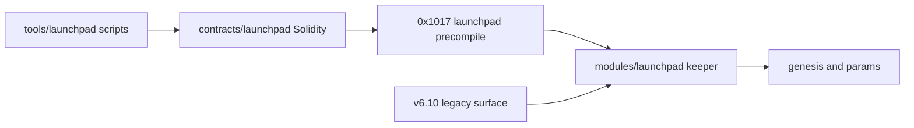

# Launchpad contract: module, precompile 0x1017, Solidity contracts and tooling

| Field | Value |
|---|---|
| Domain | 4 (launchpad), feature manager fm-launchpad |
| Precompile | launchpad 0x1017 |
| Replaces | the launchpad half of the retired contracts/exchange-launchpad.md; its launchpad-errors and launchpad-events anchors now live here |
| Revision | repository at 2a1033aa2 |
| Change control | Changes only by amendment to this contract; every amendment updates the interface, contract_context and acceptance blocks that point here. |
| Status meaning | stable: code and intent agree, no task touches it; change: behaviour or shape must change; new: absent at the revision and created by a task; retire: removed or refused by a task. |

## Scope and reading guide

This contract freezes the domain-4 on-chain and contract-tooling surface: the native module, the 0x1017 precompile with its current and v6.10 legacy methods, the Solidity contracts it serves, and the scripts that deploy and check them. Off-chain launchpad services are frozen in contracts/services.md and launchpad clients in contracts/clients.md.

Each `###` heading below is the anchor named by the `contract` key of the blocks it lists. The interface table is the frozen surface; a row's Defined at is the defining line at the revision. Rules tables reproduce the contract_context blocks; acceptance tables list the criteria verified against the section, one test each.

### Surface summary

| Item | Count |
|---|---|
| Anchors | 239 |
| Interfaces | 5405 |
| Interfaces with status stable | 5249 |
| Interfaces with status change | 60 |
| Interfaces with status new | 76 |
| Interfaces with status retire | 20 |
| Acceptance criteria | 98 |
| Contract contexts | 8 |

## Launchpad module

Native launchpad module `modules/launchpad`; `LaunchpadAddress` 0x1017 (modules/launchpad/types/keys.go:26). Keeper, query, CLI, genesis, params, store, events and error codes follow.

### launchpad-errors

103 interfaces: 55 stable, 48 change.

| Interface | Kind | Signature | Address / selector | Status | Defined at | Notes (non-stable only) |
|---|---|---|---|---|---|---|
| err-sdk-launchpad-v610-2-invalid-params | error_code | `ErrInvalidParams = Register("launchpad_legacy_v610", 2, "LXP_LAUNCHPAD_INVALID_PARAMS")` |  | stable | modules/launchpad/legacy/v610/types/errors.go:14 |  |
| err-sdk-launchpad-v610-3-overflow | error_code | `ErrOverflow = Register("launchpad_legacy_v610", 3, "LXP_LAUNCHPAD_OVERFLOW")` |  | stable | modules/launchpad/legacy/v610/types/errors.go:15 |  |
| err-sdk-launchpad-v610-4-division-by-zero | error_code | `ErrDivisionByZero = Register("launchpad_legacy_v610", 4, "LXP_LAUNCHPAD_DIVISION_BY_ZERO")` |  | stable | modules/launchpad/legacy/v610/types/errors.go:16 |  |
| err-sdk-launchpad-v610-5-insufficient-input | error_code | `ErrInsufficientInput = Register("launchpad_legacy_v610", 5, "LXP_LAUNCHPAD_INSUFFICIENT_INPUT")` |  | stable | modules/launchpad/legacy/v610/types/errors.go:17 |  |
| err-sdk-launchpad-v610-6-insufficient-liquidity | error_code | `ErrInsufficientLiquidity = Register("launchpad_legacy_v610", 6, "LXP_LAUNCHPAD_INSUFFICIENT_LIQUIDITY")` |  | stable | modules/launchpad/legacy/v610/types/errors.go:18 |  |
| err-sdk-launchpad-v610-7-virtual-floor-breached | error_code | `ErrVirtualFloorBreached = Register("launchpad_legacy_v610", 7, "LXP_LAUNCHPAD_VIRTUAL_FLOOR_BREACHED")` |  | stable | modules/launchpad/legacy/v610/types/errors.go:19 |  |
| err-sdk-launchpad-v610-8-slippage-exceeded | error_code | `ErrSlippageExceeded = Register("launchpad_legacy_v610", 8, "LXP_LAUNCHPAD_SLIPPAGE_EXCEEDED")` |  | stable | modules/launchpad/legacy/v610/types/errors.go:20 |  |
| err-sdk-launchpad-v610-9-deadline-expired | error_code | `ErrDeadlineExpired = Register("launchpad_legacy_v610", 9, "LXP_LAUNCHPAD_DEADLINE_EXPIRED")` |  | stable | modules/launchpad/legacy/v610/types/errors.go:21 |  |
| err-sdk-launchpad-v610-10-zero-address | error_code | `ErrZeroAddress = Register("launchpad_legacy_v610", 10, "LXP_LAUNCHPAD_ZERO_ADDRESS")` |  | stable | modules/launchpad/legacy/v610/types/errors.go:22 |  |
| err-sdk-launchpad-v610-11-zero-amount | error_code | `ErrZeroAmount = Register("launchpad_legacy_v610", 11, "LXP_LAUNCHPAD_ZERO_AMOUNT")` |  | stable | modules/launchpad/legacy/v610/types/errors.go:23 |  |
| err-sdk-launchpad-v610-12-unknown-market | error_code | `ErrUnknownMarket = Register("launchpad_legacy_v610", 12, "LXP_LAUNCHPAD_UNKNOWN_MARKET")` |  | stable | modules/launchpad/legacy/v610/types/errors.go:24 |  |
| err-sdk-launchpad-v610-13-paused | error_code | `ErrPaused = Register("launchpad_legacy_v610", 13, "LXP_LAUNCHPAD_PAUSED")` |  | stable | modules/launchpad/legacy/v610/types/errors.go:25 |  |
| err-sdk-launchpad-v610-14-not-paused | error_code | `ErrNotPaused = Register("launchpad_legacy_v610", 14, "LXP_LAUNCHPAD_NOT_PAUSED")` |  | stable | modules/launchpad/legacy/v610/types/errors.go:26 |  |
| err-sdk-launchpad-v610-15-not-guardian | error_code | `ErrNotGuardian = Register("launchpad_legacy_v610", 15, "LXP_LAUNCHPAD_NOT_GUARDIAN")` |  | stable | modules/launchpad/legacy/v610/types/errors.go:27 |  |
| err-sdk-launchpad-v610-16-not-fee-rights-holder | error_code | `ErrNotFeeRightsHolder = Register("launchpad_legacy_v610", 16, "LXP_LAUNCHPAD_NOT_FEE_RIGHTS_HOLDER")` |  | stable | modules/launchpad/legacy/v610/types/errors.go:28 |  |
| err-sdk-launchpad-v610-17-wrong-strategy | error_code | `ErrWrongStrategy = Register("launchpad_legacy_v610", 17, "LXP_LAUNCHPAD_WRONG_STRATEGY")` |  | stable | modules/launchpad/legacy/v610/types/errors.go:29 |  |
| err-sdk-launchpad-v610-18-invalid-strategy | error_code | `ErrInvalidStrategy = Register("launchpad_legacy_v610", 18, "LXP_LAUNCHPAD_INVALID_STRATEGY")` |  | stable | modules/launchpad/legacy/v610/types/errors.go:30 |  |
| err-sdk-launchpad-v610-19-no-fees-accumulated | error_code | `ErrNoFeesAccumulated = Register("launchpad_legacy_v610", 19, "LXP_LAUNCHPAD_NO_FEES_ACCUMULATED")` |  | stable | modules/launchpad/legacy/v610/types/errors.go:31 |  |
| err-sdk-launchpad-v610-20-airdrop-not-triggered | error_code | `ErrAirdropNotTriggered = Register("launchpad_legacy_v610", 20, "LXP_LAUNCHPAD_AIRDROP_NOT_TRIGGERED")` |  | stable | modules/launchpad/legacy/v610/types/errors.go:32 |  |
| err-sdk-launchpad-v610-21-already-claimed | error_code | `ErrAlreadyClaimed = Register("launchpad_legacy_v610", 21, "LXP_LAUNCHPAD_ALREADY_CLAIMED")` |  | stable | modules/launchpad/legacy/v610/types/errors.go:33 |  |
| err-sdk-launchpad-v610-22-invalid-market | error_code | `ErrInvalidMarket = Register("launchpad_legacy_v610", 22, "LXP_LAUNCHPAD_INVALID_MARKET")` |  | stable | modules/launchpad/legacy/v610/types/errors.go:34 |  |
| err-sdk-launchpad-v610-23-unauthorized | error_code | `ErrUnauthorized = Register("launchpad_legacy_v610", 23, "LXP_LAUNCHPAD_UNAUTHORIZED")` |  | stable | modules/launchpad/legacy/v610/types/errors.go:35 |  |
| err-sdk-launchpad-v610-24-invalid-genesis | error_code | `ErrInvalidGenesis = Register("launchpad_legacy_v610", 24, "LXP_LAUNCHPAD_INVALID_GENESIS")` |  | stable | modules/launchpad/legacy/v610/types/errors.go:36 |  |
| err-sdk-launchpad-v610-25-holding-history | error_code | `ErrHoldingHistory = Register("launchpad_legacy_v610", 25, "LXP_LAUNCHPAD_HOLDING_HISTORY")` |  | stable | modules/launchpad/legacy/v610/types/errors.go:37 |  |
| err-sdk-launchpad-v610-26-unsupported-holding-epoch | error_code | `ErrUnsupportedHoldingEpoch = Register("launchpad_legacy_v610", 26, "LXP_LAUNCHPAD_UNSUPPORTED_HOLDING_EPOCH")` |  | stable | modules/launchpad/legacy/v610/types/errors.go:38 |  |
| err-sdk-launchpad-v610-27-invalid-airdrop-epoch | error_code | `ErrInvalidAirdropEpoch = Register("launchpad_legacy_v610", 27, "LXP_LAUNCHPAD_INVALID_AIRDROP_EPOCH")` |  | stable | modules/launchpad/legacy/v610/types/errors.go:39 |  |
| err-sdk-launchpad-v610-28-legacy-airdrop-epoch | error_code | `ErrLegacyAirdropEpoch = Register("launchpad_legacy_v610", 28, "LXP_LAUNCHPAD_LEGACY_AIRDROP_EPOCH")` |  | stable | modules/launchpad/legacy/v610/types/errors.go:40 |  |
| err-sdk-launchpad-v610-29-airdrop-basis | error_code | `ErrAirdropBasis = Register("launchpad_legacy_v610", 29, "LXP_LAUNCHPAD_AIRDROP_BASIS")` |  | stable | modules/launchpad/legacy/v610/types/errors.go:41 |  |
| err-sdk-launchpad-v610-30-invalid-range | error_code | `ErrInvalidRange = Register("launchpad_legacy_v610", 30, "LXP_LAUNCHPAD_INVALID_RANGE")` |  | stable | modules/launchpad/legacy/v610/types/errors.go:42 |  |
| err-sdk-launchpad-2-invalid-params | error_code | `ErrInvalidParams = Register("launchpad", 2, "LXP_LAUNCHPAD_INVALID_PARAMS")` |  | change | modules/launchpad/types/errors.go:18 | LXP name LXP_LAUNCHPAD_INVALID_PARAMS (registered text); LXP name has no row in the Go revert registry, a revert through LXPRevert would read LXP_UNKNOWN; 50 in-repo references (28 non-test), first 25 listed |
| err-sdk-launchpad-3-overflow | error_code | `ErrOverflow = Register("launchpad", 3, "LXP_LAUNCHPAD_OVERFLOW")` |  | stable | modules/launchpad/types/errors.go:19 |  |
| err-sdk-launchpad-4-division-by-zero | error_code | `ErrDivisionByZero = Register("launchpad", 4, "LXP_LAUNCHPAD_DIVISION_BY_ZERO")` |  | stable | modules/launchpad/types/errors.go:20 |  |
| err-sdk-launchpad-5-insufficient-input | error_code | `ErrInsufficientInput = Register("launchpad", 5, "LXP_LAUNCHPAD_INSUFFICIENT_INPUT")` |  | stable | modules/launchpad/types/errors.go:21 |  |
| err-sdk-launchpad-6-insufficient-liquidity | error_code | `ErrInsufficientLiquidity = Register("launchpad", 6, "LXP_LAUNCHPAD_INSUFFICIENT_LIQUIDITY")` |  | stable | modules/launchpad/types/errors.go:22 |  |
| err-sdk-launchpad-7-virtual-floor-breached | error_code | `ErrVirtualFloorBreached = Register("launchpad", 7, "LXP_LAUNCHPAD_VIRTUAL_FLOOR_BREACHED")` |  | stable | modules/launchpad/types/errors.go:23 |  |
| err-sdk-launchpad-8-slippage-exceeded | error_code | `ErrSlippageExceeded = Register("launchpad", 8, "LXP_LAUNCHPAD_SLIPPAGE_EXCEEDED")` |  | stable | modules/launchpad/types/errors.go:24 |  |
| err-sdk-launchpad-9-deadline-expired | error_code | `ErrDeadlineExpired = Register("launchpad", 9, "LXP_LAUNCHPAD_DEADLINE_EXPIRED")` |  | stable | modules/launchpad/types/errors.go:25 |  |
| err-sdk-launchpad-10-zero-address | error_code | `ErrZeroAddress = Register("launchpad", 10, "LXP_LAUNCHPAD_ZERO_ADDRESS")` |  | stable | modules/launchpad/types/errors.go:26 |  |
| err-sdk-launchpad-11-zero-amount | error_code | `ErrZeroAmount = Register("launchpad", 11, "LXP_LAUNCHPAD_ZERO_AMOUNT")` |  | stable | modules/launchpad/types/errors.go:27 |  |
| err-sdk-launchpad-12-unknown-market | error_code | `ErrUnknownMarket = Register("launchpad", 12, "LXP_LAUNCHPAD_UNKNOWN_MARKET")` |  | stable | modules/launchpad/types/errors.go:28 |  |
| err-sdk-launchpad-13-paused | error_code | `ErrPaused = Register("launchpad", 13, "LXP_LAUNCHPAD_PAUSED")` |  | stable | modules/launchpad/types/errors.go:29 |  |
| err-sdk-launchpad-14-not-paused | error_code | `ErrNotPaused = Register("launchpad", 14, "LXP_LAUNCHPAD_NOT_PAUSED")` |  | stable | modules/launchpad/types/errors.go:30 |  |
| err-sdk-launchpad-15-not-guardian | error_code | `ErrNotGuardian = Register("launchpad", 15, "LXP_LAUNCHPAD_NOT_GUARDIAN")` |  | stable | modules/launchpad/types/errors.go:31 |  |
| err-sdk-launchpad-16-not-fee-rights-holder | error_code | `ErrNotFeeRightsHolder = Register("launchpad", 16, "LXP_LAUNCHPAD_NOT_FEE_RIGHTS_HOLDER")` |  | stable | modules/launchpad/types/errors.go:32 |  |
| err-sdk-launchpad-17-wrong-strategy | error_code | `ErrWrongStrategy = Register("launchpad", 17, "LXP_LAUNCHPAD_WRONG_STRATEGY")` |  | stable | modules/launchpad/types/errors.go:33 |  |
| err-sdk-launchpad-18-invalid-strategy | error_code | `ErrInvalidStrategy = Register("launchpad", 18, "LXP_LAUNCHPAD_INVALID_STRATEGY")` |  | stable | modules/launchpad/types/errors.go:34 |  |
| err-sdk-launchpad-19-no-fees-accumulated | error_code | `ErrNoFeesAccumulated = Register("launchpad", 19, "LXP_LAUNCHPAD_NO_FEES_ACCUMULATED")` |  | stable | modules/launchpad/types/errors.go:35 |  |
| err-sdk-launchpad-20-airdrop-not-triggered | error_code | `ErrAirdropNotTriggered = Register("launchpad", 20, "LXP_LAUNCHPAD_AIRDROP_NOT_TRIGGERED")` |  | stable | modules/launchpad/types/errors.go:36 |  |
| err-sdk-launchpad-21-already-claimed | error_code | `ErrAlreadyClaimed = Register("launchpad", 21, "LXP_LAUNCHPAD_ALREADY_CLAIMED")` |  | stable | modules/launchpad/types/errors.go:37 |  |
| err-sdk-launchpad-22-invalid-market | error_code | `ErrInvalidMarket = Register("launchpad", 22, "LXP_LAUNCHPAD_INVALID_MARKET")` |  | stable | modules/launchpad/types/errors.go:38 |  |
| err-sdk-launchpad-23-unauthorized | error_code | `ErrUnauthorized = Register("launchpad", 23, "LXP_LAUNCHPAD_UNAUTHORIZED")` |  | stable | modules/launchpad/types/errors.go:39 |  |
| err-sdk-launchpad-24-invalid-genesis | error_code | `ErrInvalidGenesis = Register("launchpad", 24, "LXP_LAUNCHPAD_INVALID_GENESIS")` |  | change | modules/launchpad/types/errors.go:40 | LXP name LXP_LAUNCHPAD_INVALID_GENESIS (registered text); LXP name has no row in the Go revert registry, a revert through LXPRevert would read LXP_UNKNOWN; 28 in-repo references (22 non-test), first 25 listed |
| err-sdk-launchpad-25-holding-history | error_code | `ErrHoldingHistory = Register("launchpad", 25, "LXP_LAUNCHPAD_HOLDING_HISTORY")` |  | stable | modules/launchpad/types/errors.go:41 |  |
| err-sdk-launchpad-26-unsupported-holding-epoch | error_code | `ErrUnsupportedHoldingEpoch = Register("launchpad", 26, "LXP_LAUNCHPAD_UNSUPPORTED_HOLDING_EPOCH")` |  | stable | modules/launchpad/types/errors.go:42 |  |
| err-sdk-launchpad-27-invalid-airdrop-epoch | error_code | `ErrInvalidAirdropEpoch = Register("launchpad", 27, "LXP_LAUNCHPAD_INVALID_AIRDROP_EPOCH")` |  | stable | modules/launchpad/types/errors.go:43 |  |
| err-sdk-launchpad-28-legacy-airdrop-epoch | error_code | `ErrLegacyAirdropEpoch = Register("launchpad", 28, "LXP_LAUNCHPAD_LEGACY_AIRDROP_EPOCH")` |  | stable | modules/launchpad/types/errors.go:44 |  |
| err-sdk-launchpad-29-airdrop-basis | error_code | `ErrAirdropBasis = Register("launchpad", 29, "LXP_LAUNCHPAD_AIRDROP_BASIS")` |  | stable | modules/launchpad/types/errors.go:45 |  |
| err-sdk-launchpad-30-invalid-range | error_code | `ErrInvalidRange = Register("launchpad", 30, "LXP_LAUNCHPAD_INVALID_RANGE")` |  | change | modules/launchpad/types/errors.go:46 | LXP name LXP_LAUNCHPAD_INVALID_RANGE (registered text); LXP name has no row in the Go revert registry, a revert through LXPRevert would read LXP_UNKNOWN |
| err-sdk-launchpad-31-already-initialized | error_code | `ErrAlreadyInitialized = Register("launchpad", 31, "LXP_LAUNCHPAD_ALREADY_INITIALIZED")` |  | change | modules/launchpad/types/errors.go:48 | LXP name LXP_LAUNCHPAD_ALREADY_INITIALIZED (registered text); LXP name has no row in the Go revert registry, a revert through LXPRevert would read LXP_UNKNOWN |
| err-sdk-launchpad-32-already-minted | error_code | `ErrAlreadyMinted = Register("launchpad", 32, "LXP_LAUNCHPAD_ALREADY_MINTED")` |  | change | modules/launchpad/types/errors.go:49 | LXP name LXP_LAUNCHPAD_ALREADY_MINTED (registered text); LXP name has no row in the Go revert registry, a revert through LXPRevert would read LXP_UNKNOWN |
| err-sdk-launchpad-33-approve-failed | error_code | `ErrApproveFailed = Register("launchpad", 33, "LXP_LAUNCHPAD_APPROVE_FAILED")` |  | change | modules/launchpad/types/errors.go:50 | LXP name LXP_LAUNCHPAD_APPROVE_FAILED (registered text); LXP name has no row in the Go revert registry, a revert through LXPRevert would read LXP_UNKNOWN |
| err-sdk-launchpad-34-duplicate-pool | error_code | `ErrDuplicatePool = Register("launchpad", 34, "LXP_LAUNCHPAD_DUPLICATE_POOL")` |  | change | modules/launchpad/types/errors.go:51 | LXP name LXP_LAUNCHPAD_DUPLICATE_POOL (registered text); LXP name has no row in the Go revert registry, a revert through LXPRevert would read LXP_UNKNOWN |
| err-sdk-launchpad-35-duplicate-token | error_code | `ErrDuplicateToken = Register("launchpad", 35, "LXP_LAUNCHPAD_DUPLICATE_TOKEN")` |  | change | modules/launchpad/types/errors.go:52 | LXP name LXP_LAUNCHPAD_DUPLICATE_TOKEN (registered text); LXP name has no row in the Go revert registry, a revert through LXPRevert would read LXP_UNKNOWN |
| err-sdk-launchpad-36-fee-out-of-range | error_code | `ErrFeeOutOfRange = Register("launchpad", 36, "LXP_LAUNCHPAD_FEE_OUT_OF_RANGE")` |  | change | modules/launchpad/types/errors.go:53 | LXP name LXP_LAUNCHPAD_FEE_OUT_OF_RANGE (registered text); LXP name has no row in the Go revert registry, a revert through LXPRevert would read LXP_UNKNOWN |
| err-sdk-launchpad-37-index-out-of-bounds | error_code | `ErrIndexOutOfBounds = Register("launchpad", 37, "LXP_LAUNCHPAD_INDEX_OUT_OF_BOUNDS")` |  | change | modules/launchpad/types/errors.go:54 | LXP name LXP_LAUNCHPAD_INDEX_OUT_OF_BOUNDS (registered text); LXP name has no row in the Go revert registry, a revert through LXPRevert would read LXP_UNKNOWN |
| err-sdk-launchpad-38-insufficient-balance | error_code | `ErrInsufficientBalance = Register("launchpad", 38, "LXP_LAUNCHPAD_INSUFFICIENT_BALANCE")` |  | change | modules/launchpad/types/errors.go:55 | LXP name LXP_LAUNCHPAD_INSUFFICIENT_BALANCE (registered text); LXP name has no row in the Go revert registry, a revert through LXPRevert would read LXP_UNKNOWN |
| err-sdk-launchpad-39-insufficient-creation-fee | error_code | `ErrInsufficientCreationFee = Register("launchpad", 39, "LXP_LAUNCHPAD_INSUFFICIENT_CREATION_FEE")` |  | change | modules/launchpad/types/errors.go:56 | LXP name LXP_LAUNCHPAD_INSUFFICIENT_CREATION_FEE (registered text); LXP name has no row in the Go revert registry, a revert through LXPRevert would read LXP_UNKNOWN |
| err-sdk-launchpad-40-insufficient-surplus | error_code | `ErrInsufficientSurplus = Register("launchpad", 40, "LXP_LAUNCHPAD_INSUFFICIENT_SURPLUS")` |  | change | modules/launchpad/types/errors.go:57 | LXP name LXP_LAUNCHPAD_INSUFFICIENT_SURPLUS (registered text); LXP name has no row in the Go revert registry, a revert through LXPRevert would read LXP_UNKNOWN |
| err-sdk-launchpad-41-invalid-balance | error_code | `ErrInvalidBalance = Register("launchpad", 41, "LXP_LAUNCHPAD_INVALID_BALANCE")` |  | change | modules/launchpad/types/errors.go:58 | LXP name LXP_LAUNCHPAD_INVALID_BALANCE (registered text); LXP name has no row in the Go revert registry, a revert through LXPRevert would read LXP_UNKNOWN |
| err-sdk-launchpad-42-invalid-configuration | error_code | `ErrInvalidConfiguration = Register("launchpad", 42, "LXP_LAUNCHPAD_INVALID_CONFIGURATION")` |  | change | modules/launchpad/types/errors.go:59 | LXP name LXP_LAUNCHPAD_INVALID_CONFIGURATION (registered text); LXP name has no row in the Go revert registry, a revert through LXPRevert would read LXP_UNKNOWN; 37 in-repo references (27 non-test), first 25 listed |
| err-sdk-launchpad-43-invalid-hook-response | error_code | `ErrInvalidHookResponse = Register("launchpad", 43, "LXP_LAUNCHPAD_INVALID_HOOK_RESPONSE")` |  | change | modules/launchpad/types/errors.go:60 | LXP name LXP_LAUNCHPAD_INVALID_HOOK_RESPONSE (registered text); LXP name has no row in the Go revert registry, a revert through LXPRevert would read LXP_UNKNOWN |
| err-sdk-launchpad-44-invalid-implementation | error_code | `ErrInvalidImplementation = Register("launchpad", 44, "LXP_LAUNCHPAD_INVALID_IMPLEMENTATION")` |  | change | modules/launchpad/types/errors.go:61 | LXP name LXP_LAUNCHPAD_INVALID_IMPLEMENTATION (registered text); LXP name has no row in the Go revert registry, a revert through LXPRevert would read LXP_UNKNOWN |
| err-sdk-launchpad-45-invalid-role-account | error_code | `ErrInvalidRoleAccount = Register("launchpad", 45, "LXP_LAUNCHPAD_INVALID_ROLE_ACCOUNT")` |  | change | modules/launchpad/types/errors.go:62 | LXP name LXP_LAUNCHPAD_INVALID_ROLE_ACCOUNT (registered text); LXP name has no row in the Go revert registry, a revert through LXPRevert would read LXP_UNKNOWN |
| err-sdk-launchpad-46-last-default-admin | error_code | `ErrLastDefaultAdmin = Register("launchpad", 46, "LXP_LAUNCHPAD_LAST_DEFAULT_ADMIN")` |  | change | modules/launchpad/types/errors.go:63 | LXP name LXP_LAUNCHPAD_LAST_DEFAULT_ADMIN (registered text); LXP name has no row in the Go revert registry, a revert through LXPRevert would read LXP_UNKNOWN |
| err-sdk-launchpad-47-missing-role | error_code | `ErrMissingRole = Register("launchpad", 47, "LXP_LAUNCHPAD_MISSING_ROLE")` |  | change | modules/launchpad/types/errors.go:64 | LXP name LXP_LAUNCHPAD_MISSING_ROLE (registered text); LXP name has no row in the Go revert registry, a revert through LXPRevert would read LXP_UNKNOWN |
| err-sdk-launchpad-48-multicall-failed | error_code | `ErrMulticallFailed = Register("launchpad", 48, "LXP_LAUNCHPAD_MULTICALL_FAILED")` |  | change | modules/launchpad/types/errors.go:65 | LXP name LXP_LAUNCHPAD_MULTICALL_FAILED (registered text); LXP name has no row in the Go revert registry, a revert through LXPRevert would read LXP_UNKNOWN |
| err-sdk-launchpad-49-non-erc721-receiver | error_code | `ErrNonERC721Receiver = Register("launchpad", 49, "LXP_LAUNCHPAD_NON_ERC721_RECEIVER")` |  | change | modules/launchpad/types/errors.go:66 | LXP name LXP_LAUNCHPAD_NON_ERC721_RECEIVER (registered text); LXP name has no row in the Go revert registry, a revert through LXPRevert would read LXP_UNKNOWN |
| err-sdk-launchpad-50-non-payable-upgrade | error_code | `ErrNonPayableUpgrade = Register("launchpad", 50, "LXP_LAUNCHPAD_NON_PAYABLE_UPGRADE")` |  | change | modules/launchpad/types/errors.go:67 | LXP name LXP_LAUNCHPAD_NON_PAYABLE_UPGRADE (registered text); LXP name has no row in the Go revert registry, a revert through LXPRevert would read LXP_UNKNOWN |
| err-sdk-launchpad-51-not-approved | error_code | `ErrNotApproved = Register("launchpad", 51, "LXP_LAUNCHPAD_NOT_APPROVED")` |  | change | modules/launchpad/types/errors.go:68 | LXP name LXP_LAUNCHPAD_NOT_APPROVED (registered text); LXP name has no row in the Go revert registry, a revert through LXPRevert would read LXP_UNKNOWN |
| err-sdk-launchpad-52-not-initializing | error_code | `ErrNotInitializing = Register("launchpad", 52, "LXP_LAUNCHPAD_NOT_INITIALIZING")` |  | change | modules/launchpad/types/errors.go:69 | LXP name LXP_LAUNCHPAD_NOT_INITIALIZING (registered text); LXP name has no row in the Go revert registry, a revert through LXPRevert would read LXP_UNKNOWN |
| err-sdk-launchpad-53-not-token-owner | error_code | `ErrNotTokenOwner = Register("launchpad", 53, "LXP_LAUNCHPAD_NOT_TOKEN_OWNER")` |  | change | modules/launchpad/types/errors.go:70 | LXP name LXP_LAUNCHPAD_NOT_TOKEN_OWNER (registered text); LXP name has no row in the Go revert registry, a revert through LXPRevert would read LXP_UNKNOWN |
| err-sdk-launchpad-54-optical-quote-unsupported | error_code | `ErrOpticalQuoteUnsupported = Register("launchpad", 54, "LXP_LAUNCHPAD_OPTICAL_QUOTE_UNSUPPORTED")` |  | change | modules/launchpad/types/errors.go:71 | LXP name LXP_LAUNCHPAD_OPTICAL_QUOTE_UNSUPPORTED (registered text); LXP name has no row in the Go revert registry, a revert through LXPRevert would read LXP_UNKNOWN |
| err-sdk-launchpad-55-pool-index-migration-required | error_code | `ErrPoolIndexMigrationRequired = Register("launchpad", 55, "LXP_LAUNCHPAD_POOL_INDEX_MIGRATION_REQUIRED")` |  | change | modules/launchpad/types/errors.go:72 | LXP name LXP_LAUNCHPAD_POOL_INDEX_MIGRATION_REQUIRED (registered text); LXP name has no row in the Go revert registry, a revert through LXPRevert would read LXP_UNKNOWN |
| err-sdk-launchpad-56-reentrancy-guard-reentrant-call | error_code | `ErrReentrancyGuardReentrantCall = Register("launchpad", 56, "LXP_LAUNCHPAD_REENTRANCY_GUARD_REENTRANT_CALL")` |  | change | modules/launchpad/types/errors.go:73 | LXP name LXP_LAUNCHPAD_REENTRANCY_GUARD_REENTRANT_CALL (registered text); LXP name has no row in the Go revert registry, a revert through LXPRevert would read LXP_UNKNOWN |
| err-sdk-launchpad-57-same-token | error_code | `ErrSameToken = Register("launchpad", 57, "LXP_LAUNCHPAD_SAME_TOKEN")` |  | change | modules/launchpad/types/errors.go:74 | LXP name LXP_LAUNCHPAD_SAME_TOKEN (registered text); LXP name has no row in the Go revert registry, a revert through LXPRevert would read LXP_UNKNOWN |
| err-sdk-launchpad-58-token-not-found | error_code | `ErrTokenNotFound = Register("launchpad", 58, "LXP_LAUNCHPAD_TOKEN_NOT_FOUND")` |  | change | modules/launchpad/types/errors.go:75 | LXP name LXP_LAUNCHPAD_TOKEN_NOT_FOUND (registered text); LXP name has no row in the Go revert registry, a revert through LXPRevert would read LXP_UNKNOWN |
| err-sdk-launchpad-59-transfer-failed | error_code | `ErrTransferFailed = Register("launchpad", 59, "LXP_LAUNCHPAD_TRANSFER_FAILED")` |  | change | modules/launchpad/types/errors.go:76 | LXP name LXP_LAUNCHPAD_TRANSFER_FAILED (registered text); LXP name has no row in the Go revert registry, a revert through LXPRevert would read LXP_UNKNOWN |
| err-sdk-launchpad-60-transfer-from-failed | error_code | `ErrTransferFromFailed = Register("launchpad", 60, "LXP_LAUNCHPAD_TRANSFER_FROM_FAILED")` |  | change | modules/launchpad/types/errors.go:77 | LXP name LXP_LAUNCHPAD_TRANSFER_FROM_FAILED (registered text); LXP name has no row in the Go revert registry, a revert through LXPRevert would read LXP_UNKNOWN |
| err-sdk-launchpad-61-uupsnot-through-active-proxy | error_code | `ErrUUPSNotThroughActiveProxy = Register("launchpad", 61, "LXP_LAUNCHPAD_UUPS_NOT_THROUGH_ACTIVE_PROXY")` |  | change | modules/launchpad/types/errors.go:78 | LXP name LXP_LAUNCHPAD_UUPS_NOT_THROUGH_ACTIVE_PROXY (registered text); LXP name has no row in the Go revert registry, a revert through LXPRevert would read LXP_UNKNOWN |
| err-sdk-launchpad-62-uupsnot-through-proxy | error_code | `ErrUUPSNotThroughProxy = Register("launchpad", 62, "LXP_LAUNCHPAD_UUPS_NOT_THROUGH_PROXY")` |  | change | modules/launchpad/types/errors.go:79 | LXP name LXP_LAUNCHPAD_UUPS_NOT_THROUGH_PROXY (registered text); LXP name has no row in the Go revert registry, a revert through LXPRevert would read LXP_UNKNOWN |
| err-sdk-launchpad-63-unauthorized-upgrade | error_code | `ErrUnauthorizedUpgrade = Register("launchpad", 63, "LXP_LAUNCHPAD_UNAUTHORIZED_UPGRADE")` |  | change | modules/launchpad/types/errors.go:80 | LXP name LXP_LAUNCHPAD_UNAUTHORIZED_UPGRADE (registered text); LXP name has no row in the Go revert registry, a revert through LXPRevert would read LXP_UNKNOWN |
| err-sdk-launchpad-64-unexecutable-quote | error_code | `ErrUnexecutableQuote = Register("launchpad", 64, "LXP_LAUNCHPAD_UNEXECUTABLE_QUOTE")` |  | change | modules/launchpad/types/errors.go:81 | LXP name LXP_LAUNCHPAD_UNEXECUTABLE_QUOTE (registered text); LXP name has no row in the Go revert registry, a revert through LXPRevert would read LXP_UNKNOWN |
| err-sdk-launchpad-65-unsupported-snapshot-token | error_code | `ErrUnsupportedSnapshotToken = Register("launchpad", 65, "LXP_LAUNCHPAD_UNSUPPORTED_SNAPSHOT_TOKEN")` |  | change | modules/launchpad/types/errors.go:82 | LXP name LXP_LAUNCHPAD_UNSUPPORTED_SNAPSHOT_TOKEN (registered text); LXP name has no row in the Go revert registry, a revert through LXPRevert would read LXP_UNKNOWN |
| err-sdk-launchpad-66-upgrade-initialization-failed | error_code | `ErrUpgradeInitializationFailed = Register("launchpad", 66, "LXP_LAUNCHPAD_UPGRADE_INITIALIZATION_FAILED")` |  | change | modules/launchpad/types/errors.go:83 | LXP name LXP_LAUNCHPAD_UPGRADE_INITIALIZATION_FAILED (registered text); LXP name has no row in the Go revert registry, a revert through LXPRevert would read LXP_UNKNOWN |
| err-sdk-launchpad-67-invalid-token | error_code | `ErrInvalidToken = Register("launchpad", 67, "LXP_LAUNCHPAD_INVALID_TOKEN")` |  | change | modules/launchpad/types/errors.go:84 | LXP name LXP_LAUNCHPAD_INVALID_TOKEN (registered text); LXP name has no row in the Go revert registry, a revert through LXPRevert would read LXP_UNKNOWN |
| err-sdk-launchpad-68-reentrant-call | error_code | `ErrReentrantCall = Register("launchpad", 68, "LXP_LAUNCHPAD_REENTRANT_CALL")` |  | change | modules/launchpad/types/errors.go:85 | LXP name LXP_LAUNCHPAD_REENTRANT_CALL (registered text); LXP name has no row in the Go revert registry, a revert through LXPRevert would read LXP_UNKNOWN |
| err-sdk-launchpad-69-access-control-unauthorized-account | error_code | `ErrAccessControlUnauthorizedAccount = Register("launchpad", 69, "LXP_LAUNCHPAD_ACCESS_CONTROL_UNAUTHORIZED_ACCOUNT")` |  | change | modules/launchpad/types/errors.go:86 | LXP name LXP_LAUNCHPAD_ACCESS_CONTROL_UNAUTHORIZED_ACCOUNT (registered text); LXP name has no row in the Go revert registry, a revert through LXPRevert would read LXP_UNKNOWN |
| err-sdk-launchpad-70-retired | error_code | `ErrRetired = Register("launchpad", 70, "LXP_LAUNCHPAD_RETIRED")` |  | change | modules/launchpad/types/errors.go:87 | LXP name LXP_LAUNCHPAD_RETIRED (registered text); LXP name has no row in the Go revert registry, a revert through LXPRevert would read LXP_UNKNOWN |
| err-sdk-launchpad-71-future-lookup | error_code | `ErrFutureLookup = Register("launchpad", 71, "LXP_LAUNCHPAD_FUTURE_LOOKUP")` |  | change | modules/launchpad/types/errors.go:88 | LXP name LXP_LAUNCHPAD_FUTURE_LOOKUP (registered text); LXP name has no row in the Go revert registry, a revert through LXPRevert would read LXP_UNKNOWN |
| err-sdk-launchpad-72-insufficient-allowance | error_code | `ErrInsufficientAllowance = Register("launchpad", 72, "LXP_LAUNCHPAD_INSUFFICIENT_ALLOWANCE")` |  | change | modules/launchpad/types/errors.go:89 | LXP name LXP_LAUNCHPAD_INSUFFICIENT_ALLOWANCE (registered text); LXP name has no row in the Go revert registry, a revert through LXPRevert would read LXP_UNKNOWN |
| err-sdk-launchpad-73-invalid-permit | error_code | `ErrInvalidPermit = Register("launchpad", 73, "LXP_LAUNCHPAD_INVALID_PERMIT")` |  | change | modules/launchpad/types/errors.go:90 | LXP name LXP_LAUNCHPAD_INVALID_PERMIT (registered text); LXP name has no row in the Go revert registry, a revert through LXPRevert would read LXP_UNKNOWN |
| err-sdk-launchpad-74-invalid-pool-binding | error_code | `ErrInvalidPoolBinding = Register("launchpad", 74, "LXP_LAUNCHPAD_INVALID_POOL_BINDING")` |  | change | modules/launchpad/types/errors.go:91 | LXP name LXP_LAUNCHPAD_INVALID_POOL_BINDING (registered text); LXP name has no row in the Go revert registry, a revert through LXPRevert would read LXP_UNKNOWN |
| err-sdk-launchpad-75-permit-expired | error_code | `ErrPermitExpired = Register("launchpad", 75, "LXP_LAUNCHPAD_PERMIT_EXPIRED")` |  | change | modules/launchpad/types/errors.go:92 | LXP name LXP_LAUNCHPAD_PERMIT_EXPIRED (registered text); LXP name has no row in the Go revert registry, a revert through LXPRevert would read LXP_UNKNOWN |

Rules frozen by `contract_context.4.launchpad-errors`:

| Aspect | Rule |
|---|---|
| interface | LXP_LAUNCHPAD_* codes 2 to 75 of modules/launchpad/types/errors.go:18-92 surfaced through LXPRevert of the shared registry |
| storage | None |
| errors | Each code maps to its own LXP_LAUNCHPAD_ row and never to LXP_UNKNOWN |
| events | None |
| gas | None |
| activation | Rows ship with the shared registry change of wiring.J28.1 |
| invariants | Registry rows and module registrations name the same codes |
| pause | Not applicable |

| Acceptance | Criterion | Test | Scenario |
|---|---|---|---|
| acceptance.4.44.1 | req.4044.1 | precompiles/launchpad/lxp_registry_test.go::TestLaunchpadCodesInLXPRegistry (planned) | Given a table of every launchpadtypes Err value of modules/launchpad/types/errors.go:18-92, when TestLaunchpadCodesInLXPRegistry unpacks the Error(string) reason of LXPRevert(err.Error(), "") for each, then each reason starts with err.Error() followed by a colon |

Capability blocks verified against this section:

- `capability.4.7.1`: Prove every launchpad error code has a row in the shared LXP registry

### launchpad-events

44 interfaces: 43 stable, 1 change.

| Interface | Kind | Signature | Address / selector | Status | Defined at | Notes (non-stable only) |
|---|---|---|---|---|---|---|
| evt-launchpad-launchpad-treasury-deposited | event | `launchpad_treasury_deposited(contract, token, depositor, amount)` |  | stable | modules/launchpad/keeper/fees.go:34 |  |
| evt-launchpad-launchpad-optical-surplus-recorded | event | `launchpad_optical_surplus_recorded(contract, pool, amount)` |  | stable | modules/launchpad/keeper/fees.go:37 |  |
| evt-launchpad-launchpad-optical-surplus-claimed | event | `launchpad_optical_surplus_claimed(contract, pool, recipient, amount)` |  | stable | modules/launchpad/keeper/fees.go:40 |  |
| evt-launchpad-launchpad-migration-protocol-config-diff | event | `launchpad_migration_protocol_config_diff(field, generation_1, generation_2)` |  | stable | modules/launchpad/keeper/migrate_v6120.go:18 |  |
| evt-launchpad-launchpad-migration-settled-protocol-fees | event | `launchpad_migration_settled_protocol_fees(address, treasury, amount)` |  | stable | modules/launchpad/keeper/migrate_v6120.go:23 |  |
| evt-launchpad-launchpad-migration-market-name-trimmed | event | `launchpad_migration_market_name_trimmed(pool, field, stored, trimmed)` |  | stable | modules/launchpad/keeper/migrate_v6120.go:27 |  |
| evt-launchpad-launchpad-migration-book-held-delta | event | `launchpad_migration_book_held_delta(pool, asset, book, held, delta)` |  | stable | modules/launchpad/keeper/migration_record.go:18 |  |
| evt-launchpad-launchpad-migration-fee-right-id | event | `launchpad_migration_fee_right_id(generation_1_id, generation_2_id)` |  | stable | modules/launchpad/keeper/migration_record.go:19 |  |
| evt-launchpad-launchpad-migration-retired | event | `launchpad_migration_retired(address, role, replacement)` |  | stable | modules/launchpad/keeper/migration_record.go:20 |  |
| evt-launchpad-log-config-updated-3 | event | `ConfigUpdated(bytes32,uint256,uint256)` |  | stable | modules/launchpad/keeper/msg_server.go:16 |  |
| evt-launchpad-log-config-updated-5 | event | `ConfigUpdated(bytes32,uint256,uint256,uint256,uint256)` |  | stable | modules/launchpad/keeper/msg_server.go:17 |  |
| evt-launchpad-log-role-granted-3 | event | `RoleGranted(bytes32,address,address)` |  | stable | modules/launchpad/keeper/msg_server.go:18 |  |
| evt-launchpad-log-role-revoked-3 | event | `RoleRevoked(bytes32,address,address)` |  | stable | modules/launchpad/keeper/msg_server.go:19 |  |
| evt-launchpad-log-withdrawn-3 | event | `Withdrawn(address,address,uint256)` |  | stable | modules/launchpad/keeper/msg_server.go:20 |  |
| evt-launchpad-log-surplus-recovered-3 | event | `SurplusRecovered(address,address,uint256)` |  | stable | modules/launchpad/keeper/msg_server.go:21 |  |
| evt-launchpad-log-input-adjustment-2 | event | `InputAdjustment(uint256,uint256)` |  | stable | modules/launchpad/keeper/swap.go:29 |  |
| evt-launchpad-log-fee-recorded-4 | event | `FeeRecorded(address,uint256,uint256,uint256)` |  | stable | modules/launchpad/keeper/swap.go:32 |  |
| evt-launchpad-log-optical-surplus-recorded-2 | event | `OpticalSurplusRecorded(address,uint256)` |  | stable | modules/launchpad/keeper/swap.go:33 |  |
| evt-launchpad-log-deposited-3 | event | `Deposited(address,address,uint256)` |  | stable | modules/launchpad/keeper/swap.go:34 |  |
| evt-launchpad-v610-launchpad-market-created | event | `launchpad_market_created(denom, pointer, creator, strategy)` |  | stable | modules/launchpad/legacy/v610/types/events.go:4 |  |
| evt-launchpad-v610-launchpad-swap | event | `launchpad_swap(denom, trader, recipient, is_buy, amount_in, amount_out, fee, fee_bps, price)` |  | stable | modules/launchpad/legacy/v610/types/events.go:5 |  |
| evt-launchpad-v610-launchpad-fee-recorded | event | `launchpad_fee_recorded(denom, fee, protocol_cut, pool_cut)` |  | stable | modules/launchpad/legacy/v610/types/events.go:6 |  |
| evt-launchpad-v610-launchpad-fee-strategy-changed | event | `launchpad_fee_strategy_changed(denom, old_strategy, strategy)` |  | stable | modules/launchpad/legacy/v610/types/events.go:7 |  |
| evt-launchpad-v610-launchpad-fees-claimed | event | `launchpad_fees_claimed(denom, recipient, amount)` |  | stable | modules/launchpad/legacy/v610/types/events.go:8 |  |
| evt-launchpad-v610-launchpad-fees-burned | event | `launchpad_fees_burned(denom, amount)` |  | stable | modules/launchpad/legacy/v610/types/events.go:9 |  |
| evt-launchpad-v610-launchpad-airdrop-triggered | event | `launchpad_airdrop_triggered(denom, amount, epoch)` |  | stable | modules/launchpad/legacy/v610/types/events.go:10 |  |
| evt-launchpad-v610-launchpad-airdrop-claimed | event | `launchpad_airdrop_claimed(denom, holder, amount, epoch)` |  | stable | modules/launchpad/legacy/v610/types/events.go:11 |  |
| evt-launchpad-v610-launchpad-lp-rewards-sent | event | `launchpad_lp_rewards_sent(denom, amount)` |  | stable | modules/launchpad/legacy/v610/types/events.go:12 |  |
| evt-launchpad-v610-launchpad-pause-toggled | event | `launchpad_pause_toggled(denom, paused)` |  | stable | modules/launchpad/legacy/v610/types/events.go:13 |  |
| evt-launchpad-v610-launchpad-params-updated | event | `launchpad_params_updated()` |  | stable | modules/launchpad/legacy/v610/types/events.go:14 |  |
| evt-launchpad-launchpad-market-created | event | `launchpad_market_created()` |  | change | modules/launchpad/types/events.go:4 | declared but no emit site or production reference found |
| evt-launchpad-launchpad-swap | event | `launchpad_swap(denom, trader, recipient, is_buy, amount_in, amount_out, fee, fee_bps, price)` |  | stable | modules/launchpad/types/events.go:5 |  |
| evt-launchpad-launchpad-fee-recorded | event | `launchpad_fee_recorded(contract, denom, pool, fee, protocol_cut, pool_cut)` |  | stable | modules/launchpad/types/events.go:6 |  |
| evt-launchpad-launchpad-fee-strategy-changed | event | `launchpad_fee_strategy_changed(denom, old_strategy, strategy)` |  | stable | modules/launchpad/types/events.go:7 |  |
| evt-launchpad-launchpad-fees-claimed | event | `launchpad_fees_claimed(denom, recipient, amount)` |  | stable | modules/launchpad/types/events.go:8 |  |
| evt-launchpad-launchpad-fees-burned | event | `launchpad_fees_burned(denom, amount)` |  | stable | modules/launchpad/types/events.go:9 |  |
| evt-launchpad-launchpad-airdrop-triggered | event | `launchpad_airdrop_triggered(denom, amount, epoch)` |  | stable | modules/launchpad/types/events.go:10 |  |
| evt-launchpad-launchpad-airdrop-claimed | event | `launchpad_airdrop_claimed(denom, holder, amount, epoch)` |  | stable | modules/launchpad/types/events.go:11 |  |
| evt-launchpad-launchpad-lp-rewards-sent | event | `launchpad_lp_rewards_sent(denom, pool, amount)` |  | stable | modules/launchpad/types/events.go:12 |  |
| evt-launchpad-launchpad-pause-toggled | event | `launchpad_pause_toggled(denom, paused)` |  | stable | modules/launchpad/types/events.go:13 |  |
| evt-launchpad-launchpad-params-updated | event | `launchpad_params_updated()` |  | stable | modules/launchpad/types/events.go:14 |  |
| evt-launchpad-launchpad-guardian-transfer-started | event | `launchpad_guardian_transfer_started(denom, guardian, pending_guardian)` |  | stable | modules/launchpad/types/events.go:16 |  |
| evt-launchpad-launchpad-guardian-transferred | event | `launchpad_guardian_transferred(denom, previous_guardian, guardian)` |  | stable | modules/launchpad/types/events.go:17 |  |
| evt-launchpad-launchpad-pool-state-updated | event | `launchpad_pool_state_updated(denom, pool, virtual_quote_reserve, real_quote_balance, token_reserve, price)` |  | stable | modules/launchpad/types/events.go:18 |  |

### module-cli

19 interfaces: 1 change, 18 new.

| Interface | Kind | Signature | Address / selector | Status | Defined at | Notes (non-stable only) |
|---|---|---|---|---|---|---|
| go-launchpad-cli-get-query-cmd-j28 | go_exported | `func GetQueryCmd() *cobra.Command` |  | new | modules/launchpad/client/cli/query.go (planned) | Planned by J28 |
| cli-launchpad-query-airdrop-claimed-j28 | cli_command | `layerxd query launchpad airdrop-claimed [pool] [holder] [epoch]` |  | new | modules/launchpad/client/cli/query_airdrop.go (planned) | Planned cobra command calling Query/AirdropClaimed |
| cli-launchpad-query-airdrop-epoch-j28 | cli_command | `layerxd query launchpad airdrop-epoch [pool] [epoch]` |  | new | modules/launchpad/client/cli/query_airdrop.go (planned) | Planned cobra command calling Query/AirdropEpoch |
| cli-launchpad-query-fee-right-j28 | cli_command | `layerxd query launchpad fee-right [collection] [id]` |  | new | modules/launchpad/client/cli/query_feeright.go (planned) | Planned cobra command calling Query/FeeRight |
| cli-launchpad-query-pool-metadata-j28 | cli_command | `layerxd query launchpad pool-metadata [pool]` |  | new | modules/launchpad/client/cli/query_feeright.go (planned) | Planned cobra command calling Query/PoolMetadata |
| cli-launchpad-query-quote-ledger-j28 | cli_command | `layerxd query launchpad quote-ledger [held\|fee-held\|treasury-held] [address]` |  | new | modules/launchpad/client/cli/query_ledger.go (planned) | Planned cobra command calling Query/QuoteLedger |
| cli-launchpad-query-treasury-j28 | cli_command | `layerxd query launchpad treasury [token]` |  | new | modules/launchpad/client/cli/query_ledger.go (planned) | Planned cobra command calling Query/Treasury |
| cli-launchpad-query-market-by-address-j28 | cli_command | `layerxd query launchpad market-by-address [address]` |  | new | modules/launchpad/client/cli/query_market.go (planned) | Planned cobra command calling Query/MarketByAddress |
| cli-launchpad-query-market-j28 | cli_command | `layerxd query launchpad market [denom]` |  | new | modules/launchpad/client/cli/query_market.go (planned) | Planned cobra command calling Query/Market |
| cli-launchpad-query-markets-by-creator-j28 | cli_command | `layerxd query launchpad markets-by-creator [creator] --offset --limit` |  | new | modules/launchpad/client/cli/query_markets.go (planned) | Planned cobra command calling Query/MarketsByCreator |
| cli-launchpad-query-markets-j28 | cli_command | `layerxd query launchpad markets --offset --limit` |  | new | modules/launchpad/client/cli/query_markets.go (planned) | Planned cobra command calling Query/Markets |
| cli-launchpad-query-fee-accounting-j28 | cli_command | `layerxd query launchpad fee-accounting` |  | new | modules/launchpad/client/cli/query_params.go (planned) | Planned cobra command calling Query/FeeAccounting |
| cli-launchpad-query-params-j28 | cli_command | `layerxd query launchpad params` |  | new | modules/launchpad/client/cli/query_params.go (planned) | Planned cobra command calling Query/Params |
| cli-launchpad-query-price-history-j28 | cli_command | `layerxd query launchpad price-history [denom] --from-height --to-height` |  | new | modules/launchpad/client/cli/query_price.go (planned) | Planned cobra command calling Query/PriceHistory |
| cli-launchpad-query-quote-j28 | cli_command | `layerxd query launchpad quote [denom] [buy\|sell] [amount-in]` |  | new | modules/launchpad/client/cli/query_price.go (planned) | Planned cobra command calling Query/Quote |
| cli-launchpad-query-has-role-j28 | cli_command | `layerxd query launchpad has-role [contract] [role] [account]` |  | new | modules/launchpad/client/cli/query_surface.go (planned) | Planned cobra command calling Query/HasRole |
| cli-launchpad-query-retired-j28 | cli_command | `layerxd query launchpad retired [address]` |  | new | modules/launchpad/client/cli/query_surface.go (planned) | Planned cobra command calling Query/Retired |
| cli-launchpad-query-surface-j28 | cli_command | `layerxd query launchpad surface [address]` |  | new | modules/launchpad/client/cli/query_surface.go (planned) | Planned cobra command calling Query/Surface |
| go-launchpad-app-module-basic-get-query-cmd-j28 | go_exported | `func (AppModuleBasic) GetQueryCmd() *cobra.Command { return nil }` |  | change | modules/launchpad/module.go:79 | Returns nil at HEAD; returns cli.GetQueryCmd() after decision.405 |

Rules frozen by `contract_context.4.module-cli`:

| Aspect | Rule |
|---|---|
| interface | layerxd query launchpad with 17 subcommands returned by GetQueryCmd of modules/launchpad/client/cli/query.go (planned); GetTxCmd stays nil |
| storage | None |
| errors | Cobra argument-count errors before any RPC; node errors passed through with the launchpad codespace |
| events | None |
| gas | None |
| activation | Present in every binary that includes the planned client/cli package |
| invariants | Each command calls exactly one Query rpc and prints the proto response |
| pause | Not applicable |

| Acceptance | Criterion | Test | Scenario |
|---|---|---|---|
| acceptance.4.35.1 | req.4035.1 | modules/launchpad/client/cli/query_params_test.go::TestCmdQueryParamsArgs (planned) | Given CmdQueryParams and CmdQueryFeeAccounting built without a client context, when cobra argument validation runs with the declared count and with one argument more, then the first passes and the second returns an accepts N arg(s) error before any RPC |
| acceptance.4.35.2 | req.4035.2 | modules/launchpad/client/cli/query_params_test.go::TestCmdQueryParamsNetwork (planned) | Given a running one-validator network with launchpad DefaultGenesis, when TestCmdQueryParamsNetwork runs each command through clitestutil.ExecTestCLICmd (sdk/testutil/cli/cmd.go:13) with --output json, then params prints the genesis Params of the network and fee-accounting prints total_liabilities 0 and pending_protocol_fees 0 |
| acceptance.4.36.1 | req.4036.1 | modules/launchpad/client/cli/query_market_test.go::TestCmdQueryMarketArgs (planned) | Given CmdQueryMarket and CmdQueryMarketByAddress built without a client context, when cobra argument validation runs with the declared count and with one argument more, then the first passes and the second returns an accepts N arg(s) error before any RPC |
| acceptance.4.36.2 | req.4036.2 | modules/launchpad/client/cli/query_market_test.go::TestCmdQueryMarketNetwork (planned) | Given a running one-validator network with launchpad DefaultGenesis, when TestCmdQueryMarketNetwork runs each command through clitestutil.ExecTestCLICmd (sdk/testutil/cli/cmd.go:13) with --output json, then market launchpad/0x0000000000000000000000000000000000000001 and market-by-address of the same address both fail with the unknown market code 12 of the launchpad codespace |
| acceptance.4.37.1 | req.4037.1 | modules/launchpad/client/cli/query_markets_test.go::TestCmdQueryMarketsArgs (planned) | Given CmdQueryMarkets and CmdQueryMarketsByCreator built without a client context, when cobra argument validation runs with the declared count and with one argument more, then the first passes and the second returns an accepts N arg(s) error before any RPC |
| acceptance.4.37.2 | req.4037.2 | modules/launchpad/client/cli/query_markets_test.go::TestCmdQueryMarketsNetwork (planned) | Given a running one-validator network with launchpad DefaultGenesis, when TestCmdQueryMarketsNetwork runs each command through clitestutil.ExecTestCLICmd (sdk/testutil/cli/cmd.go:13) with --output json, then markets --limit 10 prints an empty market list with total 0 and markets-by-creator of the validator account prints an empty list, while markets --limit 101 fails with code 30 |
| acceptance.4.38.1 | req.4038.1 | modules/launchpad/client/cli/query_price_test.go::TestCmdQueryPriceArgs (planned) | Given CmdQueryPriceHistory and CmdQueryQuote built without a client context, when cobra argument validation runs with the declared count and with one argument more, then the first passes and the second returns an accepts N arg(s) error before any RPC |
| acceptance.4.38.2 | req.4038.2 | modules/launchpad/client/cli/query_price_test.go::TestCmdQueryPriceNetwork (planned) | Given a running one-validator network with launchpad DefaultGenesis, when TestCmdQueryPriceNetwork runs each command through clitestutil.ExecTestCLICmd (sdk/testutil/cli/cmd.go:13) with --output json, then price-history and quote of an unknown denom both fail with code 12 and quote with amount abc fails before reaching the node |
| acceptance.4.39.1 | req.4039.1 | modules/launchpad/client/cli/query_ledger_test.go::TestCmdQueryLedgerArgs (planned) | Given CmdQueryTreasury and CmdQueryQuoteLedger built without a client context, when cobra argument validation runs with the declared count and with one argument more, then the first passes and the second returns an accepts N arg(s) error before any RPC |
| acceptance.4.39.2 | req.4039.2 | modules/launchpad/client/cli/query_ledger_test.go::TestCmdQueryLedgerNetwork (planned) | Given a running one-validator network with launchpad DefaultGenesis, when TestCmdQueryLedgerNetwork runs each command through clitestutil.ExecTestCLICmd (sdk/testutil/cli/cmd.go:13) with --output json, then treasury of the genesis QuoteToken prints a zero balance and quote-ledger treasury-held prints 0, while quote-ledger other fails |
| acceptance.4.40.1 | req.4040.1 | modules/launchpad/client/cli/query_surface_test.go::TestCmdQuerySurfaceArgs (planned) | Given CmdQuerySurface and CmdQueryRetired and CmdQueryHasRole built without a client context, when cobra argument validation runs with the declared count and with one argument more, then the first passes and the second returns an accepts N arg(s) error before any RPC |
| acceptance.4.40.2 | req.4040.2 | modules/launchpad/client/cli/query_surface_test.go::TestCmdQuerySurfaceNetwork (planned) | Given a running one-validator network with launchpad DefaultGenesis, when TestCmdQuerySurfaceNetwork runs each command through clitestutil.ExecTestCLICmd (sdk/testutil/cli/cmd.go:13) with --output json, then surface and retired of an unregistered address print found false and has-role with a zero role prints false |
| acceptance.4.41.1 | req.4041.1 | modules/launchpad/client/cli/query_feeright_test.go::TestCmdQueryFeeRightArgs (planned) | Given CmdQueryFeeRight and CmdQueryPoolMetadata built without a client context, when cobra argument validation runs with the declared count and with one argument more, then the first passes and the second returns an accepts N arg(s) error before any RPC |
| acceptance.4.41.2 | req.4041.2 | modules/launchpad/client/cli/query_feeright_test.go::TestCmdQueryFeeRightNetwork (planned) | Given a running one-validator network with launchpad DefaultGenesis, when TestCmdQueryFeeRightNetwork runs each command through clitestutil.ExecTestCLICmd (sdk/testutil/cli/cmd.go:13) with --output json, then fee-right of an unregistered collection and pool-metadata of an unregistered pool print found false |
| acceptance.4.42.1 | req.4042.1 | modules/launchpad/client/cli/query_airdrop_test.go::TestCmdQueryAirdropArgs (planned) | Given CmdQueryAirdropEpoch and CmdQueryAirdropClaimed built without a client context, when cobra argument validation runs with the declared count and with one argument more, then the first passes and the second returns an accepts N arg(s) error before any RPC |
| acceptance.4.42.2 | req.4042.2 | modules/launchpad/client/cli/query_airdrop_test.go::TestCmdQueryAirdropNetwork (planned) | Given a running one-validator network with launchpad DefaultGenesis, when TestCmdQueryAirdropNetwork runs each command through clitestutil.ExecTestCLICmd (sdk/testutil/cli/cmd.go:13) with --output json, then airdrop-epoch of an unregistered pool and epoch 1 prints found false and airdrop-claimed prints false, while airdrop-epoch with epoch 0 fails with code 27 |
| acceptance.4.47.1 | req.4047.1 | modules/launchpad/client/cli/query_test.go::TestGetQueryCmdListsLaunchpadQueries (planned) | Given NewAppModuleBasic, when TestGetQueryCmdListsLaunchpadQueries lists GetQueryCmd().Commands(), then it finds exactly params, market, market-by-address, markets, markets-by-creator, price-history, quote, treasury, surface, retired, fee-right, airdrop-epoch, airdrop-claimed, has-role, quote-ledger, fee-accounting and pool-metadata |
| acceptance.4.47.2 | req.4047.2 | modules/launchpad/launchpadtest/query_test.go::TestQueryThroughTestApp (planned) | Given freshDomain (modules/launchpad/launchpadtest/domain_test.go:146) with one market created through RoleRouter createMarket, when TestQueryThroughTestApp queries the four rpcs through a QueryServiceTestHelper, then pool, token and fee-right id equal the createMarket outputs |

Capability blocks verified against this section:

- `capability.4.1.3`: Expose the launchpad query commands and prove the Query service on a live domain
- `capability.4.5.2`: Add the launchpad params query commands
- `capability.4.5.3`: Add the launchpad market query commands
- `capability.4.5.4`: Add the launchpad markets query commands
- `capability.4.5.5`: Add the launchpad price query commands
- `capability.4.5.6`: Add the launchpad ledger query commands
- `capability.4.5.7`: Add the launchpad surface query commands
- `capability.4.5.8`: Add the launchpad feeright query commands
- `capability.4.5.9`: Add the launchpad airdrop query commands

### module-errors

74 interfaces: 74 stable.

| Interface | Kind | Signature | Address / selector | Status | Defined at | Notes (non-stable only) |
|---|---|---|---|---|---|---|
| err-launchpad-invalid-params-j11 | error_code | `ErrInvalidParams           = sdkerrors.Register(ModuleName, 2, LaunchpadCode("INVALID_PARAMS"))` |  | stable | modules/launchpad/types/errors.go:18 |  |
| err-launchpad-overflow-j11 | error_code | `ErrOverflow                = sdkerrors.Register(ModuleName, 3, LaunchpadCode("OVERFLOW"))` |  | stable | modules/launchpad/types/errors.go:19 |  |
| err-launchpad-division-by-zero-j11 | error_code | `ErrDivisionByZero          = sdkerrors.Register(ModuleName, 4, LaunchpadCode("DIVISION_BY_ZERO"))` |  | stable | modules/launchpad/types/errors.go:20 |  |
| err-launchpad-insufficient-input-j11 | error_code | `ErrInsufficientInput       = sdkerrors.Register(ModuleName, 5, LaunchpadCode("INSUFFICIENT_INPUT"))` |  | stable | modules/launchpad/types/errors.go:21 |  |
| err-launchpad-insufficient-liquidity-j11 | error_code | `ErrInsufficientLiquidity   = sdkerrors.Register(ModuleName, 6, LaunchpadCode("INSUFFICIENT_LIQUIDITY"))` |  | stable | modules/launchpad/types/errors.go:22 |  |
| err-launchpad-virtual-floor-breached-j11 | error_code | `ErrVirtualFloorBreached    = sdkerrors.Register(ModuleName, 7, LaunchpadCode("VIRTUAL_FLOOR_BREACHED"))` |  | stable | modules/launchpad/types/errors.go:23 |  |
| err-launchpad-slippage-exceeded-j11 | error_code | `ErrSlippageExceeded        = sdkerrors.Register(ModuleName, 8, LaunchpadCode("SLIPPAGE_EXCEEDED"))` |  | stable | modules/launchpad/types/errors.go:24 |  |
| err-launchpad-deadline-expired-j11 | error_code | `ErrDeadlineExpired         = sdkerrors.Register(ModuleName, 9, LaunchpadCode("DEADLINE_EXPIRED"))` |  | stable | modules/launchpad/types/errors.go:25 |  |
| err-launchpad-zero-address-j11 | error_code | `ErrZeroAddress             = sdkerrors.Register(ModuleName, 10, LaunchpadCode("ZERO_ADDRESS"))` |  | stable | modules/launchpad/types/errors.go:26 |  |
| err-launchpad-zero-amount-j11 | error_code | `ErrZeroAmount              = sdkerrors.Register(ModuleName, 11, LaunchpadCode("ZERO_AMOUNT"))` |  | stable | modules/launchpad/types/errors.go:27 |  |
| err-launchpad-unknown-market-j11 | error_code | `ErrUnknownMarket           = sdkerrors.Register(ModuleName, 12, LaunchpadCode("UNKNOWN_MARKET"))` |  | stable | modules/launchpad/types/errors.go:28 |  |
| err-launchpad-paused-j11 | error_code | `ErrPaused                  = sdkerrors.Register(ModuleName, 13, LaunchpadCode("PAUSED"))` |  | stable | modules/launchpad/types/errors.go:29 |  |
| err-launchpad-not-paused-j11 | error_code | `ErrNotPaused               = sdkerrors.Register(ModuleName, 14, LaunchpadCode("NOT_PAUSED"))` |  | stable | modules/launchpad/types/errors.go:30 |  |
| err-launchpad-not-guardian-j11 | error_code | `ErrNotGuardian             = sdkerrors.Register(ModuleName, 15, LaunchpadCode("NOT_GUARDIAN"))` |  | stable | modules/launchpad/types/errors.go:31 |  |
| err-launchpad-not-fee-rights-holder-j11 | error_code | `ErrNotFeeRightsHolder      = sdkerrors.Register(ModuleName, 16, LaunchpadCode("NOT_FEE_RIGHTS_HOLDER"))` |  | stable | modules/launchpad/types/errors.go:32 |  |
| err-launchpad-wrong-strategy-j11 | error_code | `ErrWrongStrategy           = sdkerrors.Register(ModuleName, 17, LaunchpadCode("WRONG_STRATEGY"))` |  | stable | modules/launchpad/types/errors.go:33 |  |
| err-launchpad-invalid-strategy-j11 | error_code | `ErrInvalidStrategy         = sdkerrors.Register(ModuleName, 18, LaunchpadCode("INVALID_STRATEGY"))` |  | stable | modules/launchpad/types/errors.go:34 |  |
| err-launchpad-no-fees-accumulated-j11 | error_code | `ErrNoFeesAccumulated       = sdkerrors.Register(ModuleName, 19, LaunchpadCode("NO_FEES_ACCUMULATED"))` |  | stable | modules/launchpad/types/errors.go:35 |  |
| err-launchpad-airdrop-not-triggered-j11 | error_code | `ErrAirdropNotTriggered     = sdkerrors.Register(ModuleName, 20, LaunchpadCode("AIRDROP_NOT_TRIGGERED"))` |  | stable | modules/launchpad/types/errors.go:36 |  |
| err-launchpad-already-claimed-j11 | error_code | `ErrAlreadyClaimed          = sdkerrors.Register(ModuleName, 21, LaunchpadCode("ALREADY_CLAIMED"))` |  | stable | modules/launchpad/types/errors.go:37 |  |
| err-launchpad-invalid-market-j11 | error_code | `ErrInvalidMarket           = sdkerrors.Register(ModuleName, 22, LaunchpadCode("INVALID_MARKET"))` |  | stable | modules/launchpad/types/errors.go:38 |  |
| err-launchpad-unauthorized-j11 | error_code | `ErrUnauthorized            = sdkerrors.Register(ModuleName, 23, LaunchpadCode("UNAUTHORIZED"))` |  | stable | modules/launchpad/types/errors.go:39 |  |
| err-launchpad-invalid-genesis-j11 | error_code | `ErrInvalidGenesis          = sdkerrors.Register(ModuleName, 24, LaunchpadCode("INVALID_GENESIS"))` |  | stable | modules/launchpad/types/errors.go:40 |  |
| err-launchpad-holding-history-j11 | error_code | `ErrHoldingHistory          = sdkerrors.Register(ModuleName, 25, LaunchpadCode("HOLDING_HISTORY"))` |  | stable | modules/launchpad/types/errors.go:41 |  |
| err-launchpad-unsupported-holding-epoch-j11 | error_code | `ErrUnsupportedHoldingEpoch = sdkerrors.Register(ModuleName, 26, LaunchpadCode("UNSUPPORTED_HOLDING_EPOCH"))` |  | stable | modules/launchpad/types/errors.go:42 |  |
| err-launchpad-invalid-airdrop-epoch-j11 | error_code | `ErrInvalidAirdropEpoch     = sdkerrors.Register(ModuleName, 27, LaunchpadCode("INVALID_AIRDROP_EPOCH"))` |  | stable | modules/launchpad/types/errors.go:43 |  |
| err-launchpad-legacy-airdrop-epoch-j11 | error_code | `ErrLegacyAirdropEpoch      = sdkerrors.Register(ModuleName, 28, LaunchpadCode("LEGACY_AIRDROP_EPOCH"))` |  | stable | modules/launchpad/types/errors.go:44 |  |
| err-launchpad-airdrop-basis-j11 | error_code | `ErrAirdropBasis            = sdkerrors.Register(ModuleName, 29, LaunchpadCode("AIRDROP_BASIS"))` |  | stable | modules/launchpad/types/errors.go:45 |  |
| err-launchpad-invalid-range-j11 | error_code | `ErrInvalidRange            = sdkerrors.Register(ModuleName, 30, LaunchpadCode("INVALID_RANGE"))` |  | stable | modules/launchpad/types/errors.go:46 |  |
| err-launchpad-already-initialized-j11 | error_code | `ErrAlreadyInitialized               = sdkerrors.Register(ModuleName, 31, LaunchpadCode("ALREADY_INITIALIZED"))` |  | stable | modules/launchpad/types/errors.go:48 |  |
| err-launchpad-already-minted-j11 | error_code | `ErrAlreadyMinted                    = sdkerrors.Register(ModuleName, 32, LaunchpadCode("ALREADY_MINTED"))` |  | stable | modules/launchpad/types/errors.go:49 |  |
| err-launchpad-approve-failed-j11 | error_code | `ErrApproveFailed                    = sdkerrors.Register(ModuleName, 33, LaunchpadCode("APPROVE_FAILED"))` |  | stable | modules/launchpad/types/errors.go:50 |  |
| err-launchpad-duplicate-pool-j11 | error_code | `ErrDuplicatePool                    = sdkerrors.Register(ModuleName, 34, LaunchpadCode("DUPLICATE_POOL"))` |  | stable | modules/launchpad/types/errors.go:51 |  |
| err-launchpad-duplicate-token-j11 | error_code | `ErrDuplicateToken                   = sdkerrors.Register(ModuleName, 35, LaunchpadCode("DUPLICATE_TOKEN"))` |  | stable | modules/launchpad/types/errors.go:52 |  |
| err-launchpad-fee-out-of-range-j11 | error_code | `ErrFeeOutOfRange                    = sdkerrors.Register(ModuleName, 36, LaunchpadCode("FEE_OUT_OF_RANGE"))` |  | stable | modules/launchpad/types/errors.go:53 |  |
| err-launchpad-index-out-of-bounds-j11 | error_code | `ErrIndexOutOfBounds                 = sdkerrors.Register(ModuleName, 37, LaunchpadCode("INDEX_OUT_OF_BOUNDS"))` |  | stable | modules/launchpad/types/errors.go:54 |  |
| err-launchpad-insufficient-balance-j11 | error_code | `ErrInsufficientBalance              = sdkerrors.Register(ModuleName, 38, LaunchpadCode("INSUFFICIENT_BALANCE"))` |  | stable | modules/launchpad/types/errors.go:55 |  |
| err-launchpad-insufficient-creation-fee-j11 | error_code | `ErrInsufficientCreationFee          = sdkerrors.Register(ModuleName, 39, LaunchpadCode("INSUFFICIENT_CREATION_FEE"))` |  | stable | modules/launchpad/types/errors.go:56 |  |
| err-launchpad-insufficient-surplus-j11 | error_code | `ErrInsufficientSurplus              = sdkerrors.Register(ModuleName, 40, LaunchpadCode("INSUFFICIENT_SURPLUS"))` |  | stable | modules/launchpad/types/errors.go:57 |  |
| err-launchpad-invalid-balance-j11 | error_code | `ErrInvalidBalance                   = sdkerrors.Register(ModuleName, 41, LaunchpadCode("INVALID_BALANCE"))` |  | stable | modules/launchpad/types/errors.go:58 |  |
| err-launchpad-invalid-configuration-j11 | error_code | `ErrInvalidConfiguration             = sdkerrors.Register(ModuleName, 42, LaunchpadCode("INVALID_CONFIGURATION"))` |  | stable | modules/launchpad/types/errors.go:59 |  |
| err-launchpad-invalid-hook-response-j11 | error_code | `ErrInvalidHookResponse              = sdkerrors.Register(ModuleName, 43, LaunchpadCode("INVALID_HOOK_RESPONSE"))` |  | stable | modules/launchpad/types/errors.go:60 |  |
| err-launchpad-invalid-implementation-j11 | error_code | `ErrInvalidImplementation            = sdkerrors.Register(ModuleName, 44, LaunchpadCode("INVALID_IMPLEMENTATION"))` |  | stable | modules/launchpad/types/errors.go:61 |  |
| err-launchpad-invalid-role-account-j11 | error_code | `ErrInvalidRoleAccount               = sdkerrors.Register(ModuleName, 45, LaunchpadCode("INVALID_ROLE_ACCOUNT"))` |  | stable | modules/launchpad/types/errors.go:62 |  |
| err-launchpad-last-default-admin-j11 | error_code | `ErrLastDefaultAdmin                 = sdkerrors.Register(ModuleName, 46, LaunchpadCode("LAST_DEFAULT_ADMIN"))` |  | stable | modules/launchpad/types/errors.go:63 |  |
| err-launchpad-missing-role-j11 | error_code | `ErrMissingRole                      = sdkerrors.Register(ModuleName, 47, LaunchpadCode("MISSING_ROLE"))` |  | stable | modules/launchpad/types/errors.go:64 |  |
| err-launchpad-multicall-failed-j11 | error_code | `ErrMulticallFailed                  = sdkerrors.Register(ModuleName, 48, LaunchpadCode("MULTICALL_FAILED"))` |  | stable | modules/launchpad/types/errors.go:65 |  |
| err-launchpad-non-erc721-receiver-j11 | error_code | `ErrNonERC721Receiver                = sdkerrors.Register(ModuleName, 49, LaunchpadCode("NON_ERC721_RECEIVER"))` |  | stable | modules/launchpad/types/errors.go:66 |  |
| err-launchpad-non-payable-upgrade-j11 | error_code | `ErrNonPayableUpgrade                = sdkerrors.Register(ModuleName, 50, LaunchpadCode("NON_PAYABLE_UPGRADE"))` |  | stable | modules/launchpad/types/errors.go:67 |  |
| err-launchpad-not-approved-j11 | error_code | `ErrNotApproved                      = sdkerrors.Register(ModuleName, 51, LaunchpadCode("NOT_APPROVED"))` |  | stable | modules/launchpad/types/errors.go:68 |  |
| err-launchpad-not-initializing-j11 | error_code | `ErrNotInitializing                  = sdkerrors.Register(ModuleName, 52, LaunchpadCode("NOT_INITIALIZING"))` |  | stable | modules/launchpad/types/errors.go:69 |  |
| err-launchpad-not-token-owner-j11 | error_code | `ErrNotTokenOwner                    = sdkerrors.Register(ModuleName, 53, LaunchpadCode("NOT_TOKEN_OWNER"))` |  | stable | modules/launchpad/types/errors.go:70 |  |
| err-launchpad-optical-quote-unsupported-j11 | error_code | `ErrOpticalQuoteUnsupported          = sdkerrors.Register(ModuleName, 54, LaunchpadCode("OPTICAL_QUOTE_UNSUPPORTED"))` |  | stable | modules/launchpad/types/errors.go:71 |  |
| err-launchpad-pool-index-migration-required-j11 | error_code | `ErrPoolIndexMigrationRequired       = sdkerrors.Register(ModuleName, 55, LaunchpadCode("POOL_INDEX_MIGRATION_REQUIRED"))` |  | stable | modules/launchpad/types/errors.go:72 |  |
| err-launchpad-reentrancy-guard-reentrant-call-j11 | error_code | `ErrReentrancyGuardReentrantCall     = sdkerrors.Register(ModuleName, 56, LaunchpadCode("REENTRANCY_GUARD_REENTRANT_CALL"))` |  | stable | modules/launchpad/types/errors.go:73 |  |
| err-launchpad-same-token-j11 | error_code | `ErrSameToken                        = sdkerrors.Register(ModuleName, 57, LaunchpadCode("SAME_TOKEN"))` |  | stable | modules/launchpad/types/errors.go:74 |  |
| err-launchpad-token-not-found-j11 | error_code | `ErrTokenNotFound                    = sdkerrors.Register(ModuleName, 58, LaunchpadCode("TOKEN_NOT_FOUND"))` |  | stable | modules/launchpad/types/errors.go:75 |  |
| err-launchpad-transfer-failed-j11 | error_code | `ErrTransferFailed                   = sdkerrors.Register(ModuleName, 59, LaunchpadCode("TRANSFER_FAILED"))` |  | stable | modules/launchpad/types/errors.go:76 |  |
| err-launchpad-transfer-from-failed-j11 | error_code | `ErrTransferFromFailed               = sdkerrors.Register(ModuleName, 60, LaunchpadCode("TRANSFER_FROM_FAILED"))` |  | stable | modules/launchpad/types/errors.go:77 |  |
| err-launchpad-uups-not-through-active-proxy-j11 | error_code | `ErrUUPSNotThroughActiveProxy        = sdkerrors.Register(ModuleName, 61, LaunchpadCode("UUPS_NOT_THROUGH_ACTIVE_PROXY"))` |  | stable | modules/launchpad/types/errors.go:78 |  |
| err-launchpad-uups-not-through-proxy-j11 | error_code | `ErrUUPSNotThroughProxy              = sdkerrors.Register(ModuleName, 62, LaunchpadCode("UUPS_NOT_THROUGH_PROXY"))` |  | stable | modules/launchpad/types/errors.go:79 |  |
| err-launchpad-unauthorized-upgrade-j11 | error_code | `ErrUnauthorizedUpgrade              = sdkerrors.Register(ModuleName, 63, LaunchpadCode("UNAUTHORIZED_UPGRADE"))` |  | stable | modules/launchpad/types/errors.go:80 |  |
| err-launchpad-unexecutable-quote-j11 | error_code | `ErrUnexecutableQuote                = sdkerrors.Register(ModuleName, 64, LaunchpadCode("UNEXECUTABLE_QUOTE"))` |  | stable | modules/launchpad/types/errors.go:81 |  |
| err-launchpad-unsupported-snapshot-token-j11 | error_code | `ErrUnsupportedSnapshotToken         = sdkerrors.Register(ModuleName, 65, LaunchpadCode("UNSUPPORTED_SNAPSHOT_TOKEN"))` |  | stable | modules/launchpad/types/errors.go:82 |  |
| err-launchpad-upgrade-initialization-failed-j11 | error_code | `ErrUpgradeInitializationFailed      = sdkerrors.Register(ModuleName, 66, LaunchpadCode("UPGRADE_INITIALIZATION_FAILED"))` |  | stable | modules/launchpad/types/errors.go:83 |  |
| err-launchpad-invalid-token-j11 | error_code | `ErrInvalidToken                     = sdkerrors.Register(ModuleName, 67, LaunchpadCode("INVALID_TOKEN"))` |  | stable | modules/launchpad/types/errors.go:84 |  |
| err-launchpad-reentrant-call-j11 | error_code | `ErrReentrantCall                    = sdkerrors.Register(ModuleName, 68, LaunchpadCode("REENTRANT_CALL"))` |  | stable | modules/launchpad/types/errors.go:85 |  |
| err-launchpad-access-control-unauthorized-account-j11 | error_code | `ErrAccessControlUnauthorizedAccount = sdkerrors.Register(ModuleName, 69, LaunchpadCode("ACCESS_CONTROL_UNAUTHORIZED_ACCOUNT"))` |  | stable | modules/launchpad/types/errors.go:86 |  |
| err-launchpad-retired-j11 | error_code | `ErrRetired                          = sdkerrors.Register(ModuleName, 70, LaunchpadCode("RETIRED"))` |  | stable | modules/launchpad/types/errors.go:87 |  |
| err-launchpad-future-lookup-j11 | error_code | `ErrFutureLookup                     = sdkerrors.Register(ModuleName, 71, LaunchpadCode("FUTURE_LOOKUP"))` |  | stable | modules/launchpad/types/errors.go:88 |  |
| err-launchpad-insufficient-allowance-j11 | error_code | `ErrInsufficientAllowance            = sdkerrors.Register(ModuleName, 72, LaunchpadCode("INSUFFICIENT_ALLOWANCE"))` |  | stable | modules/launchpad/types/errors.go:89 |  |
| err-launchpad-invalid-permit-j11 | error_code | `ErrInvalidPermit                    = sdkerrors.Register(ModuleName, 73, LaunchpadCode("INVALID_PERMIT"))` |  | stable | modules/launchpad/types/errors.go:90 |  |
| err-launchpad-invalid-pool-binding-j11 | error_code | `ErrInvalidPoolBinding               = sdkerrors.Register(ModuleName, 74, LaunchpadCode("INVALID_POOL_BINDING"))` |  | stable | modules/launchpad/types/errors.go:91 |  |
| err-launchpad-permit-expired-j11 | error_code | `ErrPermitExpired                    = sdkerrors.Register(ModuleName, 75, LaunchpadCode("PERMIT_EXPIRED"))` |  | stable | modules/launchpad/types/errors.go:92 |  |

### module-events

23 interfaces: 22 stable, 1 change.

| Interface | Kind | Signature | Address / selector | Status | Defined at | Notes (non-stable only) |
|---|---|---|---|---|---|---|
| evt-launchpad-launchpad-treasury-deposited-j11 | event | `EventTypeDeposited = "launchpad_treasury_deposited"` |  | stable | modules/launchpad/keeper/fees.go:34 |  |
| evt-launchpad-launchpad-optical-surplus-recorded-j11 | event | `EventTypeOpticalSurplusRecorded = "launchpad_optical_surplus_recorded"` |  | stable | modules/launchpad/keeper/fees.go:37 |  |
| evt-launchpad-launchpad-optical-surplus-claimed-j11 | event | `EventTypeOpticalSurplusClaimed = "launchpad_optical_surplus_claimed"` |  | stable | modules/launchpad/keeper/fees.go:40 |  |
| evt-launchpad-launchpad-migration-protocol-config-diff-j11 | event | `EventTypeMigrationProtocolConfigDiff = "launchpad_migration_protocol_config_diff"` |  | stable | modules/launchpad/keeper/migrate_v6120.go:18 |  |
| evt-launchpad-launchpad-migration-settled-protocol-fees-j11 | event | `EventTypeMigrationSettledProtocolFees = "launchpad_migration_settled_protocol_fees"` |  | stable | modules/launchpad/keeper/migrate_v6120.go:23 |  |
| evt-launchpad-launchpad-migration-market-name-trimmed-j11 | event | `EventTypeMigrationMarketNameTrimmed = "launchpad_migration_market_name_trimmed"` |  | stable | modules/launchpad/keeper/migrate_v6120.go:27 |  |
| evt-launchpad-launchpad-migration-book-held-delta-j11 | event | `EventTypeMigrationBookHeldDelta = "launchpad_migration_book_held_delta"` |  | stable | modules/launchpad/keeper/migration_record.go:18 |  |
| evt-launchpad-launchpad-migration-fee-right-id-j11 | event | `EventTypeMigrationFeeRightID    = "launchpad_migration_fee_right_id"` |  | stable | modules/launchpad/keeper/migration_record.go:19 |  |
| evt-launchpad-launchpad-migration-retired-j11 | event | `EventTypeMigrationRetired       = "launchpad_migration_retired"` |  | stable | modules/launchpad/keeper/migration_record.go:20 |  |
| evt-launchpad-launchpad-market-created-j11 | event | `EventTypeMarketCreated      = "launchpad_market_created"` |  | change | modules/launchpad/types/events.go:4 | Cosmos event type launchpad_market_created. Defined here but not emitted by modules/launchpad/keeper/market.go:125 (CreateMarket); only modules/launchpad/legacy/v610/keeper/market.go:91 emits it, so indexers keyed on this type see no current markets. |
| evt-launchpad-launchpad-swap-j11 | event | `EventTypeSwap               = "launchpad_swap"` |  | stable | modules/launchpad/types/events.go:5 |  |
| evt-launchpad-launchpad-fee-recorded-j11 | event | `EventTypeFeeRecorded        = "launchpad_fee_recorded"` |  | stable | modules/launchpad/types/events.go:6 |  |
| evt-launchpad-launchpad-fee-strategy-changed-j11 | event | `EventTypeFeeStrategyChanged = "launchpad_fee_strategy_changed"` |  | stable | modules/launchpad/types/events.go:7 |  |
| evt-launchpad-launchpad-fees-claimed-j11 | event | `EventTypeFeesClaimed        = "launchpad_fees_claimed"` |  | stable | modules/launchpad/types/events.go:8 |  |
| evt-launchpad-launchpad-fees-burned-j11 | event | `EventTypeFeesBurned         = "launchpad_fees_burned"` |  | stable | modules/launchpad/types/events.go:9 |  |
| evt-launchpad-launchpad-airdrop-triggered-j11 | event | `EventTypeAirdropTriggered   = "launchpad_airdrop_triggered"` |  | stable | modules/launchpad/types/events.go:10 |  |
| evt-launchpad-launchpad-airdrop-claimed-j11 | event | `EventTypeAirdropClaimed     = "launchpad_airdrop_claimed"` |  | stable | modules/launchpad/types/events.go:11 |  |
| evt-launchpad-launchpad-lp-rewards-sent-j11 | event | `EventTypeLpRewardsSent      = "launchpad_lp_rewards_sent"` |  | stable | modules/launchpad/types/events.go:12 |  |
| evt-launchpad-launchpad-pause-toggled-j11 | event | `EventTypePauseToggled       = "launchpad_pause_toggled"` |  | stable | modules/launchpad/types/events.go:13 |  |
| evt-launchpad-launchpad-params-updated-j11 | event | `EventTypeParamsUpdated      = "launchpad_params_updated"` |  | stable | modules/launchpad/types/events.go:14 |  |
| evt-launchpad-launchpad-guardian-transfer-started-j11 | event | `EventTypeGuardianTransferStarted = "launchpad_guardian_transfer_started"` |  | stable | modules/launchpad/types/events.go:16 |  |
| evt-launchpad-launchpad-guardian-transferred-j11 | event | `EventTypeGuardianTransferred     = "launchpad_guardian_transferred"` |  | stable | modules/launchpad/types/events.go:17 |  |
| evt-launchpad-launchpad-pool-state-updated-j11 | event | `EventTypePoolStateUpdated        = "launchpad_pool_state_updated"` |  | stable | modules/launchpad/types/events.go:18 |  |

Rules frozen by `contract_context.4.module-events`:

| Aspect | Rule |
|---|---|
| interface | Cosmos event launchpad_market_created with attributes denom, pointer, creator and strategy |
| storage | None |
| errors | No event on a refused createMarket |
| events | launchpad_market_created once per created market |
| gas | Event emission is not separately charged |
| activation | Emitted from the binary that carries the createMarket emission |
| invariants | Exactly one launchpad_market_created per new MarketKey |
| pause | Not applicable |

| Acceptance | Criterion | Test | Scenario |
|---|---|---|---|
| acceptance.4.43.1 | req.4043.1 | modules/launchpad/keeper/market_test.go::TestCreateMarketEmitsMarketCreated (planned) | Given an env from newEnv (modules/launchpad/keeper/keeper_test.go:55), when env.create (modules/launchpad/keeper/keeper_test.go:192) creates a CLAIM-strategy market, then the returned context carries exactly one launchpad_market_created event whose denom, pointer, creator and strategy equal the market's Denom, TokenAddress, Creator and strategy 0 |
| acceptance.4.43.2 | req.4043.2 | modules/launchpad/keeper/market_test.go::TestCreateMarketRefusalEmitsNoMarketCreated (planned) | Given an env whose next pool address already holds code, when CreateMarket runs, then it returns AddressTakenError and the context's events contain no launchpad_market_created |

Capability blocks verified against this section:

- `capability.4.6.1`: Emit launchpad_market_created when the keeper creates a market

### module-genesis

6 interfaces: 6 retire.

| Interface | Kind | Signature | Address / selector | Status | Defined at | Notes (non-stable only) |
|---|---|---|---|---|---|---|
| gen-launchpad-airdrop-epochs-j28 | genesis_param | `GenesisState.AirdropEpochs` |  | retire | modules/launchpad/types/genesis.go:226 | Generation 1 genesis field; Validate refuses a non-empty value after decision.409; JSON field kept so exported genesis files still decode |
| gen-launchpad-airdrop-claims-j28 | genesis_param | `GenesisState.AirdropClaims` |  | retire | modules/launchpad/types/genesis.go:227 | Generation 1 genesis field; Validate refuses a non-empty value after decision.409; JSON field kept so exported genesis files still decode |
| gen-launchpad-protocol-fees-j28 | genesis_param | `GenesisState.ProtocolFees` |  | retire | modules/launchpad/types/genesis.go:228 | Generation 1 genesis field; Validate refuses a non-empty value after decision.409; JSON field kept so exported genesis files still decode |
| gen-launchpad-airdrop-bases-j28 | genesis_param | `GenesisState.AirdropBases` |  | retire | modules/launchpad/types/genesis.go:229 | Generation 1 genesis field; Validate refuses a non-empty value after decision.409; JSON field kept so exported genesis files still decode |
| gen-launchpad-holding-histories-j28 | genesis_param | `GenesisState.HoldingHistories` |  | retire | modules/launchpad/types/genesis.go:230 | Generation 1 genesis field; Validate refuses a non-empty value after decision.409; JSON field kept so exported genesis files still decode |
| gen-launchpad-holding-checkpoints-j28 | genesis_param | `GenesisState.HoldingCheckpoints` |  | retire | modules/launchpad/types/genesis.go:231 | Generation 1 genesis field; Validate refuses a non-empty value after decision.409; JSON field kept so exported genesis files still decode |

Rules frozen by `contract_context.4.module-genesis`:

| Aspect | Rule |
|---|---|
| interface | GenesisState of modules/launchpad/types/genesis.go with InitGenesis and ExportGenesis of modules/launchpad/keeper/genesis.go |
| storage | Writes params, markets, surfaces, roles, fee rights and contract state; generation 1 fields stay in the JSON shape and must be empty |
| errors | ErrInvalidGenesis code 24 for any non-empty generation 1 field |
| events | None |
| gas | Not metered |
| activation | Applies to every genesis import and export of the binary |
| invariants | ExportGenesis then InitGenesis round-trips the state |
| pause | Not applicable |

| Acceptance | Criterion | Test | Scenario |
|---|---|---|---|
| acceptance.4.12.1 | req.4012.1 | modules/launchpad/types/genesis_test.go::TestGenesisRefusesGenerationOneState (planned) | Given DefaultGenesis with one entry added to each of the six generation 1 fields in turn, when Validate runs, then each returns ErrInvalidGenesis naming that field, and DefaultGenesis with the six fields empty validates |
| acceptance.4.12.2 | req.4012.2 | modules/launchpad/keeper/keeper_test.go::TestGenesisRoundTrip (existing) | Given the chain built by TestGenesisRoundTrip (modules/launchpad/keeper/keeper_test.go:870), when it exports, re-imports and runs the ProtocolFees refusal loop at modules/launchpad/keeper/keeper_test.go:946-954, then the state round-trips, the six fields export empty and each non-empty ProtocolFees refuses with ErrInvalidGenesis |

Capability blocks verified against this section:

- `capability.4.8.2`: Refuse generation 1 genesis state and stop writing or exporting it

### module-keeper

463 interfaces: 444 stable, 1 change, 4 new, 14 retire.

| Interface | Kind | Signature | Address / selector | Status | Defined at | Notes (non-stable only) |
|---|---|---|---|---|---|---|
| go-launchpad-keeper-fees-router-role | go_exported | `var FeesRouterRole = [32]byte(crypto.Keccak256Hash([]byte("FEES_ROUTER_ROLE")))` |  | stable | modules/launchpad/keeper/airdrop.go:19 |  |
| go-launchpad-keeper-keeper-get-pool-airdrop-epoch | go_exported | `func (k *Keeper) GetPoolAirdropEpoch(ctx sdk.Context, pool common.Address, epoch uint64) (types.PoolAirdropEpoch,` |  | stable | modules/launchpad/keeper/airdrop.go:90 |  |
| go-launchpad-keeper-keeper-has-claimed-pool-airdrop | go_exported | `func (k *Keeper) HasClaimedPoolAirdrop(ctx sdk.Context, pool, holder common.Address, epoch uint64) bool` |  | stable | modules/launchpad/keeper/airdrop.go:138 |  |
| go-launchpad-keeper-keeper-trigger-airdrop | go_exported | `func (k *Keeper) TriggerAirdrop(ctx sdk.Context, caller NestedCaller, sender, pool common.Address) (sdk.Int, error)` |  | stable | modules/launchpad/keeper/airdrop.go:167 |  |
| go-launchpad-keeper-keeper-claim-airdrop-epoch | go_exported | `func (k *Keeper) ClaimAirdropEpoch(ctx sdk.Context, caller NestedCaller, pool, holder common.Address,` |  | stable | modules/launchpad/keeper/airdrop.go:232 |  |
| go-launchpad-keeper-keeper-claim-legacy-airdrop | go_exported | `func (k *Keeper) ClaimLegacyAirdrop(ctx sdk.Context, caller NestedCaller, pool common.Address, epoch uint64,` |  | stable | modules/launchpad/keeper/airdrop.go:291 |  |
| go-launchpad-keeper-nested-caller | go_exported | `type NestedCaller interface` |  | stable | modules/launchpad/keeper/custody.go:18 |  |
| go-launchpad-keeper-keeper-module-caller | go_exported | `func (k *Keeper) ModuleCaller() NestedCaller { return evmKeeperCaller{evm: k.evmKeeper} }` |  | stable | modules/launchpad/keeper/custody.go:39 |  |
| go-launchpad-keeper-keeper-module-evmaddress | go_exported | `func (k *Keeper) ModuleEVMAddress(ctx sdk.Context) common.Address` |  | stable | modules/launchpad/keeper/custody.go:43 |  |
| go-launchpad-keeper-quote-ledger | go_exported | `type QuoteLedger struct` |  | stable | modules/launchpad/keeper/custody.go:58 |  |
| go-launchpad-keeper-held-quote-ledger | go_exported | `func HeldQuoteLedger(pool common.Address) QuoteLedger` |  | stable | modules/launchpad/keeper/custody.go:63 |  |
| go-launchpad-keeper-fee-held-ledger | go_exported | `func FeeHeldLedger(accumulator common.Address) QuoteLedger` |  | stable | modules/launchpad/keeper/custody.go:67 |  |
| go-launchpad-keeper-treasury-held-ledger | go_exported | `func TreasuryHeldLedger() QuoteLedger { return QuoteLedger{kind: ledgerTreasuryHeld} }` |  | stable | modules/launchpad/keeper/custody.go:71 |  |
| go-launchpad-keeper-keeper-get-quote-ledger | go_exported | `func (k *Keeper) GetQuoteLedger(ctx sdk.Context, ledger QuoteLedger) (sdk.Int, error)` |  | stable | modules/launchpad/keeper/custody.go:91 |  |
| go-launchpad-keeper-keeper-pull-quote | go_exported | `func (k *Keeper) PullQuote(ctx sdk.Context, caller NestedCaller, user common.Address, ledger QuoteLedger,` |  | stable | modules/launchpad/keeper/custody.go:261 |  |
| go-launchpad-keeper-fee-right-minter-role | go_exported | `var FeeRightMinterRole         = crypto.Keccak256Hash([]byte("MINTER_ROLE"))` |  | stable | modules/launchpad/keeper/feerights.go:17 |  |
| go-launchpad-keeper-fee-right-strategy-setter-role | go_exported | `var FeeRightStrategySetterRole = crypto.Keccak256Hash([]byte("STRATEGY_SETTER_ROLE"))` |  | stable | modules/launchpad/keeper/feerights.go:18 |  |
| go-launchpad-keeper-keeper-get-fee-right-collection | go_exported | `func (k *Keeper) GetFeeRightCollection(ctx sdk.Context, collection common.Address) (FeeRightCollectionState, error)` |  | stable | modules/launchpad/keeper/feerights.go:56 |  |
| go-launchpad-keeper-keeper-get-fee-right | go_exported | `func (k *Keeper) GetFeeRight(ctx sdk.Context, collection common.Address, id uint64) (types.FeeRight, bool, error)` |  | stable | modules/launchpad/keeper/feerights.go:79 |  |
| go-launchpad-keeper-keeper-fee-right-balance-of | go_exported | `func (k *Keeper) FeeRightBalanceOf(ctx sdk.Context, collection, owner common.Address) (uint64, error)` |  | stable | modules/launchpad/keeper/feerights.go:123 |  |
| go-launchpad-keeper-keeper-fee-right-is-approved-for-all | go_exported | `func (k *Keeper) FeeRightIsApprovedForAll(ctx sdk.Context, collection, owner, operator common.Address) bool` |  | stable | modules/launchpad/keeper/feerights.go:143 |  |
| go-launchpad-keeper-keeper-fee-right-pool-token-id | go_exported | `func (k *Keeper) FeeRightPoolTokenID(ctx sdk.Context, collection, pool common.Address) uint64` |  | stable | modules/launchpad/keeper/feerights.go:148 |  |
| go-launchpad-keeper-keeper-fee-right-by-index | go_exported | `func (k *Keeper) FeeRightByIndex(ctx sdk.Context, collection common.Address, index uint64) (uint64, error)` |  | stable | modules/launchpad/keeper/feerights.go:153 |  |
| go-launchpad-keeper-keeper-fee-right-of-owner-by-index | go_exported | `func (k *Keeper) FeeRightOfOwnerByIndex(ctx sdk.Context, collection, owner common.Address, index uint64) (uint64, error)` |  | stable | modules/launchpad/keeper/feerights.go:165 |  |
| go-launchpad-keeper-keeper-mint-fee-right | go_exported | `func (k *Keeper) MintFeeRight(ctx sdk.Context, collection, to, pool common.Address, strategy types.FeeStrategy) (uint64, error)` |  | stable | modules/launchpad/keeper/feerights.go:213 |  |
| go-launchpad-keeper-keeper-approve-fee-right | go_exported | `func (k *Keeper) ApproveFeeRight(ctx sdk.Context, collection, caller, to common.Address, id uint64) error` |  | stable | modules/launchpad/keeper/feerights.go:256 |  |
| go-launchpad-keeper-keeper-set-fee-right-approval-for-all | go_exported | `func (k *Keeper) SetFeeRightApprovalForAll(ctx sdk.Context, collection, caller, operator common.Address, approved bool)` |  | stable | modules/launchpad/keeper/feerights.go:274 |  |
| go-launchpad-keeper-keeper-transfer-fee-right | go_exported | `func (k *Keeper) TransferFeeRight(ctx sdk.Context, collection, caller, from, to common.Address, id uint64) error` |  | stable | modules/launchpad/keeper/feerights.go:285 |  |
| go-launchpad-keeper-keeper-set-fee-right-strategy | go_exported | `func (k *Keeper) SetFeeRightStrategy(ctx sdk.Context, collection, caller common.Address, id uint64, strategy types.FeeStrategy) (types.FeeStrategy, error)` |  | stable | modules/launchpad/keeper/feerights.go:314 |  |
| go-launchpad-keeper-keeper-require-fee-right-holder | go_exported | `func (k *Keeper) RequireFeeRightHolder(ctx sdk.Context, collection, caller common.Address, id uint64) (types.FeeRight, error)` |  | stable | modules/launchpad/keeper/feerights.go:333 |  |
| go-launchpad-keeper-keeper-total-liabilities | go_exported | `func (k *Keeper) TotalLiabilities(ctx sdk.Context) (sdk.Int, error)` |  | stable | modules/launchpad/keeper/fees.go:56 |  |
| go-launchpad-keeper-keeper-lp-rewards-balance | go_exported | `func (k *Keeper) LpRewardsBalance(ctx sdk.Context, pool common.Address) (sdk.Int, error)` |  | stable | modules/launchpad/keeper/fees.go:66 |  |
| go-launchpad-keeper-keeper-optical-surplus | go_exported | `func (k *Keeper) OpticalSurplus(ctx sdk.Context, pool common.Address) (sdk.Int, error)` |  | stable | modules/launchpad/keeper/fees.go:71 |  |
| go-launchpad-keeper-keeper-record-fee | go_exported | `func (k *Keeper) RecordFee(ctx sdk.Context, caller NestedCaller, denom string, fee sdk.Int) (sdk.Context, sdk.Int,` |  | stable | modules/launchpad/keeper/fees.go:169 |  |
| go-launchpad-keeper-keeper-record-optical-surplus | go_exported | `func (k *Keeper) RecordOpticalSurplus(ctx sdk.Context, denom string, amount sdk.Int) error` |  | stable | modules/launchpad/keeper/fees.go:280 |  |
| go-launchpad-keeper-keeper-claim-optical-surplus | go_exported | `func (k *Keeper) ClaimOpticalSurplus(ctx sdk.Context, caller NestedCaller, sender common.Address, denom string,` |  | stable | modules/launchpad/keeper/fees.go:303 |  |
| go-launchpad-keeper-keeper-set-fee-strategy | go_exported | `func (k *Keeper) SetFeeStrategy(ctx sdk.Context, caller sdk.AccAddress, denom string, strategy types.FeeStrategy) error` |  | stable | modules/launchpad/keeper/fees.go:349 |  |
| go-launchpad-keeper-keeper-claim | go_exported | `func (k *Keeper) Claim(ctx sdk.Context, caller NestedCaller, sender common.Address, denom string,` |  | stable | modules/launchpad/keeper/fees.go:391 |  |
| go-launchpad-keeper-keeper-router-claim | go_exported | `func (k *Keeper) RouterClaim(ctx sdk.Context, caller NestedCaller, sender, pool, recipient common.Address) (sdk.Context,` |  | stable | modules/launchpad/keeper/fees.go:405 |  |
| go-launchpad-keeper-keeper-burn | go_exported | `func (k *Keeper) Burn(ctx sdk.Context, caller NestedCaller, sender common.Address, denom string) (sdk.Context,` |  | stable | modules/launchpad/keeper/fees.go:464 |  |
| go-launchpad-keeper-keeper-router-burn | go_exported | `func (k *Keeper) RouterBurn(ctx sdk.Context, caller NestedCaller, sender, pool common.Address) (sdk.Context, sdk.Int,` |  | stable | modules/launchpad/keeper/fees.go:475 |  |
| go-launchpad-keeper-keeper-execute-airdrop-j28 | go_exported | `func (k *Keeper) ExecuteAirdrop(ctx sdk.Context, caller sdk.AccAddress, denom string) (sdk.Int, error)` |  | retire | modules/launchpad/keeper/fees.go:512 | Generation 1 native-denom path retired by decision.409; no test or production caller outside the retired set |
| go-launchpad-keeper-keeper-claim-airdrop-j28 | go_exported | `func (k *Keeper) ClaimAirdrop(ctx sdk.Context, holder sdk.AccAddress, denom string) (sdk.Int, error)` |  | retire | modules/launchpad/keeper/fees.go:545 | Generation 1 native-denom path retired by decision.409; no test or production caller outside the retired set |
| go-launchpad-keeper-keeper-airdrop-entitlement-j28 | go_exported | `func (k *Keeper) AirdropEntitlement(ctx sdk.Context, holder sdk.AccAddress, denom string, epoch uint64) (sdk.Int, types.AirdropEpochBasis, error)` |  | retire | modules/launchpad/keeper/fees.go:558 | Generation 1 native-denom path retired by decision.409; no test or production caller outside the retired set |
| go-launchpad-keeper-keeper-claim-airdrop-for-epoch-j28 | go_exported | `func (k *Keeper) ClaimAirdropForEpoch(ctx sdk.Context, holder sdk.AccAddress, denom string, epoch uint64) (sdk.Int, error)` |  | retire | modules/launchpad/keeper/fees.go:601 | Generation 1 native-denom path retired by decision.409; no test or production caller outside the retired set |
| go-launchpad-keeper-keeper-execute-lp-rewards | go_exported | `func (k *Keeper) ExecuteLpRewards(ctx sdk.Context, caller sdk.AccAddress, denom string) (sdk.Int, error)` |  | stable | modules/launchpad/keeper/fees.go:646 |  |
| go-launchpad-keeper-keeper-router-send-lp-rewards | go_exported | `func (k *Keeper) RouterSendLpRewards(ctx sdk.Context, sender, pool common.Address) (sdk.Int, error)` |  | stable | modules/launchpad/keeper/fees.go:656 |  |
| go-launchpad-keeper-keeper-pause | go_exported | `func (k *Keeper) Pause(ctx sdk.Context, caller sdk.AccAddress, denom string) error` |  | stable | modules/launchpad/keeper/fees.go:689 |  |
| go-launchpad-keeper-keeper-unpause | go_exported | `func (k *Keeper) Unpause(ctx sdk.Context, caller sdk.AccAddress, denom string) error` |  | stable | modules/launchpad/keeper/fees.go:694 |  |
| go-launchpad-keeper-keeper-init-genesis | go_exported | `func (k *Keeper) InitGenesis(ctx sdk.Context, gs types.GenesisState)` |  | stable | modules/launchpad/keeper/genesis.go:14 |  |
| go-launchpad-keeper-keeper-export-genesis | go_exported | `func (k *Keeper) ExportGenesis(ctx sdk.Context) *types.GenesisState` |  | stable | modules/launchpad/keeper/genesis.go:205 |  |
| go-launchpad-keeper-keeper-transfer-guardian | go_exported | `func (k *Keeper) TransferGuardian(ctx sdk.Context, caller sdk.AccAddress, denom string, next sdk.AccAddress) error` |  | stable | modules/launchpad/keeper/guardian.go:12 |  |
| go-launchpad-keeper-keeper-accept-guardian | go_exported | `func (k *Keeper) AcceptGuardian(ctx sdk.Context, caller sdk.AccAddress, denom string) error` |  | stable | modules/launchpad/keeper/guardian.go:35 |  |
| go-launchpad-keeper-keeper-holding-checkpoint-count-j28 | go_exported | `func (k *Keeper) HoldingCheckpointCount(ctx sdk.Context, denom string, holder sdk.AccAddress) (uint64, error)` |  | retire | modules/launchpad/keeper/history.go:56 | Generation 1 native-denom path retired by decision.409; no test or production caller outside the retired set |
| go-launchpad-keeper-keeper-open-holding-history-j28 | go_exported | `func (k *Keeper) OpenHoldingHistory(ctx sdk.Context, denom string, epoch uint64) error` |  | retire | modules/launchpad/keeper/history.go:83 | Generation 1 native-denom path retired by decision.409; no test or production caller outside the retired set |
| go-launchpad-keeper-keeper-before-balance-change-j28 | go_exported | `func (k *Keeper) BeforeBalanceChange(ctx sdk.Context, addr sdk.AccAddress, denom string, before func() sdk.Int) error` |  | retire | modules/launchpad/keeper/history.go:110 | Generation 1 native-denom path retired by decision.409; no test or production caller outside the retired set |
| go-launchpad-keeper-keeper-epoch-balance-j28 | go_exported | `func (k *Keeper) EpochBalance(ctx sdk.Context, denom string, holder sdk.AccAddress, epoch uint64) (sdk.Int, error)` |  | retire | modules/launchpad/keeper/history.go:155 | Generation 1 native-denom path retired by decision.409; no test or production caller outside the retired set |
| go-launchpad-keeper-register-invariants | go_exported | `func RegisterInvariants(registry sdk.InvariantRegistry, k *Keeper)` |  | stable | modules/launchpad/keeper/invariants.go:19 |  |
| go-launchpad-keeper-solvency-invariant | go_exported | `func SolvencyInvariant(k *Keeper) sdk.Invariant` |  | stable | modules/launchpad/keeper/invariants.go:28 |  |
| go-launchpad-keeper-custody-invariant | go_exported | `func CustodyInvariant(k *Keeper) sdk.Invariant` |  | stable | modules/launchpad/keeper/invariants.go:107 |  |
| go-launchpad-keeper-keeper | go_exported | `type Keeper struct` |  | stable | modules/launchpad/keeper/keeper.go:19 |  |
| go-launchpad-keeper-role-addresses | go_exported | `type RoleAddresses struct` |  | stable | modules/launchpad/keeper/keeper.go:32 |  |
| go-launchpad-keeper-new-keeper | go_exported | `func NewKeeper(storeKey sdk.StoreKey, bankKeeper types.BankKeeper, tokenFactory types.TokenFactory,` |  | stable | modules/launchpad/keeper/keeper.go:66 |  |
| go-launchpad-keeper-keeper-module-address | go_exported | `func (k *Keeper) ModuleAddress() sdk.AccAddress { return authtypes.NewModuleAddress(types.ModuleName) }` |  | stable | modules/launchpad/keeper/keeper.go:75 |  |
| go-launchpad-keeper-keeper-treasury-address-j28 | go_exported | `func (k *Keeper) TreasuryAddress() sdk.AccAddress` |  | retire | modules/launchpad/keeper/keeper.go:78 | Generation 1 native-denom path retired by decision.409; no test or production caller outside the retired set |
| go-launchpad-keeper-keeper-generation2 | go_exported | `func (k *Keeper) Generation2() RoleAddresses { return k.generation2 }` |  | stable | modules/launchpad/keeper/keeper.go:83 |  |
| go-launchpad-keeper-keeper-treasury-contract | go_exported | `func (k *Keeper) TreasuryContract() common.Address { return k.generation2.Treasury }` |  | stable | modules/launchpad/keeper/keeper.go:87 |  |
| go-launchpad-keeper-keeper-authority | go_exported | `func (k *Keeper) Authority() string { return k.authority }` |  | stable | modules/launchpad/keeper/keeper.go:90 |  |
| go-launchpad-keeper-keeper-get-params | go_exported | `func (k *Keeper) GetParams(ctx sdk.Context) types.Params` |  | stable | modules/launchpad/keeper/keeper.go:92 |  |
| go-launchpad-keeper-keeper-update-params | go_exported | `func (k *Keeper) UpdateParams(ctx sdk.Context, authority string, params types.Params) error` |  | stable | modules/launchpad/keeper/keeper.go:118 |  |
| go-launchpad-keeper-keeper-get-market-count | go_exported | `func (k *Keeper) GetMarketCount(ctx sdk.Context) uint64` |  | stable | modules/launchpad/keeper/keeper.go:142 |  |
| go-launchpad-keeper-keeper-get-protocol-fees-j28 | go_exported | `func (k *Keeper) GetProtocolFees(ctx sdk.Context, denom string) (sdk.Int, error)` |  | retire | modules/launchpad/keeper/keeper.go:146 | Generation 1 native-denom path retired by decision.409; no test or production caller outside the retired set |
| go-launchpad-keeper-keeper-add-protocol-fees | go_exported | `func (k *Keeper) AddProtocolFees(ctx sdk.Context, denom string, amount sdk.Int) error` |  | retire | modules/launchpad/keeper/keeper.go:179 | Exported keeper writer of the per-market ProtocolFeesPrefix counter (modules/launchpad/types/keys.go:38) with no caller at HEAD outside legacy/v610 (0 call sites); the v6.12.0 keeper routes the protocol cut to the Treasury ledger through RecordFee, so the counter is only written at genesis import. Stale spec tasks 3.2.11 and 13.4.2 assume it is written on every swap. |
| go-launchpad-keeper-keeper-get-market | go_exported | `func (k *Keeper) GetMarket(ctx sdk.Context, denom string) (types.Market, bool)` |  | stable | modules/launchpad/keeper/keeper.go:200 |  |
| go-launchpad-keeper-keeper-iterate-markets | go_exported | `func (k *Keeper) IterateMarkets(ctx sdk.Context, cb func(types.Market) bool)` |  | stable | modules/launchpad/keeper/keeper.go:290 |  |
| go-launchpad-keeper-keeper-get-airdrop-epoch-amount-j28 | go_exported | `func (k *Keeper) GetAirdropEpochAmount(ctx sdk.Context, denom string, epoch uint64) sdk.Int` |  | retire | modules/launchpad/keeper/keeper.go:300 | Generation 1 native-denom path retired by decision.409; no test or production caller outside the retired set |
| go-launchpad-keeper-keeper-has-claimed-airdrop-j28 | go_exported | `func (k *Keeper) HasClaimedAirdrop(ctx sdk.Context, denom string, holder sdk.AccAddress, epoch uint64) bool` |  | retire | modules/launchpad/keeper/keeper.go:321 | Generation 1 native-denom path retired by decision.409; no test or production caller outside the retired set |
| go-launchpad-keeper-keeper-get-airdrop-basis-j28 | go_exported | `func (k *Keeper) GetAirdropBasis(ctx sdk.Context, denom string, epoch uint64) (types.AirdropEpochBasis, bool, error)` |  | retire | modules/launchpad/keeper/keeper.go:331 | Generation 1 native-denom path retired by decision.409; no test or production caller outside the retired set |
| go-launchpad-keeper-transient-store | go_exported | `type TransientStore interface` |  | stable | modules/launchpad/keeper/locks.go:15 |  |
| go-launchpad-keeper-lock | go_exported | `type Lock struct` |  | stable | modules/launchpad/keeper/locks.go:33 |  |
| go-launchpad-keeper-pool-lock | go_exported | `func PoolLock(pool common.Address) Lock { return Lock{role: lockPool, pool: pool} }` |  | stable | modules/launchpad/keeper/locks.go:39 |  |
| go-launchpad-keeper-fee-accumulator-lock | go_exported | `var FeeAccumulatorLock = Lock{role: lockFeeAccumulator}` |  | stable | modules/launchpad/keeper/locks.go:45 |  |
| go-launchpad-keeper-treasury-lock | go_exported | `var TreasuryLock = Lock{role: lockTreasury}` |  | stable | modules/launchpad/keeper/locks.go:47 |  |
| go-launchpad-keeper-router-lock | go_exported | `var RouterLock = Lock{role: lockRouter}` |  | stable | modules/launchpad/keeper/locks.go:49 |  |
| go-launchpad-keeper-fees-router-lock | go_exported | `var FeesRouterLock = Lock{role: lockFeesRouter}` |  | stable | modules/launchpad/keeper/locks.go:51 |  |
| go-launchpad-keeper-keeper-enter-lock | go_exported | `func (k *Keeper) EnterLock(store TransientStore, lock Lock) (func(), error)` |  | stable | modules/launchpad/keeper/locks.go:72 |  |
| go-launchpad-keeper-keeper-lock-held | go_exported | `func (k *Keeper) LockHeld(store TransientStore, lock Lock) bool` |  | stable | modules/launchpad/keeper/locks.go:86 |  |
| go-launchpad-keeper-surface-runtime-j28 | go_exported | `var SurfaceRuntime = common.FromHex("0x363d...6000f3")` |  | new | modules/launchpad/keeper/market.go (planned) | Planned by J28 |
| go-launchpad-keeper-pool-metadata | go_exported | `type PoolMetadata struct` |  | stable | modules/launchpad/keeper/market.go:59 |  |
| go-launchpad-keeper-address-taken-error | go_exported | `type AddressTakenError struct` |  | stable | modules/launchpad/keeper/market.go:71 |  |
| go-launchpad-keeper-address-taken-error-error | go_exported | `func (e *AddressTakenError) Error() string` |  | stable | modules/launchpad/keeper/market.go:75 |  |
| go-launchpad-keeper-address-taken-error-revert | go_exported | `func (e *AddressTakenError) Revert() ([]byte, error) { return []byte{}, nil }` |  | stable | modules/launchpad/keeper/market.go:85 |  |
| go-launchpad-keeper-keeper-factory-nonce | go_exported | `func (k *Keeper) FactoryNonce(ctx sdk.Context, creator common.Address) uint64` |  | stable | modules/launchpad/keeper/market.go:88 |  |
| go-launchpad-keeper-keeper-get-pool-metadata | go_exported | `func (k *Keeper) GetPoolMetadata(ctx sdk.Context, pool common.Address) (PoolMetadata, bool, error)` |  | stable | modules/launchpad/keeper/market.go:94 |  |
| go-launchpad-keeper-keeper-pool-by-token | go_exported | `func (k *Keeper) PoolByToken(ctx sdk.Context, token common.Address) (common.Address, bool)` |  | stable | modules/launchpad/keeper/market.go:107 |  |
| go-launchpad-keeper-create-market-for-j65 | go_exported | `func (k *Keeper) CreateMarketFor(ctx sdk.Context, caller NestedCaller, evm *vm.EVM, creator common.Address, name, symbol string, strategy types.FeeStrategy, optical common.Address) (sdk.Context, types.Market, error)` |  | stable | modules/launchpad/keeper/market.go:133 |  |
| go-launchpad-keeper-keeper-predict-pool-address | go_exported | `func (k *Keeper) PredictPoolAddress(ctx sdk.Context, token, creator, optical common.Address) (common.Address, error)` |  | stable | modules/launchpad/keeper/market.go:294 |  |
| go-launchpad-keeper-keeper-fee-bps | go_exported | `func (k *Keeper) FeeBps(ctx sdk.Context, market types.Market) (*big.Int, error)` |  | stable | modules/launchpad/keeper/market.go:370 |  |
| go-launchpad-keeper-migrate-v6120 | go_exported | `func MigrateV6120(ctx sdk.Context, k Keeper, evm EVMReader) error` |  | stable | modules/launchpad/keeper/migrate_v6120.go:76 |  |
| go-launchpad-keeper-keeper-get-retired | go_exported | `func (k *Keeper) GetRetired(ctx sdk.Context, address common.Address) (types.RetiredAddress, bool, error)` |  | stable | modules/launchpad/keeper/migration_record.go:300 |  |
| go-launchpad-keeper-new-msg-server-impl | go_exported | `func NewMsgServerImpl(k *Keeper) types.MsgServer { return msgServer{keeper: k} }` |  | stable | modules/launchpad/keeper/msg_server.go:28 |  |
| go-launchpad-keeper-keeper-price-history-j28 | go_exported | `func (k *Keeper) PriceHistory(ctx sdk.Context, denom string, fromHeight, toHeight uint64) ([]types.PricePoint, error)` |  | new | modules/launchpad/keeper/price_history.go (planned) | Planned by J28 |
| go-launchpad-keeper-default-admin-role | go_exported | `var DefaultAdminRole = [32]byte{}` |  | stable | modules/launchpad/keeper/roles.go:14 |  |
| go-launchpad-keeper-role-error | go_exported | `type RoleError struct` |  | stable | modules/launchpad/keeper/roles.go:19 |  |
| go-launchpad-keeper-role-error-error | go_exported | `func (e *RoleError) Error() string` |  | stable | modules/launchpad/keeper/roles.go:25 |  |
| go-launchpad-keeper-role-error-revert | go_exported | `func (e *RoleError) Revert() ([]byte, error)` |  | stable | modules/launchpad/keeper/roles.go:35 |  |
| go-launchpad-keeper-admin-refusal | go_exported | `func AdminRefusal(caller common.Address) error` |  | stable | modules/launchpad/keeper/roles.go:50 |  |
| go-launchpad-keeper-keeper-has-role | go_exported | `func (k *Keeper) HasRole(ctx sdk.Context, contract common.Address, role [32]byte, account common.Address) bool` |  | stable | modules/launchpad/keeper/roles.go:56 |  |
| go-launchpad-keeper-keeper-role-admin | go_exported | `func (k *Keeper) RoleAdmin(_ sdk.Context, _ common.Address, _ [32]byte) [32]byte` |  | stable | modules/launchpad/keeper/roles.go:62 |  |
| go-launchpad-keeper-keeper-registered-default-admin-count | go_exported | `func (k *Keeper) RegisteredDefaultAdminCount(_ sdk.Context, _ common.Address) uint64 { return 0 }` |  | stable | modules/launchpad/keeper/roles.go:68 |  |
| go-launchpad-keeper-keeper-check-role | go_exported | `func (k *Keeper) CheckRole(ctx sdk.Context, contract common.Address, role [32]byte, account common.Address) error` |  | stable | modules/launchpad/keeper/roles.go:73 |  |
| go-launchpad-keeper-keeper-renounce-role | go_exported | `func (k *Keeper) RenounceRole(ctx sdk.Context, contract common.Address, role [32]byte,` |  | stable | modules/launchpad/keeper/roles.go:87 |  |
| go-launchpad-keeper-keeper-governance-grant | go_exported | `func (k *Keeper) GovernanceGrant(ctx sdk.Context, authority string, contract common.Address, role [32]byte,` |  | stable | modules/launchpad/keeper/roles.go:99 |  |
| go-launchpad-keeper-generation2-surfaces | go_exported | `var Generation2Surfaces = map[string]common.Address` |  | stable | modules/launchpad/keeper/surfaces.go:16 |  |
| go-launchpad-keeper-surface | go_exported | `type Surface struct` |  | stable | modules/launchpad/keeper/surfaces.go:31 |  |
| go-launchpad-keeper-keeper-set-surface | go_exported | `func (k *Keeper) SetSurface(ctx sdk.Context, address common.Address, surface Surface) error` |  | stable | modules/launchpad/keeper/surfaces.go:59 |  |
| go-launchpad-keeper-keeper-get-surface | go_exported | `func (k *Keeper) GetSurface(ctx sdk.Context, address common.Address) (Surface, bool, error)` |  | stable | modules/launchpad/keeper/surfaces.go:73 |  |
| go-launchpad-keeper-keeper-install-role-surfaces | go_exported | `func (k *Keeper) InstallRoleSurfaces(ctx sdk.Context, evm CodeWriter) error` |  | stable | modules/launchpad/keeper/surfaces.go:107 |  |
| go-launchpad-keeper-swap-state | go_exported | `type SwapState interface` |  | stable | modules/launchpad/keeper/swap.go:39 |  |
| go-launchpad-keeper-swap-result | go_exported | `type SwapResult struct` |  | stable | modules/launchpad/keeper/swap.go:45 |  |
| go-launchpad-keeper-keeper-quote-buy | go_exported | `func (k *Keeper) QuoteBuy(ctx sdk.Context, denom string, quoteIn *big.Int) (SwapResult, error)` |  | stable | modules/launchpad/keeper/swap.go:213 |  |
| go-launchpad-keeper-keeper-swap | go_exported | `func (k *Keeper) Swap(ctx sdk.Context, caller NestedCaller, locks SwapState, denom string, isBuy bool,` |  | stable | modules/launchpad/keeper/swap.go:247 |  |
| go-launchpad-keeper-keeper-sync-reserves | go_exported | `func (k *Keeper) SyncReserves(ctx sdk.Context, caller NestedCaller, locks TransientStore,` |  | stable | modules/launchpad/keeper/sync.go:17 |  |
| go-launchpad-keeper-treasury-depositor-role | go_exported | `var TreasuryDepositorRole = crypto.Keccak256Hash([]byte("DEPOSITOR_ROLE"))` |  | stable | modules/launchpad/keeper/treasury.go:14 |  |
| go-launchpad-keeper-keeper-treasury-get-balance | go_exported | `func (k *Keeper) TreasuryGetBalance(ctx sdk.Context, token common.Address) (sdk.Int, error)` |  | stable | modules/launchpad/keeper/treasury.go:18 |  |
| go-launchpad-keeper-keeper-treasury-held | go_exported | `func (k *Keeper) TreasuryHeld(ctx sdk.Context, token common.Address) (sdk.Int, error)` |  | stable | modules/launchpad/keeper/treasury.go:24 |  |
| go-launchpad-keeper-keeper-treasury-deposit | go_exported | `func (k *Keeper) TreasuryDeposit(ctx sdk.Context, caller NestedCaller, depositor, token common.Address,` |  | stable | modules/launchpad/keeper/treasury.go:123 |  |
| go-launchpad-keeper-keeper-treasury-record-deposit | go_exported | `func (k *Keeper) TreasuryRecordDeposit(ctx sdk.Context, caller NestedCaller, depositor, token common.Address,` |  | stable | modules/launchpad/keeper/treasury.go:155 |  |
| go-launchpad-keeper-keeper-treasury-withdraw | go_exported | `func (k *Keeper) TreasuryWithdraw(ctx sdk.Context, caller NestedCaller, authority string, token, to common.Address,` |  | stable | modules/launchpad/keeper/treasury.go:198 |  |
| go-launchpadtest-with-store | go_exported | `func WithStore(ctx sdk.Context, key storetypes.StoreKey) sdk.Context` |  | stable | modules/launchpad/launchpadtest/store.go:54 |  |
| go-launchpadtest-new-keeper | go_exported | `func NewKeeper(testApp *app.App, ctx sdk.Context) (*keeper.Keeper, sdk.Context)` |  | stable | modules/launchpad/launchpadtest/store.go:61 |  |
| go-launchpad-v610-keeper-keeper-set-fee-strategy | go_exported | `func (k *Keeper) SetFeeStrategy(ctx sdk.Context, caller sdk.AccAddress, denom string, strategy types.FeeStrategy) error` |  | stable | modules/launchpad/legacy/v610/keeper/fees.go:50 |  |
| go-launchpad-v610-keeper-keeper-claim-fees | go_exported | `func (k *Keeper) ClaimFees(ctx sdk.Context, caller sdk.AccAddress, denom string, recipient sdk.AccAddress) (sdk.Int, error)` |  | stable | modules/launchpad/legacy/v610/keeper/fees.go:70 |  |
| go-launchpad-v610-keeper-keeper-execute-burn | go_exported | `func (k *Keeper) ExecuteBurn(ctx sdk.Context, caller sdk.AccAddress, denom string) (sdk.Int, error)` |  | stable | modules/launchpad/legacy/v610/keeper/fees.go:100 |  |
| go-launchpad-v610-keeper-keeper-execute-airdrop | go_exported | `func (k *Keeper) ExecuteAirdrop(ctx sdk.Context, caller sdk.AccAddress, denom string) (sdk.Int, error)` |  | stable | modules/launchpad/legacy/v610/keeper/fees.go:123 |  |
| go-launchpad-v610-keeper-keeper-claim-airdrop | go_exported | `func (k *Keeper) ClaimAirdrop(ctx sdk.Context, holder sdk.AccAddress, denom string) (sdk.Int, error)` |  | stable | modules/launchpad/legacy/v610/keeper/fees.go:156 |  |
| go-launchpad-v610-keeper-keeper-claim-airdrop-for-epoch | go_exported | `func (k *Keeper) ClaimAirdropForEpoch(ctx sdk.Context, holder sdk.AccAddress, denom string, epoch uint64) (sdk.Int, error)` |  | stable | modules/launchpad/legacy/v610/keeper/fees.go:212 |  |
| go-launchpad-v610-keeper-keeper-execute-lp-rewards | go_exported | `func (k *Keeper) ExecuteLpRewards(ctx sdk.Context, caller sdk.AccAddress, denom string) (sdk.Int, error)` |  | stable | modules/launchpad/legacy/v610/keeper/fees.go:253 |  |
| go-launchpad-v610-keeper-keeper-pause | go_exported | `func (k *Keeper) Pause(ctx sdk.Context, caller sdk.AccAddress, denom string) error` |  | stable | modules/launchpad/legacy/v610/keeper/fees.go:271 |  |
| go-launchpad-v610-keeper-keeper-unpause | go_exported | `func (k *Keeper) Unpause(ctx sdk.Context, caller sdk.AccAddress, denom string) error` |  | stable | modules/launchpad/legacy/v610/keeper/fees.go:276 |  |
| go-launchpad-v610-keeper-keeper-init-genesis | go_exported | `func (k *Keeper) InitGenesis(ctx sdk.Context, gs types.GenesisState)` |  | stable | modules/launchpad/legacy/v610/keeper/genesis.go:11 |  |
| go-launchpad-v610-keeper-keeper-export-genesis | go_exported | `func (k *Keeper) ExportGenesis(ctx sdk.Context) *types.GenesisState` |  | stable | modules/launchpad/legacy/v610/keeper/genesis.go:53 |  |
| go-launchpad-v610-keeper-solvency-invariant | go_exported | `func SolvencyInvariant(k *Keeper) sdk.Invariant` |  | stable | modules/launchpad/legacy/v610/keeper/invariants.go:20 |  |
| go-launchpad-v610-keeper-keeper | go_exported | `type Keeper struct` |  | stable | modules/launchpad/legacy/v610/keeper/keeper.go:19 |  |
| go-launchpad-v610-keeper-new-keeper | go_exported | `func NewKeeper(storeKey sdk.StoreKey, bankKeeper types.BankKeeper, tokenFactory types.TokenFactory,` |  | stable | modules/launchpad/legacy/v610/keeper/keeper.go:31 |  |
| go-launchpad-v610-keeper-keeper-module-address | go_exported | `func (k *Keeper) ModuleAddress() sdk.AccAddress { return authtypes.NewModuleAddress(types.ModuleName) }` |  | stable | modules/launchpad/legacy/v610/keeper/keeper.go:40 |  |
| go-launchpad-v610-keeper-keeper-treasury-address | go_exported | `func (k *Keeper) TreasuryAddress() sdk.AccAddress` |  | stable | modules/launchpad/legacy/v610/keeper/keeper.go:43 |  |
| go-launchpad-v610-keeper-keeper-authority | go_exported | `func (k *Keeper) Authority() string { return k.authority }` |  | stable | modules/launchpad/legacy/v610/keeper/keeper.go:48 |  |
| go-launchpad-v610-keeper-keeper-get-params | go_exported | `func (k *Keeper) GetParams(ctx sdk.Context) types.Params` |  | stable | modules/launchpad/legacy/v610/keeper/keeper.go:50 |  |
| go-launchpad-v610-keeper-keeper-update-params | go_exported | `func (k *Keeper) UpdateParams(ctx sdk.Context, authority string, params types.Params) error` |  | stable | modules/launchpad/legacy/v610/keeper/keeper.go:76 |  |
| go-launchpad-v610-keeper-keeper-get-market-count | go_exported | `func (k *Keeper) GetMarketCount(ctx sdk.Context) uint64` |  | stable | modules/launchpad/legacy/v610/keeper/keeper.go:100 |  |
| go-launchpad-v610-keeper-keeper-get-protocol-fees | go_exported | `func (k *Keeper) GetProtocolFees(ctx sdk.Context, denom string) (sdk.Int, error)` |  | stable | modules/launchpad/legacy/v610/keeper/keeper.go:104 |  |
| go-launchpad-v610-keeper-keeper-get-market | go_exported | `func (k *Keeper) GetMarket(ctx sdk.Context, denom string) (types.Market, bool)` |  | stable | modules/launchpad/legacy/v610/keeper/keeper.go:158 |  |
| go-launchpad-v610-keeper-keeper-get-market-by-index | go_exported | `func (k *Keeper) GetMarketByIndex(ctx sdk.Context, index uint64) (types.Market, bool)` |  | stable | modules/launchpad/legacy/v610/keeper/keeper.go:198 |  |
| go-launchpad-v610-keeper-keeper-get-market-by-pointer | go_exported | `func (k *Keeper) GetMarketByPointer(ctx sdk.Context, pointer common.Address) (types.Market, bool)` |  | stable | modules/launchpad/legacy/v610/keeper/keeper.go:207 |  |
| go-launchpad-v610-keeper-keeper-get-markets | go_exported | `func (k *Keeper) GetMarkets(ctx sdk.Context, offset, limit uint64) []types.Market` |  | stable | modules/launchpad/legacy/v610/keeper/keeper.go:217 |  |
| go-launchpad-v610-keeper-keeper-get-markets-by-creator | go_exported | `func (k *Keeper) GetMarketsByCreator(ctx sdk.Context, creator sdk.AccAddress, offset, limit uint64) []types.Market` |  | stable | modules/launchpad/legacy/v610/keeper/keeper.go:230 |  |
| go-launchpad-v610-keeper-keeper-create-market | go_exported | `func (k *Keeper) CreateMarket(ctx sdk.Context, evm *vm.EVM, creator sdk.AccAddress, name, symbol string,` |  | stable | modules/launchpad/legacy/v610/keeper/market.go:27 |  |
| go-launchpad-v610-keeper-keeper-fee-bps | go_exported | `func (k *Keeper) FeeBps(ctx sdk.Context, market types.Market) (*big.Int, error)` |  | stable | modules/launchpad/legacy/v610/keeper/market.go:116 |  |
| go-launchpad-v610-keeper-swap-result | go_exported | `type SwapResult struct` |  | stable | modules/launchpad/legacy/v610/keeper/swap.go:12 |  |
| go-launchpad-v610-keeper-keeper-quote-buy | go_exported | `func (k *Keeper) QuoteBuy(ctx sdk.Context, denom string, quoteIn *big.Int) (SwapResult, error)` |  | stable | modules/launchpad/legacy/v610/keeper/swap.go:106 |  |
| go-launchpad-v610-keeper-keeper-quote-sell | go_exported | `func (k *Keeper) QuoteSell(ctx sdk.Context, denom string, amountIn *big.Int) (SwapResult, error)` |  | stable | modules/launchpad/legacy/v610/keeper/swap.go:111 |  |
| go-launchpad-v610-keeper-keeper-swap | go_exported | `func (k *Keeper) Swap(ctx sdk.Context, trader sdk.AccAddress, denom string, isBuy bool, amountIn, minAmountOut *big.Int,` |  | stable | modules/launchpad/legacy/v610/keeper/swap.go:129 |  |
| go-launchpad-v610-types-register-codec | go_exported | `func RegisterCodec(cdc *codec.LegacyAmino)` |  | stable | modules/launchpad/legacy/v610/types/codec.go:15 |  |
| go-launchpad-v610-types-register-interfaces | go_exported | `func RegisterInterfaces(registry cdctypes.InterfaceRegistry)` |  | stable | modules/launchpad/legacy/v610/types/codec.go:18 |  |
| go-launchpad-v610-types-module-cdc | go_exported | `var ModuleCdc = codec.NewAminoCodec(amino)` |  | stable | modules/launchpad/legacy/v610/types/codec.go:25 |  |
| go-launchpad-v610-types-params-string | go_exported | `func (p Params) String() string                                  { return jsonString(p) }` |  | stable | modules/launchpad/legacy/v610/types/codec.go:29 |  |
| go-launchpad-v610-types-params-unmarshal-jsonpb | go_exported | `func (p *Params) UnmarshalJSONPB(u *jsonpb.Unmarshaler, raw []byte) error` |  | stable | modules/launchpad/legacy/v610/types/codec.go:31 |  |
| go-launchpad-v610-types-codespace | go_exported | `const Codespace = ModuleName + "_legacy_v610"` |  | stable | modules/launchpad/legacy/v610/types/errors.go:7 |  |
| go-launchpad-v610-types-err-invalid-params | go_exported | `var ErrInvalidParams           = sdkerrors.Register(Codespace, 2, LaunchpadCode("INVALID_PARAMS"))` |  | stable | modules/launchpad/legacy/v610/types/errors.go:14 |  |
| go-launchpad-v610-types-err-overflow | go_exported | `var ErrOverflow                = sdkerrors.Register(Codespace, 3, LaunchpadCode("OVERFLOW"))` |  | stable | modules/launchpad/legacy/v610/types/errors.go:15 |  |
| go-launchpad-v610-types-err-division-by-zero | go_exported | `var ErrDivisionByZero          = sdkerrors.Register(Codespace, 4, LaunchpadCode("DIVISION_BY_ZERO"))` |  | stable | modules/launchpad/legacy/v610/types/errors.go:16 |  |
| go-launchpad-v610-types-err-insufficient-input | go_exported | `var ErrInsufficientInput       = sdkerrors.Register(Codespace, 5, LaunchpadCode("INSUFFICIENT_INPUT"))` |  | stable | modules/launchpad/legacy/v610/types/errors.go:17 |  |
| go-launchpad-v610-types-err-insufficient-liquidity | go_exported | `var ErrInsufficientLiquidity   = sdkerrors.Register(Codespace, 6, LaunchpadCode("INSUFFICIENT_LIQUIDITY"))` |  | stable | modules/launchpad/legacy/v610/types/errors.go:18 |  |
| go-launchpad-v610-types-err-virtual-floor-breached | go_exported | `var ErrVirtualFloorBreached    = sdkerrors.Register(Codespace, 7, LaunchpadCode("VIRTUAL_FLOOR_BREACHED"))` |  | stable | modules/launchpad/legacy/v610/types/errors.go:19 |  |
| go-launchpad-v610-types-err-slippage-exceeded | go_exported | `var ErrSlippageExceeded        = sdkerrors.Register(Codespace, 8, LaunchpadCode("SLIPPAGE_EXCEEDED"))` |  | stable | modules/launchpad/legacy/v610/types/errors.go:20 |  |
| go-launchpad-v610-types-err-deadline-expired | go_exported | `var ErrDeadlineExpired         = sdkerrors.Register(Codespace, 9, LaunchpadCode("DEADLINE_EXPIRED"))` |  | stable | modules/launchpad/legacy/v610/types/errors.go:21 |  |
| go-launchpad-v610-types-err-zero-address | go_exported | `var ErrZeroAddress             = sdkerrors.Register(Codespace, 10, LaunchpadCode("ZERO_ADDRESS"))` |  | stable | modules/launchpad/legacy/v610/types/errors.go:22 |  |
| go-launchpad-v610-types-err-zero-amount | go_exported | `var ErrZeroAmount              = sdkerrors.Register(Codespace, 11, LaunchpadCode("ZERO_AMOUNT"))` |  | stable | modules/launchpad/legacy/v610/types/errors.go:23 |  |
| go-launchpad-v610-types-err-unknown-market | go_exported | `var ErrUnknownMarket           = sdkerrors.Register(Codespace, 12, LaunchpadCode("UNKNOWN_MARKET"))` |  | stable | modules/launchpad/legacy/v610/types/errors.go:24 |  |
| go-launchpad-v610-types-err-paused | go_exported | `var ErrPaused                  = sdkerrors.Register(Codespace, 13, LaunchpadCode("PAUSED"))` |  | stable | modules/launchpad/legacy/v610/types/errors.go:25 |  |
| go-launchpad-v610-types-err-not-paused | go_exported | `var ErrNotPaused               = sdkerrors.Register(Codespace, 14, LaunchpadCode("NOT_PAUSED"))` |  | stable | modules/launchpad/legacy/v610/types/errors.go:26 |  |
| go-launchpad-v610-types-err-not-guardian | go_exported | `var ErrNotGuardian             = sdkerrors.Register(Codespace, 15, LaunchpadCode("NOT_GUARDIAN"))` |  | stable | modules/launchpad/legacy/v610/types/errors.go:27 |  |
| go-launchpad-v610-types-err-not-fee-rights-holder | go_exported | `var ErrNotFeeRightsHolder      = sdkerrors.Register(Codespace, 16, LaunchpadCode("NOT_FEE_RIGHTS_HOLDER"))` |  | stable | modules/launchpad/legacy/v610/types/errors.go:28 |  |
| go-launchpad-v610-types-err-wrong-strategy | go_exported | `var ErrWrongStrategy           = sdkerrors.Register(Codespace, 17, LaunchpadCode("WRONG_STRATEGY"))` |  | stable | modules/launchpad/legacy/v610/types/errors.go:29 |  |
| go-launchpad-v610-types-err-invalid-strategy | go_exported | `var ErrInvalidStrategy         = sdkerrors.Register(Codespace, 18, LaunchpadCode("INVALID_STRATEGY"))` |  | stable | modules/launchpad/legacy/v610/types/errors.go:30 |  |
| go-launchpad-v610-types-err-no-fees-accumulated | go_exported | `var ErrNoFeesAccumulated       = sdkerrors.Register(Codespace, 19, LaunchpadCode("NO_FEES_ACCUMULATED"))` |  | stable | modules/launchpad/legacy/v610/types/errors.go:31 |  |
| go-launchpad-v610-types-err-airdrop-not-triggered | go_exported | `var ErrAirdropNotTriggered     = sdkerrors.Register(Codespace, 20, LaunchpadCode("AIRDROP_NOT_TRIGGERED"))` |  | stable | modules/launchpad/legacy/v610/types/errors.go:32 |  |
| go-launchpad-v610-types-err-already-claimed | go_exported | `var ErrAlreadyClaimed          = sdkerrors.Register(Codespace, 21, LaunchpadCode("ALREADY_CLAIMED"))` |  | stable | modules/launchpad/legacy/v610/types/errors.go:33 |  |
| go-launchpad-v610-types-err-invalid-market | go_exported | `var ErrInvalidMarket           = sdkerrors.Register(Codespace, 22, LaunchpadCode("INVALID_MARKET"))` |  | stable | modules/launchpad/legacy/v610/types/errors.go:34 |  |
| go-launchpad-v610-types-err-unauthorized | go_exported | `var ErrUnauthorized            = sdkerrors.Register(Codespace, 23, LaunchpadCode("UNAUTHORIZED"))` |  | stable | modules/launchpad/legacy/v610/types/errors.go:35 |  |
| go-launchpad-v610-types-err-invalid-genesis | go_exported | `var ErrInvalidGenesis          = sdkerrors.Register(Codespace, 24, LaunchpadCode("INVALID_GENESIS"))` |  | stable | modules/launchpad/legacy/v610/types/errors.go:36 |  |
| go-launchpad-v610-types-err-holding-history | go_exported | `var ErrHoldingHistory          = sdkerrors.Register(Codespace, 25, LaunchpadCode("HOLDING_HISTORY"))` |  | stable | modules/launchpad/legacy/v610/types/errors.go:37 |  |
| go-launchpad-v610-types-err-unsupported-holding-epoch | go_exported | `var ErrUnsupportedHoldingEpoch = sdkerrors.Register(Codespace, 26, LaunchpadCode("UNSUPPORTED_HOLDING_EPOCH"))` |  | stable | modules/launchpad/legacy/v610/types/errors.go:38 |  |
| go-launchpad-v610-types-err-invalid-airdrop-epoch | go_exported | `var ErrInvalidAirdropEpoch     = sdkerrors.Register(Codespace, 27, LaunchpadCode("INVALID_AIRDROP_EPOCH"))` |  | stable | modules/launchpad/legacy/v610/types/errors.go:39 |  |
| go-launchpad-v610-types-err-legacy-airdrop-epoch | go_exported | `var ErrLegacyAirdropEpoch      = sdkerrors.Register(Codespace, 28, LaunchpadCode("LEGACY_AIRDROP_EPOCH"))` |  | stable | modules/launchpad/legacy/v610/types/errors.go:40 |  |
| go-launchpad-v610-types-err-airdrop-basis | go_exported | `var ErrAirdropBasis            = sdkerrors.Register(Codespace, 29, LaunchpadCode("AIRDROP_BASIS"))` |  | stable | modules/launchpad/legacy/v610/types/errors.go:41 |  |
| go-launchpad-v610-types-err-invalid-range | go_exported | `var ErrInvalidRange            = sdkerrors.Register(Codespace, 30, LaunchpadCode("INVALID_RANGE"))` |  | stable | modules/launchpad/legacy/v610/types/errors.go:42 |  |
| go-launchpad-v610-types-event-type-market-created | go_exported | `const EventTypeMarketCreated      = "launchpad_market_created"` |  | stable | modules/launchpad/legacy/v610/types/events.go:4 |  |
| go-launchpad-v610-types-event-type-swap | go_exported | `const EventTypeSwap               = "launchpad_swap"` |  | stable | modules/launchpad/legacy/v610/types/events.go:5 |  |
| go-launchpad-v610-types-event-type-fee-recorded | go_exported | `const EventTypeFeeRecorded        = "launchpad_fee_recorded"` |  | stable | modules/launchpad/legacy/v610/types/events.go:6 |  |
| go-launchpad-v610-types-event-type-fee-strategy-changed | go_exported | `const EventTypeFeeStrategyChanged = "launchpad_fee_strategy_changed"` |  | stable | modules/launchpad/legacy/v610/types/events.go:7 |  |
| go-launchpad-v610-types-event-type-fees-claimed | go_exported | `const EventTypeFeesClaimed        = "launchpad_fees_claimed"` |  | stable | modules/launchpad/legacy/v610/types/events.go:8 |  |
| go-launchpad-v610-types-event-type-fees-burned | go_exported | `const EventTypeFeesBurned         = "launchpad_fees_burned"` |  | stable | modules/launchpad/legacy/v610/types/events.go:9 |  |
| go-launchpad-v610-types-event-type-airdrop-triggered | go_exported | `const EventTypeAirdropTriggered   = "launchpad_airdrop_triggered"` |  | stable | modules/launchpad/legacy/v610/types/events.go:10 |  |
| go-launchpad-v610-types-event-type-airdrop-claimed | go_exported | `const EventTypeAirdropClaimed     = "launchpad_airdrop_claimed"` |  | stable | modules/launchpad/legacy/v610/types/events.go:11 |  |
| go-launchpad-v610-types-event-type-lp-rewards-sent | go_exported | `const EventTypeLpRewardsSent      = "launchpad_lp_rewards_sent"` |  | stable | modules/launchpad/legacy/v610/types/events.go:12 |  |
| go-launchpad-v610-types-event-type-pause-toggled | go_exported | `const EventTypePauseToggled       = "launchpad_pause_toggled"` |  | stable | modules/launchpad/legacy/v610/types/events.go:13 |  |
| go-launchpad-v610-types-event-type-params-updated | go_exported | `const EventTypeParamsUpdated      = "launchpad_params_updated"` |  | stable | modules/launchpad/legacy/v610/types/events.go:14 |  |
| go-launchpad-v610-types-attribute-key-denom | go_exported | `const AttributeKeyDenom       = "denom"` |  | stable | modules/launchpad/legacy/v610/types/events.go:16 |  |
| go-launchpad-v610-types-attribute-key-pointer | go_exported | `const AttributeKeyPointer     = "pointer"` |  | stable | modules/launchpad/legacy/v610/types/events.go:17 |  |
| go-launchpad-v610-types-attribute-key-creator | go_exported | `const AttributeKeyCreator     = "creator"` |  | stable | modules/launchpad/legacy/v610/types/events.go:18 |  |
| go-launchpad-v610-types-attribute-key-trader | go_exported | `const AttributeKeyTrader      = "trader"` |  | stable | modules/launchpad/legacy/v610/types/events.go:19 |  |
| go-launchpad-v610-types-attribute-key-recipient | go_exported | `const AttributeKeyRecipient   = "recipient"` |  | stable | modules/launchpad/legacy/v610/types/events.go:20 |  |
| go-launchpad-v610-types-attribute-key-holder | go_exported | `const AttributeKeyHolder      = "holder"` |  | stable | modules/launchpad/legacy/v610/types/events.go:21 |  |
| go-launchpad-v610-types-attribute-key-is-buy | go_exported | `const AttributeKeyIsBuy       = "is_buy"` |  | stable | modules/launchpad/legacy/v610/types/events.go:22 |  |
| go-launchpad-v610-types-attribute-key-amount-in | go_exported | `const AttributeKeyAmountIn    = "amount_in"` |  | stable | modules/launchpad/legacy/v610/types/events.go:23 |  |
| go-launchpad-v610-types-attribute-key-amount-out | go_exported | `const AttributeKeyAmountOut   = "amount_out"` |  | stable | modules/launchpad/legacy/v610/types/events.go:24 |  |
| go-launchpad-v610-types-attribute-key-fee | go_exported | `const AttributeKeyFee         = "fee"` |  | stable | modules/launchpad/legacy/v610/types/events.go:25 |  |
| go-launchpad-v610-types-attribute-key-fee-bps | go_exported | `const AttributeKeyFeeBps      = "fee_bps"` |  | stable | modules/launchpad/legacy/v610/types/events.go:26 |  |
| go-launchpad-v610-types-attribute-key-price | go_exported | `const AttributeKeyPrice       = "price"` |  | stable | modules/launchpad/legacy/v610/types/events.go:27 |  |
| go-launchpad-v610-types-attribute-key-protocol-cut | go_exported | `const AttributeKeyProtocolCut = "protocol_cut"` |  | stable | modules/launchpad/legacy/v610/types/events.go:28 |  |
| go-launchpad-v610-types-attribute-key-pool-cut | go_exported | `const AttributeKeyPoolCut     = "pool_cut"` |  | stable | modules/launchpad/legacy/v610/types/events.go:29 |  |
| go-launchpad-v610-types-attribute-key-amount | go_exported | `const AttributeKeyAmount      = "amount"` |  | stable | modules/launchpad/legacy/v610/types/events.go:30 |  |
| go-launchpad-v610-types-attribute-key-epoch | go_exported | `const AttributeKeyEpoch       = "epoch"` |  | stable | modules/launchpad/legacy/v610/types/events.go:31 |  |
| go-launchpad-v610-types-attribute-key-strategy | go_exported | `const AttributeKeyStrategy    = "strategy"` |  | stable | modules/launchpad/legacy/v610/types/events.go:32 |  |
| go-launchpad-v610-types-attribute-key-paused | go_exported | `const AttributeKeyPaused      = "paused"` |  | stable | modules/launchpad/legacy/v610/types/events.go:33 |  |
| go-launchpad-v610-types-bank-keeper | go_exported | `type BankKeeper interface` |  | stable | modules/launchpad/legacy/v610/types/expected_keepers.go:15 |  |
| go-launchpad-v610-types-token-factory | go_exported | `type TokenFactory interface` |  | stable | modules/launchpad/legacy/v610/types/expected_keepers.go:23 |  |
| go-launchpad-v610-types-evmkeeper | go_exported | `type EVMKeeper interface` |  | stable | modules/launchpad/legacy/v610/types/expected_keepers.go:30 |  |
| go-launchpad-v610-types-airdrop-epoch-amount | go_exported | `type AirdropEpochAmount struct` |  | stable | modules/launchpad/legacy/v610/types/genesis.go:10 |  |
| go-launchpad-v610-types-airdrop-claim | go_exported | `type AirdropClaim struct` |  | stable | modules/launchpad/legacy/v610/types/genesis.go:17 |  |
| go-launchpad-v610-types-airdrop-epoch-basis | go_exported | `type AirdropEpochBasis struct` |  | stable | modules/launchpad/legacy/v610/types/genesis.go:26 |  |
| go-launchpad-v610-types-holding-history | go_exported | `type HoldingHistory struct` |  | stable | modules/launchpad/legacy/v610/types/genesis.go:36 |  |
| go-launchpad-v610-types-holding-checkpoint | go_exported | `type HoldingCheckpoint struct` |  | stable | modules/launchpad/legacy/v610/types/genesis.go:43 |  |
| go-launchpad-v610-types-protocol-fee-entry | go_exported | `type ProtocolFeeEntry struct` |  | stable | modules/launchpad/legacy/v610/types/genesis.go:51 |  |
| go-launchpad-v610-types-genesis-state | go_exported | `type GenesisState struct` |  | stable | modules/launchpad/legacy/v610/types/genesis.go:56 |  |
| go-launchpad-v610-types-default-genesis | go_exported | `func DefaultGenesis() *GenesisState` |  | stable | modules/launchpad/legacy/v610/types/genesis.go:67 |  |
| go-launchpad-v610-types-genesis-state-validate | go_exported | `func (gs GenesisState) Validate() error` |  | stable | modules/launchpad/legacy/v610/types/genesis.go:72 |  |
| go-launchpad-v610-types-module-name | go_exported | `const ModuleName = "launchpad"` |  | stable | modules/launchpad/legacy/v610/types/keys.go:10 |  |
| go-launchpad-v610-types-treasury-name | go_exported | `const TreasuryName = "launchpad_treasury"` |  | stable | modules/launchpad/legacy/v610/types/keys.go:14 |  |
| go-launchpad-v610-types-store-key | go_exported | `const StoreKey = ModuleName` |  | stable | modules/launchpad/legacy/v610/types/keys.go:17 |  |
| go-launchpad-v610-types-router-key | go_exported | `const RouterKey = ModuleName` |  | stable | modules/launchpad/legacy/v610/types/keys.go:20 |  |
| go-launchpad-v610-types-launchpad-address | go_exported | `const LaunchpadAddress = "0x0000000000000000000000000000000000001017"` |  | stable | modules/launchpad/legacy/v610/types/keys.go:26 |  |
| go-launchpad-v610-types-dead-address | go_exported | `const DeadAddress = "0x000000000000000000000000000000000000dEaD"` |  | stable | modules/launchpad/legacy/v610/types/keys.go:29 |  |
| go-launchpad-v610-types-token-decimals | go_exported | `const TokenDecimals = 6` |  | stable | modules/launchpad/legacy/v610/types/keys.go:32 |  |
| go-launchpad-v610-types-params-key | go_exported | `var ParamsKey            = []byte{0x01}` |  | stable | modules/launchpad/legacy/v610/types/keys.go:36 |  |
| go-launchpad-v610-types-market-count-key | go_exported | `var MarketCountKey       = []byte{0x02}` |  | stable | modules/launchpad/legacy/v610/types/keys.go:37 |  |
| go-launchpad-v610-types-protocol-fees-prefix | go_exported | `var ProtocolFeesPrefix   = []byte{0x03}` |  | stable | modules/launchpad/legacy/v610/types/keys.go:38 |  |
| go-launchpad-v610-types-airdrop-claim-prefix | go_exported | `var AirdropClaimPrefix   = []byte{0x21}` |  | stable | modules/launchpad/legacy/v610/types/keys.go:44 |  |
| go-launchpad-v610-types-holding-history-prefix | go_exported | `var HoldingHistoryPrefix = []byte{0x22}` |  | stable | modules/launchpad/legacy/v610/types/keys.go:45 |  |
| go-launchpad-v610-types-holding-entry-prefix | go_exported | `var HoldingEntryPrefix   = []byte{0x24}` |  | stable | modules/launchpad/legacy/v610/types/keys.go:47 |  |
| go-launchpad-v610-types-protocol-fees-key | go_exported | `func ProtocolFeesKey(denom string) []byte      { return join(ProtocolFeesPrefix, []byte(denom)) }` |  | stable | modules/launchpad/legacy/v610/types/keys.go:65 |  |
| go-launchpad-v610-types-market-key | go_exported | `func MarketKey(denom string) []byte            { return join(MarketPrefix, []byte(denom)) }` |  | stable | modules/launchpad/legacy/v610/types/keys.go:66 |  |
| go-launchpad-v610-types-market-index-key | go_exported | `func MarketIndexKey(index uint64) []byte       { return join(MarketIndexPrefix, uint64Bytes(index)) }` |  | stable | modules/launchpad/legacy/v610/types/keys.go:67 |  |
| go-launchpad-v610-types-market-pointer-key | go_exported | `func MarketPointerKey(pointer [20]byte) []byte { return join(MarketPointerPrefix, pointer[:]) }` |  | stable | modules/launchpad/legacy/v610/types/keys.go:68 |  |
| go-launchpad-v610-types-creator-market-prefix-for | go_exported | `func CreatorMarketPrefixFor(creator []byte) []byte` |  | stable | modules/launchpad/legacy/v610/types/keys.go:71 |  |
| go-launchpad-v610-types-creator-market-key | go_exported | `func CreatorMarketKey(creator []byte, index uint64) []byte` |  | stable | modules/launchpad/legacy/v610/types/keys.go:75 |  |
| go-launchpad-v610-types-airdrop-epoch-key | go_exported | `func AirdropEpochKey(denom string, epoch uint64) []byte` |  | stable | modules/launchpad/legacy/v610/types/keys.go:79 |  |
| go-launchpad-v610-types-airdrop-claim-key | go_exported | `func AirdropClaimKey(denom string, holder []byte, epoch uint64) []byte` |  | stable | modules/launchpad/legacy/v610/types/keys.go:83 |  |
| go-launchpad-v610-types-parse-airdrop-claim-key | go_exported | `func ParseAirdropClaimKey(key []byte) (string, []byte, uint64, bool)` |  | stable | modules/launchpad/legacy/v610/types/keys.go:89 |  |
| go-launchpad-v610-types-holding-history-key | go_exported | `func HoldingHistoryKey(denom string) []byte` |  | stable | modules/launchpad/legacy/v610/types/keys.go:104 |  |
| go-launchpad-v610-types-holding-count-key | go_exported | `func HoldingCountKey(denom string, holder []byte) []byte` |  | stable | modules/launchpad/legacy/v610/types/keys.go:109 |  |
| go-launchpad-v610-types-holding-entry-key | go_exported | `func HoldingEntryKey(denom string, holder []byte, index uint64) []byte` |  | stable | modules/launchpad/legacy/v610/types/keys.go:114 |  |
| go-launchpad-v610-types-airdrop-basis-key | go_exported | `func AirdropBasisKey(denom string, epoch uint64) []byte` |  | stable | modules/launchpad/legacy/v610/types/keys.go:119 |  |
| go-launchpad-v610-types-parse-holding-history-key | go_exported | `func ParseHoldingHistoryKey(key []byte) (string, bool)` |  | stable | modules/launchpad/legacy/v610/types/keys.go:124 |  |
| go-launchpad-v610-types-parse-holding-entry-key | go_exported | `func ParseHoldingEntryKey(key []byte) (string, []byte, uint64, bool)` |  | stable | modules/launchpad/legacy/v610/types/keys.go:134 |  |
| go-launchpad-v610-types-fee-strategy | go_exported | `type FeeStrategy uint8` |  | stable | modules/launchpad/legacy/v610/types/market.go:14 |  |
| go-launchpad-v610-types-fee-strategy-claim | go_exported | `const FeeStrategyClaim FeeStrategy = iota` |  | stable | modules/launchpad/legacy/v610/types/market.go:17 |  |
| go-launchpad-v610-types-fee-strategy-burn | go_exported | `const FeeStrategyBurn` |  | stable | modules/launchpad/legacy/v610/types/market.go:18 |  |
| go-launchpad-v610-types-fee-strategy-airdrop | go_exported | `const FeeStrategyAirdrop` |  | stable | modules/launchpad/legacy/v610/types/market.go:19 |  |
| go-launchpad-v610-types-fee-strategy-lp-rewards | go_exported | `const FeeStrategyLpRewards` |  | stable | modules/launchpad/legacy/v610/types/market.go:20 |  |
| go-launchpad-v610-types-fee-strategy-validate | go_exported | `func (s FeeStrategy) Validate() error` |  | stable | modules/launchpad/legacy/v610/types/market.go:23 |  |
| go-launchpad-v610-types-validate-name-symbol | go_exported | `func ValidateNameSymbol(name, symbol string) error` |  | stable | modules/launchpad/legacy/v610/types/market.go:36 |  |
| go-launchpad-v610-types-market | go_exported | `type Market struct` |  | stable | modules/launchpad/legacy/v610/types/market.go:58 |  |
| go-launchpad-v610-types-market-snapshots | go_exported | `func (m Market) Snapshots() [SnapshotSlots]*big.Int` |  | stable | modules/launchpad/legacy/v610/types/market.go:87 |  |
| go-launchpad-v610-types-market-effective-quote | go_exported | `func (m Market) EffectiveQuote() *big.Int` |  | stable | modules/launchpad/legacy/v610/types/market.go:99 |  |
| go-launchpad-v610-types-market-price | go_exported | `func (m Market) Price() (*big.Int, error)` |  | stable | modules/launchpad/legacy/v610/types/market.go:104 |  |
| go-launchpad-v610-types-market-validate | go_exported | `func (m Market) Validate() error` |  | stable | modules/launchpad/legacy/v610/types/market.go:118 |  |
| go-launchpad-v610-types-snapshot-slots | go_exported | `const SnapshotSlots = 8` |  | stable | modules/launchpad/legacy/v610/types/math.go:17 |  |
| go-launchpad-v610-types-max-uint256 | go_exported | `func MaxUint256() *big.Int { return new(big.Int).Set(maxUint256) }` |  | stable | modules/launchpad/legacy/v610/types/math.go:28 |  |
| go-launchpad-v610-types-mul-div | go_exported | `func MulDiv(a, b, denominator *big.Int) (*big.Int, error)` |  | stable | modules/launchpad/legacy/v610/types/math.go:49 |  |
| go-launchpad-v610-types-get-amount-out | go_exported | `func GetAmountOut(reserveIn, reserveOut, amountIn *big.Int) (*big.Int, error)` |  | stable | modules/launchpad/legacy/v610/types/math.go:76 |  |
| go-launchpad-v610-types-calculate-dynamic-fee | go_exported | `func CalculateDynamicFee(in FeeInputs) (*big.Int, error)` |  | stable | modules/launchpad/legacy/v610/types/math.go:179 |  |
| go-launchpad-v610-types-calculate-volatility | go_exported | `func CalculateVolatility(snapshots [SnapshotSlots]*big.Int, count uint64) (*big.Int, error)` |  | stable | modules/launchpad/legacy/v610/types/math.go:216 |  |
| go-launchpad-v610-types-fee-amount | go_exported | `func FeeAmount(amountIn, feeBps *big.Int) (*big.Int, error)` |  | stable | modules/launchpad/legacy/v610/types/math.go:253 |  |
| go-launchpad-v610-types-type-msg-update-params | go_exported | `const TypeMsgUpdateParams = "update_params"` |  | stable | modules/launchpad/legacy/v610/types/msgs.go:5 |  |
| go-launchpad-v610-types-msg-update-params-route | go_exported | `func (m MsgUpdateParams) Route() string { return RouterKey }` |  | stable | modules/launchpad/legacy/v610/types/msgs.go:9 |  |
| go-launchpad-v610-types-msg-update-params-type | go_exported | `func (m MsgUpdateParams) Type() string  { return TypeMsgUpdateParams }` |  | stable | modules/launchpad/legacy/v610/types/msgs.go:10 |  |
| go-launchpad-v610-types-msg-update-params-get-signers | go_exported | `func (m MsgUpdateParams) GetSigners() []sdk.AccAddress` |  | stable | modules/launchpad/legacy/v610/types/msgs.go:11 |  |
| go-launchpad-v610-types-msg-update-params-get-sign-bytes | go_exported | `func (m MsgUpdateParams) GetSignBytes() []byte` |  | stable | modules/launchpad/legacy/v610/types/msgs.go:18 |  |
| go-launchpad-v610-types-msg-update-params-string | go_exported | `func (m MsgUpdateParams) String() string { return jsonString(m) }` |  | stable | modules/launchpad/legacy/v610/types/msgs.go:21 |  |
| go-launchpad-v610-types-msg-update-params-validate-basic | go_exported | `func (m MsgUpdateParams) ValidateBasic() error` |  | stable | modules/launchpad/legacy/v610/types/msgs.go:22 |  |
| go-launchpad-v610-types-params | go_exported | `type Params struct` |  | stable | modules/launchpad/legacy/v610/types/params.go:16 |  |
| go-launchpad-v610-types-default-quote-denom | go_exported | `const DefaultQuoteDenom = "uusdl"` |  | stable | modules/launchpad/legacy/v610/types/params.go:31 |  |
| go-launchpad-v610-types-default-params | go_exported | `func DefaultParams() Params` |  | stable | modules/launchpad/legacy/v610/types/params.go:34 |  |
| go-launchpad-v610-types-params-validate | go_exported | `func (p Params) Validate() error` |  | stable | modules/launchpad/legacy/v610/types/params.go:50 |  |
| go-launchpad-v610-types-params-fee-inputs | go_exported | `func (p Params) FeeInputs(poolAgeSeconds, volatility *big.Int) FeeInputs` |  | stable | modules/launchpad/legacy/v610/types/params.go:75 |  |
| go-launchpad-v610-types-msg-update-params | go_exported | `type MsgUpdateParams struct` |  | stable | modules/launchpad/legacy/v610/types/tx.pb.go:63 |  |
| go-launchpad-v610-types-msg-update-params-response | go_exported | `type MsgUpdateParamsResponse struct` |  | stable | modules/launchpad/legacy/v610/types/tx.pb.go:114 |  |
| go-launchpad-v610-types-msg-server | go_exported | `type MsgServer interface` |  | stable | modules/launchpad/legacy/v610/types/tx.pb.go:232 |  |
| go-launchpad-app-module-basic | go_exported | `type AppModuleBasic struct{}` |  | stable | modules/launchpad/module.go:30 |  |
| go-launchpad-new-app-module | go_exported | `func NewAppModule(k *keeper.Keeper) AppModule` |  | stable | modules/launchpad/module.go:86 |  |
| go-launchpad-app-module-name | go_exported | `func (am AppModule) Name() string { return am.AppModuleBasic.Name() }` |  | stable | modules/launchpad/module.go:90 |  |
| go-launchpad-app-module-register-services | go_exported | `func (am AppModule) RegisterServices(cfg module.Configurator)` |  | stable | modules/launchpad/module.go:98 |  |
| go-launchpad-app-module-init-genesis | go_exported | `func (am AppModule) InitGenesis(ctx sdk.Context, _ codec.JSONCodec, gs json.RawMessage) []abci.ValidatorUpdate` |  | stable | modules/launchpad/module.go:106 |  |
| go-launchpad-app-module-export-genesis | go_exported | `func (am AppModule) ExportGenesis(ctx sdk.Context, _ codec.JSONCodec) json.RawMessage` |  | stable | modules/launchpad/module.go:115 |  |
| go-launchpad-app-module-register-store-decoder-j28 | go_exported | `func (am AppModule) RegisterStoreDecoder(_ sdk.StoreDecoderRegistry) {}` |  | change | modules/launchpad/module.go:140 | Registers no decoder at HEAD |
| go-launchpad-simulation-new-decode-store-j28 | go_exported | `func NewDecodeStore() func(kvA, kvB kv.Pair) string` |  | new | modules/launchpad/simulation/decoder.go (planned) | Planned by J28 |
| go-launchpad-types-register-codec | go_exported | `func RegisterCodec(cdc *codec.LegacyAmino)` |  | stable | modules/launchpad/types/codec.go:15 |  |
| go-launchpad-types-register-interfaces | go_exported | `func RegisterInterfaces(registry cdctypes.InterfaceRegistry)` |  | stable | modules/launchpad/types/codec.go:19 |  |
| go-launchpad-types-module-cdc | go_exported | `var ModuleCdc = codec.NewAminoCodec(amino)` |  | stable | modules/launchpad/types/codec.go:26 |  |
| go-launchpad-types-params-string | go_exported | `func (p Params) String() string                                  { return jsonString(p) }` |  | stable | modules/launchpad/types/codec.go:30 |  |
| go-launchpad-types-params-unmarshal-jsonpb | go_exported | `func (p *Params) UnmarshalJSONPB(u *jsonpb.Unmarshaler, raw []byte) error` |  | stable | modules/launchpad/types/codec.go:32 |  |
| go-launchpad-types-keeper-only-errors | go_exported | `var KeeperOnlyErrors = []*sdkerrors.Error` |  | stable | modules/launchpad/types/errors.go:98 |  |
| go-launchpad-types-contract-error-signature | go_exported | `func (c ContractError) Signature() string` |  | stable | modules/launchpad/types/errors.go:118 |  |
| go-launchpad-types-contract-error-revert | go_exported | `func (c ContractError) Revert(values ...interface{}) ([]byte, error)` |  | stable | modules/launchpad/types/errors.go:128 |  |
| go-launchpad-types-contract-error-of | go_exported | `func ContractErrorOf(err error) (ContractError, bool)` |  | stable | modules/launchpad/types/errors.go:139 |  |
| go-launchpad-types-attribute-key-denom | go_exported | `const AttributeKeyDenom       = "denom"` |  | stable | modules/launchpad/types/events.go:20 |  |
| go-launchpad-types-attribute-key-trader | go_exported | `const AttributeKeyTrader      = "trader"` |  | stable | modules/launchpad/types/events.go:23 |  |
| go-launchpad-types-attribute-key-recipient | go_exported | `const AttributeKeyRecipient   = "recipient"` |  | stable | modules/launchpad/types/events.go:24 |  |
| go-launchpad-types-attribute-key-holder | go_exported | `const AttributeKeyHolder      = "holder"` |  | stable | modules/launchpad/types/events.go:25 |  |
| go-launchpad-types-attribute-key-is-buy | go_exported | `const AttributeKeyIsBuy       = "is_buy"` |  | stable | modules/launchpad/types/events.go:26 |  |
| go-launchpad-types-attribute-key-amount-in | go_exported | `const AttributeKeyAmountIn    = "amount_in"` |  | stable | modules/launchpad/types/events.go:27 |  |
| go-launchpad-types-attribute-key-amount-out | go_exported | `const AttributeKeyAmountOut   = "amount_out"` |  | stable | modules/launchpad/types/events.go:28 |  |
| go-launchpad-types-attribute-key-fee | go_exported | `const AttributeKeyFee         = "fee"` |  | stable | modules/launchpad/types/events.go:29 |  |
| go-launchpad-types-attribute-key-fee-bps | go_exported | `const AttributeKeyFeeBps      = "fee_bps"` |  | stable | modules/launchpad/types/events.go:30 |  |
| go-launchpad-types-attribute-key-price | go_exported | `const AttributeKeyPrice       = "price"` |  | stable | modules/launchpad/types/events.go:31 |  |
| go-launchpad-types-attribute-key-protocol-cut | go_exported | `const AttributeKeyProtocolCut = "protocol_cut"` |  | stable | modules/launchpad/types/events.go:32 |  |
| go-launchpad-types-attribute-key-pool-cut | go_exported | `const AttributeKeyPoolCut     = "pool_cut"` |  | stable | modules/launchpad/types/events.go:33 |  |
| go-launchpad-types-attribute-key-amount | go_exported | `const AttributeKeyAmount      = "amount"` |  | stable | modules/launchpad/types/events.go:34 |  |
| go-launchpad-types-attribute-key-epoch | go_exported | `const AttributeKeyEpoch       = "epoch"` |  | stable | modules/launchpad/types/events.go:35 |  |
| go-launchpad-types-attribute-key-strategy | go_exported | `const AttributeKeyStrategy    = "strategy"` |  | stable | modules/launchpad/types/events.go:36 |  |
| go-launchpad-types-attribute-key-paused | go_exported | `const AttributeKeyPaused      = "paused"` |  | stable | modules/launchpad/types/events.go:37 |  |
| go-launchpad-types-attribute-key-guardian | go_exported | `const AttributeKeyGuardian            = "guardian"` |  | stable | modules/launchpad/types/events.go:39 |  |
| go-launchpad-types-attribute-key-previous-guardian | go_exported | `const AttributeKeyPreviousGuardian    = "previous_guardian"` |  | stable | modules/launchpad/types/events.go:40 |  |
| go-launchpad-types-attribute-key-pending-guardian | go_exported | `const AttributeKeyPendingGuardian     = "pending_guardian"` |  | stable | modules/launchpad/types/events.go:41 |  |
| go-launchpad-types-attribute-key-virtual-quote-reserve | go_exported | `const AttributeKeyVirtualQuoteReserve = "virtual_quote_reserve"` |  | stable | modules/launchpad/types/events.go:42 |  |
| go-launchpad-types-attribute-key-real-quote-balance | go_exported | `const AttributeKeyRealQuoteBalance    = "real_quote_balance"` |  | stable | modules/launchpad/types/events.go:43 |  |
| go-launchpad-types-attribute-key-token-reserve | go_exported | `const AttributeKeyTokenReserve        = "token_reserve"` |  | stable | modules/launchpad/types/events.go:44 |  |
| go-launchpad-types-bank-keeper | go_exported | `type BankKeeper interface` |  | stable | modules/launchpad/types/expected_keepers.go:15 |  |
| go-launchpad-types-token-factory | go_exported | `type TokenFactory interface` |  | stable | modules/launchpad/types/expected_keepers.go:23 |  |
| go-launchpad-types-evmkeeper | go_exported | `type EVMKeeper interface` |  | stable | modules/launchpad/types/expected_keepers.go:32 |  |
| go-launchpad-types-airdrop-epoch-amount | go_exported | `type AirdropEpochAmount struct` |  | stable | modules/launchpad/types/genesis.go:11 |  |
| go-launchpad-types-airdrop-claim | go_exported | `type AirdropClaim struct` |  | stable | modules/launchpad/types/genesis.go:18 |  |
| go-launchpad-types-airdrop-epoch-basis | go_exported | `type AirdropEpochBasis struct` |  | stable | modules/launchpad/types/genesis.go:28 |  |
| go-launchpad-types-holding-history | go_exported | `type HoldingHistory struct` |  | stable | modules/launchpad/types/genesis.go:38 |  |
| go-launchpad-types-holding-checkpoint | go_exported | `type HoldingCheckpoint struct` |  | stable | modules/launchpad/types/genesis.go:45 |  |
| go-launchpad-types-protocol-fee-entry | go_exported | `type ProtocolFeeEntry struct` |  | stable | modules/launchpad/types/genesis.go:53 |  |
| go-launchpad-types-role-pool | go_exported | `const RolePool            = "SidioraPool"` |  | stable | modules/launchpad/types/genesis.go:61 |  |
| go-launchpad-types-role-factory | go_exported | `const RoleFactory         = "SidioraFactory"` |  | stable | modules/launchpad/types/genesis.go:62 |  |
| go-launchpad-types-role-router | go_exported | `const RoleRouter          = "Router"` |  | stable | modules/launchpad/types/genesis.go:63 |  |
| go-launchpad-types-role-quoter | go_exported | `const RoleQuoter          = "Quoter"` |  | stable | modules/launchpad/types/genesis.go:64 |  |
| go-launchpad-types-role-fees-router | go_exported | `const RoleFeesRouter      = "FeesRouter"` |  | stable | modules/launchpad/types/genesis.go:65 |  |
| go-launchpad-types-role-fee-accumulator | go_exported | `const RoleFeeAccumulator  = "FeeAccumulator"` |  | stable | modules/launchpad/types/genesis.go:66 |  |
| go-launchpad-types-role-pool-registry | go_exported | `const RolePoolRegistry    = "PoolRegistry"` |  | stable | modules/launchpad/types/genesis.go:67 |  |
| go-launchpad-types-role-protocol-config | go_exported | `const RoleProtocolConfig  = "ProtocolConfig"` |  | stable | modules/launchpad/types/genesis.go:68 |  |
| go-launchpad-types-role-fee-rights | go_exported | `const RoleFeeRights       = "SidioraNFT"` |  | stable | modules/launchpad/types/genesis.go:69 |  |
| go-launchpad-types-role-treasury | go_exported | `const RoleTreasury        = "Treasury"` |  | stable | modules/launchpad/types/genesis.go:70 |  |
| go-launchpad-types-role-optical-registry | go_exported | `const RoleOpticalRegistry = "OpticalRegistry"` |  | stable | modules/launchpad/types/genesis.go:71 |  |
| go-launchpad-types-surface | go_exported | `type Surface struct` |  | stable | modules/launchpad/types/genesis.go:86 |  |
| go-launchpad-types-role-member | go_exported | `type RoleMember struct` |  | stable | modules/launchpad/types/genesis.go:93 |  |
| go-launchpad-types-fee-right | go_exported | `type FeeRight struct` |  | stable | modules/launchpad/types/genesis.go:100 |  |
| go-launchpad-types-fee-right-operator | go_exported | `type FeeRightOperator struct` |  | stable | modules/launchpad/types/genesis.go:109 |  |
| go-launchpad-types-fee-right-idmapping | go_exported | `type FeeRightIDMapping struct` |  | stable | modules/launchpad/types/genesis.go:116 |  |
| go-launchpad-types-fee-right-collection | go_exported | `type FeeRightCollection struct` |  | stable | modules/launchpad/types/genesis.go:124 |  |
| go-launchpad-types-pool-fee-account | go_exported | `type PoolFeeAccount struct` |  | stable | modules/launchpad/types/genesis.go:135 |  |
| go-launchpad-types-pool-airdrop-epoch | go_exported | `type PoolAirdropEpoch struct` |  | stable | modules/launchpad/types/genesis.go:148 |  |
| go-launchpad-types-pool-airdrop-claim | go_exported | `type PoolAirdropClaim struct` |  | stable | modules/launchpad/types/genesis.go:161 |  |
| go-launchpad-types-fee-accounting | go_exported | `type FeeAccounting struct` |  | stable | modules/launchpad/types/genesis.go:168 |  |
| go-launchpad-types-held-quote | go_exported | `type HeldQuote struct` |  | stable | modules/launchpad/types/genesis.go:180 |  |
| go-launchpad-types-treasury-balance | go_exported | `type TreasuryBalance struct` |  | stable | modules/launchpad/types/genesis.go:187 |  |
| go-launchpad-types-book-held-delta | go_exported | `type BookHeldDelta struct` |  | stable | modules/launchpad/types/genesis.go:195 |  |
| go-launchpad-types-retired-address | go_exported | `type RetiredAddress struct` |  | stable | modules/launchpad/types/genesis.go:205 |  |
| go-launchpad-types-pool-metadata | go_exported | `type PoolMetadata struct` |  | stable | modules/launchpad/types/genesis.go:213 |  |
| go-launchpad-types-genesis-state | go_exported | `type GenesisState struct` |  | stable | modules/launchpad/types/genesis.go:223 |  |
| go-launchpad-types-default-genesis | go_exported | `func DefaultGenesis() *GenesisState` |  | stable | modules/launchpad/types/genesis.go:244 |  |
| go-launchpad-types-genesis-state-validate | go_exported | `func (gs GenesisState) Validate() error` |  | stable | modules/launchpad/types/genesis.go:251 |  |
| go-launchpad-types-module-name | go_exported | `const ModuleName = "launchpad"` |  | stable | modules/launchpad/types/keys.go:10 |  |
| go-launchpad-types-treasury-name | go_exported | `const TreasuryName = "launchpad_treasury"` |  | stable | modules/launchpad/types/keys.go:14 |  |
| go-launchpad-types-store-key | go_exported | `const StoreKey = ModuleName` |  | stable | modules/launchpad/types/keys.go:17 |  |
| go-launchpad-types-router-key | go_exported | `const RouterKey = ModuleName` |  | stable | modules/launchpad/types/keys.go:20 |  |
| go-launchpad-types-querier-route | go_exported | `const QuerierRoute = ModuleName` |  | stable | modules/launchpad/types/keys.go:23 |  |
| go-launchpad-types-launchpad-address | go_exported | `const LaunchpadAddress = "0x0000000000000000000000000000000000001017"` |  | stable | modules/launchpad/types/keys.go:26 |  |
| go-launchpad-types-dead-address | go_exported | `const DeadAddress = "0x000000000000000000000000000000000000dEaD"` |  | stable | modules/launchpad/types/keys.go:29 |  |
| go-launchpad-types-token-decimals | go_exported | `const TokenDecimals = 6` |  | stable | modules/launchpad/types/keys.go:32 |  |
| go-launchpad-types-protocol-fees-key | go_exported | `func ProtocolFeesKey(denom string) []byte      { return join(ProtocolFeesPrefix, []byte(denom)) }` |  | stable | modules/launchpad/types/keys.go:76 |  |
| go-launchpad-types-market-key | go_exported | `func MarketKey(denom string) []byte            { return join(MarketPrefix, []byte(denom)) }` |  | stable | modules/launchpad/types/keys.go:77 |  |
| go-launchpad-types-market-index-key | go_exported | `func MarketIndexKey(index uint64) []byte       { return join(MarketIndexPrefix, uint64Bytes(index)) }` |  | stable | modules/launchpad/types/keys.go:78 |  |
| go-launchpad-types-market-pointer-key | go_exported | `func MarketPointerKey(pointer [20]byte) []byte { return join(MarketPointerPrefix, pointer[:]) }` |  | stable | modules/launchpad/types/keys.go:79 |  |
| go-launchpad-types-creator-market-prefix-for | go_exported | `func CreatorMarketPrefixFor(creator []byte) []byte` |  | stable | modules/launchpad/types/keys.go:82 |  |
| go-launchpad-types-creator-market-key | go_exported | `func CreatorMarketKey(creator []byte, index uint64) []byte` |  | stable | modules/launchpad/types/keys.go:86 |  |
| go-launchpad-types-airdrop-epoch-key | go_exported | `func AirdropEpochKey(denom string, epoch uint64) []byte` |  | stable | modules/launchpad/types/keys.go:90 |  |
| go-launchpad-types-airdrop-claim-key | go_exported | `func AirdropClaimKey(denom string, holder []byte, epoch uint64) []byte` |  | stable | modules/launchpad/types/keys.go:94 |  |
| go-launchpad-types-parse-airdrop-claim-key | go_exported | `func ParseAirdropClaimKey(key []byte) (string, []byte, uint64, bool)` |  | stable | modules/launchpad/types/keys.go:100 |  |
| go-launchpad-types-holding-history-key | go_exported | `func HoldingHistoryKey(denom string) []byte` |  | stable | modules/launchpad/types/keys.go:115 |  |
| go-launchpad-types-holding-count-key | go_exported | `func HoldingCountKey(denom string, holder []byte) []byte` |  | stable | modules/launchpad/types/keys.go:120 |  |
| go-launchpad-types-holding-entry-key | go_exported | `func HoldingEntryKey(denom string, holder []byte, index uint64) []byte` |  | stable | modules/launchpad/types/keys.go:125 |  |
| go-launchpad-types-airdrop-basis-key | go_exported | `func AirdropBasisKey(denom string, epoch uint64) []byte` |  | stable | modules/launchpad/types/keys.go:130 |  |
| go-launchpad-types-parse-holding-history-key | go_exported | `func ParseHoldingHistoryKey(key []byte) (string, bool)` |  | stable | modules/launchpad/types/keys.go:135 |  |
| go-launchpad-types-parse-holding-entry-key | go_exported | `func ParseHoldingEntryKey(key []byte) (string, []byte, uint64, bool)` |  | stable | modules/launchpad/types/keys.go:145 |  |
| go-launchpad-types-surface-key | go_exported | `func SurfaceKey(surface [20]byte) []byte { return join(SurfacePrefix, surface[:]) }` |  | stable | modules/launchpad/types/keys.go:161 |  |
| go-launchpad-types-role-key | go_exported | `func RoleKey(contract [20]byte, role [32]byte, account [20]byte) []byte` |  | stable | modules/launchpad/types/keys.go:164 |  |
| go-launchpad-types-held-quote-key | go_exported | `func HeldQuoteKey(pool [20]byte) []byte { return join(HeldQuotePrefix, pool[:]) }` |  | stable | modules/launchpad/types/keys.go:169 |  |
| go-launchpad-types-fee-held-key | go_exported | `func FeeHeldKey(accumulator [20]byte) []byte { return join(FeeHeldPrefix, accumulator[:]) }` |  | stable | modules/launchpad/types/keys.go:172 |  |
| go-launchpad-types-treasury-ledger-key | go_exported | `func TreasuryLedgerKey(token [20]byte) []byte { return join(TreasuryLedgerPrefix, token[:]) }` |  | stable | modules/launchpad/types/keys.go:175 |  |
| go-launchpad-types-treasury-held-key | go_exported | `func TreasuryHeldKey(token [20]byte) []byte { return join(TreasuryHeldPrefix, token[:]) }` |  | stable | modules/launchpad/types/keys.go:178 |  |
| go-launchpad-types-book-held-delta-key | go_exported | `func BookHeldDeltaKey(pool [20]byte, asset [20]byte) []byte` |  | stable | modules/launchpad/types/keys.go:181 |  |
| go-launchpad-types-fee-right-idmap-key | go_exported | `func FeeRightIDMapKey(generation1ID uint64) []byte` |  | stable | modules/launchpad/types/keys.go:186 |  |
| go-launchpad-types-retired-key | go_exported | `func RetiredKey(address [20]byte) []byte { return join(RetiredPrefix, address[:]) }` |  | stable | modules/launchpad/types/keys.go:192 |  |
| go-launchpad-types-fee-strategy | go_exported | `type FeeStrategy uint8` |  | stable | modules/launchpad/types/market.go:15 |  |
| go-launchpad-types-fee-strategy-claim | go_exported | `const FeeStrategyClaim FeeStrategy = iota` |  | stable | modules/launchpad/types/market.go:18 |  |
| go-launchpad-types-fee-strategy-burn | go_exported | `const FeeStrategyBurn` |  | stable | modules/launchpad/types/market.go:19 |  |
| go-launchpad-types-fee-strategy-airdrop | go_exported | `const FeeStrategyAirdrop` |  | stable | modules/launchpad/types/market.go:20 |  |
| go-launchpad-types-fee-strategy-lp-rewards | go_exported | `const FeeStrategyLpRewards` |  | stable | modules/launchpad/types/market.go:21 |  |
| go-launchpad-types-fee-strategy-validate | go_exported | `func (s FeeStrategy) Validate() error` |  | stable | modules/launchpad/types/market.go:24 |  |
| go-launchpad-types-validate-name-symbol | go_exported | `func ValidateNameSymbol(name, symbol string) error` |  | stable | modules/launchpad/types/market.go:37 |  |
| go-launchpad-types-generation | go_exported | `type Generation uint8` |  | stable | modules/launchpad/types/market.go:58 |  |
| go-launchpad-types-generation-native | go_exported | `const GenerationNative Generation = iota` |  | stable | modules/launchpad/types/market.go:61 |  |
| go-launchpad-types-generation1 | go_exported | `const Generation1` |  | stable | modules/launchpad/types/market.go:62 |  |
| go-launchpad-types-generation2 | go_exported | `const Generation2` |  | stable | modules/launchpad/types/market.go:63 |  |
| go-launchpad-types-market | go_exported | `type Market struct` |  | stable | modules/launchpad/types/market.go:70 |  |
| go-launchpad-types-market-snapshots | go_exported | `func (m Market) Snapshots() [SnapshotSlots]*big.Int` |  | stable | modules/launchpad/types/market.go:114 |  |
| go-launchpad-types-market-effective-quote | go_exported | `func (m Market) EffectiveQuote() *big.Int` |  | stable | modules/launchpad/types/market.go:126 |  |
| go-launchpad-types-market-price | go_exported | `func (m Market) Price() (*big.Int, error)` |  | stable | modules/launchpad/types/market.go:131 |  |
| go-launchpad-types-market-validate | go_exported | `func (m Market) Validate() error` |  | stable | modules/launchpad/types/market.go:145 |  |
| go-launchpad-types-bps-denominator | go_exported | `const BpsDenominator = 10_000` |  | stable | modules/launchpad/types/math.go:15 |  |
| go-launchpad-types-snapshot-slots | go_exported | `const SnapshotSlots = 8` |  | stable | modules/launchpad/types/math.go:17 |  |
| go-launchpad-types-max-uint256 | go_exported | `func MaxUint256() *big.Int { return new(big.Int).Set(maxUint256) }` |  | stable | modules/launchpad/types/math.go:28 |  |
| go-launchpad-types-mul-div | go_exported | `func MulDiv(a, b, denominator *big.Int) (*big.Int, error)` |  | stable | modules/launchpad/types/math.go:49 |  |
| go-launchpad-types-get-amount-out | go_exported | `func GetAmountOut(reserveIn, reserveOut, amountIn *big.Int) (*big.Int, error)` |  | stable | modules/launchpad/types/math.go:76 |  |
| go-launchpad-types-get-price | go_exported | `func GetPrice(effectiveQuote, tokenReserve *big.Int) (*big.Int, error)` |  | stable | modules/launchpad/types/math.go:111 |  |
| go-launchpad-types-get-market-cap | go_exported | `func GetMarketCap(effectiveQuote, tokenReserve, totalSupply *big.Int) (*big.Int, error)` |  | stable | modules/launchpad/types/math.go:119 |  |
| go-launchpad-types-calculate-dynamic-fee | go_exported | `func CalculateDynamicFee(in FeeInputs) (*big.Int, error)` |  | stable | modules/launchpad/types/math.go:173 |  |
| go-launchpad-types-calculate-volatility | go_exported | `func CalculateVolatility(snapshots [SnapshotSlots]*big.Int, count uint64) (*big.Int, error)` |  | stable | modules/launchpad/types/math.go:235 |  |
| go-launchpad-types-fee-amount | go_exported | `func FeeAmount(amountIn, feeBps *big.Int) (*big.Int, error)` |  | stable | modules/launchpad/types/math.go:254 |  |
| go-launchpad-types-type-msg-update-params | go_exported | `const TypeMsgUpdateParams     = "update_params"` |  | stable | modules/launchpad/types/msgs.go:8 |  |
| go-launchpad-types-msg-update-params-route | go_exported | `func (m MsgUpdateParams) Route() string { return RouterKey }` |  | stable | modules/launchpad/types/msgs.go:17 |  |
| go-launchpad-types-msg-update-params-type | go_exported | `func (m MsgUpdateParams) Type() string  { return TypeMsgUpdateParams }` |  | stable | modules/launchpad/types/msgs.go:18 |  |
| go-launchpad-types-msg-update-params-get-signers | go_exported | `func (m MsgUpdateParams) GetSigners() []sdk.AccAddress` |  | stable | modules/launchpad/types/msgs.go:19 |  |
| go-launchpad-types-msg-update-params-get-sign-bytes | go_exported | `func (m MsgUpdateParams) GetSignBytes() []byte` |  | stable | modules/launchpad/types/msgs.go:26 |  |
| go-launchpad-types-msg-update-params-string | go_exported | `func (m MsgUpdateParams) String() string { return jsonString(m) }` |  | stable | modules/launchpad/types/msgs.go:29 |  |
| go-launchpad-types-msg-update-params-validate-basic | go_exported | `func (m MsgUpdateParams) ValidateBasic() error` |  | stable | modules/launchpad/types/msgs.go:30 |  |
| go-launchpad-types-msg-treasury-withdraw-route | go_exported | `func (m MsgTreasuryWithdraw) Route() string { return RouterKey }` |  | stable | modules/launchpad/types/msgs.go:65 |  |
| go-launchpad-types-msg-treasury-withdraw-type | go_exported | `func (m MsgTreasuryWithdraw) Type() string  { return TypeMsgTreasuryWithdraw }` |  | stable | modules/launchpad/types/msgs.go:66 |  |
| go-launchpad-types-msg-treasury-withdraw-get-signers | go_exported | `func (m MsgTreasuryWithdraw) GetSigners() []sdk.AccAddress` |  | stable | modules/launchpad/types/msgs.go:67 |  |
| go-launchpad-types-msg-treasury-withdraw-get-sign-bytes | go_exported | `func (m MsgTreasuryWithdraw) GetSignBytes() []byte` |  | stable | modules/launchpad/types/msgs.go:74 |  |
| go-launchpad-types-msg-treasury-withdraw-string | go_exported | `func (m MsgTreasuryWithdraw) String() string { return jsonString(m) }` |  | stable | modules/launchpad/types/msgs.go:77 |  |
| go-launchpad-types-msg-treasury-withdraw-validate-basic | go_exported | `func (m MsgTreasuryWithdraw) ValidateBasic() error` |  | stable | modules/launchpad/types/msgs.go:78 |  |
| go-launchpad-types-max-protocol-fee-bps | go_exported | `const MaxProtocolFeeBps = 5_000` |  | stable | modules/launchpad/types/params.go:13 |  |
| go-launchpad-types-params | go_exported | `type Params struct` |  | stable | modules/launchpad/types/params.go:26 |  |
| go-launchpad-types-default-quote-token | go_exported | `const DefaultQuoteToken = "0x85FcD13735F4309833A503EE804ea32395851479"` |  | stable | modules/launchpad/types/params.go:41 |  |
| go-launchpad-types-default-params | go_exported | `func DefaultParams() Params` |  | stable | modules/launchpad/types/params.go:44 |  |
| go-launchpad-types-params-validate | go_exported | `func (p Params) Validate() error` |  | stable | modules/launchpad/types/params.go:60 |  |
| go-launchpad-types-params-fee-inputs | go_exported | `func (p Params) FeeInputs(poolAgeSeconds, volatility *big.Int) FeeInputs` |  | stable | modules/launchpad/types/params.go:97 |  |
| go-launchpad-types-market-price-history-j28 | go_exported | `func (m Market) PriceHistory(fromHeight, toHeight uint64) ([]PricePoint, error)` |  | new | modules/launchpad/types/price.go (planned) | Planned by J28 |
| go-launchpad-types-msg-update-params | go_exported | `type MsgUpdateParams struct` |  | stable | modules/launchpad/types/tx.pb.go:63 |  |
| go-launchpad-types-role-assignment | go_exported | `type RoleAssignment struct` |  | stable | modules/launchpad/types/tx.pb.go:130 |  |
| go-launchpad-types-msg-update-params-response | go_exported | `type MsgUpdateParamsResponse struct` |  | stable | modules/launchpad/types/tx.pb.go:190 |  |
| go-launchpad-types-msg-treasury-withdraw | go_exported | `type MsgTreasuryWithdraw struct` |  | stable | modules/launchpad/types/tx.pb.go:226 |  |
| go-launchpad-types-msg-treasury-withdraw-response | go_exported | `type MsgTreasuryWithdrawResponse struct` |  | stable | modules/launchpad/types/tx.pb.go:294 |  |
| go-launchpad-types-msg-server | go_exported | `type MsgServer interface` |  | stable | modules/launchpad/types/tx.pb.go:440 |  |
| go-launchpad-types-register-msg-server | go_exported | `func RegisterMsgServer(s grpc1.Server, srv MsgServer)` |  | stable | modules/launchpad/types/tx.pb.go:456 |  |

Rules frozen by `contract_context.4.module-keeper`:

| Aspect | Rule |
|---|---|
| interface | Keeper of modules/launchpad/keeper serving the generation 2 role surfaces, the Msg service and the Querier |
| storage | ParamsKey and the market, surface, role and fee-right prefixes of modules/launchpad/types/keys.go:36-50; generation 1 prefixes 0x03 and 0x20-0x25 stay reserved and empty |
| errors | sdk errors registered at modules/launchpad/types/errors.go:18-92 |
| events | Cosmos events of modules/launchpad/types/events.go and the EVM logs of the EventEmitter role |
| gas | Precompile gas of the launchpad executor; keeper reads charge KV gas |
| activation | v6.12.0 migration MigrateV6120 refuses any pre-existing native market through CheckNoNativeMarkets |
| invariants | No generation 1 airdrop, holding or protocol-fee key exists after the migration |
| pause | Market pause of the pool role refuses trades; views and queries always answer |

| Acceptance | Criterion | Test | Scenario |
|---|---|---|---|
| acceptance.4.4.1 | req.4004.1 | modules/launchpad/types/price_test.go::TestMarketPriceHistoryOrdersRing (planned) | Given a Market whose ring of modules/launchpad/types/market.go:87-90 is full with SnapshotIndex 3 so slot 3 holds the oldest price, when PriceHistory(0, max uint64) runs, then the eight points start at slot 3 and ascend in height, and PriceHistory over the heights of the third to fifth points returns exactly those three |
| acceptance.4.4.2 | req.4004.2 | modules/launchpad/types/price_test.go::TestMarketPriceHistoryRefusals (planned) | Given a Market with 7 PriceSnapshots, one with SnapshotIndex 8, one with empty SnapshotHeights and SnapshotCount 2, and a valid one, when PriceHistory runs on each and on the valid one with fromHeight 5 and toHeight 4, then the first two return ErrInvalidMarket, the third returns two points at height 0 and the last returns ErrInvalidRange |
| acceptance.4.10.1 | req.4010.1 | modules/launchpad/keeper/price_history_test.go::TestPriceHistoryRange (planned) | Given a market made by env.create and three buys at heights 2, 4 and 6 each past the snapshot interval and volume threshold of updateSnapshot, when PriceHistory(denom, 0, 10) runs, then it returns three points at heights 2, 4 and 6 with the recorded prices, and PriceHistory(denom, 3, 5) returns only height 4 |
| acceptance.4.10.2 | req.4010.2 | modules/launchpad/keeper/price_history_test.go::TestPriceHistoryRefusals (planned) | Given an env with one created market, when PriceHistory runs for the denom launchpad/0x0000000000000000000000000000000000000001 and for the market with fromHeight 9 and toHeight 8, then the first returns ErrUnknownMarket and the second ErrInvalidRange |
| acceptance.4.11.1 | req.4011.1 | modules/launchpad/keeper/airdrop_test.go::TestAirdropEpochs (existing) | Given the keeper with the six generation 1 functions deleted, when TestAirdropEpochs triggers and claims generation 2 pool airdrops, then it passes unchanged |
| acceptance.4.13.1 | req.4013.1 | modules/launchpad/keeper/fees_test.go::TestRecordFeeSplit (existing) | Given the keeper with the generation 1 accessors deleted, when TestRecordFeeSplit records buy and sell fees, then the protocol cut lands in the Treasury ledger and the test passes unchanged |
| acceptance.4.16.1 | req.4016.1 | modules/launchpad/simulation/decoder_test.go::TestDecodeStore (planned) | Given two Market values with different TotalSupply stored under MarketPrefix and a pair of unknown-prefix values, when the decoder renders each pair, then the market pair shows both TotalSupply values and the unknown pair names its prefix byte |
| acceptance.4.51.1 | req.4051.1 | modules/launchpad/keeper/history_test.go::TestAirdropHoldingHistory (existing) | Given the app without the launchpad balance-change hook, when the rewritten registration subtest of TestAirdropHoldingHistory (modules/launchpad/keeper/history_test.go:302-311) transfers the market token between holders and iterates the store, then no key exists under the three prefixes and the inert, boundary, multi-epoch, refusals and bounds subtests pass unchanged |
| acceptance.4.52.1 | req.4052.1 | modules/launchpad/types/genesis_test.go::TestGenesisValidate (existing) | Given keys.go without the ten builders, when TestGenesisValidate (modules/launchpad/types/genesis_test.go:98) runs, then it passes unchanged |
| acceptance.4.53.1 | req.4053.1 | modules/launchpad/keeper/migrate_v6120_test.go::TestMigrationLeavesGenerationOnePrefixesEmpty (planned) | Given migratedV6120 (modules/launchpad/keeper/migrate_v6120_test.go:333), when TestMigrationLeavesGenerationOnePrefixesEmpty opens a prefix iterator on r.ctx.KVStore(r.key) for each of the seven prefixes, then no iterator is valid |
| acceptance.4.55.1 | req.4055.1 | modules/launchpad/keeper/roles_manifest_test.go::TestGeneration2RolesMatchManifest (planned) | Given the deployment manifest JSON, when TestGeneration2RolesMatchManifest maps each role to its &lt;Contract&gt;_proxy key, and PoolBeacon to the PoolBeacon key, and compares addresses case-insensitively, then all nine surfaces and the EventEmitter, OpticalRegistry and PoolBeacon fields of generation2Roles match |

Capability blocks verified against this section:

- `capability.4.10.2`: Bind the compiled generation 2 role addresses to the deployment manifest
- `capability.4.11.1`: Register a launchpad store decoder for simulation
- `capability.4.2.2`: Read a market's price snapshot ring as height-ordered price points
- `capability.4.3.2`: Serve a market's price history from the keeper
- `capability.4.8.1`: Delete the uncalled generation 1 native airdrop functions
- `capability.4.8.3`: Delete the generation 1 keeper accessors and the per-market protocol counter
- `capability.4.8.4`: Retire the launchpad bank balance-change hook and holding history
- `capability.4.8.5`: Delete the generation 1 key builders and keep their prefixes reserved
- `capability.4.8.6`: Prove the v6.12.0 migration leaves the generation 1 prefixes empty

### module-msgs

2 interfaces: 2 stable.

| Interface | Kind | Signature | Address / selector | Status | Defined at | Notes (non-stable only) |
|---|---|---|---|---|---|---|
| msg-launchpad-update-params | cosmos_msg | `rpc UpdateParams(MsgUpdateParams) returns (MsgUpdateParamsResponse);` |  | stable | api/launchpad/tx.proto:6 |  |
| msg-launchpad-treasury-withdraw | cosmos_msg | `rpc TreasuryWithdraw(MsgTreasuryWithdraw) returns (MsgTreasuryWithdrawResponse);` |  | stable | api/launchpad/tx.proto:7 |  |

### module-params

11 interfaces: 11 stable.

| Interface | Kind | Signature | Address / selector | Status | Defined at | Notes (non-stable only) |
|---|---|---|---|---|---|---|
| gen-launchpad-virtual-quote-default | genesis_param | `VirtualQuoteDefault sdk.Int 'json:"virtual_quote_default"'` |  | stable | modules/launchpad/types/params.go:27 |  |
| gen-launchpad-virtual-token-default | genesis_param | `VirtualTokenDefault sdk.Int 'json:"virtual_token_default"'` |  | stable | modules/launchpad/types/params.go:28 |  |
| gen-launchpad-min-fee-bps | genesis_param | `MinFeeBps           uint64  'json:"min_fee_bps"'` |  | stable | modules/launchpad/types/params.go:29 |  |
| gen-launchpad-max-fee-bps | genesis_param | `MaxFeeBps           uint64  'json:"max_fee_bps"'` |  | stable | modules/launchpad/types/params.go:30 |  |
| gen-launchpad-base-fee-bps | genesis_param | `BaseFeeBps          uint64  'json:"base_fee_bps"'` |  | stable | modules/launchpad/types/params.go:31 |  |
| gen-launchpad-protocol-fee-bps | genesis_param | `ProtocolFeeBps      uint64  'json:"protocol_fee_bps"'` |  | stable | modules/launchpad/types/params.go:32 |  |
| gen-launchpad-fee-decay-rate | genesis_param | `FeeDecayRate        uint64  'json:"fee_decay_rate"'` |  | stable | modules/launchpad/types/params.go:33 |  |
| gen-launchpad-volatility-weight | genesis_param | `VolatilityWeight    uint64  'json:"volatility_weight"'` |  | stable | modules/launchpad/types/params.go:34 |  |
| gen-launchpad-concentration-weight | genesis_param | `ConcentrationWeight uint64  'json:"concentration_weight"'` |  | stable | modules/launchpad/types/params.go:35 |  |
| gen-launchpad-creation-fee | genesis_param | `CreationFee         sdk.Int 'json:"creation_fee"'` |  | stable | modules/launchpad/types/params.go:36 |  |
| gen-launchpad-quote-token | genesis_param | `QuoteToken          string  'json:"quote_token"'` |  | stable | modules/launchpad/types/params.go:37 |  |

### module-query

53 interfaces: 1 change, 52 new.

| Interface | Kind | Signature | Address / selector | Status | Defined at | Notes (non-stable only) |
|---|---|---|---|---|---|---|
| proto-launchpad-airdrop-epoch-info-j28 | proto_message | `message AirdropEpochInfo` |  | new | api/launchpad/query.proto (planned) | Planned; proto view of types.PoolAirdropEpoch (modules/launchpad/types/genesis.go:148); named with an Info or Point suffix where package types already declares a Go struct of the base name |
| proto-launchpad-fee-accounting-info-j28 | proto_message | `message FeeAccountingInfo` |  | new | api/launchpad/query.proto (planned) | Planned; totals of types.FeeAccounting (modules/launchpad/types/genesis.go:168); named with an Info or Point suffix where package types already declares a Go struct of the base name |
| proto-launchpad-fee-right-info-j28 | proto_message | `message FeeRightInfo` |  | new | api/launchpad/query.proto (planned) | Planned; proto view of types.FeeRight (modules/launchpad/types/genesis.go:100); named with an Info or Point suffix where package types already declares a Go struct of the base name |
| proto-launchpad-market-info-j28 | proto_message | `message MarketInfo` |  | new | api/launchpad/query.proto (planned) | Planned; proto view of types.Market (modules/launchpad/types/market.go:70); named with an Info or Point suffix where package types already declares a Go struct of the base name |
| proto-launchpad-pool-metadata-info-j28 | proto_message | `message PoolMetadataInfo` |  | new | api/launchpad/query.proto (planned) | Planned; proto view of keeper.PoolMetadata (modules/launchpad/keeper/market.go:59); named with an Info or Point suffix where package types already declares a Go struct of the base name |
| proto-launchpad-price-point-j28 | proto_message | `message PricePoint` |  | new | api/launchpad/query.proto (planned) | Planned; height and decimal price of one ring slot; named with an Info or Point suffix where package types already declares a Go struct of the base name |
| proto-launchpad-quote-ledger-kind-j28 | proto_message | `enum QuoteLedgerKind` |  | new | api/launchpad/query.proto (planned) | Planned; enum of the held, fee-held and treasury-held quote ledgers of modules/launchpad/keeper/custody.go:63-71 |
| proto-launchpad-retired-info-j28 | proto_message | `message RetiredInfo` |  | new | api/launchpad/query.proto (planned) | Planned; proto view of types.RetiredAddress (modules/launchpad/types/genesis.go:205); named with an Info or Point suffix where package types already declares a Go struct of the base name |
| proto-launchpad-surface-info-j28 | proto_message | `message SurfaceInfo` |  | new | api/launchpad/query.proto (planned) | Planned; proto view of keeper.Surface (modules/launchpad/keeper/surfaces.go:31); named with an Info or Point suffix where package types already declares a Go struct of the base name |
| proto-launchpad-swap-quote-j28 | proto_message | `message SwapQuote` |  | new | api/launchpad/query.proto (planned) | Planned; proto view of keeper.SwapResult (modules/launchpad/keeper/swap.go:45); named with an Info or Point suffix where package types already declares a Go struct of the base name |
| qry-launchpad-airdrop-claimed-j28 | grpc_query | `rpc AirdropClaimed(QueryAirdropClaimedRequest) returns (QueryAirdropClaimedResponse); request QueryAirdropClaimedRequest{pool, holder, epoch}` |  | new | api/launchpad/query.proto (planned) | Planned Query/AirdropClaimed served by Querier from modules/launchpad/keeper/airdrop.go:138; decision.405 |
| qry-launchpad-airdrop-epoch-j28 | grpc_query | `rpc AirdropEpoch(QueryAirdropEpochRequest) returns (QueryAirdropEpochResponse); request QueryAirdropEpochRequest{pool, epoch}` |  | new | api/launchpad/query.proto (planned) | Planned Query/AirdropEpoch served by Querier from modules/launchpad/keeper/airdrop.go:90; decision.405 |
| qry-launchpad-fee-accounting-j28 | grpc_query | `rpc FeeAccounting(QueryFeeAccountingRequest) returns (QueryFeeAccountingResponse); request QueryFeeAccountingRequest{}` |  | new | api/launchpad/query.proto (planned) | Planned Query/FeeAccounting served by Querier from modules/launchpad/keeper/genesis.go:365; decision.405 |
| qry-launchpad-fee-right-j28 | grpc_query | `rpc FeeRight(QueryFeeRightRequest) returns (QueryFeeRightResponse); request QueryFeeRightRequest{collection, id}` |  | new | api/launchpad/query.proto (planned) | Planned Query/FeeRight served by Querier from modules/launchpad/keeper/feerights.go:79; decision.405 |
| qry-launchpad-has-role-j28 | grpc_query | `rpc HasRole(QueryHasRoleRequest) returns (QueryHasRoleResponse); request QueryHasRoleRequest{contract, role, account}` |  | new | api/launchpad/query.proto (planned) | Planned Query/HasRole served by Querier from modules/launchpad/keeper/roles.go:56; decision.405 |
| qry-launchpad-market-by-address-j28 | grpc_query | `rpc MarketByAddress(QueryMarketByAddressRequest) returns (QueryMarketByAddressResponse); request QueryMarketByAddressRequest{address}` |  | new | api/launchpad/query.proto (planned) | Planned Query/MarketByAddress served by Querier from modules/launchpad/keeper/market.go:107; decision.405 |
| qry-launchpad-market-j28 | grpc_query | `rpc Market(QueryMarketRequest) returns (QueryMarketResponse); request QueryMarketRequest{denom}` |  | new | api/launchpad/query.proto (planned) | Planned Query/Market served by Querier from modules/launchpad/keeper/keeper.go:200; decision.405 |
| qry-launchpad-markets-by-creator-j28 | grpc_query | `rpc MarketsByCreator(QueryMarketsByCreatorRequest) returns (QueryMarketsByCreatorResponse); request QueryMarketsByCreatorRequest{creator, offset, limit}` |  | new | api/launchpad/query.proto (planned) | Planned Query/MarketsByCreator served by Querier from modules/launchpad/keeper/keeper.go:272; decision.405 |
| qry-launchpad-markets-j28 | grpc_query | `rpc Markets(QueryMarketsRequest) returns (QueryMarketsResponse); request QueryMarketsRequest{offset, limit}` |  | new | api/launchpad/query.proto (planned) | Planned Query/Markets served by Querier from modules/launchpad/keeper/keeper.go:259; decision.405 |
| qry-launchpad-params-j28 | grpc_query | `rpc Params(QueryParamsRequest) returns (QueryParamsResponse); request QueryParamsRequest{}` |  | new | api/launchpad/query.proto (planned) | Planned Query/Params served by Querier from modules/launchpad/keeper/keeper.go:92; decision.405 |
| qry-launchpad-pool-metadata-j28 | grpc_query | `rpc PoolMetadata(QueryPoolMetadataRequest) returns (QueryPoolMetadataResponse); request QueryPoolMetadataRequest{pool}` |  | new | api/launchpad/query.proto (planned) | Planned Query/PoolMetadata served by Querier from modules/launchpad/keeper/market.go:94; decision.405 |
| qry-launchpad-price-history-j28 | grpc_query | `rpc PriceHistory(QueryPriceHistoryRequest) returns (QueryPriceHistoryResponse); request QueryPriceHistoryRequest{denom, from_height, to_height}` |  | new | api/launchpad/query.proto (planned) | Planned Query/PriceHistory served by Querier from modules/launchpad/keeper/market.go:388; decision.405 |
| qry-launchpad-quote-j28 | grpc_query | `rpc Quote(QueryQuoteRequest) returns (QueryQuoteResponse); request QueryQuoteRequest{denom, is_buy, amount_in}` |  | new | api/launchpad/query.proto (planned) | Planned Query/Quote served by Querier from modules/launchpad/keeper/swap.go:213; decision.405 |
| qry-launchpad-quote-ledger-j28 | grpc_query | `rpc QuoteLedger(QueryQuoteLedgerRequest) returns (QueryQuoteLedgerResponse); request QueryQuoteLedgerRequest{kind, address}` |  | new | api/launchpad/query.proto (planned) | Planned Query/QuoteLedger served by Querier from modules/launchpad/keeper/custody.go:91; decision.405 |
| qry-launchpad-retired-j28 | grpc_query | `rpc Retired(QueryRetiredRequest) returns (QueryRetiredResponse); request QueryRetiredRequest{address}` |  | new | api/launchpad/query.proto (planned) | Planned Query/Retired served by Querier from modules/launchpad/keeper/migration_record.go:300; decision.405 |
| qry-launchpad-surface-j28 | grpc_query | `rpc Surface(QuerySurfaceRequest) returns (QuerySurfaceResponse); request QuerySurfaceRequest{address}` |  | new | api/launchpad/query.proto (planned) | Planned Query/Surface served by Querier from modules/launchpad/keeper/surfaces.go:73; decision.405 |
| qry-launchpad-treasury-j28 | grpc_query | `rpc Treasury(QueryTreasuryRequest) returns (QueryTreasuryResponse); request QueryTreasuryRequest{token}` |  | new | api/launchpad/query.proto (planned) | Planned Query/Treasury served by Querier from modules/launchpad/keeper/treasury.go:18; decision.405 |
| rest-launchpad-airdrop-claimed-j28 | rest_route | `GET /pax-protocol/paxchain/launchpad/airdrop_claimed/{pool}/{holder}/{epoch}` |  | new | api/launchpad/query.proto (planned) | grpc-gateway route of Query/AirdropClaimed generated into modules/launchpad/types/query.pb.gw.go |
| rest-launchpad-airdrop-epoch-j28 | rest_route | `GET /pax-protocol/paxchain/launchpad/airdrop_epoch/{pool}/{epoch}` |  | new | api/launchpad/query.proto (planned) | grpc-gateway route of Query/AirdropEpoch generated into modules/launchpad/types/query.pb.gw.go |
| rest-launchpad-fee-accounting-j28 | rest_route | `GET /pax-protocol/paxchain/launchpad/fee_accounting` |  | new | api/launchpad/query.proto (planned) | grpc-gateway route of Query/FeeAccounting generated into modules/launchpad/types/query.pb.gw.go |
| rest-launchpad-fee-right-j28 | rest_route | `GET /pax-protocol/paxchain/launchpad/fee_right/{collection}/{id}` |  | new | api/launchpad/query.proto (planned) | grpc-gateway route of Query/FeeRight generated into modules/launchpad/types/query.pb.gw.go |
| rest-launchpad-has-role-j28 | rest_route | `GET /pax-protocol/paxchain/launchpad/has_role/{contract}/{role}/{account}` |  | new | api/launchpad/query.proto (planned) | grpc-gateway route of Query/HasRole generated into modules/launchpad/types/query.pb.gw.go |
| rest-launchpad-market-by-address-j28 | rest_route | `GET /pax-protocol/paxchain/launchpad/market_by_address/{address}` |  | new | api/launchpad/query.proto (planned) | grpc-gateway route of Query/MarketByAddress generated into modules/launchpad/types/query.pb.gw.go |
| rest-launchpad-market-j28 | rest_route | `GET /pax-protocol/paxchain/launchpad/market` |  | new | api/launchpad/query.proto (planned) | grpc-gateway route of Query/Market generated into modules/launchpad/types/query.pb.gw.go |
| rest-launchpad-markets-by-creator-j28 | rest_route | `GET /pax-protocol/paxchain/launchpad/markets_by_creator/{creator}` |  | new | api/launchpad/query.proto (planned) | grpc-gateway route of Query/MarketsByCreator generated into modules/launchpad/types/query.pb.gw.go |
| rest-launchpad-markets-j28 | rest_route | `GET /pax-protocol/paxchain/launchpad/markets` |  | new | api/launchpad/query.proto (planned) | grpc-gateway route of Query/Markets generated into modules/launchpad/types/query.pb.gw.go |
| rest-launchpad-params-j28 | rest_route | `GET /pax-protocol/paxchain/launchpad/params` |  | new | api/launchpad/query.proto (planned) | grpc-gateway route of Query/Params generated into modules/launchpad/types/query.pb.gw.go |
| rest-launchpad-pool-metadata-j28 | rest_route | `GET /pax-protocol/paxchain/launchpad/pool_metadata/{pool}` |  | new | api/launchpad/query.proto (planned) | grpc-gateway route of Query/PoolMetadata generated into modules/launchpad/types/query.pb.gw.go |
| rest-launchpad-price-history-j28 | rest_route | `GET /pax-protocol/paxchain/launchpad/price_history` |  | new | api/launchpad/query.proto (planned) | grpc-gateway route of Query/PriceHistory generated into modules/launchpad/types/query.pb.gw.go |
| rest-launchpad-quote-j28 | rest_route | `GET /pax-protocol/paxchain/launchpad/quote` |  | new | api/launchpad/query.proto (planned) | grpc-gateway route of Query/Quote generated into modules/launchpad/types/query.pb.gw.go |
| rest-launchpad-quote-ledger-j28 | rest_route | `GET /pax-protocol/paxchain/launchpad/quote_ledger/{kind}/{address}` |  | new | api/launchpad/query.proto (planned) | grpc-gateway route of Query/QuoteLedger generated into modules/launchpad/types/query.pb.gw.go |
| rest-launchpad-retired-j28 | rest_route | `GET /pax-protocol/paxchain/launchpad/retired/{address}` |  | new | api/launchpad/query.proto (planned) | grpc-gateway route of Query/Retired generated into modules/launchpad/types/query.pb.gw.go |
| rest-launchpad-surface-j28 | rest_route | `GET /pax-protocol/paxchain/launchpad/surface/{address}` |  | new | api/launchpad/query.proto (planned) | grpc-gateway route of Query/Surface generated into modules/launchpad/types/query.pb.gw.go |
| rest-launchpad-treasury-j28 | rest_route | `GET /pax-protocol/paxchain/launchpad/treasury/{token}` |  | new | api/launchpad/query.proto (planned) | grpc-gateway route of Query/Treasury generated into modules/launchpad/types/query.pb.gw.go |
| go-launchpad-keeper-new-querier-j28 | go_exported | `func NewQuerier(k *Keeper) Querier` |  | new | modules/launchpad/keeper/grpc_query.go (planned) | Planned by J28 |
| go-launchpad-keeper-querier-j28 | go_exported | `type Querier struct { *Keeper; types.UnimplementedQueryServer }` |  | new | modules/launchpad/keeper/grpc_query.go (planned) | Planned by J28 |
| go-launchpad-app-module-basic-register-grpc-gateway-routes-j28 | go_exported | `func (AppModuleBasic) RegisterGRPCGatewayRoutes(_ client.Context, _ *runtime.ServeMux) {}` |  | change | modules/launchpad/module.go:75 | Registers nothing at HEAD (comment module.go:73-74) |
| go-launchpad-types-fee-accounting-info-of-j28 | go_exported | `func FeeAccountingInfoOf(a FeeAccounting) FeeAccountingInfo` |  | new | modules/launchpad/types/query_ledger.go (planned) | Planned by J28 |
| go-launchpad-types-parse-quote-ledger-kind-j28 | go_exported | `func ParseQuoteLedgerKind(kind string) (QuoteLedgerKind, error)` |  | new | modules/launchpad/types/query_ledger.go (planned) | Planned by J28 |
| go-launchpad-types-market-info-of-j28 | go_exported | `func MarketInfoOf(m Market) MarketInfo` |  | new | modules/launchpad/types/query_market.go (planned) | Planned by J28 |
| go-launchpad-types-registry-info-of-j28 | go_exported | `func FeeRightInfoOf(FeeRight) FeeRightInfo; func AirdropEpochInfoOf(PoolAirdropEpoch) AirdropEpochInfo; func RetiredInfoOf(RetiredAddress) RetiredInfo` |  | new | modules/launchpad/types/query_registry.go (planned) | Planned by J28 |
| go-launchpad-types-parse-hex-address-j28 | go_exported | `func ParseHexAddress(field, value string) (common.Address, error)` |  | new | modules/launchpad/types/query_validate.go (planned) | Planned by J28 |
| go-launchpad-types-validate-page-j28 | go_exported | `func ValidatePage(offset, limit uint64) error` |  | new | modules/launchpad/types/query_validate.go (planned) | Planned by J28 |

Rules frozen by `contract_context.4.module-query`:

| Aspect | Rule |
|---|---|
| interface | paxprotocol.paxchain.launchpad.Query service of api/launchpad/query.proto (planned) with 17 rpcs served by keeper.NewQuerier and mounted under /pax-protocol/paxchain/launchpad/ by the gateway |
| storage | Read-only over the launchpad store prefixes of modules/launchpad/types/keys.go:36-50; no query writes state |
| errors | ErrUnknownMarket code 12, ErrInvalidRange code 30 and ErrInvalidAirdropEpoch code 27 of modules/launchpad/types/errors.go; malformed addresses refused with codes.InvalidArgument |
| events | None |
| gas | Ordinary gRPC query gas metered by the query context |
| activation | Served from the binary that registers the Query server in RegisterServices; no store migration and ConsensusVersion stays 1 |
| invariants | Every query answer equals the precompile view of the same state; page limits are bounded at 100 |
| pause | Queries answer while markets are paused |

| Acceptance | Criterion | Test | Scenario |
|---|---|---|---|
| acceptance.4.2.1 | req.4002.1 | modules/launchpad/types/query_test.go::TestQueryServiceDescriptor (planned) | Given the generated modules/launchpad/types/query.pb.go, when TestQueryServiceDescriptor lists the methods of _Query_serviceDesc, then it finds exactly the 17 rpc names and the service name paxprotocol.paxchain.launchpad.Query |
| acceptance.4.2.2 | req.4002.2 | modules/launchpad/types/query_test.go::TestQueryGatewayPatterns (planned) | Given the generated modules/launchpad/types/query.pb.gw.go, when TestQueryGatewayPatterns renders pattern_Query_&lt;Rpc&gt;_0 for each of the 17 rpcs, then each equals the route of interface rest-launchpad-&lt;rpc&gt;-j28 and the Market, PriceHistory and Quote patterns carry no denom path segment |
| acceptance.4.5.1 | req.4005.1 | modules/launchpad/types/query_validate_test.go::TestQueryPageBounds (planned) | Given ValidatePage, when it runs on (0,1), (0,100), (0,0), (0,101) and (max uint64,1), then the first two return nil and the last three return ErrInvalidRange |
| acceptance.4.5.2 | req.4005.2 | modules/launchpad/types/query_validate_test.go::TestQueryHexAddress (planned) | Given ParseHexAddress, when it runs on a lower-case address, the same address in checksum case, 0x1234, a bech32 account string and 0x followed by forty zeros, then the first two return the same address, the next two return ErrInvalidAddress carrying the field name and the last returns ErrZeroAddress |
| acceptance.4.6.1 | req.4006.1 | modules/launchpad/types/query_market_test.go::TestMarketInfoOfCopiesEveryField (planned) | Given a Market literal whose every field of modules/launchpad/types/market.go:70-111 holds a distinct non-zero value set by reflection, when MarketInfoOf converts it, then every MarketInfo field equals its source field and the count of MarketInfo fields equals the count of Market fields |
| acceptance.4.7.1 | req.4007.1 | modules/launchpad/types/query_ledger_test.go::TestParseQuoteLedgerKind (planned) | Given ParseQuoteLedgerKind, when it runs on held, fee-held, treasury-held, Held and an empty string, then the first three return three distinct QuoteLedgerKind values and the last two return ErrInvalidRequest |
| acceptance.4.7.2 | req.4007.2 | modules/launchpad/types/query_ledger_test.go::TestFeeAccountingInfoOf (planned) | Given a FeeAccounting with PendingProtocolFees 0, TotalLiabilities 42, AccountingInitialized true, cursor 3, two Pools, one Epoch and no Claims, when FeeAccountingInfoOf converts it, then the info carries 0, 42, true, 3, 2, 1 and 0 |
| acceptance.4.8.1 | req.4008.1 | modules/launchpad/types/query_registry_test.go::TestRegistryInfoOfCopiesEveryField (planned) | Given one literal of FeeRight, PoolAirdropEpoch and RetiredAddress with every field set to a distinct value, when the three converters run, then every info field equals its source field with Int fields as decimal strings |
| acceptance.4.9.1 | req.4009.1 | modules/launchpad/keeper/grpc_query_test.go::TestQuerierRegistersOnGRPCRouter (planned) | Given the EVMTestApp launchpad keeper, when TestQuerierRegistersOnGRPCRouter registers NewQuerier on a QueryServiceTestHelper, then Route returns a handler for each method of the paxprotocol.paxchain.launchpad.Query descriptor and NewQuerier(k).Keeper is k |
| acceptance.4.17.1 | req.4017.1 | modules/launchpad/keeper/grpc_query_params_test.go::TestQueryParamsServes (planned) | Given an env from newEnv (modules/launchpad/keeper/keeper_test.go:55), when Query/Params runs through the query client, then the response params equal k.GetParams(ctx) |
| acceptance.4.17.2 | req.4017.2 | modules/launchpad/keeper/grpc_query_params_test.go::TestQueryParamsRefusals (planned) | Given the registered Querier, when Params is called directly with a nil request, then it returns codes.InvalidArgument |
| acceptance.4.18.1 | req.4018.1 | modules/launchpad/keeper/grpc_query_market_test.go::TestQueryMarketServes (planned) | Given a market made by env.create (modules/launchpad/keeper/keeper_test.go:192), when Query/Market runs with its denom, then the response market equals MarketInfoOf(env.market(denom)) |
| acceptance.4.18.2 | req.4018.2 | modules/launchpad/keeper/grpc_query_market_test.go::TestQueryMarketRefusals (planned) | Given an env with no markets, when Query/Market runs with an empty denom and with launchpad/0x0000000000000000000000000000000000000001, then the first returns codes.InvalidArgument and the second ErrUnknownMarket |
| acceptance.4.19.1 | req.4019.1 | modules/launchpad/keeper/grpc_query_market_by_address_test.go::TestQueryMarketByAddressServes (planned) | Given a market made by env.create (modules/launchpad/keeper/keeper_test.go:192), when Query/MarketByAddress runs with its PoolAddress and with its TokenAddress, then both responses equal MarketInfoOf(env.market(denom)) |
| acceptance.4.19.2 | req.4019.2 | modules/launchpad/keeper/grpc_query_market_by_address_test.go::TestQueryMarketByAddressRefusals (planned) | Given an env with one market, when Query/MarketByAddress runs with 0x1234 and with an address holding no market, then the first returns ErrInvalidAddress and the second ErrUnknownMarket |
| acceptance.4.20.1 | req.4020.1 | modules/launchpad/keeper/grpc_query_markets_test.go::TestQueryMarketsServes (planned) | Given three markets made by env.create (modules/launchpad/keeper/keeper_test.go:192), when Query/Markets runs with offset 1 and limit 2, then it returns the markets of index 2 and 3 in order and total 3 |
| acceptance.4.20.2 | req.4020.2 | modules/launchpad/keeper/grpc_query_markets_test.go::TestQueryMarketsRefusals (planned) | Given an env with one market, when Query/Markets runs with limit 0 and with limit 101, then both return ErrInvalidRange |
| acceptance.4.21.1 | req.4021.1 | modules/launchpad/keeper/grpc_query_markets_by_creator_test.go::TestQueryMarketsByCreatorServes (planned) | Given two markets made by one creator and one by another through env.create (modules/launchpad/keeper/keeper_test.go:192), when Query/MarketsByCreator runs for the first creator with limit 10, then it returns exactly that creator's two markets |
| acceptance.4.21.2 | req.4021.2 | modules/launchpad/keeper/grpc_query_markets_by_creator_test.go::TestQueryMarketsByCreatorRefusals (planned) | Given an env with one market, when Query/MarketsByCreator runs with creator 0x1234 and with a valid creator and limit 101, then the first returns ErrInvalidAddress and the second ErrInvalidRange |
| acceptance.4.22.1 | req.4022.1 | modules/launchpad/keeper/grpc_query_price_history_test.go::TestQueryPriceHistoryServes (planned) | Given a market with two recorded snapshots, when Query/PriceHistory runs with from_height 0 and to_height the current height, then the response points equal k.PriceHistory(ctx, denom, 0, height) |
| acceptance.4.22.2 | req.4022.2 | modules/launchpad/keeper/grpc_query_price_history_test.go::TestQueryPriceHistoryRefusals (planned) | Given an env with one market, when Query/PriceHistory runs with a nil request, an unknown denom and from_height 9 to_height 8, then it returns codes.InvalidArgument, ErrUnknownMarket and ErrInvalidRange |
| acceptance.4.23.1 | req.4023.1 | modules/launchpad/keeper/grpc_query_quote_test.go::TestQueryQuoteServes (planned) | Given a market made by env.create (modules/launchpad/keeper/keeper_test.go:192), when Query/Quote runs for a buy of 1000000 and then env.swap buys the same amount, then the quoted amount out equals the swap's AmountOut and the store hash before the quote equals the hash after it |
| acceptance.4.23.2 | req.4023.2 | modules/launchpad/keeper/grpc_query_quote_test.go::TestQueryQuoteRefusals (planned) | Given an env with one market, when Query/Quote runs with amount_in abc, amount_in 0 and an unknown denom, then the first two return codes.InvalidArgument and the third ErrUnknownMarket |
| acceptance.4.24.1 | req.4024.1 | modules/launchpad/keeper/grpc_query_treasury_test.go::TestQueryTreasuryServes (planned) | Given an env after env.create (modules/launchpad/keeper/keeper_test.go:192) paid the creation fee in USDL, when Query/Treasury runs with the USDL address, then balance equals TreasuryGetBalance and held equals env.treasury() (modules/launchpad/keeper/keeper_test.go:169) |
| acceptance.4.24.2 | req.4024.2 | modules/launchpad/keeper/grpc_query_treasury_test.go::TestQueryTreasuryRefusals (planned) | Given an env, when Query/Treasury runs with token 0x1234 and with the zero address, then the first returns ErrInvalidAddress and the second ErrZeroAddress |
| acceptance.4.25.1 | req.4025.1 | modules/launchpad/keeper/grpc_query_surface_test.go::TestQuerySurfaceServes (planned) | Given an env with one market, when Query/Surface runs with Generation2Surfaces[RoleRouter] (modules/launchpad/keeper/surfaces.go:16-26), with the market's PoolAddress and with an unregistered address, then they return RoleRouter, RolePool with the market denom, and found false |
| acceptance.4.25.2 | req.4025.2 | modules/launchpad/keeper/grpc_query_surface_test.go::TestQuerySurfaceRefusals (planned) | Given the registered Querier, when Query/Surface runs with 0x1234 and Surface is called with a nil request, then they return ErrInvalidAddress and codes.InvalidArgument |
| acceptance.4.26.1 | req.4026.1 | modules/launchpad/keeper/grpc_query_retired_test.go::TestQueryRetiredServes (planned) | Given InitGenesis of DefaultGenesis plus one RetiredAddress of role RoleRouter replaced by Generation2Surfaces[RoleRouter], when Query/Retired runs with that address and with another, then the first returns the record and the second found false |
| acceptance.4.26.2 | req.4026.2 | modules/launchpad/keeper/grpc_query_retired_test.go::TestQueryRetiredRefusals (planned) | Given the registered Querier, when Query/Retired runs with 0x1234, then it returns ErrInvalidAddress |
| acceptance.4.27.1 | req.4027.1 | modules/launchpad/keeper/grpc_query_fee_right_test.go::TestQueryFeeRightServes (planned) | Given a market made by env.create (modules/launchpad/keeper/keeper_test.go:192), when Query/FeeRight runs with its FeeRightCollection and FeeRightID and with id FeeRightID+1, then the first returns the fee right of that pool owned by the creator's EVM address and the second found false |
| acceptance.4.27.2 | req.4027.2 | modules/launchpad/keeper/grpc_query_fee_right_test.go::TestQueryFeeRightRefusals (planned) | Given the registered Querier, when Query/FeeRight runs with collection 0x1234 and FeeRight is called with a nil request, then they return ErrInvalidAddress and codes.InvalidArgument |
| acceptance.4.28.1 | req.4028.1 | modules/launchpad/keeper/grpc_query_airdrop_epoch_test.go::TestQueryAirdropEpochServes (planned) | Given a newHistoryEnv (modules/launchpad/keeper/history_test.go:26) market triggered once with historyEnv.trigger (modules/launchpad/keeper/history_test.go:49), when Query/AirdropEpoch runs for epoch 1 and epoch 2, then epoch 1 equals the triggered record and epoch 2 is found false |
| acceptance.4.28.2 | req.4028.2 | modules/launchpad/keeper/grpc_query_airdrop_epoch_test.go::TestQueryAirdropEpochRefusals (planned) | Given the registered Querier, when Query/AirdropEpoch runs with pool 0x1234 and with a valid pool and epoch 0, then they return ErrInvalidAddress and ErrInvalidAirdropEpoch |
| acceptance.4.29.1 | req.4029.1 | modules/launchpad/keeper/grpc_query_airdrop_claimed_test.go::TestQueryAirdropClaimedServes (planned) | Given a triggered newHistoryEnv market and an eligible holder, when Query/AirdropClaimed runs before and after historyEnv.claim (modules/launchpad/keeper/history_test.go:100) for epoch 1, then it answers false and then true |
| acceptance.4.29.2 | req.4029.2 | modules/launchpad/keeper/grpc_query_airdrop_claimed_test.go::TestQueryAirdropClaimedRefusals (planned) | Given the registered Querier, when Query/AirdropClaimed runs with pool 0x1234 and with holder 0x1234, then both return ErrInvalidAddress |
| acceptance.4.30.1 | req.4030.1 | modules/launchpad/keeper/grpc_query_has_role_test.go::TestQueryHasRoleServes (planned) | Given a market made by env.create (modules/launchpad/keeper/keeper_test.go:192), when Query/HasRole runs on Generation2Surfaces[RoleFeeAccumulator] with PoolRole for its PoolAddress and for an unrelated account, then it answers true and false |
| acceptance.4.30.2 | req.4030.2 | modules/launchpad/keeper/grpc_query_has_role_test.go::TestQueryHasRoleRefusals (planned) | Given the registered Querier, when Query/HasRole runs with role 0x01, with contract 0x1234 and with account 0x1234, then they return ErrInvalidRequest, ErrInvalidAddress and ErrInvalidAddress |
| acceptance.4.31.1 | req.4031.1 | modules/launchpad/keeper/grpc_query_quote_ledger_test.go::TestQueryQuoteLedgerServes (planned) | Given a market after one env.swap buy, when Query/QuoteLedger runs with kind held and the PoolAddress and with kind treasury-held, then they equal env.held(denom) and env.treasury() (modules/launchpad/keeper/keeper_test.go:169 and :183) |
| acceptance.4.31.2 | req.4031.2 | modules/launchpad/keeper/grpc_query_quote_ledger_test.go::TestQueryQuoteLedgerRefusals (planned) | Given the registered Querier, when Query/QuoteLedger runs with kind other and with kind held and address 0x1234, then they return ErrInvalidRequest and ErrInvalidAddress |
| acceptance.4.32.1 | req.4032.1 | modules/launchpad/keeper/grpc_query_fee_accounting_test.go::TestQueryFeeAccountingServes (planned) | Given a market after one env.swap buy, when Query/FeeAccounting runs, then total_liabilities equals k.TotalLiabilities(ctx) and pending_protocol_fees is 0 |
| acceptance.4.32.2 | req.4032.2 | modules/launchpad/keeper/grpc_query_fee_accounting_test.go::TestQueryFeeAccountingRefusals (planned) | Given the registered Querier, when FeeAccounting is called with a nil request, then it returns codes.InvalidArgument |
| acceptance.4.33.1 | req.4033.1 | modules/launchpad/keeper/grpc_query_pool_metadata_test.go::TestQueryPoolMetadataServes (planned) | Given a market made by env.create (modules/launchpad/keeper/keeper_test.go:192), when Query/PoolMetadata runs with its PoolAddress and with an unregistered address, then the first returns creator, token and NFTID of the market and the second found false |
| acceptance.4.33.2 | req.4033.2 | modules/launchpad/keeper/grpc_query_pool_metadata_test.go::TestQueryPoolMetadataRefusals (planned) | Given the registered Querier, when Query/PoolMetadata runs with pool 0x1234, then it returns ErrInvalidAddress |
| acceptance.4.34.1 | req.4034.1 | modules/launchpad/module_services_test.go::TestRegisterServicesServesQuery (planned) | Given NewAppModule over the EVMTestApp launchpad keeper and a module.Configurator over a fresh MsgServiceRouter and GRPCQueryRouter, when RegisterServices runs, then the query router routes /paxprotocol.paxchain.launchpad.Query/Params and the Msg router still routes MsgUpdateParams |
| acceptance.4.34.2 | req.4034.2 | modules/launchpad/module_services_test.go::TestRegisterGatewayRoutesMountsLaunchpad (planned) | Given a runtime.ServeMux after RegisterGRPCGatewayRoutes, when GET /pax-protocol/paxchain/launchpad/params and GET /pax-protocol/paxchain/launchpad/unknown are served by the mux, then the first answers a status other than 404 and the second answers 404 |
| acceptance.4.46.1 | req.4046.1 | modules/launchpad/module_test.go::TestModuleSurfaceFrozen (planned) | Given NewAppModule over the EVMTestApp launchpad keeper, when TestModuleSurfaceFrozen reads the Msg and Query service descriptors from the gogoproto registry, ConsensusVersion and GetTxCmd, then they equal the two frozen method lists, 1 and nil |
| acceptance.4.54.1 | req.4054.1 | precompiles/launchpad/query_registry_parity_test.go::TestQueryMarketsMatchPoolRegistryViews (planned) | Given newPoolEnv (precompiles/launchpad/pool_test.go:81) with two markets created through the Router surface, when TestQueryMarketsMatchPoolRegistryViews compares Query/Markets with getAllPools(0, 10) and Query/PoolMetadata with getPoolMetadata for each pool, then pools, creators, tokens and NFT ids agree |
| acceptance.4.56.1 | req.4056.1 | modules/launchpad/client/rest/grpc_query_market_test.go::TestRESTMarketRoutes (planned) | Given a running one-validator network at launchpad DefaultGenesis, when TestRESTMarketRoutes fetches each route from the validator API address with GetRequestWithHeaders (sdk/testutil/rest.go:11) and decodes it with the codec, then params equal the genesis Params, markets lists none with total 0 and market of an unknown denom answers the code 12 error body |
| acceptance.4.57.1 | req.4057.1 | modules/launchpad/client/rest/grpc_query_ledger_test.go::TestRESTLedgerRoutes (planned) | Given a running one-validator network at launchpad DefaultGenesis, when TestRESTLedgerRoutes fetches each route from the validator API address with GetRequestWithHeaders (sdk/testutil/rest.go:11) and decodes it with the codec, then treasury of the QuoteToken and quote_ledger treasury_held answer 0 and fee_accounting answers total_liabilities 0 |
| acceptance.4.58.1 | req.4058.1 | modules/launchpad/client/rest/grpc_query_registry_test.go::TestRESTRegistryRoutes (planned) | Given a running one-validator network at launchpad DefaultGenesis, when TestRESTRegistryRoutes fetches each route from the validator API address with GetRequestWithHeaders (sdk/testutil/rest.go:11) and decodes it with the codec, then each lookup of an unregistered address answers found false or false and a malformed address answers a 400-class error body |
| acceptance.4.59.1 | req.4059.1 | precompiles/launchpad/query_parity_test.go::TestQueryMarketMatchesPoolViews (planned) | Given newPoolEnv (precompiles/launchpad/pool_test.go:81) with one market after a buy and a sell through the pool surface, when TestQueryMarketMatchesPoolViews compares Query/Market with getPoolInfo, then every shared field is equal |
| acceptance.4.60.1 | req.4060.1 | precompiles/launchpad/query_price_parity_test.go::TestPriceHistoryMatchesPriceSnapshots (planned) | Given newPoolEnv (precompiles/launchpad/pool_test.go:81) with one market and three snapshot-recording buys at increasing block times, when TestPriceHistoryMatchesPriceSnapshots compares Query/PriceHistory(0, max) with getPriceSnapshots, then the three prices agree in order |

Capability blocks verified against this section:

- `capability.4.1.2`: Freeze the launchpad module Msg and Query surface
- `capability.4.10.1`: Prove Query/Markets and Query/PoolMetadata agree with the PoolRegistry views
- `capability.4.10.3`: Prove the launchpad market REST routes against a live network
- `capability.4.10.4`: Prove the launchpad ledger REST routes against a live network
- `capability.4.10.5`: Prove the launchpad registry REST routes against a live network
- `capability.4.10.6`: Prove Query/Market agrees with the SidioraPool getPoolInfo view
- `capability.4.10.7`: Prove Query/PriceHistory agrees with the SidioraPool getPriceSnapshots view
- `capability.4.2.1`: Declare the launchpad Query service in api/launchpad/query.proto and generate it
- `capability.4.2.3`: Validate query paging and hex address arguments
- `capability.4.2.4`: Convert a launchpad Market into the MarketInfo query view
- `capability.4.2.5`: Convert fee accounting and parse quote ledger kinds for queries
- `capability.4.2.6`: Convert fee rights, airdrop epochs and retired addresses into query views
- `capability.4.3.1`: Add the launchpad Querier that serves the Query service
- `capability.4.4.1`: Serve Query/Params from the launchpad keeper
- `capability.4.4.10`: Serve Query/Retired from the launchpad keeper
- `capability.4.4.11`: Serve Query/FeeRight from the launchpad keeper
- `capability.4.4.12`: Serve Query/AirdropEpoch from the launchpad keeper
- `capability.4.4.13`: Serve Query/AirdropClaimed from the launchpad keeper
- `capability.4.4.14`: Serve Query/HasRole from the launchpad keeper
- `capability.4.4.15`: Serve Query/QuoteLedger from the launchpad keeper
- `capability.4.4.16`: Serve Query/FeeAccounting from the launchpad keeper
- `capability.4.4.17`: Serve Query/PoolMetadata from the launchpad keeper
- `capability.4.4.2`: Serve Query/Market from the launchpad keeper
- `capability.4.4.3`: Serve Query/MarketByAddress from the launchpad keeper
- `capability.4.4.4`: Serve Query/Markets from the launchpad keeper
- `capability.4.4.5`: Serve Query/MarketsByCreator from the launchpad keeper
- `capability.4.4.6`: Serve Query/PriceHistory from the launchpad keeper
- `capability.4.4.7`: Serve Query/Quote from the launchpad keeper
- `capability.4.4.8`: Serve Query/Treasury from the launchpad keeper
- `capability.4.4.9`: Serve Query/Surface from the launchpad keeper
- `capability.4.5.1`: Register the Query server and its gateway routes on the launchpad module

### module-store

23 interfaces: 23 stable.

| Interface | Kind | Signature | Address / selector | Status | Defined at | Notes (non-stable only) |
|---|---|---|---|---|---|---|
| key-launchpad-params-key | storage_key | `ParamsKey            = []byte{0x01}` |  | stable | modules/launchpad/types/keys.go:36 |  |
| key-launchpad-market-count-key | storage_key | `MarketCountKey       = []byte{0x02}` |  | stable | modules/launchpad/types/keys.go:37 |  |
| key-launchpad-protocol-fees-prefix | storage_key | `ProtocolFeesPrefix   = []byte{0x03}` |  | stable | modules/launchpad/types/keys.go:38 |  |
| key-launchpad-market-prefix | storage_key | `MarketPrefix         = []byte{0x10}` |  | stable | modules/launchpad/types/keys.go:39 |  |
| key-launchpad-market-index-prefix | storage_key | `MarketIndexPrefix    = []byte{0x11}` |  | stable | modules/launchpad/types/keys.go:40 |  |
| key-launchpad-market-pointer-prefix | storage_key | `MarketPointerPrefix  = []byte{0x12}` |  | stable | modules/launchpad/types/keys.go:41 |  |
| key-launchpad-creator-market-prefix | storage_key | `CreatorMarketPrefix  = []byte{0x13}` |  | stable | modules/launchpad/types/keys.go:42 |  |
| key-launchpad-airdrop-epoch-prefix | storage_key | `AirdropEpochPrefix   = []byte{0x20}` |  | stable | modules/launchpad/types/keys.go:43 |  |
| key-launchpad-airdrop-claim-prefix | storage_key | `AirdropClaimPrefix   = []byte{0x21}` |  | stable | modules/launchpad/types/keys.go:44 |  |
| key-launchpad-holding-history-prefix | storage_key | `HoldingHistoryPrefix = []byte{0x22}` |  | stable | modules/launchpad/types/keys.go:45 |  |
| key-launchpad-holding-count-prefix | storage_key | `HoldingCountPrefix   = []byte{0x23}` |  | stable | modules/launchpad/types/keys.go:46 |  |
| key-launchpad-holding-entry-prefix | storage_key | `HoldingEntryPrefix   = []byte{0x24}` |  | stable | modules/launchpad/types/keys.go:47 |  |
| key-launchpad-airdrop-basis-prefix | storage_key | `AirdropBasisPrefix   = []byte{0x25}` |  | stable | modules/launchpad/types/keys.go:48 |  |
| key-launchpad-surface-prefix | storage_key | `SurfacePrefix        = []byte{0x30}` |  | stable | modules/launchpad/types/keys.go:50 |  |
| key-launchpad-role-prefix | storage_key | `RolePrefix           = []byte{0x31}` |  | stable | modules/launchpad/types/keys.go:51 |  |
| key-launchpad-held-quote-prefix | storage_key | `HeldQuotePrefix      = []byte{0x32}` |  | stable | modules/launchpad/types/keys.go:52 |  |
| key-launchpad-fee-held-prefix | storage_key | `FeeHeldPrefix        = []byte{0x33}` |  | stable | modules/launchpad/types/keys.go:53 |  |
| key-launchpad-treasury-ledger-prefix | storage_key | `TreasuryLedgerPrefix = []byte{0x34}` |  | stable | modules/launchpad/types/keys.go:54 |  |
| key-launchpad-treasury-held-prefix | storage_key | `TreasuryHeldPrefix   = []byte{0x35}` |  | stable | modules/launchpad/types/keys.go:55 |  |
| key-launchpad-book-held-delta-prefix | storage_key | `BookHeldDeltaPrefix  = []byte{0x36}` |  | stable | modules/launchpad/types/keys.go:56 |  |
| key-launchpad-fee-right-idmap-prefix | storage_key | `FeeRightIDMapPrefix  = []byte{0x37}` |  | stable | modules/launchpad/types/keys.go:57 |  |
| key-launchpad-retired-prefix | storage_key | `RetiredPrefix        = []byte{0x38}` |  | stable | modules/launchpad/types/keys.go:58 |  |
| key-launchpad-migrated-key | storage_key | `MigratedKey          = []byte{0x39}` |  | stable | modules/launchpad/types/keys.go:59 |  |

### proto-launchpad-msgtreasurywithdraw

1 interfaces: 1 stable.

| Interface | Kind | Signature | Address / selector | Status | Defined at | Notes (non-stable only) |
|---|---|---|---|---|---|---|
| proto-launchpad-msgtreasurywithdraw | proto_message | `message paxprotocol.paxchain.launchpad.MsgTreasuryWithdraw { string authority = 1; string token = 2; string to = 3; string amount = 4; bool surplus = 5; }` |  | stable | api/launchpad/tx.proto:40 |  |

### proto-launchpad-msgtreasurywithdrawresponse

1 interfaces: 1 stable.

| Interface | Kind | Signature | Address / selector | Status | Defined at | Notes (non-stable only) |
|---|---|---|---|---|---|---|
| proto-launchpad-msgtreasurywithdrawresponse | proto_message | `message paxprotocol.paxchain.launchpad.MsgTreasuryWithdrawResponse { }` |  | stable | api/launchpad/tx.proto:48 |  |

### proto-launchpad-msgupdateparams

1 interfaces: 1 stable.

| Interface | Kind | Signature | Address / selector | Status | Defined at | Notes (non-stable only) |
|---|---|---|---|---|---|---|
| proto-launchpad-msgupdateparams | proto_message | `message paxprotocol.paxchain.launchpad.MsgUpdateParams { string authority = 1; Params params = 2; repeated RoleAssignment role_grants = 3; repeated RoleAssignment role_revokes = 4; }` |  | stable | api/launchpad/tx.proto:27 |  |

### proto-launchpad-msgupdateparamsresponse

1 interfaces: 1 stable.

| Interface | Kind | Signature | Address / selector | Status | Defined at | Notes (non-stable only) |
|---|---|---|---|---|---|---|
| proto-launchpad-msgupdateparamsresponse | proto_message | `message paxprotocol.paxchain.launchpad.MsgUpdateParamsResponse { }` |  | stable | api/launchpad/tx.proto:39 |  |

### proto-launchpad-params

1 interfaces: 1 stable.

| Interface | Kind | Signature | Address / selector | Status | Defined at | Notes (non-stable only) |
|---|---|---|---|---|---|---|
| proto-launchpad-params | proto_message | `message paxprotocol.paxchain.launchpad.Params { reserved 1; reserved "quote_denom"; string virtual_quote_default = 2; string virtual_token_default = 3; uint64 min_fee_bps = 4; uint64 max_fee_bps = 5; uint64 base_fee_bps = 6; uint64 protocol_fee_bps = 7; uint64 fee_decay_rate = 8; uint64 volatility_weight = 9; uint64 concentration_weight = 10; string creation_fee = 11; string quote_token = 12; }` |  | stable | api/launchpad/tx.proto:9 |  |

### proto-launchpad-roleassignment

1 interfaces: 1 stable.

| Interface | Kind | Signature | Address / selector | Status | Defined at | Notes (non-stable only) |
|---|---|---|---|---|---|---|
| proto-launchpad-roleassignment | proto_message | `message paxprotocol.paxchain.launchpad.RoleAssignment { string contract = 1; string role = 2; string account = 3; }` |  | stable | api/launchpad/tx.proto:34 |  |

## Launchpad precompile 0x1017

Precompile package `precompiles/launchpad` (package comment precompiles/launchpad/launchpad.go:1). The current surface is served from v6.12.0 and the v6.10 surface below it (precompiles/launchpad/setup.go:15-16). Gas, activation and pause rules are in the rules table under precompile-go.

### precompile-errors

57 interfaces: 57 stable.

| Interface | Kind | Signature | Address / selector | Status | Defined at | Notes (non-stable only) |
|---|---|---|---|---|---|---|
| pc-err-airdrop-not-triggered | precompile_error | `error AirdropNotTriggered()` | 0x1017 0xceadfa6d | stable | precompiles/launchpad/abi/FeeAccumulator.json:9 |  |
| pc-err-already-claimed | precompile_error | `error AlreadyClaimed()` | 0x1017 0x646cf558 | stable | precompiles/launchpad/abi/FeeAccumulator.json:14 |  |
| pc-err-approve-failed | precompile_error | `error ApproveFailed()` | 0x1017 0x3e3f8f73 | stable | precompiles/launchpad/abi/FeeAccumulator.json:24 |  |
| pc-err-insufficient-surplus | precompile_error | `error InsufficientSurplus()` | 0x1017 0x94290ab9 | stable | precompiles/launchpad/abi/FeeAccumulator.json:29 |  |
| pc-err-no-fees-accumulated | precompile_error | `error NoFeesAccumulated()` | 0x1017 0xbe6fbbaf | stable | precompiles/launchpad/abi/FeeAccumulator.json:70 |  |
| pc-err-not-nft-owner | precompile_error | `error NotNftOwner()` | 0x1017 0x4b64ae47 | stable | precompiles/launchpad/abi/FeesRouter.json:60 |  |
| pc-err-unsupported-snapshot-token | precompile_error | `error UnsupportedSnapshotToken()` | 0x1017 0xe3aa7e40 | stable | precompiles/launchpad/abi/FeesRouter.json:85 |  |
| pc-err-wrong-strategy | precompile_error | `error WrongStrategy()` | 0x1017 0xe181295c | stable | precompiles/launchpad/abi/FeesRouter.json:95 |  |
| pc-err-duplicate-pool | precompile_error | `error DuplicatePool()` | 0x1017 0xb82a4746 | stable | precompiles/launchpad/abi/PoolRegistry.json:14 |  |
| pc-err-unauthorized | precompile_error | `error Unauthorized()` | 0x1017 0x82b42900 | stable | precompiles/launchpad/abi/PoolRegistry.json:85 |  |
| pc-err-fee-out-of-range | precompile_error | `error FeeOutOfRange()` | 0x1017 0x0c8249ad | stable | precompiles/launchpad/abi/ProtocolConfig.json:14 |  |
| pc-err-division-by-zero | precompile_error | `error DivisionByZero()` | 0x1017 0x23d359a3 | stable | precompiles/launchpad/abi/Quoter.json:14 |  |
| pc-err-insufficient-input | precompile_error | `error InsufficientInput()` | 0x1017 0xf8b3bb61 | stable | precompiles/launchpad/abi/Quoter.json:19 |  |
| pc-err-insufficient-liquidity | precompile_error | `error InsufficientLiquidity()` | 0x1017 0xbb55fd27 | stable | precompiles/launchpad/abi/Quoter.json:24 |  |
| pc-err-optical-quote-unsupported | precompile_error | `error OpticalQuoteUnsupported()` | 0x1017 0x41d4e1d1 | stable | precompiles/launchpad/abi/Quoter.json:75 |  |
| pc-err-overflow | precompile_error | `error Overflow()` | 0x1017 0x35278d12 | stable | precompiles/launchpad/abi/Quoter.json:80 |  |
| pc-err-unexecutable-quote | precompile_error | `error UnexecutableQuote()` | 0x1017 0xc1becfdb | stable | precompiles/launchpad/abi/Quoter.json:100 |  |
| pc-err-already-initialized | precompile_error | `error AlreadyInitialized()` | 0x1017 0x0dc149f0 | stable | precompiles/launchpad/abi/Router.json:9 |  |
| pc-err-deadline-expired | precompile_error | `error DeadlineExpired()` | 0x1017 0x1ab7da6b | stable | precompiles/launchpad/abi/Router.json:14 |  |
| pc-err-insufficient-balance | precompile_error | `error InsufficientBalance()` | 0x1017 0xf4d678b8 | stable | precompiles/launchpad/abi/Router.json:19 |  |
| pc-err-invalid-implementation | precompile_error | `error InvalidImplementation()` | 0x1017 0x68155f9a | stable | precompiles/launchpad/abi/Router.json:24 |  |
| pc-err-invalid-role-account | precompile_error | `error InvalidRoleAccount()` | 0x1017 0xeccda526 | stable | precompiles/launchpad/abi/Router.json:34 |  |
| pc-err-last-default-admin | precompile_error | `error LastDefaultAdmin()` | 0x1017 0x9c88180d | stable | precompiles/launchpad/abi/Router.json:39 |  |
| pc-err-missing-role | precompile_error | `error MissingRole(address,bytes32)` | 0x1017 0x0161a64a | stable | precompiles/launchpad/abi/Router.json:55 |  |
| pc-err-multicall-failed | precompile_error | `error MulticallFailed(uint256,bytes)` | 0x1017 0x6cf73d14 | stable | precompiles/launchpad/abi/Router.json:71 |  |
| pc-err-non-payable-upgrade | precompile_error | `error NonPayableUpgrade()` | 0x1017 0x93738d49 | stable | precompiles/launchpad/abi/Router.json:76 |  |
| pc-err-not-initializing | precompile_error | `error NotInitializing()` | 0x1017 0xd7e6bcf8 | stable | precompiles/launchpad/abi/Router.json:81 |  |
| pc-err-pool-not-found | precompile_error | `error PoolNotFound()` | 0x1017 0x76ecffc0 | stable | precompiles/launchpad/abi/Router.json:86 |  |
| pc-err-reentrancy-guard-reentrant-call | precompile_error | `error ReentrancyGuardReentrantCall()` | 0x1017 0x3ee5aeb5 | stable | precompiles/launchpad/abi/Router.json:91 |  |
| pc-err-same-token | precompile_error | `error SameToken()` | 0x1017 0x201b580a | stable | precompiles/launchpad/abi/Router.json:96 |  |
| pc-err-transfer-failed | precompile_error | `error TransferFailed()` | 0x1017 0x90b8ec18 | stable | precompiles/launchpad/abi/Router.json:101 |  |
| pc-err-transfer-from-failed | precompile_error | `error TransferFromFailed()` | 0x1017 0x7939f424 | stable | precompiles/launchpad/abi/Router.json:106 |  |
| pc-err-uupsnot-through-active-proxy | precompile_error | `error UUPSNotThroughActiveProxy()` | 0x1017 0x45a93fc9 | stable | precompiles/launchpad/abi/Router.json:111 |  |
| pc-err-uupsnot-through-proxy | precompile_error | `error UUPSNotThroughProxy()` | 0x1017 0x4f083858 | stable | precompiles/launchpad/abi/Router.json:116 |  |
| pc-err-unauthorized-upgrade | precompile_error | `error UnauthorizedUpgrade()` | 0x1017 0x3a617a54 | stable | precompiles/launchpad/abi/Router.json:121 |  |
| pc-err-upgrade-initialization-failed | precompile_error | `error UpgradeInitializationFailed()` | 0x1017 0xcc1cf440 | stable | precompiles/launchpad/abi/Router.json:126 |  |
| pc-err-zero-address | precompile_error | `error ZeroAddress()` | 0x1017 0xd92e233d | stable | precompiles/launchpad/abi/Router.json:131 |  |
| pc-err-zero-amount | precompile_error | `error ZeroAmount()` | 0x1017 0x1f2a2005 | stable | precompiles/launchpad/abi/Router.json:136 |  |
| pc-err-duplicate-token | precompile_error | `error DuplicateToken()` | 0x1017 0x464e3f6a | stable | precompiles/launchpad/abi/SidioraFactory.json:14 |  |
| pc-err-insufficient-creation-fee | precompile_error | `error InsufficientCreationFee()` | 0x1017 0x535b7470 | stable | precompiles/launchpad/abi/SidioraFactory.json:19 |  |
| pc-err-already-minted | precompile_error | `error AlreadyMinted()` | 0x1017 0xddefae28 | stable | precompiles/launchpad/abi/SidioraNFT.json:14 |  |
| pc-err-index-out-of-bounds | precompile_error | `error IndexOutOfBounds()` | 0x1017 0x4e23d035 | stable | precompiles/launchpad/abi/SidioraNFT.json:24 |  |
| pc-err-invalid-strategy | precompile_error | `error InvalidStrategy()` | 0x1017 0x4e236e9a | stable | precompiles/launchpad/abi/SidioraNFT.json:44 |  |
| pc-err-non-erc721-receiver | precompile_error | `error NonERC721Receiver()` | 0x1017 0x80526d0c | stable | precompiles/launchpad/abi/SidioraNFT.json:70 |  |
| pc-err-not-approved | precompile_error | `error NotApproved()` | 0x1017 0xc19f17a9 | stable | precompiles/launchpad/abi/SidioraNFT.json:80 |  |
| pc-err-not-token-owner | precompile_error | `error NotTokenOwner()` | 0x1017 0x59dc379f | stable | precompiles/launchpad/abi/SidioraNFT.json:90 |  |
| pc-err-pool-index-migration-required | precompile_error | `error PoolIndexMigrationRequired()` | 0x1017 0x9aee8140 | stable | precompiles/launchpad/abi/SidioraNFT.json:95 |  |
| pc-err-token-not-found | precompile_error | `error TokenNotFound()` | 0x1017 0xcbdb7b30 | stable | precompiles/launchpad/abi/SidioraNFT.json:100 |  |
| pc-err-invalid-balance | precompile_error | `error InvalidBalance()` | 0x1017 0xc52e3eff | stable | precompiles/launchpad/abi/SidioraPool.json:44 |  |
| pc-err-invalid-configuration | precompile_error | `error InvalidConfiguration()` | 0x1017 0xc52a9bd3 | stable | precompiles/launchpad/abi/SidioraPool.json:49 |  |
| pc-err-invalid-hook-response | precompile_error | `error InvalidHookResponse()` | 0x1017 0x1e048e1d | stable | precompiles/launchpad/abi/SidioraPool.json:54 |  |
| pc-err-not-paused | precompile_error | `error NotPaused()` | 0x1017 0x6cd60201 | stable | precompiles/launchpad/abi/SidioraPool.json:64 |  |
| pc-err-paused | precompile_error | `error Paused()` | 0x1017 0x9e87fac8 | stable | precompiles/launchpad/abi/SidioraPool.json:74 |  |
| pc-err-slippage-exceeded | precompile_error | `error SlippageExceeded()` | 0x1017 0x8199f5f3 | stable | precompiles/launchpad/abi/SidioraPool.json:84 |  |
| pc-err-virtual-floor-breached | precompile_error | `error VirtualFloorBreached()` | 0x1017 0x04af467f | stable | precompiles/launchpad/abi/SidioraPool.json:99 |  |
| pc-err-invalid-token | precompile_error | `error InvalidToken()` | 0x1017 0xc1ab6dc1 | stable | precompiles/launchpad/abi/Treasury.json:34 |  |
| pc-err-reentrant-call | precompile_error | `error ReentrantCall()` | 0x1017 0x37ed32e8 | stable | precompiles/launchpad/abi/Treasury.json:70 |  |

### precompile-events

42 interfaces: 42 stable.

| Interface | Kind | Signature | Address / selector | Status | Defined at | Notes (non-stable only) |
|---|---|---|---|---|---|---|
| pc-event-accounting-migrated | precompile_event | `event AccountingMigrated(uint256 liabilities)` | 0x1017 0x75b17ca7 | stable | precompiles/launchpad/abi/FeeAccumulator.json:148 |  |
| pc-event-legacy-airdrop-allocated | precompile_event | `event LegacyAirdropAllocated(indexed address pool,indexed uint256 epoch,bytes32 root,uint256 budget)` | 0x1017 0x66f288a7 | stable | precompiles/launchpad/abi/FeeAccumulator.json:323 |  |
| pc-event-protocol-fee-swept | precompile_event | `event ProtocolFeeSwept(uint256 amount)` | 0x1017 0xe50aaa19 | stable | precompiles/launchpad/abi/FeeAccumulator.json:412 |  |
| pc-event-factory-migrated | precompile_event | `event FactoryMigrated(indexed address factory)` | 0x1017 0xdc152171 | stable | precompiles/launchpad/abi/SidioraPool.json:122 |  |
| pc-event-input-adjustment | precompile_event | `event InputAdjustment(uint256 paidInput,uint256 pricedInput)` | 0x1017 0xc6dfd605 | stable | precompiles/launchpad/abi/SidioraPool.json:192 |  |
| pc-event-surplus-recovered | precompile_event | `event SurplusRecovered(indexed address token,indexed address to,uint256 amount)` | 0x1017 0x00c571bc | stable | precompiles/launchpad/abi/Treasury.json:253 |  |
| pc-event-withdrawn | precompile_event | `event Withdrawn(indexed address token,indexed address to,uint256 amount)` | 0x1017 0xd1c19fbc | stable | precompiles/launchpad/abi/Treasury.json:291 |  |
| pc-event-mirror-failed | precompile_event | `event MirrorFailed(indexed bytes4 selector)` | 0x1017 0x8694b6bb | stable | precompiles/launchpad/events.go:26 |  |
| pc-event-role-admin-changed | precompile_event | `event RoleAdminChanged(indexed bytes32 role,indexed bytes32 previousAdminRole,indexed bytes32 newAdminRole)` | 0x1017 0xbd79b86f | stable | precompiles/launchpad/events.go:26 |  |
| pc-event-upgraded | precompile_event | `event Upgraded(indexed address implementation)` | 0x1017 0xbc7cd75a | stable | precompiles/launchpad/events.go:26 |  |
| pc-event-initialized | precompile_event | `event Initialized(uint64 version)` | 0x1017 0xc7f505b2 | stable | precompiles/launchpad/events.go:28 |  |
| pc-event-role-granted | precompile_event | `event RoleGranted(indexed bytes32 role,indexed address account,indexed address sender)` | 0x1017 0x2f878811 | stable | precompiles/launchpad/events.go:41 |  |
| pc-event-role-revoked | precompile_event | `event RoleRevoked(indexed bytes32 role,indexed address account,indexed address sender)` | 0x1017 0xf6391f5c | stable | precompiles/launchpad/events.go:41 |  |
| pc-event-fee-strategy-changed | precompile_event | `event FeeStrategyChanged(indexed uint256 nftId,uint8 oldStrategy,uint8 newStrategy)` | 0x1017 0x773a9b32 | stable | precompiles/launchpad/events.go:58 |  |
| pc-event-market-created-de3c5cd2 | precompile_event | `event MarketCreated(indexed address token,indexed address pool,indexed address creator,uint256 nftId,address optical)` | 0x1017 0xde3c5cd2 | stable | precompiles/launchpad/events.go:58 |  |
| pc-event-market-created-fe7e33f2 | precompile_event | `event MarketCreated(indexed address token,indexed address pool,indexed address creator,uint256 nftId)` | 0x1017 0xfe7e33f2 | stable | precompiles/launchpad/events.go:58 |  |
| pc-event-config-updated | precompile_event | `event ConfigUpdated(indexed bytes32 key,uint256 oldValue,uint256 newValue)` | 0x1017 0xac2ccce3 | stable | precompiles/launchpad/events.go:59 |  |
| pc-event-pool-registered | precompile_event | `event PoolRegistered(indexed address pool,indexed address token,indexed address creator,address optical,uint256 nftId,uint256 timestamp)` | 0x1017 0xdd85b374 | stable | precompiles/launchpad/events.go:59 |  |
| pc-event-fees-claimed-2227733f | precompile_event | `event FeesClaimed(indexed uint256 nftId,indexed address owner,uint256 amount)` | 0x1017 0x2227733f | stable | precompiles/launchpad/fees.go:227 |  |
| pc-event-fees-claimed-fe3464cd | precompile_event | `event FeesClaimed(indexed address pool,indexed address recipient,uint256 amount)` | 0x1017 0xfe3464cd | stable | precompiles/launchpad/fees.go:227 |  |
| pc-event-fees-burned-0d9575a7 | precompile_event | `event FeesBurned(indexed address pool,uint256 amount)` | 0x1017 0x0d9575a7 | stable | precompiles/launchpad/fees.go:235 |  |
| pc-event-fees-burned-9768e1fe | precompile_event | `event FeesBurned(indexed uint256 nftId,uint256 amount)` | 0x1017 0x9768e1fe | stable | precompiles/launchpad/fees.go:235 |  |
| pc-event-lp-rewards-sent | precompile_event | `event LpRewardsSent(indexed address pool,uint256 amount)` | 0x1017 0x86b634da | stable | precompiles/launchpad/fees.go:243 |  |
| pc-event-lp-rewards-executed | precompile_event | `event LpRewardsExecuted(indexed uint256 nftId,uint256 amount)` | 0x1017 0xf831aaeb | stable | precompiles/launchpad/fees.go:246 |  |
| pc-event-airdrop-executed | precompile_event | `event AirdropExecuted(indexed uint256 nftId,uint256 amount)` | 0x1017 0x0fa3c377 | stable | precompiles/launchpad/fees.go:255 |  |
| pc-event-airdrop-claimed-752d3a5d | precompile_event | `event AirdropClaimed(indexed uint256 nftId,indexed address holder,uint256 amount)` | 0x1017 0x752d3a5d | stable | precompiles/launchpad/fees.go:268 |  |
| pc-event-airdrop-claimed-d399c6e7 | precompile_event | `event AirdropClaimed(indexed address pool,indexed address holder,uint256 amount,uint256 epoch)` | 0x1017 0xd399c6e7 | stable | precompiles/launchpad/fees.go:268 |  |
| pc-event-optical-surplus-recorded | precompile_event | `event OpticalSurplusRecorded(indexed address pool,uint256 amount)` | 0x1017 0xc15bf759 | stable | precompiles/launchpad/fees.go:495 |  |
| pc-event-deposited | precompile_event | `event Deposited(indexed address token,indexed address from,uint256 amount)` | 0x1017 0x8752a472 | stable | precompiles/launchpad/fees.go:600 |  |
| pc-event-fee-recorded | precompile_event | `event FeeRecorded(indexed address pool,uint256 feeAmount,uint256 protocolCut,uint256 poolCut)` | 0x1017 0xb4d4d3bd | stable | precompiles/launchpad/fees.go:605 |  |
| pc-event-airdrop-triggered | precompile_event | `event AirdropTriggered(indexed address pool,uint256 totalAmount,uint256 epoch)` | 0x1017 0x8c39ea0d | stable | precompiles/launchpad/fees.go:618 |  |
| pc-event-optical-surplus-claimed | precompile_event | `event OpticalSurplusClaimed(indexed address pool,indexed address recipient,uint256 amount)` | 0x1017 0x879606fa | stable | precompiles/launchpad/fees.go:673 |  |
| pc-event-approval-for-all | precompile_event | `event ApprovalForAll(indexed address owner,indexed address operator,bool approved)` | 0x1017 0x17307eab | stable | precompiles/launchpad/nft.go:85 |  |
| pc-event-transfer | precompile_event | `event Transfer(indexed address from,indexed address to,indexed uint256 tokenId)` | 0x1017 0xddf252ad | stable | precompiles/launchpad/nft.go:273 |  |
| pc-event-pool-nftminted | precompile_event | `event PoolNFTMinted(indexed uint256 tokenId,indexed address creator,indexed address pool)` | 0x1017 0xa1ff1e0b | stable | precompiles/launchpad/nft.go:279 |  |
| pc-event-approval | precompile_event | `event Approval(indexed address owner,indexed address approved,indexed uint256 tokenId)` | 0x1017 0x8c5be1e5 | stable | precompiles/launchpad/nft.go:292 |  |
| pc-event-pause-toggled | precompile_event | `event PauseToggled(bool paused)` | 0x1017 0x9077d36b | stable | precompiles/launchpad/pool.go:248 |  |
| pc-event-guardian-transfer-started | precompile_event | `event GuardianTransferStarted(indexed address guardian,indexed address pendingGuardian)` | 0x1017 0x112d7ce5 | stable | precompiles/launchpad/pool.go:257 |  |
| pc-event-guardian-transferred | precompile_event | `event GuardianTransferred(indexed address previousGuardian,indexed address guardian)` | 0x1017 0x9fe65984 | stable | precompiles/launchpad/pool.go:266 |  |
| pc-event-buy | precompile_event | `event Buy(indexed address pool,indexed address buyer,uint256 usdlIn,uint256 tokensOut)` | 0x1017 0x89f5adc1 | stable | precompiles/launchpad/router.go:254 |  |
| pc-event-sell | precompile_event | `event Sell(indexed address pool,indexed address seller,uint256 tokensIn,uint256 usdlOut)` | 0x1017 0xa082022e | stable | precompiles/launchpad/router.go:280 |  |
| pc-event-multihop-swap | precompile_event | `event MultihopSwap(indexed address sender,indexed address tokenIn,indexed address tokenOut,uint256 amountIn,uint256 intermediateUsdl,uint256 amountOut)` | 0x1017 0xef2dce1f | stable | precompiles/launchpad/router.go:335 |  |

### precompile-fee-accumulator

54 interfaces: 54 stable.

| Interface | Kind | Signature | Address / selector | Status | Defined at | Notes (non-stable only) |
|---|---|---|---|---|---|---|
| pc-fee-accumulator-claim-optical-surplus | precompile_method | `FeeAccumulator.claimOpticalSurplus(address,uint256,address) nonpayable` | 0x1017 0x613022fd | stable | precompiles/launchpad/fees.go:31 |  |
| pc-fee-accumulator-allocate-legacy-airdrop | precompile_method | `FeeAccumulator.allocateLegacyAirdrop(address,uint256,bytes32,uint256) nonpayable` | 0x1017 0xb01b2210 | stable | precompiles/launchpad/fees.go:51 |  |
| pc-fee-accumulator-migrate-accounting | precompile_method | `FeeAccumulator.migrateAccounting(uint256) nonpayable` | 0x1017 0x479db4fd | stable | precompiles/launchpad/fees.go:51 |  |
| pc-fee-accumulator-grant-role | precompile_method | `FeeAccumulator.grantRole(bytes32,address) nonpayable` | 0x1017 0x2f2ff15d | stable | precompiles/launchpad/fees.go:52 |  |
| pc-fee-accumulator-migrate-additional-accounting | precompile_method | `FeeAccumulator.migrateAdditionalAccounting(address[]) nonpayable` | 0x1017 0xdb6087ea | stable | precompiles/launchpad/fees.go:52 |  |
| pc-fee-accumulator-revoke-role | precompile_method | `FeeAccumulator.revokeRole(bytes32,address) nonpayable` | 0x1017 0xd547741f | stable | precompiles/launchpad/fees.go:53 |  |
| pc-fee-accumulator-upgrade-to-and-call | precompile_method | `FeeAccumulator.upgradeToAndCall(address,bytes) payable` | 0x1017 0x4f1ef286 | stable | precompiles/launchpad/fees.go:53 |  |
| pc-fee-accumulator-default-admin-role | precompile_method | `FeeAccumulator.DEFAULT_ADMIN_ROLE() view returns (bytes32)` | 0x1017 0xa217fddf | stable | precompiles/launchpad/fees.go:76 |  |
| pc-fee-accumulator-has-role | precompile_method | `FeeAccumulator.hasRole(bytes32,address) view returns (bool)` | 0x1017 0x91d14854 | stable | precompiles/launchpad/fees.go:78 |  |
| pc-fee-accumulator-get-role-admin | precompile_method | `FeeAccumulator.getRoleAdmin(bytes32) view returns (bytes32)` | 0x1017 0x248a9ca3 | stable | precompiles/launchpad/fees.go:80 |  |
| pc-fee-accumulator-registered-default-admin-count | precompile_method | `FeeAccumulator.registeredDefaultAdminCount() view returns (uint256)` | 0x1017 0xc0cb71b6 | stable | precompiles/launchpad/fees.go:82 |  |
| pc-fee-accumulator-renounce-role | precompile_method | `FeeAccumulator.renounceRole(bytes32,address) nonpayable` | 0x1017 0x36568abe | stable | precompiles/launchpad/fees.go:84 |  |
| pc-fee-accumulator-initialize | precompile_method | `FeeAccumulator.initialize(address,address,address,address,address,address) nonpayable` | 0x1017 0xcc2a9a5b | stable | precompiles/launchpad/fees.go:86 |  |
| pc-fee-accumulator-proxiable-uuid | precompile_method | `FeeAccumulator.proxiableUUID() view returns (bytes32)` | 0x1017 0x52d1902d | stable | precompiles/launchpad/fees.go:88 |  |
| pc-fee-accumulator-pool-registry | precompile_method | `FeeAccumulator.poolRegistry() view returns (address)` | 0x1017 0xafcff50f | stable | precompiles/launchpad/fees.go:129 |  |
| pc-fee-accumulator-claim-airdrop | precompile_method | `FeeAccumulator.claimAirdrop(address,address) nonpayable returns (uint256)` | 0x1017 0x66e1b755 | stable | precompiles/launchpad/fees.go:133 |  |
| pc-fee-accumulator-claim-airdrop-epoch | precompile_method | `FeeAccumulator.claimAirdropEpoch(address,address,uint256) nonpayable returns (uint256)` | 0x1017 0xd195ba7e | stable | precompiles/launchpad/fees.go:133 |  |
| pc-fee-accumulator-dead-address | precompile_method | `FeeAccumulator.DEAD_ADDRESS() view returns (address)` | 0x1017 0x4e6fd6c4 | stable | precompiles/launchpad/fees.go:333 |  |
| pc-fee-accumulator-pool-role | precompile_method | `FeeAccumulator.POOL_ROLE() view returns (bytes32)` | 0x1017 0x404ccd07 | stable | precompiles/launchpad/fees.go:335 |  |
| pc-fee-accumulator-fees-router-role | precompile_method | `FeeAccumulator.FEES_ROUTER_ROLE() view returns (bytes32)` | 0x1017 0xdfb76d70 | stable | precompiles/launchpad/fees.go:337 |  |
| pc-fee-accumulator-factory-role | precompile_method | `FeeAccumulator.FACTORY_ROLE() view returns (bytes32)` | 0x1017 0x04a0fb17 | stable | precompiles/launchpad/fees.go:339 |  |
| pc-fee-accumulator-optical-claim-role | precompile_method | `FeeAccumulator.OPTICAL_CLAIM_ROLE() view returns (bytes32)` | 0x1017 0x39df917a | stable | precompiles/launchpad/fees.go:341 |  |
| pc-fee-accumulator-optical-granter-role | precompile_method | `FeeAccumulator.OPTICAL_GRANTER_ROLE() view returns (bytes32)` | 0x1017 0x85f3d987 | stable | precompiles/launchpad/fees.go:343 |  |
| pc-fee-accumulator-protocol-config | precompile_method | `FeeAccumulator.protocolConfig() view returns (address)` | 0x1017 0xf5efbb4f | stable | precompiles/launchpad/fees.go:345 |  |
| pc-fee-accumulator-treasury | precompile_method | `FeeAccumulator.treasury() view returns (address)` | 0x1017 0x61d027b3 | stable | precompiles/launchpad/fees.go:347 |  |
| pc-fee-accumulator-event-emitter | precompile_method | `FeeAccumulator.eventEmitter() view returns (address)` | 0x1017 0x9ff78c30 | stable | precompiles/launchpad/fees.go:351 |  |
| pc-fee-accumulator-usdl-address | precompile_method | `FeeAccumulator.usdlAddress() view returns (address)` | 0x1017 0x2e10f976 | stable | precompiles/launchpad/fees.go:353 |  |
| pc-fee-accumulator-total-liabilities | precompile_method | `FeeAccumulator.totalLiabilities() view returns (uint256)` | 0x1017 0xf73579a9 | stable | precompiles/launchpad/fees.go:355 |  |
| pc-fee-accumulator-get-optical-surplus | precompile_method | `FeeAccumulator.getOpticalSurplus(address) view returns (uint256)` | 0x1017 0xfc7ea90c | stable | precompiles/launchpad/fees.go:361 |  |
| pc-fee-accumulator-get-accumulated-fees | precompile_method | `FeeAccumulator.getAccumulatedFees(address) view returns (uint256)` | 0x1017 0x564201f9 | stable | precompiles/launchpad/fees.go:367 |  |
| pc-fee-accumulator-get-airdrop-balance | precompile_method | `FeeAccumulator.getAirdropBalance(address) view returns (uint256)` | 0x1017 0xefa94d49 | stable | precompiles/launchpad/fees.go:367 |  |
| pc-fee-accumulator-get-airdrop-epoch | precompile_method | `FeeAccumulator.getAirdropEpoch(address) view returns (uint256)` | 0x1017 0x9eac5b39 | stable | precompiles/launchpad/fees.go:367 |  |
| pc-fee-accumulator-airdrop-claimed-supply | precompile_method | `FeeAccumulator.airdropClaimedSupply(address,uint256) view returns (uint256)` | 0x1017 0x9deb3b11 | stable | precompiles/launchpad/fees.go:369 |  |
| pc-fee-accumulator-airdrop-eligible-supply | precompile_method | `FeeAccumulator.airdropEligibleSupply(address,uint256) view returns (uint256)` | 0x1017 0xd71c7375 | stable | precompiles/launchpad/fees.go:369 |  |
| pc-fee-accumulator-airdrop-epoch-remaining | precompile_method | `FeeAccumulator.airdropEpochRemaining(address,uint256) view returns (uint256)` | 0x1017 0x81de2866 | stable | precompiles/launchpad/fees.go:369 |  |
| pc-fee-accumulator-airdrop-snapshot-block | precompile_method | `FeeAccumulator.airdropSnapshotBlock(address,uint256) view returns (uint256)` | 0x1017 0xae1e143b | stable | precompiles/launchpad/fees.go:369 |  |
| pc-fee-accumulator-legacy-airdrop-remaining | precompile_method | `FeeAccumulator.legacyAirdropRemaining(address,uint256) view returns (uint256)` | 0x1017 0xf10dec34 | stable | precompiles/launchpad/fees.go:370 |  |
| pc-fee-accumulator-has-claimed-airdrop | precompile_method | `FeeAccumulator.hasClaimedAirdrop(address,address,uint256) view returns (bool)` | 0x1017 0x2c959e18 | stable | precompiles/launchpad/fees.go:372 |  |
| pc-fee-accumulator-supports-airdrop | precompile_method | `FeeAccumulator.supportsAirdrop(address) view returns (bool)` | 0x1017 0x8c61de83 | stable | precompiles/launchpad/fees.go:376 |  |
| pc-fee-accumulator-accounting-initialized | precompile_method | `FeeAccumulator.accountingInitialized() view returns (bool)` | 0x1017 0x2a2593e7 | stable | precompiles/launchpad/fees.go:382 |  |
| pc-fee-accumulator-accounting-migration-cursor | precompile_method | `FeeAccumulator.accountingMigrationCursor() view returns (uint256)` | 0x1017 0xad37f674 | stable | precompiles/launchpad/fees.go:386 |  |
| pc-fee-accumulator-get-protocol-fees-pending | precompile_method | `FeeAccumulator.getProtocolFeesPending() view returns (uint256)` | 0x1017 0x52b2a385 | stable | precompiles/launchpad/fees.go:386 |  |
| pc-fee-accumulator-legacy-airdrop-unallocated | precompile_method | `FeeAccumulator.legacyAirdropUnallocated(address) view returns (uint256)` | 0x1017 0x8e09d24b | stable | precompiles/launchpad/fees.go:386 |  |
| pc-fee-accumulator-get-lp-rewards-balance | precompile_method | `FeeAccumulator.getLpRewardsBalance(address) view returns (uint256)` | 0x1017 0x81fa4ef7 | stable | precompiles/launchpad/fees.go:390 |  |
| pc-fee-accumulator-authorize-optical | precompile_method | `FeeAccumulator.authorizeOptical(address) nonpayable` | 0x1017 0x610edef8 | stable | precompiles/launchpad/fees.go:396 |  |
| pc-fee-accumulator-authorize-pool | precompile_method | `FeeAccumulator.authorizePool(address) nonpayable` | 0x1017 0x3059b7c6 | stable | precompiles/launchpad/fees.go:398 |  |
| pc-fee-accumulator-legacy-airdrop-root | precompile_method | `FeeAccumulator.legacyAirdropRoot(address,uint256) view returns (bytes32)` | 0x1017 0x45f34775 | stable | precompiles/launchpad/fees.go:444 |  |
| pc-fee-accumulator-record-fee | precompile_method | `FeeAccumulator.recordFee(address,uint256) nonpayable` | 0x1017 0x0a6e0fd4 | stable | precompiles/launchpad/fees.go:481 |  |
| pc-fee-accumulator-record-optical-surplus | precompile_method | `FeeAccumulator.recordOpticalSurplus(address,uint256) nonpayable` | 0x1017 0x9605d79b | stable | precompiles/launchpad/fees.go:483 |  |
| pc-fee-accumulator-trigger-airdrop | precompile_method | `FeeAccumulator.triggerAirdrop(address) nonpayable returns (uint256)` | 0x1017 0xed374d4a | stable | precompiles/launchpad/fees.go:496 |  |
| pc-fee-accumulator-claim | precompile_method | `FeeAccumulator.claim(address,address) nonpayable returns (uint256)` | 0x1017 0x21c0b342 | stable | precompiles/launchpad/fees.go:527 |  |
| pc-fee-accumulator-burn | precompile_method | `FeeAccumulator.burn(address) nonpayable returns (uint256)` | 0x1017 0x89afcb44 | stable | precompiles/launchpad/fees.go:538 |  |
| pc-fee-accumulator-send-lp-rewards | precompile_method | `FeeAccumulator.sendLpRewards(address) nonpayable returns (uint256)` | 0x1017 0xa48d7d07 | stable | precompiles/launchpad/fees.go:548 |  |
| pc-fee-accumulator-claim-legacy-airdrop | precompile_method | `FeeAccumulator.claimLegacyAirdrop(address,uint256,address,uint256,bytes32[]) nonpayable` | 0x1017 0x05fb334e | stable | precompiles/launchpad/fees.go:557 |  |

### precompile-fees-router

20 interfaces: 20 stable.

| Interface | Kind | Signature | Address / selector | Status | Defined at | Notes (non-stable only) |
|---|---|---|---|---|---|---|
| pc-fees-router-grant-role | precompile_method | `FeesRouter.grantRole(bytes32,address) nonpayable` | 0x1017 0x2f2ff15d | stable | precompiles/launchpad/fees.go:43 |  |
| pc-fees-router-revoke-role | precompile_method | `FeesRouter.revokeRole(bytes32,address) nonpayable` | 0x1017 0xd547741f | stable | precompiles/launchpad/fees.go:43 |  |
| pc-fees-router-upgrade-to-and-call | precompile_method | `FeesRouter.upgradeToAndCall(address,bytes) payable` | 0x1017 0x4f1ef286 | stable | precompiles/launchpad/fees.go:44 |  |
| pc-fees-router-default-admin-role | precompile_method | `FeesRouter.DEFAULT_ADMIN_ROLE() view returns (bytes32)` | 0x1017 0xa217fddf | stable | precompiles/launchpad/fees.go:76 |  |
| pc-fees-router-has-role | precompile_method | `FeesRouter.hasRole(bytes32,address) view returns (bool)` | 0x1017 0x91d14854 | stable | precompiles/launchpad/fees.go:78 |  |
| pc-fees-router-get-role-admin | precompile_method | `FeesRouter.getRoleAdmin(bytes32) view returns (bytes32)` | 0x1017 0x248a9ca3 | stable | precompiles/launchpad/fees.go:80 |  |
| pc-fees-router-registered-default-admin-count | precompile_method | `FeesRouter.registeredDefaultAdminCount() view returns (uint256)` | 0x1017 0xc0cb71b6 | stable | precompiles/launchpad/fees.go:82 |  |
| pc-fees-router-renounce-role | precompile_method | `FeesRouter.renounceRole(bytes32,address) nonpayable` | 0x1017 0x36568abe | stable | precompiles/launchpad/fees.go:84 |  |
| pc-fees-router-initialize | precompile_method | `FeesRouter.initialize(address,address,address,address) nonpayable` | 0x1017 0xf8c8765e | stable | precompiles/launchpad/fees.go:86 |  |
| pc-fees-router-proxiable-uuid | precompile_method | `FeesRouter.proxiableUUID() view returns (bytes32)` | 0x1017 0x52d1902d | stable | precompiles/launchpad/fees.go:88 |  |
| pc-fees-router-nft-contract | precompile_method | `FeesRouter.nftContract() view returns (address)` | 0x1017 0xd56d229d | stable | precompiles/launchpad/fees.go:125 |  |
| pc-fees-router-fee-accumulator | precompile_method | `FeesRouter.feeAccumulator() view returns (address)` | 0x1017 0x5eaea35f | stable | precompiles/launchpad/fees.go:127 |  |
| pc-fees-router-pool-registry | precompile_method | `FeesRouter.poolRegistry() view returns (address)` | 0x1017 0xafcff50f | stable | precompiles/launchpad/fees.go:129 |  |
| pc-fees-router-set-fee-strategy | precompile_method | `FeesRouter.setFeeStrategy(uint256,uint8) nonpayable` | 0x1017 0x9fcf8f62 | stable | precompiles/launchpad/fees.go:131 |  |
| pc-fees-router-claim-airdrop | precompile_method | `FeesRouter.claimAirdrop(uint256) nonpayable returns (uint256)` | 0x1017 0xe30d4440 | stable | precompiles/launchpad/fees.go:133 |  |
| pc-fees-router-claim-airdrop-epoch | precompile_method | `FeesRouter.claimAirdropEpoch(uint256,uint256) nonpayable returns (uint256)` | 0x1017 0x13e615b9 | stable | precompiles/launchpad/fees.go:133 |  |
| pc-fees-router-claim-fees | precompile_method | `FeesRouter.claimFees(uint256) nonpayable returns (uint256)` | 0x1017 0xac68a748 | stable | precompiles/launchpad/fees.go:133 |  |
| pc-fees-router-execute-airdrop | precompile_method | `FeesRouter.executeAirdrop(uint256) nonpayable returns (uint256)` | 0x1017 0x9d4be5b2 | stable | precompiles/launchpad/fees.go:133 |  |
| pc-fees-router-execute-burn | precompile_method | `FeesRouter.executeBurn(uint256) nonpayable returns (uint256)` | 0x1017 0x15dec3cf | stable | precompiles/launchpad/fees.go:133 |  |
| pc-fees-router-execute-lp-rewards | precompile_method | `FeesRouter.executeLpRewards(uint256) nonpayable returns (uint256)` | 0x1017 0x90d862a1 | stable | precompiles/launchpad/fees.go:133 |  |

### precompile-go

59 interfaces: 55 stable, 4 change.

| Interface | Kind | Signature | Address / selector | Status | Defined at | Notes (non-stable only) |
|---|---|---|---|---|---|---|
| fmt-lppc-launchpad-sol-j28 | file_format | `interface of the direct 0x1017 ABI` |  | change | precompiles/launchpad/Launchpad.sol:1 | Human-readable mirror of abi.json; declares no custom error |
| fmt-lppc-direct-abi-json-j28 | file_format | `direct 0x1017 ABI: 113 functions, 12 events, 0 errors` |  | change | precompiles/launchpad/abi.json:1 | Declares no custom error although the seven direct roles revert with Launch-x custom errors (decision.402) |
| go-lppc-launchpad-address | go_exported | `const LaunchpadAddress = types.LaunchpadAddress` |  | stable | precompiles/launchpad/launchpad.go:37 |  |
| go-lppc-precompile-name | go_exported | `const PrecompileName   = "launchpad"` |  | stable | precompiles/launchpad/launchpad.go:38 |  |
| go-lppc-new-precompile | go_exported | `func NewPrecompile(keepers utils.Keepers) (*Precompile, error)` |  | stable | precompiles/launchpad/launchpad.go:62 |  |
| go-lppc-new-precompile-with-keeper | go_exported | `func NewPrecompileWithKeeper(k *launchpadkeeper.Keeper, evmKeeper utils.EVMKeeper) (*Precompile, error)` |  | stable | precompiles/launchpad/launchpad.go:71 |  |
| go-lppc-v610-create-market-method | go_exported | `const CreateMarketMethod         = "createMarket"` |  | stable | precompiles/launchpad/legacy/v610/launchpad.go:46 |  |
| go-lppc-v610-buy-method | go_exported | `const BuyMethod                  = "buy"` |  | stable | precompiles/launchpad/legacy/v610/launchpad.go:47 |  |
| go-lppc-v610-sell-method | go_exported | `const SellMethod                 = "sell"` |  | stable | precompiles/launchpad/legacy/v610/launchpad.go:48 |  |
| go-lppc-v610-set-fee-strategy-method | go_exported | `const SetFeeStrategyMethod       = "setFeeStrategy"` |  | stable | precompiles/launchpad/legacy/v610/launchpad.go:49 |  |
| go-lppc-v610-claim-fees-method | go_exported | `const ClaimFeesMethod            = "claimFees"` |  | stable | precompiles/launchpad/legacy/v610/launchpad.go:50 |  |
| go-lppc-v610-execute-burn-method | go_exported | `const ExecuteBurnMethod          = "executeBurn"` |  | stable | precompiles/launchpad/legacy/v610/launchpad.go:51 |  |
| go-lppc-v610-execute-airdrop-method | go_exported | `const ExecuteAirdropMethod       = "executeAirdrop"` |  | stable | precompiles/launchpad/legacy/v610/launchpad.go:52 |  |
| go-lppc-v610-claim-airdrop-method | go_exported | `const ClaimAirdropMethod         = "claimAirdrop"` |  | stable | precompiles/launchpad/legacy/v610/launchpad.go:53 |  |
| go-lppc-v610-claim-airdrop-for-epoch-method | go_exported | `const ClaimAirdropForEpochMethod = "claimAirdropForEpoch"` |  | stable | precompiles/launchpad/legacy/v610/launchpad.go:54 |  |
| go-lppc-v610-execute-lp-rewards-method | go_exported | `const ExecuteLpRewardsMethod     = "executeLpRewards"` |  | stable | precompiles/launchpad/legacy/v610/launchpad.go:55 |  |
| go-lppc-v610-pause-method | go_exported | `const PauseMethod                = "pause"` |  | stable | precompiles/launchpad/legacy/v610/launchpad.go:56 |  |
| go-lppc-v610-unpause-method | go_exported | `const UnpauseMethod              = "unpause"` |  | stable | precompiles/launchpad/legacy/v610/launchpad.go:57 |  |
| go-lppc-v610-quote-buy-method | go_exported | `const QuoteBuyMethod             = "quoteBuy"` |  | stable | precompiles/launchpad/legacy/v610/launchpad.go:58 |  |
| go-lppc-v610-quote-sell-method | go_exported | `const QuoteSellMethod            = "quoteSell"` |  | stable | precompiles/launchpad/legacy/v610/launchpad.go:59 |  |
| go-lppc-v610-get-reserves-method | go_exported | `const GetReservesMethod          = "getReserves"` |  | stable | precompiles/launchpad/legacy/v610/launchpad.go:60 |  |
| go-lppc-v610-get-price-method | go_exported | `const GetPriceMethod             = "getPrice"` |  | stable | precompiles/launchpad/legacy/v610/launchpad.go:61 |  |
| go-lppc-v610-get-price-snapshots-method | go_exported | `const GetPriceSnapshotsMethod    = "getPriceSnapshots"` |  | stable | precompiles/launchpad/legacy/v610/launchpad.go:62 |  |
| go-lppc-v610-get-fee-bps-method | go_exported | `const GetFeeBpsMethod            = "getFeeBps"` |  | stable | precompiles/launchpad/legacy/v610/launchpad.go:63 |  |
| go-lppc-v610-get-market-method | go_exported | `const GetMarketMethod            = "getMarket"` |  | stable | precompiles/launchpad/legacy/v610/launchpad.go:64 |  |
| go-lppc-v610-get-markets-method | go_exported | `const GetMarketsMethod           = "getMarkets"` |  | stable | precompiles/launchpad/legacy/v610/launchpad.go:65 |  |
| go-lppc-v610-get-markets-by-creator-method | go_exported | `const GetMarketsByCreatorMethod  = "getMarketsByCreator"` |  | stable | precompiles/launchpad/legacy/v610/launchpad.go:66 |  |
| go-lppc-v610-get-market-count-method | go_exported | `const GetMarketCountMethod       = "getMarketCount"` |  | stable | precompiles/launchpad/legacy/v610/launchpad.go:67 |  |
| go-lppc-v610-get-accumulated-fees-method | go_exported | `const GetAccumulatedFeesMethod   = "getAccumulatedFees"` |  | stable | precompiles/launchpad/legacy/v610/launchpad.go:68 |  |
| go-lppc-v610-get-protocol-fees-method | go_exported | `const GetProtocolFeesMethod      = "getProtocolFees"` |  | stable | precompiles/launchpad/legacy/v610/launchpad.go:69 |  |
| go-lppc-v610-get-config-method | go_exported | `const GetConfigMethod            = "getConfig"` |  | stable | precompiles/launchpad/legacy/v610/launchpad.go:70 |  |
| go-lppc-v610-launchpad-address | go_exported | `const LaunchpadAddress = types.LaunchpadAddress` |  | stable | precompiles/launchpad/legacy/v610/launchpad.go:85 |  |
| go-lppc-v610-market | go_exported | `type Market struct` |  | stable | precompiles/launchpad/legacy/v610/launchpad.go:125 |  |
| go-lppc-v610-config | go_exported | `type Config struct` |  | stable | precompiles/launchpad/legacy/v610/launchpad.go:151 |  |
| go-lppc-v610-new-precompile | go_exported | `func NewPrecompile(keepers utils.Keepers) (*pcommon.Precompile, error)` |  | stable | precompiles/launchpad/legacy/v610/launchpad.go:174 |  |
| go-lppc-v610-new-precompile-with-keeper | go_exported | `func NewPrecompileWithKeeper(k Keeper, evmKeeper utils.EVMKeeper) (*pcommon.Precompile, error)` |  | stable | precompiles/launchpad/legacy/v610/launchpad.go:187 |  |
| go-lppc-v610-precompile-executor-required-gas | go_exported | `func (p PrecompileExecutor) RequiredGas(input []byte, method *abi.Method) uint64` |  | stable | precompiles/launchpad/legacy/v610/launchpad.go:226 |  |
| go-lppc-nested-revert-error | go_exported | `type NestedRevertError struct` |  | stable | precompiles/launchpad/nested.go:44 |  |
| go-lppc-nested-revert-error-error | go_exported | `func (e *NestedRevertError) Error() string` |  | stable | precompiles/launchpad/nested.go:50 |  |
| go-lppc-nested-revert-error-revert | go_exported | `func (e *NestedRevertError) Revert() ([]byte, error) { return append([]byte{}, e.Data...), nil }` |  | stable | precompiles/launchpad/nested.go:57 |  |
| go-lppc-run-caller | go_exported | `type RunCaller struct` |  | stable | precompiles/launchpad/nested.go:66 |  |
| go-lppc-new-run-caller | go_exported | `func NewRunCaller(evm *vm.EVM, gas *uint64) (*RunCaller, error)` |  | stable | precompiles/launchpad/nested.go:75 |  |
| go-lppc-run-caller-call | go_exported | `func (c *RunCaller) Call(ctx sdk.Context, caller common.Address, to common.Address,` |  | stable | precompiles/launchpad/nested.go:87 |  |
| go-lppc-run-caller-static-call | go_exported | `func (c *RunCaller) StaticCall(ctx sdk.Context, caller common.Address, to common.Address,` |  | stable | precompiles/launchpad/nested.go:94 |  |
| go-lppc-run-caller-permit | go_exported | `func (c *RunCaller) Permit(ctx sdk.Context, caller, token, owner, spender common.Address, value, deadline *big.Int,` |  | stable | precompiles/launchpad/nested.go:105 |  |
| go-lppc-run-caller-on-erc721-received | go_exported | `func (c *RunCaller) OnERC721Received(ctx sdk.Context, collection, operator, from, to common.Address,` |  | stable | precompiles/launchpad/nested.go:121 |  |
| go-lppc-pool-keeper-j28 | go_exported | `type PoolKeeper interface` |  | change | precompiles/launchpad/pool.go:34 | Satisfied by *keeper.Keeper at HEAD but asserted at run time in servePool (run.go:81-85) |
| go-lppc-pool-info | go_exported | `type PoolInfo struct` |  | stable | precompiles/launchpad/pool.go:70 |  |
| go-lppc-install-retired | go_exported | `func InstallRetired(ctx sdk.Context, k interface` |  | stable | precompiles/launchpad/retired.go:39 |  |
| go-lppc-precompile-run | go_exported | `func (p *Precompile) Run(evm *vm.EVM, caller common.Address, _ common.Address, input []byte, value *big.Int,` |  | stable | precompiles/launchpad/run.go:117 |  |
| go-lppc-get-versioned | go_exported | `func GetVersioned(latestUpgrade string, keepers utils.Keepers) utils.VersionedPrecompiles` |  | change | precompiles/launchpad/setup.go:11 | Exported func of precompiles/launchpad referenced outside the package. precompiles/launchpad/versions:1 lists v6.5 while this generated map serves v6.10 from legacy/v610 (precompiles/launchpad/setup.go:15); a scripts/bump_version regeneration would emit a v6.5 entry for a legacy/v65 package that does not exist. |
| go-lppc-surface-runtime | go_exported | `var SurfaceRuntime = common.FromHex("0x363d3d373360601b36523d3d601436013d3d6110175af13d600060003e6024573d6000fd5b3d6000f3")` |  | stable | precompiles/launchpad/surface.go:12 |  |
| go-lppc-install-surface | go_exported | `func InstallSurface(ctx sdk.Context, evmKeeper codeWriter, k *launchpadkeeper.Keeper, address common.Address,` |  | stable | precompiles/launchpad/surface.go:23 |  |
| go-lppc-install-role-surfaces | go_exported | `func InstallRoleSurfaces(ctx sdk.Context, evmKeeper codeWriter, k *launchpadkeeper.Keeper) error` |  | stable | precompiles/launchpad/surface.go:38 |  |
| go-lppc-factory-role | go_exported | `var FactoryRole = crypto.Keccak256Hash([]byte("FACTORY_ROLE"))` |  | stable | precompiles/launchpad/views.go:16 |  |
| go-lppc-quoter-quote-result | go_exported | `type QuoterQuoteResult struct` |  | stable | precompiles/launchpad/views.go:21 |  |
| go-lppc-quoter-pool-stats | go_exported | `type QuoterPoolStats struct` |  | stable | precompiles/launchpad/views.go:28 |  |
| go-lppc-quoter-multihop-result | go_exported | `type QuoterMultihopResult struct` |  | stable | precompiles/launchpad/views.go:41 |  |
| go-lppc-registry-pool-metadata | go_exported | `type RegistryPoolMetadata struct` |  | stable | precompiles/launchpad/views.go:55 |  |

Rules frozen by `contract_context.4.precompile-go`:

| Aspect | Rule |
|---|---|
| interface | Launchpad precompile at 0x1017 serving the eleven role ABIs under precompiles/launchpad/abi and the direct ABI precompiles/launchpad/abi.json |
| storage | Through the keeper only |
| errors | Contract custom errors returned by contractRevertData for the direct roles |
| events | Twelve events of the direct ABI |
| gas | Per-method gas of the launchpad executor |
| activation | Served versions listed in the precompile versions file |
| invariants | The keeper satisfies PoolKeeper at compile time and the surface runtime has one definition |
| pause | Pool pause refuses trades; views always answer |

| Acceptance | Criterion | Test | Scenario |
|---|---|---|---|
| acceptance.4.1.1 | req.4001.1 | precompiles/launchpad/setup_test.go::TestVersionedLaunchpad (existing) | Given precompiles/launchpad/versions holds v6.5 and v6.12.0 at HEAD, when TestVersionedLaunchpad reads the file, then strings.Fields of it equals [v6.10 v6.12.0] and each listed version is a key of the map GetVersioned returns |
| acceptance.4.14.1 | req.4014.1 | precompiles/launchpad/pool_test.go::TestPoolRoleServesEverySelector (existing) | Given servePool without the run-time assertion, when TestPoolRoleServesEverySelector calls every SidioraPool selector through a pool surface, then each selector is served as before |
| acceptance.4.15.1 | req.4015.1 | precompiles/launchpad/surface_test.go::TestSurfaceRuntimeForwards (existing) | Given the precompile surface value aliased to the keeper value, when TestSurfaceRuntimeForwards forwards calls through an installed surface, then the forwarded call reaches 0x1017 with the caller appended and launchpad.SurfaceRuntime equals launchpadkeeper.SurfaceRuntime byte for byte |
| acceptance.4.45.1 | req.4045.1 | precompiles/launchpad/abi_direct_test.go::TestDirectABIDeclaresRoleErrors (planned) | Given abi.json parsed by parseABIFile, when TestDirectABIDeclaresRoleErrors walks ContractErrorOf (modules/launchpad/types/errors.go:139) for every registered keeper error, then each custom-error name and argument list appears in the parsed Errors and as an error declaration in Launchpad.sol |

Capability blocks verified against this section:

- `capability.4.1.1`: List the served precompile versions v6.10 and v6.12.0 in the versions file
- `capability.4.9.1`: Assert at compile time that the keeper serves PoolKeeper
- `capability.4.9.2`: Export the surface runtime from the keeper and alias it in the precompile
- `capability.4.9.3`: Declare the Launch-x custom errors in the direct launchpad ABI

### precompile-legacy-v610

35 interfaces: 35 stable.

| Interface | Kind | Signature | Address / selector | Status | Defined at | Notes (non-stable only) |
|---|---|---|---|---|---|---|
| pc-v610-event-market-created | precompile_event | `v6.10 event MarketCreated(indexed address token,indexed address creator,string denom,string name,string symbol,uint8 feeStrategy)` | 0x1017 0xd8ad483b | stable | precompiles/launchpad/legacy/v610/launchpad.go:72 |  |
| pc-v610-event-swap | precompile_event | `v6.10 event Swap(indexed address token,indexed address trader,indexed address recipient,bool isBuy,uint256 amountIn,uint256 amountOut,uint256 feeAmount,uint256 price)` | 0x1017 0xf3369c7e | stable | precompiles/launchpad/legacy/v610/launchpad.go:73 |  |
| pc-v610-event-fee-recorded | precompile_event | `v6.10 event FeeRecorded(indexed address token,uint256 feeAmount,uint256 protocolCut,uint256 poolCut)` | 0x1017 0xb4d4d3bd | stable | precompiles/launchpad/legacy/v610/launchpad.go:74 |  |
| pc-v610-event-fee-strategy-changed | precompile_event | `v6.10 event FeeStrategyChanged(indexed address token,uint8 oldStrategy,uint8 newStrategy)` | 0x1017 0x66c2a2c4 | stable | precompiles/launchpad/legacy/v610/launchpad.go:75 |  |
| pc-v610-event-fees-claimed | precompile_event | `v6.10 event FeesClaimed(indexed address token,indexed address recipient,uint256 amount)` | 0x1017 0xfe3464cd | stable | precompiles/launchpad/legacy/v610/launchpad.go:76 |  |
| pc-v610-event-fees-burned | precompile_event | `v6.10 event FeesBurned(indexed address token,uint256 amount)` | 0x1017 0x0d9575a7 | stable | precompiles/launchpad/legacy/v610/launchpad.go:77 |  |
| pc-v610-event-airdrop-executed | precompile_event | `v6.10 event AirdropExecuted(indexed address token,uint256 amount,uint256 epoch)` | 0x1017 0x171b2f9d | stable | precompiles/launchpad/legacy/v610/launchpad.go:78 |  |
| pc-v610-event-airdrop-claimed | precompile_event | `v6.10 event AirdropClaimed(indexed address token,indexed address holder,uint256 amount,uint256 epoch)` | 0x1017 0xd399c6e7 | stable | precompiles/launchpad/legacy/v610/launchpad.go:79 |  |
| pc-v610-event-lp-rewards-executed | precompile_event | `v6.10 event LpRewardsExecuted(indexed address token,uint256 amount)` | 0x1017 0xa9e7850d | stable | precompiles/launchpad/legacy/v610/launchpad.go:80 |  |
| pc-v610-event-pause-toggled | precompile_event | `v6.10 event PauseToggled(indexed address token,bool paused)` | 0x1017 0x79a5bc58 | stable | precompiles/launchpad/legacy/v610/launchpad.go:81 |  |
| pc-v610-create-market | precompile_method | `v6.10 createMarket(string,string,uint8) nonpayable returns (address,string)` | 0x1017 0xca760338 | stable | precompiles/launchpad/legacy/v610/launchpad.go:247 |  |
| pc-v610-buy | precompile_method | `v6.10 buy(address,uint256,uint256,address,uint256) nonpayable returns (uint256)` | 0x1017 0xc2019d42 | stable | precompiles/launchpad/legacy/v610/launchpad.go:249 |  |
| pc-v610-sell | precompile_method | `v6.10 sell(address,uint256,uint256,address,uint256) nonpayable returns (uint256)` | 0x1017 0x883c18b3 | stable | precompiles/launchpad/legacy/v610/launchpad.go:249 |  |
| pc-v610-set-fee-strategy | precompile_method | `v6.10 setFeeStrategy(address,uint8) nonpayable returns (uint8)` | 0x1017 0xafd62e52 | stable | precompiles/launchpad/legacy/v610/launchpad.go:251 |  |
| pc-v610-claim-fees | precompile_method | `v6.10 claimFees(address,address) nonpayable returns (uint256)` | 0x1017 0x2dbfa735 | stable | precompiles/launchpad/legacy/v610/launchpad.go:253 |  |
| pc-v610-execute-airdrop | precompile_method | `v6.10 executeAirdrop(address) nonpayable returns (uint256)` | 0x1017 0x604a9c64 | stable | precompiles/launchpad/legacy/v610/launchpad.go:255 |  |
| pc-v610-execute-burn | precompile_method | `v6.10 executeBurn(address) nonpayable returns (uint256)` | 0x1017 0xda21b60c | stable | precompiles/launchpad/legacy/v610/launchpad.go:255 |  |
| pc-v610-execute-lp-rewards | precompile_method | `v6.10 executeLpRewards(address) nonpayable returns (uint256)` | 0x1017 0xcbf792b9 | stable | precompiles/launchpad/legacy/v610/launchpad.go:255 |  |
| pc-v610-claim-airdrop | precompile_method | `v6.10 claimAirdrop(address) nonpayable returns (uint256)` | 0x1017 0x65f8c6c5 | stable | precompiles/launchpad/legacy/v610/launchpad.go:257 |  |
| pc-v610-claim-airdrop-for-epoch | precompile_method | `v6.10 claimAirdropForEpoch(address,uint64) nonpayable returns (uint256)` | 0x1017 0xf72484b4 | stable | precompiles/launchpad/legacy/v610/launchpad.go:257 |  |
| pc-v610-pause | precompile_method | `v6.10 pause(address) nonpayable returns (bool)` | 0x1017 0x76a67a51 | stable | precompiles/launchpad/legacy/v610/launchpad.go:259 |  |
| pc-v610-unpause | precompile_method | `v6.10 unpause(address) nonpayable returns (bool)` | 0x1017 0x57b001f9 | stable | precompiles/launchpad/legacy/v610/launchpad.go:259 |  |
| pc-v610-quote-buy | precompile_method | `v6.10 quoteBuy(address,uint256) view returns (uint256,uint256,uint256)` | 0x1017 0x0d7a94f6 | stable | precompiles/launchpad/legacy/v610/launchpad.go:261 |  |
| pc-v610-quote-sell | precompile_method | `v6.10 quoteSell(address,uint256) view returns (uint256,uint256,uint256)` | 0x1017 0xd98b2f5c | stable | precompiles/launchpad/legacy/v610/launchpad.go:261 |  |
| pc-v610-get-reserves | precompile_method | `v6.10 getReserves(address) view returns (uint256,uint256,uint256)` | 0x1017 0x3e99c1e4 | stable | precompiles/launchpad/legacy/v610/launchpad.go:263 |  |
| pc-v610-get-price | precompile_method | `v6.10 getPrice(address) view returns (uint256)` | 0x1017 0x41976e09 | stable | precompiles/launchpad/legacy/v610/launchpad.go:270 |  |
| pc-v610-get-price-snapshots | precompile_method | `v6.10 getPriceSnapshots(address) view returns (uint256[8],uint256,uint256)` | 0x1017 0x7ef35476 | stable | precompiles/launchpad/legacy/v610/launchpad.go:280 |  |
| pc-v610-get-fee-bps | precompile_method | `v6.10 getFeeBps(address) view returns (uint256)` | 0x1017 0x73c6f378 | stable | precompiles/launchpad/legacy/v610/launchpad.go:287 |  |
| pc-v610-get-market | precompile_method | `v6.10 getMarket(address) view returns ((address,string,uint64,string,string,address,address,address,uint8,bool,uint256,uint256,uint256,uint256,uint256,uint256,uint256,uint256,uint256,uint256,uint256,uint256))` | 0x1017 0xd4dfadbf | stable | precompiles/launchpad/legacy/v610/launchpad.go:297 |  |
| pc-v610-get-markets | precompile_method | `v6.10 getMarkets(uint256,uint256) view returns ((address,string,uint64,string,string,address,address,address,uint8,bool,uint256,uint256,uint256,uint256,uint256,uint256,uint256,uint256,uint256,uint256,uint256,uint256)[])` | 0x1017 0x80968d48 | stable | precompiles/launchpad/legacy/v610/launchpad.go:307 |  |
| pc-v610-get-markets-by-creator | precompile_method | `v6.10 getMarketsByCreator(address) view returns ((address,string,uint64,string,string,address,address,address,uint8,bool,uint256,uint256,uint256,uint256,uint256,uint256,uint256,uint256,uint256,uint256,uint256,uint256)[])` | 0x1017 0xe99c80bd | stable | precompiles/launchpad/legacy/v610/launchpad.go:312 |  |
| pc-v610-get-market-count | precompile_method | `v6.10 getMarketCount() view returns (uint256)` | 0x1017 0xfd69f3c2 | stable | precompiles/launchpad/legacy/v610/launchpad.go:318 |  |
| pc-v610-get-accumulated-fees | precompile_method | `v6.10 getAccumulatedFees(address) view returns (uint256)` | 0x1017 0x564201f9 | stable | precompiles/launchpad/legacy/v610/launchpad.go:320 |  |
| pc-v610-get-protocol-fees | precompile_method | `v6.10 getProtocolFees(address) view returns (uint256)` | 0x1017 0xf27dd8ab | stable | precompiles/launchpad/legacy/v610/launchpad.go:326 |  |
| pc-v610-get-config | precompile_method | `v6.10 getConfig() view returns ((string,uint256,uint256,uint256,uint256,uint256,uint256,uint256,uint256,uint256,uint256))` | 0x1017 0xc3f909d4 | stable | precompiles/launchpad/legacy/v610/launchpad.go:336 |  |

### precompile-pool-registry

22 interfaces: 22 stable.

| Interface | Kind | Signature | Address / selector | Status | Defined at | Notes (non-stable only) |
|---|---|---|---|---|---|---|
| pc-pool-registry-default-admin-role | precompile_method | `PoolRegistry.DEFAULT_ADMIN_ROLE() view returns (bytes32)` | 0x1017 0xa217fddf | stable | precompiles/launchpad/views.go:118 |  |
| pc-pool-registry-get-role-admin | precompile_method | `PoolRegistry.getRoleAdmin(bytes32) view returns (bytes32)` | 0x1017 0x248a9ca3 | stable | precompiles/launchpad/views.go:120 |  |
| pc-pool-registry-has-role | precompile_method | `PoolRegistry.hasRole(bytes32,address) view returns (bool)` | 0x1017 0x91d14854 | stable | precompiles/launchpad/views.go:122 |  |
| pc-pool-registry-registered-default-admin-count | precompile_method | `PoolRegistry.registeredDefaultAdminCount() view returns (uint256)` | 0x1017 0xc0cb71b6 | stable | precompiles/launchpad/views.go:125 |  |
| pc-pool-registry-grant-role | precompile_method | `PoolRegistry.grantRole(bytes32,address) nonpayable` | 0x1017 0x2f2ff15d | stable | precompiles/launchpad/views.go:127 |  |
| pc-pool-registry-revoke-role | precompile_method | `PoolRegistry.revokeRole(bytes32,address) nonpayable` | 0x1017 0xd547741f | stable | precompiles/launchpad/views.go:127 |  |
| pc-pool-registry-upgrade-to-and-call | precompile_method | `PoolRegistry.upgradeToAndCall(address,bytes) payable` | 0x1017 0x4f1ef286 | stable | precompiles/launchpad/views.go:127 |  |
| pc-pool-registry-renounce-role | precompile_method | `PoolRegistry.renounceRole(bytes32,address) nonpayable` | 0x1017 0x36568abe | stable | precompiles/launchpad/views.go:129 |  |
| pc-pool-registry-proxiable-uuid | precompile_method | `PoolRegistry.proxiableUUID() view returns (bytes32)` | 0x1017 0x52d1902d | stable | precompiles/launchpad/views.go:131 |  |
| pc-pool-registry-initialize | precompile_method | `PoolRegistry.initialize(address,address) nonpayable` | 0x1017 0x485cc955 | stable | precompiles/launchpad/views.go:133 |  |
| pc-pool-registry-get-all-pools | precompile_method | `PoolRegistry.getAllPools(uint256,uint256) view returns (address[])` | 0x1017 0xa7753f09 | stable | precompiles/launchpad/views.go:172 |  |
| pc-pool-registry-get-pools-by-creator | precompile_method | `PoolRegistry.getPoolsByCreator(address) view returns (address[])` | 0x1017 0xc84728ef | stable | precompiles/launchpad/views.go:172 |  |
| pc-pool-registry-factory-role | precompile_method | `PoolRegistry.FACTORY_ROLE() view returns (bytes32)` | 0x1017 0x04a0fb17 | stable | precompiles/launchpad/views.go:410 |  |
| pc-pool-registry-event-emitter | precompile_method | `PoolRegistry.eventEmitter() view returns (address)` | 0x1017 0x9ff78c30 | stable | precompiles/launchpad/views.go:412 |  |
| pc-pool-registry-get-pool-count | precompile_method | `PoolRegistry.getPoolCount() view returns (uint256)` | 0x1017 0x8eec5d70 | stable | precompiles/launchpad/views.go:420 |  |
| pc-pool-registry-get-pool-count-by-creator | precompile_method | `PoolRegistry.getPoolCountByCreator(address) view returns (uint256)` | 0x1017 0x4598ed01 | stable | precompiles/launchpad/views.go:426 |  |
| pc-pool-registry-get-pools-by-creator-page | precompile_method | `PoolRegistry.getPoolsByCreatorPage(address,uint256,uint256) view returns (address[])` | 0x1017 0xf27495af | stable | precompiles/launchpad/views.go:426 |  |
| pc-pool-registry-get-pool-by-token | precompile_method | `PoolRegistry.getPoolByToken(address) view returns (address)` | 0x1017 0xbbadc03b | stable | precompiles/launchpad/views.go:440 |  |
| pc-pool-registry-is-registered-pool | precompile_method | `PoolRegistry.isRegisteredPool(address) view returns (bool)` | 0x1017 0xc699e633 | stable | precompiles/launchpad/views.go:442 |  |
| pc-pool-registry-get-nft-id-by-pool | precompile_method | `PoolRegistry.getNftIdByPool(address) view returns (uint256)` | 0x1017 0xd56ed6c4 | stable | precompiles/launchpad/views.go:448 |  |
| pc-pool-registry-get-pool-metadata | precompile_method | `PoolRegistry.getPoolMetadata(address) view returns ((address,address,address,uint256,uint256,uint256))` | 0x1017 0x51de9d26 | stable | precompiles/launchpad/views.go:458 |  |
| pc-pool-registry-register | precompile_method | `PoolRegistry.register(address,address,address,address,uint256) nonpayable` | 0x1017 0x43a6d1c3 | stable | precompiles/launchpad/views.go:464 |  |

### precompile-protocol-config

27 interfaces: 27 stable.

| Interface | Kind | Signature | Address / selector | Status | Defined at | Notes (non-stable only) |
|---|---|---|---|---|---|---|
| pc-protocol-config-default-admin-role | precompile_method | `ProtocolConfig.DEFAULT_ADMIN_ROLE() view returns (bytes32)` | 0x1017 0xa217fddf | stable | precompiles/launchpad/views.go:118 |  |
| pc-protocol-config-get-role-admin | precompile_method | `ProtocolConfig.getRoleAdmin(bytes32) view returns (bytes32)` | 0x1017 0x248a9ca3 | stable | precompiles/launchpad/views.go:120 |  |
| pc-protocol-config-has-role | precompile_method | `ProtocolConfig.hasRole(bytes32,address) view returns (bool)` | 0x1017 0x91d14854 | stable | precompiles/launchpad/views.go:122 |  |
| pc-protocol-config-registered-default-admin-count | precompile_method | `ProtocolConfig.registeredDefaultAdminCount() view returns (uint256)` | 0x1017 0xc0cb71b6 | stable | precompiles/launchpad/views.go:125 |  |
| pc-protocol-config-grant-role | precompile_method | `ProtocolConfig.grantRole(bytes32,address) nonpayable` | 0x1017 0x2f2ff15d | stable | precompiles/launchpad/views.go:127 |  |
| pc-protocol-config-revoke-role | precompile_method | `ProtocolConfig.revokeRole(bytes32,address) nonpayable` | 0x1017 0xd547741f | stable | precompiles/launchpad/views.go:127 |  |
| pc-protocol-config-upgrade-to-and-call | precompile_method | `ProtocolConfig.upgradeToAndCall(address,bytes) payable` | 0x1017 0x4f1ef286 | stable | precompiles/launchpad/views.go:127 |  |
| pc-protocol-config-renounce-role | precompile_method | `ProtocolConfig.renounceRole(bytes32,address) nonpayable` | 0x1017 0x36568abe | stable | precompiles/launchpad/views.go:129 |  |
| pc-protocol-config-proxiable-uuid | precompile_method | `ProtocolConfig.proxiableUUID() view returns (bytes32)` | 0x1017 0x52d1902d | stable | precompiles/launchpad/views.go:131 |  |
| pc-protocol-config-initialize | precompile_method | `ProtocolConfig.initialize(address,address,address) nonpayable` | 0x1017 0xc0c53b8b | stable | precompiles/launchpad/views.go:133 |  |
| pc-protocol-config-event-emitter | precompile_method | `ProtocolConfig.eventEmitter() view returns (address)` | 0x1017 0x9ff78c30 | stable | precompiles/launchpad/views.go:412 |  |
| pc-protocol-config-usdl-address | precompile_method | `ProtocolConfig.usdlAddress() view returns (address)` | 0x1017 0x2e10f976 | stable | precompiles/launchpad/views.go:606 |  |
| pc-protocol-config-virtual-usdl-default | precompile_method | `ProtocolConfig.virtualUsdlDefault() view returns (uint256)` | 0x1017 0x071ed6b5 | stable | precompiles/launchpad/views.go:608 |  |
| pc-protocol-config-virtual-token-default | precompile_method | `ProtocolConfig.virtualTokenDefault() view returns (uint256)` | 0x1017 0xd9fce324 | stable | precompiles/launchpad/views.go:610 |  |
| pc-protocol-config-min-fee-bps | precompile_method | `ProtocolConfig.minFeeBps() view returns (uint256)` | 0x1017 0x071de20d | stable | precompiles/launchpad/views.go:612 |  |
| pc-protocol-config-max-fee-bps | precompile_method | `ProtocolConfig.maxFeeBps() view returns (uint256)` | 0x1017 0xbf769a3f | stable | precompiles/launchpad/views.go:614 |  |
| pc-protocol-config-base-fee-bps | precompile_method | `ProtocolConfig.baseFeeBps() view returns (uint256)` | 0x1017 0xbf5a5940 | stable | precompiles/launchpad/views.go:616 |  |
| pc-protocol-config-protocol-fee-bps | precompile_method | `ProtocolConfig.protocolFeeBps() view returns (uint256)` | 0x1017 0x35659fb8 | stable | precompiles/launchpad/views.go:618 |  |
| pc-protocol-config-fee-decay-rate | precompile_method | `ProtocolConfig.feeDecayRate() view returns (uint256)` | 0x1017 0x155d94c4 | stable | precompiles/launchpad/views.go:620 |  |
| pc-protocol-config-volatility-weight | precompile_method | `ProtocolConfig.volatilityWeight() view returns (uint256)` | 0x1017 0x294ae7f9 | stable | precompiles/launchpad/views.go:622 |  |
| pc-protocol-config-concentration-weight | precompile_method | `ProtocolConfig.concentrationWeight() view returns (uint256)` | 0x1017 0x2006e14c | stable | precompiles/launchpad/views.go:624 |  |
| pc-protocol-config-creation-fee | precompile_method | `ProtocolConfig.creationFee() view returns (uint256)` | 0x1017 0xdce0b4e4 | stable | precompiles/launchpad/views.go:626 |  |
| pc-protocol-config-set-base-fee-bps | precompile_method | `ProtocolConfig.setBaseFeeBps(uint256) nonpayable` | 0x1017 0xa389301a | stable | precompiles/launchpad/views.go:630 |  |
| pc-protocol-config-set-creation-fee | precompile_method | `ProtocolConfig.setCreationFee(uint256) nonpayable` | 0x1017 0xb7d86225 | stable | precompiles/launchpad/views.go:630 |  |
| pc-protocol-config-set-fee-weights | precompile_method | `ProtocolConfig.setFeeWeights(uint256,uint256,uint256) nonpayable` | 0x1017 0xf1726fe7 | stable | precompiles/launchpad/views.go:630 |  |
| pc-protocol-config-set-protocol-fee-bps | precompile_method | `ProtocolConfig.setProtocolFeeBps(uint256) nonpayable` | 0x1017 0xc0417e58 | stable | precompiles/launchpad/views.go:630 |  |
| pc-protocol-config-set-virtual-defaults | precompile_method | `ProtocolConfig.setVirtualDefaults(uint256,uint256) nonpayable` | 0x1017 0xa83f1b4a | stable | precompiles/launchpad/views.go:630 |  |

### precompile-quoter

19 interfaces: 19 stable.

| Interface | Kind | Signature | Address / selector | Status | Defined at | Notes (non-stable only) |
|---|---|---|---|---|---|---|
| pc-quoter-default-admin-role | precompile_method | `Quoter.DEFAULT_ADMIN_ROLE() view returns (bytes32)` | 0x1017 0xa217fddf | stable | precompiles/launchpad/views.go:118 |  |
| pc-quoter-get-role-admin | precompile_method | `Quoter.getRoleAdmin(bytes32) view returns (bytes32)` | 0x1017 0x248a9ca3 | stable | precompiles/launchpad/views.go:120 |  |
| pc-quoter-has-role | precompile_method | `Quoter.hasRole(bytes32,address) view returns (bool)` | 0x1017 0x91d14854 | stable | precompiles/launchpad/views.go:122 |  |
| pc-quoter-registered-default-admin-count | precompile_method | `Quoter.registeredDefaultAdminCount() view returns (uint256)` | 0x1017 0xc0cb71b6 | stable | precompiles/launchpad/views.go:125 |  |
| pc-quoter-grant-role | precompile_method | `Quoter.grantRole(bytes32,address) nonpayable` | 0x1017 0x2f2ff15d | stable | precompiles/launchpad/views.go:127 |  |
| pc-quoter-revoke-role | precompile_method | `Quoter.revokeRole(bytes32,address) nonpayable` | 0x1017 0xd547741f | stable | precompiles/launchpad/views.go:127 |  |
| pc-quoter-upgrade-to-and-call | precompile_method | `Quoter.upgradeToAndCall(address,bytes) payable` | 0x1017 0x4f1ef286 | stable | precompiles/launchpad/views.go:127 |  |
| pc-quoter-renounce-role | precompile_method | `Quoter.renounceRole(bytes32,address) nonpayable` | 0x1017 0x36568abe | stable | precompiles/launchpad/views.go:129 |  |
| pc-quoter-proxiable-uuid | precompile_method | `Quoter.proxiableUUID() view returns (bytes32)` | 0x1017 0x52d1902d | stable | precompiles/launchpad/views.go:131 |  |
| pc-quoter-initialize | precompile_method | `Quoter.initialize(address,address,address) nonpayable` | 0x1017 0xc0c53b8b | stable | precompiles/launchpad/views.go:133 |  |
| pc-quoter-pool-registry | precompile_method | `Quoter.poolRegistry() view returns (address)` | 0x1017 0xafcff50f | stable | precompiles/launchpad/views.go:168 |  |
| pc-quoter-protocol-config | precompile_method | `Quoter.protocolConfig() view returns (address)` | 0x1017 0xf5efbb4f | stable | precompiles/launchpad/views.go:170 |  |
| pc-quoter-get-all-pools | precompile_method | `Quoter.getAllPools(uint256,uint256) view returns (address[])` | 0x1017 0xa7753f09 | stable | precompiles/launchpad/views.go:172 |  |
| pc-quoter-get-pools-by-creator | precompile_method | `Quoter.getPoolsByCreator(address) view returns (address[])` | 0x1017 0xc84728ef | stable | precompiles/launchpad/views.go:172 |  |
| pc-quoter-get-pool-price | precompile_method | `Quoter.getPoolPrice(address) view returns (uint256)` | 0x1017 0x0a6de2c9 | stable | precompiles/launchpad/views.go:174 |  |
| pc-quoter-get-pool-stats | precompile_method | `Quoter.getPoolStats(address) view returns ((uint256,uint256,uint256,uint256,uint256,uint256,uint256,uint256))` | 0x1017 0x8ae97595 | stable | precompiles/launchpad/views.go:184 |  |
| pc-quoter-get-market-cap | precompile_method | `Quoter.getMarketCap(address) view returns (uint256)` | 0x1017 0xd146d31d | stable | precompiles/launchpad/views.go:190 |  |
| pc-quoter-quote-exact-input | precompile_method | `Quoter.quoteExactInput(address,uint256,bool) view returns ((uint256,uint256,uint256))` | 0x1017 0x4d9f71e4 | stable | precompiles/launchpad/views.go:201 |  |
| pc-quoter-quote-multihop | precompile_method | `Quoter.quoteMultihop(address,address,uint256) view returns ((uint256,uint256,uint256,uint256,uint256,uint256,uint256,address,address))` | 0x1017 0x7f1737ce | stable | precompiles/launchpad/views.go:212 |  |

### precompile-router

23 interfaces: 23 stable.

| Interface | Kind | Signature | Address / selector | Status | Defined at | Notes (non-stable only) |
|---|---|---|---|---|---|---|
| pc-router-factory | precompile_method | `Router.factory() view returns (address)` | 0x1017 0xc45a0155 | stable | precompiles/launchpad/router.go:80 |  |
| pc-router-pool-registry | precompile_method | `Router.poolRegistry() view returns (address)` | 0x1017 0xafcff50f | stable | precompiles/launchpad/router.go:82 |  |
| pc-router-protocol-config | precompile_method | `Router.protocolConfig() view returns (address)` | 0x1017 0xf5efbb4f | stable | precompiles/launchpad/router.go:84 |  |
| pc-router-usdl-address | precompile_method | `Router.usdlAddress() view returns (address)` | 0x1017 0x2e10f976 | stable | precompiles/launchpad/router.go:86 |  |
| pc-router-multicall | precompile_method | `Router.multicall(bytes[]) nonpayable returns (bytes[])` | 0x1017 0xac9650d8 | stable | precompiles/launchpad/router.go:88 |  |
| pc-router-buy | precompile_method | `Router.buy(address,uint256,uint256,uint256) nonpayable returns (uint256)` | 0x1017 0x1622dbe4 | stable | precompiles/launchpad/router.go:90 |  |
| pc-router-buy-with-permit | precompile_method | `Router.buyWithPermit(address,uint256,uint256,uint256,(uint256,uint256,uint8,bytes32,bytes32)) nonpayable returns (uint256)` | 0x1017 0xffafb569 | stable | precompiles/launchpad/router.go:90 |  |
| pc-router-create-market | precompile_method | `Router.createMarket(string,string,uint8,address) nonpayable returns (address,address,uint256)` | 0x1017 0x57c0d7fd | stable | precompiles/launchpad/router.go:90 |  |
| pc-router-create-market-with-permit | precompile_method | `Router.createMarketWithPermit(string,string,uint8,address,(uint256,uint256,uint8,bytes32,bytes32)) nonpayable returns (address,address,uint256)` | 0x1017 0xdc614295 | stable | precompiles/launchpad/router.go:90 |  |
| pc-router-sell | precompile_method | `Router.sell(address,uint256,uint256,uint256) nonpayable returns (uint256)` | 0x1017 0x92cdbac5 | stable | precompiles/launchpad/router.go:90 |  |
| pc-router-sell-with-permit | precompile_method | `Router.sellWithPermit(address,uint256,uint256,uint256,(uint256,uint256,uint8,bytes32,bytes32)) nonpayable returns (uint256)` | 0x1017 0x3aa73d77 | stable | precompiles/launchpad/router.go:90 |  |
| pc-router-swap-token-for-token-with-permit | precompile_method | `Router.swapTokenForTokenWithPermit(address,address,uint256,uint256,uint256,(uint256,uint256,uint8,bytes32,bytes32)) nonpayable returns (uint256,uint256)` | 0x1017 0x1894fbf8 | stable | precompiles/launchpad/router.go:91 |  |
| pc-router-swap-token-for-token | precompile_method | `Router.swapTokenForToken(address,address,uint256,uint256,uint256) nonpayable returns (uint256,uint256)` | 0x1017 0x8ef5184b | stable | precompiles/launchpad/router.go:130 |  |
| pc-router-default-admin-role | precompile_method | `Router.DEFAULT_ADMIN_ROLE() view returns (bytes32)` | 0x1017 0xa217fddf | stable | precompiles/launchpad/router.go:143 |  |
| pc-router-get-role-admin | precompile_method | `Router.getRoleAdmin(bytes32) view returns (bytes32)` | 0x1017 0x248a9ca3 | stable | precompiles/launchpad/router.go:146 |  |
| pc-router-has-role | precompile_method | `Router.hasRole(bytes32,address) view returns (bool)` | 0x1017 0x91d14854 | stable | precompiles/launchpad/router.go:149 |  |
| pc-router-registered-default-admin-count | precompile_method | `Router.registeredDefaultAdminCount() view returns (uint256)` | 0x1017 0xc0cb71b6 | stable | precompiles/launchpad/router.go:153 |  |
| pc-router-grant-role | precompile_method | `Router.grantRole(bytes32,address) nonpayable` | 0x1017 0x2f2ff15d | stable | precompiles/launchpad/router.go:156 |  |
| pc-router-revoke-role | precompile_method | `Router.revokeRole(bytes32,address) nonpayable` | 0x1017 0xd547741f | stable | precompiles/launchpad/router.go:156 |  |
| pc-router-upgrade-to-and-call | precompile_method | `Router.upgradeToAndCall(address,bytes) payable` | 0x1017 0x4f1ef286 | stable | precompiles/launchpad/router.go:156 |  |
| pc-router-renounce-role | precompile_method | `Router.renounceRole(bytes32,address) nonpayable` | 0x1017 0x36568abe | stable | precompiles/launchpad/router.go:158 |  |
| pc-router-proxiable-uuid | precompile_method | `Router.proxiableUUID() view returns (bytes32)` | 0x1017 0x52d1902d | stable | precompiles/launchpad/router.go:172 |  |
| pc-router-initialize | precompile_method | `Router.initialize(address,address,address,address,address) nonpayable` | 0x1017 0x1459457a | stable | precompiles/launchpad/router.go:174 |  |

### precompile-sidiora-factory

23 interfaces: 23 stable.

| Interface | Kind | Signature | Address / selector | Status | Defined at | Notes (non-stable only) |
|---|---|---|---|---|---|---|
| pc-sidiora-factory-pool-registry | precompile_method | `SidioraFactory.poolRegistry() view returns (address)` | 0x1017 0xafcff50f | stable | precompiles/launchpad/router.go:82 |  |
| pc-sidiora-factory-protocol-config | precompile_method | `SidioraFactory.protocolConfig() view returns (address)` | 0x1017 0xf5efbb4f | stable | precompiles/launchpad/router.go:84 |  |
| pc-sidiora-factory-usdl-address | precompile_method | `SidioraFactory.usdlAddress() view returns (address)` | 0x1017 0x2e10f976 | stable | precompiles/launchpad/router.go:86 |  |
| pc-sidiora-factory-create-market | precompile_method | `SidioraFactory.createMarket(string,string,uint8,address) nonpayable returns (address,address,uint256)` | 0x1017 0x57c0d7fd | stable | precompiles/launchpad/router.go:90 |  |
| pc-sidiora-factory-default-admin-role | precompile_method | `SidioraFactory.DEFAULT_ADMIN_ROLE() view returns (bytes32)` | 0x1017 0xa217fddf | stable | precompiles/launchpad/router.go:143 |  |
| pc-sidiora-factory-get-role-admin | precompile_method | `SidioraFactory.getRoleAdmin(bytes32) view returns (bytes32)` | 0x1017 0x248a9ca3 | stable | precompiles/launchpad/router.go:146 |  |
| pc-sidiora-factory-has-role | precompile_method | `SidioraFactory.hasRole(bytes32,address) view returns (bool)` | 0x1017 0x91d14854 | stable | precompiles/launchpad/router.go:149 |  |
| pc-sidiora-factory-registered-default-admin-count | precompile_method | `SidioraFactory.registeredDefaultAdminCount() view returns (uint256)` | 0x1017 0xc0cb71b6 | stable | precompiles/launchpad/router.go:153 |  |
| pc-sidiora-factory-grant-role | precompile_method | `SidioraFactory.grantRole(bytes32,address) nonpayable` | 0x1017 0x2f2ff15d | stable | precompiles/launchpad/router.go:156 |  |
| pc-sidiora-factory-revoke-role | precompile_method | `SidioraFactory.revokeRole(bytes32,address) nonpayable` | 0x1017 0xd547741f | stable | precompiles/launchpad/router.go:156 |  |
| pc-sidiora-factory-upgrade-to-and-call | precompile_method | `SidioraFactory.upgradeToAndCall(address,bytes) payable` | 0x1017 0x4f1ef286 | stable | precompiles/launchpad/router.go:156 |  |
| pc-sidiora-factory-renounce-role | precompile_method | `SidioraFactory.renounceRole(bytes32,address) nonpayable` | 0x1017 0x36568abe | stable | precompiles/launchpad/router.go:158 |  |
| pc-sidiora-factory-proxiable-uuid | precompile_method | `SidioraFactory.proxiableUUID() view returns (bytes32)` | 0x1017 0x52d1902d | stable | precompiles/launchpad/router.go:172 |  |
| pc-sidiora-factory-initialize | precompile_method | `SidioraFactory.initialize(address,address,address,address,address,address,address,address,address) nonpayable` | 0x1017 0xf5e95acb | stable | precompiles/launchpad/router.go:174 |  |
| pc-sidiora-factory-router-role | precompile_method | `SidioraFactory.ROUTER_ROLE() view returns (bytes32)` | 0x1017 0x30d643b5 | stable | precompiles/launchpad/router.go:518 |  |
| pc-sidiora-factory-pool-beacon | precompile_method | `SidioraFactory.poolBeacon() view returns (address)` | 0x1017 0xc5a7b2ea | stable | precompiles/launchpad/router.go:520 |  |
| pc-sidiora-factory-nft-contract | precompile_method | `SidioraFactory.nftContract() view returns (address)` | 0x1017 0xd56d229d | stable | precompiles/launchpad/router.go:522 |  |
| pc-sidiora-factory-event-emitter | precompile_method | `SidioraFactory.eventEmitter() view returns (address)` | 0x1017 0x9ff78c30 | stable | precompiles/launchpad/router.go:526 |  |
| pc-sidiora-factory-treasury | precompile_method | `SidioraFactory.treasury() view returns (address)` | 0x1017 0x61d027b3 | stable | precompiles/launchpad/router.go:530 |  |
| pc-sidiora-factory-fee-accumulator | precompile_method | `SidioraFactory.feeAccumulator() view returns (address)` | 0x1017 0x5eaea35f | stable | precompiles/launchpad/router.go:532 |  |
| pc-sidiora-factory-get-nonce | precompile_method | `SidioraFactory.getNonce(address) view returns (uint256)` | 0x1017 0x2d0335ab | stable | precompiles/launchpad/router.go:536 |  |
| pc-sidiora-factory-predict-pool-address | precompile_method | `SidioraFactory.predictPoolAddress(address,address,address) view returns (address)` | 0x1017 0x6992a1f5 | stable | precompiles/launchpad/router.go:538 |  |
| pc-sidiora-factory-create-market-for | precompile_method | `SidioraFactory.createMarketFor(address,string,string,uint8,address) nonpayable returns (address,address,uint256)` | 0x1017 0x5db85915 | stable | precompiles/launchpad/router.go:556 |  |

### precompile-sidiora-nft

37 interfaces: 37 stable.

| Interface | Kind | Signature | Address / selector | Status | Defined at | Notes (non-stable only) |
|---|---|---|---|---|---|---|
| pc-sidiora-nft-mint | precompile_method | `SidioraNFT.mint(address,address,uint8) nonpayable returns (uint256)` | 0x1017 0xbd5a3396 | stable | precompiles/launchpad/nft.go:78 |  |
| pc-sidiora-nft-approve | precompile_method | `SidioraNFT.approve(address,uint256) nonpayable` | 0x1017 0x095ea7b3 | stable | precompiles/launchpad/nft.go:80 |  |
| pc-sidiora-nft-set-approval-for-all | precompile_method | `SidioraNFT.setApprovalForAll(address,bool) nonpayable` | 0x1017 0xa22cb465 | stable | precompiles/launchpad/nft.go:82 |  |
| pc-sidiora-nft-transfer-from | precompile_method | `SidioraNFT.transferFrom(address,address,uint256) nonpayable` | 0x1017 0x23b872dd | stable | precompiles/launchpad/nft.go:86 |  |
| pc-sidiora-nft-safe-transfer-from | precompile_method | `SidioraNFT.safeTransferFrom(address,address,uint256) nonpayable` | 0x1017 0x42842e0e | stable | precompiles/launchpad/nft.go:89 |  |
| pc-sidiora-nft-safe-transfer-from-b88d4fde | precompile_method | `SidioraNFT.safeTransferFrom(address,address,uint256,bytes) nonpayable` | 0x1017 0xb88d4fde | stable | precompiles/launchpad/nft.go:89 |  |
| pc-sidiora-nft-set-fee-strategy | precompile_method | `SidioraNFT.setFeeStrategy(uint256,uint8) nonpayable` | 0x1017 0x9fcf8f62 | stable | precompiles/launchpad/nft.go:91 |  |
| pc-sidiora-nft-renounce-role | precompile_method | `SidioraNFT.renounceRole(bytes32,address) nonpayable` | 0x1017 0x36568abe | stable | precompiles/launchpad/nft.go:93 |  |
| pc-sidiora-nft-grant-role | precompile_method | `SidioraNFT.grantRole(bytes32,address) nonpayable` | 0x1017 0x2f2ff15d | stable | precompiles/launchpad/nft.go:100 |  |
| pc-sidiora-nft-migrate-pool-index | precompile_method | `SidioraNFT.migratePoolIndex(uint256) nonpayable` | 0x1017 0x0270182d | stable | precompiles/launchpad/nft.go:100 |  |
| pc-sidiora-nft-revoke-role | precompile_method | `SidioraNFT.revokeRole(bytes32,address) nonpayable` | 0x1017 0xd547741f | stable | precompiles/launchpad/nft.go:100 |  |
| pc-sidiora-nft-upgrade-to-and-call | precompile_method | `SidioraNFT.upgradeToAndCall(address,bytes) payable` | 0x1017 0x4f1ef286 | stable | precompiles/launchpad/nft.go:100 |  |
| pc-sidiora-nft-initialize | precompile_method | `SidioraNFT.initialize(string,string,address,address) nonpayable` | 0x1017 0x8f15b414 | stable | precompiles/launchpad/nft.go:102 |  |
| pc-sidiora-nft-proxiable-uuid | precompile_method | `SidioraNFT.proxiableUUID() view returns (bytes32)` | 0x1017 0x52d1902d | stable | precompiles/launchpad/nft.go:104 |  |
| pc-sidiora-nft-minter-role | precompile_method | `SidioraNFT.MINTER_ROLE() view returns (bytes32)` | 0x1017 0xd5391393 | stable | precompiles/launchpad/nft.go:114 |  |
| pc-sidiora-nft-strategy-setter-role | precompile_method | `SidioraNFT.STRATEGY_SETTER_ROLE() view returns (bytes32)` | 0x1017 0x7bb5cc58 | stable | precompiles/launchpad/nft.go:116 |  |
| pc-sidiora-nft-default-admin-role | precompile_method | `SidioraNFT.DEFAULT_ADMIN_ROLE() view returns (bytes32)` | 0x1017 0xa217fddf | stable | precompiles/launchpad/nft.go:118 |  |
| pc-sidiora-nft-get-role-admin | precompile_method | `SidioraNFT.getRoleAdmin(bytes32) view returns (bytes32)` | 0x1017 0x248a9ca3 | stable | precompiles/launchpad/nft.go:120 |  |
| pc-sidiora-nft-has-role | precompile_method | `SidioraNFT.hasRole(bytes32,address) view returns (bool)` | 0x1017 0x91d14854 | stable | precompiles/launchpad/nft.go:122 |  |
| pc-sidiora-nft-registered-default-admin-count | precompile_method | `SidioraNFT.registeredDefaultAdminCount() view returns (uint256)` | 0x1017 0xc0cb71b6 | stable | precompiles/launchpad/nft.go:124 |  |
| pc-sidiora-nft-supports-interface | precompile_method | `SidioraNFT.supportsInterface(bytes4) view returns (bool)` | 0x1017 0x01ffc9a7 | stable | precompiles/launchpad/nft.go:126 |  |
| pc-sidiora-nft-name | precompile_method | `SidioraNFT.name() view returns (string)` | 0x1017 0x06fdde03 | stable | precompiles/launchpad/nft.go:128 |  |
| pc-sidiora-nft-symbol | precompile_method | `SidioraNFT.symbol() view returns (string)` | 0x1017 0x95d89b41 | stable | precompiles/launchpad/nft.go:128 |  |
| pc-sidiora-nft-event-emitter | precompile_method | `SidioraNFT.eventEmitter() view returns (address)` | 0x1017 0x9ff78c30 | stable | precompiles/launchpad/nft.go:138 |  |
| pc-sidiora-nft-balance-of | precompile_method | `SidioraNFT.balanceOf(address) view returns (uint256)` | 0x1017 0x70a08231 | stable | precompiles/launchpad/nft.go:141 |  |
| pc-sidiora-nft-get-approved | precompile_method | `SidioraNFT.getApproved(uint256) view returns (address)` | 0x1017 0x081812fc | stable | precompiles/launchpad/nft.go:147 |  |
| pc-sidiora-nft-get-fee-strategy | precompile_method | `SidioraNFT.getFeeStrategy(uint256) view returns (uint8)` | 0x1017 0xdea3579a | stable | precompiles/launchpad/nft.go:147 |  |
| pc-sidiora-nft-get-pool-address | precompile_method | `SidioraNFT.getPoolAddress(uint256) view returns (address)` | 0x1017 0x00a5ae21 | stable | precompiles/launchpad/nft.go:147 |  |
| pc-sidiora-nft-owner-of | precompile_method | `SidioraNFT.ownerOf(uint256) view returns (address)` | 0x1017 0x6352211e | stable | precompiles/launchpad/nft.go:147 |  |
| pc-sidiora-nft-is-approved-for-all | precompile_method | `SidioraNFT.isApprovedForAll(address,address) view returns (bool)` | 0x1017 0xe985e9c5 | stable | precompiles/launchpad/nft.go:153 |  |
| pc-sidiora-nft-pool-token-id | precompile_method | `SidioraNFT.poolTokenId(address) view returns (uint256)` | 0x1017 0x8a5d6909 | stable | precompiles/launchpad/nft.go:156 |  |
| pc-sidiora-nft-next-token-id | precompile_method | `SidioraNFT.nextTokenId() view returns (uint256)` | 0x1017 0x75794a3c | stable | precompiles/launchpad/nft.go:158 |  |
| pc-sidiora-nft-pool-index-migration-cursor | precompile_method | `SidioraNFT.poolIndexMigrationCursor() view returns (uint256)` | 0x1017 0xce808028 | stable | precompiles/launchpad/nft.go:158 |  |
| pc-sidiora-nft-pool-index-ready | precompile_method | `SidioraNFT.poolIndexReady() view returns (bool)` | 0x1017 0x3e747982 | stable | precompiles/launchpad/nft.go:158 |  |
| pc-sidiora-nft-total-supply | precompile_method | `SidioraNFT.totalSupply() view returns (uint256)` | 0x1017 0x18160ddd | stable | precompiles/launchpad/nft.go:158 |  |
| pc-sidiora-nft-token-by-index | precompile_method | `SidioraNFT.tokenByIndex(uint256) view returns (uint256)` | 0x1017 0x4f6ccce7 | stable | precompiles/launchpad/nft.go:172 |  |
| pc-sidiora-nft-token-of-owner-by-index | precompile_method | `SidioraNFT.tokenOfOwnerByIndex(address,uint256) view returns (uint256)` | 0x1017 0x2f745c59 | stable | precompiles/launchpad/nft.go:182 |  |

### precompile-sidiora-pool

42 interfaces: 42 stable.

| Interface | Kind | Signature | Address / selector | Status | Defined at | Notes (non-stable only) |
|---|---|---|---|---|---|---|
| pc-sidiora-pool-swap | precompile_method | `SidioraPool.swap(uint256,uint256,bool,address,uint256) nonpayable returns (uint256)` | 0x1017 0x704c4536 | stable | precompiles/launchpad/pool.go:102 |  |
| pc-sidiora-pool-swap-for | precompile_method | `SidioraPool.swapFor(uint256,uint256,bool,address,address,uint256) nonpayable returns (uint256)` | 0x1017 0x0602dc5b | stable | precompiles/launchpad/pool.go:105 |  |
| pc-sidiora-pool-sync-reserves | precompile_method | `SidioraPool.syncReserves() nonpayable returns (uint256,uint256)` | 0x1017 0x5249f13e | stable | precompiles/launchpad/pool.go:107 |  |
| pc-sidiora-pool-accept-guardian | precompile_method | `SidioraPool.acceptGuardian() nonpayable` | 0x1017 0xa5f31d61 | stable | precompiles/launchpad/pool.go:109 |  |
| pc-sidiora-pool-initialize | precompile_method | `SidioraPool.initialize(address,address,address,address,address,address,address,uint256,uint256) nonpayable` | 0x1017 0x9bb725be | stable | precompiles/launchpad/pool.go:109 |  |
| pc-sidiora-pool-migrate-factory | precompile_method | `SidioraPool.migrateFactory(address) nonpayable` | 0x1017 0x308efad5 | stable | precompiles/launchpad/pool.go:109 |  |
| pc-sidiora-pool-pause | precompile_method | `SidioraPool.pause() nonpayable` | 0x1017 0x8456cb59 | stable | precompiles/launchpad/pool.go:109 |  |
| pc-sidiora-pool-transfer-guardian | precompile_method | `SidioraPool.transferGuardian(address) nonpayable` | 0x1017 0x091954cd | stable | precompiles/launchpad/pool.go:109 |  |
| pc-sidiora-pool-unpause | precompile_method | `SidioraPool.unpause() nonpayable` | 0x1017 0x3f4ba83a | stable | precompiles/launchpad/pool.go:109 |  |
| pc-sidiora-pool-pauser-role | precompile_method | `SidioraPool.PAUSER_ROLE() view returns (bytes32)` | 0x1017 0xe63ab1e9 | stable | precompiles/launchpad/pool.go:302 |  |
| pc-sidiora-pool-snapshot-interval | precompile_method | `SidioraPool.SNAPSHOT_INTERVAL() view returns (uint256)` | 0x1017 0x6d2beef1 | stable | precompiles/launchpad/pool.go:304 |  |
| pc-sidiora-pool-snapshot-min-volume-bps | precompile_method | `SidioraPool.SNAPSHOT_MIN_VOLUME_BPS() view returns (uint256)` | 0x1017 0x923795a3 | stable | precompiles/launchpad/pool.go:306 |  |
| pc-sidiora-pool-token-address | precompile_method | `SidioraPool.tokenAddress() view returns (address)` | 0x1017 0x9d76ea58 | stable | precompiles/launchpad/pool.go:308 |  |
| pc-sidiora-pool-usdl-address | precompile_method | `SidioraPool.usdlAddress() view returns (address)` | 0x1017 0x2e10f976 | stable | precompiles/launchpad/pool.go:310 |  |
| pc-sidiora-pool-optical-address | precompile_method | `SidioraPool.opticalAddress() view returns (address)` | 0x1017 0xa2d02927 | stable | precompiles/launchpad/pool.go:312 |  |
| pc-sidiora-pool-fee-accumulator | precompile_method | `SidioraPool.feeAccumulator() view returns (address)` | 0x1017 0x5eaea35f | stable | precompiles/launchpad/pool.go:314 |  |
| pc-sidiora-pool-event-emitter | precompile_method | `SidioraPool.eventEmitter() view returns (address)` | 0x1017 0x9ff78c30 | stable | precompiles/launchpad/pool.go:316 |  |
| pc-sidiora-pool-protocol-config | precompile_method | `SidioraPool.protocolConfig() view returns (address)` | 0x1017 0xf5efbb4f | stable | precompiles/launchpad/pool.go:318 |  |
| pc-sidiora-pool-factory | precompile_method | `SidioraPool.factory() view returns (address)` | 0x1017 0xc45a0155 | stable | precompiles/launchpad/pool.go:320 |  |
| pc-sidiora-pool-guardian | precompile_method | `SidioraPool.guardian() view returns (address)` | 0x1017 0x452a9320 | stable | precompiles/launchpad/pool.go:322 |  |
| pc-sidiora-pool-pending-guardian | precompile_method | `SidioraPool.pendingGuardian() view returns (address)` | 0x1017 0x762c31ba | stable | precompiles/launchpad/pool.go:324 |  |
| pc-sidiora-pool-emergency-paused | precompile_method | `SidioraPool.emergencyPaused() view returns (bool)` | 0x1017 0x27c830a9 | stable | precompiles/launchpad/pool.go:326 |  |
| pc-sidiora-pool-paused | precompile_method | `SidioraPool.paused() view returns (bool)` | 0x1017 0x5c975abb | stable | precompiles/launchpad/pool.go:326 |  |
| pc-sidiora-pool-virtual-usdl-reserve | precompile_method | `SidioraPool.virtualUsdlReserve() view returns (uint256)` | 0x1017 0xe87ca810 | stable | precompiles/launchpad/pool.go:328 |  |
| pc-sidiora-pool-real-usdl-balance | precompile_method | `SidioraPool.realUsdlBalance() view returns (uint256)` | 0x1017 0xa8c98bde | stable | precompiles/launchpad/pool.go:330 |  |
| pc-sidiora-pool-token-reserve | precompile_method | `SidioraPool.tokenReserve() view returns (uint256)` | 0x1017 0xcbcb3171 | stable | precompiles/launchpad/pool.go:332 |  |
| pc-sidiora-pool-creation-timestamp | precompile_method | `SidioraPool.creationTimestamp() view returns (uint256)` | 0x1017 0xb3311086 | stable | precompiles/launchpad/pool.go:334 |  |
| pc-sidiora-pool-cumulative-volume | precompile_method | `SidioraPool.cumulativeVolume() view returns (uint256)` | 0x1017 0xf4dd4156 | stable | precompiles/launchpad/pool.go:336 |  |
| pc-sidiora-pool-cumulative-buy-usdl-volume | precompile_method | `SidioraPool.cumulativeBuyUsdlVolume() view returns (uint256)` | 0x1017 0x1aa6f435 | stable | precompiles/launchpad/pool.go:338 |  |
| pc-sidiora-pool-cumulative-sell-usdl-volume | precompile_method | `SidioraPool.cumulativeSellUsdlVolume() view returns (uint256)` | 0x1017 0x00a8b4fe | stable | precompiles/launchpad/pool.go:340 |  |
| pc-sidiora-pool-accumulated-usdl-fees | precompile_method | `SidioraPool.accumulatedUsdlFees() view returns (uint256)` | 0x1017 0x61f63bf5 | stable | precompiles/launchpad/pool.go:342 |  |
| pc-sidiora-pool-accumulated-token-fees | precompile_method | `SidioraPool.accumulatedTokenFees() view returns (uint256)` | 0x1017 0x1e5a0998 | stable | precompiles/launchpad/pool.go:344 |  |
| pc-sidiora-pool-last-snapshot-timestamp | precompile_method | `SidioraPool.lastSnapshotTimestamp() view returns (uint256)` | 0x1017 0x6f660492 | stable | precompiles/launchpad/pool.go:346 |  |
| pc-sidiora-pool-snapshot-index | precompile_method | `SidioraPool.snapshotIndex() view returns (uint256)` | 0x1017 0x234feaf2 | stable | precompiles/launchpad/pool.go:348 |  |
| pc-sidiora-pool-snapshot-count | precompile_method | `SidioraPool.snapshotCount() view returns (uint256)` | 0x1017 0x098ab6a1 | stable | precompiles/launchpad/pool.go:350 |  |
| pc-sidiora-pool-price-snapshots | precompile_method | `SidioraPool.priceSnapshots(uint256) view returns (uint256)` | 0x1017 0xcbd47f88 | stable | precompiles/launchpad/pool.go:352 |  |
| pc-sidiora-pool-get-price-snapshots | precompile_method | `SidioraPool.getPriceSnapshots() view returns (uint256[8])` | 0x1017 0x680aef93 | stable | precompiles/launchpad/pool.go:358 |  |
| pc-sidiora-pool-get-reserves | precompile_method | `SidioraPool.getReserves() view returns (uint256,uint256,uint256)` | 0x1017 0x0902f1ac | stable | precompiles/launchpad/pool.go:360 |  |
| pc-sidiora-pool-get-effective-reserves | precompile_method | `SidioraPool.getEffectiveReserves() view returns (uint256,uint256)` | 0x1017 0x6e7f1e46 | stable | precompiles/launchpad/pool.go:362 |  |
| pc-sidiora-pool-get-price | precompile_method | `SidioraPool.getPrice() view returns (uint256)` | 0x1017 0x98d5fdca | stable | precompiles/launchpad/pool.go:364 |  |
| pc-sidiora-pool-current-fee-bps | precompile_method | `SidioraPool.currentFeeBps() view returns (uint256)` | 0x1017 0x975f8f46 | stable | precompiles/launchpad/pool.go:370 |  |
| pc-sidiora-pool-get-pool-info | precompile_method | `SidioraPool.getPoolInfo() view returns ((address,address,uint256,uint256,uint256,uint256,uint256))` | 0x1017 0x60246c88 | stable | precompiles/launchpad/pool.go:376 |  |

### precompile-treasury

17 interfaces: 17 stable.

| Interface | Kind | Signature | Address / selector | Status | Defined at | Notes (non-stable only) |
|---|---|---|---|---|---|---|
| pc-treasury-default-admin-role | precompile_method | `Treasury.DEFAULT_ADMIN_ROLE() view returns (bytes32)` | 0x1017 0xa217fddf | stable | precompiles/launchpad/treasury.go:29 |  |
| pc-treasury-depositor-role | precompile_method | `Treasury.DEPOSITOR_ROLE() view returns (bytes32)` | 0x1017 0xa3b0b5a3 | stable | precompiles/launchpad/treasury.go:31 |  |
| pc-treasury-event-emitter | precompile_method | `Treasury.eventEmitter() view returns (address)` | 0x1017 0x9ff78c30 | stable | precompiles/launchpad/treasury.go:33 |  |
| pc-treasury-get-balance | precompile_method | `Treasury.getBalance(address) view returns (uint256)` | 0x1017 0xf8b2cb4f | stable | precompiles/launchpad/treasury.go:35 |  |
| pc-treasury-get-role-admin | precompile_method | `Treasury.getRoleAdmin(bytes32) view returns (bytes32)` | 0x1017 0x248a9ca3 | stable | precompiles/launchpad/treasury.go:41 |  |
| pc-treasury-has-role | precompile_method | `Treasury.hasRole(bytes32,address) view returns (bool)` | 0x1017 0x91d14854 | stable | precompiles/launchpad/treasury.go:43 |  |
| pc-treasury-registered-default-admin-count | precompile_method | `Treasury.registeredDefaultAdminCount() view returns (uint256)` | 0x1017 0xc0cb71b6 | stable | precompiles/launchpad/treasury.go:46 |  |
| pc-treasury-deposit | precompile_method | `Treasury.deposit(address,uint256) nonpayable` | 0x1017 0x47e7ef24 | stable | precompiles/launchpad/treasury.go:48 |  |
| pc-treasury-record-deposit | precompile_method | `Treasury.recordDeposit(address,uint256) nonpayable` | 0x1017 0x1e578bae | stable | precompiles/launchpad/treasury.go:48 |  |
| pc-treasury-renounce-role | precompile_method | `Treasury.renounceRole(bytes32,address) nonpayable` | 0x1017 0x36568abe | stable | precompiles/launchpad/treasury.go:50 |  |
| pc-treasury-grant-role | precompile_method | `Treasury.grantRole(bytes32,address) nonpayable` | 0x1017 0x2f2ff15d | stable | precompiles/launchpad/treasury.go:64 |  |
| pc-treasury-recover-surplus | precompile_method | `Treasury.recoverSurplus(address,address,uint256) nonpayable` | 0x1017 0x72df7f5b | stable | precompiles/launchpad/treasury.go:64 |  |
| pc-treasury-revoke-role | precompile_method | `Treasury.revokeRole(bytes32,address) nonpayable` | 0x1017 0xd547741f | stable | precompiles/launchpad/treasury.go:64 |  |
| pc-treasury-upgrade-to-and-call | precompile_method | `Treasury.upgradeToAndCall(address,bytes) payable` | 0x1017 0x4f1ef286 | stable | precompiles/launchpad/treasury.go:64 |  |
| pc-treasury-withdraw | precompile_method | `Treasury.withdraw(address,address,uint256) nonpayable` | 0x1017 0xd9caed12 | stable | precompiles/launchpad/treasury.go:64 |  |
| pc-treasury-initialize | precompile_method | `Treasury.initialize(address,address) nonpayable` | 0x1017 0x485cc955 | stable | precompiles/launchpad/treasury.go:66 |  |
| pc-treasury-proxiable-uuid | precompile_method | `Treasury.proxiableUUID() view returns (bytes32)` | 0x1017 0x52d1902d | stable | precompiles/launchpad/treasury.go:68 |  |

## Launchpad Solidity contracts

Solidity sources under `contracts/launchpad/contracts`. Two inventories name each contract: the `solidity-` anchor and the `sol-` anchor. Each contract is listed once under its `solidity-` heading, with the `sol-` heading directly below it carrying the paired table of both interface ids. Contracts with only a `sol-` anchor (test mocks and audit harnesses) have a single heading.

### sol-imockmintableerc20

3 interfaces: 3 stable.

| Interface | Kind | Signature | Address / selector | Status | Defined at | Notes (non-stable only) |
|---|---|---|---|---|---|---|
| sol-imockmintableerc20-transfer-a9059cbb | sol_function | `function transfer(address to, uint256 amount) external returns (bool)` | 0xa9059cbb | stable | contracts/launchpad/contracts/meta-ag/mocks/MockProtocolAdapter.sol:28 |  |
| sol-imockmintableerc20-transferfrom-23b872dd | sol_function | `function transferFrom(address from, address to, uint256 amount) external returns (bool)` | 0x23b872dd | stable | contracts/launchpad/contracts/meta-ag/mocks/MockProtocolAdapter.sol:29 |  |
| sol-imockmintableerc20-balanceof-70a08231 | sol_function | `function balanceOf(address who) external view returns (uint256)` | 0x70a08231 | stable | contracts/launchpad/contracts/meta-ag/mocks/MockProtocolAdapter.sol:30 |  |

### sol-mockfeedadaptera

2 interfaces: 2 stable.

| Interface | Kind | Signature | Address / selector | Status | Defined at | Notes (non-stable only) |
|---|---|---|---|---|---|---|
| sol-mockfeedadaptera-sourceid-d069aab9 | sol_function | `function sourceId() external pure override returns (bytes32)` | 0xd069aab9 | stable | contracts/launchpad/contracts/meta-ag/mocks/MockFeedAdapter.sol:107 |  |
| sol-mockfeedadaptera-adaptername-ba286578 | sol_function | `function adapterName() external pure override returns (string memory)` | 0xba286578 | stable | contracts/launchpad/contracts/meta-ag/mocks/MockFeedAdapter.sol:111 |  |

### sol-mockfeedadapterb

2 interfaces: 2 stable.

| Interface | Kind | Signature | Address / selector | Status | Defined at | Notes (non-stable only) |
|---|---|---|---|---|---|---|
| sol-mockfeedadapterb-sourceid-d069aab9 | sol_function | `function sourceId() external pure override returns (bytes32)` | 0xd069aab9 | stable | contracts/launchpad/contracts/meta-ag/mocks/MockFeedAdapter.sol:126 |  |
| sol-mockfeedadapterb-adaptername-ba286578 | sol_function | `function adapterName() external pure override returns (string memory)` | 0xba286578 | stable | contracts/launchpad/contracts/meta-ag/mocks/MockFeedAdapter.sol:130 |  |

### sol-mockfeedadapterbase

12 interfaces: 12 stable.

| Interface | Kind | Signature | Address / selector | Status | Defined at | Notes (non-stable only) |
|---|---|---|---|---|---|---|
| sol-mockfeedadapterbase-revertonget-dcb8d69b | sol_function | `bool public revertOnGet` | 0xdcb8d69b | stable | contracts/launchpad/contracts/meta-ag/mocks/MockFeedAdapter.sol:20 |  |
| sol-mockfeedadapterbase-sourceid-d069aab9 | sol_function | `function sourceId() external pure virtual override returns (bytes32)` | 0xd069aab9 | stable | contracts/launchpad/contracts/meta-ag/mocks/MockFeedAdapter.sol:27 |  |
| sol-mockfeedadapterbase-adaptername-ba286578 | sol_function | `function adapterName() external pure virtual override returns (string memory)` | 0xba286578 | stable | contracts/launchpad/contracts/meta-ag/mocks/MockFeedAdapter.sol:29 |  |
| sol-mockfeedadapterbase-setprice-0450d53e | sol_function | `function setPrice( address token, uint256 price, uint256 timestamp, uint256 confidence ) external` | 0x0450d53e | stable | contracts/launchpad/contracts/meta-ag/mocks/MockFeedAdapter.sol:33 |  |
| sol-mockfeedadapterbase-setsupported-d5936b7f | sol_function | `function setSupported(address token, bool supported) external` | 0xd5936b7f | stable | contracts/launchpad/contracts/meta-ag/mocks/MockFeedAdapter.sol:51 |  |
| sol-mockfeedadapterbase-setmaxstaleness-100bc9e1 | sol_function | `function setMaxStaleness(uint256 s) external` | 0x100bc9e1 | stable | contracts/launchpad/contracts/meta-ag/mocks/MockFeedAdapter.sol:61 |  |
| sol-mockfeedadapterbase-setrevertonget-1c988b6f | sol_function | `function setRevertOnGet(bool v) external` | 0x1c988b6f | stable | contracts/launchpad/contracts/meta-ag/mocks/MockFeedAdapter.sol:65 |  |
| sol-mockfeedadapterbase-getfeedprice-e1238d9d | sol_function | `function getFeedPrice(address token) external view override returns (FeedPrice memory feed)` | 0xe1238d9d | stable | contracts/launchpad/contracts/meta-ag/mocks/MockFeedAdapter.sol:71 |  |
| sol-mockfeedadapterbase-supportstoken-061f7650 | sol_function | `function supportsToken(address token) external view override returns (bool)` | 0x061f7650 | stable | contracts/launchpad/contracts/meta-ag/mocks/MockFeedAdapter.sol:76 |  |
| sol-mockfeedadapterbase-getfeedprices-a3a776d3 | sol_function | `function getFeedPrices( address[] calldata tokens ) external view override returns (FeedPrice[] memory feeds)` | 0xa3a776d3 | stable | contracts/launchpad/contracts/meta-ag/mocks/MockFeedAdapter.sol:80 |  |
| sol-mockfeedadapterbase-maxstaleness-87cf4696 | sol_function | `function maxStaleness() external view override returns (uint256)` | 0x87cf4696 | stable | contracts/launchpad/contracts/meta-ag/mocks/MockFeedAdapter.sol:89 |  |
| sol-mockfeedadapterbase-getsupportedtokens-d3c7c2c7 | sol_function | `function getSupportedTokens() external view override returns (address[] memory)` | 0xd3c7c2c7 | stable | contracts/launchpad/contracts/meta-ag/mocks/MockFeedAdapter.sol:93 |  |

### sol-mockfeedadapterc

2 interfaces: 2 stable.

| Interface | Kind | Signature | Address / selector | Status | Defined at | Notes (non-stable only) |
|---|---|---|---|---|---|---|
| sol-mockfeedadapterc-sourceid-d069aab9 | sol_function | `function sourceId() external pure override returns (bytes32)` | 0xd069aab9 | stable | contracts/launchpad/contracts/meta-ag/mocks/MockFeedAdapter.sol:145 |  |
| sol-mockfeedadapterc-adaptername-ba286578 | sol_function | `function adapterName() external pure override returns (string memory)` | 0xba286578 | stable | contracts/launchpad/contracts/meta-ag/mocks/MockFeedAdapter.sol:149 |  |

### sol-mockfeeontransfererc20

18 interfaces: 18 stable.

| Interface | Kind | Signature | Address / selector | Status | Defined at | Notes (non-stable only) |
|---|---|---|---|---|---|---|
| sol-mockfeeontransfererc20-bps-denominator-e1a45218 | sol_function | `uint256 public constant BPS_DENOMINATOR` | 0xe1a45218 | stable | contracts/launchpad/contracts/meta-ag/mocks/MockFeeOnTransferERC20.sol:13 |  |
| sol-mockfeeontransfererc20-name-06fdde03 | sol_function | `string public name` | 0x06fdde03 | stable | contracts/launchpad/contracts/meta-ag/mocks/MockFeeOnTransferERC20.sol:15 |  |
| sol-mockfeeontransfererc20-symbol-95d89b41 | sol_function | `string public symbol` | 0x95d89b41 | stable | contracts/launchpad/contracts/meta-ag/mocks/MockFeeOnTransferERC20.sol:16 |  |
| sol-mockfeeontransfererc20-decimals-313ce567 | sol_function | `uint8 public decimals` | 0x313ce567 | stable | contracts/launchpad/contracts/meta-ag/mocks/MockFeeOnTransferERC20.sol:17 |  |
| sol-mockfeeontransfererc20-totalsupply-18160ddd | sol_function | `uint256 public totalSupply` | 0x18160ddd | stable | contracts/launchpad/contracts/meta-ag/mocks/MockFeeOnTransferERC20.sol:18 |  |
| sol-mockfeeontransfererc20-feebps-24a9d853 | sol_function | `uint256 public feeBps` | 0x24a9d853 | stable | contracts/launchpad/contracts/meta-ag/mocks/MockFeeOnTransferERC20.sol:19 |  |
| sol-mockfeeontransfererc20-taxedrecipient-dabbe9e2 | sol_function | `address public taxedRecipient` | 0xdabbe9e2 | stable | contracts/launchpad/contracts/meta-ag/mocks/MockFeeOnTransferERC20.sol:20 |  |
| sol-mockfeeontransfererc20-settaxedrecipient-aec9eac4 | sol_function | `function setTaxedRecipient(address recipient) external` | 0xaec9eac4 | stable | contracts/launchpad/contracts/meta-ag/mocks/MockFeeOnTransferERC20.sol:23 |  |
| sol-mockfeeontransfererc20-balanceof-70a08231 | sol_function | `mapping(address` | 0x70a08231 | stable | contracts/launchpad/contracts/meta-ag/mocks/MockFeeOnTransferERC20.sol:25 |  |
| sol-mockfeeontransfererc20-allowance-dd62ed3e | sol_function | `mapping(address` | 0xdd62ed3e | stable | contracts/launchpad/contracts/meta-ag/mocks/MockFeeOnTransferERC20.sol:26 |  |
| sevt-mockfeeontransfererc20-transfer-ddf252ad | sol_event | `event Transfer(address indexed from, address indexed to, uint256 value)` |  | stable | contracts/launchpad/contracts/meta-ag/mocks/MockFeeOnTransferERC20.sol:28 |  |
| sevt-mockfeeontransfererc20-approval-8c5be1e5 | sol_event | `event Approval(address indexed owner, address indexed spender, uint256 value)` |  | stable | contracts/launchpad/contracts/meta-ag/mocks/MockFeeOnTransferERC20.sol:29 |  |
| sevt-mockfeeontransfererc20-feeupdated-8c4d35e5 | sol_event | `event FeeUpdated(uint256 bps)` |  | stable | contracts/launchpad/contracts/meta-ag/mocks/MockFeeOnTransferERC20.sol:30 |  |
| sol-mockfeeontransfererc20-setfeebps-72c27b62 | sol_function | `function setFeeBps(uint256 bps) external` | 0x72c27b62 | stable | contracts/launchpad/contracts/meta-ag/mocks/MockFeeOnTransferERC20.sol:40 |  |
| sol-mockfeeontransfererc20-mint-40c10f19 | sol_function | `function mint(address to, uint256 amount) external` | 0x40c10f19 | stable | contracts/launchpad/contracts/meta-ag/mocks/MockFeeOnTransferERC20.sol:46 |  |
| sol-mockfeeontransfererc20-approve-095ea7b3 | sol_function | `function approve(address spender, uint256 amount) external returns (bool)` | 0x095ea7b3 | stable | contracts/launchpad/contracts/meta-ag/mocks/MockFeeOnTransferERC20.sol:52 |  |
| sol-mockfeeontransfererc20-transfer-a9059cbb | sol_function | `function transfer(address to, uint256 amount) external returns (bool)` | 0xa9059cbb | stable | contracts/launchpad/contracts/meta-ag/mocks/MockFeeOnTransferERC20.sol:58 |  |
| sol-mockfeeontransfererc20-transferfrom-23b872dd | sol_function | `function transferFrom(address from, address to, uint256 amount) external returns (bool)` | 0x23b872dd | stable | contracts/launchpad/contracts/meta-ag/mocks/MockFeeOnTransferERC20.sol:63 |  |

### sol-mockoraclehub

5 interfaces: 5 stable.

| Interface | Kind | Signature | Address / selector | Status | Defined at | Notes (non-stable only) |
|---|---|---|---|---|---|---|
| sol-mockoraclehub-confidence-f98fdb3b | sol_function | `uint256 public constant CONFIDENCE` | 0xf98fdb3b | stable | contracts/launchpad/contracts/meta-ag/mocks/MockOracleHub.sol:24 |  |
| sol-mockoraclehub-setprice-00e4768b | sol_function | `function setPrice(address token, uint256 price) external` | 0x00e4768b | stable | contracts/launchpad/contracts/meta-ag/mocks/MockOracleHub.sol:28 |  |
| sol-mockoraclehub-setavailable-dbe55eab | sol_function | `function setAvailable(address token, bool flag) external` | 0xdbe55eab | stable | contracts/launchpad/contracts/meta-ag/mocks/MockOracleHub.sol:35 |  |
| sol-mockoraclehub-ispriceavailable-d0f307b0 | sol_function | `function isPriceAvailable( address token ) external view returns (bool available, uint256 bestConfidence)` | 0xd0f307b0 | stable | contracts/launchpad/contracts/meta-ag/mocks/MockOracleHub.sol:39 |  |
| sol-mockoraclehub-getprice-41976e09 | sol_function | `function getPrice(address token) external view returns (uint256)` | 0x41976e09 | stable | contracts/launchpad/contracts/meta-ag/mocks/MockOracleHub.sol:45 |  |

### sol-mockprotocoladapter

33 interfaces: 33 stable.

| Interface | Kind | Signature | Address / selector | Status | Defined at | Notes (non-stable only) |
|---|---|---|---|---|---|---|
| err-mockprotocoladapter-mockforcedrevert-70d2c25c | error_code | `error MockForcedRevert()` | 0x70d2c25c | stable | contracts/launchpad/contracts/meta-ag/mocks/MockProtocolAdapter.sol:34 |  |
| err-mockprotocoladapter-mockunexpectedadapterdata-a6681da8 | error_code | `error MockUnexpectedAdapterData()` | 0xa6681da8 | stable | contracts/launchpad/contracts/meta-ag/mocks/MockProtocolAdapter.sol:35 |  |
| sol-mockprotocoladapter-quoteavailable-44c23a5d | sol_function | `bool public quoteAvailable` | 0x44c23a5d | stable | contracts/launchpad/contracts/meta-ag/mocks/MockProtocolAdapter.sol:43 |  |
| sol-mockprotocoladapter-quoteamountout-a9e15286 | sol_function | `uint256 public quoteAmountOut` | 0xa9e15286 | stable | contracts/launchpad/contracts/meta-ag/mocks/MockProtocolAdapter.sol:44 |  |
| sol-mockprotocoladapter-quotepriceimpactbps-b67bcad8 | sol_function | `uint256 public quotePriceImpactBps` | 0xb67bcad8 | stable | contracts/launchpad/contracts/meta-ag/mocks/MockProtocolAdapter.sol:45 |  |
| sol-mockprotocoladapter-quotefeebps-9e2af846 | sol_function | `uint256 public quoteFeeBps` | 0x9e2af846 | stable | contracts/launchpad/contracts/meta-ag/mocks/MockProtocolAdapter.sol:46 |  |
| sol-mockprotocoladapter-quotefeeamount-80756e17 | sol_function | `uint256 public quoteFeeAmount` | 0x80756e17 | stable | contracts/launchpad/contracts/meta-ag/mocks/MockProtocolAdapter.sol:47 |  |
| sol-mockprotocoladapter-quoteadapterdata-ba736031 | sol_function | `bytes public quoteAdapterData` | 0xba736031 | stable | contracts/launchpad/contracts/meta-ag/mocks/MockProtocolAdapter.sol:48 |  |
| sol-mockprotocoladapter-revertonquote-49f066d4 | sol_function | `bool public revertOnQuote` | 0x49f066d4 | stable | contracts/launchpad/contracts/meta-ag/mocks/MockProtocolAdapter.sol:49 |  |
| sol-mockprotocoladapter-swapamountout-22cedf7d | sol_function | `uint256 public swapAmountOut` | 0x22cedf7d | stable | contracts/launchpad/contracts/meta-ag/mocks/MockProtocolAdapter.sol:52 |  |
| sol-mockprotocoladapter-swapfeeamount-38f0eb97 | sol_function | `uint256 public swapFeeAmount` | 0x38f0eb97 | stable | contracts/launchpad/contracts/meta-ag/mocks/MockProtocolAdapter.sol:53 |  |
| sol-mockprotocoladapter-swapresultadapterdata-23fa797b | sol_function | `bytes public swapResultAdapterData` | 0x23fa797b | stable | contracts/launchpad/contracts/meta-ag/mocks/MockProtocolAdapter.sol:54 |  |
| sol-mockprotocoladapter-revertonswap-88968d7d | sol_function | `bool public revertOnSwap` | 0x88968d7d | stable | contracts/launchpad/contracts/meta-ag/mocks/MockProtocolAdapter.sol:55 |  |
| sol-mockprotocoladapter-expectedadapterdata-d6428a18 | sol_function | `bytes public expectedAdapterData` | 0xd6428a18 | stable | contracts/launchpad/contracts/meta-ag/mocks/MockProtocolAdapter.sol:59 |  |
| sol-mockprotocoladapter-expectedadapterdataset-e44492c5 | sol_function | `bool public expectedAdapterDataSet` | 0xe44492c5 | stable | contracts/launchpad/contracts/meta-ag/mocks/MockProtocolAdapter.sol:60 |  |
| sol-mockprotocoladapter-lastswap-00ff2d44 | sol_function | `LastSwap public lastSwap` | 0x00ff2d44 | stable | contracts/launchpad/contracts/meta-ag/mocks/MockProtocolAdapter.sol:74 |  |
| sol-mockprotocoladapter-swapcallcount-18a1a4c1 | sol_function | `uint256 public swapCallCount` | 0x18a1a4c1 | stable | contracts/launchpad/contracts/meta-ag/mocks/MockProtocolAdapter.sol:75 |  |
| sol-mockprotocoladapter-supportsswap-21c10f13 | sol_function | `bool public _supportsSwap` | 0x21c10f13 | stable | contracts/launchpad/contracts/meta-ag/mocks/MockProtocolAdapter.sol:78 |  |
| sol-mockprotocoladapter-setquoteresult-86c284b1 | sol_function | `function setQuoteResult( bool available, uint256 amountOut, uint256 priceImpactBps, uint256 feeBps, uint256 feeAmount, bytes calldata adapterData ) external` | 0x86c284b1 | stable | contracts/launchpad/contracts/meta-ag/mocks/MockProtocolAdapter.sol:88 |  |
| sol-mockprotocoladapter-setswapresult-c9113c4d | sol_function | `function setSwapResult( uint256 amountOut, uint256 feeAmount, bytes calldata adapterData ) external` | 0xc9113c4d | stable | contracts/launchpad/contracts/meta-ag/mocks/MockProtocolAdapter.sol:104 |  |
| sol-mockprotocoladapter-setrevertonquote-1fbb5c97 | sol_function | `function setRevertOnQuote(bool flag) external` | 0x1fbb5c97 | stable | contracts/launchpad/contracts/meta-ag/mocks/MockProtocolAdapter.sol:114 |  |
| sol-mockprotocoladapter-setrevertonswap-489fb148 | sol_function | `function setRevertOnSwap(bool flag) external` | 0x489fb148 | stable | contracts/launchpad/contracts/meta-ag/mocks/MockProtocolAdapter.sol:118 |  |
| sol-mockprotocoladapter-setsupportsswap-968e6e66 | sol_function | `function setSupportsSwap(bool flag) external` | 0x968e6e66 | stable | contracts/launchpad/contracts/meta-ag/mocks/MockProtocolAdapter.sol:122 |  |
| sol-mockprotocoladapter-expectadapterdata-84959454 | sol_function | `function expectAdapterData(bytes calldata data) external` | 0x84959454 | stable | contracts/launchpad/contracts/meta-ag/mocks/MockProtocolAdapter.sol:126 |  |
| sol-mockprotocoladapter-clearexpectedadapterdata-baf69ecb | sol_function | `function clearExpectedAdapterData() external` | 0xbaf69ecb | stable | contracts/launchpad/contracts/meta-ag/mocks/MockProtocolAdapter.sol:131 |  |
| sol-mockprotocoladapter-getquote-c515ee23 | sol_function | `function getQuote( address , address , uint256 ) external view override returns (QuoteResult memory result)` | 0xc515ee23 | stable | contracts/launchpad/contracts/meta-ag/mocks/MockProtocolAdapter.sol:138 |  |
| sol-mockprotocoladapter-executeswap-824e885e | sol_function | `function executeSwap( address tokenIn, address tokenOut, uint256 amountIn, uint256 amountOutMin, address from, address recipient, uint256 deadline, bytes calldata adapterData ) external override returns (SwapResult memory result)` | 0x824e885e | stable | contracts/launchpad/contracts/meta-ag/mocks/MockProtocolAdapter.sol:154 |  |
| sol-mockprotocoladapter-supportsswap-86616b52 | sol_function | `function supportsSwap( address , address ) external view override returns (bool)` | 0x86616b52 | stable | contracts/launchpad/contracts/meta-ag/mocks/MockProtocolAdapter.sol:204 |  |
| sol-mockprotocoladapter-getsupportedpairs-d527c998 | sol_function | `function getSupportedPairs() external pure override returns (address[] memory tokenIns, address[] memory tokenOuts)` | 0xd527c998 | stable | contracts/launchpad/contracts/meta-ag/mocks/MockProtocolAdapter.sol:211 |  |
| sol-mockprotocoladapter-getmaxinput-b2b08fba | sol_function | `function getMaxInput( address , address ) external pure override returns (uint256)` | 0xb2b08fba | stable | contracts/launchpad/contracts/meta-ag/mocks/MockProtocolAdapter.sol:221 |  |
| sol-mockprotocoladapter-adapterid-5fb86b01 | sol_function | `function adapterId() external view override returns (bytes32)` | 0x5fb86b01 | stable | contracts/launchpad/contracts/meta-ag/mocks/MockProtocolAdapter.sol:228 |  |
| sol-mockprotocoladapter-adaptername-ba286578 | sol_function | `function adapterName() external view override returns (string memory)` | 0xba286578 | stable | contracts/launchpad/contracts/meta-ag/mocks/MockProtocolAdapter.sol:232 |  |
| sol-mockprotocoladapter-adapterversion-a77ec9e0 | sol_function | `function adapterVersion() external view override returns (string memory)` | 0xa77ec9e0 | stable | contracts/launchpad/contracts/meta-ag/mocks/MockProtocolAdapter.sol:236 |  |

### sol-mockreentranterc20

22 interfaces: 22 stable.

| Interface | Kind | Signature | Address / selector | Status | Defined at | Notes (non-stable only) |
|---|---|---|---|---|---|---|
| sol-mockreentranterc20-name-06fdde03 | sol_function | `string public name` | 0x06fdde03 | stable | contracts/launchpad/contracts/meta-ag/mocks/MockReentrantERC20.sol:12 |  |
| sol-mockreentranterc20-symbol-95d89b41 | sol_function | `string public symbol` | 0x95d89b41 | stable | contracts/launchpad/contracts/meta-ag/mocks/MockReentrantERC20.sol:13 |  |
| sol-mockreentranterc20-decimals-313ce567 | sol_function | `uint8 public decimals` | 0x313ce567 | stable | contracts/launchpad/contracts/meta-ag/mocks/MockReentrantERC20.sol:14 |  |
| sol-mockreentranterc20-totalsupply-18160ddd | sol_function | `uint256 public totalSupply` | 0x18160ddd | stable | contracts/launchpad/contracts/meta-ag/mocks/MockReentrantERC20.sol:15 |  |
| sol-mockreentranterc20-balanceof-70a08231 | sol_function | `mapping(address` | 0x70a08231 | stable | contracts/launchpad/contracts/meta-ag/mocks/MockReentrantERC20.sol:17 |  |
| sol-mockreentranterc20-allowance-dd62ed3e | sol_function | `mapping(address` | 0xdd62ed3e | stable | contracts/launchpad/contracts/meta-ag/mocks/MockReentrantERC20.sol:18 |  |
| sol-mockreentranterc20-reentrytarget-eb9d77f9 | sol_function | `address public reentryTarget` | 0xeb9d77f9 | stable | contracts/launchpad/contracts/meta-ag/mocks/MockReentrantERC20.sol:20 |  |
| sol-mockreentranterc20-reentrycalldata-88478a39 | sol_function | `bytes public reentryCalldata` | 0x88478a39 | stable | contracts/launchpad/contracts/meta-ag/mocks/MockReentrantERC20.sol:21 |  |
| sol-mockreentranterc20-reentryarmed-42a67569 | sol_function | `bool public reentryArmed` | 0x42a67569 | stable | contracts/launchpad/contracts/meta-ag/mocks/MockReentrantERC20.sol:22 |  |
| sol-mockreentranterc20-lastreentryok-9be091ce | sol_function | `bool public lastReentryOk` | 0x9be091ce | stable | contracts/launchpad/contracts/meta-ag/mocks/MockReentrantERC20.sol:30 |  |
| sol-mockreentranterc20-lastreentryret-add90d59 | sol_function | `bytes public lastReentryRet` | 0xadd90d59 | stable | contracts/launchpad/contracts/meta-ag/mocks/MockReentrantERC20.sol:31 |  |
| sol-mockreentranterc20-lastreentryrecorded-f389b48f | sol_function | `bool public lastReentryRecorded` | 0xf389b48f | stable | contracts/launchpad/contracts/meta-ag/mocks/MockReentrantERC20.sol:32 |  |
| sevt-mockreentranterc20-transfer-ddf252ad | sol_event | `event Transfer(address indexed from, address indexed to, uint256 value)` |  | stable | contracts/launchpad/contracts/meta-ag/mocks/MockReentrantERC20.sol:34 |  |
| sevt-mockreentranterc20-approval-8c5be1e5 | sol_event | `event Approval(address indexed owner, address indexed spender, uint256 value)` |  | stable | contracts/launchpad/contracts/meta-ag/mocks/MockReentrantERC20.sol:35 |  |
| sevt-mockreentranterc20-reentryarmed-2b0502af | sol_event | `event ReentryArmed(address target, bytes payload)` |  | stable | contracts/launchpad/contracts/meta-ag/mocks/MockReentrantERC20.sol:36 |  |
| sevt-mockreentranterc20-reentryattempted-b934eb23 | sol_event | `event ReentryAttempted(bool ok, bytes ret)` |  | stable | contracts/launchpad/contracts/meta-ag/mocks/MockReentrantERC20.sol:37 |  |
| sol-mockreentranterc20-mint-40c10f19 | sol_function | `function mint(address to, uint256 amount) external` | 0x40c10f19 | stable | contracts/launchpad/contracts/meta-ag/mocks/MockReentrantERC20.sol:45 |  |
| sol-mockreentranterc20-armreentry-88c96879 | sol_function | `function armReentry(address target, bytes calldata payload) external` | 0x88c96879 | stable | contracts/launchpad/contracts/meta-ag/mocks/MockReentrantERC20.sol:51 |  |
| sol-mockreentranterc20-disarmreentry-49ac1088 | sol_function | `function disarmReentry() external` | 0x49ac1088 | stable | contracts/launchpad/contracts/meta-ag/mocks/MockReentrantERC20.sol:58 |  |
| sol-mockreentranterc20-approve-095ea7b3 | sol_function | `function approve(address spender, uint256 amount) external returns (bool)` | 0x095ea7b3 | stable | contracts/launchpad/contracts/meta-ag/mocks/MockReentrantERC20.sol:62 |  |
| sol-mockreentranterc20-transfer-a9059cbb | sol_function | `function transfer(address to, uint256 amount) external returns (bool)` | 0xa9059cbb | stable | contracts/launchpad/contracts/meta-ag/mocks/MockReentrantERC20.sol:68 |  |
| sol-mockreentranterc20-transferfrom-23b872dd | sol_function | `function transferFrom(address from, address to, uint256 amount) external returns (bool)` | 0x23b872dd | stable | contracts/launchpad/contracts/meta-ag/mocks/MockReentrantERC20.sol:74 |  |

### sol-mocksidiorapool

14 interfaces: 14 stable.

| Interface | Kind | Signature | Address / selector | Status | Defined at | Notes (non-stable only) |
|---|---|---|---|---|---|---|
| sol-mocksidiorapool-opticaladdress-a2d02927 | sol_function | `address public opticalAddress` | 0xa2d02927 | stable | contracts/launchpad/contracts/meta-ag/mocks/MockSidioraPool.sol:8 |  |
| sol-mocksidiorapool-setopticaladdress-909f45fe | sol_function | `function setOpticalAddress(address optical) external` | 0x909f45fe | stable | contracts/launchpad/contracts/meta-ag/mocks/MockSidioraPool.sol:9 |  |
| sol-mocksidiorapool-price-a035b1fe | sol_function | `uint256 public price` | 0xa035b1fe | stable | contracts/launchpad/contracts/meta-ag/mocks/MockSidioraPool.sol:10 |  |
| sol-mocksidiorapool-virtualusdl-35392ec7 | sol_function | `uint256 public virtualUsdl` | 0x35392ec7 | stable | contracts/launchpad/contracts/meta-ag/mocks/MockSidioraPool.sol:11 |  |
| sol-mocksidiorapool-realusdl-2c607b05 | sol_function | `uint256 public realUsdl` | 0x2c607b05 | stable | contracts/launchpad/contracts/meta-ag/mocks/MockSidioraPool.sol:12 |  |
| sol-mocksidiorapool-tokenreserve-cbcb3171 | sol_function | `uint256 public tokenReserve` | 0xcbcb3171 | stable | contracts/launchpad/contracts/meta-ag/mocks/MockSidioraPool.sol:13 |  |
| sol-mocksidiorapool-revertongetprice-90fd6673 | sol_function | `bool public revertOnGetPrice` | 0x90fd6673 | stable | contracts/launchpad/contracts/meta-ag/mocks/MockSidioraPool.sol:14 |  |
| sol-mocksidiorapool-revertongetreserves-404cedc4 | sol_function | `bool public revertOnGetReserves` | 0x404cedc4 | stable | contracts/launchpad/contracts/meta-ag/mocks/MockSidioraPool.sol:15 |  |
| sol-mocksidiorapool-setprice-91b7f5ed | sol_function | `function setPrice(uint256 p) external` | 0x91b7f5ed | stable | contracts/launchpad/contracts/meta-ag/mocks/MockSidioraPool.sol:17 |  |
| sol-mocksidiorapool-setreserves-713f2621 | sol_function | `function setReserves(uint256 v, uint256 r, uint256 t) external` | 0x713f2621 | stable | contracts/launchpad/contracts/meta-ag/mocks/MockSidioraPool.sol:21 |  |
| sol-mocksidiorapool-setrevertongetprice-eecc65c8 | sol_function | `function setRevertOnGetPrice(bool v) external` | 0xeecc65c8 | stable | contracts/launchpad/contracts/meta-ag/mocks/MockSidioraPool.sol:27 |  |
| sol-mocksidiorapool-setrevertongetreserves-fd3630a6 | sol_function | `function setRevertOnGetReserves(bool v) external` | 0xfd3630a6 | stable | contracts/launchpad/contracts/meta-ag/mocks/MockSidioraPool.sol:31 |  |
| sol-mocksidiorapool-getprice-98d5fdca | sol_function | `function getPrice() external view returns (uint256)` | 0x98d5fdca | stable | contracts/launchpad/contracts/meta-ag/mocks/MockSidioraPool.sol:35 |  |
| sol-mocksidiorapool-getreserves-0902f1ac | sol_function | `function getReserves() external view returns (uint256, uint256, uint256)` | 0x0902f1ac | stable | contracts/launchpad/contracts/meta-ag/mocks/MockSidioraPool.sol:40 |  |

### sol-mocksidiorapoolregistry

4 interfaces: 4 stable.

| Interface | Kind | Signature | Address / selector | Status | Defined at | Notes (non-stable only) |
|---|---|---|---|---|---|---|
| sol-mocksidiorapoolregistry-revertonlookup-7dd17d91 | sol_function | `bool public revertOnLookup` | 0x7dd17d91 | stable | contracts/launchpad/contracts/meta-ag/mocks/MockSidioraPoolRegistry.sol:10 |  |
| sol-mocksidiorapoolregistry-setpoolbytoken-7049fe0f | sol_function | `function setPoolByToken(address token, address pool) external` | 0x7049fe0f | stable | contracts/launchpad/contracts/meta-ag/mocks/MockSidioraPoolRegistry.sol:12 |  |
| sol-mocksidiorapoolregistry-setrevertonlookup-d5fa3980 | sol_function | `function setRevertOnLookup(bool v) external` | 0xd5fa3980 | stable | contracts/launchpad/contracts/meta-ag/mocks/MockSidioraPoolRegistry.sol:16 |  |
| sol-mocksidiorapoolregistry-getpoolbytoken-bbadc03b | sol_function | `function getPoolByToken(address token) external view returns (address)` | 0xbbadc03b | stable | contracts/launchpad/contracts/meta-ag/mocks/MockSidioraPoolRegistry.sol:20 |  |

### sol-mocksidioraquoter

11 interfaces: 11 stable.

| Interface | Kind | Signature | Address / selector | Status | Defined at | Notes (non-stable only) |
|---|---|---|---|---|---|---|
| sol-mocksidioraquoter-revertonbuyquote-d4f8c226 | sol_function | `bool public revertOnBuyQuote` | 0xd4f8c226 | stable | contracts/launchpad/contracts/meta-ag/mocks/MockSidioraQuoter.sol:41 |  |
| sol-mocksidioraquoter-revertonsellquote-f8a6d7f7 | sol_function | `bool public revertOnSellQuote` | 0xf8a6d7f7 | stable | contracts/launchpad/contracts/meta-ag/mocks/MockSidioraQuoter.sol:42 |  |
| sol-mocksidioraquoter-revertonmultihopquote-c84d6c68 | sol_function | `bool public revertOnMultihopQuote` | 0xc84d6c68 | stable | contracts/launchpad/contracts/meta-ag/mocks/MockSidioraQuoter.sol:43 |  |
| sol-mocksidioraquoter-setbuyquote-e2e5e2f5 | sol_function | `function setBuyQuote( uint256 amountOut_, uint256 feeAmount_, uint256 priceImpactBps_ ) external` | 0xe2e5e2f5 | stable | contracts/launchpad/contracts/meta-ag/mocks/MockSidioraQuoter.sol:47 |  |
| sol-mocksidioraquoter-setsellquote-d64466f6 | sol_function | `function setSellQuote( uint256 amountOut_, uint256 feeAmount_, uint256 priceImpactBps_ ) external` | 0xd64466f6 | stable | contracts/launchpad/contracts/meta-ag/mocks/MockSidioraQuoter.sol:55 |  |
| sol-mocksidioraquoter-setmultihopquote-087d7380 | sol_function | `function setMultihopQuote( uint256 amountOut_, uint256 intermediateUsdl_, uint256 sellFee_, uint256 buyFee_, uint256 combinedImpactBps_, address poolA_, address poolB_ ) external` | 0x087d7380 | stable | contracts/launchpad/contracts/meta-ag/mocks/MockSidioraQuoter.sol:63 |  |
| sol-mocksidioraquoter-setrevertonbuyquote-94a0fd8e | sol_function | `function setRevertOnBuyQuote(bool v) external` | 0x94a0fd8e | stable | contracts/launchpad/contracts/meta-ag/mocks/MockSidioraQuoter.sol:85 |  |
| sol-mocksidioraquoter-setrevertonsellquote-4e4ea6d5 | sol_function | `function setRevertOnSellQuote(bool v) external` | 0x4e4ea6d5 | stable | contracts/launchpad/contracts/meta-ag/mocks/MockSidioraQuoter.sol:89 |  |
| sol-mocksidioraquoter-setrevertonmultihopquote-7ba97f66 | sol_function | `function setRevertOnMultihopQuote(bool v) external` | 0x7ba97f66 | stable | contracts/launchpad/contracts/meta-ag/mocks/MockSidioraQuoter.sol:93 |  |
| sol-mocksidioraquoter-quoteexactinput-4d9f71e4 | sol_function | `function quoteExactInput( address , uint256 , bool isBuy ) external view returns (QuoteResult memory result)` | 0x4d9f71e4 | stable | contracts/launchpad/contracts/meta-ag/mocks/MockSidioraQuoter.sol:100 |  |
| sol-mocksidioraquoter-quotemultihop-7f1737ce | sol_function | `function quoteMultihop( address , address , uint256 ) external view returns (MultihopQuoteResult memory result)` | 0x7f1737ce | stable | contracts/launchpad/contracts/meta-ag/mocks/MockSidioraQuoter.sol:116 |  |

### sol-mocksidiorarouter

32 interfaces: 32 stable.

| Interface | Kind | Signature | Address / selector | Status | Defined at | Notes (non-stable only) |
|---|---|---|---|---|---|---|
| sol-mocksidiorarouter-lastbuy-705b2cd6 | sol_function | `LastBuy public lastBuy` | 0x705b2cd6 | stable | contracts/launchpad/contracts/meta-ag/mocks/MockSidioraRouter.sol:58 |  |
| sol-mocksidiorarouter-lastsell-b255912b | sol_function | `LastSell public lastSell` | 0xb255912b | stable | contracts/launchpad/contracts/meta-ag/mocks/MockSidioraRouter.sol:59 |  |
| sol-mocksidiorarouter-lastmultihop-ba66b222 | sol_function | `LastMultihop public lastMultihop` | 0xba66b222 | stable | contracts/launchpad/contracts/meta-ag/mocks/MockSidioraRouter.sol:60 |  |
| sol-mocksidiorarouter-buycallcount-db23d46b | sol_function | `uint256 public buyCallCount` | 0xdb23d46b | stable | contracts/launchpad/contracts/meta-ag/mocks/MockSidioraRouter.sol:62 |  |
| sol-mocksidiorarouter-sellcallcount-f1ac65af | sol_function | `uint256 public sellCallCount` | 0xf1ac65af | stable | contracts/launchpad/contracts/meta-ag/mocks/MockSidioraRouter.sol:63 |  |
| sol-mocksidiorarouter-multihopcallcount-dc3a993f | sol_function | `uint256 public multihopCallCount` | 0xdc3a993f | stable | contracts/launchpad/contracts/meta-ag/mocks/MockSidioraRouter.sol:64 |  |
| sol-mocksidiorarouter-buyreturn-185928c0 | sol_function | `uint256 public buyReturn` | 0x185928c0 | stable | contracts/launchpad/contracts/meta-ag/mocks/MockSidioraRouter.sol:68 |  |
| sol-mocksidiorarouter-sellreturn-b5049b24 | sol_function | `uint256 public sellReturn` | 0xb5049b24 | stable | contracts/launchpad/contracts/meta-ag/mocks/MockSidioraRouter.sol:69 |  |
| sol-mocksidiorarouter-multihopamountout-fe4f5a1e | sol_function | `uint256 public multihopAmountOut` | 0xfe4f5a1e | stable | contracts/launchpad/contracts/meta-ag/mocks/MockSidioraRouter.sol:70 |  |
| sol-mocksidiorarouter-multihopintermediateusdl-02e2260a | sol_function | `uint256 public multihopIntermediateUsdl` | 0x02e2260a | stable | contracts/launchpad/contracts/meta-ag/mocks/MockSidioraRouter.sol:71 |  |
| sol-mocksidiorarouter-revertonbuy-d67e9d3c | sol_function | `bool public revertOnBuy` | 0xd67e9d3c | stable | contracts/launchpad/contracts/meta-ag/mocks/MockSidioraRouter.sol:75 |  |
| sol-mocksidiorarouter-revertonsell-3b533d13 | sol_function | `bool public revertOnSell` | 0x3b533d13 | stable | contracts/launchpad/contracts/meta-ag/mocks/MockSidioraRouter.sol:76 |  |
| sol-mocksidiorarouter-revertonmultihop-bb5ba8c5 | sol_function | `bool public revertOnMultihop` | 0xbb5ba8c5 | stable | contracts/launchpad/contracts/meta-ag/mocks/MockSidioraRouter.sol:77 |  |
| sol-mocksidiorarouter-revertreason-61b5b636 | sol_function | `string public revertReason` | 0x61b5b636 | stable | contracts/launchpad/contracts/meta-ag/mocks/MockSidioraRouter.sol:78 |  |
| sol-mocksidiorarouter-skiptransfers-e94572f6 | sol_function | `bool public skipTransfers` | 0xe94572f6 | stable | contracts/launchpad/contracts/meta-ag/mocks/MockSidioraRouter.sol:83 |  |
| sol-mocksidiorarouter-usdl-f073658a | sol_function | `address public usdl` | 0xf073658a | stable | contracts/launchpad/contracts/meta-ag/mocks/MockSidioraRouter.sol:87 |  |
| sol-mocksidiorarouter-buytokenout-22890761 | sol_function | `address public buyTokenOut` | 0x22890761 | stable | contracts/launchpad/contracts/meta-ag/mocks/MockSidioraRouter.sol:89 |  |
| sol-mocksidiorarouter-setusdl-48621657 | sol_function | `function setUsdl(address usdl_) external` | 0x48621657 | stable | contracts/launchpad/contracts/meta-ag/mocks/MockSidioraRouter.sol:94 |  |
| sol-mocksidiorarouter-setbuytokenout-d13f717f | sol_function | `function setBuyTokenOut(address token) external` | 0xd13f717f | stable | contracts/launchpad/contracts/meta-ag/mocks/MockSidioraRouter.sol:98 |  |
| sol-mocksidiorarouter-setbuyreturn-08dc6372 | sol_function | `function setBuyReturn(uint256 v) external` | 0x08dc6372 | stable | contracts/launchpad/contracts/meta-ag/mocks/MockSidioraRouter.sol:102 |  |
| sol-mocksidiorarouter-setsellreturn-5ffcb50b | sol_function | `function setSellReturn(uint256 v) external` | 0x5ffcb50b | stable | contracts/launchpad/contracts/meta-ag/mocks/MockSidioraRouter.sol:106 |  |
| sol-mocksidiorarouter-setmultihopreturn-c45464b0 | sol_function | `function setMultihopReturn(uint256 amountOut_, uint256 intermediateUsdl_) external` | 0xc45464b0 | stable | contracts/launchpad/contracts/meta-ag/mocks/MockSidioraRouter.sol:110 |  |
| sol-mocksidiorarouter-setrevertonbuy-ff87e5ea | sol_function | `function setRevertOnBuy(bool v, string calldata reason) external` | 0xff87e5ea | stable | contracts/launchpad/contracts/meta-ag/mocks/MockSidioraRouter.sol:115 |  |
| sol-mocksidiorarouter-setrevertonsell-1aabb666 | sol_function | `function setRevertOnSell(bool v, string calldata reason) external` | 0x1aabb666 | stable | contracts/launchpad/contracts/meta-ag/mocks/MockSidioraRouter.sol:120 |  |
| sol-mocksidiorarouter-setrevertonmultihop-ba9dd809 | sol_function | `function setRevertOnMultihop(bool v, string calldata reason) external` | 0xba9dd809 | stable | contracts/launchpad/contracts/meta-ag/mocks/MockSidioraRouter.sol:125 |  |
| sol-mocksidiorarouter-setskiptransfers-49633ddf | sol_function | `function setSkipTransfers(bool v) external` | 0x49633ddf | stable | contracts/launchpad/contracts/meta-ag/mocks/MockSidioraRouter.sol:130 |  |
| sol-mocksidiorarouter-resetcounts-fa951c07 | sol_function | `function resetCounts() external` | 0xfa951c07 | stable | contracts/launchpad/contracts/meta-ag/mocks/MockSidioraRouter.sol:134 |  |
| sol-mocksidiorarouter-buy-1622dbe4 | sol_function | `function buy( address pool, uint256 usdlAmountIn, uint256 minTokensOut, uint256 deadline ) external returns (uint256 amountOut)` | 0x1622dbe4 | stable | contracts/launchpad/contracts/meta-ag/mocks/MockSidioraRouter.sol:142 |  |
| sol-mocksidiorarouter-sell-92cdbac5 | sol_function | `function sell( address pool, uint256 tokenAmountIn, uint256 minUsdlOut, uint256 deadline ) external returns (uint256 amountOut)` | 0x92cdbac5 | stable | contracts/launchpad/contracts/meta-ag/mocks/MockSidioraRouter.sol:176 |  |
| sol-mocksidiorarouter-selltokenin-0dc7dfee | sol_function | `address public sellTokenIn` | 0x0dc7dfee | stable | contracts/launchpad/contracts/meta-ag/mocks/MockSidioraRouter.sol:232 |  |
| sol-mocksidiorarouter-setselltokenin-7d45c02b | sol_function | `function setSellTokenIn(address token) external` | 0x7d45c02b | stable | contracts/launchpad/contracts/meta-ag/mocks/MockSidioraRouter.sol:234 |  |
| sol-mocksidiorarouter-swaptokenfortoken-8ef5184b | sol_function | `function swapTokenForToken( address tokenIn, address tokenOut, uint256 amountIn, uint256 minAmountOut, uint256 deadline ) external returns (uint256 amountOut, uint256 intermediateUsdl)` | 0x8ef5184b | stable | contracts/launchpad/contracts/meta-ag/mocks/MockSidioraRouter.sol:243 |  |

### sol-mockstandarderc20

13 interfaces: 13 stable.

| Interface | Kind | Signature | Address / selector | Status | Defined at | Notes (non-stable only) |
|---|---|---|---|---|---|---|
| sol-mockstandarderc20-name-06fdde03 | sol_function | `string public name` | 0x06fdde03 | stable | contracts/launchpad/contracts/meta-ag/mocks/MockStandardERC20.sol:12 |  |
| sol-mockstandarderc20-symbol-95d89b41 | sol_function | `string public symbol` | 0x95d89b41 | stable | contracts/launchpad/contracts/meta-ag/mocks/MockStandardERC20.sol:13 |  |
| sol-mockstandarderc20-decimals-313ce567 | sol_function | `uint8 public decimals` | 0x313ce567 | stable | contracts/launchpad/contracts/meta-ag/mocks/MockStandardERC20.sol:14 |  |
| sol-mockstandarderc20-totalsupply-18160ddd | sol_function | `uint256 public totalSupply` | 0x18160ddd | stable | contracts/launchpad/contracts/meta-ag/mocks/MockStandardERC20.sol:15 |  |
| sol-mockstandarderc20-balanceof-70a08231 | sol_function | `mapping(address` | 0x70a08231 | stable | contracts/launchpad/contracts/meta-ag/mocks/MockStandardERC20.sol:17 |  |
| sol-mockstandarderc20-allowance-dd62ed3e | sol_function | `mapping(address` | 0xdd62ed3e | stable | contracts/launchpad/contracts/meta-ag/mocks/MockStandardERC20.sol:18 |  |
| sevt-mockstandarderc20-transfer-ddf252ad | sol_event | `event Transfer(address indexed from, address indexed to, uint256 value)` |  | stable | contracts/launchpad/contracts/meta-ag/mocks/MockStandardERC20.sol:20 |  |
| sevt-mockstandarderc20-approval-8c5be1e5 | sol_event | `event Approval(address indexed owner, address indexed spender, uint256 value)` |  | stable | contracts/launchpad/contracts/meta-ag/mocks/MockStandardERC20.sol:21 |  |
| sol-mockstandarderc20-mint-40c10f19 | sol_function | `function mint(address to, uint256 amount) external` | 0x40c10f19 | stable | contracts/launchpad/contracts/meta-ag/mocks/MockStandardERC20.sol:29 |  |
| sol-mockstandarderc20-burn-9dc29fac | sol_function | `function burn(address from, uint256 amount) external` | 0x9dc29fac | stable | contracts/launchpad/contracts/meta-ag/mocks/MockStandardERC20.sol:35 |  |
| sol-mockstandarderc20-approve-095ea7b3 | sol_function | `function approve(address spender, uint256 amount) external returns (bool)` | 0x095ea7b3 | stable | contracts/launchpad/contracts/meta-ag/mocks/MockStandardERC20.sol:42 |  |
| sol-mockstandarderc20-transfer-a9059cbb | sol_function | `function transfer(address to, uint256 amount) external returns (bool)` | 0xa9059cbb | stable | contracts/launchpad/contracts/meta-ag/mocks/MockStandardERC20.sol:48 |  |
| sol-mockstandarderc20-transferfrom-23b872dd | sol_function | `function transferFrom(address from, address to, uint256 amount) external returns (bool)` | 0x23b872dd | stable | contracts/launchpad/contracts/meta-ag/mocks/MockStandardERC20.sol:53 |  |

### sol-mockswapfeebeacon

4 interfaces: 4 stable.

| Interface | Kind | Signature | Address / selector | Status | Defined at | Notes (non-stable only) |
|---|---|---|---|---|---|---|
| err-mockswapfeebeacon-forcedrevert-bafdf7ca | error_code | `error ForcedRevert()` | 0xbafdf7ca | stable | contracts/launchpad/contracts/meta-ag/mocks/MockSwapFeeBeacon.sol:15 |  |
| sol-mockswapfeebeacon-setfeebps-72c27b62 | sol_function | `function setFeeBps(uint256 newFeeBps) external` | 0x72c27b62 | stable | contracts/launchpad/contracts/meta-ag/mocks/MockSwapFeeBeacon.sol:24 |  |
| sol-mockswapfeebeacon-setrevert-8fb5f171 | sol_function | `function setRevert(bool flag) external` | 0x8fb5f171 | stable | contracts/launchpad/contracts/meta-ag/mocks/MockSwapFeeBeacon.sol:28 |  |
| sol-mockswapfeebeacon-swapfeebps-2ffdaf89 | sol_function | `function swapFeeBps() external view returns (uint256)` | 0x2ffdaf89 | stable | contracts/launchpad/contracts/meta-ag/mocks/MockSwapFeeBeacon.sol:32 |  |

### sol-mocktxtracker

5 interfaces: 5 stable.

| Interface | Kind | Signature | Address / selector | Status | Defined at | Notes (non-stable only) |
|---|---|---|---|---|---|---|
| sol-mocktxtracker-lastcaller-2113522a | sol_function | `address public lastCaller` | 0x2113522a | stable | contracts/launchpad/contracts/meta-ag/mocks/MockTxTracker.sol:15 |  |
| sol-mocktxtracker-lastpayload-4cc2aa3c | sol_function | `bytes public lastPayload` | 0x4cc2aa3c | stable | contracts/launchpad/contracts/meta-ag/mocks/MockTxTracker.sol:16 |  |
| sol-mocktxtracker-callcount-4b28f9a2 | sol_function | `uint256 public callCount` | 0x4b28f9a2 | stable | contracts/launchpad/contracts/meta-ag/mocks/MockTxTracker.sol:17 |  |
| sevt-mocktxtracker-recorded-c04f0cb2 | sol_event | `event Recorded(address indexed caller, bytes payload)` |  | stable | contracts/launchpad/contracts/meta-ag/mocks/MockTxTracker.sol:19 |  |
| sol-mocktxtracker-record-e1112648 | sol_function | `function record(bytes calldata payload) external` | 0xe1112648 | stable | contracts/launchpad/contracts/meta-ag/mocks/MockTxTracker.sol:22 |  |

### sol-mockweth9

14 interfaces: 14 stable.

| Interface | Kind | Signature | Address / selector | Status | Defined at | Notes (non-stable only) |
|---|---|---|---|---|---|---|
| sol-mockweth9-name-06fdde03 | sol_function | `string public name` | 0x06fdde03 | stable | contracts/launchpad/contracts/meta-ag/mocks/MockWETH9.sol:20 |  |
| sol-mockweth9-symbol-95d89b41 | sol_function | `string public symbol` | 0x95d89b41 | stable | contracts/launchpad/contracts/meta-ag/mocks/MockWETH9.sol:21 |  |
| sol-mockweth9-decimals-313ce567 | sol_function | `uint8 public decimals` | 0x313ce567 | stable | contracts/launchpad/contracts/meta-ag/mocks/MockWETH9.sol:22 |  |
| err-mockweth9-insufficientbalance-f4d678b8 | error_code | `error InsufficientBalance()` | 0xf4d678b8 | stable | contracts/launchpad/contracts/meta-ag/mocks/MockWETH9.sol:28 |  |
| err-mockweth9-insufficientallowance-13be252b | error_code | `error InsufficientAllowance()` | 0x13be252b | stable | contracts/launchpad/contracts/meta-ag/mocks/MockWETH9.sol:29 |  |
| sol-mockweth9-totalsupply-18160ddd | sol_function | `function totalSupply() external view override returns (uint256)` | 0x18160ddd | stable | contracts/launchpad/contracts/meta-ag/mocks/MockWETH9.sol:31 |  |
| sol-mockweth9-balanceof-70a08231 | sol_function | `function balanceOf(address owner) external view override returns (uint256)` | 0x70a08231 | stable | contracts/launchpad/contracts/meta-ag/mocks/MockWETH9.sol:35 |  |
| sol-mockweth9-allowance-dd62ed3e | sol_function | `function allowance(address owner, address spender) external view override returns (uint256)` | 0xdd62ed3e | stable | contracts/launchpad/contracts/meta-ag/mocks/MockWETH9.sol:39 |  |
| sol-mockweth9-deposit-d0e30db0 | sol_function | `function deposit() external payable override` | 0xd0e30db0 | stable | contracts/launchpad/contracts/meta-ag/mocks/MockWETH9.sol:43 |  |
| sol-mockweth9-withdraw-2e1a7d4d | sol_function | `function withdraw(uint256 wad) external override` | 0x2e1a7d4d | stable | contracts/launchpad/contracts/meta-ag/mocks/MockWETH9.sol:49 |  |
| sol-mockweth9-approve-095ea7b3 | sol_function | `function approve(address spender, uint256 value) external override returns (bool)` | 0x095ea7b3 | stable | contracts/launchpad/contracts/meta-ag/mocks/MockWETH9.sol:59 |  |
| sol-mockweth9-transfer-a9059cbb | sol_function | `function transfer(address to, uint256 value) external override returns (bool)` | 0xa9059cbb | stable | contracts/launchpad/contracts/meta-ag/mocks/MockWETH9.sol:64 |  |
| sol-mockweth9-transferfrom-23b872dd | sol_function | `function transferFrom(address from, address to, uint256 value) external override returns (bool)` | 0x23b872dd | stable | contracts/launchpad/contracts/meta-ag/mocks/MockWETH9.sol:68 |  |
| sol-mockweth9-receive | sol_function | `receive() external payable` |  | stable | contracts/launchpad/contracts/meta-ag/mocks/MockWETH9.sol:85 |  |

### sol-pecorauditmetadatatoken

10 interfaces: 10 stable.

| Interface | Kind | Signature | Address / selector | Status | Defined at | Notes (non-stable only) |
|---|---|---|---|---|---|---|
| sol-pecorauditmetadatatoken-decimals-313ce567 | sol_function | `uint256 public decimals` | 0x313ce567 | stable | contracts/launchpad/contracts/meta-ag/engine/test/PECORAuditHarness.sol:28 |  |
| sol-pecorauditmetadatatoken-sendersurchargebps-995dc8ea | sol_function | `uint256 public senderSurchargeBps` | 0x995dc8ea | stable | contracts/launchpad/contracts/meta-ag/engine/test/PECORAuditHarness.sol:29 |  |
| sol-pecorauditmetadatatoken-balanceof-70a08231 | sol_function | `mapping(address` | 0x70a08231 | stable | contracts/launchpad/contracts/meta-ag/engine/test/PECORAuditHarness.sol:30 |  |
| sol-pecorauditmetadatatoken-allowance-dd62ed3e | sol_function | `mapping(address` | 0xdd62ed3e | stable | contracts/launchpad/contracts/meta-ag/engine/test/PECORAuditHarness.sol:31 |  |
| sol-pecorauditmetadatatoken-mint-40c10f19 | sol_function | `function mint(address user, uint256 amount) external` | 0x40c10f19 | stable | contracts/launchpad/contracts/meta-ag/engine/test/PECORAuditHarness.sol:33 |  |
| sol-pecorauditmetadatatoken-burn-9dc29fac | sol_function | `function burn(address user, uint256 amount) external` | 0x9dc29fac | stable | contracts/launchpad/contracts/meta-ag/engine/test/PECORAuditHarness.sol:34 |  |
| sol-pecorauditmetadatatoken-setsendersurcharge-a9ae6ca2 | sol_function | `function setSenderSurcharge(uint256 bps) external` | 0xa9ae6ca2 | stable | contracts/launchpad/contracts/meta-ag/engine/test/PECORAuditHarness.sol:35 |  |
| sol-pecorauditmetadatatoken-approve-095ea7b3 | sol_function | `function approve(address spender, uint256 amount) external returns (bool)` | 0x095ea7b3 | stable | contracts/launchpad/contracts/meta-ag/engine/test/PECORAuditHarness.sol:36 |  |
| sol-pecorauditmetadatatoken-transfer-a9059cbb | sol_function | `function transfer(address to, uint256 amount) external returns (bool)` | 0xa9059cbb | stable | contracts/launchpad/contracts/meta-ag/engine/test/PECORAuditHarness.sol:37 |  |
| sol-pecorauditmetadatatoken-transferfrom-23b872dd | sol_function | `function transferFrom(address from, address to, uint256 amount) external returns (bool)` | 0x23b872dd | stable | contracts/launchpad/contracts/meta-ag/engine/test/PECORAuditHarness.sol:38 |  |

### sol-pecorauditoracle

5 interfaces: 5 stable.

| Interface | Kind | Signature | Address / selector | Status | Defined at | Notes (non-stable only) |
|---|---|---|---|---|---|---|
| sol-pecorauditoracle-prices-cfed246b | sol_function | `mapping(address` | 0xcfed246b | stable | contracts/launchpad/contracts/meta-ag/engine/test/PECORAuditHarness.sol:6 |  |
| sol-pecorauditoracle-unavailable-5c20980d | sol_function | `mapping(address` | 0x5c20980d | stable | contracts/launchpad/contracts/meta-ag/engine/test/PECORAuditHarness.sol:7 |  |
| sol-pecorauditoracle-setprice-00e4768b | sol_function | `function setPrice(address token, uint256 price) external` | 0x00e4768b | stable | contracts/launchpad/contracts/meta-ag/engine/test/PECORAuditHarness.sol:8 |  |
| sol-pecorauditoracle-setunavailable-07ea6004 | sol_function | `function setUnavailable(address token, bool value) external` | 0x07ea6004 | stable | contracts/launchpad/contracts/meta-ag/engine/test/PECORAuditHarness.sol:9 |  |
| sol-pecorauditoracle-getprice-41976e09 | sol_function | `function getPrice(address token) external view returns (uint256)` | 0x41976e09 | stable | contracts/launchpad/contracts/meta-ag/engine/test/PECORAuditHarness.sol:10 |  |

### sol-pecoraudittracker

1 interfaces: 1 stable.

| Interface | Kind | Signature | Address / selector | Status | Defined at | Notes (non-stable only) |
|---|---|---|---|---|---|---|
| sol-pecoraudittracker-fallback | sol_function | `fallback() external` |  | stable | contracts/launchpad/contracts/meta-ag/engine/test/PECORAuditHarness.sol:17 |  |

### sol-pecormathharness

1 interfaces: 1 stable.

| Interface | Kind | Signature | Address / selector | Status | Defined at | Notes (non-stable only) |
|---|---|---|---|---|---|---|
| sol-pecormathharness-convert-8dc4585c | sol_function | `function convert(uint256 amount, uint256 inputPrice, uint256 outputPrice, uint8 inputDecimals, uint8 outputDecimals, bool roundUp) external pure returns (uint256)` | 0x8dc4585c | stable | contracts/launchpad/contracts/meta-ag/engine/test/PECORAuditHarness.sol:21 |  |

### solidity-access-control

13 interfaces: 13 stable.

| Interface | Kind | Signature | Address / selector | Status | Defined at | Notes (non-stable only) |
|---|---|---|---|---|---|---|
| sol-lp-access-control-default-admin-role-j11 | sol_function | `bytes32 public constant DEFAULT_ADMIN_ROLE = 0x00` | 0xa217fddf | stable | contracts/launchpad/contracts/base/AccessControl.sol:9 |  |
| err-lpsol-access-control-last-default-admin-j11 | error_code | `error LastDefaultAdmin()` | 0x9c88180d | stable | contracts/launchpad/contracts/base/AccessControl.sol:22 |  |
| err-lpsol-access-control-invalid-role-account-j11 | error_code | `error InvalidRoleAccount()` | 0xeccda526 | stable | contracts/launchpad/contracts/base/AccessControl.sol:23 |  |
| sol-lp-access-control-registered-default-admin-count-j11 | sol_function | `function registeredDefaultAdminCount() external view returns (uint256)` | 0xc0cb71b6 | stable | contracts/launchpad/contracts/base/AccessControl.sol:32 |  |
| err-lpsol-access-control-missing-role-j11 | error_code | `error MissingRole(address account, bytes32 role)` | 0x0161a64a | stable | contracts/launchpad/contracts/base/AccessControl.sol:36 |  |
| sevt-lp-access-control-role-granted-j11 | sol_event | `event RoleGranted(bytes32 indexed role, address indexed account, address indexed sender)` | 0x2f878811 | stable | contracts/launchpad/contracts/base/AccessControl.sol:38 |  |
| sevt-lp-access-control-role-revoked-j11 | sol_event | `event RoleRevoked(bytes32 indexed role, address indexed account, address indexed sender)` | 0xf6391f5c | stable | contracts/launchpad/contracts/base/AccessControl.sol:39 |  |
| sevt-lp-access-control-role-admin-changed-j11 | sol_event | `event RoleAdminChanged(bytes32 indexed role, bytes32 indexed previousAdminRole, bytes32 indexed newAdminRole)` | 0xbd79b86f | stable | contracts/launchpad/contracts/base/AccessControl.sol:40 |  |
| sol-lp-access-control-has-role-j11 | sol_function | `function hasRole(bytes32 role, address account) public view returns (bool)` | 0x91d14854 | stable | contracts/launchpad/contracts/base/AccessControl.sol:48 |  |
| sol-lp-access-control-get-role-admin-j11 | sol_function | `function getRoleAdmin(bytes32 role) public view returns (bytes32)` | 0x248a9ca3 | stable | contracts/launchpad/contracts/base/AccessControl.sol:53 |  |
| sol-lp-access-control-grant-role-j11 | sol_function | `function grantRole(bytes32 role, address account) external onlyRole(getRoleAdmin(role))` | 0x2f2ff15d | stable | contracts/launchpad/contracts/base/AccessControl.sol:58 |  |
| sol-lp-access-control-revoke-role-j11 | sol_function | `function revokeRole(bytes32 role, address account) external onlyRole(getRoleAdmin(role))` | 0xd547741f | stable | contracts/launchpad/contracts/base/AccessControl.sol:63 |  |
| sol-lp-access-control-renounce-role-j11 | sol_function | `function renounceRole(bytes32 role, address callerConfirmation) external` | 0x36568abe | stable | contracts/launchpad/contracts/base/AccessControl.sol:68 |  |

#### sol-accesscontrol

Second anchor for the contract of `solidity-access-control`: both anchors freeze the same Solidity source, inventoried twice; the table lists both interface ids per defining line.

| Defined at | Signature | Status | Interface (solidity- inventory) | Interface (sol- inventory) |
|---|---|---|---|---|
| contracts/launchpad/contracts/base/AccessControl.sol:9 | `bytes32 public constant DEFAULT_ADMIN_ROLE` | stable | sol-lp-access-control-default-admin-role-j11 | sol-accesscontrol-default-admin-role-a217fddf |
| contracts/launchpad/contracts/base/AccessControl.sol:22 | `error LastDefaultAdmin()` | stable | err-lpsol-access-control-last-default-admin-j11 | err-accesscontrol-lastdefaultadmin-9c88180d |
| contracts/launchpad/contracts/base/AccessControl.sol:23 | `error InvalidRoleAccount()` | stable | err-lpsol-access-control-invalid-role-account-j11 | err-accesscontrol-invalidroleaccount-eccda526 |
| contracts/launchpad/contracts/base/AccessControl.sol:32 | `function registeredDefaultAdminCount() external view returns (uint256)` | stable | sol-lp-access-control-registered-default-admin-count-j11 | sol-accesscontrol-registereddefaultadmincount-c0cb71b6 |
| contracts/launchpad/contracts/base/AccessControl.sol:36 | `error MissingRole(address account, bytes32 role)` | stable | err-lpsol-access-control-missing-role-j11 | err-accesscontrol-missingrole-0161a64a |
| contracts/launchpad/contracts/base/AccessControl.sol:38 | `event RoleGranted(bytes32 indexed role, address indexed account, address indexed sender)` | stable | sevt-lp-access-control-role-granted-j11 | sevt-accesscontrol-rolegranted-2f878811 |
| contracts/launchpad/contracts/base/AccessControl.sol:39 | `event RoleRevoked(bytes32 indexed role, address indexed account, address indexed sender)` | stable | sevt-lp-access-control-role-revoked-j11 | sevt-accesscontrol-rolerevoked-f6391f5c |
| contracts/launchpad/contracts/base/AccessControl.sol:40 | `event RoleAdminChanged(bytes32 indexed role, bytes32 indexed previousAdminRole, bytes32 indexed newAdminRole)` | stable | sevt-lp-access-control-role-admin-changed-j11 | sevt-accesscontrol-roleadminchanged-bd79b86f |
| contracts/launchpad/contracts/base/AccessControl.sol:48 | `function hasRole(bytes32 role, address account) public view returns (bool)` | stable | sol-lp-access-control-has-role-j11 | sol-accesscontrol-hasrole-91d14854 |
| contracts/launchpad/contracts/base/AccessControl.sol:53 | `function getRoleAdmin(bytes32 role) public view returns (bytes32)` | stable | sol-lp-access-control-get-role-admin-j11 | sol-accesscontrol-getroleadmin-248a9ca3 |
| contracts/launchpad/contracts/base/AccessControl.sol:58 | `function grantRole(bytes32 role, address account) external onlyRole(getRoleAdmin(role))` | stable | sol-lp-access-control-grant-role-j11 | sol-accesscontrol-grantrole-2f2ff15d |
| contracts/launchpad/contracts/base/AccessControl.sol:63 | `function revokeRole(bytes32 role, address account) external onlyRole(getRoleAdmin(role))` | stable | sol-lp-access-control-revoke-role-j11 | sol-accesscontrol-revokerole-d547741f |
| contracts/launchpad/contracts/base/AccessControl.sol:68 | `function renounceRole(bytes32 role, address callerConfirmation) external` | stable | sol-lp-access-control-renounce-role-j11 | sol-accesscontrol-renouncerole-36568abe |

### solidity-anti-snipe-optical

7 interfaces: 7 stable.

| Interface | Kind | Signature | Address / selector | Status | Defined at | Notes (non-stable only) |
|---|---|---|---|---|---|---|
| err-lpsol-anti-snipe-optical-protection-active-j11 | error_code | `error ProtectionActive()` | 0xdf04ff94 | stable | contracts/launchpad/contracts/opticals/presets/AntiSnipeOptical.sol:13 |  |
| sol-lp-anti-snipe-optical-max-buy-bps-j11 | sol_function | `uint256 public immutable maxBuyBps` | 0xdfb3f51a | stable | contracts/launchpad/contracts/opticals/presets/AntiSnipeOptical.sol:16 |  |
| sol-lp-anti-snipe-optical-protection-blocks-j11 | sol_function | `uint256 public immutable protectionBlocks` | 0xf421a0c1 | stable | contracts/launchpad/contracts/opticals/presets/AntiSnipeOptical.sol:19 |  |
| sol-lp-anti-snipe-optical-pool-creation-block-j11 | sol_function | `mapping(address => uint256) public poolCreationBlock` | 0x3059f415 | stable | contracts/launchpad/contracts/opticals/presets/AntiSnipeOptical.sol:22 |  |
| sol-lp-anti-snipe-optical-register-pool-j11 | sol_function | `function registerPool(address pool) external` | 0xabd90846 | stable | contracts/launchpad/contracts/opticals/presets/AntiSnipeOptical.sol:41 |  |
| sol-lp-anti-snipe-optical-get-flags-j11 | sol_function | `function getFlags() external pure override returns (uint8)` | 0x6cc7149d | stable | contracts/launchpad/contracts/opticals/presets/AntiSnipeOptical.sol:48 |  |
| sol-lp-anti-snipe-optical-before-swap-j11 | sol_function | `function beforeSwap( address pool, address, /* sender */ bool isBuy, uint256 amountIn ) external override onlyAttachedPool(pool) returns (bool proceed, int256 amountDelta)` | 0xae7e71d9 | stable | contracts/launchpad/contracts/opticals/presets/AntiSnipeOptical.sol:53 |  |

#### sol-antisnipeoptical

Second anchor for the contract of `solidity-anti-snipe-optical`: both anchors freeze the same Solidity source, inventoried twice; the table lists both interface ids per defining line.

| Defined at | Signature | Status | Interface (solidity- inventory) | Interface (sol- inventory) |
|---|---|---|---|---|
| contracts/launchpad/contracts/opticals/presets/AntiSnipeOptical.sol:13 | `error ProtectionActive()` | stable | err-lpsol-anti-snipe-optical-protection-active-j11 | err-antisnipeoptical-protectionactive-df04ff94 |
| contracts/launchpad/contracts/opticals/presets/AntiSnipeOptical.sol:16 | `uint256 public immutable maxBuyBps` | stable | sol-lp-anti-snipe-optical-max-buy-bps-j11 | sol-antisnipeoptical-maxbuybps-dfb3f51a |
| contracts/launchpad/contracts/opticals/presets/AntiSnipeOptical.sol:19 | `uint256 public immutable protectionBlocks` | stable | sol-lp-anti-snipe-optical-protection-blocks-j11 | sol-antisnipeoptical-protectionblocks-f421a0c1 |
| contracts/launchpad/contracts/opticals/presets/AntiSnipeOptical.sol:22 | `mapping(address` | stable | sol-lp-anti-snipe-optical-pool-creation-block-j11 | sol-antisnipeoptical-poolcreationblock-3059f415 |
| contracts/launchpad/contracts/opticals/presets/AntiSnipeOptical.sol:41 | `function registerPool(address pool) external` | stable | sol-lp-anti-snipe-optical-register-pool-j11 | sol-antisnipeoptical-registerpool-abd90846 |
| contracts/launchpad/contracts/opticals/presets/AntiSnipeOptical.sol:48 | `function getFlags() external pure override returns (uint8)` | stable | sol-lp-anti-snipe-optical-get-flags-j11 | sol-antisnipeoptical-getflags-6cc7149d |
| contracts/launchpad/contracts/opticals/presets/AntiSnipeOptical.sol:53 | `function beforeSwap( address pool, address, bool isBuy, uint256 amountIn ) external override onlyAttachedPool(pool) returns (bool proceed, int256 amountDelta)` | stable | sol-lp-anti-snipe-optical-before-swap-j11 | sol-antisnipeoptical-beforeswap-ae7e71d9 |

### solidity-base-optical

9 interfaces: 9 stable.

| Interface | Kind | Signature | Address / selector | Status | Defined at | Notes (non-stable only) |
|---|---|---|---|---|---|---|
| err-lpsol-base-optical-not-pool-j11 | error_code | `error NotPool()` | 0x6f61f641 | stable | contracts/launchpad/contracts/opticals/BaseOptical.sol:13 |  |
| err-lpsol-base-optical-not-owner-j11 | error_code | `error NotOwner()` | 0x30cd7471 | stable | contracts/launchpad/contracts/opticals/BaseOptical.sol:14 |  |
| sol-lp-base-optical-pool-registry-j11 | sol_function | `address public immutable poolRegistry` | 0xafcff50f | stable | contracts/launchpad/contracts/opticals/BaseOptical.sol:17 |  |
| sol-lp-base-optical-owner-j11 | sol_function | `address public immutable owner` | 0x8da5cb5b | stable | contracts/launchpad/contracts/opticals/BaseOptical.sol:20 |  |
| sol-lp-base-optical-before-swap-j11 | sol_function | `function beforeSwap( address pool, /* pool */ address, /* sender */ bool, /* isBuy */ uint256 /* amountIn */ ) external virtual override onlyAttachedPool(pool) returns (bool proceed, int256 amountDelta)` | 0xae7e71d9 | stable | contracts/launchpad/contracts/opticals/BaseOptical.sol:43 |  |
| sol-lp-base-optical-after-swap-j11 | sol_function | `function afterSwap( address pool, /* pool */ address, /* sender */ bool, /* isBuy */ uint256, /* amountIn */ uint256 /* amountOut */ ) external virtual override onlyAttachedPool(pool) returns (bytes4)` | 0xf74c1c1a | stable | contracts/launchpad/contracts/opticals/BaseOptical.sol:53 |  |
| sol-lp-base-optical-before-fee-distribution-j11 | sol_function | `function beforeFeeDistribution( address pool, /* pool */ uint256 feeAmount ) external virtual override onlyFeeAccumulator(pool) returns (uint256 adjustedFee)` | 0xf80d2cc7 | stable | contracts/launchpad/contracts/opticals/BaseOptical.sol:64 |  |
| sol-lp-base-optical-after-fee-distribution-j11 | sol_function | `function afterFeeDistribution( address pool, /* pool */ uint256 /* feeAmount */ ) external virtual override onlyFeeAccumulator(pool) returns (bytes4)` | 0xae3bd4bd | stable | contracts/launchpad/contracts/opticals/BaseOptical.sol:72 |  |
| sol-lp-base-optical-get-flags-j11 | sol_function | `function getFlags() external view virtual override returns (uint8)` | 0x6cc7149d | stable | contracts/launchpad/contracts/opticals/BaseOptical.sol:80 |  |

#### sol-baseoptical

Second anchor for the contract of `solidity-base-optical`: both anchors freeze the same Solidity source, inventoried twice; the table lists both interface ids per defining line.

| Defined at | Signature | Status | Interface (solidity- inventory) | Interface (sol- inventory) |
|---|---|---|---|---|
| contracts/launchpad/contracts/opticals/BaseOptical.sol:13 | `error NotPool()` | stable | err-lpsol-base-optical-not-pool-j11 | err-baseoptical-notpool-6f61f641 |
| contracts/launchpad/contracts/opticals/BaseOptical.sol:14 | `error NotOwner()` | stable | err-lpsol-base-optical-not-owner-j11 | err-baseoptical-notowner-30cd7471 |
| contracts/launchpad/contracts/opticals/BaseOptical.sol:17 | `address public immutable poolRegistry` | stable | sol-lp-base-optical-pool-registry-j11 | sol-baseoptical-poolregistry-afcff50f |
| contracts/launchpad/contracts/opticals/BaseOptical.sol:20 | `address public immutable owner` | stable | sol-lp-base-optical-owner-j11 | sol-baseoptical-owner-8da5cb5b |
| contracts/launchpad/contracts/opticals/BaseOptical.sol:43 | `function beforeSwap( address pool, address, bool, uint256 ) external virtual override onlyAttachedPool(pool) returns (bool proceed, int256 amountDelta)` | stable | sol-lp-base-optical-before-swap-j11 | sol-baseoptical-beforeswap-ae7e71d9 |
| contracts/launchpad/contracts/opticals/BaseOptical.sol:53 | `function afterSwap( address pool, address, bool, uint256, uint256 ) external virtual override onlyAttachedPool(pool) returns (bytes4)` | stable | sol-lp-base-optical-after-swap-j11 | sol-baseoptical-afterswap-f74c1c1a |
| contracts/launchpad/contracts/opticals/BaseOptical.sol:64 | `function beforeFeeDistribution( address pool, uint256 feeAmount ) external virtual override onlyFeeAccumulator(pool) returns (uint256 adjustedFee)` | stable | sol-lp-base-optical-before-fee-distribution-j11 | sol-baseoptical-beforefeedistribution-f80d2cc7 |
| contracts/launchpad/contracts/opticals/BaseOptical.sol:72 | `function afterFeeDistribution( address pool, uint256 ) external virtual override onlyFeeAccumulator(pool) returns (bytes4)` | stable | sol-lp-base-optical-after-fee-distribution-j11 | sol-baseoptical-afterfeedistribution-ae3bd4bd |
| contracts/launchpad/contracts/opticals/BaseOptical.sol:80 | `function getFlags() external view virtual override returns (uint8)` | stable | sol-lp-base-optical-get-flags-j11 | sol-baseoptical-getflags-6cc7149d |

### solidity-beacon-proxy

2 interfaces: 2 stable.

| Interface | Kind | Signature | Address / selector | Status | Defined at | Notes (non-stable only) |
|---|---|---|---|---|---|---|
| err-lpsol-beacon-proxy-beacon-call-failed-j11 | error_code | `error BeaconCallFailed()` | 0x73a769bf | stable | contracts/launchpad/contracts/base/BeaconProxy.sol:12 |  |
| err-lpsol-beacon-proxy-beacon-initialization-failed-j11 | error_code | `error BeaconInitializationFailed()` | 0x0481f9f7 | stable | contracts/launchpad/contracts/base/BeaconProxy.sol:13 |  |

#### sol-beaconproxy

Second anchor for the contract of `solidity-beacon-proxy`: both anchors freeze the same Solidity source, inventoried twice; the table lists both interface ids per defining line.

| Defined at | Signature | Status | Interface (solidity- inventory) | Interface (sol- inventory) |
|---|---|---|---|---|
| contracts/launchpad/contracts/base/BeaconProxy.sol:12 | `error BeaconCallFailed()` | stable | err-lpsol-beacon-proxy-beacon-call-failed-j11 | err-beaconproxy-beaconcallfailed-73a769bf |
| contracts/launchpad/contracts/base/BeaconProxy.sol:13 | `error BeaconInitializationFailed()` | stable | err-lpsol-beacon-proxy-beacon-initialization-failed-j11 | err-beaconproxy-beaconinitializationfailed-0481f9f7 |

### solidity-beacon-proxy-deployer

3 interfaces: 3 stable.

| Interface | Kind | Signature | Address / selector | Status | Defined at | Notes (non-stable only) |
|---|---|---|---|---|---|---|
| err-lpsol-beacon-proxy-deployer-beacon-call-failed-j11 | error_code | `error BeaconCallFailed()` | 0x73a769bf | stable | contracts/launchpad/contracts/core/SidioraFactory.sol:193 |  |
| sol-lp-beacon-proxy-deployer-fallback-j11 | sol_function | `BeaconProxyDeployer.fallback() fallback() external payable` |  | stable | contracts/launchpad/contracts/core/SidioraFactory.sol:208 |  |
| sol-lp-beacon-proxy-deployer-receive-j11 | sol_function | `BeaconProxyDeployer.receive() receive() external payable` |  | stable | contracts/launchpad/contracts/core/SidioraFactory.sol:220 |  |

#### sol-beaconproxydeployer

Second anchor for the contract of `solidity-beacon-proxy-deployer`: both anchors freeze the same Solidity source, inventoried twice; the table lists both interface ids per defining line.

| Defined at | Signature | Status | Interface (solidity- inventory) | Interface (sol- inventory) |
|---|---|---|---|---|
| contracts/launchpad/contracts/core/SidioraFactory.sol:193 | `error BeaconCallFailed()` | stable | err-lpsol-beacon-proxy-deployer-beacon-call-failed-j11 | err-beaconproxydeployer-beaconcallfailed-73a769bf |
| contracts/launchpad/contracts/core/SidioraFactory.sol:208 | `fallback() external payable` | stable | sol-lp-beacon-proxy-deployer-fallback-j11 | sol-beaconproxydeployer-fallback |
| contracts/launchpad/contracts/core/SidioraFactory.sol:220 | `receive() external payable` | stable | sol-lp-beacon-proxy-deployer-receive-j11 | sol-beaconproxydeployer-receive |

### solidity-buyback-burn-optical

10 interfaces: 10 stable.

| Interface | Kind | Signature | Address / selector | Status | Defined at | Notes (non-stable only) |
|---|---|---|---|---|---|---|
| err-lpsol-buyback-burn-optical-nothing-to-execute-j11 | error_code | `error NothingToExecute()` | 0x3b3280b5 | stable | contracts/launchpad/contracts/opticals/presets/BuybackBurnOptical.sol:20 |  |
| sol-lp-buyback-burn-optical-dead-address-j11 | sol_function | `address public constant DEAD_ADDRESS = 0x000000000000000000000000000000000000dEaD` | 0x4e6fd6c4 | stable | contracts/launchpad/contracts/opticals/presets/BuybackBurnOptical.sol:23 |  |
| sol-lp-buyback-burn-optical-buyback-bps-j11 | sol_function | `uint256 public immutable buybackBps` | 0xbaa9f0fa | stable | contracts/launchpad/contracts/opticals/presets/BuybackBurnOptical.sol:26 |  |
| sol-lp-buyback-burn-optical-accumulated-usdl-j11 | sol_function | `mapping(address => uint256) public accumulatedUsdl` | 0xa7746391 | stable | contracts/launchpad/contracts/opticals/presets/BuybackBurnOptical.sol:29 |  |
| sevt-lp-buyback-burn-optical-buyback-accumulated-j11 | sol_event | `event BuybackAccumulated(address indexed pool, uint256 amount)` | 0xa45cc8f3 | stable | contracts/launchpad/contracts/opticals/presets/BuybackBurnOptical.sol:31 |  |
| sevt-lp-buyback-burn-optical-buyback-executed-j11 | sol_event | `event BuybackExecuted(address indexed pool, uint256 usdlUsed)` | 0x6f71aa2d | stable | contracts/launchpad/contracts/opticals/presets/BuybackBurnOptical.sol:32 |  |
| sol-lp-buyback-burn-optical-get-flags-j11 | sol_function | `function getFlags() external pure override returns (uint8)` | 0x6cc7149d | stable | contracts/launchpad/contracts/opticals/presets/BuybackBurnOptical.sol:48 |  |
| sol-lp-buyback-burn-optical-before-fee-distribution-j11 | sol_function | `function beforeFeeDistribution( address pool, uint256 feeAmount ) external override onlyFeeAccumulator(pool) returns (uint256 adjustedFee)` | 0xf80d2cc7 | stable | contracts/launchpad/contracts/opticals/presets/BuybackBurnOptical.sol:53 |  |
| sol-lp-buyback-burn-optical-get-accumulated-usdl-j11 | sol_function | `function getAccumulatedUsdl(address pool) external view returns (uint256)` | 0x2dccbd2d | stable | contracts/launchpad/contracts/opticals/presets/BuybackBurnOptical.sol:71 |  |
| sol-lp-buyback-burn-optical-execute-buyback-burn-j11 | sol_function | `function executeBuybackBurn(address pool, uint256 minTokensOut, uint256 deadline) external onlyOwner returns (uint256 tokensBurned)` | 0x48962cfa | stable | contracts/launchpad/contracts/opticals/presets/BuybackBurnOptical.sol:77 |  |

#### sol-buybackburnoptical

Second anchor for the contract of `solidity-buyback-burn-optical`: both anchors freeze the same Solidity source, inventoried twice; the table lists both interface ids per defining line.

| Defined at | Signature | Status | Interface (solidity- inventory) | Interface (sol- inventory) |
|---|---|---|---|---|
| contracts/launchpad/contracts/opticals/presets/BuybackBurnOptical.sol:20 | `error NothingToExecute()` | stable | err-lpsol-buyback-burn-optical-nothing-to-execute-j11 | err-buybackburnoptical-nothingtoexecute-3b3280b5 |
| contracts/launchpad/contracts/opticals/presets/BuybackBurnOptical.sol:23 | `address public constant DEAD_ADDRESS` | stable | sol-lp-buyback-burn-optical-dead-address-j11 | sol-buybackburnoptical-dead-address-4e6fd6c4 |
| contracts/launchpad/contracts/opticals/presets/BuybackBurnOptical.sol:26 | `uint256 public immutable buybackBps` | stable | sol-lp-buyback-burn-optical-buyback-bps-j11 | sol-buybackburnoptical-buybackbps-baa9f0fa |
| contracts/launchpad/contracts/opticals/presets/BuybackBurnOptical.sol:29 | `mapping(address` | stable | sol-lp-buyback-burn-optical-accumulated-usdl-j11 | sol-buybackburnoptical-accumulatedusdl-a7746391 |
| contracts/launchpad/contracts/opticals/presets/BuybackBurnOptical.sol:31 | `event BuybackAccumulated(address indexed pool, uint256 amount)` | stable | sevt-lp-buyback-burn-optical-buyback-accumulated-j11 | sevt-buybackburnoptical-buybackaccumulated-a45cc8f3 |
| contracts/launchpad/contracts/opticals/presets/BuybackBurnOptical.sol:32 | `event BuybackExecuted(address indexed pool, uint256 usdlUsed)` | stable | sevt-lp-buyback-burn-optical-buyback-executed-j11 | sevt-buybackburnoptical-buybackexecuted-6f71aa2d |
| contracts/launchpad/contracts/opticals/presets/BuybackBurnOptical.sol:48 | `function getFlags() external pure override returns (uint8)` | stable | sol-lp-buyback-burn-optical-get-flags-j11 | sol-buybackburnoptical-getflags-6cc7149d |
| contracts/launchpad/contracts/opticals/presets/BuybackBurnOptical.sol:53 | `function beforeFeeDistribution( address pool, uint256 feeAmount ) external override onlyFeeAccumulator(pool) returns (uint256 adjustedFee)` | stable | sol-lp-buyback-burn-optical-before-fee-distribution-j11 | sol-buybackburnoptical-beforefeedistribution-f80d2cc7 |
| contracts/launchpad/contracts/opticals/presets/BuybackBurnOptical.sol:71 | `function getAccumulatedUsdl(address pool) external view returns (uint256)` | stable | sol-lp-buyback-burn-optical-get-accumulated-usdl-j11 | sol-buybackburnoptical-getaccumulatedusdl-2dccbd2d |
| contracts/launchpad/contracts/opticals/presets/BuybackBurnOptical.sol:77 | `function executeBuybackBurn(address pool, uint256 minTokensOut, uint256 deadline) external onlyOwner returns (uint256 tokensBurned)` | stable | sol-lp-buyback-burn-optical-execute-buyback-burn-j11 | sol-buybackburnoptical-executebuybackburn-48962cfa |

### solidity-cooldown-optical

5 interfaces: 5 stable.

| Interface | Kind | Signature | Address / selector | Status | Defined at | Notes (non-stable only) |
|---|---|---|---|---|---|---|
| err-lpsol-cooldown-optical-cooldown-active-j11 | error_code | `error CooldownActive()` | 0xaa9a98df | stable | contracts/launchpad/contracts/opticals/presets/CooldownOptical.sol:13 |  |
| sol-lp-cooldown-optical-cooldown-seconds-j11 | sol_function | `uint256 public immutable cooldownSeconds` | 0xb8221bc4 | stable | contracts/launchpad/contracts/opticals/presets/CooldownOptical.sol:16 |  |
| sol-lp-cooldown-optical-last-trade-time-j11 | sol_function | `mapping(address => mapping(address => uint256)) public lastTradeTime` | 0x39b1d853 | stable | contracts/launchpad/contracts/opticals/presets/CooldownOptical.sol:19 |  |
| sol-lp-cooldown-optical-get-flags-j11 | sol_function | `function getFlags() external pure override returns (uint8)` | 0x6cc7149d | stable | contracts/launchpad/contracts/opticals/presets/CooldownOptical.sol:33 |  |
| sol-lp-cooldown-optical-before-swap-j11 | sol_function | `function beforeSwap( address pool, address sender, bool, /* isBuy */ uint256 /* amountIn */ ) external override onlyAttachedPool(pool) returns (bool proceed, int256 amountDelta)` | 0xae7e71d9 | stable | contracts/launchpad/contracts/opticals/presets/CooldownOptical.sol:38 |  |

#### sol-cooldownoptical

Second anchor for the contract of `solidity-cooldown-optical`: both anchors freeze the same Solidity source, inventoried twice; the table lists both interface ids per defining line.

| Defined at | Signature | Status | Interface (solidity- inventory) | Interface (sol- inventory) |
|---|---|---|---|---|
| contracts/launchpad/contracts/opticals/presets/CooldownOptical.sol:13 | `error CooldownActive()` | stable | err-lpsol-cooldown-optical-cooldown-active-j11 | err-cooldownoptical-cooldownactive-aa9a98df |
| contracts/launchpad/contracts/opticals/presets/CooldownOptical.sol:16 | `uint256 public immutable cooldownSeconds` | stable | sol-lp-cooldown-optical-cooldown-seconds-j11 | sol-cooldownoptical-cooldownseconds-b8221bc4 |
| contracts/launchpad/contracts/opticals/presets/CooldownOptical.sol:19 | `mapping(address` | stable | sol-lp-cooldown-optical-last-trade-time-j11 | sol-cooldownoptical-lasttradetime-39b1d853 |
| contracts/launchpad/contracts/opticals/presets/CooldownOptical.sol:33 | `function getFlags() external pure override returns (uint8)` | stable | sol-lp-cooldown-optical-get-flags-j11 | sol-cooldownoptical-getflags-6cc7149d |
| contracts/launchpad/contracts/opticals/presets/CooldownOptical.sol:38 | `function beforeSwap( address pool, address sender, bool, uint256 ) external override onlyAttachedPool(pool) returns (bool proceed, int256 amountDelta)` | stable | sol-lp-cooldown-optical-before-swap-j11 | sol-cooldownoptical-beforeswap-ae7e71d9 |

### solidity-emergency-pause-controller

13 interfaces: 13 stable.

| Interface | Kind | Signature | Address / selector | Status | Defined at | Notes (non-stable only) |
|---|---|---|---|---|---|---|
| sol-lp-emergency-pause-controller-incident-guardian-role-j11 | sol_function | `bytes32 public constant INCIDENT_GUARDIAN_ROLE = keccak256("INCIDENT_GUARDIAN_ROLE")` | 0x42e8ef24 | stable | contracts/launchpad/contracts/protocol/EmergencyPauseController.sol:11 |  |
| sol-lp-emergency-pause-controller-max-targets-j11 | sol_function | `uint256 public constant MAX_TARGETS = 32` | 0xf6b25a40 | stable | contracts/launchpad/contracts/protocol/EmergencyPauseController.sol:12 |  |
| sol-lp-emergency-pause-controller-target-call-gas-j11 | sol_function | `uint256 public constant TARGET_CALL_GAS = 150_000` | 0x468cc35e | stable | contracts/launchpad/contracts/protocol/EmergencyPauseController.sol:13 |  |
| sol-lp-emergency-pause-controller-status-call-gas-j11 | sol_function | `uint256 public constant STATUS_CALL_GAS = 30_000` | 0x514905f9 | stable | contracts/launchpad/contracts/protocol/EmergencyPauseController.sol:14 |  |
| sol-lp-emergency-pause-controller-allowed-targets-j11 | sol_function | `mapping(address => bool) public allowedTargets` | 0xb8fe8d5f | stable | contracts/launchpad/contracts/protocol/EmergencyPauseController.sol:17 |  |
| err-lpsol-emergency-pause-controller-invalid-target-j11 | error_code | `error InvalidTarget()` | 0x82d5d76a | stable | contracts/launchpad/contracts/protocol/EmergencyPauseController.sol:20 |  |
| err-lpsol-emergency-pause-controller-invalid-batch-length-j11 | error_code | `error InvalidBatchLength()` | 0xca3487f7 | stable | contracts/launchpad/contracts/protocol/EmergencyPauseController.sol:21 |  |
| err-lpsol-emergency-pause-controller-insufficient-incident-gas-j11 | error_code | `error InsufficientIncidentGas()` | 0x39592782 | stable | contracts/launchpad/contracts/protocol/EmergencyPauseController.sol:22 |  |
| sevt-lp-emergency-pause-controller-target-updated-j11 | sol_event | `event TargetUpdated(address indexed target, bool allowed)` | 0xd5cc69c3 | stable | contracts/launchpad/contracts/protocol/EmergencyPauseController.sol:23 |  |
| sevt-lp-emergency-pause-controller-incident-target-result-j11 | sol_event | `event IncidentTargetResult(bytes32 indexed incidentId, address indexed target, PauseStatus status)` | 0x03edf917 | stable | contracts/launchpad/contracts/protocol/EmergencyPauseController.sol:24 |  |
| sevt-lp-emergency-pause-controller-incident-processed-j11 | sol_event | `event IncidentProcessed(bytes32 indexed incidentId, address indexed responder, uint256 targetCount)` | 0xb5c17a37 | stable | contracts/launchpad/contracts/protocol/EmergencyPauseController.sol:25 |  |
| sol-lp-emergency-pause-controller-set-target-j11 | sol_function | `function setTarget(address target, bool allowed) external onlyRole(DEFAULT_ADMIN_ROLE)` | 0x80ffe77f | stable | contracts/launchpad/contracts/protocol/EmergencyPauseController.sol:34 |  |
| sol-lp-emergency-pause-controller-pause-targets-j11 | sol_function | `function pauseTargets(address[] calldata targets, bytes32 incidentId) external onlyRole(INCIDENT_GUARDIAN_ROLE) nonReentrant` | 0x6441bd73 | stable | contracts/launchpad/contracts/protocol/EmergencyPauseController.sol:44 |  |

#### sol-emergencypausecontroller

Second anchor for the contract of `solidity-emergency-pause-controller`: both anchors freeze the same Solidity source, inventoried twice; the table lists both interface ids per defining line.

| Defined at | Signature | Status | Interface (solidity- inventory) | Interface (sol- inventory) |
|---|---|---|---|---|
| contracts/launchpad/contracts/protocol/EmergencyPauseController.sol:11 | `bytes32 public constant INCIDENT_GUARDIAN_ROLE` | stable | sol-lp-emergency-pause-controller-incident-guardian-role-j11 | sol-emergencypausecontroller-incident-guardian-role-42e8ef24 |
| contracts/launchpad/contracts/protocol/EmergencyPauseController.sol:12 | `uint256 public constant MAX_TARGETS` | stable | sol-lp-emergency-pause-controller-max-targets-j11 | sol-emergencypausecontroller-max-targets-f6b25a40 |
| contracts/launchpad/contracts/protocol/EmergencyPauseController.sol:13 | `uint256 public constant TARGET_CALL_GAS` | stable | sol-lp-emergency-pause-controller-target-call-gas-j11 | sol-emergencypausecontroller-target-call-gas-468cc35e |
| contracts/launchpad/contracts/protocol/EmergencyPauseController.sol:14 | `uint256 public constant STATUS_CALL_GAS` | stable | sol-lp-emergency-pause-controller-status-call-gas-j11 | sol-emergencypausecontroller-status-call-gas-514905f9 |
| contracts/launchpad/contracts/protocol/EmergencyPauseController.sol:17 | `mapping(address` | stable | sol-lp-emergency-pause-controller-allowed-targets-j11 | sol-emergencypausecontroller-allowedtargets-b8fe8d5f |
| contracts/launchpad/contracts/protocol/EmergencyPauseController.sol:20 | `error InvalidTarget()` | stable | err-lpsol-emergency-pause-controller-invalid-target-j11 | err-emergencypausecontroller-invalidtarget-82d5d76a |
| contracts/launchpad/contracts/protocol/EmergencyPauseController.sol:21 | `error InvalidBatchLength()` | stable | err-lpsol-emergency-pause-controller-invalid-batch-length-j11 | err-emergencypausecontroller-invalidbatchlength-ca3487f7 |
| contracts/launchpad/contracts/protocol/EmergencyPauseController.sol:22 | `error InsufficientIncidentGas()` | stable | err-lpsol-emergency-pause-controller-insufficient-incident-gas-j11 | err-emergencypausecontroller-insufficientincidentgas-39592782 |
| contracts/launchpad/contracts/protocol/EmergencyPauseController.sol:23 | `event TargetUpdated(address indexed target, bool allowed)` | stable | sevt-lp-emergency-pause-controller-target-updated-j11 | sevt-emergencypausecontroller-targetupdated-d5cc69c3 |
| contracts/launchpad/contracts/protocol/EmergencyPauseController.sol:24 | `event IncidentTargetResult(bytes32 indexed incidentId, address indexed target, PauseStatus status)` | stable | sevt-lp-emergency-pause-controller-incident-target-result-j11 | sevt-emergencypausecontroller-incidenttargetresult-03edf917 |
| contracts/launchpad/contracts/protocol/EmergencyPauseController.sol:25 | `event IncidentProcessed(bytes32 indexed incidentId, address indexed responder, uint256 targetCount)` | stable | sevt-lp-emergency-pause-controller-incident-processed-j11 | sevt-emergencypausecontroller-incidentprocessed-b5c17a37 |
| contracts/launchpad/contracts/protocol/EmergencyPauseController.sol:34 | `function setTarget(address target, bool allowed) external onlyRole(DEFAULT_ADMIN_ROLE)` | stable | sol-lp-emergency-pause-controller-set-target-j11 | sol-emergencypausecontroller-settarget-80ffe77f |
| contracts/launchpad/contracts/protocol/EmergencyPauseController.sol:44 | `function pauseTargets(address[] calldata targets, bytes32 incidentId) external onlyRole(INCIDENT_GUARDIAN_ROLE) nonReentrant` | stable | sol-lp-emergency-pause-controller-pause-targets-j11 | sol-emergencypausecontroller-pausetargets-6441bd73 |

### solidity-erc1967-proxy

1 interfaces: 1 stable.

| Interface | Kind | Signature | Address / selector | Status | Defined at | Notes (non-stable only) |
|---|---|---|---|---|---|---|
| err-lpsol-erc1967-proxy-initialization-failed-j11 | error_code | `error InitializationFailed()` | 0x19b991a8 | stable | contracts/launchpad/contracts/meta-ag/proxy/ERC1967Proxy.sol:22 |  |

#### sol-erc1967proxy

Second anchor for the contract of `solidity-erc1967-proxy`: both anchors freeze the same Solidity source, inventoried twice; the table lists both interface ids per defining line.

| Defined at | Signature | Status | Interface (solidity- inventory) | Interface (sol- inventory) |
|---|---|---|---|---|
| contracts/launchpad/contracts/meta-ag/proxy/ERC1967Proxy.sol:22 | `error InitializationFailed()` | stable | err-lpsol-erc1967-proxy-initialization-failed-j11 | err-erc1967proxy-initializationfailed-19b991a8 |

### solidity-erc1967-utils

5 interfaces: 5 stable.

| Interface | Kind | Signature | Address / selector | Status | Defined at | Notes (non-stable only) |
|---|---|---|---|---|---|---|
| err-lpsol-erc1967-utils-invalid-implementation-j11 | error_code | `error InvalidImplementation()` | 0x68155f9a | stable | contracts/launchpad/contracts/base/ERC1967Utils.sol:20 |  |
| err-lpsol-erc1967-utils-invalid-beacon-j11 | error_code | `error InvalidBeacon()` | 0x30740e75 | stable | contracts/launchpad/contracts/base/ERC1967Utils.sol:21 |  |
| sevt-lp-erc1967-utils-upgraded-j11 | sol_event | `event Upgraded(address indexed implementation)` | 0xbc7cd75a | stable | contracts/launchpad/contracts/base/ERC1967Utils.sol:23 |  |
| sevt-lp-erc1967-utils-beacon-upgraded-j11 | sol_event | `event BeaconUpgraded(address indexed beacon)` | 0x1cf3b03a | stable | contracts/launchpad/contracts/base/ERC1967Utils.sol:24 |  |
| sevt-lp-erc1967-utils-admin-changed-j11 | sol_event | `event AdminChanged(address previousAdmin, address newAdmin)` | 0x7e644d79 | stable | contracts/launchpad/contracts/base/ERC1967Utils.sol:25 |  |

#### sol-erc1967utils

Second anchor for the contract of `solidity-erc1967-utils`: both anchors freeze the same Solidity source, inventoried twice; the table lists both interface ids per defining line.

| Defined at | Signature | Status | Interface (solidity- inventory) | Interface (sol- inventory) |
|---|---|---|---|---|
| contracts/launchpad/contracts/base/ERC1967Utils.sol:20 | `error InvalidImplementation()` | stable | err-lpsol-erc1967-utils-invalid-implementation-j11 | err-erc1967utils-invalidimplementation-68155f9a |
| contracts/launchpad/contracts/base/ERC1967Utils.sol:21 | `error InvalidBeacon()` | stable | err-lpsol-erc1967-utils-invalid-beacon-j11 | err-erc1967utils-invalidbeacon-30740e75 |
| contracts/launchpad/contracts/base/ERC1967Utils.sol:23 | `event Upgraded(address indexed implementation)` | stable | sevt-lp-erc1967-utils-upgraded-j11 | sevt-erc1967utils-upgraded-bc7cd75a |
| contracts/launchpad/contracts/base/ERC1967Utils.sol:24 | `event BeaconUpgraded(address indexed beacon)` | stable | sevt-lp-erc1967-utils-beacon-upgraded-j11 | sevt-erc1967utils-beaconupgraded-1cf3b03a |
| contracts/launchpad/contracts/base/ERC1967Utils.sol:25 | `event AdminChanged(address previousAdmin, address newAdmin)` | stable | sevt-lp-erc1967-utils-admin-changed-j11 | sevt-erc1967utils-adminchanged-7e644d79 |

### solidity-erc20-base

24 interfaces: 24 stable.

| Interface | Kind | Signature | Address / selector | Status | Defined at | Notes (non-stable only) |
|---|---|---|---|---|---|---|
| sol-lp-erc20-base-name-j11 | sol_function | `string public name` | 0x06fdde03 | stable | contracts/launchpad/contracts/base/ERC20Base.sol:8 |  |
| sol-lp-erc20-base-symbol-j11 | sol_function | `string public symbol` | 0x95d89b41 | stable | contracts/launchpad/contracts/base/ERC20Base.sol:9 |  |
| sol-lp-erc20-base-decimals-j11 | sol_function | `uint8 public immutable decimals` | 0x313ce567 | stable | contracts/launchpad/contracts/base/ERC20Base.sol:10 |  |
| sol-lp-erc20-base-total-supply-j11 | sol_function | `uint256 public totalSupply` | 0x18160ddd | stable | contracts/launchpad/contracts/base/ERC20Base.sol:11 |  |
| sol-lp-erc20-base-balance-of-j11 | sol_function | `mapping(address => uint256) public balanceOf` | 0x70a08231 | stable | contracts/launchpad/contracts/base/ERC20Base.sol:13 |  |
| sol-lp-erc20-base-allowance-j11 | sol_function | `mapping(address => mapping(address => uint256)) public allowance` | 0xdd62ed3e | stable | contracts/launchpad/contracts/base/ERC20Base.sol:14 |  |
| sol-lp-erc20-base-nonces-j11 | sol_function | `mapping(address => uint256) public nonces` | 0x7ecebe00 | stable | contracts/launchpad/contracts/base/ERC20Base.sol:15 |  |
| err-lpsol-erc20-base-future-lookup-j11 | error_code | `error FutureLookup()` | 0x0297ecc2 | stable | contracts/launchpad/contracts/base/ERC20Base.sol:25 |  |
| sol-lp-erc20-base-permit-typehash-j11 | sol_function | `bytes32 public constant PERMIT_TYPEHASH = keccak256("Permit(address owner,address spender,uint256 value,uint256 nonce,uint256 deadline)")` | 0x30adf81f | stable | contracts/launchpad/contracts/base/ERC20Base.sol:26 |  |
| err-lpsol-erc20-base-insufficient-balance-j11 | error_code | `error InsufficientBalance()` | 0xf4d678b8 | stable | contracts/launchpad/contracts/base/ERC20Base.sol:29 |  |
| err-lpsol-erc20-base-insufficient-allowance-j11 | error_code | `error InsufficientAllowance()` | 0x13be252b | stable | contracts/launchpad/contracts/base/ERC20Base.sol:30 |  |
| err-lpsol-erc20-base-invalid-permit-j11 | error_code | `error InvalidPermit()` | 0xddafbaef | stable | contracts/launchpad/contracts/base/ERC20Base.sol:31 |  |
| err-lpsol-erc20-base-permit-expired-j11 | error_code | `error PermitExpired()` | 0x1a15a3cc | stable | contracts/launchpad/contracts/base/ERC20Base.sol:32 |  |
| err-lpsol-erc20-base-zero-address-j11 | error_code | `error ZeroAddress()` | 0xd92e233d | stable | contracts/launchpad/contracts/base/ERC20Base.sol:33 |  |
| sevt-lp-erc20-base-transfer-j11 | sol_event | `event Transfer(address indexed from, address indexed to, uint256 value)` | 0xddf252ad | stable | contracts/launchpad/contracts/base/ERC20Base.sol:35 |  |
| sevt-lp-erc20-base-approval-j11 | sol_event | `event Approval(address indexed owner, address indexed spender, uint256 value)` | 0x8c5be1e5 | stable | contracts/launchpad/contracts/base/ERC20Base.sol:36 |  |
| sol-lp-erc20-base-domain-separator-j11 | sol_function | `function DOMAIN_SEPARATOR() public view returns (bytes32)` | 0x3644e515 | stable | contracts/launchpad/contracts/base/ERC20Base.sol:48 |  |
| sol-lp-erc20-base-get-past-balance-j11 | sol_function | `function getPastBalance(address account, uint256 blockNumber) public view returns (uint256)` | 0x0df86999 | stable | contracts/launchpad/contracts/base/ERC20Base.sol:60 |  |
| sol-lp-erc20-base-get-past-votes-j11 | sol_function | `function getPastVotes(address account, uint256 blockNumber) external view returns (uint256)` | 0x3a46b1a8 | stable | contracts/launchpad/contracts/base/ERC20Base.sol:64 |  |
| sol-lp-erc20-base-get-past-total-supply-j11 | sol_function | `function getPastTotalSupply(uint256 blockNumber) external view returns (uint256)` | 0x8e539e8c | stable | contracts/launchpad/contracts/base/ERC20Base.sol:68 |  |
| sol-lp-erc20-base-approve-j11 | sol_function | `function approve(address spender, uint256 amount) external returns (bool)` | 0x095ea7b3 | stable | contracts/launchpad/contracts/base/ERC20Base.sol:93 |  |
| sol-lp-erc20-base-transfer-j11 | sol_function | `function transfer(address to, uint256 amount) external returns (bool)` | 0xa9059cbb | stable | contracts/launchpad/contracts/base/ERC20Base.sol:98 |  |
| sol-lp-erc20-base-transfer-from-j11 | sol_function | `function transferFrom(address from, address to, uint256 amount) external returns (bool)` | 0x23b872dd | stable | contracts/launchpad/contracts/base/ERC20Base.sol:103 |  |
| sol-lp-erc20-base-permit-j11 | sol_function | `function permit( address owner_, address spender, uint256 value, uint256 deadline, uint8 v, bytes32 r, bytes32 s ) external` | 0xd505accf | stable | contracts/launchpad/contracts/base/ERC20Base.sol:116 |  |

#### sol-erc20base

Second anchor for the contract of `solidity-erc20-base`: both anchors freeze the same Solidity source, inventoried twice; the table lists both interface ids per defining line.

| Defined at | Signature | Status | Interface (solidity- inventory) | Interface (sol- inventory) |
|---|---|---|---|---|
| contracts/launchpad/contracts/base/ERC20Base.sol:8 | `string public name` | stable | sol-lp-erc20-base-name-j11 | sol-erc20base-name-06fdde03 |
| contracts/launchpad/contracts/base/ERC20Base.sol:9 | `string public symbol` | stable | sol-lp-erc20-base-symbol-j11 | sol-erc20base-symbol-95d89b41 |
| contracts/launchpad/contracts/base/ERC20Base.sol:10 | `uint8 public immutable decimals` | stable | sol-lp-erc20-base-decimals-j11 | sol-erc20base-decimals-313ce567 |
| contracts/launchpad/contracts/base/ERC20Base.sol:11 | `uint256 public totalSupply` | stable | sol-lp-erc20-base-total-supply-j11 | sol-erc20base-totalsupply-18160ddd |
| contracts/launchpad/contracts/base/ERC20Base.sol:13 | `mapping(address` | stable | sol-lp-erc20-base-balance-of-j11 | sol-erc20base-balanceof-70a08231 |
| contracts/launchpad/contracts/base/ERC20Base.sol:14 | `mapping(address` | stable | sol-lp-erc20-base-allowance-j11 | sol-erc20base-allowance-dd62ed3e |
| contracts/launchpad/contracts/base/ERC20Base.sol:15 | `mapping(address` | stable | sol-lp-erc20-base-nonces-j11 | sol-erc20base-nonces-7ecebe00 |
| contracts/launchpad/contracts/base/ERC20Base.sol:25 | `error FutureLookup()` | stable | err-lpsol-erc20-base-future-lookup-j11 | err-erc20base-futurelookup-0297ecc2 |
| contracts/launchpad/contracts/base/ERC20Base.sol:26 | `bytes32 public constant PERMIT_TYPEHASH` | stable | sol-lp-erc20-base-permit-typehash-j11 | sol-erc20base-permit-typehash-30adf81f |
| contracts/launchpad/contracts/base/ERC20Base.sol:29 | `error InsufficientBalance()` | stable | err-lpsol-erc20-base-insufficient-balance-j11 | err-erc20base-insufficientbalance-f4d678b8 |
| contracts/launchpad/contracts/base/ERC20Base.sol:30 | `error InsufficientAllowance()` | stable | err-lpsol-erc20-base-insufficient-allowance-j11 | err-erc20base-insufficientallowance-13be252b |
| contracts/launchpad/contracts/base/ERC20Base.sol:31 | `error InvalidPermit()` | stable | err-lpsol-erc20-base-invalid-permit-j11 | err-erc20base-invalidpermit-ddafbaef |
| contracts/launchpad/contracts/base/ERC20Base.sol:32 | `error PermitExpired()` | stable | err-lpsol-erc20-base-permit-expired-j11 | err-erc20base-permitexpired-1a15a3cc |
| contracts/launchpad/contracts/base/ERC20Base.sol:33 | `error ZeroAddress()` | stable | err-lpsol-erc20-base-zero-address-j11 | err-erc20base-zeroaddress-d92e233d |
| contracts/launchpad/contracts/base/ERC20Base.sol:35 | `event Transfer(address indexed from, address indexed to, uint256 value)` | stable | sevt-lp-erc20-base-transfer-j11 | sevt-erc20base-transfer-ddf252ad |
| contracts/launchpad/contracts/base/ERC20Base.sol:36 | `event Approval(address indexed owner, address indexed spender, uint256 value)` | stable | sevt-lp-erc20-base-approval-j11 | sevt-erc20base-approval-8c5be1e5 |
| contracts/launchpad/contracts/base/ERC20Base.sol:48 | `function DOMAIN_SEPARATOR() public view returns (bytes32)` | stable | sol-lp-erc20-base-domain-separator-j11 | sol-erc20base-domain-separator-3644e515 |
| contracts/launchpad/contracts/base/ERC20Base.sol:60 | `function getPastBalance(address account, uint256 blockNumber) public view returns (uint256)` | stable | sol-lp-erc20-base-get-past-balance-j11 | sol-erc20base-getpastbalance-0df86999 |
| contracts/launchpad/contracts/base/ERC20Base.sol:64 | `function getPastVotes(address account, uint256 blockNumber) external view returns (uint256)` | stable | sol-lp-erc20-base-get-past-votes-j11 | sol-erc20base-getpastvotes-3a46b1a8 |
| contracts/launchpad/contracts/base/ERC20Base.sol:68 | `function getPastTotalSupply(uint256 blockNumber) external view returns (uint256)` | stable | sol-lp-erc20-base-get-past-total-supply-j11 | sol-erc20base-getpasttotalsupply-8e539e8c |
| contracts/launchpad/contracts/base/ERC20Base.sol:93 | `function approve(address spender, uint256 amount) external returns (bool)` | stable | sol-lp-erc20-base-approve-j11 | sol-erc20base-approve-095ea7b3 |
| contracts/launchpad/contracts/base/ERC20Base.sol:98 | `function transfer(address to, uint256 amount) external returns (bool)` | stable | sol-lp-erc20-base-transfer-j11 | sol-erc20base-transfer-a9059cbb |
| contracts/launchpad/contracts/base/ERC20Base.sol:103 | `function transferFrom(address from, address to, uint256 amount) external returns (bool)` | stable | sol-lp-erc20-base-transfer-from-j11 | sol-erc20base-transferfrom-23b872dd |
| contracts/launchpad/contracts/base/ERC20Base.sol:116 | `function permit( address owner_, address spender, uint256 value, uint256 deadline, uint8 v, bytes32 r, bytes32 s ) external` | stable | sol-lp-erc20-base-permit-j11 | sol-erc20base-permit-d505accf |

### solidity-erc721-base

21 interfaces: 21 stable.

| Interface | Kind | Signature | Address / selector | Status | Defined at | Notes (non-stable only) |
|---|---|---|---|---|---|---|
| sol-lp-erc721-base-name-j11 | sol_function | `string public name` | 0x06fdde03 | stable | contracts/launchpad/contracts/base/ERC721Base.sol:8 |  |
| sol-lp-erc721-base-symbol-j11 | sol_function | `string public symbol` | 0x95d89b41 | stable | contracts/launchpad/contracts/base/ERC721Base.sol:9 |  |
| err-lpsol-erc721-base-token-not-found-j11 | error_code | `error TokenNotFound()` | 0xcbdb7b30 | stable | contracts/launchpad/contracts/base/ERC721Base.sol:16 |  |
| err-lpsol-erc721-base-not-token-owner-j11 | error_code | `error NotTokenOwner()` | 0x59dc379f | stable | contracts/launchpad/contracts/base/ERC721Base.sol:17 |  |
| err-lpsol-erc721-base-not-approved-j11 | error_code | `error NotApproved()` | 0xc19f17a9 | stable | contracts/launchpad/contracts/base/ERC721Base.sol:18 |  |
| err-lpsol-erc721-base-zero-address-j11 | error_code | `error ZeroAddress()` | 0xd92e233d | stable | contracts/launchpad/contracts/base/ERC721Base.sol:19 |  |
| err-lpsol-erc721-base-already-minted-j11 | error_code | `error AlreadyMinted()` | 0xddefae28 | stable | contracts/launchpad/contracts/base/ERC721Base.sol:20 |  |
| err-lpsol-erc721-base-non-erc721-receiver-j11 | error_code | `error NonERC721Receiver()` | 0x80526d0c | stable | contracts/launchpad/contracts/base/ERC721Base.sol:21 |  |
| sevt-lp-erc721-base-transfer-j11 | sol_event | `event Transfer(address indexed from, address indexed to, uint256 indexed tokenId)` | 0xddf252ad | stable | contracts/launchpad/contracts/base/ERC721Base.sol:23 |  |
| sevt-lp-erc721-base-approval-j11 | sol_event | `event Approval(address indexed owner, address indexed approved, uint256 indexed tokenId)` | 0x8c5be1e5 | stable | contracts/launchpad/contracts/base/ERC721Base.sol:24 |  |
| sevt-lp-erc721-base-approval-for-all-j11 | sol_event | `event ApprovalForAll(address indexed owner, address indexed operator, bool approved)` | 0x17307eab | stable | contracts/launchpad/contracts/base/ERC721Base.sol:25 |  |
| sol-lp-erc721-base-supports-interface-j11 | sol_function | `function supportsInterface(bytes4 interfaceId) public view virtual returns (bool)` | 0x01ffc9a7 | stable | contracts/launchpad/contracts/base/ERC721Base.sol:33 |  |
| sol-lp-erc721-base-balance-of-j11 | sol_function | `function balanceOf(address owner_) public view returns (uint256)` | 0x70a08231 | stable | contracts/launchpad/contracts/base/ERC721Base.sol:39 |  |
| sol-lp-erc721-base-owner-of-j11 | sol_function | `function ownerOf(uint256 tokenId) public view returns (address owner_)` | 0x6352211e | stable | contracts/launchpad/contracts/base/ERC721Base.sol:44 |  |
| sol-lp-erc721-base-approve-j11 | sol_function | `function approve(address to, uint256 tokenId) external` | 0x095ea7b3 | stable | contracts/launchpad/contracts/base/ERC721Base.sol:49 |  |
| sol-lp-erc721-base-get-approved-j11 | sol_function | `function getApproved(uint256 tokenId) public view returns (address)` | 0x081812fc | stable | contracts/launchpad/contracts/base/ERC721Base.sol:58 |  |
| sol-lp-erc721-base-set-approval-for-all-j11 | sol_function | `function setApprovalForAll(address operator, bool approved) external` | 0xa22cb465 | stable | contracts/launchpad/contracts/base/ERC721Base.sol:63 |  |
| sol-lp-erc721-base-is-approved-for-all-j11 | sol_function | `function isApprovedForAll(address owner_, address operator) public view returns (bool)` | 0xe985e9c5 | stable | contracts/launchpad/contracts/base/ERC721Base.sol:68 |  |
| sol-lp-erc721-base-transfer-from-j11 | sol_function | `function transferFrom(address from, address to, uint256 tokenId) public virtual` | 0x23b872dd | stable | contracts/launchpad/contracts/base/ERC721Base.sol:72 |  |
| sol-lp-erc721-base-safe-transfer-from-j11 | sol_function | `function safeTransferFrom(address from, address to, uint256 tokenId) external` | 0x42842e0e | stable | contracts/launchpad/contracts/base/ERC721Base.sol:77 |  |
| sol-lp-erc721-base-safe-transfer-from-b88d4fde-j11 | sol_function | `function safeTransferFrom(address from, address to, uint256 tokenId, bytes memory data) public` | 0xb88d4fde | stable | contracts/launchpad/contracts/base/ERC721Base.sol:81 |  |

#### sol-erc721base

Second anchor for the contract of `solidity-erc721-base`: both anchors freeze the same Solidity source, inventoried twice; the table lists both interface ids per defining line.

| Defined at | Signature | Status | Interface (solidity- inventory) | Interface (sol- inventory) |
|---|---|---|---|---|
| contracts/launchpad/contracts/base/ERC721Base.sol:8 | `string public name` | stable | sol-lp-erc721-base-name-j11 | sol-erc721base-name-06fdde03 |
| contracts/launchpad/contracts/base/ERC721Base.sol:9 | `string public symbol` | stable | sol-lp-erc721-base-symbol-j11 | sol-erc721base-symbol-95d89b41 |
| contracts/launchpad/contracts/base/ERC721Base.sol:16 | `error TokenNotFound()` | stable | err-lpsol-erc721-base-token-not-found-j11 | err-erc721base-tokennotfound-cbdb7b30 |
| contracts/launchpad/contracts/base/ERC721Base.sol:17 | `error NotTokenOwner()` | stable | err-lpsol-erc721-base-not-token-owner-j11 | err-erc721base-nottokenowner-59dc379f |
| contracts/launchpad/contracts/base/ERC721Base.sol:18 | `error NotApproved()` | stable | err-lpsol-erc721-base-not-approved-j11 | err-erc721base-notapproved-c19f17a9 |
| contracts/launchpad/contracts/base/ERC721Base.sol:19 | `error ZeroAddress()` | stable | err-lpsol-erc721-base-zero-address-j11 | err-erc721base-zeroaddress-d92e233d |
| contracts/launchpad/contracts/base/ERC721Base.sol:20 | `error AlreadyMinted()` | stable | err-lpsol-erc721-base-already-minted-j11 | err-erc721base-alreadyminted-ddefae28 |
| contracts/launchpad/contracts/base/ERC721Base.sol:21 | `error NonERC721Receiver()` | stable | err-lpsol-erc721-base-non-erc721-receiver-j11 | err-erc721base-nonerc721receiver-80526d0c |
| contracts/launchpad/contracts/base/ERC721Base.sol:23 | `event Transfer(address indexed from, address indexed to, uint256 indexed tokenId)` | stable | sevt-lp-erc721-base-transfer-j11 | sevt-erc721base-transfer-ddf252ad |
| contracts/launchpad/contracts/base/ERC721Base.sol:24 | `event Approval(address indexed owner, address indexed approved, uint256 indexed tokenId)` | stable | sevt-lp-erc721-base-approval-j11 | sevt-erc721base-approval-8c5be1e5 |
| contracts/launchpad/contracts/base/ERC721Base.sol:25 | `event ApprovalForAll(address indexed owner, address indexed operator, bool approved)` | stable | sevt-lp-erc721-base-approval-for-all-j11 | sevt-erc721base-approvalforall-17307eab |
| contracts/launchpad/contracts/base/ERC721Base.sol:33 | `function supportsInterface(bytes4 interfaceId) public view virtual returns (bool)` | stable | sol-lp-erc721-base-supports-interface-j11 | sol-erc721base-supportsinterface-01ffc9a7 |
| contracts/launchpad/contracts/base/ERC721Base.sol:39 | `function balanceOf(address owner_) public view returns (uint256)` | stable | sol-lp-erc721-base-balance-of-j11 | sol-erc721base-balanceof-70a08231 |
| contracts/launchpad/contracts/base/ERC721Base.sol:44 | `function ownerOf(uint256 tokenId) public view returns (address owner_)` | stable | sol-lp-erc721-base-owner-of-j11 | sol-erc721base-ownerof-6352211e |
| contracts/launchpad/contracts/base/ERC721Base.sol:49 | `function approve(address to, uint256 tokenId) external` | stable | sol-lp-erc721-base-approve-j11 | sol-erc721base-approve-095ea7b3 |
| contracts/launchpad/contracts/base/ERC721Base.sol:58 | `function getApproved(uint256 tokenId) public view returns (address)` | stable | sol-lp-erc721-base-get-approved-j11 | sol-erc721base-getapproved-081812fc |
| contracts/launchpad/contracts/base/ERC721Base.sol:63 | `function setApprovalForAll(address operator, bool approved) external` | stable | sol-lp-erc721-base-set-approval-for-all-j11 | sol-erc721base-setapprovalforall-a22cb465 |
| contracts/launchpad/contracts/base/ERC721Base.sol:68 | `function isApprovedForAll(address owner_, address operator) public view returns (bool)` | stable | sol-lp-erc721-base-is-approved-for-all-j11 | sol-erc721base-isapprovedforall-e985e9c5 |
| contracts/launchpad/contracts/base/ERC721Base.sol:72 | `function transferFrom(address from, address to, uint256 tokenId) public virtual` | stable | sol-lp-erc721-base-transfer-from-j11 | sol-erc721base-transferfrom-23b872dd |
| contracts/launchpad/contracts/base/ERC721Base.sol:77 | `function safeTransferFrom(address from, address to, uint256 tokenId) external` | stable | sol-lp-erc721-base-safe-transfer-from-j11 | sol-erc721base-safetransferfrom-42842e0e |
| contracts/launchpad/contracts/base/ERC721Base.sol:81 | `function safeTransferFrom(address from, address to, uint256 tokenId, bytes memory data) public` | stable | sol-lp-erc721-base-safe-transfer-from-b88d4fde-j11 | sol-erc721base-safetransferfrom-b88d4fde |

### solidity-erc721-enumerable

5 interfaces: 5 stable.

| Interface | Kind | Signature | Address / selector | Status | Defined at | Notes (non-stable only) |
|---|---|---|---|---|---|---|
| err-lpsol-erc721-enumerable-index-out-of-bounds-j11 | error_code | `error IndexOutOfBounds()` | 0x4e23d035 | stable | contracts/launchpad/contracts/base/ERC721Enumerable.sol:14 |  |
| sol-lp-erc721-enumerable-supports-interface-j11 | sol_function | `function supportsInterface(bytes4 interfaceId) public view virtual override returns (bool)` | 0x01ffc9a7 | stable | contracts/launchpad/contracts/base/ERC721Enumerable.sol:17 |  |
| sol-lp-erc721-enumerable-total-supply-j11 | sol_function | `function totalSupply() public view returns (uint256)` | 0x18160ddd | stable | contracts/launchpad/contracts/base/ERC721Enumerable.sol:24 |  |
| sol-lp-erc721-enumerable-token-by-index-j11 | sol_function | `function tokenByIndex(uint256 index) external view returns (uint256)` | 0x4f6ccce7 | stable | contracts/launchpad/contracts/base/ERC721Enumerable.sol:29 |  |
| sol-lp-erc721-enumerable-token-of-owner-by-index-j11 | sol_function | `function tokenOfOwnerByIndex(address owner_, uint256 index) external view returns (uint256)` | 0x2f745c59 | stable | contracts/launchpad/contracts/base/ERC721Enumerable.sol:35 |  |

#### sol-erc721enumerable

Second anchor for the contract of `solidity-erc721-enumerable`: both anchors freeze the same Solidity source, inventoried twice; the table lists both interface ids per defining line.

| Defined at | Signature | Status | Interface (solidity- inventory) | Interface (sol- inventory) |
|---|---|---|---|---|
| contracts/launchpad/contracts/base/ERC721Enumerable.sol:14 | `error IndexOutOfBounds()` | stable | err-lpsol-erc721-enumerable-index-out-of-bounds-j11 | err-erc721enumerable-indexoutofbounds-4e23d035 |
| contracts/launchpad/contracts/base/ERC721Enumerable.sol:17 | `function supportsInterface(bytes4 interfaceId) public view virtual override returns (bool)` | stable | sol-lp-erc721-enumerable-supports-interface-j11 | sol-erc721enumerable-supportsinterface-01ffc9a7 |
| contracts/launchpad/contracts/base/ERC721Enumerable.sol:24 | `function totalSupply() public view returns (uint256)` | stable | sol-lp-erc721-enumerable-total-supply-j11 | sol-erc721enumerable-totalsupply-18160ddd |
| contracts/launchpad/contracts/base/ERC721Enumerable.sol:29 | `function tokenByIndex(uint256 index) external view returns (uint256)` | stable | sol-lp-erc721-enumerable-token-by-index-j11 | sol-erc721enumerable-tokenbyindex-4f6ccce7 |
| contracts/launchpad/contracts/base/ERC721Enumerable.sol:35 | `function tokenOfOwnerByIndex(address owner_, uint256 index) external view returns (uint256)` | stable | sol-lp-erc721-enumerable-token-of-owner-by-index-j11 | sol-erc721enumerable-tokenofownerbyindex-2f745c59 |

### solidity-event-emitter

54 interfaces: 54 stable.

| Interface | Kind | Signature | Address / selector | Status | Defined at | Notes (non-stable only) |
|---|---|---|---|---|---|---|
| sol-lp-event-emitter-emitter-admin-role-j11 | sol_function | `bytes32 public constant EMITTER_ADMIN_ROLE = keccak256("EMITTER_ADMIN_ROLE")` | 0xc2d11c38 | stable | contracts/launchpad/contracts/data/EventEmitter.sol:54 |  |
| sol-lp-event-emitter-event-emitter-role-j11 | sol_function | `bytes32 public constant override EVENT_EMITTER_ROLE = keccak256("EVENT_EMITTER_ROLE")` | 0xd7056c20 | stable | contracts/launchpad/contracts/data/EventEmitter.sol:59 |  |
| sol-lp-event-emitter-pool-registry-j11 | sol_function | `address public poolRegistry` | 0xafcff50f | stable | contracts/launchpad/contracts/data/EventEmitter.sol:75 |  |
| sol-lp-event-emitter-optical-registry-j11 | sol_function | `address public opticalRegistry` | 0x73b5708c | stable | contracts/launchpad/contracts/data/EventEmitter.sol:79 |  |
| sol-lp-event-emitter-meta-agrouter-j11 | sol_function | `address public metaAGRouter` | 0xfa0dced9 | stable | contracts/launchpad/contracts/data/EventEmitter.sol:81 |  |
| sol-lp-event-emitter-sidiora-factory-j11 | sol_function | `address public sidioraFactory` | 0xb182ba64 | stable | contracts/launchpad/contracts/data/EventEmitter.sol:83 |  |
| sol-lp-event-emitter-initialize-j11 | sol_function | `function initialize(address _admin) external initializer` | 0xc4d66de8 | stable | contracts/launchpad/contracts/data/EventEmitter.sol:106 |  |
| sol-lp-event-emitter-reinitialize-v2-j11 | sol_function | `function reinitializeV2(address adminWithEmitterRole) external override onlyRole(DEFAULT_ADMIN_ROLE)` | 0xbe6b99e3 | stable | contracts/launchpad/contracts/data/EventEmitter.sol:118 |  |
| sol-lp-event-emitter-is-authorized-emitter-j11 | sol_function | `function isAuthorizedEmitter(address emitter) external view override returns (bool)` | 0x66706fd2 | stable | contracts/launchpad/contracts/data/EventEmitter.sol:147 |  |
| sol-lp-event-emitter-is-registered-token-j11 | sol_function | `function isRegisteredToken(address token) external view override returns (bool)` | 0x7639a230 | stable | contracts/launchpad/contracts/data/EventEmitter.sol:156 |  |
| sol-lp-event-emitter-set-typed-emitter-j11 | sol_function | `function setTypedEmitter(address emitter, bytes4 selector, bool allowed) external override onlyRole(DEFAULT_ADMIN_ROLE)` | 0xb2473503 | stable | contracts/launchpad/contracts/data/EventEmitter.sol:204 |  |
| sol-lp-event-emitter-is-typed-emitter-j11 | sol_function | `function isTypedEmitter(address emitter, bytes4 selector) external view override returns (bool)` | 0x48c3830a | stable | contracts/launchpad/contracts/data/EventEmitter.sol:212 |  |
| sol-lp-event-emitter-set-pool-registry-j11 | sol_function | `function setPoolRegistry(address _poolRegistry) external onlyRole(DEFAULT_ADMIN_ROLE)` | 0x7b77cd6a | stable | contracts/launchpad/contracts/data/EventEmitter.sol:239 |  |
| sol-lp-event-emitter-set-authorized-emitter-j11 | sol_function | `function setAuthorizedEmitter(address emitter, bool authorized) external override` | 0x27b81718 | stable | contracts/launchpad/contracts/data/EventEmitter.sol:249 |  |
| sol-lp-event-emitter-set-optical-registry-j11 | sol_function | `function setOpticalRegistry(address registry) external override` | 0xde2b7764 | stable | contracts/launchpad/contracts/data/EventEmitter.sol:261 |  |
| sol-lp-event-emitter-set-meta-agrouter-j11 | sol_function | `function setMetaAGRouter(address router) external override` | 0xf4795b26 | stable | contracts/launchpad/contracts/data/EventEmitter.sol:272 |  |
| sol-lp-event-emitter-set-sidiora-factory-j11 | sol_function | `function setSidioraFactory(address factory) external override` | 0xe53122ec | stable | contracts/launchpad/contracts/data/EventEmitter.sol:283 |  |
| sol-lp-event-emitter-set-token-registry-j11 | sol_function | `function setTokenRegistry(address /*registry*/ ) external override` | 0x35a5af92 | stable | contracts/launchpad/contracts/data/EventEmitter.sol:298 |  |
| sol-lp-event-emitter-register-token-j11 | sol_function | `function registerToken(address token, address /*pool*/ ) external override` | 0x4739f7e5 | stable | contracts/launchpad/contracts/data/EventEmitter.sol:313 |  |
| sol-lp-event-emitter-deregister-token-j11 | sol_function | `function deregisterToken(address token) external override` | 0xbab2af1d | stable | contracts/launchpad/contracts/data/EventEmitter.sol:326 |  |
| sol-lp-event-emitter-version-j11 | sol_function | `function VERSION() external pure override returns (string memory)` | 0xffa1ad74 | stable | contracts/launchpad/contracts/data/EventEmitter.sol:341 |  |
| sol-lp-event-emitter-emit-market-created-j11 | sol_function | `function emitMarketCreated( bytes32 poolId, address token, address creator, address pool, address optical ) external override onlyAuthorized` | 0xe4617ca5 | stable | contracts/launchpad/contracts/data/EventEmitter.sol:354 |  |
| sol-lp-event-emitter-emit-swap-j11 | sol_function | `function emitSwap( bytes32 poolId, address sender, bool isBuy, uint256 amountIn, uint256 amountOut, uint256 fee, uint256 price ) external override onlyAuthorized` | 0x100fca4f | stable | contracts/launchpad/contracts/data/EventEmitter.sol:365 |  |
| sol-lp-event-emitter-emit-fee-recorded-j11 | sol_function | `function emitFeeRecorded( bytes32 poolId, uint256 feeAmount, uint256 protocolCut, uint256 poolCut ) external override onlyAuthorized` | 0xd6d28200 | stable | contracts/launchpad/contracts/data/EventEmitter.sol:378 |  |
| sol-lp-event-emitter-emit-fee-distributed-j11 | sol_function | `function emitFeeDistributed( bytes32 poolId, uint256 nftId, uint8 strategy, uint256 amount, address recipient ) external override onlyAuthorized` | 0x06a7cedb | stable | contracts/launchpad/contracts/data/EventEmitter.sol:388 |  |
| sol-lp-event-emitter-emit-fee-strategy-changed-j11 | sol_function | `function emitFeeStrategyChanged( bytes32 poolId, uint256 nftId, uint8 oldStrategy, uint8 newStrategy ) external override onlyAuthorized` | 0xb2c8dc72 | stable | contracts/launchpad/contracts/data/EventEmitter.sol:399 |  |
| sol-lp-event-emitter-emit-pool-state-updated-j11 | sol_function | `function emitPoolStateUpdated( bytes32 poolId, uint256 virtualReserve, uint256 realReserve, uint256 tokenReserve, uint256 price ) external override onlyAuthorized` | 0xfa78f4ca | stable | contracts/launchpad/contracts/data/EventEmitter.sol:409 |  |
| sol-lp-event-emitter-emit-optical-executed-j11 | sol_function | `function emitOpticalExecuted( bytes32 poolId, address optical, string calldata hookName, bytes calldata data ) external override onlyAuthorized` | 0xd4756325 | stable | contracts/launchpad/contracts/data/EventEmitter.sol:420 |  |
| sol-lp-event-emitter-emit-config-updated-j11 | sol_function | `function emitConfigUpdated( bytes32 key, uint256 oldValue, uint256 newValue ) external override onlyAuthorized` | 0x85ceceb5 | stable | contracts/launchpad/contracts/data/EventEmitter.sol:431 |  |
| sol-lp-event-emitter-emit-event-log-j11 | sol_function | `function emitEventLog( string calldata eventName, EventData calldata data ) external override onlyAuthorized` | 0x906c49f6 | stable | contracts/launchpad/contracts/data/EventEmitter.sol:444 |  |
| sol-lp-event-emitter-emit-event-log1-j11 | sol_function | `function emitEventLog1( string calldata eventName, bytes32 topic1, EventData calldata data ) external override onlyAuthorized` | 0x24de01e4 | stable | contracts/launchpad/contracts/data/EventEmitter.sol:458 |  |
| sol-lp-event-emitter-emit-event-log2-j11 | sol_function | `function emitEventLog2( string calldata eventName, bytes32 topic1, bytes32 topic2, EventData calldata data ) external override onlyAuthorized` | 0x63d16363 | stable | contracts/launchpad/contracts/data/EventEmitter.sol:474 |  |
| sol-lp-event-emitter-emit-pecor-swap-j11 | sol_function | `function emitPecorSwap( address user, address tokenIn, address tokenOut, uint256 amountIn, uint256 amountOut, uint256 priceIn, uint256 priceOut, uint256 volumeUSD, uint256 feeBps, uint256 feeAmount, uint256 impactBps, uint8 swapKind ) external override onlyAuthorized` | 0xa6df9eea | stable | contracts/launchpad/contracts/data/EventEmitter.sol:496 |  |
| sol-lp-event-emitter-emit-pecor-order-created-j11 | sol_function | `function emitPecorOrderCreated( uint256 orderId, address user, uint8 orderKind, uint8 orderType, address tokenIn, address tokenOut, uint256 amount, uint256 targetPrice, uint256 stopPrice, uint256 limitPrice ) external override onlyAuthorized` | 0x7944994b | stable | contracts/launchpad/contracts/data/EventEmitter.sol:519 |  |
| sol-lp-event-emitter-emit-pecor-order-lifecycle-j11 | sol_function | `function emitPecorOrderLifecycle( uint256 orderId, address user, uint8 orderKind, uint8 phase, uint256 price, bytes calldata payload ) external override onlyAuthorized` | 0x1a7a34ef | stable | contracts/launchpad/contracts/data/EventEmitter.sol:540 |  |
| sol-lp-event-emitter-emit-best-route-swap-j11 | sol_function | `function emitBestRouteSwap( address user, address tokenIn, address tokenOut, bytes32 routeId, uint256 amountIn, uint256 amountOut, address[] calldata hops, uint256 protocolFeeBps ) external override onlyAuthorized` | 0xb3defa3c | stable | contracts/launchpad/contracts/data/EventEmitter.sol:555 |  |
| sol-lp-event-emitter-emit-price-updated-j11 | sol_function | `function emitPriceUpdated( address token, uint256 roundId, address relayer, uint256 price, uint256 confidence, bytes32 sourceId ) external override onlyAuthorized` | 0xd08aa55f | stable | contracts/launchpad/contracts/data/EventEmitter.sol:577 |  |
| sol-lp-event-emitter-emit-circuit-breaker-j11 | sol_function | `function emitCircuitBreaker( address token, bytes32 sourceId, uint256 reportedPrice, uint256 referencePrice, uint256 deviationBps ) external override onlyAuthorized` | 0xd6278d9c | stable | contracts/launchpad/contracts/data/EventEmitter.sol:592 |  |
| sol-lp-event-emitter-emit-oracle-adapter-lifecycle-j11 | sol_function | `function emitOracleAdapterLifecycle( bytes32 sourceId, address adapter, uint8 phase, uint256 priority ) external override onlyAuthorized` | 0x176af80c | stable | contracts/launchpad/contracts/data/EventEmitter.sol:606 |  |
| sol-lp-event-emitter-emit-vault-flow-j11 | sol_function | `function emitVaultFlow( uint8 flowType, address token, address party, uint256 amount, uint256 newReserve ) external override onlyAuthorized` | 0x9e4a40ca | stable | contracts/launchpad/contracts/data/EventEmitter.sol:623 |  |
| sol-lp-event-emitter-emit-governance-j11 | sol_function | `function emitGovernance( uint8 action, bytes32 id, address actor, bytes calldata payload ) external override onlyAuthorized` | 0x98616097 | stable | contracts/launchpad/contracts/data/EventEmitter.sol:641 |  |
| sol-lp-event-emitter-emit-treasury-flow-j11 | sol_function | `function emitTreasuryFlow( uint8 direction, address token, address party, uint256 amount ) external override onlyAuthorized` | 0x9de5933b | stable | contracts/launchpad/contracts/data/EventEmitter.sol:655 |  |
| sol-lp-event-emitter-emit-optical-lifecycle-j11 | sol_function | `function emitOpticalLifecycle( uint8 action, address optical, address pool, bytes32 name, bytes calldata payload ) external override onlyAuthorized` | 0x82b678c3 | stable | contracts/launchpad/contracts/data/EventEmitter.sol:672 |  |
| sol-lp-event-emitter-emit-token-transfer-j11 | sol_function | `function emitTokenTransfer( address token, address from, address to, uint256 value ) external override onlyAuthorized` | 0xc6770db6 | stable | contracts/launchpad/contracts/data/EventEmitter.sol:690 |  |
| sol-lp-event-emitter-emit-nft-transfer-j11 | sol_function | `function emitNftTransfer( address nft, address from, address to, uint256 tokenId ) external override onlyAuthorized` | 0xeeaf8bcd | stable | contracts/launchpad/contracts/data/EventEmitter.sol:700 |  |
| sol-lp-event-emitter-emit-asset-approval-j11 | sol_function | `function emitAssetApproval( address asset, address owner, address spender, uint256 valueOrTokenId, bool isNft ) external override onlyAuthorized` | 0x4f2bdd09 | stable | contracts/launchpad/contracts/data/EventEmitter.sol:710 |  |
| sol-lp-event-emitter-emit-role-change-j11 | sol_function | `function emitRoleChange( uint8 action, bytes32 role, address account, address sender, bytes32 previousAdminRole ) external override onlyAuthorized` | 0xcdc0fc61 | stable | contracts/launchpad/contracts/data/EventEmitter.sol:728 |  |
| sol-lp-event-emitter-emit-upgraded-j11 | sol_function | `function emitUpgraded( address proxy, address newImplementation, uint8 kind ) external override onlyAuthorized` | 0x37114247 | stable | contracts/launchpad/contracts/data/EventEmitter.sol:742 |  |
| sol-lp-event-emitter-emit-pause-toggle-j11 | sol_function | `function emitPauseToggle( address pausedContract, bool paused ) external override onlyAuthorized` | 0xd4925be5 | stable | contracts/launchpad/contracts/data/EventEmitter.sol:754 |  |
| sol-lp-event-emitter-emit-fee-flow-j11 | sol_function | `function emitFeeFlow( uint8 kind, address pool, address party, uint256 amount, uint256 protocolCut, uint256 poolCut, uint256 epoch ) external override onlyAuthorized` | 0xfa2e1d5e | stable | contracts/launchpad/contracts/data/EventEmitter.sol:766 |  |
| sol-lp-event-emitter-emit-router-trade-j11 | sol_function | `function emitRouterTrade( uint8 kind, address pool, address sender, address tokenIn, address tokenOut, uint256 amountIn, uint256 amountOut, uint256 intermediateUsdl ) external override onlyAuthorized` | 0xe3cdc125 | stable | contracts/launchpad/contracts/data/EventEmitter.sol:782 |  |
| sol-lp-event-emitter-emit-nft-mint-j11 | sol_function | `function emitNftMint( uint256 tokenId, address creator, address pool, uint8 strategy ) external override onlyAuthorized` | 0x75c48038 | stable | contracts/launchpad/contracts/data/EventEmitter.sol:800 |  |
| sol-lp-event-emitter-emit-pool-registered-j11 | sol_function | `function emitPoolRegistered( address pool, address token, address creator, address optical, uint256 nftId ) external override onlyAuthorized` | 0x25b14c33 | stable | contracts/launchpad/contracts/data/EventEmitter.sol:813 |  |
| sol-lp-event-emitter-emit-token-deployed-j11 | sol_function | `function emitTokenDeployed( address token, address pool, address creator, bytes32 salt, string calldata name, string calldata symbol, uint8 decimals, uint256 totalSupply ) external override onlyAuthorized` | 0x3cced653 | stable | contracts/launchpad/contracts/data/EventEmitter.sol:831 |  |

#### sol-eventemitter

Second anchor for the contract of `solidity-event-emitter`: both anchors freeze the same Solidity source, inventoried twice; the table lists both interface ids per defining line.

| Defined at | Signature | Status | Interface (solidity- inventory) | Interface (sol- inventory) |
|---|---|---|---|---|
| contracts/launchpad/contracts/data/EventEmitter.sol:54 | `bytes32 public constant EMITTER_ADMIN_ROLE` | stable | sol-lp-event-emitter-emitter-admin-role-j11 | sol-eventemitter-emitter-admin-role-c2d11c38 |
| contracts/launchpad/contracts/data/EventEmitter.sol:59 | `bytes32 public constant override EVENT_EMITTER_ROLE` | stable | sol-lp-event-emitter-event-emitter-role-j11 | sol-eventemitter-event-emitter-role-d7056c20 |
| contracts/launchpad/contracts/data/EventEmitter.sol:75 | `address public poolRegistry` | stable | sol-lp-event-emitter-pool-registry-j11 | sol-eventemitter-poolregistry-afcff50f |
| contracts/launchpad/contracts/data/EventEmitter.sol:79 | `address public opticalRegistry` | stable | sol-lp-event-emitter-optical-registry-j11 | sol-eventemitter-opticalregistry-73b5708c |
| contracts/launchpad/contracts/data/EventEmitter.sol:81 | `address public metaAGRouter` | stable | sol-lp-event-emitter-meta-agrouter-j11 | sol-eventemitter-metaagrouter-fa0dced9 |
| contracts/launchpad/contracts/data/EventEmitter.sol:83 | `address public sidioraFactory` | stable | sol-lp-event-emitter-sidiora-factory-j11 | sol-eventemitter-sidiorafactory-b182ba64 |
| contracts/launchpad/contracts/data/EventEmitter.sol:106 | `function initialize(address _admin) external initializer` | stable | sol-lp-event-emitter-initialize-j11 | sol-eventemitter-initialize-c4d66de8 |
| contracts/launchpad/contracts/data/EventEmitter.sol:118 | `function reinitializeV2(address adminWithEmitterRole) external override onlyRole(DEFAULT_ADMIN_ROLE)` | stable | sol-lp-event-emitter-reinitialize-v2-j11 | sol-eventemitter-reinitializev2-be6b99e3 |
| contracts/launchpad/contracts/data/EventEmitter.sol:147 | `function isAuthorizedEmitter(address emitter) external view override returns (bool)` | stable | sol-lp-event-emitter-is-authorized-emitter-j11 | sol-eventemitter-isauthorizedemitter-66706fd2 |
| contracts/launchpad/contracts/data/EventEmitter.sol:156 | `function isRegisteredToken(address token) external view override returns (bool)` | stable | sol-lp-event-emitter-is-registered-token-j11 | sol-eventemitter-isregisteredtoken-7639a230 |
| contracts/launchpad/contracts/data/EventEmitter.sol:204 | `function setTypedEmitter(address emitter, bytes4 selector, bool allowed) external override onlyRole(DEFAULT_ADMIN_ROLE)` | stable | sol-lp-event-emitter-set-typed-emitter-j11 | sol-eventemitter-settypedemitter-b2473503 |
| contracts/launchpad/contracts/data/EventEmitter.sol:212 | `function isTypedEmitter(address emitter, bytes4 selector) external view override returns (bool)` | stable | sol-lp-event-emitter-is-typed-emitter-j11 | sol-eventemitter-istypedemitter-48c3830a |
| contracts/launchpad/contracts/data/EventEmitter.sol:239 | `function setPoolRegistry(address _poolRegistry) external onlyRole(DEFAULT_ADMIN_ROLE)` | stable | sol-lp-event-emitter-set-pool-registry-j11 | sol-eventemitter-setpoolregistry-7b77cd6a |
| contracts/launchpad/contracts/data/EventEmitter.sol:249 | `function setAuthorizedEmitter(address emitter, bool authorized) external override` | stable | sol-lp-event-emitter-set-authorized-emitter-j11 | sol-eventemitter-setauthorizedemitter-27b81718 |
| contracts/launchpad/contracts/data/EventEmitter.sol:261 | `function setOpticalRegistry(address registry) external override` | stable | sol-lp-event-emitter-set-optical-registry-j11 | sol-eventemitter-setopticalregistry-de2b7764 |
| contracts/launchpad/contracts/data/EventEmitter.sol:272 | `function setMetaAGRouter(address router) external override` | stable | sol-lp-event-emitter-set-meta-agrouter-j11 | sol-eventemitter-setmetaagrouter-f4795b26 |
| contracts/launchpad/contracts/data/EventEmitter.sol:283 | `function setSidioraFactory(address factory) external override` | stable | sol-lp-event-emitter-set-sidiora-factory-j11 | sol-eventemitter-setsidiorafactory-e53122ec |
| contracts/launchpad/contracts/data/EventEmitter.sol:298 | `function setTokenRegistry(address ) external override` | stable | sol-lp-event-emitter-set-token-registry-j11 | sol-eventemitter-settokenregistry-35a5af92 |
| contracts/launchpad/contracts/data/EventEmitter.sol:313 | `function registerToken(address token, address ) external override` | stable | sol-lp-event-emitter-register-token-j11 | sol-eventemitter-registertoken-4739f7e5 |
| contracts/launchpad/contracts/data/EventEmitter.sol:326 | `function deregisterToken(address token) external override` | stable | sol-lp-event-emitter-deregister-token-j11 | sol-eventemitter-deregistertoken-bab2af1d |
| contracts/launchpad/contracts/data/EventEmitter.sol:341 | `function VERSION() external pure override returns (string memory)` | stable | sol-lp-event-emitter-version-j11 | sol-eventemitter-version-ffa1ad74 |
| contracts/launchpad/contracts/data/EventEmitter.sol:354 | `function emitMarketCreated( bytes32 poolId, address token, address creator, address pool, address optical ) external override onlyAuthorized` | stable | sol-lp-event-emitter-emit-market-created-j11 | sol-eventemitter-emitmarketcreated-e4617ca5 |
| contracts/launchpad/contracts/data/EventEmitter.sol:365 | `function emitSwap( bytes32 poolId, address sender, bool isBuy, uint256 amountIn, uint256 amountOut, uint256 fee, uint256 price ) external override onlyAuthorized` | stable | sol-lp-event-emitter-emit-swap-j11 | sol-eventemitter-emitswap-100fca4f |
| contracts/launchpad/contracts/data/EventEmitter.sol:378 | `function emitFeeRecorded( bytes32 poolId, uint256 feeAmount, uint256 protocolCut, uint256 poolCut ) external override onlyAuthorized` | stable | sol-lp-event-emitter-emit-fee-recorded-j11 | sol-eventemitter-emitfeerecorded-d6d28200 |
| contracts/launchpad/contracts/data/EventEmitter.sol:388 | `function emitFeeDistributed( bytes32 poolId, uint256 nftId, uint8 strategy, uint256 amount, address recipient ) external override onlyAuthorized` | stable | sol-lp-event-emitter-emit-fee-distributed-j11 | sol-eventemitter-emitfeedistributed-06a7cedb |
| contracts/launchpad/contracts/data/EventEmitter.sol:399 | `function emitFeeStrategyChanged( bytes32 poolId, uint256 nftId, uint8 oldStrategy, uint8 newStrategy ) external override onlyAuthorized` | stable | sol-lp-event-emitter-emit-fee-strategy-changed-j11 | sol-eventemitter-emitfeestrategychanged-b2c8dc72 |
| contracts/launchpad/contracts/data/EventEmitter.sol:409 | `function emitPoolStateUpdated( bytes32 poolId, uint256 virtualReserve, uint256 realReserve, uint256 tokenReserve, uint256 price ) external override onlyAuthorized` | stable | sol-lp-event-emitter-emit-pool-state-updated-j11 | sol-eventemitter-emitpoolstateupdated-fa78f4ca |
| contracts/launchpad/contracts/data/EventEmitter.sol:420 | `function emitOpticalExecuted( bytes32 poolId, address optical, string calldata hookName, bytes calldata data ) external override onlyAuthorized` | stable | sol-lp-event-emitter-emit-optical-executed-j11 | sol-eventemitter-emitopticalexecuted-d4756325 |
| contracts/launchpad/contracts/data/EventEmitter.sol:431 | `function emitConfigUpdated( bytes32 key, uint256 oldValue, uint256 newValue ) external override onlyAuthorized` | stable | sol-lp-event-emitter-emit-config-updated-j11 | sol-eventemitter-emitconfigupdated-85ceceb5 |
| contracts/launchpad/contracts/data/EventEmitter.sol:444 | `function emitEventLog( string calldata eventName, EventData calldata data ) external override onlyAuthorized` | stable | sol-lp-event-emitter-emit-event-log-j11 | sol-eventemitter-emiteventlog-906c49f6 |
| contracts/launchpad/contracts/data/EventEmitter.sol:458 | `function emitEventLog1( string calldata eventName, bytes32 topic1, EventData calldata data ) external override onlyAuthorized` | stable | sol-lp-event-emitter-emit-event-log1-j11 | sol-eventemitter-emiteventlog1-24de01e4 |
| contracts/launchpad/contracts/data/EventEmitter.sol:474 | `function emitEventLog2( string calldata eventName, bytes32 topic1, bytes32 topic2, EventData calldata data ) external override onlyAuthorized` | stable | sol-lp-event-emitter-emit-event-log2-j11 | sol-eventemitter-emiteventlog2-63d16363 |
| contracts/launchpad/contracts/data/EventEmitter.sol:496 | `function emitPecorSwap( address user, address tokenIn, address tokenOut, uint256 amountIn, uint256 amountOut, uint256 priceIn, uint256 priceOut, uint256 volumeUSD, uint256 feeBps, uint256 feeAmount, uint256 impactBps, uint8 swapKind ) external override onlyAuthorized` | stable | sol-lp-event-emitter-emit-pecor-swap-j11 | sol-eventemitter-emitpecorswap-a6df9eea |
| contracts/launchpad/contracts/data/EventEmitter.sol:519 | `function emitPecorOrderCreated( uint256 orderId, address user, uint8 orderKind, uint8 orderType, address tokenIn, address tokenOut, uint256 amount, uint256 targetPrice, uint256 stopPrice, uint256 limitPrice ) external override onlyAuthorized` | stable | sol-lp-event-emitter-emit-pecor-order-created-j11 | sol-eventemitter-emitpecorordercreated-7944994b |
| contracts/launchpad/contracts/data/EventEmitter.sol:540 | `function emitPecorOrderLifecycle( uint256 orderId, address user, uint8 orderKind, uint8 phase, uint256 price, bytes calldata payload ) external override onlyAuthorized` | stable | sol-lp-event-emitter-emit-pecor-order-lifecycle-j11 | sol-eventemitter-emitpecororderlifecycle-1a7a34ef |
| contracts/launchpad/contracts/data/EventEmitter.sol:555 | `function emitBestRouteSwap( address user, address tokenIn, address tokenOut, bytes32 routeId, uint256 amountIn, uint256 amountOut, address[] calldata hops, uint256 protocolFeeBps ) external override onlyAuthorized` | stable | sol-lp-event-emitter-emit-best-route-swap-j11 | sol-eventemitter-emitbestrouteswap-b3defa3c |
| contracts/launchpad/contracts/data/EventEmitter.sol:577 | `function emitPriceUpdated( address token, uint256 roundId, address relayer, uint256 price, uint256 confidence, bytes32 sourceId ) external override onlyAuthorized` | stable | sol-lp-event-emitter-emit-price-updated-j11 | sol-eventemitter-emitpriceupdated-d08aa55f |
| contracts/launchpad/contracts/data/EventEmitter.sol:592 | `function emitCircuitBreaker( address token, bytes32 sourceId, uint256 reportedPrice, uint256 referencePrice, uint256 deviationBps ) external override onlyAuthorized` | stable | sol-lp-event-emitter-emit-circuit-breaker-j11 | sol-eventemitter-emitcircuitbreaker-d6278d9c |
| contracts/launchpad/contracts/data/EventEmitter.sol:606 | `function emitOracleAdapterLifecycle( bytes32 sourceId, address adapter, uint8 phase, uint256 priority ) external override onlyAuthorized` | stable | sol-lp-event-emitter-emit-oracle-adapter-lifecycle-j11 | sol-eventemitter-emitoracleadapterlifecycle-176af80c |
| contracts/launchpad/contracts/data/EventEmitter.sol:623 | `function emitVaultFlow( uint8 flowType, address token, address party, uint256 amount, uint256 newReserve ) external override onlyAuthorized` | stable | sol-lp-event-emitter-emit-vault-flow-j11 | sol-eventemitter-emitvaultflow-9e4a40ca |
| contracts/launchpad/contracts/data/EventEmitter.sol:641 | `function emitGovernance( uint8 action, bytes32 id, address actor, bytes calldata payload ) external override onlyAuthorized` | stable | sol-lp-event-emitter-emit-governance-j11 | sol-eventemitter-emitgovernance-98616097 |
| contracts/launchpad/contracts/data/EventEmitter.sol:655 | `function emitTreasuryFlow( uint8 direction, address token, address party, uint256 amount ) external override onlyAuthorized` | stable | sol-lp-event-emitter-emit-treasury-flow-j11 | sol-eventemitter-emittreasuryflow-9de5933b |
| contracts/launchpad/contracts/data/EventEmitter.sol:672 | `function emitOpticalLifecycle( uint8 action, address optical, address pool, bytes32 name, bytes calldata payload ) external override onlyAuthorized` | stable | sol-lp-event-emitter-emit-optical-lifecycle-j11 | sol-eventemitter-emitopticallifecycle-82b678c3 |
| contracts/launchpad/contracts/data/EventEmitter.sol:690 | `function emitTokenTransfer( address token, address from, address to, uint256 value ) external override onlyAuthorized` | stable | sol-lp-event-emitter-emit-token-transfer-j11 | sol-eventemitter-emittokentransfer-c6770db6 |
| contracts/launchpad/contracts/data/EventEmitter.sol:700 | `function emitNftTransfer( address nft, address from, address to, uint256 tokenId ) external override onlyAuthorized` | stable | sol-lp-event-emitter-emit-nft-transfer-j11 | sol-eventemitter-emitnfttransfer-eeaf8bcd |
| contracts/launchpad/contracts/data/EventEmitter.sol:710 | `function emitAssetApproval( address asset, address owner, address spender, uint256 valueOrTokenId, bool isNft ) external override onlyAuthorized` | stable | sol-lp-event-emitter-emit-asset-approval-j11 | sol-eventemitter-emitassetapproval-4f2bdd09 |
| contracts/launchpad/contracts/data/EventEmitter.sol:728 | `function emitRoleChange( uint8 action, bytes32 role, address account, address sender, bytes32 previousAdminRole ) external override onlyAuthorized` | stable | sol-lp-event-emitter-emit-role-change-j11 | sol-eventemitter-emitrolechange-cdc0fc61 |
| contracts/launchpad/contracts/data/EventEmitter.sol:742 | `function emitUpgraded( address proxy, address newImplementation, uint8 kind ) external override onlyAuthorized` | stable | sol-lp-event-emitter-emit-upgraded-j11 | sol-eventemitter-emitupgraded-37114247 |
| contracts/launchpad/contracts/data/EventEmitter.sol:754 | `function emitPauseToggle( address pausedContract, bool paused ) external override onlyAuthorized` | stable | sol-lp-event-emitter-emit-pause-toggle-j11 | sol-eventemitter-emitpausetoggle-d4925be5 |
| contracts/launchpad/contracts/data/EventEmitter.sol:766 | `function emitFeeFlow( uint8 kind, address pool, address party, uint256 amount, uint256 protocolCut, uint256 poolCut, uint256 epoch ) external override onlyAuthorized` | stable | sol-lp-event-emitter-emit-fee-flow-j11 | sol-eventemitter-emitfeeflow-fa2e1d5e |
| contracts/launchpad/contracts/data/EventEmitter.sol:782 | `function emitRouterTrade( uint8 kind, address pool, address sender, address tokenIn, address tokenOut, uint256 amountIn, uint256 amountOut, uint256 intermediateUsdl ) external override onlyAuthorized` | stable | sol-lp-event-emitter-emit-router-trade-j11 | sol-eventemitter-emitroutertrade-e3cdc125 |
| contracts/launchpad/contracts/data/EventEmitter.sol:800 | `function emitNftMint( uint256 tokenId, address creator, address pool, uint8 strategy ) external override onlyAuthorized` | stable | sol-lp-event-emitter-emit-nft-mint-j11 | sol-eventemitter-emitnftmint-75c48038 |
| contracts/launchpad/contracts/data/EventEmitter.sol:813 | `function emitPoolRegistered( address pool, address token, address creator, address optical, uint256 nftId ) external override onlyAuthorized` | stable | sol-lp-event-emitter-emit-pool-registered-j11 | sol-eventemitter-emitpoolregistered-25b14c33 |
| contracts/launchpad/contracts/data/EventEmitter.sol:831 | `function emitTokenDeployed( address token, address pool, address creator, bytes32 salt, string calldata name, string calldata symbol, uint8 decimals, uint256 totalSupply ) external override onlyAuthorized` | stable | sol-lp-event-emitter-emit-token-deployed-j11 | sol-eventemitter-emittokendeployed-3cced653 |

### solidity-fee-accumulator

48 interfaces: 48 stable.

| Interface | Kind | Signature | Address / selector | Status | Defined at | Notes (non-stable only) |
|---|---|---|---|---|---|---|
| sevt-lp-fee-accumulator-mirror-failed-j11 | sol_event | `event MirrorFailed(bytes4 indexed selector)` | 0x8694b6bb | stable | contracts/launchpad/contracts/data/FeeAccumulator.sol:32 |  |
| sol-lp-fee-accumulator-pool-role-j11 | sol_function | `bytes32 public constant POOL_ROLE = keccak256("POOL_ROLE")` | 0x404ccd07 | stable | contracts/launchpad/contracts/data/FeeAccumulator.sol:33 |  |
| sol-lp-fee-accumulator-fees-router-role-j11 | sol_function | `bytes32 public constant FEES_ROUTER_ROLE = keccak256("FEES_ROUTER_ROLE")` | 0xdfb76d70 | stable | contracts/launchpad/contracts/data/FeeAccumulator.sol:34 |  |
| sol-lp-fee-accumulator-factory-role-j11 | sol_function | `bytes32 public constant FACTORY_ROLE = keccak256("FACTORY_ROLE")` | 0x04a0fb17 | stable | contracts/launchpad/contracts/data/FeeAccumulator.sol:35 |  |
| sol-lp-fee-accumulator-optical-claim-role-j11 | sol_function | `bytes32 public constant OPTICAL_CLAIM_ROLE = keccak256("OPTICAL_CLAIM_ROLE")` | 0x39df917a | stable | contracts/launchpad/contracts/data/FeeAccumulator.sol:36 |  |
| sol-lp-fee-accumulator-optical-granter-role-j11 | sol_function | `bytes32 public constant OPTICAL_GRANTER_ROLE = keccak256("OPTICAL_GRANTER_ROLE")` | 0x85f3d987 | stable | contracts/launchpad/contracts/data/FeeAccumulator.sol:37 |  |
| sol-lp-fee-accumulator-authorize-pool-j11 | sol_function | `function authorizePool(address pool) external onlyRole(FACTORY_ROLE)` | 0x3059b7c6 | stable | contracts/launchpad/contracts/data/FeeAccumulator.sol:40 |  |
| sol-lp-fee-accumulator-dead-address-j11 | sol_function | `address public constant DEAD_ADDRESS = 0x000000000000000000000000000000000000dEaD` | 0x4e6fd6c4 | stable | contracts/launchpad/contracts/data/FeeAccumulator.sol:44 |  |
| sol-lp-fee-accumulator-protocol-config-j11 | sol_function | `address public protocolConfig` | 0xf5efbb4f | stable | contracts/launchpad/contracts/data/FeeAccumulator.sol:46 |  |
| sol-lp-fee-accumulator-treasury-j11 | sol_function | `address public treasury` | 0x61d027b3 | stable | contracts/launchpad/contracts/data/FeeAccumulator.sol:47 |  |
| sol-lp-fee-accumulator-pool-registry-j11 | sol_function | `address public poolRegistry` | 0xafcff50f | stable | contracts/launchpad/contracts/data/FeeAccumulator.sol:48 |  |
| sol-lp-fee-accumulator-event-emitter-j11 | sol_function | `address public eventEmitter` | 0x9ff78c30 | stable | contracts/launchpad/contracts/data/FeeAccumulator.sol:49 |  |
| sol-lp-fee-accumulator-usdl-address-j11 | sol_function | `address public usdlAddress` | 0x2e10f976 | stable | contracts/launchpad/contracts/data/FeeAccumulator.sol:50 |  |
| sol-lp-fee-accumulator-total-liabilities-j11 | sol_function | `uint256 public totalLiabilities` | 0xf73579a9 | stable | contracts/launchpad/contracts/data/FeeAccumulator.sol:68 |  |
| sol-lp-fee-accumulator-airdrop-snapshot-block-j11 | sol_function | `mapping(address => mapping(uint256 => uint256)) public airdropSnapshotBlock` | 0xae1e143b | stable | contracts/launchpad/contracts/data/FeeAccumulator.sol:69 |  |
| sol-lp-fee-accumulator-airdrop-eligible-supply-j11 | sol_function | `mapping(address => mapping(uint256 => uint256)) public airdropEligibleSupply` | 0xd71c7375 | stable | contracts/launchpad/contracts/data/FeeAccumulator.sol:70 |  |
| sol-lp-fee-accumulator-airdrop-epoch-remaining-j11 | sol_function | `mapping(address => mapping(uint256 => uint256)) public airdropEpochRemaining` | 0x81de2866 | stable | contracts/launchpad/contracts/data/FeeAccumulator.sol:71 |  |
| sol-lp-fee-accumulator-airdrop-claimed-supply-j11 | sol_function | `mapping(address => mapping(uint256 => uint256)) public airdropClaimedSupply` | 0x9deb3b11 | stable | contracts/launchpad/contracts/data/FeeAccumulator.sol:72 |  |
| sol-lp-fee-accumulator-accounting-initialized-j11 | sol_function | `bool public accountingInitialized` | 0x2a2593e7 | stable | contracts/launchpad/contracts/data/FeeAccumulator.sol:74 |  |
| sol-lp-fee-accumulator-accounting-migration-cursor-j11 | sol_function | `uint256 public accountingMigrationCursor` | 0xad37f674 | stable | contracts/launchpad/contracts/data/FeeAccumulator.sol:75 |  |
| sol-lp-fee-accumulator-legacy-airdrop-unallocated-j11 | sol_function | `mapping(address => uint256) public legacyAirdropUnallocated` | 0x8e09d24b | stable | contracts/launchpad/contracts/data/FeeAccumulator.sol:77 |  |
| sol-lp-fee-accumulator-legacy-airdrop-root-j11 | sol_function | `mapping(address => mapping(uint256 => bytes32)) public legacyAirdropRoot` | 0x45f34775 | stable | contracts/launchpad/contracts/data/FeeAccumulator.sol:78 |  |
| sol-lp-fee-accumulator-legacy-airdrop-remaining-j11 | sol_function | `mapping(address => mapping(uint256 => uint256)) public legacyAirdropRemaining` | 0xf10dec34 | stable | contracts/launchpad/contracts/data/FeeAccumulator.sol:79 |  |
| sevt-lp-fee-accumulator-accounting-migrated-j11 | sol_event | `event AccountingMigrated(uint256 liabilities)` | 0x75b17ca7 | stable | contracts/launchpad/contracts/data/FeeAccumulator.sol:80 |  |
| sevt-lp-fee-accumulator-legacy-airdrop-allocated-j11 | sol_event | `event LegacyAirdropAllocated(address indexed pool, uint256 indexed epoch, bytes32 root, uint256 budget)` | 0x66f288a7 | stable | contracts/launchpad/contracts/data/FeeAccumulator.sol:81 |  |
| sol-lp-fee-accumulator-initialize-j11 | sol_function | `function initialize( address _protocolConfig, address _treasury, address _poolRegistry, address _eventEmitter, address _usdlAddress, address _admin ) external initializer` | 0xcc2a9a5b | stable | contracts/launchpad/contracts/data/FeeAccumulator.sol:88 |  |
| sol-lp-fee-accumulator-record-fee-j11 | sol_function | `function recordFee(address pool, uint256 feeAmount) external override onlyRole(POOL_ROLE) nonReentrant` | 0x0a6e0fd4 | stable | contracts/launchpad/contracts/data/FeeAccumulator.sol:112 |  |
| sol-lp-fee-accumulator-claim-j11 | sol_function | `function claim( address pool, address recipient ) external override onlyRole(FEES_ROUTER_ROLE) nonReentrant returns (uint256 amount)` | 0x21c0b342 | stable | contracts/launchpad/contracts/data/FeeAccumulator.sol:169 |  |
| sol-lp-fee-accumulator-burn-j11 | sol_function | `function burn( address pool ) external override onlyRole(FEES_ROUTER_ROLE) nonReentrant returns (uint256 amount)` | 0x89afcb44 | stable | contracts/launchpad/contracts/data/FeeAccumulator.sol:187 |  |
| sol-lp-fee-accumulator-trigger-airdrop-j11 | sol_function | `function triggerAirdrop( address pool ) external override onlyRole(FEES_ROUTER_ROLE) nonReentrant returns (uint256 totalAmount)` | 0xed374d4a | stable | contracts/launchpad/contracts/data/FeeAccumulator.sol:203 |  |
| sol-lp-fee-accumulator-claim-airdrop-j11 | sol_function | `function claimAirdrop( address pool, address holder ) external override nonReentrant returns (uint256 amount)` | 0x66e1b755 | stable | contracts/launchpad/contracts/data/FeeAccumulator.sol:233 |  |
| sol-lp-fee-accumulator-claim-airdrop-epoch-j11 | sol_function | `function claimAirdropEpoch(address pool, address holder, uint256 epoch) external override nonReentrant returns (uint256 amount)` | 0xd195ba7e | stable | contracts/launchpad/contracts/data/FeeAccumulator.sol:241 |  |
| sol-lp-fee-accumulator-send-lp-rewards-j11 | sol_function | `function sendLpRewards( address pool ) external override onlyRole(FEES_ROUTER_ROLE) nonReentrant returns (uint256 amount)` | 0xa48d7d07 | stable | contracts/launchpad/contracts/data/FeeAccumulator.sol:272 |  |
| sol-lp-fee-accumulator-get-accumulated-fees-j11 | sol_function | `function getAccumulatedFees(address pool) external view override returns (uint256)` | 0x564201f9 | stable | contracts/launchpad/contracts/data/FeeAccumulator.sol:291 |  |
| sol-lp-fee-accumulator-get-protocol-fees-pending-j11 | sol_function | `function getProtocolFeesPending() external view override returns (uint256)` | 0x52b2a385 | stable | contracts/launchpad/contracts/data/FeeAccumulator.sol:296 |  |
| sol-lp-fee-accumulator-get-airdrop-balance-j11 | sol_function | `function getAirdropBalance(address pool) external view override returns (uint256)` | 0xefa94d49 | stable | contracts/launchpad/contracts/data/FeeAccumulator.sol:301 |  |
| sol-lp-fee-accumulator-get-lp-rewards-balance-j11 | sol_function | `function getLpRewardsBalance(address pool) external view override returns (uint256)` | 0x81fa4ef7 | stable | contracts/launchpad/contracts/data/FeeAccumulator.sol:306 |  |
| sol-lp-fee-accumulator-supports-airdrop-j11 | sol_function | `function supportsAirdrop(address pool) public view override returns (bool)` | 0x8c61de83 | stable | contracts/launchpad/contracts/data/FeeAccumulator.sol:312 |  |
| sol-lp-fee-accumulator-get-airdrop-epoch-j11 | sol_function | `function getAirdropEpoch(address pool) external view override returns (uint256)` | 0x9eac5b39 | stable | contracts/launchpad/contracts/data/FeeAccumulator.sol:325 |  |
| sol-lp-fee-accumulator-has-claimed-airdrop-j11 | sol_function | `function hasClaimedAirdrop( address pool, address holder, uint256 epoch ) external view override returns (bool)` | 0x2c959e18 | stable | contracts/launchpad/contracts/data/FeeAccumulator.sol:330 |  |
| sol-lp-fee-accumulator-authorize-optical-j11 | sol_function | `function authorizeOptical(address optical) external onlyRole(OPTICAL_GRANTER_ROLE)` | 0x610edef8 | stable | contracts/launchpad/contracts/data/FeeAccumulator.sol:357 |  |
| sol-lp-fee-accumulator-record-optical-surplus-j11 | sol_function | `function recordOpticalSurplus(address pool, uint256 amount) external override onlyRole(POOL_ROLE) nonReentrant` | 0x9605d79b | stable | contracts/launchpad/contracts/data/FeeAccumulator.sol:364 |  |
| sol-lp-fee-accumulator-claim-optical-surplus-j11 | sol_function | `function claimOpticalSurplus( address pool, uint256 amount, address recipient ) external override nonReentrant` | 0x613022fd | stable | contracts/launchpad/contracts/data/FeeAccumulator.sol:376 |  |
| sol-lp-fee-accumulator-get-optical-surplus-j11 | sol_function | `function getOpticalSurplus(address pool) external view override returns (uint256)` | 0xfc7ea90c | stable | contracts/launchpad/contracts/data/FeeAccumulator.sol:396 |  |
| sol-lp-fee-accumulator-migrate-accounting-j11 | sol_function | `function migrateAccounting(uint256 maxPools) external onlyRole(DEFAULT_ADMIN_ROLE)` | 0x479db4fd | stable | contracts/launchpad/contracts/data/FeeAccumulator.sol:401 |  |
| sol-lp-fee-accumulator-migrate-additional-accounting-j11 | sol_function | `function migrateAdditionalAccounting(address[] calldata pools) external onlyRole(DEFAULT_ADMIN_ROLE)` | 0xdb6087ea | stable | contracts/launchpad/contracts/data/FeeAccumulator.sol:421 |  |
| sol-lp-fee-accumulator-allocate-legacy-airdrop-j11 | sol_function | `function allocateLegacyAirdrop(address pool, uint256 epoch, bytes32 root, uint256 budget) external onlyRole(DEFAULT_ADMIN_ROLE)` | 0xb01b2210 | stable | contracts/launchpad/contracts/data/FeeAccumulator.sol:436 |  |
| sol-lp-fee-accumulator-claim-legacy-airdrop-j11 | sol_function | `function claimLegacyAirdrop(address pool, uint256 epoch, address holder, uint256 amount, bytes32[] calldata proof) external nonReentrant` | 0x05fb334e | stable | contracts/launchpad/contracts/data/FeeAccumulator.sol:448 |  |

#### sol-feeaccumulator

Second anchor for the contract of `solidity-fee-accumulator`: both anchors freeze the same Solidity source, inventoried twice; the table lists both interface ids per defining line.

| Defined at | Signature | Status | Interface (solidity- inventory) | Interface (sol- inventory) |
|---|---|---|---|---|
| contracts/launchpad/contracts/data/FeeAccumulator.sol:32 | `event MirrorFailed(bytes4 indexed selector)` | stable | sevt-lp-fee-accumulator-mirror-failed-j11 | sevt-feeaccumulator-mirrorfailed-8694b6bb |
| contracts/launchpad/contracts/data/FeeAccumulator.sol:33 | `bytes32 public constant POOL_ROLE` | stable | sol-lp-fee-accumulator-pool-role-j11 | sol-feeaccumulator-pool-role-404ccd07 |
| contracts/launchpad/contracts/data/FeeAccumulator.sol:34 | `bytes32 public constant FEES_ROUTER_ROLE` | stable | sol-lp-fee-accumulator-fees-router-role-j11 | sol-feeaccumulator-fees-router-role-dfb76d70 |
| contracts/launchpad/contracts/data/FeeAccumulator.sol:35 | `bytes32 public constant FACTORY_ROLE` | stable | sol-lp-fee-accumulator-factory-role-j11 | sol-feeaccumulator-factory-role-04a0fb17 |
| contracts/launchpad/contracts/data/FeeAccumulator.sol:36 | `bytes32 public constant OPTICAL_CLAIM_ROLE` | stable | sol-lp-fee-accumulator-optical-claim-role-j11 | sol-feeaccumulator-optical-claim-role-39df917a |
| contracts/launchpad/contracts/data/FeeAccumulator.sol:37 | `bytes32 public constant OPTICAL_GRANTER_ROLE` | stable | sol-lp-fee-accumulator-optical-granter-role-j11 | sol-feeaccumulator-optical-granter-role-85f3d987 |
| contracts/launchpad/contracts/data/FeeAccumulator.sol:40 | `function authorizePool(address pool) external onlyRole(FACTORY_ROLE)` | stable | sol-lp-fee-accumulator-authorize-pool-j11 | sol-feeaccumulator-authorizepool-3059b7c6 |
| contracts/launchpad/contracts/data/FeeAccumulator.sol:44 | `address public constant DEAD_ADDRESS` | stable | sol-lp-fee-accumulator-dead-address-j11 | sol-feeaccumulator-dead-address-4e6fd6c4 |
| contracts/launchpad/contracts/data/FeeAccumulator.sol:46 | `address public protocolConfig` | stable | sol-lp-fee-accumulator-protocol-config-j11 | sol-feeaccumulator-protocolconfig-f5efbb4f |
| contracts/launchpad/contracts/data/FeeAccumulator.sol:47 | `address public treasury` | stable | sol-lp-fee-accumulator-treasury-j11 | sol-feeaccumulator-treasury-61d027b3 |
| contracts/launchpad/contracts/data/FeeAccumulator.sol:48 | `address public poolRegistry` | stable | sol-lp-fee-accumulator-pool-registry-j11 | sol-feeaccumulator-poolregistry-afcff50f |
| contracts/launchpad/contracts/data/FeeAccumulator.sol:49 | `address public eventEmitter` | stable | sol-lp-fee-accumulator-event-emitter-j11 | sol-feeaccumulator-eventemitter-9ff78c30 |
| contracts/launchpad/contracts/data/FeeAccumulator.sol:50 | `address public usdlAddress` | stable | sol-lp-fee-accumulator-usdl-address-j11 | sol-feeaccumulator-usdladdress-2e10f976 |
| contracts/launchpad/contracts/data/FeeAccumulator.sol:68 | `uint256 public totalLiabilities` | stable | sol-lp-fee-accumulator-total-liabilities-j11 | sol-feeaccumulator-totalliabilities-f73579a9 |
| contracts/launchpad/contracts/data/FeeAccumulator.sol:69 | `mapping(address` | stable | sol-lp-fee-accumulator-airdrop-snapshot-block-j11 | sol-feeaccumulator-airdropsnapshotblock-ae1e143b |
| contracts/launchpad/contracts/data/FeeAccumulator.sol:70 | `mapping(address` | stable | sol-lp-fee-accumulator-airdrop-eligible-supply-j11 | sol-feeaccumulator-airdropeligiblesupply-d71c7375 |
| contracts/launchpad/contracts/data/FeeAccumulator.sol:71 | `mapping(address` | stable | sol-lp-fee-accumulator-airdrop-epoch-remaining-j11 | sol-feeaccumulator-airdropepochremaining-81de2866 |
| contracts/launchpad/contracts/data/FeeAccumulator.sol:72 | `mapping(address` | stable | sol-lp-fee-accumulator-airdrop-claimed-supply-j11 | sol-feeaccumulator-airdropclaimedsupply-9deb3b11 |
| contracts/launchpad/contracts/data/FeeAccumulator.sol:74 | `bool public accountingInitialized` | stable | sol-lp-fee-accumulator-accounting-initialized-j11 | sol-feeaccumulator-accountinginitialized-2a2593e7 |
| contracts/launchpad/contracts/data/FeeAccumulator.sol:75 | `uint256 public accountingMigrationCursor` | stable | sol-lp-fee-accumulator-accounting-migration-cursor-j11 | sol-feeaccumulator-accountingmigrationcursor-ad37f674 |
| contracts/launchpad/contracts/data/FeeAccumulator.sol:77 | `mapping(address` | stable | sol-lp-fee-accumulator-legacy-airdrop-unallocated-j11 | sol-feeaccumulator-legacyairdropunallocated-8e09d24b |
| contracts/launchpad/contracts/data/FeeAccumulator.sol:78 | `mapping(address` | stable | sol-lp-fee-accumulator-legacy-airdrop-root-j11 | sol-feeaccumulator-legacyairdroproot-45f34775 |
| contracts/launchpad/contracts/data/FeeAccumulator.sol:79 | `mapping(address` | stable | sol-lp-fee-accumulator-legacy-airdrop-remaining-j11 | sol-feeaccumulator-legacyairdropremaining-f10dec34 |
| contracts/launchpad/contracts/data/FeeAccumulator.sol:80 | `event AccountingMigrated(uint256 liabilities)` | stable | sevt-lp-fee-accumulator-accounting-migrated-j11 | sevt-feeaccumulator-accountingmigrated-75b17ca7 |
| contracts/launchpad/contracts/data/FeeAccumulator.sol:81 | `event LegacyAirdropAllocated(address indexed pool, uint256 indexed epoch, bytes32 root, uint256 budget)` | stable | sevt-lp-fee-accumulator-legacy-airdrop-allocated-j11 | sevt-feeaccumulator-legacyairdropallocated-66f288a7 |
| contracts/launchpad/contracts/data/FeeAccumulator.sol:88 | `function initialize( address _protocolConfig, address _treasury, address _poolRegistry, address _eventEmitter, address _usdlAddress, address _admin ) external initializer` | stable | sol-lp-fee-accumulator-initialize-j11 | sol-feeaccumulator-initialize-cc2a9a5b |
| contracts/launchpad/contracts/data/FeeAccumulator.sol:112 | `function recordFee(address pool, uint256 feeAmount) external override onlyRole(POOL_ROLE) nonReentrant` | stable | sol-lp-fee-accumulator-record-fee-j11 | sol-feeaccumulator-recordfee-0a6e0fd4 |
| contracts/launchpad/contracts/data/FeeAccumulator.sol:169 | `function claim( address pool, address recipient ) external override onlyRole(FEES_ROUTER_ROLE) nonReentrant returns (uint256 amount)` | stable | sol-lp-fee-accumulator-claim-j11 | sol-feeaccumulator-claim-21c0b342 |
| contracts/launchpad/contracts/data/FeeAccumulator.sol:187 | `function burn( address pool ) external override onlyRole(FEES_ROUTER_ROLE) nonReentrant returns (uint256 amount)` | stable | sol-lp-fee-accumulator-burn-j11 | sol-feeaccumulator-burn-89afcb44 |
| contracts/launchpad/contracts/data/FeeAccumulator.sol:203 | `function triggerAirdrop( address pool ) external override onlyRole(FEES_ROUTER_ROLE) nonReentrant returns (uint256 totalAmount)` | stable | sol-lp-fee-accumulator-trigger-airdrop-j11 | sol-feeaccumulator-triggerairdrop-ed374d4a |
| contracts/launchpad/contracts/data/FeeAccumulator.sol:233 | `function claimAirdrop( address pool, address holder ) external override nonReentrant returns (uint256 amount)` | stable | sol-lp-fee-accumulator-claim-airdrop-j11 | sol-feeaccumulator-claimairdrop-66e1b755 |
| contracts/launchpad/contracts/data/FeeAccumulator.sol:241 | `function claimAirdropEpoch(address pool, address holder, uint256 epoch) external override nonReentrant returns (uint256 amount)` | stable | sol-lp-fee-accumulator-claim-airdrop-epoch-j11 | sol-feeaccumulator-claimairdropepoch-d195ba7e |
| contracts/launchpad/contracts/data/FeeAccumulator.sol:272 | `function sendLpRewards( address pool ) external override onlyRole(FEES_ROUTER_ROLE) nonReentrant returns (uint256 amount)` | stable | sol-lp-fee-accumulator-send-lp-rewards-j11 | sol-feeaccumulator-sendlprewards-a48d7d07 |
| contracts/launchpad/contracts/data/FeeAccumulator.sol:291 | `function getAccumulatedFees(address pool) external view override returns (uint256)` | stable | sol-lp-fee-accumulator-get-accumulated-fees-j11 | sol-feeaccumulator-getaccumulatedfees-564201f9 |
| contracts/launchpad/contracts/data/FeeAccumulator.sol:296 | `function getProtocolFeesPending() external view override returns (uint256)` | stable | sol-lp-fee-accumulator-get-protocol-fees-pending-j11 | sol-feeaccumulator-getprotocolfeespending-52b2a385 |
| contracts/launchpad/contracts/data/FeeAccumulator.sol:301 | `function getAirdropBalance(address pool) external view override returns (uint256)` | stable | sol-lp-fee-accumulator-get-airdrop-balance-j11 | sol-feeaccumulator-getairdropbalance-efa94d49 |
| contracts/launchpad/contracts/data/FeeAccumulator.sol:306 | `function getLpRewardsBalance(address pool) external view override returns (uint256)` | stable | sol-lp-fee-accumulator-get-lp-rewards-balance-j11 | sol-feeaccumulator-getlprewardsbalance-81fa4ef7 |
| contracts/launchpad/contracts/data/FeeAccumulator.sol:312 | `function supportsAirdrop(address pool) public view override returns (bool)` | stable | sol-lp-fee-accumulator-supports-airdrop-j11 | sol-feeaccumulator-supportsairdrop-8c61de83 |
| contracts/launchpad/contracts/data/FeeAccumulator.sol:325 | `function getAirdropEpoch(address pool) external view override returns (uint256)` | stable | sol-lp-fee-accumulator-get-airdrop-epoch-j11 | sol-feeaccumulator-getairdropepoch-9eac5b39 |
| contracts/launchpad/contracts/data/FeeAccumulator.sol:330 | `function hasClaimedAirdrop( address pool, address holder, uint256 epoch ) external view override returns (bool)` | stable | sol-lp-fee-accumulator-has-claimed-airdrop-j11 | sol-feeaccumulator-hasclaimedairdrop-2c959e18 |
| contracts/launchpad/contracts/data/FeeAccumulator.sol:357 | `function authorizeOptical(address optical) external onlyRole(OPTICAL_GRANTER_ROLE)` | stable | sol-lp-fee-accumulator-authorize-optical-j11 | sol-feeaccumulator-authorizeoptical-610edef8 |
| contracts/launchpad/contracts/data/FeeAccumulator.sol:364 | `function recordOpticalSurplus(address pool, uint256 amount) external override onlyRole(POOL_ROLE) nonReentrant` | stable | sol-lp-fee-accumulator-record-optical-surplus-j11 | sol-feeaccumulator-recordopticalsurplus-9605d79b |
| contracts/launchpad/contracts/data/FeeAccumulator.sol:376 | `function claimOpticalSurplus( address pool, uint256 amount, address recipient ) external override nonReentrant` | stable | sol-lp-fee-accumulator-claim-optical-surplus-j11 | sol-feeaccumulator-claimopticalsurplus-613022fd |
| contracts/launchpad/contracts/data/FeeAccumulator.sol:396 | `function getOpticalSurplus(address pool) external view override returns (uint256)` | stable | sol-lp-fee-accumulator-get-optical-surplus-j11 | sol-feeaccumulator-getopticalsurplus-fc7ea90c |
| contracts/launchpad/contracts/data/FeeAccumulator.sol:401 | `function migrateAccounting(uint256 maxPools) external onlyRole(DEFAULT_ADMIN_ROLE)` | stable | sol-lp-fee-accumulator-migrate-accounting-j11 | sol-feeaccumulator-migrateaccounting-479db4fd |
| contracts/launchpad/contracts/data/FeeAccumulator.sol:421 | `function migrateAdditionalAccounting(address[] calldata pools) external onlyRole(DEFAULT_ADMIN_ROLE)` | stable | sol-lp-fee-accumulator-migrate-additional-accounting-j11 | sol-feeaccumulator-migrateadditionalaccounting-db6087ea |
| contracts/launchpad/contracts/data/FeeAccumulator.sol:436 | `function allocateLegacyAirdrop(address pool, uint256 epoch, bytes32 root, uint256 budget) external onlyRole(DEFAULT_ADMIN_ROLE)` | stable | sol-lp-fee-accumulator-allocate-legacy-airdrop-j11 | sol-feeaccumulator-allocatelegacyairdrop-b01b2210 |
| contracts/launchpad/contracts/data/FeeAccumulator.sol:448 | `function claimLegacyAirdrop(address pool, uint256 epoch, address holder, uint256 amount, bytes32[] calldata proof) external nonReentrant` | stable | sol-lp-fee-accumulator-claim-legacy-airdrop-j11 | sol-feeaccumulator-claimlegacyairdrop-05fb334e |

### solidity-fees-router

12 interfaces: 12 stable.

| Interface | Kind | Signature | Address / selector | Status | Defined at | Notes (non-stable only) |
|---|---|---|---|---|---|---|
| sevt-lp-fees-router-mirror-failed-j11 | sol_event | `event MirrorFailed(bytes4 indexed selector)` | 0x8694b6bb | stable | contracts/launchpad/contracts/periphery/FeesRouter.sol:19 |  |
| sol-lp-fees-router-nft-contract-j11 | sol_function | `address public nftContract` | 0xd56d229d | stable | contracts/launchpad/contracts/periphery/FeesRouter.sol:20 |  |
| sol-lp-fees-router-fee-accumulator-j11 | sol_function | `address public feeAccumulator` | 0x5eaea35f | stable | contracts/launchpad/contracts/periphery/FeesRouter.sol:21 |  |
| sol-lp-fees-router-pool-registry-j11 | sol_function | `address public poolRegistry` | 0xafcff50f | stable | contracts/launchpad/contracts/periphery/FeesRouter.sol:22 |  |
| sol-lp-fees-router-initialize-j11 | sol_function | `function initialize( address _nftContract, address _feeAccumulator, address _poolRegistry, address _admin ) external initializer` | 0xf8c8765e | stable | contracts/launchpad/contracts/periphery/FeesRouter.sol:29 |  |
| sol-lp-fees-router-set-fee-strategy-j11 | sol_function | `function setFeeStrategy(uint256 nftId, uint8 newStrategy) external override` | 0x9fcf8f62 | stable | contracts/launchpad/contracts/periphery/FeesRouter.sol:48 |  |
| sol-lp-fees-router-claim-fees-j11 | sol_function | `function claimFees(uint256 nftId) external override nonReentrant returns (uint256 amount)` | 0xac68a748 | stable | contracts/launchpad/contracts/periphery/FeesRouter.sol:58 |  |
| sol-lp-fees-router-execute-burn-j11 | sol_function | `function executeBurn(uint256 nftId) external override nonReentrant returns (uint256 amount)` | 0x15dec3cf | stable | contracts/launchpad/contracts/periphery/FeesRouter.sol:70 |  |
| sol-lp-fees-router-execute-airdrop-j11 | sol_function | `function executeAirdrop(uint256 nftId) external override nonReentrant returns (uint256 amount)` | 0x9d4be5b2 | stable | contracts/launchpad/contracts/periphery/FeesRouter.sol:82 |  |
| sol-lp-fees-router-claim-airdrop-j11 | sol_function | `function claimAirdrop(uint256 nftId) external override nonReentrant returns (uint256 amount)` | 0xe30d4440 | stable | contracts/launchpad/contracts/periphery/FeesRouter.sol:94 |  |
| sol-lp-fees-router-claim-airdrop-epoch-j11 | sol_function | `function claimAirdropEpoch(uint256 nftId, uint256 epoch) external override nonReentrant returns (uint256 amount)` | 0x13e615b9 | stable | contracts/launchpad/contracts/periphery/FeesRouter.sol:102 |  |
| sol-lp-fees-router-execute-lp-rewards-j11 | sol_function | `function executeLpRewards(uint256 nftId) external override nonReentrant returns (uint256 amount)` | 0x90d862a1 | stable | contracts/launchpad/contracts/periphery/FeesRouter.sol:109 |  |

#### sol-feesrouter

Second anchor for the contract of `solidity-fees-router`: both anchors freeze the same Solidity source, inventoried twice; the table lists both interface ids per defining line.

| Defined at | Signature | Status | Interface (solidity- inventory) | Interface (sol- inventory) |
|---|---|---|---|---|
| contracts/launchpad/contracts/periphery/FeesRouter.sol:19 | `event MirrorFailed(bytes4 indexed selector)` | stable | sevt-lp-fees-router-mirror-failed-j11 | sevt-feesrouter-mirrorfailed-8694b6bb |
| contracts/launchpad/contracts/periphery/FeesRouter.sol:20 | `address public nftContract` | stable | sol-lp-fees-router-nft-contract-j11 | sol-feesrouter-nftcontract-d56d229d |
| contracts/launchpad/contracts/periphery/FeesRouter.sol:21 | `address public feeAccumulator` | stable | sol-lp-fees-router-fee-accumulator-j11 | sol-feesrouter-feeaccumulator-5eaea35f |
| contracts/launchpad/contracts/periphery/FeesRouter.sol:22 | `address public poolRegistry` | stable | sol-lp-fees-router-pool-registry-j11 | sol-feesrouter-poolregistry-afcff50f |
| contracts/launchpad/contracts/periphery/FeesRouter.sol:29 | `function initialize( address _nftContract, address _feeAccumulator, address _poolRegistry, address _admin ) external initializer` | stable | sol-lp-fees-router-initialize-j11 | sol-feesrouter-initialize-f8c8765e |
| contracts/launchpad/contracts/periphery/FeesRouter.sol:48 | `function setFeeStrategy(uint256 nftId, uint8 newStrategy) external override` | stable | sol-lp-fees-router-set-fee-strategy-j11 | sol-feesrouter-setfeestrategy-9fcf8f62 |
| contracts/launchpad/contracts/periphery/FeesRouter.sol:58 | `function claimFees(uint256 nftId) external override nonReentrant returns (uint256 amount)` | stable | sol-lp-fees-router-claim-fees-j11 | sol-feesrouter-claimfees-ac68a748 |
| contracts/launchpad/contracts/periphery/FeesRouter.sol:70 | `function executeBurn(uint256 nftId) external override nonReentrant returns (uint256 amount)` | stable | sol-lp-fees-router-execute-burn-j11 | sol-feesrouter-executeburn-15dec3cf |
| contracts/launchpad/contracts/periphery/FeesRouter.sol:82 | `function executeAirdrop(uint256 nftId) external override nonReentrant returns (uint256 amount)` | stable | sol-lp-fees-router-execute-airdrop-j11 | sol-feesrouter-executeairdrop-9d4be5b2 |
| contracts/launchpad/contracts/periphery/FeesRouter.sol:94 | `function claimAirdrop(uint256 nftId) external override nonReentrant returns (uint256 amount)` | stable | sol-lp-fees-router-claim-airdrop-j11 | sol-feesrouter-claimairdrop-e30d4440 |
| contracts/launchpad/contracts/periphery/FeesRouter.sol:102 | `function claimAirdropEpoch(uint256 nftId, uint256 epoch) external override nonReentrant returns (uint256 amount)` | stable | sol-lp-fees-router-claim-airdrop-epoch-j11 | sol-feesrouter-claimairdropepoch-13e615b9 |
| contracts/launchpad/contracts/periphery/FeesRouter.sol:109 | `function executeLpRewards(uint256 nftId) external override nonReentrant returns (uint256 amount)` | stable | sol-lp-fees-router-execute-lp-rewards-j11 | sol-feesrouter-executelprewards-90d862a1 |

### solidity-governance-module

43 interfaces: 43 stable.

| Interface | Kind | Signature | Address / selector | Status | Defined at | Notes (non-stable only) |
|---|---|---|---|---|---|---|
| sol-lp-governance-module-admin-role-j11 | sol_function | `bytes32 public constant ADMIN_ROLE = keccak256("ADMIN_ROLE")` | 0x75b238fc | stable | contracts/launchpad/contracts/protocol/GovernanceModule.sol:13 |  |
| sol-lp-governance-module-voting-token-j11 | sol_function | `address public votingToken` | 0xb0340123 | stable | contracts/launchpad/contracts/protocol/GovernanceModule.sol:31 |  |
| sol-lp-governance-module-timelock-j11 | sol_function | `address public timelock` | 0xd33219b4 | stable | contracts/launchpad/contracts/protocol/GovernanceModule.sol:32 |  |
| sol-lp-governance-module-proposal-threshold-j11 | sol_function | `uint256 public proposalThreshold` | 0xb58131b0 | stable | contracts/launchpad/contracts/protocol/GovernanceModule.sol:34 |  |
| sol-lp-governance-module-voting-period-j11 | sol_function | `uint256 public votingPeriod` | 0x02a251a3 | stable | contracts/launchpad/contracts/protocol/GovernanceModule.sol:35 |  |
| sol-lp-governance-module-quorum-votes-j11 | sol_function | `uint256 public quorumVotes` | 0x24bc1a64 | stable | contracts/launchpad/contracts/protocol/GovernanceModule.sol:36 |  |
| sol-lp-governance-module-proposal-count-j11 | sol_function | `uint256 public proposalCount` | 0xda35c664 | stable | contracts/launchpad/contracts/protocol/GovernanceModule.sol:38 |  |
| sol-lp-governance-module-proposals-j11 | sol_function | `mapping(uint256 => Proposal) public proposals` | 0x013cf08b | stable | contracts/launchpad/contracts/protocol/GovernanceModule.sol:39 |  |
| sol-lp-governance-module-has-voted-j11 | sol_function | `mapping(uint256 => mapping(address => bool)) public hasVoted` | 0x43859632 | stable | contracts/launchpad/contracts/protocol/GovernanceModule.sol:40 |  |
| sol-lp-governance-module-vote-snapshot-j11 | sol_function | `mapping(uint256 => mapping(address => uint256)) public voteSnapshot` | 0x1de31321 | stable | contracts/launchpad/contracts/protocol/GovernanceModule.sol:41 |  |
| sol-lp-governance-module-admin-mode-active-j11 | sol_function | `bool public adminModeActive` | 0x8bcfd504 | stable | contracts/launchpad/contracts/protocol/GovernanceModule.sol:43 |  |
| sol-lp-governance-module-proposal-operation-j11 | sol_function | `mapping(uint256 => bytes32) public proposalOperation` | 0xcd0d98b8 | stable | contracts/launchpad/contracts/protocol/GovernanceModule.sol:44 |  |
| sol-lp-governance-module-proposal-eta-j11 | sol_function | `mapping(uint256 => uint256) public proposalEta` | 0xab58fb8e | stable | contracts/launchpad/contracts/protocol/GovernanceModule.sol:45 |  |
| sol-lp-governance-module-admin-only-mode-j11 | sol_function | `bool public adminOnlyMode` | 0xff206f63 | stable | contracts/launchpad/contracts/protocol/GovernanceModule.sol:46 |  |
| err-lpsol-governance-module-below-proposal-threshold-j11 | error_code | `error BelowProposalThreshold()` | 0xf6430a31 | stable | contracts/launchpad/contracts/protocol/GovernanceModule.sol:48 |  |
| err-lpsol-governance-module-already-voted-j11 | error_code | `error AlreadyVoted()` | 0x7c9a1cf9 | stable | contracts/launchpad/contracts/protocol/GovernanceModule.sol:49 |  |
| err-lpsol-governance-module-voting-closed-j11 | error_code | `error VotingClosed()` | 0x66b6cb4a | stable | contracts/launchpad/contracts/protocol/GovernanceModule.sol:50 |  |
| err-lpsol-governance-module-quorum-not-met-j11 | error_code | `error QuorumNotMet()` | 0xd79e824a | stable | contracts/launchpad/contracts/protocol/GovernanceModule.sol:51 |  |
| err-lpsol-governance-module-proposal-not-passed-j11 | error_code | `error ProposalNotPassed()` | 0xc8c93ba3 | stable | contracts/launchpad/contracts/protocol/GovernanceModule.sol:52 |  |
| err-lpsol-governance-module-proposal-already-executed-j11 | error_code | `error ProposalAlreadyExecuted()` | 0x51618d53 | stable | contracts/launchpad/contracts/protocol/GovernanceModule.sol:53 |  |
| err-lpsol-governance-module-proposal-is-cancelled-j11 | error_code | `error ProposalIsCancelled()` | 0xa1299551 | stable | contracts/launchpad/contracts/protocol/GovernanceModule.sol:54 |  |
| err-lpsol-governance-module-invalid-proposal-j11 | error_code | `error InvalidProposal()` | 0xee032808 | stable | contracts/launchpad/contracts/protocol/GovernanceModule.sol:55 |  |
| err-lpsol-governance-module-unauthorized-j11 | error_code | `error Unauthorized()` | 0x82b42900 | stable | contracts/launchpad/contracts/protocol/GovernanceModule.sol:56 |  |
| err-lpsol-governance-module-admin-mode-not-active-j11 | error_code | `error AdminModeNotActive()` | 0x048d7ed0 | stable | contracts/launchpad/contracts/protocol/GovernanceModule.sol:57 |  |
| err-lpsol-governance-module-array-length-mismatch-j11 | error_code | `error ArrayLengthMismatch()` | 0xa24a13a6 | stable | contracts/launchpad/contracts/protocol/GovernanceModule.sol:58 |  |
| err-lpsol-governance-module-admin-only-governance-j11 | error_code | `error AdminOnlyGovernance()` | 0xae3ac7b7 | stable | contracts/launchpad/contracts/protocol/GovernanceModule.sol:59 |  |
| sevt-lp-governance-module-proposal-created-j11 | sol_event | `event ProposalCreated(uint256 indexed proposalId, address indexed proposer, string description)` | 0x7585f467 | stable | contracts/launchpad/contracts/protocol/GovernanceModule.sol:61 |  |
| sevt-lp-governance-module-vote-cast-j11 | sol_event | `event VoteCast(uint256 indexed proposalId, address indexed voter, bool support, uint256 weight)` | 0xcbdf6214 | stable | contracts/launchpad/contracts/protocol/GovernanceModule.sol:62 |  |
| sevt-lp-governance-module-proposal-executed-j11 | sol_event | `event ProposalExecuted(uint256 indexed proposalId)` | 0x712ae138 | stable | contracts/launchpad/contracts/protocol/GovernanceModule.sol:63 |  |
| sevt-lp-governance-module-proposal-queued-j11 | sol_event | `event ProposalQueued(uint256 indexed proposalId, bytes32 indexed operationId, uint256 eta)` | 0x88bddb13 | stable | contracts/launchpad/contracts/protocol/GovernanceModule.sol:64 |  |
| sevt-lp-governance-module-proposal-cancelled-j11 | sol_event | `event ProposalCancelled(uint256 indexed proposalId)` | 0x416e669c | stable | contracts/launchpad/contracts/protocol/GovernanceModule.sol:65 |  |
| sevt-lp-governance-module-admin-mode-deactivated-j11 | sol_event | `event AdminModeDeactivated()` | 0xb6533d1d | stable | contracts/launchpad/contracts/protocol/GovernanceModule.sol:66 |  |
| sol-lp-governance-module-initialize-j11 | sol_function | `function initialize( address _votingToken, address _timelock, address _admin, uint256 _proposalThreshold, uint256 _votingPeriod, uint256 _quorumVotes ) external initializer` | 0x728cdbca | stable | contracts/launchpad/contracts/protocol/GovernanceModule.sol:73 |  |
| sol-lp-governance-module-initialize-admin-j11 | sol_function | `function initializeAdmin(address _timelock, address _admin) external initializer` | 0x72c6d4d5 | stable | contracts/launchpad/contracts/protocol/GovernanceModule.sol:99 |  |
| sol-lp-governance-module-propose-j11 | sol_function | `function propose( address[] calldata targets, uint256[] calldata values, bytes[] calldata calldatas, string calldata description ) external returns (uint256 proposalId)` | 0x7d5e81e2 | stable | contracts/launchpad/contracts/protocol/GovernanceModule.sol:110 |  |
| sol-lp-governance-module-cast-vote-j11 | sol_function | `function castVote(uint256 proposalId, bool support) external` | 0x15373e3d | stable | contracts/launchpad/contracts/protocol/GovernanceModule.sol:137 |  |
| sol-lp-governance-module-execute-j11 | sol_function | `function execute(uint256 proposalId, uint256) external` | 0x5601eaea | stable | contracts/launchpad/contracts/protocol/GovernanceModule.sol:159 |  |
| sol-lp-governance-module-execute-queued-j11 | sol_function | `function executeQueued(uint256 proposalId) external` | 0x1eb2149b | stable | contracts/launchpad/contracts/protocol/GovernanceModule.sol:173 |  |
| sol-lp-governance-module-cancel-j11 | sol_function | `function cancel(uint256 proposalId) external` | 0x40e58ee5 | stable | contracts/launchpad/contracts/protocol/GovernanceModule.sol:182 |  |
| sol-lp-governance-module-admin-execute-j11 | sol_function | `function adminExecute( address target, uint256 value, bytes calldata data, uint256 eta ) external onlyRole(ADMIN_ROLE)` | 0xcc3fe465 | stable | contracts/launchpad/contracts/protocol/GovernanceModule.sol:194 |  |
| sol-lp-governance-module-deactivate-admin-mode-j11 | sol_function | `function deactivateAdminMode() external onlyRole(ADMIN_ROLE)` | 0xb7752981 | stable | contracts/launchpad/contracts/protocol/GovernanceModule.sol:206 |  |
| sol-lp-governance-module-get-proposal-state-j11 | sol_function | `function getProposalState(uint256 proposalId) external view returns (ProposalState)` | 0x9080936f | stable | contracts/launchpad/contracts/protocol/GovernanceModule.sol:213 |  |
| sol-lp-governance-module-get-proposal-actions-j11 | sol_function | `function getProposalActions(uint256 proposalId) external view returns (address[] memory, uint256[] memory, bytes[] memory)` | 0xe26b2bea | stable | contracts/launchpad/contracts/protocol/GovernanceModule.sol:232 |  |

#### sol-governancemodule

Second anchor for the contract of `solidity-governance-module`: both anchors freeze the same Solidity source, inventoried twice; the table lists both interface ids per defining line.

| Defined at | Signature | Status | Interface (solidity- inventory) | Interface (sol- inventory) |
|---|---|---|---|---|
| contracts/launchpad/contracts/protocol/GovernanceModule.sol:13 | `bytes32 public constant ADMIN_ROLE` | stable | sol-lp-governance-module-admin-role-j11 | sol-governancemodule-admin-role-75b238fc |
| contracts/launchpad/contracts/protocol/GovernanceModule.sol:31 | `address public votingToken` | stable | sol-lp-governance-module-voting-token-j11 | sol-governancemodule-votingtoken-b0340123 |
| contracts/launchpad/contracts/protocol/GovernanceModule.sol:32 | `address public timelock` | stable | sol-lp-governance-module-timelock-j11 | sol-governancemodule-timelock-d33219b4 |
| contracts/launchpad/contracts/protocol/GovernanceModule.sol:34 | `uint256 public proposalThreshold` | stable | sol-lp-governance-module-proposal-threshold-j11 | sol-governancemodule-proposalthreshold-b58131b0 |
| contracts/launchpad/contracts/protocol/GovernanceModule.sol:35 | `uint256 public votingPeriod` | stable | sol-lp-governance-module-voting-period-j11 | sol-governancemodule-votingperiod-02a251a3 |
| contracts/launchpad/contracts/protocol/GovernanceModule.sol:36 | `uint256 public quorumVotes` | stable | sol-lp-governance-module-quorum-votes-j11 | sol-governancemodule-quorumvotes-24bc1a64 |
| contracts/launchpad/contracts/protocol/GovernanceModule.sol:38 | `uint256 public proposalCount` | stable | sol-lp-governance-module-proposal-count-j11 | sol-governancemodule-proposalcount-da35c664 |
| contracts/launchpad/contracts/protocol/GovernanceModule.sol:39 | `mapping(uint256` | stable | sol-lp-governance-module-proposals-j11 | sol-governancemodule-proposals-013cf08b |
| contracts/launchpad/contracts/protocol/GovernanceModule.sol:40 | `mapping(uint256` | stable | sol-lp-governance-module-has-voted-j11 | sol-governancemodule-hasvoted-43859632 |
| contracts/launchpad/contracts/protocol/GovernanceModule.sol:41 | `mapping(uint256` | stable | sol-lp-governance-module-vote-snapshot-j11 | sol-governancemodule-votesnapshot-1de31321 |
| contracts/launchpad/contracts/protocol/GovernanceModule.sol:43 | `bool public adminModeActive` | stable | sol-lp-governance-module-admin-mode-active-j11 | sol-governancemodule-adminmodeactive-8bcfd504 |
| contracts/launchpad/contracts/protocol/GovernanceModule.sol:44 | `mapping(uint256` | stable | sol-lp-governance-module-proposal-operation-j11 | sol-governancemodule-proposaloperation-cd0d98b8 |
| contracts/launchpad/contracts/protocol/GovernanceModule.sol:45 | `mapping(uint256` | stable | sol-lp-governance-module-proposal-eta-j11 | sol-governancemodule-proposaleta-ab58fb8e |
| contracts/launchpad/contracts/protocol/GovernanceModule.sol:46 | `bool public adminOnlyMode` | change, stable | sol-lp-governance-module-admin-only-mode-j11 | sol-governancemodule-adminonlymode-ff206f63 |
| contracts/launchpad/contracts/protocol/GovernanceModule.sol:48 | `error BelowProposalThreshold()` | stable | err-lpsol-governance-module-below-proposal-threshold-j11 | err-governancemodule-belowproposalthreshold-f6430a31 |
| contracts/launchpad/contracts/protocol/GovernanceModule.sol:49 | `error AlreadyVoted()` | stable | err-lpsol-governance-module-already-voted-j11 | err-governancemodule-alreadyvoted-7c9a1cf9 |
| contracts/launchpad/contracts/protocol/GovernanceModule.sol:50 | `error VotingClosed()` | stable | err-lpsol-governance-module-voting-closed-j11 | err-governancemodule-votingclosed-66b6cb4a |
| contracts/launchpad/contracts/protocol/GovernanceModule.sol:51 | `error QuorumNotMet()` | stable | err-lpsol-governance-module-quorum-not-met-j11 | err-governancemodule-quorumnotmet-d79e824a |
| contracts/launchpad/contracts/protocol/GovernanceModule.sol:52 | `error ProposalNotPassed()` | stable | err-lpsol-governance-module-proposal-not-passed-j11 | err-governancemodule-proposalnotpassed-c8c93ba3 |
| contracts/launchpad/contracts/protocol/GovernanceModule.sol:53 | `error ProposalAlreadyExecuted()` | stable | err-lpsol-governance-module-proposal-already-executed-j11 | err-governancemodule-proposalalreadyexecuted-51618d53 |
| contracts/launchpad/contracts/protocol/GovernanceModule.sol:54 | `error ProposalIsCancelled()` | stable | err-lpsol-governance-module-proposal-is-cancelled-j11 | err-governancemodule-proposaliscancelled-a1299551 |
| contracts/launchpad/contracts/protocol/GovernanceModule.sol:55 | `error InvalidProposal()` | stable | err-lpsol-governance-module-invalid-proposal-j11 | err-governancemodule-invalidproposal-ee032808 |
| contracts/launchpad/contracts/protocol/GovernanceModule.sol:56 | `error Unauthorized()` | stable | err-lpsol-governance-module-unauthorized-j11 | err-governancemodule-unauthorized-82b42900 |
| contracts/launchpad/contracts/protocol/GovernanceModule.sol:57 | `error AdminModeNotActive()` | stable | err-lpsol-governance-module-admin-mode-not-active-j11 | err-governancemodule-adminmodenotactive-048d7ed0 |
| contracts/launchpad/contracts/protocol/GovernanceModule.sol:58 | `error ArrayLengthMismatch()` | stable | err-lpsol-governance-module-array-length-mismatch-j11 | err-governancemodule-arraylengthmismatch-a24a13a6 |
| contracts/launchpad/contracts/protocol/GovernanceModule.sol:59 | `error AdminOnlyGovernance()` | change, stable | err-lpsol-governance-module-admin-only-governance-j11 | err-governancemodule-adminonlygovernance-ae3ac7b7 |
| contracts/launchpad/contracts/protocol/GovernanceModule.sol:61 | `event ProposalCreated(uint256 indexed proposalId, address indexed proposer, string description)` | stable | sevt-lp-governance-module-proposal-created-j11 | sevt-governancemodule-proposalcreated-7585f467 |
| contracts/launchpad/contracts/protocol/GovernanceModule.sol:62 | `event VoteCast(uint256 indexed proposalId, address indexed voter, bool support, uint256 weight)` | stable | sevt-lp-governance-module-vote-cast-j11 | sevt-governancemodule-votecast-cbdf6214 |
| contracts/launchpad/contracts/protocol/GovernanceModule.sol:63 | `event ProposalExecuted(uint256 indexed proposalId)` | stable | sevt-lp-governance-module-proposal-executed-j11 | sevt-governancemodule-proposalexecuted-712ae138 |
| contracts/launchpad/contracts/protocol/GovernanceModule.sol:64 | `event ProposalQueued(uint256 indexed proposalId, bytes32 indexed operationId, uint256 eta)` | stable | sevt-lp-governance-module-proposal-queued-j11 | sevt-governancemodule-proposalqueued-88bddb13 |
| contracts/launchpad/contracts/protocol/GovernanceModule.sol:65 | `event ProposalCancelled(uint256 indexed proposalId)` | stable | sevt-lp-governance-module-proposal-cancelled-j11 | sevt-governancemodule-proposalcancelled-416e669c |
| contracts/launchpad/contracts/protocol/GovernanceModule.sol:66 | `event AdminModeDeactivated()` | stable | sevt-lp-governance-module-admin-mode-deactivated-j11 | sevt-governancemodule-adminmodedeactivated-b6533d1d |
| contracts/launchpad/contracts/protocol/GovernanceModule.sol:73 | `function initialize( address _votingToken, address _timelock, address _admin, uint256 _proposalThreshold, uint256 _votingPeriod, uint256 _quorumVotes ) external initializer` | stable | sol-lp-governance-module-initialize-j11 | sol-governancemodule-initialize-728cdbca |
| contracts/launchpad/contracts/protocol/GovernanceModule.sol:99 | `function initializeAdmin(address _timelock, address _admin) external initializer` | change, stable | sol-lp-governance-module-initialize-admin-j11 | sol-governancemodule-initializeadmin-72c6d4d5 |
| contracts/launchpad/contracts/protocol/GovernanceModule.sol:110 | `function propose( address[] calldata targets, uint256[] calldata values, bytes[] calldata calldatas, string calldata description ) external returns (uint256 proposalId)` | stable | sol-lp-governance-module-propose-j11 | sol-governancemodule-propose-7d5e81e2 |
| contracts/launchpad/contracts/protocol/GovernanceModule.sol:137 | `function castVote(uint256 proposalId, bool support) external` | stable | sol-lp-governance-module-cast-vote-j11 | sol-governancemodule-castvote-15373e3d |
| contracts/launchpad/contracts/protocol/GovernanceModule.sol:159 | `function execute(uint256 proposalId, uint256) external` | stable | sol-lp-governance-module-execute-j11 | sol-governancemodule-execute-5601eaea |
| contracts/launchpad/contracts/protocol/GovernanceModule.sol:173 | `function executeQueued(uint256 proposalId) external` | stable | sol-lp-governance-module-execute-queued-j11 | sol-governancemodule-executequeued-1eb2149b |
| contracts/launchpad/contracts/protocol/GovernanceModule.sol:182 | `function cancel(uint256 proposalId) external` | stable | sol-lp-governance-module-cancel-j11 | sol-governancemodule-cancel-40e58ee5 |
| contracts/launchpad/contracts/protocol/GovernanceModule.sol:194 | `function adminExecute( address target, uint256 value, bytes calldata data, uint256 eta ) external onlyRole(ADMIN_ROLE)` | stable | sol-lp-governance-module-admin-execute-j11 | sol-governancemodule-adminexecute-cc3fe465 |
| contracts/launchpad/contracts/protocol/GovernanceModule.sol:206 | `function deactivateAdminMode() external onlyRole(ADMIN_ROLE)` | stable | sol-lp-governance-module-deactivate-admin-mode-j11 | sol-governancemodule-deactivateadminmode-b7752981 |
| contracts/launchpad/contracts/protocol/GovernanceModule.sol:213 | `function getProposalState(uint256 proposalId) external view returns (ProposalState)` | stable | sol-lp-governance-module-get-proposal-state-j11 | sol-governancemodule-getproposalstate-9080936f |
| contracts/launchpad/contracts/protocol/GovernanceModule.sol:232 | `function getProposalActions(uint256 proposalId) external view returns (address[] memory, uint256[] memory, bytes[] memory)` | stable | sol-lp-governance-module-get-proposal-actions-j11 | sol-governancemodule-getproposalactions-e26b2bea |

### solidity-icheckpoint-token

2 interfaces: 2 stable.

| Interface | Kind | Signature | Address / selector | Status | Defined at | Notes (non-stable only) |
|---|---|---|---|---|---|---|
| sol-lp-icheckpoint-token-get-past-balance-j11 | sol_function | `function getPastBalance(address account, uint256 blockNumber) external view returns (uint256)` | 0x0df86999 | stable | contracts/launchpad/contracts/data/FeeAccumulator.sol:18 |  |
| sol-lp-icheckpoint-token-get-past-total-supply-j11 | sol_function | `function getPastTotalSupply(uint256 blockNumber) external view returns (uint256)` | 0x8e539e8c | stable | contracts/launchpad/contracts/data/FeeAccumulator.sol:19 |  |

#### sol-icheckpointtoken

Second anchor for the contract of `solidity-icheckpoint-token`: both anchors freeze the same Solidity source, inventoried twice; the table lists both interface ids per defining line.

| Defined at | Signature | Status | Interface (solidity- inventory) | Interface (sol- inventory) |
|---|---|---|---|---|
| contracts/launchpad/contracts/data/FeeAccumulator.sol:18 | `function getPastBalance(address account, uint256 blockNumber) external view returns (uint256)` | stable | sol-lp-icheckpoint-token-get-past-balance-j11 | sol-icheckpointtoken-getpastbalance-0df86999 |
| contracts/launchpad/contracts/data/FeeAccumulator.sol:19 | `function getPastTotalSupply(uint256 blockNumber) external view returns (uint256)` | stable | sol-lp-icheckpoint-token-get-past-total-supply-j11 | sol-icheckpointtoken-getpasttotalsupply-8e539e8c |

### solidity-idata-feed-adapter

9 interfaces: 9 stable.

| Interface | Kind | Signature | Address / selector | Status | Defined at | Notes (non-stable only) |
|---|---|---|---|---|---|---|
| sol-lp-idata-feed-adapter-get-feed-price-j11 | sol_function | `function getFeedPrice(address token) external view returns (FeedPrice memory feed)` | 0xe1238d9d | stable | contracts/launchpad/contracts/meta-ag/interfaces/IDataFeedAdapter.sol:39 |  |
| sol-lp-idata-feed-adapter-supports-token-j11 | sol_function | `function supportsToken(address token) external view returns (bool supported)` | 0x061f7650 | stable | contracts/launchpad/contracts/meta-ag/interfaces/IDataFeedAdapter.sol:46 |  |
| sol-lp-idata-feed-adapter-get-feed-prices-j11 | sol_function | `function getFeedPrices(address[] calldata tokens) external view returns (FeedPrice[] memory feeds)` | 0xa3a776d3 | stable | contracts/launchpad/contracts/meta-ag/interfaces/IDataFeedAdapter.sol:53 |  |
| sol-lp-idata-feed-adapter-source-id-j11 | sol_function | `function sourceId() external view returns (bytes32 id)` | 0xd069aab9 | stable | contracts/launchpad/contracts/meta-ag/interfaces/IDataFeedAdapter.sol:59 |  |
| sol-lp-idata-feed-adapter-adapter-name-j11 | sol_function | `function adapterName() external pure returns (string memory name)` | 0xba286578 | stable | contracts/launchpad/contracts/meta-ag/interfaces/IDataFeedAdapter.sol:65 |  |
| sol-lp-idata-feed-adapter-max-staleness-j11 | sol_function | `function maxStaleness() external view returns (uint256 staleness)` | 0x87cf4696 | stable | contracts/launchpad/contracts/meta-ag/interfaces/IDataFeedAdapter.sol:71 |  |
| sol-lp-idata-feed-adapter-get-supported-tokens-j11 | sol_function | `function getSupportedTokens() external view returns (address[] memory tokens)` | 0xd3c7c2c7 | stable | contracts/launchpad/contracts/meta-ag/interfaces/IDataFeedAdapter.sol:77 |  |
| sevt-lp-idata-feed-adapter-adapter-registered-j11 | sol_event | `event AdapterRegistered(bytes32 indexed sourceId, address indexed adapter)` | 0x6780c0a9 | stable | contracts/launchpad/contracts/meta-ag/interfaces/IDataFeedAdapter.sol:79 |  |
| sevt-lp-idata-feed-adapter-adapter-price-served-j11 | sol_event | `event AdapterPriceServed( bytes32 indexed sourceId, address indexed token, uint256 price, uint256 confidence )` | 0xfd3b2ff2 | stable | contracts/launchpad/contracts/meta-ag/interfaces/IDataFeedAdapter.sol:80 |  |

#### sol-idatafeedadapter

Second anchor for the contract of `solidity-idata-feed-adapter`: both anchors freeze the same Solidity source, inventoried twice; the table lists both interface ids per defining line.

| Defined at | Signature | Status | Interface (solidity- inventory) | Interface (sol- inventory) |
|---|---|---|---|---|
| contracts/launchpad/contracts/meta-ag/interfaces/IDataFeedAdapter.sol:39 | `function getFeedPrice(address token) external view returns (FeedPrice memory feed)` | stable | sol-lp-idata-feed-adapter-get-feed-price-j11 | sol-idatafeedadapter-getfeedprice-e1238d9d |
| contracts/launchpad/contracts/meta-ag/interfaces/IDataFeedAdapter.sol:46 | `function supportsToken(address token) external view returns (bool supported)` | stable | sol-lp-idata-feed-adapter-supports-token-j11 | sol-idatafeedadapter-supportstoken-061f7650 |
| contracts/launchpad/contracts/meta-ag/interfaces/IDataFeedAdapter.sol:53 | `function getFeedPrices(address[] calldata tokens) external view returns (FeedPrice[] memory feeds)` | stable | sol-lp-idata-feed-adapter-get-feed-prices-j11 | sol-idatafeedadapter-getfeedprices-a3a776d3 |
| contracts/launchpad/contracts/meta-ag/interfaces/IDataFeedAdapter.sol:59 | `function sourceId() external view returns (bytes32 id)` | stable | sol-lp-idata-feed-adapter-source-id-j11 | sol-idatafeedadapter-sourceid-d069aab9 |
| contracts/launchpad/contracts/meta-ag/interfaces/IDataFeedAdapter.sol:65 | `function adapterName() external pure returns (string memory name)` | stable | sol-lp-idata-feed-adapter-adapter-name-j11 | sol-idatafeedadapter-adaptername-ba286578 |
| contracts/launchpad/contracts/meta-ag/interfaces/IDataFeedAdapter.sol:71 | `function maxStaleness() external view returns (uint256 staleness)` | stable | sol-lp-idata-feed-adapter-max-staleness-j11 | sol-idatafeedadapter-maxstaleness-87cf4696 |
| contracts/launchpad/contracts/meta-ag/interfaces/IDataFeedAdapter.sol:77 | `function getSupportedTokens() external view returns (address[] memory tokens)` | stable | sol-lp-idata-feed-adapter-get-supported-tokens-j11 | sol-idatafeedadapter-getsupportedtokens-d3c7c2c7 |
| contracts/launchpad/contracts/meta-ag/interfaces/IDataFeedAdapter.sol:79 | `event AdapterRegistered(bytes32 indexed sourceId, address indexed adapter)` | stable | sevt-lp-idata-feed-adapter-adapter-registered-j11 | sevt-idatafeedadapter-adapterregistered-6780c0a9 |
| contracts/launchpad/contracts/meta-ag/interfaces/IDataFeedAdapter.sol:80 | `event AdapterPriceServed( bytes32 indexed sourceId, address indexed token, uint256 price, uint256 confidence )` | stable | sevt-lp-idata-feed-adapter-adapter-price-served-j11 | sevt-idatafeedadapter-adapterpriceserved-fd3b2ff2 |

### solidity-ierc20-minimal

7 interfaces: 7 stable.

| Interface | Kind | Signature | Address / selector | Status | Defined at | Notes (non-stable only) |
|---|---|---|---|---|---|---|
| sol-lp-ierc20-minimal-balance-of-j11 | sol_function | `function balanceOf(address account) external view returns (uint256)` | 0x70a08231 | stable | contracts/launchpad/contracts/meta-ag/interfaces/IERC20Minimal.sol:16 |  |
| sol-lp-ierc20-minimal-total-supply-j11 | sol_function | `function totalSupply() external view returns (uint256)` | 0x18160ddd | stable | contracts/launchpad/contracts/meta-ag/interfaces/IERC20Minimal.sol:18 |  |
| sol-lp-ierc20-minimal-transfer-j11 | sol_function | `function transfer(address to, uint256 amount) external returns (bool)` | 0xa9059cbb | stable | contracts/launchpad/contracts/meta-ag/interfaces/IERC20Minimal.sol:20 |  |
| sol-lp-ierc20-minimal-transfer-from-j11 | sol_function | `function transferFrom(address from, address to, uint256 amount) external returns (bool)` | 0x23b872dd | stable | contracts/launchpad/contracts/meta-ag/interfaces/IERC20Minimal.sol:22 |  |
| sol-lp-ierc20-minimal-approve-j11 | sol_function | `function approve(address spender, uint256 amount) external returns (bool)` | 0x095ea7b3 | stable | contracts/launchpad/contracts/meta-ag/interfaces/IERC20Minimal.sol:24 |  |
| sol-lp-ierc20-minimal-allowance-j11 | sol_function | `function allowance(address owner, address spender) external view returns (uint256)` | 0xdd62ed3e | stable | contracts/launchpad/contracts/meta-ag/interfaces/IERC20Minimal.sol:26 |  |
| sol-lp-ierc20-minimal-decimals-j11 | sol_function | `function decimals() external view returns (uint8)` | 0x313ce567 | stable | contracts/launchpad/contracts/meta-ag/interfaces/IERC20Minimal.sol:28 |  |

#### sol-ierc20minimal

Second anchor for the contract of `solidity-ierc20-minimal`: both anchors freeze the same Solidity source, inventoried twice; the table lists both interface ids per defining line.

| Defined at | Signature | Status | Interface (solidity- inventory) | Interface (sol- inventory) |
|---|---|---|---|---|
| contracts/launchpad/contracts/meta-ag/interfaces/IERC20Minimal.sol:16 | `function balanceOf(address account) external view returns (uint256)` | stable | sol-lp-ierc20-minimal-balance-of-j11 | sol-ierc20minimal-balanceof-70a08231 |
| contracts/launchpad/contracts/meta-ag/interfaces/IERC20Minimal.sol:18 | `function totalSupply() external view returns (uint256)` | stable | sol-lp-ierc20-minimal-total-supply-j11 | sol-ierc20minimal-totalsupply-18160ddd |
| contracts/launchpad/contracts/meta-ag/interfaces/IERC20Minimal.sol:20 | `function transfer(address to, uint256 amount) external returns (bool)` | stable | sol-lp-ierc20-minimal-transfer-j11 | sol-ierc20minimal-transfer-a9059cbb |
| contracts/launchpad/contracts/meta-ag/interfaces/IERC20Minimal.sol:22 | `function transferFrom(address from, address to, uint256 amount) external returns (bool)` | stable | sol-lp-ierc20-minimal-transfer-from-j11 | sol-ierc20minimal-transferfrom-23b872dd |
| contracts/launchpad/contracts/meta-ag/interfaces/IERC20Minimal.sol:24 | `function approve(address spender, uint256 amount) external returns (bool)` | stable | sol-lp-ierc20-minimal-approve-j11 | sol-ierc20minimal-approve-095ea7b3 |
| contracts/launchpad/contracts/meta-ag/interfaces/IERC20Minimal.sol:26 | `function allowance(address owner, address spender) external view returns (uint256)` | stable | sol-lp-ierc20-minimal-allowance-j11 | sol-ierc20minimal-allowance-dd62ed3e |
| contracts/launchpad/contracts/meta-ag/interfaces/IERC20Minimal.sol:28 | `function decimals() external view returns (uint8)` | stable | sol-lp-ierc20-minimal-decimals-j11 | sol-ierc20minimal-decimals-313ce567 |

### solidity-ierc721-receiver

1 interfaces: 1 stable.

| Interface | Kind | Signature | Address / selector | Status | Defined at | Notes (non-stable only) |
|---|---|---|---|---|---|---|
| sol-lp-ierc721-receiver-on-erc721-received-j11 | sol_function | `function onERC721Received( address operator, address from, uint256 tokenId, bytes calldata data ) external returns (bytes4)` | 0x150b7a02 | stable | contracts/launchpad/contracts/base/ERC721Base.sol:134 |  |

#### sol-ierc721receiver

Second anchor for the contract of `solidity-ierc721-receiver`: both anchors freeze the same Solidity source, inventoried twice; the table lists both interface ids per defining line.

| Defined at | Signature | Status | Interface (solidity- inventory) | Interface (sol- inventory) |
|---|---|---|---|---|
| contracts/launchpad/contracts/base/ERC721Base.sol:134 | `function onERC721Received( address operator, address from, uint256 tokenId, bytes calldata data ) external returns (bytes4)` | stable | sol-lp-ierc721-receiver-on-erc721-received-j11 | sol-ierc721receiver-onerc721received-150b7a02 |

### solidity-ievent-emitter

82 interfaces: 82 stable.

| Interface | Kind | Signature | Address / selector | Status | Defined at | Notes (non-stable only) |
|---|---|---|---|---|---|---|
| err-lpsol-ievent-emitter-unauthorized-j11 | error_code | `error Unauthorized()` | 0x82b42900 | stable | contracts/launchpad/contracts/interfaces/IEventEmitter.sol:8 |  |
| sevt-lp-ievent-emitter-market-created-j11 | sol_event | `event MarketCreated( bytes32 indexed poolId, address indexed token, address indexed creator, address pool, address optical, uint256 timestamp, uint256 blockNumber )` | 0xb0a9c760 | stable | contracts/launchpad/contracts/interfaces/IEventEmitter.sol:11 |  |
| sevt-lp-ievent-emitter-swap-j11 | sol_event | `event Swap( bytes32 indexed poolId, address indexed sender, bool isBuy, uint256 amountIn, uint256 amountOut, uint256 fee, uint256 price, uint256 timestamp, uint256 blockNumber )` | 0xa234ab85 | stable | contracts/launchpad/contracts/interfaces/IEventEmitter.sol:21 |  |
| sevt-lp-ievent-emitter-fee-recorded-j11 | sol_event | `event FeeRecorded( bytes32 indexed poolId, uint256 feeAmount, uint256 protocolCut, uint256 poolCut, uint256 timestamp, uint256 blockNumber )` | 0xe80e9e3e | stable | contracts/launchpad/contracts/interfaces/IEventEmitter.sol:33 |  |
| sevt-lp-ievent-emitter-fee-distributed-j11 | sol_event | `event FeeDistributed( bytes32 indexed poolId, uint256 nftId, uint8 strategy, uint256 amount, address recipient, uint256 timestamp, uint256 blockNumber )` | 0xf7ab826c | stable | contracts/launchpad/contracts/interfaces/IEventEmitter.sol:42 |  |
| sevt-lp-ievent-emitter-fee-strategy-changed-j11 | sol_event | `event FeeStrategyChanged( bytes32 indexed poolId, uint256 nftId, uint8 oldStrategy, uint8 newStrategy, uint256 timestamp, uint256 blockNumber )` | 0x337fd9f9 | stable | contracts/launchpad/contracts/interfaces/IEventEmitter.sol:52 |  |
| sevt-lp-ievent-emitter-optical-executed-j11 | sol_event | `event OpticalExecuted( bytes32 indexed poolId, address indexed optical, string hookName, bytes data, uint256 timestamp, uint256 blockNumber )` | 0xfdf5ccbb | stable | contracts/launchpad/contracts/interfaces/IEventEmitter.sol:61 |  |
| sevt-lp-ievent-emitter-pool-state-updated-j11 | sol_event | `event PoolStateUpdated( bytes32 indexed poolId, uint256 virtualReserve, uint256 realReserve, uint256 tokenReserve, uint256 price, uint256 timestamp, uint256 blockNumber )` | 0x8155a4b3 | stable | contracts/launchpad/contracts/interfaces/IEventEmitter.sol:70 |  |
| sevt-lp-ievent-emitter-config-updated-j11 | sol_event | `event ConfigUpdated( bytes32 indexed key, uint256 oldValue, uint256 newValue, uint256 timestamp, uint256 blockNumber )` | 0x2903b364 | stable | contracts/launchpad/contracts/interfaces/IEventEmitter.sol:80 |  |
| sol-lp-ievent-emitter-emit-market-created-j11 | sol_function | `function emitMarketCreated( bytes32 poolId, address token, address creator, address pool, address optical ) external` | 0xe4617ca5 | stable | contracts/launchpad/contracts/interfaces/IEventEmitter.sol:89 |  |
| sol-lp-ievent-emitter-emit-swap-j11 | sol_function | `function emitSwap( bytes32 poolId, address sender, bool isBuy, uint256 amountIn, uint256 amountOut, uint256 fee, uint256 price ) external` | 0x100fca4f | stable | contracts/launchpad/contracts/interfaces/IEventEmitter.sol:93 |  |
| sol-lp-ievent-emitter-emit-fee-recorded-j11 | sol_function | `function emitFeeRecorded( bytes32 poolId, uint256 feeAmount, uint256 protocolCut, uint256 poolCut ) external` | 0xd6d28200 | stable | contracts/launchpad/contracts/interfaces/IEventEmitter.sol:98 |  |
| sol-lp-ievent-emitter-emit-fee-distributed-j11 | sol_function | `function emitFeeDistributed( bytes32 poolId, uint256 nftId, uint8 strategy, uint256 amount, address recipient ) external` | 0x06a7cedb | stable | contracts/launchpad/contracts/interfaces/IEventEmitter.sol:102 |  |
| sol-lp-ievent-emitter-emit-fee-strategy-changed-j11 | sol_function | `function emitFeeStrategyChanged( bytes32 poolId, uint256 nftId, uint8 oldStrategy, uint8 newStrategy ) external` | 0xb2c8dc72 | stable | contracts/launchpad/contracts/interfaces/IEventEmitter.sol:106 |  |
| sol-lp-ievent-emitter-emit-pool-state-updated-j11 | sol_function | `function emitPoolStateUpdated( bytes32 poolId, uint256 virtualReserve, uint256 realReserve, uint256 tokenReserve, uint256 price ) external` | 0xfa78f4ca | stable | contracts/launchpad/contracts/interfaces/IEventEmitter.sol:110 |  |
| sol-lp-ievent-emitter-emit-optical-executed-j11 | sol_function | `function emitOpticalExecuted( bytes32 poolId, address optical, string calldata hookName, bytes calldata data ) external` | 0xd4756325 | stable | contracts/launchpad/contracts/interfaces/IEventEmitter.sol:114 |  |
| sol-lp-ievent-emitter-emit-config-updated-j11 | sol_function | `function emitConfigUpdated(bytes32 key, uint256 oldValue, uint256 newValue) external` | 0x85ceceb5 | stable | contracts/launchpad/contracts/interfaces/IEventEmitter.sol:118 |  |
| sol-lp-ievent-emitter-is-authorized-emitter-j11 | sol_function | `function isAuthorizedEmitter(address emitter) external view returns (bool)` | 0x66706fd2 | stable | contracts/launchpad/contracts/interfaces/IEventEmitter.sol:120 |  |
| sol-lp-ievent-emitter-set-authorized-emitter-j11 | sol_function | `function setAuthorizedEmitter(address emitter, bool authorized) external` | 0x27b81718 | stable | contracts/launchpad/contracts/interfaces/IEventEmitter.sol:121 |  |
| sevt-lp-ievent-emitter-event-log-j11 | sol_event | `event EventLog( address indexed msgSender, bytes32 indexed eventNameHash, string eventName, EventData eventData, uint256 timestamp, uint256 blockNumber )` | 0x3f5c3dc6 | stable | contracts/launchpad/contracts/interfaces/IEventEmitter.sol:180 |  |
| sevt-lp-ievent-emitter-event-log1-j11 | sol_event | `event EventLog1( address indexed msgSender, bytes32 indexed eventNameHash, bytes32 indexed topic1, string eventName, EventData eventData, uint256 timestamp, uint256 blockNumber )` | 0xe67d7d5c | stable | contracts/launchpad/contracts/interfaces/IEventEmitter.sol:190 |  |
| sevt-lp-ievent-emitter-event-log2-j11 | sol_event | `event EventLog2( address indexed msgSender, bytes32 indexed eventNameHash, bytes32 indexed topic1, bytes32 topic2, string eventName, EventData eventData, uint256 timestamp, uint256 blockNumber )` | 0xfb0f08ac | stable | contracts/launchpad/contracts/interfaces/IEventEmitter.sol:201 |  |
| sol-lp-ievent-emitter-emit-event-log-j11 | sol_function | `function emitEventLog( string calldata eventName, EventData calldata data ) external` | 0x906c49f6 | stable | contracts/launchpad/contracts/interfaces/IEventEmitter.sol:212 |  |
| sol-lp-ievent-emitter-emit-event-log1-j11 | sol_function | `function emitEventLog1( string calldata eventName, bytes32 topic1, EventData calldata data ) external` | 0x24de01e4 | stable | contracts/launchpad/contracts/interfaces/IEventEmitter.sol:217 |  |
| sol-lp-ievent-emitter-emit-event-log2-j11 | sol_function | `function emitEventLog2( string calldata eventName, bytes32 topic1, bytes32 topic2, EventData calldata data ) external` | 0x63d16363 | stable | contracts/launchpad/contracts/interfaces/IEventEmitter.sol:223 |  |
| sevt-lp-ievent-emitter-pecor-swap-j11 | sol_event | `event PecorSwap( address indexed user, address indexed tokenIn, address indexed tokenOut, uint256 amountIn, uint256 amountOut, uint256 priceIn, uint256 priceOut, uint256 volumeUSD, uint256 feeBps, uint256 feeAmount, uint256 impactBps, uint8 swapKind, // 0=ExactIn 1=ExactOut 2=Market 3=Native 4=BestRoute uint256 timestamp, uint256 blockNumber )` | 0x9b4f5f38 | stable | contracts/launchpad/contracts/interfaces/IEventEmitter.sol:232 |  |
| sevt-lp-ievent-emitter-pecor-order-created-j11 | sol_event | `event PecorOrderCreated( uint256 indexed orderId, address indexed user, uint8 orderKind, // 0=Limit 1=StopLimit 2=StopLoss uint8 orderType, // 0=Buy 1=Sell address tokenIn, address tokenOut, uint256 amount, uint256 targetPrice, uint256 stopPrice, uint256 limitPrice, uint256 timestamp, uint256 blockNumber )` | 0xa24904fa | stable | contracts/launchpad/contracts/interfaces/IEventEmitter.sol:249 |  |
| sevt-lp-ievent-emitter-pecor-order-lifecycle-j11 | sol_event | `event PecorOrderLifecycle( uint256 indexed orderId, address indexed user, uint8 orderKind, // 0=Limit 1=StopLimit 2=StopLoss uint8 phase, // 0=Activated 1=Executed 2=Cancelled 3=KeeperUpdated uint256 price, bytes payload, uint256 timestamp, uint256 blockNumber )` | 0xdbbb8b49 | stable | contracts/launchpad/contracts/interfaces/IEventEmitter.sol:264 |  |
| sevt-lp-ievent-emitter-best-route-swap-j11 | sol_event | `event BestRouteSwap( address indexed user, address indexed tokenIn, address indexed tokenOut, bytes32 routeId, uint256 amountIn, uint256 amountOut, address[] hops, uint256 protocolFeeBps, uint256 timestamp, uint256 blockNumber )` | 0xf5041a4d | stable | contracts/launchpad/contracts/interfaces/IEventEmitter.sol:275 |  |
| sol-lp-ievent-emitter-emit-pecor-swap-j11 | sol_function | `function emitPecorSwap( address user, address tokenIn, address tokenOut, uint256 amountIn, uint256 amountOut, uint256 priceIn, uint256 priceOut, uint256 volumeUSD, uint256 feeBps, uint256 feeAmount, uint256 impactBps, uint8 swapKind ) external` | 0xa6df9eea | stable | contracts/launchpad/contracts/interfaces/IEventEmitter.sol:288 |  |
| sol-lp-ievent-emitter-emit-pecor-order-created-j11 | sol_function | `function emitPecorOrderCreated( uint256 orderId, address user, uint8 orderKind, uint8 orderType, address tokenIn, address tokenOut, uint256 amount, uint256 targetPrice, uint256 stopPrice, uint256 limitPrice ) external` | 0x7944994b | stable | contracts/launchpad/contracts/interfaces/IEventEmitter.sol:303 |  |
| sol-lp-ievent-emitter-emit-pecor-order-lifecycle-j11 | sol_function | `function emitPecorOrderLifecycle( uint256 orderId, address user, uint8 orderKind, uint8 phase, uint256 price, bytes calldata payload ) external` | 0x1a7a34ef | stable | contracts/launchpad/contracts/interfaces/IEventEmitter.sol:316 |  |
| sol-lp-ievent-emitter-emit-best-route-swap-j11 | sol_function | `function emitBestRouteSwap( address user, address tokenIn, address tokenOut, bytes32 routeId, uint256 amountIn, uint256 amountOut, address[] calldata hops, uint256 protocolFeeBps ) external` | 0xb3defa3c | stable | contracts/launchpad/contracts/interfaces/IEventEmitter.sol:325 |  |
| sevt-lp-ievent-emitter-price-updated-j11 | sol_event | `event PriceUpdated( address indexed token, uint256 indexed roundId, address indexed relayer, uint256 price, uint256 confidence, bytes32 sourceId, uint256 timestamp, uint256 blockNumber )` | 0x8d99dbd9 | stable | contracts/launchpad/contracts/interfaces/IEventEmitter.sol:338 |  |
| sevt-lp-ievent-emitter-circuit-breaker-triggered-j11 | sol_event | `event CircuitBreakerTriggered( address indexed token, bytes32 indexed sourceId, uint256 reportedPrice, uint256 referencePrice, uint256 deviationBps, uint256 timestamp, uint256 blockNumber )` | 0xb08f12d7 | stable | contracts/launchpad/contracts/interfaces/IEventEmitter.sol:349 |  |
| sevt-lp-ievent-emitter-oracle-adapter-lifecycle-j11 | sol_event | `event OracleAdapterLifecycle( bytes32 indexed sourceId, address indexed adapter, uint8 phase, // 0=Registered 1=Activated 2=Deactivated 3=PriorityUpdated uint256 priority, uint256 timestamp, uint256 blockNumber )` | 0x9f8c0449 | stable | contracts/launchpad/contracts/interfaces/IEventEmitter.sol:359 |  |
| sol-lp-ievent-emitter-emit-price-updated-j11 | sol_function | `function emitPriceUpdated( address token, uint256 roundId, address relayer, uint256 price, uint256 confidence, bytes32 sourceId ) external` | 0xd08aa55f | stable | contracts/launchpad/contracts/interfaces/IEventEmitter.sol:368 |  |
| sol-lp-ievent-emitter-emit-circuit-breaker-j11 | sol_function | `function emitCircuitBreaker( address token, bytes32 sourceId, uint256 reportedPrice, uint256 referencePrice, uint256 deviationBps ) external` | 0xd6278d9c | stable | contracts/launchpad/contracts/interfaces/IEventEmitter.sol:377 |  |
| sol-lp-ievent-emitter-emit-oracle-adapter-lifecycle-j11 | sol_function | `function emitOracleAdapterLifecycle( bytes32 sourceId, address adapter, uint8 phase, uint256 priority ) external` | 0x176af80c | stable | contracts/launchpad/contracts/interfaces/IEventEmitter.sol:385 |  |
| sevt-lp-ievent-emitter-vault-flow-j11 | sol_event | `event VaultFlow( uint8 indexed flowType, // 0=Deposit 1=Withdrawal 2=NativeDeposit 3=NativeWithdrawal 4=Emergency 5=ReservesSync address indexed token, address indexed party, uint256 amount, uint256 newReserve, uint256 timestamp, uint256 blockNumber )` | 0x4a928ce9 | stable | contracts/launchpad/contracts/interfaces/IEventEmitter.sol:394 |  |
| sol-lp-ievent-emitter-emit-vault-flow-j11 | sol_function | `function emitVaultFlow( uint8 flowType, address token, address party, uint256 amount, uint256 newReserve ) external` | 0x9e4a40ca | stable | contracts/launchpad/contracts/interfaces/IEventEmitter.sol:404 |  |
| sevt-lp-ievent-emitter-governance-j11 | sol_event | `event Governance( uint8 indexed action, // 0=TxQueued 1=TxExecuted 2=TxCancelled // 3=ProposalCreated 4=VoteCast 5=ProposalExecuted 6=ProposalCancelled // 7=ProposerChanged 8=GuardianChanged 9=AdminModeDeactivated bytes32 indexed id, address indexed actor, bytes payload, uint256 timestamp, uint256 blockNumber )` | 0x637d9c5f | stable | contracts/launchpad/contracts/interfaces/IEventEmitter.sol:414 |  |
| sol-lp-ievent-emitter-emit-governance-j11 | sol_function | `function emitGovernance( uint8 action, bytes32 id, address actor, bytes calldata payload ) external` | 0x98616097 | stable | contracts/launchpad/contracts/interfaces/IEventEmitter.sol:425 |  |
| sevt-lp-ievent-emitter-treasury-flow-j11 | sol_event | `event TreasuryFlow( uint8 indexed direction, // 0=Deposit 1=Withdraw address indexed token, address indexed party, uint256 amount, uint256 timestamp, uint256 blockNumber )` | 0x589609a9 | stable | contracts/launchpad/contracts/interfaces/IEventEmitter.sol:434 |  |
| sol-lp-ievent-emitter-emit-treasury-flow-j11 | sol_function | `function emitTreasuryFlow( uint8 direction, address token, address party, uint256 amount ) external` | 0x9de5933b | stable | contracts/launchpad/contracts/interfaces/IEventEmitter.sol:443 |  |
| sevt-lp-ievent-emitter-optical-lifecycle-j11 | sol_event | `event OpticalLifecycle( uint8 indexed action, // 0=Registered 1=Deregistered 2=MetadataUpdated // 3=Deployed 4=Hooked 5=Triggered address indexed optical, address indexed pool, bytes32 name, bytes payload, uint256 timestamp, uint256 blockNumber )` | 0xa3faac07 | stable | contracts/launchpad/contracts/interfaces/IEventEmitter.sol:452 |  |
| sol-lp-ievent-emitter-emit-optical-lifecycle-j11 | sol_function | `function emitOpticalLifecycle( uint8 action, address optical, address pool, bytes32 name, bytes calldata payload ) external` | 0x82b678c3 | stable | contracts/launchpad/contracts/interfaces/IEventEmitter.sol:463 |  |
| sevt-lp-ievent-emitter-token-transfer-j11 | sol_event | `event TokenTransfer( address indexed token, address indexed from, address indexed to, uint256 value, uint256 timestamp, uint256 blockNumber )` | 0xd1630e8d | stable | contracts/launchpad/contracts/interfaces/IEventEmitter.sol:473 |  |
| sevt-lp-ievent-emitter-nft-transfer-j11 | sol_event | `event NftTransfer( address indexed nft, address indexed from, address indexed to, uint256 tokenId, uint256 timestamp, uint256 blockNumber )` | 0x021f03e8 | stable | contracts/launchpad/contracts/interfaces/IEventEmitter.sol:482 |  |
| sevt-lp-ievent-emitter-asset-approval-j11 | sol_event | `event AssetApproval( address indexed asset, address indexed owner, address indexed spender, uint256 valueOrTokenId, bool isNft, uint256 timestamp, uint256 blockNumber )` | 0xa9de5817 | stable | contracts/launchpad/contracts/interfaces/IEventEmitter.sol:491 |  |
| sol-lp-ievent-emitter-emit-token-transfer-j11 | sol_function | `function emitTokenTransfer( address token, address from, address to, uint256 value ) external` | 0xc6770db6 | stable | contracts/launchpad/contracts/interfaces/IEventEmitter.sol:501 |  |
| sol-lp-ievent-emitter-emit-nft-transfer-j11 | sol_function | `function emitNftTransfer( address nft, address from, address to, uint256 tokenId ) external` | 0xeeaf8bcd | stable | contracts/launchpad/contracts/interfaces/IEventEmitter.sol:508 |  |
| sol-lp-ievent-emitter-emit-asset-approval-j11 | sol_function | `function emitAssetApproval( address asset, address owner, address spender, uint256 valueOrTokenId, bool isNft ) external` | 0x4f2bdd09 | stable | contracts/launchpad/contracts/interfaces/IEventEmitter.sol:515 |  |
| sevt-lp-ievent-emitter-role-change-j11 | sol_event | `event RoleChange( uint8 indexed action, // 0=Granted 1=Revoked 2=AdminChanged bytes32 indexed role, address indexed account, address sender, bytes32 previousAdminRole, uint256 timestamp, uint256 blockNumber )` | 0xdcb00650 | stable | contracts/launchpad/contracts/interfaces/IEventEmitter.sol:525 |  |
| sevt-lp-ievent-emitter-contract-upgraded-j11 | sol_event | `event ContractUpgraded( address indexed proxy, address indexed newImplementation, uint8 kind, // 0=UUPS 1=Beacon 2=AdminChanged uint256 timestamp, uint256 blockNumber )` | 0xb059389b | stable | contracts/launchpad/contracts/interfaces/IEventEmitter.sol:535 |  |
| sevt-lp-ievent-emitter-pause-toggle-j11 | sol_event | `event PauseToggle( address indexed pausedContract, bool paused, uint256 timestamp, uint256 blockNumber )` | 0xd079c1af | stable | contracts/launchpad/contracts/interfaces/IEventEmitter.sol:543 |  |
| sol-lp-ievent-emitter-emit-role-change-j11 | sol_function | `function emitRoleChange( uint8 action, bytes32 role, address account, address sender, bytes32 previousAdminRole ) external` | 0xcdc0fc61 | stable | contracts/launchpad/contracts/interfaces/IEventEmitter.sol:550 |  |
| sol-lp-ievent-emitter-emit-upgraded-j11 | sol_function | `function emitUpgraded( address proxy, address newImplementation, uint8 kind ) external` | 0x37114247 | stable | contracts/launchpad/contracts/interfaces/IEventEmitter.sol:558 |  |
| sol-lp-ievent-emitter-emit-pause-toggle-j11 | sol_function | `function emitPauseToggle( address pausedContract, bool paused ) external` | 0xd4925be5 | stable | contracts/launchpad/contracts/interfaces/IEventEmitter.sol:564 |  |
| sevt-lp-ievent-emitter-fee-flow-j11 | sol_event | `event FeeFlow( uint8 indexed kind, // 0=Recorded 1=Claimed 2=Burned // 3=AirdropTriggered 4=AirdropClaimed 5=LpRewardsSent // 6=ProtocolFeeSwept 7=OpticalSurplusRecorded 8=OpticalSurplusClaimed address indexed pool, address indexed party, uint256 amount, uint256 protocolCut, uint256 poolCut, uint256 epoch, uint256 timestamp, uint256 blockNumber )` | 0x626e3fd5 | stable | contracts/launchpad/contracts/interfaces/IEventEmitter.sol:573 |  |
| sevt-lp-ievent-emitter-router-trade-j11 | sol_event | `event RouterTrade( uint8 indexed kind, // 0=Buy 1=Sell 2=MultihopSwap address indexed pool, address indexed sender, address tokenIn, address tokenOut, uint256 amountIn, uint256 amountOut, uint256 intermediateUsdl, uint256 timestamp, uint256 blockNumber )` | 0x17c1899a | stable | contracts/launchpad/contracts/interfaces/IEventEmitter.sol:587 |  |
| sevt-lp-ievent-emitter-nft-mint-j11 | sol_event | `event NftMint( uint256 indexed tokenId, address indexed creator, address indexed pool, uint8 strategy, uint256 timestamp, uint256 blockNumber )` | 0xd2917d37 | stable | contracts/launchpad/contracts/interfaces/IEventEmitter.sol:600 |  |
| sevt-lp-ievent-emitter-pool-registered-j11 | sol_event | `event PoolRegistered( address indexed pool, address indexed token, address indexed creator, address optical, uint256 nftId, uint256 timestamp, uint256 blockNumber )` | 0xda556864 | stable | contracts/launchpad/contracts/interfaces/IEventEmitter.sol:609 |  |
| sevt-lp-ievent-emitter-token-deployed-j11 | sol_event | `event TokenDeployed( address indexed token, address indexed pool, address indexed creator, bytes32 salt, string name, string symbol, uint8 decimals, uint256 totalSupply, uint256 timestamp, uint256 blockNumber )` | 0xad187874 | stable | contracts/launchpad/contracts/interfaces/IEventEmitter.sol:619 |  |
| sol-lp-ievent-emitter-emit-fee-flow-j11 | sol_function | `function emitFeeFlow( uint8 kind, address pool, address party, uint256 amount, uint256 protocolCut, uint256 poolCut, uint256 epoch ) external` | 0xfa2e1d5e | stable | contracts/launchpad/contracts/interfaces/IEventEmitter.sol:632 |  |
| sol-lp-ievent-emitter-emit-router-trade-j11 | sol_function | `function emitRouterTrade( uint8 kind, address pool, address sender, address tokenIn, address tokenOut, uint256 amountIn, uint256 amountOut, uint256 intermediateUsdl ) external` | 0xe3cdc125 | stable | contracts/launchpad/contracts/interfaces/IEventEmitter.sol:642 |  |
| sol-lp-ievent-emitter-emit-nft-mint-j11 | sol_function | `function emitNftMint( uint256 tokenId, address creator, address pool, uint8 strategy ) external` | 0x75c48038 | stable | contracts/launchpad/contracts/interfaces/IEventEmitter.sol:653 |  |
| sol-lp-ievent-emitter-emit-pool-registered-j11 | sol_function | `function emitPoolRegistered( address pool, address token, address creator, address optical, uint256 nftId ) external` | 0x25b14c33 | stable | contracts/launchpad/contracts/interfaces/IEventEmitter.sol:660 |  |
| sol-lp-ievent-emitter-emit-token-deployed-j11 | sol_function | `function emitTokenDeployed( address token, address pool, address creator, bytes32 salt, string calldata name, string calldata symbol, uint8 decimals, uint256 totalSupply ) external` | 0x3cced653 | stable | contracts/launchpad/contracts/interfaces/IEventEmitter.sol:668 |  |
| sevt-lp-ievent-emitter-typed-emitter-permission-j11 | sol_event | `event TypedEmitterPermission(address indexed emitter, bytes4 indexed selector, bool allowed)` | 0xac8cad59 | stable | contracts/launchpad/contracts/interfaces/IEventEmitter.sol:681 |  |
| sol-lp-ievent-emitter-set-typed-emitter-j11 | sol_function | `function setTypedEmitter(address emitter, bytes4 selector, bool allowed) external` | 0xb2473503 | stable | contracts/launchpad/contracts/interfaces/IEventEmitter.sol:682 |  |
| sol-lp-ievent-emitter-is-typed-emitter-j11 | sol_function | `function isTypedEmitter(address emitter, bytes4 selector) external view returns (bool)` | 0x48c3830a | stable | contracts/launchpad/contracts/interfaces/IEventEmitter.sol:683 |  |
| sol-lp-ievent-emitter-version-j11 | sol_function | `function VERSION() external pure returns (string memory)` | 0xffa1ad74 | stable | contracts/launchpad/contracts/interfaces/IEventEmitter.sol:686 |  |
| sol-lp-ievent-emitter-event-emitter-role-j11 | sol_function | `function EVENT_EMITTER_ROLE() external view returns (bytes32)` | 0xd7056c20 | stable | contracts/launchpad/contracts/interfaces/IEventEmitter.sol:690 |  |
| sol-lp-ievent-emitter-set-optical-registry-j11 | sol_function | `function setOpticalRegistry(address registry) external` | 0xde2b7764 | stable | contracts/launchpad/contracts/interfaces/IEventEmitter.sol:693 |  |
| sol-lp-ievent-emitter-set-meta-agrouter-j11 | sol_function | `function setMetaAGRouter(address router) external` | 0xf4795b26 | stable | contracts/launchpad/contracts/interfaces/IEventEmitter.sol:694 |  |
| sol-lp-ievent-emitter-set-sidiora-factory-j11 | sol_function | `function setSidioraFactory(address factory) external` | 0xe53122ec | stable | contracts/launchpad/contracts/interfaces/IEventEmitter.sol:695 |  |
| sol-lp-ievent-emitter-set-token-registry-j11 | sol_function | `function setTokenRegistry(address registry) external` | 0x35a5af92 | stable | contracts/launchpad/contracts/interfaces/IEventEmitter.sol:696 |  |
| sol-lp-ievent-emitter-register-token-j11 | sol_function | `function registerToken(address token, address pool) external` | 0x4739f7e5 | stable | contracts/launchpad/contracts/interfaces/IEventEmitter.sol:700 |  |
| sol-lp-ievent-emitter-deregister-token-j11 | sol_function | `function deregisterToken(address token) external` | 0xbab2af1d | stable | contracts/launchpad/contracts/interfaces/IEventEmitter.sol:701 |  |
| sol-lp-ievent-emitter-is-registered-token-j11 | sol_function | `function isRegisteredToken(address token) external view returns (bool)` | 0x7639a230 | stable | contracts/launchpad/contracts/interfaces/IEventEmitter.sol:702 |  |
| sol-lp-ievent-emitter-reinitialize-v2-j11 | sol_function | `function reinitializeV2(address adminWithEmitterRole) external` | 0xbe6b99e3 | stable | contracts/launchpad/contracts/interfaces/IEventEmitter.sol:706 |  |

#### sol-ieventemitter

Second anchor for the contract of `solidity-ievent-emitter`: both anchors freeze the same Solidity source, inventoried twice; the table lists both interface ids per defining line.

| Defined at | Signature | Status | Interface (solidity- inventory) | Interface (sol- inventory) |
|---|---|---|---|---|
| contracts/launchpad/contracts/interfaces/IEventEmitter.sol:8 | `error Unauthorized()` | stable | err-lpsol-ievent-emitter-unauthorized-j11 | err-ieventemitter-unauthorized-82b42900 |
| contracts/launchpad/contracts/interfaces/IEventEmitter.sol:11 | `event MarketCreated( bytes32 indexed poolId, address indexed token, address indexed creator, address pool, address optical, uint256 timestamp, uint256 blockNumber )` | stable | sevt-lp-ievent-emitter-market-created-j11 | sevt-ieventemitter-marketcreated-b0a9c760 |
| contracts/launchpad/contracts/interfaces/IEventEmitter.sol:21 | `event Swap( bytes32 indexed poolId, address indexed sender, bool isBuy, uint256 amountIn, uint256 amountOut, uint256 fee, uint256 price, uint256 timestamp, uint256 blockNumber )` | stable | sevt-lp-ievent-emitter-swap-j11 | sevt-ieventemitter-swap-a234ab85 |
| contracts/launchpad/contracts/interfaces/IEventEmitter.sol:33 | `event FeeRecorded( bytes32 indexed poolId, uint256 feeAmount, uint256 protocolCut, uint256 poolCut, uint256 timestamp, uint256 blockNumber )` | stable | sevt-lp-ievent-emitter-fee-recorded-j11 | sevt-ieventemitter-feerecorded-e80e9e3e |
| contracts/launchpad/contracts/interfaces/IEventEmitter.sol:42 | `event FeeDistributed( bytes32 indexed poolId, uint256 nftId, uint8 strategy, uint256 amount, address recipient, uint256 timestamp, uint256 blockNumber )` | stable | sevt-lp-ievent-emitter-fee-distributed-j11 | sevt-ieventemitter-feedistributed-f7ab826c |
| contracts/launchpad/contracts/interfaces/IEventEmitter.sol:52 | `event FeeStrategyChanged( bytes32 indexed poolId, uint256 nftId, uint8 oldStrategy, uint8 newStrategy, uint256 timestamp, uint256 blockNumber )` | stable | sevt-lp-ievent-emitter-fee-strategy-changed-j11 | sevt-ieventemitter-feestrategychanged-337fd9f9 |
| contracts/launchpad/contracts/interfaces/IEventEmitter.sol:61 | `event OpticalExecuted( bytes32 indexed poolId, address indexed optical, string hookName, bytes data, uint256 timestamp, uint256 blockNumber )` | stable | sevt-lp-ievent-emitter-optical-executed-j11 | sevt-ieventemitter-opticalexecuted-fdf5ccbb |
| contracts/launchpad/contracts/interfaces/IEventEmitter.sol:70 | `event PoolStateUpdated( bytes32 indexed poolId, uint256 virtualReserve, uint256 realReserve, uint256 tokenReserve, uint256 price, uint256 timestamp, uint256 blockNumber )` | stable | sevt-lp-ievent-emitter-pool-state-updated-j11 | sevt-ieventemitter-poolstateupdated-8155a4b3 |
| contracts/launchpad/contracts/interfaces/IEventEmitter.sol:80 | `event ConfigUpdated( bytes32 indexed key, uint256 oldValue, uint256 newValue, uint256 timestamp, uint256 blockNumber )` | stable | sevt-lp-ievent-emitter-config-updated-j11 | sevt-ieventemitter-configupdated-2903b364 |
| contracts/launchpad/contracts/interfaces/IEventEmitter.sol:89 | `function emitMarketCreated( bytes32 poolId, address token, address creator, address pool, address optical ) external` | stable | sol-lp-ievent-emitter-emit-market-created-j11 | sol-ieventemitter-emitmarketcreated-e4617ca5 |
| contracts/launchpad/contracts/interfaces/IEventEmitter.sol:93 | `function emitSwap( bytes32 poolId, address sender, bool isBuy, uint256 amountIn, uint256 amountOut, uint256 fee, uint256 price ) external` | stable | sol-lp-ievent-emitter-emit-swap-j11 | sol-ieventemitter-emitswap-100fca4f |
| contracts/launchpad/contracts/interfaces/IEventEmitter.sol:98 | `function emitFeeRecorded( bytes32 poolId, uint256 feeAmount, uint256 protocolCut, uint256 poolCut ) external` | stable | sol-lp-ievent-emitter-emit-fee-recorded-j11 | sol-ieventemitter-emitfeerecorded-d6d28200 |
| contracts/launchpad/contracts/interfaces/IEventEmitter.sol:102 | `function emitFeeDistributed( bytes32 poolId, uint256 nftId, uint8 strategy, uint256 amount, address recipient ) external` | stable | sol-lp-ievent-emitter-emit-fee-distributed-j11 | sol-ieventemitter-emitfeedistributed-06a7cedb |
| contracts/launchpad/contracts/interfaces/IEventEmitter.sol:106 | `function emitFeeStrategyChanged( bytes32 poolId, uint256 nftId, uint8 oldStrategy, uint8 newStrategy ) external` | stable | sol-lp-ievent-emitter-emit-fee-strategy-changed-j11 | sol-ieventemitter-emitfeestrategychanged-b2c8dc72 |
| contracts/launchpad/contracts/interfaces/IEventEmitter.sol:110 | `function emitPoolStateUpdated( bytes32 poolId, uint256 virtualReserve, uint256 realReserve, uint256 tokenReserve, uint256 price ) external` | stable | sol-lp-ievent-emitter-emit-pool-state-updated-j11 | sol-ieventemitter-emitpoolstateupdated-fa78f4ca |
| contracts/launchpad/contracts/interfaces/IEventEmitter.sol:114 | `function emitOpticalExecuted( bytes32 poolId, address optical, string calldata hookName, bytes calldata data ) external` | stable | sol-lp-ievent-emitter-emit-optical-executed-j11 | sol-ieventemitter-emitopticalexecuted-d4756325 |
| contracts/launchpad/contracts/interfaces/IEventEmitter.sol:118 | `function emitConfigUpdated(bytes32 key, uint256 oldValue, uint256 newValue) external` | stable | sol-lp-ievent-emitter-emit-config-updated-j11 | sol-ieventemitter-emitconfigupdated-85ceceb5 |
| contracts/launchpad/contracts/interfaces/IEventEmitter.sol:120 | `function isAuthorizedEmitter(address emitter) external view returns (bool)` | stable | sol-lp-ievent-emitter-is-authorized-emitter-j11 | sol-ieventemitter-isauthorizedemitter-66706fd2 |
| contracts/launchpad/contracts/interfaces/IEventEmitter.sol:121 | `function setAuthorizedEmitter(address emitter, bool authorized) external` | stable | sol-lp-ievent-emitter-set-authorized-emitter-j11 | sol-ieventemitter-setauthorizedemitter-27b81718 |
| contracts/launchpad/contracts/interfaces/IEventEmitter.sol:180 | `event EventLog( address indexed msgSender, bytes32 indexed eventNameHash, string eventName, EventData eventData, uint256 timestamp, uint256 blockNumber )` | stable | sevt-lp-ievent-emitter-event-log-j11 | sevt-ieventemitter-eventlog-3f5c3dc6 |
| contracts/launchpad/contracts/interfaces/IEventEmitter.sol:190 | `event EventLog1( address indexed msgSender, bytes32 indexed eventNameHash, bytes32 indexed topic1, string eventName, EventData eventData, uint256 timestamp, uint256 blockNumber )` | stable | sevt-lp-ievent-emitter-event-log1-j11 | sevt-ieventemitter-eventlog1-e67d7d5c |
| contracts/launchpad/contracts/interfaces/IEventEmitter.sol:201 | `event EventLog2( address indexed msgSender, bytes32 indexed eventNameHash, bytes32 indexed topic1, bytes32 topic2, string eventName, EventData eventData, uint256 timestamp, uint256 blockNumber )` | stable | sevt-lp-ievent-emitter-event-log2-j11 | sevt-ieventemitter-eventlog2-fb0f08ac |
| contracts/launchpad/contracts/interfaces/IEventEmitter.sol:212 | `function emitEventLog( string calldata eventName, EventData calldata data ) external` | stable | sol-lp-ievent-emitter-emit-event-log-j11 | sol-ieventemitter-emiteventlog-906c49f6 |
| contracts/launchpad/contracts/interfaces/IEventEmitter.sol:217 | `function emitEventLog1( string calldata eventName, bytes32 topic1, EventData calldata data ) external` | stable | sol-lp-ievent-emitter-emit-event-log1-j11 | sol-ieventemitter-emiteventlog1-24de01e4 |
| contracts/launchpad/contracts/interfaces/IEventEmitter.sol:223 | `function emitEventLog2( string calldata eventName, bytes32 topic1, bytes32 topic2, EventData calldata data ) external` | stable | sol-lp-ievent-emitter-emit-event-log2-j11 | sol-ieventemitter-emiteventlog2-63d16363 |
| contracts/launchpad/contracts/interfaces/IEventEmitter.sol:232 | `event PecorSwap( address indexed user, address indexed tokenIn, address indexed tokenOut, uint256 amountIn, uint256 amountOut, uint256 priceIn, uint256 priceOut, uint256 volumeUSD, uint256 feeBps, uint256 feeAmount, uint256 impactBps, uint8 swapKind, uint256 timestamp, uint256 blockNumber )` | stable | sevt-lp-ievent-emitter-pecor-swap-j11 | sevt-ieventemitter-pecorswap-9b4f5f38 |
| contracts/launchpad/contracts/interfaces/IEventEmitter.sol:249 | `event PecorOrderCreated( uint256 indexed orderId, address indexed user, uint8 orderKind, uint8 orderType, address tokenIn, address tokenOut, uint256 amount, uint256 targetPrice, uint256 stopPrice, uint256 limitPrice, uint256 timestamp, uint256 blockNumber )` | stable | sevt-lp-ievent-emitter-pecor-order-created-j11 | sevt-ieventemitter-pecorordercreated-a24904fa |
| contracts/launchpad/contracts/interfaces/IEventEmitter.sol:264 | `event PecorOrderLifecycle( uint256 indexed orderId, address indexed user, uint8 orderKind, uint8 phase, uint256 price, bytes payload, uint256 timestamp, uint256 blockNumber )` | stable | sevt-lp-ievent-emitter-pecor-order-lifecycle-j11 | sevt-ieventemitter-pecororderlifecycle-dbbb8b49 |
| contracts/launchpad/contracts/interfaces/IEventEmitter.sol:275 | `event BestRouteSwap( address indexed user, address indexed tokenIn, address indexed tokenOut, bytes32 routeId, uint256 amountIn, uint256 amountOut, address[] hops, uint256 protocolFeeBps, uint256 timestamp, uint256 blockNumber )` | stable | sevt-lp-ievent-emitter-best-route-swap-j11 | sevt-ieventemitter-bestrouteswap-f5041a4d |
| contracts/launchpad/contracts/interfaces/IEventEmitter.sol:288 | `function emitPecorSwap( address user, address tokenIn, address tokenOut, uint256 amountIn, uint256 amountOut, uint256 priceIn, uint256 priceOut, uint256 volumeUSD, uint256 feeBps, uint256 feeAmount, uint256 impactBps, uint8 swapKind ) external` | stable | sol-lp-ievent-emitter-emit-pecor-swap-j11 | sol-ieventemitter-emitpecorswap-a6df9eea |
| contracts/launchpad/contracts/interfaces/IEventEmitter.sol:303 | `function emitPecorOrderCreated( uint256 orderId, address user, uint8 orderKind, uint8 orderType, address tokenIn, address tokenOut, uint256 amount, uint256 targetPrice, uint256 stopPrice, uint256 limitPrice ) external` | stable | sol-lp-ievent-emitter-emit-pecor-order-created-j11 | sol-ieventemitter-emitpecorordercreated-7944994b |
| contracts/launchpad/contracts/interfaces/IEventEmitter.sol:316 | `function emitPecorOrderLifecycle( uint256 orderId, address user, uint8 orderKind, uint8 phase, uint256 price, bytes calldata payload ) external` | stable | sol-lp-ievent-emitter-emit-pecor-order-lifecycle-j11 | sol-ieventemitter-emitpecororderlifecycle-1a7a34ef |
| contracts/launchpad/contracts/interfaces/IEventEmitter.sol:325 | `function emitBestRouteSwap( address user, address tokenIn, address tokenOut, bytes32 routeId, uint256 amountIn, uint256 amountOut, address[] calldata hops, uint256 protocolFeeBps ) external` | stable | sol-lp-ievent-emitter-emit-best-route-swap-j11 | sol-ieventemitter-emitbestrouteswap-b3defa3c |
| contracts/launchpad/contracts/interfaces/IEventEmitter.sol:338 | `event PriceUpdated( address indexed token, uint256 indexed roundId, address indexed relayer, uint256 price, uint256 confidence, bytes32 sourceId, uint256 timestamp, uint256 blockNumber )` | stable | sevt-lp-ievent-emitter-price-updated-j11 | sevt-ieventemitter-priceupdated-8d99dbd9 |
| contracts/launchpad/contracts/interfaces/IEventEmitter.sol:349 | `event CircuitBreakerTriggered( address indexed token, bytes32 indexed sourceId, uint256 reportedPrice, uint256 referencePrice, uint256 deviationBps, uint256 timestamp, uint256 blockNumber )` | stable | sevt-lp-ievent-emitter-circuit-breaker-triggered-j11 | sevt-ieventemitter-circuitbreakertriggered-b08f12d7 |
| contracts/launchpad/contracts/interfaces/IEventEmitter.sol:359 | `event OracleAdapterLifecycle( bytes32 indexed sourceId, address indexed adapter, uint8 phase, uint256 priority, uint256 timestamp, uint256 blockNumber )` | stable | sevt-lp-ievent-emitter-oracle-adapter-lifecycle-j11 | sevt-ieventemitter-oracleadapterlifecycle-9f8c0449 |
| contracts/launchpad/contracts/interfaces/IEventEmitter.sol:368 | `function emitPriceUpdated( address token, uint256 roundId, address relayer, uint256 price, uint256 confidence, bytes32 sourceId ) external` | stable | sol-lp-ievent-emitter-emit-price-updated-j11 | sol-ieventemitter-emitpriceupdated-d08aa55f |
| contracts/launchpad/contracts/interfaces/IEventEmitter.sol:377 | `function emitCircuitBreaker( address token, bytes32 sourceId, uint256 reportedPrice, uint256 referencePrice, uint256 deviationBps ) external` | stable | sol-lp-ievent-emitter-emit-circuit-breaker-j11 | sol-ieventemitter-emitcircuitbreaker-d6278d9c |
| contracts/launchpad/contracts/interfaces/IEventEmitter.sol:385 | `function emitOracleAdapterLifecycle( bytes32 sourceId, address adapter, uint8 phase, uint256 priority ) external` | stable | sol-lp-ievent-emitter-emit-oracle-adapter-lifecycle-j11 | sol-ieventemitter-emitoracleadapterlifecycle-176af80c |
| contracts/launchpad/contracts/interfaces/IEventEmitter.sol:394 | `event VaultFlow( uint8 indexed flowType, address indexed token, address indexed party, uint256 amount, uint256 newReserve, uint256 timestamp, uint256 blockNumber )` | stable | sevt-lp-ievent-emitter-vault-flow-j11 | sevt-ieventemitter-vaultflow-4a928ce9 |
| contracts/launchpad/contracts/interfaces/IEventEmitter.sol:404 | `function emitVaultFlow( uint8 flowType, address token, address party, uint256 amount, uint256 newReserve ) external` | stable | sol-lp-ievent-emitter-emit-vault-flow-j11 | sol-ieventemitter-emitvaultflow-9e4a40ca |
| contracts/launchpad/contracts/interfaces/IEventEmitter.sol:414 | `event Governance( uint8 indexed action, bytes32 indexed id, address indexed actor, bytes payload, uint256 timestamp, uint256 blockNumber )` | stable | sevt-lp-ievent-emitter-governance-j11 | sevt-ieventemitter-governance-637d9c5f |
| contracts/launchpad/contracts/interfaces/IEventEmitter.sol:425 | `function emitGovernance( uint8 action, bytes32 id, address actor, bytes calldata payload ) external` | stable | sol-lp-ievent-emitter-emit-governance-j11 | sol-ieventemitter-emitgovernance-98616097 |
| contracts/launchpad/contracts/interfaces/IEventEmitter.sol:434 | `event TreasuryFlow( uint8 indexed direction, address indexed token, address indexed party, uint256 amount, uint256 timestamp, uint256 blockNumber )` | stable | sevt-lp-ievent-emitter-treasury-flow-j11 | sevt-ieventemitter-treasuryflow-589609a9 |
| contracts/launchpad/contracts/interfaces/IEventEmitter.sol:443 | `function emitTreasuryFlow( uint8 direction, address token, address party, uint256 amount ) external` | stable | sol-lp-ievent-emitter-emit-treasury-flow-j11 | sol-ieventemitter-emittreasuryflow-9de5933b |
| contracts/launchpad/contracts/interfaces/IEventEmitter.sol:452 | `event OpticalLifecycle( uint8 indexed action, address indexed optical, address indexed pool, bytes32 name, bytes payload, uint256 timestamp, uint256 blockNumber )` | stable | sevt-lp-ievent-emitter-optical-lifecycle-j11 | sevt-ieventemitter-opticallifecycle-a3faac07 |
| contracts/launchpad/contracts/interfaces/IEventEmitter.sol:463 | `function emitOpticalLifecycle( uint8 action, address optical, address pool, bytes32 name, bytes calldata payload ) external` | stable | sol-lp-ievent-emitter-emit-optical-lifecycle-j11 | sol-ieventemitter-emitopticallifecycle-82b678c3 |
| contracts/launchpad/contracts/interfaces/IEventEmitter.sol:473 | `event TokenTransfer( address indexed token, address indexed from, address indexed to, uint256 value, uint256 timestamp, uint256 blockNumber )` | stable | sevt-lp-ievent-emitter-token-transfer-j11 | sevt-ieventemitter-tokentransfer-d1630e8d |
| contracts/launchpad/contracts/interfaces/IEventEmitter.sol:482 | `event NftTransfer( address indexed nft, address indexed from, address indexed to, uint256 tokenId, uint256 timestamp, uint256 blockNumber )` | stable | sevt-lp-ievent-emitter-nft-transfer-j11 | sevt-ieventemitter-nfttransfer-021f03e8 |
| contracts/launchpad/contracts/interfaces/IEventEmitter.sol:491 | `event AssetApproval( address indexed asset, address indexed owner, address indexed spender, uint256 valueOrTokenId, bool isNft, uint256 timestamp, uint256 blockNumber )` | stable | sevt-lp-ievent-emitter-asset-approval-j11 | sevt-ieventemitter-assetapproval-a9de5817 |
| contracts/launchpad/contracts/interfaces/IEventEmitter.sol:501 | `function emitTokenTransfer( address token, address from, address to, uint256 value ) external` | stable | sol-lp-ievent-emitter-emit-token-transfer-j11 | sol-ieventemitter-emittokentransfer-c6770db6 |
| contracts/launchpad/contracts/interfaces/IEventEmitter.sol:508 | `function emitNftTransfer( address nft, address from, address to, uint256 tokenId ) external` | stable | sol-lp-ievent-emitter-emit-nft-transfer-j11 | sol-ieventemitter-emitnfttransfer-eeaf8bcd |
| contracts/launchpad/contracts/interfaces/IEventEmitter.sol:515 | `function emitAssetApproval( address asset, address owner, address spender, uint256 valueOrTokenId, bool isNft ) external` | stable | sol-lp-ievent-emitter-emit-asset-approval-j11 | sol-ieventemitter-emitassetapproval-4f2bdd09 |
| contracts/launchpad/contracts/interfaces/IEventEmitter.sol:525 | `event RoleChange( uint8 indexed action, bytes32 indexed role, address indexed account, address sender, bytes32 previousAdminRole, uint256 timestamp, uint256 blockNumber )` | stable | sevt-lp-ievent-emitter-role-change-j11 | sevt-ieventemitter-rolechange-dcb00650 |
| contracts/launchpad/contracts/interfaces/IEventEmitter.sol:535 | `event ContractUpgraded( address indexed proxy, address indexed newImplementation, uint8 kind, uint256 timestamp, uint256 blockNumber )` | stable | sevt-lp-ievent-emitter-contract-upgraded-j11 | sevt-ieventemitter-contractupgraded-b059389b |
| contracts/launchpad/contracts/interfaces/IEventEmitter.sol:543 | `event PauseToggle( address indexed pausedContract, bool paused, uint256 timestamp, uint256 blockNumber )` | stable | sevt-lp-ievent-emitter-pause-toggle-j11 | sevt-ieventemitter-pausetoggle-d079c1af |
| contracts/launchpad/contracts/interfaces/IEventEmitter.sol:550 | `function emitRoleChange( uint8 action, bytes32 role, address account, address sender, bytes32 previousAdminRole ) external` | stable | sol-lp-ievent-emitter-emit-role-change-j11 | sol-ieventemitter-emitrolechange-cdc0fc61 |
| contracts/launchpad/contracts/interfaces/IEventEmitter.sol:558 | `function emitUpgraded( address proxy, address newImplementation, uint8 kind ) external` | stable | sol-lp-ievent-emitter-emit-upgraded-j11 | sol-ieventemitter-emitupgraded-37114247 |
| contracts/launchpad/contracts/interfaces/IEventEmitter.sol:564 | `function emitPauseToggle( address pausedContract, bool paused ) external` | stable | sol-lp-ievent-emitter-emit-pause-toggle-j11 | sol-ieventemitter-emitpausetoggle-d4925be5 |
| contracts/launchpad/contracts/interfaces/IEventEmitter.sol:573 | `event FeeFlow( uint8 indexed kind, address indexed pool, address indexed party, uint256 amount, uint256 protocolCut, uint256 poolCut, uint256 epoch, uint256 timestamp, uint256 blockNumber )` | stable | sevt-lp-ievent-emitter-fee-flow-j11 | sevt-ieventemitter-feeflow-626e3fd5 |
| contracts/launchpad/contracts/interfaces/IEventEmitter.sol:587 | `event RouterTrade( uint8 indexed kind, address indexed pool, address indexed sender, address tokenIn, address tokenOut, uint256 amountIn, uint256 amountOut, uint256 intermediateUsdl, uint256 timestamp, uint256 blockNumber )` | stable | sevt-lp-ievent-emitter-router-trade-j11 | sevt-ieventemitter-routertrade-17c1899a |
| contracts/launchpad/contracts/interfaces/IEventEmitter.sol:600 | `event NftMint( uint256 indexed tokenId, address indexed creator, address indexed pool, uint8 strategy, uint256 timestamp, uint256 blockNumber )` | stable | sevt-lp-ievent-emitter-nft-mint-j11 | sevt-ieventemitter-nftmint-d2917d37 |
| contracts/launchpad/contracts/interfaces/IEventEmitter.sol:609 | `event PoolRegistered( address indexed pool, address indexed token, address indexed creator, address optical, uint256 nftId, uint256 timestamp, uint256 blockNumber )` | stable | sevt-lp-ievent-emitter-pool-registered-j11 | sevt-ieventemitter-poolregistered-da556864 |
| contracts/launchpad/contracts/interfaces/IEventEmitter.sol:619 | `event TokenDeployed( address indexed token, address indexed pool, address indexed creator, bytes32 salt, string name, string symbol, uint8 decimals, uint256 totalSupply, uint256 timestamp, uint256 blockNumber )` | stable | sevt-lp-ievent-emitter-token-deployed-j11 | sevt-ieventemitter-tokendeployed-ad187874 |
| contracts/launchpad/contracts/interfaces/IEventEmitter.sol:632 | `function emitFeeFlow( uint8 kind, address pool, address party, uint256 amount, uint256 protocolCut, uint256 poolCut, uint256 epoch ) external` | stable | sol-lp-ievent-emitter-emit-fee-flow-j11 | sol-ieventemitter-emitfeeflow-fa2e1d5e |
| contracts/launchpad/contracts/interfaces/IEventEmitter.sol:642 | `function emitRouterTrade( uint8 kind, address pool, address sender, address tokenIn, address tokenOut, uint256 amountIn, uint256 amountOut, uint256 intermediateUsdl ) external` | stable | sol-lp-ievent-emitter-emit-router-trade-j11 | sol-ieventemitter-emitroutertrade-e3cdc125 |
| contracts/launchpad/contracts/interfaces/IEventEmitter.sol:653 | `function emitNftMint( uint256 tokenId, address creator, address pool, uint8 strategy ) external` | stable | sol-lp-ievent-emitter-emit-nft-mint-j11 | sol-ieventemitter-emitnftmint-75c48038 |
| contracts/launchpad/contracts/interfaces/IEventEmitter.sol:660 | `function emitPoolRegistered( address pool, address token, address creator, address optical, uint256 nftId ) external` | stable | sol-lp-ievent-emitter-emit-pool-registered-j11 | sol-ieventemitter-emitpoolregistered-25b14c33 |
| contracts/launchpad/contracts/interfaces/IEventEmitter.sol:668 | `function emitTokenDeployed( address token, address pool, address creator, bytes32 salt, string calldata name, string calldata symbol, uint8 decimals, uint256 totalSupply ) external` | stable | sol-lp-ievent-emitter-emit-token-deployed-j11 | sol-ieventemitter-emittokendeployed-3cced653 |
| contracts/launchpad/contracts/interfaces/IEventEmitter.sol:681 | `event TypedEmitterPermission(address indexed emitter, bytes4 indexed selector, bool allowed)` | stable | sevt-lp-ievent-emitter-typed-emitter-permission-j11 | sevt-ieventemitter-typedemitterpermission-ac8cad59 |
| contracts/launchpad/contracts/interfaces/IEventEmitter.sol:682 | `function setTypedEmitter(address emitter, bytes4 selector, bool allowed) external` | stable | sol-lp-ievent-emitter-set-typed-emitter-j11 | sol-ieventemitter-settypedemitter-b2473503 |
| contracts/launchpad/contracts/interfaces/IEventEmitter.sol:683 | `function isTypedEmitter(address emitter, bytes4 selector) external view returns (bool)` | stable | sol-lp-ievent-emitter-is-typed-emitter-j11 | sol-ieventemitter-istypedemitter-48c3830a |
| contracts/launchpad/contracts/interfaces/IEventEmitter.sol:686 | `function VERSION() external pure returns (string memory)` | stable | sol-lp-ievent-emitter-version-j11 | sol-ieventemitter-version-ffa1ad74 |
| contracts/launchpad/contracts/interfaces/IEventEmitter.sol:690 | `function EVENT_EMITTER_ROLE() external view returns (bytes32)` | stable | sol-lp-ievent-emitter-event-emitter-role-j11 | sol-ieventemitter-event-emitter-role-d7056c20 |
| contracts/launchpad/contracts/interfaces/IEventEmitter.sol:693 | `function setOpticalRegistry(address registry) external` | stable | sol-lp-ievent-emitter-set-optical-registry-j11 | sol-ieventemitter-setopticalregistry-de2b7764 |
| contracts/launchpad/contracts/interfaces/IEventEmitter.sol:694 | `function setMetaAGRouter(address router) external` | stable | sol-lp-ievent-emitter-set-meta-agrouter-j11 | sol-ieventemitter-setmetaagrouter-f4795b26 |
| contracts/launchpad/contracts/interfaces/IEventEmitter.sol:695 | `function setSidioraFactory(address factory) external` | stable | sol-lp-ievent-emitter-set-sidiora-factory-j11 | sol-ieventemitter-setsidiorafactory-e53122ec |
| contracts/launchpad/contracts/interfaces/IEventEmitter.sol:696 | `function setTokenRegistry(address registry) external` | stable | sol-lp-ievent-emitter-set-token-registry-j11 | sol-ieventemitter-settokenregistry-35a5af92 |
| contracts/launchpad/contracts/interfaces/IEventEmitter.sol:700 | `function registerToken(address token, address pool) external` | stable | sol-lp-ievent-emitter-register-token-j11 | sol-ieventemitter-registertoken-4739f7e5 |
| contracts/launchpad/contracts/interfaces/IEventEmitter.sol:701 | `function deregisterToken(address token) external` | stable | sol-lp-ievent-emitter-deregister-token-j11 | sol-ieventemitter-deregistertoken-bab2af1d |
| contracts/launchpad/contracts/interfaces/IEventEmitter.sol:702 | `function isRegisteredToken(address token) external view returns (bool)` | stable | sol-lp-ievent-emitter-is-registered-token-j11 | sol-ieventemitter-isregisteredtoken-7639a230 |
| contracts/launchpad/contracts/interfaces/IEventEmitter.sol:706 | `function reinitializeV2(address adminWithEmitterRole) external` | stable | sol-lp-ievent-emitter-reinitialize-v2-j11 | sol-ieventemitter-reinitializev2-be6b99e3 |

### solidity-ifee-accumulator

37 interfaces: 37 stable.

| Interface | Kind | Signature | Address / selector | Status | Defined at | Notes (non-stable only) |
|---|---|---|---|---|---|---|
| err-lpsol-ifee-accumulator-unauthorized-j11 | error_code | `error Unauthorized()` | 0x82b42900 | stable | contracts/launchpad/contracts/interfaces/IFeeAccumulator.sol:8 |  |
| err-lpsol-ifee-accumulator-zero-address-j11 | error_code | `error ZeroAddress()` | 0xd92e233d | stable | contracts/launchpad/contracts/interfaces/IFeeAccumulator.sol:9 |  |
| err-lpsol-ifee-accumulator-zero-amount-j11 | error_code | `error ZeroAmount()` | 0x1f2a2005 | stable | contracts/launchpad/contracts/interfaces/IFeeAccumulator.sol:10 |  |
| err-lpsol-ifee-accumulator-no-fees-accumulated-j11 | error_code | `error NoFeesAccumulated()` | 0xbe6fbbaf | stable | contracts/launchpad/contracts/interfaces/IFeeAccumulator.sol:11 |  |
| err-lpsol-ifee-accumulator-wrong-strategy-j11 | error_code | `error WrongStrategy()` | 0xe181295c | stable | contracts/launchpad/contracts/interfaces/IFeeAccumulator.sol:12 |  |
| err-lpsol-ifee-accumulator-already-claimed-j11 | error_code | `error AlreadyClaimed()` | 0x646cf558 | stable | contracts/launchpad/contracts/interfaces/IFeeAccumulator.sol:13 |  |
| err-lpsol-ifee-accumulator-airdrop-not-triggered-j11 | error_code | `error AirdropNotTriggered()` | 0xceadfa6d | stable | contracts/launchpad/contracts/interfaces/IFeeAccumulator.sol:14 |  |
| err-lpsol-ifee-accumulator-insufficient-surplus-j11 | error_code | `error InsufficientSurplus()` | 0x94290ab9 | stable | contracts/launchpad/contracts/interfaces/IFeeAccumulator.sol:15 |  |
| err-lpsol-ifee-accumulator-unsupported-snapshot-token-j11 | error_code | `error UnsupportedSnapshotToken()` | 0xe3aa7e40 | stable | contracts/launchpad/contracts/interfaces/IFeeAccumulator.sol:16 |  |
| sevt-lp-ifee-accumulator-fee-recorded-j11 | sol_event | `event FeeRecorded( address indexed pool, uint256 feeAmount, uint256 protocolCut, uint256 poolCut )` | 0xb4d4d3bd | stable | contracts/launchpad/contracts/interfaces/IFeeAccumulator.sol:19 |  |
| sevt-lp-ifee-accumulator-fees-claimed-j11 | sol_event | `event FeesClaimed( address indexed pool, address indexed recipient, uint256 amount )` | 0xfe3464cd | stable | contracts/launchpad/contracts/interfaces/IFeeAccumulator.sol:26 |  |
| sevt-lp-ifee-accumulator-fees-burned-j11 | sol_event | `event FeesBurned( address indexed pool, uint256 amount )` | 0x0d9575a7 | stable | contracts/launchpad/contracts/interfaces/IFeeAccumulator.sol:32 |  |
| sevt-lp-ifee-accumulator-airdrop-triggered-j11 | sol_event | `event AirdropTriggered( address indexed pool, uint256 totalAmount, uint256 epoch )` | 0x8c39ea0d | stable | contracts/launchpad/contracts/interfaces/IFeeAccumulator.sol:37 |  |
| sevt-lp-ifee-accumulator-airdrop-claimed-j11 | sol_event | `event AirdropClaimed( address indexed pool, address indexed holder, uint256 amount, uint256 epoch )` | 0xd399c6e7 | stable | contracts/launchpad/contracts/interfaces/IFeeAccumulator.sol:43 |  |
| sevt-lp-ifee-accumulator-lp-rewards-sent-j11 | sol_event | `event LpRewardsSent( address indexed pool, uint256 amount )` | 0x86b634da | stable | contracts/launchpad/contracts/interfaces/IFeeAccumulator.sol:50 |  |
| sevt-lp-ifee-accumulator-protocol-fee-swept-j11 | sol_event | `event ProtocolFeeSwept( uint256 amount )` | 0xe50aaa19 | stable | contracts/launchpad/contracts/interfaces/IFeeAccumulator.sol:55 |  |
| sevt-lp-ifee-accumulator-optical-surplus-recorded-j11 | sol_event | `event OpticalSurplusRecorded( address indexed pool, uint256 amount )` | 0xc15bf759 | stable | contracts/launchpad/contracts/interfaces/IFeeAccumulator.sol:59 |  |
| sevt-lp-ifee-accumulator-optical-surplus-claimed-j11 | sol_event | `event OpticalSurplusClaimed( address indexed pool, address indexed recipient, uint256 amount )` | 0x879606fa | stable | contracts/launchpad/contracts/interfaces/IFeeAccumulator.sol:64 |  |
| sol-lp-ifee-accumulator-record-fee-j11 | sol_function | `function recordFee(address pool, uint256 feeAmount) external` | 0x0a6e0fd4 | stable | contracts/launchpad/contracts/interfaces/IFeeAccumulator.sol:75 |  |
| sol-lp-ifee-accumulator-claim-j11 | sol_function | `function claim(address pool, address recipient) external returns (uint256 amount)` | 0x21c0b342 | stable | contracts/launchpad/contracts/interfaces/IFeeAccumulator.sol:81 |  |
| sol-lp-ifee-accumulator-burn-j11 | sol_function | `function burn(address pool) external returns (uint256 amount)` | 0x89afcb44 | stable | contracts/launchpad/contracts/interfaces/IFeeAccumulator.sol:86 |  |
| sol-lp-ifee-accumulator-trigger-airdrop-j11 | sol_function | `function triggerAirdrop(address pool) external returns (uint256 totalAmount)` | 0xed374d4a | stable | contracts/launchpad/contracts/interfaces/IFeeAccumulator.sol:91 |  |
| sol-lp-ifee-accumulator-supports-airdrop-j11 | sol_function | `function supportsAirdrop(address pool) external view returns (bool)` | 0x8c61de83 | stable | contracts/launchpad/contracts/interfaces/IFeeAccumulator.sol:92 |  |
| sol-lp-ifee-accumulator-claim-airdrop-j11 | sol_function | `function claimAirdrop(address pool, address holder) external returns (uint256 amount)` | 0x66e1b755 | stable | contracts/launchpad/contracts/interfaces/IFeeAccumulator.sol:98 |  |
| sol-lp-ifee-accumulator-claim-airdrop-epoch-j11 | sol_function | `function claimAirdropEpoch(address pool, address holder, uint256 epoch) external returns (uint256 amount)` | 0xd195ba7e | stable | contracts/launchpad/contracts/interfaces/IFeeAccumulator.sol:99 |  |
| sol-lp-ifee-accumulator-send-lp-rewards-j11 | sol_function | `function sendLpRewards(address pool) external returns (uint256 amount)` | 0xa48d7d07 | stable | contracts/launchpad/contracts/interfaces/IFeeAccumulator.sol:104 |  |
| sol-lp-ifee-accumulator-authorize-pool-j11 | sol_function | `function authorizePool(address pool) external` | 0x3059b7c6 | stable | contracts/launchpad/contracts/interfaces/IFeeAccumulator.sol:108 |  |
| sol-lp-ifee-accumulator-get-accumulated-fees-j11 | sol_function | `function getAccumulatedFees(address pool) external view returns (uint256)` | 0x564201f9 | stable | contracts/launchpad/contracts/interfaces/IFeeAccumulator.sol:111 |  |
| sol-lp-ifee-accumulator-get-protocol-fees-pending-j11 | sol_function | `function getProtocolFeesPending() external view returns (uint256)` | 0x52b2a385 | stable | contracts/launchpad/contracts/interfaces/IFeeAccumulator.sol:114 |  |
| sol-lp-ifee-accumulator-get-airdrop-balance-j11 | sol_function | `function getAirdropBalance(address pool) external view returns (uint256)` | 0xefa94d49 | stable | contracts/launchpad/contracts/interfaces/IFeeAccumulator.sol:117 |  |
| sol-lp-ifee-accumulator-get-lp-rewards-balance-j11 | sol_function | `function getLpRewardsBalance(address pool) external view returns (uint256)` | 0x81fa4ef7 | stable | contracts/launchpad/contracts/interfaces/IFeeAccumulator.sol:120 |  |
| sol-lp-ifee-accumulator-get-airdrop-epoch-j11 | sol_function | `function getAirdropEpoch(address pool) external view returns (uint256)` | 0x9eac5b39 | stable | contracts/launchpad/contracts/interfaces/IFeeAccumulator.sol:123 |  |
| sol-lp-ifee-accumulator-has-claimed-airdrop-j11 | sol_function | `function hasClaimedAirdrop(address pool, address holder, uint256 epoch) external view returns (bool)` | 0x2c959e18 | stable | contracts/launchpad/contracts/interfaces/IFeeAccumulator.sol:126 |  |
| sol-lp-ifee-accumulator-authorize-optical-j11 | sol_function | `function authorizeOptical(address optical) external` | 0x610edef8 | stable | contracts/launchpad/contracts/interfaces/IFeeAccumulator.sol:130 |  |
| sol-lp-ifee-accumulator-record-optical-surplus-j11 | sol_function | `function recordOpticalSurplus(address pool, uint256 amount) external` | 0x9605d79b | stable | contracts/launchpad/contracts/interfaces/IFeeAccumulator.sol:135 |  |
| sol-lp-ifee-accumulator-claim-optical-surplus-j11 | sol_function | `function claimOpticalSurplus(address pool, uint256 amount, address recipient) external` | 0x613022fd | stable | contracts/launchpad/contracts/interfaces/IFeeAccumulator.sol:141 |  |
| sol-lp-ifee-accumulator-get-optical-surplus-j11 | sol_function | `function getOpticalSurplus(address pool) external view returns (uint256)` | 0xfc7ea90c | stable | contracts/launchpad/contracts/interfaces/IFeeAccumulator.sol:144 |  |

#### sol-ifeeaccumulator

Second anchor for the contract of `solidity-ifee-accumulator`: both anchors freeze the same Solidity source, inventoried twice; the table lists both interface ids per defining line.

| Defined at | Signature | Status | Interface (solidity- inventory) | Interface (sol- inventory) |
|---|---|---|---|---|
| contracts/launchpad/contracts/interfaces/IFeeAccumulator.sol:8 | `error Unauthorized()` | stable | err-lpsol-ifee-accumulator-unauthorized-j11 | err-ifeeaccumulator-unauthorized-82b42900 |
| contracts/launchpad/contracts/interfaces/IFeeAccumulator.sol:9 | `error ZeroAddress()` | stable | err-lpsol-ifee-accumulator-zero-address-j11 | err-ifeeaccumulator-zeroaddress-d92e233d |
| contracts/launchpad/contracts/interfaces/IFeeAccumulator.sol:10 | `error ZeroAmount()` | stable | err-lpsol-ifee-accumulator-zero-amount-j11 | err-ifeeaccumulator-zeroamount-1f2a2005 |
| contracts/launchpad/contracts/interfaces/IFeeAccumulator.sol:11 | `error NoFeesAccumulated()` | stable | err-lpsol-ifee-accumulator-no-fees-accumulated-j11 | err-ifeeaccumulator-nofeesaccumulated-be6fbbaf |
| contracts/launchpad/contracts/interfaces/IFeeAccumulator.sol:12 | `error WrongStrategy()` | stable | err-lpsol-ifee-accumulator-wrong-strategy-j11 | err-ifeeaccumulator-wrongstrategy-e181295c |
| contracts/launchpad/contracts/interfaces/IFeeAccumulator.sol:13 | `error AlreadyClaimed()` | stable | err-lpsol-ifee-accumulator-already-claimed-j11 | err-ifeeaccumulator-alreadyclaimed-646cf558 |
| contracts/launchpad/contracts/interfaces/IFeeAccumulator.sol:14 | `error AirdropNotTriggered()` | stable | err-lpsol-ifee-accumulator-airdrop-not-triggered-j11 | err-ifeeaccumulator-airdropnottriggered-ceadfa6d |
| contracts/launchpad/contracts/interfaces/IFeeAccumulator.sol:15 | `error InsufficientSurplus()` | stable | err-lpsol-ifee-accumulator-insufficient-surplus-j11 | err-ifeeaccumulator-insufficientsurplus-94290ab9 |
| contracts/launchpad/contracts/interfaces/IFeeAccumulator.sol:16 | `error UnsupportedSnapshotToken()` | stable | err-lpsol-ifee-accumulator-unsupported-snapshot-token-j11 | err-ifeeaccumulator-unsupportedsnapshottoken-e3aa7e40 |
| contracts/launchpad/contracts/interfaces/IFeeAccumulator.sol:19 | `event FeeRecorded( address indexed pool, uint256 feeAmount, uint256 protocolCut, uint256 poolCut )` | stable | sevt-lp-ifee-accumulator-fee-recorded-j11 | sevt-ifeeaccumulator-feerecorded-b4d4d3bd |
| contracts/launchpad/contracts/interfaces/IFeeAccumulator.sol:26 | `event FeesClaimed( address indexed pool, address indexed recipient, uint256 amount )` | stable | sevt-lp-ifee-accumulator-fees-claimed-j11 | sevt-ifeeaccumulator-feesclaimed-fe3464cd |
| contracts/launchpad/contracts/interfaces/IFeeAccumulator.sol:32 | `event FeesBurned( address indexed pool, uint256 amount )` | stable | sevt-lp-ifee-accumulator-fees-burned-j11 | sevt-ifeeaccumulator-feesburned-0d9575a7 |
| contracts/launchpad/contracts/interfaces/IFeeAccumulator.sol:37 | `event AirdropTriggered( address indexed pool, uint256 totalAmount, uint256 epoch )` | stable | sevt-lp-ifee-accumulator-airdrop-triggered-j11 | sevt-ifeeaccumulator-airdroptriggered-8c39ea0d |
| contracts/launchpad/contracts/interfaces/IFeeAccumulator.sol:43 | `event AirdropClaimed( address indexed pool, address indexed holder, uint256 amount, uint256 epoch )` | stable | sevt-lp-ifee-accumulator-airdrop-claimed-j11 | sevt-ifeeaccumulator-airdropclaimed-d399c6e7 |
| contracts/launchpad/contracts/interfaces/IFeeAccumulator.sol:50 | `event LpRewardsSent( address indexed pool, uint256 amount )` | stable | sevt-lp-ifee-accumulator-lp-rewards-sent-j11 | sevt-ifeeaccumulator-lprewardssent-86b634da |
| contracts/launchpad/contracts/interfaces/IFeeAccumulator.sol:55 | `event ProtocolFeeSwept( uint256 amount )` | stable | sevt-lp-ifee-accumulator-protocol-fee-swept-j11 | sevt-ifeeaccumulator-protocolfeeswept-e50aaa19 |
| contracts/launchpad/contracts/interfaces/IFeeAccumulator.sol:59 | `event OpticalSurplusRecorded( address indexed pool, uint256 amount )` | stable | sevt-lp-ifee-accumulator-optical-surplus-recorded-j11 | sevt-ifeeaccumulator-opticalsurplusrecorded-c15bf759 |
| contracts/launchpad/contracts/interfaces/IFeeAccumulator.sol:64 | `event OpticalSurplusClaimed( address indexed pool, address indexed recipient, uint256 amount )` | stable | sevt-lp-ifee-accumulator-optical-surplus-claimed-j11 | sevt-ifeeaccumulator-opticalsurplusclaimed-879606fa |
| contracts/launchpad/contracts/interfaces/IFeeAccumulator.sol:75 | `function recordFee(address pool, uint256 feeAmount) external` | stable | sol-lp-ifee-accumulator-record-fee-j11 | sol-ifeeaccumulator-recordfee-0a6e0fd4 |
| contracts/launchpad/contracts/interfaces/IFeeAccumulator.sol:81 | `function claim(address pool, address recipient) external returns (uint256 amount)` | stable | sol-lp-ifee-accumulator-claim-j11 | sol-ifeeaccumulator-claim-21c0b342 |
| contracts/launchpad/contracts/interfaces/IFeeAccumulator.sol:86 | `function burn(address pool) external returns (uint256 amount)` | stable | sol-lp-ifee-accumulator-burn-j11 | sol-ifeeaccumulator-burn-89afcb44 |
| contracts/launchpad/contracts/interfaces/IFeeAccumulator.sol:91 | `function triggerAirdrop(address pool) external returns (uint256 totalAmount)` | stable | sol-lp-ifee-accumulator-trigger-airdrop-j11 | sol-ifeeaccumulator-triggerairdrop-ed374d4a |
| contracts/launchpad/contracts/interfaces/IFeeAccumulator.sol:92 | `function supportsAirdrop(address pool) external view returns (bool)` | stable | sol-lp-ifee-accumulator-supports-airdrop-j11 | sol-ifeeaccumulator-supportsairdrop-8c61de83 |
| contracts/launchpad/contracts/interfaces/IFeeAccumulator.sol:98 | `function claimAirdrop(address pool, address holder) external returns (uint256 amount)` | stable | sol-lp-ifee-accumulator-claim-airdrop-j11 | sol-ifeeaccumulator-claimairdrop-66e1b755 |
| contracts/launchpad/contracts/interfaces/IFeeAccumulator.sol:99 | `function claimAirdropEpoch(address pool, address holder, uint256 epoch) external returns (uint256 amount)` | stable | sol-lp-ifee-accumulator-claim-airdrop-epoch-j11 | sol-ifeeaccumulator-claimairdropepoch-d195ba7e |
| contracts/launchpad/contracts/interfaces/IFeeAccumulator.sol:104 | `function sendLpRewards(address pool) external returns (uint256 amount)` | stable | sol-lp-ifee-accumulator-send-lp-rewards-j11 | sol-ifeeaccumulator-sendlprewards-a48d7d07 |
| contracts/launchpad/contracts/interfaces/IFeeAccumulator.sol:108 | `function authorizePool(address pool) external` | stable | sol-lp-ifee-accumulator-authorize-pool-j11 | sol-ifeeaccumulator-authorizepool-3059b7c6 |
| contracts/launchpad/contracts/interfaces/IFeeAccumulator.sol:111 | `function getAccumulatedFees(address pool) external view returns (uint256)` | stable | sol-lp-ifee-accumulator-get-accumulated-fees-j11 | sol-ifeeaccumulator-getaccumulatedfees-564201f9 |
| contracts/launchpad/contracts/interfaces/IFeeAccumulator.sol:114 | `function getProtocolFeesPending() external view returns (uint256)` | stable | sol-lp-ifee-accumulator-get-protocol-fees-pending-j11 | sol-ifeeaccumulator-getprotocolfeespending-52b2a385 |
| contracts/launchpad/contracts/interfaces/IFeeAccumulator.sol:117 | `function getAirdropBalance(address pool) external view returns (uint256)` | stable | sol-lp-ifee-accumulator-get-airdrop-balance-j11 | sol-ifeeaccumulator-getairdropbalance-efa94d49 |
| contracts/launchpad/contracts/interfaces/IFeeAccumulator.sol:120 | `function getLpRewardsBalance(address pool) external view returns (uint256)` | stable | sol-lp-ifee-accumulator-get-lp-rewards-balance-j11 | sol-ifeeaccumulator-getlprewardsbalance-81fa4ef7 |
| contracts/launchpad/contracts/interfaces/IFeeAccumulator.sol:123 | `function getAirdropEpoch(address pool) external view returns (uint256)` | stable | sol-lp-ifee-accumulator-get-airdrop-epoch-j11 | sol-ifeeaccumulator-getairdropepoch-9eac5b39 |
| contracts/launchpad/contracts/interfaces/IFeeAccumulator.sol:126 | `function hasClaimedAirdrop(address pool, address holder, uint256 epoch) external view returns (bool)` | stable | sol-lp-ifee-accumulator-has-claimed-airdrop-j11 | sol-ifeeaccumulator-hasclaimedairdrop-2c959e18 |
| contracts/launchpad/contracts/interfaces/IFeeAccumulator.sol:130 | `function authorizeOptical(address optical) external` | stable | sol-lp-ifee-accumulator-authorize-optical-j11 | sol-ifeeaccumulator-authorizeoptical-610edef8 |
| contracts/launchpad/contracts/interfaces/IFeeAccumulator.sol:135 | `function recordOpticalSurplus(address pool, uint256 amount) external` | stable | sol-lp-ifee-accumulator-record-optical-surplus-j11 | sol-ifeeaccumulator-recordopticalsurplus-9605d79b |
| contracts/launchpad/contracts/interfaces/IFeeAccumulator.sol:141 | `function claimOpticalSurplus(address pool, uint256 amount, address recipient) external` | stable | sol-lp-ifee-accumulator-claim-optical-surplus-j11 | sol-ifeeaccumulator-claimopticalsurplus-613022fd |
| contracts/launchpad/contracts/interfaces/IFeeAccumulator.sol:144 | `function getOpticalSurplus(address pool) external view returns (uint256)` | stable | sol-lp-ifee-accumulator-get-optical-surplus-j11 | sol-ifeeaccumulator-getopticalsurplus-fc7ea90c |

### solidity-ifees-router

17 interfaces: 17 stable.

| Interface | Kind | Signature | Address / selector | Status | Defined at | Notes (non-stable only) |
|---|---|---|---|---|---|---|
| err-lpsol-ifees-router-unsupported-snapshot-token-j11 | error_code | `error UnsupportedSnapshotToken()` | 0xe3aa7e40 | stable | contracts/launchpad/contracts/interfaces/IFeesRouter.sol:7 |  |
| err-lpsol-ifees-router-not-nft-owner-j11 | error_code | `error NotNftOwner()` | 0x4b64ae47 | stable | contracts/launchpad/contracts/interfaces/IFeesRouter.sol:9 |  |
| err-lpsol-ifees-router-wrong-strategy-j11 | error_code | `error WrongStrategy()` | 0xe181295c | stable | contracts/launchpad/contracts/interfaces/IFeesRouter.sol:10 |  |
| err-lpsol-ifees-router-zero-address-j11 | error_code | `error ZeroAddress()` | 0xd92e233d | stable | contracts/launchpad/contracts/interfaces/IFeesRouter.sol:11 |  |
| sevt-lp-ifees-router-fees-claimed-j11 | sol_event | `event FeesClaimed(uint256 indexed nftId, address indexed owner, uint256 amount)` | 0x2227733f | stable | contracts/launchpad/contracts/interfaces/IFeesRouter.sol:14 |  |
| sevt-lp-ifees-router-fees-burned-j11 | sol_event | `event FeesBurned(uint256 indexed nftId, uint256 amount)` | 0x9768e1fe | stable | contracts/launchpad/contracts/interfaces/IFeesRouter.sol:15 |  |
| sevt-lp-ifees-router-airdrop-executed-j11 | sol_event | `event AirdropExecuted(uint256 indexed nftId, uint256 amount)` | 0x0fa3c377 | stable | contracts/launchpad/contracts/interfaces/IFeesRouter.sol:16 |  |
| sevt-lp-ifees-router-airdrop-claimed-j11 | sol_event | `event AirdropClaimed(uint256 indexed nftId, address indexed holder, uint256 amount)` | 0x752d3a5d | stable | contracts/launchpad/contracts/interfaces/IFeesRouter.sol:17 |  |
| sevt-lp-ifees-router-lp-rewards-executed-j11 | sol_event | `event LpRewardsExecuted(uint256 indexed nftId, uint256 amount)` | 0xf831aaeb | stable | contracts/launchpad/contracts/interfaces/IFeesRouter.sol:18 |  |
| sevt-lp-ifees-router-fee-strategy-changed-j11 | sol_event | `event FeeStrategyChanged(uint256 indexed nftId, uint8 oldStrategy, uint8 newStrategy)` | 0x773a9b32 | stable | contracts/launchpad/contracts/interfaces/IFeesRouter.sol:19 |  |
| sol-lp-ifees-router-set-fee-strategy-j11 | sol_function | `function setFeeStrategy(uint256 nftId, uint8 newStrategy) external` | 0x9fcf8f62 | stable | contracts/launchpad/contracts/interfaces/IFeesRouter.sol:26 |  |
| sol-lp-ifees-router-claim-fees-j11 | sol_function | `function claimFees(uint256 nftId) external returns (uint256 amount)` | 0xac68a748 | stable | contracts/launchpad/contracts/interfaces/IFeesRouter.sol:31 |  |
| sol-lp-ifees-router-execute-burn-j11 | sol_function | `function executeBurn(uint256 nftId) external returns (uint256 amount)` | 0x15dec3cf | stable | contracts/launchpad/contracts/interfaces/IFeesRouter.sol:36 |  |
| sol-lp-ifees-router-execute-airdrop-j11 | sol_function | `function executeAirdrop(uint256 nftId) external returns (uint256 amount)` | 0x9d4be5b2 | stable | contracts/launchpad/contracts/interfaces/IFeesRouter.sol:41 |  |
| sol-lp-ifees-router-claim-airdrop-j11 | sol_function | `function claimAirdrop(uint256 nftId) external returns (uint256 amount)` | 0xe30d4440 | stable | contracts/launchpad/contracts/interfaces/IFeesRouter.sol:46 |  |
| sol-lp-ifees-router-claim-airdrop-epoch-j11 | sol_function | `function claimAirdropEpoch(uint256 nftId, uint256 epoch) external returns (uint256 amount)` | 0x13e615b9 | stable | contracts/launchpad/contracts/interfaces/IFeesRouter.sol:47 |  |
| sol-lp-ifees-router-execute-lp-rewards-j11 | sol_function | `function executeLpRewards(uint256 nftId) external returns (uint256 amount)` | 0x90d862a1 | stable | contracts/launchpad/contracts/interfaces/IFeesRouter.sol:52 |  |

#### sol-ifeesrouter

Second anchor for the contract of `solidity-ifees-router`: both anchors freeze the same Solidity source, inventoried twice; the table lists both interface ids per defining line.

| Defined at | Signature | Status | Interface (solidity- inventory) | Interface (sol- inventory) |
|---|---|---|---|---|
| contracts/launchpad/contracts/interfaces/IFeesRouter.sol:7 | `error UnsupportedSnapshotToken()` | stable | err-lpsol-ifees-router-unsupported-snapshot-token-j11 | err-ifeesrouter-unsupportedsnapshottoken-e3aa7e40 |
| contracts/launchpad/contracts/interfaces/IFeesRouter.sol:9 | `error NotNftOwner()` | stable | err-lpsol-ifees-router-not-nft-owner-j11 | err-ifeesrouter-notnftowner-4b64ae47 |
| contracts/launchpad/contracts/interfaces/IFeesRouter.sol:10 | `error WrongStrategy()` | stable | err-lpsol-ifees-router-wrong-strategy-j11 | err-ifeesrouter-wrongstrategy-e181295c |
| contracts/launchpad/contracts/interfaces/IFeesRouter.sol:11 | `error ZeroAddress()` | stable | err-lpsol-ifees-router-zero-address-j11 | err-ifeesrouter-zeroaddress-d92e233d |
| contracts/launchpad/contracts/interfaces/IFeesRouter.sol:14 | `event FeesClaimed(uint256 indexed nftId, address indexed owner, uint256 amount)` | stable | sevt-lp-ifees-router-fees-claimed-j11 | sevt-ifeesrouter-feesclaimed-2227733f |
| contracts/launchpad/contracts/interfaces/IFeesRouter.sol:15 | `event FeesBurned(uint256 indexed nftId, uint256 amount)` | stable | sevt-lp-ifees-router-fees-burned-j11 | sevt-ifeesrouter-feesburned-9768e1fe |
| contracts/launchpad/contracts/interfaces/IFeesRouter.sol:16 | `event AirdropExecuted(uint256 indexed nftId, uint256 amount)` | stable | sevt-lp-ifees-router-airdrop-executed-j11 | sevt-ifeesrouter-airdropexecuted-0fa3c377 |
| contracts/launchpad/contracts/interfaces/IFeesRouter.sol:17 | `event AirdropClaimed(uint256 indexed nftId, address indexed holder, uint256 amount)` | stable | sevt-lp-ifees-router-airdrop-claimed-j11 | sevt-ifeesrouter-airdropclaimed-752d3a5d |
| contracts/launchpad/contracts/interfaces/IFeesRouter.sol:18 | `event LpRewardsExecuted(uint256 indexed nftId, uint256 amount)` | stable | sevt-lp-ifees-router-lp-rewards-executed-j11 | sevt-ifeesrouter-lprewardsexecuted-f831aaeb |
| contracts/launchpad/contracts/interfaces/IFeesRouter.sol:19 | `event FeeStrategyChanged(uint256 indexed nftId, uint8 oldStrategy, uint8 newStrategy)` | stable | sevt-lp-ifees-router-fee-strategy-changed-j11 | sevt-ifeesrouter-feestrategychanged-773a9b32 |
| contracts/launchpad/contracts/interfaces/IFeesRouter.sol:26 | `function setFeeStrategy(uint256 nftId, uint8 newStrategy) external` | stable | sol-lp-ifees-router-set-fee-strategy-j11 | sol-ifeesrouter-setfeestrategy-9fcf8f62 |
| contracts/launchpad/contracts/interfaces/IFeesRouter.sol:31 | `function claimFees(uint256 nftId) external returns (uint256 amount)` | stable | sol-lp-ifees-router-claim-fees-j11 | sol-ifeesrouter-claimfees-ac68a748 |
| contracts/launchpad/contracts/interfaces/IFeesRouter.sol:36 | `function executeBurn(uint256 nftId) external returns (uint256 amount)` | stable | sol-lp-ifees-router-execute-burn-j11 | sol-ifeesrouter-executeburn-15dec3cf |
| contracts/launchpad/contracts/interfaces/IFeesRouter.sol:41 | `function executeAirdrop(uint256 nftId) external returns (uint256 amount)` | stable | sol-lp-ifees-router-execute-airdrop-j11 | sol-ifeesrouter-executeairdrop-9d4be5b2 |
| contracts/launchpad/contracts/interfaces/IFeesRouter.sol:46 | `function claimAirdrop(uint256 nftId) external returns (uint256 amount)` | stable | sol-lp-ifees-router-claim-airdrop-j11 | sol-ifeesrouter-claimairdrop-e30d4440 |
| contracts/launchpad/contracts/interfaces/IFeesRouter.sol:47 | `function claimAirdropEpoch(uint256 nftId, uint256 epoch) external returns (uint256 amount)` | stable | sol-lp-ifees-router-claim-airdrop-epoch-j11 | sol-ifeesrouter-claimairdropepoch-13e615b9 |
| contracts/launchpad/contracts/interfaces/IFeesRouter.sol:52 | `function executeLpRewards(uint256 nftId) external returns (uint256 amount)` | stable | sol-lp-ifees-router-execute-lp-rewards-j11 | sol-ifeesrouter-executelprewards-90d862a1 |

### solidity-imeta-agquoter

13 interfaces: 13 stable.

| Interface | Kind | Signature | Address / selector | Status | Defined at | Notes (non-stable only) |
|---|---|---|---|---|---|---|
| sol-lp-imeta-agquoter-initialize-j11 | sol_function | `function initialize( address priceOracle, address vault, address weth, address pecor, address admin ) external` | 0x1459457a | stable | contracts/launchpad/contracts/meta-ag/interfaces/IMetaAGQuoter.sol:47 |  |
| sol-lp-imeta-agquoter-quote-exact-in-j11 | sol_function | `function quoteExactIn( address tokenIn, address tokenOut, uint256 amountIn ) external view returns (QuoteResult memory result)` | 0x12be4fe0 | stable | contracts/launchpad/contracts/meta-ag/interfaces/IMetaAGQuoter.sol:55 |  |
| sol-lp-imeta-agquoter-quote-exact-out-j11 | sol_function | `function quoteExactOut( address tokenIn, address tokenOut, uint256 amountOut ) external view returns (QuoteResult memory result)` | 0x7020df95 | stable | contracts/launchpad/contracts/meta-ag/interfaces/IMetaAGQuoter.sol:61 |  |
| sol-lp-imeta-agquoter-quote-exact-in-native-j11 | sol_function | `function quoteExactInNative( address tokenOut, uint256 nativeAmountIn ) external view returns (QuoteResult memory result)` | 0xf6824a51 | stable | contracts/launchpad/contracts/meta-ag/interfaces/IMetaAGQuoter.sol:67 |  |
| sol-lp-imeta-agquoter-quote-exact-in-to-native-j11 | sol_function | `function quoteExactInToNative( address tokenIn, uint256 amountIn ) external view returns (QuoteResult memory result)` | 0xd3229fed | stable | contracts/launchpad/contracts/meta-ag/interfaces/IMetaAGQuoter.sol:72 |  |
| sol-lp-imeta-agquoter-quote-market-buy-j11 | sol_function | `function quoteMarketBuy( address stablecoin, address token, uint256 stablecoinAmount ) external view returns (QuoteResult memory result)` | 0x6f6ac6a2 | stable | contracts/launchpad/contracts/meta-ag/interfaces/IMetaAGQuoter.sol:77 |  |
| sol-lp-imeta-agquoter-quote-market-sell-j11 | sol_function | `function quoteMarketSell( address token, address stablecoin, uint256 tokenAmount ) external view returns (QuoteResult memory result)` | 0x5323412e | stable | contracts/launchpad/contracts/meta-ag/interfaces/IMetaAGQuoter.sol:83 |  |
| sol-lp-imeta-agquoter-batch-quote-j11 | sol_function | `function batchQuote( QuoteRequest[] calldata requests ) external view returns (QuoteResult[] memory results)` | 0x3425eb94 | stable | contracts/launchpad/contracts/meta-ag/interfaces/IMetaAGQuoter.sol:89 |  |
| sol-lp-imeta-agquoter-get-liquidity-info-j11 | sol_function | `function getLiquidityInfo( address token ) external view returns (uint256 available, uint256 tokenPrice, bool isStale)` | 0x7c0f8456 | stable | contracts/launchpad/contracts/meta-ag/interfaces/IMetaAGQuoter.sol:93 |  |
| sol-lp-imeta-agquoter-get-all-liquidity-info-j11 | sol_function | `function getAllLiquidityInfo() external view returns ( address[] memory tokens, uint256[] memory reserves, uint256[] memory prices, bool[] memory stale )` | 0xe9505c98 | stable | contracts/launchpad/contracts/meta-ag/interfaces/IMetaAGQuoter.sol:97 |  |
| sol-lp-imeta-agquoter-get-token-price-j11 | sol_function | `function getTokenPrice( address token ) external view returns (uint256 price, uint256 timestamp, bool isStale)` | 0xd02641a0 | stable | contracts/launchpad/contracts/meta-ag/interfaces/IMetaAGQuoter.sol:107 |  |
| sol-lp-imeta-agquoter-get-token-prices-j11 | sol_function | `function getTokenPrices( address[] calldata tokens ) external view returns (uint256[] memory prices, uint256[] memory timestamps, bool[] memory stale)` | 0x45ac924d | stable | contracts/launchpad/contracts/meta-ag/interfaces/IMetaAGQuoter.sol:111 |  |
| sol-lp-imeta-agquoter-get-twap-j11 | sol_function | `function getTWAP(address token, uint256 period) external view returns (uint256)` | 0x6f8c10a8 | stable | contracts/launchpad/contracts/meta-ag/interfaces/IMetaAGQuoter.sol:118 |  |

#### sol-imetaagquoter

Second anchor for the contract of `solidity-imeta-agquoter`: both anchors freeze the same Solidity source, inventoried twice; the table lists both interface ids per defining line.

| Defined at | Signature | Status | Interface (solidity- inventory) | Interface (sol- inventory) |
|---|---|---|---|---|
| contracts/launchpad/contracts/meta-ag/interfaces/IMetaAGQuoter.sol:47 | `function initialize( address priceOracle, address vault, address weth, address pecor, address admin ) external` | stable | sol-lp-imeta-agquoter-initialize-j11 | sol-imetaagquoter-initialize-1459457a |
| contracts/launchpad/contracts/meta-ag/interfaces/IMetaAGQuoter.sol:55 | `function quoteExactIn( address tokenIn, address tokenOut, uint256 amountIn ) external view returns (QuoteResult memory result)` | stable | sol-lp-imeta-agquoter-quote-exact-in-j11 | sol-imetaagquoter-quoteexactin-12be4fe0 |
| contracts/launchpad/contracts/meta-ag/interfaces/IMetaAGQuoter.sol:61 | `function quoteExactOut( address tokenIn, address tokenOut, uint256 amountOut ) external view returns (QuoteResult memory result)` | stable | sol-lp-imeta-agquoter-quote-exact-out-j11 | sol-imetaagquoter-quoteexactout-7020df95 |
| contracts/launchpad/contracts/meta-ag/interfaces/IMetaAGQuoter.sol:67 | `function quoteExactInNative( address tokenOut, uint256 nativeAmountIn ) external view returns (QuoteResult memory result)` | stable | sol-lp-imeta-agquoter-quote-exact-in-native-j11 | sol-imetaagquoter-quoteexactinnative-f6824a51 |
| contracts/launchpad/contracts/meta-ag/interfaces/IMetaAGQuoter.sol:72 | `function quoteExactInToNative( address tokenIn, uint256 amountIn ) external view returns (QuoteResult memory result)` | stable | sol-lp-imeta-agquoter-quote-exact-in-to-native-j11 | sol-imetaagquoter-quoteexactintonative-d3229fed |
| contracts/launchpad/contracts/meta-ag/interfaces/IMetaAGQuoter.sol:77 | `function quoteMarketBuy( address stablecoin, address token, uint256 stablecoinAmount ) external view returns (QuoteResult memory result)` | stable | sol-lp-imeta-agquoter-quote-market-buy-j11 | sol-imetaagquoter-quotemarketbuy-6f6ac6a2 |
| contracts/launchpad/contracts/meta-ag/interfaces/IMetaAGQuoter.sol:83 | `function quoteMarketSell( address token, address stablecoin, uint256 tokenAmount ) external view returns (QuoteResult memory result)` | stable | sol-lp-imeta-agquoter-quote-market-sell-j11 | sol-imetaagquoter-quotemarketsell-5323412e |
| contracts/launchpad/contracts/meta-ag/interfaces/IMetaAGQuoter.sol:89 | `function batchQuote( QuoteRequest[] calldata requests ) external view returns (QuoteResult[] memory results)` | stable | sol-lp-imeta-agquoter-batch-quote-j11 | sol-imetaagquoter-batchquote-3425eb94 |
| contracts/launchpad/contracts/meta-ag/interfaces/IMetaAGQuoter.sol:93 | `function getLiquidityInfo( address token ) external view returns (uint256 available, uint256 tokenPrice, bool isStale)` | stable | sol-lp-imeta-agquoter-get-liquidity-info-j11 | sol-imetaagquoter-getliquidityinfo-7c0f8456 |
| contracts/launchpad/contracts/meta-ag/interfaces/IMetaAGQuoter.sol:97 | `function getAllLiquidityInfo() external view returns ( address[] memory tokens, uint256[] memory reserves, uint256[] memory prices, bool[] memory stale )` | stable | sol-lp-imeta-agquoter-get-all-liquidity-info-j11 | sol-imetaagquoter-getallliquidityinfo-e9505c98 |
| contracts/launchpad/contracts/meta-ag/interfaces/IMetaAGQuoter.sol:107 | `function getTokenPrice( address token ) external view returns (uint256 price, uint256 timestamp, bool isStale)` | stable | sol-lp-imeta-agquoter-get-token-price-j11 | sol-imetaagquoter-gettokenprice-d02641a0 |
| contracts/launchpad/contracts/meta-ag/interfaces/IMetaAGQuoter.sol:111 | `function getTokenPrices( address[] calldata tokens ) external view returns (uint256[] memory prices, uint256[] memory timestamps, bool[] memory stale)` | stable | sol-lp-imeta-agquoter-get-token-prices-j11 | sol-imetaagquoter-gettokenprices-45ac924d |
| contracts/launchpad/contracts/meta-ag/interfaces/IMetaAGQuoter.sol:118 | `function getTWAP(address token, uint256 period) external view returns (uint256)` | stable | sol-lp-imeta-agquoter-get-twap-j11 | sol-imetaagquoter-gettwap-6f8c10a8 |

### solidity-imeta-agrouter

31 interfaces: 31 stable.

| Interface | Kind | Signature | Address / selector | Status | Defined at | Notes (non-stable only) |
|---|---|---|---|---|---|---|
| sol-lp-imeta-agrouter-initialize-j11 | sol_function | `function initialize(address oracleHub, uint256 maxSanityDeviation, address admin) external` | 0xc350a1b5 | stable | contracts/launchpad/contracts/meta-ag/interfaces/IMetaAGRouter.sol:61 |  |
| sol-lp-imeta-agrouter-register-adapter-j11 | sol_function | `function registerAdapter(address adapter) external` | 0x22f2caf1 | stable | contracts/launchpad/contracts/meta-ag/interfaces/IMetaAGRouter.sol:67 |  |
| sol-lp-imeta-agrouter-remove-adapter-j11 | sol_function | `function removeAdapter(bytes32 adapterId) external` | 0xb59b1176 | stable | contracts/launchpad/contracts/meta-ag/interfaces/IMetaAGRouter.sol:70 |  |
| sol-lp-imeta-agrouter-deactivate-adapter-j11 | sol_function | `function deactivateAdapter(bytes32 adapterId) external` | 0xac5bfaba | stable | contracts/launchpad/contracts/meta-ag/interfaces/IMetaAGRouter.sol:72 |  |
| sol-lp-imeta-agrouter-activate-adapter-j11 | sol_function | `function activateAdapter(bytes32 adapterId) external` | 0xce16baaa | stable | contracts/launchpad/contracts/meta-ag/interfaces/IMetaAGRouter.sol:74 |  |
| sol-lp-imeta-agrouter-set-oracle-hub-j11 | sol_function | `function setOracleHub(address hub) external` | 0x62315c42 | stable | contracts/launchpad/contracts/meta-ag/interfaces/IMetaAGRouter.sol:76 |  |
| sol-lp-imeta-agrouter-set-oracle-sanity-deviation-j11 | sol_function | `function setOracleSanityDeviation(uint256 bps) external` | 0xb7d7e7e0 | stable | contracts/launchpad/contracts/meta-ag/interfaces/IMetaAGRouter.sol:78 |  |
| sol-lp-imeta-agrouter-set-oracle-sanity-enabled-j11 | sol_function | `function setOracleSanityEnabled(bool enabled) external` | 0x669b73d1 | stable | contracts/launchpad/contracts/meta-ag/interfaces/IMetaAGRouter.sol:80 |  |
| sol-lp-imeta-agrouter-pause-j11 | sol_function | `function pause() external` | 0x8456cb59 | stable | contracts/launchpad/contracts/meta-ag/interfaces/IMetaAGRouter.sol:82 |  |
| sol-lp-imeta-agrouter-unpause-j11 | sol_function | `function unpause() external` | 0x3f4ba83a | stable | contracts/launchpad/contracts/meta-ag/interfaces/IMetaAGRouter.sol:84 |  |
| sol-lp-imeta-agrouter-get-best-quote-j11 | sol_function | `function getBestQuote( address tokenIn, address tokenOut, uint256 amountIn ) external view returns (BestQuote memory best)` | 0x228c04b8 | stable | contracts/launchpad/contracts/meta-ag/interfaces/IMetaAGRouter.sol:89 |  |
| sol-lp-imeta-agrouter-get-all-quotes-j11 | sol_function | `function getAllQuotes( address tokenIn, address tokenOut, uint256 amountIn ) external view returns ( IProtocolAdapter.QuoteResult[] memory quotes, bytes32[] memory adapterIds, string[] memory names )` | 0x2e4e8438 | stable | contracts/launchpad/contracts/meta-ag/interfaces/IMetaAGRouter.sol:101 |  |
| sol-lp-imeta-agrouter-swap-best-route-j11 | sol_function | `function swapBestRoute( address tokenIn, address tokenOut, uint256 amountIn, uint256 amountOutMin, uint256 deadline ) external returns (uint256 amountOut)` | 0x9b2183a8 | stable | contracts/launchpad/contracts/meta-ag/interfaces/IMetaAGRouter.sol:117 |  |
| sol-lp-imeta-agrouter-swap-via-adapter-j11 | sol_function | `function swapViaAdapter( bytes32 adapterId, address tokenIn, address tokenOut, uint256 amountIn, uint256 amountOutMin, uint256 deadline ) external returns (uint256 amountOut)` | 0x1627e672 | stable | contracts/launchpad/contracts/meta-ag/interfaces/IMetaAGRouter.sol:128 |  |
| sol-lp-imeta-agrouter-swap-multi-hop-j11 | sol_function | `function swapMultiHop( HopParams[] calldata hops, uint256 amountIn, uint256 amountOutMin, uint256 deadline ) external returns (uint256 amountOut)` | 0x5046cb77 | stable | contracts/launchpad/contracts/meta-ag/interfaces/IMetaAGRouter.sol:140 |  |
| sol-lp-imeta-agrouter-get-adapters-j11 | sol_function | `function getAdapters() external view returns (AdapterEntry[] memory)` | 0xb82e16e3 | stable | contracts/launchpad/contracts/meta-ag/interfaces/IMetaAGRouter.sol:147 |  |
| sol-lp-imeta-agrouter-get-adapter-j11 | sol_function | `function getAdapter(bytes32 adapterId) external view returns (AdapterEntry memory)` | 0x8272e138 | stable | contracts/launchpad/contracts/meta-ag/interfaces/IMetaAGRouter.sol:149 |  |
| sol-lp-imeta-agrouter-adapter-count-j11 | sol_function | `function adapterCount() external view returns (uint256)` | 0xf79001c5 | stable | contracts/launchpad/contracts/meta-ag/interfaces/IMetaAGRouter.sol:151 |  |
| sol-lp-imeta-agrouter-is-adapter-active-j11 | sol_function | `function isAdapterActive(bytes32 adapterId) external view returns (bool)` | 0x3b832410 | stable | contracts/launchpad/contracts/meta-ag/interfaces/IMetaAGRouter.sol:153 |  |
| sol-lp-imeta-agrouter-oracle-hub-j11 | sol_function | `function oracleHub() external view returns (address)` | 0x73d62b46 | stable | contracts/launchpad/contracts/meta-ag/interfaces/IMetaAGRouter.sol:155 |  |
| sol-lp-imeta-agrouter-max-oracle-sanity-deviation-j11 | sol_function | `function maxOracleSanityDeviation() external view returns (uint256)` | 0x52bfed73 | stable | contracts/launchpad/contracts/meta-ag/interfaces/IMetaAGRouter.sol:157 |  |
| sol-lp-imeta-agrouter-oracle-sanity-enabled-j11 | sol_function | `function oracleSanityEnabled() external view returns (bool)` | 0x0af4419a | stable | contracts/launchpad/contracts/meta-ag/interfaces/IMetaAGRouter.sol:159 |  |
| sevt-lp-imeta-agrouter-adapter-registered-j11 | sol_event | `event AdapterRegistered(bytes32 indexed adapterId, address indexed adapter, string name)` | 0x86619869 | stable | contracts/launchpad/contracts/meta-ag/interfaces/IMetaAGRouter.sol:161 |  |
| sevt-lp-imeta-agrouter-adapter-deactivated-j11 | sol_event | `event AdapterDeactivated(bytes32 indexed adapterId)` | 0x13b5394e | stable | contracts/launchpad/contracts/meta-ag/interfaces/IMetaAGRouter.sol:162 |  |
| sevt-lp-imeta-agrouter-adapter-activated-j11 | sol_event | `event AdapterActivated(bytes32 indexed adapterId)` | 0xcae490f7 | stable | contracts/launchpad/contracts/meta-ag/interfaces/IMetaAGRouter.sol:163 |  |
| sevt-lp-imeta-agrouter-oracle-hub-updated-j11 | sol_event | `event OracleHubUpdated(address indexed hub)` | 0xa8efa2be | stable | contracts/launchpad/contracts/meta-ag/interfaces/IMetaAGRouter.sol:164 |  |
| sevt-lp-imeta-agrouter-oracle-sanity-deviation-updated-j11 | sol_event | `event OracleSanityDeviationUpdated(uint256 bps)` | 0x0eba7c7e | stable | contracts/launchpad/contracts/meta-ag/interfaces/IMetaAGRouter.sol:165 |  |
| sevt-lp-imeta-agrouter-oracle-sanity-enabled-updated-j11 | sol_event | `event OracleSanityEnabledUpdated(bool enabled)` | 0x709005b1 | stable | contracts/launchpad/contracts/meta-ag/interfaces/IMetaAGRouter.sol:166 |  |
| sevt-lp-imeta-agrouter-best-route-swap-j11 | sol_event | `event BestRouteSwap( address indexed user, address indexed tokenIn, address indexed tokenOut, uint256 amountIn, uint256 amountOut, bytes32 adapterId )` | 0x50900b17 | stable | contracts/launchpad/contracts/meta-ag/interfaces/IMetaAGRouter.sol:167 |  |
| sevt-lp-imeta-agrouter-multi-hop-swap-j11 | sol_event | `event MultiHopSwap( address indexed user, address indexed tokenIn, address indexed tokenOut, uint256 amountIn, uint256 amountOut, uint256 hops )` | 0xa61a0dc6 | stable | contracts/launchpad/contracts/meta-ag/interfaces/IMetaAGRouter.sol:175 |  |
| sevt-lp-imeta-agrouter-oracle-sanity-check-failed-j11 | sol_event | `event OracleSanityCheckFailed( address indexed tokenOut, uint256 expectedPrice, uint256 actualAmountOut, uint256 deviationBps )` | 0xcbece90b | stable | contracts/launchpad/contracts/meta-ag/interfaces/IMetaAGRouter.sol:183 |  |

#### sol-imetaagrouter

Second anchor for the contract of `solidity-imeta-agrouter`: both anchors freeze the same Solidity source, inventoried twice; the table lists both interface ids per defining line.

| Defined at | Signature | Status | Interface (solidity- inventory) | Interface (sol- inventory) |
|---|---|---|---|---|
| contracts/launchpad/contracts/meta-ag/interfaces/IMetaAGRouter.sol:61 | `function initialize(address oracleHub, uint256 maxSanityDeviation, address admin) external` | stable | sol-lp-imeta-agrouter-initialize-j11 | sol-imetaagrouter-initialize-c350a1b5 |
| contracts/launchpad/contracts/meta-ag/interfaces/IMetaAGRouter.sol:67 | `function registerAdapter(address adapter) external` | stable | sol-lp-imeta-agrouter-register-adapter-j11 | sol-imetaagrouter-registeradapter-22f2caf1 |
| contracts/launchpad/contracts/meta-ag/interfaces/IMetaAGRouter.sol:70 | `function removeAdapter(bytes32 adapterId) external` | stable | sol-lp-imeta-agrouter-remove-adapter-j11 | sol-imetaagrouter-removeadapter-b59b1176 |
| contracts/launchpad/contracts/meta-ag/interfaces/IMetaAGRouter.sol:72 | `function deactivateAdapter(bytes32 adapterId) external` | stable | sol-lp-imeta-agrouter-deactivate-adapter-j11 | sol-imetaagrouter-deactivateadapter-ac5bfaba |
| contracts/launchpad/contracts/meta-ag/interfaces/IMetaAGRouter.sol:74 | `function activateAdapter(bytes32 adapterId) external` | stable | sol-lp-imeta-agrouter-activate-adapter-j11 | sol-imetaagrouter-activateadapter-ce16baaa |
| contracts/launchpad/contracts/meta-ag/interfaces/IMetaAGRouter.sol:76 | `function setOracleHub(address hub) external` | stable | sol-lp-imeta-agrouter-set-oracle-hub-j11 | sol-imetaagrouter-setoraclehub-62315c42 |
| contracts/launchpad/contracts/meta-ag/interfaces/IMetaAGRouter.sol:78 | `function setOracleSanityDeviation(uint256 bps) external` | stable | sol-lp-imeta-agrouter-set-oracle-sanity-deviation-j11 | sol-imetaagrouter-setoraclesanitydeviation-b7d7e7e0 |
| contracts/launchpad/contracts/meta-ag/interfaces/IMetaAGRouter.sol:80 | `function setOracleSanityEnabled(bool enabled) external` | stable | sol-lp-imeta-agrouter-set-oracle-sanity-enabled-j11 | sol-imetaagrouter-setoraclesanityenabled-669b73d1 |
| contracts/launchpad/contracts/meta-ag/interfaces/IMetaAGRouter.sol:82 | `function pause() external` | stable | sol-lp-imeta-agrouter-pause-j11 | sol-imetaagrouter-pause-8456cb59 |
| contracts/launchpad/contracts/meta-ag/interfaces/IMetaAGRouter.sol:84 | `function unpause() external` | stable | sol-lp-imeta-agrouter-unpause-j11 | sol-imetaagrouter-unpause-3f4ba83a |
| contracts/launchpad/contracts/meta-ag/interfaces/IMetaAGRouter.sol:89 | `function getBestQuote( address tokenIn, address tokenOut, uint256 amountIn ) external view returns (BestQuote memory best)` | stable | sol-lp-imeta-agrouter-get-best-quote-j11 | sol-imetaagrouter-getbestquote-228c04b8 |
| contracts/launchpad/contracts/meta-ag/interfaces/IMetaAGRouter.sol:101 | `function getAllQuotes( address tokenIn, address tokenOut, uint256 amountIn ) external view returns ( IProtocolAdapter.QuoteResult[] memory quotes, bytes32[] memory adapterIds, string[] memory names )` | stable | sol-lp-imeta-agrouter-get-all-quotes-j11 | sol-imetaagrouter-getallquotes-2e4e8438 |
| contracts/launchpad/contracts/meta-ag/interfaces/IMetaAGRouter.sol:117 | `function swapBestRoute( address tokenIn, address tokenOut, uint256 amountIn, uint256 amountOutMin, uint256 deadline ) external returns (uint256 amountOut)` | stable | sol-lp-imeta-agrouter-swap-best-route-j11 | sol-imetaagrouter-swapbestroute-9b2183a8 |
| contracts/launchpad/contracts/meta-ag/interfaces/IMetaAGRouter.sol:128 | `function swapViaAdapter( bytes32 adapterId, address tokenIn, address tokenOut, uint256 amountIn, uint256 amountOutMin, uint256 deadline ) external returns (uint256 amountOut)` | stable | sol-lp-imeta-agrouter-swap-via-adapter-j11 | sol-imetaagrouter-swapviaadapter-1627e672 |
| contracts/launchpad/contracts/meta-ag/interfaces/IMetaAGRouter.sol:140 | `function swapMultiHop( HopParams[] calldata hops, uint256 amountIn, uint256 amountOutMin, uint256 deadline ) external returns (uint256 amountOut)` | stable | sol-lp-imeta-agrouter-swap-multi-hop-j11 | sol-imetaagrouter-swapmultihop-5046cb77 |
| contracts/launchpad/contracts/meta-ag/interfaces/IMetaAGRouter.sol:147 | `function getAdapters() external view returns (AdapterEntry[] memory)` | stable | sol-lp-imeta-agrouter-get-adapters-j11 | sol-imetaagrouter-getadapters-b82e16e3 |
| contracts/launchpad/contracts/meta-ag/interfaces/IMetaAGRouter.sol:149 | `function getAdapter(bytes32 adapterId) external view returns (AdapterEntry memory)` | stable | sol-lp-imeta-agrouter-get-adapter-j11 | sol-imetaagrouter-getadapter-8272e138 |
| contracts/launchpad/contracts/meta-ag/interfaces/IMetaAGRouter.sol:151 | `function adapterCount() external view returns (uint256)` | stable | sol-lp-imeta-agrouter-adapter-count-j11 | sol-imetaagrouter-adaptercount-f79001c5 |
| contracts/launchpad/contracts/meta-ag/interfaces/IMetaAGRouter.sol:153 | `function isAdapterActive(bytes32 adapterId) external view returns (bool)` | stable | sol-lp-imeta-agrouter-is-adapter-active-j11 | sol-imetaagrouter-isadapteractive-3b832410 |
| contracts/launchpad/contracts/meta-ag/interfaces/IMetaAGRouter.sol:155 | `function oracleHub() external view returns (address)` | stable | sol-lp-imeta-agrouter-oracle-hub-j11 | sol-imetaagrouter-oraclehub-73d62b46 |
| contracts/launchpad/contracts/meta-ag/interfaces/IMetaAGRouter.sol:157 | `function maxOracleSanityDeviation() external view returns (uint256)` | stable | sol-lp-imeta-agrouter-max-oracle-sanity-deviation-j11 | sol-imetaagrouter-maxoraclesanitydeviation-52bfed73 |
| contracts/launchpad/contracts/meta-ag/interfaces/IMetaAGRouter.sol:159 | `function oracleSanityEnabled() external view returns (bool)` | stable | sol-lp-imeta-agrouter-oracle-sanity-enabled-j11 | sol-imetaagrouter-oraclesanityenabled-0af4419a |
| contracts/launchpad/contracts/meta-ag/interfaces/IMetaAGRouter.sol:161 | `event AdapterRegistered(bytes32 indexed adapterId, address indexed adapter, string name)` | stable | sevt-lp-imeta-agrouter-adapter-registered-j11 | sevt-imetaagrouter-adapterregistered-86619869 |
| contracts/launchpad/contracts/meta-ag/interfaces/IMetaAGRouter.sol:162 | `event AdapterDeactivated(bytes32 indexed adapterId)` | stable | sevt-lp-imeta-agrouter-adapter-deactivated-j11 | sevt-imetaagrouter-adapterdeactivated-13b5394e |
| contracts/launchpad/contracts/meta-ag/interfaces/IMetaAGRouter.sol:163 | `event AdapterActivated(bytes32 indexed adapterId)` | stable | sevt-lp-imeta-agrouter-adapter-activated-j11 | sevt-imetaagrouter-adapteractivated-cae490f7 |
| contracts/launchpad/contracts/meta-ag/interfaces/IMetaAGRouter.sol:164 | `event OracleHubUpdated(address indexed hub)` | stable | sevt-lp-imeta-agrouter-oracle-hub-updated-j11 | sevt-imetaagrouter-oraclehubupdated-a8efa2be |
| contracts/launchpad/contracts/meta-ag/interfaces/IMetaAGRouter.sol:165 | `event OracleSanityDeviationUpdated(uint256 bps)` | stable | sevt-lp-imeta-agrouter-oracle-sanity-deviation-updated-j11 | sevt-imetaagrouter-oraclesanitydeviationupdated-0eba7c7e |
| contracts/launchpad/contracts/meta-ag/interfaces/IMetaAGRouter.sol:166 | `event OracleSanityEnabledUpdated(bool enabled)` | stable | sevt-lp-imeta-agrouter-oracle-sanity-enabled-updated-j11 | sevt-imetaagrouter-oraclesanityenabledupdated-709005b1 |
| contracts/launchpad/contracts/meta-ag/interfaces/IMetaAGRouter.sol:167 | `event BestRouteSwap( address indexed user, address indexed tokenIn, address indexed tokenOut, uint256 amountIn, uint256 amountOut, bytes32 adapterId )` | stable | sevt-lp-imeta-agrouter-best-route-swap-j11 | sevt-imetaagrouter-bestrouteswap-50900b17 |
| contracts/launchpad/contracts/meta-ag/interfaces/IMetaAGRouter.sol:175 | `event MultiHopSwap( address indexed user, address indexed tokenIn, address indexed tokenOut, uint256 amountIn, uint256 amountOut, uint256 hops )` | stable | sevt-lp-imeta-agrouter-multi-hop-swap-j11 | sevt-imetaagrouter-multihopswap-a61a0dc6 |
| contracts/launchpad/contracts/meta-ag/interfaces/IMetaAGRouter.sol:183 | `event OracleSanityCheckFailed( address indexed tokenOut, uint256 expectedPrice, uint256 actualAmountOut, uint256 deviationBps )` | stable | sevt-lp-imeta-agrouter-oracle-sanity-check-failed-j11 | sevt-imetaagrouter-oraclesanitycheckfailed-cbece90b |

### solidity-imeta-agrouter-minimal

1 interfaces: 1 stable.

| Interface | Kind | Signature | Address / selector | Status | Defined at | Notes (non-stable only) |
|---|---|---|---|---|---|---|
| sol-lp-imeta-agrouter-minimal-is-adapter-active-j11 | sol_function | `function isAdapterActive(bytes32 adapterId) external view returns (bool)` | 0x3b832410 | stable | contracts/launchpad/contracts/data/EventEmitter.sol:21 |  |

#### sol-imetaagrouterminimal

Second anchor for the contract of `solidity-imeta-agrouter-minimal`: both anchors freeze the same Solidity source, inventoried twice; the table lists both interface ids per defining line.

| Defined at | Signature | Status | Interface (solidity- inventory) | Interface (sol- inventory) |
|---|---|---|---|---|
| contracts/launchpad/contracts/data/EventEmitter.sol:21 | `function isAdapterActive(bytes32 adapterId) external view returns (bool)` | stable | sol-lp-imeta-agrouter-minimal-is-adapter-active-j11 | sol-imetaagrouterminimal-isadapteractive-3b832410 |

### solidity-initializable

3 interfaces: 3 stable.

| Interface | Kind | Signature | Address / selector | Status | Defined at | Notes (non-stable only) |
|---|---|---|---|---|---|---|
| err-lpsol-initializable-already-initialized-j11 | error_code | `error AlreadyInitialized()` | 0x0dc149f0 | stable | contracts/launchpad/contracts/base/Initializable.sol:18 |  |
| err-lpsol-initializable-not-initializing-j11 | error_code | `error NotInitializing()` | 0xd7e6bcf8 | stable | contracts/launchpad/contracts/base/Initializable.sol:19 |  |
| sevt-lp-initializable-initialized-j11 | sol_event | `event Initialized(uint64 version)` | 0xc7f505b2 | stable | contracts/launchpad/contracts/base/Initializable.sol:21 |  |

#### sol-initializable

Second anchor for the contract of `solidity-initializable`: both anchors freeze the same Solidity source, inventoried twice; the table lists both interface ids per defining line.

| Defined at | Signature | Status | Interface (solidity- inventory) | Interface (sol- inventory) |
|---|---|---|---|---|
| contracts/launchpad/contracts/base/Initializable.sol:18 | `error AlreadyInitialized()` | stable | err-lpsol-initializable-already-initialized-j11 | err-initializable-alreadyinitialized-0dc149f0 |
| contracts/launchpad/contracts/base/Initializable.sol:19 | `error NotInitializing()` | stable | err-lpsol-initializable-not-initializing-j11 | err-initializable-notinitializing-d7e6bcf8 |
| contracts/launchpad/contracts/base/Initializable.sol:21 | `event Initialized(uint64 version)` | stable | sevt-lp-initializable-initialized-j11 | sevt-initializable-initialized-c7f505b2 |

### solidity-ioptical

5 interfaces: 5 stable.

| Interface | Kind | Signature | Address / selector | Status | Defined at | Notes (non-stable only) |
|---|---|---|---|---|---|---|
| sol-lp-ioptical-before-swap-j11 | sol_function | `function beforeSwap( address pool, address sender, bool isBuy, uint256 amountIn ) external returns (bool proceed, int256 amountDelta)` | 0xae7e71d9 | stable | contracts/launchpad/contracts/opticals/interfaces/IOptical.sol:18 |  |
| sol-lp-ioptical-after-swap-j11 | sol_function | `function afterSwap( address pool, address sender, bool isBuy, uint256 amountIn, uint256 amountOut ) external returns (bytes4)` | 0xf74c1c1a | stable | contracts/launchpad/contracts/opticals/interfaces/IOptical.sol:32 |  |
| sol-lp-ioptical-before-fee-distribution-j11 | sol_function | `function beforeFeeDistribution( address pool, uint256 feeAmount ) external returns (uint256 adjustedFee)` | 0xf80d2cc7 | stable | contracts/launchpad/contracts/opticals/interfaces/IOptical.sol:44 |  |
| sol-lp-ioptical-after-fee-distribution-j11 | sol_function | `function afterFeeDistribution( address pool, uint256 feeAmount ) external returns (bytes4)` | 0xae3bd4bd | stable | contracts/launchpad/contracts/opticals/interfaces/IOptical.sol:53 |  |
| sol-lp-ioptical-get-flags-j11 | sol_function | `function getFlags() external view returns (uint8 flags)` | 0x6cc7149d | stable | contracts/launchpad/contracts/opticals/interfaces/IOptical.sol:63 |  |

#### sol-ioptical

Second anchor for the contract of `solidity-ioptical`: both anchors freeze the same Solidity source, inventoried twice; the table lists both interface ids per defining line.

| Defined at | Signature | Status | Interface (solidity- inventory) | Interface (sol- inventory) |
|---|---|---|---|---|
| contracts/launchpad/contracts/opticals/interfaces/IOptical.sol:18 | `function beforeSwap( address pool, address sender, bool isBuy, uint256 amountIn ) external returns (bool proceed, int256 amountDelta)` | stable | sol-lp-ioptical-before-swap-j11 | sol-ioptical-beforeswap-ae7e71d9 |
| contracts/launchpad/contracts/opticals/interfaces/IOptical.sol:32 | `function afterSwap( address pool, address sender, bool isBuy, uint256 amountIn, uint256 amountOut ) external returns (bytes4)` | stable | sol-lp-ioptical-after-swap-j11 | sol-ioptical-afterswap-f74c1c1a |
| contracts/launchpad/contracts/opticals/interfaces/IOptical.sol:44 | `function beforeFeeDistribution( address pool, uint256 feeAmount ) external returns (uint256 adjustedFee)` | stable | sol-lp-ioptical-before-fee-distribution-j11 | sol-ioptical-beforefeedistribution-f80d2cc7 |
| contracts/launchpad/contracts/opticals/interfaces/IOptical.sol:53 | `function afterFeeDistribution( address pool, uint256 feeAmount ) external returns (bytes4)` | stable | sol-lp-ioptical-after-fee-distribution-j11 | sol-ioptical-afterfeedistribution-ae3bd4bd |
| contracts/launchpad/contracts/opticals/interfaces/IOptical.sol:63 | `function getFlags() external view returns (uint8 flags)` | stable | sol-lp-ioptical-get-flags-j11 | sol-ioptical-getflags-6cc7149d |

### solidity-ioptical-fee

3 interfaces: 3 stable.

| Interface | Kind | Signature | Address / selector | Status | Defined at | Notes (non-stable only) |
|---|---|---|---|---|---|---|
| sol-lp-ioptical-fee-before-fee-distribution-j11 | sol_function | `function beforeFeeDistribution(address pool, uint256 feeAmount) external returns (uint256 adjustedFee)` | 0xf80d2cc7 | stable | contracts/launchpad/contracts/data/FeeAccumulator.sol:23 |  |
| sol-lp-ioptical-fee-after-fee-distribution-j11 | sol_function | `function afterFeeDistribution(address pool, uint256 feeAmount) external returns (bytes4)` | 0xae3bd4bd | stable | contracts/launchpad/contracts/data/FeeAccumulator.sol:24 |  |
| sol-lp-ioptical-fee-get-flags-j11 | sol_function | `function getFlags() external view returns (uint8)` | 0x6cc7149d | stable | contracts/launchpad/contracts/data/FeeAccumulator.sol:25 |  |

#### sol-iopticalfee

Second anchor for the contract of `solidity-ioptical-fee`: both anchors freeze the same Solidity source, inventoried twice; the table lists both interface ids per defining line.

| Defined at | Signature | Status | Interface (solidity- inventory) | Interface (sol- inventory) |
|---|---|---|---|---|
| contracts/launchpad/contracts/data/FeeAccumulator.sol:23 | `function beforeFeeDistribution(address pool, uint256 feeAmount) external returns (uint256 adjustedFee)` | stable | sol-lp-ioptical-fee-before-fee-distribution-j11 | sol-iopticalfee-beforefeedistribution-f80d2cc7 |
| contracts/launchpad/contracts/data/FeeAccumulator.sol:24 | `function afterFeeDistribution(address pool, uint256 feeAmount) external returns (bytes4)` | stable | sol-lp-ioptical-fee-after-fee-distribution-j11 | sol-iopticalfee-afterfeedistribution-ae3bd4bd |
| contracts/launchpad/contracts/data/FeeAccumulator.sol:25 | `function getFlags() external view returns (uint8)` | stable | sol-lp-ioptical-fee-get-flags-j11 | sol-iopticalfee-getflags-6cc7149d |

### solidity-ioptical-minimal

3 interfaces: 3 stable.

| Interface | Kind | Signature | Address / selector | Status | Defined at | Notes (non-stable only) |
|---|---|---|---|---|---|---|
| sol-lp-ioptical-minimal-before-swap-j11 | sol_function | `function beforeSwap(address pool, address sender, bool isBuy, uint256 amountIn) external returns (bool proceed, int256 amountDelta)` | 0xae7e71d9 | stable | contracts/launchpad/contracts/core/SidioraPool.sol:23 |  |
| sol-lp-ioptical-minimal-after-swap-j11 | sol_function | `function afterSwap(address pool, address sender, bool isBuy, uint256 amountIn, uint256 amountOut) external returns (bytes4)` | 0xf74c1c1a | stable | contracts/launchpad/contracts/core/SidioraPool.sol:25 |  |
| sol-lp-ioptical-minimal-get-flags-j11 | sol_function | `function getFlags() external view returns (uint8)` | 0x6cc7149d | stable | contracts/launchpad/contracts/core/SidioraPool.sol:27 |  |

#### sol-iopticalminimal

Second anchor for the contract of `solidity-ioptical-minimal`: both anchors freeze the same Solidity source, inventoried twice; the table lists both interface ids per defining line.

| Defined at | Signature | Status | Interface (solidity- inventory) | Interface (sol- inventory) |
|---|---|---|---|---|
| contracts/launchpad/contracts/core/SidioraPool.sol:23 | `function beforeSwap(address pool, address sender, bool isBuy, uint256 amountIn) external returns (bool proceed, int256 amountDelta)` | stable | sol-lp-ioptical-minimal-before-swap-j11 | sol-iopticalminimal-beforeswap-ae7e71d9 |
| contracts/launchpad/contracts/core/SidioraPool.sol:25 | `function afterSwap(address pool, address sender, bool isBuy, uint256 amountIn, uint256 amountOut) external returns (bytes4)` | stable | sol-lp-ioptical-minimal-after-swap-j11 | sol-iopticalminimal-afterswap-f74c1c1a |
| contracts/launchpad/contracts/core/SidioraPool.sol:27 | `function getFlags() external view returns (uint8)` | stable | sol-lp-ioptical-minimal-get-flags-j11 | sol-iopticalminimal-getflags-6cc7149d |

### solidity-ioptical-registry-minimal

1 interfaces: 1 stable.

| Interface | Kind | Signature | Address / selector | Status | Defined at | Notes (non-stable only) |
|---|---|---|---|---|---|---|
| sol-lp-ioptical-registry-minimal-is-approved-j11 | sol_function | `function isApproved(address optical) external view returns (bool)` | 0x673448dd | stable | contracts/launchpad/contracts/data/EventEmitter.sol:12 |  |

#### sol-iopticalregistryminimal

Second anchor for the contract of `solidity-ioptical-registry-minimal`: both anchors freeze the same Solidity source, inventoried twice; the table lists both interface ids per defining line.

| Defined at | Signature | Status | Interface (solidity- inventory) | Interface (sol- inventory) |
|---|---|---|---|---|
| contracts/launchpad/contracts/data/EventEmitter.sol:12 | `function isApproved(address optical) external view returns (bool)` | stable | sol-lp-ioptical-registry-minimal-is-approved-j11 | sol-iopticalregistryminimal-isapproved-673448dd |

### solidity-ioracle-hub

31 interfaces: 31 stable.

| Interface | Kind | Signature | Address / selector | Status | Defined at | Notes (non-stable only) |
|---|---|---|---|---|---|---|
| sol-lp-ioracle-hub-initialize-j11 | sol_function | `function initialize( address primaryOracle, uint256 deviationBps, uint256 minConfidence, address admin ) external` | 0x9e3d87cd | stable | contracts/launchpad/contracts/meta-ag/interfaces/IOracleHub.sol:42 |  |
| sol-lp-ioracle-hub-get-price-j11 | sol_function | `function getPrice(address token) external view returns (uint256 price)` | 0x41976e09 | stable | contracts/launchpad/contracts/meta-ag/interfaces/IOracleHub.sol:56 |  |
| sol-lp-ioracle-hub-get-aggregated-price-j11 | sol_function | `function getAggregatedPrice( address token ) external view returns (AggregatedPrice memory result)` | 0x896c5012 | stable | contracts/launchpad/contracts/meta-ag/interfaces/IOracleHub.sol:65 |  |
| sol-lp-ioracle-hub-get-price-from-source-j11 | sol_function | `function getPriceFromSource( address token, bytes32 sourceId ) external view returns (IDataFeedAdapter.FeedPrice memory feed)` | 0xffd1974c | stable | contracts/launchpad/contracts/meta-ag/interfaces/IOracleHub.sol:75 |  |
| sol-lp-ioracle-hub-get-prices-batch-j11 | sol_function | `function getPricesBatch( address[] calldata tokens ) external view returns (uint256[] memory prices, uint256[] memory confidences)` | 0x49733f20 | stable | contracts/launchpad/contracts/meta-ag/interfaces/IOracleHub.sol:86 |  |
| sol-lp-ioracle-hub-get-twap-j11 | sol_function | `function getTWAP(address token, uint256 period) external view returns (uint256 twapPrice)` | 0x6f8c10a8 | stable | contracts/launchpad/contracts/meta-ag/interfaces/IOracleHub.sol:97 |  |
| sol-lp-ioracle-hub-is-price-available-j11 | sol_function | `function isPriceAvailable( address token ) external view returns (bool available, uint256 bestConfidence)` | 0xd0f307b0 | stable | contracts/launchpad/contracts/meta-ag/interfaces/IOracleHub.sol:105 |  |
| sol-lp-ioracle-hub-register-adapter-j11 | sol_function | `function registerAdapter(address adapter, uint256 priority) external` | 0x47793b31 | stable | contracts/launchpad/contracts/meta-ag/interfaces/IOracleHub.sol:114 |  |
| sol-lp-ioracle-hub-remove-adapter-j11 | sol_function | `function removeAdapter(bytes32 sourceId) external` | 0xb59b1176 | stable | contracts/launchpad/contracts/meta-ag/interfaces/IOracleHub.sol:121 |  |
| sol-lp-ioracle-hub-deactivate-adapter-j11 | sol_function | `function deactivateAdapter(bytes32 sourceId) external` | 0xac5bfaba | stable | contracts/launchpad/contracts/meta-ag/interfaces/IOracleHub.sol:123 |  |
| sol-lp-ioracle-hub-activate-adapter-j11 | sol_function | `function activateAdapter(bytes32 sourceId) external` | 0xce16baaa | stable | contracts/launchpad/contracts/meta-ag/interfaces/IOracleHub.sol:129 |  |
| sol-lp-ioracle-hub-set-adapter-priority-j11 | sol_function | `function setAdapterPriority(bytes32 sourceId, uint256 newPriority) external` | 0x73c9510e | stable | contracts/launchpad/contracts/meta-ag/interfaces/IOracleHub.sol:136 |  |
| sol-lp-ioracle-hub-set-deviation-threshold-j11 | sol_function | `function setDeviationThreshold(uint256 deviationBps) external` | 0x53a15edc | stable | contracts/launchpad/contracts/meta-ag/interfaces/IOracleHub.sol:142 |  |
| sol-lp-ioracle-hub-set-min-confidence-j11 | sol_function | `function setMinConfidence(uint256 minConfidence) external` | 0x5764390c | stable | contracts/launchpad/contracts/meta-ag/interfaces/IOracleHub.sol:148 |  |
| sol-lp-ioracle-hub-set-primary-oracle-j11 | sol_function | `function setPrimaryOracle(address oracle) external` | 0xf2188066 | stable | contracts/launchpad/contracts/meta-ag/interfaces/IOracleHub.sol:154 |  |
| sol-lp-ioracle-hub-get-adapters-j11 | sol_function | `function getAdapters() external view returns (AdapterInfo[] memory adapters)` | 0xb82e16e3 | stable | contracts/launchpad/contracts/meta-ag/interfaces/IOracleHub.sol:160 |  |
| sol-lp-ioracle-hub-get-adapter-j11 | sol_function | `function getAdapter(bytes32 sourceId) external view returns (AdapterInfo memory info)` | 0x8272e138 | stable | contracts/launchpad/contracts/meta-ag/interfaces/IOracleHub.sol:167 |  |
| sol-lp-ioracle-hub-adapter-count-j11 | sol_function | `function adapterCount() external view returns (uint256 count)` | 0xf79001c5 | stable | contracts/launchpad/contracts/meta-ag/interfaces/IOracleHub.sol:173 |  |
| sol-lp-ioracle-hub-deviation-threshold-bps-j11 | sol_function | `function deviationThresholdBps() external view returns (uint256)` | 0xed2acd72 | stable | contracts/launchpad/contracts/meta-ag/interfaces/IOracleHub.sol:178 |  |
| sol-lp-ioracle-hub-min-confidence-j11 | sol_function | `function minConfidence() external view returns (uint256)` | 0xd52b7a14 | stable | contracts/launchpad/contracts/meta-ag/interfaces/IOracleHub.sol:183 |  |
| sol-lp-ioracle-hub-pause-j11 | sol_function | `function pause() external` | 0x8456cb59 | stable | contracts/launchpad/contracts/meta-ag/interfaces/IOracleHub.sol:186 |  |
| sol-lp-ioracle-hub-unpause-j11 | sol_function | `function unpause() external` | 0x3f4ba83a | stable | contracts/launchpad/contracts/meta-ag/interfaces/IOracleHub.sol:189 |  |
| sevt-lp-ioracle-hub-adapter-registered-j11 | sol_event | `event AdapterRegistered(bytes32 indexed sourceId, address indexed adapter, uint256 priority)` | 0x0cdf7437 | stable | contracts/launchpad/contracts/meta-ag/interfaces/IOracleHub.sol:191 |  |
| sevt-lp-ioracle-hub-adapter-deactivated-j11 | sol_event | `event AdapterDeactivated(bytes32 indexed sourceId)` | 0x13b5394e | stable | contracts/launchpad/contracts/meta-ag/interfaces/IOracleHub.sol:192 |  |
| sevt-lp-ioracle-hub-adapter-activated-j11 | sol_event | `event AdapterActivated(bytes32 indexed sourceId)` | 0xcae490f7 | stable | contracts/launchpad/contracts/meta-ag/interfaces/IOracleHub.sol:193 |  |
| sevt-lp-ioracle-hub-adapter-priority-updated-j11 | sol_event | `event AdapterPriorityUpdated(bytes32 indexed sourceId, uint256 newPriority)` | 0xf0a3e519 | stable | contracts/launchpad/contracts/meta-ag/interfaces/IOracleHub.sol:194 |  |
| sevt-lp-ioracle-hub-deviation-threshold-updated-j11 | sol_event | `event DeviationThresholdUpdated(uint256 newThresholdBps)` | 0xfc6a7902 | stable | contracts/launchpad/contracts/meta-ag/interfaces/IOracleHub.sol:195 |  |
| sevt-lp-ioracle-hub-min-confidence-updated-j11 | sol_event | `event MinConfidenceUpdated(uint256 newMinConfidence)` | 0xdbeb45e3 | stable | contracts/launchpad/contracts/meta-ag/interfaces/IOracleHub.sol:196 |  |
| sevt-lp-ioracle-hub-primary-oracle-updated-j11 | sol_event | `event PrimaryOracleUpdated(address indexed oracle)` | 0xca97f2db | stable | contracts/launchpad/contracts/meta-ag/interfaces/IOracleHub.sol:197 |  |
| sevt-lp-ioracle-hub-circuit-breaker-triggered-j11 | sol_event | `event CircuitBreakerTriggered( address indexed token, bytes32 indexed sourceId, uint256 reportedPrice, uint256 referencePrice, uint256 deviationBps )` | 0x80ff6f1b | stable | contracts/launchpad/contracts/meta-ag/interfaces/IOracleHub.sol:198 |  |
| sevt-lp-ioracle-hub-price-served-j11 | sol_event | `event PriceServed( address indexed token, uint256 price, uint256 confidence, uint256 sourceCount )` | 0xcc62a879 | stable | contracts/launchpad/contracts/meta-ag/interfaces/IOracleHub.sol:205 |  |

#### sol-ioraclehub

Second anchor for the contract of `solidity-ioracle-hub`: both anchors freeze the same Solidity source, inventoried twice; the table lists both interface ids per defining line.

| Defined at | Signature | Status | Interface (solidity- inventory) | Interface (sol- inventory) |
|---|---|---|---|---|
| contracts/launchpad/contracts/meta-ag/interfaces/IOracleHub.sol:42 | `function initialize( address primaryOracle, uint256 deviationBps, uint256 minConfidence, address admin ) external` | stable | sol-lp-ioracle-hub-initialize-j11 | sol-ioraclehub-initialize-9e3d87cd |
| contracts/launchpad/contracts/meta-ag/interfaces/IOracleHub.sol:56 | `function getPrice(address token) external view returns (uint256 price)` | stable | sol-lp-ioracle-hub-get-price-j11 | sol-ioraclehub-getprice-41976e09 |
| contracts/launchpad/contracts/meta-ag/interfaces/IOracleHub.sol:65 | `function getAggregatedPrice( address token ) external view returns (AggregatedPrice memory result)` | stable | sol-lp-ioracle-hub-get-aggregated-price-j11 | sol-ioraclehub-getaggregatedprice-896c5012 |
| contracts/launchpad/contracts/meta-ag/interfaces/IOracleHub.sol:75 | `function getPriceFromSource( address token, bytes32 sourceId ) external view returns (IDataFeedAdapter.FeedPrice memory feed)` | stable | sol-lp-ioracle-hub-get-price-from-source-j11 | sol-ioraclehub-getpricefromsource-ffd1974c |
| contracts/launchpad/contracts/meta-ag/interfaces/IOracleHub.sol:86 | `function getPricesBatch( address[] calldata tokens ) external view returns (uint256[] memory prices, uint256[] memory confidences)` | stable | sol-lp-ioracle-hub-get-prices-batch-j11 | sol-ioraclehub-getpricesbatch-49733f20 |
| contracts/launchpad/contracts/meta-ag/interfaces/IOracleHub.sol:97 | `function getTWAP(address token, uint256 period) external view returns (uint256 twapPrice)` | stable | sol-lp-ioracle-hub-get-twap-j11 | sol-ioraclehub-gettwap-6f8c10a8 |
| contracts/launchpad/contracts/meta-ag/interfaces/IOracleHub.sol:105 | `function isPriceAvailable( address token ) external view returns (bool available, uint256 bestConfidence)` | stable | sol-lp-ioracle-hub-is-price-available-j11 | sol-ioraclehub-ispriceavailable-d0f307b0 |
| contracts/launchpad/contracts/meta-ag/interfaces/IOracleHub.sol:114 | `function registerAdapter(address adapter, uint256 priority) external` | stable | sol-lp-ioracle-hub-register-adapter-j11 | sol-ioraclehub-registeradapter-47793b31 |
| contracts/launchpad/contracts/meta-ag/interfaces/IOracleHub.sol:121 | `function removeAdapter(bytes32 sourceId) external` | stable | sol-lp-ioracle-hub-remove-adapter-j11 | sol-ioraclehub-removeadapter-b59b1176 |
| contracts/launchpad/contracts/meta-ag/interfaces/IOracleHub.sol:123 | `function deactivateAdapter(bytes32 sourceId) external` | stable | sol-lp-ioracle-hub-deactivate-adapter-j11 | sol-ioraclehub-deactivateadapter-ac5bfaba |
| contracts/launchpad/contracts/meta-ag/interfaces/IOracleHub.sol:129 | `function activateAdapter(bytes32 sourceId) external` | stable | sol-lp-ioracle-hub-activate-adapter-j11 | sol-ioraclehub-activateadapter-ce16baaa |
| contracts/launchpad/contracts/meta-ag/interfaces/IOracleHub.sol:136 | `function setAdapterPriority(bytes32 sourceId, uint256 newPriority) external` | stable | sol-lp-ioracle-hub-set-adapter-priority-j11 | sol-ioraclehub-setadapterpriority-73c9510e |
| contracts/launchpad/contracts/meta-ag/interfaces/IOracleHub.sol:142 | `function setDeviationThreshold(uint256 deviationBps) external` | stable | sol-lp-ioracle-hub-set-deviation-threshold-j11 | sol-ioraclehub-setdeviationthreshold-53a15edc |
| contracts/launchpad/contracts/meta-ag/interfaces/IOracleHub.sol:148 | `function setMinConfidence(uint256 minConfidence) external` | stable | sol-lp-ioracle-hub-set-min-confidence-j11 | sol-ioraclehub-setminconfidence-5764390c |
| contracts/launchpad/contracts/meta-ag/interfaces/IOracleHub.sol:154 | `function setPrimaryOracle(address oracle) external` | stable | sol-lp-ioracle-hub-set-primary-oracle-j11 | sol-ioraclehub-setprimaryoracle-f2188066 |
| contracts/launchpad/contracts/meta-ag/interfaces/IOracleHub.sol:160 | `function getAdapters() external view returns (AdapterInfo[] memory adapters)` | stable | sol-lp-ioracle-hub-get-adapters-j11 | sol-ioraclehub-getadapters-b82e16e3 |
| contracts/launchpad/contracts/meta-ag/interfaces/IOracleHub.sol:167 | `function getAdapter(bytes32 sourceId) external view returns (AdapterInfo memory info)` | stable | sol-lp-ioracle-hub-get-adapter-j11 | sol-ioraclehub-getadapter-8272e138 |
| contracts/launchpad/contracts/meta-ag/interfaces/IOracleHub.sol:173 | `function adapterCount() external view returns (uint256 count)` | stable | sol-lp-ioracle-hub-adapter-count-j11 | sol-ioraclehub-adaptercount-f79001c5 |
| contracts/launchpad/contracts/meta-ag/interfaces/IOracleHub.sol:178 | `function deviationThresholdBps() external view returns (uint256)` | stable | sol-lp-ioracle-hub-deviation-threshold-bps-j11 | sol-ioraclehub-deviationthresholdbps-ed2acd72 |
| contracts/launchpad/contracts/meta-ag/interfaces/IOracleHub.sol:183 | `function minConfidence() external view returns (uint256)` | stable | sol-lp-ioracle-hub-min-confidence-j11 | sol-ioraclehub-minconfidence-d52b7a14 |
| contracts/launchpad/contracts/meta-ag/interfaces/IOracleHub.sol:186 | `function pause() external` | stable | sol-lp-ioracle-hub-pause-j11 | sol-ioraclehub-pause-8456cb59 |
| contracts/launchpad/contracts/meta-ag/interfaces/IOracleHub.sol:189 | `function unpause() external` | stable | sol-lp-ioracle-hub-unpause-j11 | sol-ioraclehub-unpause-3f4ba83a |
| contracts/launchpad/contracts/meta-ag/interfaces/IOracleHub.sol:191 | `event AdapterRegistered(bytes32 indexed sourceId, address indexed adapter, uint256 priority)` | stable | sevt-lp-ioracle-hub-adapter-registered-j11 | sevt-ioraclehub-adapterregistered-0cdf7437 |
| contracts/launchpad/contracts/meta-ag/interfaces/IOracleHub.sol:192 | `event AdapterDeactivated(bytes32 indexed sourceId)` | stable | sevt-lp-ioracle-hub-adapter-deactivated-j11 | sevt-ioraclehub-adapterdeactivated-13b5394e |
| contracts/launchpad/contracts/meta-ag/interfaces/IOracleHub.sol:193 | `event AdapterActivated(bytes32 indexed sourceId)` | stable | sevt-lp-ioracle-hub-adapter-activated-j11 | sevt-ioraclehub-adapteractivated-cae490f7 |
| contracts/launchpad/contracts/meta-ag/interfaces/IOracleHub.sol:194 | `event AdapterPriorityUpdated(bytes32 indexed sourceId, uint256 newPriority)` | stable | sevt-lp-ioracle-hub-adapter-priority-updated-j11 | sevt-ioraclehub-adapterpriorityupdated-f0a3e519 |
| contracts/launchpad/contracts/meta-ag/interfaces/IOracleHub.sol:195 | `event DeviationThresholdUpdated(uint256 newThresholdBps)` | stable | sevt-lp-ioracle-hub-deviation-threshold-updated-j11 | sevt-ioraclehub-deviationthresholdupdated-fc6a7902 |
| contracts/launchpad/contracts/meta-ag/interfaces/IOracleHub.sol:196 | `event MinConfidenceUpdated(uint256 newMinConfidence)` | stable | sevt-lp-ioracle-hub-min-confidence-updated-j11 | sevt-ioraclehub-minconfidenceupdated-dbeb45e3 |
| contracts/launchpad/contracts/meta-ag/interfaces/IOracleHub.sol:197 | `event PrimaryOracleUpdated(address indexed oracle)` | stable | sevt-lp-ioracle-hub-primary-oracle-updated-j11 | sevt-ioraclehub-primaryoracleupdated-ca97f2db |
| contracts/launchpad/contracts/meta-ag/interfaces/IOracleHub.sol:198 | `event CircuitBreakerTriggered( address indexed token, bytes32 indexed sourceId, uint256 reportedPrice, uint256 referencePrice, uint256 deviationBps )` | stable | sevt-lp-ioracle-hub-circuit-breaker-triggered-j11 | sevt-ioraclehub-circuitbreakertriggered-80ff6f1b |
| contracts/launchpad/contracts/meta-ag/interfaces/IOracleHub.sol:205 | `event PriceServed( address indexed token, uint256 price, uint256 confidence, uint256 sourceCount )` | stable | sevt-lp-ioracle-hub-price-served-j11 | sevt-ioraclehub-priceserved-cc62a879 |

### solidity-ipecor

32 interfaces: 32 stable.

| Interface | Kind | Signature | Address / selector | Status | Defined at | Notes (non-stable only) |
|---|---|---|---|---|---|---|
| sol-lp-ipecor-initialize-j11 | sol_function | `function initialize( address priceOracle, address vault, address weth, address tracker, address admin ) external` | 0x1459457a | stable | contracts/launchpad/contracts/meta-ag/interfaces/IPECOR.sol:27 |  |
| sol-lp-ipecor-set-price-oracle-j11 | sol_function | `function setPriceOracle(address oracle) external` | 0x530e784f | stable | contracts/launchpad/contracts/meta-ag/interfaces/IPECOR.sol:35 |  |
| sol-lp-ipecor-set-transaction-tracker-j11 | sol_function | `function setTransactionTracker(address tracker) external` | 0xd25a18e5 | stable | contracts/launchpad/contracts/meta-ag/interfaces/IPECOR.sol:37 |  |
| sol-lp-ipecor-set-swap-fee-j11 | sol_function | `function setSwapFee(uint256 feeBps) external` | 0x34e19907 | stable | contracts/launchpad/contracts/meta-ag/interfaces/IPECOR.sol:39 |  |
| sol-lp-ipecor-set-tiered-fees-j11 | sol_function | `function setTieredFees(uint256 tier1FeeBps, uint256 tier2FeeBps) external` | 0xf4b14e72 | stable | contracts/launchpad/contracts/meta-ag/interfaces/IPECOR.sol:41 |  |
| sol-lp-ipecor-set-price-impact-j11 | sol_function | `function setPriceImpact(bool enabled, uint256 scalarBps) external` | 0x646f23a8 | stable | contracts/launchpad/contracts/meta-ag/interfaces/IPECOR.sol:43 |  |
| sol-lp-ipecor-set-fee-collector-j11 | sol_function | `function setFeeCollector(address collector) external` | 0xa42dce80 | stable | contracts/launchpad/contracts/meta-ag/interfaces/IPECOR.sol:45 |  |
| sol-lp-ipecor-pause-j11 | sol_function | `function pause() external` | 0x8456cb59 | stable | contracts/launchpad/contracts/meta-ag/interfaces/IPECOR.sol:47 |  |
| sol-lp-ipecor-unpause-j11 | sol_function | `function unpause() external` | 0x3f4ba83a | stable | contracts/launchpad/contracts/meta-ag/interfaces/IPECOR.sol:49 |  |
| sol-lp-ipecor-collect-fees-j11 | sol_function | `function collectFees(address token) external` | 0xa480ca79 | stable | contracts/launchpad/contracts/meta-ag/interfaces/IPECOR.sol:51 |  |
| sol-lp-ipecor-swap-exact-in-j11 | sol_function | `function swapExactIn( address tokenIn, address tokenOut, uint256 amountIn, uint256 amountOutMin, uint256 deadline ) external returns (uint256 amountOut)` | 0x55a124be | stable | contracts/launchpad/contracts/meta-ag/interfaces/IPECOR.sol:53 |  |
| sol-lp-ipecor-swap-exact-out-j11 | sol_function | `function swapExactOut( address tokenIn, address tokenOut, uint256 amountOut, uint256 amountInMax, uint256 deadline ) external returns (uint256 amountIn)` | 0x3cc75fd4 | stable | contracts/launchpad/contracts/meta-ag/interfaces/IPECOR.sol:61 |  |
| sol-lp-ipecor-market-buy-j11 | sol_function | `function marketBuy( address stablecoin, address token, uint256 stablecoinAmount, uint256 minTokenAmount, uint256 deadline ) external returns (uint256 tokenAmount)` | 0x77a61952 | stable | contracts/launchpad/contracts/meta-ag/interfaces/IPECOR.sol:69 |  |
| sol-lp-ipecor-market-sell-j11 | sol_function | `function marketSell( address token, address stablecoin, uint256 tokenAmount, uint256 minStablecoinAmount, uint256 deadline ) external returns (uint256 stablecoinAmount)` | 0x57f24201 | stable | contracts/launchpad/contracts/meta-ag/interfaces/IPECOR.sol:77 |  |
| sol-lp-ipecor-swap-exact-in-native-j11 | sol_function | `function swapExactInNative( address tokenOut, uint256 amountOutMin, uint256 deadline ) external payable returns (uint256 amountOut)` | 0xbac7a125 | stable | contracts/launchpad/contracts/meta-ag/interfaces/IPECOR.sol:85 |  |
| sol-lp-ipecor-swap-exact-in-to-native-j11 | sol_function | `function swapExactInToNative( address tokenIn, uint256 amountIn, uint256 amountOutMin, uint256 deadline ) external returns (uint256 amountOut)` | 0xce9e0cae | stable | contracts/launchpad/contracts/meta-ag/interfaces/IPECOR.sol:91 |  |
| sol-lp-ipecor-get-quote-exact-in-j11 | sol_function | `function getQuoteExactIn( address tokenIn, address tokenOut, uint256 amountIn ) external view returns (uint256 amountOut)` | 0x8063c834 | stable | contracts/launchpad/contracts/meta-ag/interfaces/IPECOR.sol:98 |  |
| sol-lp-ipecor-get-quote-exact-out-j11 | sol_function | `function getQuoteExactOut( address tokenIn, address tokenOut, uint256 amountOut ) external view returns (uint256 amountIn)` | 0x08fedc90 | stable | contracts/launchpad/contracts/meta-ag/interfaces/IPECOR.sol:104 |  |
| sol-lp-ipecor-get-detailed-quote-j11 | sol_function | `function getDetailedQuote( address tokenIn, address tokenOut, uint256 amountIn ) external view returns ( uint256 grossOut, uint256 netOut, uint256 priceImpactBps, uint256 feeBps, uint256 feeAmount )` | 0xbfee15f8 | stable | contracts/launchpad/contracts/meta-ag/interfaces/IPECOR.sol:118 |  |
| sol-lp-ipecor-multicall-j11 | sol_function | `function multicall(bytes[] calldata data) external returns (bytes[] memory results)` | 0xac9650d8 | stable | contracts/launchpad/contracts/meta-ag/interfaces/IPECOR.sol:134 |  |
| sevt-lp-ipecor-simple-swap-j11 | sol_event | `event SimpleSwap( address indexed user, address indexed tokenIn, address indexed tokenOut, uint256 amountIn, uint256 amountOut, uint256 executionPrice )` | 0x1075e5ad | stable | contracts/launchpad/contracts/meta-ag/interfaces/IPECOR.sol:136 |  |
| sevt-lp-ipecor-market-order-executed-j11 | sol_event | `event MarketOrderExecuted( address indexed user, address indexed stablecoin, address indexed token, uint256 stablecoinAmount, uint256 tokenAmount, bool isBuy )` | 0x0812c328 | stable | contracts/launchpad/contracts/meta-ag/interfaces/IPECOR.sol:144 |  |
| sevt-lp-ipecor-native-swap-j11 | sol_event | `event NativeSwap( address indexed user, address indexed tokenOther, uint256 nativeAmount, uint256 tokenAmount, bool nativeIsInput )` | 0xab063136 | stable | contracts/launchpad/contracts/meta-ag/interfaces/IPECOR.sol:152 |  |
| sevt-lp-ipecor-price-impact-applied-j11 | sol_event | `event PriceImpactApplied( address indexed user, address indexed tokenOut, uint256 impactBps, uint256 deductedAmount )` | 0x2c967c87 | stable | contracts/launchpad/contracts/meta-ag/interfaces/IPECOR.sol:159 |  |
| sevt-lp-ipecor-tiered-fee-applied-j11 | sol_event | `event TieredFeeApplied( address indexed user, address indexed tokenOut, uint256 volumeUSD, uint256 feeBps, uint256 feeAmount )` | 0x2e5d94e9 | stable | contracts/launchpad/contracts/meta-ag/interfaces/IPECOR.sol:165 |  |
| sevt-lp-ipecor-swap-fee-updated-j11 | sol_event | `event SwapFeeUpdated(uint256 feeBps)` | 0x382455f3 | stable | contracts/launchpad/contracts/meta-ag/interfaces/IPECOR.sol:172 |  |
| sevt-lp-ipecor-tiered-fees-updated-j11 | sol_event | `event TieredFeesUpdated(uint256 tier1FeeBps, uint256 tier2FeeBps)` | 0x156699ae | stable | contracts/launchpad/contracts/meta-ag/interfaces/IPECOR.sol:173 |  |
| sevt-lp-ipecor-price-impact-config-updated-j11 | sol_event | `event PriceImpactConfigUpdated(bool enabled, uint256 scalarBps)` | 0x5853c360 | stable | contracts/launchpad/contracts/meta-ag/interfaces/IPECOR.sol:174 |  |
| sevt-lp-ipecor-fee-collector-updated-j11 | sol_event | `event FeeCollectorUpdated(address indexed collector)` | 0xe5693914 | stable | contracts/launchpad/contracts/meta-ag/interfaces/IPECOR.sol:175 |  |
| sevt-lp-ipecor-price-oracle-updated-j11 | sol_event | `event PriceOracleUpdated(address indexed oracle)` | 0xefe8ab92 | stable | contracts/launchpad/contracts/meta-ag/interfaces/IPECOR.sol:176 |  |
| sevt-lp-ipecor-transaction-tracker-updated-j11 | sol_event | `event TransactionTrackerUpdated(address indexed tracker)` | 0x3dd2b7e1 | stable | contracts/launchpad/contracts/meta-ag/interfaces/IPECOR.sol:177 |  |
| sevt-lp-ipecor-fees-collected-j11 | sol_event | `event FeesCollected(address indexed token, address indexed collector, uint256 amount)` | 0x9bcb6d1f | stable | contracts/launchpad/contracts/meta-ag/interfaces/IPECOR.sol:178 |  |

#### sol-ipecor

Second anchor for the contract of `solidity-ipecor`: both anchors freeze the same Solidity source, inventoried twice; the table lists both interface ids per defining line.

| Defined at | Signature | Status | Interface (solidity- inventory) | Interface (sol- inventory) |
|---|---|---|---|---|
| contracts/launchpad/contracts/meta-ag/interfaces/IPECOR.sol:27 | `function initialize( address priceOracle, address vault, address weth, address tracker, address admin ) external` | stable | sol-lp-ipecor-initialize-j11 | sol-ipecor-initialize-1459457a |
| contracts/launchpad/contracts/meta-ag/interfaces/IPECOR.sol:35 | `function setPriceOracle(address oracle) external` | stable | sol-lp-ipecor-set-price-oracle-j11 | sol-ipecor-setpriceoracle-530e784f |
| contracts/launchpad/contracts/meta-ag/interfaces/IPECOR.sol:37 | `function setTransactionTracker(address tracker) external` | stable | sol-lp-ipecor-set-transaction-tracker-j11 | sol-ipecor-settransactiontracker-d25a18e5 |
| contracts/launchpad/contracts/meta-ag/interfaces/IPECOR.sol:39 | `function setSwapFee(uint256 feeBps) external` | stable | sol-lp-ipecor-set-swap-fee-j11 | sol-ipecor-setswapfee-34e19907 |
| contracts/launchpad/contracts/meta-ag/interfaces/IPECOR.sol:41 | `function setTieredFees(uint256 tier1FeeBps, uint256 tier2FeeBps) external` | stable | sol-lp-ipecor-set-tiered-fees-j11 | sol-ipecor-settieredfees-f4b14e72 |
| contracts/launchpad/contracts/meta-ag/interfaces/IPECOR.sol:43 | `function setPriceImpact(bool enabled, uint256 scalarBps) external` | stable | sol-lp-ipecor-set-price-impact-j11 | sol-ipecor-setpriceimpact-646f23a8 |
| contracts/launchpad/contracts/meta-ag/interfaces/IPECOR.sol:45 | `function setFeeCollector(address collector) external` | stable | sol-lp-ipecor-set-fee-collector-j11 | sol-ipecor-setfeecollector-a42dce80 |
| contracts/launchpad/contracts/meta-ag/interfaces/IPECOR.sol:47 | `function pause() external` | stable | sol-lp-ipecor-pause-j11 | sol-ipecor-pause-8456cb59 |
| contracts/launchpad/contracts/meta-ag/interfaces/IPECOR.sol:49 | `function unpause() external` | stable | sol-lp-ipecor-unpause-j11 | sol-ipecor-unpause-3f4ba83a |
| contracts/launchpad/contracts/meta-ag/interfaces/IPECOR.sol:51 | `function collectFees(address token) external` | stable | sol-lp-ipecor-collect-fees-j11 | sol-ipecor-collectfees-a480ca79 |
| contracts/launchpad/contracts/meta-ag/interfaces/IPECOR.sol:53 | `function swapExactIn( address tokenIn, address tokenOut, uint256 amountIn, uint256 amountOutMin, uint256 deadline ) external returns (uint256 amountOut)` | stable | sol-lp-ipecor-swap-exact-in-j11 | sol-ipecor-swapexactin-55a124be |
| contracts/launchpad/contracts/meta-ag/interfaces/IPECOR.sol:61 | `function swapExactOut( address tokenIn, address tokenOut, uint256 amountOut, uint256 amountInMax, uint256 deadline ) external returns (uint256 amountIn)` | stable | sol-lp-ipecor-swap-exact-out-j11 | sol-ipecor-swapexactout-3cc75fd4 |
| contracts/launchpad/contracts/meta-ag/interfaces/IPECOR.sol:69 | `function marketBuy( address stablecoin, address token, uint256 stablecoinAmount, uint256 minTokenAmount, uint256 deadline ) external returns (uint256 tokenAmount)` | stable | sol-lp-ipecor-market-buy-j11 | sol-ipecor-marketbuy-77a61952 |
| contracts/launchpad/contracts/meta-ag/interfaces/IPECOR.sol:77 | `function marketSell( address token, address stablecoin, uint256 tokenAmount, uint256 minStablecoinAmount, uint256 deadline ) external returns (uint256 stablecoinAmount)` | stable | sol-lp-ipecor-market-sell-j11 | sol-ipecor-marketsell-57f24201 |
| contracts/launchpad/contracts/meta-ag/interfaces/IPECOR.sol:85 | `function swapExactInNative( address tokenOut, uint256 amountOutMin, uint256 deadline ) external payable returns (uint256 amountOut)` | stable | sol-lp-ipecor-swap-exact-in-native-j11 | sol-ipecor-swapexactinnative-bac7a125 |
| contracts/launchpad/contracts/meta-ag/interfaces/IPECOR.sol:91 | `function swapExactInToNative( address tokenIn, uint256 amountIn, uint256 amountOutMin, uint256 deadline ) external returns (uint256 amountOut)` | stable | sol-lp-ipecor-swap-exact-in-to-native-j11 | sol-ipecor-swapexactintonative-ce9e0cae |
| contracts/launchpad/contracts/meta-ag/interfaces/IPECOR.sol:98 | `function getQuoteExactIn( address tokenIn, address tokenOut, uint256 amountIn ) external view returns (uint256 amountOut)` | stable | sol-lp-ipecor-get-quote-exact-in-j11 | sol-ipecor-getquoteexactin-8063c834 |
| contracts/launchpad/contracts/meta-ag/interfaces/IPECOR.sol:104 | `function getQuoteExactOut( address tokenIn, address tokenOut, uint256 amountOut ) external view returns (uint256 amountIn)` | stable | sol-lp-ipecor-get-quote-exact-out-j11 | sol-ipecor-getquoteexactout-08fedc90 |
| contracts/launchpad/contracts/meta-ag/interfaces/IPECOR.sol:118 | `function getDetailedQuote( address tokenIn, address tokenOut, uint256 amountIn ) external view returns ( uint256 grossOut, uint256 netOut, uint256 priceImpactBps, uint256 feeBps, uint256 feeAmount )` | stable | sol-lp-ipecor-get-detailed-quote-j11 | sol-ipecor-getdetailedquote-bfee15f8 |
| contracts/launchpad/contracts/meta-ag/interfaces/IPECOR.sol:134 | `function multicall(bytes[] calldata data) external returns (bytes[] memory results)` | stable | sol-lp-ipecor-multicall-j11 | sol-ipecor-multicall-ac9650d8 |
| contracts/launchpad/contracts/meta-ag/interfaces/IPECOR.sol:136 | `event SimpleSwap( address indexed user, address indexed tokenIn, address indexed tokenOut, uint256 amountIn, uint256 amountOut, uint256 executionPrice )` | stable | sevt-lp-ipecor-simple-swap-j11 | sevt-ipecor-simpleswap-1075e5ad |
| contracts/launchpad/contracts/meta-ag/interfaces/IPECOR.sol:144 | `event MarketOrderExecuted( address indexed user, address indexed stablecoin, address indexed token, uint256 stablecoinAmount, uint256 tokenAmount, bool isBuy )` | stable | sevt-lp-ipecor-market-order-executed-j11 | sevt-ipecor-marketorderexecuted-0812c328 |
| contracts/launchpad/contracts/meta-ag/interfaces/IPECOR.sol:152 | `event NativeSwap( address indexed user, address indexed tokenOther, uint256 nativeAmount, uint256 tokenAmount, bool nativeIsInput )` | stable | sevt-lp-ipecor-native-swap-j11 | sevt-ipecor-nativeswap-ab063136 |
| contracts/launchpad/contracts/meta-ag/interfaces/IPECOR.sol:159 | `event PriceImpactApplied( address indexed user, address indexed tokenOut, uint256 impactBps, uint256 deductedAmount )` | stable | sevt-lp-ipecor-price-impact-applied-j11 | sevt-ipecor-priceimpactapplied-2c967c87 |
| contracts/launchpad/contracts/meta-ag/interfaces/IPECOR.sol:165 | `event TieredFeeApplied( address indexed user, address indexed tokenOut, uint256 volumeUSD, uint256 feeBps, uint256 feeAmount )` | stable | sevt-lp-ipecor-tiered-fee-applied-j11 | sevt-ipecor-tieredfeeapplied-2e5d94e9 |
| contracts/launchpad/contracts/meta-ag/interfaces/IPECOR.sol:172 | `event SwapFeeUpdated(uint256 feeBps)` | stable | sevt-lp-ipecor-swap-fee-updated-j11 | sevt-ipecor-swapfeeupdated-382455f3 |
| contracts/launchpad/contracts/meta-ag/interfaces/IPECOR.sol:173 | `event TieredFeesUpdated(uint256 tier1FeeBps, uint256 tier2FeeBps)` | stable | sevt-lp-ipecor-tiered-fees-updated-j11 | sevt-ipecor-tieredfeesupdated-156699ae |
| contracts/launchpad/contracts/meta-ag/interfaces/IPECOR.sol:174 | `event PriceImpactConfigUpdated(bool enabled, uint256 scalarBps)` | stable | sevt-lp-ipecor-price-impact-config-updated-j11 | sevt-ipecor-priceimpactconfigupdated-5853c360 |
| contracts/launchpad/contracts/meta-ag/interfaces/IPECOR.sol:175 | `event FeeCollectorUpdated(address indexed collector)` | stable | sevt-lp-ipecor-fee-collector-updated-j11 | sevt-ipecor-feecollectorupdated-e5693914 |
| contracts/launchpad/contracts/meta-ag/interfaces/IPECOR.sol:176 | `event PriceOracleUpdated(address indexed oracle)` | stable | sevt-lp-ipecor-price-oracle-updated-j11 | sevt-ipecor-priceoracleupdated-efe8ab92 |
| contracts/launchpad/contracts/meta-ag/interfaces/IPECOR.sol:177 | `event TransactionTrackerUpdated(address indexed tracker)` | stable | sevt-lp-ipecor-transaction-tracker-updated-j11 | sevt-ipecor-transactiontrackerupdated-3dd2b7e1 |
| contracts/launchpad/contracts/meta-ag/interfaces/IPECOR.sol:178 | `event FeesCollected(address indexed token, address indexed collector, uint256 amount)` | stable | sevt-lp-ipecor-fees-collected-j11 | sevt-ipecor-feescollected-9bcb6d1f |

### solidity-ipecororder-view-state

9 interfaces: 9 stable.

| Interface | Kind | Signature | Address / selector | Status | Defined at | Notes (non-stable only) |
|---|---|---|---|---|---|---|
| sol-lp-ipecororder-view-state-price-oracle-j11 | sol_function | `function priceOracle() external view returns (address)` | 0x2630c12f | stable | contracts/launchpad/contracts/meta-ag/engine/PECOROrderViews.sol:19 |  |
| sol-lp-ipecororder-view-state-vault-j11 | sol_function | `function vault() external view returns (address)` | 0xfbfa77cf | stable | contracts/launchpad/contracts/meta-ag/engine/PECOROrderViews.sol:20 |  |
| sol-lp-ipecororder-view-state-get-pricing-config-j11 | sol_function | `function getPricingConfig() external view returns (PECOROrderPricing memory)` | 0xa87f4ab9 | stable | contracts/launchpad/contracts/meta-ag/engine/PECOROrderViews.sol:21 |  |
| sol-lp-ipecororder-view-state-order-execution-paused-j11 | sol_function | `function orderExecutionPaused() external view returns (bool)` | 0xdcd7b80c | stable | contracts/launchpad/contracts/meta-ag/engine/PECOROrderViews.sol:22 |  |
| sol-lp-ipecororder-view-state-order-min-output-j11 | sol_function | `function orderMinOutput(uint256 id) external view returns (uint256)` | 0x341b00a5 | stable | contracts/launchpad/contracts/meta-ag/engine/PECOROrderViews.sol:23 |  |
| sol-lp-ipecororder-view-state-active-limit-order-ids-j11 | sol_function | `function activeLimitOrderIds(uint256 index) external view returns (uint256)` | 0xb234ff4c | stable | contracts/launchpad/contracts/meta-ag/engine/PECOROrderViews.sol:24 |  |
| sol-lp-ipecororder-view-state-active-stop-limit-order-ids-j11 | sol_function | `function activeStopLimitOrderIds(uint256 index) external view returns (uint256)` | 0xa68cade3 | stable | contracts/launchpad/contracts/meta-ag/engine/PECOROrderViews.sol:25 |  |
| sol-lp-ipecororder-view-state-get-active-limit-order-count-j11 | sol_function | `function getActiveLimitOrderCount() external view returns (uint256)` | 0xbf2badf0 | stable | contracts/launchpad/contracts/meta-ag/engine/PECOROrderViews.sol:26 |  |
| sol-lp-ipecororder-view-state-get-active-stop-limit-order-count-j11 | sol_function | `function getActiveStopLimitOrderCount() external view returns (uint256)` | 0x61bc56a0 | stable | contracts/launchpad/contracts/meta-ag/engine/PECOROrderViews.sol:27 |  |

#### sol-ipecororderviewstate

Second anchor for the contract of `solidity-ipecororder-view-state`: both anchors freeze the same Solidity source, inventoried twice; the table lists both interface ids per defining line.

| Defined at | Signature | Status | Interface (solidity- inventory) | Interface (sol- inventory) |
|---|---|---|---|---|
| contracts/launchpad/contracts/meta-ag/engine/PECOROrderViews.sol:19 | `function priceOracle() external view returns (address)` | stable | sol-lp-ipecororder-view-state-price-oracle-j11 | sol-ipecororderviewstate-priceoracle-2630c12f |
| contracts/launchpad/contracts/meta-ag/engine/PECOROrderViews.sol:20 | `function vault() external view returns (address)` | stable | sol-lp-ipecororder-view-state-vault-j11 | sol-ipecororderviewstate-vault-fbfa77cf |
| contracts/launchpad/contracts/meta-ag/engine/PECOROrderViews.sol:21 | `function getPricingConfig() external view returns (PECOROrderPricing memory)` | stable | sol-lp-ipecororder-view-state-get-pricing-config-j11 | sol-ipecororderviewstate-getpricingconfig-a87f4ab9 |
| contracts/launchpad/contracts/meta-ag/engine/PECOROrderViews.sol:22 | `function orderExecutionPaused() external view returns (bool)` | stable | sol-lp-ipecororder-view-state-order-execution-paused-j11 | sol-ipecororderviewstate-orderexecutionpaused-dcd7b80c |
| contracts/launchpad/contracts/meta-ag/engine/PECOROrderViews.sol:23 | `function orderMinOutput(uint256 id) external view returns (uint256)` | stable | sol-lp-ipecororder-view-state-order-min-output-j11 | sol-ipecororderviewstate-orderminoutput-341b00a5 |
| contracts/launchpad/contracts/meta-ag/engine/PECOROrderViews.sol:24 | `function activeLimitOrderIds(uint256 index) external view returns (uint256)` | stable | sol-lp-ipecororder-view-state-active-limit-order-ids-j11 | sol-ipecororderviewstate-activelimitorderids-b234ff4c |
| contracts/launchpad/contracts/meta-ag/engine/PECOROrderViews.sol:25 | `function activeStopLimitOrderIds(uint256 index) external view returns (uint256)` | stable | sol-lp-ipecororder-view-state-active-stop-limit-order-ids-j11 | sol-ipecororderviewstate-activestoplimitorderids-a68cade3 |
| contracts/launchpad/contracts/meta-ag/engine/PECOROrderViews.sol:26 | `function getActiveLimitOrderCount() external view returns (uint256)` | stable | sol-lp-ipecororder-view-state-get-active-limit-order-count-j11 | sol-ipecororderviewstate-getactivelimitordercount-bf2badf0 |
| contracts/launchpad/contracts/meta-ag/engine/PECOROrderViews.sol:27 | `function getActiveStopLimitOrderCount() external view returns (uint256)` | stable | sol-lp-ipecororder-view-state-get-active-stop-limit-order-count-j11 | sol-ipecororderviewstate-getactivestoplimitordercount-61bc56a0 |

### solidity-ipecororders

33 interfaces: 33 stable.

| Interface | Kind | Signature | Address / selector | Status | Defined at | Notes (non-stable only) |
|---|---|---|---|---|---|---|
| sol-lp-ipecororders-place-order-j11 | sol_function | `function placeOrder(OrderRequest calldata request) external returns (uint256 orderId)` | 0xa9c98715 | stable | contracts/launchpad/contracts/meta-ag/interfaces/IPECOROrders.sol:43 |  |
| sol-lp-ipecororders-initialize-j11 | sol_function | `function initialize( address priceOracle, address vault, address tracker, address admin ) external` | 0xf8c8765e | stable | contracts/launchpad/contracts/meta-ag/interfaces/IPECOROrders.sol:79 |  |
| sol-lp-ipecororders-set-keeper-j11 | sol_function | `function setKeeper(address keeper, bool authorized) external` | 0xd1b9e853 | stable | contracts/launchpad/contracts/meta-ag/interfaces/IPECOROrders.sol:87 |  |
| sol-lp-ipecororders-pause-j11 | sol_function | `function pause() external` | 0x8456cb59 | stable | contracts/launchpad/contracts/meta-ag/interfaces/IPECOROrders.sol:89 |  |
| sol-lp-ipecororders-unpause-j11 | sol_function | `function unpause() external` | 0x3f4ba83a | stable | contracts/launchpad/contracts/meta-ag/interfaces/IPECOROrders.sol:91 |  |
| sol-lp-ipecororders-place-limit-buy-j11 | sol_function | `function placeLimitBuy( address stablecoin, address token, uint256 stablecoinAmount, uint256 targetPrice, uint256 expiresAt ) external returns (uint256 orderId)` | 0x947de5b1 | stable | contracts/launchpad/contracts/meta-ag/interfaces/IPECOROrders.sol:93 |  |
| sol-lp-ipecororders-place-limit-sell-j11 | sol_function | `function placeLimitSell( address token, address stablecoin, uint256 tokenAmount, uint256 targetPrice, uint256 expiresAt ) external returns (uint256 orderId)` | 0x31880832 | stable | contracts/launchpad/contracts/meta-ag/interfaces/IPECOROrders.sol:101 |  |
| sol-lp-ipecororders-place-stop-loss-j11 | sol_function | `function placeStopLoss( address token, address stablecoin, uint256 tokenAmount, uint256 triggerPrice, uint256 expiresAt ) external returns (uint256 orderId)` | 0x695970ef | stable | contracts/launchpad/contracts/meta-ag/interfaces/IPECOROrders.sol:109 |  |
| sol-lp-ipecororders-place-stop-limit-buy-j11 | sol_function | `function placeStopLimitBuy( address stablecoin, address token, uint256 stablecoinAmount, uint256 stopPrice, uint256 limitPrice, uint256 expiresAt ) external returns (uint256 orderId)` | 0xafbf4a9b | stable | contracts/launchpad/contracts/meta-ag/interfaces/IPECOROrders.sol:117 |  |
| sol-lp-ipecororders-place-stop-limit-sell-j11 | sol_function | `function placeStopLimitSell( address token, address stablecoin, uint256 tokenAmount, uint256 stopPrice, uint256 limitPrice, uint256 expiresAt ) external returns (uint256 orderId)` | 0x5b377378 | stable | contracts/launchpad/contracts/meta-ag/interfaces/IPECOROrders.sol:126 |  |
| sol-lp-ipecororders-cancel-limit-order-j11 | sol_function | `function cancelLimitOrder(uint256 orderId) external` | 0xa5cdc8fc | stable | contracts/launchpad/contracts/meta-ag/interfaces/IPECOROrders.sol:135 |  |
| sol-lp-ipecororders-cancel-stop-limit-order-j11 | sol_function | `function cancelStopLimitOrder(uint256 orderId) external` | 0x1f407810 | stable | contracts/launchpad/contracts/meta-ag/interfaces/IPECOROrders.sol:137 |  |
| sol-lp-ipecororders-execute-limit-order-j11 | sol_function | `function executeLimitOrder(uint256 orderId) external` | 0xc7219460 | stable | contracts/launchpad/contracts/meta-ag/interfaces/IPECOROrders.sol:139 |  |
| sol-lp-ipecororders-execute-stop-limit-order-j11 | sol_function | `function executeStopLimitOrder(uint256 orderId) external` | 0xc2063555 | stable | contracts/launchpad/contracts/meta-ag/interfaces/IPECOROrders.sol:141 |  |
| sol-lp-ipecororders-check-stop-limit-activation-j11 | sol_function | `function checkStopLimitActivation(uint256 orderId) external` | 0xabb86ed3 | stable | contracts/launchpad/contracts/meta-ag/interfaces/IPECOROrders.sol:143 |  |
| sol-lp-ipecororders-batch-execute-limit-orders-j11 | sol_function | `function batchExecuteLimitOrders( uint256[] calldata orderIds ) external returns (uint256 executedCount)` | 0xa188c99c | stable | contracts/launchpad/contracts/meta-ag/interfaces/IPECOROrders.sol:145 |  |
| sol-lp-ipecororders-batch-check-and-execute-stop-limits-j11 | sol_function | `function batchCheckAndExecuteStopLimits( uint256[] calldata orderIds ) external returns (uint256 activatedCount, uint256 executedCount)` | 0xbdb82aec | stable | contracts/launchpad/contracts/meta-ag/interfaces/IPECOROrders.sol:149 |  |
| sol-lp-ipecororders-get-limit-order-j11 | sol_function | `function getLimitOrder(uint256 orderId) external view returns (LimitOrder memory)` | 0x53061026 | stable | contracts/launchpad/contracts/meta-ag/interfaces/IPECOROrders.sol:153 |  |
| sol-lp-ipecororders-get-stop-limit-order-j11 | sol_function | `function getStopLimitOrder(uint256 orderId) external view returns (StopLimitOrder memory)` | 0x307ff324 | stable | contracts/launchpad/contracts/meta-ag/interfaces/IPECOROrders.sol:155 |  |
| sol-lp-ipecororders-get-user-limit-orders-j11 | sol_function | `function getUserLimitOrders(address user) external view returns (uint256[] memory)` | 0xdd5d02e6 | stable | contracts/launchpad/contracts/meta-ag/interfaces/IPECOROrders.sol:157 |  |
| sol-lp-ipecororders-get-user-stop-limit-orders-j11 | sol_function | `function getUserStopLimitOrders(address user) external view returns (uint256[] memory)` | 0xe93c4673 | stable | contracts/launchpad/contracts/meta-ag/interfaces/IPECOROrders.sol:159 |  |
| sol-lp-ipecororders-can-execute-limit-order-j11 | sol_function | `function canExecuteLimitOrder(uint256 orderId) external view returns (bool, string memory)` | 0xf16c867f | stable | contracts/launchpad/contracts/meta-ag/interfaces/IPECOROrders.sol:161 |  |
| sol-lp-ipecororders-get-executable-limit-orders-j11 | sol_function | `function getExecutableLimitOrders( uint256 maxCount ) external view returns (uint256[] memory orderIds)` | 0x4ef735de | stable | contracts/launchpad/contracts/meta-ag/interfaces/IPECOROrders.sol:163 |  |
| sol-lp-ipecororders-get-activatable-stop-limits-j11 | sol_function | `function getActivatableStopLimits( uint256 maxCount ) external view returns (uint256[] memory orderIds)` | 0x614a89fa | stable | contracts/launchpad/contracts/meta-ag/interfaces/IPECOROrders.sol:167 |  |
| sol-lp-ipecororders-get-executable-stop-limits-j11 | sol_function | `function getExecutableStopLimits( uint256 maxCount ) external view returns (uint256[] memory orderIds)` | 0xbfa1be17 | stable | contracts/launchpad/contracts/meta-ag/interfaces/IPECOROrders.sol:171 |  |
| sevt-lp-ipecororders-limit-order-created-j11 | sol_event | `event LimitOrderCreated( uint256 indexed orderId, address indexed user, OrderType orderType, uint256 amount, uint256 targetPrice )` | 0x7df75420 | stable | contracts/launchpad/contracts/meta-ag/interfaces/IPECOROrders.sol:175 |  |
| sevt-lp-ipecororders-limit-order-executed-j11 | sol_event | `event LimitOrderExecuted(uint256 indexed orderId, uint256 executionPrice)` | 0x8473464a | stable | contracts/launchpad/contracts/meta-ag/interfaces/IPECOROrders.sol:182 |  |
| sevt-lp-ipecororders-limit-order-cancelled-j11 | sol_event | `event LimitOrderCancelled(uint256 indexed orderId)` | 0xa7903404 | stable | contracts/launchpad/contracts/meta-ag/interfaces/IPECOROrders.sol:183 |  |
| sevt-lp-ipecororders-stop-limit-order-created-j11 | sol_event | `event StopLimitOrderCreated( uint256 indexed orderId, address indexed user, OrderType orderType, uint256 amount, uint256 stopPrice, uint256 limitPrice )` | 0x49fa34ac | stable | contracts/launchpad/contracts/meta-ag/interfaces/IPECOROrders.sol:184 |  |
| sevt-lp-ipecororders-stop-limit-activated-j11 | sol_event | `event StopLimitActivated(uint256 indexed orderId, uint256 activationPrice)` | 0xc72ba33c | stable | contracts/launchpad/contracts/meta-ag/interfaces/IPECOROrders.sol:192 |  |
| sevt-lp-ipecororders-stop-limit-executed-j11 | sol_event | `event StopLimitExecuted(uint256 indexed orderId, uint256 executionPrice)` | 0x692c4dc9 | stable | contracts/launchpad/contracts/meta-ag/interfaces/IPECOROrders.sol:193 |  |
| sevt-lp-ipecororders-stop-limit-cancelled-j11 | sol_event | `event StopLimitCancelled(uint256 indexed orderId)` | 0x42fdbbee | stable | contracts/launchpad/contracts/meta-ag/interfaces/IPECOROrders.sol:194 |  |
| sevt-lp-ipecororders-keeper-updated-j11 | sol_event | `event KeeperUpdated(address indexed keeper, bool authorized)` | 0x786c9db9 | stable | contracts/launchpad/contracts/meta-ag/interfaces/IPECOROrders.sol:195 |  |

#### sol-ipecororders

Second anchor for the contract of `solidity-ipecororders`: both anchors freeze the same Solidity source, inventoried twice; the table lists both interface ids per defining line.

| Defined at | Signature | Status | Interface (solidity- inventory) | Interface (sol- inventory) |
|---|---|---|---|---|
| contracts/launchpad/contracts/meta-ag/interfaces/IPECOROrders.sol:43 | `function placeOrder(OrderRequest calldata request) external returns (uint256 orderId)` | stable | sol-lp-ipecororders-place-order-j11 | sol-ipecororders-placeorder-a9c98715 |
| contracts/launchpad/contracts/meta-ag/interfaces/IPECOROrders.sol:79 | `function initialize( address priceOracle, address vault, address tracker, address admin ) external` | stable | sol-lp-ipecororders-initialize-j11 | sol-ipecororders-initialize-f8c8765e |
| contracts/launchpad/contracts/meta-ag/interfaces/IPECOROrders.sol:87 | `function setKeeper(address keeper, bool authorized) external` | stable | sol-lp-ipecororders-set-keeper-j11 | sol-ipecororders-setkeeper-d1b9e853 |
| contracts/launchpad/contracts/meta-ag/interfaces/IPECOROrders.sol:89 | `function pause() external` | stable | sol-lp-ipecororders-pause-j11 | sol-ipecororders-pause-8456cb59 |
| contracts/launchpad/contracts/meta-ag/interfaces/IPECOROrders.sol:91 | `function unpause() external` | stable | sol-lp-ipecororders-unpause-j11 | sol-ipecororders-unpause-3f4ba83a |
| contracts/launchpad/contracts/meta-ag/interfaces/IPECOROrders.sol:93 | `function placeLimitBuy( address stablecoin, address token, uint256 stablecoinAmount, uint256 targetPrice, uint256 expiresAt ) external returns (uint256 orderId)` | stable | sol-lp-ipecororders-place-limit-buy-j11 | sol-ipecororders-placelimitbuy-947de5b1 |
| contracts/launchpad/contracts/meta-ag/interfaces/IPECOROrders.sol:101 | `function placeLimitSell( address token, address stablecoin, uint256 tokenAmount, uint256 targetPrice, uint256 expiresAt ) external returns (uint256 orderId)` | stable | sol-lp-ipecororders-place-limit-sell-j11 | sol-ipecororders-placelimitsell-31880832 |
| contracts/launchpad/contracts/meta-ag/interfaces/IPECOROrders.sol:109 | `function placeStopLoss( address token, address stablecoin, uint256 tokenAmount, uint256 triggerPrice, uint256 expiresAt ) external returns (uint256 orderId)` | stable | sol-lp-ipecororders-place-stop-loss-j11 | sol-ipecororders-placestoploss-695970ef |
| contracts/launchpad/contracts/meta-ag/interfaces/IPECOROrders.sol:117 | `function placeStopLimitBuy( address stablecoin, address token, uint256 stablecoinAmount, uint256 stopPrice, uint256 limitPrice, uint256 expiresAt ) external returns (uint256 orderId)` | stable | sol-lp-ipecororders-place-stop-limit-buy-j11 | sol-ipecororders-placestoplimitbuy-afbf4a9b |
| contracts/launchpad/contracts/meta-ag/interfaces/IPECOROrders.sol:126 | `function placeStopLimitSell( address token, address stablecoin, uint256 tokenAmount, uint256 stopPrice, uint256 limitPrice, uint256 expiresAt ) external returns (uint256 orderId)` | stable | sol-lp-ipecororders-place-stop-limit-sell-j11 | sol-ipecororders-placestoplimitsell-5b377378 |
| contracts/launchpad/contracts/meta-ag/interfaces/IPECOROrders.sol:135 | `function cancelLimitOrder(uint256 orderId) external` | stable | sol-lp-ipecororders-cancel-limit-order-j11 | sol-ipecororders-cancellimitorder-a5cdc8fc |
| contracts/launchpad/contracts/meta-ag/interfaces/IPECOROrders.sol:137 | `function cancelStopLimitOrder(uint256 orderId) external` | stable | sol-lp-ipecororders-cancel-stop-limit-order-j11 | sol-ipecororders-cancelstoplimitorder-1f407810 |
| contracts/launchpad/contracts/meta-ag/interfaces/IPECOROrders.sol:139 | `function executeLimitOrder(uint256 orderId) external` | stable | sol-lp-ipecororders-execute-limit-order-j11 | sol-ipecororders-executelimitorder-c7219460 |
| contracts/launchpad/contracts/meta-ag/interfaces/IPECOROrders.sol:141 | `function executeStopLimitOrder(uint256 orderId) external` | stable | sol-lp-ipecororders-execute-stop-limit-order-j11 | sol-ipecororders-executestoplimitorder-c2063555 |
| contracts/launchpad/contracts/meta-ag/interfaces/IPECOROrders.sol:143 | `function checkStopLimitActivation(uint256 orderId) external` | stable | sol-lp-ipecororders-check-stop-limit-activation-j11 | sol-ipecororders-checkstoplimitactivation-abb86ed3 |
| contracts/launchpad/contracts/meta-ag/interfaces/IPECOROrders.sol:145 | `function batchExecuteLimitOrders( uint256[] calldata orderIds ) external returns (uint256 executedCount)` | stable | sol-lp-ipecororders-batch-execute-limit-orders-j11 | sol-ipecororders-batchexecutelimitorders-a188c99c |
| contracts/launchpad/contracts/meta-ag/interfaces/IPECOROrders.sol:149 | `function batchCheckAndExecuteStopLimits( uint256[] calldata orderIds ) external returns (uint256 activatedCount, uint256 executedCount)` | stable | sol-lp-ipecororders-batch-check-and-execute-stop-limits-j11 | sol-ipecororders-batchcheckandexecutestoplimits-bdb82aec |
| contracts/launchpad/contracts/meta-ag/interfaces/IPECOROrders.sol:153 | `function getLimitOrder(uint256 orderId) external view returns (LimitOrder memory)` | stable | sol-lp-ipecororders-get-limit-order-j11 | sol-ipecororders-getlimitorder-53061026 |
| contracts/launchpad/contracts/meta-ag/interfaces/IPECOROrders.sol:155 | `function getStopLimitOrder(uint256 orderId) external view returns (StopLimitOrder memory)` | stable | sol-lp-ipecororders-get-stop-limit-order-j11 | sol-ipecororders-getstoplimitorder-307ff324 |
| contracts/launchpad/contracts/meta-ag/interfaces/IPECOROrders.sol:157 | `function getUserLimitOrders(address user) external view returns (uint256[] memory)` | stable | sol-lp-ipecororders-get-user-limit-orders-j11 | sol-ipecororders-getuserlimitorders-dd5d02e6 |
| contracts/launchpad/contracts/meta-ag/interfaces/IPECOROrders.sol:159 | `function getUserStopLimitOrders(address user) external view returns (uint256[] memory)` | stable | sol-lp-ipecororders-get-user-stop-limit-orders-j11 | sol-ipecororders-getuserstoplimitorders-e93c4673 |
| contracts/launchpad/contracts/meta-ag/interfaces/IPECOROrders.sol:161 | `function canExecuteLimitOrder(uint256 orderId) external view returns (bool, string memory)` | stable | sol-lp-ipecororders-can-execute-limit-order-j11 | sol-ipecororders-canexecutelimitorder-f16c867f |
| contracts/launchpad/contracts/meta-ag/interfaces/IPECOROrders.sol:163 | `function getExecutableLimitOrders( uint256 maxCount ) external view returns (uint256[] memory orderIds)` | stable | sol-lp-ipecororders-get-executable-limit-orders-j11 | sol-ipecororders-getexecutablelimitorders-4ef735de |
| contracts/launchpad/contracts/meta-ag/interfaces/IPECOROrders.sol:167 | `function getActivatableStopLimits( uint256 maxCount ) external view returns (uint256[] memory orderIds)` | stable | sol-lp-ipecororders-get-activatable-stop-limits-j11 | sol-ipecororders-getactivatablestoplimits-614a89fa |
| contracts/launchpad/contracts/meta-ag/interfaces/IPECOROrders.sol:171 | `function getExecutableStopLimits( uint256 maxCount ) external view returns (uint256[] memory orderIds)` | stable | sol-lp-ipecororders-get-executable-stop-limits-j11 | sol-ipecororders-getexecutablestoplimits-bfa1be17 |
| contracts/launchpad/contracts/meta-ag/interfaces/IPECOROrders.sol:175 | `event LimitOrderCreated( uint256 indexed orderId, address indexed user, OrderType orderType, uint256 amount, uint256 targetPrice )` | stable | sevt-lp-ipecororders-limit-order-created-j11 | sevt-ipecororders-limitordercreated-7df75420 |
| contracts/launchpad/contracts/meta-ag/interfaces/IPECOROrders.sol:182 | `event LimitOrderExecuted(uint256 indexed orderId, uint256 executionPrice)` | stable | sevt-lp-ipecororders-limit-order-executed-j11 | sevt-ipecororders-limitorderexecuted-8473464a |
| contracts/launchpad/contracts/meta-ag/interfaces/IPECOROrders.sol:183 | `event LimitOrderCancelled(uint256 indexed orderId)` | stable | sevt-lp-ipecororders-limit-order-cancelled-j11 | sevt-ipecororders-limitordercancelled-a7903404 |
| contracts/launchpad/contracts/meta-ag/interfaces/IPECOROrders.sol:184 | `event StopLimitOrderCreated( uint256 indexed orderId, address indexed user, OrderType orderType, uint256 amount, uint256 stopPrice, uint256 limitPrice )` | stable | sevt-lp-ipecororders-stop-limit-order-created-j11 | sevt-ipecororders-stoplimitordercreated-49fa34ac |
| contracts/launchpad/contracts/meta-ag/interfaces/IPECOROrders.sol:192 | `event StopLimitActivated(uint256 indexed orderId, uint256 activationPrice)` | stable | sevt-lp-ipecororders-stop-limit-activated-j11 | sevt-ipecororders-stoplimitactivated-c72ba33c |
| contracts/launchpad/contracts/meta-ag/interfaces/IPECOROrders.sol:193 | `event StopLimitExecuted(uint256 indexed orderId, uint256 executionPrice)` | stable | sevt-lp-ipecororders-stop-limit-executed-j11 | sevt-ipecororders-stoplimitexecuted-692c4dc9 |
| contracts/launchpad/contracts/meta-ag/interfaces/IPECOROrders.sol:194 | `event StopLimitCancelled(uint256 indexed orderId)` | stable | sevt-lp-ipecororders-stop-limit-cancelled-j11 | sevt-ipecororders-stoplimitcancelled-42fdbbee |
| contracts/launchpad/contracts/meta-ag/interfaces/IPECOROrders.sol:195 | `event KeeperUpdated(address indexed keeper, bool authorized)` | stable | sevt-lp-ipecororders-keeper-updated-j11 | sevt-ipecororders-keeperupdated-786c9db9 |

### solidity-ipecorvault

40 interfaces: 40 stable.

| Interface | Kind | Signature | Address / selector | Status | Defined at | Notes (non-stable only) |
|---|---|---|---|---|---|---|
| sol-lp-ipecorvault-initialize-j11 | sol_function | `function initialize(address weth, address tracker, address admin) external` | 0xc0c53b8b | stable | contracts/launchpad/contracts/meta-ag/interfaces/IPECORVault.sol:33 |  |
| sol-lp-ipecorvault-register-token-j11 | sol_function | `function registerToken(address token, bool isStablecoin) external` | 0x6710b83f | stable | contracts/launchpad/contracts/meta-ag/interfaces/IPECORVault.sol:35 |  |
| sol-lp-ipecorvault-set-stablecoin-status-j11 | sol_function | `function setStablecoinStatus(address token, bool isStablecoin) external` | 0x72a4acb8 | stable | contracts/launchpad/contracts/meta-ag/interfaces/IPECORVault.sol:37 |  |
| sol-lp-ipecorvault-set-operator-j11 | sol_function | `function setOperator(address operator, bool authorized) external` | 0x558a7297 | stable | contracts/launchpad/contracts/meta-ag/interfaces/IPECORVault.sol:39 |  |
| sol-lp-ipecorvault-set-transaction-tracker-j11 | sol_function | `function setTransactionTracker(address tracker) external` | 0xd25a18e5 | stable | contracts/launchpad/contracts/meta-ag/interfaces/IPECORVault.sol:41 |  |
| sol-lp-ipecorvault-emergency-withdraw-j11 | sol_function | `function emergencyWithdraw(address token, uint256 amount, address recipient) external` | 0x551512de | stable | contracts/launchpad/contracts/meta-ag/interfaces/IPECORVault.sol:43 |  |
| sol-lp-ipecorvault-sync-reserves-j11 | sol_function | `function syncReserves(address token) external` | 0xfacdfb5e | stable | contracts/launchpad/contracts/meta-ag/interfaces/IPECORVault.sol:45 |  |
| sol-lp-ipecorvault-sync-all-reserves-j11 | sol_function | `function syncAllReserves() external` | 0x78743ca5 | stable | contracts/launchpad/contracts/meta-ag/interfaces/IPECORVault.sol:47 |  |
| sol-lp-ipecorvault-deposit-j11 | sol_function | `function deposit(address token, uint256 amount) external` | 0x47e7ef24 | stable | contracts/launchpad/contracts/meta-ag/interfaces/IPECORVault.sol:50 |  |
| sol-lp-ipecorvault-deposit-batch-j11 | sol_function | `function depositBatch(address[] calldata tokenList, uint256[] calldata amounts) external` | 0xb9179d21 | stable | contracts/launchpad/contracts/meta-ag/interfaces/IPECORVault.sol:52 |  |
| sol-lp-ipecorvault-deposit-native-j11 | sol_function | `function depositNative() external payable` | 0xdb6b5246 | stable | contracts/launchpad/contracts/meta-ag/interfaces/IPECORVault.sol:55 |  |
| sol-lp-ipecorvault-pull-tokens-j11 | sol_function | `function pullTokens( address token, address from, uint256 amount ) external returns (uint256 actualAmount)` | 0xac85dca7 | stable | contracts/launchpad/contracts/meta-ag/interfaces/IPECORVault.sol:61 |  |
| sol-lp-ipecorvault-push-tokens-j11 | sol_function | `function pushTokens(address token, address to, uint256 amount) external` | 0xa6c29ca3 | stable | contracts/launchpad/contracts/meta-ag/interfaces/IPECORVault.sol:67 |  |
| sol-lp-ipecorvault-withdraw-native-j11 | sol_function | `function withdrawNative(uint256 amount, address to) external` | 0xb8ca8dd8 | stable | contracts/launchpad/contracts/meta-ag/interfaces/IPECORVault.sol:70 |  |
| sol-lp-ipecorvault-update-reserves-j11 | sol_function | `function updateReserves( address tokenIn, uint256 amountIn, address tokenOut, uint256 amountOut ) external` | 0x11948d22 | stable | contracts/launchpad/contracts/meta-ag/interfaces/IPECORVault.sol:72 |  |
| sol-lp-ipecorvault-reserve-tokens-j11 | sol_function | `function reserveTokens(address token, uint256 amount) external` | 0x78cf19e9 | stable | contracts/launchpad/contracts/meta-ag/interfaces/IPECORVault.sol:80 |  |
| sol-lp-ipecorvault-release-tokens-j11 | sol_function | `function releaseTokens(address token, uint256 amount) external` | 0xf40d71f1 | stable | contracts/launchpad/contracts/meta-ag/interfaces/IPECORVault.sol:81 |  |
| sol-lp-ipecorvault-get-available-reserves-j11 | sol_function | `function getAvailableReserves(address token) external view returns (uint256)` | 0x114249d2 | stable | contracts/launchpad/contracts/meta-ag/interfaces/IPECORVault.sol:82 |  |
| sol-lp-ipecorvault-get-reserved-balance-j11 | sol_function | `function getReservedBalance(address token) external view returns (uint256)` | 0xb18a714e | stable | contracts/launchpad/contracts/meta-ag/interfaces/IPECORVault.sol:83 |  |
| sol-lp-ipecorvault-get-reserves-j11 | sol_function | `function getReserves(address token) external view returns (uint256)` | 0x3e99c1e4 | stable | contracts/launchpad/contracts/meta-ag/interfaces/IPECORVault.sol:85 |  |
| sol-lp-ipecorvault-get-token-info-j11 | sol_function | `function getTokenInfo( address token ) external view returns ( bool isRegistered, bool isStablecoin, uint8 decimals, uint256 reserves, uint256 totalDeposited, uint256 totalWithdrawn )` | 0x1f69565f | stable | contracts/launchpad/contracts/meta-ag/interfaces/IPECORVault.sol:88 |  |
| sol-lp-ipecorvault-is-stablecoin-j11 | sol_function | `function isStablecoin(address token) external view returns (bool)` | 0x1a650cc7 | stable | contracts/launchpad/contracts/meta-ag/interfaces/IPECORVault.sol:102 |  |
| sol-lp-ipecorvault-get-token-decimals-j11 | sol_function | `function getTokenDecimals(address token) external view returns (uint8)` | 0x785c7cf6 | stable | contracts/launchpad/contracts/meta-ag/interfaces/IPECORVault.sol:104 |  |
| sol-lp-ipecorvault-get-registered-tokens-j11 | sol_function | `function getRegisteredTokens() external view returns (address[] memory)` | 0x14cbd993 | stable | contracts/launchpad/contracts/meta-ag/interfaces/IPECORVault.sol:106 |  |
| sol-lp-ipecorvault-get-registered-stablecoins-j11 | sol_function | `function getRegisteredStablecoins() external view returns (address[] memory)` | 0x8790e479 | stable | contracts/launchpad/contracts/meta-ag/interfaces/IPECORVault.sol:108 |  |
| sol-lp-ipecorvault-get-registered-token-count-j11 | sol_function | `function getRegisteredTokenCount() external view returns (uint256)` | 0x5c549d81 | stable | contracts/launchpad/contracts/meta-ag/interfaces/IPECORVault.sol:110 |  |
| sol-lp-ipecorvault-has-liquidity-j11 | sol_function | `function hasLiquidity(address token, uint256 amount) external view returns (bool)` | 0xf19476e2 | stable | contracts/launchpad/contracts/meta-ag/interfaces/IPECORVault.sol:112 |  |
| sol-lp-ipecorvault-get-all-reserves-j11 | sol_function | `function getAllReserves() external view returns (address[] memory, uint256[] memory)` | 0x6aa701bf | stable | contracts/launchpad/contracts/meta-ag/interfaces/IPECORVault.sol:114 |  |
| sol-lp-ipecorvault-get-untracked-funds-j11 | sol_function | `function getUntrackedFunds(address token) external view returns (uint256)` | 0xb73954da | stable | contracts/launchpad/contracts/meta-ag/interfaces/IPECORVault.sol:116 |  |
| sevt-lp-ipecorvault-token-registered-j11 | sol_event | `event TokenRegistered(address indexed token, uint8 decimals, bool isStablecoin)` | 0x3247537f | stable | contracts/launchpad/contracts/meta-ag/interfaces/IPECORVault.sol:118 |  |
| sevt-lp-ipecorvault-stablecoin-status-updated-j11 | sol_event | `event StablecoinStatusUpdated(address indexed token, bool isStablecoin)` | 0x86ae7209 | stable | contracts/launchpad/contracts/meta-ag/interfaces/IPECORVault.sol:119 |  |
| sevt-lp-ipecorvault-deposit-j11 | sol_event | `event Deposit( address indexed token, address indexed depositor, uint256 amount, uint256 newReserve )` | 0xdcbc1c05 | stable | contracts/launchpad/contracts/meta-ag/interfaces/IPECORVault.sol:120 |  |
| sevt-lp-ipecorvault-withdrawal-j11 | sol_event | `event Withdrawal( address indexed token, address indexed recipient, uint256 amount, uint256 newReserve )` | 0xc2b4a290 | stable | contracts/launchpad/contracts/meta-ag/interfaces/IPECORVault.sol:126 |  |
| sevt-lp-ipecorvault-native-deposit-j11 | sol_event | `event NativeDeposit(address indexed depositor, uint256 amount, uint256 newReserve)` | 0x2d45cf21 | stable | contracts/launchpad/contracts/meta-ag/interfaces/IPECORVault.sol:132 |  |
| sevt-lp-ipecorvault-native-withdrawal-j11 | sol_event | `event NativeWithdrawal(address indexed recipient, uint256 amount, uint256 newReserve)` | 0x4c556479 | stable | contracts/launchpad/contracts/meta-ag/interfaces/IPECORVault.sol:133 |  |
| sevt-lp-ipecorvault-operator-updated-j11 | sol_event | `event OperatorUpdated(address indexed operator, bool authorized)` | 0x966c160e | stable | contracts/launchpad/contracts/meta-ag/interfaces/IPECORVault.sol:134 |  |
| sevt-lp-ipecorvault-transaction-tracker-updated-j11 | sol_event | `event TransactionTrackerUpdated(address indexed tracker)` | 0x3dd2b7e1 | stable | contracts/launchpad/contracts/meta-ag/interfaces/IPECORVault.sol:135 |  |
| sevt-lp-ipecorvault-reserves-updated-j11 | sol_event | `event ReservesUpdated(address indexed token, uint256 oldReserve, uint256 newReserve)` | 0xa2c850dc | stable | contracts/launchpad/contracts/meta-ag/interfaces/IPECORVault.sol:136 |  |
| sevt-lp-ipecorvault-reserves-sync-j11 | sol_event | `event ReservesSync( address indexed token, uint256 oldReserves, uint256 newReserves, uint256 recovered )` | 0x055fb2ac | stable | contracts/launchpad/contracts/meta-ag/interfaces/IPECORVault.sol:137 |  |
| sevt-lp-ipecorvault-emergency-withdraw-j11 | sol_event | `event EmergencyWithdraw( address indexed token, address indexed recipient, uint256 amount, uint256 newReserve )` | 0x1401b6ff | stable | contracts/launchpad/contracts/meta-ag/interfaces/IPECORVault.sol:143 |  |

#### sol-ipecorvault

Second anchor for the contract of `solidity-ipecorvault`: both anchors freeze the same Solidity source, inventoried twice; the table lists both interface ids per defining line.

| Defined at | Signature | Status | Interface (solidity- inventory) | Interface (sol- inventory) |
|---|---|---|---|---|
| contracts/launchpad/contracts/meta-ag/interfaces/IPECORVault.sol:33 | `function initialize(address weth, address tracker, address admin) external` | stable | sol-lp-ipecorvault-initialize-j11 | sol-ipecorvault-initialize-c0c53b8b |
| contracts/launchpad/contracts/meta-ag/interfaces/IPECORVault.sol:35 | `function registerToken(address token, bool isStablecoin) external` | stable | sol-lp-ipecorvault-register-token-j11 | sol-ipecorvault-registertoken-6710b83f |
| contracts/launchpad/contracts/meta-ag/interfaces/IPECORVault.sol:37 | `function setStablecoinStatus(address token, bool isStablecoin) external` | stable | sol-lp-ipecorvault-set-stablecoin-status-j11 | sol-ipecorvault-setstablecoinstatus-72a4acb8 |
| contracts/launchpad/contracts/meta-ag/interfaces/IPECORVault.sol:39 | `function setOperator(address operator, bool authorized) external` | stable | sol-lp-ipecorvault-set-operator-j11 | sol-ipecorvault-setoperator-558a7297 |
| contracts/launchpad/contracts/meta-ag/interfaces/IPECORVault.sol:41 | `function setTransactionTracker(address tracker) external` | stable | sol-lp-ipecorvault-set-transaction-tracker-j11 | sol-ipecorvault-settransactiontracker-d25a18e5 |
| contracts/launchpad/contracts/meta-ag/interfaces/IPECORVault.sol:43 | `function emergencyWithdraw(address token, uint256 amount, address recipient) external` | stable | sol-lp-ipecorvault-emergency-withdraw-j11 | sol-ipecorvault-emergencywithdraw-551512de |
| contracts/launchpad/contracts/meta-ag/interfaces/IPECORVault.sol:45 | `function syncReserves(address token) external` | stable | sol-lp-ipecorvault-sync-reserves-j11 | sol-ipecorvault-syncreserves-facdfb5e |
| contracts/launchpad/contracts/meta-ag/interfaces/IPECORVault.sol:47 | `function syncAllReserves() external` | stable | sol-lp-ipecorvault-sync-all-reserves-j11 | sol-ipecorvault-syncallreserves-78743ca5 |
| contracts/launchpad/contracts/meta-ag/interfaces/IPECORVault.sol:50 | `function deposit(address token, uint256 amount) external` | stable | sol-lp-ipecorvault-deposit-j11 | sol-ipecorvault-deposit-47e7ef24 |
| contracts/launchpad/contracts/meta-ag/interfaces/IPECORVault.sol:52 | `function depositBatch(address[] calldata tokenList, uint256[] calldata amounts) external` | stable | sol-lp-ipecorvault-deposit-batch-j11 | sol-ipecorvault-depositbatch-b9179d21 |
| contracts/launchpad/contracts/meta-ag/interfaces/IPECORVault.sol:55 | `function depositNative() external payable` | stable | sol-lp-ipecorvault-deposit-native-j11 | sol-ipecorvault-depositnative-db6b5246 |
| contracts/launchpad/contracts/meta-ag/interfaces/IPECORVault.sol:61 | `function pullTokens( address token, address from, uint256 amount ) external returns (uint256 actualAmount)` | stable | sol-lp-ipecorvault-pull-tokens-j11 | sol-ipecorvault-pulltokens-ac85dca7 |
| contracts/launchpad/contracts/meta-ag/interfaces/IPECORVault.sol:67 | `function pushTokens(address token, address to, uint256 amount) external` | stable | sol-lp-ipecorvault-push-tokens-j11 | sol-ipecorvault-pushtokens-a6c29ca3 |
| contracts/launchpad/contracts/meta-ag/interfaces/IPECORVault.sol:70 | `function withdrawNative(uint256 amount, address to) external` | stable | sol-lp-ipecorvault-withdraw-native-j11 | sol-ipecorvault-withdrawnative-b8ca8dd8 |
| contracts/launchpad/contracts/meta-ag/interfaces/IPECORVault.sol:72 | `function updateReserves( address tokenIn, uint256 amountIn, address tokenOut, uint256 amountOut ) external` | stable | sol-lp-ipecorvault-update-reserves-j11 | sol-ipecorvault-updatereserves-11948d22 |
| contracts/launchpad/contracts/meta-ag/interfaces/IPECORVault.sol:80 | `function reserveTokens(address token, uint256 amount) external` | stable | sol-lp-ipecorvault-reserve-tokens-j11 | sol-ipecorvault-reservetokens-78cf19e9 |
| contracts/launchpad/contracts/meta-ag/interfaces/IPECORVault.sol:81 | `function releaseTokens(address token, uint256 amount) external` | stable | sol-lp-ipecorvault-release-tokens-j11 | sol-ipecorvault-releasetokens-f40d71f1 |
| contracts/launchpad/contracts/meta-ag/interfaces/IPECORVault.sol:82 | `function getAvailableReserves(address token) external view returns (uint256)` | stable | sol-lp-ipecorvault-get-available-reserves-j11 | sol-ipecorvault-getavailablereserves-114249d2 |
| contracts/launchpad/contracts/meta-ag/interfaces/IPECORVault.sol:83 | `function getReservedBalance(address token) external view returns (uint256)` | stable | sol-lp-ipecorvault-get-reserved-balance-j11 | sol-ipecorvault-getreservedbalance-b18a714e |
| contracts/launchpad/contracts/meta-ag/interfaces/IPECORVault.sol:85 | `function getReserves(address token) external view returns (uint256)` | stable | sol-lp-ipecorvault-get-reserves-j11 | sol-ipecorvault-getreserves-3e99c1e4 |
| contracts/launchpad/contracts/meta-ag/interfaces/IPECORVault.sol:88 | `function getTokenInfo( address token ) external view returns ( bool isRegistered, bool isStablecoin, uint8 decimals, uint256 reserves, uint256 totalDeposited, uint256 totalWithdrawn )` | stable | sol-lp-ipecorvault-get-token-info-j11 | sol-ipecorvault-gettokeninfo-1f69565f |
| contracts/launchpad/contracts/meta-ag/interfaces/IPECORVault.sol:102 | `function isStablecoin(address token) external view returns (bool)` | stable | sol-lp-ipecorvault-is-stablecoin-j11 | sol-ipecorvault-isstablecoin-1a650cc7 |
| contracts/launchpad/contracts/meta-ag/interfaces/IPECORVault.sol:104 | `function getTokenDecimals(address token) external view returns (uint8)` | stable | sol-lp-ipecorvault-get-token-decimals-j11 | sol-ipecorvault-gettokendecimals-785c7cf6 |
| contracts/launchpad/contracts/meta-ag/interfaces/IPECORVault.sol:106 | `function getRegisteredTokens() external view returns (address[] memory)` | stable | sol-lp-ipecorvault-get-registered-tokens-j11 | sol-ipecorvault-getregisteredtokens-14cbd993 |
| contracts/launchpad/contracts/meta-ag/interfaces/IPECORVault.sol:108 | `function getRegisteredStablecoins() external view returns (address[] memory)` | stable | sol-lp-ipecorvault-get-registered-stablecoins-j11 | sol-ipecorvault-getregisteredstablecoins-8790e479 |
| contracts/launchpad/contracts/meta-ag/interfaces/IPECORVault.sol:110 | `function getRegisteredTokenCount() external view returns (uint256)` | stable | sol-lp-ipecorvault-get-registered-token-count-j11 | sol-ipecorvault-getregisteredtokencount-5c549d81 |
| contracts/launchpad/contracts/meta-ag/interfaces/IPECORVault.sol:112 | `function hasLiquidity(address token, uint256 amount) external view returns (bool)` | stable | sol-lp-ipecorvault-has-liquidity-j11 | sol-ipecorvault-hasliquidity-f19476e2 |
| contracts/launchpad/contracts/meta-ag/interfaces/IPECORVault.sol:114 | `function getAllReserves() external view returns (address[] memory, uint256[] memory)` | stable | sol-lp-ipecorvault-get-all-reserves-j11 | sol-ipecorvault-getallreserves-6aa701bf |
| contracts/launchpad/contracts/meta-ag/interfaces/IPECORVault.sol:116 | `function getUntrackedFunds(address token) external view returns (uint256)` | stable | sol-lp-ipecorvault-get-untracked-funds-j11 | sol-ipecorvault-getuntrackedfunds-b73954da |
| contracts/launchpad/contracts/meta-ag/interfaces/IPECORVault.sol:118 | `event TokenRegistered(address indexed token, uint8 decimals, bool isStablecoin)` | stable | sevt-lp-ipecorvault-token-registered-j11 | sevt-ipecorvault-tokenregistered-3247537f |
| contracts/launchpad/contracts/meta-ag/interfaces/IPECORVault.sol:119 | `event StablecoinStatusUpdated(address indexed token, bool isStablecoin)` | stable | sevt-lp-ipecorvault-stablecoin-status-updated-j11 | sevt-ipecorvault-stablecoinstatusupdated-86ae7209 |
| contracts/launchpad/contracts/meta-ag/interfaces/IPECORVault.sol:120 | `event Deposit( address indexed token, address indexed depositor, uint256 amount, uint256 newReserve )` | stable | sevt-lp-ipecorvault-deposit-j11 | sevt-ipecorvault-deposit-dcbc1c05 |
| contracts/launchpad/contracts/meta-ag/interfaces/IPECORVault.sol:126 | `event Withdrawal( address indexed token, address indexed recipient, uint256 amount, uint256 newReserve )` | stable | sevt-lp-ipecorvault-withdrawal-j11 | sevt-ipecorvault-withdrawal-c2b4a290 |
| contracts/launchpad/contracts/meta-ag/interfaces/IPECORVault.sol:132 | `event NativeDeposit(address indexed depositor, uint256 amount, uint256 newReserve)` | stable | sevt-lp-ipecorvault-native-deposit-j11 | sevt-ipecorvault-nativedeposit-2d45cf21 |
| contracts/launchpad/contracts/meta-ag/interfaces/IPECORVault.sol:133 | `event NativeWithdrawal(address indexed recipient, uint256 amount, uint256 newReserve)` | stable | sevt-lp-ipecorvault-native-withdrawal-j11 | sevt-ipecorvault-nativewithdrawal-4c556479 |
| contracts/launchpad/contracts/meta-ag/interfaces/IPECORVault.sol:134 | `event OperatorUpdated(address indexed operator, bool authorized)` | stable | sevt-lp-ipecorvault-operator-updated-j11 | sevt-ipecorvault-operatorupdated-966c160e |
| contracts/launchpad/contracts/meta-ag/interfaces/IPECORVault.sol:135 | `event TransactionTrackerUpdated(address indexed tracker)` | stable | sevt-lp-ipecorvault-transaction-tracker-updated-j11 | sevt-ipecorvault-transactiontrackerupdated-3dd2b7e1 |
| contracts/launchpad/contracts/meta-ag/interfaces/IPECORVault.sol:136 | `event ReservesUpdated(address indexed token, uint256 oldReserve, uint256 newReserve)` | stable | sevt-lp-ipecorvault-reserves-updated-j11 | sevt-ipecorvault-reservesupdated-a2c850dc |
| contracts/launchpad/contracts/meta-ag/interfaces/IPECORVault.sol:137 | `event ReservesSync( address indexed token, uint256 oldReserves, uint256 newReserves, uint256 recovered )` | stable | sevt-lp-ipecorvault-reserves-sync-j11 | sevt-ipecorvault-reservessync-055fb2ac |
| contracts/launchpad/contracts/meta-ag/interfaces/IPECORVault.sol:143 | `event EmergencyWithdraw( address indexed token, address indexed recipient, uint256 amount, uint256 newReserve )` | stable | sevt-lp-ipecorvault-emergency-withdraw-j11 | sevt-ipecorvault-emergencywithdraw-1401b6ff |

### solidity-ipool-registry

16 interfaces: 16 stable.

| Interface | Kind | Signature | Address / selector | Status | Defined at | Notes (non-stable only) |
|---|---|---|---|---|---|---|
| err-lpsol-ipool-registry-unauthorized-j11 | error_code | `error Unauthorized()` | 0x82b42900 | stable | contracts/launchpad/contracts/interfaces/IPoolRegistry.sol:8 |  |
| err-lpsol-ipool-registry-zero-address-j11 | error_code | `error ZeroAddress()` | 0xd92e233d | stable | contracts/launchpad/contracts/interfaces/IPoolRegistry.sol:9 |  |
| err-lpsol-ipool-registry-duplicate-token-j11 | error_code | `error DuplicateToken()` | 0x464e3f6a | stable | contracts/launchpad/contracts/interfaces/IPoolRegistry.sol:10 |  |
| err-lpsol-ipool-registry-duplicate-pool-j11 | error_code | `error DuplicatePool()` | 0xb82a4746 | stable | contracts/launchpad/contracts/interfaces/IPoolRegistry.sol:11 |  |
| err-lpsol-ipool-registry-pool-not-found-j11 | error_code | `error PoolNotFound()` | 0x76ecffc0 | stable | contracts/launchpad/contracts/interfaces/IPoolRegistry.sol:12 |  |
| sevt-lp-ipool-registry-pool-registered-j11 | sol_event | `event PoolRegistered( address indexed pool, address indexed token, address indexed creator, address optical, uint256 nftId, uint256 timestamp )` | 0xdd85b374 | stable | contracts/launchpad/contracts/interfaces/IPoolRegistry.sol:25 |  |
| sol-lp-ipool-registry-register-j11 | sol_function | `function register( address pool, address token, address creator, address optical, uint256 nftId ) external` | 0x43a6d1c3 | stable | contracts/launchpad/contracts/interfaces/IPoolRegistry.sol:37 |  |
| sol-lp-ipool-registry-get-pool-by-token-j11 | sol_function | `function getPoolByToken(address token) external view returns (address)` | 0xbbadc03b | stable | contracts/launchpad/contracts/interfaces/IPoolRegistry.sol:46 |  |
| sol-lp-ipool-registry-get-pools-by-creator-j11 | sol_function | `function getPoolsByCreator(address creator) external view returns (address[] memory)` | 0xc84728ef | stable | contracts/launchpad/contracts/interfaces/IPoolRegistry.sol:49 |  |
| sol-lp-ipool-registry-get-pool-count-by-creator-j11 | sol_function | `function getPoolCountByCreator(address creator) external view returns (uint256)` | 0x4598ed01 | stable | contracts/launchpad/contracts/interfaces/IPoolRegistry.sol:50 |  |
| sol-lp-ipool-registry-get-pools-by-creator-page-j11 | sol_function | `function getPoolsByCreatorPage(address creator, uint256 offset, uint256 limit) external view returns (address[] memory)` | 0xf27495af | stable | contracts/launchpad/contracts/interfaces/IPoolRegistry.sol:51 |  |
| sol-lp-ipool-registry-get-nft-id-by-pool-j11 | sol_function | `function getNftIdByPool(address pool) external view returns (uint256)` | 0xd56ed6c4 | stable | contracts/launchpad/contracts/interfaces/IPoolRegistry.sol:54 |  |
| sol-lp-ipool-registry-get-pool-metadata-j11 | sol_function | `function getPoolMetadata(address pool) external view returns (PoolMetadata memory)` | 0x51de9d26 | stable | contracts/launchpad/contracts/interfaces/IPoolRegistry.sol:57 |  |
| sol-lp-ipool-registry-get-all-pools-j11 | sol_function | `function getAllPools(uint256 offset, uint256 limit) external view returns (address[] memory)` | 0xa7753f09 | stable | contracts/launchpad/contracts/interfaces/IPoolRegistry.sol:60 |  |
| sol-lp-ipool-registry-get-pool-count-j11 | sol_function | `function getPoolCount() external view returns (uint256)` | 0x8eec5d70 | stable | contracts/launchpad/contracts/interfaces/IPoolRegistry.sol:63 |  |
| sol-lp-ipool-registry-is-registered-pool-j11 | sol_function | `function isRegisteredPool(address pool) external view returns (bool)` | 0xc699e633 | stable | contracts/launchpad/contracts/interfaces/IPoolRegistry.sol:66 |  |

#### sol-ipoolregistry

Second anchor for the contract of `solidity-ipool-registry`: both anchors freeze the same Solidity source, inventoried twice; the table lists both interface ids per defining line.

| Defined at | Signature | Status | Interface (solidity- inventory) | Interface (sol- inventory) |
|---|---|---|---|---|
| contracts/launchpad/contracts/interfaces/IPoolRegistry.sol:8 | `error Unauthorized()` | stable | err-lpsol-ipool-registry-unauthorized-j11 | err-ipoolregistry-unauthorized-82b42900 |
| contracts/launchpad/contracts/interfaces/IPoolRegistry.sol:9 | `error ZeroAddress()` | stable | err-lpsol-ipool-registry-zero-address-j11 | err-ipoolregistry-zeroaddress-d92e233d |
| contracts/launchpad/contracts/interfaces/IPoolRegistry.sol:10 | `error DuplicateToken()` | stable | err-lpsol-ipool-registry-duplicate-token-j11 | err-ipoolregistry-duplicatetoken-464e3f6a |
| contracts/launchpad/contracts/interfaces/IPoolRegistry.sol:11 | `error DuplicatePool()` | stable | err-lpsol-ipool-registry-duplicate-pool-j11 | err-ipoolregistry-duplicatepool-b82a4746 |
| contracts/launchpad/contracts/interfaces/IPoolRegistry.sol:12 | `error PoolNotFound()` | stable | err-lpsol-ipool-registry-pool-not-found-j11 | err-ipoolregistry-poolnotfound-76ecffc0 |
| contracts/launchpad/contracts/interfaces/IPoolRegistry.sol:25 | `event PoolRegistered( address indexed pool, address indexed token, address indexed creator, address optical, uint256 nftId, uint256 timestamp )` | stable | sevt-lp-ipool-registry-pool-registered-j11 | sevt-ipoolregistry-poolregistered-dd85b374 |
| contracts/launchpad/contracts/interfaces/IPoolRegistry.sol:37 | `function register( address pool, address token, address creator, address optical, uint256 nftId ) external` | stable | sol-lp-ipool-registry-register-j11 | sol-ipoolregistry-register-43a6d1c3 |
| contracts/launchpad/contracts/interfaces/IPoolRegistry.sol:46 | `function getPoolByToken(address token) external view returns (address)` | stable | sol-lp-ipool-registry-get-pool-by-token-j11 | sol-ipoolregistry-getpoolbytoken-bbadc03b |
| contracts/launchpad/contracts/interfaces/IPoolRegistry.sol:49 | `function getPoolsByCreator(address creator) external view returns (address[] memory)` | stable | sol-lp-ipool-registry-get-pools-by-creator-j11 | sol-ipoolregistry-getpoolsbycreator-c84728ef |
| contracts/launchpad/contracts/interfaces/IPoolRegistry.sol:50 | `function getPoolCountByCreator(address creator) external view returns (uint256)` | stable | sol-lp-ipool-registry-get-pool-count-by-creator-j11 | sol-ipoolregistry-getpoolcountbycreator-4598ed01 |
| contracts/launchpad/contracts/interfaces/IPoolRegistry.sol:51 | `function getPoolsByCreatorPage(address creator, uint256 offset, uint256 limit) external view returns (address[] memory)` | stable | sol-lp-ipool-registry-get-pools-by-creator-page-j11 | sol-ipoolregistry-getpoolsbycreatorpage-f27495af |
| contracts/launchpad/contracts/interfaces/IPoolRegistry.sol:54 | `function getNftIdByPool(address pool) external view returns (uint256)` | stable | sol-lp-ipool-registry-get-nft-id-by-pool-j11 | sol-ipoolregistry-getnftidbypool-d56ed6c4 |
| contracts/launchpad/contracts/interfaces/IPoolRegistry.sol:57 | `function getPoolMetadata(address pool) external view returns (PoolMetadata memory)` | stable | sol-lp-ipool-registry-get-pool-metadata-j11 | sol-ipoolregistry-getpoolmetadata-51de9d26 |
| contracts/launchpad/contracts/interfaces/IPoolRegistry.sol:60 | `function getAllPools(uint256 offset, uint256 limit) external view returns (address[] memory)` | stable | sol-lp-ipool-registry-get-all-pools-j11 | sol-ipoolregistry-getallpools-a7753f09 |
| contracts/launchpad/contracts/interfaces/IPoolRegistry.sol:63 | `function getPoolCount() external view returns (uint256)` | stable | sol-lp-ipool-registry-get-pool-count-j11 | sol-ipoolregistry-getpoolcount-8eec5d70 |
| contracts/launchpad/contracts/interfaces/IPoolRegistry.sol:66 | `function isRegisteredPool(address pool) external view returns (bool)` | stable | sol-lp-ipool-registry-is-registered-pool-j11 | sol-ipoolregistry-isregisteredpool-c699e633 |

### solidity-iprice-oracle

26 interfaces: 26 stable.

| Interface | Kind | Signature | Address / selector | Status | Defined at | Notes (non-stable only) |
|---|---|---|---|---|---|---|
| sol-lp-iprice-oracle-initialize-j11 | sol_function | `function initialize(address admin) external` | 0xc4d66de8 | stable | contracts/launchpad/contracts/meta-ag/interfaces/IPriceOracle.sol:37 |  |
| sol-lp-iprice-oracle-get-price-j11 | sol_function | `function getPrice(address token) external view returns (uint256 price)` | 0x41976e09 | stable | contracts/launchpad/contracts/meta-ag/interfaces/IPriceOracle.sol:45 |  |
| sol-lp-iprice-oracle-get-price-with-timestamp-j11 | sol_function | `function getPriceWithTimestamp( address token ) external view returns (uint256 price, uint256 timestamp, uint256 roundId)` | 0xeeb9ef62 | stable | contracts/launchpad/contracts/meta-ag/interfaces/IPriceOracle.sol:55 |  |
| sol-lp-iprice-oracle-get-twap-j11 | sol_function | `function getTWAP(address token, uint256 period) external view returns (uint256 twapPrice)` | 0x6f8c10a8 | stable | contracts/launchpad/contracts/meta-ag/interfaces/IPriceOracle.sol:67 |  |
| sol-lp-iprice-oracle-is-price-stale-j11 | sol_function | `function isPriceStale(address token) external view returns (bool stale)` | 0x17fdb62f | stable | contracts/launchpad/contracts/meta-ag/interfaces/IPriceOracle.sol:74 |  |
| sol-lp-iprice-oracle-price-decimals-j11 | sol_function | `function PRICE_DECIMALS() external pure returns (uint8 decimals)` | 0xf1a640f8 | stable | contracts/launchpad/contracts/meta-ag/interfaces/IPriceOracle.sol:81 |  |
| sol-lp-iprice-oracle-get-prices-j11 | sol_function | `function getPrices( address[] calldata tokens ) external view returns (uint256[] memory prices, uint256[] memory timestamps, bool[] memory staleFlags)` | 0x8fb5a482 | stable | contracts/launchpad/contracts/meta-ag/interfaces/IPriceOracle.sol:91 |  |
| sol-lp-iprice-oracle-get-price-history-j11 | sol_function | `function getPriceHistory( address token, uint256 count ) external view returns (PriceData[] memory history)` | 0xed986660 | stable | contracts/launchpad/contracts/meta-ag/interfaces/IPriceOracle.sol:104 |  |
| sol-lp-iprice-oracle-get-latest-round-j11 | sol_function | `function getLatestRound(address token) external view returns (PriceData memory data)` | 0x920bbdbf | stable | contracts/launchpad/contracts/meta-ag/interfaces/IPriceOracle.sol:114 |  |
| sol-lp-iprice-oracle-get-round-data-j11 | sol_function | `function getRoundData( address token, uint256 roundId ) external view returns (PriceData memory data)` | 0x16af8be1 | stable | contracts/launchpad/contracts/meta-ag/interfaces/IPriceOracle.sol:122 |  |
| sol-lp-iprice-oracle-get-token-config-j11 | sol_function | `function getTokenConfig(address token) external view returns (TokenConfig memory config)` | 0xcb67e3b1 | stable | contracts/launchpad/contracts/meta-ag/interfaces/IPriceOracle.sol:132 |  |
| sol-lp-iprice-oracle-get-registered-tokens-j11 | sol_function | `function getRegisteredTokens() external view returns (address[] memory tokens)` | 0x14cbd993 | stable | contracts/launchpad/contracts/meta-ag/interfaces/IPriceOracle.sol:138 |  |
| sol-lp-iprice-oracle-is-authorized-relayer-j11 | sol_function | `function isAuthorizedRelayer(address relayer) external view returns (bool authorized)` | 0xe0f324d9 | stable | contracts/launchpad/contracts/meta-ag/interfaces/IPriceOracle.sol:145 |  |
| sol-lp-iprice-oracle-update-price-j11 | sol_function | `function updatePrice(address token, uint256 price) external` | 0x457972de | stable | contracts/launchpad/contracts/meta-ag/interfaces/IPriceOracle.sol:153 |  |
| sol-lp-iprice-oracle-batch-update-prices-j11 | sol_function | `function batchUpdatePrices(address[] calldata tokens, uint256[] calldata prices) external` | 0xb6f9c0c7 | stable | contracts/launchpad/contracts/meta-ag/interfaces/IPriceOracle.sol:161 |  |
| sol-lp-iprice-oracle-register-token-j11 | sol_function | `function registerToken( address token, uint256 heartbeatInterval, uint256 deviationThresholdBps, uint256 minPrice, uint256 maxPrice, uint256 maxStaleness ) external` | 0xab6c4f70 | stable | contracts/launchpad/contracts/meta-ag/interfaces/IPriceOracle.sol:172 |  |
| sol-lp-iprice-oracle-update-token-config-j11 | sol_function | `function updateTokenConfig(address token, TokenConfig calldata config) external` | 0xa09f3670 | stable | contracts/launchpad/contracts/meta-ag/interfaces/IPriceOracle.sol:186 |  |
| sol-lp-iprice-oracle-set-relayer-j11 | sol_function | `function setRelayer(address relayer, bool authorized) external` | 0xecd8dc3a | stable | contracts/launchpad/contracts/meta-ag/interfaces/IPriceOracle.sol:193 |  |
| sol-lp-iprice-oracle-pause-j11 | sol_function | `function pause() external` | 0x8456cb59 | stable | contracts/launchpad/contracts/meta-ag/interfaces/IPriceOracle.sol:196 |  |
| sol-lp-iprice-oracle-unpause-j11 | sol_function | `function unpause() external` | 0x3f4ba83a | stable | contracts/launchpad/contracts/meta-ag/interfaces/IPriceOracle.sol:199 |  |
| sevt-lp-iprice-oracle-price-updated-j11 | sol_event | `event PriceUpdated( address indexed token, uint256 price, uint256 indexed roundId, address indexed relayer, uint256 timestamp )` | 0xb548e498 | stable | contracts/launchpad/contracts/meta-ag/interfaces/IPriceOracle.sol:201 |  |
| sevt-lp-iprice-oracle-batch-price-update-j11 | sol_event | `event BatchPriceUpdate(address indexed relayer, uint256 tokenCount, uint256 timestamp)` | 0x7ca409e9 | stable | contracts/launchpad/contracts/meta-ag/interfaces/IPriceOracle.sol:209 |  |
| sevt-lp-iprice-oracle-token-registered-j11 | sol_event | `event TokenRegistered( address indexed token, uint256 heartbeatInterval, uint256 deviationThresholdBps, uint256 minPrice, uint256 maxPrice, uint256 maxStaleness )` | 0xc2fe88a1 | stable | contracts/launchpad/contracts/meta-ag/interfaces/IPriceOracle.sol:211 |  |
| sevt-lp-iprice-oracle-token-config-updated-j11 | sol_event | `event TokenConfigUpdated( address indexed token, uint256 heartbeatInterval, uint256 deviationThresholdBps, uint256 minPrice, uint256 maxPrice, uint256 maxStaleness )` | 0xd1dd6921 | stable | contracts/launchpad/contracts/meta-ag/interfaces/IPriceOracle.sol:220 |  |
| sevt-lp-iprice-oracle-relayer-updated-j11 | sol_event | `event RelayerUpdated(address indexed relayer, bool authorized)` | 0x4b36b2e6 | stable | contracts/launchpad/contracts/meta-ag/interfaces/IPriceOracle.sol:229 |  |
| sevt-lp-iprice-oracle-stale-price-detected-j11 | sol_event | `event StalePriceDetected( address indexed token, uint256 lastUpdateTimestamp, uint256 currentTimestamp, uint256 maxStaleness )` | 0xb056815e | stable | contracts/launchpad/contracts/meta-ag/interfaces/IPriceOracle.sol:231 |  |

#### sol-ipriceoracle

Second anchor for the contract of `solidity-iprice-oracle`: both anchors freeze the same Solidity source, inventoried twice; the table lists both interface ids per defining line.

| Defined at | Signature | Status | Interface (solidity- inventory) | Interface (sol- inventory) |
|---|---|---|---|---|
| contracts/launchpad/contracts/meta-ag/interfaces/IPriceOracle.sol:37 | `function initialize(address admin) external` | stable | sol-lp-iprice-oracle-initialize-j11 | sol-ipriceoracle-initialize-c4d66de8 |
| contracts/launchpad/contracts/meta-ag/interfaces/IPriceOracle.sol:45 | `function getPrice(address token) external view returns (uint256 price)` | stable | sol-lp-iprice-oracle-get-price-j11 | sol-ipriceoracle-getprice-41976e09 |
| contracts/launchpad/contracts/meta-ag/interfaces/IPriceOracle.sol:55 | `function getPriceWithTimestamp( address token ) external view returns (uint256 price, uint256 timestamp, uint256 roundId)` | stable | sol-lp-iprice-oracle-get-price-with-timestamp-j11 | sol-ipriceoracle-getpricewithtimestamp-eeb9ef62 |
| contracts/launchpad/contracts/meta-ag/interfaces/IPriceOracle.sol:67 | `function getTWAP(address token, uint256 period) external view returns (uint256 twapPrice)` | stable | sol-lp-iprice-oracle-get-twap-j11 | sol-ipriceoracle-gettwap-6f8c10a8 |
| contracts/launchpad/contracts/meta-ag/interfaces/IPriceOracle.sol:74 | `function isPriceStale(address token) external view returns (bool stale)` | stable | sol-lp-iprice-oracle-is-price-stale-j11 | sol-ipriceoracle-ispricestale-17fdb62f |
| contracts/launchpad/contracts/meta-ag/interfaces/IPriceOracle.sol:81 | `function PRICE_DECIMALS() external pure returns (uint8 decimals)` | stable | sol-lp-iprice-oracle-price-decimals-j11 | sol-ipriceoracle-price-decimals-f1a640f8 |
| contracts/launchpad/contracts/meta-ag/interfaces/IPriceOracle.sol:91 | `function getPrices( address[] calldata tokens ) external view returns (uint256[] memory prices, uint256[] memory timestamps, bool[] memory staleFlags)` | stable | sol-lp-iprice-oracle-get-prices-j11 | sol-ipriceoracle-getprices-8fb5a482 |
| contracts/launchpad/contracts/meta-ag/interfaces/IPriceOracle.sol:104 | `function getPriceHistory( address token, uint256 count ) external view returns (PriceData[] memory history)` | stable | sol-lp-iprice-oracle-get-price-history-j11 | sol-ipriceoracle-getpricehistory-ed986660 |
| contracts/launchpad/contracts/meta-ag/interfaces/IPriceOracle.sol:114 | `function getLatestRound(address token) external view returns (PriceData memory data)` | stable | sol-lp-iprice-oracle-get-latest-round-j11 | sol-ipriceoracle-getlatestround-920bbdbf |
| contracts/launchpad/contracts/meta-ag/interfaces/IPriceOracle.sol:122 | `function getRoundData( address token, uint256 roundId ) external view returns (PriceData memory data)` | stable | sol-lp-iprice-oracle-get-round-data-j11 | sol-ipriceoracle-getrounddata-16af8be1 |
| contracts/launchpad/contracts/meta-ag/interfaces/IPriceOracle.sol:132 | `function getTokenConfig(address token) external view returns (TokenConfig memory config)` | stable | sol-lp-iprice-oracle-get-token-config-j11 | sol-ipriceoracle-gettokenconfig-cb67e3b1 |
| contracts/launchpad/contracts/meta-ag/interfaces/IPriceOracle.sol:138 | `function getRegisteredTokens() external view returns (address[] memory tokens)` | stable | sol-lp-iprice-oracle-get-registered-tokens-j11 | sol-ipriceoracle-getregisteredtokens-14cbd993 |
| contracts/launchpad/contracts/meta-ag/interfaces/IPriceOracle.sol:145 | `function isAuthorizedRelayer(address relayer) external view returns (bool authorized)` | stable | sol-lp-iprice-oracle-is-authorized-relayer-j11 | sol-ipriceoracle-isauthorizedrelayer-e0f324d9 |
| contracts/launchpad/contracts/meta-ag/interfaces/IPriceOracle.sol:153 | `function updatePrice(address token, uint256 price) external` | stable | sol-lp-iprice-oracle-update-price-j11 | sol-ipriceoracle-updateprice-457972de |
| contracts/launchpad/contracts/meta-ag/interfaces/IPriceOracle.sol:161 | `function batchUpdatePrices(address[] calldata tokens, uint256[] calldata prices) external` | stable | sol-lp-iprice-oracle-batch-update-prices-j11 | sol-ipriceoracle-batchupdateprices-b6f9c0c7 |
| contracts/launchpad/contracts/meta-ag/interfaces/IPriceOracle.sol:172 | `function registerToken( address token, uint256 heartbeatInterval, uint256 deviationThresholdBps, uint256 minPrice, uint256 maxPrice, uint256 maxStaleness ) external` | stable | sol-lp-iprice-oracle-register-token-j11 | sol-ipriceoracle-registertoken-ab6c4f70 |
| contracts/launchpad/contracts/meta-ag/interfaces/IPriceOracle.sol:186 | `function updateTokenConfig(address token, TokenConfig calldata config) external` | stable | sol-lp-iprice-oracle-update-token-config-j11 | sol-ipriceoracle-updatetokenconfig-a09f3670 |
| contracts/launchpad/contracts/meta-ag/interfaces/IPriceOracle.sol:193 | `function setRelayer(address relayer, bool authorized) external` | stable | sol-lp-iprice-oracle-set-relayer-j11 | sol-ipriceoracle-setrelayer-ecd8dc3a |
| contracts/launchpad/contracts/meta-ag/interfaces/IPriceOracle.sol:196 | `function pause() external` | stable | sol-lp-iprice-oracle-pause-j11 | sol-ipriceoracle-pause-8456cb59 |
| contracts/launchpad/contracts/meta-ag/interfaces/IPriceOracle.sol:199 | `function unpause() external` | stable | sol-lp-iprice-oracle-unpause-j11 | sol-ipriceoracle-unpause-3f4ba83a |
| contracts/launchpad/contracts/meta-ag/interfaces/IPriceOracle.sol:201 | `event PriceUpdated( address indexed token, uint256 price, uint256 indexed roundId, address indexed relayer, uint256 timestamp )` | stable | sevt-lp-iprice-oracle-price-updated-j11 | sevt-ipriceoracle-priceupdated-b548e498 |
| contracts/launchpad/contracts/meta-ag/interfaces/IPriceOracle.sol:209 | `event BatchPriceUpdate(address indexed relayer, uint256 tokenCount, uint256 timestamp)` | stable | sevt-lp-iprice-oracle-batch-price-update-j11 | sevt-ipriceoracle-batchpriceupdate-7ca409e9 |
| contracts/launchpad/contracts/meta-ag/interfaces/IPriceOracle.sol:211 | `event TokenRegistered( address indexed token, uint256 heartbeatInterval, uint256 deviationThresholdBps, uint256 minPrice, uint256 maxPrice, uint256 maxStaleness )` | stable | sevt-lp-iprice-oracle-token-registered-j11 | sevt-ipriceoracle-tokenregistered-c2fe88a1 |
| contracts/launchpad/contracts/meta-ag/interfaces/IPriceOracle.sol:220 | `event TokenConfigUpdated( address indexed token, uint256 heartbeatInterval, uint256 deviationThresholdBps, uint256 minPrice, uint256 maxPrice, uint256 maxStaleness )` | stable | sevt-lp-iprice-oracle-token-config-updated-j11 | sevt-ipriceoracle-tokenconfigupdated-d1dd6921 |
| contracts/launchpad/contracts/meta-ag/interfaces/IPriceOracle.sol:229 | `event RelayerUpdated(address indexed relayer, bool authorized)` | stable | sevt-lp-iprice-oracle-relayer-updated-j11 | sevt-ipriceoracle-relayerupdated-4b36b2e6 |
| contracts/launchpad/contracts/meta-ag/interfaces/IPriceOracle.sol:231 | `event StalePriceDetected( address indexed token, uint256 lastUpdateTimestamp, uint256 currentTimestamp, uint256 maxStaleness )` | stable | sevt-lp-iprice-oracle-stale-price-detected-j11 | sevt-ipriceoracle-stalepricedetected-b056815e |

### solidity-iprotocol-adapter

9 interfaces: 9 stable.

| Interface | Kind | Signature | Address / selector | Status | Defined at | Notes (non-stable only) |
|---|---|---|---|---|---|---|
| sol-lp-iprotocol-adapter-get-quote-j11 | sol_function | `function getQuote( address tokenIn, address tokenOut, uint256 amountIn ) external view returns (QuoteResult memory result)` | 0xc515ee23 | stable | contracts/launchpad/contracts/meta-ag/interfaces/IProtocolAdapter.sol:55 |  |
| sol-lp-iprotocol-adapter-execute-swap-j11 | sol_function | `function executeSwap( address tokenIn, address tokenOut, uint256 amountIn, uint256 minAmountOut, address from, address recipient, uint256 deadline, bytes calldata adapterData ) external returns (SwapResult memory result)` | 0x824e885e | stable | contracts/launchpad/contracts/meta-ag/interfaces/IProtocolAdapter.sol:75 |  |
| sol-lp-iprotocol-adapter-supports-swap-j11 | sol_function | `function supportsSwap(address tokenIn, address tokenOut) external view returns (bool supported)` | 0x86616b52 | stable | contracts/launchpad/contracts/meta-ag/interfaces/IProtocolAdapter.sol:92 |  |
| sol-lp-iprotocol-adapter-get-supported-pairs-j11 | sol_function | `function getSupportedPairs() external view returns (address[] memory tokenIns, address[] memory tokenOuts)` | 0xd527c998 | stable | contracts/launchpad/contracts/meta-ag/interfaces/IProtocolAdapter.sol:100 |  |
| sol-lp-iprotocol-adapter-get-max-input-j11 | sol_function | `function getMaxInput(address tokenIn, address tokenOut) external view returns (uint256 maxIn)` | 0xb2b08fba | stable | contracts/launchpad/contracts/meta-ag/interfaces/IProtocolAdapter.sol:112 |  |
| sol-lp-iprotocol-adapter-adapter-id-j11 | sol_function | `function adapterId() external view returns (bytes32 id)` | 0x5fb86b01 | stable | contracts/launchpad/contracts/meta-ag/interfaces/IProtocolAdapter.sol:118 |  |
| sol-lp-iprotocol-adapter-adapter-name-j11 | sol_function | `function adapterName() external view returns (string memory name)` | 0xba286578 | stable | contracts/launchpad/contracts/meta-ag/interfaces/IProtocolAdapter.sol:124 |  |
| sol-lp-iprotocol-adapter-adapter-version-j11 | sol_function | `function adapterVersion() external view returns (string memory version)` | 0xa77ec9e0 | stable | contracts/launchpad/contracts/meta-ag/interfaces/IProtocolAdapter.sol:130 |  |
| sevt-lp-iprotocol-adapter-swap-executed-j11 | sol_event | `event SwapExecuted( bytes32 indexed adapterId, address indexed tokenIn, address indexed tokenOut, uint256 amountIn, uint256 amountOut, address recipient )` | 0x5fbd3d15 | stable | contracts/launchpad/contracts/meta-ag/interfaces/IProtocolAdapter.sol:132 |  |

#### sol-iprotocoladapter

Second anchor for the contract of `solidity-iprotocol-adapter`: both anchors freeze the same Solidity source, inventoried twice; the table lists both interface ids per defining line.

| Defined at | Signature | Status | Interface (solidity- inventory) | Interface (sol- inventory) |
|---|---|---|---|---|
| contracts/launchpad/contracts/meta-ag/interfaces/IProtocolAdapter.sol:55 | `function getQuote( address tokenIn, address tokenOut, uint256 amountIn ) external view returns (QuoteResult memory result)` | stable | sol-lp-iprotocol-adapter-get-quote-j11 | sol-iprotocoladapter-getquote-c515ee23 |
| contracts/launchpad/contracts/meta-ag/interfaces/IProtocolAdapter.sol:75 | `function executeSwap( address tokenIn, address tokenOut, uint256 amountIn, uint256 minAmountOut, address from, address recipient, uint256 deadline, bytes calldata adapterData ) external returns (SwapResult memory result)` | stable | sol-lp-iprotocol-adapter-execute-swap-j11 | sol-iprotocoladapter-executeswap-824e885e |
| contracts/launchpad/contracts/meta-ag/interfaces/IProtocolAdapter.sol:92 | `function supportsSwap(address tokenIn, address tokenOut) external view returns (bool supported)` | stable | sol-lp-iprotocol-adapter-supports-swap-j11 | sol-iprotocoladapter-supportsswap-86616b52 |
| contracts/launchpad/contracts/meta-ag/interfaces/IProtocolAdapter.sol:100 | `function getSupportedPairs() external view returns (address[] memory tokenIns, address[] memory tokenOuts)` | stable | sol-lp-iprotocol-adapter-get-supported-pairs-j11 | sol-iprotocoladapter-getsupportedpairs-d527c998 |
| contracts/launchpad/contracts/meta-ag/interfaces/IProtocolAdapter.sol:112 | `function getMaxInput(address tokenIn, address tokenOut) external view returns (uint256 maxIn)` | stable | sol-lp-iprotocol-adapter-get-max-input-j11 | sol-iprotocoladapter-getmaxinput-b2b08fba |
| contracts/launchpad/contracts/meta-ag/interfaces/IProtocolAdapter.sol:118 | `function adapterId() external view returns (bytes32 id)` | stable | sol-lp-iprotocol-adapter-adapter-id-j11 | sol-iprotocoladapter-adapterid-5fb86b01 |
| contracts/launchpad/contracts/meta-ag/interfaces/IProtocolAdapter.sol:124 | `function adapterName() external view returns (string memory name)` | stable | sol-lp-iprotocol-adapter-adapter-name-j11 | sol-iprotocoladapter-adaptername-ba286578 |
| contracts/launchpad/contracts/meta-ag/interfaces/IProtocolAdapter.sol:130 | `function adapterVersion() external view returns (string memory version)` | stable | sol-lp-iprotocol-adapter-adapter-version-j11 | sol-iprotocoladapter-adapterversion-a77ec9e0 |
| contracts/launchpad/contracts/meta-ag/interfaces/IProtocolAdapter.sol:132 | `event SwapExecuted( bytes32 indexed adapterId, address indexed tokenIn, address indexed tokenOut, uint256 amountIn, uint256 amountOut, address recipient )` | stable | sevt-lp-iprotocol-adapter-swap-executed-j11 | sevt-iprotocoladapter-swapexecuted-5fbd3d15 |

### solidity-iprotocol-config

19 interfaces: 19 stable.

| Interface | Kind | Signature | Address / selector | Status | Defined at | Notes (non-stable only) |
|---|---|---|---|---|---|---|
| err-lpsol-iprotocol-config-fee-out-of-range-j11 | error_code | `error FeeOutOfRange()` | 0x0c8249ad | stable | contracts/launchpad/contracts/interfaces/IProtocolConfig.sol:8 |  |
| err-lpsol-iprotocol-config-zero-address-j11 | error_code | `error ZeroAddress()` | 0xd92e233d | stable | contracts/launchpad/contracts/interfaces/IProtocolConfig.sol:9 |  |
| sevt-lp-iprotocol-config-config-updated-j11 | sol_event | `event ConfigUpdated(bytes32 indexed key, uint256 oldValue, uint256 newValue)` | 0xac2ccce3 | stable | contracts/launchpad/contracts/interfaces/IProtocolConfig.sol:12 |  |
| sol-lp-iprotocol-config-usdl-address-j11 | sol_function | `function usdlAddress() external view returns (address)` | 0x2e10f976 | stable | contracts/launchpad/contracts/interfaces/IProtocolConfig.sol:15 |  |
| sol-lp-iprotocol-config-virtual-usdl-default-j11 | sol_function | `function virtualUsdlDefault() external view returns (uint256)` | 0x071ed6b5 | stable | contracts/launchpad/contracts/interfaces/IProtocolConfig.sol:16 |  |
| sol-lp-iprotocol-config-virtual-token-default-j11 | sol_function | `function virtualTokenDefault() external view returns (uint256)` | 0xd9fce324 | stable | contracts/launchpad/contracts/interfaces/IProtocolConfig.sol:17 |  |
| sol-lp-iprotocol-config-min-fee-bps-j11 | sol_function | `function minFeeBps() external view returns (uint256)` | 0x071de20d | stable | contracts/launchpad/contracts/interfaces/IProtocolConfig.sol:18 |  |
| sol-lp-iprotocol-config-max-fee-bps-j11 | sol_function | `function maxFeeBps() external view returns (uint256)` | 0xbf769a3f | stable | contracts/launchpad/contracts/interfaces/IProtocolConfig.sol:19 |  |
| sol-lp-iprotocol-config-base-fee-bps-j11 | sol_function | `function baseFeeBps() external view returns (uint256)` | 0xbf5a5940 | stable | contracts/launchpad/contracts/interfaces/IProtocolConfig.sol:20 |  |
| sol-lp-iprotocol-config-protocol-fee-bps-j11 | sol_function | `function protocolFeeBps() external view returns (uint256)` | 0x35659fb8 | stable | contracts/launchpad/contracts/interfaces/IProtocolConfig.sol:21 |  |
| sol-lp-iprotocol-config-fee-decay-rate-j11 | sol_function | `function feeDecayRate() external view returns (uint256)` | 0x155d94c4 | stable | contracts/launchpad/contracts/interfaces/IProtocolConfig.sol:22 |  |
| sol-lp-iprotocol-config-volatility-weight-j11 | sol_function | `function volatilityWeight() external view returns (uint256)` | 0x294ae7f9 | stable | contracts/launchpad/contracts/interfaces/IProtocolConfig.sol:23 |  |
| sol-lp-iprotocol-config-concentration-weight-j11 | sol_function | `function concentrationWeight() external view returns (uint256)` | 0x2006e14c | stable | contracts/launchpad/contracts/interfaces/IProtocolConfig.sol:24 |  |
| sol-lp-iprotocol-config-creation-fee-j11 | sol_function | `function creationFee() external view returns (uint256)` | 0xdce0b4e4 | stable | contracts/launchpad/contracts/interfaces/IProtocolConfig.sol:25 |  |
| sol-lp-iprotocol-config-set-base-fee-bps-j11 | sol_function | `function setBaseFeeBps(uint256 newBaseFeeBps) external` | 0xa389301a | stable | contracts/launchpad/contracts/interfaces/IProtocolConfig.sol:28 |  |
| sol-lp-iprotocol-config-set-protocol-fee-bps-j11 | sol_function | `function setProtocolFeeBps(uint256 newProtocolFeeBps) external` | 0xc0417e58 | stable | contracts/launchpad/contracts/interfaces/IProtocolConfig.sol:29 |  |
| sol-lp-iprotocol-config-set-creation-fee-j11 | sol_function | `function setCreationFee(uint256 newCreationFee) external` | 0xb7d86225 | stable | contracts/launchpad/contracts/interfaces/IProtocolConfig.sol:30 |  |
| sol-lp-iprotocol-config-set-fee-weights-j11 | sol_function | `function setFeeWeights(uint256 newDecayRate, uint256 newVolWeight, uint256 newConcWeight) external` | 0xf1726fe7 | stable | contracts/launchpad/contracts/interfaces/IProtocolConfig.sol:31 |  |
| sol-lp-iprotocol-config-set-virtual-defaults-j11 | sol_function | `function setVirtualDefaults(uint256 newVirtualUsdl, uint256 newVirtualToken) external` | 0xa83f1b4a | stable | contracts/launchpad/contracts/interfaces/IProtocolConfig.sol:32 |  |

#### sol-iprotocolconfig

Second anchor for the contract of `solidity-iprotocol-config`: both anchors freeze the same Solidity source, inventoried twice; the table lists both interface ids per defining line.

| Defined at | Signature | Status | Interface (solidity- inventory) | Interface (sol- inventory) |
|---|---|---|---|---|
| contracts/launchpad/contracts/interfaces/IProtocolConfig.sol:8 | `error FeeOutOfRange()` | stable | err-lpsol-iprotocol-config-fee-out-of-range-j11 | err-iprotocolconfig-feeoutofrange-0c8249ad |
| contracts/launchpad/contracts/interfaces/IProtocolConfig.sol:9 | `error ZeroAddress()` | stable | err-lpsol-iprotocol-config-zero-address-j11 | err-iprotocolconfig-zeroaddress-d92e233d |
| contracts/launchpad/contracts/interfaces/IProtocolConfig.sol:12 | `event ConfigUpdated(bytes32 indexed key, uint256 oldValue, uint256 newValue)` | stable | sevt-lp-iprotocol-config-config-updated-j11 | sevt-iprotocolconfig-configupdated-ac2ccce3 |
| contracts/launchpad/contracts/interfaces/IProtocolConfig.sol:15 | `function usdlAddress() external view returns (address)` | stable | sol-lp-iprotocol-config-usdl-address-j11 | sol-iprotocolconfig-usdladdress-2e10f976 |
| contracts/launchpad/contracts/interfaces/IProtocolConfig.sol:16 | `function virtualUsdlDefault() external view returns (uint256)` | stable | sol-lp-iprotocol-config-virtual-usdl-default-j11 | sol-iprotocolconfig-virtualusdldefault-071ed6b5 |
| contracts/launchpad/contracts/interfaces/IProtocolConfig.sol:17 | `function virtualTokenDefault() external view returns (uint256)` | stable | sol-lp-iprotocol-config-virtual-token-default-j11 | sol-iprotocolconfig-virtualtokendefault-d9fce324 |
| contracts/launchpad/contracts/interfaces/IProtocolConfig.sol:18 | `function minFeeBps() external view returns (uint256)` | stable | sol-lp-iprotocol-config-min-fee-bps-j11 | sol-iprotocolconfig-minfeebps-071de20d |
| contracts/launchpad/contracts/interfaces/IProtocolConfig.sol:19 | `function maxFeeBps() external view returns (uint256)` | stable | sol-lp-iprotocol-config-max-fee-bps-j11 | sol-iprotocolconfig-maxfeebps-bf769a3f |
| contracts/launchpad/contracts/interfaces/IProtocolConfig.sol:20 | `function baseFeeBps() external view returns (uint256)` | stable | sol-lp-iprotocol-config-base-fee-bps-j11 | sol-iprotocolconfig-basefeebps-bf5a5940 |
| contracts/launchpad/contracts/interfaces/IProtocolConfig.sol:21 | `function protocolFeeBps() external view returns (uint256)` | stable | sol-lp-iprotocol-config-protocol-fee-bps-j11 | sol-iprotocolconfig-protocolfeebps-35659fb8 |
| contracts/launchpad/contracts/interfaces/IProtocolConfig.sol:22 | `function feeDecayRate() external view returns (uint256)` | stable | sol-lp-iprotocol-config-fee-decay-rate-j11 | sol-iprotocolconfig-feedecayrate-155d94c4 |
| contracts/launchpad/contracts/interfaces/IProtocolConfig.sol:23 | `function volatilityWeight() external view returns (uint256)` | stable | sol-lp-iprotocol-config-volatility-weight-j11 | sol-iprotocolconfig-volatilityweight-294ae7f9 |
| contracts/launchpad/contracts/interfaces/IProtocolConfig.sol:24 | `function concentrationWeight() external view returns (uint256)` | stable | sol-lp-iprotocol-config-concentration-weight-j11 | sol-iprotocolconfig-concentrationweight-2006e14c |
| contracts/launchpad/contracts/interfaces/IProtocolConfig.sol:25 | `function creationFee() external view returns (uint256)` | stable | sol-lp-iprotocol-config-creation-fee-j11 | sol-iprotocolconfig-creationfee-dce0b4e4 |
| contracts/launchpad/contracts/interfaces/IProtocolConfig.sol:28 | `function setBaseFeeBps(uint256 newBaseFeeBps) external` | stable | sol-lp-iprotocol-config-set-base-fee-bps-j11 | sol-iprotocolconfig-setbasefeebps-a389301a |
| contracts/launchpad/contracts/interfaces/IProtocolConfig.sol:29 | `function setProtocolFeeBps(uint256 newProtocolFeeBps) external` | stable | sol-lp-iprotocol-config-set-protocol-fee-bps-j11 | sol-iprotocolconfig-setprotocolfeebps-c0417e58 |
| contracts/launchpad/contracts/interfaces/IProtocolConfig.sol:30 | `function setCreationFee(uint256 newCreationFee) external` | stable | sol-lp-iprotocol-config-set-creation-fee-j11 | sol-iprotocolconfig-setcreationfee-b7d86225 |
| contracts/launchpad/contracts/interfaces/IProtocolConfig.sol:31 | `function setFeeWeights(uint256 newDecayRate, uint256 newVolWeight, uint256 newConcWeight) external` | stable | sol-lp-iprotocol-config-set-fee-weights-j11 | sol-iprotocolconfig-setfeeweights-f1726fe7 |
| contracts/launchpad/contracts/interfaces/IProtocolConfig.sol:32 | `function setVirtualDefaults(uint256 newVirtualUsdl, uint256 newVirtualToken) external` | stable | sol-lp-iprotocol-config-set-virtual-defaults-j11 | sol-iprotocolconfig-setvirtualdefaults-a83f1b4a |

### solidity-iquoter

7 interfaces: 7 stable.

| Interface | Kind | Signature | Address / selector | Status | Defined at | Notes (non-stable only) |
|---|---|---|---|---|---|---|
| sol-lp-iquoter-quote-exact-input-j11 | sol_function | `function quoteExactInput( address pool, uint256 amountIn, bool isBuy ) external view returns (QuoteResult memory result)` | 0x4d9f71e4 | stable | contracts/launchpad/contracts/interfaces/IQuoter.sol:44 |  |
| sol-lp-iquoter-get-pool-price-j11 | sol_function | `function getPoolPrice(address pool) external view returns (uint256)` | 0x0a6de2c9 | stable | contracts/launchpad/contracts/interfaces/IQuoter.sol:51 |  |
| sol-lp-iquoter-get-pool-stats-j11 | sol_function | `function getPoolStats(address pool) external view returns (PoolStats memory)` | 0x8ae97595 | stable | contracts/launchpad/contracts/interfaces/IQuoter.sol:54 |  |
| sol-lp-iquoter-get-market-cap-j11 | sol_function | `function getMarketCap(address pool) external view returns (uint256)` | 0xd146d31d | stable | contracts/launchpad/contracts/interfaces/IQuoter.sol:57 |  |
| sol-lp-iquoter-get-all-pools-j11 | sol_function | `function getAllPools(uint256 offset, uint256 limit) external view returns (address[] memory)` | 0xa7753f09 | stable | contracts/launchpad/contracts/interfaces/IQuoter.sol:60 |  |
| sol-lp-iquoter-get-pools-by-creator-j11 | sol_function | `function getPoolsByCreator(address creator) external view returns (address[] memory)` | 0xc84728ef | stable | contracts/launchpad/contracts/interfaces/IQuoter.sol:63 |  |
| sol-lp-iquoter-quote-multihop-j11 | sol_function | `function quoteMultihop( address tokenIn, address tokenOut, uint256 amountIn ) external view returns (MultihopQuoteResult memory result)` | 0x7f1737ce | stable | contracts/launchpad/contracts/interfaces/IQuoter.sol:70 |  |

#### sol-iquoter

Second anchor for the contract of `solidity-iquoter`: both anchors freeze the same Solidity source, inventoried twice; the table lists both interface ids per defining line.

| Defined at | Signature | Status | Interface (solidity- inventory) | Interface (sol- inventory) |
|---|---|---|---|---|
| contracts/launchpad/contracts/interfaces/IQuoter.sol:44 | `function quoteExactInput( address pool, uint256 amountIn, bool isBuy ) external view returns (QuoteResult memory result)` | stable | sol-lp-iquoter-quote-exact-input-j11 | sol-iquoter-quoteexactinput-4d9f71e4 |
| contracts/launchpad/contracts/interfaces/IQuoter.sol:51 | `function getPoolPrice(address pool) external view returns (uint256)` | stable | sol-lp-iquoter-get-pool-price-j11 | sol-iquoter-getpoolprice-0a6de2c9 |
| contracts/launchpad/contracts/interfaces/IQuoter.sol:54 | `function getPoolStats(address pool) external view returns (PoolStats memory)` | stable | sol-lp-iquoter-get-pool-stats-j11 | sol-iquoter-getpoolstats-8ae97595 |
| contracts/launchpad/contracts/interfaces/IQuoter.sol:57 | `function getMarketCap(address pool) external view returns (uint256)` | stable | sol-lp-iquoter-get-market-cap-j11 | sol-iquoter-getmarketcap-d146d31d |
| contracts/launchpad/contracts/interfaces/IQuoter.sol:60 | `function getAllPools(uint256 offset, uint256 limit) external view returns (address[] memory)` | stable | sol-lp-iquoter-get-all-pools-j11 | sol-iquoter-getallpools-a7753f09 |
| contracts/launchpad/contracts/interfaces/IQuoter.sol:63 | `function getPoolsByCreator(address creator) external view returns (address[] memory)` | stable | sol-lp-iquoter-get-pools-by-creator-j11 | sol-iquoter-getpoolsbycreator-c84728ef |
| contracts/launchpad/contracts/interfaces/IQuoter.sol:70 | `function quoteMultihop( address tokenIn, address tokenOut, uint256 amountIn ) external view returns (MultihopQuoteResult memory result)` | stable | sol-lp-iquoter-quote-multihop-j11 | sol-iquoter-quotemultihop-7f1737ce |

### solidity-irouter

18 interfaces: 18 stable.

| Interface | Kind | Signature | Address / selector | Status | Defined at | Notes (non-stable only) |
|---|---|---|---|---|---|---|
| err-lpsol-irouter-zero-address-j11 | error_code | `error ZeroAddress()` | 0xd92e233d | stable | contracts/launchpad/contracts/interfaces/IRouter.sol:8 |  |
| err-lpsol-irouter-zero-amount-j11 | error_code | `error ZeroAmount()` | 0x1f2a2005 | stable | contracts/launchpad/contracts/interfaces/IRouter.sol:9 |  |
| err-lpsol-irouter-deadline-expired-j11 | error_code | `error DeadlineExpired()` | 0x1ab7da6b | stable | contracts/launchpad/contracts/interfaces/IRouter.sol:10 |  |
| err-lpsol-irouter-pool-not-found-j11 | error_code | `error PoolNotFound()` | 0x76ecffc0 | stable | contracts/launchpad/contracts/interfaces/IRouter.sol:11 |  |
| err-lpsol-irouter-insufficient-balance-j11 | error_code | `error InsufficientBalance()` | 0xf4d678b8 | stable | contracts/launchpad/contracts/interfaces/IRouter.sol:12 |  |
| err-lpsol-irouter-same-token-j11 | error_code | `error SameToken()` | 0x201b580a | stable | contracts/launchpad/contracts/interfaces/IRouter.sol:13 |  |
| sevt-lp-irouter-market-created-j11 | sol_event | `event MarketCreated( address indexed token, address indexed pool, address indexed creator, uint256 nftId )` | 0xfe7e33f2 | stable | contracts/launchpad/contracts/interfaces/IRouter.sol:27 |  |
| sevt-lp-irouter-buy-j11 | sol_event | `event Buy( address indexed pool, address indexed buyer, uint256 usdlIn, uint256 tokensOut )` | 0x89f5adc1 | stable | contracts/launchpad/contracts/interfaces/IRouter.sol:34 |  |
| sevt-lp-irouter-sell-j11 | sol_event | `event Sell( address indexed pool, address indexed seller, uint256 tokensIn, uint256 usdlOut )` | 0xa082022e | stable | contracts/launchpad/contracts/interfaces/IRouter.sol:41 |  |
| sevt-lp-irouter-multihop-swap-j11 | sol_event | `event MultihopSwap( address indexed sender, address indexed tokenIn, address indexed tokenOut, uint256 amountIn, uint256 intermediateUsdl, uint256 amountOut )` | 0xef2dce1f | stable | contracts/launchpad/contracts/interfaces/IRouter.sol:48 |  |
| sol-lp-irouter-create-market-j11 | sol_function | `function createMarket( string calldata name, string calldata symbol, uint8 feeStrategy, address optical ) external returns (address tokenAddr, address poolAddr, uint256 nftId)` | 0x57c0d7fd | stable | contracts/launchpad/contracts/interfaces/IRouter.sol:67 |  |
| sol-lp-irouter-buy-j11 | sol_function | `function buy( address pool, uint256 usdlAmountIn, uint256 minTokensOut, uint256 deadline ) external returns (uint256 amountOut)` | 0x1622dbe4 | stable | contracts/launchpad/contracts/interfaces/IRouter.sol:80 |  |
| sol-lp-irouter-sell-j11 | sol_function | `function sell( address pool, uint256 tokenAmountIn, uint256 minUsdlOut, uint256 deadline ) external returns (uint256 amountOut)` | 0x92cdbac5 | stable | contracts/launchpad/contracts/interfaces/IRouter.sol:93 |  |
| sol-lp-irouter-swap-token-for-token-j11 | sol_function | `function swapTokenForToken( address tokenIn, address tokenOut, uint256 amountIn, uint256 minAmountOut, uint256 deadline ) external returns (uint256 amountOut, uint256 intermediateUsdl)` | 0x8ef5184b | stable | contracts/launchpad/contracts/interfaces/IRouter.sol:110 |  |
| sol-lp-irouter-buy-with-permit-j11 | sol_function | `function buyWithPermit( address pool, uint256 usdlAmountIn, uint256 minTokensOut, uint256 deadline, PermitParams calldata permit ) external returns (uint256 amountOut)` | 0xffafb569 | stable | contracts/launchpad/contracts/interfaces/IRouter.sol:121 |  |
| sol-lp-irouter-sell-with-permit-j11 | sol_function | `function sellWithPermit( address pool, uint256 tokenAmountIn, uint256 minUsdlOut, uint256 deadline, PermitParams calldata permit ) external returns (uint256 amountOut)` | 0x3aa73d77 | stable | contracts/launchpad/contracts/interfaces/IRouter.sol:130 |  |
| sol-lp-irouter-swap-token-for-token-with-permit-j11 | sol_function | `function swapTokenForTokenWithPermit( address tokenIn, address tokenOut, uint256 amountIn, uint256 minAmountOut, uint256 deadline, PermitParams calldata permit ) external returns (uint256 amountOut, uint256 intermediateUsdl)` | 0x1894fbf8 | stable | contracts/launchpad/contracts/interfaces/IRouter.sol:139 |  |
| sol-lp-irouter-create-market-with-permit-j11 | sol_function | `function createMarketWithPermit( string calldata name, string calldata symbol, uint8 feeStrategy, address optical, PermitParams calldata permit ) external returns (address tokenAddr, address poolAddr, uint256 nftId)` | 0xdc614295 | stable | contracts/launchpad/contracts/interfaces/IRouter.sol:149 |  |

#### sol-irouter

Second anchor for the contract of `solidity-irouter`: both anchors freeze the same Solidity source, inventoried twice; the table lists both interface ids per defining line.

| Defined at | Signature | Status | Interface (solidity- inventory) | Interface (sol- inventory) |
|---|---|---|---|---|
| contracts/launchpad/contracts/interfaces/IRouter.sol:8 | `error ZeroAddress()` | stable | err-lpsol-irouter-zero-address-j11 | err-irouter-zeroaddress-d92e233d |
| contracts/launchpad/contracts/interfaces/IRouter.sol:9 | `error ZeroAmount()` | stable | err-lpsol-irouter-zero-amount-j11 | err-irouter-zeroamount-1f2a2005 |
| contracts/launchpad/contracts/interfaces/IRouter.sol:10 | `error DeadlineExpired()` | stable | err-lpsol-irouter-deadline-expired-j11 | err-irouter-deadlineexpired-1ab7da6b |
| contracts/launchpad/contracts/interfaces/IRouter.sol:11 | `error PoolNotFound()` | stable | err-lpsol-irouter-pool-not-found-j11 | err-irouter-poolnotfound-76ecffc0 |
| contracts/launchpad/contracts/interfaces/IRouter.sol:12 | `error InsufficientBalance()` | stable | err-lpsol-irouter-insufficient-balance-j11 | err-irouter-insufficientbalance-f4d678b8 |
| contracts/launchpad/contracts/interfaces/IRouter.sol:13 | `error SameToken()` | stable | err-lpsol-irouter-same-token-j11 | err-irouter-sametoken-201b580a |
| contracts/launchpad/contracts/interfaces/IRouter.sol:27 | `event MarketCreated( address indexed token, address indexed pool, address indexed creator, uint256 nftId )` | stable | sevt-lp-irouter-market-created-j11 | sevt-irouter-marketcreated-fe7e33f2 |
| contracts/launchpad/contracts/interfaces/IRouter.sol:34 | `event Buy( address indexed pool, address indexed buyer, uint256 usdlIn, uint256 tokensOut )` | stable | sevt-lp-irouter-buy-j11 | sevt-irouter-buy-89f5adc1 |
| contracts/launchpad/contracts/interfaces/IRouter.sol:41 | `event Sell( address indexed pool, address indexed seller, uint256 tokensIn, uint256 usdlOut )` | stable | sevt-lp-irouter-sell-j11 | sevt-irouter-sell-a082022e |
| contracts/launchpad/contracts/interfaces/IRouter.sol:48 | `event MultihopSwap( address indexed sender, address indexed tokenIn, address indexed tokenOut, uint256 amountIn, uint256 intermediateUsdl, uint256 amountOut )` | stable | sevt-lp-irouter-multihop-swap-j11 | sevt-irouter-multihopswap-ef2dce1f |
| contracts/launchpad/contracts/interfaces/IRouter.sol:67 | `function createMarket( string calldata name, string calldata symbol, uint8 feeStrategy, address optical ) external returns (address tokenAddr, address poolAddr, uint256 nftId)` | stable | sol-lp-irouter-create-market-j11 | sol-irouter-createmarket-57c0d7fd |
| contracts/launchpad/contracts/interfaces/IRouter.sol:80 | `function buy( address pool, uint256 usdlAmountIn, uint256 minTokensOut, uint256 deadline ) external returns (uint256 amountOut)` | stable | sol-lp-irouter-buy-j11 | sol-irouter-buy-1622dbe4 |
| contracts/launchpad/contracts/interfaces/IRouter.sol:93 | `function sell( address pool, uint256 tokenAmountIn, uint256 minUsdlOut, uint256 deadline ) external returns (uint256 amountOut)` | stable | sol-lp-irouter-sell-j11 | sol-irouter-sell-92cdbac5 |
| contracts/launchpad/contracts/interfaces/IRouter.sol:110 | `function swapTokenForToken( address tokenIn, address tokenOut, uint256 amountIn, uint256 minAmountOut, uint256 deadline ) external returns (uint256 amountOut, uint256 intermediateUsdl)` | stable | sol-lp-irouter-swap-token-for-token-j11 | sol-irouter-swaptokenfortoken-8ef5184b |
| contracts/launchpad/contracts/interfaces/IRouter.sol:121 | `function buyWithPermit( address pool, uint256 usdlAmountIn, uint256 minTokensOut, uint256 deadline, PermitParams calldata permit ) external returns (uint256 amountOut)` | stable | sol-lp-irouter-buy-with-permit-j11 | sol-irouter-buywithpermit-ffafb569 |
| contracts/launchpad/contracts/interfaces/IRouter.sol:130 | `function sellWithPermit( address pool, uint256 tokenAmountIn, uint256 minUsdlOut, uint256 deadline, PermitParams calldata permit ) external returns (uint256 amountOut)` | stable | sol-lp-irouter-sell-with-permit-j11 | sol-irouter-sellwithpermit-3aa73d77 |
| contracts/launchpad/contracts/interfaces/IRouter.sol:139 | `function swapTokenForTokenWithPermit( address tokenIn, address tokenOut, uint256 amountIn, uint256 minAmountOut, uint256 deadline, PermitParams calldata permit ) external returns (uint256 amountOut, uint256 intermediateUsdl)` | stable | sol-lp-irouter-swap-token-for-token-with-permit-j11 | sol-irouter-swaptokenfortokenwithpermit-1894fbf8 |
| contracts/launchpad/contracts/interfaces/IRouter.sol:149 | `function createMarketWithPermit( string calldata name, string calldata symbol, uint8 feeStrategy, address optical, PermitParams calldata permit ) external returns (address tokenAddr, address poolAddr, uint256 nftId)` | stable | sol-lp-irouter-create-market-with-permit-j11 | sol-irouter-createmarketwithpermit-dc614295 |

### solidity-isidiora-factory

13 interfaces: 13 stable.

| Interface | Kind | Signature | Address / selector | Status | Defined at | Notes (non-stable only) |
|---|---|---|---|---|---|---|
| err-lpsol-isidiora-factory-zero-address-j11 | error_code | `error ZeroAddress()` | 0xd92e233d | stable | contracts/launchpad/contracts/interfaces/ISidioraFactory.sol:8 |  |
| err-lpsol-isidiora-factory-insufficient-creation-fee-j11 | error_code | `error InsufficientCreationFee()` | 0x535b7470 | stable | contracts/launchpad/contracts/interfaces/ISidioraFactory.sol:9 |  |
| err-lpsol-isidiora-factory-duplicate-token-j11 | error_code | `error DuplicateToken()` | 0x464e3f6a | stable | contracts/launchpad/contracts/interfaces/ISidioraFactory.sol:10 |  |
| sevt-lp-isidiora-factory-market-created-j11 | sol_event | `event MarketCreated( address indexed token, address indexed pool, address indexed creator, uint256 nftId, address optical )` | 0xde3c5cd2 | stable | contracts/launchpad/contracts/interfaces/ISidioraFactory.sol:13 |  |
| sol-lp-isidiora-factory-create-market-j11 | sol_function | `function createMarket( string calldata name, string calldata symbol, uint8 feeStrategy, address optical ) external returns (address tokenAddr, address poolAddr, uint256 nftId)` | 0x57c0d7fd | stable | contracts/launchpad/contracts/interfaces/ISidioraFactory.sol:31 |  |
| sol-lp-isidiora-factory-create-market-for-j11 | sol_function | `function createMarketFor( address creator, string calldata name, string calldata symbol, uint8 feeStrategy, address optical ) external returns (address tokenAddr, address poolAddr, uint256 nftId)` | 0x5db85915 | stable | contracts/launchpad/contracts/interfaces/ISidioraFactory.sol:47 |  |
| sol-lp-isidiora-factory-get-nonce-j11 | sol_function | `function getNonce(address creator) external view returns (uint256)` | 0x2d0335ab | stable | contracts/launchpad/contracts/interfaces/ISidioraFactory.sol:56 |  |
| sol-lp-isidiora-factory-pool-beacon-j11 | sol_function | `function poolBeacon() external view returns (address)` | 0xc5a7b2ea | stable | contracts/launchpad/contracts/interfaces/ISidioraFactory.sol:59 |  |
| sol-lp-isidiora-factory-nft-contract-j11 | sol_function | `function nftContract() external view returns (address)` | 0xd56d229d | stable | contracts/launchpad/contracts/interfaces/ISidioraFactory.sol:62 |  |
| sol-lp-isidiora-factory-pool-registry-j11 | sol_function | `function poolRegistry() external view returns (address)` | 0xafcff50f | stable | contracts/launchpad/contracts/interfaces/ISidioraFactory.sol:65 |  |
| sol-lp-isidiora-factory-event-emitter-j11 | sol_function | `function eventEmitter() external view returns (address)` | 0x9ff78c30 | stable | contracts/launchpad/contracts/interfaces/ISidioraFactory.sol:68 |  |
| sol-lp-isidiora-factory-protocol-config-j11 | sol_function | `function protocolConfig() external view returns (address)` | 0xf5efbb4f | stable | contracts/launchpad/contracts/interfaces/ISidioraFactory.sol:71 |  |
| sol-lp-isidiora-factory-treasury-j11 | sol_function | `function treasury() external view returns (address)` | 0x61d027b3 | stable | contracts/launchpad/contracts/interfaces/ISidioraFactory.sol:74 |  |

#### sol-isidiorafactory

Second anchor for the contract of `solidity-isidiora-factory`: both anchors freeze the same Solidity source, inventoried twice; the table lists both interface ids per defining line.

| Defined at | Signature | Status | Interface (solidity- inventory) | Interface (sol- inventory) |
|---|---|---|---|---|
| contracts/launchpad/contracts/interfaces/ISidioraFactory.sol:8 | `error ZeroAddress()` | stable | err-lpsol-isidiora-factory-zero-address-j11 | err-isidiorafactory-zeroaddress-d92e233d |
| contracts/launchpad/contracts/interfaces/ISidioraFactory.sol:9 | `error InsufficientCreationFee()` | stable | err-lpsol-isidiora-factory-insufficient-creation-fee-j11 | err-isidiorafactory-insufficientcreationfee-535b7470 |
| contracts/launchpad/contracts/interfaces/ISidioraFactory.sol:10 | `error DuplicateToken()` | stable | err-lpsol-isidiora-factory-duplicate-token-j11 | err-isidiorafactory-duplicatetoken-464e3f6a |
| contracts/launchpad/contracts/interfaces/ISidioraFactory.sol:13 | `event MarketCreated( address indexed token, address indexed pool, address indexed creator, uint256 nftId, address optical )` | stable | sevt-lp-isidiora-factory-market-created-j11 | sevt-isidiorafactory-marketcreated-de3c5cd2 |
| contracts/launchpad/contracts/interfaces/ISidioraFactory.sol:31 | `function createMarket( string calldata name, string calldata symbol, uint8 feeStrategy, address optical ) external returns (address tokenAddr, address poolAddr, uint256 nftId)` | stable | sol-lp-isidiora-factory-create-market-j11 | sol-isidiorafactory-createmarket-57c0d7fd |
| contracts/launchpad/contracts/interfaces/ISidioraFactory.sol:47 | `function createMarketFor( address creator, string calldata name, string calldata symbol, uint8 feeStrategy, address optical ) external returns (address tokenAddr, address poolAddr, uint256 nftId)` | stable | sol-lp-isidiora-factory-create-market-for-j11 | sol-isidiorafactory-createmarketfor-5db85915 |
| contracts/launchpad/contracts/interfaces/ISidioraFactory.sol:56 | `function getNonce(address creator) external view returns (uint256)` | stable | sol-lp-isidiora-factory-get-nonce-j11 | sol-isidiorafactory-getnonce-2d0335ab |
| contracts/launchpad/contracts/interfaces/ISidioraFactory.sol:59 | `function poolBeacon() external view returns (address)` | stable | sol-lp-isidiora-factory-pool-beacon-j11 | sol-isidiorafactory-poolbeacon-c5a7b2ea |
| contracts/launchpad/contracts/interfaces/ISidioraFactory.sol:62 | `function nftContract() external view returns (address)` | stable | sol-lp-isidiora-factory-nft-contract-j11 | sol-isidiorafactory-nftcontract-d56d229d |
| contracts/launchpad/contracts/interfaces/ISidioraFactory.sol:65 | `function poolRegistry() external view returns (address)` | stable | sol-lp-isidiora-factory-pool-registry-j11 | sol-isidiorafactory-poolregistry-afcff50f |
| contracts/launchpad/contracts/interfaces/ISidioraFactory.sol:68 | `function eventEmitter() external view returns (address)` | stable | sol-lp-isidiora-factory-event-emitter-j11 | sol-isidiorafactory-eventemitter-9ff78c30 |
| contracts/launchpad/contracts/interfaces/ISidioraFactory.sol:71 | `function protocolConfig() external view returns (address)` | stable | sol-lp-isidiora-factory-protocol-config-j11 | sol-isidiorafactory-protocolconfig-f5efbb4f |
| contracts/launchpad/contracts/interfaces/ISidioraFactory.sol:74 | `function treasury() external view returns (address)` | stable | sol-lp-isidiora-factory-treasury-j11 | sol-isidiorafactory-treasury-61d027b3 |

### solidity-isidiora-nft

8 interfaces: 8 stable.

| Interface | Kind | Signature | Address / selector | Status | Defined at | Notes (non-stable only) |
|---|---|---|---|---|---|---|
| err-lpsol-isidiora-nft-invalid-strategy-j11 | error_code | `error InvalidStrategy()` | 0x4e236e9a | stable | contracts/launchpad/contracts/interfaces/ISidioraNFT.sol:8 |  |
| sevt-lp-isidiora-nft-fee-strategy-changed-j11 | sol_event | `event FeeStrategyChanged(uint256 indexed tokenId, uint8 oldStrategy, uint8 newStrategy)` | 0x773a9b32 | stable | contracts/launchpad/contracts/interfaces/ISidioraNFT.sol:11 |  |
| sevt-lp-isidiora-nft-pool-nftminted-j11 | sol_event | `event PoolNFTMinted(uint256 indexed tokenId, address indexed creator, address indexed pool)` | 0xa1ff1e0b | stable | contracts/launchpad/contracts/interfaces/ISidioraNFT.sol:12 |  |
| sol-lp-isidiora-nft-mint-j11 | sol_function | `function mint(address to, address pool, uint8 strategy) external returns (uint256 tokenId)` | 0xbd5a3396 | stable | contracts/launchpad/contracts/interfaces/ISidioraNFT.sol:21 |  |
| sol-lp-isidiora-nft-get-fee-strategy-j11 | sol_function | `function getFeeStrategy(uint256 tokenId) external view returns (uint8)` | 0xdea3579a | stable | contracts/launchpad/contracts/interfaces/ISidioraNFT.sol:24 |  |
| sol-lp-isidiora-nft-set-fee-strategy-j11 | sol_function | `function setFeeStrategy(uint256 tokenId, uint8 newStrategy) external` | 0x9fcf8f62 | stable | contracts/launchpad/contracts/interfaces/ISidioraNFT.sol:27 |  |
| sol-lp-isidiora-nft-get-pool-address-j11 | sol_function | `function getPoolAddress(uint256 tokenId) external view returns (address)` | 0x00a5ae21 | stable | contracts/launchpad/contracts/interfaces/ISidioraNFT.sol:30 |  |
| sol-lp-isidiora-nft-next-token-id-j11 | sol_function | `function nextTokenId() external view returns (uint256)` | 0x75794a3c | stable | contracts/launchpad/contracts/interfaces/ISidioraNFT.sol:33 |  |

#### sol-isidioranft

Second anchor for the contract of `solidity-isidiora-nft`: both anchors freeze the same Solidity source, inventoried twice; the table lists both interface ids per defining line.

| Defined at | Signature | Status | Interface (solidity- inventory) | Interface (sol- inventory) |
|---|---|---|---|---|
| contracts/launchpad/contracts/interfaces/ISidioraNFT.sol:8 | `error InvalidStrategy()` | stable | err-lpsol-isidiora-nft-invalid-strategy-j11 | err-isidioranft-invalidstrategy-4e236e9a |
| contracts/launchpad/contracts/interfaces/ISidioraNFT.sol:11 | `event FeeStrategyChanged(uint256 indexed tokenId, uint8 oldStrategy, uint8 newStrategy)` | stable | sevt-lp-isidiora-nft-fee-strategy-changed-j11 | sevt-isidioranft-feestrategychanged-773a9b32 |
| contracts/launchpad/contracts/interfaces/ISidioraNFT.sol:12 | `event PoolNFTMinted(uint256 indexed tokenId, address indexed creator, address indexed pool)` | stable | sevt-lp-isidiora-nft-pool-nftminted-j11 | sevt-isidioranft-poolnftminted-a1ff1e0b |
| contracts/launchpad/contracts/interfaces/ISidioraNFT.sol:21 | `function mint(address to, address pool, uint8 strategy) external returns (uint256 tokenId)` | stable | sol-lp-isidiora-nft-mint-j11 | sol-isidioranft-mint-bd5a3396 |
| contracts/launchpad/contracts/interfaces/ISidioraNFT.sol:24 | `function getFeeStrategy(uint256 tokenId) external view returns (uint8)` | stable | sol-lp-isidiora-nft-get-fee-strategy-j11 | sol-isidioranft-getfeestrategy-dea3579a |
| contracts/launchpad/contracts/interfaces/ISidioraNFT.sol:27 | `function setFeeStrategy(uint256 tokenId, uint8 newStrategy) external` | stable | sol-lp-isidiora-nft-set-fee-strategy-j11 | sol-isidioranft-setfeestrategy-9fcf8f62 |
| contracts/launchpad/contracts/interfaces/ISidioraNFT.sol:30 | `function getPoolAddress(uint256 tokenId) external view returns (address)` | stable | sol-lp-isidiora-nft-get-pool-address-j11 | sol-isidioranft-getpooladdress-00a5ae21 |
| contracts/launchpad/contracts/interfaces/ISidioraNFT.sol:33 | `function nextTokenId() external view returns (uint256)` | stable | sol-lp-isidiora-nft-next-token-id-j11 | sol-isidioranft-nexttokenid-75794a3c |

### solidity-isidiora-pool

20 interfaces: 20 stable.

| Interface | Kind | Signature | Address / selector | Status | Defined at | Notes (non-stable only) |
|---|---|---|---|---|---|---|
| err-lpsol-isidiora-pool-deadline-expired-j11 | error_code | `error DeadlineExpired()` | 0x1ab7da6b | stable | contracts/launchpad/contracts/interfaces/ISidioraPool.sol:8 |  |
| err-lpsol-isidiora-pool-slippage-exceeded-j11 | error_code | `error SlippageExceeded()` | 0x8199f5f3 | stable | contracts/launchpad/contracts/interfaces/ISidioraPool.sol:9 |  |
| err-lpsol-isidiora-pool-insufficient-liquidity-j11 | error_code | `error InsufficientLiquidity()` | 0xbb55fd27 | stable | contracts/launchpad/contracts/interfaces/ISidioraPool.sol:10 |  |
| err-lpsol-isidiora-pool-insufficient-input-j11 | error_code | `error InsufficientInput()` | 0xf8b3bb61 | stable | contracts/launchpad/contracts/interfaces/ISidioraPool.sol:11 |  |
| err-lpsol-isidiora-pool-zero-address-j11 | error_code | `error ZeroAddress()` | 0xd92e233d | stable | contracts/launchpad/contracts/interfaces/ISidioraPool.sol:12 |  |
| err-lpsol-isidiora-pool-zero-amount-j11 | error_code | `error ZeroAmount()` | 0x1f2a2005 | stable | contracts/launchpad/contracts/interfaces/ISidioraPool.sol:13 |  |
| sol-lp-isidiora-pool-initialize-j11 | sol_function | `function initialize( address _tokenAddress, address _usdlAddress, address _opticalAddress, address _feeAccumulator, address _eventEmitter, address _protocolConfig, address _guardian, uint256 _virtualUsdlReserve, uint256 _tokenReserve ) external` | 0x9bb725be | stable | contracts/launchpad/contracts/interfaces/ISidioraPool.sol:29 |  |
| sol-lp-isidiora-pool-swap-j11 | sol_function | `function swap( uint256 amountIn, uint256 minAmountOut, bool isBuy, address recipient, uint256 deadline ) external returns (uint256 amountOut)` | 0x704c4536 | stable | contracts/launchpad/contracts/interfaces/ISidioraPool.sol:48 |  |
| sol-lp-isidiora-pool-swap-for-j11 | sol_function | `function swapFor(uint256 amountIn, uint256 minAmountOut, bool isBuy, address trader, address recipient, uint256 deadline) external returns (uint256)` | 0x0602dc5b | stable | contracts/launchpad/contracts/interfaces/ISidioraPool.sol:56 |  |
| sol-lp-isidiora-pool-current-fee-bps-j11 | sol_function | `function currentFeeBps() external view returns (uint256)` | 0x975f8f46 | stable | contracts/launchpad/contracts/interfaces/ISidioraPool.sol:57 |  |
| sol-lp-isidiora-pool-sync-reserves-j11 | sol_function | `function syncReserves() external returns (uint256 usdlBalance, uint256 tokenBalance)` | 0x5249f13e | stable | contracts/launchpad/contracts/interfaces/ISidioraPool.sol:62 |  |
| sol-lp-isidiora-pool-get-reserves-j11 | sol_function | `function getReserves() external view returns ( uint256 virtualUsdl, uint256 realUsdl, uint256 tokenReserve )` | 0x0902f1ac | stable | contracts/launchpad/contracts/interfaces/ISidioraPool.sol:65 |  |
| sol-lp-isidiora-pool-get-effective-reserves-j11 | sol_function | `function getEffectiveReserves() external view returns ( uint256 effectiveUsdl, uint256 tokenReserve )` | 0x6e7f1e46 | stable | contracts/launchpad/contracts/interfaces/ISidioraPool.sol:72 |  |
| sol-lp-isidiora-pool-get-price-j11 | sol_function | `function getPrice() external view returns (uint256)` | 0x98d5fdca | stable | contracts/launchpad/contracts/interfaces/ISidioraPool.sol:78 |  |
| sol-lp-isidiora-pool-get-pool-info-j11 | sol_function | `function getPoolInfo() external view returns (PoolInfo memory)` | 0x60246c88 | stable | contracts/launchpad/contracts/interfaces/ISidioraPool.sol:81 |  |
| sol-lp-isidiora-pool-token-address-j11 | sol_function | `function tokenAddress() external view returns (address)` | 0x9d76ea58 | stable | contracts/launchpad/contracts/interfaces/ISidioraPool.sol:84 |  |
| sol-lp-isidiora-pool-optical-address-j11 | sol_function | `function opticalAddress() external view returns (address)` | 0xa2d02927 | stable | contracts/launchpad/contracts/interfaces/ISidioraPool.sol:87 |  |
| sol-lp-isidiora-pool-creation-timestamp-j11 | sol_function | `function creationTimestamp() external view returns (uint256)` | 0xb3311086 | stable | contracts/launchpad/contracts/interfaces/ISidioraPool.sol:90 |  |
| sol-lp-isidiora-pool-cumulative-volume-j11 | sol_function | `function cumulativeVolume() external view returns (uint256)` | 0xf4dd4156 | stable | contracts/launchpad/contracts/interfaces/ISidioraPool.sol:93 |  |
| sol-lp-isidiora-pool-get-price-snapshots-j11 | sol_function | `function getPriceSnapshots() external view returns (uint256[8] memory)` | 0x680aef93 | stable | contracts/launchpad/contracts/interfaces/ISidioraPool.sol:96 |  |

#### sol-isidiorapool

Second anchor for the contract of `solidity-isidiora-pool`: both anchors freeze the same Solidity source, inventoried twice; the table lists both interface ids per defining line.

| Defined at | Signature | Status | Interface (solidity- inventory) | Interface (sol- inventory) |
|---|---|---|---|---|
| contracts/launchpad/contracts/interfaces/ISidioraPool.sol:8 | `error DeadlineExpired()` | stable | err-lpsol-isidiora-pool-deadline-expired-j11 | err-isidiorapool-deadlineexpired-1ab7da6b |
| contracts/launchpad/contracts/interfaces/ISidioraPool.sol:9 | `error SlippageExceeded()` | stable | err-lpsol-isidiora-pool-slippage-exceeded-j11 | err-isidiorapool-slippageexceeded-8199f5f3 |
| contracts/launchpad/contracts/interfaces/ISidioraPool.sol:10 | `error InsufficientLiquidity()` | stable | err-lpsol-isidiora-pool-insufficient-liquidity-j11 | err-isidiorapool-insufficientliquidity-bb55fd27 |
| contracts/launchpad/contracts/interfaces/ISidioraPool.sol:11 | `error InsufficientInput()` | stable | err-lpsol-isidiora-pool-insufficient-input-j11 | err-isidiorapool-insufficientinput-f8b3bb61 |
| contracts/launchpad/contracts/interfaces/ISidioraPool.sol:12 | `error ZeroAddress()` | stable | err-lpsol-isidiora-pool-zero-address-j11 | err-isidiorapool-zeroaddress-d92e233d |
| contracts/launchpad/contracts/interfaces/ISidioraPool.sol:13 | `error ZeroAmount()` | stable | err-lpsol-isidiora-pool-zero-amount-j11 | err-isidiorapool-zeroamount-1f2a2005 |
| contracts/launchpad/contracts/interfaces/ISidioraPool.sol:29 | `function initialize( address _tokenAddress, address _usdlAddress, address _opticalAddress, address _feeAccumulator, address _eventEmitter, address _protocolConfig, address _guardian, uint256 _virtualUsdlReserve, uint256 _tokenReserve ) external` | stable | sol-lp-isidiora-pool-initialize-j11 | sol-isidiorapool-initialize-9bb725be |
| contracts/launchpad/contracts/interfaces/ISidioraPool.sol:48 | `function swap( uint256 amountIn, uint256 minAmountOut, bool isBuy, address recipient, uint256 deadline ) external returns (uint256 amountOut)` | stable | sol-lp-isidiora-pool-swap-j11 | sol-isidiorapool-swap-704c4536 |
| contracts/launchpad/contracts/interfaces/ISidioraPool.sol:56 | `function swapFor(uint256 amountIn, uint256 minAmountOut, bool isBuy, address trader, address recipient, uint256 deadline) external returns (uint256)` | stable | sol-lp-isidiora-pool-swap-for-j11 | sol-isidiorapool-swapfor-0602dc5b |
| contracts/launchpad/contracts/interfaces/ISidioraPool.sol:57 | `function currentFeeBps() external view returns (uint256)` | stable | sol-lp-isidiora-pool-current-fee-bps-j11 | sol-isidiorapool-currentfeebps-975f8f46 |
| contracts/launchpad/contracts/interfaces/ISidioraPool.sol:62 | `function syncReserves() external returns (uint256 usdlBalance, uint256 tokenBalance)` | stable | sol-lp-isidiora-pool-sync-reserves-j11 | sol-isidiorapool-syncreserves-5249f13e |
| contracts/launchpad/contracts/interfaces/ISidioraPool.sol:65 | `function getReserves() external view returns ( uint256 virtualUsdl, uint256 realUsdl, uint256 tokenReserve )` | stable | sol-lp-isidiora-pool-get-reserves-j11 | sol-isidiorapool-getreserves-0902f1ac |
| contracts/launchpad/contracts/interfaces/ISidioraPool.sol:72 | `function getEffectiveReserves() external view returns ( uint256 effectiveUsdl, uint256 tokenReserve )` | stable | sol-lp-isidiora-pool-get-effective-reserves-j11 | sol-isidiorapool-geteffectivereserves-6e7f1e46 |
| contracts/launchpad/contracts/interfaces/ISidioraPool.sol:78 | `function getPrice() external view returns (uint256)` | stable | sol-lp-isidiora-pool-get-price-j11 | sol-isidiorapool-getprice-98d5fdca |
| contracts/launchpad/contracts/interfaces/ISidioraPool.sol:81 | `function getPoolInfo() external view returns (PoolInfo memory)` | stable | sol-lp-isidiora-pool-get-pool-info-j11 | sol-isidiorapool-getpoolinfo-60246c88 |
| contracts/launchpad/contracts/interfaces/ISidioraPool.sol:84 | `function tokenAddress() external view returns (address)` | stable | sol-lp-isidiora-pool-token-address-j11 | sol-isidiorapool-tokenaddress-9d76ea58 |
| contracts/launchpad/contracts/interfaces/ISidioraPool.sol:87 | `function opticalAddress() external view returns (address)` | stable | sol-lp-isidiora-pool-optical-address-j11 | sol-isidiorapool-opticaladdress-a2d02927 |
| contracts/launchpad/contracts/interfaces/ISidioraPool.sol:90 | `function creationTimestamp() external view returns (uint256)` | stable | sol-lp-isidiora-pool-creation-timestamp-j11 | sol-isidiorapool-creationtimestamp-b3311086 |
| contracts/launchpad/contracts/interfaces/ISidioraPool.sol:93 | `function cumulativeVolume() external view returns (uint256)` | stable | sol-lp-isidiora-pool-cumulative-volume-j11 | sol-isidiorapool-cumulativevolume-f4dd4156 |
| contracts/launchpad/contracts/interfaces/ISidioraPool.sol:96 | `function getPriceSnapshots() external view returns (uint256[8] memory)` | stable | sol-lp-isidiora-pool-get-price-snapshots-j11 | sol-isidiorapool-getpricesnapshots-680aef93 |

### solidity-itimelock-queue

7 interfaces: 7 stable.

| Interface | Kind | Signature | Address / selector | Status | Defined at | Notes (non-stable only) |
|---|---|---|---|---|---|---|
| sol-lp-itimelock-queue-queue-batch-j11 | sol_function | `function queueBatch(address[] calldata, uint256[] calldata, bytes[] calldata, bytes32) external returns(bytes32,uint256)` | 0x62c1b9eb | stable | contracts/launchpad/contracts/protocol/GovernanceModule.sol:249 |  |
| sol-lp-itimelock-queue-execute-batch-j11 | sol_function | `function executeBatch(address[] calldata, uint256[] calldata, bytes[] calldata, bytes32) external` | 0xa6cc2c8c | stable | contracts/launchpad/contracts/protocol/GovernanceModule.sol:250 |  |
| sol-lp-itimelock-queue-cancel-batch-j11 | sol_function | `function cancelBatch(bytes32) external` | 0x507245da | stable | contracts/launchpad/contracts/protocol/GovernanceModule.sol:251 |  |
| sol-lp-itimelock-queue-batch-status-j11 | sol_function | `function batchStatus(bytes32) external view returns(uint8)` | 0x71af3019 | stable | contracts/launchpad/contracts/protocol/GovernanceModule.sol:252 |  |
| sol-lp-itimelock-queue-get-min-delay-j11 | sol_function | `function getMinDelay() external view returns(uint256)` | 0xf27a0c92 | stable | contracts/launchpad/contracts/protocol/GovernanceModule.sol:253 |  |
| sol-lp-itimelock-queue-grace-period-j11 | sol_function | `function GRACE_PERIOD() external view returns(uint256)` | 0xc1a287e2 | stable | contracts/launchpad/contracts/protocol/GovernanceModule.sol:254 |  |
| sol-lp-itimelock-queue-queue-transaction-j11 | sol_function | `function queueTransaction(address target, uint256 value, bytes calldata data, uint256 eta) external returns (bytes32)` | 0x8e361cdf | stable | contracts/launchpad/contracts/protocol/GovernanceModule.sol:255 |  |

#### sol-itimelockqueue

Second anchor for the contract of `solidity-itimelock-queue`: both anchors freeze the same Solidity source, inventoried twice; the table lists both interface ids per defining line.

| Defined at | Signature | Status | Interface (solidity- inventory) | Interface (sol- inventory) |
|---|---|---|---|---|
| contracts/launchpad/contracts/protocol/GovernanceModule.sol:249 | `function queueBatch(address[] calldata, uint256[] calldata, bytes[] calldata, bytes32) external returns(bytes32,uint256)` | stable | sol-lp-itimelock-queue-queue-batch-j11 | sol-itimelockqueue-queuebatch-62c1b9eb |
| contracts/launchpad/contracts/protocol/GovernanceModule.sol:250 | `function executeBatch(address[] calldata, uint256[] calldata, bytes[] calldata, bytes32) external` | stable | sol-lp-itimelock-queue-execute-batch-j11 | sol-itimelockqueue-executebatch-a6cc2c8c |
| contracts/launchpad/contracts/protocol/GovernanceModule.sol:251 | `function cancelBatch(bytes32) external` | stable | sol-lp-itimelock-queue-cancel-batch-j11 | sol-itimelockqueue-cancelbatch-507245da |
| contracts/launchpad/contracts/protocol/GovernanceModule.sol:252 | `function batchStatus(bytes32) external view returns(uint8)` | stable | sol-lp-itimelock-queue-batch-status-j11 | sol-itimelockqueue-batchstatus-71af3019 |
| contracts/launchpad/contracts/protocol/GovernanceModule.sol:253 | `function getMinDelay() external view returns(uint256)` | stable | sol-lp-itimelock-queue-get-min-delay-j11 | sol-itimelockqueue-getmindelay-f27a0c92 |
| contracts/launchpad/contracts/protocol/GovernanceModule.sol:254 | `function GRACE_PERIOD() external view returns(uint256)` | stable | sol-lp-itimelock-queue-grace-period-j11 | sol-itimelockqueue-grace-period-c1a287e2 |
| contracts/launchpad/contracts/protocol/GovernanceModule.sol:255 | `function queueTransaction(address target, uint256 value, bytes calldata data, uint256 eta) external returns (bytes32)` | stable | sol-lp-itimelock-queue-queue-transaction-j11 | sol-itimelockqueue-queuetransaction-8e361cdf |

### solidity-itoken-transfer-optical

2 interfaces: 2 stable.

| Interface | Kind | Signature | Address / selector | Status | Defined at | Notes (non-stable only) |
|---|---|---|---|---|---|---|
| sol-lp-itoken-transfer-optical-get-flags-j11 | sol_function | `function getFlags() external view returns (uint8)` | 0x6cc7149d | stable | contracts/launchpad/contracts/core/SidioraERC20.sol:8 |  |
| sol-lp-itoken-transfer-optical-before-token-transfer-j11 | sol_function | `function beforeTokenTransfer(address pool, address from, address to, uint256 amount) external` | 0x37be75a0 | stable | contracts/launchpad/contracts/core/SidioraERC20.sol:9 |  |

#### sol-itokentransferoptical

Second anchor for the contract of `solidity-itoken-transfer-optical`: both anchors freeze the same Solidity source, inventoried twice; the table lists both interface ids per defining line.

| Defined at | Signature | Status | Interface (solidity- inventory) | Interface (sol- inventory) |
|---|---|---|---|---|
| contracts/launchpad/contracts/core/SidioraERC20.sol:8 | `function getFlags() external view returns (uint8)` | stable | sol-lp-itoken-transfer-optical-get-flags-j11 | sol-itokentransferoptical-getflags-6cc7149d |
| contracts/launchpad/contracts/core/SidioraERC20.sol:9 | `function beforeTokenTransfer(address pool, address from, address to, uint256 amount) external` | stable | sol-lp-itoken-transfer-optical-before-token-transfer-j11 | sol-itokentransferoptical-beforetokentransfer-37be75a0 |

### solidity-itoken-transfer-pool

1 interfaces: 1 stable.

| Interface | Kind | Signature | Address / selector | Status | Defined at | Notes (non-stable only) |
|---|---|---|---|---|---|---|
| sol-lp-itoken-transfer-pool-optical-address-j11 | sol_function | `function opticalAddress() external view returns (address)` | 0xa2d02927 | stable | contracts/launchpad/contracts/core/SidioraERC20.sol:6 |  |

#### sol-itokentransferpool

Second anchor for the contract of `solidity-itoken-transfer-pool`: both anchors freeze the same Solidity source, inventoried twice; the table lists both interface ids per defining line.

| Defined at | Signature | Status | Interface (solidity- inventory) | Interface (sol- inventory) |
|---|---|---|---|---|
| contracts/launchpad/contracts/core/SidioraERC20.sol:6 | `function opticalAddress() external view returns (address)` | stable | sol-lp-itoken-transfer-pool-optical-address-j11 | sol-itokentransferpool-opticaladdress-a2d02927 |

### solidity-itransaction-tracker

36 interfaces: 36 stable.

| Interface | Kind | Signature | Address / selector | Status | Defined at | Notes (non-stable only) |
|---|---|---|---|---|---|---|
| sol-lp-itransaction-tracker-initialize-j11 | sol_function | `function initialize(address admin) external` | 0xc4d66de8 | stable | contracts/launchpad/contracts/meta-ag/interfaces/ITransactionTracker.sol:36 |  |
| sol-lp-itransaction-tracker-set-authorized-emitter-j11 | sol_function | `function setAuthorizedEmitter(address emitter, bool authorized) external` | 0x27b81718 | stable | contracts/launchpad/contracts/meta-ag/interfaces/ITransactionTracker.sol:39 |  |
| sol-lp-itransaction-tracker-force-day-snapshot-j11 | sol_function | `function forceDaySnapshot() external` | 0x96651d71 | stable | contracts/launchpad/contracts/meta-ag/interfaces/ITransactionTracker.sol:42 |  |
| sol-lp-itransaction-tracker-record-trade-j11 | sol_function | `function recordTrade( address user, address tokenIn, address tokenOut, uint256 amountIn, uint256 amountOut, uint256 volumeUSD ) external` | 0x81e01276 | stable | contracts/launchpad/contracts/meta-ag/interfaces/ITransactionTracker.sol:44 |  |
| sol-lp-itransaction-tracker-record-market-trade-j11 | sol_function | `function recordMarketTrade( address user, address stablecoin, address token, uint256 stablecoinAmount, uint256 tokenAmount, bool isBuy, uint256 executionPrice ) external` | 0x5ea459c8 | stable | contracts/launchpad/contracts/meta-ag/interfaces/ITransactionTracker.sol:53 |  |
| sol-lp-itransaction-tracker-record-limit-order-placed-j11 | sol_function | `function recordLimitOrderPlaced( uint256 orderId, address user, address token, address stablecoin, uint256 amount, uint256 targetPrice, bool isBuy ) external` | 0x7efe09c7 | stable | contracts/launchpad/contracts/meta-ag/interfaces/ITransactionTracker.sol:63 |  |
| sol-lp-itransaction-tracker-record-limit-order-executed-j11 | sol_function | `function recordLimitOrderExecuted( uint256 orderId, address user, uint256 executionPrice ) external` | 0x7a7e892c | stable | contracts/launchpad/contracts/meta-ag/interfaces/ITransactionTracker.sol:73 |  |
| sol-lp-itransaction-tracker-record-limit-order-cancelled-j11 | sol_function | `function recordLimitOrderCancelled(uint256 orderId, address user) external` | 0x60109ade | stable | contracts/launchpad/contracts/meta-ag/interfaces/ITransactionTracker.sol:79 |  |
| sol-lp-itransaction-tracker-record-stop-loss-placed-j11 | sol_function | `function recordStopLossPlaced( uint256 orderId, address user, address token, uint256 tokenAmount, uint256 triggerPrice ) external` | 0x28f48f05 | stable | contracts/launchpad/contracts/meta-ag/interfaces/ITransactionTracker.sol:81 |  |
| sol-lp-itransaction-tracker-record-stop-loss-triggered-j11 | sol_function | `function recordStopLossTriggered( uint256 orderId, address user, uint256 triggerPrice, uint256 executionPrice, uint256 amountOut ) external` | 0xadb4336e | stable | contracts/launchpad/contracts/meta-ag/interfaces/ITransactionTracker.sol:89 |  |
| sol-lp-itransaction-tracker-record-stop-limit-placed-j11 | sol_function | `function recordStopLimitPlaced( uint256 orderId, address user, address token, uint256 amount, uint256 stopPrice, uint256 limitPrice, bool isBuy ) external` | 0x6a1c8f7c | stable | contracts/launchpad/contracts/meta-ag/interfaces/ITransactionTracker.sol:97 |  |
| sol-lp-itransaction-tracker-record-stop-limit-activated-j11 | sol_function | `function recordStopLimitActivated(uint256 orderId, uint256 activationPrice) external` | 0xaa8b9f5b | stable | contracts/launchpad/contracts/meta-ag/interfaces/ITransactionTracker.sol:107 |  |
| sol-lp-itransaction-tracker-record-stop-limit-executed-j11 | sol_function | `function recordStopLimitExecuted( uint256 orderId, address user, uint256 executionPrice ) external` | 0x37913ac2 | stable | contracts/launchpad/contracts/meta-ag/interfaces/ITransactionTracker.sol:109 |  |
| sol-lp-itransaction-tracker-record-liquidity-added-j11 | sol_function | `function recordLiquidityAdded( address token, address provider, uint256 amount, uint256 newReserve ) external` | 0xa254cc12 | stable | contracts/launchpad/contracts/meta-ag/interfaces/ITransactionTracker.sol:115 |  |
| sol-lp-itransaction-tracker-record-liquidity-removed-j11 | sol_function | `function recordLiquidityRemoved( address token, address remover, uint256 amount, uint256 newReserve ) external` | 0x1abeda91 | stable | contracts/launchpad/contracts/meta-ag/interfaces/ITransactionTracker.sol:122 |  |
| sol-lp-itransaction-tracker-get-daily-stats-j11 | sol_function | `function getDailyStats(uint256 dayTimestamp) external view returns (DailyStats memory)` | 0xe2f800d7 | stable | contracts/launchpad/contracts/meta-ag/interfaces/ITransactionTracker.sol:129 |  |
| sol-lp-itransaction-tracker-get-token-stats-j11 | sol_function | `function getTokenStats(address token) external view returns (TokenStats memory)` | 0xca88d5c5 | stable | contracts/launchpad/contracts/meta-ag/interfaces/ITransactionTracker.sol:131 |  |
| sol-lp-itransaction-tracker-get-user-stats-j11 | sol_function | `function getUserStats(address user) external view returns (UserStats memory)` | 0x4e43603a | stable | contracts/launchpad/contracts/meta-ag/interfaces/ITransactionTracker.sol:133 |  |
| sol-lp-itransaction-tracker-get-current-day-stats-j11 | sol_function | `function getCurrentDayStats() external view returns (DailyStats memory)` | 0x08748444 | stable | contracts/launchpad/contracts/meta-ag/interfaces/ITransactionTracker.sol:135 |  |
| sevt-lp-itransaction-tracker-trade-executed-j11 | sol_event | `event TradeExecuted( address indexed user, address indexed tokenIn, address indexed tokenOut, uint256 amountIn, uint256 amountOut, uint256 volumeUSD, uint256 timestamp )` | 0x714ced76 | stable | contracts/launchpad/contracts/meta-ag/interfaces/ITransactionTracker.sol:137 |  |
| sevt-lp-itransaction-tracker-market-trade-j11 | sol_event | `event MarketTrade( address indexed user, address indexed stablecoin, address indexed token, uint256 stablecoinAmount, uint256 tokenAmount, bool isBuy, uint256 executionPrice, uint256 timestamp )` | 0x9f8b4b7a | stable | contracts/launchpad/contracts/meta-ag/interfaces/ITransactionTracker.sol:146 |  |
| sevt-lp-itransaction-tracker-limit-order-placed-j11 | sol_event | `event LimitOrderPlaced( uint256 indexed orderId, address indexed user, address indexed token, address stablecoin, uint256 amount, uint256 targetPrice, bool isBuy, uint256 timestamp )` | 0x58b877e2 | stable | contracts/launchpad/contracts/meta-ag/interfaces/ITransactionTracker.sol:156 |  |
| sevt-lp-itransaction-tracker-limit-order-executed-j11 | sol_event | `event LimitOrderExecuted( uint256 indexed orderId, address indexed user, uint256 executionPrice, uint256 timestamp )` | 0x2dd51054 | stable | contracts/launchpad/contracts/meta-ag/interfaces/ITransactionTracker.sol:166 |  |
| sevt-lp-itransaction-tracker-limit-order-cancelled-j11 | sol_event | `event LimitOrderCancelled( uint256 indexed orderId, address indexed user, uint256 timestamp )` | 0xc815b9ff | stable | contracts/launchpad/contracts/meta-ag/interfaces/ITransactionTracker.sol:172 |  |
| sevt-lp-itransaction-tracker-stop-loss-placed-j11 | sol_event | `event StopLossPlaced( uint256 indexed orderId, address indexed user, address indexed token, uint256 tokenAmount, uint256 triggerPrice, uint256 timestamp )` | 0x41124f10 | stable | contracts/launchpad/contracts/meta-ag/interfaces/ITransactionTracker.sol:177 |  |
| sevt-lp-itransaction-tracker-stop-loss-triggered-j11 | sol_event | `event StopLossTriggered( uint256 indexed orderId, address indexed user, uint256 triggerPrice, uint256 executionPrice, uint256 amountOut, uint256 timestamp )` | 0x2d4e3b8e | stable | contracts/launchpad/contracts/meta-ag/interfaces/ITransactionTracker.sol:185 |  |
| sevt-lp-itransaction-tracker-stop-limit-placed-j11 | sol_event | `event StopLimitPlaced( uint256 indexed orderId, address indexed user, address indexed token, uint256 amount, uint256 stopPrice, uint256 limitPrice, bool isBuy, uint256 timestamp )` | 0xa53d99bd | stable | contracts/launchpad/contracts/meta-ag/interfaces/ITransactionTracker.sol:193 |  |
| sevt-lp-itransaction-tracker-stop-limit-activated-j11 | sol_event | `event StopLimitActivated( uint256 indexed orderId, uint256 activationPrice, uint256 timestamp )` | 0x939ba39c | stable | contracts/launchpad/contracts/meta-ag/interfaces/ITransactionTracker.sol:203 |  |
| sevt-lp-itransaction-tracker-stop-limit-executed-j11 | sol_event | `event StopLimitExecuted( uint256 indexed orderId, address indexed user, uint256 executionPrice, uint256 timestamp )` | 0x6a0153d3 | stable | contracts/launchpad/contracts/meta-ag/interfaces/ITransactionTracker.sol:208 |  |
| sevt-lp-itransaction-tracker-liquidity-added-j11 | sol_event | `event LiquidityAdded( address indexed token, address indexed provider, uint256 amount, uint256 newReserve, uint256 timestamp )` | 0x4a1a2a61 | stable | contracts/launchpad/contracts/meta-ag/interfaces/ITransactionTracker.sol:214 |  |
| sevt-lp-itransaction-tracker-liquidity-removed-j11 | sol_event | `event LiquidityRemoved( address indexed token, address indexed remover, uint256 amount, uint256 newReserve, uint256 timestamp )` | 0xbc7d19d5 | stable | contracts/launchpad/contracts/meta-ag/interfaces/ITransactionTracker.sol:221 |  |
| sevt-lp-itransaction-tracker-daily-stats-snapshot-j11 | sol_event | `event DailyStatsSnapshot( uint256 indexed dayTimestamp, uint256 totalVolume, uint256 totalTrades, uint256 uniqueTraders )` | 0xdebcabd8 | stable | contracts/launchpad/contracts/meta-ag/interfaces/ITransactionTracker.sol:228 |  |
| sevt-lp-itransaction-tracker-token-volume-update-j11 | sol_event | `event TokenVolumeUpdate( address indexed token, uint256 dailyVolume, uint256 totalVolume, uint256 timestamp )` | 0xc7d45c3a | stable | contracts/launchpad/contracts/meta-ag/interfaces/ITransactionTracker.sol:234 |  |
| sevt-lp-itransaction-tracker-vault-liquidity-update-j11 | sol_event | `event VaultLiquidityUpdate(address indexed token, uint256 reserve, uint256 timestamp)` | 0x7ee99483 | stable | contracts/launchpad/contracts/meta-ag/interfaces/ITransactionTracker.sol:240 |  |
| sevt-lp-itransaction-tracker-user-trade-metrics-j11 | sol_event | `event UserTradeMetrics( address indexed user, uint256 totalVolume, uint256 tradeCount, uint256 timestamp )` | 0x3c83ed04 | stable | contracts/launchpad/contracts/meta-ag/interfaces/ITransactionTracker.sol:241 |  |
| sevt-lp-itransaction-tracker-authorized-emitter-updated-j11 | sol_event | `event AuthorizedEmitterUpdated(address indexed emitter, bool authorized)` | 0x6cb1b599 | stable | contracts/launchpad/contracts/meta-ag/interfaces/ITransactionTracker.sol:247 |  |

#### sol-itransactiontracker

Second anchor for the contract of `solidity-itransaction-tracker`: both anchors freeze the same Solidity source, inventoried twice; the table lists both interface ids per defining line.

| Defined at | Signature | Status | Interface (solidity- inventory) | Interface (sol- inventory) |
|---|---|---|---|---|
| contracts/launchpad/contracts/meta-ag/interfaces/ITransactionTracker.sol:36 | `function initialize(address admin) external` | stable | sol-lp-itransaction-tracker-initialize-j11 | sol-itransactiontracker-initialize-c4d66de8 |
| contracts/launchpad/contracts/meta-ag/interfaces/ITransactionTracker.sol:39 | `function setAuthorizedEmitter(address emitter, bool authorized) external` | stable | sol-lp-itransaction-tracker-set-authorized-emitter-j11 | sol-itransactiontracker-setauthorizedemitter-27b81718 |
| contracts/launchpad/contracts/meta-ag/interfaces/ITransactionTracker.sol:42 | `function forceDaySnapshot() external` | stable | sol-lp-itransaction-tracker-force-day-snapshot-j11 | sol-itransactiontracker-forcedaysnapshot-96651d71 |
| contracts/launchpad/contracts/meta-ag/interfaces/ITransactionTracker.sol:44 | `function recordTrade( address user, address tokenIn, address tokenOut, uint256 amountIn, uint256 amountOut, uint256 volumeUSD ) external` | stable | sol-lp-itransaction-tracker-record-trade-j11 | sol-itransactiontracker-recordtrade-81e01276 |
| contracts/launchpad/contracts/meta-ag/interfaces/ITransactionTracker.sol:53 | `function recordMarketTrade( address user, address stablecoin, address token, uint256 stablecoinAmount, uint256 tokenAmount, bool isBuy, uint256 executionPrice ) external` | stable | sol-lp-itransaction-tracker-record-market-trade-j11 | sol-itransactiontracker-recordmarkettrade-5ea459c8 |
| contracts/launchpad/contracts/meta-ag/interfaces/ITransactionTracker.sol:63 | `function recordLimitOrderPlaced( uint256 orderId, address user, address token, address stablecoin, uint256 amount, uint256 targetPrice, bool isBuy ) external` | stable | sol-lp-itransaction-tracker-record-limit-order-placed-j11 | sol-itransactiontracker-recordlimitorderplaced-7efe09c7 |
| contracts/launchpad/contracts/meta-ag/interfaces/ITransactionTracker.sol:73 | `function recordLimitOrderExecuted( uint256 orderId, address user, uint256 executionPrice ) external` | stable | sol-lp-itransaction-tracker-record-limit-order-executed-j11 | sol-itransactiontracker-recordlimitorderexecuted-7a7e892c |
| contracts/launchpad/contracts/meta-ag/interfaces/ITransactionTracker.sol:79 | `function recordLimitOrderCancelled(uint256 orderId, address user) external` | stable | sol-lp-itransaction-tracker-record-limit-order-cancelled-j11 | sol-itransactiontracker-recordlimitordercancelled-60109ade |
| contracts/launchpad/contracts/meta-ag/interfaces/ITransactionTracker.sol:81 | `function recordStopLossPlaced( uint256 orderId, address user, address token, uint256 tokenAmount, uint256 triggerPrice ) external` | stable | sol-lp-itransaction-tracker-record-stop-loss-placed-j11 | sol-itransactiontracker-recordstoplossplaced-28f48f05 |
| contracts/launchpad/contracts/meta-ag/interfaces/ITransactionTracker.sol:89 | `function recordStopLossTriggered( uint256 orderId, address user, uint256 triggerPrice, uint256 executionPrice, uint256 amountOut ) external` | stable | sol-lp-itransaction-tracker-record-stop-loss-triggered-j11 | sol-itransactiontracker-recordstoplosstriggered-adb4336e |
| contracts/launchpad/contracts/meta-ag/interfaces/ITransactionTracker.sol:97 | `function recordStopLimitPlaced( uint256 orderId, address user, address token, uint256 amount, uint256 stopPrice, uint256 limitPrice, bool isBuy ) external` | stable | sol-lp-itransaction-tracker-record-stop-limit-placed-j11 | sol-itransactiontracker-recordstoplimitplaced-6a1c8f7c |
| contracts/launchpad/contracts/meta-ag/interfaces/ITransactionTracker.sol:107 | `function recordStopLimitActivated(uint256 orderId, uint256 activationPrice) external` | stable | sol-lp-itransaction-tracker-record-stop-limit-activated-j11 | sol-itransactiontracker-recordstoplimitactivated-aa8b9f5b |
| contracts/launchpad/contracts/meta-ag/interfaces/ITransactionTracker.sol:109 | `function recordStopLimitExecuted( uint256 orderId, address user, uint256 executionPrice ) external` | stable | sol-lp-itransaction-tracker-record-stop-limit-executed-j11 | sol-itransactiontracker-recordstoplimitexecuted-37913ac2 |
| contracts/launchpad/contracts/meta-ag/interfaces/ITransactionTracker.sol:115 | `function recordLiquidityAdded( address token, address provider, uint256 amount, uint256 newReserve ) external` | stable | sol-lp-itransaction-tracker-record-liquidity-added-j11 | sol-itransactiontracker-recordliquidityadded-a254cc12 |
| contracts/launchpad/contracts/meta-ag/interfaces/ITransactionTracker.sol:122 | `function recordLiquidityRemoved( address token, address remover, uint256 amount, uint256 newReserve ) external` | stable | sol-lp-itransaction-tracker-record-liquidity-removed-j11 | sol-itransactiontracker-recordliquidityremoved-1abeda91 |
| contracts/launchpad/contracts/meta-ag/interfaces/ITransactionTracker.sol:129 | `function getDailyStats(uint256 dayTimestamp) external view returns (DailyStats memory)` | stable | sol-lp-itransaction-tracker-get-daily-stats-j11 | sol-itransactiontracker-getdailystats-e2f800d7 |
| contracts/launchpad/contracts/meta-ag/interfaces/ITransactionTracker.sol:131 | `function getTokenStats(address token) external view returns (TokenStats memory)` | stable | sol-lp-itransaction-tracker-get-token-stats-j11 | sol-itransactiontracker-gettokenstats-ca88d5c5 |
| contracts/launchpad/contracts/meta-ag/interfaces/ITransactionTracker.sol:133 | `function getUserStats(address user) external view returns (UserStats memory)` | stable | sol-lp-itransaction-tracker-get-user-stats-j11 | sol-itransactiontracker-getuserstats-4e43603a |
| contracts/launchpad/contracts/meta-ag/interfaces/ITransactionTracker.sol:135 | `function getCurrentDayStats() external view returns (DailyStats memory)` | stable | sol-lp-itransaction-tracker-get-current-day-stats-j11 | sol-itransactiontracker-getcurrentdaystats-08748444 |
| contracts/launchpad/contracts/meta-ag/interfaces/ITransactionTracker.sol:137 | `event TradeExecuted( address indexed user, address indexed tokenIn, address indexed tokenOut, uint256 amountIn, uint256 amountOut, uint256 volumeUSD, uint256 timestamp )` | stable | sevt-lp-itransaction-tracker-trade-executed-j11 | sevt-itransactiontracker-tradeexecuted-714ced76 |
| contracts/launchpad/contracts/meta-ag/interfaces/ITransactionTracker.sol:146 | `event MarketTrade( address indexed user, address indexed stablecoin, address indexed token, uint256 stablecoinAmount, uint256 tokenAmount, bool isBuy, uint256 executionPrice, uint256 timestamp )` | stable | sevt-lp-itransaction-tracker-market-trade-j11 | sevt-itransactiontracker-markettrade-9f8b4b7a |
| contracts/launchpad/contracts/meta-ag/interfaces/ITransactionTracker.sol:156 | `event LimitOrderPlaced( uint256 indexed orderId, address indexed user, address indexed token, address stablecoin, uint256 amount, uint256 targetPrice, bool isBuy, uint256 timestamp )` | stable | sevt-lp-itransaction-tracker-limit-order-placed-j11 | sevt-itransactiontracker-limitorderplaced-58b877e2 |
| contracts/launchpad/contracts/meta-ag/interfaces/ITransactionTracker.sol:166 | `event LimitOrderExecuted( uint256 indexed orderId, address indexed user, uint256 executionPrice, uint256 timestamp )` | stable | sevt-lp-itransaction-tracker-limit-order-executed-j11 | sevt-itransactiontracker-limitorderexecuted-2dd51054 |
| contracts/launchpad/contracts/meta-ag/interfaces/ITransactionTracker.sol:172 | `event LimitOrderCancelled( uint256 indexed orderId, address indexed user, uint256 timestamp )` | stable | sevt-lp-itransaction-tracker-limit-order-cancelled-j11 | sevt-itransactiontracker-limitordercancelled-c815b9ff |
| contracts/launchpad/contracts/meta-ag/interfaces/ITransactionTracker.sol:177 | `event StopLossPlaced( uint256 indexed orderId, address indexed user, address indexed token, uint256 tokenAmount, uint256 triggerPrice, uint256 timestamp )` | stable | sevt-lp-itransaction-tracker-stop-loss-placed-j11 | sevt-itransactiontracker-stoplossplaced-41124f10 |
| contracts/launchpad/contracts/meta-ag/interfaces/ITransactionTracker.sol:185 | `event StopLossTriggered( uint256 indexed orderId, address indexed user, uint256 triggerPrice, uint256 executionPrice, uint256 amountOut, uint256 timestamp )` | stable | sevt-lp-itransaction-tracker-stop-loss-triggered-j11 | sevt-itransactiontracker-stoplosstriggered-2d4e3b8e |
| contracts/launchpad/contracts/meta-ag/interfaces/ITransactionTracker.sol:193 | `event StopLimitPlaced( uint256 indexed orderId, address indexed user, address indexed token, uint256 amount, uint256 stopPrice, uint256 limitPrice, bool isBuy, uint256 timestamp )` | stable | sevt-lp-itransaction-tracker-stop-limit-placed-j11 | sevt-itransactiontracker-stoplimitplaced-a53d99bd |
| contracts/launchpad/contracts/meta-ag/interfaces/ITransactionTracker.sol:203 | `event StopLimitActivated( uint256 indexed orderId, uint256 activationPrice, uint256 timestamp )` | stable | sevt-lp-itransaction-tracker-stop-limit-activated-j11 | sevt-itransactiontracker-stoplimitactivated-939ba39c |
| contracts/launchpad/contracts/meta-ag/interfaces/ITransactionTracker.sol:208 | `event StopLimitExecuted( uint256 indexed orderId, address indexed user, uint256 executionPrice, uint256 timestamp )` | stable | sevt-lp-itransaction-tracker-stop-limit-executed-j11 | sevt-itransactiontracker-stoplimitexecuted-6a0153d3 |
| contracts/launchpad/contracts/meta-ag/interfaces/ITransactionTracker.sol:214 | `event LiquidityAdded( address indexed token, address indexed provider, uint256 amount, uint256 newReserve, uint256 timestamp )` | stable | sevt-lp-itransaction-tracker-liquidity-added-j11 | sevt-itransactiontracker-liquidityadded-4a1a2a61 |
| contracts/launchpad/contracts/meta-ag/interfaces/ITransactionTracker.sol:221 | `event LiquidityRemoved( address indexed token, address indexed remover, uint256 amount, uint256 newReserve, uint256 timestamp )` | stable | sevt-lp-itransaction-tracker-liquidity-removed-j11 | sevt-itransactiontracker-liquidityremoved-bc7d19d5 |
| contracts/launchpad/contracts/meta-ag/interfaces/ITransactionTracker.sol:228 | `event DailyStatsSnapshot( uint256 indexed dayTimestamp, uint256 totalVolume, uint256 totalTrades, uint256 uniqueTraders )` | stable | sevt-lp-itransaction-tracker-daily-stats-snapshot-j11 | sevt-itransactiontracker-dailystatssnapshot-debcabd8 |
| contracts/launchpad/contracts/meta-ag/interfaces/ITransactionTracker.sol:234 | `event TokenVolumeUpdate( address indexed token, uint256 dailyVolume, uint256 totalVolume, uint256 timestamp )` | stable | sevt-lp-itransaction-tracker-token-volume-update-j11 | sevt-itransactiontracker-tokenvolumeupdate-c7d45c3a |
| contracts/launchpad/contracts/meta-ag/interfaces/ITransactionTracker.sol:240 | `event VaultLiquidityUpdate(address indexed token, uint256 reserve, uint256 timestamp)` | stable | sevt-lp-itransaction-tracker-vault-liquidity-update-j11 | sevt-itransactiontracker-vaultliquidityupdate-7ee99483 |
| contracts/launchpad/contracts/meta-ag/interfaces/ITransactionTracker.sol:241 | `event UserTradeMetrics( address indexed user, uint256 totalVolume, uint256 tradeCount, uint256 timestamp )` | stable | sevt-lp-itransaction-tracker-user-trade-metrics-j11 | sevt-itransactiontracker-usertrademetrics-3c83ed04 |
| contracts/launchpad/contracts/meta-ag/interfaces/ITransactionTracker.sol:247 | `event AuthorizedEmitterUpdated(address indexed emitter, bool authorized)` | stable | sevt-lp-itransaction-tracker-authorized-emitter-updated-j11 | sevt-itransactiontracker-authorizedemitterupdated-6cb1b599 |

### solidity-itreasury

10 interfaces: 10 stable.

| Interface | Kind | Signature | Address / selector | Status | Defined at | Notes (non-stable only) |
|---|---|---|---|---|---|---|
| err-lpsol-itreasury-insufficient-balance-j11 | error_code | `error InsufficientBalance()` | 0xf4d678b8 | stable | contracts/launchpad/contracts/interfaces/ITreasury.sol:8 |  |
| err-lpsol-itreasury-unauthorized-j11 | error_code | `error Unauthorized()` | 0x82b42900 | stable | contracts/launchpad/contracts/interfaces/ITreasury.sol:9 |  |
| err-lpsol-itreasury-zero-address-j11 | error_code | `error ZeroAddress()` | 0xd92e233d | stable | contracts/launchpad/contracts/interfaces/ITreasury.sol:10 |  |
| err-lpsol-itreasury-zero-amount-j11 | error_code | `error ZeroAmount()` | 0x1f2a2005 | stable | contracts/launchpad/contracts/interfaces/ITreasury.sol:11 |  |
| sevt-lp-itreasury-deposited-j11 | sol_event | `event Deposited(address indexed token, address indexed from, uint256 amount)` | 0x8752a472 | stable | contracts/launchpad/contracts/interfaces/ITreasury.sol:14 |  |
| sevt-lp-itreasury-withdrawn-j11 | sol_event | `event Withdrawn(address indexed token, address indexed to, uint256 amount)` | 0xd1c19fbc | stable | contracts/launchpad/contracts/interfaces/ITreasury.sol:15 |  |
| sol-lp-itreasury-record-deposit-j11 | sol_function | `function recordDeposit(address token, uint256 amount) external` | 0x1e578bae | stable | contracts/launchpad/contracts/interfaces/ITreasury.sol:18 |  |
| sol-lp-itreasury-deposit-j11 | sol_function | `function deposit(address token, uint256 amount) external` | 0x47e7ef24 | stable | contracts/launchpad/contracts/interfaces/ITreasury.sol:19 |  |
| sol-lp-itreasury-withdraw-j11 | sol_function | `function withdraw(address token, address to, uint256 amount) external` | 0xd9caed12 | stable | contracts/launchpad/contracts/interfaces/ITreasury.sol:20 |  |
| sol-lp-itreasury-get-balance-j11 | sol_function | `function getBalance(address token) external view returns (uint256)` | 0xf8b2cb4f | stable | contracts/launchpad/contracts/interfaces/ITreasury.sol:21 |  |

#### sol-itreasury

Second anchor for the contract of `solidity-itreasury`: both anchors freeze the same Solidity source, inventoried twice; the table lists both interface ids per defining line.

| Defined at | Signature | Status | Interface (solidity- inventory) | Interface (sol- inventory) |
|---|---|---|---|---|
| contracts/launchpad/contracts/interfaces/ITreasury.sol:8 | `error InsufficientBalance()` | stable | err-lpsol-itreasury-insufficient-balance-j11 | err-itreasury-insufficientbalance-f4d678b8 |
| contracts/launchpad/contracts/interfaces/ITreasury.sol:9 | `error Unauthorized()` | stable | err-lpsol-itreasury-unauthorized-j11 | err-itreasury-unauthorized-82b42900 |
| contracts/launchpad/contracts/interfaces/ITreasury.sol:10 | `error ZeroAddress()` | stable | err-lpsol-itreasury-zero-address-j11 | err-itreasury-zeroaddress-d92e233d |
| contracts/launchpad/contracts/interfaces/ITreasury.sol:11 | `error ZeroAmount()` | stable | err-lpsol-itreasury-zero-amount-j11 | err-itreasury-zeroamount-1f2a2005 |
| contracts/launchpad/contracts/interfaces/ITreasury.sol:14 | `event Deposited(address indexed token, address indexed from, uint256 amount)` | stable | sevt-lp-itreasury-deposited-j11 | sevt-itreasury-deposited-8752a472 |
| contracts/launchpad/contracts/interfaces/ITreasury.sol:15 | `event Withdrawn(address indexed token, address indexed to, uint256 amount)` | stable | sevt-lp-itreasury-withdrawn-j11 | sevt-itreasury-withdrawn-d1c19fbc |
| contracts/launchpad/contracts/interfaces/ITreasury.sol:18 | `function recordDeposit(address token, uint256 amount) external` | stable | sol-lp-itreasury-record-deposit-j11 | sol-itreasury-recorddeposit-1e578bae |
| contracts/launchpad/contracts/interfaces/ITreasury.sol:19 | `function deposit(address token, uint256 amount) external` | stable | sol-lp-itreasury-deposit-j11 | sol-itreasury-deposit-47e7ef24 |
| contracts/launchpad/contracts/interfaces/ITreasury.sol:20 | `function withdraw(address token, address to, uint256 amount) external` | stable | sol-lp-itreasury-withdraw-j11 | sol-itreasury-withdraw-d9caed12 |
| contracts/launchpad/contracts/interfaces/ITreasury.sol:21 | `function getBalance(address token) external view returns (uint256)` | stable | sol-lp-itreasury-get-balance-j11 | sol-itreasury-getbalance-f8b2cb4f |

### solidity-ivoting-checkpoints

1 interfaces: 1 stable.

| Interface | Kind | Signature | Address / selector | Status | Defined at | Notes (non-stable only) |
|---|---|---|---|---|---|---|
| sol-lp-ivoting-checkpoints-get-past-votes-j11 | sol_function | `function getPastVotes(address account, uint256 blockNumber) external view returns (uint256)` | 0x3a46b1a8 | stable | contracts/launchpad/contracts/protocol/GovernanceModule.sol:246 |  |

#### sol-ivotingcheckpoints

Second anchor for the contract of `solidity-ivoting-checkpoints`: both anchors freeze the same Solidity source, inventoried twice; the table lists both interface ids per defining line.

| Defined at | Signature | Status | Interface (solidity- inventory) | Interface (sol- inventory) |
|---|---|---|---|---|
| contracts/launchpad/contracts/protocol/GovernanceModule.sol:246 | `function getPastVotes(address account, uint256 blockNumber) external view returns (uint256)` | stable | sol-lp-ivoting-checkpoints-get-past-votes-j11 | sol-ivotingcheckpoints-getpastvotes-3a46b1a8 |

### solidity-iweth

10 interfaces: 10 stable.

| Interface | Kind | Signature | Address / selector | Status | Defined at | Notes (non-stable only) |
|---|---|---|---|---|---|---|
| sol-lp-iweth-deposit-j11 | sol_function | `function deposit() external payable` | 0xd0e30db0 | stable | contracts/launchpad/contracts/meta-ag/interfaces/IWETH.sol:12 |  |
| sol-lp-iweth-withdraw-j11 | sol_function | `function withdraw(uint256 wad) external` | 0x2e1a7d4d | stable | contracts/launchpad/contracts/meta-ag/interfaces/IWETH.sol:14 |  |
| sol-lp-iweth-total-supply-j11 | sol_function | `function totalSupply() external view returns (uint256)` | 0x18160ddd | stable | contracts/launchpad/contracts/meta-ag/interfaces/IWETH.sol:16 |  |
| sol-lp-iweth-balance-of-j11 | sol_function | `function balanceOf(address owner) external view returns (uint256)` | 0x70a08231 | stable | contracts/launchpad/contracts/meta-ag/interfaces/IWETH.sol:18 |  |
| sol-lp-iweth-transfer-j11 | sol_function | `function transfer(address to, uint256 value) external returns (bool)` | 0xa9059cbb | stable | contracts/launchpad/contracts/meta-ag/interfaces/IWETH.sol:20 |  |
| sol-lp-iweth-transfer-from-j11 | sol_function | `function transferFrom(address from, address to, uint256 value) external returns (bool)` | 0x23b872dd | stable | contracts/launchpad/contracts/meta-ag/interfaces/IWETH.sol:22 |  |
| sol-lp-iweth-approve-j11 | sol_function | `function approve(address spender, uint256 value) external returns (bool)` | 0x095ea7b3 | stable | contracts/launchpad/contracts/meta-ag/interfaces/IWETH.sol:24 |  |
| sol-lp-iweth-allowance-j11 | sol_function | `function allowance(address owner, address spender) external view returns (uint256)` | 0xdd62ed3e | stable | contracts/launchpad/contracts/meta-ag/interfaces/IWETH.sol:26 |  |
| sevt-lp-iweth-deposit-j11 | sol_event | `event Deposit(address indexed dst, uint256 wad)` | 0xe1fffcc4 | stable | contracts/launchpad/contracts/meta-ag/interfaces/IWETH.sol:28 |  |
| sevt-lp-iweth-withdrawal-j11 | sol_event | `event Withdrawal(address indexed src, uint256 wad)` | 0x7fcf532c | stable | contracts/launchpad/contracts/meta-ag/interfaces/IWETH.sol:29 |  |

#### sol-iweth

Second anchor for the contract of `solidity-iweth`: both anchors freeze the same Solidity source, inventoried twice; the table lists both interface ids per defining line.

| Defined at | Signature | Status | Interface (solidity- inventory) | Interface (sol- inventory) |
|---|---|---|---|---|
| contracts/launchpad/contracts/meta-ag/interfaces/IWETH.sol:12 | `function deposit() external payable` | stable | sol-lp-iweth-deposit-j11 | sol-iweth-deposit-d0e30db0 |
| contracts/launchpad/contracts/meta-ag/interfaces/IWETH.sol:14 | `function withdraw(uint256 wad) external` | stable | sol-lp-iweth-withdraw-j11 | sol-iweth-withdraw-2e1a7d4d |
| contracts/launchpad/contracts/meta-ag/interfaces/IWETH.sol:16 | `function totalSupply() external view returns (uint256)` | stable | sol-lp-iweth-total-supply-j11 | sol-iweth-totalsupply-18160ddd |
| contracts/launchpad/contracts/meta-ag/interfaces/IWETH.sol:18 | `function balanceOf(address owner) external view returns (uint256)` | stable | sol-lp-iweth-balance-of-j11 | sol-iweth-balanceof-70a08231 |
| contracts/launchpad/contracts/meta-ag/interfaces/IWETH.sol:20 | `function transfer(address to, uint256 value) external returns (bool)` | stable | sol-lp-iweth-transfer-j11 | sol-iweth-transfer-a9059cbb |
| contracts/launchpad/contracts/meta-ag/interfaces/IWETH.sol:22 | `function transferFrom(address from, address to, uint256 value) external returns (bool)` | stable | sol-lp-iweth-transfer-from-j11 | sol-iweth-transferfrom-23b872dd |
| contracts/launchpad/contracts/meta-ag/interfaces/IWETH.sol:24 | `function approve(address spender, uint256 value) external returns (bool)` | stable | sol-lp-iweth-approve-j11 | sol-iweth-approve-095ea7b3 |
| contracts/launchpad/contracts/meta-ag/interfaces/IWETH.sol:26 | `function allowance(address owner, address spender) external view returns (uint256)` | stable | sol-lp-iweth-allowance-j11 | sol-iweth-allowance-dd62ed3e |
| contracts/launchpad/contracts/meta-ag/interfaces/IWETH.sol:28 | `event Deposit(address indexed dst, uint256 wad)` | stable | sevt-lp-iweth-deposit-j11 | sevt-iweth-deposit-e1fffcc4 |
| contracts/launchpad/contracts/meta-ag/interfaces/IWETH.sol:29 | `event Withdrawal(address indexed src, uint256 wad)` | stable | sevt-lp-iweth-withdrawal-j11 | sevt-iweth-withdrawal-7fcf532c |

### solidity-launchpad-optical

40 interfaces: 40 stable.

| Interface | Kind | Signature | Address / selector | Status | Defined at | Notes (non-stable only) |
|---|---|---|---|---|---|---|
| err-lpsol-launchpad-optical-cliff-active-j11 | error_code | `error CliffActive()` | 0x1392d261 | stable | contracts/launchpad/contracts/opticals/presets/LaunchpadOptical.sol:26 |  |
| err-lpsol-launchpad-optical-vesting-exceeded-j11 | error_code | `error VestingExceeded()` | 0x45446fb4 | stable | contracts/launchpad/contracts/opticals/presets/LaunchpadOptical.sol:27 |  |
| err-lpsol-launchpad-optical-capital-raise-too-high-j11 | error_code | `error CapitalRaiseTooHigh()` | 0xf7fc11bd | stable | contracts/launchpad/contracts/opticals/presets/LaunchpadOptical.sol:28 |  |
| err-lpsol-launchpad-optical-duration-too-long-j11 | error_code | `error DurationTooLong()` | 0x9529f506 | stable | contracts/launchpad/contracts/opticals/presets/LaunchpadOptical.sol:29 |  |
| err-lpsol-launchpad-optical-no-team-wallets-j11 | error_code | `error NoTeamWallets()` | 0x1985bc9e | stable | contracts/launchpad/contracts/opticals/presets/LaunchpadOptical.sol:30 |  |
| err-lpsol-launchpad-optical-too-many-team-wallets-j11 | error_code | `error TooManyTeamWallets()` | 0x1f4941f9 | stable | contracts/launchpad/contracts/opticals/presets/LaunchpadOptical.sol:31 |  |
| err-lpsol-launchpad-optical-nothing-to-claim-j11 | error_code | `error NothingToClaim()` | 0x969bf728 | stable | contracts/launchpad/contracts/opticals/presets/LaunchpadOptical.sol:32 |  |
| err-lpsol-launchpad-optical-not-team-j11 | error_code | `error NotTeam()` | 0xe9f3e974 | stable | contracts/launchpad/contracts/opticals/presets/LaunchpadOptical.sol:33 |  |
| sevt-lp-launchpad-optical-pool-start-time-recorded-j11 | sol_event | `event PoolStartTimeRecorded(address indexed pool, uint256 startTime)` | 0xe604181e | stable | contracts/launchpad/contracts/opticals/presets/LaunchpadOptical.sol:37 |  |
| sevt-lp-launchpad-optical-sell-blocked-cliff-j11 | sol_event | `event SellBlockedCliff(address indexed pool, address indexed sender, uint256 amountIn)` | 0x4acfead4 | stable | contracts/launchpad/contracts/opticals/presets/LaunchpadOptical.sol:38 |  |
| sevt-lp-launchpad-optical-sell-blocked-vesting-j11 | sol_event | `event SellBlockedVesting(address indexed pool, address indexed sender, uint256 amountIn, uint256 maxSellable)` | 0xb3966d45 | stable | contracts/launchpad/contracts/opticals/presets/LaunchpadOptical.sol:39 |  |
| sevt-lp-launchpad-optical-capital-raise-accumulated-j11 | sol_event | `event CapitalRaiseAccumulated(address indexed pool, uint256 amount, uint256 totalRaisedAmount)` | 0x48b3413a | stable | contracts/launchpad/contracts/opticals/presets/LaunchpadOptical.sol:40 |  |
| sevt-lp-launchpad-optical-capital-raise-claimed-j11 | sol_event | `event CapitalRaiseClaimed(address indexed pool, uint256 amount, address indexed recipient)` | 0xe8067320 | stable | contracts/launchpad/contracts/opticals/presets/LaunchpadOptical.sol:41 |  |
| sol-lp-launchpad-optical-max-capital-raise-bps-j11 | sol_function | `uint256 public constant MAX_CAPITAL_RAISE_BPS = 1000` | 0x87993a4e | stable | contracts/launchpad/contracts/opticals/presets/LaunchpadOptical.sol:45 |  |
| sol-lp-launchpad-optical-max-cliff-duration-j11 | sol_function | `uint256 public constant MAX_CLIFF_DURATION = 365 days` | 0x5300a4a4 | stable | contracts/launchpad/contracts/opticals/presets/LaunchpadOptical.sol:46 |  |
| sol-lp-launchpad-optical-max-vesting-duration-j11 | sol_function | `uint256 public constant MAX_VESTING_DURATION = 1095 days` | 0x7cd0814b | stable | contracts/launchpad/contracts/opticals/presets/LaunchpadOptical.sol:47 |  |
| sol-lp-launchpad-optical-max-raise-duration-j11 | sol_function | `uint256 public constant MAX_RAISE_DURATION = 365 days` | 0xf43ae507 | stable | contracts/launchpad/contracts/opticals/presets/LaunchpadOptical.sol:48 |  |
| sol-lp-launchpad-optical-max-team-wallets-j11 | sol_function | `uint256 public constant MAX_TEAM_WALLETS = 20` | 0xd0fe7ca2 | stable | contracts/launchpad/contracts/opticals/presets/LaunchpadOptical.sol:49 |  |
| sol-lp-launchpad-optical-creator-j11 | sol_function | `address public immutable creator` | 0x02d05d3f | stable | contracts/launchpad/contracts/opticals/presets/LaunchpadOptical.sol:54 |  |
| sol-lp-launchpad-optical-team-claim-address-j11 | sol_function | `address public immutable teamClaimAddress` | 0x4ccb398e | stable | contracts/launchpad/contracts/opticals/presets/LaunchpadOptical.sol:57 |  |
| sol-lp-launchpad-optical-fee-accumulator-j11 | sol_function | `address public immutable feeAccumulator` | 0x5eaea35f | stable | contracts/launchpad/contracts/opticals/presets/LaunchpadOptical.sol:60 |  |
| sol-lp-launchpad-optical-cliff-duration-j11 | sol_function | `uint256 public immutable cliffDuration` | 0xd85349f7 | stable | contracts/launchpad/contracts/opticals/presets/LaunchpadOptical.sol:63 |  |
| sol-lp-launchpad-optical-vesting-duration-j11 | sol_function | `uint256 public immutable vestingDuration` | 0x1514617e | stable | contracts/launchpad/contracts/opticals/presets/LaunchpadOptical.sol:66 |  |
| sol-lp-launchpad-optical-capital-raise-bps-j11 | sol_function | `uint256 public immutable capitalRaiseBps` | 0xc6532ff3 | stable | contracts/launchpad/contracts/opticals/presets/LaunchpadOptical.sol:69 |  |
| sol-lp-launchpad-optical-capital-raise-duration-j11 | sol_function | `uint256 public immutable capitalRaiseDuration` | 0x71f35332 | stable | contracts/launchpad/contracts/opticals/presets/LaunchpadOptical.sol:72 |  |
| sol-lp-launchpad-optical-team-wallet-count-j11 | sol_function | `uint256 public immutable teamWalletCount` | 0x2c420122 | stable | contracts/launchpad/contracts/opticals/presets/LaunchpadOptical.sol:75 |  |
| sol-lp-launchpad-optical-is-vested-j11 | sol_function | `mapping(address => bool) public isVested` | 0x760a2e8a | stable | contracts/launchpad/contracts/opticals/presets/LaunchpadOptical.sol:80 |  |
| sol-lp-launchpad-optical-pool-start-time-j11 | sol_function | `mapping(address => uint256) public poolStartTime` | 0x56fcdcb4 | stable | contracts/launchpad/contracts/opticals/presets/LaunchpadOptical.sol:83 |  |
| sol-lp-launchpad-optical-tokens-sold-j11 | sol_function | `mapping(address => mapping(address => uint256)) public tokensSold` | 0x9f1245ad | stable | contracts/launchpad/contracts/opticals/presets/LaunchpadOptical.sol:87 |  |
| sol-lp-launchpad-optical-accumulated-usdl-j11 | sol_function | `mapping(address => uint256) public accumulatedUsdl` | 0xa7746391 | stable | contracts/launchpad/contracts/opticals/presets/LaunchpadOptical.sol:90 |  |
| sol-lp-launchpad-optical-total-raised-j11 | sol_function | `mapping(address => uint256) public totalRaised` | 0x30d373f5 | stable | contracts/launchpad/contracts/opticals/presets/LaunchpadOptical.sol:93 |  |
| sol-lp-launchpad-optical-get-flags-j11 | sol_function | `function getFlags() external pure override returns (uint8)` | 0x6cc7149d | stable | contracts/launchpad/contracts/opticals/presets/LaunchpadOptical.sol:151 |  |
| sol-lp-launchpad-optical-before-swap-j11 | sol_function | `function beforeSwap( address pool, address sender, bool isBuy, uint256 amountIn ) external override onlyAttachedPool(pool) returns (bool proceed, int256 amountDelta)` | 0xae7e71d9 | stable | contracts/launchpad/contracts/opticals/presets/LaunchpadOptical.sol:159 |  |
| sol-lp-launchpad-optical-after-swap-j11 | sol_function | `function afterSwap(address pool, address, bool, uint256, uint256) external override onlyAttachedPool(pool) returns (bytes4)` | 0xf74c1c1a | stable | contracts/launchpad/contracts/opticals/presets/LaunchpadOptical.sol:172 |  |
| sol-lp-launchpad-optical-before-token-transfer-j11 | sol_function | `function beforeTokenTransfer(address pool, address from, address to, uint256 amount) external` | 0x37be75a0 | stable | contracts/launchpad/contracts/opticals/presets/LaunchpadOptical.sol:179 |  |
| sol-lp-launchpad-optical-before-fee-distribution-j11 | sol_function | `function beforeFeeDistribution( address pool, uint256 feeAmount ) external override onlyFeeAccumulator(pool) returns (uint256 adjustedFee)` | 0xf80d2cc7 | stable | contracts/launchpad/contracts/opticals/presets/LaunchpadOptical.sol:208 |  |
| sol-lp-launchpad-optical-claim-capital-j11 | sol_function | `function claimCapital(address pool) external` | 0xa9b00985 | stable | contracts/launchpad/contracts/opticals/presets/LaunchpadOptical.sol:244 |  |
| sol-lp-launchpad-optical-get-vesting-info-j11 | sol_function | `function getVestingInfo(address pool, address wallet) external view returns ( bool vested, uint256 cliffEnd, uint256 vestEnd, uint256 vestedAmount, uint256 sold, uint256 maxSellableNow )` | 0xffc7b095 | stable | contracts/launchpad/contracts/opticals/presets/LaunchpadOptical.sol:258 |  |
| sol-lp-launchpad-optical-get-capital-raise-info-j11 | sol_function | `function getCapitalRaiseInfo(address pool) external view returns ( uint256 accumulated, uint256 totalRaisedAmount, uint256 raiseEndTime, bool isActive )` | 0x79ec5214 | stable | contracts/launchpad/contracts/opticals/presets/LaunchpadOptical.sol:302 |  |
| sol-lp-launchpad-optical-is-team-wallet-j11 | sol_function | `function isTeamWallet(address wallet) external view returns (bool)` | 0x4a5ecb36 | stable | contracts/launchpad/contracts/opticals/presets/LaunchpadOptical.sol:319 |  |

#### sol-launchpadoptical

Second anchor for the contract of `solidity-launchpad-optical`: both anchors freeze the same Solidity source, inventoried twice; the table lists both interface ids per defining line.

| Defined at | Signature | Status | Interface (solidity- inventory) | Interface (sol- inventory) |
|---|---|---|---|---|
| contracts/launchpad/contracts/opticals/presets/LaunchpadOptical.sol:26 | `error CliffActive()` | stable | err-lpsol-launchpad-optical-cliff-active-j11 | err-launchpadoptical-cliffactive-1392d261 |
| contracts/launchpad/contracts/opticals/presets/LaunchpadOptical.sol:27 | `error VestingExceeded()` | stable | err-lpsol-launchpad-optical-vesting-exceeded-j11 | err-launchpadoptical-vestingexceeded-45446fb4 |
| contracts/launchpad/contracts/opticals/presets/LaunchpadOptical.sol:28 | `error CapitalRaiseTooHigh()` | stable | err-lpsol-launchpad-optical-capital-raise-too-high-j11 | err-launchpadoptical-capitalraisetoohigh-f7fc11bd |
| contracts/launchpad/contracts/opticals/presets/LaunchpadOptical.sol:29 | `error DurationTooLong()` | stable | err-lpsol-launchpad-optical-duration-too-long-j11 | err-launchpadoptical-durationtoolong-9529f506 |
| contracts/launchpad/contracts/opticals/presets/LaunchpadOptical.sol:30 | `error NoTeamWallets()` | stable | err-lpsol-launchpad-optical-no-team-wallets-j11 | err-launchpadoptical-noteamwallets-1985bc9e |
| contracts/launchpad/contracts/opticals/presets/LaunchpadOptical.sol:31 | `error TooManyTeamWallets()` | stable | err-lpsol-launchpad-optical-too-many-team-wallets-j11 | err-launchpadoptical-toomanyteamwallets-1f4941f9 |
| contracts/launchpad/contracts/opticals/presets/LaunchpadOptical.sol:32 | `error NothingToClaim()` | stable | err-lpsol-launchpad-optical-nothing-to-claim-j11 | err-launchpadoptical-nothingtoclaim-969bf728 |
| contracts/launchpad/contracts/opticals/presets/LaunchpadOptical.sol:33 | `error NotTeam()` | stable | err-lpsol-launchpad-optical-not-team-j11 | err-launchpadoptical-notteam-e9f3e974 |
| contracts/launchpad/contracts/opticals/presets/LaunchpadOptical.sol:37 | `event PoolStartTimeRecorded(address indexed pool, uint256 startTime)` | stable | sevt-lp-launchpad-optical-pool-start-time-recorded-j11 | sevt-launchpadoptical-poolstarttimerecorded-e604181e |
| contracts/launchpad/contracts/opticals/presets/LaunchpadOptical.sol:38 | `event SellBlockedCliff(address indexed pool, address indexed sender, uint256 amountIn)` | stable | sevt-lp-launchpad-optical-sell-blocked-cliff-j11 | sevt-launchpadoptical-sellblockedcliff-4acfead4 |
| contracts/launchpad/contracts/opticals/presets/LaunchpadOptical.sol:39 | `event SellBlockedVesting(address indexed pool, address indexed sender, uint256 amountIn, uint256 maxSellable)` | stable | sevt-lp-launchpad-optical-sell-blocked-vesting-j11 | sevt-launchpadoptical-sellblockedvesting-b3966d45 |
| contracts/launchpad/contracts/opticals/presets/LaunchpadOptical.sol:40 | `event CapitalRaiseAccumulated(address indexed pool, uint256 amount, uint256 totalRaisedAmount)` | stable | sevt-lp-launchpad-optical-capital-raise-accumulated-j11 | sevt-launchpadoptical-capitalraiseaccumulated-48b3413a |
| contracts/launchpad/contracts/opticals/presets/LaunchpadOptical.sol:41 | `event CapitalRaiseClaimed(address indexed pool, uint256 amount, address indexed recipient)` | stable | sevt-lp-launchpad-optical-capital-raise-claimed-j11 | sevt-launchpadoptical-capitalraiseclaimed-e8067320 |
| contracts/launchpad/contracts/opticals/presets/LaunchpadOptical.sol:45 | `uint256 public constant MAX_CAPITAL_RAISE_BPS` | stable | sol-lp-launchpad-optical-max-capital-raise-bps-j11 | sol-launchpadoptical-max-capital-raise-bps-87993a4e |
| contracts/launchpad/contracts/opticals/presets/LaunchpadOptical.sol:46 | `uint256 public constant MAX_CLIFF_DURATION` | stable | sol-lp-launchpad-optical-max-cliff-duration-j11 | sol-launchpadoptical-max-cliff-duration-5300a4a4 |
| contracts/launchpad/contracts/opticals/presets/LaunchpadOptical.sol:47 | `uint256 public constant MAX_VESTING_DURATION` | stable | sol-lp-launchpad-optical-max-vesting-duration-j11 | sol-launchpadoptical-max-vesting-duration-7cd0814b |
| contracts/launchpad/contracts/opticals/presets/LaunchpadOptical.sol:48 | `uint256 public constant MAX_RAISE_DURATION` | stable | sol-lp-launchpad-optical-max-raise-duration-j11 | sol-launchpadoptical-max-raise-duration-f43ae507 |
| contracts/launchpad/contracts/opticals/presets/LaunchpadOptical.sol:49 | `uint256 public constant MAX_TEAM_WALLETS` | stable | sol-lp-launchpad-optical-max-team-wallets-j11 | sol-launchpadoptical-max-team-wallets-d0fe7ca2 |
| contracts/launchpad/contracts/opticals/presets/LaunchpadOptical.sol:54 | `address public immutable creator` | stable | sol-lp-launchpad-optical-creator-j11 | sol-launchpadoptical-creator-02d05d3f |
| contracts/launchpad/contracts/opticals/presets/LaunchpadOptical.sol:57 | `address public immutable teamClaimAddress` | stable | sol-lp-launchpad-optical-team-claim-address-j11 | sol-launchpadoptical-teamclaimaddress-4ccb398e |
| contracts/launchpad/contracts/opticals/presets/LaunchpadOptical.sol:60 | `address public immutable feeAccumulator` | stable | sol-lp-launchpad-optical-fee-accumulator-j11 | sol-launchpadoptical-feeaccumulator-5eaea35f |
| contracts/launchpad/contracts/opticals/presets/LaunchpadOptical.sol:63 | `uint256 public immutable cliffDuration` | stable | sol-lp-launchpad-optical-cliff-duration-j11 | sol-launchpadoptical-cliffduration-d85349f7 |
| contracts/launchpad/contracts/opticals/presets/LaunchpadOptical.sol:66 | `uint256 public immutable vestingDuration` | stable | sol-lp-launchpad-optical-vesting-duration-j11 | sol-launchpadoptical-vestingduration-1514617e |
| contracts/launchpad/contracts/opticals/presets/LaunchpadOptical.sol:69 | `uint256 public immutable capitalRaiseBps` | stable | sol-lp-launchpad-optical-capital-raise-bps-j11 | sol-launchpadoptical-capitalraisebps-c6532ff3 |
| contracts/launchpad/contracts/opticals/presets/LaunchpadOptical.sol:72 | `uint256 public immutable capitalRaiseDuration` | stable | sol-lp-launchpad-optical-capital-raise-duration-j11 | sol-launchpadoptical-capitalraiseduration-71f35332 |
| contracts/launchpad/contracts/opticals/presets/LaunchpadOptical.sol:75 | `uint256 public immutable teamWalletCount` | stable | sol-lp-launchpad-optical-team-wallet-count-j11 | sol-launchpadoptical-teamwalletcount-2c420122 |
| contracts/launchpad/contracts/opticals/presets/LaunchpadOptical.sol:80 | `mapping(address` | stable | sol-lp-launchpad-optical-is-vested-j11 | sol-launchpadoptical-isvested-760a2e8a |
| contracts/launchpad/contracts/opticals/presets/LaunchpadOptical.sol:83 | `mapping(address` | stable | sol-lp-launchpad-optical-pool-start-time-j11 | sol-launchpadoptical-poolstarttime-56fcdcb4 |
| contracts/launchpad/contracts/opticals/presets/LaunchpadOptical.sol:87 | `mapping(address` | stable | sol-lp-launchpad-optical-tokens-sold-j11 | sol-launchpadoptical-tokenssold-9f1245ad |
| contracts/launchpad/contracts/opticals/presets/LaunchpadOptical.sol:90 | `mapping(address` | stable | sol-lp-launchpad-optical-accumulated-usdl-j11 | sol-launchpadoptical-accumulatedusdl-a7746391 |
| contracts/launchpad/contracts/opticals/presets/LaunchpadOptical.sol:93 | `mapping(address` | stable | sol-lp-launchpad-optical-total-raised-j11 | sol-launchpadoptical-totalraised-30d373f5 |
| contracts/launchpad/contracts/opticals/presets/LaunchpadOptical.sol:151 | `function getFlags() external pure override returns (uint8)` | stable | sol-lp-launchpad-optical-get-flags-j11 | sol-launchpadoptical-getflags-6cc7149d |
| contracts/launchpad/contracts/opticals/presets/LaunchpadOptical.sol:159 | `function beforeSwap( address pool, address sender, bool isBuy, uint256 amountIn ) external override onlyAttachedPool(pool) returns (bool proceed, int256 amountDelta)` | stable | sol-lp-launchpad-optical-before-swap-j11 | sol-launchpadoptical-beforeswap-ae7e71d9 |
| contracts/launchpad/contracts/opticals/presets/LaunchpadOptical.sol:172 | `function afterSwap(address pool, address, bool, uint256, uint256) external override onlyAttachedPool(pool) returns (bytes4)` | stable | sol-lp-launchpad-optical-after-swap-j11 | sol-launchpadoptical-afterswap-f74c1c1a |
| contracts/launchpad/contracts/opticals/presets/LaunchpadOptical.sol:179 | `function beforeTokenTransfer(address pool, address from, address to, uint256 amount) external` | stable | sol-lp-launchpad-optical-before-token-transfer-j11 | sol-launchpadoptical-beforetokentransfer-37be75a0 |
| contracts/launchpad/contracts/opticals/presets/LaunchpadOptical.sol:208 | `function beforeFeeDistribution( address pool, uint256 feeAmount ) external override onlyFeeAccumulator(pool) returns (uint256 adjustedFee)` | stable | sol-lp-launchpad-optical-before-fee-distribution-j11 | sol-launchpadoptical-beforefeedistribution-f80d2cc7 |
| contracts/launchpad/contracts/opticals/presets/LaunchpadOptical.sol:244 | `function claimCapital(address pool) external` | stable | sol-lp-launchpad-optical-claim-capital-j11 | sol-launchpadoptical-claimcapital-a9b00985 |
| contracts/launchpad/contracts/opticals/presets/LaunchpadOptical.sol:258 | `function getVestingInfo(address pool, address wallet) external view returns ( bool vested, uint256 cliffEnd, uint256 vestEnd, uint256 vestedAmount, uint256 sold, uint256 maxSellableNow )` | stable | sol-lp-launchpad-optical-get-vesting-info-j11 | sol-launchpadoptical-getvestinginfo-ffc7b095 |
| contracts/launchpad/contracts/opticals/presets/LaunchpadOptical.sol:302 | `function getCapitalRaiseInfo(address pool) external view returns ( uint256 accumulated, uint256 totalRaisedAmount, uint256 raiseEndTime, bool isActive )` | stable | sol-lp-launchpad-optical-get-capital-raise-info-j11 | sol-launchpadoptical-getcapitalraiseinfo-79ec5214 |
| contracts/launchpad/contracts/opticals/presets/LaunchpadOptical.sol:319 | `function isTeamWallet(address wallet) external view returns (bool)` | stable | sol-lp-launchpad-optical-is-team-wallet-j11 | sol-launchpadoptical-isteamwallet-4a5ecb36 |

### solidity-launchpad-optical-factory

11 interfaces: 11 stable.

| Interface | Kind | Signature | Address / selector | Status | Defined at | Notes (non-stable only) |
|---|---|---|---|---|---|---|
| err-lpsol-launchpad-optical-factory-zero-address-j11 | error_code | `error ZeroAddress()` | 0xd92e233d | stable | contracts/launchpad/contracts/opticals/LaunchpadOpticalFactory.sol:18 |  |
| err-lpsol-launchpad-optical-factory-array-too-long-j11 | error_code | `error ArrayTooLong()` | 0xbd26cc38 | stable | contracts/launchpad/contracts/opticals/LaunchpadOpticalFactory.sol:19 |  |
| sevt-lp-launchpad-optical-factory-launchpad-optical-created-j11 | sol_event | `event LaunchpadOpticalCreated( address indexed optical, address indexed creator, address teamClaimAddress, uint256 cliffDuration, uint256 vestingDuration, uint256 capitalRaiseBps, uint256 capitalRaiseDuration )` | 0x182ff01e | stable | contracts/launchpad/contracts/opticals/LaunchpadOpticalFactory.sol:23 |  |
| sol-lp-launchpad-optical-factory-pool-registry-j11 | sol_function | `address public poolRegistry` | 0xafcff50f | stable | contracts/launchpad/contracts/opticals/LaunchpadOpticalFactory.sol:36 |  |
| sol-lp-launchpad-optical-factory-fee-accumulator-j11 | sol_function | `address public feeAccumulator` | 0x5eaea35f | stable | contracts/launchpad/contracts/opticals/LaunchpadOpticalFactory.sol:39 |  |
| sol-lp-launchpad-optical-factory-optical-registry-j11 | sol_function | `address public opticalRegistry` | 0x73b5708c | stable | contracts/launchpad/contracts/opticals/LaunchpadOpticalFactory.sol:42 |  |
| sol-lp-launchpad-optical-factory-initialize-j11 | sol_function | `function initialize( address _poolRegistry, address _feeAccumulator, address _opticalRegistry, address _admin ) external initializer` | 0xf8c8765e | stable | contracts/launchpad/contracts/opticals/LaunchpadOpticalFactory.sol:55 |  |
| sol-lp-launchpad-optical-factory-create-launchpad-optical-j11 | sol_function | `function createLaunchpadOptical( address[] calldata teamWallets, uint256 cliffDuration, uint256 vestingDuration, uint256 capitalRaiseBps, uint256 capitalRaiseDuration, address teamClaimAddress ) external returns (address optical)` | 0x20ed12f9 | stable | contracts/launchpad/contracts/opticals/LaunchpadOpticalFactory.sol:79 |  |
| sol-lp-launchpad-optical-factory-get-opticals-by-creator-j11 | sol_function | `function getOpticalsByCreator(address creator) external view returns (address[] memory)` | 0xfd59f2e1 | stable | contracts/launchpad/contracts/opticals/LaunchpadOpticalFactory.sol:126 |  |
| sol-lp-launchpad-optical-factory-get-deployed-count-j11 | sol_function | `function getDeployedCount() external view returns (uint256)` | 0x0ff65414 | stable | contracts/launchpad/contracts/opticals/LaunchpadOpticalFactory.sol:131 |  |
| sol-lp-launchpad-optical-factory-get-all-opticals-j11 | sol_function | `function getAllOpticals(uint256 offset, uint256 limit) external view returns (address[] memory)` | 0x127bbbb9 | stable | contracts/launchpad/contracts/opticals/LaunchpadOpticalFactory.sol:136 |  |

#### sol-launchpadopticalfactory

Second anchor for the contract of `solidity-launchpad-optical-factory`: both anchors freeze the same Solidity source, inventoried twice; the table lists both interface ids per defining line.

| Defined at | Signature | Status | Interface (solidity- inventory) | Interface (sol- inventory) |
|---|---|---|---|---|
| contracts/launchpad/contracts/opticals/LaunchpadOpticalFactory.sol:18 | `error ZeroAddress()` | stable | err-lpsol-launchpad-optical-factory-zero-address-j11 | err-launchpadopticalfactory-zeroaddress-d92e233d |
| contracts/launchpad/contracts/opticals/LaunchpadOpticalFactory.sol:19 | `error ArrayTooLong()` | stable | err-lpsol-launchpad-optical-factory-array-too-long-j11 | err-launchpadopticalfactory-arraytoolong-bd26cc38 |
| contracts/launchpad/contracts/opticals/LaunchpadOpticalFactory.sol:23 | `event LaunchpadOpticalCreated( address indexed optical, address indexed creator, address teamClaimAddress, uint256 cliffDuration, uint256 vestingDuration, uint256 capitalRaiseBps, uint256 capitalRaiseDuration )` | stable | sevt-lp-launchpad-optical-factory-launchpad-optical-created-j11 | sevt-launchpadopticalfactory-launchpadopticalcreated-182ff01e |
| contracts/launchpad/contracts/opticals/LaunchpadOpticalFactory.sol:36 | `address public poolRegistry` | stable | sol-lp-launchpad-optical-factory-pool-registry-j11 | sol-launchpadopticalfactory-poolregistry-afcff50f |
| contracts/launchpad/contracts/opticals/LaunchpadOpticalFactory.sol:39 | `address public feeAccumulator` | stable | sol-lp-launchpad-optical-factory-fee-accumulator-j11 | sol-launchpadopticalfactory-feeaccumulator-5eaea35f |
| contracts/launchpad/contracts/opticals/LaunchpadOpticalFactory.sol:42 | `address public opticalRegistry` | stable | sol-lp-launchpad-optical-factory-optical-registry-j11 | sol-launchpadopticalfactory-opticalregistry-73b5708c |
| contracts/launchpad/contracts/opticals/LaunchpadOpticalFactory.sol:55 | `function initialize( address _poolRegistry, address _feeAccumulator, address _opticalRegistry, address _admin ) external initializer` | stable | sol-lp-launchpad-optical-factory-initialize-j11 | sol-launchpadopticalfactory-initialize-f8c8765e |
| contracts/launchpad/contracts/opticals/LaunchpadOpticalFactory.sol:79 | `function createLaunchpadOptical( address[] calldata teamWallets, uint256 cliffDuration, uint256 vestingDuration, uint256 capitalRaiseBps, uint256 capitalRaiseDuration, address teamClaimAddress ) external returns (address optical)` | stable | sol-lp-launchpad-optical-factory-create-launchpad-optical-j11 | sol-launchpadopticalfactory-createlaunchpadoptical-20ed12f9 |
| contracts/launchpad/contracts/opticals/LaunchpadOpticalFactory.sol:126 | `function getOpticalsByCreator(address creator) external view returns (address[] memory)` | stable | sol-lp-launchpad-optical-factory-get-opticals-by-creator-j11 | sol-launchpadopticalfactory-getopticalsbycreator-fd59f2e1 |
| contracts/launchpad/contracts/opticals/LaunchpadOpticalFactory.sol:131 | `function getDeployedCount() external view returns (uint256)` | stable | sol-lp-launchpad-optical-factory-get-deployed-count-j11 | sol-launchpadopticalfactory-getdeployedcount-0ff65414 |
| contracts/launchpad/contracts/opticals/LaunchpadOpticalFactory.sol:136 | `function getAllOpticals(uint256 offset, uint256 limit) external view returns (address[] memory)` | stable | sol-lp-launchpad-optical-factory-get-all-opticals-j11 | sol-launchpadopticalfactory-getallopticals-127bbbb9 |

### solidity-max-wallet-optical

7 interfaces: 7 stable.

| Interface | Kind | Signature | Address / selector | Status | Defined at | Notes (non-stable only) |
|---|---|---|---|---|---|---|
| err-lpsol-max-wallet-optical-max-wallet-exceeded-j11 | error_code | `error MaxWalletExceeded()` | 0x2ce93b59 | stable | contracts/launchpad/contracts/opticals/presets/MaxWalletOptical.sol:13 |  |
| sevt-lp-max-wallet-optical-exemption-updated-j11 | sol_event | `event ExemptionUpdated(address indexed account, bool isExempt)` | 0x6c3adfee | stable | contracts/launchpad/contracts/opticals/presets/MaxWalletOptical.sol:14 |  |
| sol-lp-max-wallet-optical-max-wallet-bps-j11 | sol_function | `uint256 public immutable maxWalletBps` | 0x12f16a07 | stable | contracts/launchpad/contracts/opticals/presets/MaxWalletOptical.sol:17 |  |
| sol-lp-max-wallet-optical-exempt-j11 | sol_function | `mapping(address => bool) public exempt` | 0xf1320af2 | stable | contracts/launchpad/contracts/opticals/presets/MaxWalletOptical.sol:20 |  |
| sol-lp-max-wallet-optical-set-exempt-j11 | sol_function | `function setExempt(address account, bool isExempt) external onlyOwner` | 0x9fde54f5 | stable | contracts/launchpad/contracts/opticals/presets/MaxWalletOptical.sol:36 |  |
| sol-lp-max-wallet-optical-get-flags-j11 | sol_function | `function getFlags() external pure override returns (uint8)` | 0x6cc7149d | stable | contracts/launchpad/contracts/opticals/presets/MaxWalletOptical.sol:42 |  |
| sol-lp-max-wallet-optical-before-token-transfer-j11 | sol_function | `function beforeTokenTransfer(address pool, address from, address to, uint256 amount) external view` | 0x37be75a0 | stable | contracts/launchpad/contracts/opticals/presets/MaxWalletOptical.sol:47 |  |

#### sol-maxwalletoptical

Second anchor for the contract of `solidity-max-wallet-optical`: both anchors freeze the same Solidity source, inventoried twice; the table lists both interface ids per defining line.

| Defined at | Signature | Status | Interface (solidity- inventory) | Interface (sol- inventory) |
|---|---|---|---|---|
| contracts/launchpad/contracts/opticals/presets/MaxWalletOptical.sol:13 | `error MaxWalletExceeded()` | stable | err-lpsol-max-wallet-optical-max-wallet-exceeded-j11 | err-maxwalletoptical-maxwalletexceeded-2ce93b59 |
| contracts/launchpad/contracts/opticals/presets/MaxWalletOptical.sol:14 | `event ExemptionUpdated(address indexed account, bool isExempt)` | stable | sevt-lp-max-wallet-optical-exemption-updated-j11 | sevt-maxwalletoptical-exemptionupdated-6c3adfee |
| contracts/launchpad/contracts/opticals/presets/MaxWalletOptical.sol:17 | `uint256 public immutable maxWalletBps` | stable | sol-lp-max-wallet-optical-max-wallet-bps-j11 | sol-maxwalletoptical-maxwalletbps-12f16a07 |
| contracts/launchpad/contracts/opticals/presets/MaxWalletOptical.sol:20 | `mapping(address` | stable | sol-lp-max-wallet-optical-exempt-j11 | sol-maxwalletoptical-exempt-f1320af2 |
| contracts/launchpad/contracts/opticals/presets/MaxWalletOptical.sol:36 | `function setExempt(address account, bool isExempt) external onlyOwner` | stable | sol-lp-max-wallet-optical-set-exempt-j11 | sol-maxwalletoptical-setexempt-9fde54f5 |
| contracts/launchpad/contracts/opticals/presets/MaxWalletOptical.sol:42 | `function getFlags() external pure override returns (uint8)` | stable | sol-lp-max-wallet-optical-get-flags-j11 | sol-maxwalletoptical-getflags-6cc7149d |
| contracts/launchpad/contracts/opticals/presets/MaxWalletOptical.sol:47 | `function beforeTokenTransfer(address pool, address from, address to, uint256 amount) external view` | stable | sol-lp-max-wallet-optical-before-token-transfer-j11 | sol-maxwalletoptical-beforetokentransfer-37be75a0 |

### solidity-meta-agquoter

20 interfaces: 20 stable.

| Interface | Kind | Signature | Address / selector | Status | Defined at | Notes (non-stable only) |
|---|---|---|---|---|---|---|
| sol-lp-meta-agquoter-bps-denominator-j11 | sol_function | `uint256 public constant BPS_DENOMINATOR = 10_000` | 0xe1a45218 | stable | contracts/launchpad/contracts/meta-ag/quoter/MetaAGQuoter.sol:53 |  |
| err-lpsol-meta-agquoter-zero-address-j11 | error_code | `error ZeroAddress()` | 0xd92e233d | stable | contracts/launchpad/contracts/meta-ag/quoter/MetaAGQuoter.sol:55 |  |
| sol-lp-meta-agquoter-price-oracle-j11 | sol_function | `IPriceOracle public priceOracle` | 0x2630c12f | stable | contracts/launchpad/contracts/meta-ag/quoter/MetaAGQuoter.sol:57 |  |
| sol-lp-meta-agquoter-vault-j11 | sol_function | `IPECORVault public vault` | 0xfbfa77cf | stable | contracts/launchpad/contracts/meta-ag/quoter/MetaAGQuoter.sol:58 |  |
| sol-lp-meta-agquoter-weth-j11 | sol_function | `address public weth` | 0x3fc8cef3 | stable | contracts/launchpad/contracts/meta-ag/quoter/MetaAGQuoter.sol:62 |  |
| sol-lp-meta-agquoter-pecor-j11 | sol_function | `address public pecor` | 0x1c45be83 | stable | contracts/launchpad/contracts/meta-ag/quoter/MetaAGQuoter.sol:66 |  |
| sol-lp-meta-agquoter-initialize-j11 | sol_function | `function initialize( address priceOracle_, address vault_, address weth_, address pecor_, address admin ) external override initializer` | 0x1459457a | stable | contracts/launchpad/contracts/meta-ag/quoter/MetaAGQuoter.sol:77 |  |
| sol-lp-meta-agquoter-quote-exact-in-j11 | sol_function | `function quoteExactIn( address tokenIn, address tokenOut, uint256 amountIn ) external view override returns (QuoteResult memory)` | 0x12be4fe0 | stable | contracts/launchpad/contracts/meta-ag/quoter/MetaAGQuoter.sol:99 |  |
| sol-lp-meta-agquoter-quote-exact-out-j11 | sol_function | `function quoteExactOut( address tokenIn, address tokenOut, uint256 amountOut ) external view override returns (QuoteResult memory)` | 0x7020df95 | stable | contracts/launchpad/contracts/meta-ag/quoter/MetaAGQuoter.sol:108 |  |
| sol-lp-meta-agquoter-quote-exact-in-native-j11 | sol_function | `function quoteExactInNative( address tokenOut, uint256 nativeAmountIn ) external view override returns (QuoteResult memory)` | 0xf6824a51 | stable | contracts/launchpad/contracts/meta-ag/quoter/MetaAGQuoter.sol:117 |  |
| sol-lp-meta-agquoter-quote-exact-in-to-native-j11 | sol_function | `function quoteExactInToNative( address tokenIn, uint256 amountIn ) external view override returns (QuoteResult memory)` | 0xd3229fed | stable | contracts/launchpad/contracts/meta-ag/quoter/MetaAGQuoter.sol:125 |  |
| sol-lp-meta-agquoter-quote-market-buy-j11 | sol_function | `function quoteMarketBuy( address stablecoin, address token, uint256 stablecoinAmount ) external view override returns (QuoteResult memory)` | 0x6f6ac6a2 | stable | contracts/launchpad/contracts/meta-ag/quoter/MetaAGQuoter.sol:133 |  |
| sol-lp-meta-agquoter-quote-market-sell-j11 | sol_function | `function quoteMarketSell( address token, address stablecoin, uint256 tokenAmount ) external view override returns (QuoteResult memory)` | 0x5323412e | stable | contracts/launchpad/contracts/meta-ag/quoter/MetaAGQuoter.sol:142 |  |
| sol-lp-meta-agquoter-batch-quote-j11 | sol_function | `function batchQuote( QuoteRequest[] calldata requests ) external view override returns (QuoteResult[] memory results)` | 0x3425eb94 | stable | contracts/launchpad/contracts/meta-ag/quoter/MetaAGQuoter.sol:151 |  |
| sol-lp-meta-agquoter-get-liquidity-info-j11 | sol_function | `function getLiquidityInfo( address token ) external view override returns (uint256 available, uint256 tokenPrice, bool isStale)` | 0x7c0f8456 | stable | contracts/launchpad/contracts/meta-ag/quoter/MetaAGQuoter.sol:172 |  |
| sol-lp-meta-agquoter-get-all-liquidity-info-j11 | sol_function | `function getAllLiquidityInfo() external view override returns ( address[] memory tokens, uint256[] memory reserves, uint256[] memory prices, bool[] memory stale )` | 0xe9505c98 | stable | contracts/launchpad/contracts/meta-ag/quoter/MetaAGQuoter.sol:191 |  |
| sol-lp-meta-agquoter-get-token-price-j11 | sol_function | `function getTokenPrice( address token ) external view override returns (uint256 price, uint256 timestamp, bool isStale)` | 0xd02641a0 | stable | contracts/launchpad/contracts/meta-ag/quoter/MetaAGQuoter.sol:221 |  |
| sol-lp-meta-agquoter-get-token-prices-j11 | sol_function | `function getTokenPrices( address[] calldata tokens ) external view override returns (uint256[] memory prices, uint256[] memory timestamps, bool[] memory stale)` | 0x45ac924d | stable | contracts/launchpad/contracts/meta-ag/quoter/MetaAGQuoter.sol:236 |  |
| sol-lp-meta-agquoter-get-twap-j11 | sol_function | `function getTWAP( address token, uint256 period ) external view override returns (uint256)` | 0x6f8c10a8 | stable | contracts/launchpad/contracts/meta-ag/quoter/MetaAGQuoter.sol:248 |  |
| sol-lp-meta-agquoter-quote-checked-j11 | sol_function | `function quoteChecked(address tokenIn, address tokenOut, uint256 amount, bool isExactIn) external view returns (QuoteResult memory result)` | 0x5a937ba6 | stable | contracts/launchpad/contracts/meta-ag/quoter/MetaAGQuoter.sol:271 |  |

#### sol-metaagquoter

Second anchor for the contract of `solidity-meta-agquoter`: both anchors freeze the same Solidity source, inventoried twice; the table lists both interface ids per defining line.

| Defined at | Signature | Status | Interface (solidity- inventory) | Interface (sol- inventory) |
|---|---|---|---|---|
| contracts/launchpad/contracts/meta-ag/quoter/MetaAGQuoter.sol:53 | `uint256 public constant BPS_DENOMINATOR` | stable | sol-lp-meta-agquoter-bps-denominator-j11 | sol-metaagquoter-bps-denominator-e1a45218 |
| contracts/launchpad/contracts/meta-ag/quoter/MetaAGQuoter.sol:55 | `error ZeroAddress()` | stable | err-lpsol-meta-agquoter-zero-address-j11 | err-metaagquoter-zeroaddress-d92e233d |
| contracts/launchpad/contracts/meta-ag/quoter/MetaAGQuoter.sol:57 | `IPriceOracle public priceOracle` | stable | sol-lp-meta-agquoter-price-oracle-j11 | sol-metaagquoter-priceoracle-2630c12f |
| contracts/launchpad/contracts/meta-ag/quoter/MetaAGQuoter.sol:58 | `IPECORVault public vault` | stable | sol-lp-meta-agquoter-vault-j11 | sol-metaagquoter-vault-fbfa77cf |
| contracts/launchpad/contracts/meta-ag/quoter/MetaAGQuoter.sol:62 | `address public weth` | stable | sol-lp-meta-agquoter-weth-j11 | sol-metaagquoter-weth-3fc8cef3 |
| contracts/launchpad/contracts/meta-ag/quoter/MetaAGQuoter.sol:66 | `address public pecor` | stable | sol-lp-meta-agquoter-pecor-j11 | sol-metaagquoter-pecor-1c45be83 |
| contracts/launchpad/contracts/meta-ag/quoter/MetaAGQuoter.sol:77 | `function initialize( address priceOracle_, address vault_, address weth_, address pecor_, address admin ) external override initializer` | stable | sol-lp-meta-agquoter-initialize-j11 | sol-metaagquoter-initialize-1459457a |
| contracts/launchpad/contracts/meta-ag/quoter/MetaAGQuoter.sol:99 | `function quoteExactIn( address tokenIn, address tokenOut, uint256 amountIn ) external view override returns (QuoteResult memory)` | stable | sol-lp-meta-agquoter-quote-exact-in-j11 | sol-metaagquoter-quoteexactin-12be4fe0 |
| contracts/launchpad/contracts/meta-ag/quoter/MetaAGQuoter.sol:108 | `function quoteExactOut( address tokenIn, address tokenOut, uint256 amountOut ) external view override returns (QuoteResult memory)` | stable | sol-lp-meta-agquoter-quote-exact-out-j11 | sol-metaagquoter-quoteexactout-7020df95 |
| contracts/launchpad/contracts/meta-ag/quoter/MetaAGQuoter.sol:117 | `function quoteExactInNative( address tokenOut, uint256 nativeAmountIn ) external view override returns (QuoteResult memory)` | stable | sol-lp-meta-agquoter-quote-exact-in-native-j11 | sol-metaagquoter-quoteexactinnative-f6824a51 |
| contracts/launchpad/contracts/meta-ag/quoter/MetaAGQuoter.sol:125 | `function quoteExactInToNative( address tokenIn, uint256 amountIn ) external view override returns (QuoteResult memory)` | stable | sol-lp-meta-agquoter-quote-exact-in-to-native-j11 | sol-metaagquoter-quoteexactintonative-d3229fed |
| contracts/launchpad/contracts/meta-ag/quoter/MetaAGQuoter.sol:133 | `function quoteMarketBuy( address stablecoin, address token, uint256 stablecoinAmount ) external view override returns (QuoteResult memory)` | stable | sol-lp-meta-agquoter-quote-market-buy-j11 | sol-metaagquoter-quotemarketbuy-6f6ac6a2 |
| contracts/launchpad/contracts/meta-ag/quoter/MetaAGQuoter.sol:142 | `function quoteMarketSell( address token, address stablecoin, uint256 tokenAmount ) external view override returns (QuoteResult memory)` | stable | sol-lp-meta-agquoter-quote-market-sell-j11 | sol-metaagquoter-quotemarketsell-5323412e |
| contracts/launchpad/contracts/meta-ag/quoter/MetaAGQuoter.sol:151 | `function batchQuote( QuoteRequest[] calldata requests ) external view override returns (QuoteResult[] memory results)` | stable | sol-lp-meta-agquoter-batch-quote-j11 | sol-metaagquoter-batchquote-3425eb94 |
| contracts/launchpad/contracts/meta-ag/quoter/MetaAGQuoter.sol:172 | `function getLiquidityInfo( address token ) external view override returns (uint256 available, uint256 tokenPrice, bool isStale)` | stable | sol-lp-meta-agquoter-get-liquidity-info-j11 | sol-metaagquoter-getliquidityinfo-7c0f8456 |
| contracts/launchpad/contracts/meta-ag/quoter/MetaAGQuoter.sol:191 | `function getAllLiquidityInfo() external view override returns ( address[] memory tokens, uint256[] memory reserves, uint256[] memory prices, bool[] memory stale )` | stable | sol-lp-meta-agquoter-get-all-liquidity-info-j11 | sol-metaagquoter-getallliquidityinfo-e9505c98 |
| contracts/launchpad/contracts/meta-ag/quoter/MetaAGQuoter.sol:221 | `function getTokenPrice( address token ) external view override returns (uint256 price, uint256 timestamp, bool isStale)` | stable | sol-lp-meta-agquoter-get-token-price-j11 | sol-metaagquoter-gettokenprice-d02641a0 |
| contracts/launchpad/contracts/meta-ag/quoter/MetaAGQuoter.sol:236 | `function getTokenPrices( address[] calldata tokens ) external view override returns (uint256[] memory prices, uint256[] memory timestamps, bool[] memory stale)` | stable | sol-lp-meta-agquoter-get-token-prices-j11 | sol-metaagquoter-gettokenprices-45ac924d |
| contracts/launchpad/contracts/meta-ag/quoter/MetaAGQuoter.sol:248 | `function getTWAP( address token, uint256 period ) external view override returns (uint256)` | stable | sol-lp-meta-agquoter-get-twap-j11 | sol-metaagquoter-gettwap-6f8c10a8 |
| contracts/launchpad/contracts/meta-ag/quoter/MetaAGQuoter.sol:271 | `function quoteChecked(address tokenIn, address tokenOut, uint256 amount, bool isExactIn) external view returns (QuoteResult memory result)` | stable | sol-lp-meta-agquoter-quote-checked-j11 | sol-metaagquoter-quotechecked-5a937ba6 |

### solidity-meta-agrouter

44 interfaces: 44 stable.

| Interface | Kind | Signature | Address / selector | Status | Defined at | Notes (non-stable only) |
|---|---|---|---|---|---|---|
| sol-lp-meta-agrouter-bps-denominator-j11 | sol_function | `uint256 public constant BPS_DENOMINATOR = 10_000` | 0xe1a45218 | stable | contracts/launchpad/contracts/meta-ag/router/MetaAGRouter.sol:70 |  |
| sol-lp-meta-agrouter-max-adapters-j11 | sol_function | `uint256 public constant MAX_ADAPTERS = 20` | 0x689ece85 | stable | contracts/launchpad/contracts/meta-ag/router/MetaAGRouter.sol:71 |  |
| sol-lp-meta-agrouter-max-hops-j11 | sol_function | `uint256 public constant MAX_HOPS = 5` | 0x8c51222e | stable | contracts/launchpad/contracts/meta-ag/router/MetaAGRouter.sol:72 |  |
| err-lpsol-meta-agrouter-invalid-path-j11 | error_code | `error InvalidPath()` | 0x20db8267 | stable | contracts/launchpad/contracts/meta-ag/router/MetaAGRouter.sol:74 |  |
| err-lpsol-meta-agrouter-transfer-amount-mismatch-j11 | error_code | `error TransferAmountMismatch()` | 0xb0a6ea29 | stable | contracts/launchpad/contracts/meta-ag/router/MetaAGRouter.sol:75 |  |
| sevt-lp-meta-agrouter-adapter-removed-j11 | sol_event | `event AdapterRemoved(bytes32 indexed adapterId, address adapter)` | 0xe0be8ed8 | stable | contracts/launchpad/contracts/meta-ag/router/MetaAGRouter.sol:76 |  |
| err-lpsol-meta-agrouter-zero-address-j11 | error_code | `error ZeroAddress()` | 0xd92e233d | stable | contracts/launchpad/contracts/meta-ag/router/MetaAGRouter.sol:77 |  |
| err-lpsol-meta-agrouter-zero-amount-j11 | error_code | `error ZeroAmount()` | 0x1f2a2005 | stable | contracts/launchpad/contracts/meta-ag/router/MetaAGRouter.sol:78 |  |
| err-lpsol-meta-agrouter-same-token-j11 | error_code | `error SameToken()` | 0x201b580a | stable | contracts/launchpad/contracts/meta-ag/router/MetaAGRouter.sol:79 |  |
| err-lpsol-meta-agrouter-deadline-expired-j11 | error_code | `error DeadlineExpired()` | 0x1ab7da6b | stable | contracts/launchpad/contracts/meta-ag/router/MetaAGRouter.sol:80 |  |
| err-lpsol-meta-agrouter-invalid-bps-j11 | error_code | `error InvalidBps()` | 0xc6cc5d7f | stable | contracts/launchpad/contracts/meta-ag/router/MetaAGRouter.sol:81 |  |
| err-lpsol-meta-agrouter-max-adapters-reached-j11 | error_code | `error MaxAdaptersReached()` | 0x0140ef31 | stable | contracts/launchpad/contracts/meta-ag/router/MetaAGRouter.sol:82 |  |
| err-lpsol-meta-agrouter-adapter-already-registered-j11 | error_code | `error AdapterAlreadyRegistered()` | 0x757d2ccf | stable | contracts/launchpad/contracts/meta-ag/router/MetaAGRouter.sol:83 |  |
| err-lpsol-meta-agrouter-adapter-not-found-j11 | error_code | `error AdapterNotFound()` | 0xf7b1bf8e | stable | contracts/launchpad/contracts/meta-ag/router/MetaAGRouter.sol:84 |  |
| err-lpsol-meta-agrouter-adapter-inactive-j11 | error_code | `error AdapterInactive()` | 0xc90f80c0 | stable | contracts/launchpad/contracts/meta-ag/router/MetaAGRouter.sol:85 |  |
| err-lpsol-meta-agrouter-no-adapters-available-j11 | error_code | `error NoAdaptersAvailable()` | 0x177faf6e | stable | contracts/launchpad/contracts/meta-ag/router/MetaAGRouter.sol:86 |  |
| err-lpsol-meta-agrouter-best-quote-unavailable-j11 | error_code | `error BestQuoteUnavailable()` | 0x10a556d2 | stable | contracts/launchpad/contracts/meta-ag/router/MetaAGRouter.sol:87 |  |
| err-lpsol-meta-agrouter-quote-unavailable-j11 | error_code | `error QuoteUnavailable()` | 0x6eed12ff | stable | contracts/launchpad/contracts/meta-ag/router/MetaAGRouter.sol:88 |  |
| err-lpsol-meta-agrouter-slippage-too-high-j11 | error_code | `error SlippageTooHigh()` | 0x850c6f76 | stable | contracts/launchpad/contracts/meta-ag/router/MetaAGRouter.sol:89 |  |
| err-lpsol-meta-agrouter-max-hops-exceeded-j11 | error_code | `error MaxHopsExceeded()` | 0x7d1b6c2e | stable | contracts/launchpad/contracts/meta-ag/router/MetaAGRouter.sol:90 |  |
| err-lpsol-meta-agrouter-too-few-hops-j11 | error_code | `error TooFewHops()` | 0xcf8dd146 | stable | contracts/launchpad/contracts/meta-ag/router/MetaAGRouter.sol:91 |  |
| err-lpsol-meta-agrouter-oracle-sanity-failed-j11 | error_code | `error OracleSanityFailed()` | 0x1249ed13 | stable | contracts/launchpad/contracts/meta-ag/router/MetaAGRouter.sol:92 |  |
| sol-lp-meta-agrouter-oracle-hub-j11 | sol_function | `address public override oracleHub` | 0x73d62b46 | stable | contracts/launchpad/contracts/meta-ag/router/MetaAGRouter.sol:103 |  |
| sol-lp-meta-agrouter-max-oracle-sanity-deviation-j11 | sol_function | `uint256 public override maxOracleSanityDeviation` | 0x52bfed73 | stable | contracts/launchpad/contracts/meta-ag/router/MetaAGRouter.sol:106 |  |
| sol-lp-meta-agrouter-oracle-sanity-enabled-j11 | sol_function | `bool public override oracleSanityEnabled` | 0x0af4419a | stable | contracts/launchpad/contracts/meta-ag/router/MetaAGRouter.sol:109 |  |
| sol-lp-meta-agrouter-initialize-j11 | sol_function | `function initialize( address oracleHub_, uint256 maxSanityDeviation, address admin ) external override initializer` | 0xc350a1b5 | stable | contracts/launchpad/contracts/meta-ag/router/MetaAGRouter.sol:125 |  |
| sol-lp-meta-agrouter-pause-j11 | sol_function | `function pause() external override` | 0x8456cb59 | stable | contracts/launchpad/contracts/meta-ag/router/MetaAGRouter.sol:144 |  |
| sol-lp-meta-agrouter-unpause-j11 | sol_function | `function unpause() external override onlyRole(DEFAULT_ADMIN_ROLE)` | 0x3f4ba83a | stable | contracts/launchpad/contracts/meta-ag/router/MetaAGRouter.sol:150 |  |
| sol-lp-meta-agrouter-set-oracle-hub-j11 | sol_function | `function setOracleHub(address hub) external override onlyRole(DEFAULT_ADMIN_ROLE)` | 0x62315c42 | stable | contracts/launchpad/contracts/meta-ag/router/MetaAGRouter.sol:155 |  |
| sol-lp-meta-agrouter-set-oracle-sanity-deviation-j11 | sol_function | `function setOracleSanityDeviation( uint256 bps ) external override onlyRole(DEFAULT_ADMIN_ROLE)` | 0xb7d7e7e0 | stable | contracts/launchpad/contracts/meta-ag/router/MetaAGRouter.sol:162 |  |
| sol-lp-meta-agrouter-set-oracle-sanity-enabled-j11 | sol_function | `function setOracleSanityEnabled( bool enabled ) external override onlyRole(DEFAULT_ADMIN_ROLE)` | 0x669b73d1 | stable | contracts/launchpad/contracts/meta-ag/router/MetaAGRouter.sol:171 |  |
| sol-lp-meta-agrouter-register-adapter-j11 | sol_function | `function registerAdapter(address adapter) external override onlyRole(DEFAULT_ADMIN_ROLE)` | 0x22f2caf1 | stable | contracts/launchpad/contracts/meta-ag/router/MetaAGRouter.sol:179 |  |
| sol-lp-meta-agrouter-remove-adapter-j11 | sol_function | `function removeAdapter(bytes32 id) external override onlyRole(DEFAULT_ADMIN_ROLE)` | 0xb59b1176 | stable | contracts/launchpad/contracts/meta-ag/router/MetaAGRouter.sol:199 |  |
| sol-lp-meta-agrouter-deactivate-adapter-j11 | sol_function | `function deactivateAdapter( bytes32 adapterId_ ) external override onlyRole(DEFAULT_ADMIN_ROLE)` | 0xac5bfaba | stable | contracts/launchpad/contracts/meta-ag/router/MetaAGRouter.sol:211 |  |
| sol-lp-meta-agrouter-activate-adapter-j11 | sol_function | `function activateAdapter( bytes32 adapterId_ ) external override onlyRole(DEFAULT_ADMIN_ROLE)` | 0xce16baaa | stable | contracts/launchpad/contracts/meta-ag/router/MetaAGRouter.sol:220 |  |
| sol-lp-meta-agrouter-get-best-quote-j11 | sol_function | `function getBestQuote( address tokenIn, address tokenOut, uint256 amountIn ) public view override returns (BestQuote memory best)` | 0x228c04b8 | stable | contracts/launchpad/contracts/meta-ag/router/MetaAGRouter.sol:229 |  |
| sol-lp-meta-agrouter-get-all-quotes-j11 | sol_function | `function getAllQuotes( address tokenIn, address tokenOut, uint256 amountIn ) external view override returns ( IProtocolAdapter.QuoteResult[] memory quotes, bytes32[] memory adapterIds, string[] memory names )` | 0x2e4e8438 | stable | contracts/launchpad/contracts/meta-ag/router/MetaAGRouter.sol:258 |  |
| sol-lp-meta-agrouter-swap-best-route-j11 | sol_function | `function swapBestRoute( address tokenIn, address tokenOut, uint256 amountIn, uint256 amountOutMin, uint256 deadline ) external override nonReentrant whenNotPaused ensure(deadline) returns (uint256 amountOut)` | 0x9b2183a8 | stable | contracts/launchpad/contracts/meta-ag/router/MetaAGRouter.sol:287 |  |
| sol-lp-meta-agrouter-swap-via-adapter-j11 | sol_function | `function swapViaAdapter( bytes32 adapterId_, address tokenIn, address tokenOut, uint256 amountIn, uint256 amountOutMin, uint256 deadline ) external override nonReentrant whenNotPaused ensure(deadline) returns (uint256 amountOut)` | 0x1627e672 | stable | contracts/launchpad/contracts/meta-ag/router/MetaAGRouter.sol:336 |  |
| sol-lp-meta-agrouter-swap-multi-hop-j11 | sol_function | `function swapMultiHop( HopParams[] calldata hops, uint256 amountIn, uint256 amountOutMin, uint256 deadline ) external override nonReentrant whenNotPaused ensure(deadline) returns (uint256 amountOut)` | 0x5046cb77 | stable | contracts/launchpad/contracts/meta-ag/router/MetaAGRouter.sol:389 |  |
| sol-lp-meta-agrouter-get-adapters-j11 | sol_function | `function getAdapters() external view override returns (AdapterEntry[] memory)` | 0xb82e16e3 | stable | contracts/launchpad/contracts/meta-ag/router/MetaAGRouter.sol:493 |  |
| sol-lp-meta-agrouter-get-adapter-j11 | sol_function | `function getAdapter( bytes32 adapterId_ ) external view override returns (AdapterEntry memory)` | 0x8272e138 | stable | contracts/launchpad/contracts/meta-ag/router/MetaAGRouter.sol:498 |  |
| sol-lp-meta-agrouter-adapter-count-j11 | sol_function | `function adapterCount() external view override returns (uint256)` | 0xf79001c5 | stable | contracts/launchpad/contracts/meta-ag/router/MetaAGRouter.sol:507 |  |
| sol-lp-meta-agrouter-is-adapter-active-j11 | sol_function | `function isAdapterActive(bytes32 adapterId_) external view override returns (bool)` | 0x3b832410 | stable | contracts/launchpad/contracts/meta-ag/router/MetaAGRouter.sol:512 |  |

#### sol-metaagrouter

Second anchor for the contract of `solidity-meta-agrouter`: both anchors freeze the same Solidity source, inventoried twice; the table lists both interface ids per defining line.

| Defined at | Signature | Status | Interface (solidity- inventory) | Interface (sol- inventory) |
|---|---|---|---|---|
| contracts/launchpad/contracts/meta-ag/router/MetaAGRouter.sol:70 | `uint256 public constant BPS_DENOMINATOR` | stable | sol-lp-meta-agrouter-bps-denominator-j11 | sol-metaagrouter-bps-denominator-e1a45218 |
| contracts/launchpad/contracts/meta-ag/router/MetaAGRouter.sol:71 | `uint256 public constant MAX_ADAPTERS` | stable | sol-lp-meta-agrouter-max-adapters-j11 | sol-metaagrouter-max-adapters-689ece85 |
| contracts/launchpad/contracts/meta-ag/router/MetaAGRouter.sol:72 | `uint256 public constant MAX_HOPS` | stable | sol-lp-meta-agrouter-max-hops-j11 | sol-metaagrouter-max-hops-8c51222e |
| contracts/launchpad/contracts/meta-ag/router/MetaAGRouter.sol:74 | `error InvalidPath()` | stable | err-lpsol-meta-agrouter-invalid-path-j11 | err-metaagrouter-invalidpath-20db8267 |
| contracts/launchpad/contracts/meta-ag/router/MetaAGRouter.sol:75 | `error TransferAmountMismatch()` | stable | err-lpsol-meta-agrouter-transfer-amount-mismatch-j11 | err-metaagrouter-transferamountmismatch-b0a6ea29 |
| contracts/launchpad/contracts/meta-ag/router/MetaAGRouter.sol:76 | `event AdapterRemoved(bytes32 indexed adapterId, address adapter)` | stable | sevt-lp-meta-agrouter-adapter-removed-j11 | sevt-metaagrouter-adapterremoved-e0be8ed8 |
| contracts/launchpad/contracts/meta-ag/router/MetaAGRouter.sol:77 | `error ZeroAddress()` | stable | err-lpsol-meta-agrouter-zero-address-j11 | err-metaagrouter-zeroaddress-d92e233d |
| contracts/launchpad/contracts/meta-ag/router/MetaAGRouter.sol:78 | `error ZeroAmount()` | stable | err-lpsol-meta-agrouter-zero-amount-j11 | err-metaagrouter-zeroamount-1f2a2005 |
| contracts/launchpad/contracts/meta-ag/router/MetaAGRouter.sol:79 | `error SameToken()` | stable | err-lpsol-meta-agrouter-same-token-j11 | err-metaagrouter-sametoken-201b580a |
| contracts/launchpad/contracts/meta-ag/router/MetaAGRouter.sol:80 | `error DeadlineExpired()` | stable | err-lpsol-meta-agrouter-deadline-expired-j11 | err-metaagrouter-deadlineexpired-1ab7da6b |
| contracts/launchpad/contracts/meta-ag/router/MetaAGRouter.sol:81 | `error InvalidBps()` | stable | err-lpsol-meta-agrouter-invalid-bps-j11 | err-metaagrouter-invalidbps-c6cc5d7f |
| contracts/launchpad/contracts/meta-ag/router/MetaAGRouter.sol:82 | `error MaxAdaptersReached()` | stable | err-lpsol-meta-agrouter-max-adapters-reached-j11 | err-metaagrouter-maxadaptersreached-0140ef31 |
| contracts/launchpad/contracts/meta-ag/router/MetaAGRouter.sol:83 | `error AdapterAlreadyRegistered()` | stable | err-lpsol-meta-agrouter-adapter-already-registered-j11 | err-metaagrouter-adapteralreadyregistered-757d2ccf |
| contracts/launchpad/contracts/meta-ag/router/MetaAGRouter.sol:84 | `error AdapterNotFound()` | stable | err-lpsol-meta-agrouter-adapter-not-found-j11 | err-metaagrouter-adapternotfound-f7b1bf8e |
| contracts/launchpad/contracts/meta-ag/router/MetaAGRouter.sol:85 | `error AdapterInactive()` | stable | err-lpsol-meta-agrouter-adapter-inactive-j11 | err-metaagrouter-adapterinactive-c90f80c0 |
| contracts/launchpad/contracts/meta-ag/router/MetaAGRouter.sol:86 | `error NoAdaptersAvailable()` | stable | err-lpsol-meta-agrouter-no-adapters-available-j11 | err-metaagrouter-noadaptersavailable-177faf6e |
| contracts/launchpad/contracts/meta-ag/router/MetaAGRouter.sol:87 | `error BestQuoteUnavailable()` | stable | err-lpsol-meta-agrouter-best-quote-unavailable-j11 | err-metaagrouter-bestquoteunavailable-10a556d2 |
| contracts/launchpad/contracts/meta-ag/router/MetaAGRouter.sol:88 | `error QuoteUnavailable()` | stable | err-lpsol-meta-agrouter-quote-unavailable-j11 | err-metaagrouter-quoteunavailable-6eed12ff |
| contracts/launchpad/contracts/meta-ag/router/MetaAGRouter.sol:89 | `error SlippageTooHigh()` | stable | err-lpsol-meta-agrouter-slippage-too-high-j11 | err-metaagrouter-slippagetoohigh-850c6f76 |
| contracts/launchpad/contracts/meta-ag/router/MetaAGRouter.sol:90 | `error MaxHopsExceeded()` | stable | err-lpsol-meta-agrouter-max-hops-exceeded-j11 | err-metaagrouter-maxhopsexceeded-7d1b6c2e |
| contracts/launchpad/contracts/meta-ag/router/MetaAGRouter.sol:91 | `error TooFewHops()` | stable | err-lpsol-meta-agrouter-too-few-hops-j11 | err-metaagrouter-toofewhops-cf8dd146 |
| contracts/launchpad/contracts/meta-ag/router/MetaAGRouter.sol:92 | `error OracleSanityFailed()` | stable | err-lpsol-meta-agrouter-oracle-sanity-failed-j11 | err-metaagrouter-oraclesanityfailed-1249ed13 |
| contracts/launchpad/contracts/meta-ag/router/MetaAGRouter.sol:103 | `address public override oracleHub` | stable | sol-lp-meta-agrouter-oracle-hub-j11 | sol-metaagrouter-oraclehub-73d62b46 |
| contracts/launchpad/contracts/meta-ag/router/MetaAGRouter.sol:106 | `uint256 public override maxOracleSanityDeviation` | stable | sol-lp-meta-agrouter-max-oracle-sanity-deviation-j11 | sol-metaagrouter-maxoraclesanitydeviation-52bfed73 |
| contracts/launchpad/contracts/meta-ag/router/MetaAGRouter.sol:109 | `bool public override oracleSanityEnabled` | stable | sol-lp-meta-agrouter-oracle-sanity-enabled-j11 | sol-metaagrouter-oraclesanityenabled-0af4419a |
| contracts/launchpad/contracts/meta-ag/router/MetaAGRouter.sol:125 | `function initialize( address oracleHub_, uint256 maxSanityDeviation, address admin ) external override initializer` | stable | sol-lp-meta-agrouter-initialize-j11 | sol-metaagrouter-initialize-c350a1b5 |
| contracts/launchpad/contracts/meta-ag/router/MetaAGRouter.sol:144 | `function pause() external override` | stable | sol-lp-meta-agrouter-pause-j11 | sol-metaagrouter-pause-8456cb59 |
| contracts/launchpad/contracts/meta-ag/router/MetaAGRouter.sol:150 | `function unpause() external override onlyRole(DEFAULT_ADMIN_ROLE)` | stable | sol-lp-meta-agrouter-unpause-j11 | sol-metaagrouter-unpause-3f4ba83a |
| contracts/launchpad/contracts/meta-ag/router/MetaAGRouter.sol:155 | `function setOracleHub(address hub) external override onlyRole(DEFAULT_ADMIN_ROLE)` | stable | sol-lp-meta-agrouter-set-oracle-hub-j11 | sol-metaagrouter-setoraclehub-62315c42 |
| contracts/launchpad/contracts/meta-ag/router/MetaAGRouter.sol:162 | `function setOracleSanityDeviation( uint256 bps ) external override onlyRole(DEFAULT_ADMIN_ROLE)` | stable | sol-lp-meta-agrouter-set-oracle-sanity-deviation-j11 | sol-metaagrouter-setoraclesanitydeviation-b7d7e7e0 |
| contracts/launchpad/contracts/meta-ag/router/MetaAGRouter.sol:171 | `function setOracleSanityEnabled( bool enabled ) external override onlyRole(DEFAULT_ADMIN_ROLE)` | stable | sol-lp-meta-agrouter-set-oracle-sanity-enabled-j11 | sol-metaagrouter-setoraclesanityenabled-669b73d1 |
| contracts/launchpad/contracts/meta-ag/router/MetaAGRouter.sol:179 | `function registerAdapter(address adapter) external override onlyRole(DEFAULT_ADMIN_ROLE)` | stable | sol-lp-meta-agrouter-register-adapter-j11 | sol-metaagrouter-registeradapter-22f2caf1 |
| contracts/launchpad/contracts/meta-ag/router/MetaAGRouter.sol:199 | `function removeAdapter(bytes32 id) external override onlyRole(DEFAULT_ADMIN_ROLE)` | stable | sol-lp-meta-agrouter-remove-adapter-j11 | sol-metaagrouter-removeadapter-b59b1176 |
| contracts/launchpad/contracts/meta-ag/router/MetaAGRouter.sol:211 | `function deactivateAdapter( bytes32 adapterId_ ) external override onlyRole(DEFAULT_ADMIN_ROLE)` | stable | sol-lp-meta-agrouter-deactivate-adapter-j11 | sol-metaagrouter-deactivateadapter-ac5bfaba |
| contracts/launchpad/contracts/meta-ag/router/MetaAGRouter.sol:220 | `function activateAdapter( bytes32 adapterId_ ) external override onlyRole(DEFAULT_ADMIN_ROLE)` | stable | sol-lp-meta-agrouter-activate-adapter-j11 | sol-metaagrouter-activateadapter-ce16baaa |
| contracts/launchpad/contracts/meta-ag/router/MetaAGRouter.sol:229 | `function getBestQuote( address tokenIn, address tokenOut, uint256 amountIn ) public view override returns (BestQuote memory best)` | stable | sol-lp-meta-agrouter-get-best-quote-j11 | sol-metaagrouter-getbestquote-228c04b8 |
| contracts/launchpad/contracts/meta-ag/router/MetaAGRouter.sol:258 | `function getAllQuotes( address tokenIn, address tokenOut, uint256 amountIn ) external view override returns ( IProtocolAdapter.QuoteResult[] memory quotes, bytes32[] memory adapterIds, string[] memory names )` | stable | sol-lp-meta-agrouter-get-all-quotes-j11 | sol-metaagrouter-getallquotes-2e4e8438 |
| contracts/launchpad/contracts/meta-ag/router/MetaAGRouter.sol:287 | `function swapBestRoute( address tokenIn, address tokenOut, uint256 amountIn, uint256 amountOutMin, uint256 deadline ) external override nonReentrant whenNotPaused ensure(deadline) returns (uint256 amountOut)` | stable | sol-lp-meta-agrouter-swap-best-route-j11 | sol-metaagrouter-swapbestroute-9b2183a8 |
| contracts/launchpad/contracts/meta-ag/router/MetaAGRouter.sol:336 | `function swapViaAdapter( bytes32 adapterId_, address tokenIn, address tokenOut, uint256 amountIn, uint256 amountOutMin, uint256 deadline ) external override nonReentrant whenNotPaused ensure(deadline) returns (uint256 amountOut)` | stable | sol-lp-meta-agrouter-swap-via-adapter-j11 | sol-metaagrouter-swapviaadapter-1627e672 |
| contracts/launchpad/contracts/meta-ag/router/MetaAGRouter.sol:389 | `function swapMultiHop( HopParams[] calldata hops, uint256 amountIn, uint256 amountOutMin, uint256 deadline ) external override nonReentrant whenNotPaused ensure(deadline) returns (uint256 amountOut)` | stable | sol-lp-meta-agrouter-swap-multi-hop-j11 | sol-metaagrouter-swapmultihop-5046cb77 |
| contracts/launchpad/contracts/meta-ag/router/MetaAGRouter.sol:493 | `function getAdapters() external view override returns (AdapterEntry[] memory)` | stable | sol-lp-meta-agrouter-get-adapters-j11 | sol-metaagrouter-getadapters-b82e16e3 |
| contracts/launchpad/contracts/meta-ag/router/MetaAGRouter.sol:498 | `function getAdapter( bytes32 adapterId_ ) external view override returns (AdapterEntry memory)` | stable | sol-lp-meta-agrouter-get-adapter-j11 | sol-metaagrouter-getadapter-8272e138 |
| contracts/launchpad/contracts/meta-ag/router/MetaAGRouter.sol:507 | `function adapterCount() external view override returns (uint256)` | stable | sol-lp-meta-agrouter-adapter-count-j11 | sol-metaagrouter-adaptercount-f79001c5 |
| contracts/launchpad/contracts/meta-ag/router/MetaAGRouter.sol:512 | `function isAdapterActive(bytes32 adapterId_) external view override returns (bool)` | stable | sol-lp-meta-agrouter-is-adapter-active-j11 | sol-metaagrouter-isadapteractive-3b832410 |

### solidity-multicall

2 interfaces: 2 stable.

| Interface | Kind | Signature | Address / selector | Status | Defined at | Notes (non-stable only) |
|---|---|---|---|---|---|---|
| err-lpsol-multicall-multicall-failed-j11 | error_code | `error MulticallFailed(uint256 index, bytes reason)` | 0x6cf73d14 | stable | contracts/launchpad/contracts/base/Multicall.sol:8 |  |
| sol-lp-multicall-multicall-j11 | sol_function | `function multicall(bytes[] calldata data) external returns (bytes[] memory results)` | 0xac9650d8 | stable | contracts/launchpad/contracts/base/Multicall.sol:13 |  |

#### sol-multicall

Second anchor for the contract of `solidity-multicall`: both anchors freeze the same Solidity source, inventoried twice; the table lists both interface ids per defining line.

| Defined at | Signature | Status | Interface (solidity- inventory) | Interface (sol- inventory) |
|---|---|---|---|---|
| contracts/launchpad/contracts/base/Multicall.sol:8 | `error MulticallFailed(uint256 index, bytes reason)` | stable | err-lpsol-multicall-multicall-failed-j11 | err-multicall-multicallfailed-6cf73d14 |
| contracts/launchpad/contracts/base/Multicall.sol:13 | `function multicall(bytes[] calldata data) external returns (bytes[] memory results)` | stable | sol-lp-multicall-multicall-j11 | sol-multicall-multicall-ac9650d8 |

### solidity-optical-registry

26 interfaces: 26 stable.

| Interface | Kind | Signature | Address / selector | Status | Defined at | Notes (non-stable only) |
|---|---|---|---|---|---|---|
| err-lpsol-optical-registry-zero-address-j11 | error_code | `error ZeroAddress()` | 0xd92e233d | stable | contracts/launchpad/contracts/opticals/OpticalRegistry.sol:15 |  |
| err-lpsol-optical-registry-already-registered-j11 | error_code | `error AlreadyRegistered()` | 0x3a81d6fc | stable | contracts/launchpad/contracts/opticals/OpticalRegistry.sol:16 |  |
| err-lpsol-optical-registry-not-registered-j11 | error_code | `error NotRegistered()` | 0xaba47339 | stable | contracts/launchpad/contracts/opticals/OpticalRegistry.sol:17 |  |
| sevt-lp-optical-registry-optical-registered-j11 | sol_event | `event OpticalRegistered(address indexed optical, string name, uint8 riskLevel, uint256 timestamp)` | 0xd6bb0ede | stable | contracts/launchpad/contracts/opticals/OpticalRegistry.sol:27 |  |
| sevt-lp-optical-registry-optical-deregistered-j11 | sol_event | `event OpticalDeregistered(address indexed optical, uint256 timestamp)` | 0x64429f55 | stable | contracts/launchpad/contracts/opticals/OpticalRegistry.sol:28 |  |
| sevt-lp-optical-registry-optical-metadata-updated-j11 | sol_event | `event OpticalMetadataUpdated(address indexed optical, uint256 timestamp)` | 0x8eaccc7b | stable | contracts/launchpad/contracts/opticals/OpticalRegistry.sol:29 |  |
| sol-lp-optical-registry-event-emitter-j11 | sol_function | `address public eventEmitter` | 0x9ff78c30 | stable | contracts/launchpad/contracts/opticals/OpticalRegistry.sol:35 |  |
| sol-lp-optical-registry-approved-code-hash-j11 | sol_function | `mapping(address => bytes32) public approvedCodeHash` | 0xbcff7ee9 | stable | contracts/launchpad/contracts/opticals/OpticalRegistry.sol:37 |  |
| err-lpsol-optical-registry-invalid-optical-j11 | error_code | `error InvalidOptical()` | 0xbc8935bf | stable | contracts/launchpad/contracts/opticals/OpticalRegistry.sol:38 |  |
| sol-lp-optical-registry-index-initialized-j11 | sol_function | `bool public indexInitialized` | 0x99d51513 | stable | contracts/launchpad/contracts/opticals/OpticalRegistry.sol:39 |  |
| sol-lp-optical-registry-index-migration-cursor-j11 | sol_function | `uint256 public indexMigrationCursor` | 0xb9cd9aff | stable | contracts/launchpad/contracts/opticals/OpticalRegistry.sol:40 |  |
| sol-lp-optical-registry-index-migration-written-j11 | sol_function | `uint256 public indexMigrationWritten` | 0xecfe1964 | stable | contracts/launchpad/contracts/opticals/OpticalRegistry.sol:41 |  |
| sol-lp-optical-registry-identity-reviews-j11 | sol_function | `mapping(address => IdentityReview) public identityReviews` | 0xe31ef1e6 | stable | contracts/launchpad/contracts/opticals/OpticalRegistry.sol:50 |  |
| sevt-lp-optical-registry-optical-identity-reviewed-j11 | sol_event | `event OpticalIdentityReviewed(address indexed optical, bytes32 codeHash, uint8 flags, bytes32 evidenceDigest, uint256 reviewedAt)` | 0x44f8244e | stable | contracts/launchpad/contracts/opticals/OpticalRegistry.sol:51 |  |
| err-lpsol-optical-registry-review-identity-mismatch-j11 | error_code | `error ReviewIdentityMismatch()` | 0x1facb784 | stable | contracts/launchpad/contracts/opticals/OpticalRegistry.sol:52 |  |
| sol-lp-optical-registry-initialize-j11 | sol_function | `function initialize(address _eventEmitter, address _admin) external initializer` | 0x485cc955 | stable | contracts/launchpad/contracts/opticals/OpticalRegistry.sol:59 |  |
| sol-lp-optical-registry-register-optical-j11 | sol_function | `function registerOptical( address optical, string calldata name, string calldata description, uint8 riskLevel, string calldata auditor ) external onlyRole(DEFAULT_ADMIN_ROLE)` | 0x0ca6ea45 | stable | contracts/launchpad/contracts/opticals/OpticalRegistry.sol:72 |  |
| sol-lp-optical-registry-deregister-optical-j11 | sol_function | `function deregisterOptical(address optical) external onlyRole(DEFAULT_ADMIN_ROLE)` | 0xaca74a4b | stable | contracts/launchpad/contracts/opticals/OpticalRegistry.sol:103 |  |
| sol-lp-optical-registry-update-metadata-j11 | sol_function | `function updateMetadata( address optical, string calldata name, string calldata description, uint8 riskLevel, string calldata auditor ) external onlyRole(DEFAULT_ADMIN_ROLE)` | 0x96dc70d6 | stable | contracts/launchpad/contracts/opticals/OpticalRegistry.sol:111 |  |
| sol-lp-optical-registry-is-registered-j11 | sol_function | `function isRegistered(address optical) external view returns (bool)` | 0xc3c5a547 | stable | contracts/launchpad/contracts/opticals/OpticalRegistry.sol:133 |  |
| sol-lp-optical-registry-is-approved-j11 | sol_function | `function isApproved(address optical) external view returns (bool)` | 0x673448dd | stable | contracts/launchpad/contracts/opticals/OpticalRegistry.sol:138 |  |
| sol-lp-optical-registry-get-optical-metadata-j11 | sol_function | `function getOpticalMetadata(address optical) external view returns (OpticalMetadata memory)` | 0xd1a704ba | stable | contracts/launchpad/contracts/opticals/OpticalRegistry.sol:143 |  |
| sol-lp-optical-registry-get-all-opticals-j11 | sol_function | `function getAllOpticals(uint256 offset, uint256 limit) external view returns (address[] memory)` | 0x127bbbb9 | stable | contracts/launchpad/contracts/opticals/OpticalRegistry.sol:148 |  |
| sol-lp-optical-registry-get-optical-count-j11 | sol_function | `function getOpticalCount() external view returns (uint256)` | 0x63f4b1cb | stable | contracts/launchpad/contracts/opticals/OpticalRegistry.sol:165 |  |
| sol-lp-optical-registry-migrate-index-j11 | sol_function | `function migrateIndex(uint256 limit) external onlyRole(DEFAULT_ADMIN_ROLE)` | 0x95f3bf45 | stable | contracts/launchpad/contracts/opticals/OpticalRegistry.sol:171 |  |
| sol-lp-optical-registry-renew-review-j11 | sol_function | `function renewReview(address optical, bytes32 expectedCodeHash, uint8 expectedFlags, bytes32 evidenceDigest) external onlyRole(DEFAULT_ADMIN_ROLE)` | 0x73e2f016 | stable | contracts/launchpad/contracts/opticals/OpticalRegistry.sol:195 |  |

#### sol-opticalregistry

Second anchor for the contract of `solidity-optical-registry`: both anchors freeze the same Solidity source, inventoried twice; the table lists both interface ids per defining line.

| Defined at | Signature | Status | Interface (solidity- inventory) | Interface (sol- inventory) |
|---|---|---|---|---|
| contracts/launchpad/contracts/opticals/OpticalRegistry.sol:15 | `error ZeroAddress()` | stable | err-lpsol-optical-registry-zero-address-j11 | err-opticalregistry-zeroaddress-d92e233d |
| contracts/launchpad/contracts/opticals/OpticalRegistry.sol:16 | `error AlreadyRegistered()` | stable | err-lpsol-optical-registry-already-registered-j11 | err-opticalregistry-alreadyregistered-3a81d6fc |
| contracts/launchpad/contracts/opticals/OpticalRegistry.sol:17 | `error NotRegistered()` | stable | err-lpsol-optical-registry-not-registered-j11 | err-opticalregistry-notregistered-aba47339 |
| contracts/launchpad/contracts/opticals/OpticalRegistry.sol:27 | `event OpticalRegistered(address indexed optical, string name, uint8 riskLevel, uint256 timestamp)` | stable | sevt-lp-optical-registry-optical-registered-j11 | sevt-opticalregistry-opticalregistered-d6bb0ede |
| contracts/launchpad/contracts/opticals/OpticalRegistry.sol:28 | `event OpticalDeregistered(address indexed optical, uint256 timestamp)` | stable | sevt-lp-optical-registry-optical-deregistered-j11 | sevt-opticalregistry-opticalderegistered-64429f55 |
| contracts/launchpad/contracts/opticals/OpticalRegistry.sol:29 | `event OpticalMetadataUpdated(address indexed optical, uint256 timestamp)` | stable | sevt-lp-optical-registry-optical-metadata-updated-j11 | sevt-opticalregistry-opticalmetadataupdated-8eaccc7b |
| contracts/launchpad/contracts/opticals/OpticalRegistry.sol:35 | `address public eventEmitter` | stable | sol-lp-optical-registry-event-emitter-j11 | sol-opticalregistry-eventemitter-9ff78c30 |
| contracts/launchpad/contracts/opticals/OpticalRegistry.sol:37 | `mapping(address` | stable | sol-lp-optical-registry-approved-code-hash-j11 | sol-opticalregistry-approvedcodehash-bcff7ee9 |
| contracts/launchpad/contracts/opticals/OpticalRegistry.sol:38 | `error InvalidOptical()` | stable | err-lpsol-optical-registry-invalid-optical-j11 | err-opticalregistry-invalidoptical-bc8935bf |
| contracts/launchpad/contracts/opticals/OpticalRegistry.sol:39 | `bool public indexInitialized` | stable | sol-lp-optical-registry-index-initialized-j11 | sol-opticalregistry-indexinitialized-99d51513 |
| contracts/launchpad/contracts/opticals/OpticalRegistry.sol:40 | `uint256 public indexMigrationCursor` | stable | sol-lp-optical-registry-index-migration-cursor-j11 | sol-opticalregistry-indexmigrationcursor-b9cd9aff |
| contracts/launchpad/contracts/opticals/OpticalRegistry.sol:41 | `uint256 public indexMigrationWritten` | stable | sol-lp-optical-registry-index-migration-written-j11 | sol-opticalregistry-indexmigrationwritten-ecfe1964 |
| contracts/launchpad/contracts/opticals/OpticalRegistry.sol:50 | `mapping(address` | stable | sol-lp-optical-registry-identity-reviews-j11 | sol-opticalregistry-identityreviews-e31ef1e6 |
| contracts/launchpad/contracts/opticals/OpticalRegistry.sol:51 | `event OpticalIdentityReviewed(address indexed optical, bytes32 codeHash, uint8 flags, bytes32 evidenceDigest, uint256 reviewedAt)` | stable | sevt-lp-optical-registry-optical-identity-reviewed-j11 | sevt-opticalregistry-opticalidentityreviewed-44f8244e |
| contracts/launchpad/contracts/opticals/OpticalRegistry.sol:52 | `error ReviewIdentityMismatch()` | stable | err-lpsol-optical-registry-review-identity-mismatch-j11 | err-opticalregistry-reviewidentitymismatch-1facb784 |
| contracts/launchpad/contracts/opticals/OpticalRegistry.sol:59 | `function initialize(address _eventEmitter, address _admin) external initializer` | stable | sol-lp-optical-registry-initialize-j11 | sol-opticalregistry-initialize-485cc955 |
| contracts/launchpad/contracts/opticals/OpticalRegistry.sol:72 | `function registerOptical( address optical, string calldata name, string calldata description, uint8 riskLevel, string calldata auditor ) external onlyRole(DEFAULT_ADMIN_ROLE)` | stable | sol-lp-optical-registry-register-optical-j11 | sol-opticalregistry-registeroptical-0ca6ea45 |
| contracts/launchpad/contracts/opticals/OpticalRegistry.sol:103 | `function deregisterOptical(address optical) external onlyRole(DEFAULT_ADMIN_ROLE)` | stable | sol-lp-optical-registry-deregister-optical-j11 | sol-opticalregistry-deregisteroptical-aca74a4b |
| contracts/launchpad/contracts/opticals/OpticalRegistry.sol:111 | `function updateMetadata( address optical, string calldata name, string calldata description, uint8 riskLevel, string calldata auditor ) external onlyRole(DEFAULT_ADMIN_ROLE)` | stable | sol-lp-optical-registry-update-metadata-j11 | sol-opticalregistry-updatemetadata-96dc70d6 |
| contracts/launchpad/contracts/opticals/OpticalRegistry.sol:133 | `function isRegistered(address optical) external view returns (bool)` | stable | sol-lp-optical-registry-is-registered-j11 | sol-opticalregistry-isregistered-c3c5a547 |
| contracts/launchpad/contracts/opticals/OpticalRegistry.sol:138 | `function isApproved(address optical) external view returns (bool)` | stable | sol-lp-optical-registry-is-approved-j11 | sol-opticalregistry-isapproved-673448dd |
| contracts/launchpad/contracts/opticals/OpticalRegistry.sol:143 | `function getOpticalMetadata(address optical) external view returns (OpticalMetadata memory)` | stable | sol-lp-optical-registry-get-optical-metadata-j11 | sol-opticalregistry-getopticalmetadata-d1a704ba |
| contracts/launchpad/contracts/opticals/OpticalRegistry.sol:148 | `function getAllOpticals(uint256 offset, uint256 limit) external view returns (address[] memory)` | stable | sol-lp-optical-registry-get-all-opticals-j11 | sol-opticalregistry-getallopticals-127bbbb9 |
| contracts/launchpad/contracts/opticals/OpticalRegistry.sol:165 | `function getOpticalCount() external view returns (uint256)` | stable | sol-lp-optical-registry-get-optical-count-j11 | sol-opticalregistry-getopticalcount-63f4b1cb |
| contracts/launchpad/contracts/opticals/OpticalRegistry.sol:171 | `function migrateIndex(uint256 limit) external onlyRole(DEFAULT_ADMIN_ROLE)` | stable | sol-lp-optical-registry-migrate-index-j11 | sol-opticalregistry-migrateindex-95f3bf45 |
| contracts/launchpad/contracts/opticals/OpticalRegistry.sol:195 | `function renewReview(address optical, bytes32 expectedCodeHash, uint8 expectedFlags, bytes32 evidenceDigest) external onlyRole(DEFAULT_ADMIN_ROLE)` | stable | sol-lp-optical-registry-renew-review-j11 | sol-opticalregistry-renewreview-73e2f016 |

### solidity-oracle-hub

34 interfaces: 34 stable.

| Interface | Kind | Signature | Address / selector | Status | Defined at | Notes (non-stable only) |
|---|---|---|---|---|---|---|
| sol-lp-oracle-hub-bps-denominator-j11 | sol_function | `uint256 public constant BPS_DENOMINATOR = 10_000` | 0xe1a45218 | stable | contracts/launchpad/contracts/meta-ag/oracle/OracleHub.sol:43 |  |
| sol-lp-oracle-hub-max-adapters-j11 | sol_function | `uint256 public constant MAX_ADAPTERS = 20` | 0x689ece85 | stable | contracts/launchpad/contracts/meta-ag/oracle/OracleHub.sol:44 |  |
| err-lpsol-oracle-hub-zero-address-j11 | error_code | `error ZeroAddress()` | 0xd92e233d | stable | contracts/launchpad/contracts/meta-ag/oracle/OracleHub.sol:46 |  |
| err-lpsol-oracle-hub-invalid-config-j11 | error_code | `error InvalidConfig()` | 0x35be3ac8 | stable | contracts/launchpad/contracts/meta-ag/oracle/OracleHub.sol:47 |  |
| err-lpsol-oracle-hub-max-adapters-reached-j11 | error_code | `error MaxAdaptersReached()` | 0x0140ef31 | stable | contracts/launchpad/contracts/meta-ag/oracle/OracleHub.sol:48 |  |
| err-lpsol-oracle-hub-adapter-already-registered-j11 | error_code | `error AdapterAlreadyRegistered()` | 0x757d2ccf | stable | contracts/launchpad/contracts/meta-ag/oracle/OracleHub.sol:49 |  |
| err-lpsol-oracle-hub-adapter-not-found-j11 | error_code | `error AdapterNotFound()` | 0xf7b1bf8e | stable | contracts/launchpad/contracts/meta-ag/oracle/OracleHub.sol:50 |  |
| err-lpsol-oracle-hub-no-active-adapters-j11 | error_code | `error NoActiveAdapters()` | 0xd0201467 | stable | contracts/launchpad/contracts/meta-ag/oracle/OracleHub.sol:51 |  |
| err-lpsol-oracle-hub-source-id-conflict-j11 | error_code | `error SourceIdConflict()` | 0x02b665c3 | stable | contracts/launchpad/contracts/meta-ag/oracle/OracleHub.sol:52 |  |
| sevt-lp-oracle-hub-adapter-removed-j11 | sol_event | `event AdapterRemoved(bytes32 indexed sourceId, address indexed adapter)` | 0xe0be8ed8 | stable | contracts/launchpad/contracts/meta-ag/oracle/OracleHub.sol:53 |  |
| sol-lp-oracle-hub-deviation-threshold-bps-j11 | sol_function | `uint256 public override deviationThresholdBps` | 0xed2acd72 | stable | contracts/launchpad/contracts/meta-ag/oracle/OracleHub.sol:59 |  |
| sol-lp-oracle-hub-min-confidence-j11 | sol_function | `uint256 public override minConfidence` | 0xd52b7a14 | stable | contracts/launchpad/contracts/meta-ag/oracle/OracleHub.sol:60 |  |
| sol-lp-oracle-hub-primary-oracle-j11 | sol_function | `address public primaryOracle` | 0xbd8f238e | stable | contracts/launchpad/contracts/meta-ag/oracle/OracleHub.sol:61 |  |
| sol-lp-oracle-hub-initialize-j11 | sol_function | `function initialize( address _primaryOracle, uint256 _deviationBps, uint256 _minConfidence, address admin ) external override initializer` | 0x9e3d87cd | stable | contracts/launchpad/contracts/meta-ag/oracle/OracleHub.sol:72 |  |
| sol-lp-oracle-hub-pause-j11 | sol_function | `function pause() external override` | 0x8456cb59 | stable | contracts/launchpad/contracts/meta-ag/oracle/OracleHub.sol:90 |  |
| sol-lp-oracle-hub-unpause-j11 | sol_function | `function unpause() external override onlyRole(DEFAULT_ADMIN_ROLE)` | 0x3f4ba83a | stable | contracts/launchpad/contracts/meta-ag/oracle/OracleHub.sol:95 |  |
| sol-lp-oracle-hub-set-primary-oracle-j11 | sol_function | `function setPrimaryOracle(address oracle) external override onlyRole(DEFAULT_ADMIN_ROLE)` | 0xf2188066 | stable | contracts/launchpad/contracts/meta-ag/oracle/OracleHub.sol:99 |  |
| sol-lp-oracle-hub-set-deviation-threshold-j11 | sol_function | `function setDeviationThreshold( uint256 deviationBps ) external override onlyRole(DEFAULT_ADMIN_ROLE)` | 0x53a15edc | stable | contracts/launchpad/contracts/meta-ag/oracle/OracleHub.sol:105 |  |
| sol-lp-oracle-hub-set-min-confidence-j11 | sol_function | `function setMinConfidence( uint256 _minConfidence ) external override onlyRole(DEFAULT_ADMIN_ROLE)` | 0x5764390c | stable | contracts/launchpad/contracts/meta-ag/oracle/OracleHub.sol:113 |  |
| sol-lp-oracle-hub-register-adapter-j11 | sol_function | `function registerAdapter( address adapter, uint256 priority ) external override onlyRole(DEFAULT_ADMIN_ROLE)` | 0x47793b31 | stable | contracts/launchpad/contracts/meta-ag/oracle/OracleHub.sol:122 |  |
| sol-lp-oracle-hub-deactivate-adapter-j11 | sol_function | `function deactivateAdapter(bytes32 sid) external override onlyRole(DEFAULT_ADMIN_ROLE)` | 0xac5bfaba | stable | contracts/launchpad/contracts/meta-ag/oracle/OracleHub.sol:151 |  |
| sol-lp-oracle-hub-activate-adapter-j11 | sol_function | `function activateAdapter(bytes32 sid) external override onlyRole(DEFAULT_ADMIN_ROLE)` | 0xce16baaa | stable | contracts/launchpad/contracts/meta-ag/oracle/OracleHub.sol:158 |  |
| sol-lp-oracle-hub-set-adapter-priority-j11 | sol_function | `function setAdapterPriority( bytes32 sid, uint256 newPriority ) external override onlyRole(DEFAULT_ADMIN_ROLE)` | 0x73c9510e | stable | contracts/launchpad/contracts/meta-ag/oracle/OracleHub.sol:165 |  |
| sol-lp-oracle-hub-get-price-j11 | sol_function | `function getPrice( address token ) external view override whenNotPaused returns (uint256 price)` | 0x41976e09 | stable | contracts/launchpad/contracts/meta-ag/oracle/OracleHub.sol:176 |  |
| sol-lp-oracle-hub-get-aggregated-price-j11 | sol_function | `function getAggregatedPrice( address token ) external view override whenNotPaused returns (AggregatedPrice memory result)` | 0x896c5012 | stable | contracts/launchpad/contracts/meta-ag/oracle/OracleHub.sol:196 |  |
| sol-lp-oracle-hub-get-price-from-source-j11 | sol_function | `function getPriceFromSource( address token, bytes32 sid ) external view override returns (IDataFeedAdapter.FeedPrice memory feed)` | 0xffd1974c | stable | contracts/launchpad/contracts/meta-ag/oracle/OracleHub.sol:276 |  |
| sol-lp-oracle-hub-get-prices-batch-j11 | sol_function | `function getPricesBatch( address[] calldata tokens ) external view override whenNotPaused returns (uint256[] memory prices, uint256[] memory confidences)` | 0x49733f20 | stable | contracts/launchpad/contracts/meta-ag/oracle/OracleHub.sol:286 |  |
| sol-lp-oracle-hub-get-twap-j11 | sol_function | `function getTWAP( address token, uint256 period ) external view override whenNotPaused returns (uint256 twapPrice)` | 0x6f8c10a8 | stable | contracts/launchpad/contracts/meta-ag/oracle/OracleHub.sol:316 |  |
| sol-lp-oracle-hub-is-price-available-j11 | sol_function | `function isPriceAvailable( address token ) external view override returns (bool available, uint256 bestConfidence)` | 0xd0f307b0 | stable | contracts/launchpad/contracts/meta-ag/oracle/OracleHub.sol:325 |  |
| sol-lp-oracle-hub-get-adapters-j11 | sol_function | `function getAdapters() external view override returns (AdapterInfo[] memory adapters)` | 0xb82e16e3 | stable | contracts/launchpad/contracts/meta-ag/oracle/OracleHub.sol:344 |  |
| sol-lp-oracle-hub-get-adapter-j11 | sol_function | `function getAdapter(bytes32 sid) external view override returns (AdapterInfo memory info)` | 0x8272e138 | stable | contracts/launchpad/contracts/meta-ag/oracle/OracleHub.sol:352 |  |
| sol-lp-oracle-hub-adapter-count-j11 | sol_function | `function adapterCount() external view override returns (uint256 count)` | 0xf79001c5 | stable | contracts/launchpad/contracts/meta-ag/oracle/OracleHub.sol:357 |  |
| sol-lp-oracle-hub-remove-adapter-j11 | sol_function | `function removeAdapter(bytes32 sid) external override onlyRole(DEFAULT_ADMIN_ROLE)` | 0xb59b1176 | stable | contracts/launchpad/contracts/meta-ag/oracle/OracleHub.sol:362 |  |
| sol-lp-oracle-hub-validated-feed-j11 | sol_function | `function validatedFeed(address adapter, address token) external view returns (IDataFeedAdapter.FeedPrice memory feed)` | 0x677a0b99 | stable | contracts/launchpad/contracts/meta-ag/oracle/OracleHub.sol:377 |  |

#### sol-oraclehub

Second anchor for the contract of `solidity-oracle-hub`: both anchors freeze the same Solidity source, inventoried twice; the table lists both interface ids per defining line.

| Defined at | Signature | Status | Interface (solidity- inventory) | Interface (sol- inventory) |
|---|---|---|---|---|
| contracts/launchpad/contracts/meta-ag/oracle/OracleHub.sol:43 | `uint256 public constant BPS_DENOMINATOR` | stable | sol-lp-oracle-hub-bps-denominator-j11 | sol-oraclehub-bps-denominator-e1a45218 |
| contracts/launchpad/contracts/meta-ag/oracle/OracleHub.sol:44 | `uint256 public constant MAX_ADAPTERS` | stable | sol-lp-oracle-hub-max-adapters-j11 | sol-oraclehub-max-adapters-689ece85 |
| contracts/launchpad/contracts/meta-ag/oracle/OracleHub.sol:46 | `error ZeroAddress()` | stable | err-lpsol-oracle-hub-zero-address-j11 | err-oraclehub-zeroaddress-d92e233d |
| contracts/launchpad/contracts/meta-ag/oracle/OracleHub.sol:47 | `error InvalidConfig()` | stable | err-lpsol-oracle-hub-invalid-config-j11 | err-oraclehub-invalidconfig-35be3ac8 |
| contracts/launchpad/contracts/meta-ag/oracle/OracleHub.sol:48 | `error MaxAdaptersReached()` | stable | err-lpsol-oracle-hub-max-adapters-reached-j11 | err-oraclehub-maxadaptersreached-0140ef31 |
| contracts/launchpad/contracts/meta-ag/oracle/OracleHub.sol:49 | `error AdapterAlreadyRegistered()` | stable | err-lpsol-oracle-hub-adapter-already-registered-j11 | err-oraclehub-adapteralreadyregistered-757d2ccf |
| contracts/launchpad/contracts/meta-ag/oracle/OracleHub.sol:50 | `error AdapterNotFound()` | stable | err-lpsol-oracle-hub-adapter-not-found-j11 | err-oraclehub-adapternotfound-f7b1bf8e |
| contracts/launchpad/contracts/meta-ag/oracle/OracleHub.sol:51 | `error NoActiveAdapters()` | stable | err-lpsol-oracle-hub-no-active-adapters-j11 | err-oraclehub-noactiveadapters-d0201467 |
| contracts/launchpad/contracts/meta-ag/oracle/OracleHub.sol:52 | `error SourceIdConflict()` | stable | err-lpsol-oracle-hub-source-id-conflict-j11 | err-oraclehub-sourceidconflict-02b665c3 |
| contracts/launchpad/contracts/meta-ag/oracle/OracleHub.sol:53 | `event AdapterRemoved(bytes32 indexed sourceId, address indexed adapter)` | stable | sevt-lp-oracle-hub-adapter-removed-j11 | sevt-oraclehub-adapterremoved-e0be8ed8 |
| contracts/launchpad/contracts/meta-ag/oracle/OracleHub.sol:59 | `uint256 public override deviationThresholdBps` | stable | sol-lp-oracle-hub-deviation-threshold-bps-j11 | sol-oraclehub-deviationthresholdbps-ed2acd72 |
| contracts/launchpad/contracts/meta-ag/oracle/OracleHub.sol:60 | `uint256 public override minConfidence` | stable | sol-lp-oracle-hub-min-confidence-j11 | sol-oraclehub-minconfidence-d52b7a14 |
| contracts/launchpad/contracts/meta-ag/oracle/OracleHub.sol:61 | `address public primaryOracle` | stable | sol-lp-oracle-hub-primary-oracle-j11 | sol-oraclehub-primaryoracle-bd8f238e |
| contracts/launchpad/contracts/meta-ag/oracle/OracleHub.sol:72 | `function initialize( address _primaryOracle, uint256 _deviationBps, uint256 _minConfidence, address admin ) external override initializer` | stable | sol-lp-oracle-hub-initialize-j11 | sol-oraclehub-initialize-9e3d87cd |
| contracts/launchpad/contracts/meta-ag/oracle/OracleHub.sol:90 | `function pause() external override` | stable | sol-lp-oracle-hub-pause-j11 | sol-oraclehub-pause-8456cb59 |
| contracts/launchpad/contracts/meta-ag/oracle/OracleHub.sol:95 | `function unpause() external override onlyRole(DEFAULT_ADMIN_ROLE)` | stable | sol-lp-oracle-hub-unpause-j11 | sol-oraclehub-unpause-3f4ba83a |
| contracts/launchpad/contracts/meta-ag/oracle/OracleHub.sol:99 | `function setPrimaryOracle(address oracle) external override onlyRole(DEFAULT_ADMIN_ROLE)` | stable | sol-lp-oracle-hub-set-primary-oracle-j11 | sol-oraclehub-setprimaryoracle-f2188066 |
| contracts/launchpad/contracts/meta-ag/oracle/OracleHub.sol:105 | `function setDeviationThreshold( uint256 deviationBps ) external override onlyRole(DEFAULT_ADMIN_ROLE)` | stable | sol-lp-oracle-hub-set-deviation-threshold-j11 | sol-oraclehub-setdeviationthreshold-53a15edc |
| contracts/launchpad/contracts/meta-ag/oracle/OracleHub.sol:113 | `function setMinConfidence( uint256 _minConfidence ) external override onlyRole(DEFAULT_ADMIN_ROLE)` | stable | sol-lp-oracle-hub-set-min-confidence-j11 | sol-oraclehub-setminconfidence-5764390c |
| contracts/launchpad/contracts/meta-ag/oracle/OracleHub.sol:122 | `function registerAdapter( address adapter, uint256 priority ) external override onlyRole(DEFAULT_ADMIN_ROLE)` | stable | sol-lp-oracle-hub-register-adapter-j11 | sol-oraclehub-registeradapter-47793b31 |
| contracts/launchpad/contracts/meta-ag/oracle/OracleHub.sol:151 | `function deactivateAdapter(bytes32 sid) external override onlyRole(DEFAULT_ADMIN_ROLE)` | stable | sol-lp-oracle-hub-deactivate-adapter-j11 | sol-oraclehub-deactivateadapter-ac5bfaba |
| contracts/launchpad/contracts/meta-ag/oracle/OracleHub.sol:158 | `function activateAdapter(bytes32 sid) external override onlyRole(DEFAULT_ADMIN_ROLE)` | stable | sol-lp-oracle-hub-activate-adapter-j11 | sol-oraclehub-activateadapter-ce16baaa |
| contracts/launchpad/contracts/meta-ag/oracle/OracleHub.sol:165 | `function setAdapterPriority( bytes32 sid, uint256 newPriority ) external override onlyRole(DEFAULT_ADMIN_ROLE)` | stable | sol-lp-oracle-hub-set-adapter-priority-j11 | sol-oraclehub-setadapterpriority-73c9510e |
| contracts/launchpad/contracts/meta-ag/oracle/OracleHub.sol:176 | `function getPrice( address token ) external view override whenNotPaused returns (uint256 price)` | stable | sol-lp-oracle-hub-get-price-j11 | sol-oraclehub-getprice-41976e09 |
| contracts/launchpad/contracts/meta-ag/oracle/OracleHub.sol:196 | `function getAggregatedPrice( address token ) external view override whenNotPaused returns (AggregatedPrice memory result)` | stable | sol-lp-oracle-hub-get-aggregated-price-j11 | sol-oraclehub-getaggregatedprice-896c5012 |
| contracts/launchpad/contracts/meta-ag/oracle/OracleHub.sol:276 | `function getPriceFromSource( address token, bytes32 sid ) external view override returns (IDataFeedAdapter.FeedPrice memory feed)` | stable | sol-lp-oracle-hub-get-price-from-source-j11 | sol-oraclehub-getpricefromsource-ffd1974c |
| contracts/launchpad/contracts/meta-ag/oracle/OracleHub.sol:286 | `function getPricesBatch( address[] calldata tokens ) external view override whenNotPaused returns (uint256[] memory prices, uint256[] memory confidences)` | stable | sol-lp-oracle-hub-get-prices-batch-j11 | sol-oraclehub-getpricesbatch-49733f20 |
| contracts/launchpad/contracts/meta-ag/oracle/OracleHub.sol:316 | `function getTWAP( address token, uint256 period ) external view override whenNotPaused returns (uint256 twapPrice)` | stable | sol-lp-oracle-hub-get-twap-j11 | sol-oraclehub-gettwap-6f8c10a8 |
| contracts/launchpad/contracts/meta-ag/oracle/OracleHub.sol:325 | `function isPriceAvailable( address token ) external view override returns (bool available, uint256 bestConfidence)` | stable | sol-lp-oracle-hub-is-price-available-j11 | sol-oraclehub-ispriceavailable-d0f307b0 |
| contracts/launchpad/contracts/meta-ag/oracle/OracleHub.sol:344 | `function getAdapters() external view override returns (AdapterInfo[] memory adapters)` | stable | sol-lp-oracle-hub-get-adapters-j11 | sol-oraclehub-getadapters-b82e16e3 |
| contracts/launchpad/contracts/meta-ag/oracle/OracleHub.sol:352 | `function getAdapter(bytes32 sid) external view override returns (AdapterInfo memory info)` | stable | sol-lp-oracle-hub-get-adapter-j11 | sol-oraclehub-getadapter-8272e138 |
| contracts/launchpad/contracts/meta-ag/oracle/OracleHub.sol:357 | `function adapterCount() external view override returns (uint256 count)` | stable | sol-lp-oracle-hub-adapter-count-j11 | sol-oraclehub-adaptercount-f79001c5 |
| contracts/launchpad/contracts/meta-ag/oracle/OracleHub.sol:362 | `function removeAdapter(bytes32 sid) external override onlyRole(DEFAULT_ADMIN_ROLE)` | stable | sol-lp-oracle-hub-remove-adapter-j11 | sol-oraclehub-removeadapter-b59b1176 |
| contracts/launchpad/contracts/meta-ag/oracle/OracleHub.sol:377 | `function validatedFeed(address adapter, address token) external view returns (IDataFeedAdapter.FeedPrice memory feed)` | stable | sol-lp-oracle-hub-validated-feed-j11 | sol-oraclehub-validatedfeed-677a0b99 |

### solidity-pausable

5 interfaces: 5 stable.

| Interface | Kind | Signature | Address / selector | Status | Defined at | Notes (non-stable only) |
|---|---|---|---|---|---|---|
| sol-lp-pausable-pauser-role-j11 | sol_function | `bytes32 public constant PAUSER_ROLE = keccak256("PAUSER_ROLE")` | 0xe63ab1e9 | stable | contracts/launchpad/contracts/base/Pausable.sol:7 |  |
| sol-lp-pausable-emergency-paused-j11 | sol_function | `function emergencyPaused() external view returns (bool)` | 0x27c830a9 | stable | contracts/launchpad/contracts/base/Pausable.sol:10 |  |
| err-lpsol-pausable-paused-j11 | error_code | `error Paused()` | 0x9e87fac8 | stable | contracts/launchpad/contracts/base/Pausable.sol:16 |  |
| err-lpsol-pausable-not-paused-j11 | error_code | `error NotPaused()` | 0x6cd60201 | stable | contracts/launchpad/contracts/base/Pausable.sol:17 |  |
| sevt-lp-pausable-pause-toggled-j11 | sol_event | `event PauseToggled(bool paused)` | 0x9077d36b | stable | contracts/launchpad/contracts/base/Pausable.sol:19 |  |

#### sol-pausable

Second anchor for the contract of `solidity-pausable`: both anchors freeze the same Solidity source, inventoried twice; the table lists both interface ids per defining line.

| Defined at | Signature | Status | Interface (solidity- inventory) | Interface (sol- inventory) |
|---|---|---|---|---|
| contracts/launchpad/contracts/base/Pausable.sol:7 | `bytes32 public constant PAUSER_ROLE` | stable | sol-lp-pausable-pauser-role-j11 | sol-pausable-pauser-role-e63ab1e9 |
| contracts/launchpad/contracts/base/Pausable.sol:10 | `function emergencyPaused() external view returns (bool)` | stable | sol-lp-pausable-emergency-paused-j11 | sol-pausable-emergencypaused-27c830a9 |
| contracts/launchpad/contracts/base/Pausable.sol:16 | `error Paused()` | stable | err-lpsol-pausable-paused-j11 | err-pausable-paused-9e87fac8 |
| contracts/launchpad/contracts/base/Pausable.sol:17 | `error NotPaused()` | stable | err-lpsol-pausable-not-paused-j11 | err-pausable-notpaused-6cd60201 |
| contracts/launchpad/contracts/base/Pausable.sol:19 | `event PauseToggled(bool paused)` | stable | sevt-lp-pausable-pause-toggled-j11 | sevt-pausable-pausetoggled-9077d36b |

### solidity-pecor

64 interfaces: 64 stable.

| Interface | Kind | Signature | Address / selector | Status | Defined at | Notes (non-stable only) |
|---|---|---|---|---|---|---|
| sol-lp-pecor-fee-collector-role-j11 | sol_function | `bytes32 public constant FEE_COLLECTOR_ROLE = keccak256("FEE_COLLECTOR_ROLE")` | 0x62a2a47c | stable | contracts/launchpad/contracts/meta-ag/engine/PECOR.sol:58 |  |
| sol-lp-pecor-precision-j11 | sol_function | `uint256 public constant PRECISION = 1e18` | 0xaaf5eb68 | stable | contracts/launchpad/contracts/meta-ag/engine/PECOR.sol:60 |  |
| sol-lp-pecor-bps-denominator-j11 | sol_function | `uint256 public constant BPS_DENOMINATOR = 10_000` | 0xe1a45218 | stable | contracts/launchpad/contracts/meta-ag/engine/PECOR.sol:61 |  |
| sol-lp-pecor-max-fee-bps-j11 | sol_function | `uint256 public constant MAX_FEE_BPS = 200` | 0xd55be8c6 | stable | contracts/launchpad/contracts/meta-ag/engine/PECOR.sol:65 |  |
| sol-lp-pecor-max-impact-bps-j11 | sol_function | `uint256 public constant MAX_IMPACT_BPS = 500` | 0x5f3a4413 | stable | contracts/launchpad/contracts/meta-ag/engine/PECOR.sol:68 |  |
| sol-lp-pecor-tier1-threshold-j11 | sol_function | `uint256 public constant TIER1_THRESHOLD = 10_000e18` | 0x642ce355 | stable | contracts/launchpad/contracts/meta-ag/engine/PECOR.sol:71 |  |
| sol-lp-pecor-tier2-threshold-j11 | sol_function | `uint256 public constant TIER2_THRESHOLD = 100_000e18` | 0x086d2c87 | stable | contracts/launchpad/contracts/meta-ag/engine/PECOR.sol:72 |  |
| err-lpsol-pecor-zero-address-j11 | error_code | `error ZeroAddress()` | 0xd92e233d | stable | contracts/launchpad/contracts/meta-ag/engine/PECOR.sol:74 |  |
| err-lpsol-pecor-zero-amount-j11 | error_code | `error ZeroAmount()` | 0x1f2a2005 | stable | contracts/launchpad/contracts/meta-ag/engine/PECOR.sol:75 |  |
| err-lpsol-pecor-same-token-j11 | error_code | `error SameToken()` | 0x201b580a | stable | contracts/launchpad/contracts/meta-ag/engine/PECOR.sol:76 |  |
| err-lpsol-pecor-expired-j11 | error_code | `error Expired()` | 0x203d82d8 | stable | contracts/launchpad/contracts/meta-ag/engine/PECOR.sol:77 |  |
| err-lpsol-pecor-insufficient-output-j11 | error_code | `error InsufficientOutput()` | 0xbb2875c3 | stable | contracts/launchpad/contracts/meta-ag/engine/PECOR.sol:78 |  |
| err-lpsol-pecor-excessive-input-j11 | error_code | `error ExcessiveInput()` | 0xbd750b82 | stable | contracts/launchpad/contracts/meta-ag/engine/PECOR.sol:79 |  |
| err-lpsol-pecor-insufficient-liquidity-j11 | error_code | `error InsufficientLiquidity()` | 0xbb55fd27 | stable | contracts/launchpad/contracts/meta-ag/engine/PECOR.sol:80 |  |
| err-lpsol-pecor-not-astablecoin-j11 | error_code | `error NotAStablecoin()` | 0x777a9be8 | stable | contracts/launchpad/contracts/meta-ag/engine/PECOR.sol:81 |  |
| err-lpsol-pecor-token-is-stablecoin-j11 | error_code | `error TokenIsStablecoin()` | 0xc1343a37 | stable | contracts/launchpad/contracts/meta-ag/engine/PECOR.sol:82 |  |
| err-lpsol-pecor-use-weth-deposit-j11 | error_code | `error UseWethDeposit()` | 0xb1da5593 | stable | contracts/launchpad/contracts/meta-ag/engine/PECOR.sol:83 |  |
| err-lpsol-pecor-use-weth-withdraw-j11 | error_code | `error UseWethWithdraw()` | 0x74ee4e2a | stable | contracts/launchpad/contracts/meta-ag/engine/PECOR.sol:84 |  |
| err-lpsol-pecor-no-fees-to-collect-j11 | error_code | `error NoFeesToCollect()` | 0x6a4ea9e4 | stable | contracts/launchpad/contracts/meta-ag/engine/PECOR.sol:85 |  |
| err-lpsol-pecor-fee-too-high-j11 | error_code | `error FeeTooHigh()` | 0xcd4e6167 | stable | contracts/launchpad/contracts/meta-ag/engine/PECOR.sol:86 |  |
| err-lpsol-pecor-tier2-below-tier1-j11 | error_code | `error Tier2BelowTier1()` | 0x305ea8a9 | stable | contracts/launchpad/contracts/meta-ag/engine/PECOR.sol:87 |  |
| err-lpsol-pecor-scalar-too-high-j11 | error_code | `error ScalarTooHigh()` | 0xf4e307b5 | stable | contracts/launchpad/contracts/meta-ag/engine/PECOR.sol:88 |  |
| err-lpsol-pecor-native-transfer-failed-j11 | error_code | `error NativeTransferFailed()` | 0xf4b3b1bc | stable | contracts/launchpad/contracts/meta-ag/engine/PECOR.sol:89 |  |
| err-lpsol-pecor-multicall-failed-j11 | error_code | `error MulticallFailed(uint256 index)` | 0x750ebb7d | stable | contracts/launchpad/contracts/meta-ag/engine/PECOR.sol:90 |  |
| err-lpsol-pecor-unsupported-input-transfer-j11 | error_code | `error UnsupportedInputTransfer()` | 0x1c42e5ce | stable | contracts/launchpad/contracts/meta-ag/engine/PECOR.sol:91 |  |
| err-lpsol-pecor-liability-migration-required-j11 | error_code | `error LiabilityMigrationRequired()` | 0x8467eb87 | stable | contracts/launchpad/contracts/meta-ag/engine/PECOR.sol:92 |  |
| err-lpsol-pecor-migration-already-complete-j11 | error_code | `error MigrationAlreadyComplete()` | 0xdb9727b2 | stable | contracts/launchpad/contracts/meta-ag/engine/PECOR.sol:93 |  |
| sevt-lp-pecor-tracker-call-failed-j11 | sol_event | `event TrackerCallFailed(address indexed tracker, bytes4 indexed selector)` | 0x2475f5ee | stable | contracts/launchpad/contracts/meta-ag/engine/PECOR.sol:94 |  |
| sol-lp-pecor-price-oracle-j11 | sol_function | `IPriceOracle public priceOracle` | 0x2630c12f | stable | contracts/launchpad/contracts/meta-ag/engine/PECOR.sol:96 |  |
| sol-lp-pecor-vault-j11 | sol_function | `IPECORVault public vault` | 0xfbfa77cf | stable | contracts/launchpad/contracts/meta-ag/engine/PECOR.sol:97 |  |
| sol-lp-pecor-transaction-tracker-j11 | sol_function | `ITransactionTracker public transactionTracker` | 0xa4cf2f1c | stable | contracts/launchpad/contracts/meta-ag/engine/PECOR.sol:98 |  |
| sol-lp-pecor-weth-j11 | sol_function | `address public weth` | 0x3fc8cef3 | stable | contracts/launchpad/contracts/meta-ag/engine/PECOR.sol:101 |  |
| sol-lp-pecor-swap-fee-bps-j11 | sol_function | `uint256 public swapFeeBps` | 0x2ffdaf89 | stable | contracts/launchpad/contracts/meta-ag/engine/PECOR.sol:104 |  |
| sol-lp-pecor-tier1-fee-bps-j11 | sol_function | `uint256 public tier1FeeBps` | 0x52999593 | stable | contracts/launchpad/contracts/meta-ag/engine/PECOR.sol:106 |  |
| sol-lp-pecor-tier2-fee-bps-j11 | sol_function | `uint256 public tier2FeeBps` | 0xa9fbe778 | stable | contracts/launchpad/contracts/meta-ag/engine/PECOR.sol:108 |  |
| sol-lp-pecor-price-impact-enabled-j11 | sol_function | `bool public priceImpactEnabled` | 0x384d3fe5 | stable | contracts/launchpad/contracts/meta-ag/engine/PECOR.sol:111 |  |
| sol-lp-pecor-price-impact-scalar-bps-j11 | sol_function | `uint256 public priceImpactScalarBps` | 0x4c175ac5 | stable | contracts/launchpad/contracts/meta-ag/engine/PECOR.sol:113 |  |
| sol-lp-pecor-fee-collector-j11 | sol_function | `address public feeCollector` | 0xc415b95c | stable | contracts/launchpad/contracts/meta-ag/engine/PECOR.sol:116 |  |
| sol-lp-pecor-accrued-fees-j11 | sol_function | `mapping(address => uint256) public accruedFees` | 0x07311283 | stable | contracts/launchpad/contracts/meta-ag/engine/PECOR.sol:120 |  |
| sol-lp-pecor-fees-initialized-j11 | sol_function | `bool public feesInitialized` | 0xc2a6e333 | stable | contracts/launchpad/contracts/meta-ag/engine/PECOR.sol:123 |  |
| sol-lp-pecor-fee-migration-cursor-j11 | sol_function | `uint256 public feeMigrationCursor` | 0x5f8eaa14 | stable | contracts/launchpad/contracts/meta-ag/engine/PECOR.sol:124 |  |
| sol-lp-pecor-initialize-j11 | sol_function | `function initialize( address priceOracle_, address vault_, address weth_, address tracker_, address admin_ ) external override initializer` | 0x1459457a | stable | contracts/launchpad/contracts/meta-ag/engine/PECOR.sol:143 |  |
| sol-lp-pecor-set-price-oracle-j11 | sol_function | `function setPriceOracle(address oracle) external override onlyRole(DEFAULT_ADMIN_ROLE)` | 0x530e784f | stable | contracts/launchpad/contracts/meta-ag/engine/PECOR.sol:173 |  |
| sol-lp-pecor-set-transaction-tracker-j11 | sol_function | `function setTransactionTracker(address tracker) external override onlyRole(DEFAULT_ADMIN_ROLE)` | 0xd25a18e5 | stable | contracts/launchpad/contracts/meta-ag/engine/PECOR.sol:180 |  |
| sol-lp-pecor-set-swap-fee-j11 | sol_function | `function setSwapFee(uint256 feeBps) external override onlyRole(DEFAULT_ADMIN_ROLE)` | 0x34e19907 | stable | contracts/launchpad/contracts/meta-ag/engine/PECOR.sol:187 |  |
| sol-lp-pecor-set-tiered-fees-j11 | sol_function | `function setTieredFees( uint256 tier1FeeBps_, uint256 tier2FeeBps_ ) external override onlyRole(DEFAULT_ADMIN_ROLE)` | 0xf4b14e72 | stable | contracts/launchpad/contracts/meta-ag/engine/PECOR.sol:196 |  |
| sol-lp-pecor-set-price-impact-j11 | sol_function | `function setPriceImpact( bool enabled, uint256 scalarBps ) external override onlyRole(DEFAULT_ADMIN_ROLE)` | 0x646f23a8 | stable | contracts/launchpad/contracts/meta-ag/engine/PECOR.sol:208 |  |
| sol-lp-pecor-set-fee-collector-j11 | sol_function | `function setFeeCollector(address collector) external override onlyRole(DEFAULT_ADMIN_ROLE)` | 0xa42dce80 | stable | contracts/launchpad/contracts/meta-ag/engine/PECOR.sol:220 |  |
| sol-lp-pecor-pause-j11 | sol_function | `function pause() external override` | 0x8456cb59 | stable | contracts/launchpad/contracts/meta-ag/engine/PECOR.sol:232 |  |
| sol-lp-pecor-unpause-j11 | sol_function | `function unpause() external override onlyRole(DEFAULT_ADMIN_ROLE)` | 0x3f4ba83a | stable | contracts/launchpad/contracts/meta-ag/engine/PECOR.sol:238 |  |
| sol-lp-pecor-collect-fees-j11 | sol_function | `function collectFees(address token) external override onlyRole(FEE_COLLECTOR_ROLE) nonReentrant liabilitiesInitialized` | 0xa480ca79 | stable | contracts/launchpad/contracts/meta-ag/engine/PECOR.sol:246 |  |
| sol-lp-pecor-swap-exact-in-j11 | sol_function | `function swapExactIn( address tokenIn, address tokenOut, uint256 amountIn, uint256 amountOutMin, uint256 deadline ) external override nonReentrant liabilitiesInitialized whenNotPaused ensure(deadline) returns (uint256 amountOut)` | 0x55a124be | stable | contracts/launchpad/contracts/meta-ag/engine/PECOR.sol:256 |  |
| sol-lp-pecor-swap-exact-out-j11 | sol_function | `function swapExactOut( address tokenIn, address tokenOut, uint256 amountOut, uint256 amountInMax, uint256 deadline ) external override nonReentrant liabilitiesInitialized whenNotPaused ensure(deadline) returns (uint256 amountIn)` | 0x3cc75fd4 | stable | contracts/launchpad/contracts/meta-ag/engine/PECOR.sol:291 |  |
| sol-lp-pecor-market-buy-j11 | sol_function | `function marketBuy( address stablecoin, address token, uint256 stablecoinAmount, uint256 minTokenAmount, uint256 deadline ) external override nonReentrant liabilitiesInitialized whenNotPaused ensure(deadline) returns (uint256 tokenAmount)` | 0x77a61952 | stable | contracts/launchpad/contracts/meta-ag/engine/PECOR.sol:325 |  |
| sol-lp-pecor-market-sell-j11 | sol_function | `function marketSell( address token, address stablecoin, uint256 tokenAmount, uint256 minStablecoinAmount, uint256 deadline ) external override nonReentrant liabilitiesInitialized whenNotPaused ensure(deadline) returns (uint256 stablecoinAmount)` | 0x57f24201 | stable | contracts/launchpad/contracts/meta-ag/engine/PECOR.sol:366 |  |
| sol-lp-pecor-swap-exact-in-native-j11 | sol_function | `function swapExactInNative( address tokenOut, uint256 amountOutMin, uint256 deadline ) external payable override nonReentrant liabilitiesInitialized whenNotPaused ensure(deadline) returns (uint256 amountOut)` | 0xbac7a125 | stable | contracts/launchpad/contracts/meta-ag/engine/PECOR.sol:407 |  |
| sol-lp-pecor-swap-exact-in-to-native-j11 | sol_function | `function swapExactInToNative( address tokenIn, uint256 amountIn, uint256 amountOutMin, uint256 deadline ) external override nonReentrant liabilitiesInitialized whenNotPaused ensure(deadline) returns (uint256 amountOut)` | 0xce9e0cae | stable | contracts/launchpad/contracts/meta-ag/engine/PECOR.sol:458 |  |
| sol-lp-pecor-get-quote-exact-in-j11 | sol_function | `function getQuoteExactIn( address tokenIn, address tokenOut, uint256 amountIn ) external view override returns (uint256 amountOut)` | 0x8063c834 | stable | contracts/launchpad/contracts/meta-ag/engine/PECOR.sol:505 |  |
| sol-lp-pecor-get-quote-exact-out-j11 | sol_function | `function getQuoteExactOut( address tokenIn, address tokenOut, uint256 amountOut ) external view override returns (uint256 amountIn)` | 0x08fedc90 | stable | contracts/launchpad/contracts/meta-ag/engine/PECOR.sol:527 |  |
| sol-lp-pecor-get-detailed-quote-j11 | sol_function | `function getDetailedQuote( address tokenIn, address tokenOut, uint256 amountIn ) external view override returns ( uint256 grossOut, uint256 netOut, uint256 priceImpactBps, uint256 feeBps, uint256 feeAmount )` | 0xbfee15f8 | stable | contracts/launchpad/contracts/meta-ag/engine/PECOR.sol:540 |  |
| sol-lp-pecor-multicall-j11 | sol_function | `function multicall(bytes[] calldata data) external override returns (bytes[] memory results)` | 0xac9650d8 | stable | contracts/launchpad/contracts/meta-ag/engine/PECOR.sol:589 |  |
| sol-lp-pecor-receive-j11 | sol_function | `PECOR.receive() receive() external payable` |  | stable | contracts/launchpad/contracts/meta-ag/engine/PECOR.sol:608 |  |
| sol-lp-pecor-liabilities-ready-j11 | sol_function | `function liabilitiesReady() external view returns (bool)` | 0xb5ba86e3 | stable | contracts/launchpad/contracts/meta-ag/engine/PECOR.sol:784 |  |
| sol-lp-pecor-migrate-fee-reservations-j11 | sol_function | `function migrateFeeReservations(uint256 maxCount) external onlyRole(DEFAULT_ADMIN_ROLE) whenPaused nonReentrant` | 0x12572949 | stable | contracts/launchpad/contracts/meta-ag/engine/PECOR.sol:787 |  |

#### sol-pecor

Second anchor for the contract of `solidity-pecor`: both anchors freeze the same Solidity source, inventoried twice; the table lists both interface ids per defining line.

| Defined at | Signature | Status | Interface (solidity- inventory) | Interface (sol- inventory) |
|---|---|---|---|---|
| contracts/launchpad/contracts/meta-ag/engine/PECOR.sol:58 | `bytes32 public constant FEE_COLLECTOR_ROLE` | stable | sol-lp-pecor-fee-collector-role-j11 | sol-pecor-fee-collector-role-62a2a47c |
| contracts/launchpad/contracts/meta-ag/engine/PECOR.sol:60 | `uint256 public constant PRECISION` | stable | sol-lp-pecor-precision-j11 | sol-pecor-precision-aaf5eb68 |
| contracts/launchpad/contracts/meta-ag/engine/PECOR.sol:61 | `uint256 public constant BPS_DENOMINATOR` | stable | sol-lp-pecor-bps-denominator-j11 | sol-pecor-bps-denominator-e1a45218 |
| contracts/launchpad/contracts/meta-ag/engine/PECOR.sol:65 | `uint256 public constant MAX_FEE_BPS` | stable | sol-lp-pecor-max-fee-bps-j11 | sol-pecor-max-fee-bps-d55be8c6 |
| contracts/launchpad/contracts/meta-ag/engine/PECOR.sol:68 | `uint256 public constant MAX_IMPACT_BPS` | stable | sol-lp-pecor-max-impact-bps-j11 | sol-pecor-max-impact-bps-5f3a4413 |
| contracts/launchpad/contracts/meta-ag/engine/PECOR.sol:71 | `uint256 public constant TIER1_THRESHOLD` | stable | sol-lp-pecor-tier1-threshold-j11 | sol-pecor-tier1-threshold-642ce355 |
| contracts/launchpad/contracts/meta-ag/engine/PECOR.sol:72 | `uint256 public constant TIER2_THRESHOLD` | stable | sol-lp-pecor-tier2-threshold-j11 | sol-pecor-tier2-threshold-086d2c87 |
| contracts/launchpad/contracts/meta-ag/engine/PECOR.sol:74 | `error ZeroAddress()` | stable | err-lpsol-pecor-zero-address-j11 | err-pecor-zeroaddress-d92e233d |
| contracts/launchpad/contracts/meta-ag/engine/PECOR.sol:75 | `error ZeroAmount()` | stable | err-lpsol-pecor-zero-amount-j11 | err-pecor-zeroamount-1f2a2005 |
| contracts/launchpad/contracts/meta-ag/engine/PECOR.sol:76 | `error SameToken()` | stable | err-lpsol-pecor-same-token-j11 | err-pecor-sametoken-201b580a |
| contracts/launchpad/contracts/meta-ag/engine/PECOR.sol:77 | `error Expired()` | stable | err-lpsol-pecor-expired-j11 | err-pecor-expired-203d82d8 |
| contracts/launchpad/contracts/meta-ag/engine/PECOR.sol:78 | `error InsufficientOutput()` | stable | err-lpsol-pecor-insufficient-output-j11 | err-pecor-insufficientoutput-bb2875c3 |
| contracts/launchpad/contracts/meta-ag/engine/PECOR.sol:79 | `error ExcessiveInput()` | stable | err-lpsol-pecor-excessive-input-j11 | err-pecor-excessiveinput-bd750b82 |
| contracts/launchpad/contracts/meta-ag/engine/PECOR.sol:80 | `error InsufficientLiquidity()` | stable | err-lpsol-pecor-insufficient-liquidity-j11 | err-pecor-insufficientliquidity-bb55fd27 |
| contracts/launchpad/contracts/meta-ag/engine/PECOR.sol:81 | `error NotAStablecoin()` | stable | err-lpsol-pecor-not-astablecoin-j11 | err-pecor-notastablecoin-777a9be8 |
| contracts/launchpad/contracts/meta-ag/engine/PECOR.sol:82 | `error TokenIsStablecoin()` | stable | err-lpsol-pecor-token-is-stablecoin-j11 | err-pecor-tokenisstablecoin-c1343a37 |
| contracts/launchpad/contracts/meta-ag/engine/PECOR.sol:83 | `error UseWethDeposit()` | stable | err-lpsol-pecor-use-weth-deposit-j11 | err-pecor-usewethdeposit-b1da5593 |
| contracts/launchpad/contracts/meta-ag/engine/PECOR.sol:84 | `error UseWethWithdraw()` | stable | err-lpsol-pecor-use-weth-withdraw-j11 | err-pecor-usewethwithdraw-74ee4e2a |
| contracts/launchpad/contracts/meta-ag/engine/PECOR.sol:85 | `error NoFeesToCollect()` | stable | err-lpsol-pecor-no-fees-to-collect-j11 | err-pecor-nofeestocollect-6a4ea9e4 |
| contracts/launchpad/contracts/meta-ag/engine/PECOR.sol:86 | `error FeeTooHigh()` | stable | err-lpsol-pecor-fee-too-high-j11 | err-pecor-feetoohigh-cd4e6167 |
| contracts/launchpad/contracts/meta-ag/engine/PECOR.sol:87 | `error Tier2BelowTier1()` | stable | err-lpsol-pecor-tier2-below-tier1-j11 | err-pecor-tier2belowtier1-305ea8a9 |
| contracts/launchpad/contracts/meta-ag/engine/PECOR.sol:88 | `error ScalarTooHigh()` | stable | err-lpsol-pecor-scalar-too-high-j11 | err-pecor-scalartoohigh-f4e307b5 |
| contracts/launchpad/contracts/meta-ag/engine/PECOR.sol:89 | `error NativeTransferFailed()` | stable | err-lpsol-pecor-native-transfer-failed-j11 | err-pecor-nativetransferfailed-f4b3b1bc |
| contracts/launchpad/contracts/meta-ag/engine/PECOR.sol:90 | `error MulticallFailed(uint256 index)` | stable | err-lpsol-pecor-multicall-failed-j11 | err-pecor-multicallfailed-750ebb7d |
| contracts/launchpad/contracts/meta-ag/engine/PECOR.sol:91 | `error UnsupportedInputTransfer()` | stable | err-lpsol-pecor-unsupported-input-transfer-j11 | err-pecor-unsupportedinputtransfer-1c42e5ce |
| contracts/launchpad/contracts/meta-ag/engine/PECOR.sol:92 | `error LiabilityMigrationRequired()` | stable | err-lpsol-pecor-liability-migration-required-j11 | err-pecor-liabilitymigrationrequired-8467eb87 |
| contracts/launchpad/contracts/meta-ag/engine/PECOR.sol:93 | `error MigrationAlreadyComplete()` | stable | err-lpsol-pecor-migration-already-complete-j11 | err-pecor-migrationalreadycomplete-db9727b2 |
| contracts/launchpad/contracts/meta-ag/engine/PECOR.sol:94 | `event TrackerCallFailed(address indexed tracker, bytes4 indexed selector)` | stable | sevt-lp-pecor-tracker-call-failed-j11 | sevt-pecor-trackercallfailed-2475f5ee |
| contracts/launchpad/contracts/meta-ag/engine/PECOR.sol:96 | `IPriceOracle public priceOracle` | stable | sol-lp-pecor-price-oracle-j11 | sol-pecor-priceoracle-2630c12f |
| contracts/launchpad/contracts/meta-ag/engine/PECOR.sol:97 | `IPECORVault public vault` | stable | sol-lp-pecor-vault-j11 | sol-pecor-vault-fbfa77cf |
| contracts/launchpad/contracts/meta-ag/engine/PECOR.sol:98 | `ITransactionTracker public transactionTracker` | stable | sol-lp-pecor-transaction-tracker-j11 | sol-pecor-transactiontracker-a4cf2f1c |
| contracts/launchpad/contracts/meta-ag/engine/PECOR.sol:101 | `address public weth` | stable | sol-lp-pecor-weth-j11 | sol-pecor-weth-3fc8cef3 |
| contracts/launchpad/contracts/meta-ag/engine/PECOR.sol:104 | `uint256 public swapFeeBps` | stable | sol-lp-pecor-swap-fee-bps-j11 | sol-pecor-swapfeebps-2ffdaf89 |
| contracts/launchpad/contracts/meta-ag/engine/PECOR.sol:106 | `uint256 public tier1FeeBps` | stable | sol-lp-pecor-tier1-fee-bps-j11 | sol-pecor-tier1feebps-52999593 |
| contracts/launchpad/contracts/meta-ag/engine/PECOR.sol:108 | `uint256 public tier2FeeBps` | stable | sol-lp-pecor-tier2-fee-bps-j11 | sol-pecor-tier2feebps-a9fbe778 |
| contracts/launchpad/contracts/meta-ag/engine/PECOR.sol:111 | `bool public priceImpactEnabled` | stable | sol-lp-pecor-price-impact-enabled-j11 | sol-pecor-priceimpactenabled-384d3fe5 |
| contracts/launchpad/contracts/meta-ag/engine/PECOR.sol:113 | `uint256 public priceImpactScalarBps` | stable | sol-lp-pecor-price-impact-scalar-bps-j11 | sol-pecor-priceimpactscalarbps-4c175ac5 |
| contracts/launchpad/contracts/meta-ag/engine/PECOR.sol:116 | `address public feeCollector` | stable | sol-lp-pecor-fee-collector-j11 | sol-pecor-feecollector-c415b95c |
| contracts/launchpad/contracts/meta-ag/engine/PECOR.sol:120 | `mapping(address` | stable | sol-lp-pecor-accrued-fees-j11 | sol-pecor-accruedfees-07311283 |
| contracts/launchpad/contracts/meta-ag/engine/PECOR.sol:123 | `bool public feesInitialized` | stable | sol-lp-pecor-fees-initialized-j11 | sol-pecor-feesinitialized-c2a6e333 |
| contracts/launchpad/contracts/meta-ag/engine/PECOR.sol:124 | `uint256 public feeMigrationCursor` | stable | sol-lp-pecor-fee-migration-cursor-j11 | sol-pecor-feemigrationcursor-5f8eaa14 |
| contracts/launchpad/contracts/meta-ag/engine/PECOR.sol:143 | `function initialize( address priceOracle_, address vault_, address weth_, address tracker_, address admin_ ) external override initializer` | stable | sol-lp-pecor-initialize-j11 | sol-pecor-initialize-1459457a |
| contracts/launchpad/contracts/meta-ag/engine/PECOR.sol:173 | `function setPriceOracle(address oracle) external override onlyRole(DEFAULT_ADMIN_ROLE)` | stable | sol-lp-pecor-set-price-oracle-j11 | sol-pecor-setpriceoracle-530e784f |
| contracts/launchpad/contracts/meta-ag/engine/PECOR.sol:180 | `function setTransactionTracker(address tracker) external override onlyRole(DEFAULT_ADMIN_ROLE)` | stable | sol-lp-pecor-set-transaction-tracker-j11 | sol-pecor-settransactiontracker-d25a18e5 |
| contracts/launchpad/contracts/meta-ag/engine/PECOR.sol:187 | `function setSwapFee(uint256 feeBps) external override onlyRole(DEFAULT_ADMIN_ROLE)` | stable | sol-lp-pecor-set-swap-fee-j11 | sol-pecor-setswapfee-34e19907 |
| contracts/launchpad/contracts/meta-ag/engine/PECOR.sol:196 | `function setTieredFees( uint256 tier1FeeBps_, uint256 tier2FeeBps_ ) external override onlyRole(DEFAULT_ADMIN_ROLE)` | stable | sol-lp-pecor-set-tiered-fees-j11 | sol-pecor-settieredfees-f4b14e72 |
| contracts/launchpad/contracts/meta-ag/engine/PECOR.sol:208 | `function setPriceImpact( bool enabled, uint256 scalarBps ) external override onlyRole(DEFAULT_ADMIN_ROLE)` | stable | sol-lp-pecor-set-price-impact-j11 | sol-pecor-setpriceimpact-646f23a8 |
| contracts/launchpad/contracts/meta-ag/engine/PECOR.sol:220 | `function setFeeCollector(address collector) external override onlyRole(DEFAULT_ADMIN_ROLE)` | stable | sol-lp-pecor-set-fee-collector-j11 | sol-pecor-setfeecollector-a42dce80 |
| contracts/launchpad/contracts/meta-ag/engine/PECOR.sol:232 | `function pause() external override` | stable | sol-lp-pecor-pause-j11 | sol-pecor-pause-8456cb59 |
| contracts/launchpad/contracts/meta-ag/engine/PECOR.sol:238 | `function unpause() external override onlyRole(DEFAULT_ADMIN_ROLE)` | stable | sol-lp-pecor-unpause-j11 | sol-pecor-unpause-3f4ba83a |
| contracts/launchpad/contracts/meta-ag/engine/PECOR.sol:246 | `function collectFees(address token) external override onlyRole(FEE_COLLECTOR_ROLE) nonReentrant liabilitiesInitialized` | stable | sol-lp-pecor-collect-fees-j11 | sol-pecor-collectfees-a480ca79 |
| contracts/launchpad/contracts/meta-ag/engine/PECOR.sol:256 | `function swapExactIn( address tokenIn, address tokenOut, uint256 amountIn, uint256 amountOutMin, uint256 deadline ) external override nonReentrant liabilitiesInitialized whenNotPaused ensure(deadline) returns (uint256 amountOut)` | stable | sol-lp-pecor-swap-exact-in-j11 | sol-pecor-swapexactin-55a124be |
| contracts/launchpad/contracts/meta-ag/engine/PECOR.sol:291 | `function swapExactOut( address tokenIn, address tokenOut, uint256 amountOut, uint256 amountInMax, uint256 deadline ) external override nonReentrant liabilitiesInitialized whenNotPaused ensure(deadline) returns (uint256 amountIn)` | stable | sol-lp-pecor-swap-exact-out-j11 | sol-pecor-swapexactout-3cc75fd4 |
| contracts/launchpad/contracts/meta-ag/engine/PECOR.sol:325 | `function marketBuy( address stablecoin, address token, uint256 stablecoinAmount, uint256 minTokenAmount, uint256 deadline ) external override nonReentrant liabilitiesInitialized whenNotPaused ensure(deadline) returns (uint256 tokenAmount)` | stable | sol-lp-pecor-market-buy-j11 | sol-pecor-marketbuy-77a61952 |
| contracts/launchpad/contracts/meta-ag/engine/PECOR.sol:366 | `function marketSell( address token, address stablecoin, uint256 tokenAmount, uint256 minStablecoinAmount, uint256 deadline ) external override nonReentrant liabilitiesInitialized whenNotPaused ensure(deadline) returns (uint256 stablecoinAmount)` | stable | sol-lp-pecor-market-sell-j11 | sol-pecor-marketsell-57f24201 |
| contracts/launchpad/contracts/meta-ag/engine/PECOR.sol:407 | `function swapExactInNative( address tokenOut, uint256 amountOutMin, uint256 deadline ) external payable override nonReentrant liabilitiesInitialized whenNotPaused ensure(deadline) returns (uint256 amountOut)` | stable | sol-lp-pecor-swap-exact-in-native-j11 | sol-pecor-swapexactinnative-bac7a125 |
| contracts/launchpad/contracts/meta-ag/engine/PECOR.sol:458 | `function swapExactInToNative( address tokenIn, uint256 amountIn, uint256 amountOutMin, uint256 deadline ) external override nonReentrant liabilitiesInitialized whenNotPaused ensure(deadline) returns (uint256 amountOut)` | stable | sol-lp-pecor-swap-exact-in-to-native-j11 | sol-pecor-swapexactintonative-ce9e0cae |
| contracts/launchpad/contracts/meta-ag/engine/PECOR.sol:505 | `function getQuoteExactIn( address tokenIn, address tokenOut, uint256 amountIn ) external view override returns (uint256 amountOut)` | stable | sol-lp-pecor-get-quote-exact-in-j11 | sol-pecor-getquoteexactin-8063c834 |
| contracts/launchpad/contracts/meta-ag/engine/PECOR.sol:527 | `function getQuoteExactOut( address tokenIn, address tokenOut, uint256 amountOut ) external view override returns (uint256 amountIn)` | stable | sol-lp-pecor-get-quote-exact-out-j11 | sol-pecor-getquoteexactout-08fedc90 |
| contracts/launchpad/contracts/meta-ag/engine/PECOR.sol:540 | `function getDetailedQuote( address tokenIn, address tokenOut, uint256 amountIn ) external view override returns ( uint256 grossOut, uint256 netOut, uint256 priceImpactBps, uint256 feeBps, uint256 feeAmount )` | stable | sol-lp-pecor-get-detailed-quote-j11 | sol-pecor-getdetailedquote-bfee15f8 |
| contracts/launchpad/contracts/meta-ag/engine/PECOR.sol:589 | `function multicall(bytes[] calldata data) external override returns (bytes[] memory results)` | stable | sol-lp-pecor-multicall-j11 | sol-pecor-multicall-ac9650d8 |
| contracts/launchpad/contracts/meta-ag/engine/PECOR.sol:608 | `receive() external payable` | stable | sol-lp-pecor-receive-j11 | sol-pecor-receive |
| contracts/launchpad/contracts/meta-ag/engine/PECOR.sol:784 | `function liabilitiesReady() external view returns (bool)` | stable | sol-lp-pecor-liabilities-ready-j11 | sol-pecor-liabilitiesready-b5ba86e3 |
| contracts/launchpad/contracts/meta-ag/engine/PECOR.sol:787 | `function migrateFeeReservations(uint256 maxCount) external onlyRole(DEFAULT_ADMIN_ROLE) whenPaused nonReentrant` | stable | sol-lp-pecor-migrate-fee-reservations-j11 | sol-pecor-migratefeereservations-12572949 |

### solidity-pecormath

2 interfaces: 2 stable.

| Interface | Kind | Signature | Address / selector | Status | Defined at | Notes (non-stable only) |
|---|---|---|---|---|---|---|
| err-lpsol-pecormath-invalid-price-or-decimals-j11 | error_code | `error InvalidPriceOrDecimals()` | 0xbdd6211e | stable | contracts/launchpad/contracts/meta-ag/engine/PECORMath.sol:9 |  |
| err-lpsol-pecormath-quote-overflow-j11 | error_code | `error QuoteOverflow()` | 0xeb2d792f | stable | contracts/launchpad/contracts/meta-ag/engine/PECORMath.sol:10 |  |

#### sol-pecormath

Second anchor for the contract of `solidity-pecormath`: both anchors freeze the same Solidity source, inventoried twice; the table lists both interface ids per defining line.

| Defined at | Signature | Status | Interface (solidity- inventory) | Interface (sol- inventory) |
|---|---|---|---|---|
| contracts/launchpad/contracts/meta-ag/engine/PECORMath.sol:9 | `error InvalidPriceOrDecimals()` | stable | err-lpsol-pecormath-invalid-price-or-decimals-j11 | err-pecormath-invalidpriceordecimals-bdd6211e |
| contracts/launchpad/contracts/meta-ag/engine/PECORMath.sol:10 | `error QuoteOverflow()` | stable | err-lpsol-pecormath-quote-overflow-j11 | err-pecormath-quoteoverflow-eb2d792f |

### solidity-pecororder-views

6 interfaces: 6 stable.

| Interface | Kind | Signature | Address / selector | Status | Defined at | Notes (non-stable only) |
|---|---|---|---|---|---|---|
| err-lpsol-pecororder-views-order-not-found-j11 | error_code | `error OrderNotFound()` | 0xd36d8965 | stable | contracts/launchpad/contracts/meta-ag/engine/PECOROrderViews.sol:34 |  |
| err-lpsol-pecororder-views-invalid-discovery-kind-j11 | error_code | `error InvalidDiscoveryKind()` | 0x9d085dc1 | stable | contracts/launchpad/contracts/meta-ag/engine/PECOROrderViews.sol:35 |  |
| sol-lp-pecororder-views-price-j11 | sol_function | `function price(address orders, address input, address output, uint256 amount) public view returns (uint256 gross, uint256 net)` | 0x5653779d | stable | contracts/launchpad/contracts/meta-ag/engine/PECOROrderViews.sol:37 |  |
| sol-lp-pecororder-views-quote-order-j11 | sol_function | `function quoteOrder(address orders, uint256 id, bool stop) external view returns (address output, uint256 gross, uint256 net)` | 0x85986dd2 | stable | contracts/launchpad/contracts/meta-ag/engine/PECOROrderViews.sol:60 |  |
| sol-lp-pecororder-views-can-execute-limit-order-j11 | sol_function | `function canExecuteLimitOrder(address orders, uint256 id) public view returns (bool, string memory)` | 0xea7a220d | stable | contracts/launchpad/contracts/meta-ag/engine/PECOROrderViews.sol:78 |  |
| sol-lp-pecororder-views-get-orders-page-j11 | sol_function | `function getOrdersPage(address orders, uint256 cursor, uint256 maxScanned, uint256 maxCount, uint8 kind) external view returns (uint256[] memory ids, uint256 next)` | 0xa5e91096 | stable | contracts/launchpad/contracts/meta-ag/engine/PECOROrderViews.sol:116 |  |

#### sol-pecororderviews

Second anchor for the contract of `solidity-pecororder-views`: both anchors freeze the same Solidity source, inventoried twice; the table lists both interface ids per defining line.

| Defined at | Signature | Status | Interface (solidity- inventory) | Interface (sol- inventory) |
|---|---|---|---|---|
| contracts/launchpad/contracts/meta-ag/engine/PECOROrderViews.sol:34 | `error OrderNotFound()` | stable | err-lpsol-pecororder-views-order-not-found-j11 | err-pecororderviews-ordernotfound-d36d8965 |
| contracts/launchpad/contracts/meta-ag/engine/PECOROrderViews.sol:35 | `error InvalidDiscoveryKind()` | stable | err-lpsol-pecororder-views-invalid-discovery-kind-j11 | err-pecororderviews-invaliddiscoverykind-9d085dc1 |
| contracts/launchpad/contracts/meta-ag/engine/PECOROrderViews.sol:37 | `function price(address orders, address input, address output, uint256 amount) public view returns (uint256 gross, uint256 net)` | stable | sol-lp-pecororder-views-price-j11 | sol-pecororderviews-price-5653779d |
| contracts/launchpad/contracts/meta-ag/engine/PECOROrderViews.sol:60 | `function quoteOrder(address orders, uint256 id, bool stop) external view returns (address output, uint256 gross, uint256 net)` | stable | sol-lp-pecororder-views-quote-order-j11 | sol-pecororderviews-quoteorder-85986dd2 |
| contracts/launchpad/contracts/meta-ag/engine/PECOROrderViews.sol:78 | `function canExecuteLimitOrder(address orders, uint256 id) public view returns (bool, string memory)` | stable | sol-lp-pecororder-views-can-execute-limit-order-j11 | sol-pecororderviews-canexecutelimitorder-ea7a220d |
| contracts/launchpad/contracts/meta-ag/engine/PECOROrderViews.sol:116 | `function getOrdersPage(address orders, uint256 cursor, uint256 maxScanned, uint256 maxCount, uint8 kind) external view returns (uint256[] memory ids, uint256 next)` | stable | sol-lp-pecororder-views-get-orders-page-j11 | sol-pecororderviews-getorderspage-a5e91096 |

### solidity-pecororders

94 interfaces: 94 stable.

| Interface | Kind | Signature | Address / selector | Status | Defined at | Notes (non-stable only) |
|---|---|---|---|---|---|---|
| sol-lp-pecororders-keeper-role-j11 | sol_function | `bytes32 public constant KEEPER_ROLE = keccak256("KEEPER_ROLE")` | 0x364bc15a | stable | contracts/launchpad/contracts/meta-ag/engine/PECOROrders.sol:58 |  |
| sol-lp-pecororders-bps-denominator-j11 | sol_function | `uint256 public constant BPS_DENOMINATOR = 10_000` | 0xe1a45218 | stable | contracts/launchpad/contracts/meta-ag/engine/PECOROrders.sol:60 |  |
| err-lpsol-pecororders-zero-address-j11 | error_code | `error ZeroAddress()` | 0xd92e233d | stable | contracts/launchpad/contracts/meta-ag/engine/PECOROrders.sol:62 |  |
| err-lpsol-pecororders-zero-amount-j11 | error_code | `error ZeroAmount()` | 0x1f2a2005 | stable | contracts/launchpad/contracts/meta-ag/engine/PECOROrders.sol:63 |  |
| err-lpsol-pecororders-invalid-price-j11 | error_code | `error InvalidPrice()` | 0x00bfc921 | stable | contracts/launchpad/contracts/meta-ag/engine/PECOROrders.sol:64 |  |
| err-lpsol-pecororders-invalid-expiry-j11 | error_code | `error InvalidExpiry()` | 0xd36c8500 | stable | contracts/launchpad/contracts/meta-ag/engine/PECOROrders.sol:65 |  |
| err-lpsol-pecororders-invalid-price-range-j11 | error_code | `error InvalidPriceRange()` | 0x47ebe172 | stable | contracts/launchpad/contracts/meta-ag/engine/PECOROrders.sol:66 |  |
| err-lpsol-pecororders-not-astablecoin-j11 | error_code | `error NotAStablecoin()` | 0x777a9be8 | stable | contracts/launchpad/contracts/meta-ag/engine/PECOROrders.sol:67 |  |
| err-lpsol-pecororders-token-is-stablecoin-j11 | error_code | `error TokenIsStablecoin()` | 0xc1343a37 | stable | contracts/launchpad/contracts/meta-ag/engine/PECOROrders.sol:68 |  |
| err-lpsol-pecororders-not-order-owner-j11 | error_code | `error NotOrderOwner()` | 0xf6412b5a | stable | contracts/launchpad/contracts/meta-ag/engine/PECOROrders.sol:69 |  |
| err-lpsol-pecororders-order-not-pending-j11 | error_code | `error OrderNotPending()` | 0xba254946 | stable | contracts/launchpad/contracts/meta-ag/engine/PECOROrders.sol:70 |  |
| err-lpsol-pecororders-order-not-activated-j11 | error_code | `error OrderNotActivated()` | 0xd433eb65 | stable | contracts/launchpad/contracts/meta-ag/engine/PECOROrders.sol:71 |  |
| err-lpsol-pecororders-order-expired-j11 | error_code | `error OrderExpired()` | 0xc56873ba | stable | contracts/launchpad/contracts/meta-ag/engine/PECOROrders.sol:72 |  |
| err-lpsol-pecororders-order-cannot-cancel-j11 | error_code | `error OrderCannotCancel()` | 0xa9a7fa2b | stable | contracts/launchpad/contracts/meta-ag/engine/PECOROrders.sol:73 |  |
| err-lpsol-pecororders-price-not-met-j11 | error_code | `error PriceNotMet()` | 0xa2c2d5c6 | stable | contracts/launchpad/contracts/meta-ag/engine/PECOROrders.sol:74 |  |
| err-lpsol-pecororders-insufficient-liquidity-j11 | error_code | `error InsufficientLiquidity()` | 0xbb55fd27 | stable | contracts/launchpad/contracts/meta-ag/engine/PECOROrders.sol:75 |  |
| err-lpsol-pecororders-only-self-j11 | error_code | `error OnlySelf()` | 0x14d4a4e8 | stable | contracts/launchpad/contracts/meta-ag/engine/PECOROrders.sol:76 |  |
| err-lpsol-pecororders-liability-migration-required-j11 | error_code | `error LiabilityMigrationRequired()` | 0x8467eb87 | stable | contracts/launchpad/contracts/meta-ag/engine/PECOROrders.sol:77 |  |
| err-lpsol-pecororders-migration-already-complete-j11 | error_code | `error MigrationAlreadyComplete()` | 0xdb9727b2 | stable | contracts/launchpad/contracts/meta-ag/engine/PECOROrders.sol:78 |  |
| err-lpsol-pecororders-invalid-pricing-j11 | error_code | `error InvalidPricing()` | 0x02b87b67 | stable | contracts/launchpad/contracts/meta-ag/engine/PECOROrders.sol:79 |  |
| err-lpsol-pecororders-insufficient-output-j11 | error_code | `error InsufficientOutput()` | 0xbb2875c3 | stable | contracts/launchpad/contracts/meta-ag/engine/PECOROrders.sol:80 |  |
| sevt-lp-pecororders-order-execution-failed-j11 | sol_event | `event OrderExecutionFailed(uint256 indexed orderId, bool stopLimit)` | 0xa06accdc | stable | contracts/launchpad/contracts/meta-ag/engine/PECOROrders.sol:81 |  |
| sevt-lp-pecororders-order-expired-and-refunded-j11 | sol_event | `event OrderExpiredAndRefunded(uint256 indexed orderId, address indexed user, uint256 amount)` | 0x62c79cff | stable | contracts/launchpad/contracts/meta-ag/engine/PECOROrders.sol:82 |  |
| sevt-lp-pecororders-tracker-call-failed-j11 | sol_event | `event TrackerCallFailed(address indexed tracker, bytes4 indexed selector)` | 0x2475f5ee | stable | contracts/launchpad/contracts/meta-ag/engine/PECOROrders.sol:83 |  |
| sevt-lp-pecororders-transaction-tracker-updated-j11 | sol_event | `event TransactionTrackerUpdated(address indexed tracker)` | 0x3dd2b7e1 | stable | contracts/launchpad/contracts/meta-ag/engine/PECOROrders.sol:84 |  |
| sevt-lp-pecororders-order-minimum-output-updated-j11 | sol_event | `event OrderMinimumOutputUpdated(uint256 indexed orderId, uint256 minimum)` | 0x0462e485 | stable | contracts/launchpad/contracts/meta-ag/engine/PECOROrders.sol:85 |  |
| sevt-lp-pecororders-pricing-config-updated-j11 | sol_event | `event PricingConfigUpdated(uint256 swapFeeBps, uint256 tier1FeeBps, uint256 tier2FeeBps, bool impactEnabled, uint256 scalarBps)` | 0x76ff0f26 | stable | contracts/launchpad/contracts/meta-ag/engine/PECOROrders.sol:86 |  |
| sevt-lp-pecororders-order-fees-collected-j11 | sol_event | `event OrderFeesCollected(address indexed token, address indexed collector, uint256 amount)` | 0xc675a64a | stable | contracts/launchpad/contracts/meta-ag/engine/PECOROrders.sol:87 |  |
| sol-lp-pecororders-price-oracle-j11 | sol_function | `IPriceOracle public priceOracle` | 0x2630c12f | stable | contracts/launchpad/contracts/meta-ag/engine/PECOROrders.sol:89 |  |
| sol-lp-pecororders-vault-j11 | sol_function | `IPECORVault public vault` | 0xfbfa77cf | stable | contracts/launchpad/contracts/meta-ag/engine/PECOROrders.sol:90 |  |
| sol-lp-pecororders-transaction-tracker-j11 | sol_function | `ITransactionTracker public transactionTracker` | 0xa4cf2f1c | stable | contracts/launchpad/contracts/meta-ag/engine/PECOROrders.sol:91 |  |
| sol-lp-pecororders-next-order-id-j11 | sol_function | `uint256 public nextOrderId` | 0x2a58b330 | stable | contracts/launchpad/contracts/meta-ag/engine/PECOROrders.sol:95 |  |
| sol-lp-pecororders-limit-orders-j11 | sol_function | `mapping(uint256 => LimitOrder) public limitOrders` | 0xa3e2b495 | stable | contracts/launchpad/contracts/meta-ag/engine/PECOROrders.sol:97 |  |
| sol-lp-pecororders-stop-limit-orders-j11 | sol_function | `mapping(uint256 => StopLimitOrder) public stopLimitOrders` | 0x6d077d13 | stable | contracts/launchpad/contracts/meta-ag/engine/PECOROrders.sol:98 |  |
| sol-lp-pecororders-user-limit-orders-j11 | sol_function | `mapping(address => uint256[]) public userLimitOrders` | 0xa5bb2be6 | stable | contracts/launchpad/contracts/meta-ag/engine/PECOROrders.sol:99 |  |
| sol-lp-pecororders-user-stop-limit-orders-j11 | sol_function | `mapping(address => uint256[]) public userStopLimitOrders` | 0xa4eca981 | stable | contracts/launchpad/contracts/meta-ag/engine/PECOROrders.sol:100 |  |
| sol-lp-pecororders-active-limit-order-ids-j11 | sol_function | `uint256[] public activeLimitOrderIds` | 0xb234ff4c | stable | contracts/launchpad/contracts/meta-ag/engine/PECOROrders.sol:102 |  |
| sol-lp-pecororders-active-stop-limit-order-ids-j11 | sol_function | `uint256[] public activeStopLimitOrderIds` | 0xa68cade3 | stable | contracts/launchpad/contracts/meta-ag/engine/PECOROrders.sol:103 |  |
| sol-lp-pecororders-keepers-j11 | sol_function | `mapping(address => bool) public keepers` | 0x3bbd64bc | stable | contracts/launchpad/contracts/meta-ag/engine/PECOROrders.sol:110 |  |
| sol-lp-pecororders-order-min-output-j11 | sol_function | `mapping(uint256 => uint256) public orderMinOutput` | 0x341b00a5 | stable | contracts/launchpad/contracts/meta-ag/engine/PECOROrders.sol:113 |  |
| sol-lp-pecororders-swap-fee-bps-j11 | sol_function | `uint256 public swapFeeBps` | 0x2ffdaf89 | stable | contracts/launchpad/contracts/meta-ag/engine/PECOROrders.sol:114 |  |
| sol-lp-pecororders-tier1-fee-bps-j11 | sol_function | `uint256 public tier1FeeBps` | 0x52999593 | stable | contracts/launchpad/contracts/meta-ag/engine/PECOROrders.sol:115 |  |
| sol-lp-pecororders-tier2-fee-bps-j11 | sol_function | `uint256 public tier2FeeBps` | 0xa9fbe778 | stable | contracts/launchpad/contracts/meta-ag/engine/PECOROrders.sol:116 |  |
| sol-lp-pecororders-price-impact-scalar-bps-j11 | sol_function | `uint256 public priceImpactScalarBps` | 0x4c175ac5 | stable | contracts/launchpad/contracts/meta-ag/engine/PECOROrders.sol:117 |  |
| sol-lp-pecororders-price-impact-enabled-j11 | sol_function | `bool public priceImpactEnabled` | 0x384d3fe5 | stable | contracts/launchpad/contracts/meta-ag/engine/PECOROrders.sol:118 |  |
| sol-lp-pecororders-fee-collector-j11 | sol_function | `address public feeCollector` | 0xc415b95c | stable | contracts/launchpad/contracts/meta-ag/engine/PECOROrders.sol:119 |  |
| sol-lp-pecororders-accrued-fees-j11 | sol_function | `mapping(address => uint256) public accruedFees` | 0x07311283 | stable | contracts/launchpad/contracts/meta-ag/engine/PECOROrders.sol:120 |  |
| sol-lp-pecororders-escrow-initialized-j11 | sol_function | `bool public escrowInitialized` | 0x432bc09d | stable | contracts/launchpad/contracts/meta-ag/engine/PECOROrders.sol:121 |  |
| sol-lp-pecororders-limit-migration-cursor-j11 | sol_function | `uint256 public limitMigrationCursor` | 0x97579f5b | stable | contracts/launchpad/contracts/meta-ag/engine/PECOROrders.sol:122 |  |
| sol-lp-pecororders-stop-migration-cursor-j11 | sol_function | `uint256 public stopMigrationCursor` | 0x5b446608 | stable | contracts/launchpad/contracts/meta-ag/engine/PECOROrders.sol:123 |  |
| sol-lp-pecororders-initialize-j11 | sol_function | `function initialize( address priceOracle_, address vault_, address tracker_, address admin_ ) external override initializer` | 0xf8c8765e | stable | contracts/launchpad/contracts/meta-ag/engine/PECOROrders.sol:138 |  |
| sol-lp-pecororders-set-keeper-j11 | sol_function | `function setKeeper( address keeper, bool authorized ) external override onlyRole(DEFAULT_ADMIN_ROLE)` | 0xd1b9e853 | stable | contracts/launchpad/contracts/meta-ag/engine/PECOROrders.sol:167 |  |
| sol-lp-pecororders-pause-j11 | sol_function | `function pause() external override` | 0x8456cb59 | stable | contracts/launchpad/contracts/meta-ag/engine/PECOROrders.sol:182 |  |
| sol-lp-pecororders-unpause-j11 | sol_function | `function unpause() external override onlyRole(DEFAULT_ADMIN_ROLE)` | 0x3f4ba83a | stable | contracts/launchpad/contracts/meta-ag/engine/PECOROrders.sol:188 |  |
| sol-lp-pecororders-place-limit-buy-j11 | sol_function | `function placeLimitBuy(address stablecoin, address token, uint256 amount, uint256 target, uint256 expiry) external override nonReentrant liabilitiesInitialized whenNotPaused returns (uint256)` | 0x947de5b1 | stable | contracts/launchpad/contracts/meta-ag/engine/PECOROrders.sol:192 |  |
| sol-lp-pecororders-place-limit-sell-j11 | sol_function | `function placeLimitSell(address token, address stablecoin, uint256 amount, uint256 target, uint256 expiry) external override nonReentrant liabilitiesInitialized whenNotPaused returns (uint256)` | 0x31880832 | stable | contracts/launchpad/contracts/meta-ag/engine/PECOROrders.sol:196 |  |
| sol-lp-pecororders-place-stop-loss-j11 | sol_function | `function placeStopLoss(address token, address stablecoin, uint256 amount, uint256 trigger, uint256 expiry) external override nonReentrant liabilitiesInitialized whenNotPaused returns (uint256)` | 0x695970ef | stable | contracts/launchpad/contracts/meta-ag/engine/PECOROrders.sol:200 |  |
| sol-lp-pecororders-place-stop-limit-buy-j11 | sol_function | `function placeStopLimitBuy(address stablecoin, address token, uint256 amount, uint256 stop, uint256 limit, uint256 expiry) external override nonReentrant liabilitiesInitialized whenNotPaused returns (uint256)` | 0xafbf4a9b | stable | contracts/launchpad/contracts/meta-ag/engine/PECOROrders.sol:204 |  |
| sol-lp-pecororders-place-stop-limit-sell-j11 | sol_function | `function placeStopLimitSell(address token, address stablecoin, uint256 amount, uint256 stop, uint256 limit, uint256 expiry) external override nonReentrant liabilitiesInitialized whenNotPaused returns (uint256)` | 0x5b377378 | stable | contracts/launchpad/contracts/meta-ag/engine/PECOROrders.sol:208 |  |
| sol-lp-pecororders-place-order-j11 | sol_function | `function placeOrder(OrderRequest calldata request) external override nonReentrant liabilitiesInitialized whenNotPaused returns (uint256)` | 0xa9c98715 | stable | contracts/launchpad/contracts/meta-ag/engine/PECOROrders.sol:214 |  |
| sol-lp-pecororders-cancel-limit-order-j11 | sol_function | `function cancelLimitOrder(uint256 id) external override nonReentrant liabilitiesInitialized` | 0xa5cdc8fc | stable | contracts/launchpad/contracts/meta-ag/engine/PECOROrders.sol:270 |  |
| sol-lp-pecororders-cancel-stop-limit-order-j11 | sol_function | `function cancelStopLimitOrder(uint256 id) external override nonReentrant liabilitiesInitialized` | 0x1f407810 | stable | contracts/launchpad/contracts/meta-ag/engine/PECOROrders.sol:274 |  |
| sol-lp-pecororders-execute-limit-order-j11 | sol_function | `function executeLimitOrder(uint256 orderId) external override nonReentrant liabilitiesInitialized whenNotPaused onlyRole(KEEPER_ROLE)` | 0xc7219460 | stable | contracts/launchpad/contracts/meta-ag/engine/PECOROrders.sol:279 |  |
| sol-lp-pecororders-execute-stop-limit-order-j11 | sol_function | `function executeStopLimitOrder( uint256 orderId ) external override nonReentrant liabilitiesInitialized whenNotPaused onlyRole(KEEPER_ROLE)` | 0xc2063555 | stable | contracts/launchpad/contracts/meta-ag/engine/PECOROrders.sol:284 |  |
| sol-lp-pecororders-check-stop-limit-activation-j11 | sol_function | `function checkStopLimitActivation(uint256 orderId) external override nonReentrant liabilitiesInitialized whenNotPaused onlyRole(KEEPER_ROLE)` | 0xabb86ed3 | stable | contracts/launchpad/contracts/meta-ag/engine/PECOROrders.sol:291 |  |
| sol-lp-pecororders-batch-execute-limit-orders-j11 | sol_function | `function batchExecuteLimitOrders( uint256[] calldata orderIds ) external override nonReentrant liabilitiesInitialized whenNotPaused onlyRole(KEEPER_ROLE) returns (uint256 executedCount)` | 0xa188c99c | stable | contracts/launchpad/contracts/meta-ag/engine/PECOROrders.sol:310 |  |
| sol-lp-pecororders-batch-check-and-execute-stop-limits-j11 | sol_function | `function batchCheckAndExecuteStopLimits( uint256[] calldata orderIds ) external override nonReentrant liabilitiesInitialized whenNotPaused onlyRole(KEEPER_ROLE) returns (uint256 activatedCount, uint256 executedCount)` | 0xbdb82aec | stable | contracts/launchpad/contracts/meta-ag/engine/PECOROrders.sol:321 |  |
| sol-lp-pecororders-get-limit-order-j11 | sol_function | `function getLimitOrder(uint256 orderId) external view override returns (LimitOrder memory)` | 0x53061026 | stable | contracts/launchpad/contracts/meta-ag/engine/PECOROrders.sol:341 |  |
| sol-lp-pecororders-get-stop-limit-order-j11 | sol_function | `function getStopLimitOrder( uint256 orderId ) external view override returns (StopLimitOrder memory)` | 0x307ff324 | stable | contracts/launchpad/contracts/meta-ag/engine/PECOROrders.sol:346 |  |
| sol-lp-pecororders-get-user-limit-orders-j11 | sol_function | `function getUserLimitOrders( address user ) external view override returns (uint256[] memory)` | 0xdd5d02e6 | stable | contracts/launchpad/contracts/meta-ag/engine/PECOROrders.sol:353 |  |
| sol-lp-pecororders-get-user-stop-limit-orders-j11 | sol_function | `function getUserStopLimitOrders( address user ) external view override returns (uint256[] memory)` | 0xe93c4673 | stable | contracts/launchpad/contracts/meta-ag/engine/PECOROrders.sol:360 |  |
| sol-lp-pecororders-get-active-limit-order-count-j11 | sol_function | `function getActiveLimitOrderCount() external view returns (uint256)` | 0xbf2badf0 | stable | contracts/launchpad/contracts/meta-ag/engine/PECOROrders.sol:366 |  |
| sol-lp-pecororders-get-active-stop-limit-order-count-j11 | sol_function | `function getActiveStopLimitOrderCount() external view returns (uint256)` | 0x61bc56a0 | stable | contracts/launchpad/contracts/meta-ag/engine/PECOROrders.sol:370 |  |
| sol-lp-pecororders-can-execute-limit-order-j11 | sol_function | `function canExecuteLimitOrder(uint256 id) external view override returns (bool, string memory)` | 0xf16c867f | stable | contracts/launchpad/contracts/meta-ag/engine/PECOROrders.sol:375 |  |
| sol-lp-pecororders-order-execution-quote-j11 | sol_function | `function orderExecutionQuote(uint256 id, bool stop) external view returns (address output, uint256 gross, uint256 net)` | 0xa8de08e6 | stable | contracts/launchpad/contracts/meta-ag/engine/PECOROrders.sol:379 |  |
| sol-lp-pecororders-get-pricing-config-j11 | sol_function | `function getPricingConfig() external view returns (PECOROrderPricing memory)` | 0xa87f4ab9 | stable | contracts/launchpad/contracts/meta-ag/engine/PECOROrders.sol:383 |  |
| sol-lp-pecororders-order-execution-paused-j11 | sol_function | `function orderExecutionPaused() external view returns (bool)` | 0xdcd7b80c | stable | contracts/launchpad/contracts/meta-ag/engine/PECOROrders.sol:387 |  |
| sol-lp-pecororders-get-executable-limit-orders-j11 | sol_function | `function getExecutableLimitOrders(uint256 maxCount) external view override returns (uint256[] memory orderIds)` | 0x4ef735de | stable | contracts/launchpad/contracts/meta-ag/engine/PECOROrders.sol:389 |  |
| sol-lp-pecororders-get-activatable-stop-limits-j11 | sol_function | `function getActivatableStopLimits(uint256 maxCount) external view override returns (uint256[] memory orderIds)` | 0x614a89fa | stable | contracts/launchpad/contracts/meta-ag/engine/PECOROrders.sol:393 |  |
| sol-lp-pecororders-get-executable-stop-limits-j11 | sol_function | `function getExecutableStopLimits(uint256 maxCount) external view override returns (uint256[] memory orderIds)` | 0xbfa1be17 | stable | contracts/launchpad/contracts/meta-ag/engine/PECOROrders.sol:397 |  |
| sol-lp-pecororders-get-orders-page-j11 | sol_function | `function getOrdersPage(uint256 cursor, uint256 maxScanned, uint256 maxCount, uint8 kind) public view returns (uint256[] memory ids, uint256 next)` | 0x0e76cfca | stable | contracts/launchpad/contracts/meta-ag/engine/PECOROrders.sol:404 |  |
| sol-lp-pecororders-execute-limit-order-isolated-j11 | sol_function | `function executeLimitOrderIsolated(uint256 id) external whenNotPaused` | 0x60423b40 | stable | contracts/launchpad/contracts/meta-ag/engine/PECOROrders.sol:466 |  |
| sol-lp-pecororders-activate-and-execute-stop-limit-isolated-j11 | sol_function | `function activateAndExecuteStopLimitIsolated(uint256 id) external whenNotPaused returns (bool activated, bool executed)` | 0x77e36dc5 | stable | contracts/launchpad/contracts/meta-ag/engine/PECOROrders.sol:471 |  |
| sol-lp-pecororders-execute-stop-limit-order-isolated-j11 | sol_function | `function executeStopLimitOrderIsolated(uint256 id) external whenNotPaused` | 0xafc0a8a9 | stable | contracts/launchpad/contracts/meta-ag/engine/PECOROrders.sol:492 |  |
| sol-lp-pecororders-set-transaction-tracker-j11 | sol_function | `function setTransactionTracker(address tracker) external onlyRole(DEFAULT_ADMIN_ROLE)` | 0xd25a18e5 | stable | contracts/launchpad/contracts/meta-ag/engine/PECOROrders.sol:497 |  |
| sol-lp-pecororders-set-pricing-config-j11 | sol_function | `function setPricingConfig(uint256 fee, uint256 tier1, uint256 tier2, bool impact, uint256 scalar) external onlyRole(DEFAULT_ADMIN_ROLE)` | 0x48cc6c86 | stable | contracts/launchpad/contracts/meta-ag/engine/PECOROrders.sol:502 |  |
| sol-lp-pecororders-set-fee-collector-j11 | sol_function | `function setFeeCollector(address collector) external onlyRole(DEFAULT_ADMIN_ROLE)` | 0xa42dce80 | stable | contracts/launchpad/contracts/meta-ag/engine/PECOROrders.sol:511 |  |
| sol-lp-pecororders-collect-fees-j11 | sol_function | `function collectFees(address token) external nonReentrant liabilitiesInitialized` | 0xa480ca79 | stable | contracts/launchpad/contracts/meta-ag/engine/PECOROrders.sol:516 |  |
| sol-lp-pecororders-set-order-min-output-j11 | sol_function | `function setOrderMinOutput(uint256 id, uint256 minimum) external nonReentrant liabilitiesInitialized` | 0x7e1efd7a | stable | contracts/launchpad/contracts/meta-ag/engine/PECOROrders.sol:528 |  |
| sol-lp-pecororders-expire-limit-order-j11 | sol_function | `function expireLimitOrder(uint256 id) external nonReentrant liabilitiesInitialized` | 0xb38f1c66 | stable | contracts/launchpad/contracts/meta-ag/engine/PECOROrders.sol:539 |  |
| sol-lp-pecororders-expire-stop-limit-order-j11 | sol_function | `function expireStopLimitOrder(uint256 id) external nonReentrant liabilitiesInitialized` | 0x2578b0f9 | stable | contracts/launchpad/contracts/meta-ag/engine/PECOROrders.sol:543 |  |
| sol-lp-pecororders-refund-order-isolated-j11 | sol_function | `function refundOrderIsolated(uint256 id, bool stop, bool expired, address caller) external` | 0x6c22cc7e | stable | contracts/launchpad/contracts/meta-ag/engine/PECOROrders.sol:548 |  |
| sol-lp-pecororders-liabilities-ready-j11 | sol_function | `function liabilitiesReady() external view returns (bool)` | 0xb5ba86e3 | stable | contracts/launchpad/contracts/meta-ag/engine/PECOROrders.sol:593 |  |
| sol-lp-pecororders-migrate-escrow-reservations-j11 | sol_function | `function migrateEscrowReservations(uint256 maxCount) external onlyRole(DEFAULT_ADMIN_ROLE) whenPaused nonReentrant` | 0xe95d4140 | stable | contracts/launchpad/contracts/meta-ag/engine/PECOROrders.sol:597 |  |

#### sol-pecororders

Second anchor for the contract of `solidity-pecororders`: both anchors freeze the same Solidity source, inventoried twice; the table lists both interface ids per defining line.

| Defined at | Signature | Status | Interface (solidity- inventory) | Interface (sol- inventory) |
|---|---|---|---|---|
| contracts/launchpad/contracts/meta-ag/engine/PECOROrders.sol:58 | `bytes32 public constant KEEPER_ROLE` | stable | sol-lp-pecororders-keeper-role-j11 | sol-pecororders-keeper-role-364bc15a |
| contracts/launchpad/contracts/meta-ag/engine/PECOROrders.sol:60 | `uint256 public constant BPS_DENOMINATOR` | stable | sol-lp-pecororders-bps-denominator-j11 | sol-pecororders-bps-denominator-e1a45218 |
| contracts/launchpad/contracts/meta-ag/engine/PECOROrders.sol:62 | `error ZeroAddress()` | stable | err-lpsol-pecororders-zero-address-j11 | err-pecororders-zeroaddress-d92e233d |
| contracts/launchpad/contracts/meta-ag/engine/PECOROrders.sol:63 | `error ZeroAmount()` | stable | err-lpsol-pecororders-zero-amount-j11 | err-pecororders-zeroamount-1f2a2005 |
| contracts/launchpad/contracts/meta-ag/engine/PECOROrders.sol:64 | `error InvalidPrice()` | stable | err-lpsol-pecororders-invalid-price-j11 | err-pecororders-invalidprice-00bfc921 |
| contracts/launchpad/contracts/meta-ag/engine/PECOROrders.sol:65 | `error InvalidExpiry()` | stable | err-lpsol-pecororders-invalid-expiry-j11 | err-pecororders-invalidexpiry-d36c8500 |
| contracts/launchpad/contracts/meta-ag/engine/PECOROrders.sol:66 | `error InvalidPriceRange()` | stable | err-lpsol-pecororders-invalid-price-range-j11 | err-pecororders-invalidpricerange-47ebe172 |
| contracts/launchpad/contracts/meta-ag/engine/PECOROrders.sol:67 | `error NotAStablecoin()` | stable | err-lpsol-pecororders-not-astablecoin-j11 | err-pecororders-notastablecoin-777a9be8 |
| contracts/launchpad/contracts/meta-ag/engine/PECOROrders.sol:68 | `error TokenIsStablecoin()` | stable | err-lpsol-pecororders-token-is-stablecoin-j11 | err-pecororders-tokenisstablecoin-c1343a37 |
| contracts/launchpad/contracts/meta-ag/engine/PECOROrders.sol:69 | `error NotOrderOwner()` | stable | err-lpsol-pecororders-not-order-owner-j11 | err-pecororders-notorderowner-f6412b5a |
| contracts/launchpad/contracts/meta-ag/engine/PECOROrders.sol:70 | `error OrderNotPending()` | stable | err-lpsol-pecororders-order-not-pending-j11 | err-pecororders-ordernotpending-ba254946 |
| contracts/launchpad/contracts/meta-ag/engine/PECOROrders.sol:71 | `error OrderNotActivated()` | stable | err-lpsol-pecororders-order-not-activated-j11 | err-pecororders-ordernotactivated-d433eb65 |
| contracts/launchpad/contracts/meta-ag/engine/PECOROrders.sol:72 | `error OrderExpired()` | stable | err-lpsol-pecororders-order-expired-j11 | err-pecororders-orderexpired-c56873ba |
| contracts/launchpad/contracts/meta-ag/engine/PECOROrders.sol:73 | `error OrderCannotCancel()` | stable | err-lpsol-pecororders-order-cannot-cancel-j11 | err-pecororders-ordercannotcancel-a9a7fa2b |
| contracts/launchpad/contracts/meta-ag/engine/PECOROrders.sol:74 | `error PriceNotMet()` | stable | err-lpsol-pecororders-price-not-met-j11 | err-pecororders-pricenotmet-a2c2d5c6 |
| contracts/launchpad/contracts/meta-ag/engine/PECOROrders.sol:75 | `error InsufficientLiquidity()` | stable | err-lpsol-pecororders-insufficient-liquidity-j11 | err-pecororders-insufficientliquidity-bb55fd27 |
| contracts/launchpad/contracts/meta-ag/engine/PECOROrders.sol:76 | `error OnlySelf()` | stable | err-lpsol-pecororders-only-self-j11 | err-pecororders-onlyself-14d4a4e8 |
| contracts/launchpad/contracts/meta-ag/engine/PECOROrders.sol:77 | `error LiabilityMigrationRequired()` | stable | err-lpsol-pecororders-liability-migration-required-j11 | err-pecororders-liabilitymigrationrequired-8467eb87 |
| contracts/launchpad/contracts/meta-ag/engine/PECOROrders.sol:78 | `error MigrationAlreadyComplete()` | stable | err-lpsol-pecororders-migration-already-complete-j11 | err-pecororders-migrationalreadycomplete-db9727b2 |
| contracts/launchpad/contracts/meta-ag/engine/PECOROrders.sol:79 | `error InvalidPricing()` | stable | err-lpsol-pecororders-invalid-pricing-j11 | err-pecororders-invalidpricing-02b87b67 |
| contracts/launchpad/contracts/meta-ag/engine/PECOROrders.sol:80 | `error InsufficientOutput()` | stable | err-lpsol-pecororders-insufficient-output-j11 | err-pecororders-insufficientoutput-bb2875c3 |
| contracts/launchpad/contracts/meta-ag/engine/PECOROrders.sol:81 | `event OrderExecutionFailed(uint256 indexed orderId, bool stopLimit)` | stable | sevt-lp-pecororders-order-execution-failed-j11 | sevt-pecororders-orderexecutionfailed-a06accdc |
| contracts/launchpad/contracts/meta-ag/engine/PECOROrders.sol:82 | `event OrderExpiredAndRefunded(uint256 indexed orderId, address indexed user, uint256 amount)` | stable | sevt-lp-pecororders-order-expired-and-refunded-j11 | sevt-pecororders-orderexpiredandrefunded-62c79cff |
| contracts/launchpad/contracts/meta-ag/engine/PECOROrders.sol:83 | `event TrackerCallFailed(address indexed tracker, bytes4 indexed selector)` | stable | sevt-lp-pecororders-tracker-call-failed-j11 | sevt-pecororders-trackercallfailed-2475f5ee |
| contracts/launchpad/contracts/meta-ag/engine/PECOROrders.sol:84 | `event TransactionTrackerUpdated(address indexed tracker)` | stable | sevt-lp-pecororders-transaction-tracker-updated-j11 | sevt-pecororders-transactiontrackerupdated-3dd2b7e1 |
| contracts/launchpad/contracts/meta-ag/engine/PECOROrders.sol:85 | `event OrderMinimumOutputUpdated(uint256 indexed orderId, uint256 minimum)` | stable | sevt-lp-pecororders-order-minimum-output-updated-j11 | sevt-pecororders-orderminimumoutputupdated-0462e485 |
| contracts/launchpad/contracts/meta-ag/engine/PECOROrders.sol:86 | `event PricingConfigUpdated(uint256 swapFeeBps, uint256 tier1FeeBps, uint256 tier2FeeBps, bool impactEnabled, uint256 scalarBps)` | stable | sevt-lp-pecororders-pricing-config-updated-j11 | sevt-pecororders-pricingconfigupdated-76ff0f26 |
| contracts/launchpad/contracts/meta-ag/engine/PECOROrders.sol:87 | `event OrderFeesCollected(address indexed token, address indexed collector, uint256 amount)` | stable | sevt-lp-pecororders-order-fees-collected-j11 | sevt-pecororders-orderfeescollected-c675a64a |
| contracts/launchpad/contracts/meta-ag/engine/PECOROrders.sol:89 | `IPriceOracle public priceOracle` | stable | sol-lp-pecororders-price-oracle-j11 | sol-pecororders-priceoracle-2630c12f |
| contracts/launchpad/contracts/meta-ag/engine/PECOROrders.sol:90 | `IPECORVault public vault` | stable | sol-lp-pecororders-vault-j11 | sol-pecororders-vault-fbfa77cf |
| contracts/launchpad/contracts/meta-ag/engine/PECOROrders.sol:91 | `ITransactionTracker public transactionTracker` | stable | sol-lp-pecororders-transaction-tracker-j11 | sol-pecororders-transactiontracker-a4cf2f1c |
| contracts/launchpad/contracts/meta-ag/engine/PECOROrders.sol:95 | `uint256 public nextOrderId` | stable | sol-lp-pecororders-next-order-id-j11 | sol-pecororders-nextorderid-2a58b330 |
| contracts/launchpad/contracts/meta-ag/engine/PECOROrders.sol:97 | `mapping(uint256` | stable | sol-lp-pecororders-limit-orders-j11 | sol-pecororders-limitorders-a3e2b495 |
| contracts/launchpad/contracts/meta-ag/engine/PECOROrders.sol:98 | `mapping(uint256` | stable | sol-lp-pecororders-stop-limit-orders-j11 | sol-pecororders-stoplimitorders-6d077d13 |
| contracts/launchpad/contracts/meta-ag/engine/PECOROrders.sol:99 | `mapping(address` | stable | sol-lp-pecororders-user-limit-orders-j11 | sol-pecororders-userlimitorders-a5bb2be6 |
| contracts/launchpad/contracts/meta-ag/engine/PECOROrders.sol:100 | `mapping(address` | stable | sol-lp-pecororders-user-stop-limit-orders-j11 | sol-pecororders-userstoplimitorders-a4eca981 |
| contracts/launchpad/contracts/meta-ag/engine/PECOROrders.sol:102 | `uint256[] public activeLimitOrderIds` | stable | sol-lp-pecororders-active-limit-order-ids-j11 | sol-pecororders-activelimitorderids-b234ff4c |
| contracts/launchpad/contracts/meta-ag/engine/PECOROrders.sol:103 | `uint256[] public activeStopLimitOrderIds` | stable | sol-lp-pecororders-active-stop-limit-order-ids-j11 | sol-pecororders-activestoplimitorderids-a68cade3 |
| contracts/launchpad/contracts/meta-ag/engine/PECOROrders.sol:110 | `mapping(address` | stable | sol-lp-pecororders-keepers-j11 | sol-pecororders-keepers-3bbd64bc |
| contracts/launchpad/contracts/meta-ag/engine/PECOROrders.sol:113 | `mapping(uint256` | stable | sol-lp-pecororders-order-min-output-j11 | sol-pecororders-orderminoutput-341b00a5 |
| contracts/launchpad/contracts/meta-ag/engine/PECOROrders.sol:114 | `uint256 public swapFeeBps` | stable | sol-lp-pecororders-swap-fee-bps-j11 | sol-pecororders-swapfeebps-2ffdaf89 |
| contracts/launchpad/contracts/meta-ag/engine/PECOROrders.sol:115 | `uint256 public tier1FeeBps` | stable | sol-lp-pecororders-tier1-fee-bps-j11 | sol-pecororders-tier1feebps-52999593 |
| contracts/launchpad/contracts/meta-ag/engine/PECOROrders.sol:116 | `uint256 public tier2FeeBps` | stable | sol-lp-pecororders-tier2-fee-bps-j11 | sol-pecororders-tier2feebps-a9fbe778 |
| contracts/launchpad/contracts/meta-ag/engine/PECOROrders.sol:117 | `uint256 public priceImpactScalarBps` | stable | sol-lp-pecororders-price-impact-scalar-bps-j11 | sol-pecororders-priceimpactscalarbps-4c175ac5 |
| contracts/launchpad/contracts/meta-ag/engine/PECOROrders.sol:118 | `bool public priceImpactEnabled` | stable | sol-lp-pecororders-price-impact-enabled-j11 | sol-pecororders-priceimpactenabled-384d3fe5 |
| contracts/launchpad/contracts/meta-ag/engine/PECOROrders.sol:119 | `address public feeCollector` | stable | sol-lp-pecororders-fee-collector-j11 | sol-pecororders-feecollector-c415b95c |
| contracts/launchpad/contracts/meta-ag/engine/PECOROrders.sol:120 | `mapping(address` | stable | sol-lp-pecororders-accrued-fees-j11 | sol-pecororders-accruedfees-07311283 |
| contracts/launchpad/contracts/meta-ag/engine/PECOROrders.sol:121 | `bool public escrowInitialized` | stable | sol-lp-pecororders-escrow-initialized-j11 | sol-pecororders-escrowinitialized-432bc09d |
| contracts/launchpad/contracts/meta-ag/engine/PECOROrders.sol:122 | `uint256 public limitMigrationCursor` | stable | sol-lp-pecororders-limit-migration-cursor-j11 | sol-pecororders-limitmigrationcursor-97579f5b |
| contracts/launchpad/contracts/meta-ag/engine/PECOROrders.sol:123 | `uint256 public stopMigrationCursor` | stable | sol-lp-pecororders-stop-migration-cursor-j11 | sol-pecororders-stopmigrationcursor-5b446608 |
| contracts/launchpad/contracts/meta-ag/engine/PECOROrders.sol:138 | `function initialize( address priceOracle_, address vault_, address tracker_, address admin_ ) external override initializer` | stable | sol-lp-pecororders-initialize-j11 | sol-pecororders-initialize-f8c8765e |
| contracts/launchpad/contracts/meta-ag/engine/PECOROrders.sol:167 | `function setKeeper( address keeper, bool authorized ) external override onlyRole(DEFAULT_ADMIN_ROLE)` | stable | sol-lp-pecororders-set-keeper-j11 | sol-pecororders-setkeeper-d1b9e853 |
| contracts/launchpad/contracts/meta-ag/engine/PECOROrders.sol:182 | `function pause() external override` | stable | sol-lp-pecororders-pause-j11 | sol-pecororders-pause-8456cb59 |
| contracts/launchpad/contracts/meta-ag/engine/PECOROrders.sol:188 | `function unpause() external override onlyRole(DEFAULT_ADMIN_ROLE)` | stable | sol-lp-pecororders-unpause-j11 | sol-pecororders-unpause-3f4ba83a |
| contracts/launchpad/contracts/meta-ag/engine/PECOROrders.sol:192 | `function placeLimitBuy(address stablecoin, address token, uint256 amount, uint256 target, uint256 expiry) external override nonReentrant liabilitiesInitialized whenNotPaused returns (uint256)` | stable | sol-lp-pecororders-place-limit-buy-j11 | sol-pecororders-placelimitbuy-947de5b1 |
| contracts/launchpad/contracts/meta-ag/engine/PECOROrders.sol:196 | `function placeLimitSell(address token, address stablecoin, uint256 amount, uint256 target, uint256 expiry) external override nonReentrant liabilitiesInitialized whenNotPaused returns (uint256)` | stable | sol-lp-pecororders-place-limit-sell-j11 | sol-pecororders-placelimitsell-31880832 |
| contracts/launchpad/contracts/meta-ag/engine/PECOROrders.sol:200 | `function placeStopLoss(address token, address stablecoin, uint256 amount, uint256 trigger, uint256 expiry) external override nonReentrant liabilitiesInitialized whenNotPaused returns (uint256)` | stable | sol-lp-pecororders-place-stop-loss-j11 | sol-pecororders-placestoploss-695970ef |
| contracts/launchpad/contracts/meta-ag/engine/PECOROrders.sol:204 | `function placeStopLimitBuy(address stablecoin, address token, uint256 amount, uint256 stop, uint256 limit, uint256 expiry) external override nonReentrant liabilitiesInitialized whenNotPaused returns (uint256)` | stable | sol-lp-pecororders-place-stop-limit-buy-j11 | sol-pecororders-placestoplimitbuy-afbf4a9b |
| contracts/launchpad/contracts/meta-ag/engine/PECOROrders.sol:208 | `function placeStopLimitSell(address token, address stablecoin, uint256 amount, uint256 stop, uint256 limit, uint256 expiry) external override nonReentrant liabilitiesInitialized whenNotPaused returns (uint256)` | stable | sol-lp-pecororders-place-stop-limit-sell-j11 | sol-pecororders-placestoplimitsell-5b377378 |
| contracts/launchpad/contracts/meta-ag/engine/PECOROrders.sol:214 | `function placeOrder(OrderRequest calldata request) external override nonReentrant liabilitiesInitialized whenNotPaused returns (uint256)` | stable | sol-lp-pecororders-place-order-j11 | sol-pecororders-placeorder-a9c98715 |
| contracts/launchpad/contracts/meta-ag/engine/PECOROrders.sol:270 | `function cancelLimitOrder(uint256 id) external override nonReentrant liabilitiesInitialized` | stable | sol-lp-pecororders-cancel-limit-order-j11 | sol-pecororders-cancellimitorder-a5cdc8fc |
| contracts/launchpad/contracts/meta-ag/engine/PECOROrders.sol:274 | `function cancelStopLimitOrder(uint256 id) external override nonReentrant liabilitiesInitialized` | stable | sol-lp-pecororders-cancel-stop-limit-order-j11 | sol-pecororders-cancelstoplimitorder-1f407810 |
| contracts/launchpad/contracts/meta-ag/engine/PECOROrders.sol:279 | `function executeLimitOrder(uint256 orderId) external override nonReentrant liabilitiesInitialized whenNotPaused onlyRole(KEEPER_ROLE)` | stable | sol-lp-pecororders-execute-limit-order-j11 | sol-pecororders-executelimitorder-c7219460 |
| contracts/launchpad/contracts/meta-ag/engine/PECOROrders.sol:284 | `function executeStopLimitOrder( uint256 orderId ) external override nonReentrant liabilitiesInitialized whenNotPaused onlyRole(KEEPER_ROLE)` | stable | sol-lp-pecororders-execute-stop-limit-order-j11 | sol-pecororders-executestoplimitorder-c2063555 |
| contracts/launchpad/contracts/meta-ag/engine/PECOROrders.sol:291 | `function checkStopLimitActivation(uint256 orderId) external override nonReentrant liabilitiesInitialized whenNotPaused onlyRole(KEEPER_ROLE)` | stable | sol-lp-pecororders-check-stop-limit-activation-j11 | sol-pecororders-checkstoplimitactivation-abb86ed3 |
| contracts/launchpad/contracts/meta-ag/engine/PECOROrders.sol:310 | `function batchExecuteLimitOrders( uint256[] calldata orderIds ) external override nonReentrant liabilitiesInitialized whenNotPaused onlyRole(KEEPER_ROLE) returns (uint256 executedCount)` | stable | sol-lp-pecororders-batch-execute-limit-orders-j11 | sol-pecororders-batchexecutelimitorders-a188c99c |
| contracts/launchpad/contracts/meta-ag/engine/PECOROrders.sol:321 | `function batchCheckAndExecuteStopLimits( uint256[] calldata orderIds ) external override nonReentrant liabilitiesInitialized whenNotPaused onlyRole(KEEPER_ROLE) returns (uint256 activatedCount, uint256 executedCount)` | stable | sol-lp-pecororders-batch-check-and-execute-stop-limits-j11 | sol-pecororders-batchcheckandexecutestoplimits-bdb82aec |
| contracts/launchpad/contracts/meta-ag/engine/PECOROrders.sol:341 | `function getLimitOrder(uint256 orderId) external view override returns (LimitOrder memory)` | stable | sol-lp-pecororders-get-limit-order-j11 | sol-pecororders-getlimitorder-53061026 |
| contracts/launchpad/contracts/meta-ag/engine/PECOROrders.sol:346 | `function getStopLimitOrder( uint256 orderId ) external view override returns (StopLimitOrder memory)` | stable | sol-lp-pecororders-get-stop-limit-order-j11 | sol-pecororders-getstoplimitorder-307ff324 |
| contracts/launchpad/contracts/meta-ag/engine/PECOROrders.sol:353 | `function getUserLimitOrders( address user ) external view override returns (uint256[] memory)` | stable | sol-lp-pecororders-get-user-limit-orders-j11 | sol-pecororders-getuserlimitorders-dd5d02e6 |
| contracts/launchpad/contracts/meta-ag/engine/PECOROrders.sol:360 | `function getUserStopLimitOrders( address user ) external view override returns (uint256[] memory)` | stable | sol-lp-pecororders-get-user-stop-limit-orders-j11 | sol-pecororders-getuserstoplimitorders-e93c4673 |
| contracts/launchpad/contracts/meta-ag/engine/PECOROrders.sol:366 | `function getActiveLimitOrderCount() external view returns (uint256)` | stable | sol-lp-pecororders-get-active-limit-order-count-j11 | sol-pecororders-getactivelimitordercount-bf2badf0 |
| contracts/launchpad/contracts/meta-ag/engine/PECOROrders.sol:370 | `function getActiveStopLimitOrderCount() external view returns (uint256)` | stable | sol-lp-pecororders-get-active-stop-limit-order-count-j11 | sol-pecororders-getactivestoplimitordercount-61bc56a0 |
| contracts/launchpad/contracts/meta-ag/engine/PECOROrders.sol:375 | `function canExecuteLimitOrder(uint256 id) external view override returns (bool, string memory)` | stable | sol-lp-pecororders-can-execute-limit-order-j11 | sol-pecororders-canexecutelimitorder-f16c867f |
| contracts/launchpad/contracts/meta-ag/engine/PECOROrders.sol:379 | `function orderExecutionQuote(uint256 id, bool stop) external view returns (address output, uint256 gross, uint256 net)` | stable | sol-lp-pecororders-order-execution-quote-j11 | sol-pecororders-orderexecutionquote-a8de08e6 |
| contracts/launchpad/contracts/meta-ag/engine/PECOROrders.sol:383 | `function getPricingConfig() external view returns (PECOROrderPricing memory)` | stable | sol-lp-pecororders-get-pricing-config-j11 | sol-pecororders-getpricingconfig-a87f4ab9 |
| contracts/launchpad/contracts/meta-ag/engine/PECOROrders.sol:387 | `function orderExecutionPaused() external view returns (bool)` | stable | sol-lp-pecororders-order-execution-paused-j11 | sol-pecororders-orderexecutionpaused-dcd7b80c |
| contracts/launchpad/contracts/meta-ag/engine/PECOROrders.sol:389 | `function getExecutableLimitOrders(uint256 maxCount) external view override returns (uint256[] memory orderIds)` | stable | sol-lp-pecororders-get-executable-limit-orders-j11 | sol-pecororders-getexecutablelimitorders-4ef735de |
| contracts/launchpad/contracts/meta-ag/engine/PECOROrders.sol:393 | `function getActivatableStopLimits(uint256 maxCount) external view override returns (uint256[] memory orderIds)` | stable | sol-lp-pecororders-get-activatable-stop-limits-j11 | sol-pecororders-getactivatablestoplimits-614a89fa |
| contracts/launchpad/contracts/meta-ag/engine/PECOROrders.sol:397 | `function getExecutableStopLimits(uint256 maxCount) external view override returns (uint256[] memory orderIds)` | stable | sol-lp-pecororders-get-executable-stop-limits-j11 | sol-pecororders-getexecutablestoplimits-bfa1be17 |
| contracts/launchpad/contracts/meta-ag/engine/PECOROrders.sol:404 | `function getOrdersPage(uint256 cursor, uint256 maxScanned, uint256 maxCount, uint8 kind) public view returns (uint256[] memory ids, uint256 next)` | stable | sol-lp-pecororders-get-orders-page-j11 | sol-pecororders-getorderspage-0e76cfca |
| contracts/launchpad/contracts/meta-ag/engine/PECOROrders.sol:466 | `function executeLimitOrderIsolated(uint256 id) external whenNotPaused` | stable | sol-lp-pecororders-execute-limit-order-isolated-j11 | sol-pecororders-executelimitorderisolated-60423b40 |
| contracts/launchpad/contracts/meta-ag/engine/PECOROrders.sol:471 | `function activateAndExecuteStopLimitIsolated(uint256 id) external whenNotPaused returns (bool activated, bool executed)` | stable | sol-lp-pecororders-activate-and-execute-stop-limit-isolated-j11 | sol-pecororders-activateandexecutestoplimitisolated-77e36dc5 |
| contracts/launchpad/contracts/meta-ag/engine/PECOROrders.sol:492 | `function executeStopLimitOrderIsolated(uint256 id) external whenNotPaused` | stable | sol-lp-pecororders-execute-stop-limit-order-isolated-j11 | sol-pecororders-executestoplimitorderisolated-afc0a8a9 |
| contracts/launchpad/contracts/meta-ag/engine/PECOROrders.sol:497 | `function setTransactionTracker(address tracker) external onlyRole(DEFAULT_ADMIN_ROLE)` | stable | sol-lp-pecororders-set-transaction-tracker-j11 | sol-pecororders-settransactiontracker-d25a18e5 |
| contracts/launchpad/contracts/meta-ag/engine/PECOROrders.sol:502 | `function setPricingConfig(uint256 fee, uint256 tier1, uint256 tier2, bool impact, uint256 scalar) external onlyRole(DEFAULT_ADMIN_ROLE)` | stable | sol-lp-pecororders-set-pricing-config-j11 | sol-pecororders-setpricingconfig-48cc6c86 |
| contracts/launchpad/contracts/meta-ag/engine/PECOROrders.sol:511 | `function setFeeCollector(address collector) external onlyRole(DEFAULT_ADMIN_ROLE)` | stable | sol-lp-pecororders-set-fee-collector-j11 | sol-pecororders-setfeecollector-a42dce80 |
| contracts/launchpad/contracts/meta-ag/engine/PECOROrders.sol:516 | `function collectFees(address token) external nonReentrant liabilitiesInitialized` | stable | sol-lp-pecororders-collect-fees-j11 | sol-pecororders-collectfees-a480ca79 |
| contracts/launchpad/contracts/meta-ag/engine/PECOROrders.sol:528 | `function setOrderMinOutput(uint256 id, uint256 minimum) external nonReentrant liabilitiesInitialized` | stable | sol-lp-pecororders-set-order-min-output-j11 | sol-pecororders-setorderminoutput-7e1efd7a |
| contracts/launchpad/contracts/meta-ag/engine/PECOROrders.sol:539 | `function expireLimitOrder(uint256 id) external nonReentrant liabilitiesInitialized` | stable | sol-lp-pecororders-expire-limit-order-j11 | sol-pecororders-expirelimitorder-b38f1c66 |
| contracts/launchpad/contracts/meta-ag/engine/PECOROrders.sol:543 | `function expireStopLimitOrder(uint256 id) external nonReentrant liabilitiesInitialized` | stable | sol-lp-pecororders-expire-stop-limit-order-j11 | sol-pecororders-expirestoplimitorder-2578b0f9 |
| contracts/launchpad/contracts/meta-ag/engine/PECOROrders.sol:548 | `function refundOrderIsolated(uint256 id, bool stop, bool expired, address caller) external` | stable | sol-lp-pecororders-refund-order-isolated-j11 | sol-pecororders-refundorderisolated-6c22cc7e |
| contracts/launchpad/contracts/meta-ag/engine/PECOROrders.sol:593 | `function liabilitiesReady() external view returns (bool)` | stable | sol-lp-pecororders-liabilities-ready-j11 | sol-pecororders-liabilitiesready-b5ba86e3 |
| contracts/launchpad/contracts/meta-ag/engine/PECOROrders.sol:597 | `function migrateEscrowReservations(uint256 maxCount) external onlyRole(DEFAULT_ADMIN_ROLE) whenPaused nonReentrant` | stable | sol-lp-pecororders-migrate-escrow-reservations-j11 | sol-pecororders-migrateescrowreservations-e95d4140 |

### solidity-pecorvault

62 interfaces: 62 stable.

| Interface | Kind | Signature | Address / selector | Status | Defined at | Notes (non-stable only) |
|---|---|---|---|---|---|---|
| sol-lp-pecorvault-operator-role-j11 | sol_function | `bytes32 public constant OPERATOR_ROLE = keccak256("OPERATOR_ROLE")` | 0xf5b541a6 | stable | contracts/launchpad/contracts/meta-ag/vault/PECORVault.sol:47 |  |
| err-lpsol-pecorvault-zero-address-j11 | error_code | `error ZeroAddress()` | 0xd92e233d | stable | contracts/launchpad/contracts/meta-ag/vault/PECORVault.sol:49 |  |
| err-lpsol-pecorvault-zero-amount-j11 | error_code | `error ZeroAmount()` | 0x1f2a2005 | stable | contracts/launchpad/contracts/meta-ag/vault/PECORVault.sol:50 |  |
| err-lpsol-pecorvault-invalid-array-length-j11 | error_code | `error InvalidArrayLength()` | 0x9d89020a | stable | contracts/launchpad/contracts/meta-ag/vault/PECORVault.sol:51 |  |
| err-lpsol-pecorvault-token-already-registered-j11 | error_code | `error TokenAlreadyRegistered()` | 0x7d4fffb2 | stable | contracts/launchpad/contracts/meta-ag/vault/PECORVault.sol:52 |  |
| err-lpsol-pecorvault-token-not-registered-j11 | error_code | `error TokenNotRegistered()` | 0x259ba1ad | stable | contracts/launchpad/contracts/meta-ag/vault/PECORVault.sol:53 |  |
| err-lpsol-pecorvault-reserves-mismatch-j11 | error_code | `error ReservesMismatch()` | 0x8b82cba3 | stable | contracts/launchpad/contracts/meta-ag/vault/PECORVault.sol:54 |  |
| err-lpsol-pecorvault-native-transfer-failed-j11 | error_code | `error NativeTransferFailed()` | 0xf4b3b1bc | stable | contracts/launchpad/contracts/meta-ag/vault/PECORVault.sol:55 |  |
| err-lpsol-pecorvault-weth-only-j11 | error_code | `error WethOnly()` | 0xcfab6517 | stable | contracts/launchpad/contracts/meta-ag/vault/PECORVault.sol:56 |  |
| err-lpsol-pecorvault-unsupported-token-j11 | error_code | `error UnsupportedToken()` | 0x6a172882 | stable | contracts/launchpad/contracts/meta-ag/vault/PECORVault.sol:57 |  |
| err-lpsol-pecorvault-unsupported-transfer-j11 | error_code | `error UnsupportedTransfer()` | 0xce2d28e1 | stable | contracts/launchpad/contracts/meta-ag/vault/PECORVault.sol:58 |  |
| err-lpsol-pecorvault-token-quarantined-j11 | error_code | `error TokenQuarantined()` | 0x1458ca5c | stable | contracts/launchpad/contracts/meta-ag/vault/PECORVault.sol:59 |  |
| err-lpsol-pecorvault-reserved-liabilities-j11 | error_code | `error ReservedLiabilities()` | 0xfde42c40 | stable | contracts/launchpad/contracts/meta-ag/vault/PECORVault.sol:60 |  |
| err-lpsol-pecorvault-deprecated-book-mutation-j11 | error_code | `error DeprecatedBookMutation()` | 0x2d553873 | stable | contracts/launchpad/contracts/meta-ag/vault/PECORVault.sol:61 |  |
| err-lpsol-pecorvault-liability-migration-required-j11 | error_code | `error LiabilityMigrationRequired()` | 0x8467eb87 | stable | contracts/launchpad/contracts/meta-ag/vault/PECORVault.sol:62 |  |
| err-lpsol-pecorvault-migration-already-complete-j11 | error_code | `error MigrationAlreadyComplete()` | 0xdb9727b2 | stable | contracts/launchpad/contracts/meta-ag/vault/PECORVault.sol:63 |  |
| sevt-lp-pecorvault-tokens-reserved-j11 | sol_event | `event TokensReserved(address indexed operator, address indexed token, uint256 amount)` | 0xbdf1d6c0 | stable | contracts/launchpad/contracts/meta-ag/vault/PECORVault.sol:65 |  |
| sevt-lp-pecorvault-tokens-released-j11 | sol_event | `event TokensReleased(address indexed operator, address indexed token, uint256 amount)` | 0x3737f2a7 | stable | contracts/launchpad/contracts/meta-ag/vault/PECORVault.sol:66 |  |
| sevt-lp-pecorvault-reserve-deficit-reconciled-j11 | sol_event | `event ReserveDeficitReconciled(address indexed token, uint256 oldReserve, uint256 newReserve)` | 0x6fc141b3 | stable | contracts/launchpad/contracts/meta-ag/vault/PECORVault.sol:67 |  |
| sevt-lp-pecorvault-token-quarantine-updated-j11 | sol_event | `event TokenQuarantineUpdated(address indexed token, bool quarantined)` | 0xd7d8fdfc | stable | contracts/launchpad/contracts/meta-ag/vault/PECORVault.sol:68 |  |
| sevt-lp-pecorvault-native-surplus-recovered-j11 | sol_event | `event NativeSurplusRecovered(address indexed recipient, uint256 amount)` | 0xaa65d372 | stable | contracts/launchpad/contracts/meta-ag/vault/PECORVault.sol:69 |  |
| sol-lp-pecorvault-weth-j11 | sol_function | `address public weth` | 0x3fc8cef3 | stable | contracts/launchpad/contracts/meta-ag/vault/PECORVault.sol:73 |  |
| sol-lp-pecorvault-transaction-tracker-j11 | sol_function | `address public transactionTracker` | 0xa4cf2f1c | stable | contracts/launchpad/contracts/meta-ag/vault/PECORVault.sol:77 |  |
| sol-lp-pecorvault-authorized-operators-j11 | sol_function | `mapping(address => bool) public authorizedOperators` | 0x181d989b | stable | contracts/launchpad/contracts/meta-ag/vault/PECORVault.sol:81 |  |
| sol-lp-pecorvault-operator-reservations-j11 | sol_function | `mapping(address => mapping(address => uint256)) public operatorReservations` | 0xd9c45647 | stable | contracts/launchpad/contracts/meta-ag/vault/PECORVault.sol:91 |  |
| sol-lp-pecorvault-quarantined-j11 | sol_function | `mapping(address => bool) public quarantined` | 0x7abb7002 | stable | contracts/launchpad/contracts/meta-ag/vault/PECORVault.sol:92 |  |
| sol-lp-pecorvault-liabilities-initialized-j11 | sol_function | `bool public liabilitiesInitialized` | 0xa4184a97 | stable | contracts/launchpad/contracts/meta-ag/vault/PECORVault.sol:93 |  |
| sol-lp-pecorvault-initialize-j11 | sol_function | `function initialize( address weth_, address tracker_, address admin_ ) external override initializer` | 0xc0c53b8b | stable | contracts/launchpad/contracts/meta-ag/vault/PECORVault.sol:102 |  |
| sol-lp-pecorvault-register-token-j11 | sol_function | `function registerToken( address token, bool isStablecoin_ ) external override onlyRole(DEFAULT_ADMIN_ROLE)` | 0x6710b83f | stable | contracts/launchpad/contracts/meta-ag/vault/PECORVault.sol:121 |  |
| sol-lp-pecorvault-set-stablecoin-status-j11 | sol_function | `function setStablecoinStatus( address token, bool isStablecoin_ ) external override onlyRole(DEFAULT_ADMIN_ROLE)` | 0x72a4acb8 | stable | contracts/launchpad/contracts/meta-ag/vault/PECORVault.sol:146 |  |
| sol-lp-pecorvault-set-operator-j11 | sol_function | `function setOperator( address operator, bool authorized ) external override onlyRole(DEFAULT_ADMIN_ROLE)` | 0x558a7297 | stable | contracts/launchpad/contracts/meta-ag/vault/PECORVault.sol:168 |  |
| sol-lp-pecorvault-set-transaction-tracker-j11 | sol_function | `function setTransactionTracker( address tracker ) external override onlyRole(DEFAULT_ADMIN_ROLE)` | 0xd25a18e5 | stable | contracts/launchpad/contracts/meta-ag/vault/PECORVault.sol:183 |  |
| sol-lp-pecorvault-emergency-withdraw-j11 | sol_function | `function emergencyWithdraw( address token, uint256 amount, address recipient ) external override onlyRole(DEFAULT_ADMIN_ROLE) nonReentrant` | 0x551512de | stable | contracts/launchpad/contracts/meta-ag/vault/PECORVault.sol:191 |  |
| sol-lp-pecorvault-sync-reserves-j11 | sol_function | `function syncReserves( address token ) external override onlyRole(DEFAULT_ADMIN_ROLE) nonReentrant` | 0xfacdfb5e | stable | contracts/launchpad/contracts/meta-ag/vault/PECORVault.sol:211 |  |
| sol-lp-pecorvault-sync-all-reserves-j11 | sol_function | `function syncAllReserves() external override onlyRole(DEFAULT_ADMIN_ROLE) nonReentrant` | 0x78743ca5 | stable | contracts/launchpad/contracts/meta-ag/vault/PECORVault.sol:218 |  |
| sol-lp-pecorvault-deposit-j11 | sol_function | `function deposit(address token, uint256 amount) external override nonReentrant` | 0x47e7ef24 | stable | contracts/launchpad/contracts/meta-ag/vault/PECORVault.sol:232 |  |
| sol-lp-pecorvault-deposit-batch-j11 | sol_function | `function depositBatch( address[] calldata tokenList, uint256[] calldata amounts ) external override nonReentrant` | 0xb9179d21 | stable | contracts/launchpad/contracts/meta-ag/vault/PECORVault.sol:246 |  |
| sol-lp-pecorvault-deposit-native-j11 | sol_function | `function depositNative() external payable override nonReentrant` | 0xdb6b5246 | stable | contracts/launchpad/contracts/meta-ag/vault/PECORVault.sol:270 |  |
| sol-lp-pecorvault-pull-tokens-j11 | sol_function | `function pullTokens( address token, address from, uint256 amount ) external override onlyRole(OPERATOR_ROLE) nonReentrant returns (uint256 actualAmount)` | 0xac85dca7 | stable | contracts/launchpad/contracts/meta-ag/vault/PECORVault.sol:284 |  |
| sol-lp-pecorvault-push-tokens-j11 | sol_function | `function pushTokens( address token, address to, uint256 amount ) external override onlyRole(OPERATOR_ROLE) nonReentrant` | 0xa6c29ca3 | stable | contracts/launchpad/contracts/meta-ag/vault/PECORVault.sol:301 |  |
| sol-lp-pecorvault-withdraw-native-j11 | sol_function | `function withdrawNative( uint256 amount, address to ) external override onlyRole(OPERATOR_ROLE) nonReentrant` | 0xb8ca8dd8 | stable | contracts/launchpad/contracts/meta-ag/vault/PECORVault.sol:320 |  |
| sol-lp-pecorvault-update-reserves-j11 | sol_function | `function updateReserves( address tokenIn, uint256 amountIn, address tokenOut, uint256 amountOut ) external override onlyRole(OPERATOR_ROLE) nonReentrant` | 0x11948d22 | stable | contracts/launchpad/contracts/meta-ag/vault/PECORVault.sol:342 |  |
| sol-lp-pecorvault-get-reserves-j11 | sol_function | `function getReserves(address token) external view override returns (uint256)` | 0x3e99c1e4 | stable | contracts/launchpad/contracts/meta-ag/vault/PECORVault.sol:355 |  |
| sol-lp-pecorvault-get-token-info-j11 | sol_function | `function getTokenInfo( address token ) external view override returns (bool, bool, uint8, uint256, uint256, uint256)` | 0x1f69565f | stable | contracts/launchpad/contracts/meta-ag/vault/PECORVault.sol:366 |  |
| sol-lp-pecorvault-is-stablecoin-j11 | sol_function | `function isStablecoin(address token) external view override returns (bool)` | 0x1a650cc7 | stable | contracts/launchpad/contracts/meta-ag/vault/PECORVault.sol:386 |  |
| sol-lp-pecorvault-get-token-decimals-j11 | sol_function | `function getTokenDecimals(address token) external view override returns (uint8)` | 0x785c7cf6 | stable | contracts/launchpad/contracts/meta-ag/vault/PECORVault.sol:391 |  |
| sol-lp-pecorvault-has-liquidity-j11 | sol_function | `function hasLiquidity(address token, uint256 amount) external view override returns (bool)` | 0xf19476e2 | stable | contracts/launchpad/contracts/meta-ag/vault/PECORVault.sol:396 |  |
| sol-lp-pecorvault-get-registered-tokens-j11 | sol_function | `function getRegisteredTokens() external view override returns (address[] memory)` | 0x14cbd993 | stable | contracts/launchpad/contracts/meta-ag/vault/PECORVault.sol:401 |  |
| sol-lp-pecorvault-get-registered-stablecoins-j11 | sol_function | `function getRegisteredStablecoins() external view override returns (address[] memory)` | 0x8790e479 | stable | contracts/launchpad/contracts/meta-ag/vault/PECORVault.sol:406 |  |
| sol-lp-pecorvault-get-registered-token-count-j11 | sol_function | `function getRegisteredTokenCount() external view override returns (uint256)` | 0x5c549d81 | stable | contracts/launchpad/contracts/meta-ag/vault/PECORVault.sol:411 |  |
| sol-lp-pecorvault-get-all-reserves-j11 | sol_function | `function getAllReserves() external view override returns (address[] memory tokens, uint256[] memory reserves)` | 0x6aa701bf | stable | contracts/launchpad/contracts/meta-ag/vault/PECORVault.sol:416 |  |
| sol-lp-pecorvault-get-untracked-funds-j11 | sol_function | `function getUntrackedFunds(address token) external view override returns (uint256)` | 0xb73954da | stable | contracts/launchpad/contracts/meta-ag/vault/PECORVault.sol:433 |  |
| sol-lp-pecorvault-receive-j11 | sol_function | `PECORVault.receive() receive() external payable` |  | stable | contracts/launchpad/contracts/meta-ag/vault/PECORVault.sol:442 |  |
| sol-lp-pecorvault-reserve-tokens-j11 | sol_function | `function reserveTokens(address token, uint256 amount) external override onlyRole(OPERATOR_ROLE)` | 0x78cf19e9 | stable | contracts/launchpad/contracts/meta-ag/vault/PECORVault.sol:511 |  |
| sol-lp-pecorvault-release-tokens-j11 | sol_function | `function releaseTokens(address token, uint256 amount) external override onlyRole(OPERATOR_ROLE)` | 0xf40d71f1 | stable | contracts/launchpad/contracts/meta-ag/vault/PECORVault.sol:521 |  |
| sol-lp-pecorvault-get-available-reserves-j11 | sol_function | `function getAvailableReserves(address token) external view override returns (uint256)` | 0x114249d2 | stable | contracts/launchpad/contracts/meta-ag/vault/PECORVault.sol:530 |  |
| sol-lp-pecorvault-get-reserved-balance-j11 | sol_function | `function getReservedBalance(address token) external view override returns (uint256)` | 0xb18a714e | stable | contracts/launchpad/contracts/meta-ag/vault/PECORVault.sol:535 |  |
| sol-lp-pecorvault-set-token-quarantine-j11 | sol_function | `function setTokenQuarantine(address token, bool value) external onlyRole(DEFAULT_ADMIN_ROLE)` | 0xbbeb4c45 | stable | contracts/launchpad/contracts/meta-ag/vault/PECORVault.sol:567 |  |
| sol-lp-pecorvault-sync-reserves-subset-j11 | sol_function | `function syncReservesSubset(address[] calldata tokens) external onlyRole(DEFAULT_ADMIN_ROLE) nonReentrant` | 0x536fcf14 | stable | contracts/launchpad/contracts/meta-ag/vault/PECORVault.sol:575 |  |
| sol-lp-pecorvault-get-registered-tokens-page-j11 | sol_function | `function getRegisteredTokensPage(uint256 cursor, uint256 count) external view returns (address[] memory page, uint256 next)` | 0xc25690b4 | stable | contracts/launchpad/contracts/meta-ag/vault/PECORVault.sol:580 |  |
| sol-lp-pecorvault-recover-native-surplus-j11 | sol_function | `function recoverNativeSurplus(address payable recipient) external onlyRole(DEFAULT_ADMIN_ROLE) nonReentrant` | 0xc3fb5432 | stable | contracts/launchpad/contracts/meta-ag/vault/PECORVault.sol:591 |  |
| sol-lp-pecorvault-finalize-liability-migration-j11 | sol_function | `function finalizeLiabilityMigration(address[] calldata liabilityOperators) external onlyRole(DEFAULT_ADMIN_ROLE)` | 0xba7c530f | stable | contracts/launchpad/contracts/meta-ag/vault/PECORVault.sol:603 |  |

#### sol-pecorvault

Second anchor for the contract of `solidity-pecorvault`: both anchors freeze the same Solidity source, inventoried twice; the table lists both interface ids per defining line.

| Defined at | Signature | Status | Interface (solidity- inventory) | Interface (sol- inventory) |
|---|---|---|---|---|
| contracts/launchpad/contracts/meta-ag/vault/PECORVault.sol:47 | `bytes32 public constant OPERATOR_ROLE` | stable | sol-lp-pecorvault-operator-role-j11 | sol-pecorvault-operator-role-f5b541a6 |
| contracts/launchpad/contracts/meta-ag/vault/PECORVault.sol:49 | `error ZeroAddress()` | stable | err-lpsol-pecorvault-zero-address-j11 | err-pecorvault-zeroaddress-d92e233d |
| contracts/launchpad/contracts/meta-ag/vault/PECORVault.sol:50 | `error ZeroAmount()` | stable | err-lpsol-pecorvault-zero-amount-j11 | err-pecorvault-zeroamount-1f2a2005 |
| contracts/launchpad/contracts/meta-ag/vault/PECORVault.sol:51 | `error InvalidArrayLength()` | stable | err-lpsol-pecorvault-invalid-array-length-j11 | err-pecorvault-invalidarraylength-9d89020a |
| contracts/launchpad/contracts/meta-ag/vault/PECORVault.sol:52 | `error TokenAlreadyRegistered()` | stable | err-lpsol-pecorvault-token-already-registered-j11 | err-pecorvault-tokenalreadyregistered-7d4fffb2 |
| contracts/launchpad/contracts/meta-ag/vault/PECORVault.sol:53 | `error TokenNotRegistered()` | stable | err-lpsol-pecorvault-token-not-registered-j11 | err-pecorvault-tokennotregistered-259ba1ad |
| contracts/launchpad/contracts/meta-ag/vault/PECORVault.sol:54 | `error ReservesMismatch()` | stable | err-lpsol-pecorvault-reserves-mismatch-j11 | err-pecorvault-reservesmismatch-8b82cba3 |
| contracts/launchpad/contracts/meta-ag/vault/PECORVault.sol:55 | `error NativeTransferFailed()` | stable | err-lpsol-pecorvault-native-transfer-failed-j11 | err-pecorvault-nativetransferfailed-f4b3b1bc |
| contracts/launchpad/contracts/meta-ag/vault/PECORVault.sol:56 | `error WethOnly()` | stable | err-lpsol-pecorvault-weth-only-j11 | err-pecorvault-wethonly-cfab6517 |
| contracts/launchpad/contracts/meta-ag/vault/PECORVault.sol:57 | `error UnsupportedToken()` | stable | err-lpsol-pecorvault-unsupported-token-j11 | err-pecorvault-unsupportedtoken-6a172882 |
| contracts/launchpad/contracts/meta-ag/vault/PECORVault.sol:58 | `error UnsupportedTransfer()` | stable | err-lpsol-pecorvault-unsupported-transfer-j11 | err-pecorvault-unsupportedtransfer-ce2d28e1 |
| contracts/launchpad/contracts/meta-ag/vault/PECORVault.sol:59 | `error TokenQuarantined()` | stable | err-lpsol-pecorvault-token-quarantined-j11 | err-pecorvault-tokenquarantined-1458ca5c |
| contracts/launchpad/contracts/meta-ag/vault/PECORVault.sol:60 | `error ReservedLiabilities()` | stable | err-lpsol-pecorvault-reserved-liabilities-j11 | err-pecorvault-reservedliabilities-fde42c40 |
| contracts/launchpad/contracts/meta-ag/vault/PECORVault.sol:61 | `error DeprecatedBookMutation()` | stable | err-lpsol-pecorvault-deprecated-book-mutation-j11 | err-pecorvault-deprecatedbookmutation-2d553873 |
| contracts/launchpad/contracts/meta-ag/vault/PECORVault.sol:62 | `error LiabilityMigrationRequired()` | stable | err-lpsol-pecorvault-liability-migration-required-j11 | err-pecorvault-liabilitymigrationrequired-8467eb87 |
| contracts/launchpad/contracts/meta-ag/vault/PECORVault.sol:63 | `error MigrationAlreadyComplete()` | stable | err-lpsol-pecorvault-migration-already-complete-j11 | err-pecorvault-migrationalreadycomplete-db9727b2 |
| contracts/launchpad/contracts/meta-ag/vault/PECORVault.sol:65 | `event TokensReserved(address indexed operator, address indexed token, uint256 amount)` | stable | sevt-lp-pecorvault-tokens-reserved-j11 | sevt-pecorvault-tokensreserved-bdf1d6c0 |
| contracts/launchpad/contracts/meta-ag/vault/PECORVault.sol:66 | `event TokensReleased(address indexed operator, address indexed token, uint256 amount)` | stable | sevt-lp-pecorvault-tokens-released-j11 | sevt-pecorvault-tokensreleased-3737f2a7 |
| contracts/launchpad/contracts/meta-ag/vault/PECORVault.sol:67 | `event ReserveDeficitReconciled(address indexed token, uint256 oldReserve, uint256 newReserve)` | stable | sevt-lp-pecorvault-reserve-deficit-reconciled-j11 | sevt-pecorvault-reservedeficitreconciled-6fc141b3 |
| contracts/launchpad/contracts/meta-ag/vault/PECORVault.sol:68 | `event TokenQuarantineUpdated(address indexed token, bool quarantined)` | stable | sevt-lp-pecorvault-token-quarantine-updated-j11 | sevt-pecorvault-tokenquarantineupdated-d7d8fdfc |
| contracts/launchpad/contracts/meta-ag/vault/PECORVault.sol:69 | `event NativeSurplusRecovered(address indexed recipient, uint256 amount)` | stable | sevt-lp-pecorvault-native-surplus-recovered-j11 | sevt-pecorvault-nativesurplusrecovered-aa65d372 |
| contracts/launchpad/contracts/meta-ag/vault/PECORVault.sol:73 | `address public weth` | stable | sol-lp-pecorvault-weth-j11 | sol-pecorvault-weth-3fc8cef3 |
| contracts/launchpad/contracts/meta-ag/vault/PECORVault.sol:77 | `address public transactionTracker` | stable | sol-lp-pecorvault-transaction-tracker-j11 | sol-pecorvault-transactiontracker-a4cf2f1c |
| contracts/launchpad/contracts/meta-ag/vault/PECORVault.sol:81 | `mapping(address` | stable | sol-lp-pecorvault-authorized-operators-j11 | sol-pecorvault-authorizedoperators-181d989b |
| contracts/launchpad/contracts/meta-ag/vault/PECORVault.sol:91 | `mapping(address` | stable | sol-lp-pecorvault-operator-reservations-j11 | sol-pecorvault-operatorreservations-d9c45647 |
| contracts/launchpad/contracts/meta-ag/vault/PECORVault.sol:92 | `mapping(address` | stable | sol-lp-pecorvault-quarantined-j11 | sol-pecorvault-quarantined-7abb7002 |
| contracts/launchpad/contracts/meta-ag/vault/PECORVault.sol:93 | `bool public liabilitiesInitialized` | stable | sol-lp-pecorvault-liabilities-initialized-j11 | sol-pecorvault-liabilitiesinitialized-a4184a97 |
| contracts/launchpad/contracts/meta-ag/vault/PECORVault.sol:102 | `function initialize( address weth_, address tracker_, address admin_ ) external override initializer` | stable | sol-lp-pecorvault-initialize-j11 | sol-pecorvault-initialize-c0c53b8b |
| contracts/launchpad/contracts/meta-ag/vault/PECORVault.sol:121 | `function registerToken( address token, bool isStablecoin_ ) external override onlyRole(DEFAULT_ADMIN_ROLE)` | stable | sol-lp-pecorvault-register-token-j11 | sol-pecorvault-registertoken-6710b83f |
| contracts/launchpad/contracts/meta-ag/vault/PECORVault.sol:146 | `function setStablecoinStatus( address token, bool isStablecoin_ ) external override onlyRole(DEFAULT_ADMIN_ROLE)` | stable | sol-lp-pecorvault-set-stablecoin-status-j11 | sol-pecorvault-setstablecoinstatus-72a4acb8 |
| contracts/launchpad/contracts/meta-ag/vault/PECORVault.sol:168 | `function setOperator( address operator, bool authorized ) external override onlyRole(DEFAULT_ADMIN_ROLE)` | stable | sol-lp-pecorvault-set-operator-j11 | sol-pecorvault-setoperator-558a7297 |
| contracts/launchpad/contracts/meta-ag/vault/PECORVault.sol:183 | `function setTransactionTracker( address tracker ) external override onlyRole(DEFAULT_ADMIN_ROLE)` | stable | sol-lp-pecorvault-set-transaction-tracker-j11 | sol-pecorvault-settransactiontracker-d25a18e5 |
| contracts/launchpad/contracts/meta-ag/vault/PECORVault.sol:191 | `function emergencyWithdraw( address token, uint256 amount, address recipient ) external override onlyRole(DEFAULT_ADMIN_ROLE) nonReentrant` | stable | sol-lp-pecorvault-emergency-withdraw-j11 | sol-pecorvault-emergencywithdraw-551512de |
| contracts/launchpad/contracts/meta-ag/vault/PECORVault.sol:211 | `function syncReserves( address token ) external override onlyRole(DEFAULT_ADMIN_ROLE) nonReentrant` | stable | sol-lp-pecorvault-sync-reserves-j11 | sol-pecorvault-syncreserves-facdfb5e |
| contracts/launchpad/contracts/meta-ag/vault/PECORVault.sol:218 | `function syncAllReserves() external override onlyRole(DEFAULT_ADMIN_ROLE) nonReentrant` | stable | sol-lp-pecorvault-sync-all-reserves-j11 | sol-pecorvault-syncallreserves-78743ca5 |
| contracts/launchpad/contracts/meta-ag/vault/PECORVault.sol:232 | `function deposit(address token, uint256 amount) external override nonReentrant` | stable | sol-lp-pecorvault-deposit-j11 | sol-pecorvault-deposit-47e7ef24 |
| contracts/launchpad/contracts/meta-ag/vault/PECORVault.sol:246 | `function depositBatch( address[] calldata tokenList, uint256[] calldata amounts ) external override nonReentrant` | stable | sol-lp-pecorvault-deposit-batch-j11 | sol-pecorvault-depositbatch-b9179d21 |
| contracts/launchpad/contracts/meta-ag/vault/PECORVault.sol:270 | `function depositNative() external payable override nonReentrant` | stable | sol-lp-pecorvault-deposit-native-j11 | sol-pecorvault-depositnative-db6b5246 |
| contracts/launchpad/contracts/meta-ag/vault/PECORVault.sol:284 | `function pullTokens( address token, address from, uint256 amount ) external override onlyRole(OPERATOR_ROLE) nonReentrant returns (uint256 actualAmount)` | stable | sol-lp-pecorvault-pull-tokens-j11 | sol-pecorvault-pulltokens-ac85dca7 |
| contracts/launchpad/contracts/meta-ag/vault/PECORVault.sol:301 | `function pushTokens( address token, address to, uint256 amount ) external override onlyRole(OPERATOR_ROLE) nonReentrant` | stable | sol-lp-pecorvault-push-tokens-j11 | sol-pecorvault-pushtokens-a6c29ca3 |
| contracts/launchpad/contracts/meta-ag/vault/PECORVault.sol:320 | `function withdrawNative( uint256 amount, address to ) external override onlyRole(OPERATOR_ROLE) nonReentrant` | stable | sol-lp-pecorvault-withdraw-native-j11 | sol-pecorvault-withdrawnative-b8ca8dd8 |
| contracts/launchpad/contracts/meta-ag/vault/PECORVault.sol:342 | `function updateReserves( address tokenIn, uint256 amountIn, address tokenOut, uint256 amountOut ) external override onlyRole(OPERATOR_ROLE) nonReentrant` | stable | sol-lp-pecorvault-update-reserves-j11 | sol-pecorvault-updatereserves-11948d22 |
| contracts/launchpad/contracts/meta-ag/vault/PECORVault.sol:355 | `function getReserves(address token) external view override returns (uint256)` | stable | sol-lp-pecorvault-get-reserves-j11 | sol-pecorvault-getreserves-3e99c1e4 |
| contracts/launchpad/contracts/meta-ag/vault/PECORVault.sol:366 | `function getTokenInfo( address token ) external view override returns (bool, bool, uint8, uint256, uint256, uint256)` | stable | sol-lp-pecorvault-get-token-info-j11 | sol-pecorvault-gettokeninfo-1f69565f |
| contracts/launchpad/contracts/meta-ag/vault/PECORVault.sol:386 | `function isStablecoin(address token) external view override returns (bool)` | stable | sol-lp-pecorvault-is-stablecoin-j11 | sol-pecorvault-isstablecoin-1a650cc7 |
| contracts/launchpad/contracts/meta-ag/vault/PECORVault.sol:391 | `function getTokenDecimals(address token) external view override returns (uint8)` | stable | sol-lp-pecorvault-get-token-decimals-j11 | sol-pecorvault-gettokendecimals-785c7cf6 |
| contracts/launchpad/contracts/meta-ag/vault/PECORVault.sol:396 | `function hasLiquidity(address token, uint256 amount) external view override returns (bool)` | stable | sol-lp-pecorvault-has-liquidity-j11 | sol-pecorvault-hasliquidity-f19476e2 |
| contracts/launchpad/contracts/meta-ag/vault/PECORVault.sol:401 | `function getRegisteredTokens() external view override returns (address[] memory)` | stable | sol-lp-pecorvault-get-registered-tokens-j11 | sol-pecorvault-getregisteredtokens-14cbd993 |
| contracts/launchpad/contracts/meta-ag/vault/PECORVault.sol:406 | `function getRegisteredStablecoins() external view override returns (address[] memory)` | stable | sol-lp-pecorvault-get-registered-stablecoins-j11 | sol-pecorvault-getregisteredstablecoins-8790e479 |
| contracts/launchpad/contracts/meta-ag/vault/PECORVault.sol:411 | `function getRegisteredTokenCount() external view override returns (uint256)` | stable | sol-lp-pecorvault-get-registered-token-count-j11 | sol-pecorvault-getregisteredtokencount-5c549d81 |
| contracts/launchpad/contracts/meta-ag/vault/PECORVault.sol:416 | `function getAllReserves() external view override returns (address[] memory tokens, uint256[] memory reserves)` | stable | sol-lp-pecorvault-get-all-reserves-j11 | sol-pecorvault-getallreserves-6aa701bf |
| contracts/launchpad/contracts/meta-ag/vault/PECORVault.sol:433 | `function getUntrackedFunds(address token) external view override returns (uint256)` | stable | sol-lp-pecorvault-get-untracked-funds-j11 | sol-pecorvault-getuntrackedfunds-b73954da |
| contracts/launchpad/contracts/meta-ag/vault/PECORVault.sol:442 | `receive() external payable` | stable | sol-lp-pecorvault-receive-j11 | sol-pecorvault-receive |
| contracts/launchpad/contracts/meta-ag/vault/PECORVault.sol:511 | `function reserveTokens(address token, uint256 amount) external override onlyRole(OPERATOR_ROLE)` | stable | sol-lp-pecorvault-reserve-tokens-j11 | sol-pecorvault-reservetokens-78cf19e9 |
| contracts/launchpad/contracts/meta-ag/vault/PECORVault.sol:521 | `function releaseTokens(address token, uint256 amount) external override onlyRole(OPERATOR_ROLE)` | stable | sol-lp-pecorvault-release-tokens-j11 | sol-pecorvault-releasetokens-f40d71f1 |
| contracts/launchpad/contracts/meta-ag/vault/PECORVault.sol:530 | `function getAvailableReserves(address token) external view override returns (uint256)` | stable | sol-lp-pecorvault-get-available-reserves-j11 | sol-pecorvault-getavailablereserves-114249d2 |
| contracts/launchpad/contracts/meta-ag/vault/PECORVault.sol:535 | `function getReservedBalance(address token) external view override returns (uint256)` | stable | sol-lp-pecorvault-get-reserved-balance-j11 | sol-pecorvault-getreservedbalance-b18a714e |
| contracts/launchpad/contracts/meta-ag/vault/PECORVault.sol:567 | `function setTokenQuarantine(address token, bool value) external onlyRole(DEFAULT_ADMIN_ROLE)` | stable | sol-lp-pecorvault-set-token-quarantine-j11 | sol-pecorvault-settokenquarantine-bbeb4c45 |
| contracts/launchpad/contracts/meta-ag/vault/PECORVault.sol:575 | `function syncReservesSubset(address[] calldata tokens) external onlyRole(DEFAULT_ADMIN_ROLE) nonReentrant` | stable | sol-lp-pecorvault-sync-reserves-subset-j11 | sol-pecorvault-syncreservessubset-536fcf14 |
| contracts/launchpad/contracts/meta-ag/vault/PECORVault.sol:580 | `function getRegisteredTokensPage(uint256 cursor, uint256 count) external view returns (address[] memory page, uint256 next)` | stable | sol-lp-pecorvault-get-registered-tokens-page-j11 | sol-pecorvault-getregisteredtokenspage-c25690b4 |
| contracts/launchpad/contracts/meta-ag/vault/PECORVault.sol:591 | `function recoverNativeSurplus(address payable recipient) external onlyRole(DEFAULT_ADMIN_ROLE) nonReentrant` | stable | sol-lp-pecorvault-recover-native-surplus-j11 | sol-pecorvault-recovernativesurplus-c3fb5432 |
| contracts/launchpad/contracts/meta-ag/vault/PECORVault.sol:603 | `function finalizeLiabilityMigration(address[] calldata liabilityOperators) external onlyRole(DEFAULT_ADMIN_ROLE)` | stable | sol-lp-pecorvault-finalize-liability-migration-j11 | sol-pecorvault-finalizeliabilitymigration-ba7c530f |

### solidity-pool-registry

14 interfaces: 14 stable.

| Interface | Kind | Signature | Address / selector | Status | Defined at | Notes (non-stable only) |
|---|---|---|---|---|---|---|
| sevt-lp-pool-registry-mirror-failed-j11 | sol_event | `event MirrorFailed(bytes4 indexed selector)` | 0x8694b6bb | stable | contracts/launchpad/contracts/data/PoolRegistry.sol:14 |  |
| sol-lp-pool-registry-factory-role-j11 | sol_function | `bytes32 public constant FACTORY_ROLE = keccak256("FACTORY_ROLE")` | 0x04a0fb17 | stable | contracts/launchpad/contracts/data/PoolRegistry.sol:15 |  |
| sol-lp-pool-registry-event-emitter-j11 | sol_function | `address public eventEmitter` | 0x9ff78c30 | stable | contracts/launchpad/contracts/data/PoolRegistry.sol:25 |  |
| sol-lp-pool-registry-initialize-j11 | sol_function | `function initialize(address _eventEmitter, address _admin) external initializer` | 0x485cc955 | stable | contracts/launchpad/contracts/data/PoolRegistry.sol:32 |  |
| sol-lp-pool-registry-register-j11 | sol_function | `function register( address pool, address token, address creator, address optical, uint256 nftId ) external override onlyRole(FACTORY_ROLE)` | 0x43a6d1c3 | stable | contracts/launchpad/contracts/data/PoolRegistry.sol:39 |  |
| sol-lp-pool-registry-get-pool-by-token-j11 | sol_function | `function getPoolByToken(address token) external view override returns (address)` | 0xbbadc03b | stable | contracts/launchpad/contracts/data/PoolRegistry.sol:74 |  |
| sol-lp-pool-registry-get-pools-by-creator-j11 | sol_function | `function getPoolsByCreator(address creator) external view override returns (address[] memory)` | 0xc84728ef | stable | contracts/launchpad/contracts/data/PoolRegistry.sol:79 |  |
| sol-lp-pool-registry-get-nft-id-by-pool-j11 | sol_function | `function getNftIdByPool(address pool) external view override returns (uint256)` | 0xd56ed6c4 | stable | contracts/launchpad/contracts/data/PoolRegistry.sol:84 |  |
| sol-lp-pool-registry-get-pool-metadata-j11 | sol_function | `function getPoolMetadata(address pool) external view override returns (PoolMetadata memory)` | 0x51de9d26 | stable | contracts/launchpad/contracts/data/PoolRegistry.sol:89 |  |
| sol-lp-pool-registry-get-all-pools-j11 | sol_function | `function getAllPools(uint256 offset, uint256 limit) external view override returns (address[] memory)` | 0xa7753f09 | stable | contracts/launchpad/contracts/data/PoolRegistry.sol:94 |  |
| sol-lp-pool-registry-get-pool-count-j11 | sol_function | `function getPoolCount() external view override returns (uint256)` | 0x8eec5d70 | stable | contracts/launchpad/contracts/data/PoolRegistry.sol:111 |  |
| sol-lp-pool-registry-is-registered-pool-j11 | sol_function | `function isRegisteredPool(address pool) external view override returns (bool)` | 0xc699e633 | stable | contracts/launchpad/contracts/data/PoolRegistry.sol:116 |  |
| sol-lp-pool-registry-get-pool-count-by-creator-j11 | sol_function | `function getPoolCountByCreator(address creator) external view override returns (uint256)` | 0x4598ed01 | stable | contracts/launchpad/contracts/data/PoolRegistry.sol:120 |  |
| sol-lp-pool-registry-get-pools-by-creator-page-j11 | sol_function | `function getPoolsByCreatorPage(address creator, uint256 offset, uint256 limit) external view override returns (address[] memory result)` | 0xf27495af | stable | contracts/launchpad/contracts/data/PoolRegistry.sol:124 |  |

#### sol-poolregistry

Second anchor for the contract of `solidity-pool-registry`: both anchors freeze the same Solidity source, inventoried twice; the table lists both interface ids per defining line.

| Defined at | Signature | Status | Interface (solidity- inventory) | Interface (sol- inventory) |
|---|---|---|---|---|
| contracts/launchpad/contracts/data/PoolRegistry.sol:14 | `event MirrorFailed(bytes4 indexed selector)` | stable | sevt-lp-pool-registry-mirror-failed-j11 | sevt-poolregistry-mirrorfailed-8694b6bb |
| contracts/launchpad/contracts/data/PoolRegistry.sol:15 | `bytes32 public constant FACTORY_ROLE` | stable | sol-lp-pool-registry-factory-role-j11 | sol-poolregistry-factory-role-04a0fb17 |
| contracts/launchpad/contracts/data/PoolRegistry.sol:25 | `address public eventEmitter` | stable | sol-lp-pool-registry-event-emitter-j11 | sol-poolregistry-eventemitter-9ff78c30 |
| contracts/launchpad/contracts/data/PoolRegistry.sol:32 | `function initialize(address _eventEmitter, address _admin) external initializer` | stable | sol-lp-pool-registry-initialize-j11 | sol-poolregistry-initialize-485cc955 |
| contracts/launchpad/contracts/data/PoolRegistry.sol:39 | `function register( address pool, address token, address creator, address optical, uint256 nftId ) external override onlyRole(FACTORY_ROLE)` | stable | sol-lp-pool-registry-register-j11 | sol-poolregistry-register-43a6d1c3 |
| contracts/launchpad/contracts/data/PoolRegistry.sol:74 | `function getPoolByToken(address token) external view override returns (address)` | stable | sol-lp-pool-registry-get-pool-by-token-j11 | sol-poolregistry-getpoolbytoken-bbadc03b |
| contracts/launchpad/contracts/data/PoolRegistry.sol:79 | `function getPoolsByCreator(address creator) external view override returns (address[] memory)` | stable | sol-lp-pool-registry-get-pools-by-creator-j11 | sol-poolregistry-getpoolsbycreator-c84728ef |
| contracts/launchpad/contracts/data/PoolRegistry.sol:84 | `function getNftIdByPool(address pool) external view override returns (uint256)` | stable | sol-lp-pool-registry-get-nft-id-by-pool-j11 | sol-poolregistry-getnftidbypool-d56ed6c4 |
| contracts/launchpad/contracts/data/PoolRegistry.sol:89 | `function getPoolMetadata(address pool) external view override returns (PoolMetadata memory)` | stable | sol-lp-pool-registry-get-pool-metadata-j11 | sol-poolregistry-getpoolmetadata-51de9d26 |
| contracts/launchpad/contracts/data/PoolRegistry.sol:94 | `function getAllPools(uint256 offset, uint256 limit) external view override returns (address[] memory)` | stable | sol-lp-pool-registry-get-all-pools-j11 | sol-poolregistry-getallpools-a7753f09 |
| contracts/launchpad/contracts/data/PoolRegistry.sol:111 | `function getPoolCount() external view override returns (uint256)` | stable | sol-lp-pool-registry-get-pool-count-j11 | sol-poolregistry-getpoolcount-8eec5d70 |
| contracts/launchpad/contracts/data/PoolRegistry.sol:116 | `function isRegisteredPool(address pool) external view override returns (bool)` | stable | sol-lp-pool-registry-is-registered-pool-j11 | sol-poolregistry-isregisteredpool-c699e633 |
| contracts/launchpad/contracts/data/PoolRegistry.sol:120 | `function getPoolCountByCreator(address creator) external view override returns (uint256)` | stable | sol-lp-pool-registry-get-pool-count-by-creator-j11 | sol-poolregistry-getpoolcountbycreator-4598ed01 |
| contracts/launchpad/contracts/data/PoolRegistry.sol:124 | `function getPoolsByCreatorPage(address creator, uint256 offset, uint256 limit) external view override returns (address[] memory result)` | stable | sol-lp-pool-registry-get-pools-by-creator-page-j11 | sol-poolregistry-getpoolsbycreatorpage-f27495af |

### solidity-price-oracle

40 interfaces: 40 stable.

| Interface | Kind | Signature | Address / selector | Status | Defined at | Notes (non-stable only) |
|---|---|---|---|---|---|---|
| sol-lp-price-oracle-relayer-role-j11 | sol_function | `bytes32 public constant RELAYER_ROLE = keccak256("RELAYER_ROLE")` | 0x926d7d7f | stable | contracts/launchpad/contracts/meta-ag/oracle/PriceOracle.sol:43 |  |
| sol-lp-price-oracle-price-decimals-j11 | sol_function | `uint8 public constant override PRICE_DECIMALS = 18` | 0xf1a640f8 | stable | contracts/launchpad/contracts/meta-ag/oracle/PriceOracle.sol:45 |  |
| sol-lp-price-oracle-max-history-depth-j11 | sol_function | `uint256 public constant MAX_HISTORY_DEPTH = 1000` | 0x9e76db83 | stable | contracts/launchpad/contracts/meta-ag/oracle/PriceOracle.sol:46 |  |
| sol-lp-price-oracle-max-token-page-size-j11 | sol_function | `uint256 public constant MAX_TOKEN_PAGE_SIZE = 100` | 0x895d08fd | stable | contracts/launchpad/contracts/meta-ag/oracle/PriceOracle.sol:47 |  |
| err-lpsol-price-oracle-zero-address-j11 | error_code | `error ZeroAddress()` | 0xd92e233d | stable | contracts/launchpad/contracts/meta-ag/oracle/PriceOracle.sol:55 |  |
| err-lpsol-price-oracle-invalid-array-length-j11 | error_code | `error InvalidArrayLength()` | 0x9d89020a | stable | contracts/launchpad/contracts/meta-ag/oracle/PriceOracle.sol:56 |  |
| err-lpsol-price-oracle-invalid-config-j11 | error_code | `error InvalidConfig()` | 0x35be3ac8 | stable | contracts/launchpad/contracts/meta-ag/oracle/PriceOracle.sol:57 |  |
| err-lpsol-price-oracle-token-already-registered-j11 | error_code | `error TokenAlreadyRegistered()` | 0x7d4fffb2 | stable | contracts/launchpad/contracts/meta-ag/oracle/PriceOracle.sol:58 |  |
| err-lpsol-price-oracle-token-not-configured-j11 | error_code | `error TokenNotConfigured()` | 0xec398688 | stable | contracts/launchpad/contracts/meta-ag/oracle/PriceOracle.sol:59 |  |
| err-lpsol-price-oracle-price-out-of-bounds-j11 | error_code | `error PriceOutOfBounds()` | 0x6e4ba61d | stable | contracts/launchpad/contracts/meta-ag/oracle/PriceOracle.sol:60 |  |
| err-lpsol-price-oracle-stale-price-j11 | error_code | `error StalePrice()` | 0x19abf40e | stable | contracts/launchpad/contracts/meta-ag/oracle/PriceOracle.sol:61 |  |
| err-lpsol-price-oracle-twap-window-invalid-j11 | error_code | `error TwapWindowInvalid()` | 0xb307c2d2 | stable | contracts/launchpad/contracts/meta-ag/oracle/PriceOracle.sol:62 |  |
| err-lpsol-price-oracle-price-jump-exceeded-j11 | error_code | `error PriceJumpExceeded(address token, uint256 previousPrice, uint256 proposedPrice, uint256 limitBps)` | 0x08e9c7c9 | stable | contracts/launchpad/contracts/meta-ag/oracle/PriceOracle.sol:63 |  |
| sevt-lp-price-oracle-max-price-jump-updated-j11 | sol_event | `event MaxPriceJumpUpdated(address indexed token, uint256 previousLimitBps, uint256 limitBps)` | 0x0a333576 | stable | contracts/launchpad/contracts/meta-ag/oracle/PriceOracle.sol:64 |  |
| sol-lp-price-oracle-authorized-relayers-j11 | sol_function | `mapping(address => bool) public authorizedRelayers` | 0x29e295c5 | stable | contracts/launchpad/contracts/meta-ag/oracle/PriceOracle.sol:81 |  |
| sol-lp-price-oracle-max-price-jump-bps-j11 | sol_function | `mapping(address => uint256) public maxPriceJumpBps` | 0xda14ef36 | stable | contracts/launchpad/contracts/meta-ag/oracle/PriceOracle.sol:105 |  |
| sol-lp-price-oracle-initialize-j11 | sol_function | `function initialize(address admin) external override initializer` | 0xc4d66de8 | stable | contracts/launchpad/contracts/meta-ag/oracle/PriceOracle.sol:114 |  |
| sol-lp-price-oracle-update-price-j11 | sol_function | `function updatePrice( address token, uint256 price ) external override onlyRole(RELAYER_ROLE) whenNotPaused tokenRegistered(token)` | 0x457972de | stable | contracts/launchpad/contracts/meta-ag/oracle/PriceOracle.sol:127 |  |
| sol-lp-price-oracle-batch-update-prices-j11 | sol_function | `function batchUpdatePrices( address[] calldata tokens, uint256[] calldata prices ) external override onlyRole(RELAYER_ROLE) whenNotPaused` | 0xb6f9c0c7 | stable | contracts/launchpad/contracts/meta-ag/oracle/PriceOracle.sol:135 |  |
| sol-lp-price-oracle-get-price-j11 | sol_function | `function getPrice( address token ) external view override tokenRegistered(token) returns (uint256 price)` | 0x41976e09 | stable | contracts/launchpad/contracts/meta-ag/oracle/PriceOracle.sol:154 |  |
| sol-lp-price-oracle-get-price-with-timestamp-j11 | sol_function | `function getPriceWithTimestamp( address token ) external view override tokenRegistered(token) returns (uint256 price, uint256 timestamp, uint256 roundId)` | 0xeeb9ef62 | stable | contracts/launchpad/contracts/meta-ag/oracle/PriceOracle.sol:166 |  |
| sol-lp-price-oracle-get-twap-j11 | sol_function | `function getTWAP( address token, uint256 period ) external view override tokenRegistered(token) returns (uint256 twapPrice)` | 0x6f8c10a8 | stable | contracts/launchpad/contracts/meta-ag/oracle/PriceOracle.sol:183 |  |
| sol-lp-price-oracle-is-price-stale-j11 | sol_function | `function isPriceStale(address token) external view override returns (bool stale)` | 0x17fdb62f | stable | contracts/launchpad/contracts/meta-ag/oracle/PriceOracle.sol:209 |  |
| sol-lp-price-oracle-get-prices-j11 | sol_function | `function getPrices( address[] calldata tokens ) external view override returns (uint256[] memory prices, uint256[] memory timestamps, bool[] memory staleFlags)` | 0x8fb5a482 | stable | contracts/launchpad/contracts/meta-ag/oracle/PriceOracle.sol:217 |  |
| sol-lp-price-oracle-get-price-history-j11 | sol_function | `function getPriceHistory( address token, uint256 count ) external view override tokenRegistered(token) returns (PriceData[] memory history)` | 0xed986660 | stable | contracts/launchpad/contracts/meta-ag/oracle/PriceOracle.sol:244 |  |
| sol-lp-price-oracle-get-latest-round-j11 | sol_function | `function getLatestRound( address token ) external view override tokenRegistered(token) returns (PriceData memory data)` | 0x920bbdbf | stable | contracts/launchpad/contracts/meta-ag/oracle/PriceOracle.sol:259 |  |
| sol-lp-price-oracle-get-round-data-j11 | sol_function | `function getRoundData( address token, uint256 roundId ) external view override tokenRegistered(token) returns (PriceData memory data)` | 0x16af8be1 | stable | contracts/launchpad/contracts/meta-ag/oracle/PriceOracle.sol:266 |  |
| sol-lp-price-oracle-get-token-config-j11 | sol_function | `function getTokenConfig( address token ) external view override returns (TokenConfig memory config)` | 0xcb67e3b1 | stable | contracts/launchpad/contracts/meta-ag/oracle/PriceOracle.sol:275 |  |
| sol-lp-price-oracle-get-registered-tokens-j11 | sol_function | `function getRegisteredTokens() external view override returns (address[] memory tokens)` | 0x14cbd993 | stable | contracts/launchpad/contracts/meta-ag/oracle/PriceOracle.sol:282 |  |
| sol-lp-price-oracle-registered-token-count-j11 | sol_function | `function registeredTokenCount() external view returns (uint256)` | 0xe5d3a97b | stable | contracts/launchpad/contracts/meta-ag/oracle/PriceOracle.sol:287 |  |
| sol-lp-price-oracle-get-registered-tokens-page-j11 | sol_function | `function getRegisteredTokensPage(uint256 cursor, uint256 limit) external view returns (address[] memory tokens, uint256 nextCursor)` | 0xc25690b4 | stable | contracts/launchpad/contracts/meta-ag/oracle/PriceOracle.sol:289 |  |
| sol-lp-price-oracle-get-price-status-j11 | sol_function | `function getPriceStatus(address token, uint256 period) external view returns (PriceStatus memory status)` | 0xd9c4c8d3 | stable | contracts/launchpad/contracts/meta-ag/oracle/PriceOracle.sol:304 |  |
| sol-lp-price-oracle-set-max-price-jump-bps-j11 | sol_function | `function setMaxPriceJumpBps(address token, uint256 limitBps) external onlyRole(DEFAULT_ADMIN_ROLE) tokenRegistered(token)` | 0xff0cd106 | stable | contracts/launchpad/contracts/meta-ag/oracle/PriceOracle.sol:331 |  |
| sol-lp-price-oracle-is-authorized-relayer-j11 | sol_function | `function isAuthorizedRelayer( address relayer ) external view override returns (bool authorized)` | 0xe0f324d9 | stable | contracts/launchpad/contracts/meta-ag/oracle/PriceOracle.sol:340 |  |
| sol-lp-price-oracle-get-current-round-j11 | sol_function | `function getCurrentRound(address token) external view returns (uint256)` | 0x565b1a25 | stable | contracts/launchpad/contracts/meta-ag/oracle/PriceOracle.sol:346 |  |
| sol-lp-price-oracle-register-token-j11 | sol_function | `function registerToken( address token, uint256 heartbeatInterval, uint256 deviationThresholdBps, uint256 minPrice, uint256 maxPrice, uint256 maxStaleness ) external override onlyRole(DEFAULT_ADMIN_ROLE)` | 0xab6c4f70 | stable | contracts/launchpad/contracts/meta-ag/oracle/PriceOracle.sol:351 |  |
| sol-lp-price-oracle-update-token-config-j11 | sol_function | `function updateTokenConfig( address token, TokenConfig calldata config ) external override onlyRole(DEFAULT_ADMIN_ROLE) tokenRegistered(token)` | 0xa09f3670 | stable | contracts/launchpad/contracts/meta-ag/oracle/PriceOracle.sol:391 |  |
| sol-lp-price-oracle-set-relayer-j11 | sol_function | `function setRelayer( address relayer, bool authorized ) external override onlyRole(DEFAULT_ADMIN_ROLE)` | 0xecd8dc3a | stable | contracts/launchpad/contracts/meta-ag/oracle/PriceOracle.sol:422 |  |
| sol-lp-price-oracle-pause-j11 | sol_function | `function pause() external override` | 0x8456cb59 | stable | contracts/launchpad/contracts/meta-ag/oracle/PriceOracle.sol:437 |  |
| sol-lp-price-oracle-unpause-j11 | sol_function | `function unpause() external override onlyRole(DEFAULT_ADMIN_ROLE)` | 0x3f4ba83a | stable | contracts/launchpad/contracts/meta-ag/oracle/PriceOracle.sol:443 |  |

#### sol-priceoracle

Second anchor for the contract of `solidity-price-oracle`: both anchors freeze the same Solidity source, inventoried twice; the table lists both interface ids per defining line.

| Defined at | Signature | Status | Interface (solidity- inventory) | Interface (sol- inventory) |
|---|---|---|---|---|
| contracts/launchpad/contracts/meta-ag/oracle/PriceOracle.sol:43 | `bytes32 public constant RELAYER_ROLE` | stable | sol-lp-price-oracle-relayer-role-j11 | sol-priceoracle-relayer-role-926d7d7f |
| contracts/launchpad/contracts/meta-ag/oracle/PriceOracle.sol:45 | `uint8 public constant override PRICE_DECIMALS` | stable | sol-lp-price-oracle-price-decimals-j11 | sol-priceoracle-price-decimals-f1a640f8 |
| contracts/launchpad/contracts/meta-ag/oracle/PriceOracle.sol:46 | `uint256 public constant MAX_HISTORY_DEPTH` | stable | sol-lp-price-oracle-max-history-depth-j11 | sol-priceoracle-max-history-depth-9e76db83 |
| contracts/launchpad/contracts/meta-ag/oracle/PriceOracle.sol:47 | `uint256 public constant MAX_TOKEN_PAGE_SIZE` | stable | sol-lp-price-oracle-max-token-page-size-j11 | sol-priceoracle-max-token-page-size-895d08fd |
| contracts/launchpad/contracts/meta-ag/oracle/PriceOracle.sol:55 | `error ZeroAddress()` | stable | err-lpsol-price-oracle-zero-address-j11 | err-priceoracle-zeroaddress-d92e233d |
| contracts/launchpad/contracts/meta-ag/oracle/PriceOracle.sol:56 | `error InvalidArrayLength()` | stable | err-lpsol-price-oracle-invalid-array-length-j11 | err-priceoracle-invalidarraylength-9d89020a |
| contracts/launchpad/contracts/meta-ag/oracle/PriceOracle.sol:57 | `error InvalidConfig()` | stable | err-lpsol-price-oracle-invalid-config-j11 | err-priceoracle-invalidconfig-35be3ac8 |
| contracts/launchpad/contracts/meta-ag/oracle/PriceOracle.sol:58 | `error TokenAlreadyRegistered()` | stable | err-lpsol-price-oracle-token-already-registered-j11 | err-priceoracle-tokenalreadyregistered-7d4fffb2 |
| contracts/launchpad/contracts/meta-ag/oracle/PriceOracle.sol:59 | `error TokenNotConfigured()` | stable | err-lpsol-price-oracle-token-not-configured-j11 | err-priceoracle-tokennotconfigured-ec398688 |
| contracts/launchpad/contracts/meta-ag/oracle/PriceOracle.sol:60 | `error PriceOutOfBounds()` | stable | err-lpsol-price-oracle-price-out-of-bounds-j11 | err-priceoracle-priceoutofbounds-6e4ba61d |
| contracts/launchpad/contracts/meta-ag/oracle/PriceOracle.sol:61 | `error StalePrice()` | stable | err-lpsol-price-oracle-stale-price-j11 | err-priceoracle-staleprice-19abf40e |
| contracts/launchpad/contracts/meta-ag/oracle/PriceOracle.sol:62 | `error TwapWindowInvalid()` | stable | err-lpsol-price-oracle-twap-window-invalid-j11 | err-priceoracle-twapwindowinvalid-b307c2d2 |
| contracts/launchpad/contracts/meta-ag/oracle/PriceOracle.sol:63 | `error PriceJumpExceeded(address token, uint256 previousPrice, uint256 proposedPrice, uint256 limitBps)` | stable | err-lpsol-price-oracle-price-jump-exceeded-j11 | err-priceoracle-pricejumpexceeded-08e9c7c9 |
| contracts/launchpad/contracts/meta-ag/oracle/PriceOracle.sol:64 | `event MaxPriceJumpUpdated(address indexed token, uint256 previousLimitBps, uint256 limitBps)` | stable | sevt-lp-price-oracle-max-price-jump-updated-j11 | sevt-priceoracle-maxpricejumpupdated-0a333576 |
| contracts/launchpad/contracts/meta-ag/oracle/PriceOracle.sol:81 | `mapping(address` | stable | sol-lp-price-oracle-authorized-relayers-j11 | sol-priceoracle-authorizedrelayers-29e295c5 |
| contracts/launchpad/contracts/meta-ag/oracle/PriceOracle.sol:105 | `mapping(address` | stable | sol-lp-price-oracle-max-price-jump-bps-j11 | sol-priceoracle-maxpricejumpbps-da14ef36 |
| contracts/launchpad/contracts/meta-ag/oracle/PriceOracle.sol:114 | `function initialize(address admin) external override initializer` | stable | sol-lp-price-oracle-initialize-j11 | sol-priceoracle-initialize-c4d66de8 |
| contracts/launchpad/contracts/meta-ag/oracle/PriceOracle.sol:127 | `function updatePrice( address token, uint256 price ) external override onlyRole(RELAYER_ROLE) whenNotPaused tokenRegistered(token)` | stable | sol-lp-price-oracle-update-price-j11 | sol-priceoracle-updateprice-457972de |
| contracts/launchpad/contracts/meta-ag/oracle/PriceOracle.sol:135 | `function batchUpdatePrices( address[] calldata tokens, uint256[] calldata prices ) external override onlyRole(RELAYER_ROLE) whenNotPaused` | stable | sol-lp-price-oracle-batch-update-prices-j11 | sol-priceoracle-batchupdateprices-b6f9c0c7 |
| contracts/launchpad/contracts/meta-ag/oracle/PriceOracle.sol:154 | `function getPrice( address token ) external view override tokenRegistered(token) returns (uint256 price)` | stable | sol-lp-price-oracle-get-price-j11 | sol-priceoracle-getprice-41976e09 |
| contracts/launchpad/contracts/meta-ag/oracle/PriceOracle.sol:166 | `function getPriceWithTimestamp( address token ) external view override tokenRegistered(token) returns (uint256 price, uint256 timestamp, uint256 roundId)` | stable | sol-lp-price-oracle-get-price-with-timestamp-j11 | sol-priceoracle-getpricewithtimestamp-eeb9ef62 |
| contracts/launchpad/contracts/meta-ag/oracle/PriceOracle.sol:183 | `function getTWAP( address token, uint256 period ) external view override tokenRegistered(token) returns (uint256 twapPrice)` | stable | sol-lp-price-oracle-get-twap-j11 | sol-priceoracle-gettwap-6f8c10a8 |
| contracts/launchpad/contracts/meta-ag/oracle/PriceOracle.sol:209 | `function isPriceStale(address token) external view override returns (bool stale)` | stable | sol-lp-price-oracle-is-price-stale-j11 | sol-priceoracle-ispricestale-17fdb62f |
| contracts/launchpad/contracts/meta-ag/oracle/PriceOracle.sol:217 | `function getPrices( address[] calldata tokens ) external view override returns (uint256[] memory prices, uint256[] memory timestamps, bool[] memory staleFlags)` | stable | sol-lp-price-oracle-get-prices-j11 | sol-priceoracle-getprices-8fb5a482 |
| contracts/launchpad/contracts/meta-ag/oracle/PriceOracle.sol:244 | `function getPriceHistory( address token, uint256 count ) external view override tokenRegistered(token) returns (PriceData[] memory history)` | stable | sol-lp-price-oracle-get-price-history-j11 | sol-priceoracle-getpricehistory-ed986660 |
| contracts/launchpad/contracts/meta-ag/oracle/PriceOracle.sol:259 | `function getLatestRound( address token ) external view override tokenRegistered(token) returns (PriceData memory data)` | stable | sol-lp-price-oracle-get-latest-round-j11 | sol-priceoracle-getlatestround-920bbdbf |
| contracts/launchpad/contracts/meta-ag/oracle/PriceOracle.sol:266 | `function getRoundData( address token, uint256 roundId ) external view override tokenRegistered(token) returns (PriceData memory data)` | stable | sol-lp-price-oracle-get-round-data-j11 | sol-priceoracle-getrounddata-16af8be1 |
| contracts/launchpad/contracts/meta-ag/oracle/PriceOracle.sol:275 | `function getTokenConfig( address token ) external view override returns (TokenConfig memory config)` | stable | sol-lp-price-oracle-get-token-config-j11 | sol-priceoracle-gettokenconfig-cb67e3b1 |
| contracts/launchpad/contracts/meta-ag/oracle/PriceOracle.sol:282 | `function getRegisteredTokens() external view override returns (address[] memory tokens)` | stable | sol-lp-price-oracle-get-registered-tokens-j11 | sol-priceoracle-getregisteredtokens-14cbd993 |
| contracts/launchpad/contracts/meta-ag/oracle/PriceOracle.sol:287 | `function registeredTokenCount() external view returns (uint256)` | stable | sol-lp-price-oracle-registered-token-count-j11 | sol-priceoracle-registeredtokencount-e5d3a97b |
| contracts/launchpad/contracts/meta-ag/oracle/PriceOracle.sol:289 | `function getRegisteredTokensPage(uint256 cursor, uint256 limit) external view returns (address[] memory tokens, uint256 nextCursor)` | stable | sol-lp-price-oracle-get-registered-tokens-page-j11 | sol-priceoracle-getregisteredtokenspage-c25690b4 |
| contracts/launchpad/contracts/meta-ag/oracle/PriceOracle.sol:304 | `function getPriceStatus(address token, uint256 period) external view returns (PriceStatus memory status)` | stable | sol-lp-price-oracle-get-price-status-j11 | sol-priceoracle-getpricestatus-d9c4c8d3 |
| contracts/launchpad/contracts/meta-ag/oracle/PriceOracle.sol:331 | `function setMaxPriceJumpBps(address token, uint256 limitBps) external onlyRole(DEFAULT_ADMIN_ROLE) tokenRegistered(token)` | stable | sol-lp-price-oracle-set-max-price-jump-bps-j11 | sol-priceoracle-setmaxpricejumpbps-ff0cd106 |
| contracts/launchpad/contracts/meta-ag/oracle/PriceOracle.sol:340 | `function isAuthorizedRelayer( address relayer ) external view override returns (bool authorized)` | stable | sol-lp-price-oracle-is-authorized-relayer-j11 | sol-priceoracle-isauthorizedrelayer-e0f324d9 |
| contracts/launchpad/contracts/meta-ag/oracle/PriceOracle.sol:346 | `function getCurrentRound(address token) external view returns (uint256)` | stable | sol-lp-price-oracle-get-current-round-j11 | sol-priceoracle-getcurrentround-565b1a25 |
| contracts/launchpad/contracts/meta-ag/oracle/PriceOracle.sol:351 | `function registerToken( address token, uint256 heartbeatInterval, uint256 deviationThresholdBps, uint256 minPrice, uint256 maxPrice, uint256 maxStaleness ) external override onlyRole(DEFAULT_ADMIN_ROLE)` | stable | sol-lp-price-oracle-register-token-j11 | sol-priceoracle-registertoken-ab6c4f70 |
| contracts/launchpad/contracts/meta-ag/oracle/PriceOracle.sol:391 | `function updateTokenConfig( address token, TokenConfig calldata config ) external override onlyRole(DEFAULT_ADMIN_ROLE) tokenRegistered(token)` | stable | sol-lp-price-oracle-update-token-config-j11 | sol-priceoracle-updatetokenconfig-a09f3670 |
| contracts/launchpad/contracts/meta-ag/oracle/PriceOracle.sol:422 | `function setRelayer( address relayer, bool authorized ) external override onlyRole(DEFAULT_ADMIN_ROLE)` | stable | sol-lp-price-oracle-set-relayer-j11 | sol-priceoracle-setrelayer-ecd8dc3a |
| contracts/launchpad/contracts/meta-ag/oracle/PriceOracle.sol:437 | `function pause() external override` | stable | sol-lp-price-oracle-pause-j11 | sol-priceoracle-pause-8456cb59 |
| contracts/launchpad/contracts/meta-ag/oracle/PriceOracle.sol:443 | `function unpause() external override onlyRole(DEFAULT_ADMIN_ROLE)` | stable | sol-lp-price-oracle-unpause-j11 | sol-priceoracle-unpause-3f4ba83a |

### solidity-price-oracle-adapter

12 interfaces: 12 stable.

| Interface | Kind | Signature | Address / selector | Status | Defined at | Notes (non-stable only) |
|---|---|---|---|---|---|---|
| sol-lp-price-oracle-adapter-confidence-fresh-j11 | sol_function | `uint256 public constant CONFIDENCE_FRESH = 9000` | 0x97275b23 | stable | contracts/launchpad/contracts/meta-ag/oracle/adapters/PriceOracleAdapter.sol:26 |  |
| sol-lp-price-oracle-adapter-confidence-aging-j11 | sol_function | `uint256 public constant CONFIDENCE_AGING = 6000` | 0x0031c8ad | stable | contracts/launchpad/contracts/meta-ag/oracle/adapters/PriceOracleAdapter.sol:27 |  |
| sol-lp-price-oracle-adapter-confidence-near-stale-j11 | sol_function | `uint256 public constant CONFIDENCE_NEAR_STALE = 3000` | 0x7c485eb7 | stable | contracts/launchpad/contracts/meta-ag/oracle/adapters/PriceOracleAdapter.sol:28 |  |
| err-lpsol-price-oracle-adapter-zero-address-j11 | error_code | `error ZeroAddress()` | 0xd92e233d | stable | contracts/launchpad/contracts/meta-ag/oracle/adapters/PriceOracleAdapter.sol:30 |  |
| sol-lp-price-oracle-adapter-price-oracle-j11 | sol_function | `IPriceOracle public immutable priceOracle` | 0x2630c12f | stable | contracts/launchpad/contracts/meta-ag/oracle/adapters/PriceOracleAdapter.sol:32 |  |
| sol-lp-price-oracle-adapter-source-id-j11 | sol_function | `function sourceId() external pure override returns (bytes32)` | 0xd069aab9 | stable | contracts/launchpad/contracts/meta-ag/oracle/adapters/PriceOracleAdapter.sol:39 |  |
| sol-lp-price-oracle-adapter-adapter-name-j11 | sol_function | `function adapterName() external pure override returns (string memory)` | 0xba286578 | stable | contracts/launchpad/contracts/meta-ag/oracle/adapters/PriceOracleAdapter.sol:43 |  |
| sol-lp-price-oracle-adapter-max-staleness-j11 | sol_function | `function maxStaleness() external pure override returns (uint256)` | 0x87cf4696 | stable | contracts/launchpad/contracts/meta-ag/oracle/adapters/PriceOracleAdapter.sol:47 |  |
| sol-lp-price-oracle-adapter-supports-token-j11 | sol_function | `function supportsToken(address token) external view override returns (bool)` | 0x061f7650 | stable | contracts/launchpad/contracts/meta-ag/oracle/adapters/PriceOracleAdapter.sol:52 |  |
| sol-lp-price-oracle-adapter-get-supported-tokens-j11 | sol_function | `function getSupportedTokens() external view override returns (address[] memory tokens)` | 0xd3c7c2c7 | stable | contracts/launchpad/contracts/meta-ag/oracle/adapters/PriceOracleAdapter.sol:56 |  |
| sol-lp-price-oracle-adapter-get-feed-price-j11 | sol_function | `function getFeedPrice(address token) external view override returns (FeedPrice memory feed)` | 0xe1238d9d | stable | contracts/launchpad/contracts/meta-ag/oracle/adapters/PriceOracleAdapter.sol:60 |  |
| sol-lp-price-oracle-adapter-get-feed-prices-j11 | sol_function | `function getFeedPrices( address[] calldata tokens ) external view override returns (FeedPrice[] memory feeds)` | 0xa3a776d3 | stable | contracts/launchpad/contracts/meta-ag/oracle/adapters/PriceOracleAdapter.sol:64 |  |

#### sol-priceoracleadapter

Second anchor for the contract of `solidity-price-oracle-adapter`: both anchors freeze the same Solidity source, inventoried twice; the table lists both interface ids per defining line.

| Defined at | Signature | Status | Interface (solidity- inventory) | Interface (sol- inventory) |
|---|---|---|---|---|
| contracts/launchpad/contracts/meta-ag/oracle/adapters/PriceOracleAdapter.sol:26 | `uint256 public constant CONFIDENCE_FRESH` | stable | sol-lp-price-oracle-adapter-confidence-fresh-j11 | sol-priceoracleadapter-confidence-fresh-97275b23 |
| contracts/launchpad/contracts/meta-ag/oracle/adapters/PriceOracleAdapter.sol:27 | `uint256 public constant CONFIDENCE_AGING` | stable | sol-lp-price-oracle-adapter-confidence-aging-j11 | sol-priceoracleadapter-confidence-aging-0031c8ad |
| contracts/launchpad/contracts/meta-ag/oracle/adapters/PriceOracleAdapter.sol:28 | `uint256 public constant CONFIDENCE_NEAR_STALE` | stable | sol-lp-price-oracle-adapter-confidence-near-stale-j11 | sol-priceoracleadapter-confidence-near-stale-7c485eb7 |
| contracts/launchpad/contracts/meta-ag/oracle/adapters/PriceOracleAdapter.sol:30 | `error ZeroAddress()` | stable | err-lpsol-price-oracle-adapter-zero-address-j11 | err-priceoracleadapter-zeroaddress-d92e233d |
| contracts/launchpad/contracts/meta-ag/oracle/adapters/PriceOracleAdapter.sol:32 | `IPriceOracle public immutable priceOracle` | stable | sol-lp-price-oracle-adapter-price-oracle-j11 | sol-priceoracleadapter-priceoracle-2630c12f |
| contracts/launchpad/contracts/meta-ag/oracle/adapters/PriceOracleAdapter.sol:39 | `function sourceId() external pure override returns (bytes32)` | stable | sol-lp-price-oracle-adapter-source-id-j11 | sol-priceoracleadapter-sourceid-d069aab9 |
| contracts/launchpad/contracts/meta-ag/oracle/adapters/PriceOracleAdapter.sol:43 | `function adapterName() external pure override returns (string memory)` | stable | sol-lp-price-oracle-adapter-adapter-name-j11 | sol-priceoracleadapter-adaptername-ba286578 |
| contracts/launchpad/contracts/meta-ag/oracle/adapters/PriceOracleAdapter.sol:47 | `function maxStaleness() external pure override returns (uint256)` | stable | sol-lp-price-oracle-adapter-max-staleness-j11 | sol-priceoracleadapter-maxstaleness-87cf4696 |
| contracts/launchpad/contracts/meta-ag/oracle/adapters/PriceOracleAdapter.sol:52 | `function supportsToken(address token) external view override returns (bool)` | stable | sol-lp-price-oracle-adapter-supports-token-j11 | sol-priceoracleadapter-supportstoken-061f7650 |
| contracts/launchpad/contracts/meta-ag/oracle/adapters/PriceOracleAdapter.sol:56 | `function getSupportedTokens() external view override returns (address[] memory tokens)` | stable | sol-lp-price-oracle-adapter-get-supported-tokens-j11 | sol-priceoracleadapter-getsupportedtokens-d3c7c2c7 |
| contracts/launchpad/contracts/meta-ag/oracle/adapters/PriceOracleAdapter.sol:60 | `function getFeedPrice(address token) external view override returns (FeedPrice memory feed)` | stable | sol-lp-price-oracle-adapter-get-feed-price-j11 | sol-priceoracleadapter-getfeedprice-e1238d9d |
| contracts/launchpad/contracts/meta-ag/oracle/adapters/PriceOracleAdapter.sol:64 | `function getFeedPrices( address[] calldata tokens ) external view override returns (FeedPrice[] memory feeds)` | stable | sol-lp-price-oracle-adapter-get-feed-prices-j11 | sol-priceoracleadapter-getfeedprices-a3a776d3 |

### solidity-protocol-config

18 interfaces: 18 stable.

| Interface | Kind | Signature | Address / selector | Status | Defined at | Notes (non-stable only) |
|---|---|---|---|---|---|---|
| sol-lp-protocol-config-usdl-address-j11 | sol_function | `address public override usdlAddress` | 0x2e10f976 | stable | contracts/launchpad/contracts/protocol/ProtocolConfig.sol:14 |  |
| sol-lp-protocol-config-virtual-usdl-default-j11 | sol_function | `uint256 public override virtualUsdlDefault` | 0x071ed6b5 | stable | contracts/launchpad/contracts/protocol/ProtocolConfig.sol:15 |  |
| sol-lp-protocol-config-virtual-token-default-j11 | sol_function | `uint256 public override virtualTokenDefault` | 0xd9fce324 | stable | contracts/launchpad/contracts/protocol/ProtocolConfig.sol:16 |  |
| sol-lp-protocol-config-min-fee-bps-j11 | sol_function | `uint256 public override minFeeBps` | 0x071de20d | stable | contracts/launchpad/contracts/protocol/ProtocolConfig.sol:17 |  |
| sol-lp-protocol-config-max-fee-bps-j11 | sol_function | `uint256 public override maxFeeBps` | 0xbf769a3f | stable | contracts/launchpad/contracts/protocol/ProtocolConfig.sol:18 |  |
| sol-lp-protocol-config-base-fee-bps-j11 | sol_function | `uint256 public override baseFeeBps` | 0xbf5a5940 | stable | contracts/launchpad/contracts/protocol/ProtocolConfig.sol:19 |  |
| sol-lp-protocol-config-protocol-fee-bps-j11 | sol_function | `uint256 public override protocolFeeBps` | 0x35659fb8 | stable | contracts/launchpad/contracts/protocol/ProtocolConfig.sol:20 |  |
| sol-lp-protocol-config-fee-decay-rate-j11 | sol_function | `uint256 public override feeDecayRate` | 0x155d94c4 | stable | contracts/launchpad/contracts/protocol/ProtocolConfig.sol:21 |  |
| sol-lp-protocol-config-volatility-weight-j11 | sol_function | `uint256 public override volatilityWeight` | 0x294ae7f9 | stable | contracts/launchpad/contracts/protocol/ProtocolConfig.sol:22 |  |
| sol-lp-protocol-config-concentration-weight-j11 | sol_function | `uint256 public override concentrationWeight` | 0x2006e14c | stable | contracts/launchpad/contracts/protocol/ProtocolConfig.sol:23 |  |
| sol-lp-protocol-config-creation-fee-j11 | sol_function | `uint256 public override creationFee` | 0xdce0b4e4 | stable | contracts/launchpad/contracts/protocol/ProtocolConfig.sol:24 |  |
| sol-lp-protocol-config-event-emitter-j11 | sol_function | `address public eventEmitter` | 0x9ff78c30 | stable | contracts/launchpad/contracts/protocol/ProtocolConfig.sol:26 |  |
| sol-lp-protocol-config-initialize-j11 | sol_function | `function initialize( address _usdlAddress, address _eventEmitter, address _admin ) external initializer` | 0xc0c53b8b | stable | contracts/launchpad/contracts/protocol/ProtocolConfig.sol:33 |  |
| sol-lp-protocol-config-set-base-fee-bps-j11 | sol_function | `function setBaseFeeBps(uint256 newBaseFeeBps) external override onlyRole(DEFAULT_ADMIN_ROLE)` | 0xa389301a | stable | contracts/launchpad/contracts/protocol/ProtocolConfig.sol:59 |  |
| sol-lp-protocol-config-set-protocol-fee-bps-j11 | sol_function | `function setProtocolFeeBps(uint256 newProtocolFeeBps) external override onlyRole(DEFAULT_ADMIN_ROLE)` | 0xc0417e58 | stable | contracts/launchpad/contracts/protocol/ProtocolConfig.sol:66 |  |
| sol-lp-protocol-config-set-creation-fee-j11 | sol_function | `function setCreationFee(uint256 newCreationFee) external override onlyRole(DEFAULT_ADMIN_ROLE)` | 0xb7d86225 | stable | contracts/launchpad/contracts/protocol/ProtocolConfig.sol:73 |  |
| sol-lp-protocol-config-set-fee-weights-j11 | sol_function | `function setFeeWeights( uint256 newDecayRate, uint256 newVolWeight, uint256 newConcWeight ) external override onlyRole(DEFAULT_ADMIN_ROLE)` | 0xf1726fe7 | stable | contracts/launchpad/contracts/protocol/ProtocolConfig.sol:79 |  |
| sol-lp-protocol-config-set-virtual-defaults-j11 | sol_function | `function setVirtualDefaults( uint256 newVirtualUsdl, uint256 newVirtualToken ) external override onlyRole(DEFAULT_ADMIN_ROLE)` | 0xa83f1b4a | stable | contracts/launchpad/contracts/protocol/ProtocolConfig.sol:96 |  |

#### sol-protocolconfig

Second anchor for the contract of `solidity-protocol-config`: both anchors freeze the same Solidity source, inventoried twice; the table lists both interface ids per defining line.

| Defined at | Signature | Status | Interface (solidity- inventory) | Interface (sol- inventory) |
|---|---|---|---|---|
| contracts/launchpad/contracts/protocol/ProtocolConfig.sol:14 | `address public override usdlAddress` | stable | sol-lp-protocol-config-usdl-address-j11 | sol-protocolconfig-usdladdress-2e10f976 |
| contracts/launchpad/contracts/protocol/ProtocolConfig.sol:15 | `uint256 public override virtualUsdlDefault` | stable | sol-lp-protocol-config-virtual-usdl-default-j11 | sol-protocolconfig-virtualusdldefault-071ed6b5 |
| contracts/launchpad/contracts/protocol/ProtocolConfig.sol:16 | `uint256 public override virtualTokenDefault` | stable | sol-lp-protocol-config-virtual-token-default-j11 | sol-protocolconfig-virtualtokendefault-d9fce324 |
| contracts/launchpad/contracts/protocol/ProtocolConfig.sol:17 | `uint256 public override minFeeBps` | stable | sol-lp-protocol-config-min-fee-bps-j11 | sol-protocolconfig-minfeebps-071de20d |
| contracts/launchpad/contracts/protocol/ProtocolConfig.sol:18 | `uint256 public override maxFeeBps` | stable | sol-lp-protocol-config-max-fee-bps-j11 | sol-protocolconfig-maxfeebps-bf769a3f |
| contracts/launchpad/contracts/protocol/ProtocolConfig.sol:19 | `uint256 public override baseFeeBps` | stable | sol-lp-protocol-config-base-fee-bps-j11 | sol-protocolconfig-basefeebps-bf5a5940 |
| contracts/launchpad/contracts/protocol/ProtocolConfig.sol:20 | `uint256 public override protocolFeeBps` | stable | sol-lp-protocol-config-protocol-fee-bps-j11 | sol-protocolconfig-protocolfeebps-35659fb8 |
| contracts/launchpad/contracts/protocol/ProtocolConfig.sol:21 | `uint256 public override feeDecayRate` | stable | sol-lp-protocol-config-fee-decay-rate-j11 | sol-protocolconfig-feedecayrate-155d94c4 |
| contracts/launchpad/contracts/protocol/ProtocolConfig.sol:22 | `uint256 public override volatilityWeight` | stable | sol-lp-protocol-config-volatility-weight-j11 | sol-protocolconfig-volatilityweight-294ae7f9 |
| contracts/launchpad/contracts/protocol/ProtocolConfig.sol:23 | `uint256 public override concentrationWeight` | stable | sol-lp-protocol-config-concentration-weight-j11 | sol-protocolconfig-concentrationweight-2006e14c |
| contracts/launchpad/contracts/protocol/ProtocolConfig.sol:24 | `uint256 public override creationFee` | stable | sol-lp-protocol-config-creation-fee-j11 | sol-protocolconfig-creationfee-dce0b4e4 |
| contracts/launchpad/contracts/protocol/ProtocolConfig.sol:26 | `address public eventEmitter` | stable | sol-lp-protocol-config-event-emitter-j11 | sol-protocolconfig-eventemitter-9ff78c30 |
| contracts/launchpad/contracts/protocol/ProtocolConfig.sol:33 | `function initialize( address _usdlAddress, address _eventEmitter, address _admin ) external initializer` | stable | sol-lp-protocol-config-initialize-j11 | sol-protocolconfig-initialize-c0c53b8b |
| contracts/launchpad/contracts/protocol/ProtocolConfig.sol:59 | `function setBaseFeeBps(uint256 newBaseFeeBps) external override onlyRole(DEFAULT_ADMIN_ROLE)` | stable | sol-lp-protocol-config-set-base-fee-bps-j11 | sol-protocolconfig-setbasefeebps-a389301a |
| contracts/launchpad/contracts/protocol/ProtocolConfig.sol:66 | `function setProtocolFeeBps(uint256 newProtocolFeeBps) external override onlyRole(DEFAULT_ADMIN_ROLE)` | stable | sol-lp-protocol-config-set-protocol-fee-bps-j11 | sol-protocolconfig-setprotocolfeebps-c0417e58 |
| contracts/launchpad/contracts/protocol/ProtocolConfig.sol:73 | `function setCreationFee(uint256 newCreationFee) external override onlyRole(DEFAULT_ADMIN_ROLE)` | stable | sol-lp-protocol-config-set-creation-fee-j11 | sol-protocolconfig-setcreationfee-b7d86225 |
| contracts/launchpad/contracts/protocol/ProtocolConfig.sol:79 | `function setFeeWeights( uint256 newDecayRate, uint256 newVolWeight, uint256 newConcWeight ) external override onlyRole(DEFAULT_ADMIN_ROLE)` | stable | sol-lp-protocol-config-set-fee-weights-j11 | sol-protocolconfig-setfeeweights-f1726fe7 |
| contracts/launchpad/contracts/protocol/ProtocolConfig.sol:96 | `function setVirtualDefaults( uint256 newVirtualUsdl, uint256 newVirtualToken ) external override onlyRole(DEFAULT_ADMIN_ROLE)` | stable | sol-lp-protocol-config-set-virtual-defaults-j11 | sol-protocolconfig-setvirtualdefaults-a83f1b4a |

### solidity-proxy

2 interfaces: 2 stable.

| Interface | Kind | Signature | Address / selector | Status | Defined at | Notes (non-stable only) |
|---|---|---|---|---|---|---|
| sol-lp-proxy-fallback-j11 | sol_function | `Proxy.fallback() fallback() external payable virtual` |  | stable | contracts/launchpad/contracts/base/Proxy.sol:24 |  |
| sol-lp-proxy-receive-j11 | sol_function | `Proxy.receive() receive() external payable virtual` |  | stable | contracts/launchpad/contracts/base/Proxy.sol:29 |  |

#### sol-proxy

Second anchor for the contract of `solidity-proxy`: both anchors freeze the same Solidity source, inventoried twice; the table lists both interface ids per defining line.

| Defined at | Signature | Status | Interface (solidity- inventory) | Interface (sol- inventory) |
|---|---|---|---|---|
| contracts/launchpad/contracts/base/Proxy.sol:24 | `fallback() external payable virtual` | stable | sol-lp-proxy-fallback-j11 | sol-proxy-fallback |
| contracts/launchpad/contracts/base/Proxy.sol:29 | `receive() external payable virtual` | stable | sol-lp-proxy-receive-j11 | sol-proxy-receive |

### solidity-quoter

13 interfaces: 13 stable.

| Interface | Kind | Signature | Address / selector | Status | Defined at | Notes (non-stable only) |
|---|---|---|---|---|---|---|
| err-lpsol-quoter-zero-address-j11 | error_code | `error ZeroAddress()` | 0xd92e233d | stable | contracts/launchpad/contracts/periphery/Quoter.sol:19 |  |
| err-lpsol-quoter-unexecutable-quote-j11 | error_code | `error UnexecutableQuote()` | 0xc1becfdb | stable | contracts/launchpad/contracts/periphery/Quoter.sol:20 |  |
| err-lpsol-quoter-optical-quote-unsupported-j11 | error_code | `error OpticalQuoteUnsupported()` | 0x41d4e1d1 | stable | contracts/launchpad/contracts/periphery/Quoter.sol:21 |  |
| sol-lp-quoter-pool-registry-j11 | sol_function | `address public poolRegistry` | 0xafcff50f | stable | contracts/launchpad/contracts/periphery/Quoter.sol:23 |  |
| sol-lp-quoter-protocol-config-j11 | sol_function | `address public protocolConfig` | 0xf5efbb4f | stable | contracts/launchpad/contracts/periphery/Quoter.sol:24 |  |
| sol-lp-quoter-initialize-j11 | sol_function | `function initialize( address _poolRegistry, address _protocolConfig, address _admin ) external initializer` | 0xc0c53b8b | stable | contracts/launchpad/contracts/periphery/Quoter.sol:31 |  |
| sol-lp-quoter-quote-exact-input-j11 | sol_function | `function quoteExactInput( address pool, uint256 amountIn, bool isBuy ) external view override returns (QuoteResult memory result)` | 0x4d9f71e4 | stable | contracts/launchpad/contracts/periphery/Quoter.sol:46 |  |
| sol-lp-quoter-get-pool-price-j11 | sol_function | `function getPoolPrice(address pool) external view override returns (uint256)` | 0x0a6de2c9 | stable | contracts/launchpad/contracts/periphery/Quoter.sol:95 |  |
| sol-lp-quoter-get-pool-stats-j11 | sol_function | `function getPoolStats(address pool) external view override returns (PoolStats memory stats)` | 0x8ae97595 | stable | contracts/launchpad/contracts/periphery/Quoter.sol:100 |  |
| sol-lp-quoter-get-market-cap-j11 | sol_function | `function getMarketCap(address pool) external view override returns (uint256)` | 0xd146d31d | stable | contracts/launchpad/contracts/periphery/Quoter.sol:118 |  |
| sol-lp-quoter-get-all-pools-j11 | sol_function | `function getAllPools(uint256 offset, uint256 limit) external view override returns (address[] memory)` | 0xa7753f09 | stable | contracts/launchpad/contracts/periphery/Quoter.sol:127 |  |
| sol-lp-quoter-get-pools-by-creator-j11 | sol_function | `function getPoolsByCreator(address creator) external view override returns (address[] memory)` | 0xc84728ef | stable | contracts/launchpad/contracts/periphery/Quoter.sol:132 |  |
| sol-lp-quoter-quote-multihop-j11 | sol_function | `function quoteMultihop( address tokenIn, address tokenOut, uint256 amountIn ) external view override returns (MultihopQuoteResult memory result)` | 0x7f1737ce | stable | contracts/launchpad/contracts/periphery/Quoter.sol:137 |  |

#### sol-quoter

Second anchor for the contract of `solidity-quoter`: both anchors freeze the same Solidity source, inventoried twice; the table lists both interface ids per defining line.

| Defined at | Signature | Status | Interface (solidity- inventory) | Interface (sol- inventory) |
|---|---|---|---|---|
| contracts/launchpad/contracts/periphery/Quoter.sol:19 | `error ZeroAddress()` | stable | err-lpsol-quoter-zero-address-j11 | err-quoter-zeroaddress-d92e233d |
| contracts/launchpad/contracts/periphery/Quoter.sol:20 | `error UnexecutableQuote()` | stable | err-lpsol-quoter-unexecutable-quote-j11 | err-quoter-unexecutablequote-c1becfdb |
| contracts/launchpad/contracts/periphery/Quoter.sol:21 | `error OpticalQuoteUnsupported()` | stable | err-lpsol-quoter-optical-quote-unsupported-j11 | err-quoter-opticalquoteunsupported-41d4e1d1 |
| contracts/launchpad/contracts/periphery/Quoter.sol:23 | `address public poolRegistry` | stable | sol-lp-quoter-pool-registry-j11 | sol-quoter-poolregistry-afcff50f |
| contracts/launchpad/contracts/periphery/Quoter.sol:24 | `address public protocolConfig` | stable | sol-lp-quoter-protocol-config-j11 | sol-quoter-protocolconfig-f5efbb4f |
| contracts/launchpad/contracts/periphery/Quoter.sol:31 | `function initialize( address _poolRegistry, address _protocolConfig, address _admin ) external initializer` | stable | sol-lp-quoter-initialize-j11 | sol-quoter-initialize-c0c53b8b |
| contracts/launchpad/contracts/periphery/Quoter.sol:46 | `function quoteExactInput( address pool, uint256 amountIn, bool isBuy ) external view override returns (QuoteResult memory result)` | stable | sol-lp-quoter-quote-exact-input-j11 | sol-quoter-quoteexactinput-4d9f71e4 |
| contracts/launchpad/contracts/periphery/Quoter.sol:95 | `function getPoolPrice(address pool) external view override returns (uint256)` | stable | sol-lp-quoter-get-pool-price-j11 | sol-quoter-getpoolprice-0a6de2c9 |
| contracts/launchpad/contracts/periphery/Quoter.sol:100 | `function getPoolStats(address pool) external view override returns (PoolStats memory stats)` | stable | sol-lp-quoter-get-pool-stats-j11 | sol-quoter-getpoolstats-8ae97595 |
| contracts/launchpad/contracts/periphery/Quoter.sol:118 | `function getMarketCap(address pool) external view override returns (uint256)` | stable | sol-lp-quoter-get-market-cap-j11 | sol-quoter-getmarketcap-d146d31d |
| contracts/launchpad/contracts/periphery/Quoter.sol:127 | `function getAllPools(uint256 offset, uint256 limit) external view override returns (address[] memory)` | stable | sol-lp-quoter-get-all-pools-j11 | sol-quoter-getallpools-a7753f09 |
| contracts/launchpad/contracts/periphery/Quoter.sol:132 | `function getPoolsByCreator(address creator) external view override returns (address[] memory)` | stable | sol-lp-quoter-get-pools-by-creator-j11 | sol-quoter-getpoolsbycreator-c84728ef |
| contracts/launchpad/contracts/periphery/Quoter.sol:137 | `function quoteMultihop( address tokenIn, address tokenOut, uint256 amountIn ) external view override returns (MultihopQuoteResult memory result)` | stable | sol-lp-quoter-quote-multihop-j11 | sol-quoter-quotemultihop-7f1737ce |

### solidity-reentrancy-guard

1 interfaces: 1 stable.

| Interface | Kind | Signature | Address / selector | Status | Defined at | Notes (non-stable only) |
|---|---|---|---|---|---|---|
| err-lpsol-reentrancy-guard-reentrancy-guard-reentrant-call-j11 | error_code | `error ReentrancyGuardReentrantCall()` | 0x3ee5aeb5 | stable | contracts/launchpad/contracts/base/ReentrancyGuard.sol:15 |  |

#### sol-reentrancyguard

Second anchor for the contract of `solidity-reentrancy-guard`: both anchors freeze the same Solidity source, inventoried twice; the table lists both interface ids per defining line.

| Defined at | Signature | Status | Interface (solidity- inventory) | Interface (sol- inventory) |
|---|---|---|---|---|
| contracts/launchpad/contracts/base/ReentrancyGuard.sol:15 | `error ReentrancyGuardReentrantCall()` | stable | err-lpsol-reentrancy-guard-reentrancy-guard-reentrant-call-j11 | err-reentrancyguard-reentrancyguardreentrantcall-3ee5aeb5 |

### solidity-reserve-lib

2 interfaces: 2 stable.

| Interface | Kind | Signature | Address / selector | Status | Defined at | Notes (non-stable only) |
|---|---|---|---|---|---|---|
| err-lpsol-reserve-lib-insufficient-input-j11 | error_code | `error InsufficientInput()` | 0xf8b3bb61 | stable | contracts/launchpad/contracts/libraries/ReserveLib.sol:19 |  |
| err-lpsol-reserve-lib-insufficient-liquidity-j11 | error_code | `error InsufficientLiquidity()` | 0xbb55fd27 | stable | contracts/launchpad/contracts/libraries/ReserveLib.sol:20 |  |

#### sol-reservelib

Second anchor for the contract of `solidity-reserve-lib`: both anchors freeze the same Solidity source, inventoried twice; the table lists both interface ids per defining line.

| Defined at | Signature | Status | Interface (solidity- inventory) | Interface (sol- inventory) |
|---|---|---|---|---|
| contracts/launchpad/contracts/libraries/ReserveLib.sol:19 | `error InsufficientInput()` | stable | err-lpsol-reserve-lib-insufficient-input-j11 | err-reservelib-insufficientinput-f8b3bb61 |
| contracts/launchpad/contracts/libraries/ReserveLib.sol:20 | `error InsufficientLiquidity()` | stable | err-lpsol-reserve-lib-insufficient-liquidity-j11 | err-reservelib-insufficientliquidity-bb55fd27 |

### solidity-router

13 interfaces: 13 stable.

| Interface | Kind | Signature | Address / selector | Status | Defined at | Notes (non-stable only) |
|---|---|---|---|---|---|---|
| sol-lp-router-factory-j11 | sol_function | `address public factory` | 0xc45a0155 | stable | contracts/launchpad/contracts/periphery/Router.sol:24 |  |
| sol-lp-router-pool-registry-j11 | sol_function | `address public poolRegistry` | 0xafcff50f | stable | contracts/launchpad/contracts/periphery/Router.sol:25 |  |
| sol-lp-router-protocol-config-j11 | sol_function | `address public protocolConfig` | 0xf5efbb4f | stable | contracts/launchpad/contracts/periphery/Router.sol:26 |  |
| sol-lp-router-usdl-address-j11 | sol_function | `address public usdlAddress` | 0x2e10f976 | stable | contracts/launchpad/contracts/periphery/Router.sol:27 |  |
| sol-lp-router-initialize-j11 | sol_function | `function initialize( address _factory, address _poolRegistry, address _protocolConfig, address _usdlAddress, address _admin ) external initializer` | 0x1459457a | stable | contracts/launchpad/contracts/periphery/Router.sol:34 |  |
| sol-lp-router-create-market-j11 | sol_function | `function createMarket( string calldata name, string calldata symbol, uint8 feeStrategy, address optical ) external override nonReentrant returns (address tokenAddr, address poolAddr, uint256 nftId)` | 0x57c0d7fd | stable | contracts/launchpad/contracts/periphery/Router.sol:58 |  |
| sol-lp-router-buy-j11 | sol_function | `function buy( address pool, uint256 usdlAmountIn, uint256 minTokensOut, uint256 deadline ) external override nonReentrant returns (uint256 amountOut)` | 0x1622dbe4 | stable | contracts/launchpad/contracts/periphery/Router.sol:68 |  |
| sol-lp-router-sell-j11 | sol_function | `function sell( address pool, uint256 tokenAmountIn, uint256 minUsdlOut, uint256 deadline ) external override nonReentrant returns (uint256 amountOut)` | 0x92cdbac5 | stable | contracts/launchpad/contracts/periphery/Router.sol:78 |  |
| sol-lp-router-swap-token-for-token-j11 | sol_function | `function swapTokenForToken( address tokenIn, address tokenOut, uint256 amountIn, uint256 minAmountOut, uint256 deadline ) external override nonReentrant returns (uint256 amountOut, uint256 intermediateUsdl)` | 0x8ef5184b | stable | contracts/launchpad/contracts/periphery/Router.sol:90 |  |
| sol-lp-router-buy-with-permit-j11 | sol_function | `function buyWithPermit( address pool, uint256 usdlAmountIn, uint256 minTokensOut, uint256 deadline, PermitParams calldata permit ) external override nonReentrant returns (uint256 amountOut)` | 0xffafb569 | stable | contracts/launchpad/contracts/periphery/Router.sol:103 |  |
| sol-lp-router-sell-with-permit-j11 | sol_function | `function sellWithPermit( address pool, uint256 tokenAmountIn, uint256 minUsdlOut, uint256 deadline, PermitParams calldata permit ) external override nonReentrant returns (uint256 amountOut)` | 0x3aa73d77 | stable | contracts/launchpad/contracts/periphery/Router.sol:115 |  |
| sol-lp-router-swap-token-for-token-with-permit-j11 | sol_function | `function swapTokenForTokenWithPermit( address tokenIn, address tokenOut, uint256 amountIn, uint256 minAmountOut, uint256 deadline, PermitParams calldata permit ) external override nonReentrant returns (uint256 amountOut, uint256 intermediateUsdl)` | 0x1894fbf8 | stable | contracts/launchpad/contracts/periphery/Router.sol:129 |  |
| sol-lp-router-create-market-with-permit-j11 | sol_function | `function createMarketWithPermit( string calldata name, string calldata symbol, uint8 feeStrategy, address optical, PermitParams calldata permit ) external override nonReentrant returns (address tokenAddr, address poolAddr, uint256 nftId)` | 0xdc614295 | stable | contracts/launchpad/contracts/periphery/Router.sol:142 |  |

#### sol-router

Second anchor for the contract of `solidity-router`: both anchors freeze the same Solidity source, inventoried twice; the table lists both interface ids per defining line.

| Defined at | Signature | Status | Interface (solidity- inventory) | Interface (sol- inventory) |
|---|---|---|---|---|
| contracts/launchpad/contracts/periphery/Router.sol:24 | `address public factory` | stable | sol-lp-router-factory-j11 | sol-router-factory-c45a0155 |
| contracts/launchpad/contracts/periphery/Router.sol:25 | `address public poolRegistry` | stable | sol-lp-router-pool-registry-j11 | sol-router-poolregistry-afcff50f |
| contracts/launchpad/contracts/periphery/Router.sol:26 | `address public protocolConfig` | stable | sol-lp-router-protocol-config-j11 | sol-router-protocolconfig-f5efbb4f |
| contracts/launchpad/contracts/periphery/Router.sol:27 | `address public usdlAddress` | stable | sol-lp-router-usdl-address-j11 | sol-router-usdladdress-2e10f976 |
| contracts/launchpad/contracts/periphery/Router.sol:34 | `function initialize( address _factory, address _poolRegistry, address _protocolConfig, address _usdlAddress, address _admin ) external initializer` | stable | sol-lp-router-initialize-j11 | sol-router-initialize-1459457a |
| contracts/launchpad/contracts/periphery/Router.sol:58 | `function createMarket( string calldata name, string calldata symbol, uint8 feeStrategy, address optical ) external override nonReentrant returns (address tokenAddr, address poolAddr, uint256 nftId)` | stable | sol-lp-router-create-market-j11 | sol-router-createmarket-57c0d7fd |
| contracts/launchpad/contracts/periphery/Router.sol:68 | `function buy( address pool, uint256 usdlAmountIn, uint256 minTokensOut, uint256 deadline ) external override nonReentrant returns (uint256 amountOut)` | stable | sol-lp-router-buy-j11 | sol-router-buy-1622dbe4 |
| contracts/launchpad/contracts/periphery/Router.sol:78 | `function sell( address pool, uint256 tokenAmountIn, uint256 minUsdlOut, uint256 deadline ) external override nonReentrant returns (uint256 amountOut)` | stable | sol-lp-router-sell-j11 | sol-router-sell-92cdbac5 |
| contracts/launchpad/contracts/periphery/Router.sol:90 | `function swapTokenForToken( address tokenIn, address tokenOut, uint256 amountIn, uint256 minAmountOut, uint256 deadline ) external override nonReentrant returns (uint256 amountOut, uint256 intermediateUsdl)` | stable | sol-lp-router-swap-token-for-token-j11 | sol-router-swaptokenfortoken-8ef5184b |
| contracts/launchpad/contracts/periphery/Router.sol:103 | `function buyWithPermit( address pool, uint256 usdlAmountIn, uint256 minTokensOut, uint256 deadline, PermitParams calldata permit ) external override nonReentrant returns (uint256 amountOut)` | stable | sol-lp-router-buy-with-permit-j11 | sol-router-buywithpermit-ffafb569 |
| contracts/launchpad/contracts/periphery/Router.sol:115 | `function sellWithPermit( address pool, uint256 tokenAmountIn, uint256 minUsdlOut, uint256 deadline, PermitParams calldata permit ) external override nonReentrant returns (uint256 amountOut)` | stable | sol-lp-router-sell-with-permit-j11 | sol-router-sellwithpermit-3aa73d77 |
| contracts/launchpad/contracts/periphery/Router.sol:129 | `function swapTokenForTokenWithPermit( address tokenIn, address tokenOut, uint256 amountIn, uint256 minAmountOut, uint256 deadline, PermitParams calldata permit ) external override nonReentrant returns (uint256 amountOut, uint256 intermediateUsdl)` | stable | sol-lp-router-swap-token-for-token-with-permit-j11 | sol-router-swaptokenfortokenwithpermit-1894fbf8 |
| contracts/launchpad/contracts/periphery/Router.sol:142 | `function createMarketWithPermit( string calldata name, string calldata symbol, uint8 feeStrategy, address optical, PermitParams calldata permit ) external override nonReentrant returns (address tokenAddr, address poolAddr, uint256 nftId)` | stable | sol-lp-router-create-market-with-permit-j11 | sol-router-createmarketwithpermit-dc614295 |

### solidity-sidiora-adapter

26 interfaces: 26 stable.

| Interface | Kind | Signature | Address / selector | Status | Defined at | Notes (non-stable only) |
|---|---|---|---|---|---|---|
| err-lpsol-sidiora-adapter-unauthorized-payer-j11 | error_code | `error UnauthorizedPayer()` | 0xfa4efae3 | stable | contracts/launchpad/contracts/meta-ag/adapters/SidioraAdapter.sol:42 |  |
| err-lpsol-sidiora-adapter-transfer-amount-mismatch-j11 | error_code | `error TransferAmountMismatch()` | 0xb0a6ea29 | stable | contracts/launchpad/contracts/meta-ag/adapters/SidioraAdapter.sol:43 |  |
| sevt-lp-sidiora-adapter-configuration-updated-j11 | sol_event | `event ConfigurationUpdated(bytes32 indexed field, address oldValue, address newValue)` | 0xc39a780e | stable | contracts/launchpad/contracts/meta-ag/adapters/SidioraAdapter.sol:44 |  |
| err-lpsol-sidiora-adapter-zero-address-j11 | error_code | `error ZeroAddress()` | 0xd92e233d | stable | contracts/launchpad/contracts/meta-ag/adapters/SidioraAdapter.sol:45 |  |
| err-lpsol-sidiora-adapter-zero-amount-j11 | error_code | `error ZeroAmount()` | 0x1f2a2005 | stable | contracts/launchpad/contracts/meta-ag/adapters/SidioraAdapter.sol:46 |  |
| err-lpsol-sidiora-adapter-expired-j11 | error_code | `error Expired()` | 0x203d82d8 | stable | contracts/launchpad/contracts/meta-ag/adapters/SidioraAdapter.sol:47 |  |
| err-lpsol-sidiora-adapter-pair-not-supported-j11 | error_code | `error PairNotSupported()` | 0x65db466f | stable | contracts/launchpad/contracts/meta-ag/adapters/SidioraAdapter.sol:48 |  |
| err-lpsol-sidiora-adapter-pool-not-found-j11 | error_code | `error PoolNotFound()` | 0x76ecffc0 | stable | contracts/launchpad/contracts/meta-ag/adapters/SidioraAdapter.sol:49 |  |
| err-lpsol-sidiora-adapter-slippage-exceeded-j11 | error_code | `error SlippageExceeded()` | 0x8199f5f3 | stable | contracts/launchpad/contracts/meta-ag/adapters/SidioraAdapter.sol:50 |  |
| sol-lp-sidiora-adapter-pool-registry-j11 | sol_function | `IPoolRegistry public poolRegistry` | 0xafcff50f | stable | contracts/launchpad/contracts/meta-ag/adapters/SidioraAdapter.sol:52 |  |
| sol-lp-sidiora-adapter-quoter-j11 | sol_function | `IQuoter public quoter` | 0xc6bbd5a7 | stable | contracts/launchpad/contracts/meta-ag/adapters/SidioraAdapter.sol:53 |  |
| sol-lp-sidiora-adapter-sidiora-router-j11 | sol_function | `IRouter public sidioraRouter` | 0x9679ad1c | stable | contracts/launchpad/contracts/meta-ag/adapters/SidioraAdapter.sol:54 |  |
| sol-lp-sidiora-adapter-usdl-j11 | sol_function | `address public usdl` | 0xf073658a | stable | contracts/launchpad/contracts/meta-ag/adapters/SidioraAdapter.sol:55 |  |
| sol-lp-sidiora-adapter-set-pool-registry-j11 | sol_function | `function setPoolRegistry(address registry) external onlyRole(DEFAULT_ADMIN_ROLE)` | 0x7b77cd6a | stable | contracts/launchpad/contracts/meta-ag/adapters/SidioraAdapter.sol:81 |  |
| sol-lp-sidiora-adapter-set-quoter-j11 | sol_function | `function setQuoter(address quoter_) external onlyRole(DEFAULT_ADMIN_ROLE)` | 0xf912c64b | stable | contracts/launchpad/contracts/meta-ag/adapters/SidioraAdapter.sol:87 |  |
| sol-lp-sidiora-adapter-set-sidiora-router-j11 | sol_function | `function setSidioraRouter(address router) external onlyRole(DEFAULT_ADMIN_ROLE)` | 0x075cc6fa | stable | contracts/launchpad/contracts/meta-ag/adapters/SidioraAdapter.sol:92 |  |
| sol-lp-sidiora-adapter-set-usdl-j11 | sol_function | `function setUsdl(address usdl_) external onlyRole(DEFAULT_ADMIN_ROLE)` | 0x48621657 | stable | contracts/launchpad/contracts/meta-ag/adapters/SidioraAdapter.sol:98 |  |
| sol-lp-sidiora-adapter-adapter-id-j11 | sol_function | `function adapterId() external pure override returns (bytes32)` | 0x5fb86b01 | stable | contracts/launchpad/contracts/meta-ag/adapters/SidioraAdapter.sol:103 |  |
| sol-lp-sidiora-adapter-adapter-name-j11 | sol_function | `function adapterName() external pure override returns (string memory)` | 0xba286578 | stable | contracts/launchpad/contracts/meta-ag/adapters/SidioraAdapter.sol:107 |  |
| sol-lp-sidiora-adapter-adapter-version-j11 | sol_function | `function adapterVersion() external pure override returns (string memory)` | 0xa77ec9e0 | stable | contracts/launchpad/contracts/meta-ag/adapters/SidioraAdapter.sol:111 |  |
| sol-lp-sidiora-adapter-supports-swap-j11 | sol_function | `function supportsSwap( address tokenIn, address tokenOut ) public view override returns (bool)` | 0x86616b52 | stable | contracts/launchpad/contracts/meta-ag/adapters/SidioraAdapter.sol:116 |  |
| sol-lp-sidiora-adapter-get-supported-pairs-j11 | sol_function | `function getSupportedPairs() external pure override returns (address[] memory tokenIns, address[] memory tokenOuts)` | 0xd527c998 | stable | contracts/launchpad/contracts/meta-ag/adapters/SidioraAdapter.sol:130 |  |
| sol-lp-sidiora-adapter-get-max-input-j11 | sol_function | `function getMaxInput( address tokenIn, address tokenOut ) external view override returns (uint256)` | 0xb2b08fba | stable | contracts/launchpad/contracts/meta-ag/adapters/SidioraAdapter.sol:140 |  |
| sol-lp-sidiora-adapter-get-quote-j11 | sol_function | `function getQuote( address tokenIn, address tokenOut, uint256 amountIn ) external view override returns (QuoteResult memory result)` | 0xc515ee23 | stable | contracts/launchpad/contracts/meta-ag/adapters/SidioraAdapter.sol:157 |  |
| sol-lp-sidiora-adapter-quote-checked-j11 | sol_function | `function quoteChecked(address tokenIn, address tokenOut, uint256 amountIn) external view returns (QuoteResult memory result)` | 0x469a84aa | stable | contracts/launchpad/contracts/meta-ag/adapters/SidioraAdapter.sol:165 |  |
| sol-lp-sidiora-adapter-execute-swap-j11 | sol_function | `function executeSwap( address tokenIn, address tokenOut, uint256 amountIn, uint256 minAmountOut, address from, address recipient, uint256 deadline, bytes calldata adapterData ) external override nonReentrant returns (SwapResult memory result)` | 0x824e885e | stable | contracts/launchpad/contracts/meta-ag/adapters/SidioraAdapter.sol:227 |  |

#### sol-sidioraadapter

Second anchor for the contract of `solidity-sidiora-adapter`: both anchors freeze the same Solidity source, inventoried twice; the table lists both interface ids per defining line.

| Defined at | Signature | Status | Interface (solidity- inventory) | Interface (sol- inventory) |
|---|---|---|---|---|
| contracts/launchpad/contracts/meta-ag/adapters/SidioraAdapter.sol:42 | `error UnauthorizedPayer()` | stable | err-lpsol-sidiora-adapter-unauthorized-payer-j11 | err-sidioraadapter-unauthorizedpayer-fa4efae3 |
| contracts/launchpad/contracts/meta-ag/adapters/SidioraAdapter.sol:43 | `error TransferAmountMismatch()` | stable | err-lpsol-sidiora-adapter-transfer-amount-mismatch-j11 | err-sidioraadapter-transferamountmismatch-b0a6ea29 |
| contracts/launchpad/contracts/meta-ag/adapters/SidioraAdapter.sol:44 | `event ConfigurationUpdated(bytes32 indexed field, address oldValue, address newValue)` | stable | sevt-lp-sidiora-adapter-configuration-updated-j11 | sevt-sidioraadapter-configurationupdated-c39a780e |
| contracts/launchpad/contracts/meta-ag/adapters/SidioraAdapter.sol:45 | `error ZeroAddress()` | stable | err-lpsol-sidiora-adapter-zero-address-j11 | err-sidioraadapter-zeroaddress-d92e233d |
| contracts/launchpad/contracts/meta-ag/adapters/SidioraAdapter.sol:46 | `error ZeroAmount()` | stable | err-lpsol-sidiora-adapter-zero-amount-j11 | err-sidioraadapter-zeroamount-1f2a2005 |
| contracts/launchpad/contracts/meta-ag/adapters/SidioraAdapter.sol:47 | `error Expired()` | stable | err-lpsol-sidiora-adapter-expired-j11 | err-sidioraadapter-expired-203d82d8 |
| contracts/launchpad/contracts/meta-ag/adapters/SidioraAdapter.sol:48 | `error PairNotSupported()` | stable | err-lpsol-sidiora-adapter-pair-not-supported-j11 | err-sidioraadapter-pairnotsupported-65db466f |
| contracts/launchpad/contracts/meta-ag/adapters/SidioraAdapter.sol:49 | `error PoolNotFound()` | stable | err-lpsol-sidiora-adapter-pool-not-found-j11 | err-sidioraadapter-poolnotfound-76ecffc0 |
| contracts/launchpad/contracts/meta-ag/adapters/SidioraAdapter.sol:50 | `error SlippageExceeded()` | stable | err-lpsol-sidiora-adapter-slippage-exceeded-j11 | err-sidioraadapter-slippageexceeded-8199f5f3 |
| contracts/launchpad/contracts/meta-ag/adapters/SidioraAdapter.sol:52 | `IPoolRegistry public poolRegistry` | stable | sol-lp-sidiora-adapter-pool-registry-j11 | sol-sidioraadapter-poolregistry-afcff50f |
| contracts/launchpad/contracts/meta-ag/adapters/SidioraAdapter.sol:53 | `IQuoter public quoter` | stable | sol-lp-sidiora-adapter-quoter-j11 | sol-sidioraadapter-quoter-c6bbd5a7 |
| contracts/launchpad/contracts/meta-ag/adapters/SidioraAdapter.sol:54 | `IRouter public sidioraRouter` | stable | sol-lp-sidiora-adapter-sidiora-router-j11 | sol-sidioraadapter-sidiorarouter-9679ad1c |
| contracts/launchpad/contracts/meta-ag/adapters/SidioraAdapter.sol:55 | `address public usdl` | stable | sol-lp-sidiora-adapter-usdl-j11 | sol-sidioraadapter-usdl-f073658a |
| contracts/launchpad/contracts/meta-ag/adapters/SidioraAdapter.sol:81 | `function setPoolRegistry(address registry) external onlyRole(DEFAULT_ADMIN_ROLE)` | stable | sol-lp-sidiora-adapter-set-pool-registry-j11 | sol-sidioraadapter-setpoolregistry-7b77cd6a |
| contracts/launchpad/contracts/meta-ag/adapters/SidioraAdapter.sol:87 | `function setQuoter(address quoter_) external onlyRole(DEFAULT_ADMIN_ROLE)` | stable | sol-lp-sidiora-adapter-set-quoter-j11 | sol-sidioraadapter-setquoter-f912c64b |
| contracts/launchpad/contracts/meta-ag/adapters/SidioraAdapter.sol:92 | `function setSidioraRouter(address router) external onlyRole(DEFAULT_ADMIN_ROLE)` | stable | sol-lp-sidiora-adapter-set-sidiora-router-j11 | sol-sidioraadapter-setsidiorarouter-075cc6fa |
| contracts/launchpad/contracts/meta-ag/adapters/SidioraAdapter.sol:98 | `function setUsdl(address usdl_) external onlyRole(DEFAULT_ADMIN_ROLE)` | stable | sol-lp-sidiora-adapter-set-usdl-j11 | sol-sidioraadapter-setusdl-48621657 |
| contracts/launchpad/contracts/meta-ag/adapters/SidioraAdapter.sol:103 | `function adapterId() external pure override returns (bytes32)` | stable | sol-lp-sidiora-adapter-adapter-id-j11 | sol-sidioraadapter-adapterid-5fb86b01 |
| contracts/launchpad/contracts/meta-ag/adapters/SidioraAdapter.sol:107 | `function adapterName() external pure override returns (string memory)` | stable | sol-lp-sidiora-adapter-adapter-name-j11 | sol-sidioraadapter-adaptername-ba286578 |
| contracts/launchpad/contracts/meta-ag/adapters/SidioraAdapter.sol:111 | `function adapterVersion() external pure override returns (string memory)` | stable | sol-lp-sidiora-adapter-adapter-version-j11 | sol-sidioraadapter-adapterversion-a77ec9e0 |
| contracts/launchpad/contracts/meta-ag/adapters/SidioraAdapter.sol:116 | `function supportsSwap( address tokenIn, address tokenOut ) public view override returns (bool)` | stable | sol-lp-sidiora-adapter-supports-swap-j11 | sol-sidioraadapter-supportsswap-86616b52 |
| contracts/launchpad/contracts/meta-ag/adapters/SidioraAdapter.sol:130 | `function getSupportedPairs() external pure override returns (address[] memory tokenIns, address[] memory tokenOuts)` | stable | sol-lp-sidiora-adapter-get-supported-pairs-j11 | sol-sidioraadapter-getsupportedpairs-d527c998 |
| contracts/launchpad/contracts/meta-ag/adapters/SidioraAdapter.sol:140 | `function getMaxInput( address tokenIn, address tokenOut ) external view override returns (uint256)` | stable | sol-lp-sidiora-adapter-get-max-input-j11 | sol-sidioraadapter-getmaxinput-b2b08fba |
| contracts/launchpad/contracts/meta-ag/adapters/SidioraAdapter.sol:157 | `function getQuote( address tokenIn, address tokenOut, uint256 amountIn ) external view override returns (QuoteResult memory result)` | stable | sol-lp-sidiora-adapter-get-quote-j11 | sol-sidioraadapter-getquote-c515ee23 |
| contracts/launchpad/contracts/meta-ag/adapters/SidioraAdapter.sol:165 | `function quoteChecked(address tokenIn, address tokenOut, uint256 amountIn) external view returns (QuoteResult memory result)` | stable | sol-lp-sidiora-adapter-quote-checked-j11 | sol-sidioraadapter-quotechecked-469a84aa |
| contracts/launchpad/contracts/meta-ag/adapters/SidioraAdapter.sol:227 | `function executeSwap( address tokenIn, address tokenOut, uint256 amountIn, uint256 minAmountOut, address from, address recipient, uint256 deadline, bytes calldata adapterData ) external override nonReentrant returns (SwapResult memory result)` | stable | sol-lp-sidiora-adapter-execute-swap-j11 | sol-sidioraadapter-executeswap-824e885e |

### solidity-sidiora-erc20

4 interfaces: 4 stable.

| Interface | Kind | Signature | Address / selector | Status | Defined at | Notes (non-stable only) |
|---|---|---|---|---|---|---|
| sol-lp-sidiora-erc20-deployment-factory-j11 | sol_function | `address public immutable deploymentFactory` | 0x8ea261cc | stable | contracts/launchpad/contracts/core/SidioraERC20.sol:16 |  |
| sol-lp-sidiora-erc20-pool-j11 | sol_function | `address public pool` | 0x16f0115b | stable | contracts/launchpad/contracts/core/SidioraERC20.sol:17 |  |
| err-lpsol-sidiora-erc20-invalid-pool-binding-j11 | error_code | `error InvalidPoolBinding()` | 0xf77cf96c | stable | contracts/launchpad/contracts/core/SidioraERC20.sol:18 |  |
| sol-lp-sidiora-erc20-bind-pool-j11 | sol_function | `function bindPool(address pool_) external` | 0x5a73fae2 | stable | contracts/launchpad/contracts/core/SidioraERC20.sol:21 |  |

#### sol-sidioraerc20

Second anchor for the contract of `solidity-sidiora-erc20`: both anchors freeze the same Solidity source, inventoried twice; the table lists both interface ids per defining line.

| Defined at | Signature | Status | Interface (solidity- inventory) | Interface (sol- inventory) |
|---|---|---|---|---|
| contracts/launchpad/contracts/core/SidioraERC20.sol:16 | `address public immutable deploymentFactory` | stable | sol-lp-sidiora-erc20-deployment-factory-j11 | sol-sidioraerc20-deploymentfactory-8ea261cc |
| contracts/launchpad/contracts/core/SidioraERC20.sol:17 | `address public pool` | stable | sol-lp-sidiora-erc20-pool-j11 | sol-sidioraerc20-pool-16f0115b |
| contracts/launchpad/contracts/core/SidioraERC20.sol:18 | `error InvalidPoolBinding()` | stable | err-lpsol-sidiora-erc20-invalid-pool-binding-j11 | err-sidioraerc20-invalidpoolbinding-f77cf96c |
| contracts/launchpad/contracts/core/SidioraERC20.sol:21 | `function bindPool(address pool_) external` | stable | sol-lp-sidiora-erc20-bind-pool-j11 | sol-sidioraerc20-bindpool-5a73fae2 |

### solidity-sidiora-factory

14 interfaces: 14 stable.

| Interface | Kind | Signature | Address / selector | Status | Defined at | Notes (non-stable only) |
|---|---|---|---|---|---|---|
| sol-lp-sidiora-factory-router-role-j11 | sol_function | `bytes32 public constant ROUTER_ROLE = keccak256("ROUTER_ROLE")` | 0x30d643b5 | stable | contracts/launchpad/contracts/core/SidioraFactory.sol:23 |  |
| sol-lp-sidiora-factory-pool-beacon-j11 | sol_function | `address public override poolBeacon` | 0xc5a7b2ea | stable | contracts/launchpad/contracts/core/SidioraFactory.sol:25 |  |
| sol-lp-sidiora-factory-nft-contract-j11 | sol_function | `address public override nftContract` | 0xd56d229d | stable | contracts/launchpad/contracts/core/SidioraFactory.sol:26 |  |
| sol-lp-sidiora-factory-pool-registry-j11 | sol_function | `address public override poolRegistry` | 0xafcff50f | stable | contracts/launchpad/contracts/core/SidioraFactory.sol:27 |  |
| sol-lp-sidiora-factory-event-emitter-j11 | sol_function | `address public override eventEmitter` | 0x9ff78c30 | stable | contracts/launchpad/contracts/core/SidioraFactory.sol:28 |  |
| sol-lp-sidiora-factory-protocol-config-j11 | sol_function | `address public override protocolConfig` | 0xf5efbb4f | stable | contracts/launchpad/contracts/core/SidioraFactory.sol:29 |  |
| sol-lp-sidiora-factory-treasury-j11 | sol_function | `address public override treasury` | 0x61d027b3 | stable | contracts/launchpad/contracts/core/SidioraFactory.sol:30 |  |
| sol-lp-sidiora-factory-fee-accumulator-j11 | sol_function | `address public feeAccumulator` | 0x5eaea35f | stable | contracts/launchpad/contracts/core/SidioraFactory.sol:31 |  |
| sol-lp-sidiora-factory-usdl-address-j11 | sol_function | `address public usdlAddress` | 0x2e10f976 | stable | contracts/launchpad/contracts/core/SidioraFactory.sol:32 |  |
| sol-lp-sidiora-factory-initialize-j11 | sol_function | `function initialize( address _poolBeacon, address _nftContract, address _poolRegistry, address _eventEmitter, address _protocolConfig, address _treasury, address _feeAccumulator, address _usdlAddress, address _admin ) external initializer` | 0xf5e95acb | stable | contracts/launchpad/contracts/core/SidioraFactory.sol:41 |  |
| sol-lp-sidiora-factory-create-market-j11 | sol_function | `function createMarket( string calldata name, string calldata symbol, uint8 feeStrategy, address optical ) external override returns (address tokenAddr, address poolAddr, uint256 nftId)` | 0x57c0d7fd | stable | contracts/launchpad/contracts/core/SidioraFactory.sol:72 |  |
| sol-lp-sidiora-factory-create-market-for-j11 | sol_function | `function createMarketFor( address creator, string calldata name, string calldata symbol, uint8 feeStrategy, address optical ) external override onlyRole(ROUTER_ROLE) returns (address tokenAddr, address poolAddr, uint256 nftId)` | 0x5db85915 | stable | contracts/launchpad/contracts/core/SidioraFactory.sol:88 |  |
| sol-lp-sidiora-factory-get-nonce-j11 | sol_function | `function getNonce(address creator) external view override returns (uint256)` | 0x2d0335ab | stable | contracts/launchpad/contracts/core/SidioraFactory.sol:100 |  |
| sol-lp-sidiora-factory-predict-pool-address-j11 | sol_function | `function predictPoolAddress(address token, address creator, address optical) external view returns (address)` | 0x6992a1f5 | stable | contracts/launchpad/contracts/core/SidioraFactory.sol:167 |  |

#### sol-sidiorafactory

Second anchor for the contract of `solidity-sidiora-factory`: both anchors freeze the same Solidity source, inventoried twice; the table lists both interface ids per defining line.

| Defined at | Signature | Status | Interface (solidity- inventory) | Interface (sol- inventory) |
|---|---|---|---|---|
| contracts/launchpad/contracts/core/SidioraFactory.sol:23 | `bytes32 public constant ROUTER_ROLE` | stable | sol-lp-sidiora-factory-router-role-j11 | sol-sidiorafactory-router-role-30d643b5 |
| contracts/launchpad/contracts/core/SidioraFactory.sol:25 | `address public override poolBeacon` | stable | sol-lp-sidiora-factory-pool-beacon-j11 | sol-sidiorafactory-poolbeacon-c5a7b2ea |
| contracts/launchpad/contracts/core/SidioraFactory.sol:26 | `address public override nftContract` | stable | sol-lp-sidiora-factory-nft-contract-j11 | sol-sidiorafactory-nftcontract-d56d229d |
| contracts/launchpad/contracts/core/SidioraFactory.sol:27 | `address public override poolRegistry` | stable | sol-lp-sidiora-factory-pool-registry-j11 | sol-sidiorafactory-poolregistry-afcff50f |
| contracts/launchpad/contracts/core/SidioraFactory.sol:28 | `address public override eventEmitter` | stable | sol-lp-sidiora-factory-event-emitter-j11 | sol-sidiorafactory-eventemitter-9ff78c30 |
| contracts/launchpad/contracts/core/SidioraFactory.sol:29 | `address public override protocolConfig` | stable | sol-lp-sidiora-factory-protocol-config-j11 | sol-sidiorafactory-protocolconfig-f5efbb4f |
| contracts/launchpad/contracts/core/SidioraFactory.sol:30 | `address public override treasury` | stable | sol-lp-sidiora-factory-treasury-j11 | sol-sidiorafactory-treasury-61d027b3 |
| contracts/launchpad/contracts/core/SidioraFactory.sol:31 | `address public feeAccumulator` | stable | sol-lp-sidiora-factory-fee-accumulator-j11 | sol-sidiorafactory-feeaccumulator-5eaea35f |
| contracts/launchpad/contracts/core/SidioraFactory.sol:32 | `address public usdlAddress` | stable | sol-lp-sidiora-factory-usdl-address-j11 | sol-sidiorafactory-usdladdress-2e10f976 |
| contracts/launchpad/contracts/core/SidioraFactory.sol:41 | `function initialize( address _poolBeacon, address _nftContract, address _poolRegistry, address _eventEmitter, address _protocolConfig, address _treasury, address _feeAccumulator, address _usdlAddress, address _admin ) external initializer` | stable | sol-lp-sidiora-factory-initialize-j11 | sol-sidiorafactory-initialize-f5e95acb |
| contracts/launchpad/contracts/core/SidioraFactory.sol:72 | `function createMarket( string calldata name, string calldata symbol, uint8 feeStrategy, address optical ) external override returns (address tokenAddr, address poolAddr, uint256 nftId)` | stable | sol-lp-sidiora-factory-create-market-j11 | sol-sidiorafactory-createmarket-57c0d7fd |
| contracts/launchpad/contracts/core/SidioraFactory.sol:88 | `function createMarketFor( address creator, string calldata name, string calldata symbol, uint8 feeStrategy, address optical ) external override onlyRole(ROUTER_ROLE) returns (address tokenAddr, address poolAddr, uint256 nftId)` | stable | sol-lp-sidiora-factory-create-market-for-j11 | sol-sidiorafactory-createmarketfor-5db85915 |
| contracts/launchpad/contracts/core/SidioraFactory.sol:100 | `function getNonce(address creator) external view override returns (uint256)` | stable | sol-lp-sidiora-factory-get-nonce-j11 | sol-sidiorafactory-getnonce-2d0335ab |
| contracts/launchpad/contracts/core/SidioraFactory.sol:167 | `function predictPoolAddress(address token, address creator, address optical) external view returns (address)` | stable | sol-lp-sidiora-factory-predict-pool-address-j11 | sol-sidiorafactory-predictpooladdress-6992a1f5 |

### solidity-sidiora-feed-adapter

26 interfaces: 26 stable.

| Interface | Kind | Signature | Address / selector | Status | Defined at | Notes (non-stable only) |
|---|---|---|---|---|---|---|
| sol-lp-sidiora-feed-adapter-confidence-high-j11 | sol_function | `uint256 public constant CONFIDENCE_HIGH = 7000` | 0x7d0fb7f8 | stable | contracts/launchpad/contracts/meta-ag/oracle/adapters/SidioraFeedAdapter.sol:32 |  |
| sol-lp-sidiora-feed-adapter-confidence-medium-j11 | sol_function | `uint256 public constant CONFIDENCE_MEDIUM = 4000` | 0xb38102da | stable | contracts/launchpad/contracts/meta-ag/oracle/adapters/SidioraFeedAdapter.sol:33 |  |
| sol-lp-sidiora-feed-adapter-confidence-low-j11 | sol_function | `uint256 public constant CONFIDENCE_LOW = 1500` | 0x3791d9bd | stable | contracts/launchpad/contracts/meta-ag/oracle/adapters/SidioraFeedAdapter.sol:34 |  |
| err-lpsol-sidiora-feed-adapter-zero-address-j11 | error_code | `error ZeroAddress()` | 0xd92e233d | stable | contracts/launchpad/contracts/meta-ag/oracle/adapters/SidioraFeedAdapter.sol:36 |  |
| err-lpsol-sidiora-feed-adapter-invalid-config-j11 | error_code | `error InvalidConfig()` | 0x35be3ac8 | stable | contracts/launchpad/contracts/meta-ag/oracle/adapters/SidioraFeedAdapter.sol:37 |  |
| sevt-lp-sidiora-feed-adapter-pool-registry-updated-j11 | sol_event | `event PoolRegistryUpdated(address indexed previous, address indexed current)` | 0xa87b964d | stable | contracts/launchpad/contracts/meta-ag/oracle/adapters/SidioraFeedAdapter.sol:38 |  |
| sevt-lp-sidiora-feed-adapter-min-liquidity-threshold-updated-j11 | sol_event | `event MinLiquidityThresholdUpdated(uint256 previous, uint256 current)` | 0x4c9c64aa | stable | contracts/launchpad/contracts/meta-ag/oracle/adapters/SidioraFeedAdapter.sol:39 |  |
| sevt-lp-sidiora-feed-adapter-known-token-registered-j11 | sol_event | `event KnownTokenRegistered(address indexed token)` | 0xf159143e | stable | contracts/launchpad/contracts/meta-ag/oracle/adapters/SidioraFeedAdapter.sol:40 |  |
| sevt-lp-sidiora-feed-adapter-spot-reference-configured-j11 | sol_event | `event SpotReferenceConfigured(bool enabled, address indexed usdOracle, address indexed usdlToken)` | 0x46705f10 | stable | contracts/launchpad/contracts/meta-ag/oracle/adapters/SidioraFeedAdapter.sol:41 |  |
| sol-lp-sidiora-feed-adapter-pool-registry-j11 | sol_function | `IPoolRegistry public poolRegistry` | 0xafcff50f | stable | contracts/launchpad/contracts/meta-ag/oracle/adapters/SidioraFeedAdapter.sol:44 |  |
| sol-lp-sidiora-feed-adapter-min-liquidity-threshold-j11 | sol_function | `uint256 public minLiquidityThreshold` | 0xaf2c1ca5 | stable | contracts/launchpad/contracts/meta-ag/oracle/adapters/SidioraFeedAdapter.sol:45 |  |
| sol-lp-sidiora-feed-adapter-spot-reference-enabled-j11 | sol_function | `bool public spotReferenceEnabled` | 0x20e48208 | stable | contracts/launchpad/contracts/meta-ag/oracle/adapters/SidioraFeedAdapter.sol:51 |  |
| sol-lp-sidiora-feed-adapter-usdl-usd-oracle-j11 | sol_function | `IPriceOracle public usdlUsdOracle` | 0xdb6a6919 | stable | contracts/launchpad/contracts/meta-ag/oracle/adapters/SidioraFeedAdapter.sol:52 |  |
| sol-lp-sidiora-feed-adapter-usdl-token-j11 | sol_function | `address public usdlToken` | 0x8fef276e | stable | contracts/launchpad/contracts/meta-ag/oracle/adapters/SidioraFeedAdapter.sol:53 |  |
| sol-lp-sidiora-feed-adapter-set-pool-registry-j11 | sol_function | `function setPoolRegistry(address registry_) external onlyRole(DEFAULT_ADMIN_ROLE)` | 0x7b77cd6a | stable | contracts/launchpad/contracts/meta-ag/oracle/adapters/SidioraFeedAdapter.sol:64 |  |
| sol-lp-sidiora-feed-adapter-set-min-liquidity-threshold-j11 | sol_function | `function setMinLiquidityThreshold(uint256 threshold_) external onlyRole(DEFAULT_ADMIN_ROLE)` | 0xe050bee5 | stable | contracts/launchpad/contracts/meta-ag/oracle/adapters/SidioraFeedAdapter.sol:70 |  |
| sol-lp-sidiora-feed-adapter-configure-spot-reference-j11 | sol_function | `function configureSpotReference(bool enabled, address usdOracle, address usdl) external onlyRole(DEFAULT_ADMIN_ROLE)` | 0x88b80a07 | stable | contracts/launchpad/contracts/meta-ag/oracle/adapters/SidioraFeedAdapter.sol:78 |  |
| sol-lp-sidiora-feed-adapter-register-known-token-j11 | sol_function | `function registerKnownToken(address token) external onlyRole(DEFAULT_ADMIN_ROLE)` | 0xb85dd384 | stable | contracts/launchpad/contracts/meta-ag/oracle/adapters/SidioraFeedAdapter.sol:86 |  |
| sol-lp-sidiora-feed-adapter-register-known-tokens-j11 | sol_function | `function registerKnownTokens(address[] calldata tokens) external onlyRole(DEFAULT_ADMIN_ROLE)` | 0xaa6e949c | stable | contracts/launchpad/contracts/meta-ag/oracle/adapters/SidioraFeedAdapter.sol:90 |  |
| sol-lp-sidiora-feed-adapter-source-id-j11 | sol_function | `function sourceId() external pure override returns (bytes32)` | 0xd069aab9 | stable | contracts/launchpad/contracts/meta-ag/oracle/adapters/SidioraFeedAdapter.sol:96 |  |
| sol-lp-sidiora-feed-adapter-adapter-name-j11 | sol_function | `function adapterName() external pure override returns (string memory)` | 0xba286578 | stable | contracts/launchpad/contracts/meta-ag/oracle/adapters/SidioraFeedAdapter.sol:100 |  |
| sol-lp-sidiora-feed-adapter-max-staleness-j11 | sol_function | `function maxStaleness() external pure override returns (uint256)` | 0x87cf4696 | stable | contracts/launchpad/contracts/meta-ag/oracle/adapters/SidioraFeedAdapter.sol:104 |  |
| sol-lp-sidiora-feed-adapter-supports-token-j11 | sol_function | `function supportsToken(address token) external view override returns (bool)` | 0x061f7650 | stable | contracts/launchpad/contracts/meta-ag/oracle/adapters/SidioraFeedAdapter.sol:108 |  |
| sol-lp-sidiora-feed-adapter-get-supported-tokens-j11 | sol_function | `function getSupportedTokens() external view override returns (address[] memory tokens)` | 0xd3c7c2c7 | stable | contracts/launchpad/contracts/meta-ag/oracle/adapters/SidioraFeedAdapter.sol:112 |  |
| sol-lp-sidiora-feed-adapter-get-feed-price-j11 | sol_function | `function getFeedPrice(address token) external view override returns (FeedPrice memory feed)` | 0xe1238d9d | stable | contracts/launchpad/contracts/meta-ag/oracle/adapters/SidioraFeedAdapter.sol:116 |  |
| sol-lp-sidiora-feed-adapter-get-feed-prices-j11 | sol_function | `function getFeedPrices( address[] calldata tokens ) external view override returns (FeedPrice[] memory feeds)` | 0xa3a776d3 | stable | contracts/launchpad/contracts/meta-ag/oracle/adapters/SidioraFeedAdapter.sol:120 |  |

#### sol-sidiorafeedadapter

Second anchor for the contract of `solidity-sidiora-feed-adapter`: both anchors freeze the same Solidity source, inventoried twice; the table lists both interface ids per defining line.

| Defined at | Signature | Status | Interface (solidity- inventory) | Interface (sol- inventory) |
|---|---|---|---|---|
| contracts/launchpad/contracts/meta-ag/oracle/adapters/SidioraFeedAdapter.sol:32 | `uint256 public constant CONFIDENCE_HIGH` | stable | sol-lp-sidiora-feed-adapter-confidence-high-j11 | sol-sidiorafeedadapter-confidence-high-7d0fb7f8 |
| contracts/launchpad/contracts/meta-ag/oracle/adapters/SidioraFeedAdapter.sol:33 | `uint256 public constant CONFIDENCE_MEDIUM` | stable | sol-lp-sidiora-feed-adapter-confidence-medium-j11 | sol-sidiorafeedadapter-confidence-medium-b38102da |
| contracts/launchpad/contracts/meta-ag/oracle/adapters/SidioraFeedAdapter.sol:34 | `uint256 public constant CONFIDENCE_LOW` | stable | sol-lp-sidiora-feed-adapter-confidence-low-j11 | sol-sidiorafeedadapter-confidence-low-3791d9bd |
| contracts/launchpad/contracts/meta-ag/oracle/adapters/SidioraFeedAdapter.sol:36 | `error ZeroAddress()` | stable | err-lpsol-sidiora-feed-adapter-zero-address-j11 | err-sidiorafeedadapter-zeroaddress-d92e233d |
| contracts/launchpad/contracts/meta-ag/oracle/adapters/SidioraFeedAdapter.sol:37 | `error InvalidConfig()` | stable | err-lpsol-sidiora-feed-adapter-invalid-config-j11 | err-sidiorafeedadapter-invalidconfig-35be3ac8 |
| contracts/launchpad/contracts/meta-ag/oracle/adapters/SidioraFeedAdapter.sol:38 | `event PoolRegistryUpdated(address indexed previous, address indexed current)` | stable | sevt-lp-sidiora-feed-adapter-pool-registry-updated-j11 | sevt-sidiorafeedadapter-poolregistryupdated-a87b964d |
| contracts/launchpad/contracts/meta-ag/oracle/adapters/SidioraFeedAdapter.sol:39 | `event MinLiquidityThresholdUpdated(uint256 previous, uint256 current)` | stable | sevt-lp-sidiora-feed-adapter-min-liquidity-threshold-updated-j11 | sevt-sidiorafeedadapter-minliquiditythresholdupdated-4c9c64aa |
| contracts/launchpad/contracts/meta-ag/oracle/adapters/SidioraFeedAdapter.sol:40 | `event KnownTokenRegistered(address indexed token)` | stable | sevt-lp-sidiora-feed-adapter-known-token-registered-j11 | sevt-sidiorafeedadapter-knowntokenregistered-f159143e |
| contracts/launchpad/contracts/meta-ag/oracle/adapters/SidioraFeedAdapter.sol:41 | `event SpotReferenceConfigured(bool enabled, address indexed usdOracle, address indexed usdlToken)` | stable | sevt-lp-sidiora-feed-adapter-spot-reference-configured-j11 | sevt-sidiorafeedadapter-spotreferenceconfigured-46705f10 |
| contracts/launchpad/contracts/meta-ag/oracle/adapters/SidioraFeedAdapter.sol:44 | `IPoolRegistry public poolRegistry` | stable | sol-lp-sidiora-feed-adapter-pool-registry-j11 | sol-sidiorafeedadapter-poolregistry-afcff50f |
| contracts/launchpad/contracts/meta-ag/oracle/adapters/SidioraFeedAdapter.sol:45 | `uint256 public minLiquidityThreshold` | stable | sol-lp-sidiora-feed-adapter-min-liquidity-threshold-j11 | sol-sidiorafeedadapter-minliquiditythreshold-af2c1ca5 |
| contracts/launchpad/contracts/meta-ag/oracle/adapters/SidioraFeedAdapter.sol:51 | `bool public spotReferenceEnabled` | stable | sol-lp-sidiora-feed-adapter-spot-reference-enabled-j11 | sol-sidiorafeedadapter-spotreferenceenabled-20e48208 |
| contracts/launchpad/contracts/meta-ag/oracle/adapters/SidioraFeedAdapter.sol:52 | `IPriceOracle public usdlUsdOracle` | stable | sol-lp-sidiora-feed-adapter-usdl-usd-oracle-j11 | sol-sidiorafeedadapter-usdlusdoracle-db6a6919 |
| contracts/launchpad/contracts/meta-ag/oracle/adapters/SidioraFeedAdapter.sol:53 | `address public usdlToken` | stable | sol-lp-sidiora-feed-adapter-usdl-token-j11 | sol-sidiorafeedadapter-usdltoken-8fef276e |
| contracts/launchpad/contracts/meta-ag/oracle/adapters/SidioraFeedAdapter.sol:64 | `function setPoolRegistry(address registry_) external onlyRole(DEFAULT_ADMIN_ROLE)` | stable | sol-lp-sidiora-feed-adapter-set-pool-registry-j11 | sol-sidiorafeedadapter-setpoolregistry-7b77cd6a |
| contracts/launchpad/contracts/meta-ag/oracle/adapters/SidioraFeedAdapter.sol:70 | `function setMinLiquidityThreshold(uint256 threshold_) external onlyRole(DEFAULT_ADMIN_ROLE)` | stable | sol-lp-sidiora-feed-adapter-set-min-liquidity-threshold-j11 | sol-sidiorafeedadapter-setminliquiditythreshold-e050bee5 |
| contracts/launchpad/contracts/meta-ag/oracle/adapters/SidioraFeedAdapter.sol:78 | `function configureSpotReference(bool enabled, address usdOracle, address usdl) external onlyRole(DEFAULT_ADMIN_ROLE)` | stable | sol-lp-sidiora-feed-adapter-configure-spot-reference-j11 | sol-sidiorafeedadapter-configurespotreference-88b80a07 |
| contracts/launchpad/contracts/meta-ag/oracle/adapters/SidioraFeedAdapter.sol:86 | `function registerKnownToken(address token) external onlyRole(DEFAULT_ADMIN_ROLE)` | stable | sol-lp-sidiora-feed-adapter-register-known-token-j11 | sol-sidiorafeedadapter-registerknowntoken-b85dd384 |
| contracts/launchpad/contracts/meta-ag/oracle/adapters/SidioraFeedAdapter.sol:90 | `function registerKnownTokens(address[] calldata tokens) external onlyRole(DEFAULT_ADMIN_ROLE)` | stable | sol-lp-sidiora-feed-adapter-register-known-tokens-j11 | sol-sidiorafeedadapter-registerknowntokens-aa6e949c |
| contracts/launchpad/contracts/meta-ag/oracle/adapters/SidioraFeedAdapter.sol:96 | `function sourceId() external pure override returns (bytes32)` | stable | sol-lp-sidiora-feed-adapter-source-id-j11 | sol-sidiorafeedadapter-sourceid-d069aab9 |
| contracts/launchpad/contracts/meta-ag/oracle/adapters/SidioraFeedAdapter.sol:100 | `function adapterName() external pure override returns (string memory)` | stable | sol-lp-sidiora-feed-adapter-adapter-name-j11 | sol-sidiorafeedadapter-adaptername-ba286578 |
| contracts/launchpad/contracts/meta-ag/oracle/adapters/SidioraFeedAdapter.sol:104 | `function maxStaleness() external pure override returns (uint256)` | stable | sol-lp-sidiora-feed-adapter-max-staleness-j11 | sol-sidiorafeedadapter-maxstaleness-87cf4696 |
| contracts/launchpad/contracts/meta-ag/oracle/adapters/SidioraFeedAdapter.sol:108 | `function supportsToken(address token) external view override returns (bool)` | stable | sol-lp-sidiora-feed-adapter-supports-token-j11 | sol-sidiorafeedadapter-supportstoken-061f7650 |
| contracts/launchpad/contracts/meta-ag/oracle/adapters/SidioraFeedAdapter.sol:112 | `function getSupportedTokens() external view override returns (address[] memory tokens)` | stable | sol-lp-sidiora-feed-adapter-get-supported-tokens-j11 | sol-sidiorafeedadapter-getsupportedtokens-d3c7c2c7 |
| contracts/launchpad/contracts/meta-ag/oracle/adapters/SidioraFeedAdapter.sol:116 | `function getFeedPrice(address token) external view override returns (FeedPrice memory feed)` | stable | sol-lp-sidiora-feed-adapter-get-feed-price-j11 | sol-sidiorafeedadapter-getfeedprice-e1238d9d |
| contracts/launchpad/contracts/meta-ag/oracle/adapters/SidioraFeedAdapter.sol:120 | `function getFeedPrices( address[] calldata tokens ) external view override returns (FeedPrice[] memory feeds)` | stable | sol-lp-sidiora-feed-adapter-get-feed-prices-j11 | sol-sidiorafeedadapter-getfeedprices-a3a776d3 |

### solidity-sidiora-math

2 interfaces: 2 stable.

| Interface | Kind | Signature | Address / selector | Status | Defined at | Notes (non-stable only) |
|---|---|---|---|---|---|---|
| err-lpsol-sidiora-math-overflow-j11 | error_code | `error Overflow()` | 0x35278d12 | stable | contracts/launchpad/contracts/libraries/SidioraMath.sol:8 |  |
| err-lpsol-sidiora-math-division-by-zero-j11 | error_code | `error DivisionByZero()` | 0x23d359a3 | stable | contracts/launchpad/contracts/libraries/SidioraMath.sol:9 |  |

#### sol-sidioramath

Second anchor for the contract of `solidity-sidiora-math`: both anchors freeze the same Solidity source, inventoried twice; the table lists both interface ids per defining line.

| Defined at | Signature | Status | Interface (solidity- inventory) | Interface (sol- inventory) |
|---|---|---|---|---|
| contracts/launchpad/contracts/libraries/SidioraMath.sol:8 | `error Overflow()` | stable | err-lpsol-sidiora-math-overflow-j11 | err-sidioramath-overflow-35278d12 |
| contracts/launchpad/contracts/libraries/SidioraMath.sol:9 | `error DivisionByZero()` | stable | err-lpsol-sidiora-math-division-by-zero-j11 | err-sidioramath-divisionbyzero-23d359a3 |

### solidity-sidiora-nft

17 interfaces: 17 stable.

| Interface | Kind | Signature | Address / selector | Status | Defined at | Notes (non-stable only) |
|---|---|---|---|---|---|---|
| sol-lp-sidiora-nft-minter-role-j11 | sol_function | `bytes32 public constant MINTER_ROLE = keccak256("MINTER_ROLE")` | 0xd5391393 | stable | contracts/launchpad/contracts/core/SidioraNFT.sol:15 |  |
| sol-lp-sidiora-nft-strategy-setter-role-j11 | sol_function | `bytes32 public constant STRATEGY_SETTER_ROLE = keccak256("STRATEGY_SETTER_ROLE")` | 0x7bb5cc58 | stable | contracts/launchpad/contracts/core/SidioraNFT.sol:16 |  |
| sol-lp-sidiora-nft-next-token-id-j11 | sol_function | `uint256 public override nextTokenId` | 0x75794a3c | stable | contracts/launchpad/contracts/core/SidioraNFT.sol:18 |  |
| sol-lp-sidiora-nft-event-emitter-j11 | sol_function | `address public eventEmitter` | 0x9ff78c30 | stable | contracts/launchpad/contracts/core/SidioraNFT.sol:23 |  |
| sol-lp-sidiora-nft-pool-token-id-j11 | sol_function | `mapping(address => uint256) public poolTokenId` | 0x8a5d6909 | stable | contracts/launchpad/contracts/core/SidioraNFT.sol:25 |  |
| err-lpsol-sidiora-nft-duplicate-pool-j11 | error_code | `error DuplicatePool()` | 0xb82a4746 | stable | contracts/launchpad/contracts/core/SidioraNFT.sol:26 |  |
| err-lpsol-sidiora-nft-unsupported-snapshot-token-j11 | error_code | `error UnsupportedSnapshotToken()` | 0xe3aa7e40 | stable | contracts/launchpad/contracts/core/SidioraNFT.sol:27 |  |
| err-lpsol-sidiora-nft-pool-index-migration-required-j11 | error_code | `error PoolIndexMigrationRequired()` | 0x9aee8140 | stable | contracts/launchpad/contracts/core/SidioraNFT.sol:28 |  |
| sol-lp-sidiora-nft-pool-index-migration-cursor-j11 | sol_function | `uint256 public poolIndexMigrationCursor` | 0xce808028 | stable | contracts/launchpad/contracts/core/SidioraNFT.sol:29 |  |
| sol-lp-sidiora-nft-pool-index-ready-j11 | sol_function | `bool public poolIndexReady` | 0x3e747982 | stable | contracts/launchpad/contracts/core/SidioraNFT.sol:30 |  |
| sol-lp-sidiora-nft-initialize-j11 | sol_function | `function initialize( string calldata _name, string calldata _symbol, address _eventEmitter, address _admin ) external initializer` | 0x8f15b414 | stable | contracts/launchpad/contracts/core/SidioraNFT.sol:37 |  |
| sol-lp-sidiora-nft-mint-j11 | sol_function | `function mint( address to, address pool, uint8 strategy ) external override onlyRole(MINTER_ROLE) returns (uint256 tokenId)` | 0xbd5a3396 | stable | contracts/launchpad/contracts/core/SidioraNFT.sol:53 |  |
| sol-lp-sidiora-nft-migrate-pool-index-j11 | sol_function | `function migratePoolIndex(uint256 maxItems) external onlyRole(DEFAULT_ADMIN_ROLE)` | 0x0270182d | stable | contracts/launchpad/contracts/core/SidioraNFT.sol:86 |  |
| sol-lp-sidiora-nft-get-fee-strategy-j11 | sol_function | `function getFeeStrategy(uint256 tokenId) external view override returns (uint8)` | 0xdea3579a | stable | contracts/launchpad/contracts/core/SidioraNFT.sol:103 |  |
| sol-lp-sidiora-nft-set-fee-strategy-j11 | sol_function | `function setFeeStrategy(uint256 tokenId, uint8 newStrategy) external override` | 0x9fcf8f62 | stable | contracts/launchpad/contracts/core/SidioraNFT.sol:109 |  |
| sol-lp-sidiora-nft-get-pool-address-j11 | sol_function | `function getPoolAddress(uint256 tokenId) external view override returns (address)` | 0x00a5ae21 | stable | contracts/launchpad/contracts/core/SidioraNFT.sol:128 |  |
| sol-lp-sidiora-nft-supports-interface-j11 | sol_function | `function supportsInterface(bytes4 interfaceId) public view virtual override returns (bool)` | 0x01ffc9a7 | stable | contracts/launchpad/contracts/core/SidioraNFT.sol:148 |  |

#### sol-sidioranft

Second anchor for the contract of `solidity-sidiora-nft`: both anchors freeze the same Solidity source, inventoried twice; the table lists both interface ids per defining line.

| Defined at | Signature | Status | Interface (solidity- inventory) | Interface (sol- inventory) |
|---|---|---|---|---|
| contracts/launchpad/contracts/core/SidioraNFT.sol:15 | `bytes32 public constant MINTER_ROLE` | stable | sol-lp-sidiora-nft-minter-role-j11 | sol-sidioranft-minter-role-d5391393 |
| contracts/launchpad/contracts/core/SidioraNFT.sol:16 | `bytes32 public constant STRATEGY_SETTER_ROLE` | stable | sol-lp-sidiora-nft-strategy-setter-role-j11 | sol-sidioranft-strategy-setter-role-7bb5cc58 |
| contracts/launchpad/contracts/core/SidioraNFT.sol:18 | `uint256 public override nextTokenId` | stable | sol-lp-sidiora-nft-next-token-id-j11 | sol-sidioranft-nexttokenid-75794a3c |
| contracts/launchpad/contracts/core/SidioraNFT.sol:23 | `address public eventEmitter` | stable | sol-lp-sidiora-nft-event-emitter-j11 | sol-sidioranft-eventemitter-9ff78c30 |
| contracts/launchpad/contracts/core/SidioraNFT.sol:25 | `mapping(address` | stable | sol-lp-sidiora-nft-pool-token-id-j11 | sol-sidioranft-pooltokenid-8a5d6909 |
| contracts/launchpad/contracts/core/SidioraNFT.sol:26 | `error DuplicatePool()` | stable | err-lpsol-sidiora-nft-duplicate-pool-j11 | err-sidioranft-duplicatepool-b82a4746 |
| contracts/launchpad/contracts/core/SidioraNFT.sol:27 | `error UnsupportedSnapshotToken()` | stable | err-lpsol-sidiora-nft-unsupported-snapshot-token-j11 | err-sidioranft-unsupportedsnapshottoken-e3aa7e40 |
| contracts/launchpad/contracts/core/SidioraNFT.sol:28 | `error PoolIndexMigrationRequired()` | stable | err-lpsol-sidiora-nft-pool-index-migration-required-j11 | err-sidioranft-poolindexmigrationrequired-9aee8140 |
| contracts/launchpad/contracts/core/SidioraNFT.sol:29 | `uint256 public poolIndexMigrationCursor` | stable | sol-lp-sidiora-nft-pool-index-migration-cursor-j11 | sol-sidioranft-poolindexmigrationcursor-ce808028 |
| contracts/launchpad/contracts/core/SidioraNFT.sol:30 | `bool public poolIndexReady` | stable | sol-lp-sidiora-nft-pool-index-ready-j11 | sol-sidioranft-poolindexready-3e747982 |
| contracts/launchpad/contracts/core/SidioraNFT.sol:37 | `function initialize( string calldata _name, string calldata _symbol, address _eventEmitter, address _admin ) external initializer` | stable | sol-lp-sidiora-nft-initialize-j11 | sol-sidioranft-initialize-8f15b414 |
| contracts/launchpad/contracts/core/SidioraNFT.sol:53 | `function mint( address to, address pool, uint8 strategy ) external override onlyRole(MINTER_ROLE) returns (uint256 tokenId)` | stable | sol-lp-sidiora-nft-mint-j11 | sol-sidioranft-mint-bd5a3396 |
| contracts/launchpad/contracts/core/SidioraNFT.sol:86 | `function migratePoolIndex(uint256 maxItems) external onlyRole(DEFAULT_ADMIN_ROLE)` | stable | sol-lp-sidiora-nft-migrate-pool-index-j11 | sol-sidioranft-migratepoolindex-0270182d |
| contracts/launchpad/contracts/core/SidioraNFT.sol:103 | `function getFeeStrategy(uint256 tokenId) external view override returns (uint8)` | stable | sol-lp-sidiora-nft-get-fee-strategy-j11 | sol-sidioranft-getfeestrategy-dea3579a |
| contracts/launchpad/contracts/core/SidioraNFT.sol:109 | `function setFeeStrategy(uint256 tokenId, uint8 newStrategy) external override` | stable | sol-lp-sidiora-nft-set-fee-strategy-j11 | sol-sidioranft-setfeestrategy-9fcf8f62 |
| contracts/launchpad/contracts/core/SidioraNFT.sol:128 | `function getPoolAddress(uint256 tokenId) external view override returns (address)` | stable | sol-lp-sidiora-nft-get-pool-address-j11 | sol-sidioranft-getpooladdress-00a5ae21 |
| contracts/launchpad/contracts/core/SidioraNFT.sol:148 | `function supportsInterface(bytes4 interfaceId) public view virtual override returns (bool)` | stable | sol-lp-sidiora-nft-supports-interface-j11 | sol-sidioranft-supportsinterface-01ffc9a7 |

### solidity-sidiora-pool

49 interfaces: 49 stable.

| Interface | Kind | Signature | Address / selector | Status | Defined at | Notes (non-stable only) |
|---|---|---|---|---|---|---|
| err-lpsol-sidiora-pool-virtual-floor-breached-j11 | error_code | `error VirtualFloorBreached()` | 0x04af467f | stable | contracts/launchpad/contracts/core/SidioraPool.sol:42 |  |
| err-lpsol-sidiora-pool-unauthorized-j11 | error_code | `error Unauthorized()` | 0x82b42900 | stable | contracts/launchpad/contracts/core/SidioraPool.sol:43 |  |
| err-lpsol-sidiora-pool-invalid-configuration-j11 | error_code | `error InvalidConfiguration()` | 0xc52a9bd3 | stable | contracts/launchpad/contracts/core/SidioraPool.sol:44 |  |
| err-lpsol-sidiora-pool-invalid-balance-j11 | error_code | `error InvalidBalance()` | 0xc52e3eff | stable | contracts/launchpad/contracts/core/SidioraPool.sol:45 |  |
| err-lpsol-sidiora-pool-invalid-hook-response-j11 | error_code | `error InvalidHookResponse()` | 0x1e048e1d | stable | contracts/launchpad/contracts/core/SidioraPool.sol:46 |  |
| sevt-lp-sidiora-pool-guardian-transfer-started-j11 | sol_event | `event GuardianTransferStarted(address indexed guardian, address indexed pendingGuardian)` | 0x112d7ce5 | stable | contracts/launchpad/contracts/core/SidioraPool.sol:47 |  |
| sevt-lp-sidiora-pool-guardian-transferred-j11 | sol_event | `event GuardianTransferred(address indexed previousGuardian, address indexed guardian)` | 0x9fe65984 | stable | contracts/launchpad/contracts/core/SidioraPool.sol:48 |  |
| sevt-lp-sidiora-pool-input-adjustment-j11 | sol_event | `event InputAdjustment(uint256 paidInput, uint256 pricedInput)` | 0xc6dfd605 | stable | contracts/launchpad/contracts/core/SidioraPool.sol:49 |  |
| sevt-lp-sidiora-pool-factory-migrated-j11 | sol_event | `event FactoryMigrated(address indexed factory)` | 0xdc152171 | stable | contracts/launchpad/contracts/core/SidioraPool.sol:50 |  |
| sol-lp-sidiora-pool-token-address-j11 | sol_function | `address public override tokenAddress` | 0x9d76ea58 | stable | contracts/launchpad/contracts/core/SidioraPool.sol:53 |  |
| sol-lp-sidiora-pool-usdl-address-j11 | sol_function | `address public usdlAddress` | 0x2e10f976 | stable | contracts/launchpad/contracts/core/SidioraPool.sol:54 |  |
| sol-lp-sidiora-pool-optical-address-j11 | sol_function | `address public override opticalAddress` | 0xa2d02927 | stable | contracts/launchpad/contracts/core/SidioraPool.sol:55 |  |
| sol-lp-sidiora-pool-fee-accumulator-j11 | sol_function | `address public feeAccumulator` | 0x5eaea35f | stable | contracts/launchpad/contracts/core/SidioraPool.sol:56 |  |
| sol-lp-sidiora-pool-event-emitter-j11 | sol_function | `address public eventEmitter` | 0x9ff78c30 | stable | contracts/launchpad/contracts/core/SidioraPool.sol:57 |  |
| sol-lp-sidiora-pool-protocol-config-j11 | sol_function | `address public protocolConfig` | 0xf5efbb4f | stable | contracts/launchpad/contracts/core/SidioraPool.sol:58 |  |
| sol-lp-sidiora-pool-guardian-j11 | sol_function | `address public guardian` | 0x452a9320 | stable | contracts/launchpad/contracts/core/SidioraPool.sol:59 |  |
| sol-lp-sidiora-pool-virtual-usdl-reserve-j11 | sol_function | `uint256 public virtualUsdlReserve` | 0xe87ca810 | stable | contracts/launchpad/contracts/core/SidioraPool.sol:61 |  |
| sol-lp-sidiora-pool-real-usdl-balance-j11 | sol_function | `uint256 public realUsdlBalance` | 0xa8c98bde | stable | contracts/launchpad/contracts/core/SidioraPool.sol:62 |  |
| sol-lp-sidiora-pool-token-reserve-j11 | sol_function | `uint256 public tokenReserve` | 0xcbcb3171 | stable | contracts/launchpad/contracts/core/SidioraPool.sol:63 |  |
| sol-lp-sidiora-pool-creation-timestamp-j11 | sol_function | `uint256 public override creationTimestamp` | 0xb3311086 | stable | contracts/launchpad/contracts/core/SidioraPool.sol:64 |  |
| sol-lp-sidiora-pool-cumulative-volume-j11 | sol_function | `uint256 public override cumulativeVolume` | 0xf4dd4156 | stable | contracts/launchpad/contracts/core/SidioraPool.sol:65 |  |
| sol-lp-sidiora-pool-price-snapshots-j11 | sol_function | `uint256[8] public priceSnapshots` | 0xcbd47f88 | stable | contracts/launchpad/contracts/core/SidioraPool.sol:67 |  |
| sol-lp-sidiora-pool-snapshot-index-j11 | sol_function | `uint256 public snapshotIndex` | 0x234feaf2 | stable | contracts/launchpad/contracts/core/SidioraPool.sol:68 |  |
| sol-lp-sidiora-pool-snapshot-count-j11 | sol_function | `uint256 public snapshotCount` | 0x098ab6a1 | stable | contracts/launchpad/contracts/core/SidioraPool.sol:69 |  |
| sol-lp-sidiora-pool-accumulated-usdl-fees-j11 | sol_function | `uint256 public accumulatedUsdlFees` | 0x61f63bf5 | stable | contracts/launchpad/contracts/core/SidioraPool.sol:71 |  |
| sol-lp-sidiora-pool-accumulated-token-fees-j11 | sol_function | `uint256 public accumulatedTokenFees` | 0x1e5a0998 | stable | contracts/launchpad/contracts/core/SidioraPool.sol:72 |  |
| sol-lp-sidiora-pool-factory-j11 | sol_function | `address public factory` | 0xc45a0155 | stable | contracts/launchpad/contracts/core/SidioraPool.sol:75 |  |
| sol-lp-sidiora-pool-pending-guardian-j11 | sol_function | `address public pendingGuardian` | 0x762c31ba | stable | contracts/launchpad/contracts/core/SidioraPool.sol:76 |  |
| sol-lp-sidiora-pool-last-snapshot-timestamp-j11 | sol_function | `uint256 public lastSnapshotTimestamp` | 0x6f660492 | stable | contracts/launchpad/contracts/core/SidioraPool.sol:77 |  |
| sol-lp-sidiora-pool-cumulative-buy-usdl-volume-j11 | sol_function | `uint256 public cumulativeBuyUsdlVolume` | 0x1aa6f435 | stable | contracts/launchpad/contracts/core/SidioraPool.sol:78 |  |
| sol-lp-sidiora-pool-cumulative-sell-usdl-volume-j11 | sol_function | `uint256 public cumulativeSellUsdlVolume` | 0x00a8b4fe | stable | contracts/launchpad/contracts/core/SidioraPool.sol:79 |  |
| sol-lp-sidiora-pool-snapshot-interval-j11 | sol_function | `uint256 public constant SNAPSHOT_INTERVAL = 60` | 0x6d2beef1 | stable | contracts/launchpad/contracts/core/SidioraPool.sol:80 |  |
| sol-lp-sidiora-pool-snapshot-min-volume-bps-j11 | sol_function | `uint256 public constant SNAPSHOT_MIN_VOLUME_BPS = 1` | 0x923795a3 | stable | contracts/launchpad/contracts/core/SidioraPool.sol:81 |  |
| sol-lp-sidiora-pool-initialize-j11 | sol_function | `function initialize( address _tokenAddress, address _usdlAddress, address _opticalAddress, address _feeAccumulator, address _eventEmitter, address _protocolConfig, address _guardian, uint256 _virtualUsdlReserve, uint256 _tokenReserve ) external override initializer` | 0x9bb725be | stable | contracts/launchpad/contracts/core/SidioraPool.sol:88 |  |
| sol-lp-sidiora-pool-migrate-factory-j11 | sol_function | `function migrateFactory(address factory_) external` | 0x308efad5 | stable | contracts/launchpad/contracts/core/SidioraPool.sol:127 |  |
| sol-lp-sidiora-pool-swap-j11 | sol_function | `function swap( uint256 amountIn, uint256 minAmountOut, bool isBuy, address recipient, uint256 deadline ) external override nonReentrant whenNotPaused returns (uint256 amountOut)` | 0x704c4536 | stable | contracts/launchpad/contracts/core/SidioraPool.sol:147 |  |
| sol-lp-sidiora-pool-swap-for-j11 | sol_function | `function swapFor(uint256 amountIn, uint256 minAmountOut, bool isBuy, address trader, address recipient, uint256 deadline) external override nonReentrant whenNotPaused returns (uint256)` | 0x0602dc5b | stable | contracts/launchpad/contracts/core/SidioraPool.sol:158 |  |
| sol-lp-sidiora-pool-sync-reserves-j11 | sol_function | `function syncReserves() external override nonReentrant returns (uint256 usdlBal, uint256 tokenBal)` | 0x5249f13e | stable | contracts/launchpad/contracts/core/SidioraPool.sol:279 |  |
| sol-lp-sidiora-pool-pause-j11 | sol_function | `function pause() external` | 0x8456cb59 | stable | contracts/launchpad/contracts/core/SidioraPool.sol:296 |  |
| sol-lp-sidiora-pool-unpause-j11 | sol_function | `function unpause() external` | 0x3f4ba83a | stable | contracts/launchpad/contracts/core/SidioraPool.sol:301 |  |
| sol-lp-sidiora-pool-transfer-guardian-j11 | sol_function | `function transferGuardian(address nextGuardian) external` | 0x091954cd | stable | contracts/launchpad/contracts/core/SidioraPool.sol:307 |  |
| sol-lp-sidiora-pool-accept-guardian-j11 | sol_function | `function acceptGuardian() external` | 0xa5f31d61 | stable | contracts/launchpad/contracts/core/SidioraPool.sol:314 |  |
| sol-lp-sidiora-pool-paused-j11 | sol_function | `function paused() external view returns (bool)` | 0x5c975abb | stable | contracts/launchpad/contracts/core/SidioraPool.sol:322 |  |
| sol-lp-sidiora-pool-get-reserves-j11 | sol_function | `function getReserves() external view override returns ( uint256 virtualUsdl, uint256 realUsdl, uint256 tokenRes )` | 0x0902f1ac | stable | contracts/launchpad/contracts/core/SidioraPool.sol:328 |  |
| sol-lp-sidiora-pool-get-effective-reserves-j11 | sol_function | `function getEffectiveReserves() external view override returns ( uint256 effectiveUsdl, uint256 tokenRes )` | 0x6e7f1e46 | stable | contracts/launchpad/contracts/core/SidioraPool.sol:338 |  |
| sol-lp-sidiora-pool-get-price-j11 | sol_function | `function getPrice() external view override returns (uint256)` | 0x98d5fdca | stable | contracts/launchpad/contracts/core/SidioraPool.sol:346 |  |
| sol-lp-sidiora-pool-get-pool-info-j11 | sol_function | `function getPoolInfo() external view override returns (PoolInfo memory)` | 0x60246c88 | stable | contracts/launchpad/contracts/core/SidioraPool.sol:350 |  |
| sol-lp-sidiora-pool-get-price-snapshots-j11 | sol_function | `function getPriceSnapshots() external view override returns (uint256[8] memory)` | 0x680aef93 | stable | contracts/launchpad/contracts/core/SidioraPool.sol:362 |  |
| sol-lp-sidiora-pool-current-fee-bps-j11 | sol_function | `function currentFeeBps() external view override returns (uint256)` | 0x975f8f46 | stable | contracts/launchpad/contracts/core/SidioraPool.sol:404 |  |

#### sol-sidiorapool

Second anchor for the contract of `solidity-sidiora-pool`: both anchors freeze the same Solidity source, inventoried twice; the table lists both interface ids per defining line.

| Defined at | Signature | Status | Interface (solidity- inventory) | Interface (sol- inventory) |
|---|---|---|---|---|
| contracts/launchpad/contracts/core/SidioraPool.sol:42 | `error VirtualFloorBreached()` | stable | err-lpsol-sidiora-pool-virtual-floor-breached-j11 | err-sidiorapool-virtualfloorbreached-04af467f |
| contracts/launchpad/contracts/core/SidioraPool.sol:43 | `error Unauthorized()` | stable | err-lpsol-sidiora-pool-unauthorized-j11 | err-sidiorapool-unauthorized-82b42900 |
| contracts/launchpad/contracts/core/SidioraPool.sol:44 | `error InvalidConfiguration()` | stable | err-lpsol-sidiora-pool-invalid-configuration-j11 | err-sidiorapool-invalidconfiguration-c52a9bd3 |
| contracts/launchpad/contracts/core/SidioraPool.sol:45 | `error InvalidBalance()` | stable | err-lpsol-sidiora-pool-invalid-balance-j11 | err-sidiorapool-invalidbalance-c52e3eff |
| contracts/launchpad/contracts/core/SidioraPool.sol:46 | `error InvalidHookResponse()` | stable | err-lpsol-sidiora-pool-invalid-hook-response-j11 | err-sidiorapool-invalidhookresponse-1e048e1d |
| contracts/launchpad/contracts/core/SidioraPool.sol:47 | `event GuardianTransferStarted(address indexed guardian, address indexed pendingGuardian)` | stable | sevt-lp-sidiora-pool-guardian-transfer-started-j11 | sevt-sidiorapool-guardiantransferstarted-112d7ce5 |
| contracts/launchpad/contracts/core/SidioraPool.sol:48 | `event GuardianTransferred(address indexed previousGuardian, address indexed guardian)` | stable | sevt-lp-sidiora-pool-guardian-transferred-j11 | sevt-sidiorapool-guardiantransferred-9fe65984 |
| contracts/launchpad/contracts/core/SidioraPool.sol:49 | `event InputAdjustment(uint256 paidInput, uint256 pricedInput)` | stable | sevt-lp-sidiora-pool-input-adjustment-j11 | sevt-sidiorapool-inputadjustment-c6dfd605 |
| contracts/launchpad/contracts/core/SidioraPool.sol:50 | `event FactoryMigrated(address indexed factory)` | stable | sevt-lp-sidiora-pool-factory-migrated-j11 | sevt-sidiorapool-factorymigrated-dc152171 |
| contracts/launchpad/contracts/core/SidioraPool.sol:53 | `address public override tokenAddress` | stable | sol-lp-sidiora-pool-token-address-j11 | sol-sidiorapool-tokenaddress-9d76ea58 |
| contracts/launchpad/contracts/core/SidioraPool.sol:54 | `address public usdlAddress` | stable | sol-lp-sidiora-pool-usdl-address-j11 | sol-sidiorapool-usdladdress-2e10f976 |
| contracts/launchpad/contracts/core/SidioraPool.sol:55 | `address public override opticalAddress` | stable | sol-lp-sidiora-pool-optical-address-j11 | sol-sidiorapool-opticaladdress-a2d02927 |
| contracts/launchpad/contracts/core/SidioraPool.sol:56 | `address public feeAccumulator` | stable | sol-lp-sidiora-pool-fee-accumulator-j11 | sol-sidiorapool-feeaccumulator-5eaea35f |
| contracts/launchpad/contracts/core/SidioraPool.sol:57 | `address public eventEmitter` | stable | sol-lp-sidiora-pool-event-emitter-j11 | sol-sidiorapool-eventemitter-9ff78c30 |
| contracts/launchpad/contracts/core/SidioraPool.sol:58 | `address public protocolConfig` | stable | sol-lp-sidiora-pool-protocol-config-j11 | sol-sidiorapool-protocolconfig-f5efbb4f |
| contracts/launchpad/contracts/core/SidioraPool.sol:59 | `address public guardian` | stable | sol-lp-sidiora-pool-guardian-j11 | sol-sidiorapool-guardian-452a9320 |
| contracts/launchpad/contracts/core/SidioraPool.sol:61 | `uint256 public virtualUsdlReserve` | stable | sol-lp-sidiora-pool-virtual-usdl-reserve-j11 | sol-sidiorapool-virtualusdlreserve-e87ca810 |
| contracts/launchpad/contracts/core/SidioraPool.sol:62 | `uint256 public realUsdlBalance` | stable | sol-lp-sidiora-pool-real-usdl-balance-j11 | sol-sidiorapool-realusdlbalance-a8c98bde |
| contracts/launchpad/contracts/core/SidioraPool.sol:63 | `uint256 public tokenReserve` | stable | sol-lp-sidiora-pool-token-reserve-j11 | sol-sidiorapool-tokenreserve-cbcb3171 |
| contracts/launchpad/contracts/core/SidioraPool.sol:64 | `uint256 public override creationTimestamp` | stable | sol-lp-sidiora-pool-creation-timestamp-j11 | sol-sidiorapool-creationtimestamp-b3311086 |
| contracts/launchpad/contracts/core/SidioraPool.sol:65 | `uint256 public override cumulativeVolume` | stable | sol-lp-sidiora-pool-cumulative-volume-j11 | sol-sidiorapool-cumulativevolume-f4dd4156 |
| contracts/launchpad/contracts/core/SidioraPool.sol:67 | `uint256[8] public priceSnapshots` | stable | sol-lp-sidiora-pool-price-snapshots-j11 | sol-sidiorapool-pricesnapshots-cbd47f88 |
| contracts/launchpad/contracts/core/SidioraPool.sol:68 | `uint256 public snapshotIndex` | stable | sol-lp-sidiora-pool-snapshot-index-j11 | sol-sidiorapool-snapshotindex-234feaf2 |
| contracts/launchpad/contracts/core/SidioraPool.sol:69 | `uint256 public snapshotCount` | stable | sol-lp-sidiora-pool-snapshot-count-j11 | sol-sidiorapool-snapshotcount-098ab6a1 |
| contracts/launchpad/contracts/core/SidioraPool.sol:71 | `uint256 public accumulatedUsdlFees` | stable | sol-lp-sidiora-pool-accumulated-usdl-fees-j11 | sol-sidiorapool-accumulatedusdlfees-61f63bf5 |
| contracts/launchpad/contracts/core/SidioraPool.sol:72 | `uint256 public accumulatedTokenFees` | stable | sol-lp-sidiora-pool-accumulated-token-fees-j11 | sol-sidiorapool-accumulatedtokenfees-1e5a0998 |
| contracts/launchpad/contracts/core/SidioraPool.sol:75 | `address public factory` | stable | sol-lp-sidiora-pool-factory-j11 | sol-sidiorapool-factory-c45a0155 |
| contracts/launchpad/contracts/core/SidioraPool.sol:76 | `address public pendingGuardian` | stable | sol-lp-sidiora-pool-pending-guardian-j11 | sol-sidiorapool-pendingguardian-762c31ba |
| contracts/launchpad/contracts/core/SidioraPool.sol:77 | `uint256 public lastSnapshotTimestamp` | stable | sol-lp-sidiora-pool-last-snapshot-timestamp-j11 | sol-sidiorapool-lastsnapshottimestamp-6f660492 |
| contracts/launchpad/contracts/core/SidioraPool.sol:78 | `uint256 public cumulativeBuyUsdlVolume` | stable | sol-lp-sidiora-pool-cumulative-buy-usdl-volume-j11 | sol-sidiorapool-cumulativebuyusdlvolume-1aa6f435 |
| contracts/launchpad/contracts/core/SidioraPool.sol:79 | `uint256 public cumulativeSellUsdlVolume` | stable | sol-lp-sidiora-pool-cumulative-sell-usdl-volume-j11 | sol-sidiorapool-cumulativesellusdlvolume-00a8b4fe |
| contracts/launchpad/contracts/core/SidioraPool.sol:80 | `uint256 public constant SNAPSHOT_INTERVAL` | stable | sol-lp-sidiora-pool-snapshot-interval-j11 | sol-sidiorapool-snapshot-interval-6d2beef1 |
| contracts/launchpad/contracts/core/SidioraPool.sol:81 | `uint256 public constant SNAPSHOT_MIN_VOLUME_BPS` | stable | sol-lp-sidiora-pool-snapshot-min-volume-bps-j11 | sol-sidiorapool-snapshot-min-volume-bps-923795a3 |
| contracts/launchpad/contracts/core/SidioraPool.sol:88 | `function initialize( address _tokenAddress, address _usdlAddress, address _opticalAddress, address _feeAccumulator, address _eventEmitter, address _protocolConfig, address _guardian, uint256 _virtualUsdlReserve, uint256 _tokenReserve ) external override initializer` | stable | sol-lp-sidiora-pool-initialize-j11 | sol-sidiorapool-initialize-9bb725be |
| contracts/launchpad/contracts/core/SidioraPool.sol:127 | `function migrateFactory(address factory_) external` | stable | sol-lp-sidiora-pool-migrate-factory-j11 | sol-sidiorapool-migratefactory-308efad5 |
| contracts/launchpad/contracts/core/SidioraPool.sol:147 | `function swap( uint256 amountIn, uint256 minAmountOut, bool isBuy, address recipient, uint256 deadline ) external override nonReentrant whenNotPaused returns (uint256 amountOut)` | stable | sol-lp-sidiora-pool-swap-j11 | sol-sidiorapool-swap-704c4536 |
| contracts/launchpad/contracts/core/SidioraPool.sol:158 | `function swapFor(uint256 amountIn, uint256 minAmountOut, bool isBuy, address trader, address recipient, uint256 deadline) external override nonReentrant whenNotPaused returns (uint256)` | stable | sol-lp-sidiora-pool-swap-for-j11 | sol-sidiorapool-swapfor-0602dc5b |
| contracts/launchpad/contracts/core/SidioraPool.sol:279 | `function syncReserves() external override nonReentrant returns (uint256 usdlBal, uint256 tokenBal)` | stable | sol-lp-sidiora-pool-sync-reserves-j11 | sol-sidiorapool-syncreserves-5249f13e |
| contracts/launchpad/contracts/core/SidioraPool.sol:296 | `function pause() external` | stable | sol-lp-sidiora-pool-pause-j11 | sol-sidiorapool-pause-8456cb59 |
| contracts/launchpad/contracts/core/SidioraPool.sol:301 | `function unpause() external` | stable | sol-lp-sidiora-pool-unpause-j11 | sol-sidiorapool-unpause-3f4ba83a |
| contracts/launchpad/contracts/core/SidioraPool.sol:307 | `function transferGuardian(address nextGuardian) external` | stable | sol-lp-sidiora-pool-transfer-guardian-j11 | sol-sidiorapool-transferguardian-091954cd |
| contracts/launchpad/contracts/core/SidioraPool.sol:314 | `function acceptGuardian() external` | stable | sol-lp-sidiora-pool-accept-guardian-j11 | sol-sidiorapool-acceptguardian-a5f31d61 |
| contracts/launchpad/contracts/core/SidioraPool.sol:322 | `function paused() external view returns (bool)` | stable | sol-lp-sidiora-pool-paused-j11 | sol-sidiorapool-paused-5c975abb |
| contracts/launchpad/contracts/core/SidioraPool.sol:328 | `function getReserves() external view override returns ( uint256 virtualUsdl, uint256 realUsdl, uint256 tokenRes )` | stable | sol-lp-sidiora-pool-get-reserves-j11 | sol-sidiorapool-getreserves-0902f1ac |
| contracts/launchpad/contracts/core/SidioraPool.sol:338 | `function getEffectiveReserves() external view override returns ( uint256 effectiveUsdl, uint256 tokenRes )` | stable | sol-lp-sidiora-pool-get-effective-reserves-j11 | sol-sidiorapool-geteffectivereserves-6e7f1e46 |
| contracts/launchpad/contracts/core/SidioraPool.sol:346 | `function getPrice() external view override returns (uint256)` | stable | sol-lp-sidiora-pool-get-price-j11 | sol-sidiorapool-getprice-98d5fdca |
| contracts/launchpad/contracts/core/SidioraPool.sol:350 | `function getPoolInfo() external view override returns (PoolInfo memory)` | stable | sol-lp-sidiora-pool-get-pool-info-j11 | sol-sidiorapool-getpoolinfo-60246c88 |
| contracts/launchpad/contracts/core/SidioraPool.sol:362 | `function getPriceSnapshots() external view override returns (uint256[8] memory)` | stable | sol-lp-sidiora-pool-get-price-snapshots-j11 | sol-sidiorapool-getpricesnapshots-680aef93 |
| contracts/launchpad/contracts/core/SidioraPool.sol:404 | `function currentFeeBps() external view override returns (uint256)` | stable | sol-lp-sidiora-pool-current-fee-bps-j11 | sol-sidiorapool-currentfeebps-975f8f46 |

### solidity-tax-optical

6 interfaces: 6 stable.

| Interface | Kind | Signature | Address / selector | Status | Defined at | Notes (non-stable only) |
|---|---|---|---|---|---|---|
| err-lpsol-tax-optical-tax-too-high-j11 | error_code | `error TaxTooHigh()` | 0xaf1ee134 | stable | contracts/launchpad/contracts/opticals/presets/TaxOptical.sol:14 |  |
| sol-lp-tax-optical-max-tax-bps-j11 | sol_function | `uint256 public constant MAX_TAX_BPS = 1000` | 0x2c597de9 | stable | contracts/launchpad/contracts/opticals/presets/TaxOptical.sol:17 |  |
| sol-lp-tax-optical-buy-tax-bps-j11 | sol_function | `uint256 public immutable buyTaxBps` | 0xc473413a | stable | contracts/launchpad/contracts/opticals/presets/TaxOptical.sol:20 |  |
| sol-lp-tax-optical-sell-tax-bps-j11 | sol_function | `uint256 public immutable sellTaxBps` | 0xcffd129c | stable | contracts/launchpad/contracts/opticals/presets/TaxOptical.sol:23 |  |
| sol-lp-tax-optical-get-flags-j11 | sol_function | `function getFlags() external pure override returns (uint8)` | 0x6cc7149d | stable | contracts/launchpad/contracts/opticals/presets/TaxOptical.sol:42 |  |
| sol-lp-tax-optical-before-swap-j11 | sol_function | `function beforeSwap( address pool, /* pool */ address, /* sender */ bool isBuy, uint256 amountIn ) external view override onlyAttachedPool(pool) returns (bool proceed, int256 amountDelta)` | 0xae7e71d9 | stable | contracts/launchpad/contracts/opticals/presets/TaxOptical.sol:47 |  |

#### sol-taxoptical

Second anchor for the contract of `solidity-tax-optical`: both anchors freeze the same Solidity source, inventoried twice; the table lists both interface ids per defining line.

| Defined at | Signature | Status | Interface (solidity- inventory) | Interface (sol- inventory) |
|---|---|---|---|---|
| contracts/launchpad/contracts/opticals/presets/TaxOptical.sol:14 | `error TaxTooHigh()` | stable | err-lpsol-tax-optical-tax-too-high-j11 | err-taxoptical-taxtoohigh-af1ee134 |
| contracts/launchpad/contracts/opticals/presets/TaxOptical.sol:17 | `uint256 public constant MAX_TAX_BPS` | stable | sol-lp-tax-optical-max-tax-bps-j11 | sol-taxoptical-max-tax-bps-2c597de9 |
| contracts/launchpad/contracts/opticals/presets/TaxOptical.sol:20 | `uint256 public immutable buyTaxBps` | stable | sol-lp-tax-optical-buy-tax-bps-j11 | sol-taxoptical-buytaxbps-c473413a |
| contracts/launchpad/contracts/opticals/presets/TaxOptical.sol:23 | `uint256 public immutable sellTaxBps` | stable | sol-lp-tax-optical-sell-tax-bps-j11 | sol-taxoptical-selltaxbps-cffd129c |
| contracts/launchpad/contracts/opticals/presets/TaxOptical.sol:42 | `function getFlags() external pure override returns (uint8)` | stable | sol-lp-tax-optical-get-flags-j11 | sol-taxoptical-getflags-6cc7149d |
| contracts/launchpad/contracts/opticals/presets/TaxOptical.sol:47 | `function beforeSwap( address pool, address, bool isBuy, uint256 amountIn ) external view override onlyAttachedPool(pool) returns (bool proceed, int256 amountDelta)` | stable | sol-lp-tax-optical-before-swap-j11 | sol-taxoptical-beforeswap-ae7e71d9 |

### solidity-timelock

39 interfaces: 39 stable.

| Interface | Kind | Signature | Address / selector | Status | Defined at | Notes (non-stable only) |
|---|---|---|---|---|---|---|
| sol-lp-timelock-min-delay-j11 | sol_function | `uint256 public immutable minDelay` | 0xc63c4e9b | stable | contracts/launchpad/contracts/protocol/Timelock.sol:8 |  |
| sol-lp-timelock-proposer-j11 | sol_function | `address public proposer` | 0xa8e4fb90 | stable | contracts/launchpad/contracts/protocol/Timelock.sol:9 |  |
| sol-lp-timelock-guardian-j11 | sol_function | `address public guardian` | 0x452a9320 | stable | contracts/launchpad/contracts/protocol/Timelock.sol:10 |  |
| sol-lp-timelock-queued-transactions-j11 | sol_function | `mapping(bytes32 => bool) public queuedTransactions` | 0xf2b06537 | stable | contracts/launchpad/contracts/protocol/Timelock.sol:12 |  |
| sol-lp-timelock-batch-status-j11 | sol_function | `mapping(bytes32 => uint8) public batchStatus` | 0x71af3019 | stable | contracts/launchpad/contracts/protocol/Timelock.sol:13 |  |
| sol-lp-timelock-batch-eta-j11 | sol_function | `mapping(bytes32 => uint256) public batchEta` | 0xa1c4ba0f | stable | contracts/launchpad/contracts/protocol/Timelock.sol:14 |  |
| sol-lp-timelock-grace-period-j11 | sol_function | `uint256 public constant GRACE_PERIOD = 14 days` | 0xc1a287e2 | stable | contracts/launchpad/contracts/protocol/Timelock.sol:15 |  |
| sol-lp-timelock-pending-guardian-j11 | sol_function | `address public pendingGuardian` | 0x762c31ba | stable | contracts/launchpad/contracts/protocol/Timelock.sol:16 |  |
| sol-lp-timelock-proposer-handed-off-j11 | sol_function | `bool public proposerHandedOff` | 0x84d708d4 | stable | contracts/launchpad/contracts/protocol/Timelock.sol:17 |  |
| err-lpsol-timelock-operation-expired-j11 | error_code | `error OperationExpired()` | 0x74ed780a | stable | contracts/launchpad/contracts/protocol/Timelock.sol:18 |  |
| err-lpsol-timelock-invalid-batch-j11 | error_code | `error InvalidBatch()` | 0x33b094a1 | stable | contracts/launchpad/contracts/protocol/Timelock.sol:19 |  |
| sevt-lp-timelock-batch-queued-j11 | sol_event | `event BatchQueued(bytes32 indexed operationId, uint256 eta)` | 0x3bbc44eb | stable | contracts/launchpad/contracts/protocol/Timelock.sol:20 |  |
| sevt-lp-timelock-batch-executed-j11 | sol_event | `event BatchExecuted(bytes32 indexed operationId)` | 0xfd25380f | stable | contracts/launchpad/contracts/protocol/Timelock.sol:21 |  |
| sevt-lp-timelock-batch-cancelled-j11 | sol_event | `event BatchCancelled(bytes32 indexed operationId)` | 0xac01c50c | stable | contracts/launchpad/contracts/protocol/Timelock.sol:22 |  |
| sevt-lp-timelock-guardian-nominated-j11 | sol_event | `event GuardianNominated(address indexed nominee)` | 0xc9c8167e | stable | contracts/launchpad/contracts/protocol/Timelock.sol:23 |  |
| err-lpsol-timelock-delay-not-met-j11 | error_code | `error DelayNotMet()` | 0x39d73813 | stable | contracts/launchpad/contracts/protocol/Timelock.sol:25 |  |
| err-lpsol-timelock-transaction-not-queued-j11 | error_code | `error TransactionNotQueued()` | 0x0280b15e | stable | contracts/launchpad/contracts/protocol/Timelock.sol:26 |  |
| err-lpsol-timelock-transaction-already-queued-j11 | error_code | `error TransactionAlreadyQueued()` | 0x33108cbb | stable | contracts/launchpad/contracts/protocol/Timelock.sol:27 |  |
| err-lpsol-timelock-unauthorized-j11 | error_code | `error Unauthorized()` | 0x82b42900 | stable | contracts/launchpad/contracts/protocol/Timelock.sol:28 |  |
| err-lpsol-timelock-execution-failed-j11 | error_code | `error ExecutionFailed()` | 0xacfdb444 | stable | contracts/launchpad/contracts/protocol/Timelock.sol:29 |  |
| err-lpsol-timelock-zero-address-j11 | error_code | `error ZeroAddress()` | 0xd92e233d | stable | contracts/launchpad/contracts/protocol/Timelock.sol:30 |  |
| err-lpsol-timelock-invalid-delay-j11 | error_code | `error InvalidDelay()` | 0x4fbe5dba | stable | contracts/launchpad/contracts/protocol/Timelock.sol:31 |  |
| sevt-lp-timelock-transaction-queued-j11 | sol_event | `event TransactionQueued( bytes32 indexed txHash, address indexed target, uint256 value, bytes data, uint256 eta )` | 0x4efebf40 | stable | contracts/launchpad/contracts/protocol/Timelock.sol:33 |  |
| sevt-lp-timelock-transaction-executed-j11 | sol_event | `event TransactionExecuted( bytes32 indexed txHash, address indexed target, uint256 value, bytes data, uint256 eta )` | 0x7269c83f | stable | contracts/launchpad/contracts/protocol/Timelock.sol:40 |  |
| sevt-lp-timelock-transaction-cancelled-j11 | sol_event | `event TransactionCancelled(bytes32 indexed txHash)` | 0x0891e6c6 | stable | contracts/launchpad/contracts/protocol/Timelock.sol:47 |  |
| sevt-lp-timelock-proposer-changed-j11 | sol_event | `event ProposerChanged(address indexed oldProposer, address indexed newProposer)` | 0x3d7728dc | stable | contracts/launchpad/contracts/protocol/Timelock.sol:48 |  |
| sevt-lp-timelock-guardian-changed-j11 | sol_event | `event GuardianChanged(address indexed oldGuardian, address indexed newGuardian)` | 0xa14fc14d | stable | contracts/launchpad/contracts/protocol/Timelock.sol:49 |  |
| sol-lp-timelock-queue-transaction-j11 | sol_function | `function queueTransaction( address target, uint256 value, bytes calldata data, uint256 eta ) external onlyProposer returns (bytes32 txHash)` | 0x8e361cdf | stable | contracts/launchpad/contracts/protocol/Timelock.sol:72 |  |
| sol-lp-timelock-execute-transaction-j11 | sol_function | `function executeTransaction( address target, uint256 value, bytes calldata data, uint256 eta ) external returns (bytes memory result)` | 0x06a41d09 | stable | contracts/launchpad/contracts/protocol/Timelock.sol:89 |  |
| sol-lp-timelock-cancel-transaction-j11 | sol_function | `function cancelTransaction( address target, uint256 value, bytes calldata data, uint256 eta ) external onlyGuardian` | 0x5b26b108 | stable | contracts/launchpad/contracts/protocol/Timelock.sol:110 |  |
| sol-lp-timelock-set-proposer-j11 | sol_function | `function setProposer(address newProposer) external` | 0x1fb4a228 | stable | contracts/launchpad/contracts/protocol/Timelock.sol:124 |  |
| sol-lp-timelock-set-guardian-j11 | sol_function | `function setGuardian(address newGuardian) external` | 0x8a0dac4a | stable | contracts/launchpad/contracts/protocol/Timelock.sol:134 |  |
| sol-lp-timelock-accept-guardian-j11 | sol_function | `function acceptGuardian() external` | 0xa5f31d61 | stable | contracts/launchpad/contracts/protocol/Timelock.sol:141 |  |
| sol-lp-timelock-hash-batch-j11 | sol_function | `function hashBatch(address[] calldata targets, uint256[] calldata values, bytes[] calldata data, bytes32 salt) public pure returns (bytes32)` | 0x6a01c951 | stable | contracts/launchpad/contracts/protocol/Timelock.sol:149 |  |
| sol-lp-timelock-queue-batch-j11 | sol_function | `function queueBatch(address[] calldata targets, uint256[] calldata values, bytes[] calldata data, bytes32 salt) external onlyProposer returns (bytes32 id, uint256 eta)` | 0x62c1b9eb | stable | contracts/launchpad/contracts/protocol/Timelock.sol:154 |  |
| sol-lp-timelock-execute-batch-j11 | sol_function | `function executeBatch(address[] calldata targets, uint256[] calldata values, bytes[] calldata data, bytes32 salt) external` | 0xa6cc2c8c | stable | contracts/launchpad/contracts/protocol/Timelock.sol:166 |  |
| sol-lp-timelock-cancel-batch-j11 | sol_function | `function cancelBatch(bytes32 id) external` | 0x507245da | stable | contracts/launchpad/contracts/protocol/Timelock.sol:180 |  |
| sol-lp-timelock-get-min-delay-j11 | sol_function | `function getMinDelay() external view returns (uint256)` | 0xf27a0c92 | stable | contracts/launchpad/contracts/protocol/Timelock.sol:187 |  |
| sol-lp-timelock-receive-j11 | sol_function | `Timelock.receive() receive() external payable` |  | stable | contracts/launchpad/contracts/protocol/Timelock.sol:200 |  |

#### sol-timelock

Second anchor for the contract of `solidity-timelock`: both anchors freeze the same Solidity source, inventoried twice; the table lists both interface ids per defining line.

| Defined at | Signature | Status | Interface (solidity- inventory) | Interface (sol- inventory) |
|---|---|---|---|---|
| contracts/launchpad/contracts/protocol/Timelock.sol:8 | `uint256 public immutable minDelay` | stable | sol-lp-timelock-min-delay-j11 | sol-timelock-mindelay-c63c4e9b |
| contracts/launchpad/contracts/protocol/Timelock.sol:9 | `address public proposer` | stable | sol-lp-timelock-proposer-j11 | sol-timelock-proposer-a8e4fb90 |
| contracts/launchpad/contracts/protocol/Timelock.sol:10 | `address public guardian` | stable | sol-lp-timelock-guardian-j11 | sol-timelock-guardian-452a9320 |
| contracts/launchpad/contracts/protocol/Timelock.sol:12 | `mapping(bytes32` | stable | sol-lp-timelock-queued-transactions-j11 | sol-timelock-queuedtransactions-f2b06537 |
| contracts/launchpad/contracts/protocol/Timelock.sol:13 | `mapping(bytes32` | stable | sol-lp-timelock-batch-status-j11 | sol-timelock-batchstatus-71af3019 |
| contracts/launchpad/contracts/protocol/Timelock.sol:14 | `mapping(bytes32` | stable | sol-lp-timelock-batch-eta-j11 | sol-timelock-batcheta-a1c4ba0f |
| contracts/launchpad/contracts/protocol/Timelock.sol:15 | `uint256 public constant GRACE_PERIOD` | stable | sol-lp-timelock-grace-period-j11 | sol-timelock-grace-period-c1a287e2 |
| contracts/launchpad/contracts/protocol/Timelock.sol:16 | `address public pendingGuardian` | stable | sol-lp-timelock-pending-guardian-j11 | sol-timelock-pendingguardian-762c31ba |
| contracts/launchpad/contracts/protocol/Timelock.sol:17 | `bool public proposerHandedOff` | stable | sol-lp-timelock-proposer-handed-off-j11 | sol-timelock-proposerhandedoff-84d708d4 |
| contracts/launchpad/contracts/protocol/Timelock.sol:18 | `error OperationExpired()` | stable | err-lpsol-timelock-operation-expired-j11 | err-timelock-operationexpired-74ed780a |
| contracts/launchpad/contracts/protocol/Timelock.sol:19 | `error InvalidBatch()` | stable | err-lpsol-timelock-invalid-batch-j11 | err-timelock-invalidbatch-33b094a1 |
| contracts/launchpad/contracts/protocol/Timelock.sol:20 | `event BatchQueued(bytes32 indexed operationId, uint256 eta)` | stable | sevt-lp-timelock-batch-queued-j11 | sevt-timelock-batchqueued-3bbc44eb |
| contracts/launchpad/contracts/protocol/Timelock.sol:21 | `event BatchExecuted(bytes32 indexed operationId)` | stable | sevt-lp-timelock-batch-executed-j11 | sevt-timelock-batchexecuted-fd25380f |
| contracts/launchpad/contracts/protocol/Timelock.sol:22 | `event BatchCancelled(bytes32 indexed operationId)` | stable | sevt-lp-timelock-batch-cancelled-j11 | sevt-timelock-batchcancelled-ac01c50c |
| contracts/launchpad/contracts/protocol/Timelock.sol:23 | `event GuardianNominated(address indexed nominee)` | stable | sevt-lp-timelock-guardian-nominated-j11 | sevt-timelock-guardiannominated-c9c8167e |
| contracts/launchpad/contracts/protocol/Timelock.sol:25 | `error DelayNotMet()` | stable | err-lpsol-timelock-delay-not-met-j11 | err-timelock-delaynotmet-39d73813 |
| contracts/launchpad/contracts/protocol/Timelock.sol:26 | `error TransactionNotQueued()` | stable | err-lpsol-timelock-transaction-not-queued-j11 | err-timelock-transactionnotqueued-0280b15e |
| contracts/launchpad/contracts/protocol/Timelock.sol:27 | `error TransactionAlreadyQueued()` | stable | err-lpsol-timelock-transaction-already-queued-j11 | err-timelock-transactionalreadyqueued-33108cbb |
| contracts/launchpad/contracts/protocol/Timelock.sol:28 | `error Unauthorized()` | stable | err-lpsol-timelock-unauthorized-j11 | err-timelock-unauthorized-82b42900 |
| contracts/launchpad/contracts/protocol/Timelock.sol:29 | `error ExecutionFailed()` | stable | err-lpsol-timelock-execution-failed-j11 | err-timelock-executionfailed-acfdb444 |
| contracts/launchpad/contracts/protocol/Timelock.sol:30 | `error ZeroAddress()` | stable | err-lpsol-timelock-zero-address-j11 | err-timelock-zeroaddress-d92e233d |
| contracts/launchpad/contracts/protocol/Timelock.sol:31 | `error InvalidDelay()` | stable | err-lpsol-timelock-invalid-delay-j11 | err-timelock-invaliddelay-4fbe5dba |
| contracts/launchpad/contracts/protocol/Timelock.sol:33 | `event TransactionQueued( bytes32 indexed txHash, address indexed target, uint256 value, bytes data, uint256 eta )` | stable | sevt-lp-timelock-transaction-queued-j11 | sevt-timelock-transactionqueued-4efebf40 |
| contracts/launchpad/contracts/protocol/Timelock.sol:40 | `event TransactionExecuted( bytes32 indexed txHash, address indexed target, uint256 value, bytes data, uint256 eta )` | stable | sevt-lp-timelock-transaction-executed-j11 | sevt-timelock-transactionexecuted-7269c83f |
| contracts/launchpad/contracts/protocol/Timelock.sol:47 | `event TransactionCancelled(bytes32 indexed txHash)` | stable | sevt-lp-timelock-transaction-cancelled-j11 | sevt-timelock-transactioncancelled-0891e6c6 |
| contracts/launchpad/contracts/protocol/Timelock.sol:48 | `event ProposerChanged(address indexed oldProposer, address indexed newProposer)` | stable | sevt-lp-timelock-proposer-changed-j11 | sevt-timelock-proposerchanged-3d7728dc |
| contracts/launchpad/contracts/protocol/Timelock.sol:49 | `event GuardianChanged(address indexed oldGuardian, address indexed newGuardian)` | stable | sevt-lp-timelock-guardian-changed-j11 | sevt-timelock-guardianchanged-a14fc14d |
| contracts/launchpad/contracts/protocol/Timelock.sol:72 | `function queueTransaction( address target, uint256 value, bytes calldata data, uint256 eta ) external onlyProposer returns (bytes32 txHash)` | stable | sol-lp-timelock-queue-transaction-j11 | sol-timelock-queuetransaction-8e361cdf |
| contracts/launchpad/contracts/protocol/Timelock.sol:89 | `function executeTransaction( address target, uint256 value, bytes calldata data, uint256 eta ) external returns (bytes memory result)` | stable | sol-lp-timelock-execute-transaction-j11 | sol-timelock-executetransaction-06a41d09 |
| contracts/launchpad/contracts/protocol/Timelock.sol:110 | `function cancelTransaction( address target, uint256 value, bytes calldata data, uint256 eta ) external onlyGuardian` | stable | sol-lp-timelock-cancel-transaction-j11 | sol-timelock-canceltransaction-5b26b108 |
| contracts/launchpad/contracts/protocol/Timelock.sol:124 | `function setProposer(address newProposer) external` | stable | sol-lp-timelock-set-proposer-j11 | sol-timelock-setproposer-1fb4a228 |
| contracts/launchpad/contracts/protocol/Timelock.sol:134 | `function setGuardian(address newGuardian) external` | stable | sol-lp-timelock-set-guardian-j11 | sol-timelock-setguardian-8a0dac4a |
| contracts/launchpad/contracts/protocol/Timelock.sol:141 | `function acceptGuardian() external` | stable | sol-lp-timelock-accept-guardian-j11 | sol-timelock-acceptguardian-a5f31d61 |
| contracts/launchpad/contracts/protocol/Timelock.sol:149 | `function hashBatch(address[] calldata targets, uint256[] calldata values, bytes[] calldata data, bytes32 salt) public pure returns (bytes32)` | stable | sol-lp-timelock-hash-batch-j11 | sol-timelock-hashbatch-6a01c951 |
| contracts/launchpad/contracts/protocol/Timelock.sol:154 | `function queueBatch(address[] calldata targets, uint256[] calldata values, bytes[] calldata data, bytes32 salt) external onlyProposer returns (bytes32 id, uint256 eta)` | stable | sol-lp-timelock-queue-batch-j11 | sol-timelock-queuebatch-62c1b9eb |
| contracts/launchpad/contracts/protocol/Timelock.sol:166 | `function executeBatch(address[] calldata targets, uint256[] calldata values, bytes[] calldata data, bytes32 salt) external` | stable | sol-lp-timelock-execute-batch-j11 | sol-timelock-executebatch-a6cc2c8c |
| contracts/launchpad/contracts/protocol/Timelock.sol:180 | `function cancelBatch(bytes32 id) external` | stable | sol-lp-timelock-cancel-batch-j11 | sol-timelock-cancelbatch-507245da |
| contracts/launchpad/contracts/protocol/Timelock.sol:187 | `function getMinDelay() external view returns (uint256)` | stable | sol-lp-timelock-get-min-delay-j11 | sol-timelock-getmindelay-f27a0c92 |
| contracts/launchpad/contracts/protocol/Timelock.sol:200 | `receive() external payable` | stable | sol-lp-timelock-receive-j11 | sol-timelock-receive |

### solidity-transaction-tracker

27 interfaces: 27 stable.

| Interface | Kind | Signature | Address / selector | Status | Defined at | Notes (non-stable only) |
|---|---|---|---|---|---|---|
| sol-lp-transaction-tracker-emitter-role-j11 | sol_function | `bytes32 public constant EMITTER_ROLE = keccak256("EMITTER_ROLE")` | 0x18004b39 | stable | contracts/launchpad/contracts/meta-ag/analytics/TransactionTracker.sol:43 |  |
| err-lpsol-transaction-tracker-zero-address-j11 | error_code | `error ZeroAddress()` | 0xd92e233d | stable | contracts/launchpad/contracts/meta-ag/analytics/TransactionTracker.sol:45 |  |
| sol-lp-transaction-tracker-authorized-emitters-j11 | sol_function | `mapping(address => bool) public authorizedEmitters` | 0x0b83a0e2 | stable | contracts/launchpad/contracts/meta-ag/analytics/TransactionTracker.sol:48 |  |
| sol-lp-transaction-tracker-current-day-timestamp-j11 | sol_function | `uint256 public currentDayTimestamp` | 0x109d1a77 | stable | contracts/launchpad/contracts/meta-ag/analytics/TransactionTracker.sol:51 |  |
| sol-lp-transaction-tracker-current-day-stats-j11 | sol_function | `DailyStats public currentDayStats` | 0x3e223989 | stable | contracts/launchpad/contracts/meta-ag/analytics/TransactionTracker.sol:54 |  |
| sol-lp-transaction-tracker-daily-stats-j11 | sol_function | `mapping(uint256 => DailyStats) public dailyStats` | 0x2c489aec | stable | contracts/launchpad/contracts/meta-ag/analytics/TransactionTracker.sol:57 |  |
| sol-lp-transaction-tracker-token-stats-j11 | sol_function | `mapping(address => TokenStats) public tokenStats` | 0xece80528 | stable | contracts/launchpad/contracts/meta-ag/analytics/TransactionTracker.sol:60 |  |
| sol-lp-transaction-tracker-user-stats-j11 | sol_function | `mapping(address => UserStats) public userStats` | 0x8a65d874 | stable | contracts/launchpad/contracts/meta-ag/analytics/TransactionTracker.sol:63 |  |
| sol-lp-transaction-tracker-initialize-j11 | sol_function | `function initialize(address admin) external override initializer` | 0xc4d66de8 | stable | contracts/launchpad/contracts/meta-ag/analytics/TransactionTracker.sol:78 |  |
| sol-lp-transaction-tracker-set-authorized-emitter-j11 | sol_function | `function setAuthorizedEmitter( address emitter, bool authorized ) external override onlyRole(DEFAULT_ADMIN_ROLE)` | 0x27b81718 | stable | contracts/launchpad/contracts/meta-ag/analytics/TransactionTracker.sol:88 |  |
| sol-lp-transaction-tracker-force-day-snapshot-j11 | sol_function | `function forceDaySnapshot() external override onlyRole(DEFAULT_ADMIN_ROLE)` | 0x96651d71 | stable | contracts/launchpad/contracts/meta-ag/analytics/TransactionTracker.sol:103 |  |
| sol-lp-transaction-tracker-record-trade-j11 | sol_function | `function recordTrade( address user, address tokenIn, address tokenOut, uint256 amountIn, uint256 amountOut, uint256 volumeUSD ) external override onlyRole(EMITTER_ROLE)` | 0x81e01276 | stable | contracts/launchpad/contracts/meta-ag/analytics/TransactionTracker.sol:108 |  |
| sol-lp-transaction-tracker-record-market-trade-j11 | sol_function | `function recordMarketTrade( address user, address stablecoin, address token, uint256 stablecoinAmount, uint256 tokenAmount, bool isBuy, uint256 executionPrice ) external override onlyRole(EMITTER_ROLE)` | 0x5ea459c8 | stable | contracts/launchpad/contracts/meta-ag/analytics/TransactionTracker.sol:158 |  |
| sol-lp-transaction-tracker-record-limit-order-placed-j11 | sol_function | `function recordLimitOrderPlaced( uint256 orderId, address user, address token, address stablecoin, uint256 amount, uint256 targetPrice, bool isBuy ) external override onlyRole(EMITTER_ROLE)` | 0x7efe09c7 | stable | contracts/launchpad/contracts/meta-ag/analytics/TransactionTracker.sol:180 |  |
| sol-lp-transaction-tracker-record-limit-order-executed-j11 | sol_function | `function recordLimitOrderExecuted( uint256 orderId, address user, uint256 executionPrice ) external override onlyRole(EMITTER_ROLE)` | 0x7a7e892c | stable | contracts/launchpad/contracts/meta-ag/analytics/TransactionTracker.sol:202 |  |
| sol-lp-transaction-tracker-record-limit-order-cancelled-j11 | sol_function | `function recordLimitOrderCancelled( uint256 orderId, address user ) external override onlyRole(EMITTER_ROLE)` | 0x60109ade | stable | contracts/launchpad/contracts/meta-ag/analytics/TransactionTracker.sol:211 |  |
| sol-lp-transaction-tracker-record-stop-loss-placed-j11 | sol_function | `function recordStopLossPlaced( uint256 orderId, address user, address token, uint256 tokenAmount, uint256 triggerPrice ) external override onlyRole(EMITTER_ROLE)` | 0x28f48f05 | stable | contracts/launchpad/contracts/meta-ag/analytics/TransactionTracker.sol:219 |  |
| sol-lp-transaction-tracker-record-stop-loss-triggered-j11 | sol_function | `function recordStopLossTriggered( uint256 orderId, address user, uint256 triggerPrice, uint256 executionPrice, uint256 amountOut ) external override onlyRole(EMITTER_ROLE)` | 0xadb4336e | stable | contracts/launchpad/contracts/meta-ag/analytics/TransactionTracker.sol:230 |  |
| sol-lp-transaction-tracker-record-stop-limit-placed-j11 | sol_function | `function recordStopLimitPlaced( uint256 orderId, address user, address token, uint256 amount, uint256 stopPrice, uint256 limitPrice, bool isBuy ) external override onlyRole(EMITTER_ROLE)` | 0x6a1c8f7c | stable | contracts/launchpad/contracts/meta-ag/analytics/TransactionTracker.sol:248 |  |
| sol-lp-transaction-tracker-record-stop-limit-activated-j11 | sol_function | `function recordStopLimitActivated( uint256 orderId, uint256 activationPrice ) external override onlyRole(EMITTER_ROLE)` | 0xaa8b9f5b | stable | contracts/launchpad/contracts/meta-ag/analytics/TransactionTracker.sol:270 |  |
| sol-lp-transaction-tracker-record-stop-limit-executed-j11 | sol_function | `function recordStopLimitExecuted( uint256 orderId, address user, uint256 executionPrice ) external override onlyRole(EMITTER_ROLE)` | 0x37913ac2 | stable | contracts/launchpad/contracts/meta-ag/analytics/TransactionTracker.sol:278 |  |
| sol-lp-transaction-tracker-record-liquidity-added-j11 | sol_function | `function recordLiquidityAdded( address token, address provider, uint256 amount, uint256 newReserve ) external override onlyRole(EMITTER_ROLE)` | 0xa254cc12 | stable | contracts/launchpad/contracts/meta-ag/analytics/TransactionTracker.sol:287 |  |
| sol-lp-transaction-tracker-record-liquidity-removed-j11 | sol_function | `function recordLiquidityRemoved( address token, address remover, uint256 amount, uint256 newReserve ) external override onlyRole(EMITTER_ROLE)` | 0x1abeda91 | stable | contracts/launchpad/contracts/meta-ag/analytics/TransactionTracker.sol:298 |  |
| sol-lp-transaction-tracker-get-daily-stats-j11 | sol_function | `function getDailyStats( uint256 dayTimestamp ) external view override returns (DailyStats memory)` | 0xe2f800d7 | stable | contracts/launchpad/contracts/meta-ag/analytics/TransactionTracker.sol:309 |  |
| sol-lp-transaction-tracker-get-token-stats-j11 | sol_function | `function getTokenStats(address token) external view override returns (TokenStats memory)` | 0xca88d5c5 | stable | contracts/launchpad/contracts/meta-ag/analytics/TransactionTracker.sol:319 |  |
| sol-lp-transaction-tracker-get-user-stats-j11 | sol_function | `function getUserStats(address user) external view override returns (UserStats memory)` | 0x4e43603a | stable | contracts/launchpad/contracts/meta-ag/analytics/TransactionTracker.sol:324 |  |
| sol-lp-transaction-tracker-get-current-day-stats-j11 | sol_function | `function getCurrentDayStats() external view override returns (DailyStats memory stats)` | 0x08748444 | stable | contracts/launchpad/contracts/meta-ag/analytics/TransactionTracker.sol:329 |  |

#### sol-transactiontracker

Second anchor for the contract of `solidity-transaction-tracker`: both anchors freeze the same Solidity source, inventoried twice; the table lists both interface ids per defining line.

| Defined at | Signature | Status | Interface (solidity- inventory) | Interface (sol- inventory) |
|---|---|---|---|---|
| contracts/launchpad/contracts/meta-ag/analytics/TransactionTracker.sol:43 | `bytes32 public constant EMITTER_ROLE` | stable | sol-lp-transaction-tracker-emitter-role-j11 | sol-transactiontracker-emitter-role-18004b39 |
| contracts/launchpad/contracts/meta-ag/analytics/TransactionTracker.sol:45 | `error ZeroAddress()` | stable | err-lpsol-transaction-tracker-zero-address-j11 | err-transactiontracker-zeroaddress-d92e233d |
| contracts/launchpad/contracts/meta-ag/analytics/TransactionTracker.sol:48 | `mapping(address` | stable | sol-lp-transaction-tracker-authorized-emitters-j11 | sol-transactiontracker-authorizedemitters-0b83a0e2 |
| contracts/launchpad/contracts/meta-ag/analytics/TransactionTracker.sol:51 | `uint256 public currentDayTimestamp` | stable | sol-lp-transaction-tracker-current-day-timestamp-j11 | sol-transactiontracker-currentdaytimestamp-109d1a77 |
| contracts/launchpad/contracts/meta-ag/analytics/TransactionTracker.sol:54 | `DailyStats public currentDayStats` | stable | sol-lp-transaction-tracker-current-day-stats-j11 | sol-transactiontracker-currentdaystats-3e223989 |
| contracts/launchpad/contracts/meta-ag/analytics/TransactionTracker.sol:57 | `mapping(uint256` | stable | sol-lp-transaction-tracker-daily-stats-j11 | sol-transactiontracker-dailystats-2c489aec |
| contracts/launchpad/contracts/meta-ag/analytics/TransactionTracker.sol:60 | `mapping(address` | stable | sol-lp-transaction-tracker-token-stats-j11 | sol-transactiontracker-tokenstats-ece80528 |
| contracts/launchpad/contracts/meta-ag/analytics/TransactionTracker.sol:63 | `mapping(address` | stable | sol-lp-transaction-tracker-user-stats-j11 | sol-transactiontracker-userstats-8a65d874 |
| contracts/launchpad/contracts/meta-ag/analytics/TransactionTracker.sol:78 | `function initialize(address admin) external override initializer` | stable | sol-lp-transaction-tracker-initialize-j11 | sol-transactiontracker-initialize-c4d66de8 |
| contracts/launchpad/contracts/meta-ag/analytics/TransactionTracker.sol:88 | `function setAuthorizedEmitter( address emitter, bool authorized ) external override onlyRole(DEFAULT_ADMIN_ROLE)` | stable | sol-lp-transaction-tracker-set-authorized-emitter-j11 | sol-transactiontracker-setauthorizedemitter-27b81718 |
| contracts/launchpad/contracts/meta-ag/analytics/TransactionTracker.sol:103 | `function forceDaySnapshot() external override onlyRole(DEFAULT_ADMIN_ROLE)` | stable | sol-lp-transaction-tracker-force-day-snapshot-j11 | sol-transactiontracker-forcedaysnapshot-96651d71 |
| contracts/launchpad/contracts/meta-ag/analytics/TransactionTracker.sol:108 | `function recordTrade( address user, address tokenIn, address tokenOut, uint256 amountIn, uint256 amountOut, uint256 volumeUSD ) external override onlyRole(EMITTER_ROLE)` | stable | sol-lp-transaction-tracker-record-trade-j11 | sol-transactiontracker-recordtrade-81e01276 |
| contracts/launchpad/contracts/meta-ag/analytics/TransactionTracker.sol:158 | `function recordMarketTrade( address user, address stablecoin, address token, uint256 stablecoinAmount, uint256 tokenAmount, bool isBuy, uint256 executionPrice ) external override onlyRole(EMITTER_ROLE)` | stable | sol-lp-transaction-tracker-record-market-trade-j11 | sol-transactiontracker-recordmarkettrade-5ea459c8 |
| contracts/launchpad/contracts/meta-ag/analytics/TransactionTracker.sol:180 | `function recordLimitOrderPlaced( uint256 orderId, address user, address token, address stablecoin, uint256 amount, uint256 targetPrice, bool isBuy ) external override onlyRole(EMITTER_ROLE)` | stable | sol-lp-transaction-tracker-record-limit-order-placed-j11 | sol-transactiontracker-recordlimitorderplaced-7efe09c7 |
| contracts/launchpad/contracts/meta-ag/analytics/TransactionTracker.sol:202 | `function recordLimitOrderExecuted( uint256 orderId, address user, uint256 executionPrice ) external override onlyRole(EMITTER_ROLE)` | stable | sol-lp-transaction-tracker-record-limit-order-executed-j11 | sol-transactiontracker-recordlimitorderexecuted-7a7e892c |
| contracts/launchpad/contracts/meta-ag/analytics/TransactionTracker.sol:211 | `function recordLimitOrderCancelled( uint256 orderId, address user ) external override onlyRole(EMITTER_ROLE)` | stable | sol-lp-transaction-tracker-record-limit-order-cancelled-j11 | sol-transactiontracker-recordlimitordercancelled-60109ade |
| contracts/launchpad/contracts/meta-ag/analytics/TransactionTracker.sol:219 | `function recordStopLossPlaced( uint256 orderId, address user, address token, uint256 tokenAmount, uint256 triggerPrice ) external override onlyRole(EMITTER_ROLE)` | stable | sol-lp-transaction-tracker-record-stop-loss-placed-j11 | sol-transactiontracker-recordstoplossplaced-28f48f05 |
| contracts/launchpad/contracts/meta-ag/analytics/TransactionTracker.sol:230 | `function recordStopLossTriggered( uint256 orderId, address user, uint256 triggerPrice, uint256 executionPrice, uint256 amountOut ) external override onlyRole(EMITTER_ROLE)` | stable | sol-lp-transaction-tracker-record-stop-loss-triggered-j11 | sol-transactiontracker-recordstoplosstriggered-adb4336e |
| contracts/launchpad/contracts/meta-ag/analytics/TransactionTracker.sol:248 | `function recordStopLimitPlaced( uint256 orderId, address user, address token, uint256 amount, uint256 stopPrice, uint256 limitPrice, bool isBuy ) external override onlyRole(EMITTER_ROLE)` | stable | sol-lp-transaction-tracker-record-stop-limit-placed-j11 | sol-transactiontracker-recordstoplimitplaced-6a1c8f7c |
| contracts/launchpad/contracts/meta-ag/analytics/TransactionTracker.sol:270 | `function recordStopLimitActivated( uint256 orderId, uint256 activationPrice ) external override onlyRole(EMITTER_ROLE)` | stable | sol-lp-transaction-tracker-record-stop-limit-activated-j11 | sol-transactiontracker-recordstoplimitactivated-aa8b9f5b |
| contracts/launchpad/contracts/meta-ag/analytics/TransactionTracker.sol:278 | `function recordStopLimitExecuted( uint256 orderId, address user, uint256 executionPrice ) external override onlyRole(EMITTER_ROLE)` | stable | sol-lp-transaction-tracker-record-stop-limit-executed-j11 | sol-transactiontracker-recordstoplimitexecuted-37913ac2 |
| contracts/launchpad/contracts/meta-ag/analytics/TransactionTracker.sol:287 | `function recordLiquidityAdded( address token, address provider, uint256 amount, uint256 newReserve ) external override onlyRole(EMITTER_ROLE)` | stable | sol-lp-transaction-tracker-record-liquidity-added-j11 | sol-transactiontracker-recordliquidityadded-a254cc12 |
| contracts/launchpad/contracts/meta-ag/analytics/TransactionTracker.sol:298 | `function recordLiquidityRemoved( address token, address remover, uint256 amount, uint256 newReserve ) external override onlyRole(EMITTER_ROLE)` | stable | sol-lp-transaction-tracker-record-liquidity-removed-j11 | sol-transactiontracker-recordliquidityremoved-1abeda91 |
| contracts/launchpad/contracts/meta-ag/analytics/TransactionTracker.sol:309 | `function getDailyStats( uint256 dayTimestamp ) external view override returns (DailyStats memory)` | stable | sol-lp-transaction-tracker-get-daily-stats-j11 | sol-transactiontracker-getdailystats-e2f800d7 |
| contracts/launchpad/contracts/meta-ag/analytics/TransactionTracker.sol:319 | `function getTokenStats(address token) external view override returns (TokenStats memory)` | stable | sol-lp-transaction-tracker-get-token-stats-j11 | sol-transactiontracker-gettokenstats-ca88d5c5 |
| contracts/launchpad/contracts/meta-ag/analytics/TransactionTracker.sol:324 | `function getUserStats(address user) external view override returns (UserStats memory)` | stable | sol-lp-transaction-tracker-get-user-stats-j11 | sol-transactiontracker-getuserstats-4e43603a |
| contracts/launchpad/contracts/meta-ag/analytics/TransactionTracker.sol:329 | `function getCurrentDayStats() external view override returns (DailyStats memory stats)` | stable | sol-lp-transaction-tracker-get-current-day-stats-j11 | sol-transactiontracker-getcurrentdaystats-08748444 |

### solidity-transfer-helper

3 interfaces: 3 stable.

| Interface | Kind | Signature | Address / selector | Status | Defined at | Notes (non-stable only) |
|---|---|---|---|---|---|---|
| err-lpsol-transfer-helper-transfer-failed-j11 | error_code | `error TransferFailed()` | 0x90b8ec18 | stable | contracts/launchpad/contracts/libraries/TransferHelper.sol:8 |  |
| err-lpsol-transfer-helper-transfer-from-failed-j11 | error_code | `error TransferFromFailed()` | 0x7939f424 | stable | contracts/launchpad/contracts/libraries/TransferHelper.sol:9 |  |
| err-lpsol-transfer-helper-approve-failed-j11 | error_code | `error ApproveFailed()` | 0x3e3f8f73 | stable | contracts/launchpad/contracts/libraries/TransferHelper.sol:10 |  |

#### sol-transferhelper

Second anchor for the contract of `solidity-transfer-helper`: both anchors freeze the same Solidity source, inventoried twice; the table lists both interface ids per defining line.

| Defined at | Signature | Status | Interface (solidity- inventory) | Interface (sol- inventory) |
|---|---|---|---|---|
| contracts/launchpad/contracts/libraries/TransferHelper.sol:8 | `error TransferFailed()` | stable | err-lpsol-transfer-helper-transfer-failed-j11 | err-transferhelper-transferfailed-90b8ec18 |
| contracts/launchpad/contracts/libraries/TransferHelper.sol:9 | `error TransferFromFailed()` | stable | err-lpsol-transfer-helper-transfer-from-failed-j11 | err-transferhelper-transferfromfailed-7939f424 |
| contracts/launchpad/contracts/libraries/TransferHelper.sol:10 | `error ApproveFailed()` | stable | err-lpsol-transfer-helper-approve-failed-j11 | err-transferhelper-approvefailed-3e3f8f73 |

### solidity-treasury

11 interfaces: 11 stable.

| Interface | Kind | Signature | Address / selector | Status | Defined at | Notes (non-stable only) |
|---|---|---|---|---|---|---|
| sol-lp-treasury-depositor-role-j11 | sol_function | `bytes32 public constant DEPOSITOR_ROLE = keccak256("DEPOSITOR_ROLE")` | 0xa3b0b5a3 | stable | contracts/launchpad/contracts/protocol/Treasury.sol:14 |  |
| sol-lp-treasury-event-emitter-j11 | sol_function | `address public eventEmitter` | 0x9ff78c30 | stable | contracts/launchpad/contracts/protocol/Treasury.sol:18 |  |
| err-lpsol-treasury-invalid-token-j11 | error_code | `error InvalidToken()` | 0xc1ab6dc1 | stable | contracts/launchpad/contracts/protocol/Treasury.sol:20 |  |
| err-lpsol-treasury-reentrant-call-j11 | error_code | `error ReentrantCall()` | 0x37ed32e8 | stable | contracts/launchpad/contracts/protocol/Treasury.sol:21 |  |
| sevt-lp-treasury-surplus-recovered-j11 | sol_event | `event SurplusRecovered(address indexed token, address indexed to, uint256 amount)` | 0x00c571bc | stable | contracts/launchpad/contracts/protocol/Treasury.sol:22 |  |
| sol-lp-treasury-initialize-j11 | sol_function | `function initialize(address _eventEmitter, address _admin) external initializer` | 0x485cc955 | stable | contracts/launchpad/contracts/protocol/Treasury.sol:38 |  |
| sol-lp-treasury-deposit-j11 | sol_function | `function deposit(address token, uint256 amount) external override onlyRole(DEPOSITOR_ROLE) nonReentrant` | 0x47e7ef24 | stable | contracts/launchpad/contracts/protocol/Treasury.sol:46 |  |
| sol-lp-treasury-withdraw-j11 | sol_function | `function withdraw( address token, address to, uint256 amount ) external override onlyRole(DEFAULT_ADMIN_ROLE) nonReentrant` | 0xd9caed12 | stable | contracts/launchpad/contracts/protocol/Treasury.sol:58 |  |
| sol-lp-treasury-get-balance-j11 | sol_function | `function getBalance(address token) external view override returns (uint256)` | 0xf8b2cb4f | stable | contracts/launchpad/contracts/protocol/Treasury.sol:73 |  |
| sol-lp-treasury-record-deposit-j11 | sol_function | `function recordDeposit(address token, uint256 amount) external override onlyRole(DEPOSITOR_ROLE) nonReentrant` | 0x1e578bae | stable | contracts/launchpad/contracts/protocol/Treasury.sol:79 |  |
| sol-lp-treasury-recover-surplus-j11 | sol_function | `function recoverSurplus(address token, address to, uint256 amount) external onlyRole(DEFAULT_ADMIN_ROLE) nonReentrant` | 0x72df7f5b | stable | contracts/launchpad/contracts/protocol/Treasury.sol:87 |  |

#### sol-treasury

Second anchor for the contract of `solidity-treasury`: both anchors freeze the same Solidity source, inventoried twice; the table lists both interface ids per defining line.

| Defined at | Signature | Status | Interface (solidity- inventory) | Interface (sol- inventory) |
|---|---|---|---|---|
| contracts/launchpad/contracts/protocol/Treasury.sol:14 | `bytes32 public constant DEPOSITOR_ROLE` | stable | sol-lp-treasury-depositor-role-j11 | sol-treasury-depositor-role-a3b0b5a3 |
| contracts/launchpad/contracts/protocol/Treasury.sol:18 | `address public eventEmitter` | stable | sol-lp-treasury-event-emitter-j11 | sol-treasury-eventemitter-9ff78c30 |
| contracts/launchpad/contracts/protocol/Treasury.sol:20 | `error InvalidToken()` | stable | err-lpsol-treasury-invalid-token-j11 | err-treasury-invalidtoken-c1ab6dc1 |
| contracts/launchpad/contracts/protocol/Treasury.sol:21 | `error ReentrantCall()` | stable | err-lpsol-treasury-reentrant-call-j11 | err-treasury-reentrantcall-37ed32e8 |
| contracts/launchpad/contracts/protocol/Treasury.sol:22 | `event SurplusRecovered(address indexed token, address indexed to, uint256 amount)` | stable | sevt-lp-treasury-surplus-recovered-j11 | sevt-treasury-surplusrecovered-00c571bc |
| contracts/launchpad/contracts/protocol/Treasury.sol:38 | `function initialize(address _eventEmitter, address _admin) external initializer` | stable | sol-lp-treasury-initialize-j11 | sol-treasury-initialize-485cc955 |
| contracts/launchpad/contracts/protocol/Treasury.sol:46 | `function deposit(address token, uint256 amount) external override onlyRole(DEPOSITOR_ROLE) nonReentrant` | stable | sol-lp-treasury-deposit-j11 | sol-treasury-deposit-47e7ef24 |
| contracts/launchpad/contracts/protocol/Treasury.sol:58 | `function withdraw( address token, address to, uint256 amount ) external override onlyRole(DEFAULT_ADMIN_ROLE) nonReentrant` | stable | sol-lp-treasury-withdraw-j11 | sol-treasury-withdraw-d9caed12 |
| contracts/launchpad/contracts/protocol/Treasury.sol:73 | `function getBalance(address token) external view override returns (uint256)` | stable | sol-lp-treasury-get-balance-j11 | sol-treasury-getbalance-f8b2cb4f |
| contracts/launchpad/contracts/protocol/Treasury.sol:79 | `function recordDeposit(address token, uint256 amount) external override onlyRole(DEPOSITOR_ROLE) nonReentrant` | stable | sol-lp-treasury-record-deposit-j11 | sol-treasury-recorddeposit-1e578bae |
| contracts/launchpad/contracts/protocol/Treasury.sol:87 | `function recoverSurplus(address token, address to, uint256 amount) external onlyRole(DEFAULT_ADMIN_ROLE) nonReentrant` | stable | sol-lp-treasury-recover-surplus-j11 | sol-treasury-recoversurplus-72df7f5b |

### solidity-upgradeable-beacon

12 interfaces: 12 stable.

| Interface | Kind | Signature | Address / selector | Status | Defined at | Notes (non-stable only) |
|---|---|---|---|---|---|---|
| sol-lp-upgradeable-beacon-pending-owner-j11 | sol_function | `address public pendingOwner` | 0xe30c3978 | stable | contracts/launchpad/contracts/base/UpgradeableBeacon.sol:10 |  |
| err-lpsol-upgradeable-beacon-invalid-implementation-j11 | error_code | `error InvalidImplementation()` | 0x68155f9a | stable | contracts/launchpad/contracts/base/UpgradeableBeacon.sol:12 |  |
| err-lpsol-upgradeable-beacon-unauthorized-j11 | error_code | `error Unauthorized()` | 0x82b42900 | stable | contracts/launchpad/contracts/base/UpgradeableBeacon.sol:13 |  |
| err-lpsol-upgradeable-beacon-zero-address-j11 | error_code | `error ZeroAddress()` | 0xd92e233d | stable | contracts/launchpad/contracts/base/UpgradeableBeacon.sol:14 |  |
| sevt-lp-upgradeable-beacon-upgraded-j11 | sol_event | `event Upgraded(address indexed implementation)` | 0xbc7cd75a | stable | contracts/launchpad/contracts/base/UpgradeableBeacon.sol:16 |  |
| sevt-lp-upgradeable-beacon-ownership-transfer-started-j11 | sol_event | `event OwnershipTransferStarted(address indexed previousOwner, address indexed pendingOwner)` | 0x38d16b8c | stable | contracts/launchpad/contracts/base/UpgradeableBeacon.sol:17 |  |
| sevt-lp-upgradeable-beacon-ownership-transferred-j11 | sol_event | `event OwnershipTransferred(address indexed previousOwner, address indexed newOwner)` | 0x8be0079c | stable | contracts/launchpad/contracts/base/UpgradeableBeacon.sol:18 |  |
| sol-lp-upgradeable-beacon-implementation-j11 | sol_function | `function implementation() public view returns (address)` | 0x5c60da1b | stable | contracts/launchpad/contracts/base/UpgradeableBeacon.sol:33 |  |
| sol-lp-upgradeable-beacon-owner-j11 | sol_function | `function owner() public view returns (address)` | 0x8da5cb5b | stable | contracts/launchpad/contracts/base/UpgradeableBeacon.sol:38 |  |
| sol-lp-upgradeable-beacon-upgrade-to-j11 | sol_function | `function upgradeTo(address newImplementation) external onlyOwner` | 0x3659cfe6 | stable | contracts/launchpad/contracts/base/UpgradeableBeacon.sol:43 |  |
| sol-lp-upgradeable-beacon-transfer-ownership-j11 | sol_function | `function transferOwnership(address newOwner) external onlyOwner` | 0xf2fde38b | stable | contracts/launchpad/contracts/base/UpgradeableBeacon.sol:48 |  |
| sol-lp-upgradeable-beacon-accept-ownership-j11 | sol_function | `function acceptOwnership() external` | 0x79ba5097 | stable | contracts/launchpad/contracts/base/UpgradeableBeacon.sol:54 |  |

#### sol-upgradeablebeacon

Second anchor for the contract of `solidity-upgradeable-beacon`: both anchors freeze the same Solidity source, inventoried twice; the table lists both interface ids per defining line.

| Defined at | Signature | Status | Interface (solidity- inventory) | Interface (sol- inventory) |
|---|---|---|---|---|
| contracts/launchpad/contracts/base/UpgradeableBeacon.sol:10 | `address public pendingOwner` | stable | sol-lp-upgradeable-beacon-pending-owner-j11 | sol-upgradeablebeacon-pendingowner-e30c3978 |
| contracts/launchpad/contracts/base/UpgradeableBeacon.sol:12 | `error InvalidImplementation()` | stable | err-lpsol-upgradeable-beacon-invalid-implementation-j11 | err-upgradeablebeacon-invalidimplementation-68155f9a |
| contracts/launchpad/contracts/base/UpgradeableBeacon.sol:13 | `error Unauthorized()` | stable | err-lpsol-upgradeable-beacon-unauthorized-j11 | err-upgradeablebeacon-unauthorized-82b42900 |
| contracts/launchpad/contracts/base/UpgradeableBeacon.sol:14 | `error ZeroAddress()` | stable | err-lpsol-upgradeable-beacon-zero-address-j11 | err-upgradeablebeacon-zeroaddress-d92e233d |
| contracts/launchpad/contracts/base/UpgradeableBeacon.sol:16 | `event Upgraded(address indexed implementation)` | stable | sevt-lp-upgradeable-beacon-upgraded-j11 | sevt-upgradeablebeacon-upgraded-bc7cd75a |
| contracts/launchpad/contracts/base/UpgradeableBeacon.sol:17 | `event OwnershipTransferStarted(address indexed previousOwner, address indexed pendingOwner)` | stable | sevt-lp-upgradeable-beacon-ownership-transfer-started-j11 | sevt-upgradeablebeacon-ownershiptransferstarted-38d16b8c |
| contracts/launchpad/contracts/base/UpgradeableBeacon.sol:18 | `event OwnershipTransferred(address indexed previousOwner, address indexed newOwner)` | stable | sevt-lp-upgradeable-beacon-ownership-transferred-j11 | sevt-upgradeablebeacon-ownershiptransferred-8be0079c |
| contracts/launchpad/contracts/base/UpgradeableBeacon.sol:33 | `function implementation() public view returns (address)` | stable | sol-lp-upgradeable-beacon-implementation-j11 | sol-upgradeablebeacon-implementation-5c60da1b |
| contracts/launchpad/contracts/base/UpgradeableBeacon.sol:38 | `function owner() public view returns (address)` | stable | sol-lp-upgradeable-beacon-owner-j11 | sol-upgradeablebeacon-owner-8da5cb5b |
| contracts/launchpad/contracts/base/UpgradeableBeacon.sol:43 | `function upgradeTo(address newImplementation) external onlyOwner` | stable | sol-lp-upgradeable-beacon-upgrade-to-j11 | sol-upgradeablebeacon-upgradeto-3659cfe6 |
| contracts/launchpad/contracts/base/UpgradeableBeacon.sol:48 | `function transferOwnership(address newOwner) external onlyOwner` | stable | sol-lp-upgradeable-beacon-transfer-ownership-j11 | sol-upgradeablebeacon-transferownership-f2fde38b |
| contracts/launchpad/contracts/base/UpgradeableBeacon.sol:54 | `function acceptOwnership() external` | stable | sol-lp-upgradeable-beacon-accept-ownership-j11 | sol-upgradeablebeacon-acceptownership-79ba5097 |

### solidity-uupsupgradeable

8 interfaces: 8 stable.

| Interface | Kind | Signature | Address / selector | Status | Defined at | Notes (non-stable only) |
|---|---|---|---|---|---|---|
| err-lpsol-uupsupgradeable-unauthorized-upgrade-j11 | error_code | `error UnauthorizedUpgrade()` | 0x3a617a54 | stable | contracts/launchpad/contracts/base/UUPSUpgradeable.sol:16 |  |
| err-lpsol-uupsupgradeable-uupsnot-through-proxy-j11 | error_code | `error UUPSNotThroughProxy()` | 0x4f083858 | stable | contracts/launchpad/contracts/base/UUPSUpgradeable.sol:17 |  |
| err-lpsol-uupsupgradeable-uupsnot-through-active-proxy-j11 | error_code | `error UUPSNotThroughActiveProxy()` | 0x45a93fc9 | stable | contracts/launchpad/contracts/base/UUPSUpgradeable.sol:18 |  |
| err-lpsol-uupsupgradeable-invalid-implementation-j11 | error_code | `error InvalidImplementation()` | 0x68155f9a | stable | contracts/launchpad/contracts/base/UUPSUpgradeable.sol:19 |  |
| err-lpsol-uupsupgradeable-non-payable-upgrade-j11 | error_code | `error NonPayableUpgrade()` | 0x93738d49 | stable | contracts/launchpad/contracts/base/UUPSUpgradeable.sol:20 |  |
| err-lpsol-uupsupgradeable-upgrade-initialization-failed-j11 | error_code | `error UpgradeInitializationFailed()` | 0xcc1cf440 | stable | contracts/launchpad/contracts/base/UUPSUpgradeable.sol:21 |  |
| sol-lp-uupsupgradeable-proxiable-uuid-j11 | sol_function | `function proxiableUUID() external view notDelegated returns (bytes32)` | 0x52d1902d | stable | contracts/launchpad/contracts/base/UUPSUpgradeable.sol:41 |  |
| sol-lp-uupsupgradeable-upgrade-to-and-call-j11 | sol_function | `function upgradeToAndCall( address newImplementation, bytes memory data ) external payable virtual onlyProxy` | 0x4f1ef286 | stable | contracts/launchpad/contracts/base/UUPSUpgradeable.sol:48 |  |

#### sol-uupsupgradeable

Second anchor for the contract of `solidity-uupsupgradeable`: both anchors freeze the same Solidity source, inventoried twice; the table lists both interface ids per defining line.

| Defined at | Signature | Status | Interface (solidity- inventory) | Interface (sol- inventory) |
|---|---|---|---|---|
| contracts/launchpad/contracts/base/UUPSUpgradeable.sol:16 | `error UnauthorizedUpgrade()` | stable | err-lpsol-uupsupgradeable-unauthorized-upgrade-j11 | err-uupsupgradeable-unauthorizedupgrade-3a617a54 |
| contracts/launchpad/contracts/base/UUPSUpgradeable.sol:17 | `error UUPSNotThroughProxy()` | stable | err-lpsol-uupsupgradeable-uupsnot-through-proxy-j11 | err-uupsupgradeable-uupsnotthroughproxy-4f083858 |
| contracts/launchpad/contracts/base/UUPSUpgradeable.sol:18 | `error UUPSNotThroughActiveProxy()` | stable | err-lpsol-uupsupgradeable-uupsnot-through-active-proxy-j11 | err-uupsupgradeable-uupsnotthroughactiveproxy-45a93fc9 |
| contracts/launchpad/contracts/base/UUPSUpgradeable.sol:19 | `error InvalidImplementation()` | stable | err-lpsol-uupsupgradeable-invalid-implementation-j11 | err-uupsupgradeable-invalidimplementation-68155f9a |
| contracts/launchpad/contracts/base/UUPSUpgradeable.sol:20 | `error NonPayableUpgrade()` | stable | err-lpsol-uupsupgradeable-non-payable-upgrade-j11 | err-uupsupgradeable-nonpayableupgrade-93738d49 |
| contracts/launchpad/contracts/base/UUPSUpgradeable.sol:21 | `error UpgradeInitializationFailed()` | stable | err-lpsol-uupsupgradeable-upgrade-initialization-failed-j11 | err-uupsupgradeable-upgradeinitializationfailed-cc1cf440 |
| contracts/launchpad/contracts/base/UUPSUpgradeable.sol:41 | `function proxiableUUID() external view notDelegated returns (bytes32)` | stable | sol-lp-uupsupgradeable-proxiable-uuid-j11 | sol-uupsupgradeable-proxiableuuid-52d1902d |
| contracts/launchpad/contracts/base/UUPSUpgradeable.sol:48 | `function upgradeToAndCall( address newImplementation, bytes memory data ) external payable virtual onlyProxy` | stable | sol-lp-uupsupgradeable-upgrade-to-and-call-j11 | sol-uupsupgradeable-upgradetoandcall-4f1ef286 |

### solidity-vault-adapter

29 interfaces: 29 stable.

| Interface | Kind | Signature | Address / selector | Status | Defined at | Notes (non-stable only) |
|---|---|---|---|---|---|---|
| sol-lp-vault-adapter-max-fee-bps-j11 | sol_function | `uint256 public constant MAX_FEE_BPS = 200` | 0xd55be8c6 | stable | contracts/launchpad/contracts/meta-ag/adapters/VaultAdapter.sol:36 |  |
| sol-lp-vault-adapter-bps-denominator-j11 | sol_function | `uint256 public constant BPS_DENOMINATOR = 10_000` | 0xe1a45218 | stable | contracts/launchpad/contracts/meta-ag/adapters/VaultAdapter.sol:37 |  |
| err-lpsol-vault-adapter-unauthorized-payer-j11 | error_code | `error UnauthorizedPayer()` | 0xfa4efae3 | stable | contracts/launchpad/contracts/meta-ag/adapters/VaultAdapter.sol:39 |  |
| err-lpsol-vault-adapter-transfer-amount-mismatch-j11 | error_code | `error TransferAmountMismatch()` | 0xb0a6ea29 | stable | contracts/launchpad/contracts/meta-ag/adapters/VaultAdapter.sol:40 |  |
| sevt-lp-vault-adapter-configuration-updated-j11 | sol_event | `event ConfigurationUpdated(bytes32 indexed field, address oldValue, address newValue)` | 0xc39a780e | stable | contracts/launchpad/contracts/meta-ag/adapters/VaultAdapter.sol:41 |  |
| sevt-lp-vault-adapter-fee-updated-j11 | sol_event | `event FeeUpdated(uint256 oldValue, uint256 newValue)` | 0x528d9479 | stable | contracts/launchpad/contracts/meta-ag/adapters/VaultAdapter.sol:42 |  |
| err-lpsol-vault-adapter-zero-address-j11 | error_code | `error ZeroAddress()` | 0xd92e233d | stable | contracts/launchpad/contracts/meta-ag/adapters/VaultAdapter.sol:43 |  |
| err-lpsol-vault-adapter-zero-amount-j11 | error_code | `error ZeroAmount()` | 0x1f2a2005 | stable | contracts/launchpad/contracts/meta-ag/adapters/VaultAdapter.sol:44 |  |
| err-lpsol-vault-adapter-same-token-j11 | error_code | `error SameToken()` | 0x201b580a | stable | contracts/launchpad/contracts/meta-ag/adapters/VaultAdapter.sol:45 |  |
| err-lpsol-vault-adapter-expired-j11 | error_code | `error Expired()` | 0x203d82d8 | stable | contracts/launchpad/contracts/meta-ag/adapters/VaultAdapter.sol:46 |  |
| err-lpsol-vault-adapter-fee-too-high-j11 | error_code | `error FeeTooHigh()` | 0xcd4e6167 | stable | contracts/launchpad/contracts/meta-ag/adapters/VaultAdapter.sol:47 |  |
| err-lpsol-vault-adapter-slippage-exceeded-j11 | error_code | `error SlippageExceeded()` | 0x8199f5f3 | stable | contracts/launchpad/contracts/meta-ag/adapters/VaultAdapter.sol:48 |  |
| err-lpsol-vault-adapter-insufficient-liquidity-j11 | error_code | `error InsufficientLiquidity()` | 0xbb55fd27 | stable | contracts/launchpad/contracts/meta-ag/adapters/VaultAdapter.sol:49 |  |
| sol-lp-vault-adapter-vault-j11 | sol_function | `IPECORVault public vault` | 0xfbfa77cf | stable | contracts/launchpad/contracts/meta-ag/adapters/VaultAdapter.sol:51 |  |
| sol-lp-vault-adapter-price-oracle-j11 | sol_function | `IPriceOracle public priceOracle` | 0x2630c12f | stable | contracts/launchpad/contracts/meta-ag/adapters/VaultAdapter.sol:52 |  |
| sol-lp-vault-adapter-fee-bps-j11 | sol_function | `uint256 public feeBps` | 0x24a9d853 | stable | contracts/launchpad/contracts/meta-ag/adapters/VaultAdapter.sol:53 |  |
| sol-lp-vault-adapter-fee-collector-j11 | sol_function | `address public feeCollector` | 0xc415b95c | stable | contracts/launchpad/contracts/meta-ag/adapters/VaultAdapter.sol:54 |  |
| sol-lp-vault-adapter-set-fee-j11 | sol_function | `function setFee(uint256 feeBps_) external onlyRole(DEFAULT_ADMIN_ROLE)` | 0x69fe0e2d | stable | contracts/launchpad/contracts/meta-ag/adapters/VaultAdapter.sol:78 |  |
| sol-lp-vault-adapter-set-fee-collector-j11 | sol_function | `function setFeeCollector(address collector) external onlyRole(DEFAULT_ADMIN_ROLE)` | 0xa42dce80 | stable | contracts/launchpad/contracts/meta-ag/adapters/VaultAdapter.sol:84 |  |
| sol-lp-vault-adapter-set-price-oracle-j11 | sol_function | `function setPriceOracle(address oracle) external onlyRole(DEFAULT_ADMIN_ROLE)` | 0x530e784f | stable | contracts/launchpad/contracts/meta-ag/adapters/VaultAdapter.sol:90 |  |
| sol-lp-vault-adapter-adapter-id-j11 | sol_function | `function adapterId() external pure override returns (bytes32)` | 0x5fb86b01 | stable | contracts/launchpad/contracts/meta-ag/adapters/VaultAdapter.sol:96 |  |
| sol-lp-vault-adapter-adapter-name-j11 | sol_function | `function adapterName() external pure override returns (string memory)` | 0xba286578 | stable | contracts/launchpad/contracts/meta-ag/adapters/VaultAdapter.sol:100 |  |
| sol-lp-vault-adapter-adapter-version-j11 | sol_function | `function adapterVersion() external pure override returns (string memory)` | 0xa77ec9e0 | stable | contracts/launchpad/contracts/meta-ag/adapters/VaultAdapter.sol:104 |  |
| sol-lp-vault-adapter-supports-swap-j11 | sol_function | `function supportsSwap(address tokenIn, address tokenOut) external view override returns (bool)` | 0x86616b52 | stable | contracts/launchpad/contracts/meta-ag/adapters/VaultAdapter.sol:109 |  |
| sol-lp-vault-adapter-get-supported-pairs-j11 | sol_function | `function getSupportedPairs() external view override returns (address[] memory tokenIns, address[] memory tokenOuts)` | 0xd527c998 | stable | contracts/launchpad/contracts/meta-ag/adapters/VaultAdapter.sol:117 |  |
| sol-lp-vault-adapter-get-max-input-j11 | sol_function | `function getMaxInput( address tokenIn, address tokenOut ) external view override returns (uint256 maxIn)` | 0xb2b08fba | stable | contracts/launchpad/contracts/meta-ag/adapters/VaultAdapter.sol:142 |  |
| sol-lp-vault-adapter-get-quote-j11 | sol_function | `function getQuote( address tokenIn, address tokenOut, uint256 amountIn ) external view override returns (QuoteResult memory result)` | 0xc515ee23 | stable | contracts/launchpad/contracts/meta-ag/adapters/VaultAdapter.sol:161 |  |
| sol-lp-vault-adapter-quote-checked-j11 | sol_function | `function quoteChecked(address tokenIn, address tokenOut, uint256 amountIn) external view returns (QuoteResult memory result)` | 0x469a84aa | stable | contracts/launchpad/contracts/meta-ag/adapters/VaultAdapter.sol:169 |  |
| sol-lp-vault-adapter-execute-swap-j11 | sol_function | `function executeSwap( address tokenIn, address tokenOut, uint256 amountIn, uint256 minAmountOut, address from, address recipient, uint256 deadline, bytes calldata ) external override nonReentrant returns (SwapResult memory result)` | 0x824e885e | stable | contracts/launchpad/contracts/meta-ag/adapters/VaultAdapter.sol:209 |  |

#### sol-vaultadapter

Second anchor for the contract of `solidity-vault-adapter`: both anchors freeze the same Solidity source, inventoried twice; the table lists both interface ids per defining line.

| Defined at | Signature | Status | Interface (solidity- inventory) | Interface (sol- inventory) |
|---|---|---|---|---|
| contracts/launchpad/contracts/meta-ag/adapters/VaultAdapter.sol:36 | `uint256 public constant MAX_FEE_BPS` | stable | sol-lp-vault-adapter-max-fee-bps-j11 | sol-vaultadapter-max-fee-bps-d55be8c6 |
| contracts/launchpad/contracts/meta-ag/adapters/VaultAdapter.sol:37 | `uint256 public constant BPS_DENOMINATOR` | stable | sol-lp-vault-adapter-bps-denominator-j11 | sol-vaultadapter-bps-denominator-e1a45218 |
| contracts/launchpad/contracts/meta-ag/adapters/VaultAdapter.sol:39 | `error UnauthorizedPayer()` | stable | err-lpsol-vault-adapter-unauthorized-payer-j11 | err-vaultadapter-unauthorizedpayer-fa4efae3 |
| contracts/launchpad/contracts/meta-ag/adapters/VaultAdapter.sol:40 | `error TransferAmountMismatch()` | stable | err-lpsol-vault-adapter-transfer-amount-mismatch-j11 | err-vaultadapter-transferamountmismatch-b0a6ea29 |
| contracts/launchpad/contracts/meta-ag/adapters/VaultAdapter.sol:41 | `event ConfigurationUpdated(bytes32 indexed field, address oldValue, address newValue)` | stable | sevt-lp-vault-adapter-configuration-updated-j11 | sevt-vaultadapter-configurationupdated-c39a780e |
| contracts/launchpad/contracts/meta-ag/adapters/VaultAdapter.sol:42 | `event FeeUpdated(uint256 oldValue, uint256 newValue)` | stable | sevt-lp-vault-adapter-fee-updated-j11 | sevt-vaultadapter-feeupdated-528d9479 |
| contracts/launchpad/contracts/meta-ag/adapters/VaultAdapter.sol:43 | `error ZeroAddress()` | stable | err-lpsol-vault-adapter-zero-address-j11 | err-vaultadapter-zeroaddress-d92e233d |
| contracts/launchpad/contracts/meta-ag/adapters/VaultAdapter.sol:44 | `error ZeroAmount()` | stable | err-lpsol-vault-adapter-zero-amount-j11 | err-vaultadapter-zeroamount-1f2a2005 |
| contracts/launchpad/contracts/meta-ag/adapters/VaultAdapter.sol:45 | `error SameToken()` | stable | err-lpsol-vault-adapter-same-token-j11 | err-vaultadapter-sametoken-201b580a |
| contracts/launchpad/contracts/meta-ag/adapters/VaultAdapter.sol:46 | `error Expired()` | stable | err-lpsol-vault-adapter-expired-j11 | err-vaultadapter-expired-203d82d8 |
| contracts/launchpad/contracts/meta-ag/adapters/VaultAdapter.sol:47 | `error FeeTooHigh()` | stable | err-lpsol-vault-adapter-fee-too-high-j11 | err-vaultadapter-feetoohigh-cd4e6167 |
| contracts/launchpad/contracts/meta-ag/adapters/VaultAdapter.sol:48 | `error SlippageExceeded()` | stable | err-lpsol-vault-adapter-slippage-exceeded-j11 | err-vaultadapter-slippageexceeded-8199f5f3 |
| contracts/launchpad/contracts/meta-ag/adapters/VaultAdapter.sol:49 | `error InsufficientLiquidity()` | stable | err-lpsol-vault-adapter-insufficient-liquidity-j11 | err-vaultadapter-insufficientliquidity-bb55fd27 |
| contracts/launchpad/contracts/meta-ag/adapters/VaultAdapter.sol:51 | `IPECORVault public vault` | stable | sol-lp-vault-adapter-vault-j11 | sol-vaultadapter-vault-fbfa77cf |
| contracts/launchpad/contracts/meta-ag/adapters/VaultAdapter.sol:52 | `IPriceOracle public priceOracle` | stable | sol-lp-vault-adapter-price-oracle-j11 | sol-vaultadapter-priceoracle-2630c12f |
| contracts/launchpad/contracts/meta-ag/adapters/VaultAdapter.sol:53 | `uint256 public feeBps` | stable | sol-lp-vault-adapter-fee-bps-j11 | sol-vaultadapter-feebps-24a9d853 |
| contracts/launchpad/contracts/meta-ag/adapters/VaultAdapter.sol:54 | `address public feeCollector` | stable | sol-lp-vault-adapter-fee-collector-j11 | sol-vaultadapter-feecollector-c415b95c |
| contracts/launchpad/contracts/meta-ag/adapters/VaultAdapter.sol:78 | `function setFee(uint256 feeBps_) external onlyRole(DEFAULT_ADMIN_ROLE)` | stable | sol-lp-vault-adapter-set-fee-j11 | sol-vaultadapter-setfee-69fe0e2d |
| contracts/launchpad/contracts/meta-ag/adapters/VaultAdapter.sol:84 | `function setFeeCollector(address collector) external onlyRole(DEFAULT_ADMIN_ROLE)` | stable | sol-lp-vault-adapter-set-fee-collector-j11 | sol-vaultadapter-setfeecollector-a42dce80 |
| contracts/launchpad/contracts/meta-ag/adapters/VaultAdapter.sol:90 | `function setPriceOracle(address oracle) external onlyRole(DEFAULT_ADMIN_ROLE)` | stable | sol-lp-vault-adapter-set-price-oracle-j11 | sol-vaultadapter-setpriceoracle-530e784f |
| contracts/launchpad/contracts/meta-ag/adapters/VaultAdapter.sol:96 | `function adapterId() external pure override returns (bytes32)` | stable | sol-lp-vault-adapter-adapter-id-j11 | sol-vaultadapter-adapterid-5fb86b01 |
| contracts/launchpad/contracts/meta-ag/adapters/VaultAdapter.sol:100 | `function adapterName() external pure override returns (string memory)` | stable | sol-lp-vault-adapter-adapter-name-j11 | sol-vaultadapter-adaptername-ba286578 |
| contracts/launchpad/contracts/meta-ag/adapters/VaultAdapter.sol:104 | `function adapterVersion() external pure override returns (string memory)` | stable | sol-lp-vault-adapter-adapter-version-j11 | sol-vaultadapter-adapterversion-a77ec9e0 |
| contracts/launchpad/contracts/meta-ag/adapters/VaultAdapter.sol:109 | `function supportsSwap(address tokenIn, address tokenOut) external view override returns (bool)` | stable | sol-lp-vault-adapter-supports-swap-j11 | sol-vaultadapter-supportsswap-86616b52 |
| contracts/launchpad/contracts/meta-ag/adapters/VaultAdapter.sol:117 | `function getSupportedPairs() external view override returns (address[] memory tokenIns, address[] memory tokenOuts)` | stable | sol-lp-vault-adapter-get-supported-pairs-j11 | sol-vaultadapter-getsupportedpairs-d527c998 |
| contracts/launchpad/contracts/meta-ag/adapters/VaultAdapter.sol:142 | `function getMaxInput( address tokenIn, address tokenOut ) external view override returns (uint256 maxIn)` | stable | sol-lp-vault-adapter-get-max-input-j11 | sol-vaultadapter-getmaxinput-b2b08fba |
| contracts/launchpad/contracts/meta-ag/adapters/VaultAdapter.sol:161 | `function getQuote( address tokenIn, address tokenOut, uint256 amountIn ) external view override returns (QuoteResult memory result)` | stable | sol-lp-vault-adapter-get-quote-j11 | sol-vaultadapter-getquote-c515ee23 |
| contracts/launchpad/contracts/meta-ag/adapters/VaultAdapter.sol:169 | `function quoteChecked(address tokenIn, address tokenOut, uint256 amountIn) external view returns (QuoteResult memory result)` | stable | sol-lp-vault-adapter-quote-checked-j11 | sol-vaultadapter-quotechecked-469a84aa |
| contracts/launchpad/contracts/meta-ag/adapters/VaultAdapter.sol:209 | `function executeSwap( address tokenIn, address tokenOut, uint256 amountIn, uint256 minAmountOut, address from, address recipient, uint256 deadline, bytes calldata ) external override nonReentrant returns (SwapResult memory result)` | stable | sol-lp-vault-adapter-execute-swap-j11 | sol-vaultadapter-executeswap-824e885e |

### solidity-wpax9

17 interfaces: 17 stable.

| Interface | Kind | Signature | Address / selector | Status | Defined at | Notes (non-stable only) |
|---|---|---|---|---|---|---|
| sol-lp-wpax9-name-j11 | sol_function | `string public constant name = "Wrapped Paxeer"` | 0x06fdde03 | stable | contracts/launchpad/contracts/WPAX9.sol:10 |  |
| sol-lp-wpax9-symbol-j11 | sol_function | `string public constant symbol = "WPAX"` | 0x95d89b41 | stable | contracts/launchpad/contracts/WPAX9.sol:11 |  |
| sol-lp-wpax9-decimals-j11 | sol_function | `uint8 public constant decimals = 18` | 0x313ce567 | stable | contracts/launchpad/contracts/WPAX9.sol:12 |  |
| sevt-lp-wpax9-approval-j11 | sol_event | `event Approval(address indexed src, address indexed guy, uint256 wad)` | 0x8c5be1e5 | stable | contracts/launchpad/contracts/WPAX9.sol:14 |  |
| sevt-lp-wpax9-transfer-j11 | sol_event | `event Transfer(address indexed src, address indexed dst, uint256 wad)` | 0xddf252ad | stable | contracts/launchpad/contracts/WPAX9.sol:15 |  |
| sevt-lp-wpax9-deposit-j11 | sol_event | `event Deposit(address indexed dst, uint256 wad)` | 0xe1fffcc4 | stable | contracts/launchpad/contracts/WPAX9.sol:16 |  |
| sevt-lp-wpax9-withdrawal-j11 | sol_event | `event Withdrawal(address indexed src, uint256 wad)` | 0x7fcf532c | stable | contracts/launchpad/contracts/WPAX9.sol:17 |  |
| sol-lp-wpax9-balance-of-j11 | sol_function | `mapping(address => uint256) public balanceOf` | 0x70a08231 | stable | contracts/launchpad/contracts/WPAX9.sol:19 |  |
| sol-lp-wpax9-allowance-j11 | sol_function | `mapping(address => mapping(address => uint256)) public allowance` | 0xdd62ed3e | stable | contracts/launchpad/contracts/WPAX9.sol:20 |  |
| sol-lp-wpax9-receive-j11 | sol_function | `WPAX9.receive() receive() external payable` |  | stable | contracts/launchpad/contracts/WPAX9.sol:24 |  |
| sol-lp-wpax9-fallback-j11 | sol_function | `WPAX9.fallback() fallback() external payable` |  | stable | contracts/launchpad/contracts/WPAX9.sol:28 |  |
| sol-lp-wpax9-deposit-j11 | sol_function | `function deposit() public payable` | 0xd0e30db0 | stable | contracts/launchpad/contracts/WPAX9.sol:32 |  |
| sol-lp-wpax9-withdraw-j11 | sol_function | `function withdraw(uint256 wad) public` | 0x2e1a7d4d | stable | contracts/launchpad/contracts/WPAX9.sol:39 |  |
| sol-lp-wpax9-total-supply-j11 | sol_function | `function totalSupply() public view returns (uint256)` | 0x18160ddd | stable | contracts/launchpad/contracts/WPAX9.sol:49 |  |
| sol-lp-wpax9-approve-j11 | sol_function | `function approve(address guy, uint256 wad) public returns (bool)` | 0x095ea7b3 | stable | contracts/launchpad/contracts/WPAX9.sol:53 |  |
| sol-lp-wpax9-transfer-j11 | sol_function | `function transfer(address dst, uint256 wad) public returns (bool)` | 0xa9059cbb | stable | contracts/launchpad/contracts/WPAX9.sol:59 |  |
| sol-lp-wpax9-transfer-from-j11 | sol_function | `function transferFrom(address src, address dst, uint256 wad) public returns (bool)` | 0x23b872dd | stable | contracts/launchpad/contracts/WPAX9.sol:63 |  |

#### sol-wpax9

Second anchor for the contract of `solidity-wpax9`: both anchors freeze the same Solidity source, inventoried twice; the table lists both interface ids per defining line.

| Defined at | Signature | Status | Interface (solidity- inventory) | Interface (sol- inventory) |
|---|---|---|---|---|
| contracts/launchpad/contracts/WPAX9.sol:10 | `string public constant name` | stable | sol-lp-wpax9-name-j11 | sol-wpax9-name-06fdde03 |
| contracts/launchpad/contracts/WPAX9.sol:11 | `string public constant symbol` | stable | sol-lp-wpax9-symbol-j11 | sol-wpax9-symbol-95d89b41 |
| contracts/launchpad/contracts/WPAX9.sol:12 | `uint8 public constant decimals` | stable | sol-lp-wpax9-decimals-j11 | sol-wpax9-decimals-313ce567 |
| contracts/launchpad/contracts/WPAX9.sol:14 | `event Approval(address indexed src, address indexed guy, uint256 wad)` | stable | sevt-lp-wpax9-approval-j11 | sevt-wpax9-approval-8c5be1e5 |
| contracts/launchpad/contracts/WPAX9.sol:15 | `event Transfer(address indexed src, address indexed dst, uint256 wad)` | stable | sevt-lp-wpax9-transfer-j11 | sevt-wpax9-transfer-ddf252ad |
| contracts/launchpad/contracts/WPAX9.sol:16 | `event Deposit(address indexed dst, uint256 wad)` | stable | sevt-lp-wpax9-deposit-j11 | sevt-wpax9-deposit-e1fffcc4 |
| contracts/launchpad/contracts/WPAX9.sol:17 | `event Withdrawal(address indexed src, uint256 wad)` | stable | sevt-lp-wpax9-withdrawal-j11 | sevt-wpax9-withdrawal-7fcf532c |
| contracts/launchpad/contracts/WPAX9.sol:19 | `mapping(address` | stable | sol-lp-wpax9-balance-of-j11 | sol-wpax9-balanceof-70a08231 |
| contracts/launchpad/contracts/WPAX9.sol:20 | `mapping(address` | stable | sol-lp-wpax9-allowance-j11 | sol-wpax9-allowance-dd62ed3e |
| contracts/launchpad/contracts/WPAX9.sol:24 | `receive() external payable` | stable | sol-lp-wpax9-receive-j11 | sol-wpax9-receive |
| contracts/launchpad/contracts/WPAX9.sol:28 | `fallback() external payable` | stable | sol-lp-wpax9-fallback-j11 | sol-wpax9-fallback |
| contracts/launchpad/contracts/WPAX9.sol:32 | `function deposit() public payable` | stable | sol-lp-wpax9-deposit-j11 | sol-wpax9-deposit-d0e30db0 |
| contracts/launchpad/contracts/WPAX9.sol:39 | `function withdraw(uint256 wad) public` | stable | sol-lp-wpax9-withdraw-j11 | sol-wpax9-withdraw-2e1a7d4d |
| contracts/launchpad/contracts/WPAX9.sol:49 | `function totalSupply() public view returns (uint256)` | stable | sol-lp-wpax9-total-supply-j11 | sol-wpax9-totalsupply-18160ddd |
| contracts/launchpad/contracts/WPAX9.sol:53 | `function approve(address guy, uint256 wad) public returns (bool)` | stable | sol-lp-wpax9-approve-j11 | sol-wpax9-approve-095ea7b3 |
| contracts/launchpad/contracts/WPAX9.sol:59 | `function transfer(address dst, uint256 wad) public returns (bool)` | stable | sol-lp-wpax9-transfer-j11 | sol-wpax9-transfer-a9059cbb |
| contracts/launchpad/contracts/WPAX9.sol:63 | `function transferFrom(address src, address dst, uint256 wad) public returns (bool)` | stable | sol-lp-wpax9-transfer-from-j11 | sol-wpax9-transferfrom-23b872dd |

## Launchpad contract tooling and operations

Deployment, release and health scripts and deployment manifests of `contracts/launchpad`.

### launchpad-contracts-operations

2 interfaces: 2 new.

| Interface | Kind | Signature | Address / selector | Status | Defined at | Notes (non-stable only) |
|---|---|---|---|---|---|---|
| ts-lp-contracts-native-surface-j28 | ts_export | `module.exports = { NATIVE_SURFACE_RUNTIME, isNativeSurface(code) }` |  | new | contracts/launchpad/scripts/lib/native-surface.js (planned) | Planned by J28 |
| ts-lp-contracts-plan-creation-fee-j28 | ts_export | `module.exports = { planCreationFee({ code, fee, authority }) }` |  | new | contracts/launchpad/scripts/set-creation-fee.js (planned) | Planned by J28 |

Rules frozen by `contract_context.4.launchpad-contracts-operations`:

| Aspect | Rule |
|---|---|
| interface | Operator scripts of contracts/launchpad/scripts: production health, upgrade preflight and set-creation-fee |
| storage | None |
| errors | Preflight refuses native surfaces; set-creation-fee emits a governance message for them |
| events | None |
| gas | Not applicable |
| activation | Applies whenever a manifest proxy address holds the native surface runtime |
| invariants | No script sends a UUPS upgrade or an admin call to a native surface |
| pause | Not applicable |

| Acceptance | Criterion | Test | Scenario |
|---|---|---|---|
| acceptance.4.3.1 | req.4003.1 | contracts/launchpad/test/production/NativeSurface.test.js::NativeSurfaceDetect (planned) | Given the runtime hex of modules/launchpad/keeper/market.go:31, when NativeSurfaceDetect calls isNativeSurface on it, on its upper-case form, on 0x and on the runtime with one extra 00 byte, then it answers true, true, false and false |
| acceptance.4.48.1 | req.4048.1 | contracts/launchpad/test/production/Health.test.js::NativeSurfaceIdentity (planned) | Given the fixture of contracts/launchpad/test/production/Health.test.js:8 with a nativeSurface option whose provider answers getCode with NATIVE_SURFACE_RUNTIME for the three proxies, when NativeSurfaceIdentity runs inspectHealth, then status is ok, each identity check carries nativeSurface true and no getStorage call is recorded |
| acceptance.4.49.1 | req.4049.1 | contracts/launchpad/test/remediation/ops-safety.test.js::NativeSurfaceUpgradeRefused (planned) | Given the in-process hardhat network with NATIVE_SURFACE_RUNTIME set at one address by hardhat_setCode, when NativeSurfaceUpgradeRefused calls assertNotNativeSurface(provider, address, "Router_proxy") and again on an address holding other code, then the first rejects with a message naming Router_proxy and MsgUpdateParams and the second resolves |
| acceptance.4.50.1 | req.4050.1 | contracts/launchpad/test/production/CreationFee.test.js::CreationFeeNativeRefusal (planned) | Given NATIVE_SURFACE_RUNTIME as code, a params object in the layerxd query launchpad params JSON form, fee 1000000 and an authority address, when CreationFeeNativeRefusal calls planCreationFee, then kind is governance, msg.params.creation_fee is 1000000 as a string, every other params field is unchanged, and the same call with code 0x6000 returns kind contract |
| acceptance.4.999.1 | req.4999.1 | contracts/launchpad/test/production/Completion.test.js::LaunchpadCompletionRetiredSurfacesAbsent (planned) | Given the candidate after every domain-4 wave-6 task, when LaunchpadCompletionRetiredSurfacesAbsent runs, then no retired surface remains and every planned path exists |

Capability blocks verified against this section:

- `capability.4.0.9`: Domain 4 completion gate
- `capability.4.1.4`: Report native surfaces as healthy identities in the production health check
- `capability.4.12.1`: Add a native-surface detector to the launchpad contract scripts
- `capability.4.12.2`: Refuse UUPS upgrade preflight against native surfaces
- `capability.4.12.3`: Route the creation fee change through MsgUpdateParams on native surfaces

### launchpad-contracts-tooling

167 interfaces: 167 stable.

| Interface | Kind | Signature | Address / selector | Status | Defined at | Notes (non-stable only) |
|---|---|---|---|---|---|---|
| fmt-lp-contracts-deployments-hardhat-network-addresses | file_format | `deployments/hardhat-network-addresses.json (JSON deployment manifest)` |  | stable | contracts/launchpad/deployments/hardhat-network-addresses.json:1 |  |
| fmt-lp-contracts-deployments-hardhat-network-operations | file_format | `deployments/hardhat-network-operations.json (JSON deployment manifest)` |  | stable | contracts/launchpad/deployments/hardhat-network-operations.json:1 |  |
| fmt-lp-contracts-deployments-hardhat-network-tokens | file_format | `deployments/hardhat-network-tokens.json (JSON deployment manifest)` |  | stable | contracts/launchpad/deployments/hardhat-network-tokens.json:1 |  |
| fmt-lp-contracts-deployments-paxeer-x-network-addresses | file_format | `deployments/paxeer-x-network-addresses.json (JSON deployment manifest)` |  | stable | contracts/launchpad/deployments/paxeer-x-network-addresses.json:1 |  |
| fmt-lp-contracts-deployments-paxeer-x-network-operations | file_format | `deployments/paxeer-x-network-operations.json (JSON deployment manifest)` |  | stable | contracts/launchpad/deployments/paxeer-x-network-operations.json:1 |  |
| fmt-lp-contracts-deployments-paxeer-x-network-verification | file_format | `deployments/paxeer-x-network-verification.json (JSON deployment manifest)` |  | stable | contracts/launchpad/deployments/paxeer-x-network-verification.json:1 |  |
| env-lp-contracts-run-docgen | env_var | `process.env.RUN_DOCGEN` |  | stable | contracts/launchpad/hardhat.config.js:3 |  |
| env-lp-contracts-private-key | env_var | `process.env.PRIVATE_KEY` |  | stable | contracts/launchpad/hardhat.config.js:26 |  |
| cfg-lp-contracts-hardhat-solidity | config_key | `solidity: {` |  | stable | contracts/launchpad/hardhat.config.js:57 |  |
| cfg-lp-contracts-hardhat-gas-reporter | config_key | `gasReporter: {` |  | stable | contracts/launchpad/hardhat.config.js:67 |  |
| env-lp-contracts-report-gas | env_var | `process.env.REPORT_GAS` |  | stable | contracts/launchpad/hardhat.config.js:68 |  |
| cfg-lp-contracts-network-paxeer-x-network | config_key | `networks.paxeer-x-network` |  | stable | contracts/launchpad/hardhat.config.js:72 |  |
| cfg-lp-contracts-hardhat-etherscan | config_key | `etherscan: {` |  | stable | contracts/launchpad/hardhat.config.js:86 |  |
| cli-lp-contracts-compile | cli_command | `pnpm run compile  (hardhat compile)` |  | stable | contracts/launchpad/package.json:6 |  |
| cli-lp-contracts-test | cli_command | `pnpm run test  (hardhat test)` |  | stable | contracts/launchpad/package.json:7 |  |
| cli-lp-contracts-test-coverage | cli_command | `pnpm run test:coverage  (hardhat coverage)` |  | stable | contracts/launchpad/package.json:8 |  |
| cli-lp-contracts-test-gas | cli_command | `pnpm run test:gas  (REPORT_GAS=true hardhat test)` |  | stable | contracts/launchpad/package.json:9 |  |
| cli-lp-contracts-deploy-paxeer | cli_command | `pnpm run deploy:paxeer  (hardhat run scripts/deploy.js --network paxeer-x-network)` |  | stable | contracts/launchpad/package.json:10 |  |
| cli-lp-contracts-verify-paxeer | cli_command | `pnpm run verify:paxeer  (hardhat run --no-compile scripts/verify.js --network paxeer-x-network)` |  | stable | contracts/launchpad/package.json:11 |  |
| cli-lp-contracts-lint-sol | cli_command | `pnpm run lint:sol  (solhint 'contracts/**/*.sol' --config .solhint.json)` |  | stable | contracts/launchpad/package.json:12 |  |
| cli-lp-contracts-lint-js | cli_command | `pnpm run lint:js  (eslint 'scripts/**/*.js' 'test/**/*.js' --ext .js)` |  | stable | contracts/launchpad/package.json:13 |  |
| cli-lp-contracts-format | cli_command | `pnpm run format  (prettier --write 'contracts/**/*.sol' 'scripts/**/*.js' 'test/**/*.js')` |  | stable | contracts/launchpad/package.json:14 |  |
| cli-lp-contracts-format-check | cli_command | `pnpm run format:check  (prettier --check 'contracts/**/*.sol' 'scripts/**/*.js' 'test/**/*.js')` |  | stable | contracts/launchpad/package.json:15 |  |
| cli-lp-contracts-gas | cli_command | `pnpm run gas  (REPORT_GAS=true hardhat test)` |  | stable | contracts/launchpad/package.json:16 |  |
| cli-lp-contracts-coverage | cli_command | `pnpm run coverage  (hardhat coverage)` |  | stable | contracts/launchpad/package.json:17 |  |
| cli-lp-contracts-slither | cli_command | `pnpm run slither  (slither . --config-file slither.config.json)` |  | stable | contracts/launchpad/package.json:18 |  |
| cli-lp-contracts-clean | cli_command | `pnpm run clean  (hardhat clean && rm -rf coverage)` |  | stable | contracts/launchpad/package.json:19 |  |
| cli-lp-contracts-clean-all | cli_command | `pnpm run clean:all  (pnpm clean && rm -rf node_modules artifacts cache)` |  | stable | contracts/launchpad/package.json:20 |  |
| cli-lp-contracts-meta-ag-test | cli_command | `pnpm run meta-ag:test  (hardhat test --grep meta-ag)` |  | stable | contracts/launchpad/package.json:21 |  |
| cli-lp-contracts-meta-ag-coverage | cli_command | `pnpm run meta-ag:coverage  (hardhat coverage --testfiles "test/meta-ag/**/*.test.js")` |  | stable | contracts/launchpad/package.json:22 |  |
| cli-lp-contracts-meta-ag-gas | cli_command | `pnpm run meta-ag:gas  (REPORT_GAS=true hardhat test --grep meta-ag)` |  | stable | contracts/launchpad/package.json:23 |  |
| cli-lp-contracts-meta-ag-lint | cli_command | `pnpm run meta-ag:lint  (solhint "contracts/meta-ag/**/*.sol" --config .solhint.json)` |  | stable | contracts/launchpad/package.json:24 |  |
| cli-lp-contracts-meta-ag-layout | cli_command | `pnpm run meta-ag:layout  (node scripts/meta-ag/snapshot-storage-layout.js)` |  | stable | contracts/launchpad/package.json:25 |  |
| cli-lp-contracts-meta-ag-layout-check | cli_command | `pnpm run meta-ag:layout:check  (node scripts/meta-ag/check-storage-layout.js)` |  | stable | contracts/launchpad/package.json:26 |  |
| cli-lp-contracts-health | cli_command | `pnpm run health  (node scripts/production-health.js)` |  | stable | contracts/launchpad/package.json:27 |  |
| cli-lp-contracts-release-check | cli_command | `pnpm run release:check  (node scripts/release-check.js)` |  | stable | contracts/launchpad/package.json:28 |  |
| cli-lp-contracts-release-qualify | cli_command | `pnpm run release:qualify  (node scripts/release-qualify.js)` |  | stable | contracts/launchpad/package.json:29 |  |
| cli-lp-contracts-script-deploy | cli_command | `hardhat run scripts/deploy.js` |  | stable | contracts/launchpad/scripts/deploy.js:25 |  |
| env-lp-contracts-usdl-address | env_var | `process.env.USDL_ADDRESS` |  | stable | contracts/launchpad/scripts/deploy.js:33 |  |
| env-lp-contracts-governance-mode | env_var | `process.env.GOVERNANCE_MODE` |  | stable | contracts/launchpad/scripts/deploy.js:34 |  |
| env-lp-contracts-governance-admin-address | env_var | `process.env.GOVERNANCE_ADMIN_ADDRESS` |  | stable | contracts/launchpad/scripts/deploy.js:36 |  |
| env-lp-contracts-sid-address | env_var | `process.env.SID_ADDRESS` |  | stable | contracts/launchpad/scripts/deploy.js:37 |  |
| env-lp-contracts-guardian-address | env_var | `process.env.GUARDIAN_ADDRESS` |  | stable | contracts/launchpad/scripts/deploy.js:38 |  |
| env-lp-contracts-admin-address | env_var | `process.env.ADMIN_ADDRESS` |  | stable | contracts/launchpad/scripts/deploy.js:40 |  |
| env-lp-contracts-timelock-delay | env_var | `process.env.TIMELOCK_DELAY` |  | stable | contracts/launchpad/scripts/deploy.js:41 |  |
| env-lp-contracts-resume-deployment | env_var | `process.env.RESUME_DEPLOYMENT` |  | stable | contracts/launchpad/scripts/deploy.js:59 |  |
| cli-lp-contracts-script-env | cli_command | `node env.js` |  | stable | contracts/launchpad/scripts/env.js:22 |  |
| env-lp-contracts-skip-verify | env_var | `process.env.SKIP_VERIFY` |  | stable | contracts/launchpad/scripts/event-emitter-v2/01-deploy-impl.js:51 |  |
| cli-lp-contracts-script-event-emitter-v2-01-deploy-impl | cli_command | `hardhat run scripts/event-emitter-v2/01-deploy-impl.js` |  | stable | contracts/launchpad/scripts/event-emitter-v2/01-deploy-impl.js:78 |  |
| env-lp-contracts-force-redeploy | env_var | `process.env.FORCE_REDEPLOY` |  | stable | contracts/launchpad/scripts/event-emitter-v2/01-deploy-impl.js:98 |  |
| cli-lp-contracts-script-event-emitter-v2-02-queue-upgrade | cli_command | `hardhat run scripts/event-emitter-v2/02-queue-upgrade.js` |  | stable | contracts/launchpad/scripts/event-emitter-v2/02-queue-upgrade.js:84 |  |
| env-lp-contracts-admin-with-emitter-role | env_var | `process.env.ADMIN_WITH_EMITTER_ROLE` |  | stable | contracts/launchpad/scripts/event-emitter-v2/02-queue-upgrade.js:98 |  |
| env-lp-contracts-impl-address | env_var | `process.env.IMPL_ADDRESS` |  | stable | contracts/launchpad/scripts/event-emitter-v2/02-queue-upgrade.js:103 |  |
| env-lp-contracts-proxy-address | env_var | `process.env.PROXY_ADDRESS` |  | stable | contracts/launchpad/scripts/event-emitter-v2/02-queue-upgrade.js:109 |  |
| env-lp-contracts-timelock-address | env_var | `process.env.TIMELOCK_ADDRESS` |  | stable | contracts/launchpad/scripts/event-emitter-v2/02-queue-upgrade.js:114 |  |
| env-lp-contracts-buffer-seconds | env_var | `process.env.BUFFER_SECONDS` |  | stable | contracts/launchpad/scripts/event-emitter-v2/02-queue-upgrade.js:149 |  |
| cli-lp-contracts-script-event-emitter-v2-02b-direct-upgrade | cli_command | `hardhat run scripts/event-emitter-v2/02b-direct-upgrade.js` |  | stable | contracts/launchpad/scripts/event-emitter-v2/02b-direct-upgrade.js:71 |  |
| cli-lp-contracts-script-event-emitter-v2-03-execute-upgrade | cli_command | `hardhat run scripts/event-emitter-v2/03-execute-upgrade.js` |  | stable | contracts/launchpad/scripts/event-emitter-v2/03-execute-upgrade.js:50 |  |
| env-lp-contracts-allow-early | env_var | `process.env.ALLOW_EARLY` |  | stable | contracts/launchpad/scripts/event-emitter-v2/03-execute-upgrade.js:79 |  |
| cli-lp-contracts-script-event-emitter-v2-04-wire-registries | cli_command | `hardhat run scripts/event-emitter-v2/04-wire-registries.js` |  | stable | contracts/launchpad/scripts/event-emitter-v2/04-wire-registries.js:75 |  |
| env-lp-contracts-skip-optical | env_var | `process.env.SKIP_OPTICAL` |  | stable | contracts/launchpad/scripts/event-emitter-v2/04-wire-registries.js:148 |  |
| env-lp-contracts-skip-router | env_var | `process.env.SKIP_ROUTER` |  | stable | contracts/launchpad/scripts/event-emitter-v2/04-wire-registries.js:156 |  |
| env-lp-contracts-skip-factory | env_var | `process.env.SKIP_FACTORY` |  | stable | contracts/launchpad/scripts/event-emitter-v2/04-wire-registries.js:164 |  |
| cli-lp-contracts-script-generate | cli_command | `hardhat run scripts/generate.js` |  | stable | contracts/launchpad/scripts/generate.js:1 |  |
| env-lp-contracts-template-mode | env_var | `process.env.TEMPLATE_MODE` |  | stable | contracts/launchpad/scripts/generate.js:221 |  |
| env-lp-contracts-next-public-router-address | env_var | `process.env.NEXT_PUBLIC_ROUTER_ADDRESS` |  | stable | contracts/launchpad/scripts/generate.js:506 |  |
| env-lp-contracts-router-address | env_var | `process.env.ROUTER_ADDRESS` |  | stable | contracts/launchpad/scripts/generate.js:520 |  |
| cli-lp-contracts-script-lib-deployment-session | cli_command | `node lib/deployment-session.js` |  | stable | contracts/launchpad/scripts/lib/deployment-session.js:152 |  |
| env-lp-contracts-network-type | env_var | `process.env.NETWORK_TYPE` |  | stable | contracts/launchpad/scripts/lib/operations.js:6 |  |
| cli-lp-contracts-script-lib-operations | cli_command | `node lib/operations.js` |  | stable | contracts/launchpad/scripts/lib/operations.js:26 |  |
| cli-lp-contracts-script-lib-production-health | cli_command | `node lib/production-health.js` |  | stable | contracts/launchpad/scripts/lib/production-health.js:121 |  |
| cli-lp-contracts-script-lib-release-check | cli_command | `node lib/release-check.js` |  | stable | contracts/launchpad/scripts/lib/release-check.js:90 |  |
| cli-lp-contracts-script-lib-storage-layout | cli_command | `node lib/storage-layout.js` |  | stable | contracts/launchpad/scripts/lib/storage-layout.js:33 |  |
| env-lp-contracts-upgrade-plan | env_var | `process.env.UPGRADE_PLAN` |  | stable | contracts/launchpad/scripts/lib/upgrade-preflight.js:9 |  |
| env-lp-contracts-beacon | env_var | `process.env.BEACON` |  | stable | contracts/launchpad/scripts/lib/upgrade-preflight.js:20 |  |
| env-lp-contracts-contract | env_var | `process.env.CONTRACT` |  | stable | contracts/launchpad/scripts/lib/upgrade-preflight.js:21 |  |
| cli-lp-contracts-script-lib-upgrade-preflight | cli_command | `node lib/upgrade-preflight.js` |  | stable | contracts/launchpad/scripts/lib/upgrade-preflight.js:73 |  |
| cli-lp-contracts-script-meta-ag-check-storage-layout | cli_command | `hardhat run scripts/meta-ag/check-storage-layout.js` |  | stable | contracts/launchpad/scripts/meta-ag/check-storage-layout.js:52 |  |
| cli-lp-contracts-script-meta-ag-deploy-pecor-meta-ag | cli_command | `hardhat run scripts/meta-ag/deploy-pecor-meta-ag.js` |  | stable | contracts/launchpad/scripts/meta-ag/deploy-pecor-meta-ag.js:73 |  |
| env-lp-contracts-incident-guardian-address | env_var | `process.env.INCIDENT_GUARDIAN_ADDRESS` |  | stable | contracts/launchpad/scripts/meta-ag/deploy-pecor-meta-ag.js:135 |  |
| env-lp-contracts-relayer-address | env_var | `process.env.RELAYER_ADDRESS` |  | stable | contracts/launchpad/scripts/meta-ag/deploy-pecor-meta-ag.js:144 |  |
| env-lp-contracts-keeper-address | env_var | `process.env.KEEPER_ADDRESS` |  | stable | contracts/launchpad/scripts/meta-ag/deploy-pecor-meta-ag.js:145 |  |
| env-lp-contracts-fee-collector | env_var | `process.env.FEE_COLLECTOR` |  | stable | contracts/launchpad/scripts/meta-ag/deploy-pecor-meta-ag.js:146 |  |
| env-lp-contracts-vault-adapter-fee-bps | env_var | `process.env.VAULT_ADAPTER_FEE_BPS` |  | stable | contracts/launchpad/scripts/meta-ag/deploy-pecor-meta-ag.js:147 |  |
| env-lp-contracts-oracle-deviation-bps | env_var | `process.env.ORACLE_DEVIATION_BPS` |  | stable | contracts/launchpad/scripts/meta-ag/deploy-pecor-meta-ag.js:148 |  |
| env-lp-contracts-sidiora-min-liquidity-raw | env_var | `process.env.SIDIORA_MIN_LIQUIDITY_RAW` |  | stable | contracts/launchpad/scripts/meta-ag/deploy-pecor-meta-ag.js:151 |  |
| env-lp-contracts-enable-sidiora-spot-reference | env_var | `process.env.ENABLE_SIDIORA_SPOT_REFERENCE` |  | stable | contracts/launchpad/scripts/meta-ag/deploy-pecor-meta-ag.js:154 |  |
| env-lp-contracts-usdl-usd-oracle-address | env_var | `process.env.USDL_USD_ORACLE_ADDRESS` |  | stable | contracts/launchpad/scripts/meta-ag/deploy-pecor-meta-ag.js:156 |  |
| env-lp-contracts-seed-prices | env_var | `process.env.SEED_PRICES` |  | stable | contracts/launchpad/scripts/meta-ag/deploy-pecor-meta-ag.js:163 |  |
| env-lp-contracts-wpax-address | env_var | `process.env.WPAX_ADDRESS` |  | stable | contracts/launchpad/scripts/meta-ag/deploy-pecor-meta-ag.js:190 |  |
| cli-lp-contracts-script-meta-ag-deploy-tokens | cli_command | `hardhat run scripts/meta-ag/deploy-tokens.js` |  | stable | contracts/launchpad/scripts/meta-ag/deploy-tokens.js:42 |  |
| env-lp-contracts-initial-mint | env_var | `process.env.INITIAL_MINT` |  | stable | contracts/launchpad/scripts/meta-ag/deploy-tokens.js:49 |  |
| env-lp-contracts-extra-recipients | env_var | `process.env.EXTRA_RECIPIENTS` |  | stable | contracts/launchpad/scripts/meta-ag/deploy-tokens.js:50 |  |
| env-lp-contracts-output-file | env_var | `process.env.OUTPUT_FILE` |  | stable | contracts/launchpad/scripts/meta-ag/deploy-tokens.js:103 |  |
| cli-lp-contracts-script-meta-ag-inspect-live-state | cli_command | `hardhat run scripts/meta-ag/inspect-live-state.js` |  | stable | contracts/launchpad/scripts/meta-ag/inspect-live-state.js:1 |  |
| cli-lp-contracts-script-meta-ag-onchain-test-pecor | cli_command | `hardhat run scripts/meta-ag/onchain-test-pecor.js` |  | stable | contracts/launchpad/scripts/meta-ag/onchain-test-pecor.js:74 |  |
| env-lp-contracts-force-legacy-tx | env_var | `process.env.FORCE_LEGACY_TX` |  | stable | contracts/launchpad/scripts/meta-ag/register-tokens-oracle.js:180 |  |
| env-lp-contracts-gas-price | env_var | `process.env.GAS_PRICE` |  | stable | contracts/launchpad/scripts/meta-ag/register-tokens-oracle.js:181 |  |
| env-lp-contracts-tx-wait-timeout-ms | env_var | `process.env.TX_WAIT_TIMEOUT_MS` |  | stable | contracts/launchpad/scripts/meta-ag/register-tokens-oracle.js:248 |  |
| env-lp-contracts-tx-poll-ms | env_var | `process.env.TX_POLL_MS` |  | stable | contracts/launchpad/scripts/meta-ag/register-tokens-oracle.js:249 |  |
| cli-lp-contracts-script-meta-ag-register-tokens-oracle | cli_command | `hardhat run scripts/meta-ag/register-tokens-oracle.js` |  | stable | contracts/launchpad/scripts/meta-ag/register-tokens-oracle.js:345 |  |
| env-lp-contracts-provider-poll-ms | env_var | `process.env.PROVIDER_POLL_MS` |  | stable | contracts/launchpad/scripts/meta-ag/register-tokens-oracle.js:348 |  |
| env-lp-contracts-dry-run | env_var | `process.env.DRY_RUN` |  | stable | contracts/launchpad/scripts/meta-ag/register-tokens-oracle.js:353 |  |
| cli-lp-contracts-script-meta-ag-resume-pecor-deploy | cli_command | `hardhat run scripts/meta-ag/resume-pecor-deploy.js` |  | stable | contracts/launchpad/scripts/meta-ag/resume-pecor-deploy.js:169 |  |
| env-lp-contracts-transfer-admin-to-timelock | env_var | `process.env.TRANSFER_ADMIN_TO_TIMELOCK` |  | stable | contracts/launchpad/scripts/meta-ag/resume-pecor-deploy.js:198 |  |
| env-lp-contracts-only | env_var | `process.env.ONLY` |  | stable | contracts/launchpad/scripts/meta-ag/seed-vault-liquidity.js:343 |  |
| env-lp-contracts-skip | env_var | `process.env.SKIP` |  | stable | contracts/launchpad/scripts/meta-ag/seed-vault-liquidity.js:344 |  |
| cli-lp-contracts-script-meta-ag-seed-vault-liquidity | cli_command | `hardhat run scripts/meta-ag/seed-vault-liquidity.js` |  | stable | contracts/launchpad/scripts/meta-ag/seed-vault-liquidity.js:381 |  |
| env-lp-contracts-top-up | env_var | `process.env.TOP_UP` |  | stable | contracts/launchpad/scripts/meta-ag/seed-vault-liquidity.js:390 |  |
| cli-lp-contracts-script-meta-ag-snapshot-storage-layout | cli_command | `hardhat run scripts/meta-ag/snapshot-storage-layout.js` |  | stable | contracts/launchpad/scripts/meta-ag/snapshot-storage-layout.js:25 |  |
| cli-lp-contracts-script-onchain-test | cli_command | `hardhat run scripts/onchain-test.js` |  | stable | contracts/launchpad/scripts/onchain-test.js:35 |  |
| cli-lp-contracts-script-production-health | cli_command | `hardhat run scripts/production-health.js` |  | stable | contracts/launchpad/scripts/production-health.js:10 |  |
| env-lp-contracts-rpc-url | env_var | `process.env.RPC_URL` |  | stable | contracts/launchpad/scripts/production-health.js:11 |  |
| cli-lp-contracts-script-release-check | cli_command | `hardhat run scripts/release-check.js` |  | stable | contracts/launchpad/scripts/release-check.js:7 |  |
| cli-lp-contracts-script-release-qualify | cli_command | `hardhat run scripts/release-qualify.js` |  | stable | contracts/launchpad/scripts/release-qualify.js:18 |  |
| cli-lp-contracts-script-set-creation-fee | cli_command | `hardhat run scripts/set-creation-fee.js` |  | stable | contracts/launchpad/scripts/set-creation-fee.js:16 |  |
| cli-lp-contracts-script-upgrade-eventemitter | cli_command | `hardhat run scripts/upgrade-eventemitter.js` |  | stable | contracts/launchpad/scripts/upgrade-eventemitter.js:11 |  |
| cli-lp-contracts-script-upgrade-launchpad-optical | cli_command | `hardhat run scripts/upgrade-launchpad-optical.js` |  | stable | contracts/launchpad/scripts/upgrade-launchpad-optical.js:25 |  |
| cli-lp-contracts-script-upgrade-pool-auth | cli_command | `hardhat run scripts/upgrade-pool-auth.js` |  | stable | contracts/launchpad/scripts/upgrade-pool-auth.js:16 |  |
| cli-lp-contracts-script-upgrade | cli_command | `hardhat run scripts/upgrade.js` |  | stable | contracts/launchpad/scripts/upgrade.js:22 |  |
| cli-lp-contracts-script-verify | cli_command | `hardhat run scripts/verify.js` |  | stable | contracts/launchpad/scripts/verify.js:125 |  |
| env-lp-contracts-verify-dry-run | env_var | `process.env.VERIFY_DRY_RUN` |  | stable | contracts/launchpad/scripts/verify.js:139 |  |
| fmt-lp-contracts-storage-layout-core-event-emitter | file_format | `storage-layout/core/EventEmitter.json (JSON storage layout snapshot)` |  | stable | contracts/launchpad/storage-layout/core/EventEmitter.json:1 |  |
| fmt-lp-contracts-storage-layout-core-fee-accumulator | file_format | `storage-layout/core/FeeAccumulator.json (JSON storage layout snapshot)` |  | stable | contracts/launchpad/storage-layout/core/FeeAccumulator.json:1 |  |
| fmt-lp-contracts-storage-layout-core-fees-router | file_format | `storage-layout/core/FeesRouter.json (JSON storage layout snapshot)` |  | stable | contracts/launchpad/storage-layout/core/FeesRouter.json:1 |  |
| fmt-lp-contracts-storage-layout-core-governance-module | file_format | `storage-layout/core/GovernanceModule.json (JSON storage layout snapshot)` |  | stable | contracts/launchpad/storage-layout/core/GovernanceModule.json:1 |  |
| fmt-lp-contracts-storage-layout-core-launchpad-optical-factory | file_format | `storage-layout/core/LaunchpadOpticalFactory.json (JSON storage layout snapshot)` |  | stable | contracts/launchpad/storage-layout/core/LaunchpadOpticalFactory.json:1 |  |
| fmt-lp-contracts-storage-layout-core-optical-registry | file_format | `storage-layout/core/OpticalRegistry.json (JSON storage layout snapshot)` |  | stable | contracts/launchpad/storage-layout/core/OpticalRegistry.json:1 |  |
| fmt-lp-contracts-storage-layout-core-pool-registry | file_format | `storage-layout/core/PoolRegistry.json (JSON storage layout snapshot)` |  | stable | contracts/launchpad/storage-layout/core/PoolRegistry.json:1 |  |
| fmt-lp-contracts-storage-layout-core-protocol-config | file_format | `storage-layout/core/ProtocolConfig.json (JSON storage layout snapshot)` |  | stable | contracts/launchpad/storage-layout/core/ProtocolConfig.json:1 |  |
| fmt-lp-contracts-storage-layout-core-quoter | file_format | `storage-layout/core/Quoter.json (JSON storage layout snapshot)` |  | stable | contracts/launchpad/storage-layout/core/Quoter.json:1 |  |
| fmt-lp-contracts-storage-layout-core-router | file_format | `storage-layout/core/Router.json (JSON storage layout snapshot)` |  | stable | contracts/launchpad/storage-layout/core/Router.json:1 |  |
| fmt-lp-contracts-storage-layout-core-sidiora-factory | file_format | `storage-layout/core/SidioraFactory.json (JSON storage layout snapshot)` |  | stable | contracts/launchpad/storage-layout/core/SidioraFactory.json:1 |  |
| fmt-lp-contracts-storage-layout-core-sidiora-nft | file_format | `storage-layout/core/SidioraNFT.json (JSON storage layout snapshot)` |  | stable | contracts/launchpad/storage-layout/core/SidioraNFT.json:1 |  |
| fmt-lp-contracts-storage-layout-core-sidiora-pool | file_format | `storage-layout/core/SidioraPool.json (JSON storage layout snapshot)` |  | stable | contracts/launchpad/storage-layout/core/SidioraPool.json:1 |  |
| fmt-lp-contracts-storage-layout-core-treasury | file_format | `storage-layout/core/Treasury.json (JSON storage layout snapshot)` |  | stable | contracts/launchpad/storage-layout/core/Treasury.json:1 |  |
| fmt-lp-contracts-storage-layout-meta-ag-meta-agquoter | file_format | `storage-layout/meta-ag/MetaAGQuoter.json (JSON storage layout snapshot)` |  | stable | contracts/launchpad/storage-layout/meta-ag/MetaAGQuoter.json:1 |  |
| fmt-lp-contracts-storage-layout-meta-ag-meta-agrouter | file_format | `storage-layout/meta-ag/MetaAGRouter.json (JSON storage layout snapshot)` |  | stable | contracts/launchpad/storage-layout/meta-ag/MetaAGRouter.json:1 |  |
| fmt-lp-contracts-storage-layout-meta-ag-oracle-hub | file_format | `storage-layout/meta-ag/OracleHub.json (JSON storage layout snapshot)` |  | stable | contracts/launchpad/storage-layout/meta-ag/OracleHub.json:1 |  |
| fmt-lp-contracts-storage-layout-meta-ag-pecor | file_format | `storage-layout/meta-ag/PECOR.json (JSON storage layout snapshot)` |  | stable | contracts/launchpad/storage-layout/meta-ag/PECOR.json:1 |  |
| fmt-lp-contracts-storage-layout-meta-ag-pecororders | file_format | `storage-layout/meta-ag/PECOROrders.json (JSON storage layout snapshot)` |  | stable | contracts/launchpad/storage-layout/meta-ag/PECOROrders.json:1 |  |
| fmt-lp-contracts-storage-layout-meta-ag-pecorvault | file_format | `storage-layout/meta-ag/PECORVault.json (JSON storage layout snapshot)` |  | stable | contracts/launchpad/storage-layout/meta-ag/PECORVault.json:1 |  |
| fmt-lp-contracts-storage-layout-meta-ag-price-oracle | file_format | `storage-layout/meta-ag/PriceOracle.json (JSON storage layout snapshot)` |  | stable | contracts/launchpad/storage-layout/meta-ag/PriceOracle.json:1 |  |
| fmt-lp-contracts-storage-layout-meta-ag-transaction-tracker | file_format | `storage-layout/meta-ag/TransactionTracker.json (JSON storage layout snapshot)` |  | stable | contracts/launchpad/storage-layout/meta-ag/TransactionTracker.json:1 |  |
| fmt-lp-contracts-storage-layout-production-core-event-emitter | file_format | `storage-layout/production/core/EventEmitter.json (JSON storage layout snapshot)` |  | stable | contracts/launchpad/storage-layout/production/core/EventEmitter.json:1 |  |
| fmt-lp-contracts-storage-layout-production-core-fee-accumulator | file_format | `storage-layout/production/core/FeeAccumulator.json (JSON storage layout snapshot)` |  | stable | contracts/launchpad/storage-layout/production/core/FeeAccumulator.json:1 |  |
| fmt-lp-contracts-storage-layout-production-core-fees-router | file_format | `storage-layout/production/core/FeesRouter.json (JSON storage layout snapshot)` |  | stable | contracts/launchpad/storage-layout/production/core/FeesRouter.json:1 |  |
| fmt-lp-contracts-storage-layout-production-core-governance-module | file_format | `storage-layout/production/core/GovernanceModule.json (JSON storage layout snapshot)` |  | stable | contracts/launchpad/storage-layout/production/core/GovernanceModule.json:1 |  |
| fmt-lp-contracts-storage-layout-production-core-launchpad-optical-factory | file_format | `storage-layout/production/core/LaunchpadOpticalFactory.json (JSON storage layout snapshot)` |  | stable | contracts/launchpad/storage-layout/production/core/LaunchpadOpticalFactory.json:1 |  |
| fmt-lp-contracts-storage-layout-production-core-optical-registry | file_format | `storage-layout/production/core/OpticalRegistry.json (JSON storage layout snapshot)` |  | stable | contracts/launchpad/storage-layout/production/core/OpticalRegistry.json:1 |  |
| fmt-lp-contracts-storage-layout-production-core-pool-registry | file_format | `storage-layout/production/core/PoolRegistry.json (JSON storage layout snapshot)` |  | stable | contracts/launchpad/storage-layout/production/core/PoolRegistry.json:1 |  |
| fmt-lp-contracts-storage-layout-production-core-protocol-config | file_format | `storage-layout/production/core/ProtocolConfig.json (JSON storage layout snapshot)` |  | stable | contracts/launchpad/storage-layout/production/core/ProtocolConfig.json:1 |  |
| fmt-lp-contracts-storage-layout-production-core-quoter | file_format | `storage-layout/production/core/Quoter.json (JSON storage layout snapshot)` |  | stable | contracts/launchpad/storage-layout/production/core/Quoter.json:1 |  |
| fmt-lp-contracts-storage-layout-production-core-router | file_format | `storage-layout/production/core/Router.json (JSON storage layout snapshot)` |  | stable | contracts/launchpad/storage-layout/production/core/Router.json:1 |  |
| fmt-lp-contracts-storage-layout-production-core-sidiora-factory | file_format | `storage-layout/production/core/SidioraFactory.json (JSON storage layout snapshot)` |  | stable | contracts/launchpad/storage-layout/production/core/SidioraFactory.json:1 |  |
| fmt-lp-contracts-storage-layout-production-core-sidiora-nft | file_format | `storage-layout/production/core/SidioraNFT.json (JSON storage layout snapshot)` |  | stable | contracts/launchpad/storage-layout/production/core/SidioraNFT.json:1 |  |
| fmt-lp-contracts-storage-layout-production-core-sidiora-pool | file_format | `storage-layout/production/core/SidioraPool.json (JSON storage layout snapshot)` |  | stable | contracts/launchpad/storage-layout/production/core/SidioraPool.json:1 |  |
| fmt-lp-contracts-storage-layout-production-core-treasury | file_format | `storage-layout/production/core/Treasury.json (JSON storage layout snapshot)` |  | stable | contracts/launchpad/storage-layout/production/core/Treasury.json:1 |  |
| fmt-lp-contracts-storage-layout-production-manifest | file_format | `storage-layout/production/manifest.json (JSON storage layout snapshot)` |  | stable | contracts/launchpad/storage-layout/production/manifest.json:1 |  |
| fmt-lp-contracts-storage-layout-production-meta-ag-meta-agquoter | file_format | `storage-layout/production/meta-ag/MetaAGQuoter.json (JSON storage layout snapshot)` |  | stable | contracts/launchpad/storage-layout/production/meta-ag/MetaAGQuoter.json:1 |  |
| fmt-lp-contracts-storage-layout-production-meta-ag-meta-agrouter | file_format | `storage-layout/production/meta-ag/MetaAGRouter.json (JSON storage layout snapshot)` |  | stable | contracts/launchpad/storage-layout/production/meta-ag/MetaAGRouter.json:1 |  |
| fmt-lp-contracts-storage-layout-production-meta-ag-oracle-hub | file_format | `storage-layout/production/meta-ag/OracleHub.json (JSON storage layout snapshot)` |  | stable | contracts/launchpad/storage-layout/production/meta-ag/OracleHub.json:1 |  |
| fmt-lp-contracts-storage-layout-production-meta-ag-pecor | file_format | `storage-layout/production/meta-ag/PECOR.json (JSON storage layout snapshot)` |  | stable | contracts/launchpad/storage-layout/production/meta-ag/PECOR.json:1 |  |
| fmt-lp-contracts-storage-layout-production-meta-ag-pecororders | file_format | `storage-layout/production/meta-ag/PECOROrders.json (JSON storage layout snapshot)` |  | stable | contracts/launchpad/storage-layout/production/meta-ag/PECOROrders.json:1 |  |
| fmt-lp-contracts-storage-layout-production-meta-ag-pecorvault | file_format | `storage-layout/production/meta-ag/PECORVault.json (JSON storage layout snapshot)` |  | stable | contracts/launchpad/storage-layout/production/meta-ag/PECORVault.json:1 |  |
| fmt-lp-contracts-storage-layout-production-meta-ag-price-oracle | file_format | `storage-layout/production/meta-ag/PriceOracle.json (JSON storage layout snapshot)` |  | stable | contracts/launchpad/storage-layout/production/meta-ag/PriceOracle.json:1 |  |
| fmt-lp-contracts-storage-layout-production-meta-ag-transaction-tracker | file_format | `storage-layout/production/meta-ag/TransactionTracker.json (JSON storage layout snapshot)` |  | stable | contracts/launchpad/storage-layout/production/meta-ag/TransactionTracker.json:1 |  |

## Scripts under tools/launchpad

Scripts under `tools/launchpad`, frozen as one anchor.

### launchpad-tools

399 interfaces: 399 stable.

| Interface | Kind | Signature | Address / selector | Status | Defined at | Notes (non-stable only) |
|---|---|---|---|---|---|---|
| cli-lp-tools-cache-capacity | cli_command | `python3 tools/launchpad/cache/capacity.py` |  | stable | tools/launchpad/cache/capacity.py:447 |  |
| cfg-lp-tools-cache-capacity-aggregate-reports | config_key | `parser.add_argument('--aggregate-reports',nargs='+')` |  | stable | tools/launchpad/cache/capacity.py:449 |  |
| cfg-lp-tools-cache-capacity-config | config_key | `parser.add_argument('--config')` |  | stable | tools/launchpad/cache/capacity.py:450 |  |
| cfg-lp-tools-cache-capacity-config-sha256 | config_key | `parser.add_argument('--config-sha256')` |  | stable | tools/launchpad/cache/capacity.py:451 |  |
| cfg-lp-tools-cache-capacity-output | config_key | `parser.add_argument('--output',required=True)` |  | stable | tools/launchpad/cache/capacity.py:452 |  |
| cfg-lp-tools-cache-capacity-harness-check | config_key | `parser.add_argument('--harness-check',action='store_true')` |  | stable | tools/launchpad/cache/capacity.py:453 |  |
| cli-lp-tools-cache-check | cli_command | `bash tools/launchpad/cache/check.sh` |  | stable | tools/launchpad/cache/check.sh:1 |  |
| env-lp-tools-l09-redis-url | env_var | `: "${L09_REDIS_URL:?set the private fixture Redis URL}"` |  | stable | tools/launchpad/cache/check.sh:3 |  |
| env-lp-tools-l09-namespace | env_var | `: "${L09_NAMESPACE:?set the lane allocated namespace}"` |  | stable | tools/launchpad/cache/check.sh:4 |  |
| cli-lp-tools-cache-phase2-check | cli_command | `bash tools/launchpad/cache/phase2-check.sh` |  | stable | tools/launchpad/cache/phase2-check.sh:1 |  |
| env-lp-tools-l09-database-url | env_var | `: "${L09_DATABASE_URL:?set allocated disposable PostgreSQL URL}"` |  | stable | tools/launchpad/cache/phase2-check.sh:4 |  |
| env-lp-tools-l09-phase | env_var | `if [ "${L09_PHASE:-2}" = "4" ]; then` |  | stable | tools/launchpad/cache/phase2-check.sh:9 |  |
| env-lp-tools-l09-capacity-config | env_var | `: "${L09_CAPACITY_CONFIG:?set the actual provider measurement configuration}"` |  | stable | tools/launchpad/cache/phase2-check.sh:10 |  |
| env-lp-tools-l09-capacity-config-sha256 | env_var | `: "${L09_CAPACITY_CONFIG_SHA256:?set its exact SHA256}"` |  | stable | tools/launchpad/cache/phase2-check.sh:11 |  |
| env-lp-tools-l09-capacity-output | env_var | `: "${L09_CAPACITY_OUTPUT:?set a fresh lane-owned measurement output directory}"` |  | stable | tools/launchpad/cache/phase2-check.sh:12 |  |
| env-lp-tools-l09-identity-endpoint | env_var | `: "${L09_IDENTITY_ENDPOINT:?set the real fixture identity endpoint}"` |  | stable | tools/launchpad/cache/phase2-check.sh:19 |  |
| env-lp-tools-l09-identity-service-token | env_var | `: "${L09_IDENTITY_SERVICE_TOKEN:?set the allocated fixture service credential}"` |  | stable | tools/launchpad/cache/phase2-check.sh:20 |  |
| env-lp-tools-l09-wallet-a-access | env_var | `: "${L09_WALLET_A_ACCESS:?set the first admitted wallet session credential}"` |  | stable | tools/launchpad/cache/phase2-check.sh:21 |  |
| env-lp-tools-l09-wallet-b-access | env_var | `: "${L09_WALLET_B_ACCESS:?set the second admitted wallet session credential}"` |  | stable | tools/launchpad/cache/phase2-check.sh:22 |  |
| env-lp-tools-l09-exclusive-redis-db | env_var | `: "${L09_EXCLUSIVE_REDIS_DB:?set the exclusive nonzero Redis fixture database number}"` |  | stable | tools/launchpad/cache/phase2-check.sh:23 |  |
| cli-lp-tools-cache-test-capacity | cli_command | `python3 tools/launchpad/cache/test_capacity.py` |  | stable | tools/launchpad/cache/test_capacity.py:32 |  |
| cli-lp-tools-coverage-gate | cli_command | `bash tools/launchpad/coverage-gate.sh` |  | stable | tools/launchpad/coverage-gate.sh:1 |  |
| env-lp-tools-cover-dir | env_var | `COVER_DIR="${COVER_DIR:-.cover}"` |  | stable | tools/launchpad/coverage-gate.sh:13 |  |
| env-lp-tools-default-min | env_var | `DEFAULT_MIN="${DEFAULT_MIN:-85.0}"` |  | stable | tools/launchpad/coverage-gate.sh:14 |  |
| env-lp-tools-money-min | env_var | `MONEY_MIN="${MONEY_MIN:-90.0}"` |  | stable | tools/launchpad/coverage-gate.sh:15 |  |
| env-lp-tools-money | env_var | `MONEY="${MONEY:-}"` |  | stable | tools/launchpad/coverage-gate.sh:16 |  |
| cli-lp-tools-delivery-measure-phase4 | cli_command | `python3 tools/launchpad/delivery/measure_phase4.py` |  | stable | tools/launchpad/delivery/measure_phase4.py:698 |  |
| cfg-lp-tools-delivery-measure-phase4-ledger | config_key | `parser.add_argument('--ledger',type=Path,required=True)` |  | stable | tools/launchpad/delivery/measure_phase4.py:700 |  |
| cfg-lp-tools-delivery-measure-phase4-ledger-sha256 | config_key | `parser.add_argument('--ledger-sha256',required=True)` |  | stable | tools/launchpad/delivery/measure_phase4.py:701 |  |
| cfg-lp-tools-delivery-measure-phase4-candidate-sha256 | config_key | `parser.add_argument('--candidate-sha256',required=True)` |  | stable | tools/launchpad/delivery/measure_phase4.py:702 |  |
| cfg-lp-tools-delivery-measure-phase4-output | config_key | `parser.add_argument('--output',type=Path,required=True)` |  | stable | tools/launchpad/delivery/measure_phase4.py:703 |  |
| cfg-lp-tools-delivery-measure-phase4-prepare-harness | config_key | `parser.add_argument('--prepare-harness',action='store_true')` |  | stable | tools/launchpad/delivery/measure_phase4.py:704 |  |
| cli-lp-tools-delivery-qualify-phase2 | cli_command | `python3 tools/launchpad/delivery/qualify_phase2.py` |  | stable | tools/launchpad/delivery/qualify_phase2.py:34 |  |
| cfg-lp-tools-delivery-qualify-phase2-output | config_key | `parser.add_argument('--output', type=Path, required=True)` |  | stable | tools/launchpad/delivery/qualify_phase2.py:36 |  |
| cfg-lp-tools-delivery-qualify-phase2-phase | config_key | `parser.add_argument('--phase', choices=(2, 3, 4), type=int, default=2)` |  | stable | tools/launchpad/delivery/qualify_phase2.py:37 |  |
| cfg-lp-tools-delivery-qualify-phase2-prepare-harness | config_key | `parser.add_argument('--prepare-harness', action='store_true')` |  | stable | tools/launchpad/delivery/qualify_phase2.py:38 |  |
| env-lp-tools-delivery-phase4-candidate-sha256 | env_var | `measurement = [sys.executable, 'tools/launchpad/delivery/measure_phase4.py', '--ledger', os.environ['DELIVERY_PHASE4_LEDGER'], '--ledger-sha256', os.environ['DELIVERY_PHASE4_LEDGER_SHA256'], '--candidate-sha256', os.environ['DELIVERY_PHASE4_CANDIDATE_SHA256'], '--output', str(args.output / 'measurem` |  | stable | tools/launchpad/delivery/qualify_phase2.py:64 |  |
| env-lp-tools-delivery-phase4-ledger | env_var | `measurement = [sys.executable, 'tools/launchpad/delivery/measure_phase4.py', '--ledger', os.environ['DELIVERY_PHASE4_LEDGER'], '--ledger-sha256', os.environ['DELIVERY_PHASE4_LEDGER_SHA256'], '--candidate-sha256', os.environ['DELIVERY_PHASE4_CANDIDATE_SHA256'], '--output', str(args.output / 'measurem` |  | stable | tools/launchpad/delivery/qualify_phase2.py:64 |  |
| env-lp-tools-delivery-phase4-ledger-sha256 | env_var | `measurement = [sys.executable, 'tools/launchpad/delivery/measure_phase4.py', '--ledger', os.environ['DELIVERY_PHASE4_LEDGER'], '--ledger-sha256', os.environ['DELIVERY_PHASE4_LEDGER_SHA256'], '--candidate-sha256', os.environ['DELIVERY_PHASE4_CANDIDATE_SHA256'], '--output', str(args.output / 'measurem` |  | stable | tools/launchpad/delivery/qualify_phase2.py:64 |  |
| fmt-lp-tools-delivery-stream-manifest | file_format | `tools/launchpad/delivery/stream-manifest.json (JSON manifest or policy)` |  | stable | tools/launchpad/delivery/stream-manifest.json:1 |  |
| cli-lp-tools-delivery-test-archive-manifest | cli_command | `python3 tools/launchpad/delivery/test_archive_manifest.py` |  | stable | tools/launchpad/delivery/test_archive_manifest.py:30 |  |
| cli-lp-tools-delivery-test-manifest | cli_command | `python3 tools/launchpad/delivery/test_manifest.py` |  | stable | tools/launchpad/delivery/test_manifest.py:39 |  |
| cli-lp-tools-delivery-test-measure-phase4 | cli_command | `python3 tools/launchpad/delivery/test_measure_phase4.py` |  | stable | tools/launchpad/delivery/test_measure_phase4.py:62 |  |
| cli-lp-tools-delivery-validate-manifest | cli_command | `python3 tools/launchpad/delivery/validate_manifest.py` |  | stable | tools/launchpad/delivery/validate_manifest.py:56 |  |
| cli-lp-tools-production-bootstrap-baseline | cli_command | `python3 tools/launchpad/production/bootstrap/baseline.py` |  | stable | tools/launchpad/production/bootstrap/baseline.py:57 |  |
| env-lp-tools-qualification-evidence-dir | env_var | `if not os.environ.get('QUALIFICATION_EVIDENCE_DIR'):` |  | stable | tools/launchpad/production/bootstrap/baseline.py:58 |  |
| env-lp-tools-qualification-source-root | env_var | `root = Path(os.environ.get('QUALIFICATION_SOURCE_ROOT', Path(__file__).resolve().parents[4])).resolve()` |  | stable | tools/launchpad/production/bootstrap/baseline.py:61 |  |
| env-lp-tools-qualification-contract-root | env_var | `contracts = Path(os.environ.get('QUALIFICATION_CONTRACT_ROOT', root / 'contracts/launchpad')).resolve()` |  | stable | tools/launchpad/production/bootstrap/baseline.py:62 |  |
| cli-lp-tools-production-bootstrap-build-check | cli_command | `python3 tools/launchpad/production/bootstrap/build/check.py` |  | stable | tools/launchpad/production/bootstrap/build/check.py:100 |  |
| cfg-lp-tools-production-bootstrap-build-check-check | config_key | `mode.add_argument('--check', action='store_true', help='source manifest consistency only; not a build')` |  | stable | tools/launchpad/production/bootstrap/build/check.py:103 |  |
| cfg-lp-tools-production-bootstrap-build-check-plan | config_key | `mode.add_argument('--plan', action='store_true', help='print exact command inventory; do not execute')` |  | stable | tools/launchpad/production/bootstrap/build/check.py:104 |  |
| cfg-lp-tools-production-bootstrap-build-check-run | config_key | `mode.add_argument('--run', action='store_true', help='execute real commands sequentially')` |  | stable | tools/launchpad/production/bootstrap/build/check.py:105 |  |
| cfg-lp-tools-production-bootstrap-build-check-root | config_key | `parser.add_argument('--root', type=Path, default=DEFAULT_ROOT)` |  | stable | tools/launchpad/production/bootstrap/build/check.py:106 |  |
| cfg-lp-tools-production-bootstrap-build-check-manifest | config_key | `parser.add_argument('--manifest', type=Path, default=BASE / 'manifest.json')` |  | stable | tools/launchpad/production/bootstrap/build/check.py:107 |  |
| cfg-lp-tools-production-bootstrap-build-check-module | config_key | `parser.add_argument('--module', action='append', default=[])` |  | stable | tools/launchpad/production/bootstrap/build/check.py:108 |  |
| cfg-lp-tools-production-bootstrap-build-check-stage | config_key | `parser.add_argument('--stage', choices=['list', 'build'], default='build')` |  | stable | tools/launchpad/production/bootstrap/build/check.py:109 |  |
| cfg-lp-tools-production-bootstrap-build-check-log-dir | config_key | `parser.add_argument('--log-dir', type=Path)` |  | stable | tools/launchpad/production/bootstrap/build/check.py:110 |  |
| cfg-lp-tools-production-bootstrap-build-check-output | config_key | `parser.add_argument('--output', type=Path)` |  | stable | tools/launchpad/production/bootstrap/build/check.py:111 |  |
| cfg-lp-tools-production-bootstrap-build-check-timeout | config_key | `parser.add_argument('--timeout', type=int, default=300)` |  | stable | tools/launchpad/production/bootstrap/build/check.py:112 |  |
| fmt-lp-tools-production-bootstrap-build-manifest | file_format | `tools/launchpad/production/bootstrap/build/manifest.json (JSON manifest or policy)` |  | stable | tools/launchpad/production/bootstrap/build/manifest.json:1 |  |
| cli-lp-tools-production-bootstrap-build-test-check | cli_command | `python3 tools/launchpad/production/bootstrap/build/test_check.py` |  | stable | tools/launchpad/production/bootstrap/build/test_check.py:72 |  |
| fmt-lp-tools-production-bootstrap-check-registry | file_format | `tools/launchpad/production/bootstrap/check-registry.json (JSON manifest or policy)` |  | stable | tools/launchpad/production/bootstrap/check-registry.json:1 |  |
| cli-lp-tools-production-bootstrap-contracts-fixture | cli_command | `node tools/launchpad/production/bootstrap/contracts/fixture.cjs` |  | stable | tools/launchpad/production/bootstrap/contracts/fixture.cjs:1 |  |
| env-lp-tools-contract-source-root | env_var | `const hre = require(process.env.CONTRACT_SOURCE_ROOT + "/node_modules/hardhat");` |  | stable | tools/launchpad/production/bootstrap/contracts/fixture.cjs:7 |  |
| env-lp-tools-fixture-output | env_var | `const out=process.env.FIXTURE_OUTPUT;assert.ok(out,"FIXTURE_OUTPUT required");fs.writeFileSync(out,JSON.stringify(result,(_,v)=>typeof v==="bigint"?v.toString():v,2)+"\n");` |  | stable | tools/launchpad/production/bootstrap/contracts/fixture.cjs:210 |  |
| cli-lp-tools-production-bootstrap-contracts-hardhat-config | cli_command | `node tools/launchpad/production/bootstrap/contracts/hardhat.config.cjs` |  | stable | tools/launchpad/production/bootstrap/contracts/hardhat.config.cjs:1 |  |
| cli-lp-tools-production-bootstrap-contracts-run | cli_command | `bash tools/launchpad/production/bootstrap/contracts/run.sh` |  | stable | tools/launchpad/production/bootstrap/contracts/run.sh:1 |  |
| cli-lp-tools-production-bootstrap-resources-admit | cli_command | `python3 tools/launchpad/production/bootstrap/resources/admit.py` |  | stable | tools/launchpad/production/bootstrap/resources/admit.py:107 |  |
| cfg-lp-tools-production-bootstrap-resources-admit-workspace | config_key | `parser.add_argument('--workspace', default='.')` |  | stable | tools/launchpad/production/bootstrap/resources/admit.py:109 |  |
| cfg-lp-tools-production-bootstrap-resources-admit-profile | config_key | `parser.add_argument('--profile', choices=PROFILES, default='logical')` |  | stable | tools/launchpad/production/bootstrap/resources/admit.py:110 |  |
| cfg-lp-tools-production-bootstrap-resources-admit-workers | config_key | `parser.add_argument('--workers', type=int, default=50)` |  | stable | tools/launchpad/production/bootstrap/resources/admit.py:111 |  |
| cfg-lp-tools-production-bootstrap-resources-admit-executor-slots | config_key | `parser.add_argument('--executor-slots', type=int, default=0)` |  | stable | tools/launchpad/production/bootstrap/resources/admit.py:112 |  |
| cli-lp-tools-production-bootstrap-resources-test-admit | cli_command | `python3 tools/launchpad/production/bootstrap/resources/test_admit.py` |  | stable | tools/launchpad/production/bootstrap/resources/test_admit.py:48 |  |
| env-lp-tools-qualification-started-at | env_var | `check=self.check("import os,sys\nprint(sys.argv[1])\nprint(os.environ['QUALIFICATION_STARTED_AT'])\n")` |  | stable | tools/launchpad/production/bootstrap/runner_tests.py:347 |  |
| env-lp-tools-production-dispatcher-source | env_var | `dispatcher=Path(os.environ.get('PRODUCTION_DISPATCHER_SOURCE',str(RUNNER_PATH.parent/'dispatcher')))` |  | stable | tools/launchpad/production/bootstrap/runner_tests.py:454 |  |
| env-lp-tools-production-dispatcher-spec-root | env_var | `canonical=Path(os.environ.get('PRODUCTION_DISPATCHER_SPEC_ROOT',str(RUNNER_PATH.parents[3])))` |  | stable | tools/launchpad/production/bootstrap/runner_tests.py:455 |  |
| env-lp-tools-qualification-acceptance-id | env_var | `prior=os.environ.get('QUALIFICATION_ACCEPTANCE_ID');os.environ['QUALIFICATION_ACCEPTANCE_ID']=accepted['id']` |  | stable | tools/launchpad/production/bootstrap/runner_tests.py:504 |  |
| cli-lp-tools-production-bootstrap-runner-tests | cli_command | `python3 tools/launchpad/production/bootstrap/runner_tests.py` |  | stable | tools/launchpad/production/bootstrap/runner_tests.py:554 |  |
| cli-lp-tools-production-bootstrap-security-build-manifest | cli_command | `python3 tools/launchpad/production/bootstrap/security/build_manifest.py` |  | stable | tools/launchpad/production/bootstrap/security/build_manifest.py:1 |  |
| fmt-lp-tools-production-bootstrap-security-manifest | file_format | `tools/launchpad/production/bootstrap/security/manifest.json (JSON manifest or policy)` |  | stable | tools/launchpad/production/bootstrap/security/manifest.json:1 |  |
| cli-lp-tools-production-bootstrap-snapshot-snapshot | cli_command | `python3 tools/launchpad/production/bootstrap/snapshot/snapshot.py` |  | stable | tools/launchpad/production/bootstrap/snapshot/snapshot.py:129 |  |
| cli-lp-tools-production-bootstrap-snapshot-snapshot-create | cli_command | `python3 tools/launchpad/production/bootstrap/snapshot/snapshot.py create` |  | stable | tools/launchpad/production/bootstrap/snapshot/snapshot.py:132 |  |
| cfg-lp-tools-production-bootstrap-snapshot-snapshot-root | config_key | `create.add_argument('--root', required=True)` |  | stable | tools/launchpad/production/bootstrap/snapshot/snapshot.py:133 |  |
| cfg-lp-tools-production-bootstrap-snapshot-snapshot-output | config_key | `create.add_argument('--output', required=True)` |  | stable | tools/launchpad/production/bootstrap/snapshot/snapshot.py:134 |  |
| cfg-lp-tools-production-bootstrap-snapshot-snapshot-root-2 | config_key | `check.add_argument('--root', required=True)` |  | stable | tools/launchpad/production/bootstrap/snapshot/snapshot.py:137 |  |
| cfg-lp-tools-production-bootstrap-snapshot-snapshot-baseline | config_key | `check.add_argument('--baseline', required=True)` |  | stable | tools/launchpad/production/bootstrap/snapshot/snapshot.py:138 |  |
| cfg-lp-tools-production-bootstrap-snapshot-snapshot-owned | config_key | `check.add_argument('--owned', action='append', required=True)` |  | stable | tools/launchpad/production/bootstrap/snapshot/snapshot.py:140 |  |
| cfg-lp-tools-production-bootstrap-snapshot-snapshot-output-2 | config_key | `check.add_argument('--output', required=True)` |  | stable | tools/launchpad/production/bootstrap/snapshot/snapshot.py:141 |  |
| cli-lp-tools-production-bootstrap-snapshot-test-snapshot | cli_command | `python3 tools/launchpad/production/bootstrap/snapshot/test_snapshot.py` |  | stable | tools/launchpad/production/bootstrap/snapshot/test_snapshot.py:108 |  |
| cli-lp-tools-production-bootstrap-test-baseline | cli_command | `python3 tools/launchpad/production/bootstrap/test_baseline.py` |  | stable | tools/launchpad/production/bootstrap/test_baseline.py:45 |  |
| cli-lp-tools-production-bootstrap-tests-catalog | cli_command | `python3 tools/launchpad/production/bootstrap/tests/catalog.py` |  | stable | tools/launchpad/production/bootstrap/tests/catalog.py:157 |  |
| cfg-lp-tools-production-bootstrap-tests-catalog-root | config_key | `parser.add_argument('--root', type=Path, default=ROOT)` |  | stable | tools/launchpad/production/bootstrap/tests/catalog.py:160 |  |
| cfg-lp-tools-production-bootstrap-tests-catalog-module | config_key | `parser.add_argument('--module', choices=MODULES)` |  | stable | tools/launchpad/production/bootstrap/tests/catalog.py:161 |  |
| cfg-lp-tools-production-bootstrap-tests-catalog-input | config_key | `parser.add_argument('--input', type=Path)` |  | stable | tools/launchpad/production/bootstrap/tests/catalog.py:162 |  |
| cfg-lp-tools-production-bootstrap-tests-catalog-timeout | config_key | `parser.add_argument('--timeout', type=int, default=120)` |  | stable | tools/launchpad/production/bootstrap/tests/catalog.py:163 |  |
| cfg-lp-tools-production-bootstrap-tests-catalog-log | config_key | `parser.add_argument('--log', type=Path, help='Required native stdout log for explicit run modes')` |  | stable | tools/launchpad/production/bootstrap/tests/catalog.py:164 |  |
| fmt-lp-tools-production-bootstrap-tests-source-catalog | file_format | `tools/launchpad/production/bootstrap/tests/source-catalog.json (JSON manifest or policy)` |  | stable | tools/launchpad/production/bootstrap/tests/source-catalog.json:1 |  |
| cli-lp-tools-production-bootstrap-tests-test-catalog | cli_command | `python3 tools/launchpad/production/bootstrap/tests/test_catalog.py` |  | stable | tools/launchpad/production/bootstrap/tests/test_catalog.py:114 |  |
| cli-lp-tools-production-bootstrap-toolchain-inventory | cli_command | `python3 tools/launchpad/production/bootstrap/toolchain/inventory.py` |  | stable | tools/launchpad/production/bootstrap/toolchain/inventory.py:35 |  |
| cfg-lp-tools-production-bootstrap-toolchain-inventory-root | config_key | `parser.add_argument('--root', type=Path, default=Path(__file__).resolve().parents[5])` |  | stable | tools/launchpad/production/bootstrap/toolchain/inventory.py:37 |  |
| cfg-lp-tools-production-bootstrap-toolchain-inventory-output | config_key | `parser.add_argument('--output', type=Path, required=True)` |  | stable | tools/launchpad/production/bootstrap/toolchain/inventory.py:38 |  |
| cli-lp-tools-production-bootstrap-wallet-fixture | cli_command | `python3 tools/launchpad/production/bootstrap/wallet_fixture.py` |  | stable | tools/launchpad/production/bootstrap/wallet_fixture.py:82 |  |
| cfg-lp-tools-production-bootstrap-wallet-fixture-evidence-dir | config_key | `parser.add_argument('--evidence-dir', type=Path, required=True)` |  | stable | tools/launchpad/production/bootstrap/wallet_fixture.py:84 |  |
| cfg-lp-tools-production-bootstrap-wallet-fixture-timeout | config_key | `parser.add_argument('--timeout', type=int, default=300)` |  | stable | tools/launchpad/production/bootstrap/wallet_fixture.py:85 |  |
| cli-lp-tools-production-charts-engine-check | cli_command | `python3 tools/launchpad/production/charts-engine/check.py` |  | stable | tools/launchpad/production/charts-engine/check.py:1 |  |
| env-lp-tools-l10-test-postgres | env_var | `if not os.environ.get('L10_TEST_POSTGRES'):` |  | stable | tools/launchpad/production/charts-engine/check.py:8 |  |
| cli-lp-tools-production-charts-engine-phase2 | cli_command | `python3 tools/launchpad/production/charts-engine/phase2.py` |  | stable | tools/launchpad/production/charts-engine/phase2.py:1 |  |
| cli-lp-tools-production-charts-engine-phase4 | cli_command | `python3 tools/launchpad/production/charts-engine/phase4.py` |  | stable | tools/launchpad/production/charts-engine/phase4.py:278 |  |
| cfg-lp-tools-production-charts-engine-phase4-config | config_key | `parser.add_argument("--config", required=True)` |  | stable | tools/launchpad/production/charts-engine/phase4.py:280 |  |
| cfg-lp-tools-production-charts-engine-phase4-config-sha256 | config_key | `parser.add_argument("--config-sha256", required=True)` |  | stable | tools/launchpad/production/charts-engine/phase4.py:281 |  |
| cfg-lp-tools-production-charts-engine-phase4-output | config_key | `parser.add_argument("--output", required=True)` |  | stable | tools/launchpad/production/charts-engine/phase4.py:282 |  |
| cfg-lp-tools-production-charts-engine-phase4-release | config_key | `parser.add_argument("--release", action="store_true")` |  | stable | tools/launchpad/production/charts-engine/phase4.py:283 |  |
| cli-lp-tools-production-charts-engine-rebuild | cli_command | `go run tools/launchpad/production/charts-engine/rebuild.go` |  | stable | tools/launchpad/production/charts-engine/rebuild.go:11 |  |
| fmt-lp-tools-production-charts-history-chart-license-manifest-schema | file_format | `tools/launchpad/production/charts-history/chart-license-manifest.schema.json (JSON schema)` |  | stable | tools/launchpad/production/charts-history/chart-license-manifest.schema.json:1 |  |
| cli-lp-tools-production-charts-history-check | cli_command | `python3 tools/launchpad/production/charts-history/check.py` |  | stable | tools/launchpad/production/charts-history/check.py:1 |  |
| fmt-lp-tools-production-charts-history-golden | file_format | `tools/launchpad/production/charts-history/golden.json (JSON manifest or policy)` |  | stable | tools/launchpad/production/charts-history/golden.json:1 |  |
| env-lp-tools-l11-browser-source-revision | env_var | `if browser.get("revision") != os.environ.get("L11_BROWSER_SOURCE_REVISION") or not browser.get("revision"):` |  | stable | tools/launchpad/production/charts-history/phase2.py:62 |  |
| cli-lp-tools-production-charts-history-phase2 | cli_command | `python3 tools/launchpad/production/charts-history/phase2.py` |  | stable | tools/launchpad/production/charts-history/phase2.py:93 |  |
| env-lp-tools-l11-chart-license-manifest | env_var | `manifest_path = os.environ.get("L11_CHART_LICENSE_MANIFEST")` |  | stable | tools/launchpad/production/charts-history/phase2.py:94 |  |
| cli-lp-tools-production-charts-history-phase4 | cli_command | `python3 tools/launchpad/production/charts-history/phase4.py` |  | stable | tools/launchpad/production/charts-history/phase4.py:575 |  |
| cfg-lp-tools-production-charts-history-phase4-config | config_key | `parser.add_argument("--config",required=True)` |  | stable | tools/launchpad/production/charts-history/phase4.py:577 |  |
| cfg-lp-tools-production-charts-history-phase4-config-sha256 | config_key | `parser.add_argument("--config-sha256",required=True)` |  | stable | tools/launchpad/production/charts-history/phase4.py:578 |  |
| cfg-lp-tools-production-charts-history-phase4-output | config_key | `parser.add_argument("--output",required=True)` |  | stable | tools/launchpad/production/charts-history/phase4.py:579 |  |
| cfg-lp-tools-production-charts-history-phase4-shared-soak | config_key | `parser.add_argument("--shared-soak")` |  | stable | tools/launchpad/production/charts-history/phase4.py:580 |  |
| cfg-lp-tools-production-charts-history-phase4-shared-soak-sha256 | config_key | `parser.add_argument("--shared-soak-sha256")` |  | stable | tools/launchpad/production/charts-history/phase4.py:581 |  |
| cli-lp-tools-production-charts-realtime-build | cli_command | `bash tools/launchpad/production/charts-realtime/build.sh` |  | stable | tools/launchpad/production/charts-realtime/build.sh:1 |  |
| cli-lp-tools-production-charts-realtime-check | cli_command | `bash tools/launchpad/production/charts-realtime/check.sh` |  | stable | tools/launchpad/production/charts-realtime/check.sh:1 |  |
| cli-lp-tools-production-charts-realtime-phase2-check | cli_command | `bash tools/launchpad/production/charts-realtime/phase2-check.sh` |  | stable | tools/launchpad/production/charts-realtime/phase2-check.sh:1 |  |
| cli-lp-tools-production-charts-realtime-phase4-browser | cli_command | `node tools/launchpad/production/charts-realtime/phase4-browser.mjs` |  | stable | tools/launchpad/production/charts-realtime/phase4-browser.mjs:1 |  |
| cli-lp-tools-production-charts-realtime-phase4-check | cli_command | `bash tools/launchpad/production/charts-realtime/phase4-check.sh` |  | stable | tools/launchpad/production/charts-realtime/phase4-check.sh:1 |  |
| env-lp-tools-chart-measurement-config | env_var | `: "${CHART_MEASUREMENT_CONFIG:?Actual private chart measurement configuration required}"` |  | stable | tools/launchpad/production/charts-realtime/phase4-check.sh:3 |  |
| env-lp-tools-chart-measurement-config-sha256 | env_var | `: "${CHART_MEASUREMENT_CONFIG_SHA256:?Immutable private chart configuration digest required}"` |  | stable | tools/launchpad/production/charts-realtime/phase4-check.sh:4 |  |
| fmt-lp-tools-production-charts-realtime-phase4-config-schema | file_format | `tools/launchpad/production/charts-realtime/phase4-config.schema.json (JSON schema)` |  | stable | tools/launchpad/production/charts-realtime/phase4-config.schema.json:1 |  |
| env-lp-tools-qualification-candidate-sha256 | env_var | `authoritative_candidate = os.environ.get('QUALIFICATION_CANDIDATE_SHA256')` |  | stable | tools/launchpad/production/charts-realtime/phase4-run.py:93 |  |
| cli-lp-tools-production-charts-realtime-phase4-run | cli_command | `python3 tools/launchpad/production/charts-realtime/phase4-run.py` |  | stable | tools/launchpad/production/charts-realtime/phase4-run.py:396 |  |
| cfg-lp-tools-production-charts-realtime-phase4-run-mode | config_key | `parser.add_argument('--mode', choices=('prepare', 'capture', 'release'), required=True)` |  | stable | tools/launchpad/production/charts-realtime/phase4-run.py:398 |  |
| cfg-lp-tools-production-charts-realtime-phase4-run-config | config_key | `parser.add_argument('--config', required=True)` |  | stable | tools/launchpad/production/charts-realtime/phase4-run.py:399 |  |
| cfg-lp-tools-production-charts-realtime-phase4-run-config-sha256 | config_key | `parser.add_argument('--config-sha256', required=True)` |  | stable | tools/launchpad/production/charts-realtime/phase4-run.py:400 |  |
| fmt-lp-tools-production-charts-realtime-tsconfig | file_format | `tools/launchpad/production/charts-realtime/tsconfig.json (JSON manifest or policy)` |  | stable | tools/launchpad/production/charts-realtime/tsconfig.json:1 |  |
| cli-lp-tools-production-dispatcher-init | cli_command | `python3 tools/launchpad/production/dispatcher/__init__.py` |  | stable | tools/launchpad/production/dispatcher/__init__.py:1 |  |
| cli-lp-tools-production-dispatcher-acceptance | cli_command | `python3 tools/launchpad/production/dispatcher/acceptance.py` |  | stable | tools/launchpad/production/dispatcher/acceptance.py:1 |  |
| cli-lp-tools-production-dispatcher-cli | cli_command | `python3 tools/launchpad/production/dispatcher/cli.py` |  | stable | tools/launchpad/production/dispatcher/cli.py:50 |  |
| cfg-lp-tools-production-dispatcher-cli-state-dir | config_key | `p=argparse.ArgumentParser();p.add_argument('--state-dir',required=True);sp=p.add_subparsers(dest='command',required=True)` |  | stable | tools/launchpad/production/dispatcher/cli.py:51 |  |
| cfg-lp-tools-production-dispatcher-cli-spec | config_key | `init=sp.add_parser('init');init.add_argument('--spec',required=True);init.add_argument('--plan',required=True);init.add_argument('--source',required=True);init.add_argument('--interface-digest',required=True);init.add_argument('--capacity',required=True);init.add_argument('--mode',choices=('ai','pro` |  | stable | tools/launchpad/production/dispatcher/cli.py:52 |  |
| cli-lp-tools-production-dispatcher-cli-init | cli_command | `python3 tools/launchpad/production/dispatcher/cli.py init` |  | stable | tools/launchpad/production/dispatcher/cli.py:52 |  |
| cfg-lp-tools-production-dispatcher-cli-available-ai-slots | config_key | `sp.add_parser('status');sp.add_parser('graph');sp.add_parser('restart');obs=sp.add_parser('observe-ai');obs.add_argument('--available-ai-slots',type=int,required=True)` |  | stable | tools/launchpad/production/dispatcher/cli.py:53 |  |
| cli-lp-tools-production-dispatcher-cli-status | cli_command | `python3 tools/launchpad/production/dispatcher/cli.py status` |  | stable | tools/launchpad/production/dispatcher/cli.py:53 |  |
| cfg-lp-tools-production-dispatcher-cli-task | config_key | `cl=sp.add_parser('claim');cl.add_argument('--task',required=True);cl.add_argument('--owner',required=True);cl.add_argument('--resources',required=True);cl.add_argument('--ttl',type=float,default=1800)` |  | stable | tools/launchpad/production/dispatcher/cli.py:54 |  |
| cli-lp-tools-production-dispatcher-cli-claim | cli_command | `python3 tools/launchpad/production/dispatcher/cli.py claim` |  | stable | tools/launchpad/production/dispatcher/cli.py:54 |  |
| cfg-lp-tools-production-dispatcher-cli-token | config_key | `x=sp.add_parser(name);x.add_argument('--token',required=True)` |  | stable | tools/launchpad/production/dispatcher/cli.py:56 |  |
| cfg-lp-tools-production-dispatcher-cli-ttl | config_key | `if name=='heartbeat':x.add_argument('--ttl',type=float,default=1800)` |  | stable | tools/launchpad/production/dispatcher/cli.py:57 |  |
| cfg-lp-tools-production-dispatcher-cli-task-2 | config_key | `reg=sp.add_parser('register-checks');reg.add_argument('--task',required=True);reg.add_argument('--checks',required=True)` |  | stable | tools/launchpad/production/dispatcher/cli.py:58 |  |
| cli-lp-tools-production-dispatcher-cli-register-checks | cli_command | `python3 tools/launchpad/production/dispatcher/cli.py register-checks` |  | stable | tools/launchpad/production/dispatcher/cli.py:58 |  |
| cfg-lp-tools-production-dispatcher-cli-accepted | config_key | `st=sp.add_parser('stage');st.add_argument('--accepted',nargs='+',required=True);st.add_argument('--output',required=True);st.add_argument('--checks',required=True);st.add_argument('--wave',type=int,required=True);st.add_argument('--fixture-partial',action='store_true')` |  | stable | tools/launchpad/production/dispatcher/cli.py:59 |  |
| cli-lp-tools-production-dispatcher-cli-stage | cli_command | `python3 tools/launchpad/production/dispatcher/cli.py stage` |  | stable | tools/launchpad/production/dispatcher/cli.py:59 |  |
| cfg-lp-tools-production-dispatcher-cli-state-dir-2 | config_key | `parser=argparse.ArgumentParser(add_help=False);parser.add_argument('--state-dir',required=True);args,_=parser.parse_known_args();root=pathlib.Path(args.state_dir).resolve();root.mkdir(parents=True,exist_ok=True)` |  | stable | tools/launchpad/production/dispatcher/cli.py:142 |  |
| cli-lp-tools-production-dispatcher-evidence | cli_command | `python3 tools/launchpad/production/dispatcher/evidence.py` |  | stable | tools/launchpad/production/dispatcher/evidence.py:1 |  |
| cli-lp-tools-production-dispatcher-graph | cli_command | `python3 tools/launchpad/production/dispatcher/graph.py` |  | stable | tools/launchpad/production/dispatcher/graph.py:1 |  |
| cli-lp-tools-production-dispatcher-patches | cli_command | `python3 tools/launchpad/production/dispatcher/patches.py` |  | stable | tools/launchpad/production/dispatcher/patches.py:1 |  |
| cli-lp-tools-production-dispatcher-qualification | cli_command | `python3 tools/launchpad/production/dispatcher/qualification.py` |  | stable | tools/launchpad/production/dispatcher/qualification.py:162 |  |
| cfg-lp-tools-production-dispatcher-qualification-spec | config_key | `p=argparse.ArgumentParser();p.add_argument('--spec');p.add_argument('--plan');p.add_argument('--state-dir');p.add_argument('--evidence-dir');p.add_argument('--case',default='all',choices=('all',*SCENARIOS));p.add_argument('--worker');p.add_argument('--race-worker');a=p.parse_args()` |  | stable | tools/launchpad/production/dispatcher/qualification.py:163 |  |
| cli-lp-tools-production-dispatcher-qualification-cli | cli_command | `python3 tools/launchpad/production/dispatcher/qualification_cli.py` |  | stable | tools/launchpad/production/dispatcher/qualification_cli.py:1 |  |
| cli-lp-tools-production-dispatcher-qualification-fixture | cli_command | `python3 tools/launchpad/production/dispatcher/qualification_fixture.py` |  | stable | tools/launchpad/production/dispatcher/qualification_fixture.py:1 |  |
| cli-lp-tools-production-dispatcher-qualification-leases | cli_command | `python3 tools/launchpad/production/dispatcher/qualification_leases.py` |  | stable | tools/launchpad/production/dispatcher/qualification_leases.py:1 |  |
| cli-lp-tools-production-dispatcher-qualification-paths | cli_command | `python3 tools/launchpad/production/dispatcher/qualification_paths.py` |  | stable | tools/launchpad/production/dispatcher/qualification_paths.py:1 |  |
| cli-lp-tools-production-dispatcher-qualification-timeout | cli_command | `python3 tools/launchpad/production/dispatcher/qualification_timeout.py` |  | stable | tools/launchpad/production/dispatcher/qualification_timeout.py:1 |  |
| cli-lp-tools-production-dispatcher-source-policy | cli_command | `python3 tools/launchpad/production/dispatcher/source_policy.py` |  | stable | tools/launchpad/production/dispatcher/source_policy.py:1 |  |
| cli-lp-tools-production-dispatcher-store | cli_command | `python3 tools/launchpad/production/dispatcher/store.py` |  | stable | tools/launchpad/production/dispatcher/store.py:1 |  |
| cli-lp-tools-production-dispatcher-tests-test-acceptance | cli_command | `python3 tools/launchpad/production/dispatcher/tests/test_acceptance.py` |  | stable | tools/launchpad/production/dispatcher/tests/test_acceptance.py:100 |  |
| cli-lp-tools-production-dispatcher-tests-test-evidence | cli_command | `python3 tools/launchpad/production/dispatcher/tests/test_evidence.py` |  | stable | tools/launchpad/production/dispatcher/tests/test_evidence.py:211 |  |
| cli-lp-tools-production-dispatcher-tests-test-failure-diagnostics | cli_command | `python3 tools/launchpad/production/dispatcher/tests/test_failure_diagnostics.py` |  | stable | tools/launchpad/production/dispatcher/tests/test_failure_diagnostics.py:114 |  |
| cli-lp-tools-production-dispatcher-tests-test-graph | cli_command | `python3 tools/launchpad/production/dispatcher/tests/test_graph.py` |  | stable | tools/launchpad/production/dispatcher/tests/test_graph.py:85 |  |
| cli-lp-tools-production-dispatcher-tests-test-owned-leaf-artifacts | cli_command | `python3 tools/launchpad/production/dispatcher/tests/test_owned_leaf_artifacts.py` |  | stable | tools/launchpad/production/dispatcher/tests/test_owned_leaf_artifacts.py:1 |  |
| cli-lp-tools-production-dispatcher-tests-test-patches | cli_command | `python3 tools/launchpad/production/dispatcher/tests/test_patches.py` |  | stable | tools/launchpad/production/dispatcher/tests/test_patches.py:161 |  |
| cli-lp-tools-production-dispatcher-tests-test-qualification-fixture | cli_command | `python3 tools/launchpad/production/dispatcher/tests/test_qualification_fixture.py` |  | stable | tools/launchpad/production/dispatcher/tests/test_qualification_fixture.py:1 |  |
| cli-lp-tools-production-dispatcher-tests-test-source-policy | cli_command | `python3 tools/launchpad/production/dispatcher/tests/test_source_policy.py` |  | stable | tools/launchpad/production/dispatcher/tests/test_source_policy.py:1 |  |
| cli-lp-tools-production-dispatcher-tests-test-store | cli_command | `python3 tools/launchpad/production/dispatcher/tests/test_store.py` |  | stable | tools/launchpad/production/dispatcher/tests/test_store.py:264 |  |
| cli-lp-tools-production-dispatcher-tests-test-tap-proof | cli_command | `python3 tools/launchpad/production/dispatcher/tests/test_tap_proof.py` |  | stable | tools/launchpad/production/dispatcher/tests/test_tap_proof.py:60 |  |
| cli-lp-tools-production-dispatcher-tests-test-workspace | cli_command | `python3 tools/launchpad/production/dispatcher/tests/test_workspace.py` |  | stable | tools/launchpad/production/dispatcher/tests/test_workspace.py:130 |  |
| cli-lp-tools-production-dispatcher-workspace | cli_command | `python3 tools/launchpad/production/dispatcher/workspace.py` |  | stable | tools/launchpad/production/dispatcher/workspace.py:1 |  |
| cli-lp-tools-production-feature-acceptance-build-inventory | cli_command | `python3 tools/launchpad/production/feature-acceptance/build_inventory.py` |  | stable | tools/launchpad/production/feature-acceptance/build_inventory.py:75 |  |
| cli-lp-tools-production-feature-acceptance-collect-journeys | cli_command | `python3 tools/launchpad/production/feature-acceptance/collect_journeys.py` |  | stable | tools/launchpad/production/feature-acceptance/collect_journeys.py:65 |  |
| cfg-lp-tools-production-feature-acceptance-collect-journeys-owner-results | config_key | `parser.add_argument('--owner-results', required=True)` |  | stable | tools/launchpad/production/feature-acceptance/collect_journeys.py:67 |  |
| cfg-lp-tools-production-feature-acceptance-collect-journeys-coordinator-context | config_key | `parser.add_argument('--coordinator-context', required=True)` |  | stable | tools/launchpad/production/feature-acceptance/collect_journeys.py:68 |  |
| cfg-lp-tools-production-feature-acceptance-collect-journeys-output | config_key | `parser.add_argument('--output', required=True)` |  | stable | tools/launchpad/production/feature-acceptance/collect_journeys.py:69 |  |
| cfg-lp-tools-production-feature-acceptance-collect-journeys-phase | config_key | `parser.add_argument('--phase', type=int, choices=[2, 3], default=2)` |  | stable | tools/launchpad/production/feature-acceptance/collect_journeys.py:70 |  |
| fmt-lp-tools-production-feature-acceptance-evidence-schema | file_format | `tools/launchpad/production/feature-acceptance/evidence.schema.json (JSON schema)` |  | stable | tools/launchpad/production/feature-acceptance/evidence.schema.json:1 |  |
| fmt-lp-tools-production-feature-acceptance-final-integrated-gate-readiness | file_format | `tools/launchpad/production/feature-acceptance/final-integrated-gate-readiness.json (JSON manifest or policy)` |  | stable | tools/launchpad/production/feature-acceptance/final-integrated-gate-readiness.json:1 |  |
| fmt-lp-tools-production-feature-acceptance-inventory | file_format | `tools/launchpad/production/feature-acceptance/inventory.json (JSON manifest or policy)` |  | stable | tools/launchpad/production/feature-acceptance/inventory.json:1 |  |
| fmt-lp-tools-production-feature-acceptance-journey-evidence-schema | file_format | `tools/launchpad/production/feature-acceptance/journey-evidence.schema.json (JSON schema)` |  | stable | tools/launchpad/production/feature-acceptance/journey-evidence.schema.json:1 |  |
| cli-lp-tools-production-feature-acceptance-journey-policy | cli_command | `python3 tools/launchpad/production/feature-acceptance/journey_policy.py` |  | stable | tools/launchpad/production/feature-acceptance/journey_policy.py:1 |  |
| fmt-lp-tools-production-feature-acceptance-phase-1-evidence-policy | file_format | `tools/launchpad/production/feature-acceptance/phase-1-evidence-policy.json (JSON manifest or policy)` |  | stable | tools/launchpad/production/feature-acceptance/phase-1-evidence-policy.json:1 |  |
| fmt-lp-tools-production-feature-acceptance-phase-1-scenario-manifest | file_format | `tools/launchpad/production/feature-acceptance/phase-1-scenario-manifest.json (JSON manifest or policy)` |  | stable | tools/launchpad/production/feature-acceptance/phase-1-scenario-manifest.json:1 |  |
| fmt-lp-tools-production-feature-acceptance-phase-2-evidence-policy | file_format | `tools/launchpad/production/feature-acceptance/phase-2-evidence-policy.json (JSON manifest or policy)` |  | stable | tools/launchpad/production/feature-acceptance/phase-2-evidence-policy.json:1 |  |
| fmt-lp-tools-production-feature-acceptance-phase-2-scenario-manifest | file_format | `tools/launchpad/production/feature-acceptance/phase-2-scenario-manifest.json (JSON manifest or policy)` |  | stable | tools/launchpad/production/feature-acceptance/phase-2-scenario-manifest.json:1 |  |
| fmt-lp-tools-production-feature-acceptance-phase-3-evidence-policy | file_format | `tools/launchpad/production/feature-acceptance/phase-3-evidence-policy.json (JSON manifest or policy)` |  | stable | tools/launchpad/production/feature-acceptance/phase-3-evidence-policy.json:1 |  |
| fmt-lp-tools-production-feature-acceptance-phase-3-scenario-manifest | file_format | `tools/launchpad/production/feature-acceptance/phase-3-scenario-manifest.json (JSON manifest or policy)` |  | stable | tools/launchpad/production/feature-acceptance/phase-3-scenario-manifest.json:1 |  |
| fmt-lp-tools-production-feature-acceptance-phase-4-evidence-policy | file_format | `tools/launchpad/production/feature-acceptance/phase-4-evidence-policy.json (JSON manifest or policy)` |  | stable | tools/launchpad/production/feature-acceptance/phase-4-evidence-policy.json:1 |  |
| fmt-lp-tools-production-feature-acceptance-phase-4-scenario-manifest | file_format | `tools/launchpad/production/feature-acceptance/phase-4-scenario-manifest.json (JSON manifest or policy)` |  | stable | tools/launchpad/production/feature-acceptance/phase-4-scenario-manifest.json:1 |  |
| cli-lp-tools-production-feature-acceptance-policy | cli_command | `python3 tools/launchpad/production/feature-acceptance/policy.py` |  | stable | tools/launchpad/production/feature-acceptance/policy.py:1 |  |
| cli-lp-tools-production-feature-acceptance-readiness | cli_command | `python3 tools/launchpad/production/feature-acceptance/readiness.py` |  | stable | tools/launchpad/production/feature-acceptance/readiness.py:21 |  |
| cfg-lp-tools-production-feature-acceptance-readiness-mode | config_key | `parser.add_argument('--mode', required=True, choices=['readiness', 'closure'])` |  | stable | tools/launchpad/production/feature-acceptance/readiness.py:23 |  |
| cfg-lp-tools-production-feature-acceptance-readiness-owner-results | config_key | `parser.add_argument('--owner-results', required=True)` |  | stable | tools/launchpad/production/feature-acceptance/readiness.py:24 |  |
| cfg-lp-tools-production-feature-acceptance-readiness-coordinator-context | config_key | `parser.add_argument('--coordinator-context', required=True)` |  | stable | tools/launchpad/production/feature-acceptance/readiness.py:25 |  |
| cfg-lp-tools-production-feature-acceptance-readiness-review-assignments | config_key | `parser.add_argument('--review-assignments')` |  | stable | tools/launchpad/production/feature-acceptance/readiness.py:26 |  |
| cfg-lp-tools-production-feature-acceptance-readiness-gate-results | config_key | `parser.add_argument('--gate-results')` |  | stable | tools/launchpad/production/feature-acceptance/readiness.py:27 |  |
| cfg-lp-tools-production-feature-acceptance-readiness-output | config_key | `parser.add_argument('--output', required=True)` |  | stable | tools/launchpad/production/feature-acceptance/readiness.py:28 |  |
| cli-lp-tools-production-feature-acceptance-tests-test-phase2 | cli_command | `python3 tools/launchpad/production/feature-acceptance/tests/test_phase2.py` |  | stable | tools/launchpad/production/feature-acceptance/tests/test_phase2.py:140 |  |
| cli-lp-tools-production-feature-acceptance-tests-test-phase4 | cli_command | `python3 tools/launchpad/production/feature-acceptance/tests/test_phase4.py` |  | stable | tools/launchpad/production/feature-acceptance/tests/test_phase4.py:103 |  |
| cli-lp-tools-production-feature-acceptance-tests-test-policy | cli_command | `python3 tools/launchpad/production/feature-acceptance/tests/test_policy.py` |  | stable | tools/launchpad/production/feature-acceptance/tests/test_policy.py:1 |  |
| cli-lp-tools-production-integration-adapters | cli_command | `python3 tools/launchpad/production/integration/adapters.py` |  | stable | tools/launchpad/production/integration/adapters.py:1 |  |
| cli-lp-tools-production-integration-browser-journeys | cli_command | `node tools/launchpad/production/integration/browser-journeys.mjs` |  | stable | tools/launchpad/production/integration/browser-journeys.mjs:1 |  |
| env-lp-tools-phase3-config-file | env_var | `const phase3 = Boolean(process.env.PHASE3_CONFIG_FILE);` |  | stable | tools/launchpad/production/integration/browser-journeys.mjs:8 |  |
| env-lp-tools-phase2-config-file | env_var | `const configuration = JSON.parse(fs.readFileSync(phase3 ? process.env.PHASE3_CONFIG_FILE : process.env.PHASE2_CONFIG_FILE));` |  | stable | tools/launchpad/production/integration/browser-journeys.mjs:9 |  |
| env-lp-tools-phase2-output-dir | env_var | `const output = path.resolve(phase3 ? process.env.PHASE3_OUTPUT_DIR : process.env.PHASE2_OUTPUT_DIR);` |  | stable | tools/launchpad/production/integration/browser-journeys.mjs:12 |  |
| env-lp-tools-phase3-output-dir | env_var | `const output = path.resolve(phase3 ? process.env.PHASE3_OUTPUT_DIR : process.env.PHASE2_OUTPUT_DIR);` |  | stable | tools/launchpad/production/integration/browser-journeys.mjs:12 |  |
| env-lp-tools-phase2-browser-phase | env_var | `const phase = phase3 ? process.env.PHASE3_BROWSER_PHASE : process.env.PHASE2_BROWSER_PHASE;` |  | stable | tools/launchpad/production/integration/browser-journeys.mjs:13 |  |
| env-lp-tools-phase3-browser-phase | env_var | `const phase = phase3 ? process.env.PHASE3_BROWSER_PHASE : process.env.PHASE2_BROWSER_PHASE;` |  | stable | tools/launchpad/production/integration/browser-journeys.mjs:13 |  |
| fmt-lp-tools-production-integration-canonical-fixtures | file_format | `tools/launchpad/production/integration/canonical-fixtures.json (JSON manifest or policy)` |  | stable | tools/launchpad/production/integration/canonical-fixtures.json:1 |  |
| cli-lp-tools-production-integration-evidence-policy | cli_command | `python3 tools/launchpad/production/integration/evidence_policy.py` |  | stable | tools/launchpad/production/integration/evidence_policy.py:1 |  |
| fmt-lp-tools-production-integration-final-integrated-gate-readiness | file_format | `tools/launchpad/production/integration/final-integrated-gate-readiness.json (JSON manifest or policy)` |  | stable | tools/launchpad/production/integration/final-integrated-gate-readiness.json:1 |  |
| cli-lp-tools-production-integration-fixtures | cli_command | `python3 tools/launchpad/production/integration/fixtures.py` |  | stable | tools/launchpad/production/integration/fixtures.py:60 |  |
| cli-lp-tools-production-integration-journeys | cli_command | `python3 tools/launchpad/production/integration/journeys.py` |  | stable | tools/launchpad/production/integration/journeys.py:428 |  |
| cfg-lp-tools-production-integration-journeys-phase | config_key | `parser.add_argument('--phase', choices=('2','3'), default='2')` |  | stable | tools/launchpad/production/integration/journeys.py:430 |  |
| cfg-lp-tools-production-integration-journeys-config | config_key | `parser.add_argument('--config', type=Path, required=True)` |  | stable | tools/launchpad/production/integration/journeys.py:431 |  |
| cfg-lp-tools-production-integration-journeys-config-sha256 | config_key | `parser.add_argument('--config-sha256', required=True)` |  | stable | tools/launchpad/production/integration/journeys.py:432 |  |
| cfg-lp-tools-production-integration-journeys-source-sha256 | config_key | `parser.add_argument('--source-sha256', required=True)` |  | stable | tools/launchpad/production/integration/journeys.py:433 |  |
| cfg-lp-tools-production-integration-journeys-output-dir | config_key | `parser.add_argument('--output-dir', type=Path, required=True)` |  | stable | tools/launchpad/production/integration/journeys.py:434 |  |
| cli-lp-tools-production-integration-oracle | cli_command | `python3 tools/launchpad/production/integration/oracle.py` |  | stable | tools/launchpad/production/integration/oracle.py:1 |  |
| cli-lp-tools-production-integration-persisted-state | cli_command | `python3 tools/launchpad/production/integration/persisted-state.py` |  | stable | tools/launchpad/production/integration/persisted-state.py:1 |  |
| fmt-lp-tools-production-integration-phase-1-evidence-policy | file_format | `tools/launchpad/production/integration/phase-1-evidence-policy.json (JSON manifest or policy)` |  | stable | tools/launchpad/production/integration/phase-1-evidence-policy.json:1 |  |
| fmt-lp-tools-production-integration-phase-1-scenario-manifest | file_format | `tools/launchpad/production/integration/phase-1-scenario-manifest.json (JSON manifest or policy)` |  | stable | tools/launchpad/production/integration/phase-1-scenario-manifest.json:1 |  |
| fmt-lp-tools-production-integration-phase-2-evidence-policy | file_format | `tools/launchpad/production/integration/phase-2-evidence-policy.json (JSON manifest or policy)` |  | stable | tools/launchpad/production/integration/phase-2-evidence-policy.json:1 |  |
| fmt-lp-tools-production-integration-phase-2-scenario-manifest | file_format | `tools/launchpad/production/integration/phase-2-scenario-manifest.json (JSON manifest or policy)` |  | stable | tools/launchpad/production/integration/phase-2-scenario-manifest.json:1 |  |
| fmt-lp-tools-production-integration-phase-3-evidence-policy | file_format | `tools/launchpad/production/integration/phase-3-evidence-policy.json (JSON manifest or policy)` |  | stable | tools/launchpad/production/integration/phase-3-evidence-policy.json:1 |  |
| fmt-lp-tools-production-integration-phase-3-scenario-manifest | file_format | `tools/launchpad/production/integration/phase-3-scenario-manifest.json (JSON manifest or policy)` |  | stable | tools/launchpad/production/integration/phase-3-scenario-manifest.json:1 |  |
| fmt-lp-tools-production-integration-phase-4-evidence-policy | file_format | `tools/launchpad/production/integration/phase-4-evidence-policy.json (JSON manifest or policy)` |  | stable | tools/launchpad/production/integration/phase-4-evidence-policy.json:1 |  |
| fmt-lp-tools-production-integration-phase-4-scenario-manifest | file_format | `tools/launchpad/production/integration/phase-4-scenario-manifest.json (JSON manifest or policy)` |  | stable | tools/launchpad/production/integration/phase-4-scenario-manifest.json:1 |  |
| cli-lp-tools-production-integration-replay-restore | cli_command | `python3 tools/launchpad/production/integration/replay_restore.py` |  | stable | tools/launchpad/production/integration/replay_restore.py:455 |  |
| cfg-lp-tools-production-integration-replay-restore-config | config_key | `parser.add_argument('--config',required=True)` |  | stable | tools/launchpad/production/integration/replay_restore.py:457 |  |
| cfg-lp-tools-production-integration-replay-restore-config-sha256 | config_key | `parser.add_argument('--config-sha256',required=True)` |  | stable | tools/launchpad/production/integration/replay_restore.py:458 |  |
| cfg-lp-tools-production-integration-replay-restore-source-sha256 | config_key | `parser.add_argument('--source-sha256',required=True)` |  | stable | tools/launchpad/production/integration/replay_restore.py:459 |  |
| cfg-lp-tools-production-integration-replay-restore-output-dir | config_key | `parser.add_argument('--output-dir',required=True)` |  | stable | tools/launchpad/production/integration/replay_restore.py:460 |  |
| cfg-lp-tools-production-integration-replay-restore-mode | config_key | `parser.add_argument('--mode',choices=('isolated','arm72h','resume72h'),default='isolated')` |  | stable | tools/launchpad/production/integration/replay_restore.py:461 |  |
| cfg-lp-tools-production-integration-replay-restore-journal | config_key | `parser.add_argument('--journal')` |  | stable | tools/launchpad/production/integration/replay_restore.py:462 |  |
| cfg-lp-tools-production-integration-replay-restore-journal-sha256 | config_key | `parser.add_argument('--journal-sha256')` |  | stable | tools/launchpad/production/integration/replay_restore.py:463 |  |
| fmt-lp-tools-production-integration-scenario-inventory | file_format | `tools/launchpad/production/integration/scenario-inventory.json (JSON manifest or policy)` |  | stable | tools/launchpad/production/integration/scenario-inventory.json:1 |  |
| cli-lp-tools-production-integration-test-integration | cli_command | `python3 tools/launchpad/production/integration/test_integration.py` |  | stable | tools/launchpad/production/integration/test_integration.py:219 |  |
| env-lp-tools-phase2-config-sha256 | env_var | `digest = os.environ.get('PHASE2_CONFIG_SHA256')` |  | stable | tools/launchpad/production/integration/test_phase2.py:36 |  |
| cli-lp-tools-production-integration-test-phase2 | cli_command | `python3 tools/launchpad/production/integration/test_phase2.py` |  | stable | tools/launchpad/production/integration/test_phase2.py:48 |  |
| env-lp-tools-phase3-config-sha256 | env_var | `digest=os.environ.get('PHASE3_CONFIG_SHA256')` |  | stable | tools/launchpad/production/integration/test_phase3.py:70 |  |
| cli-lp-tools-production-integration-test-phase3 | cli_command | `python3 tools/launchpad/production/integration/test_phase3.py` |  | stable | tools/launchpad/production/integration/test_phase3.py:82 |  |
| env-lp-tools-phase4-config-file | env_var | `path=os.environ.get('PHASE4_CONFIG_FILE')` |  | stable | tools/launchpad/production/integration/test_phase4.py:54 |  |
| env-lp-tools-phase4-config-sha256 | env_var | `digest=os.environ.get('PHASE4_CONFIG_SHA256')` |  | stable | tools/launchpad/production/integration/test_phase4.py:55 |  |
| env-lp-tools-phase4-output-dir | env_var | `output=os.environ.get('PHASE4_OUTPUT_DIR')` |  | stable | tools/launchpad/production/integration/test_phase4.py:57 |  |
| cli-lp-tools-production-integration-test-phase4 | cli_command | `python3 tools/launchpad/production/integration/test_phase4.py` |  | stable | tools/launchpad/production/integration/test_phase4.py:69 |  |
| cli-lp-tools-production-interfaces-accounting-check | cli_command | `python3 tools/launchpad/production/interfaces/accounting_check.py` |  | stable | tools/launchpad/production/interfaces/accounting_check.py:213 |  |
| cfg-lp-tools-production-interfaces-accounting-check-cases | config_key | `parser.add_argument('--cases',required=True)` |  | stable | tools/launchpad/production/interfaces/accounting_check.py:215 |  |
| cfg-lp-tools-production-interfaces-accounting-check-schema | config_key | `parser.add_argument('--schema',required=True)` |  | stable | tools/launchpad/production/interfaces/accounting_check.py:216 |  |
| cfg-lp-tools-production-interfaces-accounting-check-spec | config_key | `parser.add_argument('--spec',required=True)` |  | stable | tools/launchpad/production/interfaces/accounting_check.py:217 |  |
| cfg-lp-tools-production-interfaces-accounting-check-catalog | config_key | `parser.add_argument('--catalog')` |  | stable | tools/launchpad/production/interfaces/accounting_check.py:218 |  |
| cfg-lp-tools-production-interfaces-accounting-check-major | config_key | `parser.add_argument('--major',type=int,default=1)` |  | stable | tools/launchpad/production/interfaces/accounting_check.py:219 |  |
| cli-lp-tools-production-interfaces-capability-check | cli_command | `python3 tools/launchpad/production/interfaces/capability_check.py` |  | stable | tools/launchpad/production/interfaces/capability_check.py:243 |  |
| cfg-lp-tools-production-interfaces-capability-check-check | config_key | `parser.add_argument("--check", action="store_true", required=True)` |  | stable | tools/launchpad/production/interfaces/capability_check.py:245 |  |
| cfg-lp-tools-production-interfaces-capability-check-root | config_key | `parser.add_argument("--root", type=Path, default=Path.cwd())` |  | stable | tools/launchpad/production/interfaces/capability_check.py:246 |  |
| cfg-lp-tools-production-interfaces-capability-check-spec | config_key | `parser.add_argument("--spec", type=Path)` |  | stable | tools/launchpad/production/interfaces/capability_check.py:247 |  |
| cfg-lp-tools-production-interfaces-capability-check-contracts-root | config_key | `parser.add_argument("--contracts-root", type=Path)` |  | stable | tools/launchpad/production/interfaces/capability_check.py:248 |  |
| cfg-lp-tools-production-interfaces-capability-check-bundle | config_key | `parser.add_argument("--bundle", type=Path)` |  | stable | tools/launchpad/production/interfaces/capability_check.py:249 |  |
| cfg-lp-tools-production-interfaces-capability-check-catalog | config_key | `parser.add_argument("--catalog", type=Path)` |  | stable | tools/launchpad/production/interfaces/capability_check.py:250 |  |
| cfg-lp-tools-production-interfaces-capability-check-chain-bundle | config_key | `parser.add_argument("--chain-bundle", type=Path)` |  | stable | tools/launchpad/production/interfaces/capability_check.py:251 |  |
| cfg-lp-tools-production-interfaces-capability-check-evidence-root | config_key | `parser.add_argument("--evidence-root", type=Path, required=True)` |  | stable | tools/launchpad/production/interfaces/capability_check.py:252 |  |
| cfg-lp-tools-production-interfaces-capability-check-not-before | config_key | `parser.add_argument("--not-before", required=True)` |  | stable | tools/launchpad/production/interfaces/capability_check.py:253 |  |
| cfg-lp-tools-production-interfaces-capability-check-report | config_key | `parser.add_argument("--report", type=Path)` |  | stable | tools/launchpad/production/interfaces/capability_check.py:254 |  |
| cli-lp-tools-production-interfaces-codegen | cli_command | `python3 tools/launchpad/production/interfaces/codegen.py` |  | stable | tools/launchpad/production/interfaces/codegen.py:7 |  |
| cfg-lp-tools-production-interfaces-codegen-root | config_key | `parser=argparse.ArgumentParser(description=__doc__);parser.add_argument('--root',type=pathlib.Path,default=pathlib.Path(__file__).resolve().parents[4]);parser.add_argument('--schema',type=pathlib.Path);parser.add_argument('--check',action='store_true');parser.add_argument('--major',type=int,default=` |  | stable | tools/launchpad/production/interfaces/codegen.py:150 |  |
| cli-lp-tools-production-interfaces-compatibility-check | cli_command | `python3 tools/launchpad/production/interfaces/compatibility_check.py` |  | stable | tools/launchpad/production/interfaces/compatibility_check.py:58 |  |
| cfg-lp-tools-production-interfaces-compatibility-check-root | config_key | `p=argparse.ArgumentParser();p.add_argument('--root',required=True);p.add_argument('--manifest');p.add_argument('--schemas');p.add_argument('--schemas-required',action='store_true');p.add_argument('--check',action='store_true',required=True)` |  | stable | tools/launchpad/production/interfaces/compatibility_check.py:59 |  |
| env-lp-tools-compat-source-root | env_var | `ROOT=Path(os.environ.get('COMPAT_SOURCE_ROOT','<path>'))` |  | stable | tools/launchpad/production/interfaces/compatibility_check_test.py:10 |  |
| env-lp-tools-compat-schemas | env_var | `SCHEMAS=os.environ.get('COMPAT_SCHEMAS')` |  | stable | tools/launchpad/production/interfaces/compatibility_check_test.py:12 |  |
| cli-lp-tools-production-interfaces-compatibility-check-test | cli_command | `python3 tools/launchpad/production/interfaces/compatibility_check_test.py` |  | stable | tools/launchpad/production/interfaces/compatibility_check_test.py:33 |  |
| cli-lp-tools-production-interfaces-contracts-artifact-identity | cli_command | `node tools/launchpad/production/interfaces/contracts/artifact-identity.cjs` |  | stable | tools/launchpad/production/interfaces/contracts/artifact-identity.cjs:1 |  |
| cli-lp-tools-production-interfaces-contracts-attest | cli_command | `node tools/launchpad/production/interfaces/contracts/attest.cjs` |  | stable | tools/launchpad/production/interfaces/contracts/attest.cjs:1 |  |
| env-lp-tools-contract-freeze-output | env_var | `const fs=require('node:fs'),path=require('node:path');const root=process.env.CONTRACT_SOURCE_ROOT,outDir=process.env.CONTRACT_FREEZE_OUTPUT;if(!root\|\|!outDir)throw new Error('CONTRACT_SOURCE_ROOT and CONTRACT_FREEZE_OUTPUT required');const {ethers}=require(path.join(root,'node_modules/ethers'));cons` |  | stable | tools/launchpad/production/interfaces/contracts/attest.cjs:1 |  |
| cli-lp-tools-production-interfaces-contracts-client-deployment | cli_command | `node tools/launchpad/production/interfaces/contracts/client-deployment.cjs` |  | stable | tools/launchpad/production/interfaces/contracts/client-deployment.cjs:1 |  |
| env-lp-tools-client-deployment-helper-output | env_var | `function main(){const root=process.env.CONTRACT_SOURCE_ROOT;assert.ok(root,'CONTRACT_SOURCE_ROOT required');const data=deriveDeployment(root),helper=renderHelper(data),out=process.env.CONTRACT_FREEZE_OUTPUT;const mode=process.argv[2];if(mode==='generate'\|\|mode==='--generate'){assert.ok(out,'CONTRACT` |  | stable | tools/launchpad/production/interfaces/contracts/client-deployment.cjs:7 |  |
| env-lp-tools-client-source-root | env_var | `function main(){const root=process.env.CONTRACT_SOURCE_ROOT;assert.ok(root,'CONTRACT_SOURCE_ROOT required');const data=deriveDeployment(root),helper=renderHelper(data),out=process.env.CONTRACT_FREEZE_OUTPUT;const mode=process.argv[2];if(mode==='generate'\|\|mode==='--generate'){assert.ok(out,'CONTRACT` |  | stable | tools/launchpad/production/interfaces/contracts/client-deployment.cjs:7 |  |
| cli-lp-tools-production-interfaces-contracts-client-deployment-test | cli_command | `node tools/launchpad/production/interfaces/contracts/client-deployment.test.cjs` |  | stable | tools/launchpad/production/interfaces/contracts/client-deployment.test.cjs:1 |  |
| env-lp-tools-router-address | env_var | `test('environment override cannot change frozen address or optional policy',()=>{const old=process.env.ROUTER_ADDRESS;try{process.env.ROUTER_ADDRESS='0xCC7298801112682e10ee14b8a520309caD80336d';assert.equal(helper.CORE_DEPLOYMENT.router,data.router);assert.equal(helper.isActiveApprovalSpender(proces` |  | stable | tools/launchpad/production/interfaces/contracts/client-deployment.test.cjs:11 |  |
| cli-lp-tools-production-interfaces-contracts-export | cli_command | `node tools/launchpad/production/interfaces/contracts/export.cjs` |  | stable | tools/launchpad/production/interfaces/contracts/export.cjs:1 |  |
| cli-lp-tools-production-interfaces-contracts-fixture | cli_command | `node tools/launchpad/production/interfaces/contracts/fixture.cjs` |  | stable | tools/launchpad/production/interfaces/contracts/fixture.cjs:1 |  |
| cli-lp-tools-production-interfaces-contracts-hardhat-config | cli_command | `node tools/launchpad/production/interfaces/contracts/hardhat.config.cjs` |  | stable | tools/launchpad/production/interfaces/contracts/hardhat.config.cjs:1 |  |
| env-lp-tools-fixture-chain-id | env_var | `module.exports = {solidity:"0.8.27", networks:{hardhat:{chainId:Number(process.env.FIXTURE_CHAIN_ID \|\| 125), initialDate:"<date>"}}, paths:{cache:__dirname+"/.cache", artifacts:process.env.CONTRACT_SOURCE_ROOT+"/artifacts"}};` |  | stable | tools/launchpad/production/interfaces/contracts/hardhat.config.cjs:4 |  |
| cli-lp-tools-production-interfaces-contracts-identity-guard | cli_command | `node tools/launchpad/production/interfaces/contracts/identity-guard.cjs` |  | stable | tools/launchpad/production/interfaces/contracts/identity-guard.cjs:1 |  |
| cli-lp-tools-production-interfaces-contracts-identity-guard-test | cli_command | `node tools/launchpad/production/interfaces/contracts/identity-guard.test.cjs` |  | stable | tools/launchpad/production/interfaces/contracts/identity-guard.test.cjs:1 |  |
| cli-lp-tools-production-interfaces-contracts-run | cli_command | `bash tools/launchpad/production/interfaces/contracts/run.sh` |  | stable | tools/launchpad/production/interfaces/contracts/run.sh:1 |  |
| cli-lp-tools-production-interfaces-contracts-validate | cli_command | `node tools/launchpad/production/interfaces/contracts/validate.cjs` |  | stable | tools/launchpad/production/interfaces/contracts/validate.cjs:1 |  |
| cli-lp-tools-production-interfaces-examples-check | cli_command | `python3 tools/launchpad/production/interfaces/examples_check.py` |  | stable | tools/launchpad/production/interfaces/examples_check.py:249 |  |
| cfg-lp-tools-production-interfaces-examples-check-spec | config_key | `parser.add_argument('--spec',default='launchpad/spec/production-system/spec.kvx')` |  | stable | tools/launchpad/production/interfaces/examples_check.py:251 |  |
| cfg-lp-tools-production-interfaces-examples-check-contracts | config_key | `parser.add_argument('--contracts',default='launchpad/spec/production-system/integration/contracts/v1')` |  | stable | tools/launchpad/production/interfaces/examples_check.py:252 |  |
| cfg-lp-tools-production-interfaces-examples-check-major | config_key | `parser.add_argument('--major',type=int,default=1)` |  | stable | tools/launchpad/production/interfaces/examples_check.py:253 |  |
| cfg-lp-tools-production-interfaces-examples-check-api-base | config_key | `parser.add_argument('--api-base')` |  | stable | tools/launchpad/production/interfaces/examples_check.py:254 |  |
| cfg-lp-tools-production-interfaces-examples-check-catalog | config_key | `parser.add_argument('--catalog')` |  | stable | tools/launchpad/production/interfaces/examples_check.py:255 |  |
| cfg-lp-tools-production-interfaces-examples-check-examples | config_key | `parser.add_argument('--examples', help='examples artifact path; defaults to contracts/examples.json')` |  | stable | tools/launchpad/production/interfaces/examples_check.py:256 |  |
| cfg-lp-tools-production-interfaces-examples-check-materializer | config_key | `parser.add_argument('--materializer',default=str(pathlib.Path(__file__).with_name('materialize.py')))` |  | stable | tools/launchpad/production/interfaces/examples_check.py:257 |  |
| cfg-lp-tools-production-interfaces-examples-check-check | config_key | `mode=parser.add_mutually_exclusive_group(required=True);mode.add_argument('--check',action='store_true');mode.add_argument('--write',action='store_true')` |  | stable | tools/launchpad/production/interfaces/examples_check.py:258 |  |
| env-lp-tools-example-contracts | env_var | `CONTRACTS=pathlib.Path(os.environ.get('EXAMPLE_CONTRACTS',ROOT/'launchpad/spec/production-system/integration/contracts/v1'))` |  | stable | tools/launchpad/production/interfaces/examples_check_test.py:18 |  |
| env-lp-tools-example-spec | env_var | `SPEC=pathlib.Path(os.environ.get('EXAMPLE_SPEC',ROOT/'launchpad/spec/production-system/spec.kvx'))` |  | stable | tools/launchpad/production/interfaces/examples_check_test.py:19 |  |
| env-lp-tools-example-materializer | env_var | `MATERIALIZER=pathlib.Path(os.environ.get('EXAMPLE_MATERIALIZER',HERE/'materialize.py'))` |  | stable | tools/launchpad/production/interfaces/examples_check_test.py:20 |  |
| cli-lp-tools-production-interfaces-examples-check-test | cli_command | `python3 tools/launchpad/production/interfaces/examples_check_test.py` |  | stable | tools/launchpad/production/interfaces/examples_check_test.py:111 |  |
| cli-lp-tools-production-interfaces-materialize | cli_command | `python3 tools/launchpad/production/interfaces/materialize.py` |  | stable | tools/launchpad/production/interfaces/materialize.py:386 |  |
| cfg-lp-tools-production-interfaces-materialize-spec | config_key | `p=argparse.ArgumentParser();p.add_argument('--spec',default='launchpad/spec/production-system/spec.kvx');p.add_argument('--out',default='launchpad/spec/production-system/integration/contracts/v1');p.add_argument('--check',action='store_true');p.add_argument('--validate',action='store_true');p.add_ar` |  | stable | tools/launchpad/production/interfaces/materialize.py:387 |  |
| cli-lp-tools-production-interfaces-persistence-check | cli_command | `python3 tools/launchpad/production/interfaces/persistence_check.py` |  | stable | tools/launchpad/production/interfaces/persistence_check.py:109 |  |
| cfg-lp-tools-production-interfaces-persistence-check-compose | config_key | `parser.add_argument("--compose", type=Path)` |  | stable | tools/launchpad/production/interfaces/persistence_check.py:111 |  |
| cfg-lp-tools-production-interfaces-persistence-check-self-test | config_key | `parser.add_argument("--self-test", action="store_true")` |  | stable | tools/launchpad/production/interfaces/persistence_check.py:112 |  |
| cfg-lp-tools-production-interfaces-persistence-check-register | config_key | `parser.add_argument("--register", type=Path, default=ROOT / "launchpad/spec/production-system/integration/contracts/v1/migration-register.json")` |  | stable | tools/launchpad/production/interfaces/persistence_check.py:113 |  |
| cfg-lp-tools-production-interfaces-persistence-check-runtime-source | config_key | `parser.add_argument("--runtime-source", type=Path)` |  | stable | tools/launchpad/production/interfaces/persistence_check.py:114 |  |
| env-lp-tools-docker-host | env_var | `if os.environ.get("DOCKER_HOST") and not os.environ["DOCKER_HOST"].startswith("unix://"):` |  | stable | tools/launchpad/production/interfaces/persistence_check.py:129 |  |
| env-lp-tools-capability-spec | env_var | `self.spec = Path(os.environ.get("CAPABILITY_SPEC", str(ROOT / "launchpad/spec/production-system/spec.kvx")))` |  | stable | tools/launchpad/production/interfaces/test_capability_check.py:18 |  |
| env-lp-tools-capability-materialized-root | env_var | `bundle = Path(os.environ.get("CAPABILITY_MATERIALIZED_ROOT", str(ROOT))) / "launchpad/spec/production-system/integration/contracts/v1"` |  | stable | tools/launchpad/production/interfaces/test_capability_check.py:96 |  |
| cli-lp-tools-production-interfaces-test-capability-check | cli_command | `python3 tools/launchpad/production/interfaces/test_capability_check.py` |  | stable | tools/launchpad/production/interfaces/test_capability_check.py:108 |  |
| cli-lp-tools-production-interfaces-test-codegen | cli_command | `python3 tools/launchpad/production/interfaces/test_codegen.py` |  | stable | tools/launchpad/production/interfaces/test_codegen.py:16 |  |
| cli-lp-tools-production-interfaces-test-materialize | cli_command | `python3 tools/launchpad/production/interfaces/test_materialize.py` |  | stable | tools/launchpad/production/interfaces/test_materialize.py:83 |  |
| cli-lp-tools-production-load-calibration | cli_command | `python3 tools/launchpad/production/load/calibration.py` |  | stable | tools/launchpad/production/load/calibration.py:1 |  |
| cli-lp-tools-production-load-capture | cli_command | `python3 tools/launchpad/production/load/capture.py` |  | stable | tools/launchpad/production/load/capture.py:1 |  |
| env-lp-tools-nats-url | env_var | `endpoint, err := url.Parse(os.Getenv("NATS_URL"))` |  | stable | tools/launchpad/production/load/eventdriver/main.go:69 |  |
| env-lp-tools-nats-ca | env_var | `if os.Getenv("NATS_CA") == "" {` |  | stable | tools/launchpad/production/load/eventdriver/main.go:78 |  |
| env-lp-tools-nats-cert | env_var | `if os.Getenv("NATS_CERT") != "" \|\| os.Getenv("NATS_KEY") != "" {` |  | stable | tools/launchpad/production/load/eventdriver/main.go:82 |  |
| env-lp-tools-nats-key | env_var | `if os.Getenv("NATS_CERT") != "" \|\| os.Getenv("NATS_KEY") != "" {` |  | stable | tools/launchpad/production/load/eventdriver/main.go:82 |  |
| env-lp-tools-nats-password | env_var | `if os.Getenv("NATS_USER") == "" \|\| os.Getenv("NATS_PASSWORD") == "" {` |  | stable | tools/launchpad/production/load/eventdriver/main.go:86 |  |
| env-lp-tools-nats-user | env_var | `if os.Getenv("NATS_USER") == "" \|\| os.Getenv("NATS_PASSWORD") == "" {` |  | stable | tools/launchpad/production/load/eventdriver/main.go:86 |  |
| cli-lp-tools-production-load-eventdriver-main | cli_command | `go run tools/launchpad/production/load/eventdriver/main.go` |  | stable | tools/launchpad/production/load/eventdriver/main.go:261 |  |
| fmt-lp-tools-production-load-final-integrated-gate-readiness | file_format | `tools/launchpad/production/load/final-integrated-gate-readiness.json (JSON manifest or policy)` |  | stable | tools/launchpad/production/load/final-integrated-gate-readiness.json:1 |  |
| fmt-lp-tools-production-load-final-shared-capture-schema | file_format | `tools/launchpad/production/load/final-shared-capture.schema.json (JSON schema)` |  | stable | tools/launchpad/production/load/final-shared-capture.schema.json:1 |  |
| cli-lp-tools-production-load-network | cli_command | `python3 tools/launchpad/production/load/network.py` |  | stable | tools/launchpad/production/load/network.py:1 |  |
| fmt-lp-tools-production-load-phase-1-evidence-policy | file_format | `tools/launchpad/production/load/phase-1-evidence-policy.json (JSON manifest or policy)` |  | stable | tools/launchpad/production/load/phase-1-evidence-policy.json:1 |  |
| fmt-lp-tools-production-load-phase-1-scenario-manifest | file_format | `tools/launchpad/production/load/phase-1-scenario-manifest.json (JSON manifest or policy)` |  | stable | tools/launchpad/production/load/phase-1-scenario-manifest.json:1 |  |
| fmt-lp-tools-production-load-phase-2-evidence-policy | file_format | `tools/launchpad/production/load/phase-2-evidence-policy.json (JSON manifest or policy)` |  | stable | tools/launchpad/production/load/phase-2-evidence-policy.json:1 |  |
| fmt-lp-tools-production-load-phase-2-scenario-manifest | file_format | `tools/launchpad/production/load/phase-2-scenario-manifest.json (JSON manifest or policy)` |  | stable | tools/launchpad/production/load/phase-2-scenario-manifest.json:1 |  |
| fmt-lp-tools-production-load-phase-3-evidence-policy | file_format | `tools/launchpad/production/load/phase-3-evidence-policy.json (JSON manifest or policy)` |  | stable | tools/launchpad/production/load/phase-3-evidence-policy.json:1 |  |
| fmt-lp-tools-production-load-phase-3-scenario-manifest | file_format | `tools/launchpad/production/load/phase-3-scenario-manifest.json (JSON manifest or policy)` |  | stable | tools/launchpad/production/load/phase-3-scenario-manifest.json:1 |  |
| fmt-lp-tools-production-load-phase-4-evidence-policy | file_format | `tools/launchpad/production/load/phase-4-evidence-policy.json (JSON manifest or policy)` |  | stable | tools/launchpad/production/load/phase-4-evidence-policy.json:1 |  |
| fmt-lp-tools-production-load-phase-4-scenario-manifest | file_format | `tools/launchpad/production/load/phase-4-scenario-manifest.json (JSON manifest or policy)` |  | stable | tools/launchpad/production/load/phase-4-scenario-manifest.json:1 |  |
| cli-lp-tools-production-load-phase2-accounts | cli_command | `python3 tools/launchpad/production/load/phase2_accounts.py` |  | stable | tools/launchpad/production/load/phase2_accounts.py:1 |  |
| cli-lp-tools-production-load-phase2-browser | cli_command | `node tools/launchpad/production/load/phase2_browser.ts` |  | stable | tools/launchpad/production/load/phase2_browser.ts:1 |  |
| fmt-lp-tools-production-load-phase2-browser-tsconfig | file_format | `tools/launchpad/production/load/phase2_browser.tsconfig.json (JSON manifest or policy)` |  | stable | tools/launchpad/production/load/phase2_browser.tsconfig.json:1 |  |
| cli-lp-tools-production-load-phase2-feeder | cli_command | `python3 tools/launchpad/production/load/phase2_feeder.py` |  | stable | tools/launchpad/production/load/phase2_feeder.py:1 |  |
| cli-lp-tools-production-load-phase2-http | cli_command | `python3 tools/launchpad/production/load/phase2_http.py` |  | stable | tools/launchpad/production/load/phase2_http.py:1 |  |
| cli-lp-tools-production-load-phase2-latency | cli_command | `python3 tools/launchpad/production/load/phase2_latency.py` |  | stable | tools/launchpad/production/load/phase2_latency.py:1 |  |
| cli-lp-tools-production-load-phase2-receivers | cli_command | `python3 tools/launchpad/production/load/phase2_receivers.py` |  | stable | tools/launchpad/production/load/phase2_receivers.py:1 |  |
| cli-lp-tools-production-load-phase2-runner | cli_command | `python3 tools/launchpad/production/load/phase2_runner.py` |  | stable | tools/launchpad/production/load/phase2_runner.py:368 |  |
| cfg-lp-tools-production-load-phase2-runner-config | config_key | `parser.add_argument("--config", required=True)` |  | stable | tools/launchpad/production/load/phase2_runner.py:370 |  |
| cfg-lp-tools-production-load-phase2-runner-config-sha256 | config_key | `parser.add_argument("--config-sha256", required=True)` |  | stable | tools/launchpad/production/load/phase2_runner.py:371 |  |
| cfg-lp-tools-production-load-phase2-runner-output | config_key | `parser.add_argument("--output", required=True)` |  | stable | tools/launchpad/production/load/phase2_runner.py:372 |  |
| cli-lp-tools-production-load-phase2-types | cli_command | `python3 tools/launchpad/production/load/phase2_types.py` |  | stable | tools/launchpad/production/load/phase2_types.py:1 |  |
| cli-lp-tools-production-load-phase3-runner | cli_command | `python3 tools/launchpad/production/load/phase3_runner.py` |  | stable | tools/launchpad/production/load/phase3_runner.py:525 |  |
| cfg-lp-tools-production-load-phase3-runner-config | config_key | `parser.add_argument("--config", required=True)` |  | stable | tools/launchpad/production/load/phase3_runner.py:527 |  |
| cfg-lp-tools-production-load-phase3-runner-config-sha256 | config_key | `parser.add_argument("--config-sha256", required=True)` |  | stable | tools/launchpad/production/load/phase3_runner.py:528 |  |
| cfg-lp-tools-production-load-phase3-runner-output | config_key | `parser.add_argument("--output", required=True)` |  | stable | tools/launchpad/production/load/phase3_runner.py:529 |  |
| cli-lp-tools-production-load-phase4-runner | cli_command | `python3 tools/launchpad/production/load/phase4_runner.py` |  | stable | tools/launchpad/production/load/phase4_runner.py:299 |  |
| cfg-lp-tools-production-load-phase4-runner-config | config_key | `parser.add_argument("--config", required=True)` |  | stable | tools/launchpad/production/load/phase4_runner.py:301 |  |
| cfg-lp-tools-production-load-phase4-runner-config-sha256 | config_key | `parser.add_argument("--config-sha256", required=True)` |  | stable | tools/launchpad/production/load/phase4_runner.py:302 |  |
| cfg-lp-tools-production-load-phase4-runner-output | config_key | `parser.add_argument("--output", required=True)` |  | stable | tools/launchpad/production/load/phase4_runner.py:303 |  |
| cfg-lp-tools-production-load-phase4-runner-readiness | config_key | `parser.add_argument("--readiness", action="store_true")` |  | stable | tools/launchpad/production/load/phase4_runner.py:304 |  |
| cfg-lp-tools-production-load-phase4-runner-final-readout | config_key | `parser.add_argument("--final-readout", action="store_true")` |  | stable | tools/launchpad/production/load/phase4_runner.py:305 |  |
| cli-lp-tools-production-load-protocol | cli_command | `python3 tools/launchpad/production/load/protocol.py` |  | stable | tools/launchpad/production/load/protocol.py:1 |  |
| cli-lp-tools-production-load-scheduler | cli_command | `python3 tools/launchpad/production/load/scheduler.py` |  | stable | tools/launchpad/production/load/scheduler.py:1 |  |
| cli-lp-tools-production-load-test-load | cli_command | `python3 tools/launchpad/production/load/test_load.py` |  | stable | tools/launchpad/production/load/test_load.py:114 |  |
| env-lp-tools-load-phase2-config-file | env_var | `config_file = os.environ.get("LOAD_PHASE2_CONFIG_FILE")` |  | stable | tools/launchpad/production/load/test_phase2_journeys.py:52 |  |
| env-lp-tools-load-phase2-config-sha256 | env_var | `config_sha = os.environ.get("LOAD_PHASE2_CONFIG_SHA256")` |  | stable | tools/launchpad/production/load/test_phase2_journeys.py:53 |  |
| env-lp-tools-load-phase2-output-dir | env_var | `output = os.environ.get("LOAD_PHASE2_OUTPUT_DIR")` |  | stable | tools/launchpad/production/load/test_phase2_journeys.py:54 |  |
| cli-lp-tools-production-load-test-phase2-journeys | cli_command | `python3 tools/launchpad/production/load/test_phase2_journeys.py` |  | stable | tools/launchpad/production/load/test_phase2_journeys.py:79 |  |
| env-lp-tools-load-phase3-config-file | env_var | `path = os.environ.get("LOAD_PHASE3_CONFIG_FILE")` |  | stable | tools/launchpad/production/load/test_phase3_faults.py:51 |  |
| env-lp-tools-load-phase3-config-sha256 | env_var | `sha = os.environ.get("LOAD_PHASE3_CONFIG_SHA256")` |  | stable | tools/launchpad/production/load/test_phase3_faults.py:52 |  |
| env-lp-tools-load-phase3-output-dir | env_var | `output = os.environ.get("LOAD_PHASE3_OUTPUT_DIR")` |  | stable | tools/launchpad/production/load/test_phase3_faults.py:53 |  |
| cli-lp-tools-production-load-test-phase3-faults | cli_command | `python3 tools/launchpad/production/load/test_phase3_faults.py` |  | stable | tools/launchpad/production/load/test_phase3_faults.py:84 |  |
| env-lp-tools-load-phase4-config-file | env_var | `path = os.environ.get("LOAD_PHASE4_CONFIG_FILE")` |  | stable | tools/launchpad/production/load/test_phase4_capacity.py:68 |  |
| env-lp-tools-load-phase4-config-sha256 | env_var | `sha = os.environ.get("LOAD_PHASE4_CONFIG_SHA256")` |  | stable | tools/launchpad/production/load/test_phase4_capacity.py:69 |  |
| env-lp-tools-load-phase4-output-dir | env_var | `output = os.environ.get("LOAD_PHASE4_OUTPUT_DIR")` |  | stable | tools/launchpad/production/load/test_phase4_capacity.py:70 |  |
| cli-lp-tools-production-load-test-phase4-capacity | cli_command | `python3 tools/launchpad/production/load/test_phase4_capacity.py` |  | stable | tools/launchpad/production/load/test_phase4_capacity.py:96 |  |
| cli-lp-tools-production-load-workload | cli_command | `python3 tools/launchpad/production/load/workload.py` |  | stable | tools/launchpad/production/load/workload.py:1 |  |
| cli-lp-tools-production-qualify | cli_command | `python3 tools/launchpad/production/qualify.py` |  | stable | tools/launchpad/production/qualify.py:691 |  |
| cfg-lp-tools-production-qualify-task | config_key | `parser.add_argument('--task', required=True)` |  | stable | tools/launchpad/production/qualify.py:693 |  |
| cfg-lp-tools-production-qualify-spec | config_key | `parser.add_argument('--spec', type=Path, required=True)` |  | stable | tools/launchpad/production/qualify.py:694 |  |
| cfg-lp-tools-production-qualify-require-current-source | config_key | `parser.add_argument('--require-current-source', action='store_true', required=True)` |  | stable | tools/launchpad/production/qualify.py:695 |  |
| cfg-lp-tools-production-qualify-registry | config_key | `parser.add_argument('--registry', type=Path, default=Path('tools/launchpad/production/bootstrap/check-registry.json'))` |  | stable | tools/launchpad/production/qualify.py:696 |  |
| cfg-lp-tools-production-qualify-evidence-dir | config_key | `parser.add_argument('--evidence-dir', type=Path, default=Path('launchpad/evidence/production-system/qualification'))` |  | stable | tools/launchpad/production/qualify.py:697 |  |
| cfg-lp-tools-production-qualify-candidate-sha256 | config_key | `parser.add_argument('--candidate-sha256')` |  | stable | tools/launchpad/production/qualify.py:698 |  |
| cfg-lp-tools-production-qualify-contract-root | config_key | `parser.add_argument('--contract-root', type=Path)` |  | stable | tools/launchpad/production/qualify.py:699 |  |
| cli-lp-tools-production-serial-execution | cli_command | `python3 tools/launchpad/production/serial_execution.py` |  | stable | tools/launchpad/production/serial_execution.py:1 |  |
| cli-lp-tools-production-serial-gate | cli_command | `python3 tools/launchpad/production/serial_gate.py` |  | stable | tools/launchpad/production/serial_gate.py:1 |  |
| cli-lp-tools-production-tests-test-gradle-source-policy | cli_command | `python3 tools/launchpad/production/tests/test_gradle_source_policy.py` |  | stable | tools/launchpad/production/tests/test_gradle_source_policy.py:42 |  |
| cli-lp-tools-production-tests-test-serial-execution | cli_command | `python3 tools/launchpad/production/tests/test_serial_execution.py` |  | stable | tools/launchpad/production/tests/test_serial_execution.py:47 |  |
| env-lp-tools-serial-keep-evidence | env_var | `cls.tmp=None if os.environ.get('SERIAL_KEEP_EVIDENCE')=='1' else tempfile.TemporaryDirectory(prefix='serial-gate-proof-')` |  | stable | tools/launchpad/production/tests/test_serial_gate.py:27 |  |
| env-lp-tools-serial-test-fail | env_var | `(cls.base/'native.py').write_text("import sys,unittest,os\nfrom pathlib import Path\nmode=sys.argv.pop()\nclass Value(unittest.TestCase):\n def test_actual_files(self):\n  self.assertNotEqual(os.environ.get('SERIAL_TEST_FAIL'),'1')\n  lanes=range(1,51) if mode=='all' else [int(mode)]\n  for i in lan` |  | stable | tools/launchpad/production/tests/test_serial_gate.py:49 |  |
| cli-lp-tools-production-tests-test-serial-gate | cli_command | `python3 tools/launchpad/production/tests/test_serial_gate.py` |  | stable | tools/launchpad/production/tests/test_serial_gate.py:385 |  |
| cli-lp-tools-storage-check | cli_command | `python3 tools/launchpad/storage/check.py` |  | stable | tools/launchpad/storage/check.py:23 |  |
| cfg-lp-tools-storage-check-native-restore | config_key | `parser.add_argument('--native-restore', action='store_true', required=True)` |  | stable | tools/launchpad/storage/check.py:459 |  |
| cli-lp-tools-storage-phase2 | cli_command | `python3 tools/launchpad/storage/phase2.py` |  | stable | tools/launchpad/storage/phase2.py:179 |  |
| env-lp-tools-l07-postgres-image | env_var | `image = os.environ.get('L07_POSTGRES_IMAGE', '')` |  | stable | tools/launchpad/storage/phase2.py:184 |  |

| Acceptance | Criterion | Test | Scenario |
|---|---|---|---|
| acceptance.4.498.1 | req.4498.1 | tools/launchpad/production/interfaces/contracts/client-deployment.test.cjs::deriveDeploymentDefaultsToRepositoryContracts (planned) | Given CONTRACT_SOURCE_ROOT unset, when the suite derives the deployment, then it reads contracts/launchpad/deployments/paxeer-x-network-addresses.json and yields chainId 125 with the router of deployment.ts |
| acceptance.4.499.1 | req.4499.1 | tools/launchpad/production/interfaces/contracts/client-deployment.test.cjs::renderedHelperCarriesSurfaceRoleIdentity (planned) | Given the repository manifest and current.json, when renderHelper runs, then CORE_DEPLOYMENT.roleIdentity.router is {kind:'surface', runtimeHash:0x6302ff80...392f} and eventEmitter is erc1967 with its implementation |
| acceptance.4.499.2 | req.4499.2 | tools/launchpad/production/interfaces/contracts/client-deployment.test.cjs::deriveDeploymentRejectsRoleAddressDrift (planned) | Given a copy of current.json whose Router address differs from the manifest Router_proxy, when deriveDeployment runs, then it throws naming Router |

Capability blocks verified against this section:

- `capability.4.45.1`: Default the client-deployment test to the repository contracts root
- `capability.4.45.2`: Emit role code identities from the deployment manifest into the web helper
