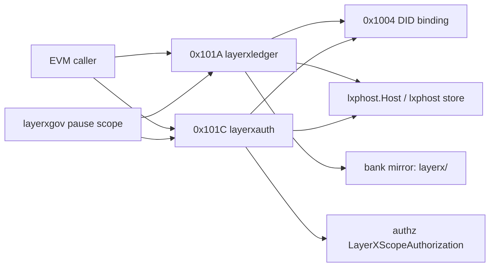

# Ledger and auth contract: layerxledger 0x101A and layerxauth 0x101C

The ledger and authority precompiles are implemented components of the merged Paxeer network. `layerxledger` is served at `0x000000000000000000000000000000000000101A`; `layerxauth` is served at `0x000000000000000000000000000000000000101C`, subject to the node's activation gate. Both keepers use one shared `lxphost.Host`. The on-disk host store name is **`lxphost`**, as declared by `LayerXHostStoreKey` in [store_keys.go](../../../storage/common/keys/store_keys.go).

There is one network: the kernel is part of the node and proposes blocks, and a receipt is final once its block is committed. Mainnet-beta uses EVM chain ID **125 (`0x7d`)**. Public JSON-RPC is at the root path of `api-mainnet-beta.paxeer.network` and `api1.mainnet-beta.paxeer.network` through `api14.mainnet-beta.paxeer.network`. Ledger and authority calls use the ordinary EVM transaction and `eth_call` surfaces.

The source contracts are the embedded [ledger ABI](../../../precompiles/layerxledger/abi.json), [auth ABI](../../../precompiles/layerxauth/abi.json), their dispatchers and keepers. Each package registers `NewMergePrecompile` from `init`. [node/upgrades.go](../../../node/upgrades.go) imports both packages and declares `mergePrecompileGate`: upgrade `v7.0`, requiring `layerxledger` for 0x101A and `layerxauth` for 0x101C. Code availability does not establish that a particular node has activated that upgrade.



## Contents

- [layerxledger-0x101a](#layerxledger-0x101a)
- [layerxledger-errors](#layerxledger-errors)
- [layerxledger-gas](#layerxledger-gas)
- [layerxledger-keeper](#layerxledger-keeper)
- [layerxledger-genesis](#layerxledger-genesis)
- [msg-layerxledger-updateparams](#msg-layerxledger-updateparams)
- [proto-layerxledger-params](#proto-layerxledger-params)
- [proto-layerxledger-msgupdateparams](#proto-layerxledger-msgupdateparams)
- [proto-layerxledger-msgupdateparamsresponse](#proto-layerxledger-msgupdateparamsresponse)
- [ledger-bank-mirror](#ledger-bank-mirror)
- [precompile-1-layerxledger-0x101a](#precompile-1-layerxledger-0x101a)
- [layerxauth-0x101c](#layerxauth-0x101c)
- [layerxauth-errors](#layerxauth-errors)
- [layerxauth-gas](#layerxauth-gas)
- [layerxauth-keeper](#layerxauth-keeper)
- [layerxauth-genesis](#layerxauth-genesis)
- [msg-layerxauth-updateparams](#msg-layerxauth-updateparams)
- [proto-layerxauth-params](#proto-layerxauth-params)
- [proto-layerxauth-msgupdateparams](#proto-layerxauth-msgupdateparams)
- [proto-layerxauth-msgupdateparamsresponse](#proto-layerxauth-msgupdateparamsresponse)
- [proto-layerxauth-layerxscopeauthorization](#proto-layerxauth-layerxscopeauthorization)
- [did-binding](#did-binding)
- [idempotency](#idempotency)
- [payload-codec](#payload-codec)
- [wiring-integration](#wiring-integration)
- [decisions](#decisions)

## layerxledger-0x101a

The ABI declares **18 methods and 9 events**. All writes are nonpayable and require the DID bound to the EVM caller; views do not resolve a caller binding. Delegate calls are refused, and static calls cannot execute writes. See [layerxledger.go](../../../precompiles/layerxledger/layerxledger.go).

| ABI method | Output | Current behavior | Gas surcharge |
|---|---|---|---:|
| `register(bytes32 assetId,bytes32 salt,string symbol,string name,uint8 decimals,uint128 supplyCap,uint8 issuerKind,bytes custodyReference)` | `bytes32 assetId` | Register asset | 18440 |
| `pause(bytes32 assetId)` | none | Pause asset | 3080 |
| `unpause(bytes32 assetId)` | none | Unpause asset | 3080 |
| `openAccount(bytes32 assetId)` | `bytes32 accountId` | Open caller's asset account | 3080 |
| `send(bytes envelope)` | none | Owner-authorized SEND | 17480 |
| `draw(bytes32 grantId,bytes32 recipient,uint128 amount,bytes32 idempotencyKey,uint64 sequence,bytes32 purposeHash,bytes32 contextHash)` | none | Retired payment route; refuses | 8840 |
| `payExact(bytes32 from,bytes32 to,bytes32 assetId,uint128 amount,uint64 expiresAtMs,bytes32 paymentReference)` | none | Exact owner payment through SEND | 7880 |
| `issueGrant(bytes grant)` | `bytes32 grantId` in ABI only | Retired; refuses | 16520 |
| `revokeGrant(bytes32 grantId,uint64 revocationSequence)` | none | Retired; refuses | 4040 |
| `mint(bytes32 assetId,bytes32 accountId,uint128 amount)` | none | Mint through kernel | 5000 |
| `burn(bytes32 assetId,bytes32 accountId,uint128 amount)` | none | Burn through kernel | 5000 |
| `getAsset(bytes32 assetId)` | Asset fields listed below | View | 1108 |
| `balanceOf(bytes32 accountId,bytes32 assetId)` | `uint128 balance` | View | 1204 |
| `totalUnits(bytes32 assetId)` | `uint128 totalUnits` | View | 1108 |
| `accountId(bytes32 owner,bytes32 assetId)` | `bytes32 accountId` | Derive ID from owner DID key; does not open account | 1204 |
| `accountOwner(bytes32 accountId)` | `bytes32 owner` | Read account owner identifier | 1108 |
| `getPayerGrant(bytes32 grantId)` | Legacy tuple in ABI only | Retired view; refuses | 1108 |
| `nextSequence(bytes32 accountId,bytes32 assetId)` | `uint64 sequence` | Read persisted account's next SEND sequence | 1204 |

`getAsset` returns, in order: `bytes32 assetId`, `string symbol`, `string name`, `uint8 decimals`, `uint128 supplyCap`, `bytes32 issuerDid`, `bytes32 salt`, `uint8 issuerKind`, `uint8 custodyKind`, `bytes custodyReference`, `bool paused`, `uint128 totalUnits`.

Decision **2340** retires the receive activity and payer-grant issue/revoke activities. The `issueGrant`, `revokeGrant` and `getPayerGrant` selectors remain for typed refusal with `Error(string)` reason **`LXP_NO_PAYER_GRANT`** (ledger SDK code 214, shared registry code -214). `draw` also refuses this way once its argument, binding and pause checks pass. These routes submit no kernel activity and create no grant, receipt, sequence or payment event. Earlier validation can still refuse a malformed or unauthorized call. `revokeGrant` retains its pause exemption; `getPayerGrant` remains a view. The seven-output legacy view tuple is defined in the ABI, but no successful grant lookup is served.

`payExact` is supported: `expiresAtMs` is a Unix timestamp in **milliseconds**, strictly later than the current block time. The keeper verifies ownership of `from`, reads the source account's next sequence, and constructs SEND activity `0x00010005`. Its context hash binds `from || to || assetId || amount_u128_be || paymentReference` through `DomainContextHash`. Successful execution mirrors the transfer and emits `Transfer` and `PaymentExact`. A payment reference cannot be used for a second successful SEND, even at a new sequence; see [idempotency](#idempotency).

The ABI events are:

| Event | Indexed fields | Non-indexed fields | Current emission |
|---|---|---|---|
| `AssetRegistered` | `bytes32 assetId` | none | Asset registration |
| `AssetPaused` | `bytes32 assetId` | none | Asset pause |
| `AssetUnpaused` | `bytes32 assetId` | none | Asset unpause |
| `AccountOpened` | `bytes32 accountId` | none | Account opening |
| `Transfer` | `bytes32 from,bytes32 to,bytes32 assetId` | `uint128 amount,uint8 kind` | Successful transfer legs |
| `PaymentExact` | `bytes32 paymentReference,bytes32 from,bytes32 to` | `bytes32 assetId,uint128 amount` | Successful `payExact` |
| `PayerGrantIssued` | `bytes32 grantId` | none | Retired; declaration retained |
| `PayerGrantRevoked` | `bytes32 grantId` | none | Retired; declaration retained |
| `PaymentDrawn` | `bytes32 grantId,bytes32 from,bytes32 to` | `bytes32 assetId,uint128 amount,bytes32 idempotencyKey,bytes32 contextHash` | Retired; declaration retained |

[LedgerEvents](../../../modules/layerxledger/keeper/events.go) decodes receipt events and transfer legs. `Transfer.kind` is the low activity ordinal: SEND and `payExact` use 5, mint uses 10, burn uses 11. Retained event declarations and legacy decoder branches do not make retired operations executable.

## layerxledger-errors

Both precompiles use `WithLXPReasons`: reverts carry Solidity **`Error(string)`**. A bare code such as `LXP_NO_PAYER_GRANT` is valid; `: detail` is **optional**. The ledger [RevertError](../../../precompiles/layerxledger/errors.go) returns canonical code text for registered ledger errors and kernel codes, retaining the Go cause. [LXPReason](../../../precompiles/common/precompiles.go) preserves text already beginning `LXP_`, maps other registered errors, and uses `LXP_UNKNOWN` for an unmapped error. Clients must not require a diagnostic suffix.

[types/errors.go](../../../modules/layerxledger/types/errors.go) registers these SDK codes in codespace `layerxledger`. [FromKernel](../../../modules/layerxledger/keeper/kernel_codes.go) maps the corresponding negative kernel codes; unlisted kernel codes remain `lxphost.Code` values and use the shared [LXP registry](../../../precompiles/common/lxp_errors.go).

| SDK code | Reason |
|---:|---|
| 3 | `LXP_NON_CANONICAL` |
| 107 | `LXP_MALFORMED_SEND` |
| 207 | `LXP_UNAUTHORIZED_DEBIT` |
| 213 | `LXP_CONTEXT_MISMATCH` |
| 214 | `LXP_NO_PAYER_GRANT` |
| 302 | `LXP_IDEMPOTENT_REPLAY` |
| 303 | `LXP_EXPIRED` |
| 305 | `LXP_SEQUENCE_MISMATCH` |
| 307 | `LXP_SEQUENCE_EXHAUSTED` |
| 400 | `LXP_INSUFFICIENT_BALANCE` |
| 401 | `LXP_ZERO_AMOUNT` |
| 402 | `LXP_ASSET_MISMATCH` |
| 403 | `LXP_ASSET_PAUSED` |
| 411 | `LXP_ASSET_ALREADY_REGISTERED` |
| 735 | `LXP_PAUSED_SCOPE` |
| 905 | `LXP_ARENA_EXHAUSTED` |
| 1003 | `LXP_FATAL_SUPPLY_MISMATCH` |

Governance pause checks use `layerxgov.ErrPausedScope` (735), which the dispatcher normalizes to `LXP_PAUSED_SCOPE`. A consumed identity sequence is a separate kernel refusal, -301 (`LXP_SEQUENCE_REUSED`); it must not be confused with the persisted SEND-reference refusal -302.

## layerxledger-gas

[GasTable](../../../precompiles/layerxledger/gas.go) supplies the surcharges in the method table. The total is `DefaultGasCost(arguments, Write) + Surcharge`, using encoded arguments **without the four-byte selector**. Writes use the SDK KV write cost; views use the KV read cost. The sum saturates at `uint64` maximum. Retired selectors retain their table rows. Unknown selectors or methods without a gas row use `UnknownMethodCallGas` and are refused. These values are code, not governance parameters.

## layerxledger-keeper

[Keeper](../../../modules/layerxledger/keeper/keeper.go) is constructed with the codec, ledger store key, shared host, bank keeper, EVM keeper and governance authority. The base module store holds `ParamsKey = []byte{0x01}`; kernel assets, accounts and identity state belong to the shared host store. There is no module-local `KernelKVPrefix`.

| Keeper path | Kernel activity |
|---|---|
| `RegisterAsset` | `0x00010001` |
| `PauseAsset` / `UnpauseAsset` | `0x00010002` / `0x00010003` |
| `OpenAccount` | `0x00010004` |
| `Send` / `PayExact` | `0x00010005` |
| `Mint` / `Burn` | `0x0001000a` / `0x0001000b` |
| `Draw`, `IssueGrant`, `RevokeGrant` | None; retired refusal |

[execute.go](../../../modules/layerxledger/keeper/execute.go) sets the global sequence through `lxphost.NextSequence`, and separately reads the actor's identity sequence. Activities use protocol version 3 and the block timestamp. These counters differ from the source account's SEND sequence returned by the ABI's `nextSequence`.

Writes check the module's `paused` flag through [CheckPauseScope](../../../modules/layerxgov/types/proposal.go); `revokeGrant` is the ledger pause exit. Views bypass pause checks but can still return missing-record or validation errors. [Send](../../../modules/layerxledger/keeper/send.go) verifies that the source belongs to the bound actor and is a permitted main or asset account for that actor, and that its asset matches. The kernel keeps its authority, balance, sequence and context checks.

The native `Keeper.NextSequence(ctx, didKey, assetID)` derives an account from an owner key. ABI callers instead reach `NextSequenceByAccountID(ctx, accountID, assetID)`, which reads the existing account and checks its asset. Passing an account ID as a DID key to the native convenience API derives a different ID.

## layerxledger-genesis

The [genesis schema](../../../api/layerxledger/genesis.proto) is params-only:

```proto
message GenesisState { Params params = 1; }
```

[DefaultGenesis and Validate](../../../modules/layerxledger/types/genesis.go) use the module's default params and `Params.Validate`. [InitGenesis and ExportGenesis](../../../modules/layerxledger/keeper/genesis.go) write and read only params. Defaults leave the ledger unpaused; either pause value is valid. Exporting this module alone does not export kernel state. Shared-host recovery, including payment references, is described under [idempotency](#idempotency).

## msg-layerxledger-updateparams

[tx.proto](../../../api/layerxledger/tx.proto) declares `paxprotocol.paxchain.layerxledger.Msg/UpdateParams`, taking `MsgUpdateParams` and returning `MsgUpdateParamsResponse`. [msg_server.go](../../../modules/layerxledger/keeper/msg_server.go) accepts only the keeper's configured authority, which the node sets to `layerxgovtypes.GovernanceAuthority()` (the governance module account). This is the module's only Msg service operation. Ledger financial writes enter through 0x101A; there is no gRPC Query service.

## proto-layerxledger-params

```proto
message Params { bool paused = 1; }
```

This is the complete ledger parameter message in [tx.proto](../../../api/layerxledger/tx.proto). Gas and payment-reference retention are not ledger params.

## proto-layerxledger-msgupdateparams

```proto
message MsgUpdateParams { string authority = 1; Params params = 2; }
```

`ValidateBasic` validates the Bech32 authority and params; the message server additionally checks that the authority equals its configured governance address.

## proto-layerxledger-msgupdateparamsresponse

```proto
message MsgUpdateParamsResponse {}
```

A successful parameter update returns this empty response.

## ledger-bank-mirror

[MirrorDenom and ParseMirrorDenom](../../../modules/layerxledger/types/denom.go) define `layerx/<64 lowercase hex digits of asset ID>`, a 71-byte native bank denomination. Uppercase hex, a different prefix or the wrong length is refused. This denomination is distinct from a tokenfactory denomination.

[Mirror](../../../modules/layerxledger/keeper/mirror.go) applies successful receipts only. Registration mints the cap, or **2^128 - 1** for a zero/unbounded cap, through the ledger module account and sends it to `BankAddress(IssuanceAccountID(assetID))`. The initial supply does not remain in the module account. SEND, mint and burn receipt legs move existing mirror coins with `bank.SendCoins`; each amount must be a positive u128. A failed bank operation becomes `LXP_FATAL_SUPPLY_MISMATCH`. The node grants the ledger module account `Minter` and `Burner` permissions.

The intended mirror invariant is that every kernel account's bank balance in this denomination equals its kernel balance. `PayExact` stages the kernel execution, mirror and event validation in a cache before publishing success. Supply writes also cache kernel and mirror changes together; an accepted kernel transfer whose mirror fails is not published.

[IssuerBindingKeeper](../../../modules/layerxledger/keeper/issuer_binding.go) is a separate wrapper that can create a tokenfactory denomination, associate the issuer DID and mirror asset pause. **The production node constructs the base `Keeper`, and 0x101A consumes that base keeper.** The wrapper is not wired into that path, so a normal 0x101A registration or pause does not promise tokenfactory issuer binding or tokenfactory pause propagation. Its optional mapping under ledger prefix `0x02` is not part of the base params-only genesis export.

## precompile-1-layerxledger-0x101a

The ramp toolkit's [evm.rs](../../../services/platform/ramps/toolkit/src/evm.rs) declares `LEDGER_ADDRESS` (0x101A), `encode_pay_exact`, `encode_draw`, `LedgerPayment` and `decode_ledger_payment`; [lib.rs](../../../services/platform/ramps/toolkit/src/lib.rs) declares `LedgerCall { to, data }`.

| Client function | Arguments in ABI order | Meaning |
|---|---|---|
| `encode_pay_exact` | `from, to, asset, amount, expires_at, reference` | Supported exact payment; expiry is milliseconds; selector `0x78ea11db` |
| `encode_draw` | `grant_id, recipient, amount, idempotency_key, sequence, purpose_hash, context_hash` | Compatibility encoding of the retired draw selector `0x2e89490f`; execution refuses |

For `encode_draw`, identifiers and hashes are `[u8; 32]`, `amount` is `u128`, and `sequence` is `u64`. The second argument is the **recipient**, not the asset; the first is the **grant ID**, not the payer. The old keeper `DrawArgs` field names do not change that ABI order. The encoder's presence does not establish usable payer-grant authority.

`decode_ledger_payment(&SequencerLog) -> Option<LedgerPayment>` accepts only the 0x101A emitter, exactly four topics, and the declared `PaymentExact` (64 data bytes) or historical `PaymentDrawn` (128 data bytes) shape, including the uint128 bound. It returns owned `Exact { from, to, reference, asset, amount }` or `Drawn { from, to, grant, asset, amount, idempotency_key, context }` fields. `SequencerLog` is the client type name; decoding proves the log shape, not receipt authenticity or a live draw route.

The toolkit also targets the maintained payment precompile at **0x101B** (`PAY_ADDRESS`) with `encode_budget_spend`, `encode_get_budget` and `decode_budget_spent`. Its customer budget flow uses that ordinary-principal authority path. See [pay](pay.md) and [platform ramps](platform-ramps.md); retained draw encoding and decoding are historical compatibility material.

## layerxauth-0x101c

The active [auth ABI](../../../precompiles/layerxauth/abi.json) declares **10 methods and 5 events**. It includes `recordLifecycle`; **`resultByIdempotency(bytes32,bytes32)` is retired and absent**. A call using the removed selector is an unknown-method refusal, not a cached-result query.

| ABI method | Output | Gas surcharge |
|---|---|---:|
| `recordLifecycle(bytes payload,bytes32 idempotencyKey)` | `uint64 globalSequence` | 36680 |
| `grantSession(bytes grant,uint64 expirySequence,bytes32 actionKey)` | `bytes32 grantId` | 36680 |
| `grantSessionSuccessor(bytes grant,uint64 expirySequence,bytes32 actionKey,bytes32 predecessorId,bytes32 expectedCommitment)` | `bytes32 grantId` | 38600 |
| `grantCapability(bytes grant)` | `bytes32 grantId` | 34760 |
| `revokeGrant(bytes32 grantId,uint8 reason,uint64 sequence)` | none | 5000 |
| `getGrant(bytes32 grantId)` | `bytes grant,bool revoked,uint64 revokedAt` | 1108 |
| `isLive(bytes32 grantId,uint64 sequence,uint64 timestampMs)` | `bool live,string code` | 1300 |
| `sessionKey(bytes32 grantId)` | `bytes summary` | 1108 |
| `capabilityScope(bytes32 grantId)` | Scope fields listed below | 1108 |
| `checkActivity(bytes32 grantId,uint32 activityType,bytes32 assetId,uint128 amount)` | `string code` | 1396 |

Writes are nonpayable and use the current EVM DID binding; views do not require that binding. The dispatcher refuses delegate calls and writes in static calls. [Execute](../../../precompiles/layerxauth/layerxauth.go) stages handler changes in a cached context and publishes them only on success.

`recordLifecycle` accepts governance payload tag `0x71`, sub-op **1 or 3**, and submits it through the shared host. It returns the actual receipt's global sequence and emits the matching `IdentityStateUpdated` event after validating that it names the actor. Session and successor grants use sub-op 5, capabilities use 8, revocation uses 6. `expirySequence` and revocation `sequence` are sequence values; `timestampMs`, grant validity timestamps and period timestamps are milliseconds.

`capabilityScope` returns, in order: `uint64 moduleMask`, `uint16 ordinalMin`, `uint16 ordinalMax`, `bytes32 assetId`, `uint128 maxPerActivity`, `uint128 maxTotal`, `uint128 spentTotal`, `uint64 periodLength`, `uint128 maxPerPeriod`, `uint128 spentThisPeriod`, `uint64 periodStart`, `bytes32 purposeHash`.

`getGrant` returns canonical current grant bytes plus the revocation flag and revoked-at sequence. `isLive` returns an empty code for a live grant, or a canonical refusal code with `false`. `checkActivity` returns an empty code when its current liveness and scope checks pass, or a refusal code. These are reads, not reservations or execution guarantees; malformed data and fatal read errors can still revert.

| ABI event | Indexed field | Non-indexed fields |
|---|---|---|
| `SessionGranted` | `bytes32 grantId` | `bytes summary` |
| `GrantBody` | `bytes32 grantId` | `uint8 sub,uint8 chunk,bytes body` |
| `CapabilityGranted` | `bytes32 grantId` | none |
| `GrantRevoked` | `bytes32 grantId` | `bytes record` |
| `IdentityStateUpdated` | `bytes32 didId` | `bytes state` |

[AuthEvents](../../../modules/layerxauth/keeper/events.go) maps kernel codes `0x7145` to a 209-byte `LXGS2` session summary, `0x7148` to a 32-byte capability ID, `0x7106` to a 41-byte revocation record, and `0x7110` to a 223-byte `LXGI1` identity state. Grant bodies arrive in ordered chunks of at most 256 bytes: session codes `0x7105`/`0x7125`, capability codes `0x7108`/`0x7128`. Each summary requires body chunks; continuation chunks require a preceding full-size chunk. The precompile emits these decoded events from 0x101C.

## layerxauth-errors

The [auth error registrations](../../../modules/layerxauth/types/errors.go) and [FromKernel](../../../modules/layerxauth/keeper/kernel_codes.go) distinguish module SDK codes from kernel codes:

| SDK code (`layerxauth`) | Kernel code | Reason |
|---:|---:|---|
| 2 | -204 | `LXP_AUTH_SCOPE` |
| 3 | -203 | `LXP_AUTH_REVOKED` |
| 4 | -202 | `LXP_AUTH_EXPIRED` |
| 5 | -222 | `LXP_AUTH_NOT_MATURE` |
| 6 | -304 | `LXP_NOT_YET_VALID` |
| 7 | -301 | `LXP_SEQUENCE_REUSED` |
| 8 | -3 | `LXP_NON_CANONICAL` |
| 9 | -207 | `LXP_UNAUTHORIZED_DEBIT` |
| 10 | -302 | `LXP_IDEMPOTENT_REPLAY` |

Pause refusals use **`layerxgov` code 735**, `LXP_PAUSED_SCOPE`; the old `layerxauth` code 11 is retired. [RevertError](../../../precompiles/layerxauth/errors.go) normalizes auth, governance and kernel errors to canonical text and retains their Go causes. The same [optional-detail Error(string) rule](#layerxledger-errors) applies here. View-returned refusal strings are distinct from transaction reverts.

## layerxauth-gas

[GasTable](../../../precompiles/layerxauth/gas.go) supplies the method surcharges above, including `recordLifecycle` and excluding retired `resultByIdempotency`. Total charging follows [layerxledger-gas](#layerxledger-gas): KV argument cost plus surcharge, using `Write: true` for the five writes and `false` for the five views.

## layerxauth-keeper

[Keeper](../../../modules/layerxauth/keeper/keeper.go) receives the codec, auth store key, shared host, authz keeper, EVM keeper and governance authority. It holds only params in its own module store. Authority grants and identity sequences are read from the shared host. [execute.go](../../../modules/layerxauth/keeper/execute.go) requires bound authority, derives activity type `0x00070000 | payload[1]`, reads the identity sequence, allocates the global sequence and uses block time.

Session and capability issuance check `paused`; auth `revokeGrant` remains the pause exit. **`RecordLifecycle` does not call `checkPause` in the current implementation.** Views also bypass pause checks. The pause flag therefore must not be described as blocking every auth write.

[GrantCapability and SaveGrant](../../../modules/layerxauth/keeper/capability.go) atomically issue a kernel grant and save its `LayerXScopeAuthorization` mirrors. The current message mapping requires asset module bit 1 and a range containing SEND ordinal 5; it names SDK bank `MsgSend` and `MsgMultiSend`. It does not authorize kernel ledger messages. Both grantor and capability key need matching EVM bindings. An occupied authz key for a grantee/granter/message type is refused rather than replaced, preserving accumulated spending. A registered message mapping still has to satisfy `LayerXScopeAuthorization.Accept` for the actual message shape.

[RevokeGrant](../../../modules/layerxauth/keeper/revoke.go) checks the bound actor is the grantor, validates the reason and sequence, executes kernel revocation and requires a matching receipt event. The normal keeper/precompile revocation path **does not call `DeleteGrant`**. That helper can delete matching authz entries, but its existence is not an automatic-deletion guarantee. Enforcement also uses the grantor's current revocation sequence: [RevocationDecorator](../../../modules/layerxauth/ante/revocation.go), wired after `AuthzNestedMessageDecorator` in [node/ante.go](../../../node/ante.go), supplies it for nested `MsgExec` messages. `Accept` refuses a missing or mismatched epoch, so stale authz records do not bypass that check.

## layerxauth-genesis

The [auth genesis schema](../../../api/layerxauth/genesis.proto) is also params-only:

```proto
message GenesisState { Params params = 1; }
```

[DefaultGenesis](../../../modules/layerxauth/types/genesis.go) uses `paused = false`, `idempotency_retention = 0`. [InitGenesis and ExportGenesis](../../../modules/layerxauth/keeper/genesis.go) handle only params; they do not serialize grants or recreate authz mirrors. Restoring auth params alone cannot restore authority state.

## msg-layerxauth-updateparams

[tx.proto](../../../api/layerxauth/tx.proto) declares `paxprotocol.paxchain.layerxauth.Msg/UpdateParams`, taking `MsgUpdateParams` and returning `MsgUpdateParamsResponse`. [msg_server.go](../../../modules/layerxauth/keeper/msg_server.go) checks the configured governance authority before replacing params. The module registers this Msg service only, with no gRPC Query service or query CLI; authority reads use 0x101C.

## proto-layerxauth-params

```proto
message Params { bool paused = 1; uint64 idempotency_retention = 2; }
```

`IdempotencyRetention` remains a compatibility parameter. `Params.Validate` accepts every value; the current keeper does not pass it to a host retention setter. It does not prune or expire the successful-SEND reference set. Defaults and validation are in [params.go](../../../modules/layerxauth/types/params.go).

## proto-layerxauth-msgupdateparams

```proto
message MsgUpdateParams { string authority = 1; Params params = 2; }
```

As with the ledger, `ValidateBasic` checks Bech32 authority syntax, and the message server checks equality with its configured governance authority.

## proto-layerxauth-msgupdateparamsresponse

```proto
message MsgUpdateParamsResponse {}
```

The successful update response has no fields.

## proto-layerxauth-layerxscopeauthorization

[api/layerxauth/tx.proto](../../../api/layerxauth/tx.proto) declares these authorization fields:

| Field numbers | Fields |
|---|---|
| 1–4 | `uint64 module_mask`, `uint32 ordinal_min`, `uint32 ordinal_max`, `bytes asset_id` |
| 5–9 | `string max_per_activity`, `string max_total`, `uint64 revocation_epoch`, `bytes grant_id`, `string msg_type_url` |
| 10–13 | `uint32 kind`, `uint64 period_length`, `string max_per_period`, `bytes purpose_hash` |
| 14–16 | `uint64 not_before`, `uint64 not_after`, `string spent_total` |

The current [Go wire type](../../../modules/layerxauth/types/tx.pb.go) additionally serializes `period_start` at field 17 and `spent_this_period` at 18; these fields are not declared in the current `.proto` source. `Accept` uses them to retain period spending. Consumers and future schema regeneration must account for this source/generated-schema difference.

[authorization.go](../../../modules/layerxauth/types/authorization.go) implements `authz.Authorization`. `ValidateBasic` requires a nonempty message type, a nonzero module mask within `0x3fe`, kind 2, 3 or 4, ordered uint16 ordinals, a 32-byte grant ID, bounded identifier lengths, an increasing validity interval and canonical decimal u128 budget strings (empty strings represent zero).

`Accept` refuses all `paxprotocol.paxchain.layerxledger.*` messages: ledger execution requires account-holder authority. It checks the exact message URL, one signer, the supplied current revocation epoch, validity interval, module, ordinal, asset, purpose and budgets. SDK `MsgSend` derives its asset from one canonical mirror denomination and its purpose from the marshaled payment. Other accepted shapes must implement `ScopedActivity.LayerXScope() (moduleID uint16, ordinal uint16, assetID [32]byte, amount sdk.Int)`; an optional `LayerXPurpose()` binds purpose. Accepted spending returns an updated authorization with total and, when configured, period consumption.

## did-binding

The [ledger Actor](../../../modules/layerxledger/keeper/authority.go) and [auth Actor](../../../modules/layerxauth/keeper/authority.go) read `GetLayerXDid(ctx, caller)` on each write. An unbound ledger caller gets `LXP_UNAUTHORIZED_DEBIT`; an unbound auth caller gets `LXP_AUTH_SCOPE`, before kernel submission. The DID key is converted to the canonical DID and DID identifier. `KernelAuthority` carries `Bound: true`, matching actor and principal identifiers, and the verified key.

The [0x1004 address precompile](../../../precompiles/addr/abi.json) supplies `bindLayerX` and `getLayerXDid`. On this EVM path, verified binding authority replaces the envelope signature check; it does not remove the kernel's owner, key, payload, network, sequence or context checks. A payload encoder's empty signature slot is usable only with verified binding authority or after supplying the required signature on a signed path.

The [bank ABI at 0x1001](../../../precompiles/bank/abi.json) also retains the baseline context-bound overload `send(address fromAddress,address toAddress,string denom,uint256 amount,bytes32 contextHash)`. That bank method is a distinct ABI from ledger `send(bytes envelope)` at 0x101A.

## idempotency

**Generic cached-result idempotency is retired; successful SEND payment-reference protection is active.** The old `layerxauth` module prefixes `0x02` and `0x03` and their key helpers are removed. The removed `resultByIdempotency` keeper/precompile view is not a recovery API. The same activity idempotency key can occur in auth and ledger without a generic cross-module cache, but a successful SEND reference cannot be spent twice.

Decision **2337** is implemented by [ctx.go](../../../modules/lxphost/ctx.go): `checkPaymentReference` checks **host key `0x04 || reference[32]`** for every `LX_ASSET_SEND`; `commitPaymentReference` writes the encoded receipt only when that SEND succeeds. The key has no DID namespace. Grants, revocations and refused sends do not add references. A duplicate returns host code **-302**, even if the caller supplies fresh identity/account/global sequences. The ledger maps it to `LXP_IDEMPOTENT_REPLAY`; it does not return the old payment as a successful new call.

Reference writes use the caller's KV context and follow cache rollback. Committed records survive a process/store reopen. An abandoned cache leaves no reference in its parent context. This differs from consumed-sequence protection: kernel admission still refuses a reused identity sequence with -301, and SEND validates the source account sequence separately. Clients must keep EVM nonces, kernel identity sequences, SEND account sequences and host global sequences distinct. `payExact` selects the account sequence for the caller but still requires a fresh payment reference for a new payment.

Host [genesis.go](../../../modules/lxphost/genesis.go) exports and validates successful reference records. A reference key must be 33 bytes; its value must decode as a current state-commitment-version successful asset SEND receipt, with positive amount and global sequence in `1..LastSequence`. Its context hash must bind the receipt's `from`, `to`, asset, amount and the key's reference. `InitStoreGenesis` validates before restoring records and the last-sequence counter. Thus payment-reference recovery belongs to **host genesis**, not the params-only ledger/auth exports. It must preserve the successful-reference set rather than clearing it on restart or interpreting the compatibility retention param as permission to prune it.

Existing source tests documenting these paths include `TestPaymentReferenceStaysRefusedAfterReopen` in [idempotency_restart_test.go](../../../modules/lxphost/idempotency_restart_test.go), host genesis tests in [genesis_test.go](../../../modules/lxphost/genesis_test.go), and ledger/auth [shared_host_test.go](../../../modules/layerxauth/keeper/shared_host_test.go).

## payload-codec

The implemented codecs live in [ledger payload.go](../../../modules/layerxledger/types/payload.go), [payload_transfer.go](../../../modules/layerxledger/types/payload_transfer.go), [ledger validators](../../../modules/layerxledger/types/msgs.go), and [auth payload.go](../../../modules/layerxauth/types/payload.go). Integers use big-endian wire encoding.

| Encoder or validator | Wire contract |
|---|---|
| `EncodeRegisterPayload` | Version 1, asset ID, salt, ASCII symbol 1–16 bytes, UTF-8 name 1–32 bytes, decimals 0–38, u128 cap, issuer kind 1 or 2, custody reference at most 128 bytes; kind 1 requires an empty reference |
| `EncodePausePayload` / `EncodeOpenAccountPayload` | Version 1 and asset ID; exactly 34 bytes |
| `EncodeSupplyPayload` | Version 1, asset ID, account ID and positive u128 amount; 82 bytes |
| `EncodeSendPayload` | Tag `0x5301`, ten fields, from/to/asset, positive u128 amount, source sequence, reference, expiry, context and owner authorization; encoder emits no conditions and an empty signature slot |
| `ValidateSendEnvelope` | Exact envelope length, at most eight conditions, each nine bytes; complete authorization, no trailing bytes |
| `EncodeSessionPayload` | `0x71`, sub-op 5, variant 1 with three fields or successor variant 2 with five; length-prefixed grant, expiry sequence, action key and optional predecessor/commitment; bounded by 1024 bytes |
| `EncodeCapabilityPayload` | `0x71`, sub-op 8, variant 1, one length-prefixed grant; nonempty grant, total at most 1024 bytes |
| `EncodeRevokePayload` / `ValidateRevokePayload` | `0x71`, sub-op 6, variant 0, three fields; 45 bytes including grant ID, reason 1–5 and sequence |

`SendArgs` carries network ID and protocol version in its authorization. The bound EVM path still requires those values and the context hash to agree with execution. `PayExactArgs.ExpiresAt` is the ABI's `expiresAtMs`, not a sequence number.

Legacy helpers remain for wire compatibility: `EncodeReceivePayload` builds the retired receive envelope, `ValidateIssueGrantPayload` checks the **346-byte** payer-grant length and boolean encodings, and `EncodeRevokeGrantPayload` builds a 42-byte legacy revocation payload. They do not authenticate payer grants or make retired activities callable. Neither the ledger issue/revoke routes nor `draw` submit those activities.

## wiring-integration

[node/app.go](../../../node/app.go) constructs the shared host and passes it to both base keepers, with bank/EVM dependencies for ledger and authz/EVM dependencies for auth. Both modules are registered with the module manager; their `RegisterServices` methods register only `Msg/UpdateParams`. Each module genesis exports params, while host state is owned by the `lxphost` store module. The merge constructors obtain the same keepers through `LayerXLedgerK()` and `LayerXAuthK()` accessors.

The implemented execution path is EVM call → precompile dispatcher → bound actor → keeper → shared host → kernel receipt → decoded EVM events and, for ledger transfers, bank mirror. [kernel](kernel.md) describes the host contract; [pay](pay.md) describes ordinary-principal payment authority. The tokenfactory wrapper and authz deletion limitations are stated in [ledger-bank-mirror](#ledger-bank-mirror) and [layerxauth-keeper](#layerxauth-keeper); they are not promised side effects of node-built precompiles.

Useful existing behavior sources include the precompile `abi_test.go`, `activation_test.go`, `pause_test.go`, `client_test.go` and `parity_test.go` files in [ledger](../../../precompiles/layerxledger/) and [auth](../../../precompiles/layerxauth/), plus keeper host-route, mirror, grant and revocation tests.

## decisions

The earlier version of this page was pinned to **`2a1033aa2`** and described implementation work as planned. That is historical provenance, not an availability statement for the current tree. The original domain-2 decisions below are retained with their current interpretation; later decisions supersede the old generic-idempotency and payer-grant claims.

| Decision | Current application |
|---|---|
| 201 | One shared host; the mounted on-disk store name is `lxphost`. Base ledger/auth stores hold params, not separate copies of kernel state. |
| 202 | Keeper-level generic idempotency entries are retired. The later successful-SEND reference rule in 2337 applies to host prefix `0x04`. |
| 203 | Ledger and auth issuance route pause through the governance scope; `revokeGrant` is an exit. Auth `recordLifecycle` currently bypasses that pause check. |
| 204 | Native bank mirror denomination `layerx/<asset hex>`; initial cap goes to the issuance account, and receipt transfer legs move mirror balances. |
| 205 | Host global sequence allocation is shared across keeper activities and differs from identity and SEND account sequences. |
| 206 | The EVM DID binding supplies verified authority while the kernel retains its remaining authority and context checks. |
| 207 | Receipts supply events and transfer legs for decoding, EVM logs and bank mirroring. |
| 208 | Implemented packages self-register merge constructors and use LXP reasons and fixed gas tables. |
| 209 | Module genesis is params-only; only UpdateParams is a Msg service operation, with no gRPC Query service. |
| 210 | Capability issuance mirrors supported scopes into authz and the ante decorator supplies revocation epochs. Current revocation does not automatically invoke the deletion helper. |
| 211 | Scope fields are validated and enforced by `LayerXScopeAuthorization`; see the source/generated-field distinction above. |
| 212 | Payload encoders live in module types packages. The 346-byte payer-grant codec is historical compatibility only after 2340. |
| 213 | Address 0x1004 provides DID binding; ledger/auth consume that binding. Bank 0x1001 retains its context-hash send overload. |
| 2337 | Host prefix `0x04` records exactly successful SEND references, including rollback, restart and host-genesis recovery semantics. |
| 2340 | Kernel receive and payer-grant issue/revoke activities are retired. Ledger compatibility grant selectors and draw refuse; `payExact` remains a SEND. |
| 2354 | Describe surfaces at their served symbols and paths; removed auth result-by-idempotency and payer-grant interfaces are retired, not planned features. |
