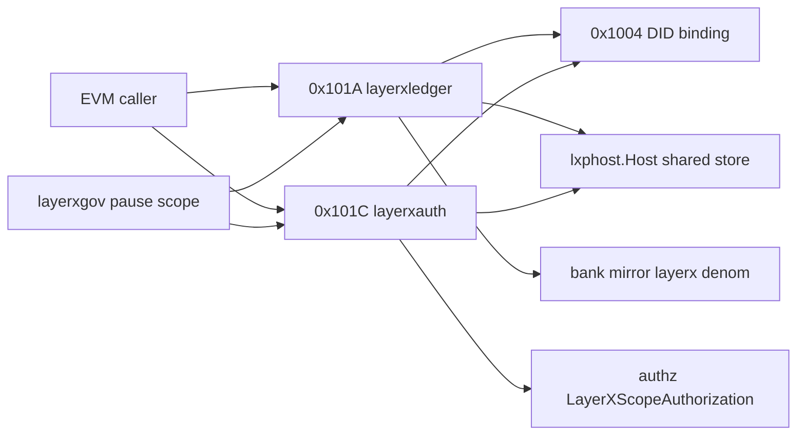

# Ledger and auth contract: layerxledger 0x101A and layerxauth 0x101C

This contract freezes the domain 2 ledger and authority surfaces: the 0x101A layerxledger and 0x101C layerxauth precompiles, their keepers over the one shared kernel host, the params-only module genesis, the payload codecs, the bank mirror and the error and gas tables. Neither precompile is served at the pinned revision: `precompiles/layerxledger` and `precompiles/layerxauth` are planned packages, while `mergePrecompileGate` already names both addresses (`node/upgrades.go:525` and `node/upgrades.go:527`).

Both keepers submit kernel activities through one `lxphost.Host` over the shared host store key, keep only Params in their own stores (decision.201) and route pause through the layerxgov pause scope with revokeGrant as the exit (decision.203).

Revision `2a1033aa2`. Every `path:line` below was read at that revision; `(planned)` marks a file that does not exist there.

## Contents

- [layerxledger-0x101a](#layerxledger-0x101a)
- [layerxledger-errors](#layerxledger-errors)
- [layerxledger-gas](#layerxledger-gas)
- [layerxledger-keeper](#layerxledger-keeper)
- [layerxledger-genesis](#layerxledger-genesis)
- [msg-layerxledger-updateparams](#msg-layerxledger-updateparams)
- [proto-layerxledger-params](#proto-layerxledger-params)
- [proto-layerxledger-msgupdateparams](#proto-layerxledger-msgupdateparams)
- [proto-layerxledger-msgupdateparamsresponse](#proto-layerxledger-msgupdateparamsresponse)
- [ledger-bank-mirror](#ledger-bank-mirror)
- [precompile-1-layerxledger-0x101a](#precompile-1-layerxledger-0x101a)
- [layerxauth-0x101c](#layerxauth-0x101c)
- [layerxauth-errors](#layerxauth-errors)
- [layerxauth-gas](#layerxauth-gas)
- [layerxauth-keeper](#layerxauth-keeper)
- [layerxauth-genesis](#layerxauth-genesis)
- [msg-layerxauth-updateparams](#msg-layerxauth-updateparams)
- [proto-layerxauth-params](#proto-layerxauth-params)
- [proto-layerxauth-msgupdateparams](#proto-layerxauth-msgupdateparams)
- [proto-layerxauth-msgupdateparamsresponse](#proto-layerxauth-msgupdateparamsresponse)
- [proto-layerxauth-layerxscopeauthorization](#proto-layerxauth-layerxscopeauthorization)
- [did-binding](#did-binding)
- [idempotency](#idempotency)
- [payload-codec](#payload-codec)
- [wiring-integration](#wiring-integration)
- [decisions](#decisions)

## layerxledger-0x101a

Precompile 0x000000000000000000000000000000000000101A: 18 methods and 9 events over the kernel asset, account and payer-grant records.

| Aspect | Rule |
|---|---|
| Authority | Every write acts for the LayerX DID bound to msg.sender through the 0x1004 binding; an unbound caller is refused before any kernel call and no envelope signature is checked (decision.206). |
| Effects | Each write submits one kernel activity through the ledger keeper and the shared host; the receipt carries kernel events and transfer legs (decision.207), which become the 0x101A logs and the bank mirror legs (decision.204). |

Contract context `2.layerxledger-0x101a`:

| Aspect | Rule |
|---|---|
| Interface | Precompile 0x000000000000000000000000000000000000101A named layerxledger: 18 ABI methods and 9 events of precompiles/layerxledger/abi.json (planned) |
| Storage | Kernel asset, account and grant records in the shared layerxhost store under the host prefixes of modules/lxphost/ctx.go:62-66; layerxledger module store holds ParamsKey 0x01 only; bank mirror under layerx/&lt;asset hex&gt; |
| Errors | Error(string) reasons LXP_&lt;CODE&gt; from the layerxledger registrations of modules/layerxledger/types/errors.go:14-30, kernel names through LXPCodeName (precompiles/common/lxp_errors.go:320) and LXP_PAUSED_SCOPE 735 from layerxgov |
| Events | AssetRegistered, AssetPaused, AssetUnpaused, AccountOpened, Transfer, PayerGrantIssued, PayerGrantRevoked, PaymentDrawn, PaymentExact |
| Gas | Fixed surcharge per method plus DefaultGasCost of the input: register 18440, pause 3080, unpause 3080, openAccount 3080, send 17480, draw 8840, payExact 7880, issueGrant 16520, revokeGrant 4040, mint 5000, burn 5000, getAsset 1108, balanceOf 1204, totalUnits 1108, accountId 1204, accountOwner 1108, nextSequence 1204, getPayerGrant 1108 |
| Activation | Served from the height where MergeUpgrade v7.0 (precompiles/setup.go:50) is done, gated by mergePrecompileGate (node/upgrades.go:521) on the layerxledger module |
| Invariants | Bank balance of every kernel account under its layerx denom equals the kernel balance; every write acts for the DID bound to the EVM caller; one idempotency key per DID across ledger and auth |
| Pause | layerxledger params paused refuses every write except revokeGrant through CheckPauseScope (modules/layerxgov/types/proposal.go:38); views always answer |

Frozen interfaces: 33 (new 33).

**ABI methods**

| Method | Address | Selector | Status | Gas | Defined at |
|---|---|---|---|---|---|
| `accountId(bytes32,bytes32) (planned)` | 0x101a | `0x3f050cbc` | new | surcharge 1204 (planned) | `precompiles/layerxledger/abi.json` (planned) |
| `accountOwner(bytes32) (planned)` | 0x101a | `0x37955ab2` | new | surcharge 1108 (planned) | `precompiles/layerxledger/abi.json` (planned) |
| `balanceOf(bytes32,bytes32) (planned)` | 0x101a | `0xb1ffc03e` | new | surcharge 1204 (planned) | `precompiles/layerxledger/abi.json` (planned) |
| `burn(bytes32,bytes32,uint128) (planned)` | 0x101a | `0xda3c63f3` | new | surcharge 5000 (planned) | `precompiles/layerxledger/abi.json` (planned) |
| `draw(bytes32,bytes32,uint128,bytes32,uint64,bytes32,bytes32) (planned)` | 0x101a | `0x2e89490f` | new | surcharge 8840 (planned) | `precompiles/layerxledger/abi.json` (planned) |
| `getAsset(bytes32) (planned)` | 0x101a | `0x2cc3ce80` | new | surcharge 1108 (planned) | `precompiles/layerxledger/abi.json` (planned) |
| `getPayerGrant(bytes32) (planned)` | 0x101a | `0x423fe4b2` | new | surcharge 1108 (planned) | `precompiles/layerxledger/abi.json` (planned) |
| `issueGrant(bytes) (planned)` | 0x101a | `0xd0d53480` | new | surcharge 16520 (planned) | `precompiles/layerxledger/abi.json` (planned) |
| `mint(bytes32,bytes32,uint128) (planned)` | 0x101a | `0xf04db938` | new | surcharge 5000 (planned) | `precompiles/layerxledger/abi.json` (planned) |
| `nextSequence(bytes32,bytes32) (planned)` | 0x101a | `0xce2f921f` | new | surcharge 1204 (planned) | `precompiles/layerxledger/abi.json` (planned) |
| `openAccount(bytes32) (planned)` | 0x101a | `0xbdf52150` | new | surcharge 3080 (planned) | `precompiles/layerxledger/abi.json` (planned) |
| `pause(bytes32) (planned)` | 0x101a | `0xed56531a` | new | surcharge 3080 (planned) | `precompiles/layerxledger/abi.json` (planned) |
| `payExact(bytes32,bytes32,bytes32,uint128,uint64,bytes32) (planned)` | 0x101a | `0x78ea11db` | new | surcharge 7880 (planned) | `precompiles/layerxledger/abi.json` (planned) |
| `register(bytes32,bytes32,string,string,uint8,uint128,uint8,bytes) (planned)` | 0x101a | `0xfd03012a` | new | surcharge 18440 (planned) | `precompiles/layerxledger/abi.json` (planned) |
| `revokeGrant(bytes32,uint64) (planned)` | 0x101a | `0x58d183a8` | new | surcharge 4040 (planned) | `precompiles/layerxledger/abi.json` (planned) |
| `send(bytes) (planned)` | 0x101a | `0x2bb1ae7c` | new | surcharge 17480 (planned) | `precompiles/layerxledger/abi.json` (planned) |
| `totalUnits(bytes32) (planned)` | 0x101a | `0x53a6332b` | new | surcharge 1108 (planned) | `precompiles/layerxledger/abi.json` (planned) |
| `unpause(bytes32) (planned)` | 0x101a | `0x2f4dae9f` | new | surcharge 3080 (planned) | `precompiles/layerxledger/abi.json` (planned) |

**Events**

| Event | Address | topic0 | Status | Defined at |
|---|---|---|---|---|
| `AccountOpened(bytes32 indexed) (planned)` | 0x101a | `0x307d00a86fd0f97ae2d0368268bd5f047f7e8c0d13d1570e72dadd8f9e2fe22f` | new | `precompiles/layerxledger/abi.json` (planned) |
| `AssetPaused(bytes32 indexed) (planned)` | 0x101a | `0xe2844e7e535e938024242536fcf78585913acf68e8d61fafa5d36e63a43f4c47` | new | `precompiles/layerxledger/abi.json` (planned) |
| `AssetRegistered(bytes32 indexed) (planned)` | 0x101a | `0xe44622c42196b40148eee03152bf2d34e7e3180112c6a2ca51e16f864b65bd13` | new | `precompiles/layerxledger/abi.json` (planned) |
| `AssetUnpaused(bytes32 indexed) (planned)` | 0x101a | `0x32f3ed1bf47daea95443414fbdcb1f5df4651a2ea7bb40e4bc41ae16c6f1843d` | new | `precompiles/layerxledger/abi.json` (planned) |
| `PayerGrantIssued(bytes32 indexed) (planned)` | 0x101a | `0xfacf09c43b359fef8d71b96c6e4c823b1f09c539e257224245c24345fa24f66e` | new | `precompiles/layerxledger/abi.json` (planned) |
| `PayerGrantRevoked(bytes32 indexed) (planned)` | 0x101a | `0x841096fe471155c0948686c4e7fa3210edcc36f84f8b61f1b508b923fa6a226d` | new | `precompiles/layerxledger/abi.json` (planned) |
| `PaymentDrawn(bytes32 indexed,bytes32 indexed,bytes32 indexed,bytes32,uint128,bytes32,bytes32) (planned)` | 0x101a | `0x13473d103a2d52172016c872eeae0153e254af3c21a1d987492ab737f1a34fe1` | new | `precompiles/layerxledger/abi.json` (planned) |
| `PaymentExact(bytes32 indexed,bytes32 indexed,bytes32 indexed,bytes32,uint128) (planned)` | 0x101a | `0xc4da5d6f757c251cd70947b752917e5671b677517e3d953f362a1df6648ef5b1` | new | `precompiles/layerxledger/abi.json` (planned) |
| `Transfer(bytes32 indexed,bytes32 indexed,bytes32 indexed,uint128,uint8) (planned)` | 0x101a | `0x3c136bc6b05877456edd6c1baed12a9d44c364ad7301478c948e7d70dd4b1ca0` | new | `precompiles/layerxledger/abi.json` (planned) |

**Other interfaces**

| Interface block | Kind | Signature | Status | Defined at |
|---|---|---|---|---|
| `interface.2.fmt-layerxledger-abi-j23` | file_format | `Solidity JSON ABI of 0x101a` | new | `precompiles/layerxledger/abi.json` (planned) |
| `interface.2.go-pc-layerxledger-getabi-j23` | go_exported | `func GetABI() abi.ABI` | new | `precompiles/layerxledger/abi.go` (planned) |
| `interface.2.go-pc-layerxledger-address-j23` | go_exported | `const LedgerAddress = "0x000000000000000000000000000000000000101A"` | new | `precompiles/layerxledger/layerxledger.go` (planned) |
| `interface.2.go-pc-layerxledger-keepers-j23` | go_exported | `type LedgerKeepers interface { LayerXLedgerK() *keeper.Keeper }` | new | `precompiles/layerxledger/layerxledger.go` (planned) |
| `interface.2.go-pc-layerxledger-newmergeprecompile-j23` | go_exported | `func NewMergePrecompile(keepers utils.Keepers, planName string) (precompiles.IPrecompile, error)` | new | `precompiles/layerxledger/layerxledger.go` (planned) |
| `interface.2.go-pc-layerxledger-newprecompile-j23` | go_exported | `func NewPrecompile(keepers utils.Keepers) (*pcommon.Precompile, error)` | new | `precompiles/layerxledger/layerxledger.go` (planned) |

Capabilities verified against this section: 2.0.9, 2.2.1, 2.3.6, 2.10.1, 2.10.2, 2.10.3, 2.10.4, 2.10.5, 2.12.1, 2.12.3, 2.14.1, 2.15.2, 2.15.4.

| Acceptance | Requirement | Test |
|---|---|---|
| 2.11.1 | 2011.1 | `precompiles/layerxledger/abi_test.go::TestLedgerABIMethods (planned)` |
| 2.11.2 | 2011.2 | `precompiles/layerxledger/abi_test.go::TestLedgerABIEvents (planned)` |
| 2.22.1 | 2022.1 | `modules/layerxledger/keeper/events_test.go::TestDecodeLedgerEvents (planned)` |
| 2.45.1 | 2045.1 | `precompiles/layerxledger/surface_test.go::TestLedgerSurfaceFrozen (planned)` |
| 2.50.1 | 2050.1 | `precompiles/layerxledger/layerxledger_test.go::TestLedgerMergeConstructorRegistered (planned)` |
| 2.51.1 | 2051.1 | `precompiles/layerxledger/assets_test.go::TestPrecompileRegister (planned)` |
| 2.51.2 | 2051.2 | `precompiles/layerxledger/assets_test.go::TestPrecompilePauseUnpause (planned)` |
| 2.51.3 | 2051.3 | `precompiles/layerxledger/assets_test.go::TestPrecompileMintBurn (planned)` |
| 2.52.1 | 2052.1 | `precompiles/layerxledger/transfers_test.go::TestPrecompileOpenAccount (planned)` |
| 2.52.2 | 2052.2 | `precompiles/layerxledger/transfers_test.go::TestPrecompileSend (planned)` |
| 2.53.1 | 2053.1 | `precompiles/layerxledger/payments_test.go::TestPrecompileIssueRevokeGrant (planned)` |
| 2.53.2 | 2053.2 | `precompiles/layerxledger/payments_test.go::TestPrecompileDraw (planned)` |
| 2.53.3 | 2053.3 | `precompiles/layerxledger/payments_test.go::TestPrecompilePayExact (planned)` |
| 2.54.1 | 2054.1 | `precompiles/layerxledger/views_test.go::TestPrecompileLedgerViews (planned)` |
| 2.54.2 | 2054.2 | `precompiles/layerxledger/views_test.go::TestPrecompileViewsIgnorePause (planned)` |
| 2.60.1 | 2060.1 | `precompiles/layerxledger/activation_test.go::TestLedgerServedAfterMergeActivation (planned)` |
| 2.60.2 | 2060.2 | `precompiles/layerxledger/activation_test.go::TestLedgerUnservedBeforeMergeActivation (planned)` |
| 2.62.1 | 2062.1 | `precompiles/layerxledger/pause_test.go::TestGovernancePauseRefusesLedgerWrites (planned)` |
| 2.65.1 | 2065.1 | `precompiles/layerxledger/client_test.go::TestLedgerEVMTransactionReceipt (planned)` |
| 2.67.1 | 2067.1 | `precompiles/layerxledger/parity_test.go::TestLedgerPrecompileKernelParity (planned)` |
| 2.999.1 | 2999.1 | `precompiles/layerxledger/completion_gate_test.go::TestLedgerCompletionRetiredSurfacesAbsent (planned)` |

## layerxledger-errors

Revert reasons of 0x101A and the layerxledger codespace. Every refusal is `Error(string)` with reason `LXP_<CODE>: <detail>`; kernel results map through `LXPCodeName` (`precompiles/common/lxp_errors.go:320`).

Frozen interfaces: 20 (stable 17, new 3).

**Other interfaces**

| Interface block | Kind | Signature | Status | Defined at |
|---|---|---|---|---|
| `interface.2.err-sdk-layerxledger-3-non-canonical` | error_code | `ErrNonCanonical = Register("layerxledger", 3, "LXP_NON_CANONICAL")` | stable | `modules/layerxledger/types/errors.go:14` |
| `interface.2.err-sdk-layerxledger-107-malformed-send` | error_code | `ErrMalformedSend = Register("layerxledger", 107, "LXP_MALFORMED_SEND")` | stable | `modules/layerxledger/types/errors.go:15` |
| `interface.2.err-sdk-layerxledger-207-unauthorized-debit` | error_code | `ErrUnauthorizedDebit = Register("layerxledger", 207, "LXP_UNAUTHORIZED_DEBIT")` | stable | `modules/layerxledger/types/errors.go:16` |
| `interface.2.err-sdk-layerxledger-213-context-mismatch` | error_code | `ErrContextMismatch = Register("layerxledger", 213, "LXP_CONTEXT_MISMATCH")` | stable | `modules/layerxledger/types/errors.go:17` |
| `interface.2.err-sdk-layerxledger-214-no-payer-grant` | error_code | `ErrNoPayerGrant = Register("layerxledger", 214, "LXP_NO_PAYER_GRANT")` | stable | `modules/layerxledger/types/errors.go:18` |
| `interface.2.err-sdk-layerxledger-302-idempotent-replay` | error_code | `ErrIdempotentReplay = Register("layerxledger", 302, "LXP_IDEMPOTENT_REPLAY")` | stable | `modules/layerxledger/types/errors.go:19` |
| `interface.2.err-sdk-layerxledger-303-expired` | error_code | `ErrExpired = Register("layerxledger", 303, "LXP_EXPIRED")` | stable | `modules/layerxledger/types/errors.go:20` |
| `interface.2.err-sdk-layerxledger-305-sequence-mismatch` | error_code | `ErrSequenceMismatch = Register("layerxledger", 305, "LXP_SEQUENCE_MISMATCH")` | stable | `modules/layerxledger/types/errors.go:21` |
| `interface.2.err-sdk-layerxledger-307-sequence-exhausted` | error_code | `ErrSequenceExhausted = Register("layerxledger", 307, "LXP_SEQUENCE_EXHAUSTED")` | stable | `modules/layerxledger/types/errors.go:22` |
| `interface.2.err-sdk-layerxledger-400-insufficient-balance` | error_code | `ErrInsufficientBalance = Register("layerxledger", 400, "LXP_INSUFFICIENT_BALANCE")` | stable | `modules/layerxledger/types/errors.go:23` |
| `interface.2.err-sdk-layerxledger-401-zero-amount` | error_code | `ErrZeroAmount = Register("layerxledger", 401, "LXP_ZERO_AMOUNT")` | stable | `modules/layerxledger/types/errors.go:24` |
| `interface.2.err-sdk-layerxledger-402-asset-mismatch` | error_code | `ErrAssetMismatch = Register("layerxledger", 402, "LXP_ASSET_MISMATCH")` | stable | `modules/layerxledger/types/errors.go:25` |
| `interface.2.err-sdk-layerxledger-403-asset-paused` | error_code | `ErrAssetPaused = Register("layerxledger", 403, "LXP_ASSET_PAUSED")` | stable | `modules/layerxledger/types/errors.go:26` |
| `interface.2.err-sdk-layerxledger-411-asset-already-registered` | error_code | `ErrAssetAlreadyRegistered = Register("layerxledger", 411, "LXP_ASSET_ALREADY_REGISTERED")` | stable | `modules/layerxledger/types/errors.go:27` |
| `interface.2.err-sdk-layerxledger-735-paused-scope` | error_code | `ErrPausedScope = Register("layerxledger", 735, "LXP_PAUSED_SCOPE")` | stable | `modules/layerxledger/types/errors.go:28` |
| `interface.2.err-sdk-layerxledger-905-arena-exhausted` | error_code | `ErrArenaExhausted = Register("layerxledger", 905, "LXP_ARENA_EXHAUSTED")` | stable | `modules/layerxledger/types/errors.go:29` |
| `interface.2.err-sdk-layerxledger-1003-fatal-supply-mismatch` | error_code | `ErrFatalSupplyMismatch = Register("layerxledger", 1003, "LXP_FATAL_SUPPLY_MISMATCH")` | stable | `modules/layerxledger/types/errors.go:30` |
| `interface.2.go-layerxledger-fromkernel-j23` | go_exported | `func FromKernel(code lxphost.Code) error` | new | `modules/layerxledger/keeper/kernel_codes.go` (planned) |
| `interface.2.go-pc-layerxledger-reverterror-j23` | go_exported | `func RevertError(err error) error` | new | `precompiles/layerxledger/errors.go` (planned) |
| `interface.2.pc-0x101a-err-lxp-j23` | precompile_error | `Error(string) carrying "LXP_<CODE>: <detail>"` | new | `precompiles/layerxledger/errors.go` (planned) |

Capabilities verified against this section: 2.2.3, 2.15.1.

| Acceptance | Requirement | Test |
|---|---|---|
| 2.1.1 | 2001.1 | `modules/layerxledger/keeper/kernel_codes_test.go::TestLedgerFromKernelCodes (planned)` |
| 2.13.1 | 2013.1 | `precompiles/layerxledger/errors_test.go::TestLedgerRevertReasons (planned)` |
| 2.50.2 | 2050.2 | `precompiles/layerxledger/layerxledger_test.go::TestLedgerWriteRefusals (planned)` |

## layerxledger-gas

Fixed per-method gas of 0x101A: the surcharge of the method row plus the default KV cost of the input. The rows are listed with the methods under [layerxledger-0x101a](#layerxledger-0x101a).

Frozen interfaces: 1 (new 1).

**Other interfaces**

| Interface block | Kind | Signature | Status | Defined at |
|---|---|---|---|---|
| `interface.2.go-pc-layerxledger-gastable-j23` | go_exported | `var GasTable = pcommon.GasTable{...}` | new | `precompiles/layerxledger/gas.go` (planned) |

Capabilities verified against this section: 2.2.5, 2.14.3.

| Acceptance | Requirement | Test |
|---|---|---|
| 2.15.1 | 2015.1 | `precompiles/layerxledger/gas_test.go::TestLedgerGasTable (planned)` |
| 2.69.1 | 2069.1 | `precompiles/layerxledger/gas_conformance_test.go::TestLedgerGasConformance (planned)` |

## layerxledger-keeper

The layerxledger keeper over the shared kernel host: asset register, pause and unpause, account opening, send, draw, payExact, payer grants, mint and burn, each one kernel activity.

| Aspect | Rule |
|---|---|
| Authority | MsgUpdateParams is accepted only from the governance module account; every other write acts for the DID bound to the EVM caller (decision.206). |

Frozen interfaces: 31 (new 30, retire 1).

**Other interfaces**

| Interface block | Kind | Signature | Status | Defined at |
|---|---|---|---|---|
| `interface.2.go-layerxledger-accountid-j23` | go_exported | `func AccountID(didKey, assetID [32]byte) ([32]byte, error)` | new | `modules/layerxledger/keeper/accounts.go` (planned) |
| `interface.2.go-layerxledger-openaccount-j23` | go_exported | `func (k *Keeper) OpenAccount(ctx sdk.Context, actor Actor, assetID, idempotencyKey [32]byte) (Result, error)` | new | `modules/layerxledger/keeper/accounts.go` (planned) |
| `interface.2.go-layerxledger-pauseasset-j23` | go_exported | `func (k *Keeper) PauseAsset(ctx sdk.Context, actor Actor, assetID, idempotencyKey [32]byte) (Result, error)` | new | `modules/layerxledger/keeper/assets.go` (planned) |
| `interface.2.go-layerxledger-registerasset-j23` | go_exported | `func (k *Keeper) RegisterAsset(ctx sdk.Context, actor Actor, args types.RegisterArgs, idempotencyKey [32]byte) (Result, error)` | new | `modules/layerxledger/keeper/assets.go` (planned) |
| `interface.2.go-layerxledger-unpauseasset-j23` | go_exported | `func (k *Keeper) UnpauseAsset(ctx sdk.Context, actor Actor, assetID, idempotencyKey [32]byte) (Result, error)` | new | `modules/layerxledger/keeper/assets.go` (planned) |
| `interface.2.go-layerxledger-draw-j23` | go_exported | `func (k *Keeper) Draw(ctx sdk.Context, actor Actor, args types.DrawArgs) (Result, error)` | new | `modules/layerxledger/keeper/draw.go` (planned) |
| `interface.2.go-layerxledger-ledgerevents-j23` | go_exported | `func LedgerEvents(activityType uint32, receipt lxphost.Receipt, args EventArgs) ([]Event, error)` | new | `modules/layerxledger/keeper/events.go` (planned) |
| `interface.2.go-layerxledger-exportgenesis-j23` | go_exported | `func (k *Keeper) ExportGenesis(ctx sdk.Context) *types.GenesisState` | new | `modules/layerxledger/keeper/genesis.go` (planned) |
| `interface.2.go-layerxledger-initgenesis-j23` | go_exported | `func (k *Keeper) InitGenesis(ctx sdk.Context, gs types.GenesisState)` | new | `modules/layerxledger/keeper/genesis.go` (planned) |
| `interface.2.go-layerxledger-issuegrant-j23` | go_exported | `func (k *Keeper) IssueGrant(ctx sdk.Context, actor Actor, grant []byte, idempotencyKey [32]byte) (Result, error)` | new | `modules/layerxledger/keeper/grants.go` (planned) |
| `interface.2.go-layerxledger-revokegrant-j23` | go_exported | `func (k *Keeper) RevokeGrant(ctx sdk.Context, actor Actor, grantID [32]byte, revocationSequence uint64, idempotencyKey [32]byte) (Result, error)` | new | `modules/layerxledger/keeper/grants.go` (planned) |
| `interface.2.go-layerxledger-getparams-j23` | go_exported | `func (k *Keeper) GetParams(ctx sdk.Context) types.Params` | new | `modules/layerxledger/keeper/keeper.go` (planned) |
| `interface.2.go-layerxledger-keeper-j23` | go_exported | `type Keeper struct` | new | `modules/layerxledger/keeper/keeper.go` (planned) |
| `interface.2.go-layerxledger-newkeeper-j23` | go_exported | `func NewKeeper(cdc codec.BinaryCodec, storeKey sdk.StoreKey, host *lxphost.Host, bank types.BankKeeper, evm types.EVMKeeper, authority string) *Keeper` | new | `modules/layerxledger/keeper/keeper.go` (planned) |
| `interface.2.go-layerxledger-setparams-j23` | go_exported | `func (k *Keeper) SetParams(ctx sdk.Context, params types.Params) error` | new | `modules/layerxledger/keeper/keeper.go` (planned) |
| `interface.2.go-layerxledger-mirror-j23` | go_exported | `func (k *Keeper) Mirror(ctx sdk.Context, activityType uint32, receipt lxphost.Receipt) error` | new | `modules/layerxledger/keeper/mirror.go` (planned) |
| `interface.2.go-layerxledger-newmsgserverimpl-j23` | go_exported | `func NewMsgServerImpl(k *Keeper) types.MsgServer` | new | `modules/layerxledger/keeper/msg_server.go` (planned) |
| `interface.2.go-layerxledger-payexact-j23` | go_exported | `func (k *Keeper) PayExact(ctx sdk.Context, actor Actor, args types.PayExactArgs) (Result, error)` | new | `modules/layerxledger/keeper/payexact.go` (planned) |
| `interface.2.go-layerxledger-send-j23` | go_exported | `func (k *Keeper) Send(ctx sdk.Context, actor Actor, envelope []byte, idempotencyKey [32]byte) (Result, error)` | new | `modules/layerxledger/keeper/send.go` (planned) |
| `interface.2.go-layerxledger-burn-j23` | go_exported | `func (k *Keeper) Burn(ctx sdk.Context, actor Actor, assetID, fromAccount [32]byte, amount sdk.Int, idempotencyKey [32]byte) (Result, error)` | new | `modules/layerxledger/keeper/supply.go` (planned) |
| `interface.2.go-layerxledger-mint-j23` | go_exported | `func (k *Keeper) Mint(ctx sdk.Context, actor Actor, assetID, toAccount [32]byte, amount sdk.Int, idempotencyKey [32]byte) (Result, error)` | new | `modules/layerxledger/keeper/supply.go` (planned) |
| `interface.2.go-layerxledger-accountowner-j23` | go_exported | `func (k *Keeper) AccountOwner(ctx sdk.Context, accountID [32]byte) ([32]byte, error)` | new | `modules/layerxledger/keeper/views.go` (planned) |
| `interface.2.go-layerxledger-balanceof-j23` | go_exported | `func (k *Keeper) BalanceOf(ctx sdk.Context, accountID, assetID [32]byte) (sdk.Int, error)` | new | `modules/layerxledger/keeper/views.go` (planned) |
| `interface.2.go-layerxledger-getasset-j23` | go_exported | `func (k *Keeper) GetAsset(ctx sdk.Context, assetID [32]byte) (lxphost.AssetRecord, error)` | new | `modules/layerxledger/keeper/views.go` (planned) |
| `interface.2.go-layerxledger-getpayergrant-j23` | go_exported | `func (k *Keeper) GetPayerGrant(ctx sdk.Context, grantID [32]byte) (lxphost.PayerGrantState, error)` | new | `modules/layerxledger/keeper/views.go` (planned) |
| `interface.2.go-layerxledger-nextsequence-j23` | go_exported | `func (k *Keeper) NextSequence(ctx sdk.Context, didKey, assetID [32]byte) (uint64, error)` | new | `modules/layerxledger/keeper/views.go` (planned) |
| `interface.2.go-layerxledger-totalunits-j23` | go_exported | `func (k *Keeper) TotalUnits(ctx sdk.Context, assetID [32]byte) (sdk.Int, error)` | new | `modules/layerxledger/keeper/views.go` (planned) |
| `interface.2.go-layerxledger-appmodule-j23` | go_exported | `func NewAppModule(k *keeper.Keeper) AppModule` | new | `modules/layerxledger/module.go` (planned) |
| `interface.2.go-layerxledger-appmodulebasic-j23` | go_exported | `type AppModuleBasic struct{}` | new | `modules/layerxledger/module.go` (planned) |
| `interface.2.go-layerxledger-bankkeeper-j23` | go_exported | `type BankKeeper interface { MintCoins; BurnCoins; SendCoins; SendCoinsFromModuleToAccount; GetSupply; GetBalance }` | new | `modules/layerxledger/types/expected_keepers.go` (planned) |
| `interface.2.key-layerxledger-kernelkvprefix-j23` | storage_key | `KernelKVPrefix = []byte{0x02}` | retire | `modules/layerxledger/types/keys.go:21` |

Capabilities verified against this section: 2.3.1, 2.3.3, 2.4.1, 2.4.2, 2.4.3, 2.4.4, 2.4.5, 2.4.6, 2.4.7, 2.4.8, 2.5.2, 2.5.3, 2.14.4.

| Acceptance | Requirement | Test |
|---|---|---|
| 2.17.1 | 2017.1 | `modules/layerxledger/keeper/keeper_test.go::TestKeeperParamsRoundTrip (planned)` |
| 2.19.1 | 2019.1 | `modules/layerxledger/keeper/pause_test.go::TestLedgerPauseRefusesWrites (planned)` |
| 2.19.2 | 2019.2 | `modules/layerxledger/keeper/pause_test.go::TestLedgerPauseKeepsRevokeAndViews (planned)` |
| 2.23.1 | 2023.1 | `modules/layerxledger/keeper/assets_test.go::TestRegisterAsset (planned)` |
| 2.23.2 | 2023.2 | `modules/layerxledger/keeper/assets_test.go::TestRegisterAssetTwiceRefused (planned)` |
| 2.23.3 | 2023.3 | `modules/layerxledger/keeper/assets_test.go::TestPauseUnpauseAsset (planned)` |
| 2.24.1 | 2024.1 | `modules/layerxledger/keeper/supply_test.go::TestMintWithinCap (planned)` |
| 2.24.2 | 2024.2 | `modules/layerxledger/keeper/supply_test.go::TestBurnReducesBalance (planned)` |
| 2.25.1 | 2025.1 | `modules/layerxledger/keeper/accounts_test.go::TestOpenAccount (planned)` |
| 2.25.2 | 2025.2 | `modules/layerxledger/keeper/accounts_test.go::TestOpenAccountPausedAsset (planned)` |
| 2.26.1 | 2026.1 | `modules/layerxledger/keeper/send_test.go::TestSendMovesBalance (planned)` |
| 2.26.2 | 2026.2 | `modules/layerxledger/keeper/send_test.go::TestSendRefusals (planned)` |
| 2.27.1 | 2027.1 | `modules/layerxledger/keeper/payexact_test.go::TestPayExact (planned)` |
| 2.27.2 | 2027.2 | `modules/layerxledger/keeper/payexact_test.go::TestPayExactExpired (planned)` |
| 2.28.1 | 2028.1 | `modules/layerxledger/keeper/grants_test.go::TestIssuePayerGrant (planned)` |
| 2.28.2 | 2028.2 | `modules/layerxledger/keeper/grants_test.go::TestRevokePayerGrant (planned)` |
| 2.29.1 | 2029.1 | `modules/layerxledger/keeper/draw_test.go::TestDrawWithinGrant (planned)` |
| 2.29.2 | 2029.2 | `modules/layerxledger/keeper/draw_test.go::TestDrawWithoutGrant (planned)` |
| 2.30.1 | 2030.1 | `modules/layerxledger/keeper/views_test.go::TestLedgerViews (planned)` |
| 2.30.2 | 2030.2 | `modules/layerxledger/keeper/views_test.go::TestNextSequence (planned)` |
| 2.46.1 | 2046.1 | `modules/layerxledger/keeper/msg_server_test.go::TestLedgerUpdateParamsAuthority (planned)` |
| 2.46.2 | 2046.2 | `modules/layerxledger/keeper/msg_server_test.go::TestLedgerUpdateParamsPauses (planned)` |
| 2.47.1 | 2047.1 | `modules/layerxledger/module_test.go::TestLedgerModuleServices (planned)` |
| 2.70.1 | 2070.1 | `modules/layerxledger/keeper/retire_test.go::TestLedgerModuleStoreHasNoKernelKV (planned)` |

## layerxledger-genesis

Params-only genesis of layerxledger: kernel records live in the host store and are not exported by the module (decision.209).

Frozen interfaces: 3 (new 3).

**Other interfaces**

| Interface block | Kind | Signature | Status | Defined at |
|---|---|---|---|---|
| `interface.2.go-layerxledger-defaultgenesis-j23` | go_exported | `func DefaultGenesis() *GenesisState` | new | `modules/layerxledger/types/genesis.go` (planned) |
| `interface.2.go-layerxledger-genesisstate-validate-j23` | go_exported | `func (gs GenesisState) Validate() error` | new | `modules/layerxledger/types/genesis.go` (planned) |
| `interface.2.proto-layerxledger-genesisstate-j23` | proto_message | `message paxprotocol.paxchain.layerxledger.GenesisState { Params params = 1; }` | new | `api/layerxledger/genesis.proto` (planned) |

Capabilities verified against this section: 2.1.1, 2.5.1, 2.12.5.

| Acceptance | Requirement | Test |
|---|---|---|
| 2.2.1 | 2002.1 | `modules/layerxledger/types/genesis_test.go::TestLedgerGenesisValidate (planned)` |
| 2.31.1 | 2031.1 | `modules/layerxledger/keeper/genesis_test.go::TestLedgerGenesisRoundTrip (planned)` |
| 2.64.1 | 2064.1 | `modules/layerxledger/keeper/app_genesis_test.go::TestLedgerAuthGenesisExportImport (planned)` |

## msg-layerxledger-updateparams

Freezes `paxprotocol.paxchain.layerxledger.Msg/UpdateParams: rpc UpdateParams(MsgUpdateParams) returns (MsgUpdateParamsResponse)` (cosmos_msg, change).

Frozen interfaces: 1 (change 1).

**Other interfaces**

| Interface block | Kind | Signature | Status | Defined at |
|---|---|---|---|---|
| `interface.2.msg-layerxledger-updateparams` | cosmos_msg | `paxprotocol.paxchain.layerxledger.Msg/UpdateParams: rpc UpdateParams(MsgUpdateParams) returns (MsgUpdateParamsResponse)` | change | `api/layerxledger/tx.proto:11` |

## proto-layerxledger-params

Freezes `message paxprotocol.paxchain.layerxledger.Params { bool paused = 1; }` (proto_message, stable).

Frozen interfaces: 1 (stable 1).

**Other interfaces**

| Interface block | Kind | Signature | Status | Defined at |
|---|---|---|---|---|
| `interface.2.proto-layerxledger-params` | proto_message | `message paxprotocol.paxchain.layerxledger.Params { bool paused = 1; }` | stable | `api/layerxledger/tx.proto:15` |

## proto-layerxledger-msgupdateparams

Freezes `message paxprotocol.paxchain.layerxledger.MsgUpdateParams { string authority = 1; Params params = 2; }` (proto_message, stable).

Frozen interfaces: 1 (stable 1).

**Other interfaces**

| Interface block | Kind | Signature | Status | Defined at |
|---|---|---|---|---|
| `interface.2.proto-layerxledger-msgupdateparams` | proto_message | `message paxprotocol.paxchain.layerxledger.MsgUpdateParams { string authority = 1; Params params = 2; }` | stable | `api/layerxledger/tx.proto:21` |

## proto-layerxledger-msgupdateparamsresponse

Freezes `message paxprotocol.paxchain.layerxledger.MsgUpdateParamsResponse { }` (proto_message, stable).

Frozen interfaces: 1 (stable 1).

**Other interfaces**

| Interface block | Kind | Signature | Status | Defined at |
|---|---|---|---|---|
| `interface.2.proto-layerxledger-msgupdateparamsresponse` | proto_message | `message paxprotocol.paxchain.layerxledger.MsgUpdateParamsResponse { }` | stable | `api/layerxledger/tx.proto:27` |

## ledger-bank-mirror

Each kernel asset mirrors into bank as `layerx/<64 lowercase hex of the asset id>`; register mints the cap, or 2^128-1 when unbounded, to the module account and every transfer leg moves the mirror (decision.204).

| Aspect | Rule |
|---|---|
| Invariants | The bank balance of every kernel account under its layerx denom equals its kernel balance. |

Frozen interfaces: 2 (new 2).

**Other interfaces**

| Interface block | Kind | Signature | Status | Defined at |
|---|---|---|---|---|
| `interface.2.go-layerxledger-mirrordenom-j23` | go_exported | `func MirrorDenom(assetID [32]byte) string` | new | `modules/layerxledger/types/denom.go` (planned) |
| `interface.2.go-layerxledger-parsemirrordenom-j23` | go_exported | `func ParseMirrorDenom(denom string) ([32]byte, error)` | new | `modules/layerxledger/types/denom.go` (planned) |

Capabilities verified against this section: 2.1.5, 2.3.5, 2.15.3.

| Acceptance | Requirement | Test |
|---|---|---|
| 2.6.1 | 2006.1 | `modules/layerxledger/types/denom_test.go::TestMirrorDenom (planned)` |
| 2.21.1 | 2021.1 | `modules/layerxledger/keeper/mirror_test.go::TestMirrorRegisterMintsSupply (planned)` |
| 2.21.2 | 2021.2 | `modules/layerxledger/keeper/mirror_test.go::TestMirrorTransferLegs (planned)` |
| 2.59.1 | 2059.1 | `precompiles/layerxledger/mirror_app_test.go::TestBankMirrorMatchesKernelBalances (planned)` |

## precompile-1-layerxledger-0x101a

Client-side encoding of 0x101A ledger calls and decoding of the PaymentDrawn and PaymentExact logs used by the platform ramp (domain 8).

Frozen interfaces: 6 (new 6).

**Other interfaces**

| Interface block | Kind | Signature | Status | Defined at |
|---|---|---|---|---|
| `interface.8.rs-ramp-toolkit-evm-decode-ledger-payment-j41` | rust_pub_item | `pub fn decode_ledger_payment(log: &SequencerLog) -> Option<LedgerPayment>` | new | `services/platform/ramps/toolkit/src/evm.rs` (planned) |
| `interface.8.rs-ramp-toolkit-evm-encode-draw-j41` | rust_pub_item | `pub fn encode_draw(from: [u8; 32], asset: [u8; 32], amount: u128, grant: [u8; 32], receiver_sequence: u64, idempotency_key: [u8; 32], context: [u8; 32]) -> Vec<u8>` | new | `services/platform/ramps/toolkit/src/evm.rs` (planned) |
| `interface.8.rs-ramp-toolkit-evm-encode-pay-exact-j41` | rust_pub_item | `pub fn encode_pay_exact(from: [u8; 32], to: [u8; 32], asset: [u8; 32], amount: u128, expires_at: u64, reference: [u8; 32]) -> Vec<u8>` | new | `services/platform/ramps/toolkit/src/evm.rs` (planned) |
| `interface.8.rs-ramp-toolkit-evm-ledger-address-j41` | rust_pub_item | `pub const LEDGER_ADDRESS: [u8; 20]` | new | `services/platform/ramps/toolkit/src/evm.rs` (planned) |
| `interface.8.rs-ramp-toolkit-evm-ledgerpayment-j41` | rust_pub_item | `pub enum LedgerPayment { Exact { from, to, reference, asset, amount }, Drawn { from, to, grant, asset, amount, idempotency_key, context } }` | new | `services/platform/ramps/toolkit/src/evm.rs` (planned) |
| `interface.8.rs-ramp-toolkit-lib-ledgercall-j41` | rust_pub_item | `pub struct LedgerCall { pub to: [u8; 20], pub data: Vec<u8> }` | new | `services/platform/ramps/toolkit/src/lib.rs` (planned) |

Capabilities verified against this section: 8.28.1.

| Acceptance | Requirement | Test |
|---|---|---|
| 8.266.1 | 8266.1 | `services/platform/ramps/toolkit/tests/evm_ledger.rs::pay_exact_calldata_uses_ledger_vector_selector (planned)` |
| 8.266.2 | 8266.2 | `services/platform/ramps/toolkit/tests/evm_ledger.rs::draw_calldata_places_seven_contract_words (planned)` |
| 8.266.3 | 8266.3 | `services/platform/ramps/toolkit/tests/evm_ledger.rs::ledger_payment_log_from_other_address_is_ignored (planned)` |

## layerxauth-0x101c

Precompile 0x000000000000000000000000000000000000101C: 10 methods and 5 events over kernel session and capability grants and identity state.

| Aspect | Rule |
|---|---|
| Authority | Every write acts for the LayerX DID bound to msg.sender through the 0x1004 binding; an unbound caller is refused before any kernel call and no envelope signature is checked (decision.206). |
| Effects | grantSession and grantSessionSuccessor submit governance sub-op 5, grantCapability sub-op 8 and saves a LayerXScopeAuthorization through authz, revokeGrant revokes the kernel grant and deletes the authz grant (decision.210). |

Contract context `2.layerxauth-0x101c`:

| Aspect | Rule |
|---|---|
| Interface | Precompile 0x000000000000000000000000000000000000101C named layerxauth: 10 ABI methods and 5 events of precompiles/layerxauth/abi.json (planned) |
| Storage | Kernel authority grants, identity sequences and idempotency records in the shared layerxhost store; layerxauth module store holds ParamsKey 0x01 only; capability grants mirrored as authz LayerXScopeAuthorization grants |
| Errors | Error(string) reasons LXP_&lt;CODE&gt; from the layerxauth registrations of modules/layerxauth/types/errors.go:8-16, kernel names through LXPCodeName and LXP_PAUSED_SCOPE 735 from layerxgov |
| Events | SessionGranted, GrantBody, CapabilityGranted, GrantRevoked, IdentityStateUpdated from kernel events 0x7145, 0x7105 and 0x7125, 0x7148, 0x7108 and 0x7128, 0x7106 and 0x7110 (GrantBody carries the 256-byte body chunks 0x7105/0x7125 of a session and 0x7108/0x7128 of a capability) |
| Gas | Fixed surcharge per method plus DefaultGasCost of the input: grantSession 36680, grantSessionSuccessor 38600, grantCapability 34760, revokeGrant 5000, resultByIdempotency 1204, getGrant 1108, isLive 1300, sessionKey 1108, capabilityScope 1108, checkActivity 1396 |
| Activation | Served from the height where MergeUpgrade v7.0 (precompiles/setup.go:50) is done, gated by mergePrecompileGate (node/upgrades.go:521) on the layerxauth module |
| Invariants | A revoked kernel grant makes the matching authz grant unusable in MsgExec; idempotency records older than IdempotencyRetention are pruned and retention 0 keeps all |
| Pause | layerxauth params paused refuses grantSession, grantSessionSuccessor and grantCapability; revokeGrant and views always answer |

Frozen interfaces: 21 (new 21).

**ABI methods**

| Method | Address | Selector | Status | Gas | Defined at |
|---|---|---|---|---|---|
| `capabilityScope(bytes32) (planned)` | 0x101c | `0xd05b2513` | new | surcharge 1108 (planned) | `precompiles/layerxauth/abi.json` (planned) |
| `checkActivity(bytes32,uint32,bytes32,uint128) (planned)` | 0x101c | `0xd825990c` | new | surcharge 1396 (planned) | `precompiles/layerxauth/abi.json` (planned) |
| `getGrant(bytes32) (planned)` | 0x101c | `0xe483ac04` | new | surcharge 1108 (planned) | `precompiles/layerxauth/abi.json` (planned) |
| `grantCapability(bytes) (planned)` | 0x101c | `0x0cb291d1` | new | surcharge 34760 (planned) | `precompiles/layerxauth/abi.json` (planned) |
| `grantSession(bytes,uint64,bytes32) (planned)` | 0x101c | `0x1107b49e` | new | surcharge 36680 (planned) | `precompiles/layerxauth/abi.json` (planned) |
| `grantSessionSuccessor(bytes,uint64,bytes32,bytes32,bytes32) (planned)` | 0x101c | `0x0c49a046` | new | surcharge 38600 (planned) | `precompiles/layerxauth/abi.json` (planned) |
| `isLive(bytes32,uint64,uint64) (planned)` | 0x101c | `0xd4a03b3d` | new | surcharge 1300 (planned) | `precompiles/layerxauth/abi.json` (planned) |
| `resultByIdempotency(bytes32,bytes32) (planned)` | 0x101c | `0x2eda9f2b` | new | surcharge 1204 (planned) | `precompiles/layerxauth/abi.json` (planned) |
| `revokeGrant(bytes32,uint8,uint64) (planned)` | 0x101c | `0x859615ab` | new | surcharge 5000 (planned) | `precompiles/layerxauth/abi.json` (planned) |
| `sessionKey(bytes32) (planned)` | 0x101c | `0x55eb131c` | new | surcharge 1108 (planned) | `precompiles/layerxauth/abi.json` (planned) |

**Events**

| Event | Address | topic0 | Status | Defined at |
|---|---|---|---|---|
| `CapabilityGranted(bytes32 indexed) (planned)` | 0x101c | `0x04898c328b1814096864087e5d20b9e11dae070d4f1820ca72f13978d3550108` | new | `precompiles/layerxauth/abi.json` (planned) |
| `GrantBody(bytes32 indexed,uint8,uint8,bytes) (planned)` | 0x101c | `0x882911a9b00b6db8640402713cdfb0ec23798ce72304a969c61288652ef2ac26` | new | `precompiles/layerxauth/abi.json` (planned) |
| `GrantRevoked(bytes32 indexed,bytes) (planned)` | 0x101c | `0x56ae84eff6bf7f5e201e33f3e37e1e3bf3f3470dacdb55801842589a3d156419` | new | `precompiles/layerxauth/abi.json` (planned) |
| `IdentityStateUpdated(bytes32 indexed,bytes) (planned)` | 0x101c | `0x3c6016beeec8cc4427dbd9648f9f4e4cac68c008d10c9fa39e06e677b7ddbe1a` | new | `precompiles/layerxauth/abi.json` (planned) |
| `SessionGranted(bytes32 indexed,bytes) (planned)` | 0x101c | `0xcd2f11433d26596e4c5d214c177bd03c817c9e19d9850ee61bda3442aa0e3b9a` | new | `precompiles/layerxauth/abi.json` (planned) |

**Other interfaces**

| Interface block | Kind | Signature | Status | Defined at |
|---|---|---|---|---|
| `interface.2.fmt-layerxauth-abi-j23` | file_format | `Solidity JSON ABI of 0x101c` | new | `precompiles/layerxauth/abi.json` (planned) |
| `interface.2.go-pc-layerxauth-getabi-j23` | go_exported | `func GetABI() abi.ABI` | new | `precompiles/layerxauth/abi.go` (planned) |
| `interface.2.go-pc-layerxauth-address-j23` | go_exported | `const AuthAddress = "0x000000000000000000000000000000000000101C"` | new | `precompiles/layerxauth/layerxauth.go` (planned) |
| `interface.2.go-pc-layerxauth-keepers-j23` | go_exported | `type AuthKeepers interface { LayerXAuthK() *keeper.Keeper }` | new | `precompiles/layerxauth/layerxauth.go` (planned) |
| `interface.2.go-pc-layerxauth-newmergeprecompile-j23` | go_exported | `func NewMergePrecompile(keepers utils.Keepers, planName string) (precompiles.IPrecompile, error)` | new | `precompiles/layerxauth/layerxauth.go` (planned) |
| `interface.2.go-pc-layerxauth-newprecompile-j23` | go_exported | `func NewPrecompile(keepers utils.Keepers) (*pcommon.Precompile, error)` | new | `precompiles/layerxauth/layerxauth.go` (planned) |

Capabilities verified against this section: 2.2.2, 2.6.5, 2.11.1, 2.11.2, 2.11.3, 2.11.4, 2.12.2, 2.13.1, 2.14.2.

| Acceptance | Requirement | Test |
|---|---|---|
| 2.12.1 | 2012.1 | `precompiles/layerxauth/abi_test.go::TestAuthABIMethods (planned)` |
| 2.12.2 | 2012.2 | `precompiles/layerxauth/abi_test.go::TestAuthABIEvents (planned)` |
| 2.36.1 | 2036.1 | `modules/layerxauth/keeper/events_test.go::TestDecodeAuthEvents (planned)` |
| 2.45.2 | 2045.2 | `precompiles/layerxauth/surface_test.go::TestAuthSurfaceFrozen (planned)` |
| 2.55.1 | 2055.1 | `precompiles/layerxauth/layerxauth_test.go::TestAuthMergeConstructorRegistered (planned)` |
| 2.56.1 | 2056.1 | `precompiles/layerxauth/grants_test.go::TestPrecompileGrantSession (planned)` |
| 2.56.2 | 2056.2 | `precompiles/layerxauth/grants_test.go::TestPrecompileGrantSessionSuccessor (planned)` |
| 2.56.3 | 2056.3 | `precompiles/layerxauth/grants_test.go::TestPrecompileGrantCapability (planned)` |
| 2.57.1 | 2057.1 | `precompiles/layerxauth/revoke_test.go::TestPrecompileAuthRevokeGrant (planned)` |
| 2.58.1 | 2058.1 | `precompiles/layerxauth/views_test.go::TestPrecompileAuthViews (planned)` |
| 2.58.2 | 2058.2 | `precompiles/layerxauth/views_test.go::TestPrecompileIsLive (planned)` |
| 2.58.3 | 2058.3 | `precompiles/layerxauth/views_test.go::TestPrecompileCheckActivity (planned)` |
| 2.58.4 | 2058.4 | `precompiles/layerxauth/views_test.go::TestPrecompileResultByIdempotency (planned)` |
| 2.61.1 | 2061.1 | `precompiles/layerxauth/activation_test.go::TestAuthServedAfterMergeActivation (planned)` |
| 2.61.2 | 2061.2 | `precompiles/layerxauth/activation_test.go::TestAuthUnservedBeforeMergeActivation (planned)` |
| 2.62.2 | 2062.2 | `precompiles/layerxauth/pause_test.go::TestGovernancePauseRefusesAuthGrants (planned)` |
| 2.66.1 | 2066.1 | `precompiles/layerxauth/client_test.go::TestAuthEVMTransactionReceipt (planned)` |
| 2.68.1 | 2068.1 | `precompiles/layerxauth/parity_test.go::TestAuthPrecompileKernelParity (planned)` |

## layerxauth-errors

Revert reasons of 0x101C and the layerxauth codespace in `LXP_<CODE>` form; layerxauth code 11 retires in favour of `LXP_PAUSED_SCOPE` 735 of layerxgov.

Frozen interfaces: 13 (stable 9, change 1, new 3).

**Other interfaces**

| Interface block | Kind | Signature | Status | Defined at |
|---|---|---|---|---|
| `interface.2.err-sdk-layerxauth-2-auth-scope` | error_code | `ErrAuthScope = Register("layerxauth", 2, "LXP_AUTH_SCOPE")` | stable | `modules/layerxauth/types/errors.go:8` |
| `interface.2.err-sdk-layerxauth-3-auth-revoked` | error_code | `ErrAuthRevoked = Register("layerxauth", 3, "LXP_AUTH_REVOKED")` | stable | `modules/layerxauth/types/errors.go:9` |
| `interface.2.err-sdk-layerxauth-4-auth-expired` | error_code | `ErrAuthExpired = Register("layerxauth", 4, "LXP_AUTH_EXPIRED")` | stable | `modules/layerxauth/types/errors.go:10` |
| `interface.2.err-sdk-layerxauth-5-auth-not-mature` | error_code | `ErrAuthNotMature = Register("layerxauth", 5, "LXP_AUTH_NOT_MATURE")` | stable | `modules/layerxauth/types/errors.go:11` |
| `interface.2.err-sdk-layerxauth-6-not-yet-valid` | error_code | `ErrNotYetValid = Register("layerxauth", 6, "LXP_NOT_YET_VALID")` | stable | `modules/layerxauth/types/errors.go:12` |
| `interface.2.err-sdk-layerxauth-7-sequence-reused` | error_code | `ErrSequenceReused = Register("layerxauth", 7, "LXP_SEQUENCE_REUSED")` | stable | `modules/layerxauth/types/errors.go:13` |
| `interface.2.err-sdk-layerxauth-8-non-canonical` | error_code | `ErrNonCanonical = Register("layerxauth", 8, "LXP_NON_CANONICAL")` | stable | `modules/layerxauth/types/errors.go:14` |
| `interface.2.err-sdk-layerxauth-9-unauthorized-debit` | error_code | `ErrUnauthorizedDebit = Register("layerxauth", 9, "LXP_UNAUTHORIZED_DEBIT")` | stable | `modules/layerxauth/types/errors.go:15` |
| `interface.2.err-sdk-layerxauth-10-idempotent-replay` | error_code | `ErrIdempotentReplay = Register("layerxauth", 10, "LXP_IDEMPOTENT_REPLAY")` | stable | `modules/layerxauth/types/errors.go:16` |
| `interface.2.err-sdk-layerxauth-11-paused-scope` | error_code | `ErrPausedScope = Register("layerxauth", 11, "LXP_PAUSED_SCOPE")` | change | `modules/layerxauth/types/errors.go:17` |
| `interface.2.go-layerxauth-fromkernel-j23` | go_exported | `func FromKernel(code lxphost.Code) error` | new | `modules/layerxauth/keeper/kernel_codes.go` (planned) |
| `interface.2.go-pc-layerxauth-reverterror-j23` | go_exported | `func RevertError(err error) error` | new | `precompiles/layerxauth/errors.go` (planned) |
| `interface.2.pc-0x101c-err-lxp-j23` | precompile_error | `Error(string) carrying "LXP_<CODE>: <detail>"` | new | `precompiles/layerxauth/errors.go` (planned) |

Capabilities verified against this section: 2.1.7, 2.2.4.

| Acceptance | Requirement | Test |
|---|---|---|
| 2.1.2 | 2001.2 | `modules/layerxauth/keeper/kernel_codes_test.go::TestAuthFromKernelCodes (planned)` |
| 2.8.1 | 2008.1 | `modules/layerxauth/types/errors_test.go::TestErrorTexts (existing)` |
| 2.14.1 | 2014.1 | `precompiles/layerxauth/errors_test.go::TestAuthRevertReasons (planned)` |
| 2.55.2 | 2055.2 | `precompiles/layerxauth/layerxauth_test.go::TestAuthWriteRefusals (planned)` |

## layerxauth-gas

Fixed per-method gas of 0x101C; the rows are listed with the methods under [layerxauth-0x101c](#layerxauth-0x101c).

Frozen interfaces: 1 (new 1).

**Other interfaces**

| Interface block | Kind | Signature | Status | Defined at |
|---|---|---|---|---|
| `interface.2.go-pc-layerxauth-gastable-j23` | go_exported | `var GasTable = pcommon.GasTable{...}` | new | `precompiles/layerxauth/gas.go` (planned) |

Capabilities verified against this section: 2.2.6.

| Acceptance | Requirement | Test |
|---|---|---|
| 2.16.1 | 2016.1 | `precompiles/layerxauth/gas_test.go::TestAuthGasTable (planned)` |
| 2.69.2 | 2069.2 | `precompiles/layerxauth/gas_conformance_test.go::TestAuthGasConformance (planned)` |

## layerxauth-keeper

The layerxauth keeper over the shared host, authz and EVM keepers: session and successor grants, capability grants mirrored into authz, revocation and the revocation decorator next to authz MsgExec (decision.210).

| Aspect | Rule |
|---|---|
| Authority | MsgUpdateParams is accepted only from the governance module account; grants act for the DID bound to the EVM caller (decision.206). |

Frozen interfaces: 23 (new 23).

**Other interfaces**

| Interface block | Kind | Signature | Status | Defined at |
|---|---|---|---|---|
| `interface.2.go-layerxauth-revocationdecorator-j23` | go_exported | `func NewRevocationDecorator(k *keeper.Keeper, evm types.EVMKeeper) RevocationDecorator` | new | `modules/layerxauth/ante/revocation.go` (planned) |
| `interface.2.go-layerxauth-grantcapability-j23` | go_exported | `func (k *Keeper) GrantCapability(ctx sdk.Context, actor Actor, grant []byte, idempotencyKey [32]byte) (Result, error)` | new | `modules/layerxauth/keeper/capability.go` (planned) |
| `interface.2.go-layerxauth-authevents-j23` | go_exported | `func AuthEvents(receipt lxphost.Receipt) ([]Event, error)` | new | `modules/layerxauth/keeper/events.go` (planned) |
| `interface.2.go-layerxauth-exportgenesis-j23` | go_exported | `func (k *Keeper) ExportGenesis(ctx sdk.Context) *types.GenesisState` | new | `modules/layerxauth/keeper/genesis.go` (planned) |
| `interface.2.go-layerxauth-initgenesis-j23` | go_exported | `func (k *Keeper) InitGenesis(ctx sdk.Context, gs types.GenesisState)` | new | `modules/layerxauth/keeper/genesis.go` (planned) |
| `interface.2.go-layerxauth-getparams-j23` | go_exported | `func (k *Keeper) GetParams(ctx sdk.Context) types.Params` | new | `modules/layerxauth/keeper/keeper.go` (planned) |
| `interface.2.go-layerxauth-keeper-j23` | go_exported | `type Keeper struct` | new | `modules/layerxauth/keeper/keeper.go` (planned) |
| `interface.2.go-layerxauth-newkeeper-j23` | go_exported | `func NewKeeper(cdc codec.BinaryCodec, storeKey sdk.StoreKey, host *lxphost.Host, authz types.AuthzKeeper, evm types.EVMKeeper, authority string) *Keeper` | new | `modules/layerxauth/keeper/keeper.go` (planned) |
| `interface.2.go-layerxauth-setparams-j23` | go_exported | `func (k *Keeper) SetParams(ctx sdk.Context, params types.Params) error` | new | `modules/layerxauth/keeper/keeper.go` (planned) |
| `interface.2.go-layerxauth-newmsgserverimpl-j23` | go_exported | `func NewMsgServerImpl(k *Keeper) types.MsgServer` | new | `modules/layerxauth/keeper/msg_server.go` (planned) |
| `interface.2.go-layerxauth-revokegrant-j23` | go_exported | `func (k *Keeper) RevokeGrant(ctx sdk.Context, actor Actor, grantID [32]byte, reason uint8, sequence uint64, idempotencyKey [32]byte) (Result, error)` | new | `modules/layerxauth/keeper/revoke.go` (planned) |
| `interface.2.go-layerxauth-grantsession-j23` | go_exported | `func (k *Keeper) GrantSession(ctx sdk.Context, actor Actor, grant []byte, expirySequence uint64, actionKey, idempotencyKey [32]byte) (Result, error)` | new | `modules/layerxauth/keeper/sessions.go` (planned) |
| `interface.2.go-layerxauth-grantsessionsuccessor-j23` | go_exported | `func (k *Keeper) GrantSessionSuccessor(ctx sdk.Context, actor Actor, grant []byte, expirySequence uint64, actionKey, predecessorID, expectedCommitment, idempotencyKey [32]byte) (Result, error)` | new | `modules/layerxauth/keeper/sessions.go` (planned) |
| `interface.2.go-layerxauth-capabilityscope-j23` | go_exported | `func (k *Keeper) CapabilityScope(ctx sdk.Context, grantID [32]byte) ([]byte, error)` | new | `modules/layerxauth/keeper/views.go` (planned) |
| `interface.2.go-layerxauth-checkactivity-j23` | go_exported | `func (k *Keeper) CheckActivity(ctx sdk.Context, grantID [32]byte, activityType uint32, assetID [32]byte, amount sdk.Int) (string, error)` | new | `modules/layerxauth/keeper/views.go` (planned) |
| `interface.2.go-layerxauth-getgrant-j23` | go_exported | `func (k *Keeper) GetGrant(ctx sdk.Context, grantID [32]byte) ([]byte, error)` | new | `modules/layerxauth/keeper/views.go` (planned) |
| `interface.2.go-layerxauth-islive-j23` | go_exported | `func (k *Keeper) IsLive(ctx sdk.Context, grantID [32]byte, sequence, timestampMs uint64) (bool, string, error)` | new | `modules/layerxauth/keeper/views.go` (planned) |
| `interface.2.go-layerxauth-resultbyidempotency-j23` | go_exported | `func (k *Keeper) ResultByIdempotency(ctx sdk.Context, didID, idempotencyKey [32]byte) ([]byte, error)` | new | `modules/layerxauth/keeper/views.go` (planned) |
| `interface.2.go-layerxauth-revocationsequence-j23` | go_exported | `func (k *Keeper) RevocationSequence(ctx sdk.Context, didKey [32]byte) (uint64, error)` | new | `modules/layerxauth/keeper/views.go` (planned) |
| `interface.2.go-layerxauth-sessionkey-j23` | go_exported | `func (k *Keeper) SessionKey(ctx sdk.Context, grantID [32]byte) ([]byte, error)` | new | `modules/layerxauth/keeper/views.go` (planned) |
| `interface.2.go-layerxauth-appmodule-j23` | go_exported | `func NewAppModule(k *keeper.Keeper) AppModule` | new | `modules/layerxauth/module.go` (planned) |
| `interface.2.go-layerxauth-appmodulebasic-j23` | go_exported | `type AppModuleBasic struct{}` | new | `modules/layerxauth/module.go` (planned) |
| `interface.2.go-layerxauth-authzkeeper-j23` | go_exported | `type AuthzKeeper interface { SaveGrant; DeleteGrant; GetCleanAuthorization }` | new | `modules/layerxauth/types/expected_keepers.go` (planned) |

Capabilities verified against this section: 2.6.1, 2.6.3, 2.7.1, 2.7.2, 2.7.3, 2.7.4, 2.8.2, 2.9.2, 2.9.3, 2.12.4.

| Acceptance | Requirement | Test |
|---|---|---|
| 2.32.1 | 2032.1 | `modules/layerxauth/keeper/keeper_test.go::TestAuthKeeperParamsRoundTrip (planned)` |
| 2.34.1 | 2034.1 | `modules/layerxauth/keeper/pause_test.go::TestAuthPauseRefusesGrants (planned)` |
| 2.34.2 | 2034.2 | `modules/layerxauth/keeper/pause_test.go::TestAuthPauseKeepsRevoke (planned)` |
| 2.37.1 | 2037.1 | `modules/layerxauth/keeper/sessions_test.go::TestGrantSession (planned)` |
| 2.37.2 | 2037.2 | `modules/layerxauth/keeper/sessions_test.go::TestGrantSessionSuccessor (planned)` |
| 2.38.1 | 2038.1 | `modules/layerxauth/keeper/capability_test.go::TestGrantCapability (planned)` |
| 2.38.2 | 2038.2 | `modules/layerxauth/keeper/capability_test.go::TestGrantCapabilityRefusesOwnKey (planned)` |
| 2.39.1 | 2039.1 | `modules/layerxauth/keeper/revoke_test.go::TestRevokeGrantAdvancesRevocation (planned)` |
| 2.39.2 | 2039.2 | `modules/layerxauth/keeper/revoke_test.go::TestRevokeGrantRefusesOtherGrantor (planned)` |
| 2.40.1 | 2040.1 | `modules/layerxauth/keeper/views_test.go::TestAuthGrantViews (planned)` |
| 2.40.2 | 2040.2 | `modules/layerxauth/keeper/views_test.go::TestAuthIsLive (planned)` |
| 2.40.3 | 2040.3 | `modules/layerxauth/keeper/views_test.go::TestAuthCheckActivity (planned)` |
| 2.43.1 | 2043.1 | `modules/layerxauth/ante/revocation_test.go::TestRevocationDecoratorSetsGrantorSequence (planned)` |
| 2.43.2 | 2043.2 | `modules/layerxauth/ante/revocation_test.go::TestRevocationDecoratorSkipsUnbound (planned)` |
| 2.48.1 | 2048.1 | `modules/layerxauth/keeper/msg_server_test.go::TestAuthUpdateParamsAuthority (planned)` |
| 2.48.2 | 2048.2 | `modules/layerxauth/keeper/msg_server_test.go::TestAuthUpdateParamsPauses (planned)` |
| 2.49.1 | 2049.1 | `modules/layerxauth/module_test.go::TestAuthModuleServices (planned)` |
| 2.63.1 | 2063.1 | `modules/layerxauth/ante/integration_test.go::TestAuthzExecRefusedAfterKernelRevoke (planned)` |

## layerxauth-genesis

Params-only genesis of layerxauth (decision.209).

Frozen interfaces: 3 (new 3).

**Other interfaces**

| Interface block | Kind | Signature | Status | Defined at |
|---|---|---|---|---|
| `interface.2.go-layerxauth-defaultgenesis-j23` | go_exported | `func DefaultGenesis() *GenesisState` | new | `modules/layerxauth/types/genesis.go` (planned) |
| `interface.2.go-layerxauth-genesisstate-validate-j23` | go_exported | `func (gs GenesisState) Validate() error` | new | `modules/layerxauth/types/genesis.go` (planned) |
| `interface.2.proto-layerxauth-genesisstate-j23` | proto_message | `message paxprotocol.paxchain.layerxauth.GenesisState { Params params = 1; }` | new | `api/layerxauth/genesis.proto` (planned) |

Capabilities verified against this section: 2.1.2, 2.9.1.

| Acceptance | Requirement | Test |
|---|---|---|
| 2.3.1 | 2003.1 | `modules/layerxauth/types/genesis_test.go::TestAuthGenesisValidate (planned)` |
| 2.44.1 | 2044.1 | `modules/layerxauth/keeper/genesis_test.go::TestAuthGenesisRoundTrip (planned)` |

## msg-layerxauth-updateparams

Freezes `paxprotocol.paxchain.layerxauth.Msg/UpdateParams: rpc UpdateParams(MsgUpdateParams) returns (MsgUpdateParamsResponse)` (cosmos_msg, change).

Frozen interfaces: 1 (change 1).

**Other interfaces**

| Interface block | Kind | Signature | Status | Defined at |
|---|---|---|---|---|
| `interface.2.msg-layerxauth-updateparams` | cosmos_msg | `paxprotocol.paxchain.layerxauth.Msg/UpdateParams: rpc UpdateParams(MsgUpdateParams) returns (MsgUpdateParamsResponse)` | change | `api/layerxauth/tx.proto:9` |

## proto-layerxauth-params

Freezes `message paxprotocol.paxchain.layerxauth.Params { bool paused = 1; uint64 idempotency_retention = 2; }` (proto_message, stable).

Frozen interfaces: 1 (stable 1).

**Other interfaces**

| Interface block | Kind | Signature | Status | Defined at |
|---|---|---|---|---|
| `interface.2.proto-layerxauth-params` | proto_message | `message paxprotocol.paxchain.layerxauth.Params { bool paused = 1; uint64 idempotency_retention = 2; }` | stable | `api/layerxauth/tx.proto:19` |

## proto-layerxauth-msgupdateparams

Freezes `message paxprotocol.paxchain.layerxauth.MsgUpdateParams { string authority = 1; Params params = 2; }` (proto_message, stable).

Frozen interfaces: 1 (stable 1).

**Other interfaces**

| Interface block | Kind | Signature | Status | Defined at |
|---|---|---|---|---|
| `interface.2.proto-layerxauth-msgupdateparams` | proto_message | `message paxprotocol.paxchain.layerxauth.MsgUpdateParams { string authority = 1; Params params = 2; }` | stable | `api/layerxauth/tx.proto:12` |

## proto-layerxauth-msgupdateparamsresponse

Freezes `message paxprotocol.paxchain.layerxauth.MsgUpdateParamsResponse { }` (proto_message, stable).

Frozen interfaces: 1 (stable 1).

**Other interfaces**

| Interface block | Kind | Signature | Status | Defined at |
|---|---|---|---|---|
| `interface.2.proto-layerxauth-msgupdateparamsresponse` | proto_message | `message paxprotocol.paxchain.layerxauth.MsgUpdateParamsResponse { }` | stable | `api/layerxauth/tx.proto:17` |

## proto-layerxauth-layerxscopeauthorization

LayerXScopeAuthorization gains kind 10, period_length 11, max_per_period 12, purpose_hash 13, not_before 14, not_after 15 and spent_total 16, checked by ValidateBasic and Accept (decision.211).

Frozen interfaces: 2 (change 1, new 1).

**Other interfaces**

| Interface block | Kind | Signature | Status | Defined at |
|---|---|---|---|---|
| `interface.2.go-layerxauth-scopedactivity-j23` | go_exported | `type ScopedActivity interface { LayerXScope() (moduleID uint16, ordinal uint16, assetID [32]byte, amount sdk.Int) }` | new | `modules/layerxauth/types/authorization.go` (planned) |
| `interface.2.proto-layerxauth-layerxscopeauthorization` | proto_message | `message paxprotocol.paxchain.layerxauth.LayerXScopeAuthorization { uint64 module_mask = 1; uint32 ordinal_min = 2; uint32 ordinal_max = 3; bytes asset_id = 4; string max_per_activity = 5; string max_total = 6; uint64 revocation_epoch = 7; bytes grant_id = 8; string msg_type_url = 9; }` | change | `api/layerxauth/tx.proto:24` |

Capabilities verified against this section: 2.1.8, 2.8.1.

| Acceptance | Requirement | Test |
|---|---|---|
| 2.9.1 | 2009.1 | `modules/layerxauth/types/authorization_test.go::TestLayerXScopeValidateBasicModuleMask (planned)` |
| 2.9.2 | 2009.2 | `modules/layerxauth/types/authorization_test.go::TestLayerXScopeValidateBasicKindAndPeriod (planned)` |
| 2.42.1 | 2042.1 | `modules/layerxauth/types/authorization_test.go::TestLayerXScopeAcceptScopedActivity (planned)` |
| 2.42.2 | 2042.2 | `modules/layerxauth/types/authorization_test.go::TestLayerXScopeAcceptSpendsTotal (planned)` |

## did-binding

Both keepers resolve the EVM caller to the DID bound through 0x1004 and use it as the kernel actor; the host passes a binding flag so the kernel skips the ed25519 envelope check (decision.206).

Frozen interfaces: 4 (new 4).

**Other interfaces**

| Interface block | Kind | Signature | Status | Defined at |
|---|---|---|---|---|
| `interface.2.go-layerxauth-actor-j23` | go_exported | `func (k *Keeper) Actor(ctx sdk.Context, caller common.Address) (Actor, error)` | new | `modules/layerxauth/keeper/authority.go` (planned) |
| `interface.2.go-layerxauth-evmkeeper-j23` | go_exported | `type EVMKeeper interface { GetLayerXDid; GetEVMAddress }` | new | `modules/layerxauth/types/expected_keepers.go` (planned) |
| `interface.2.go-layerxledger-actor-j23` | go_exported | `func (k *Keeper) Actor(ctx sdk.Context, caller common.Address) (Actor, error)` | new | `modules/layerxledger/keeper/authority.go` (planned) |
| `interface.2.go-layerxledger-evmkeeper-j23` | go_exported | `type EVMKeeper interface { GetLayerXDid(ctx sdk.Context, evmAddress common.Address) ([32]byte, bool) }` | new | `modules/layerxledger/types/expected_keepers.go` (planned) |

Capabilities verified against this section: 2.3.2, 2.6.2.

| Acceptance | Requirement | Test |
|---|---|---|
| 2.18.1 | 2018.1 | `modules/layerxledger/keeper/authority_test.go::TestActorUnboundCaller (planned)` |
| 2.18.2 | 2018.2 | `modules/layerxledger/keeper/authority_test.go::TestActorBoundCaller (planned)` |
| 2.33.1 | 2033.1 | `modules/layerxauth/keeper/authority_test.go::TestAuthActorUnbound (planned)` |
| 2.33.2 | 2033.2 | `modules/layerxauth/keeper/authority_test.go::TestAuthActorBound (planned)` |

## idempotency

Idempotency records are kernel-owned under host prefix 0x04 and pruned by the kernel; the keeper-level idempotency prefixes of layerxauth retire (decision.202). One idempotency key space per DID spans ledger and auth; the global sequence comes from the host NextSequence export (decision.205).

Frozen interfaces: 4 (retire 4).

**Other interfaces**

| Interface block | Kind | Signature | Status | Defined at |
|---|---|---|---|---|
| `interface.2.go-layerxauth-idempotencykey-j23` | go_exported | `func IdempotencyKey(keyHash [32]byte) []byte` | retire | `modules/layerxauth/types/keys.go:27` |
| `interface.2.go-layerxauth-idempotencybysequencekey-j23` | go_exported | `func IdempotencyBySequenceKey(recordedSequence uint64, keyHash [32]byte) []byte` | retire | `modules/layerxauth/types/keys.go:35` |
| `interface.2.key-layerxauth-idempotencyprefix-j23` | storage_key | `IdempotencyPrefix = []byte{0x02}` | retire | `modules/layerxauth/types/keys.go:21` |
| `interface.2.key-layerxauth-idempotencybysequenceprefix-j23` | storage_key | `IdempotencyBySequencePrefix = []byte{0x03}` | retire | `modules/layerxauth/types/keys.go:22` |

Capabilities verified against this section: 2.1.6, 2.3.4, 2.6.4, 2.14.5.

| Acceptance | Requirement | Test |
|---|---|---|
| 2.7.1 | 2007.1 | `modules/layerxauth/types/params_test.go::TestParamsStoreKeyLayout (existing)` |
| 2.20.1 | 2020.1 | `modules/layerxledger/keeper/execute_test.go::TestExecuteAdvancesGlobalSequence (planned)` |
| 2.20.2 | 2020.2 | `modules/layerxledger/keeper/execute_test.go::TestExecuteIdempotentReplay (planned)` |
| 2.35.1 | 2035.1 | `modules/layerxauth/keeper/execute_test.go::TestAuthExecuteIdempotentReplay (planned)` |
| 2.35.2 | 2035.2 | `modules/layerxauth/keeper/execute_test.go::TestAuthExecuteSequenceReused (planned)` |
| 2.40.4 | 2040.4 | `modules/layerxauth/keeper/views_test.go::TestAuthResultByIdempotency (planned)` |
| 2.70.2 | 2070.2 | `modules/layerxauth/keeper/retire_test.go::TestAuthModuleStoreHasNoIdempotencyKeys (planned)` |
| 2.71.1 | 2071.1 | `modules/layerxauth/keeper/shared_host_test.go::TestSharedHostIdempotencyAcrossModules (planned)` |

## payload-codec

Go payload encoders in the layerxledger and layerxauth types packages, the inverses of the landed kernel validators; issueGrant accepts exactly the 346-byte payer grant wire (decision.212).

Frozen interfaces: 11 (new 11).

**Other interfaces**

| Interface block | Kind | Signature | Status | Defined at |
|---|---|---|---|---|
| `interface.2.go-layerxauth-encodecapabilitypayload-j23` | go_exported | `func EncodeCapabilityPayload(grant []byte) ([]byte, error)` | new | `modules/layerxauth/types/payload.go` (planned) |
| `interface.2.go-layerxauth-encoderevokepayload-j23` | go_exported | `func EncodeRevokePayload(grantID [32]byte, reason uint8, sequence uint64) []byte` | new | `modules/layerxauth/types/payload.go` (planned) |
| `interface.2.go-layerxauth-encodesessionpayload-j23` | go_exported | `func EncodeSessionPayload(grant []byte, expirySequence uint64, actionKey [32]byte, successor *SessionSuccessor) ([]byte, error)` | new | `modules/layerxauth/types/payload.go` (planned) |
| `interface.2.go-layerxledger-encodeopenaccountpayload-j23` | go_exported | `func EncodeOpenAccountPayload(assetID [32]byte) []byte` | new | `modules/layerxledger/types/payload.go` (planned) |
| `interface.2.go-layerxledger-encodepausepayload-j23` | go_exported | `func EncodePausePayload(assetID [32]byte) []byte` | new | `modules/layerxledger/types/payload.go` (planned) |
| `interface.2.go-layerxledger-encoderegisterpayload-j23` | go_exported | `func EncodeRegisterPayload(args RegisterArgs) ([]byte, error)` | new | `modules/layerxledger/types/payload.go` (planned) |
| `interface.2.go-layerxledger-encoderevokegrantpayload-j23` | go_exported | `func EncodeRevokeGrantPayload(grantID [32]byte, revocationSequence uint64) []byte` | new | `modules/layerxledger/types/payload.go` (planned) |
| `interface.2.go-layerxledger-encodesupplypayload-j23` | go_exported | `func EncodeSupplyPayload(assetID, accountID [32]byte, amount sdk.Int) ([]byte, error)` | new | `modules/layerxledger/types/payload.go` (planned) |
| `interface.2.go-layerxledger-encodereceivepayload-j23` | go_exported | `func EncodeReceivePayload(args ReceiveArgs) ([]byte, error)` | new | `modules/layerxledger/types/payload_transfer.go` (planned) |
| `interface.2.go-layerxledger-encodesendpayload-j23` | go_exported | `func EncodeSendPayload(args SendArgs) ([]byte, error)` | new | `modules/layerxledger/types/payload_transfer.go` (planned) |
| `interface.2.go-layerxledger-validateissuegrantpayload-j23` | go_exported | `func ValidateIssueGrantPayload(payload []byte) error` | new | `modules/layerxledger/types/payload_transfer.go` (planned) |

Capabilities verified against this section: 2.1.3, 2.1.4, 2.1.9.

| Acceptance | Requirement | Test |
|---|---|---|
| 2.4.1 | 2004.1 | `modules/layerxledger/types/payload_test.go::TestEncodeRegisterPayload (planned)` |
| 2.4.2 | 2004.2 | `modules/layerxledger/types/payload_test.go::TestEncodeFixedPayloads (planned)` |
| 2.5.1 | 2005.1 | `modules/layerxledger/types/payload_transfer_test.go::TestEncodeSendPayload (planned)` |
| 2.5.2 | 2005.2 | `modules/layerxledger/types/payload_transfer_test.go::TestEncodeReceivePayload (planned)` |
| 2.5.3 | 2005.3 | `modules/layerxledger/types/payload_transfer_test.go::TestValidateIssueGrantPayload (planned)` |
| 2.10.1 | 2010.1 | `modules/layerxauth/types/payload_test.go::TestEncodeSessionPayload (planned)` |
| 2.10.2 | 2010.2 | `modules/layerxauth/types/payload_test.go::TestEncodeCapabilityAndRevokePayload (planned)` |

## wiring-integration

Cross-domain integration criteria of domain 2: the node wiring that constructs the keepers and registers the precompiles is verified by the acceptance rows below.

| Acceptance | Requirement | Test |
|---|---|---|
| 2.961.1 | 2961.1 | `modules/layerxledger/keeper/host_route_test.go::TestLedgerKeeperExecutesThroughHost (planned)` |
| 2.961.2 | 2961.2 | `modules/layerxledger/keeper/host_route_test.go::TestLedgerKeeperRefusedActivityLeavesHostUnchanged (planned)` |
| 2.962.1 | 2962.1 | `modules/layerxledger/keeper/issuer_binding_test.go::TestRegisterBindsTokenfactoryDenom (planned)` |
| 2.962.2 | 2962.2 | `modules/layerxledger/keeper/issuer_binding_test.go::TestLedgerPauseMirrorsToDenom (planned)` |
| 2.963.1 | 2963.1 | `precompiles/layerxledger/abi_published_views_test.go::TestPublishedLedgerAndAuthABIServeProbedViews (planned)` |
| 2.963.2 | 2963.2 | `precompiles/layerxledger/abi_published_views_test.go::TestPublishedLedgerAndAuthABIFrozen (planned)` |

## decisions

Rulings of the merged specification that this contract applies.

| Decision | Title | Value |
|---|---|---|
| 201 | One shared kernel host over its own host store key; module stores hold params only | node/app.go constructs one lxphost.Host over a new layerxhost store key shared by the layerxledger and layerxauth keepers; each module store keeps only ParamsKey 0x01 and KernelKVPrefix is retired. |
| 202 | Idempotency is kernel-owned | Idempotency records live in the host store under prefix 0x04 and are pruned by the kernel; the keeper-level IdempotencyPrefix, IdempotencyBySequencePrefix, IdempotencyKey and IdempotencyBySequenceKey are retired and IdempotencyRetention reaches the kernel through a host setter. |
| 203 | Pause routing goes through the layerxgov pause scope with revokeGrant as the exit | Every keeper write calls CheckPauseScope with the ABI method name; views never check pause; revokeGrant is the only exit path of both modules; layerxauth code 11 is retired because refusals carry layerxgov code 735. |
| 204 | Bank mirror under a native layerx denom | Each kernel asset mirrors into bank as layerx/&lt;64 lowercase hex of the asset id&gt;; register mints the cap, or 2^128-1 when unbounded, to the bank address of the issuance account; every transfer leg becomes a bank SendCoins; the layerxledger module account holds Minter and Burner. |
| 205 | Global sequence comes from a host export | Keepers set the activity global sequence from a NextSequence export of lxphost so that two activities in one block never reuse a sequence. |
| 206 | The EVM DID binding replaces the envelope signature | On the EVM path the actor is the DID bound to the caller through 0x1004; the host passes a binding flag in KernelAuthority so the kernel skips the ed25519 envelope signature check while keeping the controller, key and context checks. |
| 207 | Receipts carry events and transfer legs | lxphost.Receipt gains Events and Transfers decoded from the kernel receipt so keepers can emit logs and mirror bank legs. |
| 208 | Precompile packages self-register as merge constructors | precompiles/layerxledger and precompiles/layerxauth register NewMergePrecompile through RegisterMergeConstructor from init, declare their own keepers accessor interfaces, revert with WithLXPReasons and charge WithGasTable rows with the provisional gas numbers. |
| 209 | No gRPC Query service; views are precompile-only and genesis carries params only | layerxledger and layerxauth expose only the Msg service UpdateParams; reads go through the 0x101A and 0x101C views; module genesis holds Params and kernel state exports through the host store. |
| 210 | Capability grants are mirrored as authz grants and a decorator supplies revocation sequences | grantCapability saves a LayerXScopeAuthorization through authz for the grantee address and revokeGrant deletes it; a RevocationDecorator next to AuthzNestedMessageDecorator is the production caller of WithGrantorRevocation. |
| 211 | LayerXScopeAuthorization gains the kernel scope fields | Fields kind 10, period_length 11, max_per_period 12, purpose_hash 13, not_before 14, not_after 15 and spent_total 16 are added and checked by ValidateBasic and Accept. |
| 212 | Go payload encoders live in the types packages; issueGrant is 346 bytes | The types packages own the encoders that are the inverses of the landed validators; issueGrant accepts exactly the 346-byte payer grant wire. |
| 213 | Bank 0x1001 context-hash send and addr 0x1004 binding are baseline | The five-argument send with a context hash and the bindLayerX and getLayerXDid methods with LXP_ADDR_ reverts are landed and get no task; the ledger tasks consume them. |
