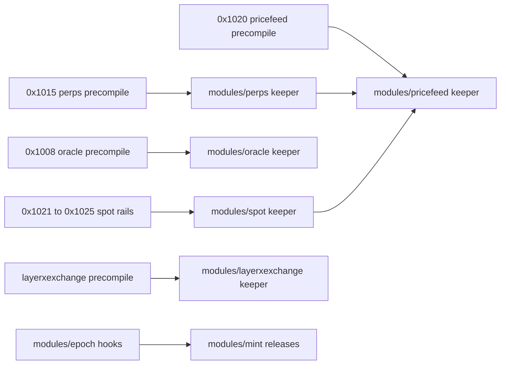

# Markets contract: perps, spot, pricefeed, oracle, epoch, mint and layerxexchange

| Field | Value |
|---|---|
| Domain | 3 (markets), feature manager fm-markets |
| Precompiles | perps 0x1015, pricefeed 0x1020, oracle 0x1008, spot 0x1021-0x1025, layerxexchange |
| Replaces | the markets half of the retired contracts/exchange-launchpad.md; its perps, spot, pricefeed, oracle, epoch, mint and layerxexchange error and event anchors now live here under the same anchor names |
| Revision | repository at 2a1033aa2 |
| Change control | Changes only by amendment to this contract; every amendment updates the interface, contract_context and acceptance blocks that point here. |
| Status meaning | stable: code and intent agree, no task touches it; change: behaviour or shape must change; new: absent at the revision and created by a task; retire: removed or refused by a task. |

## Scope and reading guide

This contract freezes the domain-3 on-chain surface: precompile methods, events and custom errors, Cosmos messages and queries, genesis parameters, store keys, registered error codes, CLI commands, proto messages and exported Go identifiers used across packages.

Each `###` heading below is the anchor named by the `contract` key of the blocks it lists. The interface table is the frozen surface; a row's Defined at is the defining line at the revision. Rules tables reproduce the contract_context blocks; acceptance tables list the criteria verified against the section, one test each.

### Surface summary

| Item | Count |
|---|---|
| Anchors | 207 |
| Interfaces | 1975 |
| Interfaces with status stable | 1665 |
| Interfaces with status change | 232 |
| Interfaces with status new | 66 |
| Interfaces with status retire | 12 |
| Acceptance criteria | 158 |
| Contract contexts | 12 |

## Perps

Perpetuals module `modules/perps` and its precompile at 0x1015 (package comment precompiles/perps/perps.go:1; EVM log address `venueLogAddress` modules/perps/keeper/evmlogs.go:19). Gas, storage, activation and pause rules are in the rules table under perps-0x1015; governance messages under perps-governance; error codes under perps-errors.

### perps-0x1015

178 interfaces: 172 stable, 5 change, 1 new.

| Interface | Kind | Signature | Address / selector | Status | Defined at | Notes (non-stable only) |
|---|---|---|---|---|---|---|
| go-perps-keeper-validategenesis-j25 | go_exported | `func ValidateGenesis(gs types.GenesisState) error` |  | new | modules/perps/keeper/genesis.go (planned) |  |
| go-perps-keeper-registerinvariants-j25 | go_exported | `func RegisterInvariants(registry sdk.InvariantRegistry, k *Keeper)` |  | stable | modules/perps/keeper/invariants.go:44 |  |
| go-perps-keeper-newkeeper-j25 | go_exported | `func NewKeeper(storeKey sdk.StoreKey, evm types.EVMKeeper, pricefeed types.PricefeedKeeper) *Keeper` |  | stable | modules/perps/keeper/keeper.go:31 |  |
| go-perps-keeper-checkpause-j25 | go_exported | `func (k *Keeper) CheckPause(ctx sdk.Context, method string) error` |  | stable | modules/perps/keeper/pause.go:19 |  |
| go-perps-keeper-seedv6120-j25 | go_exported | `func SeedV6120(ctx sdk.Context, k Keeper) error` |  | stable | modules/perps/keeper/seed_v6120.go:81 |  |
| go-perps-appmodulebasic-validategenesis-j25 | go_exported | `func (AppModuleBasic) ValidateGenesis(_ codec.JSONCodec, _ client.TxEncodingConfig, bz json.RawMessage) error` |  | change | modules/perps/module.go:52 | runs types.ValidateGenesis only at HEAD |
| go-perps-pricefeedkeeper-marketsymbol-j25 | go_exported | `type PricefeedKeeper interface { GetPrice(ctx sdk.Context, marketId uint64) (pricefeedkeeper.Price, error) }` |  | change | modules/perps/types/expected_keepers.go:25 | gains MarketSymbol |
| gen-perps-genesisstate-j25 | genesis_param | `type GenesisState struct` |  | stable | modules/perps/types/genesis.go:111 |  |
| key-perps-params-key-j25 | storage_key | `ParamsKey = []byte{0x01}` |  | stable | modules/perps/types/keys.go:23 |  |
| key-perps-market-prefix-j25 | storage_key | `MarketPrefix = []byte{0x02}` |  | stable | modules/perps/types/keys.go:24 |  |
| key-perps-market-state-prefix-j25 | storage_key | `MarketStatePrefix = []byte{0x03}` |  | stable | modules/perps/types/keys.go:25 |  |
| key-perps-account-prefix-j25 | storage_key | `AccountPrefix = []byte{0x04}` |  | stable | modules/perps/types/keys.go:26 |  |
| key-perps-order-prefix-j25 | storage_key | `OrderPrefix = []byte{0x05}` |  | stable | modules/perps/types/keys.go:27 |  |
| key-perps-book-prefix-j25 | storage_key | `BookPrefix = []byte{0x06}` |  | stable | modules/perps/types/keys.go:28 |  |
| key-perps-cloid-prefix-j25 | storage_key | `CloidPrefix = []byte{0x07}` |  | stable | modules/perps/types/keys.go:29 |  |
| key-perps-account-order-prefix-j25 | storage_key | `AccountOrderPrefix = []byte{0x08}` |  | stable | modules/perps/types/keys.go:30 |  |
| key-perps-position-prefix-j25 | storage_key | `PositionPrefix = []byte{0x09}` |  | stable | modules/perps/types/keys.go:31 |  |
| key-perps-account-market-position-prefix-j25 | storage_key | `AccountMarketPositionPrefix = []byte{0x0A}` |  | stable | modules/perps/types/keys.go:32 |  |
| key-perps-trigger-prefix-j25 | storage_key | `TriggerPrefix = []byte{0x0B}` |  | stable | modules/perps/types/keys.go:33 |  |
| key-perps-expiry-prefix-j25 | storage_key | `ExpiryPrefix = []byte{0x0C}` |  | stable | modules/perps/types/keys.go:34 |  |
| key-perps-volume-prefix-j25 | storage_key | `VolumePrefix = []byte{0x0D}` |  | stable | modules/perps/types/keys.go:35 |  |
| key-perps-venue-volume-prefix-j25 | storage_key | `VenueVolumePrefix = []byte{0x0E}` |  | stable | modules/perps/types/keys.go:36 |  |
| key-perps-liquidation-cooldown-prefix-j25 | storage_key | `LiquidationCooldownPrefix = []byte{0x0F}` |  | stable | modules/perps/types/keys.go:37 |  |
| key-perps-sequence-prefix-j25 | storage_key | `SequencePrefix = []byte{0x10}` |  | stable | modules/perps/types/keys.go:38 |  |
| key-perps-attached-tp-sl-prefix-j25 | storage_key | `AttachedTpSlPrefix = []byte{0x11}` |  | stable | modules/perps/types/keys.go:39 |  |
| key-perps-margin-ratio-index-prefix-j25 | storage_key | `MarginRatioIndexPrefix = []byte{0x12}` |  | stable | modules/perps/types/keys.go:40 |  |
| key-perps-adl-rank-index-prefix-j25 | storage_key | `AdlRankIndexPrefix = []byte{0x13}` |  | stable | modules/perps/types/keys.go:41 |  |
| key-perps-sweep-cursor-key-j25 | storage_key | `SweepCursorKey = []byte{0x14}` |  | stable | modules/perps/types/keys.go:42 |  |
| key-perps-venue-books-key-j25 | storage_key | `VenueBooksKey = []byte{0x15}` |  | stable | modules/perps/types/keys.go:43 |  |
| gen-perps-market-j25 | genesis_param | `type Market struct` |  | stable | modules/perps/types/market.go:19 |  |
| gen-perps-params-j25 | genesis_param | `type Params struct` |  | stable | modules/perps/types/params.go:54 |  |
| gen-perps-withdraw-floor-ppm-j25 | genesis_param | `WithdrawFloorPpm uint64 'json:"withdraw_floor_ppm"'` |  | change | modules/perps/types/params.go:68 | validated but never read at HEAD; Withdrawable uses a fixed divisor |
| gen-perps-adl-positions-per-block-j25 | genesis_param | `AdlPositionsPerBlock uint64 'json:"adl_positions_per_block"'` |  | change | modules/perps/types/params.go:79 | never read at HEAD; adl.go uses a constant 64 |
| pc-0x1015-addcollateral | precompile_method | `addCollateral(uint256,uint256) nonpayable` | 0x1015 0xa8f35adf | stable | precompiles/perps/abi/abi.json:1 |  |
| pc-0x1015-addsize | precompile_method | `addSize(uint256,uint256,uint256) nonpayable` | 0x1015 0x8347a72f | stable | precompiles/perps/abi/abi.json:1 |  |
| pc-0x1015-cancelbycloid | precompile_method | `cancelByCloid(uint256,bytes16) nonpayable` | 0x1015 0x51ba46e1 | stable | precompiles/perps/abi/abi.json:1 |  |
| pc-0x1015-cancelorder | precompile_method | `cancelOrder(uint256) nonpayable` | 0x1015 0x514fcac7 | stable | precompiles/perps/abi/abi.json:1 |  |
| pc-0x1015-checkliquidatable | precompile_method | `checkLiquidatable(uint256) view returns (bool,uint256)` | 0x1015 0x3e129715 | stable | precompiles/perps/abi/abi.json:1 |  |
| pc-0x1015-closeposition | precompile_method | `closePosition(uint256) nonpayable` | 0x1015 0xa126d601 | stable | precompiles/perps/abi/abi.json:1 |  |
| pc-0x1015-closepositionwithparams | precompile_method | `closePositionWithParams(uint256,uint256,uint256,uint64) nonpayable` | 0x1015 0xb2438d47 | stable | precompiles/perps/abi/abi.json:1 |  |
| pc-0x1015-createvault | precompile_method | `createVault() nonpayable returns (address)` | 0x1015 0x5d12928b | stable | precompiles/perps/abi/abi.json:1 |  |
| pc-0x1015-deposit | precompile_method | `deposit(address,uint256) nonpayable` | 0x1015 0x47e7ef24 | stable | precompiles/perps/abi/abi.json:1 |  |
| pc-0x1015-emergencywithdraw | precompile_method | `emergencyWithdraw(address) nonpayable` | 0x1015 0x6ff1c9bc | stable | precompiles/perps/abi/abi.json:1 |  |
| pc-0x1015-err-perpsclosesizeexceedsposition | precompile_error | `error PerpsCloseSizeExceedsPosition()` | 0x1015 0x1be787db | stable | precompiles/perps/abi/abi.json:1 |  |
| pc-0x1015-err-perpscrossmarginonly | precompile_error | `error PerpsCrossMarginOnly()` | 0x1015 0x6ff920cc | stable | precompiles/perps/abi/abi.json:1 |  |
| pc-0x1015-err-perpsdeadlineexpired | precompile_error | `error PerpsDeadlineExpired()` | 0x1015 0xd28988d8 | stable | precompiles/perps/abi/abi.json:1 |  |
| pc-0x1015-err-perpsdelegatecall | precompile_error | `error PerpsDelegatecall()` | 0x1015 0x856fe7e1 | stable | precompiles/perps/abi/abi.json:1 |  |
| pc-0x1015-err-perpsduplicatecloid | precompile_error | `error PerpsDuplicateCloid()` | 0x1015 0x6298d438 | stable | precompiles/perps/abi/abi.json:1 |  |
| pc-0x1015-err-perpsfoknotfilled | precompile_error | `error PerpsFokNotFilled()` | 0x1015 0xc3dbe522 | stable | precompiles/perps/abi/abi.json:1 |  |
| pc-0x1015-err-perpsinsufficientcollateral | precompile_error | `error PerpsInsufficientCollateral()` | 0x1015 0x61997bc4 | stable | precompiles/perps/abi/abi.json:1 |  |
| pc-0x1015-err-perpsinsufficientmargin | precompile_error | `error PerpsInsufficientMargin()` | 0x1015 0x12b52d40 | stable | precompiles/perps/abi/abi.json:1 |  |
| pc-0x1015-err-perpsinvalidgenesis | precompile_error | `error PerpsInvalidGenesis()` | 0x1015 0xd06690f2 | stable | precompiles/perps/abi/abi.json:1 |  |
| pc-0x1015-err-perpsinvalidordertype | precompile_error | `error PerpsInvalidOrderType()` | 0x1015 0x7be0d47b | stable | precompiles/perps/abi/abi.json:1 |  |
| pc-0x1015-err-perpsinvalidparams | precompile_error | `error PerpsInvalidParams()` | 0x1015 0xc7088a37 | stable | precompiles/perps/abi/abi.json:1 |  |
| pc-0x1015-err-perpsinvalidtimeinforce | precompile_error | `error PerpsInvalidTimeInForce()` | 0x1015 0x47306489 | stable | precompiles/perps/abi/abi.json:1 |  |
| pc-0x1015-err-perpsinvalidtriggerprice | precompile_error | `error PerpsInvalidTriggerPrice()` | 0x1015 0xd7580015 | stable | precompiles/perps/abi/abi.json:1 |  |
| pc-0x1015-err-perpsleveragetoohigh | precompile_error | `error PerpsLeverageTooHigh()` | 0x1015 0x794b54cf | stable | precompiles/perps/abi/abi.json:1 |  |
| pc-0x1015-err-perpsliquidationcooldown | precompile_error | `error PerpsLiquidationCooldown()` | 0x1015 0x6098ef55 | stable | precompiles/perps/abi/abi.json:1 |  |
| pc-0x1015-err-perpslotsize | precompile_error | `error PerpsLotSize()` | 0x1015 0x8e28a39a | stable | precompiles/perps/abi/abi.json:1 |  |
| pc-0x1015-err-perpsmarketdisabled | precompile_error | `error PerpsMarketDisabled()` | 0x1015 0x386d4503 | stable | precompiles/perps/abi/abi.json:1 |  |
| pc-0x1015-err-perpsmaxordervalue | precompile_error | `error PerpsMaxOrderValue()` | 0x1015 0xe9933ae1 | stable | precompiles/perps/abi/abi.json:1 |  |
| pc-0x1015-err-perpsminordervalue | precompile_error | `error PerpsMinOrderValue()` | 0x1015 0xd1d78b4f | stable | precompiles/perps/abi/abi.json:1 |  |
| pc-0x1015-err-perpsnoaccount | precompile_error | `error PerpsNoAccount()` | 0x1015 0xd7b16785 | stable | precompiles/perps/abi/abi.json:1 |  |
| pc-0x1015-err-perpsnoliquidity | precompile_error | `error PerpsNoLiquidity()` | 0x1015 0xef4eb50b | stable | precompiles/perps/abi/abi.json:1 |  |
| pc-0x1015-err-perpsnotliquidatable | precompile_error | `error PerpsNotLiquidatable()` | 0x1015 0xce578943 | stable | precompiles/perps/abi/abi.json:1 |  |
| pc-0x1015-err-perpsnotorderholder | precompile_error | `error PerpsNotOrderHolder()` | 0x1015 0xedef32ca | stable | precompiles/perps/abi/abi.json:1 |  |
| pc-0x1015-err-perpsnotpositionholder | precompile_error | `error PerpsNotPositionHolder()` | 0x1015 0xe59be79c | stable | precompiles/perps/abi/abi.json:1 |  |
| pc-0x1015-err-perpsopeninterestcap | precompile_error | `error PerpsOpenInterestCap()` | 0x1015 0x021901d6 | stable | precompiles/perps/abi/abi.json:1 |  |
| pc-0x1015-err-perpsoverflow | precompile_error | `error PerpsOverflow()` | 0x1015 0x927150ed | stable | precompiles/perps/abi/abi.json:1 |  |
| pc-0x1015-err-perpspaused | precompile_error | `error PerpsPaused()` | 0x1015 0xe0753633 | stable | precompiles/perps/abi/abi.json:1 |  |
| pc-0x1015-err-perpspostonlywouldcross | precompile_error | `error PerpsPostOnlyWouldCross()` | 0x1015 0x096e07cd | stable | precompiles/perps/abi/abi.json:1 |  |
| pc-0x1015-err-perpspricestale | precompile_error | `error PerpsPriceStale()` | 0x1015 0x737dedba | stable | precompiles/perps/abi/abi.json:1 |  |
| pc-0x1015-err-perpsreduceonlyviolation | precompile_error | `error PerpsReduceOnlyViolation()` | 0x1015 0x8adbf151 | stable | precompiles/perps/abi/abi.json:1 |  |
| pc-0x1015-err-perpsselftransfer | precompile_error | `error PerpsSelfTransfer()` | 0x1015 0x98bc8e6a | stable | precompiles/perps/abi/abi.json:1 |  |
| pc-0x1015-err-perpsslippageexceeded | precompile_error | `error PerpsSlippageExceeded()` | 0x1015 0xb6c82773 | stable | precompiles/perps/abi/abi.json:1 |  |
| pc-0x1015-err-perpsstaticcall | precompile_error | `error PerpsStaticCall()` | 0x1015 0x32a35088 | stable | precompiles/perps/abi/abi.json:1 |  |
| pc-0x1015-err-perpsticksize | precompile_error | `error PerpsTickSize()` | 0x1015 0x73f775c1 | stable | precompiles/perps/abi/abi.json:1 |  |
| pc-0x1015-err-perpstokentransferfailed | precompile_error | `error PerpsTokenTransferFailed()` | 0x1015 0x6fdbf101 | stable | precompiles/perps/abi/abi.json:1 |  |
| pc-0x1015-err-perpstoomanyopenorders | precompile_error | `error PerpsTooManyOpenOrders()` | 0x1015 0xfc1f0263 | stable | precompiles/perps/abi/abi.json:1 |  |
| pc-0x1015-err-perpstriggernotreached | precompile_error | `error PerpsTriggerNotReached()` | 0x1015 0xc6298dab | stable | precompiles/perps/abi/abi.json:1 |  |
| pc-0x1015-err-perpsunauthorized | precompile_error | `error PerpsUnauthorized()` | 0x1015 0xf73dc939 | stable | precompiles/perps/abi/abi.json:1 |  |
| pc-0x1015-err-perpsunknownmarket | precompile_error | `error PerpsUnknownMarket()` | 0x1015 0x65644af8 | stable | precompiles/perps/abi/abi.json:1 |  |
| pc-0x1015-err-perpsunknownorder | precompile_error | `error PerpsUnknownOrder()` | 0x1015 0x1930eff6 | stable | precompiles/perps/abi/abi.json:1 |  |
| pc-0x1015-err-perpsunknownposition | precompile_error | `error PerpsUnknownPosition()` | 0x1015 0x6dcd3d95 | stable | precompiles/perps/abi/abi.json:1 |  |
| pc-0x1015-err-perpsunsupportedcollateral | precompile_error | `error PerpsUnsupportedCollateral()` | 0x1015 0x0a8b8f76 | stable | precompiles/perps/abi/abi.json:1 |  |
| pc-0x1015-err-perpszeroaddress | precompile_error | `error PerpsZeroAddress()` | 0x1015 0xd6d30277 | stable | precompiles/perps/abi/abi.json:1 |  |
| pc-0x1015-err-perpszeroamount | precompile_error | `error PerpsZeroAmount()` | 0x1015 0x811bd7a1 | stable | precompiles/perps/abi/abi.json:1 |  |
| pc-0x1015-evt-adlexecuted | precompile_event | `ADLExecuted(uint256 indexed,uint256)` | 0x1015 0x74df6d57414ee1a093b99093b66c1ae817836a0bafcf618b025aceaf6c9169cf | stable | precompiles/perps/abi/abi.json:1 |  |
| pc-0x1015-evt-adlmatched | precompile_event | `ADLMatched(uint256 indexed,uint256 indexed,address indexed,uint256,uint256,uint256)` | 0x1015 0x361fdec036d81be42e6ea793141dcf1b606e639f5d8da329aa5653c2e5752ac7 | stable | precompiles/perps/abi/abi.json:1 |  |
| pc-0x1015-evt-backstopliquidation | precompile_event | `BackstopLiquidation(address indexed,uint256 indexed,uint256,uint256,uint256)` | 0x1015 0xc310b34ebeb9d75b798bbbc4e9761cca8dcf1012df990234a364daf73a9bed9d | stable | precompiles/perps/abi/abi.json:1 |  |
| pc-0x1015-evt-collateraldeposited | precompile_event | `CollateralDeposited(address indexed,uint256,uint256)` | 0x1015 0xf4d587c98d234ca4d147061e6b5167e7f41ee17f11562a9f0b49570abece859e | stable | precompiles/perps/abi/abi.json:1 |  |
| pc-0x1015-evt-collateraltransferred | precompile_event | `CollateralTransferred(address indexed,address indexed,uint256)` | 0x1015 0x4b483fbdbe44e7192bad7366e354aa164b27d131f15b3003dcd2dbe41f45840e | stable | precompiles/perps/abi/abi.json:1 |  |
| pc-0x1015-evt-collateralwithdrawn | precompile_event | `CollateralWithdrawn(address indexed,uint256,uint256)` | 0x1015 0xdaed309a628faec6cab72194019e2a1a34e890ca9bf9be99788992dd54692819 | stable | precompiles/perps/abi/abi.json:1 |  |
| pc-0x1015-evt-feecollected | precompile_event | `FeeCollected(uint256 indexed,address indexed,uint256 indexed,uint8,uint256,uint256,address)` | 0x1015 0x1adc7612b2dce4d38dedb850a0d614339ed68967b5dfff223d531181aba19b1e | stable | precompiles/perps/abi/abi.json:1 |  |
| pc-0x1015-evt-fill | precompile_event | `Fill(uint256 indexed,uint256 indexed,uint256 indexed,address,address,bool,uint256,uint256,int256,uint256)` | 0x1015 0x6d460a88566a943347fae69fd7812f08443707f55d0ae74499e94ee98104e5bb | stable | precompiles/perps/abi/abi.json:1 |  |
| pc-0x1015-evt-fundingrateupdated | precompile_event | `FundingRateUpdated(uint256 indexed,int256,int256)` | 0x1015 0x079b6d18f01c7f924fc54d193fe6462e58db75bb058d1d41581bd1f04019c22a | stable | precompiles/perps/abi/abi.json:1 |  |
| pc-0x1015-evt-fundingsettled | precompile_event | `FundingSettled(uint256 indexed,int256,int256,int256)` | 0x1015 0x0210a517480088538b0ca214ab356af4a544bdf480dad3a30bc1f4e3fa965f6f | stable | precompiles/perps/abi/abi.json:1 |  |
| pc-0x1015-evt-insurancecontribution | precompile_event | `InsuranceContribution(address indexed,uint256,uint8)` | 0x1015 0x1595f29e3a7fc8920a33679390a12ffa7b022b3be7638300986fc040413b6784 | stable | precompiles/perps/abi/abi.json:1 |  |
| pc-0x1015-evt-insurancedraw | precompile_event | `InsuranceDraw(uint256 indexed,uint256,uint256)` | 0x1015 0x41102695c5747c1a2103ca485e3fb81cd66828eba4b3f71b7954b83cc7ba98da | stable | precompiles/perps/abi/abi.json:1 |  |
| pc-0x1015-evt-liquidation | precompile_event | `Liquidation(uint256 indexed,address indexed,uint256 indexed,uint256,uint256,address)` | 0x1015 0x52af4f7bedc94d7c3acb731423eb48e0d79237ea8d43c54e1639a5701e81ba4d | stable | precompiles/perps/abi/abi.json:1 |  |
| pc-0x1015-evt-markpriceupdated | precompile_event | `MarkPriceUpdated(uint256 indexed,uint256,uint256,uint256)` | 0x1015 0x7d3b7126da57b3264d16515150cec087c2c3ffca5bfa7e0d06ec2bd49bf50eeb | stable | precompiles/perps/abi/abi.json:1 |  |
| pc-0x1015-evt-openinterestchanged | precompile_event | `OpenInterestChanged(uint256 indexed,uint256,uint256,uint256,bool)` | 0x1015 0x04258fe4f35075ca913887cd68726c79a128cb0decb6676408366ed331500020 | stable | precompiles/perps/abi/abi.json:1 |  |
| pc-0x1015-evt-ordercancelled | precompile_event | `OrderCancelled(uint256 indexed,address indexed)` | 0x1015 0xc0362da6f2ff36b382b34aec0814f6b3cdf89f5ef282a1d1f114d0c0b036d596 | stable | precompiles/perps/abi/abi.json:1 |  |
| pc-0x1015-evt-orderexecuted | precompile_event | `OrderExecuted(uint256 indexed,uint256 indexed,uint256)` | 0x1015 0xc91e7dfc399621d0ecf4ceada07d0bc5f1c29dd5a8911478baf90d86489f2f81 | stable | precompiles/perps/abi/abi.json:1 |  |
| pc-0x1015-evt-orderexpired | precompile_event | `OrderExpired(uint256 indexed,address indexed,uint256 indexed)` | 0x1015 0x795bce27c5ada1127ff0f376d1867477e3e67bfafda5931c1a00dd07c819eeb0 | stable | precompiles/perps/abi/abi.json:1 |  |
| pc-0x1015-evt-orderoptions | precompile_event | `OrderOptions(uint256 indexed,uint8,bool,uint256,uint256,uint64,bytes16)` | 0x1015 0x8beb6320dd51d6cece11be69fcc8c9dc939a7df20cb13248fe95b0018425931a | stable | precompiles/perps/abi/abi.json:1 |  |
| pc-0x1015-evt-orderplaced | precompile_event | `OrderPlaced(uint256 indexed,address indexed,uint256 indexed,uint8,bool,uint256,uint256)` | 0x1015 0xc287284afa96b84a04a018a681cfbd788864dbcb99125f0c4779c371634fc3b1 | stable | precompiles/perps/abi/abi.json:1 |  |
| pc-0x1015-evt-ordertriggered | precompile_event | `OrderTriggered(uint256 indexed,uint256 indexed,uint256)` | 0x1015 0xd561c9eb3e845ee0db0965bebd01ad111bf9bf06e8965bb618375e3c17e4781b | stable | precompiles/perps/abi/abi.json:1 |  |
| pc-0x1015-evt-positionclosed | precompile_event | `PositionClosed(uint256 indexed,address indexed,uint256 indexed,uint256,uint256,int256,bool)` | 0x1015 0x1ebd5cdb6e99c3faad52065545129e201c5d9edfeb96808d9f500baa6a591508 | stable | precompiles/perps/abi/abi.json:1 |  |
| pc-0x1015-evt-positionentrypricechanged | precompile_event | `PositionEntryPriceChanged(uint256 indexed,uint256,uint256)` | 0x1015 0xceb086399e5a4ac4b111ff004cbd0ac4b41c6ca482d86509df53f5887f6abbb4 | stable | precompiles/perps/abi/abi.json:1 |  |
| pc-0x1015-evt-positionfundingapplied | precompile_event | `PositionFundingApplied(uint256 indexed,address indexed,uint256 indexed,int256,uint256,uint256)` | 0x1015 0x04481abd445ea69241517e66b0c03daed18178cd73c042aad43367649d968961 | stable | precompiles/perps/abi/abi.json:1 |  |
| pc-0x1015-evt-positionmodified | precompile_event | `PositionModified(uint256 indexed,uint256,uint256,uint256)` | 0x1015 0x12ed34ae91236fb4c0b9f1bb3e9301ba4e2ed45f3ae77b32fd19420b7793b7f7 | stable | precompiles/perps/abi/abi.json:1 |  |
| pc-0x1015-evt-positionopened | precompile_event | `PositionOpened(uint256 indexed,address indexed,uint256 indexed,bool,uint256,uint256,uint256,address,uint256)` | 0x1015 0x79529707ccb70a3b8fc904e66aa412b72239eda11f81a8150389703d255daee4 | stable | precompiles/perps/abi/abi.json:1 |  |
| pc-0x1015-evt-positiontpslset | precompile_event | `PositionTpSlSet(uint256 indexed,uint256,uint256)` | 0x1015 0x8ae8f45143ae1c1843a09ade019a00cf391d598df35140ae2d257be798ba3418 | stable | precompiles/perps/abi/abi.json:1 |  |
| pc-0x1015-evt-tradesettled | precompile_event | `TradeSettled(uint256 indexed,address indexed,uint256 indexed,uint8,uint256,uint256,int256,uint256,int256,uint256)` | 0x1015 0x5388fd53f51aad820b2b7d94022ebebcf83fa3895e7a58036a83836d520ba52f | stable | precompiles/perps/abi/abi.json:1 |  |
| pc-0x1015-evt-vaultcreated | precompile_event | `VaultCreated(address indexed,address indexed)` | 0x1015 0x5d9c31ffa0fecffd7cf379989a3c7af252f0335e0d2a1320b55245912c781f53 | stable | precompiles/perps/abi/abi.json:1 |  |
| pc-0x1015-evt-vaultdeficit | precompile_event | `VaultDeficit(address indexed,uint256)` | 0x1015 0x8d9ba7e870350f8b9c340f5313fb04e3cc820e91439be2098d8ee13af472a532 | stable | precompiles/perps/abi/abi.json:1 |  |
| pc-0x1015-executeorder | precompile_method | `executeOrder(uint256) nonpayable returns (uint256)` | 0x1015 0x94f61134 | stable | precompiles/perps/abi/abi.json:1 |  |
| pc-0x1015-getaccount | precompile_method | `getAccount(address) view returns ((uint256,int256,uint256,uint256,uint256,uint8,uint256,uint256,uint256))` | 0x1015 0xfbcbc0f1 | stable | precompiles/perps/abi/abi.json:1 |  |
| pc-0x1015-getaccountsummary-43ad2977 | precompile_method | `getAccountSummary(address) view returns ((uint256,uint256,uint256))` | 0x1015 0x43ad2977 | stable | precompiles/perps/abi/abi.json:1 |  |
| pc-0x1015-getaccountsummary-65d53f6c | precompile_method | `getAccountSummary(address,address) view returns ((uint256,uint256,uint256))` | 0x1015 0x65d53f6c | stable | precompiles/perps/abi/abi.json:1 |  |
| pc-0x1015-getactivemarketids | precompile_method | `getActiveMarketIds() view returns (uint256[])` | 0x1015 0xbd243ff3 | stable | precompiles/perps/abi/abi.json:1 |  |
| pc-0x1015-getadlrank | precompile_method | `getADLRank(uint256) view returns (uint256,bool)` | 0x1015 0x0c71b6ba | stable | precompiles/perps/abi/abi.json:1 |  |
| pc-0x1015-getbalance-d4fac45d | precompile_method | `getBalance(address,address) view returns (uint256)` | 0x1015 0xd4fac45d | stable | precompiles/perps/abi/abi.json:1 |  |
| pc-0x1015-getbalance-f8b2cb4f | precompile_method | `getBalance(address) view returns (uint256)` | 0x1015 0xf8b2cb4f | stable | precompiles/perps/abi/abi.json:1 |  |
| pc-0x1015-getcurrentfundingrate | precompile_method | `getCurrentFundingRate(uint256) view returns (int256)` | 0x1015 0x8c1b753a | stable | precompiles/perps/abi/abi.json:1 |  |
| pc-0x1015-getfees | precompile_method | `getFees() view returns (uint256,uint256,uint256,uint256)` | 0x1015 0xdb8d55f1 | stable | precompiles/perps/abi/abi.json:1 |  |
| pc-0x1015-getfeetier | precompile_method | `getFeeTier(address) view returns (uint8,uint256,int256,uint256)` | 0x1015 0x3f86c3e6 | stable | precompiles/perps/abi/abi.json:1 |  |
| pc-0x1015-getfundingdetails | precompile_method | `getFundingDetails(uint256) view returns (int256,uint256,int256,int256,uint256)` | 0x1015 0x0b45ba25 | stable | precompiles/perps/abi/abi.json:1 |  |
| pc-0x1015-getfundingstate | precompile_method | `getFundingState(uint256) view returns (int256,int256,uint256,int256)` | 0x1015 0xb4acb042 | stable | precompiles/perps/abi/abi.json:1 |  |
| pc-0x1015-getinsurancebalance | precompile_method | `getInsuranceBalance(address) view returns (uint256)` | 0x1015 0x637b93ed | stable | precompiles/perps/abi/abi.json:1 |  |
| pc-0x1015-getliquidationprice | precompile_method | `getLiquidationPrice(uint256) view returns (uint256)` | 0x1015 0x2c854f23 | stable | precompiles/perps/abi/abi.json:1 |  |
| pc-0x1015-getlockedbalance-c4086893 | precompile_method | `getLockedBalance(address) view returns (uint256)` | 0x1015 0xc4086893 | stable | precompiles/perps/abi/abi.json:1 |  |
| pc-0x1015-getlockedbalance-c736887e | precompile_method | `getLockedBalance(address,address) view returns (uint256)` | 0x1015 0xc736887e | stable | precompiles/perps/abi/abi.json:1 |  |
| pc-0x1015-getmarginmode-3ca0c5c5 | precompile_method | `getMarginMode() view returns (uint8)` | 0x1015 0x3ca0c5c5 | stable | precompiles/perps/abi/abi.json:1 |  |
| pc-0x1015-getmarginmode-b71d031c | precompile_method | `getMarginMode(address) view returns (uint8)` | 0x1015 0xb71d031c | stable | precompiles/perps/abi/abi.json:1 |  |
| pc-0x1015-getmargintiers | precompile_method | `getMarginTiers(uint256) view returns ((uint256,uint256,uint256,uint256)[])` | 0x1015 0x15174813 | stable | precompiles/perps/abi/abi.json:1 |  |
| pc-0x1015-getmarket | precompile_method | `getMarket(uint256) view returns (string,string,uint256,uint256,uint256,bool)` | 0x1015 0xeb44fdd3 | stable | precompiles/perps/abi/abi.json:1 |  |
| pc-0x1015-getmarketconfig | precompile_method | `getMarketConfig(uint256) view returns ((uint256,string,string,string,uint8,uint8,uint256,uint256,uint256,uint8,uint256,uint256,uint256,bool,uint64))` | 0x1015 0x3bdd5d81 | stable | precompiles/perps/abi/abi.json:1 |  |
| pc-0x1015-getmarkprice | precompile_method | `getMarkPrice(uint256) view returns (uint256)` | 0x1015 0x5af3d061 | stable | precompiles/perps/abi/abi.json:1 |  |
| pc-0x1015-getmarkpricedetails | precompile_method | `getMarkPriceDetails(uint256) view returns (uint256,uint256,uint256,bool)` | 0x1015 0xb9cd3949 | stable | precompiles/perps/abi/abi.json:1 |  |
| pc-0x1015-getopeninterest | precompile_method | `getOpenInterest(uint256) view returns (uint256,uint256)` | 0x1015 0x1b3ee0f1 | stable | precompiles/perps/abi/abi.json:1 |  |
| pc-0x1015-getorder | precompile_method | `getOrder(uint256) view returns (address,uint256,bool,uint8,uint256,uint256,uint256,uint256,address,uint256,bool)` | 0x1015 0xd09ef241 | stable | precompiles/perps/abi/abi.json:1 |  |
| pc-0x1015-getorderdetails | precompile_method | `getOrderDetails(uint256) view returns ((uint256,address,uint256,bool,uint8,uint8,uint8,bool,uint256,uint256,uint256,uint256,uint256,uint256,uint256,uint64,bytes16,uint64))` | 0x1015 0xec7dd7bb | stable | precompiles/perps/abi/abi.json:1 |  |
| pc-0x1015-getposition | precompile_method | `getPosition(uint256) view returns (address,uint256,bool,uint256,uint256,address,uint256,uint256,uint256,bool)` | 0x1015 0xeb02c301 | stable | precompiles/perps/abi/abi.json:1 |  |
| pc-0x1015-getpositiondetails | precompile_method | `getPositionDetails(uint256) view returns ((uint256,address,uint256,bool,uint256,uint256,uint256,uint256,int256,int256,uint256,uint256,uint256,uint256))` | 0x1015 0x9ecceb5e | stable | precompiles/perps/abi/abi.json:1 |  |
| pc-0x1015-getpositionfunding | precompile_method | `getPositionFunding(uint256) view returns (int256)` | 0x1015 0xed08f9dc | stable | precompiles/perps/abi/abi.json:1 |  |
| pc-0x1015-getpositionmargin | precompile_method | `getPositionMargin(uint256) view returns ((address,uint256,uint256,bool))` | 0x1015 0x91445f94 | stable | precompiles/perps/abi/abi.json:1 |  |
| pc-0x1015-getprotocolaccounts | precompile_method | `getProtocolAccounts() view returns (address,address)` | 0x1015 0x7c4b1e22 | stable | precompiles/perps/abi/abi.json:1 |  |
| pc-0x1015-getusermarketposition | precompile_method | `getUserMarketPosition(address,uint256) view returns (uint256)` | 0x1015 0x5c58777e | stable | precompiles/perps/abi/abi.json:1 |  |
| pc-0x1015-getuserorderids | precompile_method | `getUserOrderIds(address) view returns (uint256[])` | 0x1015 0xec641a1d | stable | precompiles/perps/abi/abi.json:1 |  |
| pc-0x1015-getuserpositionids | precompile_method | `getUserPositionIds(address) view returns (uint256[])` | 0x1015 0xeddf7570 | stable | precompiles/perps/abi/abi.json:1 |  |
| pc-0x1015-getvault | precompile_method | `getVault(address) view returns (address)` | 0x1015 0x0eb9af38 | stable | precompiles/perps/abi/abi.json:1 |  |
| pc-0x1015-ismarketactive | precompile_method | `isMarketActive(uint256) view returns (bool)` | 0x1015 0xf849f69e | stable | precompiles/perps/abi/abi.json:1 |  |
| pc-0x1015-liquidate | precompile_method | `liquidate(uint256) nonpayable` | 0x1015 0x415f1240 | stable | precompiles/perps/abi/abi.json:1 |  |
| pc-0x1015-openposition | precompile_method | `openPosition(uint256,address,uint256,uint256,bool) nonpayable returns (uint256)` | 0x1015 0x6d055f06 | stable | precompiles/perps/abi/abi.json:1 |  |
| pc-0x1015-partialclose | precompile_method | `partialClose(uint256,uint256) nonpayable` | 0x1015 0xeaa6185c | stable | precompiles/perps/abi/abi.json:1 |  |
| pc-0x1015-placelimitorder | precompile_method | `placeLimitOrder(uint256,bool,uint256,uint256,uint256,address,uint256) nonpayable returns (uint256)` | 0x1015 0x569e792e | stable | precompiles/perps/abi/abi.json:1 |  |
| pc-0x1015-placeorder | precompile_method | `placeOrder((uint256,bool,uint8,uint8,uint256,uint256,uint256,uint256,uint256,uint256,bool,uint256,uint256,uint64,bytes16)) nonpayable returns (uint256)` | 0x1015 0x07a59faa | stable | precompiles/perps/abi/abi.json:1 |  |
| pc-0x1015-placestoplimitorder | precompile_method | `placeStopLimitOrder(uint256,bool,uint256,uint256,uint256,uint256,address,uint256) nonpayable returns (uint256)` | 0x1015 0xa1d442c7 | stable | precompiles/perps/abi/abi.json:1 |  |
| pc-0x1015-placestoplossorder | precompile_method | `placeStopLossOrder(uint256,uint256) nonpayable returns (uint256)` | 0x1015 0x1a6c35e0 | stable | precompiles/perps/abi/abi.json:1 |  |
| pc-0x1015-placetakeprofitorder | precompile_method | `placeTakeProfitOrder(uint256,uint256) nonpayable returns (uint256)` | 0x1015 0x4b10244d | stable | precompiles/perps/abi/abi.json:1 |  |
| pc-0x1015-quotecloseposition | precompile_method | `quoteClosePosition(uint256) view returns ((uint256,int256,uint256,uint256,int256,int256,uint256))` | 0x1015 0x0c849b70 | stable | precompiles/perps/abi/abi.json:1 |  |
| pc-0x1015-quotemarket | precompile_method | `quoteMarket(uint256) view returns ((uint256,uint256,uint256,int256,int256,uint256,uint256,uint256,uint256,bool,bool))` | 0x1015 0x3dc355fe | stable | precompiles/perps/abi/abi.json:1 |  |
| pc-0x1015-quoteopenposition | precompile_method | `quoteOpenPosition(uint256,address,uint256,uint256,bool) view returns ((uint256,uint256,uint256,uint256,uint256,uint256,uint256,uint256,int256,uint256))` | 0x1015 0xa7b85d21 | stable | precompiles/perps/abi/abi.json:1 |  |
| pc-0x1015-quotepartialclose | precompile_method | `quotePartialClose(uint256,uint256) view returns (uint256,int256,uint256,uint256)` | 0x1015 0xff05d3bc | stable | precompiles/perps/abi/abi.json:1 |  |
| pc-0x1015-removecollateral | precompile_method | `removeCollateral(uint256,uint256) nonpayable` | 0x1015 0x6a9b1891 | stable | precompiles/perps/abi/abi.json:1 |  |
| pc-0x1015-setmarginmode | precompile_method | `setMarginMode(uint8) nonpayable` | 0x1015 0xbd5944c8 | stable | precompiles/perps/abi/abi.json:1 |  |
| pc-0x1015-setpositiontpsl | precompile_method | `setPositionTpSl(uint256,uint256,uint256) nonpayable` | 0x1015 0x6e6958d3 | stable | precompiles/perps/abi/abi.json:1 |  |
| pc-0x1015-topupposition | precompile_method | `topUpPosition(uint256,uint256) nonpayable` | 0x1015 0x1efa1c55 | stable | precompiles/perps/abi/abi.json:1 |  |
| pc-0x1015-totalmarkets | precompile_method | `totalMarkets() view returns (uint256)` | 0x1015 0x8162486b | stable | precompiles/perps/abi/abi.json:1 |  |
| pc-0x1015-transfercollateral | precompile_method | `transferCollateral(address,uint256) nonpayable` | 0x1015 0x816b1e8f | stable | precompiles/perps/abi/abi.json:1 |  |
| pc-0x1015-transfermargin | precompile_method | `transferMargin(uint256,uint256,uint256) nonpayable` | 0x1015 0xfc05c891 | stable | precompiles/perps/abi/abi.json:1 |  |
| pc-0x1015-withdraw | precompile_method | `withdraw(address,uint256) nonpayable` | 0x1015 0xf3fef3a3 | stable | precompiles/perps/abi/abi.json:1 |  |
| go-perps-perpsaddress-j25 | go_exported | `PerpsAddress = exchangetypes.ExchangeAddress` |  | change | precompiles/perps/perps.go:27 | becomes the 0x1015 literal |
| go-perps-perpskeepers-j25 | go_exported | `type PerpsKeepers interface { PerpsK() *perpskeeper.Keeper }` |  | stable | precompiles/perps/perps.go:37 |  |
| go-perps-gastable-j25 | go_exported | `var GasTable = pcommon.GasTable{...}` |  | stable | precompiles/perps/perps.go:43 |  |
| go-perps-newprecompile-j25 | go_exported | `func NewPrecompile(keepers utils.Keepers) (*pcommon.Precompile, error)` |  | stable | precompiles/perps/perps.go:130 |  |

Rules frozen by `contract_context.3.perps-0x1015`:

| Aspect | Rule |
|---|---|
| interface | Precompile 0x0000000000000000000000000000000000001015 named perps: the 67-method ABI of precompiles/perps/abi/abi.json with 30 events and 44 parameterless custom errors |
| storage | modules/perps store under ParamsKey 0x01 to VenueBooksKey 0x15 of modules/perps/types/keys.go:23-43 |
| errors | 4-byte custom-error selector as the whole revert data (precompiles/perps/errors.go:70-77); sdk errors in modules/perps/types/errors.go named LXP_PERPS_* in the shared registry |
| events | 30 ABI events of precompiles/perps/abi/abi.json plus perps_params_updated, perps_market_set and perps_pause_set Cosmos events of the msg server |
| gas | Fixed per-method rows of GasTable at precompiles/perps/perps.go:43 |
| activation | Served from the v6.12.0 height; registered by node/app.go:3502 and seeded by SeedV6120 at modules/perps/keeper/seed_v6120.go:81 |
| invariants | The nine venue invariants registered at modules/perps/keeper/invariants.go:44 |
| pause | Params.Paused refuses every method except the exit paths of modules/perps/keeper/pause.go:8-17; views always answer |

| Acceptance | Criterion | Test | Scenario |
|---|---|---|---|
| acceptance.3.2.1 | req.3002.1 | modules/pricefeed/keeper/market_symbol_test.go::TestMarketSymbolOfListedMarket (planned) | Given DefaultParams of pricefeed, when MarketSymbol is read for ids 0 and 17, then it returns BTC and the last table symbol, both enabled |
| acceptance.3.2.2 | req.3002.2 | modules/pricefeed/keeper/market_symbol_test.go::TestMarketSymbolOfUnlistedMarket (planned) | Given DefaultParams of pricefeed, when MarketSymbol is read for id 18, then it fails with ErrUnknownMarket |
| acceptance.3.2.3 | req.3002.3 | modules/perps/keeper/pricefeed_contract_test.go::TestPricefeedKeeperSatisfiesPerpsContract (planned) | Given a real pricefeed keeper with DefaultParams, when it is assigned to types.PricefeedKeeper and MarketSymbol(0) is read, then the call compiles and returns BTC enabled |
| acceptance.3.2.4 | req.3002.4 | modules/perps/keeper/listing_endblock_test.go::TestListedMarketPricedAtEndBlock (planned) | Given pricefeed market 18 appended and aggregated and perps market 18 listed by MsgSetMarket, when EndBlock runs, then market 18 has a non-zero mark and a MarkPriceUpdated record |
| acceptance.3.3.1 | req.3003.1 | precompiles/perps/address_test.go::TestPerpsAddressIsLiteral1015 (planned) | Given precompiles/perps without the layerxexchange types import in perps.go, when PerpsAddress is compared, then it equals the 0x1015 address and the legacy exchange address |
| acceptance.3.3.2 | req.3003.2 | precompiles/perps/quote_market_test.go::TestQuoteMarketHandlerMatchesKeeperQuote (planned) | Given a BTC book with resting bids and asks on real keepers, when quoteMarket is executed through the precompile for market 0 and market 30, then the first unpacks to the keeper MarketQuote and the second reverts with the PerpsUnknownMarket selector |
| acceptance.3.5.1 | req.3005.1 | modules/perps/keeper/validate_genesis_test.go::TestValidateGenesisRefusesMismatchedIndexes (planned) | Given an exported genesis with one extra BookEntry, when keeper.ValidateGenesis runs, then it fails with ErrInvalidGenesis |
| acceptance.3.5.2 | req.3005.2 | modules/perps/keeper/validate_genesis_test.go::TestValidateGenesisAcceptsExport (planned) | Given a venue with resting orders and an open position, when its export is passed to keeper.ValidateGenesis, then it returns nil |
| acceptance.3.5.3 | req.3005.3 | modules/perps/module_genesis_test.go::TestAppModuleValidateGenesisRunsIndexChecks (planned) | Given a genesis JSON with one extra TriggerEntry, when the app module basic ValidateGenesis runs, then it fails with ErrInvalidGenesis |
| acceptance.3.5.4 | req.3005.4 | modules/perps/keeper/genesis_governed_test.go::TestGenesisRoundTripAfterGovernanceChanges (planned) | Given a seeded venue changed by the three governance Msgs, when it is exported, imported into a new store and exported again, then both exports are byte-identical and Paused is true |
| acceptance.3.7.1 | req.3007.1 | precompiles/perps/views_golden_account_test.go::TestViewGoldenAccountAndPosition (planned) | Given the fixed scenario of one funded account with a BTC long at a fixed mark, when getAccount, getPosition and getPositionDetails are executed through the precompile, then the hex outputs equal the golden file |
| acceptance.3.7.2 | req.3007.2 | precompiles/perps/views_golden_market_test.go::TestViewGoldenOrderAndMarket (planned) | Given one resting BTC limit order in the fixed scenario, when the four views are executed, then the hex outputs equal the golden file |
| acceptance.3.7.3 | req.3007.3 | precompiles/perps/views_golden_funding_test.go::TestViewGoldenFundingAndFees (planned) | Given the fixed scenario after two premium samples, when the five views are executed, then the hex outputs equal the golden file |
| acceptance.3.7.4 | req.3007.4 | precompiles/perps/views_golden_quotes_test.go::TestViewGoldenQuotes (planned) | Given a fixed two-sided BTC book and one open position, when the four quote methods are executed, then the hex outputs equal the golden file |
| acceptance.3.7.5 | req.3007.5 | precompiles/perps/views_golden_insurance_test.go::TestViewGoldenInsuranceAndAdl (planned) | Given the fixed scenario with an insurance contribution and two opposite positions, when the three views are executed, then the hex outputs equal the golden file |
| acceptance.3.8.1 | req.3008.1 | modules/perps/migration_test.go::TestRunMigrationsAtPerpsV1IsNoop (planned) | Given a seeded perps store and a module manager with the perps module, when RunMigrations runs from perps version 1, then no handler runs and every key under the perps store is unchanged |
| acceptance.3.8.2 | req.3008.2 | modules/perps/keeper/seed_governed_test.go::TestSeedV6120IdempotentAfterGovernance (planned) | Given a seeded venue with ETH disabled and the funding cap raised by governance, when SeedV6120 runs again, then ETH stays disabled and the raised cap stays |
| acceptance.3.10.1 | req.3010.1 | precompiles/perps/governed_view_market_config_test.go::TestGovernedMarketConfigView (planned) | Given BTC with MaxLeverage and OiCapUsd changed by MsgSetMarket, when getMarketConfig(0) is executed, then the outputs carry the new values |
| acceptance.3.10.2 | req.3010.2 | precompiles/perps/governed_view_market_active_test.go::TestDisabledMarketInactiveInView (planned) | Given ETH disabled by MsgSetMarket and a fresh ETH price, when isMarketActive(1) and getActiveMarketIds are executed, then the first returns false and the second lacks id 1 |
| acceptance.3.10.3 | req.3010.3 | precompiles/perps/governed_view_fee_tier_test.go::TestGovernedFeeTierView (planned) | Given FeeTiers replaced by governance, when getFeeTier for a zero-volume account and getFees are executed, then they return the new tier 0 rates |
| acceptance.3.10.4 | req.3010.4 | precompiles/perps/governed_view_funding_test.go::TestGovernedFundingDetailsView (planned) | Given a large sampled premium and the funding cap lowered by governance, when getFundingDetails(0) is executed, then the hourly rate equals the new cap |
| acceptance.3.10.5 | req.3010.5 | precompiles/perps/governed_view_open_interest_test.go::TestGovernedOpenInterestCapView (planned) | Given BTC OiCapUsd raised by MsgSetMarket and a fill above the old cap, when getOpenInterest(0) is executed, then the long side exceeds the old cap |

Capability blocks verified against this section:

- `capability.3.10.1`: Show governed market fields in the getMarketConfig view
- `capability.3.10.2`: Report a governance-disabled market as inactive in isMarketActive
- `capability.3.10.3`: Show governed fee tiers in the getFeeTier view
- `capability.3.10.4`: Show governed funding caps in the getFundingDetails view
- `capability.3.10.5`: Show a governed open-interest cap in the getOpenInterest view
- `capability.3.2.1`: Expose MarketSymbol on the pricefeed keeper
- `capability.3.2.2`: Add MarketSymbol to the perps PricefeedKeeper contract
- `capability.3.2.3`: Price a governance-listed perps market at the next end block
- `capability.3.3.1`: Declare PerpsAddress as the 0x1015 literal
- `capability.3.3.2`: Pin the quoteMarket handler to the keeper market quote
- `capability.3.5.1`: Export the perps keeper genesis validation that InitGenesis runs
- `capability.3.5.2`: Validate perps genesis in the module with the keeper checks
- `capability.3.5.3`: Round-trip perps genesis after governance changes
- `capability.3.7.1`: Freeze the 0x1015 account and position view outputs in a golden
- `capability.3.7.2`: Freeze the 0x1015 order and market view outputs in a golden
- `capability.3.7.3`: Freeze the 0x1015 funding and fee view outputs in a golden
- `capability.3.7.4`: Freeze the 0x1015 quote outputs in a golden
- `capability.3.7.5`: Freeze the 0x1015 insurance and ADL view outputs in a golden
- `capability.3.8.1`: Rehearse RunMigrations at perps consensus version 1 as a no-op
- `capability.3.8.2`: Rehearse the v6.12.0 perps seed after governance changes

### perps-errors

46 interfaces: 1 stable, 44 change, 1 new.

| Interface | Kind | Signature | Address / selector | Status | Defined at | Notes (non-stable only) |
|---|---|---|---|---|---|---|
| go-perps-types-registerederrors-j25 | go_exported | `func RegisteredErrors() []*sdkerrors.Error` |  | new | modules/perps/types/errors.go (planned) |  |
| go-perps-types-perpscode-j25 | go_exported | `PerpsCode codespace of the perps errors` |  | stable | modules/perps/types/errors.go:9 |  |
| err-sdk-perps-2-invalid-params | error_code | `ErrInvalidParams = Register("perps", 2, "LXP_PERPS_INVALID_PARAMS")` |  | change | modules/perps/types/errors.go:14 | LXP name LXP_PERPS_INVALID_PARAMS (registered text); LXP name has no row in the Go revert registry, a revert through LXPRevert would read LXP_UNKNOWN; 200 in-repo references (159 non-test), first 25 listed |
| err-sdk-perps-3-unknown-market | error_code | `ErrUnknownMarket = Register("perps", 3, "LXP_PERPS_UNKNOWN_MARKET")` |  | change | modules/perps/types/errors.go:15 | LXP name LXP_PERPS_UNKNOWN_MARKET (registered text); LXP name has no row in the Go revert registry, a revert through LXPRevert would read LXP_UNKNOWN |
| err-sdk-perps-4-market-disabled | error_code | `ErrMarketDisabled = Register("perps", 4, "LXP_PERPS_MARKET_DISABLED")` |  | change | modules/perps/types/errors.go:16 | LXP name LXP_PERPS_MARKET_DISABLED (registered text); LXP name has no row in the Go revert registry, a revert through LXPRevert would read LXP_UNKNOWN |
| err-sdk-perps-5-price-stale | error_code | `ErrPriceStale = Register("perps", 5, "LXP_PERPS_PRICE_STALE")` |  | change | modules/perps/types/errors.go:17 | LXP name LXP_PERPS_PRICE_STALE (registered text); LXP name has no row in the Go revert registry, a revert through LXPRevert would read LXP_UNKNOWN; 33 in-repo references (23 non-test), first 25 listed |
| err-sdk-perps-6-zero-amount | error_code | `ErrZeroAmount = Register("perps", 6, "LXP_PERPS_ZERO_AMOUNT")` |  | change | modules/perps/types/errors.go:18 | LXP name LXP_PERPS_ZERO_AMOUNT (registered text); LXP name has no row in the Go revert registry, a revert through LXPRevert would read LXP_UNKNOWN; 32 in-repo references (20 non-test), first 25 listed |
| err-sdk-perps-7-unsupported-collateral | error_code | `ErrUnsupportedCollateral = Register("perps", 7, "LXP_PERPS_UNSUPPORTED_COLLATERAL")` |  | change | modules/perps/types/errors.go:19 | LXP name LXP_PERPS_UNSUPPORTED_COLLATERAL (registered text); LXP name has no row in the Go revert registry, a revert through LXPRevert would read LXP_UNKNOWN |
| err-sdk-perps-8-insufficient-collateral | error_code | `ErrInsufficientCollateral = Register("perps", 8, "LXP_PERPS_INSUFFICIENT_COLLATERAL")` |  | change | modules/perps/types/errors.go:20 | LXP name LXP_PERPS_INSUFFICIENT_COLLATERAL (registered text); LXP name has no row in the Go revert registry, a revert through LXPRevert would read LXP_UNKNOWN |
| err-sdk-perps-9-insufficient-margin | error_code | `ErrInsufficientMargin = Register("perps", 9, "LXP_PERPS_INSUFFICIENT_MARGIN")` |  | change | modules/perps/types/errors.go:21 | LXP name LXP_PERPS_INSUFFICIENT_MARGIN (registered text); LXP name has no row in the Go revert registry, a revert through LXPRevert would read LXP_UNKNOWN |
| err-sdk-perps-10-leverage-too-high | error_code | `ErrLeverageTooHigh = Register("perps", 10, "LXP_PERPS_LEVERAGE_TOO_HIGH")` |  | change | modules/perps/types/errors.go:22 | LXP name LXP_PERPS_LEVERAGE_TOO_HIGH (registered text); LXP name has no row in the Go revert registry, a revert through LXPRevert would read LXP_UNKNOWN |
| err-sdk-perps-11-tick-size | error_code | `ErrTickSize = Register("perps", 11, "LXP_PERPS_TICK_SIZE")` |  | change | modules/perps/types/errors.go:23 | LXP name LXP_PERPS_TICK_SIZE (registered text); LXP name has no row in the Go revert registry, a revert through LXPRevert would read LXP_UNKNOWN |
| err-sdk-perps-12-lot-size | error_code | `ErrLotSize = Register("perps", 12, "LXP_PERPS_LOT_SIZE")` |  | change | modules/perps/types/errors.go:24 | LXP name LXP_PERPS_LOT_SIZE (registered text); LXP name has no row in the Go revert registry, a revert through LXPRevert would read LXP_UNKNOWN |
| err-sdk-perps-13-min-order-value | error_code | `ErrMinOrderValue = Register("perps", 13, "LXP_PERPS_MIN_ORDER_VALUE")` |  | change | modules/perps/types/errors.go:25 | LXP name LXP_PERPS_MIN_ORDER_VALUE (registered text); LXP name has no row in the Go revert registry, a revert through LXPRevert would read LXP_UNKNOWN |
| err-sdk-perps-14-max-order-value | error_code | `ErrMaxOrderValue = Register("perps", 14, "LXP_PERPS_MAX_ORDER_VALUE")` |  | change | modules/perps/types/errors.go:26 | LXP name LXP_PERPS_MAX_ORDER_VALUE (registered text); LXP name has no row in the Go revert registry, a revert through LXPRevert would read LXP_UNKNOWN |
| err-sdk-perps-15-open-interest-cap | error_code | `ErrOpenInterestCap = Register("perps", 15, "LXP_PERPS_OPEN_INTEREST_CAP")` |  | change | modules/perps/types/errors.go:27 | LXP name LXP_PERPS_OPEN_INTEREST_CAP (registered text); LXP name has no row in the Go revert registry, a revert through LXPRevert would read LXP_UNKNOWN |
| err-sdk-perps-16-invalid-time-in-force | error_code | `ErrInvalidTimeInForce = Register("perps", 16, "LXP_PERPS_INVALID_TIME_IN_FORCE")` |  | change | modules/perps/types/errors.go:28 | LXP name LXP_PERPS_INVALID_TIME_IN_FORCE (registered text); LXP name has no row in the Go revert registry, a revert through LXPRevert would read LXP_UNKNOWN |
| err-sdk-perps-17-invalid-order-type | error_code | `ErrInvalidOrderType = Register("perps", 17, "LXP_PERPS_INVALID_ORDER_TYPE")` |  | change | modules/perps/types/errors.go:29 | LXP name LXP_PERPS_INVALID_ORDER_TYPE (registered text); LXP name has no row in the Go revert registry, a revert through LXPRevert would read LXP_UNKNOWN |
| err-sdk-perps-18-post-only-would-cross | error_code | `ErrPostOnlyWouldCross = Register("perps", 18, "LXP_PERPS_POST_ONLY_WOULD_CROSS")` |  | change | modules/perps/types/errors.go:30 | LXP name LXP_PERPS_POST_ONLY_WOULD_CROSS (registered text); LXP name has no row in the Go revert registry, a revert through LXPRevert would read LXP_UNKNOWN |
| err-sdk-perps-19-fok-not-filled | error_code | `ErrFokNotFilled = Register("perps", 19, "LXP_PERPS_FOK_NOT_FILLED")` |  | change | modules/perps/types/errors.go:31 | LXP name LXP_PERPS_FOK_NOT_FILLED (registered text); LXP name has no row in the Go revert registry, a revert through LXPRevert would read LXP_UNKNOWN |
| err-sdk-perps-20-no-liquidity | error_code | `ErrNoLiquidity = Register("perps", 20, "LXP_PERPS_NO_LIQUIDITY")` |  | change | modules/perps/types/errors.go:32 | LXP name LXP_PERPS_NO_LIQUIDITY (registered text); LXP name has no row in the Go revert registry, a revert through LXPRevert would read LXP_UNKNOWN |
| err-sdk-perps-21-slippage-exceeded | error_code | `ErrSlippageExceeded = Register("perps", 21, "LXP_PERPS_SLIPPAGE_EXCEEDED")` |  | change | modules/perps/types/errors.go:33 | LXP name LXP_PERPS_SLIPPAGE_EXCEEDED (registered text); LXP name has no row in the Go revert registry, a revert through LXPRevert would read LXP_UNKNOWN |
| err-sdk-perps-22-deadline-expired | error_code | `ErrDeadlineExpired = Register("perps", 22, "LXP_PERPS_DEADLINE_EXPIRED")` |  | change | modules/perps/types/errors.go:34 | LXP name LXP_PERPS_DEADLINE_EXPIRED (registered text); LXP name has no row in the Go revert registry, a revert through LXPRevert would read LXP_UNKNOWN |
| err-sdk-perps-23-reduce-only-violation | error_code | `ErrReduceOnlyViolation = Register("perps", 23, "LXP_PERPS_REDUCE_ONLY_VIOLATION")` |  | change | modules/perps/types/errors.go:35 | LXP name LXP_PERPS_REDUCE_ONLY_VIOLATION (registered text); LXP name has no row in the Go revert registry, a revert through LXPRevert would read LXP_UNKNOWN |
| err-sdk-perps-24-duplicate-cloid | error_code | `ErrDuplicateCloid = Register("perps", 24, "LXP_PERPS_DUPLICATE_CLOID")` |  | change | modules/perps/types/errors.go:36 | LXP name LXP_PERPS_DUPLICATE_CLOID (registered text); LXP name has no row in the Go revert registry, a revert through LXPRevert would read LXP_UNKNOWN |
| err-sdk-perps-25-unknown-order | error_code | `ErrUnknownOrder = Register("perps", 25, "LXP_PERPS_UNKNOWN_ORDER")` |  | change | modules/perps/types/errors.go:37 | LXP name LXP_PERPS_UNKNOWN_ORDER (registered text); LXP name has no row in the Go revert registry, a revert through LXPRevert would read LXP_UNKNOWN; 26 in-repo references (14 non-test), first 25 listed |
| err-sdk-perps-26-not-order-holder | error_code | `ErrNotOrderHolder = Register("perps", 26, "LXP_PERPS_NOT_ORDER_HOLDER")` |  | change | modules/perps/types/errors.go:38 | LXP name LXP_PERPS_NOT_ORDER_HOLDER (registered text); LXP name has no row in the Go revert registry, a revert through LXPRevert would read LXP_UNKNOWN |
| err-sdk-perps-27-unknown-position | error_code | `ErrUnknownPosition = Register("perps", 27, "LXP_PERPS_UNKNOWN_POSITION")` |  | change | modules/perps/types/errors.go:39 | LXP name LXP_PERPS_UNKNOWN_POSITION (registered text); LXP name has no row in the Go revert registry, a revert through LXPRevert would read LXP_UNKNOWN |
| err-sdk-perps-28-not-position-holder | error_code | `ErrNotPositionHolder = Register("perps", 28, "LXP_PERPS_NOT_POSITION_HOLDER")` |  | change | modules/perps/types/errors.go:40 | LXP name LXP_PERPS_NOT_POSITION_HOLDER (registered text); LXP name has no row in the Go revert registry, a revert through LXPRevert would read LXP_UNKNOWN |
| err-sdk-perps-29-invalid-trigger-price | error_code | `ErrInvalidTriggerPrice = Register("perps", 29, "LXP_PERPS_INVALID_TRIGGER_PRICE")` |  | change | modules/perps/types/errors.go:41 | LXP name LXP_PERPS_INVALID_TRIGGER_PRICE (registered text); LXP name has no row in the Go revert registry, a revert through LXPRevert would read LXP_UNKNOWN |
| err-sdk-perps-30-trigger-not-reached | error_code | `ErrTriggerNotReached = Register("perps", 30, "LXP_PERPS_TRIGGER_NOT_REACHED")` |  | change | modules/perps/types/errors.go:42 | LXP name LXP_PERPS_TRIGGER_NOT_REACHED (registered text); LXP name has no row in the Go revert registry, a revert through LXPRevert would read LXP_UNKNOWN |
| err-sdk-perps-31-too-many-open-orders | error_code | `ErrTooManyOpenOrders = Register("perps", 31, "LXP_PERPS_TOO_MANY_OPEN_ORDERS")` |  | change | modules/perps/types/errors.go:43 | LXP name LXP_PERPS_TOO_MANY_OPEN_ORDERS (registered text); LXP name has no row in the Go revert registry, a revert through LXPRevert would read LXP_UNKNOWN |
| err-sdk-perps-32-cross-margin-only | error_code | `ErrCrossMarginOnly = Register("perps", 32, "LXP_PERPS_CROSS_MARGIN_ONLY")` |  | change | modules/perps/types/errors.go:44 | LXP name LXP_PERPS_CROSS_MARGIN_ONLY (registered text); LXP name has no row in the Go revert registry, a revert through LXPRevert would read LXP_UNKNOWN |
| err-sdk-perps-33-not-liquidatable | error_code | `ErrNotLiquidatable = Register("perps", 33, "LXP_PERPS_NOT_LIQUIDATABLE")` |  | change | modules/perps/types/errors.go:45 | LXP name LXP_PERPS_NOT_LIQUIDATABLE (registered text); LXP name has no row in the Go revert registry, a revert through LXPRevert would read LXP_UNKNOWN |
| err-sdk-perps-34-liquidation-cooldown | error_code | `ErrLiquidationCooldown = Register("perps", 34, "LXP_PERPS_LIQUIDATION_COOLDOWN")` |  | change | modules/perps/types/errors.go:46 | LXP name LXP_PERPS_LIQUIDATION_COOLDOWN (registered text); LXP name has no row in the Go revert registry, a revert through LXPRevert would read LXP_UNKNOWN |
| err-sdk-perps-35-unauthorized | error_code | `ErrUnauthorized = Register("perps", 35, "LXP_PERPS_UNAUTHORIZED")` |  | change | modules/perps/types/errors.go:47 | LXP name LXP_PERPS_UNAUTHORIZED (registered text); LXP name has no row in the Go revert registry, a revert through LXPRevert would read LXP_UNKNOWN |
| err-sdk-perps-36-static-call | error_code | `ErrStaticCall = Register("perps", 36, "LXP_PERPS_STATIC_CALL")` |  | change | modules/perps/types/errors.go:48 | LXP name LXP_PERPS_STATIC_CALL (registered text); LXP name has no row in the Go revert registry, a revert through LXPRevert would read LXP_UNKNOWN |
| err-sdk-perps-37-delegatecall | error_code | `ErrDelegatecall = Register("perps", 37, "LXP_PERPS_DELEGATECALL")` |  | change | modules/perps/types/errors.go:49 | LXP name LXP_PERPS_DELEGATECALL (registered text); LXP name has no row in the Go revert registry, a revert through LXPRevert would read LXP_UNKNOWN |
| err-sdk-perps-38-overflow | error_code | `ErrOverflow = Register("perps", 38, "LXP_PERPS_OVERFLOW")` |  | change | modules/perps/types/errors.go:50 | LXP name LXP_PERPS_OVERFLOW (registered text); LXP name has no row in the Go revert registry, a revert through LXPRevert would read LXP_UNKNOWN; 77 in-repo references (65 non-test), first 25 listed |
| err-sdk-perps-39-invalid-genesis | error_code | `ErrInvalidGenesis = Register("perps", 39, "LXP_PERPS_INVALID_GENESIS")` |  | change | modules/perps/types/errors.go:51 | LXP name LXP_PERPS_INVALID_GENESIS (registered text); LXP name has no row in the Go revert registry, a revert through LXPRevert would read LXP_UNKNOWN |
| err-sdk-perps-40-close-size-exceeds-position | error_code | `ErrCloseSizeExceedsPosition = Register("perps", 40, "LXP_PERPS_CLOSE_SIZE_EXCEEDS_POSITION")` |  | change | modules/perps/types/errors.go:52 | LXP name LXP_PERPS_CLOSE_SIZE_EXCEEDS_POSITION (registered text); LXP name has no row in the Go revert registry, a revert through LXPRevert would read LXP_UNKNOWN |
| err-sdk-perps-41-self-transfer | error_code | `ErrSelfTransfer = Register("perps", 41, "LXP_PERPS_SELF_TRANSFER")` |  | change | modules/perps/types/errors.go:53 | LXP name LXP_PERPS_SELF_TRANSFER (registered text); LXP name has no row in the Go revert registry, a revert through LXPRevert would read LXP_UNKNOWN |
| err-sdk-perps-42-zero-address | error_code | `ErrZeroAddress = Register("perps", 42, "LXP_PERPS_ZERO_ADDRESS")` |  | change | modules/perps/types/errors.go:54 | LXP name LXP_PERPS_ZERO_ADDRESS (registered text); LXP name has no row in the Go revert registry, a revert through LXPRevert would read LXP_UNKNOWN |
| err-sdk-perps-43-no-account | error_code | `ErrNoAccount = Register("perps", 43, "LXP_PERPS_NO_ACCOUNT")` |  | change | modules/perps/types/errors.go:55 | LXP name LXP_PERPS_NO_ACCOUNT (registered text); LXP name has no row in the Go revert registry, a revert through LXPRevert would read LXP_UNKNOWN; 36 in-repo references (19 non-test), first 25 listed |
| err-sdk-perps-44-token-transfer-failed | error_code | `ErrTokenTransferFailed = Register("perps", 44, "LXP_PERPS_TOKEN_TRANSFER_FAILED")` |  | change | modules/perps/types/errors.go:56 | LXP name LXP_PERPS_TOKEN_TRANSFER_FAILED (registered text); LXP name has no row in the Go revert registry, a revert through LXPRevert would read LXP_UNKNOWN |
| err-sdk-perps-45-paused | error_code | `ErrPaused = Register("perps", 45, "LXP_PERPS_PAUSED")` |  | change | modules/perps/types/errors.go:57 | LXP name LXP_PERPS_PAUSED (registered text); LXP name has no row in the Go revert registry, a revert through LXPRevert would read LXP_UNKNOWN |

| Acceptance | Criterion | Test | Scenario |
|---|---|---|---|
| acceptance.3.4.1 | req.3004.1 | modules/perps/types/registered_errors_test.go::TestRegisteredErrorsCoverCodes2To45 (planned) | Given the perps types package, when RegisteredErrors is read, then it holds 44 errors with codes 2..45 in order and codespace perps |
| acceptance.3.4.2 | req.3004.2 | precompiles/perps/lxp_registry_test.go::TestLXPReasonNamesEveryPerpsError (planned) | Given the 44 perps registry rows of wiring.J25.2, when LXPReason and revertOf are computed for each perps error, then every LXPReason names an LXP_PERPS_ code and every revertOf is the frozen selector |

Capability blocks verified against this section:

- `capability.3.4.1`: List every registered perps error in registry order
- `capability.3.4.2`: Name every perps error in the LXP registry without changing 0x1015 reverts

### perps-events

31 interfaces: 31 stable.

| Interface | Kind | Signature | Address / selector | Status | Defined at | Notes (non-stable only) |
|---|---|---|---|---|---|---|
| evt-perps-perps-endblock-error | event | `perps_endblock_error(step, market_id (optional), error)` |  | stable | modules/perps/keeper/endblock.go:18 |  |
| evt-perps-vault-created | event | `EventVaultCreated = "VaultCreated"` |  | stable | modules/perps/types/events.go:6 |  |
| evt-perps-collateral-deposited | event | `EventCollateralDeposited = "CollateralDeposited"` |  | stable | modules/perps/types/events.go:7 |  |
| evt-perps-collateral-withdrawn | event | `EventCollateralWithdrawn = "CollateralWithdrawn"` |  | stable | modules/perps/types/events.go:8 |  |
| evt-perps-collateral-transferred | event | `EventCollateralTransferred = "CollateralTransferred"` |  | stable | modules/perps/types/events.go:9 |  |
| evt-perps-order-placed | event | `EventOrderPlaced = "OrderPlaced"` |  | stable | modules/perps/types/events.go:10 |  |
| evt-perps-order-options | event | `EventOrderOptions = "OrderOptions"` |  | stable | modules/perps/types/events.go:11 |  |
| evt-perps-order-cancelled | event | `EventOrderCancelled = "OrderCancelled"` |  | stable | modules/perps/types/events.go:12 |  |
| evt-perps-order-expired | event | `EventOrderExpired = "OrderExpired"` |  | stable | modules/perps/types/events.go:13 |  |
| evt-perps-order-triggered | event | `EventOrderTriggered = "OrderTriggered"` |  | stable | modules/perps/types/events.go:14 |  |
| evt-perps-order-executed | event | `EventOrderExecuted = "OrderExecuted"` |  | stable | modules/perps/types/events.go:15 |  |
| evt-perps-fill | event | `EventFill = "Fill"` |  | stable | modules/perps/types/events.go:16 |  |
| evt-perps-position-opened | event | `EventPositionOpened = "PositionOpened"` |  | stable | modules/perps/types/events.go:17 |  |
| evt-perps-position-modified | event | `EventPositionModified = "PositionModified"` |  | stable | modules/perps/types/events.go:18 |  |
| evt-perps-position-entry-price-changed | event | `EventPositionEntryPriceChanged = "PositionEntryPriceChanged"` |  | stable | modules/perps/types/events.go:19 |  |
| evt-perps-position-closed | event | `EventPositionClosed = "PositionClosed"` |  | stable | modules/perps/types/events.go:20 |  |
| evt-perps-position-tp-sl-set | event | `EventPositionTpSlSet = "PositionTpSlSet"` |  | stable | modules/perps/types/events.go:21 |  |
| evt-perps-trade-settled | event | `EventTradeSettled = "TradeSettled"` |  | stable | modules/perps/types/events.go:22 |  |
| evt-perps-fee-collected | event | `EventFeeCollected = "FeeCollected"` |  | stable | modules/perps/types/events.go:23 |  |
| evt-perps-mark-price-updated | event | `EventMarkPriceUpdated = "MarkPriceUpdated"` |  | stable | modules/perps/types/events.go:24 |  |
| evt-perps-funding-rate-updated | event | `EventFundingRateUpdated = "FundingRateUpdated"` |  | stable | modules/perps/types/events.go:25 |  |
| evt-perps-funding-settled | event | `EventFundingSettled = "FundingSettled"` |  | stable | modules/perps/types/events.go:26 |  |
| evt-perps-position-funding-applied | event | `EventPositionFundingApplied = "PositionFundingApplied"` |  | stable | modules/perps/types/events.go:27 |  |
| evt-perps-open-interest-changed | event | `EventOpenInterestChanged = "OpenInterestChanged"` |  | stable | modules/perps/types/events.go:28 |  |
| evt-perps-liquidation | event | `EventLiquidation = "Liquidation"` |  | stable | modules/perps/types/events.go:29 |  |
| evt-perps-backstop-liquidation | event | `EventBackstopLiquidation = "BackstopLiquidation"` |  | stable | modules/perps/types/events.go:30 |  |
| evt-perps-insurance-contribution | event | `EventInsuranceContribution = "InsuranceContribution"` |  | stable | modules/perps/types/events.go:31 |  |
| evt-perps-insurance-draw | event | `EventInsuranceDraw = "InsuranceDraw"` |  | stable | modules/perps/types/events.go:32 |  |
| evt-perps-vault-deficit | event | `EventVaultDeficit = "VaultDeficit"` |  | stable | modules/perps/types/events.go:33 |  |
| evt-perps-adlexecuted | event | `EventADLExecuted = "ADLExecuted"` |  | stable | modules/perps/types/events.go:34 |  |
| evt-perps-adlmatched | event | `EventADLMatched = "ADLMatched"` |  | stable | modules/perps/types/events.go:35 |  |

### perps-governance

18 interfaces: 2 change, 16 new.

| Interface | Kind | Signature | Address / selector | Status | Defined at | Notes (non-stable only) |
|---|---|---|---|---|---|---|
| msg-perps-setmarket-j25 | cosmos_msg | `paxprotocol.paxchain.perps.Msg/SetMarket: rpc SetMarket(MsgSetMarket) returns (MsgSetMarketResponse)` |  | new | api/perps/tx.proto (planned) | authority is the gov module account; routed through a LayerX proposal |
| msg-perps-setpaused-j25 | cosmos_msg | `paxprotocol.paxchain.perps.Msg/SetPaused: rpc SetPaused(MsgSetPaused) returns (MsgSetPausedResponse)` |  | new | api/perps/tx.proto (planned) | authority is the gov module account; routed through a LayerX proposal |
| msg-perps-updateparams-j25 | cosmos_msg | `paxprotocol.paxchain.perps.Msg/UpdateParams: rpc UpdateParams(MsgUpdateParams) returns (MsgUpdateParamsResponse)` |  | new | api/perps/tx.proto (planned) | authority is the gov module account; routed through a LayerX proposal |
| proto-perps-msgsetmarket-j25 | proto_message | `message MsgSetMarket { string authority = 1; bytes market = 2 [(gogoproto.customtype) = "Market", (gogoproto.nullable) = false]; }` |  | new | api/perps/tx.proto (planned) | planned file; package paxprotocol.paxchain.perps |
| proto-perps-msgsetmarketresponse-j25 | proto_message | `message MsgSetMarketResponse {}` |  | new | api/perps/tx.proto (planned) | planned file; package paxprotocol.paxchain.perps |
| proto-perps-msgsetpaused-j25 | proto_message | `message MsgSetPaused { string authority = 1; bool paused = 2; }` |  | new | api/perps/tx.proto (planned) | planned file; package paxprotocol.paxchain.perps |
| proto-perps-msgsetpausedresponse-j25 | proto_message | `message MsgSetPausedResponse {}` |  | new | api/perps/tx.proto (planned) | planned file; package paxprotocol.paxchain.perps |
| proto-perps-msgupdateparams-j25 | proto_message | `message MsgUpdateParams { string authority = 1; bytes params = 2 [(gogoproto.customtype) = "Params", (gogoproto.nullable) = false]; }` |  | new | api/perps/tx.proto (planned) | planned file; package paxprotocol.paxchain.perps |
| proto-perps-msgupdateparamsresponse-j25 | proto_message | `message MsgUpdateParamsResponse {}` |  | new | api/perps/tx.proto (planned) | planned file; package paxprotocol.paxchain.perps |
| evt-perps-market-set-j25 | event | `perps_market_set attrs [market_id, enabled]` |  | new | modules/perps/keeper/msg_server.go (planned) | Cosmos event emitted by the perps msg server |
| evt-perps-params-updated-j25 | event | `perps_params_updated attrs [authority]` |  | new | modules/perps/keeper/msg_server.go (planned) | Cosmos event emitted by the perps msg server |
| evt-perps-pause-set-j25 | event | `perps_pause_set attrs [paused]` |  | new | modules/perps/keeper/msg_server.go (planned) | Cosmos event emitted by the perps msg server |
| go-perps-keeper-newmsgserverimpl-j25 | go_exported | `func NewMsgServerImpl(k *Keeper) types.MsgServer` |  | new | modules/perps/keeper/msg_server.go (planned) |  |
| go-perps-keeper-setpaused-j25 | go_exported | `func (k *Keeper) SetPaused(ctx sdk.Context, authority string, paused bool) error` |  | new | modules/perps/keeper/pause.go (planned) |  |
| go-perps-appmodulebasic-registerinterfaces-j25 | go_exported | `func (AppModuleBasic) RegisterInterfaces(_ cdctypes.InterfaceRegistry) {}` |  | change | modules/perps/module.go:38 | no-op at HEAD |
| go-perps-appmodule-registerservices-j25 | go_exported | `func (AppModule) RegisterServices(_ module.Configurator) {}` |  | change | modules/perps/module.go:97 | no-op at HEAD; registers the Msg service |
| go-perps-types-registerinterfaces-j25 | go_exported | `func RegisterInterfaces(registry cdctypes.InterfaceRegistry)` |  | new | modules/perps/types/codec.go (planned) |  |
| go-perps-types-registerlegacyaminocodec-j25 | go_exported | `func RegisterLegacyAminoCodec(cdc *codec.LegacyAmino)` |  | new | modules/perps/types/codec.go (planned) |  |

Rules frozen by `contract_context.3.perps-governance`:

| Aspect | Rule |
|---|---|
| interface | paxprotocol.paxchain.perps.Msg service with UpdateParams, SetMarket and SetPaused in api/perps/tx.proto (planned) |
| storage | Writes ParamsKey 0x01 and MarketPrefix 0x02 of modules/perps/types/keys.go:23-24 only |
| errors | ErrUnauthorized for a non-gov authority, ErrInvalidParams for refused params, ErrUnknownMarket for an unlisted market id |
| events | perps_params_updated, perps_market_set, perps_pause_set |
| gas | Ordinary Cosmos Msg gas; no precompile surcharge |
| activation | Reachable only inside an executed LayerX proposal once wiring.J25.1 lands |
| invariants | CollateralToken and listed market symbols never change; MaxOpenOrdersPerAccount never drops below an open count |
| pause | MsgSetPaused toggles Params.Paused; governance Msgs are never paused |

| Acceptance | Criterion | Test | Scenario |
|---|---|---|---|
| acceptance.3.1.1 | req.3001.1 | modules/perps/types/msg_codec_test.go::TestParamsCustomTypeRoundTrip (planned) | Given DefaultParams at HEAD and the planned msg_codec.go, when the params are encoded with Marshal and decoded with Unmarshal, then the decoded Params equal the original and Size returns the encoded length |
| acceptance.3.1.2 | req.3001.2 | modules/perps/types/msg_codec_test.go::TestMarketCustomTypeRoundTrip (planned) | Given a BTC Market literal with every field of modules/perps/types/market.go:19-33 set, when it is encoded with Marshal and decoded with Unmarshal, then every field is unchanged |
| acceptance.3.1.3 | req.3001.3 | modules/perps/module_test.go::TestModuleShape (existing) | Given the app module of modules/perps/module.go:79 built on a real keeper, when RegisterServices runs on a test configurator, then three Msg routes and zero query routes are registered and ConsensusVersion is 1 |
| acceptance.3.1.4 | req.3001.4 | modules/perps/module_services_test.go::TestAppModuleRoutesPerpsMsgs (planned) | Given a MsgServiceRouter with the perps module services registered, when MsgSetPaused{Authority: gov, Paused: true} is dispatched by type url, then the handler succeeds and GetParams reports Paused true |
| acceptance.3.1.5 | req.3001.5 | modules/perps/gov_route_test.go::TestLayerXProposalRoutesPerpsMsgUpdateParams (planned) | Given the perps module services on a MsgServiceRouter and wiring.J25.1 landed, when a LayerX proposal with MsgUpdateParams raising FundingCapPpmPerHour is executed by the proposal handler, then GetParams returns the raised cap |
| acceptance.3.1.6 | req.3001.6 | modules/perps/gov_route_test.go::TestLayerXProposalRunsPerpsMsgsAtomically (planned) | Given a LayerX proposal with MsgSetPaused{Paused: true} followed by MsgSetMarket for market 40, when the proposal handler executes it, then it returns ErrUnknownMarket and Params.Paused stays false |
| acceptance.3.1.7 | req.3001.7 | modules/perps/types/msgs_test.go::TestMsgUpdateParamsValidateBasic (planned) | Given MsgUpdateParams values with a bad authority, a zero CollateralToken and DefaultParams, when ValidateBasic runs on each, then the first two fail with ErrInvalidParams and the last passes |
| acceptance.3.1.8 | req.3001.8 | modules/perps/types/msgs_test.go::TestMsgSetMarketValidateBasic (planned) | Given MsgSetMarket with MaxLeverage 0 and MsgSetPaused with authority x, when ValidateBasic runs, then both fail, and GetSigners of valid Msgs returns the gov account |
| acceptance.3.1.9 | req.3001.9 | modules/perps/types/codec_test.go::TestRegisterInterfacesResolvesPerpsMsgs (planned) | Given a fresh InterfaceRegistry, when RegisterInterfaces runs, then Resolve of /paxprotocol.paxchain.perps.MsgUpdateParams, MsgSetMarket and MsgSetPaused returns the three types |
| acceptance.3.1.10 | req.3001.10 | modules/perps/types/codec_test.go::TestLegacyAminoNamesPerpsMsgs (planned) | Given a LegacyAmino codec with RegisterLegacyAminoCodec applied, when each Msg is marshalled to amino JSON, then the type field is perps/&lt;MsgName&gt; |
| acceptance.3.1.11 | req.3001.11 | modules/perps/keeper/set_paused_test.go::TestSetPausedRequiresAuthority (planned) | Given a keeper built by NewKeeper with the gov authority, when SetPaused is called with a user address, then it returns ErrUnauthorized and Params.Paused is unchanged |
| acceptance.3.1.12 | req.3001.12 | modules/perps/keeper/set_paused_test.go::TestSetPausedKeepsOtherParams (planned) | Given stored DefaultParams, when SetPaused(gov, true) runs, then GetParams equals DefaultParams with Paused true |
| acceptance.3.1.13 | req.3001.13 | modules/perps/keeper/msg_server_test.go::TestMsgUpdateParamsApplies (planned) | Given a keeper with DefaultParams, when MsgUpdateParams with LiquidationsPerBlock 3 and the gov authority is served, then GetParams returns 3 and one perps_params_updated event is emitted |
| acceptance.3.1.14 | req.3001.14 | modules/perps/keeper/msg_server_test.go::TestMsgUpdateParamsRefusesCollateralTokenChange (planned) | Given stored params with the USDL token, when MsgUpdateParams carries another CollateralToken, then it fails with ErrInvalidParams and GetParams is unchanged |
| acceptance.3.1.15 | req.3001.15 | modules/perps/keeper/msg_server_test.go::TestMsgUpdateParamsRefusesNonGovAuthority (planned) | Given a keeper with the gov authority, when MsgUpdateParams arrives from a user address, then it fails with ErrUnauthorized and emits no event |
| acceptance.3.1.16 | req.3001.16 | modules/perps/keeper/msg_server_market_test.go::TestMsgSetMarketListsNewMarket (planned) | Given pricefeed params listing market 18 with symbol XRP, when MsgSetMarket lists perps market 18 with OracleSymbol XRP, then GetMarket(18) returns it and one perps_market_set event is emitted |
| acceptance.3.1.17 | req.3001.17 | modules/perps/keeper/msg_server_market_test.go::TestMsgSetMarketRefusesUnlistedPricefeedMarket (planned) | Given the 18 default pricefeed markets, when MsgSetMarket lists id 30 and then id 1 with OracleSymbol BTC, then both fail with ErrUnknownMarket and no market is written |
| acceptance.3.1.18 | req.3001.18 | modules/perps/keeper/msg_server_market_test.go::TestMsgSetMarketRefusesIdentityChange (planned) | Given the seeded BTC market, when MsgSetMarket changes its SzDecimals and then only its MaxLeverage, then the first fails with ErrInvalidParams and the second is stored |
| acceptance.3.1.19 | req.3001.19 | modules/perps/keeper/msg_server_pause_test.go::TestMsgSetPausedStopsOpeningOrders (planned) | Given a funded account on the BTC market, when MsgSetPaused true is served and the account places an opening limit order, then PlaceOrder fails with ErrPaused and CheckPause(openPosition) fails with ErrPaused |
| acceptance.3.1.20 | req.3001.20 | modules/perps/keeper/msg_server_pause_test.go::TestMsgSetPausedEmitsEvent (planned) | Given Params.Paused false, when MsgSetPaused true is served twice, then two perps_pause_set events are emitted and Params.Paused is true |
| acceptance.3.6.1 | req.3006.1 | modules/perps/keeper/withdraw_floor_test.go::TestWithdrawableUsesWithdrawFloorPpm (planned) | Given an account with open notional N and params with WithdrawFloorPpm 250000, when Withdrawable is read, then the kept floor is ceil(N*250000/1e6) and not ceil(N/10) |
| acceptance.3.6.2 | req.3006.2 | modules/perps/keeper/withdraw_floor_test.go::TestWithdrawableDefaultFloorUnchanged (planned) | Given DefaultParams and an account with one open position, when Withdrawable is read, then it equals collateral minus ceil(notional/10) adjusted for margin as at HEAD |
| acceptance.3.6.3 | req.3006.3 | modules/perps/keeper/adl_bound_test.go::TestExecuteADLHonoursAdlPositionsPerBlock (planned) | Given a deficit needing 10 counterparties and params with AdlPositionsPerBlock 4, when ExecuteADL runs, then 4 ADLMatched records are produced and the deficit remains for the next block |
| acceptance.3.6.4 | req.3006.4 | modules/perps/keeper/adl_bound_test.go::TestRankADLLimitCappedByParams (planned) | Given 20 ranked counterparties and AdlPositionsPerBlock 5, when RankADL is called with limit 64, then it returns 5 positions |
| acceptance.3.6.5 | req.3006.5 | modules/perps/keeper/paused_liquidation_test.go::TestPausedVenueStillLiquidates (planned) | Given a paused venue and an under-margined BTC position, when EndBlock runs, then a Liquidation record is produced |
| acceptance.3.6.6 | req.3006.6 | modules/perps/keeper/paused_funding_test.go::TestPausedVenueSettlesFunding (planned) | Given a paused venue with an open position and a sampled premium, when block time crosses the funding hour and EndBlock runs, then a FundingSettled record is produced |
| acceptance.3.6.7 | req.3006.7 | modules/perps/keeper/paused_triggers_test.go::TestPausedVenueFiresOnlyReduceOnlyTriggers (planned) | Given a paused venue with a reduce-only stop-loss and an opening stop order both crossed by the mark, when EndBlock runs, then only the stop-loss emits OrderTriggered |
| acceptance.3.6.8 | req.3006.8 | modules/perps/keeper/governed_funding_cap_test.go::TestGovernedFundingCapBoundsHourlyRate (planned) | Given a large premium and FundingCapPpmPerHour lowered to 100, when funding settles, then the FundingSettled rate equals 100 ppm per hour |
| acceptance.3.6.9 | req.3006.9 | modules/perps/keeper/governed_liquidation_caps_test.go::TestGovernedLiquidationCapsBoundScan (planned) | Given three under-margined accounts and LiquidationsPerBlock 1, when one EndBlock runs, then exactly one Liquidation record is produced |
| acceptance.3.6.10 | req.3006.10 | modules/perps/keeper/governed_fee_tiers_test.go::TestGovernedFeeTiersChangeTakerFee (planned) | Given FeeTiers with tier 0 taker 500 ppm set by governance, when a market order fills, then FeeCollected carries 500 ppm of the notional |
| acceptance.3.6.11 | req.3006.11 | modules/perps/keeper/governed_rebate_tiers_test.go::TestGovernedRebateTiersChangeMakerRebate (planned) | Given RebateTiers with a 20 ppm rebate at zero volume set by governance, when a resting maker order fills, then the maker receives 20 ppm of the notional |
| acceptance.3.6.12 | req.3006.12 | modules/perps/keeper/governed_disabled_market_test.go::TestDisabledMarketRefusesOpensAllowsCloses (planned) | Given an open ETH long and ETH disabled by MsgSetMarket, when the holder places an opening order and then a reduce-only close, then the first fails with ErrMarketDisabled and the second fills |
| acceptance.3.6.13 | req.3006.13 | modules/perps/keeper/governed_oi_cap_test.go::TestGovernedOiCapAdmitsLargerOpen (planned) | Given a fill refused with ErrOpenInterestCap, when MsgSetMarket doubles OiCapUsd and the fill is retried, then it passes |
| acceptance.3.6.14 | req.3006.14 | modules/perps/keeper/governed_max_open_orders_test.go::TestUpdateParamsRefusesMaxOpenOrdersBelowOpenCount (planned) | Given an account with 5 open orders, when MsgUpdateParams sets MaxOpenOrdersPerAccount 3, then it fails with ErrInvalidParams and the invariants still hold |
| acceptance.3.6.15 | req.3006.15 | modules/perps/keeper/governed_invariants_test.go::TestInvariantsHoldAfterGovernanceChanges (planned) | Given a venue with resting orders, triggers and positions, when the three governance Msgs are applied and an EndBlock runs, then each of the nine invariants returns broken false |
| acceptance.3.6.16 | req.3006.16 | modules/perps/keeper/governed_disabled_premium_test.go::TestDisabledMarketSkipsPremiumSample (planned) | Given SOL disabled by MsgSetMarket, when EndBlock runs past PremiumIntervalSeconds, then SOL has no new MarkPriceUpdated record and its LastSampleTime is unchanged |
| acceptance.3.6.17 | req.3006.17 | modules/perps/keeper/governed_min_order_value_test.go::TestGovernedMinOrderValueRefusesSmallOrder (planned) | Given MinOrderValueUsd raised to 100 USD, when an order of 50 USD notional is placed, then it fails with ErrMinOrderValue |
| acceptance.3.6.18 | req.3006.18 | modules/perps/keeper/governed_class_e_caps_test.go::TestGovernedClassEOiCapsApply (planned) | Given a class E market listed 2 days ago and ClassEOiCaps replaced by governance, when OpenInterestCap is read, then it returns the replaced row for day 2 |
| acceptance.3.6.19 | req.3006.19 | modules/perps/keeper/governed_insurance_share_test.go::TestGovernedInsuranceShareSplitsFee (planned) | Given InsuranceSharePpm 500000 set by governance, when a taker fill pays a 10 USD fee, then InsuranceContribution carries 5 USD |
| acceptance.3.6.20 | req.3006.20 | modules/perps/keeper/governed_backstop_ratio_test.go::TestGovernedBackstopRatioMovesBackstopLine (planned) | Given an account at 60 percent of maintenance and the ratio raised from 2/3 to 1/2, when the backstop check runs, then the account is no longer below the backstop line |
| acceptance.3.6.21 | req.3006.21 | modules/perps/keeper/governed_mark_ema_test.go::TestGovernedMarkEmaSecondsSmoothsMark (planned) | Given an index jump of 10 percent and MarkEmaSeconds lowered by governance, when EndBlock runs, then the mark moves further toward the index than under the default |
| acceptance.3.6.22 | req.3006.22 | modules/perps/keeper/governed_unpause_test.go::TestUnpauseRestoresOpeningOrders (planned) | Given a venue paused then unpaused by governance, when an opening order is placed, then it rests on the book |
| acceptance.3.6.23 | req.3006.23 | modules/perps/keeper/governed_max_leverage_test.go::TestGovernedMaxLeverageRefusesHigherLeverage (planned) | Given BTC MaxLeverage lowered by MsgSetMarket, when an order at the old maximum leverage is placed, then it fails with ErrLeverageTooHigh |
| acceptance.3.14.1 | req.3014.1 | modules/perps/keeper/gov_price_age_test.go::TestGovernedPriceAgeLimitStalesPerpsMarket (planned) | Given a BTC aggregate 5 seconds old and a proposal setting MaxPriceAgeMs 1000, when the proposal executes and a market order is placed, then it fails with ErrPriceStale |
| acceptance.3.14.2 | req.3014.2 | modules/pricefeed/gov_route_test.go::TestLayerXProposalRoutesPricefeedSetParams (planned) | Given wiring.J25.4 landed and the pricefeed Msg server on a router, when a proposal setting MinSources 2 is executed, then GetParams reports MinSources 2 |

Capability blocks verified against this section:

- `capability.3.1.1`: Validate the three perps governance Msgs and declare their signers
- `capability.3.1.10`: Freeze the perps Msg proto and the Params and Market customtype codec
- `capability.3.1.11`: Register the perps Msg service and codec on the app module
- `capability.3.1.12`: Route perps governance Msgs through a LayerX proposal
- `capability.3.1.2`: Register the perps Msgs on the interface registry and legacy amino
- `capability.3.1.3`: Add the keeper SetPaused path under the gov authority
- `capability.3.1.4`: Serve MsgUpdateParams through the perps msg server with a params event
- `capability.3.1.5`: Serve MsgSetMarket with pricefeed listing and identity checks
- `capability.3.1.6`: Serve MsgSetPaused and emit the pause event
- `capability.3.14.1`: Route pricefeed MsgSetParams through a LayerX proposal
- `capability.3.14.2`: Stale a perps market when a proposal shortens the pricefeed age limit
- `capability.3.6.1`: Make Withdrawable read Params.WithdrawFloorPpm instead of a fixed divisor
- `capability.3.6.10`: Refuse opens and allow closes on a governance-disabled market
- `capability.3.6.11`: Admit larger opens after governance raises a market OI cap
- `capability.3.6.12`: Refuse lowering MaxOpenOrdersPerAccount below an account's open orders
- `capability.3.6.13`: Hold all nine invariants after every governance Msg
- `capability.3.6.14`: Skip premium samples and marks for a governance-disabled market
- `capability.3.6.15`: Refuse orders below a governed MinOrderValueUsd
- `capability.3.6.16`: Apply governed class E open-interest caps by listing age
- `capability.3.6.17`: Split fees to insurance by a governed InsuranceSharePpm
- `capability.3.6.18`: Move the backstop line with governed backstop ratios
- `capability.3.6.19`: Smooth the mark with a governed MarkEmaSeconds
- `capability.3.6.2`: Bound ADL per block by Params.AdlPositionsPerBlock
- `capability.3.6.20`: Restore opening orders after governance unpauses the venue
- `capability.3.6.21`: Refuse leverage above a governed market leverage tier
- `capability.3.6.3`: Keep liquidations running while governance pauses the venue
- `capability.3.6.4`: Keep funding settling while governance pauses the venue
- `capability.3.6.5`: Fire only reduce-only triggers while governance pauses the venue
- `capability.3.6.6`: Bound the hourly funding rate by a governed FundingCapPpmPerHour
- `capability.3.6.7`: Bound liquidations per block by governed caps
- `capability.3.6.8`: Charge taker fees from governed fee tiers
- `capability.3.6.9`: Pay maker rebates from governed rebate tiers

### go-exported-modules-perps

2 interfaces: 2 stable.

| Interface | Kind | Signature | Address / selector | Status | Defined at | Notes (non-stable only) |
|---|---|---|---|---|---|---|
| go-perps-endblocker-j64 | go_exported | `func EndBlocker(ctx sdk.Context, k keeper.Keeper)` |  | stable | modules/perps/abci.go:11 |  |
| go-perps-newappmodule-j64 | go_exported | `func NewAppModule(k *keeper.Keeper) AppModule` |  | stable | modules/perps/module.go:84 |  |

### go-exported-modules-perps-keeper

46 interfaces: 45 stable, 1 change.

| Interface | Kind | Signature | Address / selector | Status | Defined at | Notes (non-stable only) |
|---|---|---|---|---|---|---|
| go-perps-keeper-getaccount-j64 | go_exported | `func (k *Keeper) GetAccount(ctx sdk.Context, address common.Address) (types.Account, error)` |  | stable | modules/perps/keeper/account.go:23 |  |
| go-perps-keeper-ensureaccount-j64 | go_exported | `func (k *Keeper) EnsureAccount(ctx sdk.Context, address common.Address) (account types.Account, created bool, err error)` |  | stable | modules/perps/keeper/account.go:37 |  |
| go-perps-keeper-deposit-j64 | go_exported | `func (k *Keeper) Deposit(ctx sdk.Context, address common.Address, amount uint256.Int) ([]types.EventRecord, error)` |  | stable | modules/perps/keeper/account.go:54 |  |
| go-perps-keeper-withdraw-j64 | go_exported | `func (k *Keeper) Withdraw(ctx sdk.Context, address common.Address, amount uint256.Int) ([]types.EventRecord, error)` |  | stable | modules/perps/keeper/account.go:84 |  |
| go-perps-keeper-transfercollateral-j64 | go_exported | `func (k *Keeper) TransferCollateral(ctx sdk.Context, from, to common.Address, amount uint256.Int) ([]types.EventRecord, error)` |  | stable | modules/perps/keeper/account.go:110 |  |
| go-perps-keeper-emergencywithdraw-j64 | go_exported | `func (k *Keeper) EmergencyWithdraw(ctx sdk.Context, address common.Address) (uint256.Int, []types.EventRecord, error)` |  | stable | modules/perps/keeper/account.go:163 |  |
| go-perps-keeper-withdrawable-j64 | go_exported | `func (k *Keeper) Withdrawable(ctx sdk.Context, address common.Address) (uint256.Int, error)` |  | change | modules/perps/keeper/account.go:207 | method of package keeper (modules/perps/keeper) used outside its package; 2 reference(s), 1 in non-test code; callers lists at most 20 |
| go-perps-keeper-getposition-j64 | go_exported | `func (k *Keeper) GetPosition(ctx sdk.Context, id uint256.Int) (types.Position, error)` |  | stable | modules/perps/keeper/account.go:429 |  |
| go-perps-keeper-accountpositions-j64 | go_exported | `func (k *Keeper) AccountPositions(ctx sdk.Context, address common.Address) ([]types.Position, error)` |  | stable | modules/perps/keeper/account.go:435 |  |
| go-perps-keeper-accountopenorders-j64 | go_exported | `func (k *Keeper) AccountOpenOrders(ctx sdk.Context, address common.Address) ([]uint256.Int, error)` |  | stable | modules/perps/keeper/account.go:441 |  |
| go-perps-keeper-getorder-j64 | go_exported | `func (k *Keeper) GetOrder(ctx sdk.Context, orderID uint256.Int) (types.Order, error)` |  | stable | modules/perps/keeper/book.go:22 |  |
| go-perps-keeper-bestbid-j64 | go_exported | `func (k *Keeper) BestBid(ctx sdk.Context, marketID uint64) (uint256.Int, bool, error)` |  | stable | modules/perps/keeper/book.go:150 |  |
| go-perps-keeper-midprice-j64 | go_exported | `func (k *Keeper) MidPrice(ctx sdk.Context, marketID uint64) (uint256.Int, bool, error)` |  | stable | modules/perps/keeper/book.go:176 |  |
| go-perps-keeper-endblock-j64 | go_exported | `func (k *Keeper) EndBlock(ctx sdk.Context) []types.EventRecord` |  | stable | modules/perps/keeper/endblock.go:91 |  |
| go-perps-keeper-feetier-j64 | go_exported | `func (k *Keeper) FeeTier(ctx sdk.Context, account common.Address) (AccountFeeTier, error)` |  | stable | modules/perps/keeper/fees.go:232 |  |
| go-perps-keeper-fundingowed-j64 | go_exported | `func FundingOwed(position types.Position, fundingIndex uint256.Int) (FundingPayment, error)` |  | stable | modules/perps/keeper/funding.go:251 |  |
| go-perps-keeper-initgenesis-j64 | go_exported | `func (k *Keeper) InitGenesis(ctx sdk.Context, gs types.GenesisState)` |  | stable | modules/perps/keeper/genesis.go:30 |  |
| go-perps-keeper-exportgenesis-j64 | go_exported | `func (k *Keeper) ExportGenesis(ctx sdk.Context) *types.GenesisState` |  | stable | modules/perps/keeper/genesis.go:245 |  |
| go-perps-keeper-moduleaddress-j64 | go_exported | `func (k *Keeper) ModuleAddress() sdk.AccAddress { return authtypes.NewModuleAddress(types.ModuleName) }` |  | stable | modules/perps/keeper/keeper.go:40 |  |
| go-perps-keeper-moduleevmaddress-j64 | go_exported | `func (k *Keeper) ModuleEVMAddress() common.Address { return common.BytesToAddress(k.ModuleAddress()) }` |  | stable | modules/perps/keeper/keeper.go:43 |  |
| go-perps-keeper-feesaccountaddress-j64 | go_exported | `func (k *Keeper) FeesAccountAddress() common.Address` |  | stable | modules/perps/keeper/keeper.go:47 |  |
| go-perps-keeper-insuranceaccountaddress-j64 | go_exported | `func (k *Keeper) InsuranceAccountAddress() common.Address` |  | stable | modules/perps/keeper/keeper.go:53 |  |
| go-perps-keeper-getparams-j64 | go_exported | `func (k *Keeper) GetParams(ctx sdk.Context) (types.Params, error)` |  | stable | modules/perps/keeper/keeper.go:61 |  |
| go-perps-keeper-getmarket-j64 | go_exported | `func (k *Keeper) GetMarket(ctx sdk.Context, marketID uint64) (types.Market, error)` |  | stable | modules/perps/keeper/keeper.go:95 |  |
| go-perps-keeper-iteratemarkets-j64 | go_exported | `func (k *Keeper) IterateMarkets(ctx sdk.Context, visit func(types.Market) (stop bool)) error` |  | stable | modules/perps/keeper/keeper.go:156 |  |
| go-perps-keeper-liquidate-j64 | go_exported | `func (k *Keeper) Liquidate(ctx sdk.Context, caller common.Address, positionID uint256.Int) ([]types.EventRecord, error)` |  | stable | modules/perps/keeper/liquidation.go:48 |  |
| go-perps-keeper-liquidationprice-j64 | go_exported | `func (k *Keeper) LiquidationPrice(ctx sdk.Context, positionID uint256.Int) (uint256.Int, error)` |  | stable | modules/perps/keeper/liquidation.go:188 |  |
| go-perps-keeper-marginmodecross-j64 | go_exported | `const MarginModeCross uint8 = 0` |  | stable | modules/perps/keeper/margin.go:15 |  |
| go-perps-keeper-marginsummary-liquidatable-j64 | go_exported | `func (m MarginSummary) Liquidatable() bool` |  | stable | modules/perps/keeper/margin.go:42 |  |
| go-perps-keeper-initialmargin-j64 | go_exported | `func InitialMargin(notionalUsd sdk.Int, leverage uint256.Int) (sdk.Int, error)` |  | stable | modules/perps/keeper/margin.go:80 |  |
| go-perps-keeper-compatibilitynotional-j64 | go_exported | `func CompatibilityNotional(collateralUsd sdk.Int, leverage uint256.Int, takerFeePpm uint64) (sdk.Int, error)` |  | stable | modules/perps/keeper/margin.go:95 |  |
| go-perps-keeper-accountmargin-j64 | go_exported | `func (k *Keeper) AccountMargin(ctx sdk.Context, account common.Address) (MarginSummary, error)` |  | stable | modules/perps/keeper/margin.go:150 |  |
| go-perps-keeper-setmarginmode-j64 | go_exported | `func (k *Keeper) SetMarginMode(ctx sdk.Context, account common.Address, mode uint8) error` |  | stable | modules/perps/keeper/margin.go:253 |  |
| go-perps-keeper-getmarketstate-j64 | go_exported | `func (k *Keeper) GetMarketState(ctx sdk.Context, marketID uint64) (types.MarketState, error)` |  | stable | modules/perps/keeper/mark.go:19 |  |
| go-perps-keeper-openinterest-j64 | go_exported | `func (k *Keeper) OpenInterest(ctx sdk.Context, marketID uint64) (MarketOpenInterest, error)` |  | stable | modules/perps/keeper/openinterest.go:43 |  |
| go-perps-keeper-openinterestcap-j64 | go_exported | `func (k *Keeper) OpenInterestCap(ctx sdk.Context, marketID uint64) (sdk.Int, error)` |  | stable | modules/perps/keeper/openinterest.go:57 |  |
| go-perps-keeper-orderparams-j64 | go_exported | `type OrderParams struct` |  | stable | modules/perps/keeper/orders.go:24 |  |
| go-perps-keeper-placeresult-j64 | go_exported | `type PlaceResult struct` |  | stable | modules/perps/keeper/orders.go:45 |  |
| go-perps-keeper-placeorder-j64 | go_exported | `func (k *Keeper) PlaceOrder(ctx sdk.Context, account common.Address, p OrderParams) (PlaceResult, error)` |  | stable | modules/perps/keeper/orders.go:58 |  |
| go-perps-keeper-cancelorder-j64 | go_exported | `func (k *Keeper) CancelOrder(ctx sdk.Context, account common.Address, orderID uint256.Int) (types.EventRecord, error)` |  | stable | modules/perps/keeper/orders.go:456 |  |
| go-perps-keeper-cancelbycloid-j64 | go_exported | `func (k *Keeper) CancelByCloid(ctx sdk.Context, account common.Address, marketID uint64, cloid [16]byte) (types.EventRecord, error)` |  | stable | modules/perps/keeper/orders.go:472 |  |
| go-perps-keeper-closeposition-j64 | go_exported | `func (k *Keeper) ClosePosition(ctx sdk.Context, caller common.Address, positionID uint256.Int) (types.Order, error)` |  | stable | modules/perps/keeper/positions.go:659 |  |
| go-perps-keeper-partialclose-j64 | go_exported | `func (k *Keeper) PartialClose(ctx sdk.Context, caller common.Address, positionID, closeSizeUsd uint256.Int) (types.Order, error)` |  | stable | modules/perps/keeper/positions.go:671 |  |
| go-perps-keeper-executeorder-j64 | go_exported | `func (k *Keeper) ExecuteOrder(ctx sdk.Context, orderID uint256.Int) (uint256.Int, []types.EventRecord, error)` |  | stable | modules/perps/keeper/triggers.go:263 |  |
| go-perps-keeper-setpositiontpsl-j64 | go_exported | `func (k *Keeper) SetPositionTpSl(ctx sdk.Context, caller common.Address, positionID, takeProfitPrice,` |  | stable | modules/perps/keeper/triggers.go:396 |  |
| go-perps-keeper-getattachedtpsl-j64 | go_exported | `func (k *Keeper) GetAttachedTpSl(ctx sdk.Context, positionID uint256.Int) (AttachedTpSl, error)` |  | stable | modules/perps/keeper/triggers.go:505 |  |

### go-exported-modules-perps-types

107 interfaces: 107 stable.

| Interface | Kind | Signature | Address / selector | Status | Defined at | Notes (non-stable only) |
|---|---|---|---|---|---|---|
| go-perps-types-modulename-j64 | go_exported | `const ModuleName = "perps"` |  | stable | modules/perps/types/errors.go:7 |  |
| go-perps-types-eventrecord-j64 | go_exported | `type EventRecord struct` |  | stable | modules/perps/types/events.go:41 |  |
| go-perps-types-evmkeeper-j64 | go_exported | `type EVMKeeper interface` |  | stable | modules/perps/types/expected_keepers.go:15 |  |
| go-perps-types-bookentry-j64 | go_exported | `type BookEntry struct` |  | stable | modules/perps/types/genesis.go:12 |  |
| go-perps-types-cloidentry-j64 | go_exported | `type CloidEntry struct` |  | stable | modules/perps/types/genesis.go:21 |  |
| go-perps-types-accountorderentry-j64 | go_exported | `type AccountOrderEntry struct` |  | stable | modules/perps/types/genesis.go:29 |  |
| go-perps-types-accountmarketpositionentry-j64 | go_exported | `type AccountMarketPositionEntry struct` |  | stable | modules/perps/types/genesis.go:35 |  |
| go-perps-types-triggerentry-j64 | go_exported | `type TriggerEntry struct` |  | stable | modules/perps/types/genesis.go:43 |  |
| go-perps-types-expiryentry-j64 | go_exported | `type ExpiryEntry struct` |  | stable | modules/perps/types/genesis.go:52 |  |
| go-perps-types-volumebucket-j64 | go_exported | `type VolumeBucket struct` |  | stable | modules/perps/types/genesis.go:59 |  |
| go-perps-types-venuevolumebucket-j64 | go_exported | `type VenueVolumeBucket struct` |  | stable | modules/perps/types/genesis.go:67 |  |
| go-perps-types-liquidationcooldown-j64 | go_exported | `type LiquidationCooldown struct` |  | stable | modules/perps/types/genesis.go:73 |  |
| go-perps-types-attachedtpsl-j64 | go_exported | `type AttachedTpSl struct` |  | stable | modules/perps/types/genesis.go:80 |  |
| go-perps-types-marginratioentry-j64 | go_exported | `type MarginRatioEntry struct` |  | stable | modules/perps/types/genesis.go:87 |  |
| go-perps-types-adlrankentry-j64 | go_exported | `type AdlRankEntry struct` |  | stable | modules/perps/types/genesis.go:93 |  |
| go-perps-types-defaultgenesis-j64 | go_exported | `func DefaultGenesis() *GenesisState` |  | stable | modules/perps/types/genesis.go:137 |  |
| go-perps-types-validategenesis-j64 | go_exported | `func ValidateGenesis(gs GenesisState) error` |  | stable | modules/perps/types/genesis.go:167 |  |
| go-perps-types-storekey-j64 | go_exported | `StoreKey = ModuleName` |  | stable | modules/perps/types/keys.go:12 |  |
| go-perps-types-feesaccountname-j64 | go_exported | `FeesAccountName = "perps_fees"` |  | stable | modules/perps/types/keys.go:16 |  |
| go-perps-types-insuranceaccountname-j64 | go_exported | `InsuranceAccountName = "perps_insurance"` |  | stable | modules/perps/types/keys.go:19 |  |
| go-perps-types-sequenceorderid-j64 | go_exported | `SequenceOrderID byte = 0x01` |  | stable | modules/perps/types/keys.go:48 |  |
| go-perps-types-sequencepositionid-j64 | go_exported | `SequencePositionID byte = 0x02` |  | stable | modules/perps/types/keys.go:49 |  |
| go-perps-types-sequenceplacement-j64 | go_exported | `SequencePlacement byte = 0x03` |  | stable | modules/perps/types/keys.go:50 |  |
| go-perps-types-bookpricekey-j64 | go_exported | `func BookPriceKey(isBid bool, price uint256.Int) []byte` |  | stable | modules/perps/types/keys.go:79 |  |
| go-perps-types-marketkey-j64 | go_exported | `func MarketKey(marketID uint64) []byte { return join(MarketPrefix, uint64Bytes(marketID)) }` |  | stable | modules/perps/types/keys.go:86 |  |
| go-perps-types-marketstatekey-j64 | go_exported | `func MarketStateKey(marketID uint64) []byte { return join(MarketStatePrefix, uint64Bytes(marketID)) }` |  | stable | modules/perps/types/keys.go:87 |  |
| go-perps-types-accountkey-j64 | go_exported | `func AccountKey(account common.Address) []byte` |  | stable | modules/perps/types/keys.go:88 |  |
| go-perps-types-orderkey-j64 | go_exported | `func OrderKey(orderID uint256.Int) []byte { return join(OrderPrefix, uint256Bytes(orderID)) }` |  | stable | modules/perps/types/keys.go:91 |  |
| go-perps-types-booksideprefix-j64 | go_exported | `func BookSidePrefix(marketID uint64, side byte) []byte` |  | stable | modules/perps/types/keys.go:94 |  |
| go-perps-types-bookkey-j64 | go_exported | `func BookKey(marketID uint64, side byte, priceKey []byte, sequence uint64) []byte` |  | stable | modules/perps/types/keys.go:99 |  |
| go-perps-types-cloidkey-j64 | go_exported | `func CloidKey(account common.Address, marketID uint64, cloid [16]byte) []byte` |  | stable | modules/perps/types/keys.go:103 |  |
| go-perps-types-accountorderprefixfor-j64 | go_exported | `func AccountOrderPrefixFor(account common.Address) []byte` |  | stable | modules/perps/types/keys.go:108 |  |
| go-perps-types-accountorderkey-j64 | go_exported | `func AccountOrderKey(account common.Address, orderID uint256.Int) []byte` |  | stable | modules/perps/types/keys.go:112 |  |
| go-perps-types-positionkey-j64 | go_exported | `func PositionKey(positionID uint256.Int) []byte` |  | stable | modules/perps/types/keys.go:116 |  |
| go-perps-types-accountmarketpositionkey-j64 | go_exported | `func AccountMarketPositionKey(account common.Address, marketID uint64) []byte` |  | stable | modules/perps/types/keys.go:120 |  |
| go-perps-types-triggerdirectionprefix-j64 | go_exported | `func TriggerDirectionPrefix(marketID uint64, direction byte) []byte` |  | stable | modules/perps/types/keys.go:125 |  |
| go-perps-types-triggerkey-j64 | go_exported | `func TriggerKey(marketID uint64, direction byte, priceKey []byte, sequence uint64) []byte` |  | stable | modules/perps/types/keys.go:129 |  |
| go-perps-types-expirykey-j64 | go_exported | `func ExpiryKey(deadline uint64, orderID uint256.Int) []byte` |  | stable | modules/perps/types/keys.go:133 |  |
| go-perps-types-volumekey-j64 | go_exported | `func VolumeKey(account common.Address, day uint64) []byte` |  | stable | modules/perps/types/keys.go:137 |  |
| go-perps-types-venuevolumekey-j64 | go_exported | `func VenueVolumeKey(day uint64) []byte { return join(VenueVolumePrefix, uint64Bytes(day)) }` |  | stable | modules/perps/types/keys.go:141 |  |
| go-perps-types-liquidationcooldownkey-j64 | go_exported | `func LiquidationCooldownKey(positionID uint256.Int) []byte` |  | stable | modules/perps/types/keys.go:143 |  |
| go-perps-types-liquidationcooldownvaluelength-j64 | go_exported | `const LiquidationCooldownValueLength = 8 + 32` |  | stable | modules/perps/types/keys.go:150 |  |
| go-perps-types-liquidationcooldownvalue-j64 | go_exported | `func LiquidationCooldownValue(lastSliceTime uint64, sliceBasis uint256.Int) []byte` |  | stable | modules/perps/types/keys.go:152 |  |
| go-perps-types-sequencekey-j64 | go_exported | `func SequenceKey(name byte) []byte { return join(SequencePrefix, []byte{name}) }` |  | stable | modules/perps/types/keys.go:156 |  |
| go-perps-types-attachedtpslkey-j64 | go_exported | `func AttachedTpSlKey(positionID uint256.Int) []byte` |  | stable | modules/perps/types/keys.go:158 |  |
| go-perps-types-marginratioindexkey-j64 | go_exported | `func MarginRatioIndexKey(bucket uint16, account common.Address) []byte` |  | stable | modules/perps/types/keys.go:162 |  |
| go-perps-types-adlranksideprefix-j64 | go_exported | `func AdlRankSidePrefix(marketID uint64, side byte) []byte` |  | stable | modules/perps/types/keys.go:167 |  |
| go-perps-types-adlrankindexkey-j64 | go_exported | `func AdlRankIndexKey(marketID uint64, side byte, rankScore, positionID uint256.Int) []byte` |  | stable | modules/perps/types/keys.go:173 |  |
| go-perps-types-venuemaxleverage-j64 | go_exported | `VenueMaxLeverage = 1000` |  | stable | modules/perps/types/market.go:9 |  |
| go-perps-types-collateraldecimals-j64 | go_exported | `CollateralDecimals = 6` |  | stable | modules/perps/types/market.go:12 |  |
| go-perps-types-market-validate-j64 | go_exported | `func (m Market) Validate() error` |  | stable | modules/perps/types/market.go:37 |  |
| go-perps-types-usdtousdldown-j64 | go_exported | `func UsdToUsdlDown(usd sdk.Int) (usdl sdk.Int, residueUsd sdk.Int, err error)` |  | stable | modules/perps/types/math.go:25 |  |
| go-perps-types-usdtousdlup-j64 | go_exported | `func UsdToUsdlUp(usd sdk.Int) (usdl sdk.Int, residueUsd sdk.Int, err error)` |  | stable | modules/perps/types/math.go:37 |  |
| go-perps-types-ppmdenominator-j64 | go_exported | `PpmDenominator = 1_000_000` |  | stable | modules/perps/types/params.go:13 |  |
| go-perps-types-usddecimals-j64 | go_exported | `USDDecimals = 18` |  | stable | modules/perps/types/params.go:16 |  |
| go-perps-types-defaultparams-j64 | go_exported | `func DefaultParams() Params` |  | stable | modules/perps/types/params.go:97 |  |
| go-perps-types-params-validate-j64 | go_exported | `func (p Params) Validate() error` |  | stable | modules/perps/types/params.go:166 |  |
| go-perps-types-sidebuy-j64 | go_exported | `SideBuy byte = 1` |  | stable | modules/perps/types/state.go:14 |  |
| go-perps-types-sidesell-j64 | go_exported | `SideSell byte = 2` |  | stable | modules/perps/types/state.go:15 |  |
| go-perps-types-triggerrising-j64 | go_exported | `TriggerRising byte = 1` |  | stable | modules/perps/types/state.go:23 |  |
| go-perps-types-triggerfalling-j64 | go_exported | `TriggerFalling byte = 2` |  | stable | modules/perps/types/state.go:24 |  |
| go-perps-types-sideof-j64 | go_exported | `func SideOf(isLong bool) byte` |  | stable | modules/perps/types/state.go:28 |  |
| go-perps-types-ordertype-j64 | go_exported | `type OrderType uint8` |  | stable | modules/perps/types/state.go:36 |  |
| go-perps-types-ordertypelimit-j64 | go_exported | `OrderTypeLimit OrderType = iota` |  | stable | modules/perps/types/state.go:39 |  |
| go-perps-types-ordertypestoplimit-j64 | go_exported | `OrderTypeStopLimit` |  | stable | modules/perps/types/state.go:40 |  |
| go-perps-types-ordertypetakeprofit-j64 | go_exported | `OrderTypeTakeProfit` |  | stable | modules/perps/types/state.go:41 |  |
| go-perps-types-ordertypestoploss-j64 | go_exported | `OrderTypeStopLoss` |  | stable | modules/perps/types/state.go:42 |  |
| go-perps-types-ordertypemarket-j64 | go_exported | `OrderTypeMarket` |  | stable | modules/perps/types/state.go:43 |  |
| go-perps-types-ordertypestopmarket-j64 | go_exported | `OrderTypeStopMarket` |  | stable | modules/perps/types/state.go:44 |  |
| go-perps-types-timeinforce-j64 | go_exported | `type TimeInForce uint8` |  | stable | modules/perps/types/state.go:48 |  |
| go-perps-types-timeinforcegtc-j64 | go_exported | `TimeInForceGTC TimeInForce = iota` |  | stable | modules/perps/types/state.go:51 |  |
| go-perps-types-timeinforceioc-j64 | go_exported | `TimeInForceIOC` |  | stable | modules/perps/types/state.go:52 |  |
| go-perps-types-timeinforcefok-j64 | go_exported | `TimeInForceFOK` |  | stable | modules/perps/types/state.go:53 |  |
| go-perps-types-timeinforcepostonly-j64 | go_exported | `TimeInForcePostOnly` |  | stable | modules/perps/types/state.go:54 |  |
| go-perps-types-orderstatus-j64 | go_exported | `type OrderStatus uint8` |  | stable | modules/perps/types/state.go:58 |  |
| go-perps-types-orderstatusuntriggered-j64 | go_exported | `OrderStatusUntriggered OrderStatus = iota` |  | stable | modules/perps/types/state.go:61 |  |
| go-perps-types-orderstatusresting-j64 | go_exported | `OrderStatusResting` |  | stable | modules/perps/types/state.go:62 |  |
| go-perps-types-orderstatusfilled-j64 | go_exported | `OrderStatusFilled` |  | stable | modules/perps/types/state.go:63 |  |
| go-perps-types-orderstatuscancelled-j64 | go_exported | `OrderStatusCancelled` |  | stable | modules/perps/types/state.go:64 |  |
| go-perps-types-orderstatusexpired-j64 | go_exported | `OrderStatusExpired` |  | stable | modules/perps/types/state.go:65 |  |
| go-perps-types-order-j64 | go_exported | `type Order struct` |  | stable | modules/perps/types/state.go:78 |  |
| go-perps-types-position-j64 | go_exported | `type Position struct` |  | stable | modules/perps/types/state.go:106 |  |
| go-perps-types-account-j64 | go_exported | `type Account struct` |  | stable | modules/perps/types/state.go:123 |  |
| go-perps-types-marketstate-j64 | go_exported | `type MarketState struct` |  | stable | modules/perps/types/state.go:139 |  |
| go-perps-types-venuebooks-j64 | go_exported | `type VenueBooks struct` |  | stable | modules/perps/types/state.go:161 |  |
| go-perps-types-order-marshal-j64 | go_exported | `func (o Order) Marshal() []byte` |  | stable | modules/perps/types/state.go:234 |  |
| go-perps-types-order-unmarshal-j64 | go_exported | `func (o *Order) Unmarshal(bz []byte) error` |  | stable | modules/perps/types/state.go:258 |  |
| go-perps-types-position-marshal-j64 | go_exported | `func (p Position) Marshal() []byte` |  | stable | modules/perps/types/state.go:286 |  |
| go-perps-types-position-unmarshal-j64 | go_exported | `func (p *Position) Unmarshal(bz []byte) error` |  | stable | modules/perps/types/state.go:302 |  |
| go-perps-types-account-marshal-j64 | go_exported | `func (a Account) Marshal() []byte` |  | stable | modules/perps/types/state.go:324 |  |
| go-perps-types-account-unmarshal-j64 | go_exported | `func (a *Account) Unmarshal(bz []byte) error` |  | stable | modules/perps/types/state.go:337 |  |
| go-perps-types-marketstate-marshal-j64 | go_exported | `func (m MarketState) Marshal() []byte` |  | stable | modules/perps/types/state.go:355 |  |
| go-perps-types-marketstate-unmarshal-j64 | go_exported | `func (m *MarketState) Unmarshal(bz []byte) error` |  | stable | modules/perps/types/state.go:376 |  |
| go-perps-types-venuebooks-marshal-j64 | go_exported | `func (v VenueBooks) Marshal() []byte` |  | stable | modules/perps/types/state.go:402 |  |
| go-perps-types-venuebooks-unmarshal-j64 | go_exported | `func (v *VenueBooks) Unmarshal(bz []byte) error` |  | stable | modules/perps/types/state.go:410 |  |
| go-perps-types-tierclass-j64 | go_exported | `type TierClass uint8` |  | stable | modules/perps/types/tiers.go:11 |  |
| go-perps-types-tierclassa-j64 | go_exported | `TierClassA TierClass = iota // BTC and ETH` |  | stable | modules/perps/types/tiers.go:14 |  |
| go-perps-types-tierclassb-j64 | go_exported | `TierClassB // major alternative assets` |  | stable | modules/perps/types/tiers.go:15 |  |
| go-perps-types-tierclassc-j64 | go_exported | `TierClassC // indices and gold` |  | stable | modules/perps/types/tiers.go:16 |  |
| go-perps-types-tierclassd-j64 | go_exported | `TierClassD // single equities` |  | stable | modules/perps/types/tiers.go:17 |  |
| go-perps-types-tierclasse-j64 | go_exported | `TierClassE // native and new listings` |  | stable | modules/perps/types/tiers.go:18 |  |
| go-perps-types-tierclassf-j64 | go_exported | `TierClassF // LINK` |  | stable | modules/perps/types/tiers.go:19 |  |
| go-perps-types-bpsdenominator-j64 | go_exported | `BpsDenominator = 10_000` |  | stable | modules/perps/types/tiers.go:24 |  |
| go-perps-types-secondsperday-j64 | go_exported | `SecondsPerDay = 86_400` |  | stable | modules/perps/types/tiers.go:27 |  |
| go-perps-types-margintier-j64 | go_exported | `type MarginTier struct` |  | stable | modules/perps/types/tiers.go:36 |  |
| go-perps-types-tiersfor-j64 | go_exported | `func TiersFor(market Market) ([]MarginTier, error)` |  | stable | modules/perps/types/tiers.go:69 |  |
| go-perps-types-oicapinforce-j64 | go_exported | `func OiCapInForce(market Market, params Params, blockTime time.Time) (sdk.Int, error)` |  | stable | modules/perps/types/tiers.go:125 |  |

### go-exported-precompiles-perps-abi

2 interfaces: 2 stable.

| Interface | Kind | Signature | Address / selector | Status | Defined at | Notes (non-stable only) |
|---|---|---|---|---|---|---|
| go-precompiles-perps-abi-abi-j64 | go_exported | `func ABI() (abi.ABI, error)` |  | stable | precompiles/perps/abi/abi.go:14 |  |
| go-precompiles-perps-abi-packevent-j64 | go_exported | `func PackEvent(name string, args ...interface{}) ([]common.Hash, []byte, error)` |  | stable | precompiles/perps/abi/pack.go:17 |  |

## Pricefeed

Price feed module `modules/pricefeed` and precompile `PriceFeedAddress` 0x1020 (precompiles/pricefeed/pricefeed.go:23), registered at the latest upgrade by `GetVersioned` (precompiles/pricefeed/setup.go:10).

### pricefeed-0x1020

35 interfaces: 32 stable, 2 change, 1 new.

| Interface | Kind | Signature | Address / selector | Status | Defined at | Notes (non-stable only) |
|---|---|---|---|---|---|---|
| go-pricefeed-submissionisgasless-j25 | go_exported | `func SubmissionIsGasless(ctx sdk.Context, msg *types.MsgSubmitPrices, k keeper.Keeper) (bool, error)` |  | stable | modules/pricefeed/ante.go:59 |  |
| go-pricefeed-checksubmission-j25 | go_exported | `func CheckSubmission(ctx sdk.Context, tx sdk.Tx, k keeper.Keeper) error` |  | stable | modules/pricefeed/ante.go:83 |  |
| go-pricefeed-marksubmission-j25 | go_exported | `func MarkSubmission(ctx sdk.Context, tx sdk.Tx, k keeper.Keeper) error` |  | change | modules/pricefeed/ante.go:106 | lock table becomes a fixed stripe array |
| go-pricefeed-keeper-initv6120-j25 | go_exported | `func InitV6120(ctx sdk.Context, k Keeper) error` |  | stable | modules/pricefeed/keeper/init_v6120.go:14 |  |
| go-pricefeed-keeper-newkeeper-j25 | go_exported | `func NewKeeper(storeKey sdk.StoreKey, stakingKeeper types.StakingKeeper, accountKeeper types.AccountKeeper, ...) Keeper` |  | stable | modules/pricefeed/keeper/keeper.go:22 |  |
| go-pricefeed-keeper-marketsymbol-j25 | go_exported | `func (k Keeper) MarketSymbol(ctx sdk.Context, marketId uint64) (string, bool, error)` |  | new | modules/pricefeed/keeper/price.go (planned) |  |
| go-pricefeed-keeper-getprice-j25 | go_exported | `func (k Keeper) GetPrice(ctx sdk.Context, marketId uint64) (Price, error)` |  | stable | modules/pricefeed/keeper/price.go:22 |  |
| go-pricefeed-keeper-getpricebysymbol-j25 | go_exported | `func (k Keeper) GetPriceBySymbol(ctx sdk.Context, symbol string) (Price, error)` |  | stable | modules/pricefeed/keeper/price.go:34 |  |
| go-pricefeed-appmodulebasic-validategenesis-j25 | go_exported | `func (AppModuleBasic) ValidateGenesis(_ codec.JSONCodec, _ client.TxEncodingConfig, bz json.RawMessage) error` |  | change | modules/pricefeed/module.go:51 | weaker than keeper.ValidateGenesis at HEAD |
| gen-pricefeed-market-j25 | genesis_param | `type Market struct` |  | stable | modules/pricefeed/types/market.go:11 |  |
| gen-pricefeed-params-j25 | genesis_param | `type Params struct` |  | stable | modules/pricefeed/types/params.go:29 |  |
| key-pricefeed-params-key-j25 | storage_key | `ParamsKey = []byte{0x01}` |  | stable | modules/pricefeed/types/state.go:12 |  |
| key-pricefeed-feed-key-prefix-j25 | storage_key | `FeedKeyPrefix = []byte{0x02}` |  | stable | modules/pricefeed/types/state.go:13 |  |
| key-pricefeed-feed-account-prefix-j25 | storage_key | `FeedAccountPrefix = []byte{0x03}` |  | stable | modules/pricefeed/types/state.go:14 |  |
| key-pricefeed-observation-prefix-j25 | storage_key | `ObservationPrefix = []byte{0x04}` |  | stable | modules/pricefeed/types/state.go:15 |  |
| key-pricefeed-aggregate-prefix-j25 | storage_key | `AggregatePrefix = []byte{0x05}` |  | stable | modules/pricefeed/types/state.go:16 |  |
| key-pricefeed-last-submit-prefix-j25 | storage_key | `LastSubmitPrefix = []byte{0x06}` |  | stable | modules/pricefeed/types/state.go:17 |  |
| gen-pricefeed-genesisstate-j25 | genesis_param | `type GenesisState struct` |  | stable | modules/pricefeed/types/state.go:97 |  |
| pc-0x1020-registerfeedkey | precompile_method | `registerFeedKey(bytes) nonpayable returns (address)` | 0x1020 0x5d6617d9 | stable | precompiles/pricefeed/abi/abi.json:2 |  |
| pc-0x1020-revokefeedkey | precompile_method | `revokeFeedKey() nonpayable` | 0x1020 0x50efc392 | stable | precompiles/pricefeed/abi/abi.json:3 |  |
| pc-0x1020-getprice | precompile_method | `getPrice(uint256) view returns ((uint256,uint256,uint64,int64,uint32,bool))` | 0x1020 0xe7572230 | stable | precompiles/pricefeed/abi/abi.json:4 |  |
| pc-0x1020-getpricebysymbol | precompile_method | `getPriceBySymbol(string) view returns ((uint256,uint256,uint64,int64,uint32,bool))` | 0x1020 0xf86f3593 | stable | precompiles/pricefeed/abi/abi.json:5 |  |
| pc-0x1020-getprices | precompile_method | `getPrices(uint256[]) view returns ((uint256,uint256,uint64,int64,uint32,bool)[])` | 0x1020 0x09cb3a4e | stable | precompiles/pricefeed/abi/abi.json:6 |  |
| pc-0x1020-getmarket | precompile_method | `getMarket(uint256) view returns ((uint64,string,string,uint256,uint256,bool))` | 0x1020 0xeb44fdd3 | stable | precompiles/pricefeed/abi/abi.json:7 |  |
| pc-0x1020-getmarketcount | precompile_method | `getMarketCount() view returns (uint256)` | 0x1020 0xfd69f3c2 | stable | precompiles/pricefeed/abi/abi.json:8 |  |
| pc-0x1020-marketidof | precompile_method | `marketIdOf(string) view returns (uint256)` | 0x1020 0x19fa583c | stable | precompiles/pricefeed/abi/abi.json:9 |  |
| pc-0x1020-getobservation | precompile_method | `getObservation(uint256,address) view returns ((uint64,uint256,uint256,uint64,int64))` | 0x1020 0x48f83666 | stable | precompiles/pricefeed/abi/abi.json:10 |  |
| pc-0x1020-getfeedkey | precompile_method | `getFeedKey(address) view returns (bytes,address)` | 0x1020 0x2d6f477c | stable | precompiles/pricefeed/abi/abi.json:11 |  |
| pc-0x1020-getvalidatorbyfeedaccount | precompile_method | `getValidatorByFeedAccount(address) view returns (address)` | 0x1020 0x007eb855 | stable | precompiles/pricefeed/abi/abi.json:12 |  |
| pc-0x1020-getparams | precompile_method | `getParams() view returns ((uint64,uint64,uint32,uint32,uint32,uint32,uint32,uint64,uint32,uint64))` | 0x1020 0x5e615a6b | stable | precompiles/pricefeed/abi/abi.json:13 |  |
| pc-0x1020-evt-feedkeyregistered | precompile_event | `FeedKeyRegistered(address indexed,address indexed,bytes,address)` | 0x1020 0x397ad0e3fa026f61c210e8e110f9afe6523d620f132e3155d33748bfcea99176 | stable | precompiles/pricefeed/abi/abi.json:14 |  |
| pc-0x1020-evt-feedkeyrevoked | precompile_event | `FeedKeyRevoked(address indexed,address indexed)` | 0x1020 0x5aaf7fdb739922e45542b2ff7dfa2a5a2e1a9537a6f30b7bbf2b280b0dfb54a1 | stable | precompiles/pricefeed/abi/abi.json:15 |  |
| go-pricefeed-pricefeedaddress-j25 | go_exported | `PriceFeedAddress = "0x0000000000000000000000000000000000001020"` |  | stable | precompiles/pricefeed/pricefeed.go:23 |  |
| go-pricefeed-pricefeedkeepers-j25 | go_exported | `type PriceFeedKeepers interface` |  | stable | precompiles/pricefeed/pricefeed.go:42 |  |
| go-pricefeed-newprecompile-j25 | go_exported | `func NewPrecompile(keepers utils.Keepers) (*Precompile, error)` |  | stable | precompiles/pricefeed/pricefeed.go:60 |  |

Rules frozen by `contract_context.3.pricefeed-0x1020`:

| Aspect | Rule |
|---|---|
| interface | Precompile 0x0000000000000000000000000000000000001020 named pricefeed with the ABI of precompiles/pricefeed/abi |
| storage | modules/pricefeed store under ParamsKey 0x01 to LastSubmitPrefix 0x06 of modules/pricefeed/types/state.go:12-17 |
| errors | Error(string) with the LXP_PRICEFEED_* name written by lxpError at precompiles/pricefeed/pricefeed.go:148-153 and the guard site reasons at precompiles/pricefeed/pricefeed.go:155-165 |
| events | Cosmos events of the pricefeed msg server; the precompile emits no EVM events |
| gas | Dynamic precompile gas of the pricefeed executor; gasless submissions decided by SubmissionIsGasless at modules/pricefeed/ante.go:59 |
| activation | Served from the v6.12.0 height; registered by node/app.go:3520 and initialised by InitV6120 at modules/pricefeed/keeper/init_v6120.go:14 |
| invariants | One aggregate per listed market per block from bonded validator observations; a stale price reports Fresh false |
| pause | No pause switch; views always answer |

| Acceptance | Criterion | Test | Scenario |
|---|---|---|---|
| acceptance.3.9.1 | req.3009.1 | modules/pricefeed/gov_appended_market_test.go::TestGovernedAppendedMarketAggregates (planned) | Given a proposal appending market 18 executed and observations from every bonded validator, when MidBlocker runs, then GetPrice(18) returns a fresh index price |
| acceptance.3.9.2 | req.3009.2 | modules/pricefeed/gov_disabled_market_test.go::TestGovernedDisabledMarketStalesPrice (planned) | Given SOL disabled by an executed proposal, when observations for SOL are submitted and MidBlocker runs, then SOL has no new aggregate and GetPrice(2) is not fresh |
| acceptance.3.9.3 | req.3009.3 | modules/pricefeed/gov_min_sources_test.go::TestGovernedMinSourcesSkipsAggregation (planned) | Given two observing validators and MinSources raised to 3 by a proposal, when MidBlocker runs, then a pricefeed_aggregate_skipped event is emitted and the aggregate is unchanged |
| acceptance.3.9.4 | req.3009.4 | modules/pricefeed/gov_max_observations_test.go::TestGovernedMaxObservationsRefusedAtAnte (planned) | Given MaxObservationsPerSubmission 4 set by an executed proposal, when a submission tx with 5 observations is checked, then CheckSubmission fails with ErrTooManyObservations |
| acceptance.3.9.5 | req.3009.5 | modules/pricefeed/gov_mark_ema_test.go::TestGovernedMarkEmaTauChangesMark (planned) | Given an index jump and MarkEmaTauMs lowered by a proposal, when MidBlocker aggregates, then the new mark is closer to the index than under the default tau |
| acceptance.3.9.6 | req.3009.6 | precompiles/pricefeed/gov_views_test.go::TestGovernedParamsVisibleInPrecompileViews (planned) | Given an executed proposal appending market 18 and setting MaxPriceAgeMs, when getParams and getMarketCount are executed through 0x1020, then they return the new age and 19 |
| acceptance.3.11.1 | req.3011.1 | modules/pricefeed/module_genesis_test.go::TestAppModuleValidateGenesisRunsKeeperChecks (planned) | Given a genesis JSON with an aggregate for market 40, when the app module basic ValidateGenesis runs, then it fails with ErrInvalidGenesis |
| acceptance.3.12.1 | req.3012.1 | modules/pricefeed/ante_locks_test.go::TestMarkLocksAreBounded (planned) | Given 10000 distinct operators, when the lock for each is taken, then the table size stays the fixed stripe count |
| acceptance.3.12.2 | req.3012.2 | modules/pricefeed/ante_locks_test.go::TestMarkSubmissionSerialisesOneOperator (planned) | Given one feeder and two goroutines marking a submission at the same height, when both run, then exactly one succeeds and the other returns ErrRateLimited |
| acceptance.3.15.1 | req.3015.1 | precompiles/pricefeed/views_golden_test.go::TestViewGolden1020 (planned) | Given one registered feed key and a fixed BTC aggregate, when the eight views are executed, then the hex outputs equal the golden file |

Capability blocks verified against this section:

- `capability.3.11.1`: Validate pricefeed genesis in the module with the keeper checks
- `capability.3.12.1`: Bound the pricefeed submission mark locks to a fixed stripe table
- `capability.3.15.1`: Freeze the 0x1020 view outputs in a golden
- `capability.3.9.1`: Aggregate a pricefeed market appended by a governance proposal
- `capability.3.9.2`: Stale a pricefeed market disabled by a governance proposal
- `capability.3.9.3`: Skip aggregation when a proposal raises MinSources above the sources
- `capability.3.9.4`: Refuse an oversized submission at ante after a proposal lowers the bound
- `capability.3.9.5`: Change mark smoothing when a proposal changes MarkEmaTauMs
- `capability.3.9.6`: Show proposal-governed pricefeed params in the 0x1020 views

### pricefeed-errors

21 interfaces: 20 change, 1 new.

| Interface | Kind | Signature | Address / selector | Status | Defined at | Notes (non-stable only) |
|---|---|---|---|---|---|---|
| go-pricefeed-types-lxpcodes-j25 | go_exported | `func LXPCodes() []LXPCode` |  | new | modules/pricefeed/types/errors.go (planned) |  |
| err-sdk-pricefeed-2-unauthorized | error_code | `ErrUnauthorized = Register("pricefeed", 2, "unauthorized")` |  | change | modules/pricefeed/types/errors.go:12 | LXP name LXP_PRICEFEED_UNAUTHORIZED (LXPName); LXP name has no row in the Go revert registry, a revert through LXPRevert would read LXP_UNKNOWN |
| err-sdk-pricefeed-3-invalid-params | error_code | `ErrInvalidParams = Register("pricefeed", 3, "invalid params")` |  | change | modules/pricefeed/types/errors.go:13 | LXP name LXP_PRICEFEED_INVALID_PARAMS (LXPName); LXP name has no row in the Go revert registry, a revert through LXPRevert would read LXP_UNKNOWN |
| err-sdk-pricefeed-4-invalid-genesis | error_code | `ErrInvalidGenesis = Register("pricefeed", 4, "invalid genesis")` |  | change | modules/pricefeed/types/errors.go:14 | LXP name LXP_PRICEFEED_INVALID_GENESIS (LXPName); LXP name has no row in the Go revert registry, a revert through LXPRevert would read LXP_UNKNOWN; 28 in-repo references (22 non-test), first 25 listed |
| err-sdk-pricefeed-5-not-validator | error_code | `ErrNotValidator = Register("pricefeed", 5, "not a bonded validator")` |  | change | modules/pricefeed/types/errors.go:15 | LXP name LXP_PRICEFEED_NOT_VALIDATOR (LXPName); LXP name has no row in the Go revert registry, a revert through LXPRevert would read LXP_UNKNOWN |
| err-sdk-pricefeed-6-invalid-key | error_code | `ErrInvalidKey = Register("pricefeed", 6, "feed key must be a 33-byte compressed secp256k1 public key")` |  | change | modules/pricefeed/types/errors.go:16 | LXP name LXP_PRICEFEED_INVALID_KEY (LXPName); LXP name has no row in the Go revert registry, a revert through LXPRevert would read LXP_UNKNOWN |
| err-sdk-pricefeed-7-key-in-use | error_code | `ErrKeyInUse = Register("pricefeed", 7, "feed account is registered to another validator")` |  | change | modules/pricefeed/types/errors.go:17 | LXP name LXP_PRICEFEED_KEY_IN_USE (LXPName); LXP name has no row in the Go revert registry, a revert through LXPRevert would read LXP_UNKNOWN |
| err-sdk-pricefeed-8-no-key | error_code | `ErrNoKey = Register("pricefeed", 8, "validator has no feed key")` |  | change | modules/pricefeed/types/errors.go:18 | LXP name LXP_PRICEFEED_NO_KEY (LXPName); LXP name has no row in the Go revert registry, a revert through LXPRevert would read LXP_UNKNOWN |
| err-sdk-pricefeed-9-unknown-market | error_code | `ErrUnknownMarket = Register("pricefeed", 9, "market is not listed")` |  | change | modules/pricefeed/types/errors.go:19 | LXP name LXP_PRICEFEED_UNKNOWN_MARKET (LXPName); LXP name has no row in the Go revert registry, a revert through LXPRevert would read LXP_UNKNOWN |
| err-sdk-pricefeed-10-unregistered-feeder | error_code | `ErrUnregisteredFeeder = Register("pricefeed", 10, "feeder is not a registered feed account")` |  | change | modules/pricefeed/types/errors.go:20 | LXP name LXP_PRICEFEED_UNREGISTERED_FEEDER (LXPName); LXP name has no row in the Go revert registry, a revert through LXPRevert would read LXP_UNKNOWN |
| err-sdk-pricefeed-11-rate-limited | error_code | `ErrRateLimited = Register("pricefeed", 11, "the validator has already submitted prices at this height")` |  | change | modules/pricefeed/types/errors.go:21 | LXP name LXP_PRICEFEED_RATE_LIMITED (LXPName); LXP name has no row in the Go revert registry, a revert through LXPRevert would read LXP_UNKNOWN |
| err-sdk-pricefeed-12-too-many-observations | error_code | `ErrTooManyObservations = Register("pricefeed", 12, "too many observations in one submission")` |  | change | modules/pricefeed/types/errors.go:22 | LXP name LXP_PRICEFEED_TOO_MANY_OBSERVATIONS (LXPName); LXP name has no row in the Go revert registry, a revert through LXPRevert would read LXP_UNKNOWN |
| err-sdk-pricefeed-13-submission-too-large | error_code | `ErrSubmissionTooLarge = Register("pricefeed", 13, "submission is over the byte bound")` |  | change | modules/pricefeed/types/errors.go:23 | LXP name LXP_PRICEFEED_SUBMISSION_TOO_LARGE (LXPName); LXP name has no row in the Go revert registry, a revert through LXPRevert would read LXP_UNKNOWN |
| err-sdk-pricefeed-14-duplicate-market | error_code | `ErrDuplicateMarket = Register("pricefeed", 14, "a submission carries one observation per market")` |  | change | modules/pricefeed/types/errors.go:24 | LXP name LXP_PRICEFEED_DUPLICATE_MARKET (LXPName); LXP name has no row in the Go revert registry, a revert through LXPRevert would read LXP_UNKNOWN |
| err-sdk-pricefeed-15-submission-alone | error_code | `ErrSubmissionAlone = Register("pricefeed", 15, "price submissions cannot be in the same tx as other messages")` |  | change | modules/pricefeed/types/errors.go:25 | LXP name LXP_PRICEFEED_SUBMISSION_ALONE (LXPName); LXP name has no row in the Go revert registry, a revert through LXPRevert would read LXP_UNKNOWN |
| err-sdk-pricefeed-16-invalid-observation | error_code | `ErrInvalidObservation = Register("pricefeed", 16, "invalid observation")` |  | change | modules/pricefeed/types/errors.go:26 | LXP name LXP_PRICEFEED_INVALID_OBSERVATION (LXPName); LXP name has no row in the Go revert registry, a revert through LXPRevert would read LXP_UNKNOWN |
| go-pricefeed-types-lxpname-j25 | go_exported | `func LXPName(err error) (string, bool)` |  | change | modules/pricefeed/types/errors.go:29 | switch becomes a table loop; names unchanged |
| pc-0x1020-err-delegatecall-j25 | precompile_error | `Error(string) "LXP_PRICEFEED_DELEGATECALL: ..."` | 0x1020 | change | precompiles/pricefeed/pricefeed.go:157 | site refusal; text unchanged, moved to a named constant |
| pc-0x1020-err-staticcall-j25 | precompile_error | `Error(string) "LXP_PRICEFEED_STATICCALL: ..."` | 0x1020 | change | precompiles/pricefeed/pricefeed.go:160 | site refusal; text unchanged, moved to a named constant |
| pc-0x1020-err-keeper-missing-j25 | precompile_error | `Error(string) "LXP_PRICEFEED_KEEPER_MISSING: ..."` | 0x1020 | change | precompiles/pricefeed/pricefeed.go:163 | site refusal; text unchanged, moved to a named constant |
| pc-0x1020-err-batch-too-large-j25 | precompile_error | `Error(string) "LXP_PRICEFEED_BATCH_TOO_LARGE: ..."` | 0x1020 | change | precompiles/pricefeed/views.go:89 | site refusal; text unchanged, moved to a named constant |

| Acceptance | Criterion | Test | Scenario |
|---|---|---|---|
| acceptance.3.13.1 | req.3013.1 | modules/pricefeed/types/lxp_codes_test.go::TestLXPCodesCoverCodes2To16 (planned) | Given the pricefeed types package, when LXPCodes is read, then it holds codes 2..16 once each and LXPName of each wrapped error returns the listed name |
| acceptance.3.13.2 | req.3013.2 | modules/pricefeed/types/lxp_codes_test.go::TestLXPNameRefusesForeignError (planned) | Given a perps error and errors.New(x), when LXPName is called on each, then both return false |
| acceptance.3.13.3 | req.3013.3 | precompiles/pricefeed/lxp_registry_test.go::TestLXPRegistryNamesEveryPricefeedCode (planned) | Given the 19 pricefeed rows of wiring.J25.3, when LXPRevert is called with each pricefeed code, then the revert text starts with that code |
| acceptance.3.13.4 | req.3013.4 | precompiles/pricefeed/revert_golden_test.go::TestRevertTextGolden1020 (planned) | Given the seven refusal cases on real keepers, when each is run through the precompile Run, then the hex revert data equals the golden file |

Capability blocks verified against this section:

- `capability.3.13.1`: Drive pricefeed LXP names from one table and list the codes
- `capability.3.13.2`: Name the 0x1020 site refusals as constants and register every pricefeed code
- `capability.3.13.3`: Freeze the 0x1020 revert texts in a golden

### pricefeed-events

7 interfaces: 7 stable.

| Interface | Kind | Signature | Address / selector | Status | Defined at | Notes (non-stable only) |
|---|---|---|---|---|---|---|
| evt-pricefeed-pricefeed-observation | event | `pricefeed_observation(validator, market_id, sequence, index_price, mark_price, source_timestamp_ms)` |  | stable | modules/pricefeed/types/events.go:4 |  |
| evt-pricefeed-pricefeed-observation-refused | event | `pricefeed_observation_refused(validator, market_id, sequence, reason)` |  | stable | modules/pricefeed/types/events.go:5 |  |
| evt-pricefeed-pricefeed-aggregate | event | `pricefeed_aggregate(market_id, index_price, mark_price, basis, timestamp_ms, sources, required, height)` |  | stable | modules/pricefeed/types/events.go:6 |  |
| evt-pricefeed-pricefeed-aggregate-skipped | event | `pricefeed_aggregate_skipped(market_id, sources, required)` |  | stable | modules/pricefeed/types/events.go:7 |  |
| evt-pricefeed-pricefeed-feed-key | event | `pricefeed_feed_key(validator, feed_account, previous_feed_account)` |  | stable | modules/pricefeed/types/events.go:8 |  |
| evt-pricefeed-pricefeed-feed-key-revoked | event | `pricefeed_feed_key_revoked(validator, feed_account)` |  | stable | modules/pricefeed/types/events.go:9 |  |
| evt-pricefeed-pricefeed-params | event | `pricefeed_params(authority)` |  | stable | modules/pricefeed/types/events.go:10 |  |

### pricefeed-query

34 interfaces: 2 change, 32 new.

| Interface | Kind | Signature | Address / selector | Status | Defined at | Notes (non-stable only) |
|---|---|---|---|---|---|---|
| proto-pricefeed-queryfeedkeyrequest-j25 | proto_message | `message QueryFeedKeyRequest` |  | new | api/pricefeed/query.proto (planned) |  |
| proto-pricefeed-queryfeedkeyresponse-j25 | proto_message | `message QueryFeedKeyResponse` |  | new | api/pricefeed/query.proto (planned) |  |
| proto-pricefeed-queryobservationrequest-j25 | proto_message | `message QueryObservationRequest` |  | new | api/pricefeed/query.proto (planned) |  |
| proto-pricefeed-queryobservationresponse-j25 | proto_message | `message QueryObservationResponse` |  | new | api/pricefeed/query.proto (planned) |  |
| proto-pricefeed-queryparamsrequest-j25 | proto_message | `message QueryParamsRequest` |  | new | api/pricefeed/query.proto (planned) |  |
| proto-pricefeed-queryparamsresponse-j25 | proto_message | `message QueryParamsResponse` |  | new | api/pricefeed/query.proto (planned) |  |
| proto-pricefeed-querypricerequest-j25 | proto_message | `message QueryPriceRequest` |  | new | api/pricefeed/query.proto (planned) |  |
| proto-pricefeed-querypriceresponse-j25 | proto_message | `message QueryPriceResponse` |  | new | api/pricefeed/query.proto (planned) |  |
| proto-pricefeed-querypricesrequest-j25 | proto_message | `message QueryPricesRequest` |  | new | api/pricefeed/query.proto (planned) |  |
| proto-pricefeed-querypricesresponse-j25 | proto_message | `message QueryPricesResponse` |  | new | api/pricefeed/query.proto (planned) |  |
| proto-pricefeed-queryvalidatorbyfeedaccountrequest-j25 | proto_message | `message QueryValidatorByFeedAccountRequest` |  | new | api/pricefeed/query.proto (planned) |  |
| proto-pricefeed-queryvalidatorbyfeedaccountresponse-j25 | proto_message | `message QueryValidatorByFeedAccountResponse` |  | new | api/pricefeed/query.proto (planned) |  |
| qry-pricefeed-feedkey-j25 | grpc_query | `paxprotocol.paxchain.pricefeed.Query/FeedKey: rpc FeedKey(QueryFeedKeyRequest) returns (QueryFeedKeyResponse)` |  | new | api/pricefeed/query.proto (planned) |  |
| qry-pricefeed-observation-j25 | grpc_query | `paxprotocol.paxchain.pricefeed.Query/Observation: rpc Observation(QueryObservationRequest) returns (QueryObservationResponse)` |  | new | api/pricefeed/query.proto (planned) |  |
| qry-pricefeed-params-j25 | grpc_query | `paxprotocol.paxchain.pricefeed.Query/Params: rpc Params(QueryParamsRequest) returns (QueryParamsResponse)` |  | new | api/pricefeed/query.proto (planned) |  |
| qry-pricefeed-price-j25 | grpc_query | `paxprotocol.paxchain.pricefeed.Query/Price: rpc Price(QueryPriceRequest) returns (QueryPriceResponse)` |  | new | api/pricefeed/query.proto (planned) |  |
| qry-pricefeed-prices-j25 | grpc_query | `paxprotocol.paxchain.pricefeed.Query/Prices: rpc Prices(QueryPricesRequest) returns (QueryPricesResponse)` |  | new | api/pricefeed/query.proto (planned) |  |
| qry-pricefeed-validatorbyfeedaccount-j25 | grpc_query | `paxprotocol.paxchain.pricefeed.Query/ValidatorByFeedAccount: rpc ValidatorByFeedAccount(QueryValidatorByFeedAccountRequest) returns (QueryValidatorByFeedAccountResponse)` |  | new | api/pricefeed/query.proto (planned) |  |
| rest-pricefeed-feedkey-j25 | rest_route | `GET /paxprotocol/paxchain/pricefeed/feed_key/{validator}` |  | new | api/pricefeed/query.proto (planned) |  |
| rest-pricefeed-observation-j25 | rest_route | `GET /paxprotocol/paxchain/pricefeed/observation/{market_id}/{validator}` |  | new | api/pricefeed/query.proto (planned) |  |
| rest-pricefeed-params-j25 | rest_route | `GET /paxprotocol/paxchain/pricefeed/params` |  | new | api/pricefeed/query.proto (planned) |  |
| rest-pricefeed-price-j25 | rest_route | `GET /paxprotocol/paxchain/pricefeed/price/{market_id}` |  | new | api/pricefeed/query.proto (planned) |  |
| rest-pricefeed-prices-j25 | rest_route | `GET /paxprotocol/paxchain/pricefeed/prices` |  | new | api/pricefeed/query.proto (planned) |  |
| rest-pricefeed-validatorbyfeedaccount-j25 | rest_route | `GET /paxprotocol/paxchain/pricefeed/validator_by_feed_account/{feed_account}` |  | new | api/pricefeed/query.proto (planned) |  |
| cli-pricefeed-query-params-j25 | cli_command | `pricefeed params` |  | new | modules/pricefeed/client/cli/query.go (planned) |  |
| cli-pricefeed-query-price-j25 | cli_command | `pricefeed price [market-id]` |  | new | modules/pricefeed/client/cli/query.go (planned) |  |
| cli-pricefeed-query-root-j25 | cli_command | `pricefeed` |  | new | modules/pricefeed/client/cli/query.go (planned) |  |
| cli-pricefeed-query-feed-key-j25 | cli_command | `pricefeed feed-key [validator]` |  | new | modules/pricefeed/client/cli/query_feeds.go (planned) |  |
| cli-pricefeed-query-observation-j25 | cli_command | `pricefeed observation [market-id] [validator]` |  | new | modules/pricefeed/client/cli/query_feeds.go (planned) |  |
| cli-pricefeed-query-validator-by-feed-account-j25 | cli_command | `pricefeed validator-by-feed-account [feed-account]` |  | new | modules/pricefeed/client/cli/query_feeds.go (planned) |  |
| cli-pricefeed-query-prices-j25 | cli_command | `pricefeed prices [market-ids]` |  | new | modules/pricefeed/client/cli/query_prices.go (planned) |  |
| go-pricefeed-keeper-newqueryserverimpl-j25 | go_exported | `func NewQueryServerImpl(k Keeper) types.QueryServer` |  | new | modules/pricefeed/keeper/grpc_query.go (planned) |  |
| go-pricefeed-appmodulebasic-getquerycmd-j25 | go_exported | `func (AppModuleBasic) GetQueryCmd() *cobra.Command { return nil }` |  | change | modules/pricefeed/module.go:90 |  |
| go-pricefeed-appmodule-registerservices-j25 | go_exported | `func (am AppModule) RegisterServices(cfg module.Configurator)` |  | change | modules/pricefeed/module.go:106 | registers the Msg server only at HEAD |

Rules frozen by `contract_context.3.pricefeed-query`:

| Aspect | Rule |
|---|---|
| interface | paxprotocol.paxchain.pricefeed.Query service in api/pricefeed/query.proto (planned) with REST routes under /paxprotocol/paxchain/pricefeed and the pricefeed query CLI |
| storage | Read only over the pricefeed store keys of modules/pricefeed/types/state.go:12-17 |
| errors | gRPC NotFound for an unknown market or validator and InvalidArgument for a malformed address |
| events | None |
| gas | Query gas only; no state writes |
| activation | Registered by RegisterServices at modules/pricefeed/module.go:106 once task 3.0.4 lands |
| invariants | Every Query answer equals the 0x1020 view answer for the same height |
| pause | No pause switch |

| Acceptance | Criterion | Test | Scenario |
|---|---|---|---|
| acceptance.3.16.1 | req.3016.1 | modules/pricefeed/client/cli/query_test.go::TestQueryCmdHasPricefeedSubcommands (planned) | Given the planned pricefeed CLI package, when GetQueryCmd is called on the app module basic, then a non-nil root named pricefeed with exactly six subcommands is returned |
| acceptance.3.16.2 | req.3016.2 | modules/pricefeed/client/cli/query_test.go::TestPriceCmdParsesMarketId (planned) | Given the price command, when it is run with the argument abc and then with 7, then the first run fails with a parse error and the second builds QueryPriceRequest with MarketId 7 |
| acceptance.3.16.3 | req.3016.3 | modules/pricefeed/types/query_test.go::TestQueryRequestsRoundTrip (planned) | Given the generated query types, when each request and response with every field set is marshalled and unmarshalled, then the values are unchanged |
| acceptance.3.16.4 | req.3016.4 | modules/pricefeed/keeper/grpc_query_test.go::TestQueryServerParams (planned) | Given pricefeed DefaultParams, when Query/Params is served, then the response carries the 18 markets and the default bounds |
| acceptance.3.16.5 | req.3016.5 | modules/pricefeed/keeper/grpc_query_test.go::TestQueryServerPrice (planned) | Given a fresh BTC aggregate, when Query/Price is served for 0 and for 40, then the first matches GetPrice and the second fails with ErrUnknownMarket |
| acceptance.3.16.6 | req.3016.6 | modules/pricefeed/keeper/grpc_query_prices_test.go::TestQueryServerPricesBatch (planned) | Given aggregates for BTC and ETH, when Query/Prices is served for [1, 0], then the response holds ETH then BTC |
| acceptance.3.16.7 | req.3016.7 | modules/pricefeed/keeper/grpc_query_prices_test.go::TestQueryServerPricesRefusesOver64 (planned) | Given a request with 65 market ids, when Query/Prices is served, then it fails with ErrInvalidParams |
| acceptance.3.16.8 | req.3016.8 | modules/pricefeed/keeper/grpc_query_feeds_test.go::TestQueryServerFeedKey (planned) | Given one registered feed key, when Query/FeedKey is served for that validator and for another, then the first returns the key and the second fails with ErrNoKey |
| acceptance.3.16.9 | req.3016.9 | modules/pricefeed/keeper/grpc_query_feeds_test.go::TestQueryServerValidatorByFeedAccount (planned) | Given one registered feed key, when Query/ValidatorByFeedAccount is served for its feed account and for a random account, then the first returns the operator and the second fails with ErrUnregisteredFeeder |
| acceptance.3.16.10 | req.3016.10 | modules/pricefeed/keeper/grpc_query_feeds_test.go::TestQueryServerObservation (planned) | Given one submitted BTC observation, when Query/Observation is served for BTC and the submitting validator, then it returns that record |
| acceptance.3.16.11 | req.3016.11 | modules/pricefeed/module_query_test.go::TestAppModuleRegistersQueryServer (planned) | Given the pricefeed app module, when RegisterServices runs on a test configurator, then the six Query routes and the two Msg routes are registered |
| acceptance.3.16.12 | req.3016.12 | modules/pricefeed/gateway_test.go::TestGatewayServesPricefeedPrice (planned) | Given a fresh BTC aggregate and an in-process gRPC query server, when GET /paxprotocol/paxchain/pricefeed/price/0 is served, then the status is 200 and the body carries the index price |
| acceptance.3.16.13 | req.3016.13 | modules/pricefeed/client/cli/query_prices_test.go::TestPricesCmdParsesIdList (planned) | Given the prices command, when it is run with 0,1,2 and with 65 ids, then the first builds MarketIds [0 1 2] and the second fails |
| acceptance.3.16.14 | req.3016.14 | modules/pricefeed/client/cli/query_feeds_test.go::TestFeedKeyCmdParsesValoper (planned) | Given the feed-key command, when it is run with an account address and with a valoper address, then the first fails and the second builds the request |
| acceptance.3.16.15 | req.3016.15 | modules/pricefeed/client/cli/query_feeds_test.go::TestObservationCmdParsesArgs (planned) | Given the observation command, when it is run with abc and a valoper, then it fails, and with 0 and a valoper it builds the request |
| acceptance.3.999.1 | req.3999.1 | modules/pricefeed/client/cli/completion_gate_test.go::TestMarketsCompletionRetiredSurfacesAbsent (planned) | Given the candidate after every domain-3 wave-6 task, when TestMarketsCompletionRetiredSurfacesAbsent runs, then no retired surface remains and every planned path exists |

Capability blocks verified against this section:

- `capability.3.0.9`: Domain 3 completion gate
- `capability.3.16.1`: Freeze the pricefeed read-only Query proto
- `capability.3.16.10`: Add the pricefeed query CLI root with params and price commands
- `capability.3.16.2`: Serve the pricefeed Params and Price queries
- `capability.3.16.3`: Serve the pricefeed Prices batch query with the 64-id bound
- `capability.3.16.4`: Serve the pricefeed feed-key, validator and observation queries
- `capability.3.16.5`: Register the pricefeed Query server and gateway routes on the module
- `capability.3.16.6`: Serve the pricefeed price route through the REST gateway
- `capability.3.16.7`: Add the pricefeed prices CLI command
- `capability.3.16.8`: Add the pricefeed feed-key, validator and observation CLI commands

### msg-pricefeed-setparams

1 interfaces: 1 stable.

| Interface | Kind | Signature | Address / selector | Status | Defined at | Notes (non-stable only) |
|---|---|---|---|---|---|---|
| msg-pricefeed-setparams | cosmos_msg | `paxprotocol.paxchain.pricefeed.Msg/SetParams: rpc SetParams(MsgSetParams) returns (MsgSetParamsResponse)` |  | stable | api/pricefeed/tx.proto:13 |  |

### msg-pricefeed-submitprices

1 interfaces: 1 stable.

| Interface | Kind | Signature | Address / selector | Status | Defined at | Notes (non-stable only) |
|---|---|---|---|---|---|---|
| msg-pricefeed-submitprices | cosmos_msg | `paxprotocol.paxchain.pricefeed.Msg/SubmitPrices: rpc SubmitPrices(MsgSubmitPrices) returns (MsgSubmitPricesResponse)` |  | stable | api/pricefeed/tx.proto:12 |  |

### proto-pricefeed-market

1 interfaces: 1 stable.

| Interface | Kind | Signature | Address / selector | Status | Defined at | Notes (non-stable only) |
|---|---|---|---|---|---|---|
| proto-pricefeed-market | proto_message | `message paxprotocol.paxchain.pricefeed.Market { uint64 id = 1; string symbol = 2; string chainflow_symbol = 3; string min_price = 4; string max_price = 5; bool enabled = 6; }` |  | stable | api/pricefeed/tx.proto:43 |  |

### proto-pricefeed-msgsetparams

1 interfaces: 1 stable.

| Interface | Kind | Signature | Address / selector | Status | Defined at | Notes (non-stable only) |
|---|---|---|---|---|---|---|
| proto-pricefeed-msgsetparams | proto_message | `message paxprotocol.paxchain.pricefeed.MsgSetParams { string authority = 1; repeated Market markets = 2; uint64 staleness_window_ms = 3; uint64 max_clock_skew_ms = 4; uint32 min_sources = 5; uint32 max_divergence_bps = 6; uint32 max_deviation_bps = 7; uint32 max_observations_per_submission = 8; uint32 max_submission_bytes = 9; uint64 mark_ema_tau_ms = 10; uint32 max_mark_basis_bps = 11; uint64 max_price_age_ms = 12; }` |  | stable | api/pricefeed/tx.proto:65 |  |

### proto-pricefeed-msgsetparamsresponse

1 interfaces: 1 stable.

| Interface | Kind | Signature | Address / selector | Status | Defined at | Notes (non-stable only) |
|---|---|---|---|---|---|---|
| proto-pricefeed-msgsetparamsresponse | proto_message | `message paxprotocol.paxchain.pricefeed.MsgSetParamsResponse { }` |  | stable | api/pricefeed/tx.proto:81 |  |

### proto-pricefeed-msgsubmitprices

1 interfaces: 1 stable.

| Interface | Kind | Signature | Address / selector | Status | Defined at | Notes (non-stable only) |
|---|---|---|---|---|---|---|
| proto-pricefeed-msgsubmitprices | proto_message | `message paxprotocol.paxchain.pricefeed.MsgSubmitPrices { string feeder = 1; repeated Observation observations = 2; }` |  | stable | api/pricefeed/tx.proto:29 |  |

### proto-pricefeed-msgsubmitpricesresponse

1 interfaces: 1 stable.

| Interface | Kind | Signature | Address / selector | Status | Defined at | Notes (non-stable only) |
|---|---|---|---|---|---|---|
| proto-pricefeed-msgsubmitpricesresponse | proto_message | `message paxprotocol.paxchain.pricefeed.MsgSubmitPricesResponse { uint32 accepted = 1; uint32 refused = 2; }` |  | stable | api/pricefeed/tx.proto:36 |  |

### proto-pricefeed-observation

1 interfaces: 1 stable.

| Interface | Kind | Signature | Address / selector | Status | Defined at | Notes (non-stable only) |
|---|---|---|---|---|---|---|
| proto-pricefeed-observation | proto_message | `message paxprotocol.paxchain.pricefeed.Observation { uint64 market_id = 1; uint64 sequence = 2; string index_price = 3; string mark_price = 4; uint64 source_timestamp_ms = 5; }` |  | stable | api/pricefeed/tx.proto:19 |  |

### go-exported-modules-pricefeed

1 interfaces: 1 stable.

| Interface | Kind | Signature | Address / selector | Status | Defined at | Notes (non-stable only) |
|---|---|---|---|---|---|---|
| go-pricefeed-newappmodule-j64 | go_exported | `func NewAppModule(k keeper.Keeper) AppModule { return AppModule{keeper: k} }` |  | stable | modules/pricefeed/module.go:97 |  |

### go-exported-modules-pricefeed-keeper

11 interfaces: 11 stable.

| Interface | Kind | Signature | Address / selector | Status | Defined at | Notes (non-stable only) |
|---|---|---|---|---|---|---|
| go-pricefeed-keeper-aggregate-j64 | go_exported | `func (k Keeper) Aggregate(ctx sdk.Context)` |  | stable | modules/pricefeed/keeper/aggregate.go:22 |  |
| go-pricefeed-keeper-initgenesis-j64 | go_exported | `func (k Keeper) InitGenesis(ctx sdk.Context, genesis types.GenesisState) error` |  | stable | modules/pricefeed/keeper/genesis.go:96 |  |
| go-pricefeed-keeper-exportgenesis-j64 | go_exported | `func (k Keeper) ExportGenesis(ctx sdk.Context) (types.GenesisState, error)` |  | stable | modules/pricefeed/keeper/genesis.go:123 |  |
| go-pricefeed-keeper-newmsgserverimpl-j64 | go_exported | `func NewMsgServerImpl(k Keeper) types.MsgServer { return msgServer{keeper: k} }` |  | stable | modules/pricefeed/keeper/msg_server.go:16 |  |
| go-pricefeed-keeper-getlastsubmissionheight-j64 | go_exported | `func (k Keeper) GetLastSubmissionHeight(ctx sdk.Context, operator sdk.ValAddress) (int64, bool)` |  | stable | modules/pricefeed/keeper/msg_server.go:100 |  |
| go-pricefeed-keeper-setlastsubmissionheight-j64 | go_exported | `func (k Keeper) SetLastSubmissionHeight(ctx sdk.Context, operator sdk.ValAddress, height int64)` |  | stable | modules/pricefeed/keeper/msg_server.go:110 |  |
| go-pricefeed-keeper-getobservation-j64 | go_exported | `func (k Keeper) GetObservation(ctx sdk.Context, marketID uint64, operator sdk.ValAddress) (types.ObservationRecord, bool)` |  | stable | modules/pricefeed/keeper/observation.go:12 |  |
| go-pricefeed-keeper-getparams-j64 | go_exported | `func (k Keeper) GetParams(ctx sdk.Context) types.Params` |  | stable | modules/pricefeed/keeper/params.go:10 |  |
| go-pricefeed-keeper-requirebonded-j64 | go_exported | `func (k Keeper) RequireBonded(ctx sdk.Context, operator sdk.ValAddress) error` |  | stable | modules/pricefeed/keeper/registry.go:14 |  |
| go-pricefeed-keeper-getfeedkey-j64 | go_exported | `func (k Keeper) GetFeedKey(ctx sdk.Context, operator sdk.ValAddress) (types.FeedKey, bool)` |  | stable | modules/pricefeed/keeper/registry.go:103 |  |
| go-pricefeed-keeper-getvalidatorbyfeedaccount-j64 | go_exported | `func (k Keeper) GetValidatorByFeedAccount(ctx sdk.Context, feedAccount sdk.AccAddress) (sdk.ValAddress, bool)` |  | stable | modules/pricefeed/keeper/registry.go:113 |  |

### go-exported-modules-pricefeed-types

52 interfaces: 52 stable.

| Interface | Kind | Signature | Address / selector | Status | Defined at | Notes (non-stable only) |
|---|---|---|---|---|---|---|
| go-pricefeed-types-targetheight-j64 | go_exported | `func TargetHeight(ctx sdk.Context) int64` |  | stable | modules/pricefeed/types/ante.go:10 |  |
| go-pricefeed-types-issubmissiontx-j64 | go_exported | `func IsSubmissionTx(tx sdk.Tx) bool` |  | stable | modules/pricefeed/types/ante.go:19 |  |
| go-pricefeed-types-checksubmissionalone-j64 | go_exported | `func CheckSubmissionAlone(msgs []sdk.Msg) (bool, error)` |  | stable | modules/pricefeed/types/ante.go:31 |  |
| go-pricefeed-types-registercodec-j64 | go_exported | `func RegisterCodec(cdc *codec.LegacyAmino)` |  | stable | modules/pricefeed/types/codec.go:11 |  |
| go-pricefeed-types-registerinterfaces-j64 | go_exported | `func RegisterInterfaces(registry cdctypes.InterfaceRegistry)` |  | stable | modules/pricefeed/types/codec.go:18 |  |
| go-pricefeed-types-modulename-j64 | go_exported | `const ModuleName = "pricefeed"` |  | stable | modules/pricefeed/types/errors.go:9 |  |
| go-pricefeed-types-attributevalidator-j64 | go_exported | `AttributeValidator = "validator"` |  | stable | modules/pricefeed/types/events.go:12 |  |
| go-pricefeed-types-attributemarketid-j64 | go_exported | `AttributeMarketID = "market_id"` |  | stable | modules/pricefeed/types/events.go:13 |  |
| go-pricefeed-types-attributesequence-j64 | go_exported | `AttributeSequence = "sequence"` |  | stable | modules/pricefeed/types/events.go:14 |  |
| go-pricefeed-types-attributeindexprice-j64 | go_exported | `AttributeIndexPrice = "index_price"` |  | stable | modules/pricefeed/types/events.go:15 |  |
| go-pricefeed-types-attributemarkprice-j64 | go_exported | `AttributeMarkPrice = "mark_price"` |  | stable | modules/pricefeed/types/events.go:16 |  |
| go-pricefeed-types-attributesourcetimestampms-j64 | go_exported | `AttributeSourceTimestampMs = "source_timestamp_ms"` |  | stable | modules/pricefeed/types/events.go:17 |  |
| go-pricefeed-types-attributereason-j64 | go_exported | `AttributeReason = "reason"` |  | stable | modules/pricefeed/types/events.go:18 |  |
| go-pricefeed-types-attributebasis-j64 | go_exported | `AttributeBasis = "basis"` |  | stable | modules/pricefeed/types/events.go:19 |  |
| go-pricefeed-types-attributetimestampms-j64 | go_exported | `AttributeTimestampMs = "timestamp_ms"` |  | stable | modules/pricefeed/types/events.go:20 |  |
| go-pricefeed-types-attributesources-j64 | go_exported | `AttributeSources = "sources"` |  | stable | modules/pricefeed/types/events.go:21 |  |
| go-pricefeed-types-attributerequired-j64 | go_exported | `AttributeRequired = "required"` |  | stable | modules/pricefeed/types/events.go:22 |  |
| go-pricefeed-types-attributeheight-j64 | go_exported | `AttributeHeight = "height"` |  | stable | modules/pricefeed/types/events.go:23 |  |
| go-pricefeed-types-attributefeedaccount-j64 | go_exported | `AttributeFeedAccount = "feed_account"` |  | stable | modules/pricefeed/types/events.go:24 |  |
| go-pricefeed-types-attributepreviousfeedaccount-j64 | go_exported | `AttributePreviousFeedAccount = "previous_feed_account"` |  | stable | modules/pricefeed/types/events.go:25 |  |
| go-pricefeed-types-attributeauthority-j64 | go_exported | `AttributeAuthority = "authority"` |  | stable | modules/pricefeed/types/events.go:26 |  |
| go-pricefeed-types-refusalunknownmarket-j64 | go_exported | `RefusalUnknownMarket = "unknown_market"` |  | stable | modules/pricefeed/types/events.go:28 |  |
| go-pricefeed-types-refusalmarketdisabled-j64 | go_exported | `RefusalMarketDisabled = "market_disabled"` |  | stable | modules/pricefeed/types/events.go:29 |  |
| go-pricefeed-types-refusalsequence-j64 | go_exported | `RefusalSequence = "sequence"` |  | stable | modules/pricefeed/types/events.go:30 |  |
| go-pricefeed-types-refusalfuture-j64 | go_exported | `RefusalFuture = "future"` |  | stable | modules/pricefeed/types/events.go:31 |  |
| go-pricefeed-types-refusalstale-j64 | go_exported | `RefusalStale = "stale"` |  | stable | modules/pricefeed/types/events.go:32 |  |
| go-pricefeed-types-refusalbounds-j64 | go_exported | `RefusalBounds = "bounds"` |  | stable | modules/pricefeed/types/events.go:33 |  |
| go-pricefeed-types-refusaldeviation-j64 | go_exported | `RefusalDeviation = "deviation"` |  | stable | modules/pricefeed/types/events.go:34 |  |
| go-pricefeed-types-stakingkeeper-j64 | go_exported | `type StakingKeeper interface` |  | stable | modules/pricefeed/types/expected_keepers.go:12 |  |
| go-pricefeed-types-accountkeeper-j64 | go_exported | `type AccountKeeper interface` |  | stable | modules/pricefeed/types/expected_keepers.go:21 |  |
| go-pricefeed-types-evmkeeper-j64 | go_exported | `type EVMKeeper interface` |  | stable | modules/pricefeed/types/expected_keepers.go:29 |  |
| go-pricefeed-types-msgsubmitprices-getsigners-j64 | go_exported | `func (m MsgSubmitPrices) GetSigners() []sdk.AccAddress { return singleSigner(m.Feeder) }` |  | stable | modules/pricefeed/types/msgs.go:45 |  |
| go-pricefeed-types-msgsetparams-getsigners-j64 | go_exported | `func (m MsgSetParams) GetSigners() []sdk.AccAddress { return singleSigner(m.Authority) }` |  | stable | modules/pricefeed/types/msgs.go:47 |  |
| go-pricefeed-types-msgsubmitprices-validatebasic-j64 | go_exported | `func (m MsgSubmitPrices) ValidateBasic() error` |  | stable | modules/pricefeed/types/msgs.go:49 |  |
| go-pricefeed-types-msgsetparams-validatebasic-j64 | go_exported | `func (m MsgSetParams) ValidateBasic() error` |  | stable | modules/pricefeed/types/msgs.go:83 |  |
| go-pricefeed-types-bpsdenominator-j64 | go_exported | `BpsDenominator uint32 = 10000` |  | stable | modules/pricefeed/types/params.go:22 |  |
| go-pricefeed-types-defaultauthority-j64 | go_exported | `func DefaultAuthority() string` |  | stable | modules/pricefeed/types/params.go:45 |  |
| go-pricefeed-types-defaultparams-j64 | go_exported | `func DefaultParams(authority string) Params` |  | stable | modules/pricefeed/types/params.go:51 |  |
| go-pricefeed-types-params-validate-j64 | go_exported | `func (p Params) Validate() error` |  | stable | modules/pricefeed/types/params.go:70 |  |
| go-pricefeed-types-storekey-j64 | go_exported | `const StoreKey = ModuleName` |  | stable | modules/pricefeed/types/state.go:9 |  |
| go-pricefeed-types-feedkeykey-j64 | go_exported | `func FeedKeyKey(operator sdk.ValAddress) []byte { return join(FeedKeyPrefix, operator) }` |  | stable | modules/pricefeed/types/state.go:35 |  |
| go-pricefeed-types-feedaccountkey-j64 | go_exported | `func FeedAccountKey(feedAccount sdk.AccAddress) []byte { return join(FeedAccountPrefix, feedAccount) }` |  | stable | modules/pricefeed/types/state.go:38 |  |
| go-pricefeed-types-observationkey-j64 | go_exported | `func ObservationKey(marketID uint64, operator sdk.ValAddress) []byte` |  | stable | modules/pricefeed/types/state.go:41 |  |
| go-pricefeed-types-aggregatekey-j64 | go_exported | `func AggregateKey(marketID uint64) []byte { return join(AggregatePrefix, u64(marketID)) }` |  | stable | modules/pricefeed/types/state.go:46 |  |
| go-pricefeed-types-lastsubmitkey-j64 | go_exported | `func LastSubmitKey(operator sdk.ValAddress) []byte { return join(LastSubmitPrefix, operator) }` |  | stable | modules/pricefeed/types/state.go:49 |  |
| go-pricefeed-types-feedkey-j64 | go_exported | `type FeedKey struct` |  | stable | modules/pricefeed/types/state.go:53 |  |
| go-pricefeed-types-observationrecord-j64 | go_exported | `type ObservationRecord struct` |  | stable | modules/pricefeed/types/state.go:60 |  |
| go-pricefeed-types-aggregate-j64 | go_exported | `type Aggregate struct` |  | stable | modules/pricefeed/types/state.go:70 |  |
| go-pricefeed-types-genesisfeedkey-j64 | go_exported | `type GenesisFeedKey struct` |  | stable | modules/pricefeed/types/state.go:79 |  |
| go-pricefeed-types-genesisobservation-j64 | go_exported | `type GenesisObservation struct` |  | stable | modules/pricefeed/types/state.go:84 |  |
| go-pricefeed-types-genesisaggregate-j64 | go_exported | `type GenesisAggregate struct` |  | stable | modules/pricefeed/types/state.go:90 |  |
| go-pricefeed-types-defaultgenesis-j64 | go_exported | `func DefaultGenesis() *GenesisState` |  | stable | modules/pricefeed/types/state.go:104 |  |

### go-exported-precompiles-pricefeed-abi

1 interfaces: 1 stable.

| Interface | Kind | Signature | Address / selector | Status | Defined at | Notes (non-stable only) |
|---|---|---|---|---|---|---|
| go-precompiles-pricefeed-abi-json-j64 | go_exported | `var JSON string` |  | stable | precompiles/pricefeed/abi/abi.go:10 |  |

## Oracle

Oracle module `modules/oracle` and precompile `OracleAddress` 0x1008 (precompiles/oracle/oracle.go:26); legacy versions are listed in `GetVersioned` (precompiles/oracle/setup.go:29-38).

### oracle-0x1008

13 interfaces: 13 stable.

| Interface | Kind | Signature | Address / selector | Status | Defined at | Notes (non-stable only) |
|---|---|---|---|---|---|---|
| go-oracle-keeper-newkeeper-j25 | go_exported | `func NewKeeper(cdc codec.BinaryCodec, storeKey sdk.StoreKey, memKey sdk.StoreKey, ...) Keeper` |  | stable | modules/oracle/keeper/keeper.go:42 |  |
| key-oracle-exchange-rate-key-j25 | storage_key | `ExchangeRateKey = []byte{0x01}` |  | stable | modules/oracle/types/keys.go:43 |  |
| key-oracle-feeder-delegation-key-j25 | storage_key | `FeederDelegationKey = []byte{0x02}` |  | stable | modules/oracle/types/keys.go:44 |  |
| key-oracle-vote-penalty-counter-key-j25 | storage_key | `VotePenaltyCounterKey = []byte{0x03}` |  | stable | modules/oracle/types/keys.go:45 |  |
| key-oracle-aggregate-exchange-rate-vote-key-j25 | storage_key | `AggregateExchangeRateVoteKey = []byte{0x05}` |  | stable | modules/oracle/types/keys.go:47 |  |
| key-oracle-vote-target-key-j25 | storage_key | `VoteTargetKey = []byte{0x06}` |  | stable | modules/oracle/types/keys.go:48 |  |
| key-oracle-price-snapshot-key-j25 | storage_key | `PriceSnapshotKey = []byte{0x07}` |  | stable | modules/oracle/types/keys.go:49 |  |
| key-oracle-spam-prevention-counter-j25 | storage_key | `SpamPreventionCounter = []byte{0x08}` |  | stable | modules/oracle/types/keys.go:50 |  |
| pc-0x1008-getexchangerates | precompile_method | `getExchangeRates() view returns ((string,(string,string,int64))[])` | 0x1008 0xc15e3f2d | stable | precompiles/oracle/abi.json:1 |  |
| pc-0x1008-getoracletwaps | precompile_method | `getOracleTwaps(uint64) view returns ((string,string,int64)[])` | 0x1008 0xcd44a658 | stable | precompiles/oracle/abi.json:1 |  |
| go-oracle-oracleaddress-j25 | go_exported | `OracleAddress = "0x0000000000000000000000000000000000001008"` |  | stable | precompiles/oracle/oracle.go:26 |  |
| go-oracle-erroracleprecompileretired-j25 | go_exported | `var ErrOraclePrecompileRetired = errors.New("oracle precompile is retired; oracle data queries are disabled")` |  | stable | precompiles/oracle/oracle.go:29 |  |
| go-oracle-getversioned-j25 | go_exported | `func GetVersioned(latestUpgrade string, keepers utils.Keepers) utils.VersionedPrecompiles` |  | stable | precompiles/oracle/setup.go:23 |  |

Rules frozen by `contract_context.3.oracle-0x1008`:

| Aspect | Rule |
|---|---|
| interface | Precompile 0x0000000000000000000000000000000000001008 named oracle: retired at latest and v6.4.0, legacy executors v5.5.2 to v6.3.0 for replay (precompiles/oracle/setup.go:23-39) |
| storage | modules/oracle store keys of modules/oracle/types/keys.go:43-50, frozen at genesis |
| errors | ErrOraclePrecompileRetired reason at precompiles/oracle/oracle.go:29 |
| events | None from the precompile; EventTypeVote retired |
| gas | Dynamic gas of the oracle precompile |
| activation | Retired since v6.4.0 |
| invariants | Legacy executors answer historical replay byte for byte |
| pause | Not applicable; every live call reverts |

| Acceptance | Criterion | Test | Scenario |
|---|---|---|---|
| acceptance.3.18.1 | req.3018.1 | modules/oracle/vote_event_test.go::TestOracleVotePeriodEmitsNoVoteEvent (planned) | Given an oracle keeper with one aggregate vote, when EndBlocker runs at the end of the vote period, then no emitted event has type vote |

Capability blocks verified against this section:

- `capability.3.18.1`: Retire the never-emitted oracle vote event type

### oracle-errors

19 interfaces: 19 stable.

| Interface | Kind | Signature | Address / selector | Status | Defined at | Notes (non-stable only) |
|---|---|---|---|---|---|---|
| err-sdk-oracle-2-invalid-exchange-rate | error_code | `ErrInvalidExchangeRate = Register("oracle", 2, "invalid exchange rate")` |  | stable | modules/oracle/types/errors.go:12 |  |
| err-sdk-oracle-4-no-vote | error_code | `ErrNoVote = Register("oracle", 4, "no vote")` |  | stable | modules/oracle/types/errors.go:13 |  |
| err-sdk-oracle-5-no-voting-permission | error_code | `ErrNoVotingPermission = Register("oracle", 5, "unauthorized voter")` |  | stable | modules/oracle/types/errors.go:14 |  |
| err-sdk-oracle-6-invalid-hash | error_code | `ErrInvalidHash = Register("oracle", 6, "invalid hash")` |  | stable | modules/oracle/types/errors.go:15 |  |
| err-sdk-oracle-7-invalid-hash-length | error_code | `ErrInvalidHashLength = Register("oracle", 7, "fmt.Sprintf("invalid hash length; should equal %d", ed25519.TruncatedSize)")` |  | stable | modules/oracle/types/errors.go:16 |  |
| err-sdk-oracle-8-verification-failed | error_code | `ErrVerificationFailed = Register("oracle", 8, "hash verification failed")` |  | stable | modules/oracle/types/errors.go:17 |  |
| err-sdk-oracle-12-no-aggregate-vote | error_code | `ErrNoAggregateVote = Register("oracle", 12, "no aggregate vote")` |  | stable | modules/oracle/types/errors.go:18 |  |
| err-sdk-oracle-13-no-vote-target | error_code | `ErrNoVoteTarget = Register("oracle", 13, "no vote target")` |  | stable | modules/oracle/types/errors.go:19 |  |
| err-sdk-oracle-14-unknown-denom | error_code | `ErrUnknownDenom = Register("oracle", 14, "unknown denom")` |  | stable | modules/oracle/types/errors.go:20 |  |
| err-sdk-oracle-15-no-latest-price-snapshot | error_code | `ErrNoLatestPriceSnapshot = Register("oracle", 15, "no latest snapshot")` |  | stable | modules/oracle/types/errors.go:21 |  |
| err-sdk-oracle-16-invalid-twap-lookback | error_code | `ErrInvalidTwapLookback = Register("oracle", 16, "Twap lookback seconds is greater than max lookback duration or less than or equal to 0")` |  | stable | modules/oracle/types/errors.go:22 |  |
| err-sdk-oracle-17-no-twap-data | error_code | `ErrNoTwapData = Register("oracle", 17, "No data for the twap calculation")` |  | stable | modules/oracle/types/errors.go:23 |  |
| err-sdk-oracle-18-parsing-oracle-query | error_code | `ErrParsingOracleQuery = Register("oracle", 18, "Error parsing PaxOracleQuery")` |  | stable | modules/oracle/types/errors.go:24 |  |
| err-sdk-oracle-19-getting-exchange-rates | error_code | `ErrGettingExchangeRates = Register("oracle", 19, "Error while getting Exchange Rates")` |  | stable | modules/oracle/types/errors.go:25 |  |
| err-sdk-oracle-20-encoding-exchange-rates | error_code | `ErrEncodingExchangeRates = Register("oracle", 20, "Error encoding exchange rates as JSON")` |  | stable | modules/oracle/types/errors.go:26 |  |
| err-sdk-oracle-21-getting-oracle-twaps | error_code | `ErrGettingOracleTwaps = Register("oracle", 21, "Error while getting Oracle Twaps in wasmd")` |  | stable | modules/oracle/types/errors.go:27 |  |
| err-sdk-oracle-22-encoding-oracle-twaps | error_code | `ErrEncodingOracleTwaps = Register("oracle", 22, "Error encoding oracle twaps as JSON")` |  | stable | modules/oracle/types/errors.go:28 |  |
| err-sdk-oracle-23-unknown-pax-oracle-query | error_code | `ErrUnknownPaxOracleQuery = Register("oracle", 23, "Error unknown pax oracle query")` |  | stable | modules/oracle/types/errors.go:29 |  |
| err-sdk-oracle-24-aggregate-vote-exist | error_code | `ErrAggregateVoteExist = Register("oracle", 24, "aggregate vote still present in current voting window")` |  | stable | modules/oracle/types/errors.go:30 |  |

### oracle-events

6 interfaces: 5 stable, 1 change.

| Interface | Kind | Signature | Address / selector | Status | Defined at | Notes (non-stable only) |
|---|---|---|---|---|---|---|
| evt-oracle-message | event | `message(module, sender)` |  | stable | modules/oracle/keeper/msg_server.go:60 |  |
| evt-oracle-exchange-rate-update | event | `exchange_rate_update(denom, exchange_rate)` |  | stable | modules/oracle/types/events.go:5 |  |
| evt-oracle-vote | event | `vote()` |  | change | modules/oracle/types/events.go:6 | declared but never emitted; the vote message emits aggregate_vote only |
| evt-oracle-feed-delegate | event | `feed_delegate(feeder)` |  | stable | modules/oracle/types/events.go:7 |  |
| evt-oracle-aggregate-vote | event | `aggregate_vote(voter, exchange_rates)` |  | stable | modules/oracle/types/events.go:8 |  |
| evt-oracle-end-slash-window | event | `end_slash_window(operator, miss_count, abstain_count, success_count)` |  | stable | modules/oracle/types/events.go:9 |  |

### msg-oracle-aggregateexchangeratevote

1 interfaces: 1 stable.

| Interface | Kind | Signature | Address / selector | Status | Defined at | Notes (non-stable only) |
|---|---|---|---|---|---|---|
| msg-oracle-aggregateexchangeratevote | cosmos_msg | `paxprotocol.paxchain.oracle.Msg/AggregateExchangeRateVote: rpc AggregateExchangeRateVote(MsgAggregateExchangeRateVote) returns (MsgAggregateExchangeRateVoteResponse)` |  | stable | api/oracle/tx.proto:12 |  |

### msg-oracle-delegatefeedconsent

1 interfaces: 1 stable.

| Interface | Kind | Signature | Address / selector | Status | Defined at | Notes (non-stable only) |
|---|---|---|---|---|---|---|
| msg-oracle-delegatefeedconsent | cosmos_msg | `paxprotocol.paxchain.oracle.Msg/DelegateFeedConsent: rpc DelegateFeedConsent(MsgDelegateFeedConsent) returns (MsgDelegateFeedConsentResponse)` |  | stable | api/oracle/tx.proto:15 |  |

### proto-oracle-aggregateexchangeratevote

1 interfaces: 1 stable.

| Interface | Kind | Signature | Address / selector | Status | Defined at | Notes (non-stable only) |
|---|---|---|---|---|---|---|
| proto-oracle-aggregateexchangeratevote | proto_message | `message paxprotocol.paxchain.oracle.AggregateExchangeRateVote { repeated ExchangeRateTuple exchange_rate_tuples = 1; string voter = 2; }` |  | stable | api/oracle/oracle.proto:53 |  |

### proto-oracle-denom

1 interfaces: 1 stable.

| Interface | Kind | Signature | Address / selector | Status | Defined at | Notes (non-stable only) |
|---|---|---|---|---|---|---|
| proto-oracle-denom | proto_message | `message paxprotocol.paxchain.oracle.Denom { string name = 1; }` |  | stable | api/oracle/oracle.proto:45 |  |

### proto-oracle-denomoracleexchangeratepair

1 interfaces: 1 stable.

| Interface | Kind | Signature | Address / selector | Status | Defined at | Notes (non-stable only) |
|---|---|---|---|---|---|---|
| proto-oracle-denomoracleexchangeratepair | proto_message | `message paxprotocol.paxchain.oracle.DenomOracleExchangeRatePair { string denom = 1; OracleExchangeRate oracle_exchange_rate = 2; }` |  | stable | api/oracle/query.proto:81 |  |

### proto-oracle-exchangeratetuple

1 interfaces: 1 stable.

| Interface | Kind | Signature | Address / selector | Status | Defined at | Notes (non-stable only) |
|---|---|---|---|---|---|---|
| proto-oracle-exchangeratetuple | proto_message | `message paxprotocol.paxchain.oracle.ExchangeRateTuple { string denom = 1; string exchange_rate = 2; }` |  | stable | api/oracle/oracle.proto:67 |  |

### proto-oracle-feederdelegation

1 interfaces: 1 stable.

| Interface | Kind | Signature | Address / selector | Status | Defined at | Notes (non-stable only) |
|---|---|---|---|---|---|---|
| proto-oracle-feederdelegation | proto_message | `message paxprotocol.paxchain.oracle.FeederDelegation { string feeder_address = 1; string validator_address = 2; }` |  | stable | api/oracle/genesis.proto:25 |  |

### proto-oracle-genesisstate

1 interfaces: 1 stable.

| Interface | Kind | Signature | Address / selector | Status | Defined at | Notes (non-stable only) |
|---|---|---|---|---|---|---|
| proto-oracle-genesisstate | proto_message | `message paxprotocol.paxchain.oracle.GenesisState { Params params = 1; repeated FeederDelegation feeder_delegations = 2; repeated ExchangeRateTuple exchange_rates = 3; repeated PenaltyCounter penalty_counters = 4; reserved 5; repeated AggregateExchangeRateVote aggregate_exchange_rate_votes = 6; repeated PriceSnapshot price_snapshots = 7; }` |  | stable | api/oracle/genesis.proto:9 |  |

### proto-oracle-msgaggregateexchangeratevote

1 interfaces: 1 stable.

| Interface | Kind | Signature | Address / selector | Status | Defined at | Notes (non-stable only) |
|---|---|---|---|---|---|---|
| proto-oracle-msgaggregateexchangeratevote | proto_message | `message paxprotocol.paxchain.oracle.MsgAggregateExchangeRateVote { string exchange_rates = 2; string feeder = 3; string validator = 4; }` |  | stable | api/oracle/tx.proto:20 |  |

### proto-oracle-msgaggregateexchangeratevoteresponse

1 interfaces: 1 stable.

| Interface | Kind | Signature | Address / selector | Status | Defined at | Notes (non-stable only) |
|---|---|---|---|---|---|---|
| proto-oracle-msgaggregateexchangeratevoteresponse | proto_message | `message paxprotocol.paxchain.oracle.MsgAggregateExchangeRateVoteResponse { }` |  | stable | api/oracle/tx.proto:31 |  |

### proto-oracle-msgdelegatefeedconsent

1 interfaces: 1 stable.

| Interface | Kind | Signature | Address / selector | Status | Defined at | Notes (non-stable only) |
|---|---|---|---|---|---|---|
| proto-oracle-msgdelegatefeedconsent | proto_message | `message paxprotocol.paxchain.oracle.MsgDelegateFeedConsent { string operator = 1; string delegate = 2; }` |  | stable | api/oracle/tx.proto:35 |  |

### proto-oracle-msgdelegatefeedconsentresponse

1 interfaces: 1 stable.

| Interface | Kind | Signature | Address / selector | Status | Defined at | Notes (non-stable only) |
|---|---|---|---|---|---|---|
| proto-oracle-msgdelegatefeedconsentresponse | proto_message | `message paxprotocol.paxchain.oracle.MsgDelegateFeedConsentResponse { }` |  | stable | api/oracle/tx.proto:44 |  |

### proto-oracle-oracleexchangerate

1 interfaces: 1 stable.

| Interface | Kind | Signature | Address / selector | Status | Defined at | Notes (non-stable only) |
|---|---|---|---|---|---|---|
| proto-oracle-oracleexchangerate | proto_message | `message paxprotocol.paxchain.oracle.OracleExchangeRate { string exchange_rate = 1; string last_update = 2; int64 last_update_timestamp = 3; }` |  | stable | api/oracle/oracle.proto:80 |  |

### proto-oracle-oracletwap

1 interfaces: 1 stable.

| Interface | Kind | Signature | Address / selector | Status | Defined at | Notes (non-stable only) |
|---|---|---|---|---|---|---|
| proto-oracle-oracletwap | proto_message | `message paxprotocol.paxchain.oracle.OracleTwap { string denom = 1; string twap = 2; int64 lookback_seconds = 3; }` |  | stable | api/oracle/oracle.proto:112 |  |

### proto-oracle-params

1 interfaces: 1 stable.

| Interface | Kind | Signature | Address / selector | Status | Defined at | Notes (non-stable only) |
|---|---|---|---|---|---|---|
| proto-oracle-params | proto_message | `message paxprotocol.paxchain.oracle.Params { uint64 vote_period = 1; string vote_threshold = 2; string reward_band = 3; repeated Denom whitelist = 4; string slash_fraction = 5; uint64 slash_window = 6; string min_valid_per_window = 7; uint64 lookback_duration = 9; }` |  | stable | api/oracle/oracle.proto:8 |  |

### proto-oracle-penaltycounter

1 interfaces: 1 stable.

| Interface | Kind | Signature | Address / selector | Status | Defined at | Notes (non-stable only) |
|---|---|---|---|---|---|---|
| proto-oracle-penaltycounter | proto_message | `message paxprotocol.paxchain.oracle.PenaltyCounter { string validator_address = 1; VotePenaltyCounter vote_penalty_counter = 2; }` |  | stable | api/oracle/genesis.proto:30 |  |

### proto-oracle-pricesnapshot

1 interfaces: 1 stable.

| Interface | Kind | Signature | Address / selector | Status | Defined at | Notes (non-stable only) |
|---|---|---|---|---|---|---|
| proto-oracle-pricesnapshot | proto_message | `message paxprotocol.paxchain.oracle.PriceSnapshot { int64 snapshot_timestamp = 1; repeated PriceSnapshotItem price_snapshot_items = 2; }` |  | stable | api/oracle/oracle.proto:103 |  |

### proto-oracle-pricesnapshotitem

1 interfaces: 1 stable.

| Interface | Kind | Signature | Address / selector | Status | Defined at | Notes (non-stable only) |
|---|---|---|---|---|---|---|
| proto-oracle-pricesnapshotitem | proto_message | `message paxprotocol.paxchain.oracle.PriceSnapshotItem { string denom = 1; OracleExchangeRate oracle_exchange_rate = 2; }` |  | stable | api/oracle/oracle.proto:98 |  |

### proto-oracle-queryactivesrequest

1 interfaces: 1 stable.

| Interface | Kind | Signature | Address / selector | Status | Defined at | Notes (non-stable only) |
|---|---|---|---|---|---|---|
| proto-oracle-queryactivesrequest | proto_message | `message paxprotocol.paxchain.oracle.QueryActivesRequest { }` |  | stable | api/oracle/query.proto:97 |  |

### proto-oracle-queryactivesresponse

1 interfaces: 1 stable.

| Interface | Kind | Signature | Address / selector | Status | Defined at | Notes (non-stable only) |
|---|---|---|---|---|---|---|
| proto-oracle-queryactivesresponse | proto_message | `message paxprotocol.paxchain.oracle.QueryActivesResponse { repeated string actives = 1; }` |  | stable | api/oracle/query.proto:101 |  |

### proto-oracle-queryexchangeraterequest

1 interfaces: 1 stable.

| Interface | Kind | Signature | Address / selector | Status | Defined at | Notes (non-stable only) |
|---|---|---|---|---|---|---|
| proto-oracle-queryexchangeraterequest | proto_message | `message paxprotocol.paxchain.oracle.QueryExchangeRateRequest { string denom = 1; }` |  | stable | api/oracle/query.proto:63 |  |

### proto-oracle-queryexchangerateresponse

1 interfaces: 1 stable.

| Interface | Kind | Signature | Address / selector | Status | Defined at | Notes (non-stable only) |
|---|---|---|---|---|---|---|
| proto-oracle-queryexchangerateresponse | proto_message | `message paxprotocol.paxchain.oracle.QueryExchangeRateResponse { OracleExchangeRate oracle_exchange_rate = 1; }` |  | stable | api/oracle/query.proto:73 |  |

### proto-oracle-queryexchangeratesrequest

1 interfaces: 1 stable.

| Interface | Kind | Signature | Address / selector | Status | Defined at | Notes (non-stable only) |
|---|---|---|---|---|---|---|
| proto-oracle-queryexchangeratesrequest | proto_message | `message paxprotocol.paxchain.oracle.QueryExchangeRatesRequest { }` |  | stable | api/oracle/query.proto:79 |  |

### proto-oracle-queryexchangeratesresponse

1 interfaces: 1 stable.

| Interface | Kind | Signature | Address / selector | Status | Defined at | Notes (non-stable only) |
|---|---|---|---|---|---|---|
| proto-oracle-queryexchangeratesresponse | proto_message | `message paxprotocol.paxchain.oracle.QueryExchangeRatesResponse { repeated DenomOracleExchangeRatePair denom_oracle_exchange_rate_pairs = 1; }` |  | stable | api/oracle/query.proto:88 |  |

### proto-oracle-queryfeederdelegationrequest

1 interfaces: 1 stable.

| Interface | Kind | Signature | Address / selector | Status | Defined at | Notes (non-stable only) |
|---|---|---|---|---|---|---|
| proto-oracle-queryfeederdelegationrequest | proto_message | `message paxprotocol.paxchain.oracle.QueryFeederDelegationRequest { string validator_addr = 1; }` |  | stable | api/oracle/query.proto:140 |  |

### proto-oracle-queryfeederdelegationresponse

1 interfaces: 1 stable.

| Interface | Kind | Signature | Address / selector | Status | Defined at | Notes (non-stable only) |
|---|---|---|---|---|---|---|
| proto-oracle-queryfeederdelegationresponse | proto_message | `message paxprotocol.paxchain.oracle.QueryFeederDelegationResponse { string feeder_addr = 1; }` |  | stable | api/oracle/query.proto:150 |  |

### proto-oracle-queryparamsrequest

1 interfaces: 1 stable.

| Interface | Kind | Signature | Address / selector | Status | Defined at | Notes (non-stable only) |
|---|---|---|---|---|---|---|
| proto-oracle-queryparamsrequest | proto_message | `message paxprotocol.paxchain.oracle.QueryParamsRequest { }` |  | stable | api/oracle/query.proto:183 |  |

### proto-oracle-queryparamsresponse

1 interfaces: 1 stable.

| Interface | Kind | Signature | Address / selector | Status | Defined at | Notes (non-stable only) |
|---|---|---|---|---|---|---|
| proto-oracle-queryparamsresponse | proto_message | `message paxprotocol.paxchain.oracle.QueryParamsResponse { Params params = 1; }` |  | stable | api/oracle/query.proto:186 |  |

### proto-oracle-querypricesnapshothistoryrequest

1 interfaces: 1 stable.

| Interface | Kind | Signature | Address / selector | Status | Defined at | Notes (non-stable only) |
|---|---|---|---|---|---|---|
| proto-oracle-querypricesnapshothistoryrequest | proto_message | `message paxprotocol.paxchain.oracle.QueryPriceSnapshotHistoryRequest { }` |  | stable | api/oracle/query.proto:118 |  |

### proto-oracle-querypricesnapshothistoryresponse

1 interfaces: 1 stable.

| Interface | Kind | Signature | Address / selector | Status | Defined at | Notes (non-stable only) |
|---|---|---|---|---|---|---|
| proto-oracle-querypricesnapshothistoryresponse | proto_message | `message paxprotocol.paxchain.oracle.QueryPriceSnapshotHistoryResponse { repeated PriceSnapshot price_snapshots = 1; }` |  | stable | api/oracle/query.proto:120 |  |

### proto-oracle-queryslashwindowrequest

1 interfaces: 1 stable.

| Interface | Kind | Signature | Address / selector | Status | Defined at | Notes (non-stable only) |
|---|---|---|---|---|---|---|
| proto-oracle-queryslashwindowrequest | proto_message | `message paxprotocol.paxchain.oracle.QuerySlashWindowRequest { }` |  | stable | api/oracle/query.proto:172 |  |

### proto-oracle-queryslashwindowresponse

1 interfaces: 1 stable.

| Interface | Kind | Signature | Address / selector | Status | Defined at | Notes (non-stable only) |
|---|---|---|---|---|---|---|
| proto-oracle-queryslashwindowresponse | proto_message | `message paxprotocol.paxchain.oracle.QuerySlashWindowResponse { uint64 window_progress = 1; }` |  | stable | api/oracle/query.proto:176 |  |

### proto-oracle-querytwapsrequest

1 interfaces: 1 stable.

| Interface | Kind | Signature | Address / selector | Status | Defined at | Notes (non-stable only) |
|---|---|---|---|---|---|---|
| proto-oracle-querytwapsrequest | proto_message | `message paxprotocol.paxchain.oracle.QueryTwapsRequest { uint64 lookback_seconds = 1; }` |  | stable | api/oracle/query.proto:128 |  |

### proto-oracle-querytwapsresponse

1 interfaces: 1 stable.

| Interface | Kind | Signature | Address / selector | Status | Defined at | Notes (non-stable only) |
|---|---|---|---|---|---|---|
| proto-oracle-querytwapsresponse | proto_message | `message paxprotocol.paxchain.oracle.QueryTwapsResponse { repeated OracleTwap oracle_twaps = 1; }` |  | stable | api/oracle/query.proto:132 |  |

### proto-oracle-queryvotepenaltycounterrequest

1 interfaces: 1 stable.

| Interface | Kind | Signature | Address / selector | Status | Defined at | Notes (non-stable only) |
|---|---|---|---|---|---|---|
| proto-oracle-queryvotepenaltycounterrequest | proto_message | `message paxprotocol.paxchain.oracle.QueryVotePenaltyCounterRequest { string validator_addr = 1; }` |  | stable | api/oracle/query.proto:156 |  |

### proto-oracle-queryvotepenaltycounterresponse

1 interfaces: 1 stable.

| Interface | Kind | Signature | Address / selector | Status | Defined at | Notes (non-stable only) |
|---|---|---|---|---|---|---|
| proto-oracle-queryvotepenaltycounterresponse | proto_message | `message paxprotocol.paxchain.oracle.QueryVotePenaltyCounterResponse { VotePenaltyCounter vote_penalty_counter = 1; }` |  | stable | api/oracle/query.proto:166 |  |

### proto-oracle-queryvotetargetsrequest

1 interfaces: 1 stable.

| Interface | Kind | Signature | Address / selector | Status | Defined at | Notes (non-stable only) |
|---|---|---|---|---|---|---|
| proto-oracle-queryvotetargetsrequest | proto_message | `message paxprotocol.paxchain.oracle.QueryVoteTargetsRequest { }` |  | stable | api/oracle/query.proto:107 |  |

### proto-oracle-queryvotetargetsresponse

1 interfaces: 1 stable.

| Interface | Kind | Signature | Address / selector | Status | Defined at | Notes (non-stable only) |
|---|---|---|---|---|---|---|
| proto-oracle-queryvotetargetsresponse | proto_message | `message paxprotocol.paxchain.oracle.QueryVoteTargetsResponse { repeated string vote_targets = 1; }` |  | stable | api/oracle/query.proto:111 |  |

### proto-oracle-votepenaltycounter

1 interfaces: 1 stable.

| Interface | Kind | Signature | Address / selector | Status | Defined at | Notes (non-stable only) |
|---|---|---|---|---|---|---|
| proto-oracle-votepenaltycounter | proto_message | `message paxprotocol.paxchain.oracle.VotePenaltyCounter { uint64 miss_count = 1; uint64 abstain_count = 2; uint64 success_count = 3; }` |  | stable | api/oracle/oracle.proto:122 |  |

### cli-oracle-query-actives

1 interfaces: 1 stable.

| Interface | Kind | Signature | Address / selector | Status | Defined at | Notes (non-stable only) |
|---|---|---|---|---|---|---|
| cli-oracle-query-actives | cli_command | `paxd query oracle actives \| flags: standard query flags` |  | stable | modules/oracle/client/cli/query.go:161 |  |

### cli-oracle-query-exchange-rates

1 interfaces: 1 stable.

| Interface | Kind | Signature | Address / selector | Status | Defined at | Notes (non-stable only) |
|---|---|---|---|---|---|---|
| cli-oracle-query-exchange-rates | cli_command | `paxd query oracle exchange-rates [denom] \| flags: standard query flags` |  | stable | modules/oracle/client/cli/query.go:42 |  |

### cli-oracle-query-feeder

1 interfaces: 1 stable.

| Interface | Kind | Signature | Address / selector | Status | Defined at | Notes (non-stable only) |
|---|---|---|---|---|---|---|
| cli-oracle-query-feeder | cli_command | `paxd query oracle feeder [validator] \| flags: standard query flags` |  | stable | modules/oracle/client/cli/query.go:218 |  |

### cli-oracle-query-params

1 interfaces: 1 stable.

| Interface | Kind | Signature | Address / selector | Status | Defined at | Notes (non-stable only) |
|---|---|---|---|---|---|---|
| cli-oracle-query-params | cli_command | `paxd query oracle params \| flags: standard query flags` |  | stable | modules/oracle/client/cli/query.go:192 |  |

### cli-oracle-query-price-snapshot-history

1 interfaces: 1 stable.

| Interface | Kind | Signature | Address / selector | Status | Defined at | Notes (non-stable only) |
|---|---|---|---|---|---|---|
| cli-oracle-query-price-snapshot-history | cli_command | `paxd query oracle price-snapshot-history \| flags: standard query flags` |  | stable | modules/oracle/client/cli/query.go:90 |  |

### cli-oracle-query-root

1 interfaces: 1 stable.

| Interface | Kind | Signature | Address / selector | Status | Defined at | Notes (non-stable only) |
|---|---|---|---|---|---|---|
| cli-oracle-query-root | cli_command | `paxd query oracle` |  | stable | modules/oracle/client/cli/query.go:18 |  |

### cli-oracle-query-twaps

1 interfaces: 1 stable.

| Interface | Kind | Signature | Address / selector | Status | Defined at | Notes (non-stable only) |
|---|---|---|---|---|---|---|
| cli-oracle-query-twaps | cli_command | `paxd query oracle twaps [lookback-seconds] \| flags: standard query flags` |  | stable | modules/oracle/client/cli/query.go:121 |  |

### cli-oracle-query-vote-penalty-counter

1 interfaces: 1 stable.

| Interface | Kind | Signature | Address / selector | Status | Defined at | Notes (non-stable only) |
|---|---|---|---|---|---|---|
| cli-oracle-query-vote-penalty-counter | cli_command | `paxd query oracle vote-penalty-counter [validator] \| flags: standard query flags` |  | stable | modules/oracle/client/cli/query.go:258 |  |

### cli-oracle-query-vote-targets

1 interfaces: 1 stable.

| Interface | Kind | Signature | Address / selector | Status | Defined at | Notes (non-stable only) |
|---|---|---|---|---|---|---|
| cli-oracle-query-vote-targets | cli_command | `paxd query oracle vote-targets \| flags: standard query flags` |  | stable | modules/oracle/client/cli/query.go:298 |  |

### cli-oracle-tx-aggregate-vote

1 interfaces: 1 stable.

| Interface | Kind | Signature | Address / selector | Status | Defined at | Notes (non-stable only) |
|---|---|---|---|---|---|---|
| cli-oracle-tx-aggregate-vote | cli_command | `paxd tx oracle aggregate-vote [exchange-rates] [validator] \| flags: standard tx flags` |  | stable | modules/oracle/client/cli/tx.go:87 |  |

### cli-oracle-tx-root

1 interfaces: 1 stable.

| Interface | Kind | Signature | Address / selector | Status | Defined at | Notes (non-stable only) |
|---|---|---|---|---|---|---|
| cli-oracle-tx-root | cli_command | `paxd tx oracle` |  | stable | modules/oracle/client/cli/tx.go:20 |  |

### cli-oracle-tx-set-feeder

1 interfaces: 1 stable.

| Interface | Kind | Signature | Address / selector | Status | Defined at | Notes (non-stable only) |
|---|---|---|---|---|---|---|
| cli-oracle-tx-set-feeder | cli_command | `paxd tx oracle set-feeder [feeder] \| flags: standard tx flags` |  | stable | modules/oracle/client/cli/tx.go:38 |  |

### go-exported-modules-oracle

5 interfaces: 5 stable.

| Interface | Kind | Signature | Address / selector | Status | Defined at | Notes (non-stable only) |
|---|---|---|---|---|---|---|
| go-oracle-endblocker-j64 | go_exported | `func EndBlocker(ctx sdk.Context, k keeper.Keeper)` |  | stable | modules/oracle/abci.go:152 |  |
| go-oracle-newspammingpreventiondecorator-j64 | go_exported | `func NewSpammingPreventionDecorator(oracleKeeper keeper.Keeper) SpammingPreventionDecorator` |  | stable | modules/oracle/ante.go:18 |  |
| go-oracle-neworaclevotealonedecorator-j64 | go_exported | `func NewOracleVoteAloneDecorator() VoteAloneDecorator` |  | stable | modules/oracle/ante.go:76 |  |
| go-oracle-appmodulebasic-j64 | go_exported | `type AppModuleBasic struct` |  | stable | modules/oracle/module.go:36 |  |
| go-oracle-newappmodule-j64 | go_exported | `func NewAppModule(` |  | stable | modules/oracle/module.go:113 |  |

### go-exported-modules-oracle-client-rest

1 interfaces: 1 stable.

| Interface | Kind | Signature | Address / selector | Status | Defined at | Notes (non-stable only) |
|---|---|---|---|---|---|---|
| go-oracle-client-rest-registerroutes-j64 | go_exported | `func RegisterRoutes(clientCtx client.Context, rtr *mux.Router)` |  | stable | modules/oracle/client/rest/rest.go:17 |  |

### go-exported-modules-oracle-client-wasm

4 interfaces: 4 stable.

| Interface | Kind | Signature | Address / selector | Status | Defined at | Notes (non-stable only) |
|---|---|---|---|---|---|---|
| go-oracle-client-wasm-oraclewasmqueryhandler-j64 | go_exported | `type OracleWasmQueryHandler struct` |  | stable | modules/oracle/client/wasm/query.go:9 |  |
| go-oracle-client-wasm-neworaclewasmqueryhandler-j64 | go_exported | `func NewOracleWasmQueryHandler(keeper *oraclekeeper.Keeper) *OracleWasmQueryHandler` |  | stable | modules/oracle/client/wasm/query.go:13 |  |
| go-oracle-client-wasm-oraclewasmqueryhandler-getexchangerates-j64 | go_exported | `func (handler OracleWasmQueryHandler) GetExchangeRates(ctx sdk.Context) (*types.QueryExchangeRatesResponse, error)` |  | stable | modules/oracle/client/wasm/query.go:19 |  |
| go-oracle-client-wasm-oraclewasmqueryhandler-getoracletwaps-j64 | go_exported | `func (handler OracleWasmQueryHandler) GetOracleTwaps(ctx sdk.Context, req *types.QueryTwapsRequest) (*types.QueryTwapsResponse, error)` |  | stable | modules/oracle/client/wasm/query.go:25 |  |

### go-exported-modules-oracle-keeper

32 interfaces: 32 stable.

| Interface | Kind | Signature | Address / selector | Status | Defined at | Notes (non-stable only) |
|---|---|---|---|---|---|---|
| go-oracle-keeper-getoracleaccount-j64 | go_exported | `func (k Keeper) GetOracleAccount(ctx sdk.Context) authtypes.ModuleAccountI` |  | stable | modules/oracle/keeper/alias_functions.go:11 |  |
| go-oracle-keeper-organizeballotbydenom-j64 | go_exported | `func (k Keeper) OrganizeBallotByDenom(ctx sdk.Context, validatorClaimMap map[string]types.Claim) (votes map[string]types.ExchangeRateBallot)` |  | stable | modules/oracle/keeper/ballot.go:14 |  |
| go-oracle-keeper-clearballots-j64 | go_exported | `func (k Keeper) ClearBallots(ctx sdk.Context, _ uint64)` |  | stable | modules/oracle/keeper/ballot.go:58 |  |
| go-oracle-keeper-applywhitelist-j64 | go_exported | `func (k Keeper) ApplyWhitelist(ctx sdk.Context, whitelist types.DenomList, voteTargets map[string]types.Denom)` |  | stable | modules/oracle/keeper/ballot.go:67 |  |
| go-oracle-keeper-setbaseexchangerate-j64 | go_exported | `func (k Keeper) SetBaseExchangeRate(ctx sdk.Context, denom string, exchangeRate sdk.Dec)` |  | stable | modules/oracle/keeper/keeper.go:86 |  |
| go-oracle-keeper-setbaseexchangeratewithevent-j64 | go_exported | `func (k Keeper) SetBaseExchangeRateWithEvent(ctx sdk.Context, denom string, exchangeRate sdk.Dec)` |  | stable | modules/oracle/keeper/keeper.go:95 |  |
| go-oracle-keeper-iteratebaseexchangerates-j64 | go_exported | `func (k Keeper) IterateBaseExchangeRates(ctx sdk.Context, handler func(denom string, exchangeRate types.OracleExchangeRate) (stop bool))` |  | stable | modules/oracle/keeper/keeper.go:110 |  |
| go-oracle-keeper-removeexcessfeeds-j64 | go_exported | `func (k Keeper) RemoveExcessFeeds(ctx sdk.Context)` |  | stable | modules/oracle/keeper/keeper.go:124 |  |
| go-oracle-keeper-getfeederdelegation-j64 | go_exported | `func (k Keeper) GetFeederDelegation(ctx sdk.Context, operator sdk.ValAddress) sdk.AccAddress` |  | stable | modules/oracle/keeper/keeper.go:155 |  |
| go-oracle-keeper-setfeederdelegation-j64 | go_exported | `func (k Keeper) SetFeederDelegation(ctx sdk.Context, operator sdk.ValAddress, delegatedFeeder sdk.AccAddress)` |  | stable | modules/oracle/keeper/keeper.go:167 |  |
| go-oracle-keeper-iteratefeederdelegations-j64 | go_exported | `func (k Keeper) IterateFeederDelegations(ctx sdk.Context,` |  | stable | modules/oracle/keeper/keeper.go:173 |  |
| go-oracle-keeper-setvotepenaltycounter-j64 | go_exported | `func (k Keeper) SetVotePenaltyCounter(ctx sdk.Context, operator sdk.ValAddress, missCount, abstainCount, successCount uint64)` |  | stable | modules/oracle/keeper/keeper.go:207 |  |
| go-oracle-keeper-incrementmisscount-j64 | go_exported | `func (k Keeper) IncrementMissCount(ctx sdk.Context, operator sdk.ValAddress)` |  | stable | modules/oracle/keeper/keeper.go:224 |  |
| go-oracle-keeper-incrementabstaincount-j64 | go_exported | `func (k Keeper) IncrementAbstainCount(ctx sdk.Context, operator sdk.ValAddress)` |  | stable | modules/oracle/keeper/keeper.go:229 |  |
| go-oracle-keeper-incrementsuccesscount-j64 | go_exported | `func (k Keeper) IncrementSuccessCount(ctx sdk.Context, operator sdk.ValAddress)` |  | stable | modules/oracle/keeper/keeper.go:234 |  |
| go-oracle-keeper-iteratevotepenaltycounters-j64 | go_exported | `func (k Keeper) IterateVotePenaltyCounters(ctx sdk.Context,` |  | stable | modules/oracle/keeper/keeper.go:272 |  |
| go-oracle-keeper-getaggregateexchangeratevote-j64 | go_exported | `func (k Keeper) GetAggregateExchangeRateVote(ctx sdk.Context, voter sdk.ValAddress) (aggregateVote types.AggregateExchangeRateVote, err error)` |  | stable | modules/oracle/keeper/keeper.go:294 |  |
| go-oracle-keeper-setaggregateexchangeratevote-j64 | go_exported | `func (k Keeper) SetAggregateExchangeRateVote(ctx sdk.Context, voter sdk.ValAddress, vote types.AggregateExchangeRateVote)` |  | stable | modules/oracle/keeper/keeper.go:306 |  |
| go-oracle-keeper-iterateaggregateexchangeratevotes-j64 | go_exported | `func (k Keeper) IterateAggregateExchangeRateVotes(ctx sdk.Context, handler func(voterAddr sdk.ValAddress, aggregateVote types.AggregateExchangeRateVote) (stop bool))` |  | stable | modules/oracle/keeper/keeper.go:319 |  |
| go-oracle-keeper-setvotetarget-j64 | go_exported | `func (k Keeper) SetVoteTarget(ctx sdk.Context, denom string)` |  | stable | modules/oracle/keeper/keeper.go:348 |  |
| go-oracle-keeper-iteratevotetargets-j64 | go_exported | `func (k Keeper) IterateVoteTargets(ctx sdk.Context, handler func(denom string, denomInfo types.Denom) (stop bool))` |  | stable | modules/oracle/keeper/keeper.go:354 |  |
| go-oracle-keeper-validatefeeder-j64 | go_exported | `func (k Keeper) ValidateFeeder(ctx sdk.Context, feederAddr sdk.AccAddress, validatorAddr sdk.ValAddress) error` |  | stable | modules/oracle/keeper/keeper.go:387 |  |
| go-oracle-keeper-addpricesnapshot-j64 | go_exported | `func (k Keeper) AddPriceSnapshot(ctx sdk.Context, snapshot types.PriceSnapshot)` |  | stable | modules/oracle/keeper/keeper.go:422 |  |
| go-oracle-keeper-iteratepricesnapshots-j64 | go_exported | `func (k Keeper) IteratePriceSnapshots(ctx sdk.Context, handler func(snapshot types.PriceSnapshot) (stop bool))` |  | stable | modules/oracle/keeper/keeper.go:455 |  |
| go-oracle-keeper-checkandsetspampreventioncounter-j64 | go_exported | `func (k Keeper) CheckAndSetSpamPreventionCounter(ctx sdk.Context, validatorAddr sdk.ValAddress) error` |  | stable | modules/oracle/keeper/keeper.go:594 |  |
| go-oracle-keeper-newmigrator-j64 | go_exported | `func NewMigrator(keeper Keeper) Migrator` |  | stable | modules/oracle/keeper/migrations.go:18 |  |
| go-oracle-keeper-newmsgserverimpl-j64 | go_exported | `func NewMsgServerImpl(keeper Keeper) types.MsgServer` |  | stable | modules/oracle/keeper/msg_server.go:19 |  |
| go-oracle-keeper-votethreshold-j64 | go_exported | `func (k Keeper) VoteThreshold(ctx sdk.Context) (res sdk.Dec)` |  | stable | modules/oracle/keeper/params.go:16 |  |
| go-oracle-keeper-getparams-j64 | go_exported | `func (k Keeper) GetParams(ctx sdk.Context) (params types.Params)` |  | stable | modules/oracle/keeper/params.go:63 |  |
| go-oracle-keeper-setparams-j64 | go_exported | `func (k Keeper) SetParams(ctx sdk.Context, params types.Params)` |  | stable | modules/oracle/keeper/params.go:69 |  |
| go-oracle-keeper-newquerier-j64 | go_exported | `func NewQuerier(keeper Keeper) types.QueryServer` |  | stable | modules/oracle/keeper/querier.go:21 |  |
| go-oracle-keeper-slashandresetcounters-j64 | go_exported | `func (k Keeper) SlashAndResetCounters(ctx sdk.Context)` |  | stable | modules/oracle/keeper/slash.go:18 |  |

### go-exported-modules-oracle-simulation

4 interfaces: 4 stable.

| Interface | Kind | Signature | Address / selector | Status | Defined at | Notes (non-stable only) |
|---|---|---|---|---|---|---|
| go-oracle-simulation-newdecodestore-j64 | go_exported | `func NewDecodeStore(cdc codec.Codec) func(kvA, kvB kv.Pair) string` |  | stable | modules/oracle/simulation/decoder.go:16 |  |
| go-oracle-simulation-randomizedgenstate-j64 | go_exported | `func RandomizedGenState(simState *module.SimulationState)` |  | stable | modules/oracle/simulation/genesis.go:59 |  |
| go-oracle-simulation-weightedoperations-j64 | go_exported | `func WeightedOperations(` |  | stable | modules/oracle/simulation/operations.go:30 |  |
| go-oracle-simulation-paramchanges-j64 | go_exported | `func ParamChanges(_ *rand.Rand) []simtypes.ParamChange` |  | stable | modules/oracle/simulation/params.go:17 |  |

### go-exported-modules-oracle-types

92 interfaces: 92 stable.

| Interface | Kind | Signature | Address / selector | Status | Defined at | Notes (non-stable only) |
|---|---|---|---|---|---|---|
| go-oracle-types-newvotefortally-j64 | go_exported | `func NewVoteForTally(rate sdk.Dec, denom string, voter sdk.ValAddress, power int64) VoteForTally` |  | stable | modules/oracle/types/ballot.go:24 |  |
| go-oracle-types-exchangerateballot-j64 | go_exported | `type ExchangeRateBallot []VoteForTally` |  | stable | modules/oracle/types/ballot.go:34 |  |
| go-oracle-types-exchangerateballot-tomap-j64 | go_exported | `func (pb ExchangeRateBallot) ToMap() map[string]sdk.Dec` |  | stable | modules/oracle/types/ballot.go:37 |  |
| go-oracle-types-exchangerateballot-tocrossratewithsort-j64 | go_exported | `func (pb ExchangeRateBallot) ToCrossRateWithSort(bases map[string]sdk.Dec) (cb ExchangeRateBallot)` |  | stable | modules/oracle/types/ballot.go:78 |  |
| go-oracle-types-exchangerateballot-power-j64 | go_exported | `func (pb ExchangeRateBallot) Power() int64` |  | stable | modules/oracle/types/ballot.go:85 |  |
| go-oracle-types-exchangerateballot-weightedmedianwithassertion-j64 | go_exported | `func (pb ExchangeRateBallot) WeightedMedianWithAssertion() sdk.Dec` |  | stable | modules/oracle/types/ballot.go:114 |  |
| go-oracle-types-exchangerateballot-standarddeviation-j64 | go_exported | `func (pb ExchangeRateBallot) StandardDeviation(median sdk.Dec) (standardDeviation sdk.Dec)` |  | stable | modules/oracle/types/ballot.go:135 |  |
| go-oracle-types-claim-j64 | go_exported | `type Claim struct` |  | stable | modules/oracle/types/ballot.go:178 |  |
| go-oracle-types-newclaim-j64 | go_exported | `func NewClaim(power, weight, winCount int64, recipient sdk.ValAddress, didVote bool) Claim` |  | stable | modules/oracle/types/ballot.go:187 |  |
| go-oracle-types-registercodec-j64 | go_exported | `func RegisterCodec(cdc *codec.LegacyAmino)` |  | stable | modules/oracle/types/codec.go:10 |  |
| go-oracle-types-registerinterfaces-j64 | go_exported | `func RegisterInterfaces(registry codectypes.InterfaceRegistry)` |  | stable | modules/oracle/types/codec.go:15 |  |
| go-oracle-types-denom-string-j64 | go_exported | `func (d Denom) String() string` |  | stable | modules/oracle/types/denom.go:10 |  |
| go-oracle-types-denom-equal-j64 | go_exported | `func (d Denom) Equal(d1 *Denom) bool` |  | stable | modules/oracle/types/denom.go:16 |  |
| go-oracle-types-denomlist-j64 | go_exported | `type DenomList []Denom` |  | stable | modules/oracle/types/denom.go:21 |  |
| go-oracle-types-denomlist-contains-j64 | go_exported | `func (dl DenomList) Contains(denom string) bool` |  | stable | modules/oracle/types/denom.go:23 |  |
| go-oracle-types-denomlist-string-j64 | go_exported | `func (dl DenomList) String() (out string)` |  | stable | modules/oracle/types/denom.go:33 |  |
| go-oracle-types-attributekeydenom-j64 | go_exported | `AttributeKeyDenom = "denom"` |  | stable | modules/oracle/types/events.go:11 |  |
| go-oracle-types-attributekeyvoter-j64 | go_exported | `AttributeKeyVoter = "voter"` |  | stable | modules/oracle/types/events.go:12 |  |
| go-oracle-types-attributekeyexchangerate-j64 | go_exported | `AttributeKeyExchangeRate = "exchange_rate"` |  | stable | modules/oracle/types/events.go:13 |  |
| go-oracle-types-attributekeyexchangerates-j64 | go_exported | `AttributeKeyExchangeRates = "exchange_rates"` |  | stable | modules/oracle/types/events.go:14 |  |
| go-oracle-types-attributekeyoperator-j64 | go_exported | `AttributeKeyOperator = "operator"` |  | stable | modules/oracle/types/events.go:15 |  |
| go-oracle-types-attributekeyfeeder-j64 | go_exported | `AttributeKeyFeeder = "feeder"` |  | stable | modules/oracle/types/events.go:16 |  |
| go-oracle-types-attributekeymisscount-j64 | go_exported | `AttributeKeyMissCount = "miss_count"` |  | stable | modules/oracle/types/events.go:17 |  |
| go-oracle-types-attributekeyabstaincount-j64 | go_exported | `AttributeKeyAbstainCount = "abstain_count"` |  | stable | modules/oracle/types/events.go:18 |  |
| go-oracle-types-attributekeysuccesscount-j64 | go_exported | `AttributeKeySuccessCount = "success_count"` |  | stable | modules/oracle/types/events.go:20 |  |
| go-oracle-types-attributevaluecategory-j64 | go_exported | `AttributeValueCategory = ModuleName` |  | stable | modules/oracle/types/events.go:22 |  |
| go-oracle-types-stakingkeeper-j64 | go_exported | `type StakingKeeper interface` |  | stable | modules/oracle/types/expected_keeper.go:11 |  |
| go-oracle-types-distributionkeeper-j64 | go_exported | `type DistributionKeeper interface` |  | stable | modules/oracle/types/expected_keeper.go:22 |  |
| go-oracle-types-accountkeeper-j64 | go_exported | `type AccountKeeper interface` |  | stable | modules/oracle/types/expected_keeper.go:30 |  |
| go-oracle-types-bankkeeper-j64 | go_exported | `type BankKeeper interface` |  | stable | modules/oracle/types/expected_keeper.go:37 |  |
| go-oracle-types-newgenesisstate-j64 | go_exported | `func NewGenesisState(` |  | stable | modules/oracle/types/genesis.go:10 |  |
| go-oracle-types-defaultgenesisstate-j64 | go_exported | `func DefaultGenesisState() *GenesisState` |  | stable | modules/oracle/types/genesis.go:27 |  |
| go-oracle-types-validategenesis-j64 | go_exported | `func ValidateGenesis(data *GenesisState) error` |  | stable | modules/oracle/types/genesis.go:39 |  |
| go-oracle-types-modulename-j64 | go_exported | `ModuleName = "oracle"` |  | stable | modules/oracle/types/keys.go:12 |  |
| go-oracle-types-storekey-j64 | go_exported | `StoreKey = ModuleName` |  | stable | modules/oracle/types/keys.go:15 |  |
| go-oracle-types-memstorekey-j64 | go_exported | `MemStoreKey = "oracle_mem"` |  | stable | modules/oracle/types/keys.go:18 |  |
| go-oracle-types-routerkey-j64 | go_exported | `RouterKey = ModuleName` |  | stable | modules/oracle/types/keys.go:21 |  |
| go-oracle-types-querierroute-j64 | go_exported | `QuerierRoute = ModuleName` |  | stable | modules/oracle/types/keys.go:24 |  |
| go-oracle-types-getexchangeratekey-j64 | go_exported | `func GetExchangeRateKey(denom string) []byte` |  | stable | modules/oracle/types/keys.go:54 |  |
| go-oracle-types-getfeederdelegationkey-j64 | go_exported | `func GetFeederDelegationKey(v sdk.ValAddress) []byte` |  | stable | modules/oracle/types/keys.go:59 |  |
| go-oracle-types-getvotepenaltycounterkey-j64 | go_exported | `func GetVotePenaltyCounterKey(v sdk.ValAddress) []byte` |  | stable | modules/oracle/types/keys.go:64 |  |
| go-oracle-types-getaggregateexchangeratevotekey-j64 | go_exported | `func GetAggregateExchangeRateVoteKey(v sdk.ValAddress) []byte` |  | stable | modules/oracle/types/keys.go:69 |  |
| go-oracle-types-getspampreventioncounterkey-j64 | go_exported | `func GetSpamPreventionCounterKey(v sdk.ValAddress) []byte` |  | stable | modules/oracle/types/keys.go:74 |  |
| go-oracle-types-getvotetargetkey-j64 | go_exported | `func GetVoteTargetKey(d string) []byte` |  | stable | modules/oracle/types/keys.go:78 |  |
| go-oracle-types-extractdenomfromvotetargetkey-j64 | go_exported | `func ExtractDenomFromVoteTargetKey(key []byte) (denom string)` |  | stable | modules/oracle/types/keys.go:82 |  |
| go-oracle-types-getpricesnapshotkey-j64 | go_exported | `func GetPriceSnapshotKey(timestamp uint64) []byte` |  | stable | modules/oracle/types/keys.go:93 |  |
| go-oracle-types-getpricesnapshotkeyforiteration-j64 | go_exported | `func GetPriceSnapshotKeyForIteration(timestampA uint64, timestampB uint64) []byte` |  | stable | modules/oracle/types/keys.go:97 |  |
| go-oracle-types-typemsgdelegatefeedconsent-j64 | go_exported | `TypeMsgDelegateFeedConsent = "delegate_feeder"` |  | stable | modules/oracle/types/msgs.go:16 |  |
| go-oracle-types-typemsgaggregateexchangeratevote-j64 | go_exported | `TypeMsgAggregateExchangeRateVote = "aggregate_exchange_rate_vote"` |  | stable | modules/oracle/types/msgs.go:17 |  |
| go-oracle-types-newmsgaggregateexchangeratevote-j64 | go_exported | `func NewMsgAggregateExchangeRateVote(exchangeRates string, feeder sdk.AccAddress, validator sdk.ValAddress) *MsgAggregateExchangeRateVote` |  | stable | modules/oracle/types/msgs.go:24 |  |
| go-oracle-types-msgaggregateexchangeratevote-type-j64 | go_exported | `func (msg MsgAggregateExchangeRateVote) Type() string { return TypeMsgAggregateExchangeRateVote }` |  | stable | modules/oracle/types/msgs.go:36 |  |
| go-oracle-types-msgaggregateexchangeratevote-getsigners-j64 | go_exported | `func (msg MsgAggregateExchangeRateVote) GetSigners() []sdk.AccAddress` |  | stable | modules/oracle/types/msgs.go:44 |  |
| go-oracle-types-msgaggregateexchangeratevote-validatebasic-j64 | go_exported | `func (msg MsgAggregateExchangeRateVote) ValidateBasic() error` |  | stable | modules/oracle/types/msgs.go:54 |  |
| go-oracle-types-newmsgdelegatefeedconsent-j64 | go_exported | `func NewMsgDelegateFeedConsent(operatorAddress sdk.ValAddress, feederAddress sdk.AccAddress) *MsgDelegateFeedConsent` |  | stable | modules/oracle/types/msgs.go:86 |  |
| go-oracle-types-msgdelegatefeedconsent-type-j64 | go_exported | `func (msg MsgDelegateFeedConsent) Type() string { return TypeMsgDelegateFeedConsent }` |  | stable | modules/oracle/types/msgs.go:97 |  |
| go-oracle-types-msgdelegatefeedconsent-getsigners-j64 | go_exported | `func (msg MsgDelegateFeedConsent) GetSigners() []sdk.AccAddress` |  | stable | modules/oracle/types/msgs.go:105 |  |
| go-oracle-types-msgdelegatefeedconsent-validatebasic-j64 | go_exported | `func (msg MsgDelegateFeedConsent) ValidateBasic() error` |  | stable | modules/oracle/types/msgs.go:115 |  |
| go-oracle-types-keyvoteperiod-j64 | go_exported | `KeyVotePeriod = []byte("VotePeriod")` |  | stable | modules/oracle/types/params.go:17 |  |
| go-oracle-types-keyvotethreshold-j64 | go_exported | `KeyVoteThreshold = []byte("VoteThreshold")` |  | stable | modules/oracle/types/params.go:18 |  |
| go-oracle-types-keyrewardband-j64 | go_exported | `KeyRewardBand = []byte("RewardBand")` |  | stable | modules/oracle/types/params.go:19 |  |
| go-oracle-types-keywhitelist-j64 | go_exported | `KeyWhitelist = []byte("Whitelist")` |  | stable | modules/oracle/types/params.go:20 |  |
| go-oracle-types-keyslashfraction-j64 | go_exported | `KeySlashFraction = []byte("SlashFraction")` |  | stable | modules/oracle/types/params.go:21 |  |
| go-oracle-types-keyslashwindow-j64 | go_exported | `KeySlashWindow = []byte("SlashWindow")` |  | stable | modules/oracle/types/params.go:22 |  |
| go-oracle-types-keyminvalidperwindow-j64 | go_exported | `KeyMinValidPerWindow = []byte("MinValidPerWindow")` |  | stable | modules/oracle/types/params.go:23 |  |
| go-oracle-types-keylookbackduration-j64 | go_exported | `KeyLookbackDuration = []byte("LookbackDuration")` |  | stable | modules/oracle/types/params.go:24 |  |
| go-oracle-types-defaultparams-j64 | go_exported | `func DefaultParams() Params` |  | stable | modules/oracle/types/params.go:51 |  |
| go-oracle-types-paramkeytable-j64 | go_exported | `func ParamKeyTable() paramstypes.KeyTable` |  | stable | modules/oracle/types/params.go:65 |  |
| go-oracle-types-params-string-j64 | go_exported | `func (p Params) String() string` |  | stable | modules/oracle/types/params.go:85 |  |
| go-oracle-types-queryparameters-j64 | go_exported | `QueryParameters = "parameters"` |  | stable | modules/oracle/types/querier.go:9 |  |
| go-oracle-types-queryexchangerate-j64 | go_exported | `QueryExchangeRate = "exchangeRate"` |  | stable | modules/oracle/types/querier.go:10 |  |
| go-oracle-types-queryexchangerates-j64 | go_exported | `QueryExchangeRates = "exchangeRates"` |  | stable | modules/oracle/types/querier.go:11 |  |
| go-oracle-types-querypricesnapshothistory-j64 | go_exported | `QueryPriceSnapshotHistory = "priceSnapshotHistory"` |  | stable | modules/oracle/types/querier.go:12 |  |
| go-oracle-types-querytwaps-j64 | go_exported | `QueryTwaps = "twaps"` |  | stable | modules/oracle/types/querier.go:13 |  |
| go-oracle-types-queryactives-j64 | go_exported | `QueryActives = "actives"` |  | stable | modules/oracle/types/querier.go:14 |  |
| go-oracle-types-queryfeederdelegation-j64 | go_exported | `QueryFeederDelegation = "feederDelegation"` |  | stable | modules/oracle/types/querier.go:15 |  |
| go-oracle-types-queryvotepenaltycounter-j64 | go_exported | `QueryVotePenaltyCounter = "votePenaltyCounter"` |  | stable | modules/oracle/types/querier.go:16 |  |
| go-oracle-types-queryvotetargets-j64 | go_exported | `QueryVoteTargets = "voteTargets"` |  | stable | modules/oracle/types/querier.go:19 |  |
| go-oracle-types-newqueryexchangerateparams-j64 | go_exported | `func NewQueryExchangeRateParams(denom string) QueryExchangeRateParams` |  | stable | modules/oracle/types/querier.go:29 |  |
| go-oracle-types-newquerytwapsparams-j64 | go_exported | `func NewQueryTwapsParams(lookbackSeconds int64) QueryTwapsParams` |  | stable | modules/oracle/types/querier.go:40 |  |
| go-oracle-types-newqueryfeederdelegationparams-j64 | go_exported | `func NewQueryFeederDelegationParams(validator sdk.ValAddress) QueryFeederDelegationParams` |  | stable | modules/oracle/types/querier.go:63 |  |
| go-oracle-types-newqueryvotepenaltycounterparams-j64 | go_exported | `func NewQueryVotePenaltyCounterParams(validator sdk.ValAddress) QueryVotePenaltyCounterParams` |  | stable | modules/oracle/types/querier.go:74 |  |
| go-oracle-types-pricesnapshots-j64 | go_exported | `type PriceSnapshots []PriceSnapshot` |  | stable | modules/oracle/types/snapshots.go:8 |  |
| go-oracle-types-oracletwaps-j64 | go_exported | `OracleTwaps []OracleTwap` |  | stable | modules/oracle/types/snapshots.go:12 |  |
| go-oracle-types-pricesnapshots-string-j64 | go_exported | `func (snapshots PriceSnapshots) String() string` |  | stable | modules/oracle/types/snapshots.go:16 |  |
| go-oracle-types-pricesnapshotitems-string-j64 | go_exported | `func (items PriceSnapshotItems) String() string` |  | stable | modules/oracle/types/snapshots.go:22 |  |
| go-oracle-types-newaggregateexchangeratevote-j64 | go_exported | `func NewAggregateExchangeRateVote(exchangeRateTuples ExchangeRateTuples, voter sdk.ValAddress) AggregateExchangeRateVote` |  | stable | modules/oracle/types/vote.go:13 |  |
| go-oracle-types-aggregateexchangeratevote-string-j64 | go_exported | `func (v AggregateExchangeRateVote) String() string` |  | stable | modules/oracle/types/vote.go:21 |  |
| go-oracle-types-exchangeratetuple-string-j64 | go_exported | `func (v ExchangeRateTuple) String() string` |  | stable | modules/oracle/types/vote.go:35 |  |
| go-oracle-types-exchangeratetuples-string-j64 | go_exported | `func (tuples ExchangeRateTuples) String() string` |  | stable | modules/oracle/types/vote.go:44 |  |
| go-oracle-types-parseexchangeratetuples-j64 | go_exported | `func ParseExchangeRateTuples(tuplesStr string) (ExchangeRateTuples, error)` |  | stable | modules/oracle/types/vote.go:50 |  |
| go-oracle-types-oracleexchangerate-string-j64 | go_exported | `func (ex OracleExchangeRate) String() string` |  | stable | modules/oracle/types/vote.go:81 |  |
| go-oracle-types-denomoracleexchangeratepairs-string-j64 | go_exported | `func (rates DenomOracleExchangeRatePairs) String() string` |  | stable | modules/oracle/types/vote.go:90 |  |

### go-exported-modules-oracle-utils

5 interfaces: 5 stable.

| Interface | Kind | Signature | Address / selector | Status | Defined at | Notes (non-stable only) |
|---|---|---|---|---|---|---|
| go-oracle-utils-micropaxdenom-j64 | go_exported | `MicroPaxDenom = "uhpx"` |  | stable | modules/oracle/utils/assets.go:5 |  |
| go-oracle-utils-microatomdenom-j64 | go_exported | `MicroAtomDenom = "uatom"` |  | stable | modules/oracle/utils/assets.go:6 |  |
| go-oracle-utils-microethdenom-j64 | go_exported | `MicroEthDenom = "ueth"` |  | stable | modules/oracle/utils/assets.go:7 |  |
| go-oracle-utils-blocksperday-j64 | go_exported | `BlocksPerDay = BlocksPerHour * 24` |  | stable | modules/oracle/utils/period.go:10 |  |
| go-oracle-utils-isperiodlastblock-j64 | go_exported | `func IsPeriodLastBlock(ctx sdk.Context, blocksPerPeriod uint64) bool` |  | stable | modules/oracle/utils/period.go:16 |  |

### go-exported-precompiles-oracle

1 interfaces: 1 stable.

| Interface | Kind | Signature | Address / selector | Status | Defined at | Notes (non-stable only) |
|---|---|---|---|---|---|---|
| go-precompiles-oracle-newprecompile-j64 | go_exported | `func NewPrecompile(keepers utils.Keepers) (*pcommon.DynamicGasPrecompile, error)` |  | stable | precompiles/oracle/oracle.go:45 |  |

## Spot

Spot module `modules/spot` and its five rails: `PECORAddress` 0x1021, `PECOROrdersAddress` 0x1022, `PECORStopOrdersAddress` 0x1023, `PECORQuoterAddress` 0x1024 and `PECORVaultAddress` 0x1025 (modules/spot/types/keys.go:12-24), served from v6.12.0 (precompiles/spot/setup.go:23). The gas table, activation and pause rules of all five rails are in the rules table under spot-served-set.

### spot-0x1021

79 interfaces: 54 stable, 25 change.

| Interface | Kind | Signature | Address / selector | Status | Defined at | Notes (non-stable only) |
|---|---|---|---|---|---|---|
| pc-0x1021-receive | precompile_method | `receive() payable` | 0x1021 | change | precompiles/spot/abi/pecor.json:28 | receive entry of precompiles/spot/abi/pecor.json; production registers the raw pcommon.Precompile from NewPrecompileSet (node/app.go:3524) instead of spot.GetVersioned (precompiles/spot/setup.go:10), so RunAndCalculateGas, packError ABI-error revert data and the receive entry of precompiles/spot/spot.go:250-300 are not reached on chain; the receive entry is reached only through spot.Precompile.prepare (precompiles/spot/spot.go:260); no in-repo caller found outside the package (selector, canonical signature and quoted name searched) |
| pc-0x1021-bps-denominator | precompile_method | `BPS_DENOMINATOR() view returns (uint256)` | 0x1021 0xe1a45218 | stable | precompiles/spot/abi/pecor.json:32 |  |
| pc-0x1021-max-fee-bps | precompile_method | `MAX_FEE_BPS() view returns (uint256)` | 0x1021 0xd55be8c6 | stable | precompiles/spot/abi/pecor.json:45 |  |
| pc-0x1021-max-impact-bps | precompile_method | `MAX_IMPACT_BPS() view returns (uint256)` | 0x1021 0x5f3a4413 | stable | precompiles/spot/abi/pecor.json:58 |  |
| pc-0x1021-precision | precompile_method | `PRECISION() view returns (uint256)` | 0x1021 0xaaf5eb68 | stable | precompiles/spot/abi/pecor.json:71 |  |
| pc-0x1021-tier1-threshold | precompile_method | `TIER1_THRESHOLD() view returns (uint256)` | 0x1021 0x642ce355 | stable | precompiles/spot/abi/pecor.json:84 |  |
| pc-0x1021-tier2-threshold | precompile_method | `TIER2_THRESHOLD() view returns (uint256)` | 0x1021 0x086d2c87 | stable | precompiles/spot/abi/pecor.json:97 |  |
| pc-0x1021-weth | precompile_method | `WETH() view returns (address)` | 0x1021 0xad5c4648 | stable | precompiles/spot/abi/pecor.json:110 |  |
| pc-0x1021-accumulatedfees | precompile_method | `accumulatedFees(address) view returns (uint256)` | 0x1021 0xfcf66664 | stable | precompiles/spot/abi/pecor.json:123 |  |
| pc-0x1021-collectfees | precompile_method | `collectFees(address) nonpayable` | 0x1021 0xa480ca79 | stable | precompiles/spot/abi/pecor.json:142 |  |
| pc-0x1021-feecollector | precompile_method | `feeCollector() view returns (address)` | 0x1021 0xc415b95c | stable | precompiles/spot/abi/pecor.json:155 |  |
| pc-0x1021-getaccumulatedfees | precompile_method | `getAccumulatedFees(address) view returns (uint256)` | 0x1021 0x564201f9 | stable | precompiles/spot/abi/pecor.json:168 |  |
| pc-0x1021-getdetailedquote | precompile_method | `getDetailedQuote(address,address,uint256) view returns (uint256,uint256,uint256,uint256,uint256)` | 0x1021 0xbfee15f8 | stable | precompiles/spot/abi/pecor.json:187 |  |
| pc-0x1021-getquoteexactin | precompile_method | `getQuoteExactIn(address,address,uint256) view returns (uint256)` | 0x1021 0x8063c834 | stable | precompiles/spot/abi/pecor.json:236 |  |
| pc-0x1021-getquoteexactout | precompile_method | `getQuoteExactOut(address,address,uint256) view returns (uint256)` | 0x1021 0x08fedc90 | stable | precompiles/spot/abi/pecor.json:265 |  |
| pc-0x1021-impactscalarbps | precompile_method | `impactScalarBps() view returns (uint256)` | 0x1021 0xaa4186f5 | stable | precompiles/spot/abi/pecor.json:294 |  |
| pc-0x1021-marketbuy | precompile_method | `marketBuy(address,address,uint256,uint256,uint256) nonpayable returns (uint256)` | 0x1021 0x77a61952 | stable | precompiles/spot/abi/pecor.json:307 |  |
| pc-0x1021-marketsell | precompile_method | `marketSell(address,address,uint256,uint256,uint256) nonpayable returns (uint256)` | 0x1021 0x57f24201 | stable | precompiles/spot/abi/pecor.json:346 |  |
| pc-0x1021-maxtwapdeviationbps | precompile_method | `maxTwapDeviationBps() view returns (uint256)` | 0x1021 0x51e80e86 | stable | precompiles/spot/abi/pecor.json:385 |  |
| pc-0x1021-multicall | precompile_method | `multicall(bytes[]) nonpayable returns (bytes[])` | 0x1021 0xac9650d8 | stable | precompiles/spot/abi/pecor.json:398 |  |
| pc-0x1021-owner | precompile_method | `owner() view returns (address)` | 0x1021 0x8da5cb5b | stable | precompiles/spot/abi/pecor.json:417 |  |
| pc-0x1021-pause | precompile_method | `pause() nonpayable` | 0x1021 0x8456cb59 | stable | precompiles/spot/abi/pecor.json:430 |  |
| pc-0x1021-paused | precompile_method | `paused() view returns (bool)` | 0x1021 0x5c975abb | stable | precompiles/spot/abi/pecor.json:437 |  |
| pc-0x1021-priceimpactenabled | precompile_method | `priceImpactEnabled() view returns (bool)` | 0x1021 0x384d3fe5 | stable | precompiles/spot/abi/pecor.json:450 |  |
| pc-0x1021-priceoracle | precompile_method | `priceOracle() view returns (address)` | 0x1021 0x2630c12f | stable | precompiles/spot/abi/pecor.json:463 |  |
| pc-0x1021-renounceownership | precompile_method | `renounceOwnership() nonpayable` | 0x1021 0x715018a6 | stable | precompiles/spot/abi/pecor.json:476 |  |
| pc-0x1021-setfeecollector | precompile_method | `setFeeCollector(address) nonpayable` | 0x1021 0xa42dce80 | stable | precompiles/spot/abi/pecor.json:483 |  |
| pc-0x1021-setpriceimpact | precompile_method | `setPriceImpact(bool,uint256) nonpayable` | 0x1021 0x646f23a8 | stable | precompiles/spot/abi/pecor.json:496 |  |
| pc-0x1021-setpriceoracle | precompile_method | `setPriceOracle(address) nonpayable` | 0x1021 0x530e784f | stable | precompiles/spot/abi/pecor.json:514 |  |
| pc-0x1021-setswapfee | precompile_method | `setSwapFee(uint256) nonpayable` | 0x1021 0x34e19907 | stable | precompiles/spot/abi/pecor.json:527 |  |
| pc-0x1021-settieredfees | precompile_method | `setTieredFees(uint256,uint256) nonpayable` | 0x1021 0xf4b14e72 | stable | precompiles/spot/abi/pecor.json:540 |  |
| pc-0x1021-settransactiontracker | precompile_method | `setTransactionTracker(address) nonpayable` | 0x1021 0xd25a18e5 | stable | precompiles/spot/abi/pecor.json:558 |  |
| pc-0x1021-settwapsanity | precompile_method | `setTwapSanity(bool,uint256,uint256) nonpayable` | 0x1021 0x8bd73d2d | stable | precompiles/spot/abi/pecor.json:571 |  |
| pc-0x1021-swapexactin | precompile_method | `swapExactIn(address,address,uint256,uint256,uint256) nonpayable returns (uint256)` | 0x1021 0x55a124be | stable | precompiles/spot/abi/pecor.json:594 |  |
| pc-0x1021-swapexactinnative | precompile_method | `swapExactInNative(address,uint256,uint256) payable returns (uint256)` | 0x1021 0xbac7a125 | stable | precompiles/spot/abi/pecor.json:633 |  |
| pc-0x1021-swapexactintonative | precompile_method | `swapExactInToNative(address,uint256,uint256,uint256) nonpayable returns (uint256)` | 0x1021 0xce9e0cae | stable | precompiles/spot/abi/pecor.json:662 |  |
| pc-0x1021-swapexactout | precompile_method | `swapExactOut(address,address,uint256,uint256,uint256) nonpayable returns (uint256)` | 0x1021 0x3cc75fd4 | stable | precompiles/spot/abi/pecor.json:696 |  |
| pc-0x1021-swapfeebps | precompile_method | `swapFeeBps() view returns (uint256)` | 0x1021 0x2ffdaf89 | stable | precompiles/spot/abi/pecor.json:735 |  |
| pc-0x1021-tier1feebps | precompile_method | `tier1FeeBps() view returns (uint256)` | 0x1021 0x52999593 | stable | precompiles/spot/abi/pecor.json:748 |  |
| pc-0x1021-tier2feebps | precompile_method | `tier2FeeBps() view returns (uint256)` | 0x1021 0xa9fbe778 | stable | precompiles/spot/abi/pecor.json:761 |  |
| pc-0x1021-transactiontracker | precompile_method | `transactionTracker() view returns (address)` | 0x1021 0xa4cf2f1c | stable | precompiles/spot/abi/pecor.json:774 |  |
| pc-0x1021-transferownership | precompile_method | `transferOwnership(address) nonpayable` | 0x1021 0xf2fde38b | stable | precompiles/spot/abi/pecor.json:787 |  |
| pc-0x1021-twapsanityenabled | precompile_method | `twapSanityEnabled() view returns (bool)` | 0x1021 0x7b73a632 | stable | precompiles/spot/abi/pecor.json:800 |  |
| pc-0x1021-twapsanityperiod | precompile_method | `twapSanityPeriod() view returns (uint256)` | 0x1021 0x09472882 | stable | precompiles/spot/abi/pecor.json:813 |  |
| pc-0x1021-unpause | precompile_method | `unpause() nonpayable` | 0x1021 0x3f4ba83a | stable | precompiles/spot/abi/pecor.json:826 |  |
| pc-0x1021-vault | precompile_method | `vault() view returns (address)` | 0x1021 0xfbfa77cf | stable | precompiles/spot/abi/pecor.json:833 |  |
| pc-0x1021-evt-marketorderexecuted | precompile_event | `MarketOrderExecuted(address indexed,address indexed,address indexed,uint256,uint256,bool)` | 0x1021 0x0812c3288c5d540088b34db30524fa26b13055f197af021d88b59427a0dbdbbe | stable | precompiles/spot/abi/pecor.json:846 |  |
| pc-0x1021-evt-nativeswap | precompile_event | `NativeSwap(address indexed,address indexed,uint256,uint256,bool)` | 0x1021 0xab06313637ec959a5d89f14a6be0f060979206219814eee5ed4d74dc7525ba20 | stable | precompiles/spot/abi/pecor.json:889 |  |
| pc-0x1021-evt-ownershiptransferred | precompile_event | `OwnershipTransferred(address indexed,address indexed)` | 0x1021 0x8be0079c531659141344cd1fd0a4f28419497f9722a3daafe3b4186f6b6457e0 | stable | precompiles/spot/abi/pecor.json:926 |  |
| pc-0x1021-evt-paused | precompile_event | `Paused(address)` | 0x1021 0x62e78cea01bee320cd4e420270b5ea74000d11b0c9f74754ebdbfc544b05a258 | stable | precompiles/spot/abi/pecor.json:945 |  |
| pc-0x1021-evt-priceimpactapplied | precompile_event | `PriceImpactApplied(address indexed,address indexed,uint256,uint256)` | 0x1021 0x2c967c87f38e293c4c2df8277028656cf8d42c2f6b5c06cd97b53eaebc8f7466 | stable | precompiles/spot/abi/pecor.json:958 |  |
| pc-0x1021-evt-simpleswap | precompile_event | `SimpleSwap(address indexed,address indexed,address indexed,uint256,uint256,uint256)` | 0x1021 0x1075e5ad13b06b3fb5457eb645716bfaea9f0117bfefda8d940bf2b926b41c1f | stable | precompiles/spot/abi/pecor.json:989 |  |
| pc-0x1021-evt-tieredfeeapplied | precompile_event | `TieredFeeApplied(address indexed,address indexed,uint256,uint256,uint256)` | 0x1021 0x2e5d94e9d6c18964a316947fbe6368a89eae77275308006b99685ed7624d33b3 | stable | precompiles/spot/abi/pecor.json:1032 |  |
| pc-0x1021-evt-twapsanityupdated | precompile_event | `TwapSanityUpdated(bool,uint256,uint256)` | 0x1021 0x53c5e83e6ce0cd0796333da83f54e0738e25b57e301950baab492700fc969808 | stable | precompiles/spot/abi/pecor.json:1069 |  |
| pc-0x1021-evt-unpaused | precompile_event | `Unpaused(address)` | 0x1021 0x5db9ee0a495bf2e6ff9c91a7834c1ba4fdd244a5e8aa4e537bd38aeae4b073aa | stable | precompiles/spot/abi/pecor.json:1094 |  |
| pc-0x1021-err-enforcedpause | precompile_error | `error EnforcedPause()` | 0x1021 0xd93c0665 | change | precompiles/spot/abi/pecor.json:1107 | production registers the raw pcommon.Precompile from NewPrecompileSet (node/app.go:3524) instead of spot.GetVersioned (precompiles/spot/setup.go:10), so RunAndCalculateGas, packError ABI-error revert data and the receive entry of precompiles/spot/spot.go:250-300 are not reached on chain; served from V6120Upgrade (node/precompiles_v6120.go:26); callers: 2 files (2 by selector or signature, 0 by name in files naming the address or its constants) |
| pc-0x1021-err-expectedpause | precompile_error | `error ExpectedPause()` | 0x1021 0x8dfc202b | change | precompiles/spot/abi/pecor.json:1112 | production registers the raw pcommon.Precompile from NewPrecompileSet (node/app.go:3524) instead of spot.GetVersioned (precompiles/spot/setup.go:10), so RunAndCalculateGas, packError ABI-error revert data and the receive entry of precompiles/spot/spot.go:250-300 are not reached on chain; served from V6120Upgrade (node/precompiles_v6120.go:26); callers: 2 files (2 by selector or signature, 0 by name in files naming the address or its constants) |
| pc-0x1021-err-ownableinvalidowner | precompile_error | `error OwnableInvalidOwner(address)` | 0x1021 0x1e4fbdf7 | change | precompiles/spot/abi/pecor.json:1117 | production registers the raw pcommon.Precompile from NewPrecompileSet (node/app.go:3524) instead of spot.GetVersioned (precompiles/spot/setup.go:10), so RunAndCalculateGas, packError ABI-error revert data and the receive entry of precompiles/spot/spot.go:250-300 are not reached on chain; served from V6120Upgrade (node/precompiles_v6120.go:26); callers: 2 files (2 by selector or signature, 0 by name in files naming the address or its constants) |
| pc-0x1021-err-ownableunauthorizedaccount | precompile_error | `error OwnableUnauthorizedAccount(address)` | 0x1021 0x118cdaa7 | change | precompiles/spot/abi/pecor.json:1128 | production registers the raw pcommon.Precompile from NewPrecompileSet (node/app.go:3524) instead of spot.GetVersioned (precompiles/spot/setup.go:10), so RunAndCalculateGas, packError ABI-error revert data and the receive entry of precompiles/spot/spot.go:250-300 are not reached on chain; served from V6120Upgrade (node/precompiles_v6120.go:26); callers: 2 files (2 by selector or signature, 0 by name in files naming the address or its constants) |
| pc-0x1021-err-reentrancyguardreentrantcall | precompile_error | `error ReentrancyGuardReentrantCall()` | 0x1021 0x3ee5aeb5 | change | precompiles/spot/abi/pecor.json:1139 | production registers the raw pcommon.Precompile from NewPrecompileSet (node/app.go:3524) instead of spot.GetVersioned (precompiles/spot/setup.go:10), so RunAndCalculateGas, packError ABI-error revert data and the receive entry of precompiles/spot/spot.go:250-300 are not reached on chain; served from V6120Upgrade (node/precompiles_v6120.go:26); callers: 9 files (9 by selector or signature, 0 by name in files naming the address or its constants) |
| pc-0x1021-err-safeerc20failedoperation | precompile_error | `error SafeERC20FailedOperation(address)` | 0x1021 0x5274afe7 | change | precompiles/spot/abi/pecor.json:1144 | production registers the raw pcommon.Precompile from NewPrecompileSet (node/app.go:3524) instead of spot.GetVersioned (precompiles/spot/setup.go:10), so RunAndCalculateGas, packError ABI-error revert data and the receive entry of precompiles/spot/spot.go:250-300 are not reached on chain; served from V6120Upgrade (node/precompiles_v6120.go:26); callers: 4 files (3 by selector or signature, 1 by name in files naming the address or its constants) |
| pc-0x1021-err-zeroamount | precompile_error | `error ZeroAmount()` | 0x1021 0x1f2a2005 | change | precompiles/spot/abi/pecor.json:1155 | production registers the raw pcommon.Precompile from NewPrecompileSet (node/app.go:3524) instead of spot.GetVersioned (precompiles/spot/setup.go:10), so RunAndCalculateGas, packError ABI-error revert data and the receive entry of precompiles/spot/spot.go:250-300 are not reached on chain; served from V6120Upgrade (node/precompiles_v6120.go:26); callers: 10 files (9 by selector or signature, 1 by name in files naming the address or its constants) |
| pc-0x1021-err-sametoken | precompile_error | `error SameToken()` | 0x1021 0x201b580a | change | precompiles/spot/abi/pecor.json:1160 | production registers the raw pcommon.Precompile from NewPrecompileSet (node/app.go:3524) instead of spot.GetVersioned (precompiles/spot/setup.go:10), so RunAndCalculateGas, packError ABI-error revert data and the receive entry of precompiles/spot/spot.go:250-300 are not reached on chain; served from V6120Upgrade (node/precompiles_v6120.go:26); callers: 6 files (5 by selector or signature, 1 by name in files naming the address or its constants) |
| pc-0x1021-err-expired | precompile_error | `error Expired()` | 0x1021 0x203d82d8 | change | precompiles/spot/abi/pecor.json:1165 | production registers the raw pcommon.Precompile from NewPrecompileSet (node/app.go:3524) instead of spot.GetVersioned (precompiles/spot/setup.go:10), so RunAndCalculateGas, packError ABI-error revert data and the receive entry of precompiles/spot/spot.go:250-300 are not reached on chain; served from V6120Upgrade (node/precompiles_v6120.go:26); callers: 3 files (2 by selector or signature, 1 by name in files naming the address or its constants) |
| pc-0x1021-err-insufficientoutput | precompile_error | `error InsufficientOutput()` | 0x1021 0xbb2875c3 | change | precompiles/spot/abi/pecor.json:1170 | production registers the raw pcommon.Precompile from NewPrecompileSet (node/app.go:3524) instead of spot.GetVersioned (precompiles/spot/setup.go:10), so RunAndCalculateGas, packError ABI-error revert data and the receive entry of precompiles/spot/spot.go:250-300 are not reached on chain; served from V6120Upgrade (node/precompiles_v6120.go:26); callers: 3 files (3 by selector or signature, 0 by name in files naming the address or its constants) |
| pc-0x1021-err-excessiveinput | precompile_error | `error ExcessiveInput()` | 0x1021 0xbd750b82 | change | precompiles/spot/abi/pecor.json:1175 | production registers the raw pcommon.Precompile from NewPrecompileSet (node/app.go:3524) instead of spot.GetVersioned (precompiles/spot/setup.go:10), so RunAndCalculateGas, packError ABI-error revert data and the receive entry of precompiles/spot/spot.go:250-300 are not reached on chain; served from V6120Upgrade (node/precompiles_v6120.go:26); callers: 2 files (2 by selector or signature, 0 by name in files naming the address or its constants) |
| pc-0x1021-err-insufficientliquidity | precompile_error | `error InsufficientLiquidity()` | 0x1021 0xbb55fd27 | change | precompiles/spot/abi/pecor.json:1180 | production registers the raw pcommon.Precompile from NewPrecompileSet (node/app.go:3524) instead of spot.GetVersioned (precompiles/spot/setup.go:10), so RunAndCalculateGas, packError ABI-error revert data and the receive entry of precompiles/spot/spot.go:250-300 are not reached on chain; served from V6120Upgrade (node/precompiles_v6120.go:26); callers: 6 files (5 by selector or signature, 1 by name in files naming the address or its constants) |
| pc-0x1021-err-notastablecoin | precompile_error | `error NotAStablecoin()` | 0x1021 0x777a9be8 | change | precompiles/spot/abi/pecor.json:1185 | production registers the raw pcommon.Precompile from NewPrecompileSet (node/app.go:3524) instead of spot.GetVersioned (precompiles/spot/setup.go:10), so RunAndCalculateGas, packError ABI-error revert data and the receive entry of precompiles/spot/spot.go:250-300 are not reached on chain; served from V6120Upgrade (node/precompiles_v6120.go:26); callers: 2 files (2 by selector or signature, 0 by name in files naming the address or its constants) |
| pc-0x1021-err-tokenisstablecoin | precompile_error | `error TokenIsStablecoin()` | 0x1021 0xc1343a37 | change | precompiles/spot/abi/pecor.json:1190 | production registers the raw pcommon.Precompile from NewPrecompileSet (node/app.go:3524) instead of spot.GetVersioned (precompiles/spot/setup.go:10), so RunAndCalculateGas, packError ABI-error revert data and the receive entry of precompiles/spot/spot.go:250-300 are not reached on chain; served from V6120Upgrade (node/precompiles_v6120.go:26); callers: 2 files (2 by selector or signature, 0 by name in files naming the address or its constants) |
| pc-0x1021-err-usewethdeposit | precompile_error | `error UseWethDeposit()` | 0x1021 0xb1da5593 | change | precompiles/spot/abi/pecor.json:1195 | production registers the raw pcommon.Precompile from NewPrecompileSet (node/app.go:3524) instead of spot.GetVersioned (precompiles/spot/setup.go:10), so RunAndCalculateGas, packError ABI-error revert data and the receive entry of precompiles/spot/spot.go:250-300 are not reached on chain; served from V6120Upgrade (node/precompiles_v6120.go:26); callers: 3 files (2 by selector or signature, 1 by name in files naming the address or its constants) |
| pc-0x1021-err-usewethwithdraw | precompile_error | `error UseWethWithdraw()` | 0x1021 0x74ee4e2a | change | precompiles/spot/abi/pecor.json:1200 | production registers the raw pcommon.Precompile from NewPrecompileSet (node/app.go:3524) instead of spot.GetVersioned (precompiles/spot/setup.go:10), so RunAndCalculateGas, packError ABI-error revert data and the receive entry of precompiles/spot/spot.go:250-300 are not reached on chain; served from V6120Upgrade (node/precompiles_v6120.go:26); callers: 3 files (2 by selector or signature, 1 by name in files naming the address or its constants) |
| pc-0x1021-err-nofeestocollect | precompile_error | `error NoFeesToCollect()` | 0x1021 0x6a4ea9e4 | change | precompiles/spot/abi/pecor.json:1205 | production registers the raw pcommon.Precompile from NewPrecompileSet (node/app.go:3524) instead of spot.GetVersioned (precompiles/spot/setup.go:10), so RunAndCalculateGas, packError ABI-error revert data and the receive entry of precompiles/spot/spot.go:250-300 are not reached on chain; served from V6120Upgrade (node/precompiles_v6120.go:26); callers: 2 files (2 by selector or signature, 0 by name in files naming the address or its constants) |
| pc-0x1021-err-nativetransferfailed | precompile_error | `error NativeTransferFailed()` | 0x1021 0xf4b3b1bc | change | precompiles/spot/abi/pecor.json:1210 | production registers the raw pcommon.Precompile from NewPrecompileSet (node/app.go:3524) instead of spot.GetVersioned (precompiles/spot/setup.go:10), so RunAndCalculateGas, packError ABI-error revert data and the receive entry of precompiles/spot/spot.go:250-300 are not reached on chain; served from V6120Upgrade (node/precompiles_v6120.go:26); callers: 3 files (2 by selector or signature, 1 by name in files naming the address or its constants) |
| pc-0x1021-err-multicallfailed | precompile_error | `error MulticallFailed(uint256)` | 0x1021 0x750ebb7d | change | precompiles/spot/abi/pecor.json:1215 | production registers the raw pcommon.Precompile from NewPrecompileSet (node/app.go:3524) instead of spot.GetVersioned (precompiles/spot/setup.go:10), so RunAndCalculateGas, packError ABI-error revert data and the receive entry of precompiles/spot/spot.go:250-300 are not reached on chain; served from V6120Upgrade (node/precompiles_v6120.go:26); callers: 3 files (2 by selector or signature, 1 by name in files naming the address or its constants) |
| pc-0x1021-err-unsupportedinputtransfer | precompile_error | `error UnsupportedInputTransfer()` | 0x1021 0x1c42e5ce | change | precompiles/spot/abi/pecor.json:1226 | production registers the raw pcommon.Precompile from NewPrecompileSet (node/app.go:3524) instead of spot.GetVersioned (precompiles/spot/setup.go:10), so RunAndCalculateGas, packError ABI-error revert data and the receive entry of precompiles/spot/spot.go:250-300 are not reached on chain; served from V6120Upgrade (node/precompiles_v6120.go:26); callers: 3 files (2 by selector or signature, 1 by name in files naming the address or its constants) |
| pc-0x1021-err-staleprice | precompile_error | `error StalePrice()` | 0x1021 0x19abf40e | change | precompiles/spot/abi/pecor.json:1231 | production registers the raw pcommon.Precompile from NewPrecompileSet (node/app.go:3524) instead of spot.GetVersioned (precompiles/spot/setup.go:10), so RunAndCalculateGas, packError ABI-error revert data and the receive entry of precompiles/spot/spot.go:250-300 are not reached on chain; served from V6120Upgrade (node/precompiles_v6120.go:26); callers: 6 files (4 by selector or signature, 2 by name in files naming the address or its constants) |
| pc-0x1021-err-tokenpaused | precompile_error | `error TokenPaused()` | 0x1021 0xe7792495 | change | precompiles/spot/abi/pecor.json:1236 | production registers the raw pcommon.Precompile from NewPrecompileSet (node/app.go:3524) instead of spot.GetVersioned (precompiles/spot/setup.go:10), so RunAndCalculateGas, packError ABI-error revert data and the receive entry of precompiles/spot/spot.go:250-300 are not reached on chain; served from V6120Upgrade (node/precompiles_v6120.go:26); callers: 2 files (2 by selector or signature, 0 by name in files naming the address or its constants) |
| pc-0x1021-err-invalidvault | precompile_error | `error InvalidVault()` | 0x1021 0xd03a6320 | change | precompiles/spot/abi/pecor.json:1241 | production registers the raw pcommon.Precompile from NewPrecompileSet (node/app.go:3524) instead of spot.GetVersioned (precompiles/spot/setup.go:10), so RunAndCalculateGas, packError ABI-error revert data and the receive entry of precompiles/spot/spot.go:250-300 are not reached on chain; served from V6120Upgrade (node/precompiles_v6120.go:26); callers: 2 files (2 by selector or signature, 0 by name in files naming the address or its constants) |
| pc-0x1021-err-unsupportedtransfer | precompile_error | `error UnsupportedTransfer()` | 0x1021 0xce2d28e1 | change | precompiles/spot/abi/pecor.json:1246 | production registers the raw pcommon.Precompile from NewPrecompileSet (node/app.go:3524) instead of spot.GetVersioned (precompiles/spot/setup.go:10), so RunAndCalculateGas, packError ABI-error revert data and the receive entry of precompiles/spot/spot.go:250-300 are not reached on chain; served from V6120Upgrade (node/precompiles_v6120.go:26); callers: 3 files (2 by selector or signature, 1 by name in files naming the address or its constants) |

### spot-0x1022

81 interfaces: 48 stable, 33 change.

| Interface | Kind | Signature | Address / selector | Status | Defined at | Notes (non-stable only) |
|---|---|---|---|---|---|---|
| pc-0x1022-bps-denominator | precompile_method | `BPS_DENOMINATOR() view returns (uint256)` | 0x1022 0xe1a45218 | stable | precompiles/spot/abi/orders.json:23 |  |
| pc-0x1022-max-order-fee-bps | precompile_method | `MAX_ORDER_FEE_BPS() view returns (uint256)` | 0x1022 0xbb588fc0 | stable | precompiles/spot/abi/orders.json:36 |  |
| pc-0x1022-accumulatedfees | precompile_method | `accumulatedFees(address) view returns (uint256)` | 0x1022 0xfcf66664 | stable | precompiles/spot/abi/orders.json:49 |  |
| pc-0x1022-activelimitorderids | precompile_method | `activeLimitOrderIds(uint256) view returns (uint256)` | 0x1022 0xb234ff4c | stable | precompiles/spot/abi/orders.json:68 |  |
| pc-0x1022-batchexecutelimitorders | precompile_method | `batchExecuteLimitOrders(uint256[]) nonpayable returns (uint256)` | 0x1022 0xa188c99c | stable | precompiles/spot/abi/orders.json:87 |  |
| pc-0x1022-batchexpireorders | precompile_method | `batchExpireOrders(uint256[]) nonpayable returns (uint256)` | 0x1022 0xfe749155 | stable | precompiles/spot/abi/orders.json:106 |  |
| pc-0x1022-canexecutelimitorder | precompile_method | `canExecuteLimitOrder(uint256) view returns (bool,string)` | 0x1022 0xf16c867f | stable | precompiles/spot/abi/orders.json:125 |  |
| pc-0x1022-cancellimitorder | precompile_method | `cancelLimitOrder(uint256) nonpayable` | 0x1022 0xa5cdc8fc | stable | precompiles/spot/abi/orders.json:149 |  |
| pc-0x1022-collectfees | precompile_method | `collectFees(address) nonpayable` | 0x1022 0xa480ca79 | stable | precompiles/spot/abi/orders.json:162 |  |
| pc-0x1022-executelimitorder | precompile_method | `executeLimitOrder(uint256) nonpayable` | 0x1022 0xc7219460 | stable | precompiles/spot/abi/orders.json:175 |  |
| pc-0x1022-feecollector | precompile_method | `feeCollector() view returns (address)` | 0x1022 0xc415b95c | stable | precompiles/spot/abi/orders.json:188 |  |
| pc-0x1022-fillqualitytwapperiod | precompile_method | `fillQualityTwapPeriod() view returns (uint256)` | 0x1022 0xb29d6d36 | stable | precompiles/spot/abi/orders.json:201 |  |
| pc-0x1022-getaccumulatedfees | precompile_method | `getAccumulatedFees(address) view returns (uint256)` | 0x1022 0x564201f9 | stable | precompiles/spot/abi/orders.json:214 |  |
| pc-0x1022-getactivelimitordercount | precompile_method | `getActiveLimitOrderCount() view returns (uint256)` | 0x1022 0xbf2badf0 | stable | precompiles/spot/abi/orders.json:233 |  |
| pc-0x1022-getexecutablelimitorders | precompile_method | `getExecutableLimitOrders(uint256) view returns (uint256[])` | 0x1022 0x4ef735de | stable | precompiles/spot/abi/orders.json:246 |  |
| pc-0x1022-getlimitorder | precompile_method | `getLimitOrder(uint256) view returns ((uint256,address,address,address,uint256,uint256,uint8,uint8,uint256,uint256))` | 0x1022 0x53061026 | stable | precompiles/spot/abi/orders.json:265 |  |
| pc-0x1022-getuserlimitorders | precompile_method | `getUserLimitOrders(address) view returns (uint256[])` | 0x1022 0xdd5d02e6 | stable | precompiles/spot/abi/orders.json:336 |  |
| pc-0x1022-keepers | precompile_method | `keepers(address) view returns (bool)` | 0x1022 0x3bbd64bc | stable | precompiles/spot/abi/orders.json:355 |  |
| pc-0x1022-limitorders | precompile_method | `limitOrders(uint256) view returns (uint256,address,address,address,uint256,uint256,uint8,uint8,uint256,uint256)` | 0x1022 0xa3e2b495 | stable | precompiles/spot/abi/orders.json:374 |  |
| pc-0x1022-modifylimitorder | precompile_method | `modifyLimitOrder(uint256,uint256,uint256) nonpayable` | 0x1022 0x3f08abf2 | stable | precompiles/spot/abi/orders.json:438 |  |
| pc-0x1022-nextorderid | precompile_method | `nextOrderId() view returns (uint256)` | 0x1022 0x2a58b330 | stable | precompiles/spot/abi/orders.json:461 |  |
| pc-0x1022-orderfeebps | precompile_method | `orderFeeBps() view returns (uint256)` | 0x1022 0xf2ef677d | stable | precompiles/spot/abi/orders.json:474 |  |
| pc-0x1022-owner | precompile_method | `owner() view returns (address)` | 0x1022 0x8da5cb5b | stable | precompiles/spot/abi/orders.json:487 |  |
| pc-0x1022-pause | precompile_method | `pause() nonpayable` | 0x1022 0x8456cb59 | stable | precompiles/spot/abi/orders.json:500 |  |
| pc-0x1022-paused | precompile_method | `paused() view returns (bool)` | 0x1022 0x5c975abb | stable | precompiles/spot/abi/orders.json:507 |  |
| pc-0x1022-placelimitbuy | precompile_method | `placeLimitBuy(address,address,uint256,uint256,uint256) nonpayable returns (uint256)` | 0x1022 0x947de5b1 | stable | precompiles/spot/abi/orders.json:520 |  |
| pc-0x1022-placelimitsell | precompile_method | `placeLimitSell(address,address,uint256,uint256,uint256) nonpayable returns (uint256)` | 0x1022 0x31880832 | stable | precompiles/spot/abi/orders.json:559 |  |
| pc-0x1022-priceoracle | precompile_method | `priceOracle() view returns (address)` | 0x1022 0x2630c12f | stable | precompiles/spot/abi/orders.json:598 |  |
| pc-0x1022-renounceownership | precompile_method | `renounceOwnership() nonpayable` | 0x1022 0x715018a6 | stable | precompiles/spot/abi/orders.json:611 |  |
| pc-0x1022-setfeecollector | precompile_method | `setFeeCollector(address) nonpayable` | 0x1022 0xa42dce80 | stable | precompiles/spot/abi/orders.json:618 |  |
| pc-0x1022-setfillqualitytwapperiod | precompile_method | `setFillQualityTwapPeriod(uint256) nonpayable` | 0x1022 0x17e1cde2 | stable | precompiles/spot/abi/orders.json:631 |  |
| pc-0x1022-setkeeper | precompile_method | `setKeeper(address,bool) nonpayable` | 0x1022 0xd1b9e853 | stable | precompiles/spot/abi/orders.json:644 |  |
| pc-0x1022-setorderfee | precompile_method | `setOrderFee(uint256) nonpayable` | 0x1022 0xc014930f | stable | precompiles/spot/abi/orders.json:662 |  |
| pc-0x1022-setpriceoracle | precompile_method | `setPriceOracle(address) nonpayable` | 0x1022 0x530e784f | stable | precompiles/spot/abi/orders.json:675 |  |
| pc-0x1022-settransactiontracker | precompile_method | `setTransactionTracker(address) nonpayable` | 0x1022 0xd25a18e5 | stable | precompiles/spot/abi/orders.json:688 |  |
| pc-0x1022-transactiontracker | precompile_method | `transactionTracker() view returns (address)` | 0x1022 0xa4cf2f1c | stable | precompiles/spot/abi/orders.json:701 |  |
| pc-0x1022-transferownership | precompile_method | `transferOwnership(address) nonpayable` | 0x1022 0xf2fde38b | stable | precompiles/spot/abi/orders.json:714 |  |
| pc-0x1022-unpause | precompile_method | `unpause() nonpayable` | 0x1022 0x3f4ba83a | stable | precompiles/spot/abi/orders.json:727 |  |
| pc-0x1022-userlimitorders | precompile_method | `userLimitOrders(address,uint256) view returns (uint256)` | 0x1022 0xa5bb2be6 | stable | precompiles/spot/abi/orders.json:734 |  |
| pc-0x1022-vault | precompile_method | `vault() view returns (address)` | 0x1022 0xfbfa77cf | stable | precompiles/spot/abi/orders.json:758 |  |
| pc-0x1022-evt-limitordercancelled | precompile_event | `LimitOrderCancelled(uint256 indexed)` | 0x1022 0xa79034042a790ce528ef3275727fa99fa364bebccd18f9d6094e524e8c075f86 | stable | precompiles/spot/abi/orders.json:771 |  |
| pc-0x1022-evt-limitordercreated | precompile_event | `LimitOrderCreated(uint256 indexed,address indexed,uint8,uint256,uint256)` | 0x1022 0x7df754202cad14218ee77bcea0466d971b8145466b889f56634e2e8e66d17404 | stable | precompiles/spot/abi/orders.json:784 |  |
| pc-0x1022-evt-limitorderexecuted | precompile_event | `LimitOrderExecuted(uint256 indexed,uint256)` | 0x1022 0x8473464af225412ba591d2bcb9cbddb9456a28347037e7fd76b14ef834e7caff | stable | precompiles/spot/abi/orders.json:821 |  |
| pc-0x1022-evt-limitorderexpired | precompile_event | `LimitOrderExpired(uint256 indexed)` | 0x1022 0xdf3c7dca4ba1afef3742d2720d6e060c9abc5bfcfcaa653ee459d8b22ae17217 | stable | precompiles/spot/abi/orders.json:840 |  |
| pc-0x1022-evt-limitordermodified | precompile_event | `LimitOrderModified(uint256 indexed,uint256,uint256)` | 0x1022 0x4faf905c59d1d8f751a461274695b2985d465bc0ab5818e8c53e12c6973085c1 | stable | precompiles/spot/abi/orders.json:853 |  |
| pc-0x1022-evt-ownershiptransferred | precompile_event | `OwnershipTransferred(address indexed,address indexed)` | 0x1022 0x8be0079c531659141344cd1fd0a4f28419497f9722a3daafe3b4186f6b6457e0 | stable | precompiles/spot/abi/orders.json:878 |  |
| pc-0x1022-evt-paused | precompile_event | `Paused(address)` | 0x1022 0x62e78cea01bee320cd4e420270b5ea74000d11b0c9f74754ebdbfc544b05a258 | stable | precompiles/spot/abi/orders.json:897 |  |
| pc-0x1022-evt-unpaused | precompile_event | `Unpaused(address)` | 0x1022 0x5db9ee0a495bf2e6ff9c91a7834c1ba4fdd244a5e8aa4e537bd38aeae4b073aa | stable | precompiles/spot/abi/orders.json:910 |  |
| pc-0x1022-err-cannotcancel | precompile_error | `error CannotCancel()` | 0x1022 0xfbc03578 | change | precompiles/spot/abi/orders.json:923 | production registers the raw pcommon.Precompile from NewPrecompileSet (node/app.go:3524) instead of spot.GetVersioned (precompiles/spot/setup.go:10), so RunAndCalculateGas, packError ABI-error revert data and the receive entry of precompiles/spot/spot.go:250-300 are not reached on chain; served from V6120Upgrade (node/precompiles_v6120.go:27); callers: 2 files (2 by selector or signature, 0 by name in files naming the address or its constants) |
| pc-0x1022-err-enforcedpause | precompile_error | `error EnforcedPause()` | 0x1022 0xd93c0665 | change | precompiles/spot/abi/orders.json:928 | production registers the raw pcommon.Precompile from NewPrecompileSet (node/app.go:3524) instead of spot.GetVersioned (precompiles/spot/setup.go:10), so RunAndCalculateGas, packError ABI-error revert data and the receive entry of precompiles/spot/spot.go:250-300 are not reached on chain; served from V6120Upgrade (node/precompiles_v6120.go:27); callers: 2 files (2 by selector or signature, 0 by name in files naming the address or its constants) |
| pc-0x1022-err-expectedpause | precompile_error | `error ExpectedPause()` | 0x1022 0x8dfc202b | change | precompiles/spot/abi/orders.json:933 | production registers the raw pcommon.Precompile from NewPrecompileSet (node/app.go:3524) instead of spot.GetVersioned (precompiles/spot/setup.go:10), so RunAndCalculateGas, packError ABI-error revert data and the receive entry of precompiles/spot/spot.go:250-300 are not reached on chain; served from V6120Upgrade (node/precompiles_v6120.go:27); callers: 2 files (2 by selector or signature, 0 by name in files naming the address or its constants) |
| pc-0x1022-err-feeexceedsmax | precompile_error | `error FeeExceedsMax()` | 0x1022 0x5ff85e3f | change | precompiles/spot/abi/orders.json:938 | production registers the raw pcommon.Precompile from NewPrecompileSet (node/app.go:3524) instead of spot.GetVersioned (precompiles/spot/setup.go:10), so RunAndCalculateGas, packError ABI-error revert data and the receive entry of precompiles/spot/spot.go:250-300 are not reached on chain; served from V6120Upgrade (node/precompiles_v6120.go:27); callers: 3 files (3 by selector or signature, 0 by name in files naming the address or its constants) |
| pc-0x1022-err-insufficientliquidity | precompile_error | `error InsufficientLiquidity()` | 0x1022 0xbb55fd27 | change | precompiles/spot/abi/orders.json:943 | production registers the raw pcommon.Precompile from NewPrecompileSet (node/app.go:3524) instead of spot.GetVersioned (precompiles/spot/setup.go:10), so RunAndCalculateGas, packError ABI-error revert data and the receive entry of precompiles/spot/spot.go:250-300 are not reached on chain; served from V6120Upgrade (node/precompiles_v6120.go:27); callers: 6 files (5 by selector or signature, 1 by name in files naming the address or its constants) |
| pc-0x1022-err-invalidexpiry | precompile_error | `error InvalidExpiry()` | 0x1022 0xd36c8500 | change | precompiles/spot/abi/orders.json:948 | production registers the raw pcommon.Precompile from NewPrecompileSet (node/app.go:3524) instead of spot.GetVersioned (precompiles/spot/setup.go:10), so RunAndCalculateGas, packError ABI-error revert data and the receive entry of precompiles/spot/spot.go:250-300 are not reached on chain; served from V6120Upgrade (node/precompiles_v6120.go:27); callers: 3 files (2 by selector or signature, 1 by name in files naming the address or its constants) |
| pc-0x1022-err-invalidoracle | precompile_error | `error InvalidOracle()` | 0x1022 0x9589a27d | change | precompiles/spot/abi/orders.json:953 | production registers the raw pcommon.Precompile from NewPrecompileSet (node/app.go:3524) instead of spot.GetVersioned (precompiles/spot/setup.go:10), so RunAndCalculateGas, packError ABI-error revert data and the receive entry of precompiles/spot/spot.go:250-300 are not reached on chain; served from V6120Upgrade (node/precompiles_v6120.go:27); callers: 2 files (2 by selector or signature, 0 by name in files naming the address or its constants) |
| pc-0x1022-err-invalidprice | precompile_error | `error InvalidPrice()` | 0x1022 0x00bfc921 | change | precompiles/spot/abi/orders.json:958 | production registers the raw pcommon.Precompile from NewPrecompileSet (node/app.go:3524) instead of spot.GetVersioned (precompiles/spot/setup.go:10), so RunAndCalculateGas, packError ABI-error revert data and the receive entry of precompiles/spot/spot.go:250-300 are not reached on chain; served from V6120Upgrade (node/precompiles_v6120.go:27); callers: 3 files (2 by selector or signature, 1 by name in files naming the address or its constants) |
| pc-0x1022-err-invalidtwapperiod | precompile_error | `error InvalidTWAPPeriod()` | 0x1022 0x8bd931d1 | change | precompiles/spot/abi/orders.json:963 | production registers the raw pcommon.Precompile from NewPrecompileSet (node/app.go:3524) instead of spot.GetVersioned (precompiles/spot/setup.go:10), so RunAndCalculateGas, packError ABI-error revert data and the receive entry of precompiles/spot/spot.go:250-300 are not reached on chain; served from V6120Upgrade (node/precompiles_v6120.go:27); callers: 3 files (3 by selector or signature, 0 by name in files naming the address or its constants) |
| pc-0x1022-err-invalidvault | precompile_error | `error InvalidVault()` | 0x1022 0xd03a6320 | change | precompiles/spot/abi/orders.json:968 | production registers the raw pcommon.Precompile from NewPrecompileSet (node/app.go:3524) instead of spot.GetVersioned (precompiles/spot/setup.go:10), so RunAndCalculateGas, packError ABI-error revert data and the receive entry of precompiles/spot/spot.go:250-300 are not reached on chain; served from V6120Upgrade (node/precompiles_v6120.go:27); callers: 2 files (2 by selector or signature, 0 by name in files naming the address or its constants) |
| pc-0x1022-err-nofeestocollect | precompile_error | `error NoFeesToCollect()` | 0x1022 0x6a4ea9e4 | change | precompiles/spot/abi/orders.json:973 | production registers the raw pcommon.Precompile from NewPrecompileSet (node/app.go:3524) instead of spot.GetVersioned (precompiles/spot/setup.go:10), so RunAndCalculateGas, packError ABI-error revert data and the receive entry of precompiles/spot/spot.go:250-300 are not reached on chain; served from V6120Upgrade (node/precompiles_v6120.go:27); callers: 2 files (2 by selector or signature, 0 by name in files naming the address or its constants) |
| pc-0x1022-err-notastablecoin | precompile_error | `error NotAStablecoin()` | 0x1022 0x777a9be8 | change | precompiles/spot/abi/orders.json:978 | production registers the raw pcommon.Precompile from NewPrecompileSet (node/app.go:3524) instead of spot.GetVersioned (precompiles/spot/setup.go:10), so RunAndCalculateGas, packError ABI-error revert data and the receive entry of precompiles/spot/spot.go:250-300 are not reached on chain; served from V6120Upgrade (node/precompiles_v6120.go:27); callers: 3 files (2 by selector or signature, 1 by name in files naming the address or its constants) |
| pc-0x1022-err-notauthorized | precompile_error | `error NotAuthorized()` | 0x1022 0xea8e4eb5 | change | precompiles/spot/abi/orders.json:983 | production registers the raw pcommon.Precompile from NewPrecompileSet (node/app.go:3524) instead of spot.GetVersioned (precompiles/spot/setup.go:10), so RunAndCalculateGas, packError ABI-error revert data and the receive entry of precompiles/spot/spot.go:250-300 are not reached on chain; served from V6120Upgrade (node/precompiles_v6120.go:27); callers: 2 files (2 by selector or signature, 0 by name in files naming the address or its constants) |
| pc-0x1022-err-notfeecollector | precompile_error | `error NotFeeCollector()` | 0x1022 0x73fcd3fe | change | precompiles/spot/abi/orders.json:988 | production registers the raw pcommon.Precompile from NewPrecompileSet (node/app.go:3524) instead of spot.GetVersioned (precompiles/spot/setup.go:10), so RunAndCalculateGas, packError ABI-error revert data and the receive entry of precompiles/spot/spot.go:250-300 are not reached on chain; served from V6120Upgrade (node/precompiles_v6120.go:27); callers: 2 files (2 by selector or signature, 0 by name in files naming the address or its constants) |
| pc-0x1022-err-notorderowner | precompile_error | `error NotOrderOwner()` | 0x1022 0xf6412b5a | change | precompiles/spot/abi/orders.json:993 | production registers the raw pcommon.Precompile from NewPrecompileSet (node/app.go:3524) instead of spot.GetVersioned (precompiles/spot/setup.go:10), so RunAndCalculateGas, packError ABI-error revert data and the receive entry of precompiles/spot/spot.go:250-300 are not reached on chain; served from V6120Upgrade (node/precompiles_v6120.go:27); callers: 3 files (2 by selector or signature, 1 by name in files naming the address or its constants) |
| pc-0x1022-err-orderexpired | precompile_error | `error OrderExpired()` | 0x1022 0xc56873ba | change | precompiles/spot/abi/orders.json:998 | production registers the raw pcommon.Precompile from NewPrecompileSet (node/app.go:3524) instead of spot.GetVersioned (precompiles/spot/setup.go:10), so RunAndCalculateGas, packError ABI-error revert data and the receive entry of precompiles/spot/spot.go:250-300 are not reached on chain; served from V6120Upgrade (node/precompiles_v6120.go:27); callers: 4 files (2 by selector or signature, 2 by name in files naming the address or its constants) |
| pc-0x1022-err-ordernotpending | precompile_error | `error OrderNotPending()` | 0x1022 0xba254946 | change | precompiles/spot/abi/orders.json:1003 | production registers the raw pcommon.Precompile from NewPrecompileSet (node/app.go:3524) instead of spot.GetVersioned (precompiles/spot/setup.go:10), so RunAndCalculateGas, packError ABI-error revert data and the receive entry of precompiles/spot/spot.go:250-300 are not reached on chain; served from V6120Upgrade (node/precompiles_v6120.go:27); callers: 3 files (2 by selector or signature, 1 by name in files naming the address or its constants) |
| pc-0x1022-err-ownableinvalidowner | precompile_error | `error OwnableInvalidOwner(address)` | 0x1022 0x1e4fbdf7 | change | precompiles/spot/abi/orders.json:1008 | production registers the raw pcommon.Precompile from NewPrecompileSet (node/app.go:3524) instead of spot.GetVersioned (precompiles/spot/setup.go:10), so RunAndCalculateGas, packError ABI-error revert data and the receive entry of precompiles/spot/spot.go:250-300 are not reached on chain; served from V6120Upgrade (node/precompiles_v6120.go:27); callers: 2 files (2 by selector or signature, 0 by name in files naming the address or its constants) |
| pc-0x1022-err-ownableunauthorizedaccount | precompile_error | `error OwnableUnauthorizedAccount(address)` | 0x1022 0x118cdaa7 | change | precompiles/spot/abi/orders.json:1019 | production registers the raw pcommon.Precompile from NewPrecompileSet (node/app.go:3524) instead of spot.GetVersioned (precompiles/spot/setup.go:10), so RunAndCalculateGas, packError ABI-error revert data and the receive entry of precompiles/spot/spot.go:250-300 are not reached on chain; served from V6120Upgrade (node/precompiles_v6120.go:27); callers: 2 files (2 by selector or signature, 0 by name in files naming the address or its constants) |
| pc-0x1022-err-priceabovetarget | precompile_error | `error PriceAboveTarget()` | 0x1022 0xbcfcc626 | change | precompiles/spot/abi/orders.json:1030 | production registers the raw pcommon.Precompile from NewPrecompileSet (node/app.go:3524) instead of spot.GetVersioned (precompiles/spot/setup.go:10), so RunAndCalculateGas, packError ABI-error revert data and the receive entry of precompiles/spot/spot.go:250-300 are not reached on chain; served from V6120Upgrade (node/precompiles_v6120.go:27); callers: 3 files (2 by selector or signature, 1 by name in files naming the address or its constants) |
| pc-0x1022-err-pricebelowtarget | precompile_error | `error PriceBelowTarget()` | 0x1022 0xb8673d0c | change | precompiles/spot/abi/orders.json:1035 | production registers the raw pcommon.Precompile from NewPrecompileSet (node/app.go:3524) instead of spot.GetVersioned (precompiles/spot/setup.go:10), so RunAndCalculateGas, packError ABI-error revert data and the receive entry of precompiles/spot/spot.go:250-300 are not reached on chain; served from V6120Upgrade (node/precompiles_v6120.go:27); callers: 3 files (2 by selector or signature, 1 by name in files naming the address or its constants) |
| pc-0x1022-err-reentrancyguardreentrantcall | precompile_error | `error ReentrancyGuardReentrantCall()` | 0x1022 0x3ee5aeb5 | change | precompiles/spot/abi/orders.json:1040 | production registers the raw pcommon.Precompile from NewPrecompileSet (node/app.go:3524) instead of spot.GetVersioned (precompiles/spot/setup.go:10), so RunAndCalculateGas, packError ABI-error revert data and the receive entry of precompiles/spot/spot.go:250-300 are not reached on chain; served from V6120Upgrade (node/precompiles_v6120.go:27); callers: 9 files (9 by selector or signature, 0 by name in files naming the address or its constants) |
| pc-0x1022-err-sametoken | precompile_error | `error SameToken()` | 0x1022 0x201b580a | change | precompiles/spot/abi/orders.json:1045 | production registers the raw pcommon.Precompile from NewPrecompileSet (node/app.go:3524) instead of spot.GetVersioned (precompiles/spot/setup.go:10), so RunAndCalculateGas, packError ABI-error revert data and the receive entry of precompiles/spot/spot.go:250-300 are not reached on chain; served from V6120Upgrade (node/precompiles_v6120.go:27); callers: 6 files (5 by selector or signature, 1 by name in files naming the address or its constants) |
| pc-0x1022-err-tokenisstablecoin | precompile_error | `error TokenIsStablecoin()` | 0x1022 0xc1343a37 | change | precompiles/spot/abi/orders.json:1050 | production registers the raw pcommon.Precompile from NewPrecompileSet (node/app.go:3524) instead of spot.GetVersioned (precompiles/spot/setup.go:10), so RunAndCalculateGas, packError ABI-error revert data and the receive entry of precompiles/spot/spot.go:250-300 are not reached on chain; served from V6120Upgrade (node/precompiles_v6120.go:27); callers: 3 files (2 by selector or signature, 1 by name in files naming the address or its constants) |
| pc-0x1022-err-tokenpaused | precompile_error | `error TokenPaused()` | 0x1022 0xe7792495 | change | precompiles/spot/abi/orders.json:1055 | production registers the raw pcommon.Precompile from NewPrecompileSet (node/app.go:3524) instead of spot.GetVersioned (precompiles/spot/setup.go:10), so RunAndCalculateGas, packError ABI-error revert data and the receive entry of precompiles/spot/spot.go:250-300 are not reached on chain; served from V6120Upgrade (node/precompiles_v6120.go:27); callers: 2 files (2 by selector or signature, 0 by name in files naming the address or its constants) |
| pc-0x1022-err-zeroamount | precompile_error | `error ZeroAmount()` | 0x1022 0x1f2a2005 | change | precompiles/spot/abi/orders.json:1060 | production registers the raw pcommon.Precompile from NewPrecompileSet (node/app.go:3524) instead of spot.GetVersioned (precompiles/spot/setup.go:10), so RunAndCalculateGas, packError ABI-error revert data and the receive entry of precompiles/spot/spot.go:250-300 are not reached on chain; served from V6120Upgrade (node/precompiles_v6120.go:27); callers: 11 files (9 by selector or signature, 2 by name in files naming the address or its constants) |
| pc-0x1022-err-insufficientoutput | precompile_error | `error InsufficientOutput()` | 0x1022 0xbb2875c3 | change | precompiles/spot/abi/orders.json:1065 | production registers the raw pcommon.Precompile from NewPrecompileSet (node/app.go:3524) instead of spot.GetVersioned (precompiles/spot/setup.go:10), so RunAndCalculateGas, packError ABI-error revert data and the receive entry of precompiles/spot/spot.go:250-300 are not reached on chain; served from V6120Upgrade (node/precompiles_v6120.go:27); callers: 4 files (3 by selector or signature, 1 by name in files naming the address or its constants) |
| pc-0x1022-err-staleprice | precompile_error | `error StalePrice()` | 0x1022 0x19abf40e | change | precompiles/spot/abi/orders.json:1070 | production registers the raw pcommon.Precompile from NewPrecompileSet (node/app.go:3524) instead of spot.GetVersioned (precompiles/spot/setup.go:10), so RunAndCalculateGas, packError ABI-error revert data and the receive entry of precompiles/spot/spot.go:250-300 are not reached on chain; served from V6120Upgrade (node/precompiles_v6120.go:27); callers: 6 files (4 by selector or signature, 2 by name in files naming the address or its constants) |
| pc-0x1022-err-unsupportedtransfer | precompile_error | `error UnsupportedTransfer()` | 0x1022 0xce2d28e1 | change | precompiles/spot/abi/orders.json:1075 | production registers the raw pcommon.Precompile from NewPrecompileSet (node/app.go:3524) instead of spot.GetVersioned (precompiles/spot/setup.go:10), so RunAndCalculateGas, packError ABI-error revert data and the receive entry of precompiles/spot/spot.go:250-300 are not reached on chain; served from V6120Upgrade (node/precompiles_v6120.go:27); callers: 3 files (2 by selector or signature, 1 by name in files naming the address or its constants) |
| pc-0x1022-err-unsupportedinputtransfer | precompile_error | `error UnsupportedInputTransfer()` | 0x1022 0x1c42e5ce | change | precompiles/spot/abi/orders.json:1080 | production registers the raw pcommon.Precompile from NewPrecompileSet (node/app.go:3524) instead of spot.GetVersioned (precompiles/spot/setup.go:10), so RunAndCalculateGas, packError ABI-error revert data and the receive entry of precompiles/spot/spot.go:250-300 are not reached on chain; served from V6120Upgrade (node/precompiles_v6120.go:27); callers: 3 files (2 by selector or signature, 1 by name in files naming the address or its constants) |
| pc-0x1022-err-safeerc20failedoperation | precompile_error | `error SafeERC20FailedOperation(address)` | 0x1022 0x5274afe7 | change | precompiles/spot/abi/orders.json:1085 | production registers the raw pcommon.Precompile from NewPrecompileSet (node/app.go:3524) instead of spot.GetVersioned (precompiles/spot/setup.go:10), so RunAndCalculateGas, packError ABI-error revert data and the receive entry of precompiles/spot/spot.go:250-300 are not reached on chain; served from V6120Upgrade (node/precompiles_v6120.go:27); callers: 3 files (3 by selector or signature, 0 by name in files naming the address or its constants) |
| pc-0x1022-err-orderbelowminimumnotional | precompile_error | `error OrderBelowMinimumNotional()` | 0x1022 0x9b2bea5b | change | precompiles/spot/abi/orders.json:1096 | production registers the raw pcommon.Precompile from NewPrecompileSet (node/app.go:3524) instead of spot.GetVersioned (precompiles/spot/setup.go:10), so RunAndCalculateGas, packError ABI-error revert data and the receive entry of precompiles/spot/spot.go:250-300 are not reached on chain; served from V6120Upgrade (node/precompiles_v6120.go:27); callers: 2 files (2 by selector or signature, 0 by name in files naming the address or its constants) |
| pc-0x1022-err-toomanyactiveorders | precompile_error | `error TooManyActiveOrders()` | 0x1022 0x28d7a641 | change | precompiles/spot/abi/orders.json:1101 | production registers the raw pcommon.Precompile from NewPrecompileSet (node/app.go:3524) instead of spot.GetVersioned (precompiles/spot/setup.go:10), so RunAndCalculateGas, packError ABI-error revert data and the receive entry of precompiles/spot/spot.go:250-300 are not reached on chain; served from V6120Upgrade (node/precompiles_v6120.go:27); callers: 2 files (2 by selector or signature, 0 by name in files naming the address or its constants) |

### spot-0x1023

97 interfaces: 59 stable, 38 change.

| Interface | Kind | Signature | Address / selector | Status | Defined at | Notes (non-stable only) |
|---|---|---|---|---|---|---|
| pc-0x1023-bps-denominator | precompile_method | `BPS_DENOMINATOR() view returns (uint256)` | 0x1023 0xe1a45218 | stable | precompiles/spot/abi/stoporders.json:23 |  |
| pc-0x1023-max-order-fee-bps | precompile_method | `MAX_ORDER_FEE_BPS() view returns (uint256)` | 0x1023 0xbb588fc0 | stable | precompiles/spot/abi/stoporders.json:36 |  |
| pc-0x1023-accumulatedfees | precompile_method | `accumulatedFees(address) view returns (uint256)` | 0x1023 0xfcf66664 | stable | precompiles/spot/abi/stoporders.json:49 |  |
| pc-0x1023-activestoplimitorderids | precompile_method | `activeStopLimitOrderIds(uint256) view returns (uint256)` | 0x1023 0xa68cade3 | stable | precompiles/spot/abi/stoporders.json:68 |  |
| pc-0x1023-activestoplossorderids | precompile_method | `activeStopLossOrderIds(uint256) view returns (uint256)` | 0x1023 0x6b8f73c1 | stable | precompiles/spot/abi/stoporders.json:87 |  |
| pc-0x1023-batchcheckandexecutestoplimits | precompile_method | `batchCheckAndExecuteStopLimits(uint256[]) nonpayable returns (uint256,uint256)` | 0x1023 0xbdb82aec | stable | precompiles/spot/abi/stoporders.json:106 |  |
| pc-0x1023-batchexecutestoplossorders | precompile_method | `batchExecuteStopLossOrders(uint256[]) nonpayable returns (uint256)` | 0x1023 0x755f0c0a | stable | precompiles/spot/abi/stoporders.json:130 |  |
| pc-0x1023-cancelstoplimitorder | precompile_method | `cancelStopLimitOrder(uint256) nonpayable` | 0x1023 0x1f407810 | stable | precompiles/spot/abi/stoporders.json:149 |  |
| pc-0x1023-cancelstoplossorder | precompile_method | `cancelStopLossOrder(uint256) nonpayable` | 0x1023 0xc62bf4dc | stable | precompiles/spot/abi/stoporders.json:162 |  |
| pc-0x1023-checkstoplimitactivation | precompile_method | `checkStopLimitActivation(uint256) nonpayable` | 0x1023 0xabb86ed3 | stable | precompiles/spot/abi/stoporders.json:175 |  |
| pc-0x1023-collectfees | precompile_method | `collectFees(address) nonpayable` | 0x1023 0xa480ca79 | stable | precompiles/spot/abi/stoporders.json:188 |  |
| pc-0x1023-executestoplimitorder | precompile_method | `executeStopLimitOrder(uint256) nonpayable` | 0x1023 0xc2063555 | stable | precompiles/spot/abi/stoporders.json:201 |  |
| pc-0x1023-executestoplossorder | precompile_method | `executeStopLossOrder(uint256) nonpayable` | 0x1023 0x1a617148 | stable | precompiles/spot/abi/stoporders.json:214 |  |
| pc-0x1023-feecollector | precompile_method | `feeCollector() view returns (address)` | 0x1023 0xc415b95c | stable | precompiles/spot/abi/stoporders.json:227 |  |
| pc-0x1023-fillqualitytwapperiod | precompile_method | `fillQualityTwapPeriod() view returns (uint256)` | 0x1023 0xb29d6d36 | stable | precompiles/spot/abi/stoporders.json:240 |  |
| pc-0x1023-getaccumulatedfees | precompile_method | `getAccumulatedFees(address) view returns (uint256)` | 0x1023 0x564201f9 | stable | precompiles/spot/abi/stoporders.json:253 |  |
| pc-0x1023-getactivatablestoplimits | precompile_method | `getActivatableStopLimits(uint256) view returns (uint256[])` | 0x1023 0x614a89fa | stable | precompiles/spot/abi/stoporders.json:272 |  |
| pc-0x1023-getactivestoplimitordercount | precompile_method | `getActiveStopLimitOrderCount() view returns (uint256)` | 0x1023 0x61bc56a0 | stable | precompiles/spot/abi/stoporders.json:291 |  |
| pc-0x1023-getactivestoplossordercount | precompile_method | `getActiveStopLossOrderCount() view returns (uint256)` | 0x1023 0x7a5c00ac | stable | precompiles/spot/abi/stoporders.json:304 |  |
| pc-0x1023-getexecutablestoplimits | precompile_method | `getExecutableStopLimits(uint256) view returns (uint256[])` | 0x1023 0xbfa1be17 | stable | precompiles/spot/abi/stoporders.json:317 |  |
| pc-0x1023-getstoplimitorder | precompile_method | `getStopLimitOrder(uint256) view returns ((uint256,address,address,address,uint256,uint256,uint256,uint8,uint8,uint256,uint256))` | 0x1023 0x307ff324 | stable | precompiles/spot/abi/stoporders.json:336 |  |
| pc-0x1023-getstoplossorder | precompile_method | `getStopLossOrder(uint256) view returns ((uint256,address,address,address,uint256,uint256,uint8,uint256,uint256))` | 0x1023 0x4c34cf02 | stable | precompiles/spot/abi/stoporders.json:412 |  |
| pc-0x1023-getuserstoplimitorders | precompile_method | `getUserStopLimitOrders(address) view returns (uint256[])` | 0x1023 0xe93c4673 | stable | precompiles/spot/abi/stoporders.json:478 |  |
| pc-0x1023-getuserstoplossorders | precompile_method | `getUserStopLossOrders(address) view returns (uint256[])` | 0x1023 0x21297b41 | stable | precompiles/spot/abi/stoporders.json:497 |  |
| pc-0x1023-keepers | precompile_method | `keepers(address) view returns (bool)` | 0x1023 0x3bbd64bc | stable | precompiles/spot/abi/stoporders.json:516 |  |
| pc-0x1023-nextorderid | precompile_method | `nextOrderId() view returns (uint256)` | 0x1023 0x2a58b330 | stable | precompiles/spot/abi/stoporders.json:535 |  |
| pc-0x1023-orderfeebps | precompile_method | `orderFeeBps() view returns (uint256)` | 0x1023 0xf2ef677d | stable | precompiles/spot/abi/stoporders.json:548 |  |
| pc-0x1023-owner | precompile_method | `owner() view returns (address)` | 0x1023 0x8da5cb5b | stable | precompiles/spot/abi/stoporders.json:561 |  |
| pc-0x1023-pause | precompile_method | `pause() nonpayable` | 0x1023 0x8456cb59 | stable | precompiles/spot/abi/stoporders.json:574 |  |
| pc-0x1023-paused | precompile_method | `paused() view returns (bool)` | 0x1023 0x5c975abb | stable | precompiles/spot/abi/stoporders.json:581 |  |
| pc-0x1023-placestoplimitbuy | precompile_method | `placeStopLimitBuy(address,address,uint256,uint256,uint256,uint256) nonpayable returns (uint256)` | 0x1023 0xafbf4a9b | stable | precompiles/spot/abi/stoporders.json:594 |  |
| pc-0x1023-placestoplimitsell | precompile_method | `placeStopLimitSell(address,address,uint256,uint256,uint256,uint256) nonpayable returns (uint256)` | 0x1023 0x5b377378 | stable | precompiles/spot/abi/stoporders.json:638 |  |
| pc-0x1023-placestoploss | precompile_method | `placeStopLoss(address,address,uint256,uint256,uint256) nonpayable returns (uint256)` | 0x1023 0x695970ef | stable | precompiles/spot/abi/stoporders.json:682 |  |
| pc-0x1023-priceoracle | precompile_method | `priceOracle() view returns (address)` | 0x1023 0x2630c12f | stable | precompiles/spot/abi/stoporders.json:721 |  |
| pc-0x1023-renounceownership | precompile_method | `renounceOwnership() nonpayable` | 0x1023 0x715018a6 | stable | precompiles/spot/abi/stoporders.json:734 |  |
| pc-0x1023-setfeecollector | precompile_method | `setFeeCollector(address) nonpayable` | 0x1023 0xa42dce80 | stable | precompiles/spot/abi/stoporders.json:741 |  |
| pc-0x1023-setfillqualitytwapperiod | precompile_method | `setFillQualityTwapPeriod(uint256) nonpayable` | 0x1023 0x17e1cde2 | stable | precompiles/spot/abi/stoporders.json:754 |  |
| pc-0x1023-setkeeper | precompile_method | `setKeeper(address,bool) nonpayable` | 0x1023 0xd1b9e853 | stable | precompiles/spot/abi/stoporders.json:767 |  |
| pc-0x1023-setorderfee | precompile_method | `setOrderFee(uint256) nonpayable` | 0x1023 0xc014930f | stable | precompiles/spot/abi/stoporders.json:785 |  |
| pc-0x1023-setpriceoracle | precompile_method | `setPriceOracle(address) nonpayable` | 0x1023 0x530e784f | stable | precompiles/spot/abi/stoporders.json:798 |  |
| pc-0x1023-settransactiontracker | precompile_method | `setTransactionTracker(address) nonpayable` | 0x1023 0xd25a18e5 | stable | precompiles/spot/abi/stoporders.json:811 |  |
| pc-0x1023-stoplimitorders | precompile_method | `stopLimitOrders(uint256) view returns (uint256,address,address,address,uint256,uint256,uint256,uint8,uint8,uint256,uint256)` | 0x1023 0x6d077d13 | stable | precompiles/spot/abi/stoporders.json:824 |  |
| pc-0x1023-stoplossorders | precompile_method | `stopLossOrders(uint256) view returns (uint256,address,address,address,uint256,uint256,uint8,uint256,uint256)` | 0x1023 0xe9c6b6ae | stable | precompiles/spot/abi/stoporders.json:893 |  |
| pc-0x1023-transactiontracker | precompile_method | `transactionTracker() view returns (address)` | 0x1023 0xa4cf2f1c | stable | precompiles/spot/abi/stoporders.json:952 |  |
| pc-0x1023-transferownership | precompile_method | `transferOwnership(address) nonpayable` | 0x1023 0xf2fde38b | stable | precompiles/spot/abi/stoporders.json:965 |  |
| pc-0x1023-unpause | precompile_method | `unpause() nonpayable` | 0x1023 0x3f4ba83a | stable | precompiles/spot/abi/stoporders.json:978 |  |
| pc-0x1023-userstoplimitorders | precompile_method | `userStopLimitOrders(address,uint256) view returns (uint256)` | 0x1023 0xa4eca981 | stable | precompiles/spot/abi/stoporders.json:985 |  |
| pc-0x1023-userstoplossorders | precompile_method | `userStopLossOrders(address,uint256) view returns (uint256)` | 0x1023 0xc68b2481 | stable | precompiles/spot/abi/stoporders.json:1009 |  |
| pc-0x1023-vault | precompile_method | `vault() view returns (address)` | 0x1023 0xfbfa77cf | stable | precompiles/spot/abi/stoporders.json:1033 |  |
| pc-0x1023-evt-ownershiptransferred | precompile_event | `OwnershipTransferred(address indexed,address indexed)` | 0x1023 0x8be0079c531659141344cd1fd0a4f28419497f9722a3daafe3b4186f6b6457e0 | stable | precompiles/spot/abi/stoporders.json:1046 |  |
| pc-0x1023-evt-paused | precompile_event | `Paused(address)` | 0x1023 0x62e78cea01bee320cd4e420270b5ea74000d11b0c9f74754ebdbfc544b05a258 | stable | precompiles/spot/abi/stoporders.json:1065 |  |
| pc-0x1023-evt-stoplimitactivated | precompile_event | `StopLimitActivated(uint256 indexed,uint256)` | 0x1023 0xc72ba33cc42222338fd43a4280362b9b929d178adfe8f78b2c5bf80fa7cbd6a6 | stable | precompiles/spot/abi/stoporders.json:1078 |  |
| pc-0x1023-evt-stoplimitcancelled | precompile_event | `StopLimitCancelled(uint256 indexed)` | 0x1023 0x42fdbbee01a2dbf337b473004600b09fe13bf50911fef7df30d522b2e8f90fcc | stable | precompiles/spot/abi/stoporders.json:1097 |  |
| pc-0x1023-evt-stoplimitexecuted | precompile_event | `StopLimitExecuted(uint256 indexed,uint256)` | 0x1023 0x692c4dc9926d7938b6b75f64cc78d24b5e08f43ad0ca442f8cc2dccb3b4d5273 | stable | precompiles/spot/abi/stoporders.json:1110 |  |
| pc-0x1023-evt-stoplimitordercreated | precompile_event | `StopLimitOrderCreated(uint256 indexed,address indexed,uint8,uint256,uint256,uint256)` | 0x1023 0x49fa34ac3a10ddec0a58aa62cf941b37b9cf4a0f50bed03f51b4d5fc63e05df8 | stable | precompiles/spot/abi/stoporders.json:1129 |  |
| pc-0x1023-evt-stoplossordercancelled | precompile_event | `StopLossOrderCancelled(uint256 indexed)` | 0x1023 0x79403a00e8e6e0c47f9212a62ecd75191e2f197b251c042b5cacf631da0b34c0 | stable | precompiles/spot/abi/stoporders.json:1172 |  |
| pc-0x1023-evt-stoplossordercreated | precompile_event | `StopLossOrderCreated(uint256 indexed,address indexed,uint256,uint256)` | 0x1023 0xb9007dd5be35138b4f9bfc3c734722460cae1a8b97da401020d3ac2762d7655b | stable | precompiles/spot/abi/stoporders.json:1185 |  |
| pc-0x1023-evt-stoplossorderexecuted | precompile_event | `StopLossOrderExecuted(uint256 indexed,uint256)` | 0x1023 0x029daf69e7abd7c123fcc3c78a61be884c0f62c4e0780faf5de3b66d02b5b8f8 | stable | precompiles/spot/abi/stoporders.json:1216 |  |
| pc-0x1023-evt-unpaused | precompile_event | `Unpaused(address)` | 0x1023 0x5db9ee0a495bf2e6ff9c91a7834c1ba4fdd244a5e8aa4e537bd38aeae4b073aa | stable | precompiles/spot/abi/stoporders.json:1235 |  |
| pc-0x1023-err-cannotcancel | precompile_error | `error CannotCancel()` | 0x1023 0xfbc03578 | change | precompiles/spot/abi/stoporders.json:1248 | production registers the raw pcommon.Precompile from NewPrecompileSet (node/app.go:3524) instead of spot.GetVersioned (precompiles/spot/setup.go:10), so RunAndCalculateGas, packError ABI-error revert data and the receive entry of precompiles/spot/spot.go:250-300 are not reached on chain; served from V6120Upgrade (node/precompiles_v6120.go:28); callers: 2 files (2 by selector or signature, 0 by name in files naming the address or its constants) |
| pc-0x1023-err-enforcedpause | precompile_error | `error EnforcedPause()` | 0x1023 0xd93c0665 | change | precompiles/spot/abi/stoporders.json:1253 | production registers the raw pcommon.Precompile from NewPrecompileSet (node/app.go:3524) instead of spot.GetVersioned (precompiles/spot/setup.go:10), so RunAndCalculateGas, packError ABI-error revert data and the receive entry of precompiles/spot/spot.go:250-300 are not reached on chain; served from V6120Upgrade (node/precompiles_v6120.go:28); callers: 2 files (2 by selector or signature, 0 by name in files naming the address or its constants) |
| pc-0x1023-err-expectedpause | precompile_error | `error ExpectedPause()` | 0x1023 0x8dfc202b | change | precompiles/spot/abi/stoporders.json:1258 | production registers the raw pcommon.Precompile from NewPrecompileSet (node/app.go:3524) instead of spot.GetVersioned (precompiles/spot/setup.go:10), so RunAndCalculateGas, packError ABI-error revert data and the receive entry of precompiles/spot/spot.go:250-300 are not reached on chain; served from V6120Upgrade (node/precompiles_v6120.go:28); callers: 2 files (2 by selector or signature, 0 by name in files naming the address or its constants) |
| pc-0x1023-err-feeexceedsmax | precompile_error | `error FeeExceedsMax()` | 0x1023 0x5ff85e3f | change | precompiles/spot/abi/stoporders.json:1263 | production registers the raw pcommon.Precompile from NewPrecompileSet (node/app.go:3524) instead of spot.GetVersioned (precompiles/spot/setup.go:10), so RunAndCalculateGas, packError ABI-error revert data and the receive entry of precompiles/spot/spot.go:250-300 are not reached on chain; served from V6120Upgrade (node/precompiles_v6120.go:28); callers: 3 files (3 by selector or signature, 0 by name in files naming the address or its constants) |
| pc-0x1023-err-insufficientliquidity | precompile_error | `error InsufficientLiquidity()` | 0x1023 0xbb55fd27 | change | precompiles/spot/abi/stoporders.json:1268 | production registers the raw pcommon.Precompile from NewPrecompileSet (node/app.go:3524) instead of spot.GetVersioned (precompiles/spot/setup.go:10), so RunAndCalculateGas, packError ABI-error revert data and the receive entry of precompiles/spot/spot.go:250-300 are not reached on chain; served from V6120Upgrade (node/precompiles_v6120.go:28); callers: 6 files (5 by selector or signature, 1 by name in files naming the address or its constants) |
| pc-0x1023-err-invalidexpiry | precompile_error | `error InvalidExpiry()` | 0x1023 0xd36c8500 | change | precompiles/spot/abi/stoporders.json:1273 | production registers the raw pcommon.Precompile from NewPrecompileSet (node/app.go:3524) instead of spot.GetVersioned (precompiles/spot/setup.go:10), so RunAndCalculateGas, packError ABI-error revert data and the receive entry of precompiles/spot/spot.go:250-300 are not reached on chain; served from V6120Upgrade (node/precompiles_v6120.go:28); callers: 2 files (2 by selector or signature, 0 by name in files naming the address or its constants) |
| pc-0x1023-err-invalidoracle | precompile_error | `error InvalidOracle()` | 0x1023 0x9589a27d | change | precompiles/spot/abi/stoporders.json:1278 | production registers the raw pcommon.Precompile from NewPrecompileSet (node/app.go:3524) instead of spot.GetVersioned (precompiles/spot/setup.go:10), so RunAndCalculateGas, packError ABI-error revert data and the receive entry of precompiles/spot/spot.go:250-300 are not reached on chain; served from V6120Upgrade (node/precompiles_v6120.go:28); callers: 2 files (2 by selector or signature, 0 by name in files naming the address or its constants) |
| pc-0x1023-err-invalidprice | precompile_error | `error InvalidPrice()` | 0x1023 0x00bfc921 | change | precompiles/spot/abi/stoporders.json:1283 | production registers the raw pcommon.Precompile from NewPrecompileSet (node/app.go:3524) instead of spot.GetVersioned (precompiles/spot/setup.go:10), so RunAndCalculateGas, packError ABI-error revert data and the receive entry of precompiles/spot/spot.go:250-300 are not reached on chain; served from V6120Upgrade (node/precompiles_v6120.go:28); callers: 2 files (2 by selector or signature, 0 by name in files naming the address or its constants) |
| pc-0x1023-err-invalidprices | precompile_error | `error InvalidPrices()` | 0x1023 0x2084e5f6 | change | precompiles/spot/abi/stoporders.json:1288 | production registers the raw pcommon.Precompile from NewPrecompileSet (node/app.go:3524) instead of spot.GetVersioned (precompiles/spot/setup.go:10), so RunAndCalculateGas, packError ABI-error revert data and the receive entry of precompiles/spot/spot.go:250-300 are not reached on chain; served from V6120Upgrade (node/precompiles_v6120.go:28); callers: 2 files (2 by selector or signature, 0 by name in files naming the address or its constants) |
| pc-0x1023-err-invalidtwapperiod | precompile_error | `error InvalidTWAPPeriod()` | 0x1023 0x8bd931d1 | change | precompiles/spot/abi/stoporders.json:1293 | production registers the raw pcommon.Precompile from NewPrecompileSet (node/app.go:3524) instead of spot.GetVersioned (precompiles/spot/setup.go:10), so RunAndCalculateGas, packError ABI-error revert data and the receive entry of precompiles/spot/spot.go:250-300 are not reached on chain; served from V6120Upgrade (node/precompiles_v6120.go:28); callers: 3 files (3 by selector or signature, 0 by name in files naming the address or its constants) |
| pc-0x1023-err-invalidvault | precompile_error | `error InvalidVault()` | 0x1023 0xd03a6320 | change | precompiles/spot/abi/stoporders.json:1298 | production registers the raw pcommon.Precompile from NewPrecompileSet (node/app.go:3524) instead of spot.GetVersioned (precompiles/spot/setup.go:10), so RunAndCalculateGas, packError ABI-error revert data and the receive entry of precompiles/spot/spot.go:250-300 are not reached on chain; served from V6120Upgrade (node/precompiles_v6120.go:28); callers: 2 files (2 by selector or signature, 0 by name in files naming the address or its constants) |
| pc-0x1023-err-limitmustbeabovestopbuy | precompile_error | `error LimitMustBeAboveStopBuy()` | 0x1023 0x896a5f19 | change | precompiles/spot/abi/stoporders.json:1303 | production registers the raw pcommon.Precompile from NewPrecompileSet (node/app.go:3524) instead of spot.GetVersioned (precompiles/spot/setup.go:10), so RunAndCalculateGas, packError ABI-error revert data and the receive entry of precompiles/spot/spot.go:250-300 are not reached on chain; served from V6120Upgrade (node/precompiles_v6120.go:28); callers: 3 files (3 by selector or signature, 0 by name in files naming the address or its constants) |
| pc-0x1023-err-limitmustbebelowstopsell | precompile_error | `error LimitMustBeBelowStopSell()` | 0x1023 0xba470259 | change | precompiles/spot/abi/stoporders.json:1308 | production registers the raw pcommon.Precompile from NewPrecompileSet (node/app.go:3524) instead of spot.GetVersioned (precompiles/spot/setup.go:10), so RunAndCalculateGas, packError ABI-error revert data and the receive entry of precompiles/spot/spot.go:250-300 are not reached on chain; served from V6120Upgrade (node/precompiles_v6120.go:28); callers: 3 files (3 by selector or signature, 0 by name in files naming the address or its constants) |
| pc-0x1023-err-nofeestocollect | precompile_error | `error NoFeesToCollect()` | 0x1023 0x6a4ea9e4 | change | precompiles/spot/abi/stoporders.json:1313 | production registers the raw pcommon.Precompile from NewPrecompileSet (node/app.go:3524) instead of spot.GetVersioned (precompiles/spot/setup.go:10), so RunAndCalculateGas, packError ABI-error revert data and the receive entry of precompiles/spot/spot.go:250-300 are not reached on chain; served from V6120Upgrade (node/precompiles_v6120.go:28); callers: 2 files (2 by selector or signature, 0 by name in files naming the address or its constants) |
| pc-0x1023-err-notastablecoin | precompile_error | `error NotAStablecoin()` | 0x1023 0x777a9be8 | change | precompiles/spot/abi/stoporders.json:1318 | production registers the raw pcommon.Precompile from NewPrecompileSet (node/app.go:3524) instead of spot.GetVersioned (precompiles/spot/setup.go:10), so RunAndCalculateGas, packError ABI-error revert data and the receive entry of precompiles/spot/spot.go:250-300 are not reached on chain; served from V6120Upgrade (node/precompiles_v6120.go:28); callers: 2 files (2 by selector or signature, 0 by name in files naming the address or its constants) |
| pc-0x1023-err-notactivated | precompile_error | `error NotActivated()` | 0x1023 0x037c597f | change | precompiles/spot/abi/stoporders.json:1323 | production registers the raw pcommon.Precompile from NewPrecompileSet (node/app.go:3524) instead of spot.GetVersioned (precompiles/spot/setup.go:10), so RunAndCalculateGas, packError ABI-error revert data and the receive entry of precompiles/spot/spot.go:250-300 are not reached on chain; served from V6120Upgrade (node/precompiles_v6120.go:28); callers: 2 files (2 by selector or signature, 0 by name in files naming the address or its constants) |
| pc-0x1023-err-notauthorized | precompile_error | `error NotAuthorized()` | 0x1023 0xea8e4eb5 | change | precompiles/spot/abi/stoporders.json:1328 | production registers the raw pcommon.Precompile from NewPrecompileSet (node/app.go:3524) instead of spot.GetVersioned (precompiles/spot/setup.go:10), so RunAndCalculateGas, packError ABI-error revert data and the receive entry of precompiles/spot/spot.go:250-300 are not reached on chain; served from V6120Upgrade (node/precompiles_v6120.go:28); callers: 2 files (2 by selector or signature, 0 by name in files naming the address or its constants) |
| pc-0x1023-err-notfeecollector | precompile_error | `error NotFeeCollector()` | 0x1023 0x73fcd3fe | change | precompiles/spot/abi/stoporders.json:1333 | production registers the raw pcommon.Precompile from NewPrecompileSet (node/app.go:3524) instead of spot.GetVersioned (precompiles/spot/setup.go:10), so RunAndCalculateGas, packError ABI-error revert data and the receive entry of precompiles/spot/spot.go:250-300 are not reached on chain; served from V6120Upgrade (node/precompiles_v6120.go:28); callers: 2 files (2 by selector or signature, 0 by name in files naming the address or its constants) |
| pc-0x1023-err-notorderowner | precompile_error | `error NotOrderOwner()` | 0x1023 0xf6412b5a | change | precompiles/spot/abi/stoporders.json:1338 | production registers the raw pcommon.Precompile from NewPrecompileSet (node/app.go:3524) instead of spot.GetVersioned (precompiles/spot/setup.go:10), so RunAndCalculateGas, packError ABI-error revert data and the receive entry of precompiles/spot/spot.go:250-300 are not reached on chain; served from V6120Upgrade (node/precompiles_v6120.go:28); callers: 2 files (2 by selector or signature, 0 by name in files naming the address or its constants) |
| pc-0x1023-err-notpending | precompile_error | `error NotPending()` | 0x1023 0x7dc6505a | change | precompiles/spot/abi/stoporders.json:1343 | production registers the raw pcommon.Precompile from NewPrecompileSet (node/app.go:3524) instead of spot.GetVersioned (precompiles/spot/setup.go:10), so RunAndCalculateGas, packError ABI-error revert data and the receive entry of precompiles/spot/spot.go:250-300 are not reached on chain; served from V6120Upgrade (node/precompiles_v6120.go:28); callers: 2 files (2 by selector or signature, 0 by name in files naming the address or its constants) |
| pc-0x1023-err-orderexpired | precompile_error | `error OrderExpired()` | 0x1023 0xc56873ba | change | precompiles/spot/abi/stoporders.json:1348 | production registers the raw pcommon.Precompile from NewPrecompileSet (node/app.go:3524) instead of spot.GetVersioned (precompiles/spot/setup.go:10), so RunAndCalculateGas, packError ABI-error revert data and the receive entry of precompiles/spot/spot.go:250-300 are not reached on chain; served from V6120Upgrade (node/precompiles_v6120.go:28); callers: 3 files (2 by selector or signature, 1 by name in files naming the address or its constants) |
| pc-0x1023-err-ordernotpending | precompile_error | `error OrderNotPending()` | 0x1023 0xba254946 | change | precompiles/spot/abi/stoporders.json:1353 | production registers the raw pcommon.Precompile from NewPrecompileSet (node/app.go:3524) instead of spot.GetVersioned (precompiles/spot/setup.go:10), so RunAndCalculateGas, packError ABI-error revert data and the receive entry of precompiles/spot/spot.go:250-300 are not reached on chain; served from V6120Upgrade (node/precompiles_v6120.go:28); callers: 2 files (2 by selector or signature, 0 by name in files naming the address or its constants) |
| pc-0x1023-err-ownableinvalidowner | precompile_error | `error OwnableInvalidOwner(address)` | 0x1023 0x1e4fbdf7 | change | precompiles/spot/abi/stoporders.json:1358 | production registers the raw pcommon.Precompile from NewPrecompileSet (node/app.go:3524) instead of spot.GetVersioned (precompiles/spot/setup.go:10), so RunAndCalculateGas, packError ABI-error revert data and the receive entry of precompiles/spot/spot.go:250-300 are not reached on chain; served from V6120Upgrade (node/precompiles_v6120.go:28); callers: 2 files (2 by selector or signature, 0 by name in files naming the address or its constants) |
| pc-0x1023-err-ownableunauthorizedaccount | precompile_error | `error OwnableUnauthorizedAccount(address)` | 0x1023 0x118cdaa7 | change | precompiles/spot/abi/stoporders.json:1369 | production registers the raw pcommon.Precompile from NewPrecompileSet (node/app.go:3524) instead of spot.GetVersioned (precompiles/spot/setup.go:10), so RunAndCalculateGas, packError ABI-error revert data and the receive entry of precompiles/spot/spot.go:250-300 are not reached on chain; served from V6120Upgrade (node/precompiles_v6120.go:28); callers: 2 files (2 by selector or signature, 0 by name in files naming the address or its constants) |
| pc-0x1023-err-priceabovelimit | precompile_error | `error PriceAboveLimit()` | 0x1023 0x6d27d70f | change | precompiles/spot/abi/stoporders.json:1380 | production registers the raw pcommon.Precompile from NewPrecompileSet (node/app.go:3524) instead of spot.GetVersioned (precompiles/spot/setup.go:10), so RunAndCalculateGas, packError ABI-error revert data and the receive entry of precompiles/spot/spot.go:250-300 are not reached on chain; served from V6120Upgrade (node/precompiles_v6120.go:28); callers: 2 files (2 by selector or signature, 0 by name in files naming the address or its constants) |
| pc-0x1023-err-priceabovetrigger | precompile_error | `error PriceAboveTrigger()` | 0x1023 0x7df2e7d4 | change | precompiles/spot/abi/stoporders.json:1385 | production registers the raw pcommon.Precompile from NewPrecompileSet (node/app.go:3524) instead of spot.GetVersioned (precompiles/spot/setup.go:10), so RunAndCalculateGas, packError ABI-error revert data and the receive entry of precompiles/spot/spot.go:250-300 are not reached on chain; served from V6120Upgrade (node/precompiles_v6120.go:28); callers: 2 files (2 by selector or signature, 0 by name in files naming the address or its constants) |
| pc-0x1023-err-pricebelowlimit | precompile_error | `error PriceBelowLimit()` | 0x1023 0xb4d66e0f | change | precompiles/spot/abi/stoporders.json:1390 | production registers the raw pcommon.Precompile from NewPrecompileSet (node/app.go:3524) instead of spot.GetVersioned (precompiles/spot/setup.go:10), so RunAndCalculateGas, packError ABI-error revert data and the receive entry of precompiles/spot/spot.go:250-300 are not reached on chain; served from V6120Upgrade (node/precompiles_v6120.go:28); callers: 2 files (2 by selector or signature, 0 by name in files naming the address or its constants) |
| pc-0x1023-err-reentrancyguardreentrantcall | precompile_error | `error ReentrancyGuardReentrantCall()` | 0x1023 0x3ee5aeb5 | change | precompiles/spot/abi/stoporders.json:1395 | production registers the raw pcommon.Precompile from NewPrecompileSet (node/app.go:3524) instead of spot.GetVersioned (precompiles/spot/setup.go:10), so RunAndCalculateGas, packError ABI-error revert data and the receive entry of precompiles/spot/spot.go:250-300 are not reached on chain; served from V6120Upgrade (node/precompiles_v6120.go:28); callers: 9 files (9 by selector or signature, 0 by name in files naming the address or its constants) |
| pc-0x1023-err-tokenisstablecoin | precompile_error | `error TokenIsStablecoin()` | 0x1023 0xc1343a37 | change | precompiles/spot/abi/stoporders.json:1400 | production registers the raw pcommon.Precompile from NewPrecompileSet (node/app.go:3524) instead of spot.GetVersioned (precompiles/spot/setup.go:10), so RunAndCalculateGas, packError ABI-error revert data and the receive entry of precompiles/spot/spot.go:250-300 are not reached on chain; served from V6120Upgrade (node/precompiles_v6120.go:28); callers: 2 files (2 by selector or signature, 0 by name in files naming the address or its constants) |
| pc-0x1023-err-tokenpaused | precompile_error | `error TokenPaused()` | 0x1023 0xe7792495 | change | precompiles/spot/abi/stoporders.json:1405 | production registers the raw pcommon.Precompile from NewPrecompileSet (node/app.go:3524) instead of spot.GetVersioned (precompiles/spot/setup.go:10), so RunAndCalculateGas, packError ABI-error revert data and the receive entry of precompiles/spot/spot.go:250-300 are not reached on chain; served from V6120Upgrade (node/precompiles_v6120.go:28); callers: 2 files (2 by selector or signature, 0 by name in files naming the address or its constants) |
| pc-0x1023-err-zeroamount | precompile_error | `error ZeroAmount()` | 0x1023 0x1f2a2005 | change | precompiles/spot/abi/stoporders.json:1410 | production registers the raw pcommon.Precompile from NewPrecompileSet (node/app.go:3524) instead of spot.GetVersioned (precompiles/spot/setup.go:10), so RunAndCalculateGas, packError ABI-error revert data and the receive entry of precompiles/spot/spot.go:250-300 are not reached on chain; served from V6120Upgrade (node/precompiles_v6120.go:28); callers: 10 files (9 by selector or signature, 1 by name in files naming the address or its constants) |
| pc-0x1023-err-insufficientoutput | precompile_error | `error InsufficientOutput()` | 0x1023 0xbb2875c3 | change | precompiles/spot/abi/stoporders.json:1415 | production registers the raw pcommon.Precompile from NewPrecompileSet (node/app.go:3524) instead of spot.GetVersioned (precompiles/spot/setup.go:10), so RunAndCalculateGas, packError ABI-error revert data and the receive entry of precompiles/spot/spot.go:250-300 are not reached on chain; served from V6120Upgrade (node/precompiles_v6120.go:28); callers: 3 files (3 by selector or signature, 0 by name in files naming the address or its constants) |
| pc-0x1023-err-staleprice | precompile_error | `error StalePrice()` | 0x1023 0x19abf40e | change | precompiles/spot/abi/stoporders.json:1420 | production registers the raw pcommon.Precompile from NewPrecompileSet (node/app.go:3524) instead of spot.GetVersioned (precompiles/spot/setup.go:10), so RunAndCalculateGas, packError ABI-error revert data and the receive entry of precompiles/spot/spot.go:250-300 are not reached on chain; served from V6120Upgrade (node/precompiles_v6120.go:28); callers: 6 files (4 by selector or signature, 2 by name in files naming the address or its constants) |
| pc-0x1023-err-unsupportedtransfer | precompile_error | `error UnsupportedTransfer()` | 0x1023 0xce2d28e1 | change | precompiles/spot/abi/stoporders.json:1425 | production registers the raw pcommon.Precompile from NewPrecompileSet (node/app.go:3524) instead of spot.GetVersioned (precompiles/spot/setup.go:10), so RunAndCalculateGas, packError ABI-error revert data and the receive entry of precompiles/spot/spot.go:250-300 are not reached on chain; served from V6120Upgrade (node/precompiles_v6120.go:28); callers: 3 files (2 by selector or signature, 1 by name in files naming the address or its constants) |
| pc-0x1023-err-unsupportedinputtransfer | precompile_error | `error UnsupportedInputTransfer()` | 0x1023 0x1c42e5ce | change | precompiles/spot/abi/stoporders.json:1430 | production registers the raw pcommon.Precompile from NewPrecompileSet (node/app.go:3524) instead of spot.GetVersioned (precompiles/spot/setup.go:10), so RunAndCalculateGas, packError ABI-error revert data and the receive entry of precompiles/spot/spot.go:250-300 are not reached on chain; served from V6120Upgrade (node/precompiles_v6120.go:28); callers: 3 files (2 by selector or signature, 1 by name in files naming the address or its constants) |
| pc-0x1023-err-safeerc20failedoperation | precompile_error | `error SafeERC20FailedOperation(address)` | 0x1023 0x5274afe7 | change | precompiles/spot/abi/stoporders.json:1435 | production registers the raw pcommon.Precompile from NewPrecompileSet (node/app.go:3524) instead of spot.GetVersioned (precompiles/spot/setup.go:10), so RunAndCalculateGas, packError ABI-error revert data and the receive entry of precompiles/spot/spot.go:250-300 are not reached on chain; served from V6120Upgrade (node/precompiles_v6120.go:28); callers: 3 files (3 by selector or signature, 0 by name in files naming the address or its constants) |
| pc-0x1023-err-orderbelowminimumnotional | precompile_error | `error OrderBelowMinimumNotional()` | 0x1023 0x9b2bea5b | change | precompiles/spot/abi/stoporders.json:1446 | production registers the raw pcommon.Precompile from NewPrecompileSet (node/app.go:3524) instead of spot.GetVersioned (precompiles/spot/setup.go:10), so RunAndCalculateGas, packError ABI-error revert data and the receive entry of precompiles/spot/spot.go:250-300 are not reached on chain; served from V6120Upgrade (node/precompiles_v6120.go:28); callers: 2 files (2 by selector or signature, 0 by name in files naming the address or its constants) |
| pc-0x1023-err-toomanyactiveorders | precompile_error | `error TooManyActiveOrders()` | 0x1023 0x28d7a641 | change | precompiles/spot/abi/stoporders.json:1451 | production registers the raw pcommon.Precompile from NewPrecompileSet (node/app.go:3524) instead of spot.GetVersioned (precompiles/spot/setup.go:10), so RunAndCalculateGas, packError ABI-error revert data and the receive entry of precompiles/spot/spot.go:250-300 are not reached on chain; served from V6120Upgrade (node/precompiles_v6120.go:28); callers: 2 files (2 by selector or signature, 0 by name in files naming the address or its constants) |

### spot-0x1024

20 interfaces: 17 stable, 3 change.

| Interface | Kind | Signature | Address / selector | Status | Defined at | Notes (non-stable only) |
|---|---|---|---|---|---|---|
| pc-0x1024-weth | precompile_method | `WETH() view returns (address)` | 0x1024 0xad5c4648 | stable | precompiles/spot/abi/quoter.json:28 |  |
| pc-0x1024-batchquote | precompile_method | `batchQuote((address,address,uint256,bool)[]) view returns ((uint256,uint256,uint256,uint256,uint256,uint256,uint256,uint256,bool,uint256,uint256,uint256,bool,bool,uint256,uint256,bool,uint256,uint256,uint256,uint256,uint256,uint256)[])` | 0x1024 0x3425eb94 | stable | precompiles/spot/abi/quoter.json:41 |  |
| pc-0x1024-getallliquidityinfo | precompile_method | `getAllLiquidityInfo() view returns (address[],uint256[],uint256[],bool[])` | 0x1024 0xe9505c98 | stable | precompiles/spot/abi/quoter.json:199 |  |
| pc-0x1024-getliquidityinfo | precompile_method | `getLiquidityInfo(address) view returns (uint256,uint256,bool)` | 0x1024 0x7c0f8456 | stable | precompiles/spot/abi/quoter.json:227 |  |
| pc-0x1024-gettwap | precompile_method | `getTWAP(address,uint256) view returns (uint256)` | 0x1024 0x6f8c10a8 | stable | precompiles/spot/abi/quoter.json:256 |  |
| pc-0x1024-gettokenprice | precompile_method | `getTokenPrice(address) view returns (uint256,uint256,bool)` | 0x1024 0xd02641a0 | stable | precompiles/spot/abi/quoter.json:280 |  |
| pc-0x1024-gettokenprices | precompile_method | `getTokenPrices(address[]) view returns (uint256[],uint256[],bool[])` | 0x1024 0x45ac924d | stable | precompiles/spot/abi/quoter.json:309 |  |
| pc-0x1024-pecor | precompile_method | `pecor() view returns (address)` | 0x1024 0x1c45be83 | stable | precompiles/spot/abi/quoter.json:338 |  |
| pc-0x1024-priceoracle | precompile_method | `priceOracle() view returns (address)` | 0x1024 0x2630c12f | stable | precompiles/spot/abi/quoter.json:351 |  |
| pc-0x1024-quoteexactin | precompile_method | `quoteExactIn(address,address,uint256) view returns ((uint256,uint256,uint256,uint256,uint256,uint256,uint256,uint256,bool,uint256,uint256,uint256,bool,bool,uint256,uint256,bool,uint256,uint256,uint256,uint256,uint256,uint256))` | 0x1024 0x12be4fe0 | stable | precompiles/spot/abi/quoter.json:364 |  |
| pc-0x1024-quoteexactinnative | precompile_method | `quoteExactInNative(address,uint256) view returns ((uint256,uint256,uint256,uint256,uint256,uint256,uint256,uint256,bool,uint256,uint256,uint256,bool,bool,uint256,uint256,bool,uint256,uint256,uint256,uint256,uint256,uint256))` | 0x1024 0xf6824a51 | stable | precompiles/spot/abi/quoter.json:510 |  |
| pc-0x1024-quoteexactintonative | precompile_method | `quoteExactInToNative(address,uint256) view returns ((uint256,uint256,uint256,uint256,uint256,uint256,uint256,uint256,bool,uint256,uint256,uint256,bool,bool,uint256,uint256,bool,uint256,uint256,uint256,uint256,uint256,uint256))` | 0x1024 0xd3229fed | stable | precompiles/spot/abi/quoter.json:651 |  |
| pc-0x1024-quoteexactout | precompile_method | `quoteExactOut(address,address,uint256) view returns ((uint256,uint256,uint256,uint256,uint256,uint256,uint256,uint256,bool,uint256,uint256,uint256,bool,bool,uint256,uint256,bool,uint256,uint256,uint256,uint256,uint256,uint256))` | 0x1024 0x7020df95 | stable | precompiles/spot/abi/quoter.json:792 |  |
| pc-0x1024-quotemarketbuy | precompile_method | `quoteMarketBuy(address,address,uint256) view returns ((uint256,uint256,uint256,uint256,uint256,uint256,uint256,uint256,bool,uint256,uint256,uint256,bool,bool,uint256,uint256,bool,uint256,uint256,uint256,uint256,uint256,uint256))` | 0x1024 0x6f6ac6a2 | stable | precompiles/spot/abi/quoter.json:938 |  |
| pc-0x1024-quotemarketsell | precompile_method | `quoteMarketSell(address,address,uint256) view returns ((uint256,uint256,uint256,uint256,uint256,uint256,uint256,uint256,bool,uint256,uint256,uint256,bool,bool,uint256,uint256,bool,uint256,uint256,uint256,uint256,uint256,uint256))` | 0x1024 0x5323412e | stable | precompiles/spot/abi/quoter.json:1084 |  |
| pc-0x1024-setpecor | precompile_method | `setPecor(address) nonpayable` | 0x1024 0x63096eb4 | stable | precompiles/spot/abi/quoter.json:1230 |  |
| pc-0x1024-vault | precompile_method | `vault() view returns (address)` | 0x1024 0xfbfa77cf | stable | precompiles/spot/abi/quoter.json:1243 |  |
| pc-0x1024-err-twapwindowinvalid | precompile_error | `error TwapWindowInvalid()` | 0x1024 0xb307c2d2 | change | precompiles/spot/abi/quoter.json:1256 | production registers the raw pcommon.Precompile from NewPrecompileSet (node/app.go:3524) instead of spot.GetVersioned (precompiles/spot/setup.go:10), so RunAndCalculateGas, packError ABI-error revert data and the receive entry of precompiles/spot/spot.go:250-300 are not reached on chain; served from V6120Upgrade (node/precompiles_v6120.go:29); callers: 3 files (3 by selector or signature, 0 by name in files naming the address or its constants) |
| pc-0x1024-err-staleprice | precompile_error | `error StalePrice()` | 0x1024 0x19abf40e | change | precompiles/spot/abi/quoter.json:1261 | production registers the raw pcommon.Precompile from NewPrecompileSet (node/app.go:3524) instead of spot.GetVersioned (precompiles/spot/setup.go:10), so RunAndCalculateGas, packError ABI-error revert data and the receive entry of precompiles/spot/spot.go:250-300 are not reached on chain; served from V6120Upgrade (node/precompiles_v6120.go:29); callers: 6 files (4 by selector or signature, 2 by name in files naming the address or its constants) |
| pc-0x1024-err-ownableunauthorizedaccount | precompile_error | `error OwnableUnauthorizedAccount(address)` | 0x1024 0x118cdaa7 | change | precompiles/spot/abi/quoter.json:1266 | production registers the raw pcommon.Precompile from NewPrecompileSet (node/app.go:3524) instead of spot.GetVersioned (precompiles/spot/setup.go:10), so RunAndCalculateGas, packError ABI-error revert data and the receive entry of precompiles/spot/spot.go:250-300 are not reached on chain; served from V6120Upgrade (node/precompiles_v6120.go:29); callers: 2 files (2 by selector or signature, 0 by name in files naming the address or its constants) |

### spot-0x1025

69 interfaces: 56 stable, 13 change.

| Interface | Kind | Signature | Address / selector | Status | Defined at | Notes (non-stable only) |
|---|---|---|---|---|---|---|
| pc-0x1025-receive | precompile_method | `receive() payable` | 0x1025 | change | precompiles/spot/abi/vault.json:18 | receive entry of precompiles/spot/abi/vault.json; production registers the raw pcommon.Precompile from NewPrecompileSet (node/app.go:3524) instead of spot.GetVersioned (precompiles/spot/setup.go:10), so RunAndCalculateGas, packError ABI-error revert data and the receive entry of precompiles/spot/spot.go:250-300 are not reached on chain; the receive entry is reached only through spot.Precompile.prepare (precompiles/spot/spot.go:260); no in-repo caller found outside the package (selector, canonical signature and quoted name searched) |
| pc-0x1025-bps-denominator | precompile_method | `BPS_DENOMINATOR() view returns (uint256)` | 0x1025 0xe1a45218 | stable | precompiles/spot/abi/vault.json:22 |  |
| pc-0x1025-default-max-utilization-bps | precompile_method | `DEFAULT_MAX_UTILIZATION_BPS() view returns (uint256)` | 0x1025 0xfc2a3957 | stable | precompiles/spot/abi/vault.json:35 |  |
| pc-0x1025-weth | precompile_method | `WETH() view returns (address)` | 0x1025 0xad5c4648 | stable | precompiles/spot/abi/vault.json:48 |  |
| pc-0x1025-authorizedoperators | precompile_method | `authorizedOperators(address) view returns (bool)` | 0x1025 0x181d989b | stable | precompiles/spot/abi/vault.json:61 |  |
| pc-0x1025-deposit | precompile_method | `deposit(address,uint256) nonpayable` | 0x1025 0x47e7ef24 | stable | precompiles/spot/abi/vault.json:80 |  |
| pc-0x1025-depositbatch | precompile_method | `depositBatch(address[],uint256[]) nonpayable` | 0x1025 0xb9179d21 | stable | precompiles/spot/abi/vault.json:98 |  |
| pc-0x1025-depositnative | precompile_method | `depositNative() payable` | 0x1025 0xdb6b5246 | stable | precompiles/spot/abi/vault.json:116 |  |
| pc-0x1025-emergencywithdraw | precompile_method | `emergencyWithdraw(address,uint256,address) nonpayable` | 0x1025 0x551512de | stable | precompiles/spot/abi/vault.json:123 |  |
| pc-0x1025-getallreserves | precompile_method | `getAllReserves() view returns (address[],uint256[])` | 0x1025 0x6aa701bf | stable | precompiles/spot/abi/vault.json:146 |  |
| pc-0x1025-getregisteredstablecoins | precompile_method | `getRegisteredStablecoins() view returns (address[])` | 0x1025 0x8790e479 | stable | precompiles/spot/abi/vault.json:164 |  |
| pc-0x1025-getregisteredtokencount | precompile_method | `getRegisteredTokenCount() view returns (uint256)` | 0x1025 0x5c549d81 | stable | precompiles/spot/abi/vault.json:177 |  |
| pc-0x1025-getregisteredtokens | precompile_method | `getRegisteredTokens() view returns (address[])` | 0x1025 0x14cbd993 | stable | precompiles/spot/abi/vault.json:190 |  |
| pc-0x1025-getreserves | precompile_method | `getReserves(address) view returns (uint256)` | 0x1025 0x3e99c1e4 | stable | precompiles/spot/abi/vault.json:203 |  |
| pc-0x1025-gettokendecimals | precompile_method | `getTokenDecimals(address) view returns (uint8)` | 0x1025 0x785c7cf6 | stable | precompiles/spot/abi/vault.json:222 |  |
| pc-0x1025-gettokeninfo | precompile_method | `getTokenInfo(address) view returns (bool,bool,uint8,uint256,uint256,uint256)` | 0x1025 0x1f69565f | stable | precompiles/spot/abi/vault.json:241 |  |
| pc-0x1025-getuntrackedfunds | precompile_method | `getUntrackedFunds(address) view returns (uint256)` | 0x1025 0xb73954da | stable | precompiles/spot/abi/vault.json:285 |  |
| pc-0x1025-hasliquidity | precompile_method | `hasLiquidity(address,uint256) view returns (bool)` | 0x1025 0xf19476e2 | stable | precompiles/spot/abi/vault.json:304 |  |
| pc-0x1025-isstablecoin | precompile_method | `isStablecoin(address) view returns (bool)` | 0x1025 0x1a650cc7 | stable | precompiles/spot/abi/vault.json:328 |  |
| pc-0x1025-istokenpaused | precompile_method | `isTokenPaused(address) view returns (bool)` | 0x1025 0x5e76ad54 | stable | precompiles/spot/abi/vault.json:347 |  |
| pc-0x1025-maxutilizationbps | precompile_method | `maxUtilizationBps(address) view returns (uint256)` | 0x1025 0x965611eb | stable | precompiles/spot/abi/vault.json:366 |  |
| pc-0x1025-owner | precompile_method | `owner() view returns (address)` | 0x1025 0x8da5cb5b | stable | precompiles/spot/abi/vault.json:385 |  |
| pc-0x1025-pausedtokens | precompile_method | `pausedTokens(address) view returns (bool)` | 0x1025 0xee7a4596 | stable | precompiles/spot/abi/vault.json:398 |  |
| pc-0x1025-pulltokens | precompile_method | `pullTokens(address,address,uint256) nonpayable returns (uint256)` | 0x1025 0xac85dca7 | stable | precompiles/spot/abi/vault.json:417 |  |
| pc-0x1025-pushtokens | precompile_method | `pushTokens(address,address,uint256) nonpayable` | 0x1025 0xa6c29ca3 | stable | precompiles/spot/abi/vault.json:446 |  |
| pc-0x1025-registertoken | precompile_method | `registerToken(address,bool) nonpayable` | 0x1025 0x6710b83f | stable | precompiles/spot/abi/vault.json:469 |  |
| pc-0x1025-registeredstablecoins | precompile_method | `registeredStablecoins(uint256) view returns (address)` | 0x1025 0xe4c20a3f | stable | precompiles/spot/abi/vault.json:487 |  |
| pc-0x1025-registeredtokens | precompile_method | `registeredTokens(uint256) view returns (address)` | 0x1025 0x9a0ba2ea | stable | precompiles/spot/abi/vault.json:506 |  |
| pc-0x1025-renounceownership | precompile_method | `renounceOwnership() nonpayable` | 0x1025 0x715018a6 | stable | precompiles/spot/abi/vault.json:525 |  |
| pc-0x1025-setmaxutilizationbps | precompile_method | `setMaxUtilizationBps(address,uint256) nonpayable` | 0x1025 0x07e31551 | stable | precompiles/spot/abi/vault.json:532 |  |
| pc-0x1025-setoperator | precompile_method | `setOperator(address,bool) nonpayable` | 0x1025 0x558a7297 | stable | precompiles/spot/abi/vault.json:550 |  |
| pc-0x1025-setstablecoinstatus | precompile_method | `setStablecoinStatus(address,bool) nonpayable` | 0x1025 0x72a4acb8 | stable | precompiles/spot/abi/vault.json:568 |  |
| pc-0x1025-settokenpaused | precompile_method | `setTokenPaused(address,bool) nonpayable` | 0x1025 0x62257470 | stable | precompiles/spot/abi/vault.json:586 |  |
| pc-0x1025-settransactiontracker | precompile_method | `setTransactionTracker(address) nonpayable` | 0x1025 0xd25a18e5 | stable | precompiles/spot/abi/vault.json:604 |  |
| pc-0x1025-sharetokens | precompile_method | `shareTokens(address) view returns (address)` | 0x1025 0x96153f07 | stable | precompiles/spot/abi/vault.json:617 |  |
| pc-0x1025-syncallreserves | precompile_method | `syncAllReserves() nonpayable` | 0x1025 0x78743ca5 | stable | precompiles/spot/abi/vault.json:636 |  |
| pc-0x1025-syncreserves | precompile_method | `syncReserves(address) nonpayable` | 0x1025 0xfacdfb5e | stable | precompiles/spot/abi/vault.json:643 |  |
| pc-0x1025-tokens | precompile_method | `tokens(address) view returns (bool,bool,uint8,uint256,uint256,uint256)` | 0x1025 0xe4860339 | stable | precompiles/spot/abi/vault.json:656 |  |
| pc-0x1025-transactiontracker | precompile_method | `transactionTracker() view returns (address)` | 0x1025 0xa4cf2f1c | stable | precompiles/spot/abi/vault.json:700 |  |
| pc-0x1025-transferownership | precompile_method | `transferOwnership(address) nonpayable` | 0x1025 0xf2fde38b | stable | precompiles/spot/abi/vault.json:713 |  |
| pc-0x1025-updatereserves | precompile_method | `updateReserves(address,uint256,address,uint256) nonpayable` | 0x1025 0x11948d22 | stable | precompiles/spot/abi/vault.json:726 |  |
| pc-0x1025-withdraw | precompile_method | `withdraw(address,uint256) nonpayable returns (uint256)` | 0x1025 0xf3fef3a3 | stable | precompiles/spot/abi/vault.json:754 |  |
| pc-0x1025-withdrawnative | precompile_method | `withdrawNative(uint256,address) nonpayable` | 0x1025 0xb8ca8dd8 | stable | precompiles/spot/abi/vault.json:778 |  |
| pc-0x1025-evt-deposit | precompile_event | `Deposit(address indexed,address indexed,uint256,uint256)` | 0x1025 0xdcbc1c05240f31ff3ad067ef1ee35ce4997762752e3a095284754544f4c709d7 | stable | precompiles/spot/abi/vault.json:796 |  |
| pc-0x1025-evt-lpwithdrawal | precompile_event | `LPWithdrawal(address indexed,address indexed,uint256,uint256)` | 0x1025 0xbacc4c5632df305652cdf9d17913383ae2857b949b623a2ce7b3537458bd0075 | stable | precompiles/spot/abi/vault.json:827 |  |
| pc-0x1025-evt-nativedeposit | precompile_event | `NativeDeposit(address indexed,uint256,uint256)` | 0x1025 0x2d45cf213b0878e6582a0bddc676c202f8f57ed3cd74e8ccf8955ce1359bd427 | stable | precompiles/spot/abi/vault.json:858 |  |
| pc-0x1025-evt-nativewithdrawal | precompile_event | `NativeWithdrawal(address indexed,uint256,uint256)` | 0x1025 0x4c556479041161db341af3dc4010b53fa70282739dc38d464ff9628ee9c9d29f | stable | precompiles/spot/abi/vault.json:883 |  |
| pc-0x1025-evt-operatorupdated | precompile_event | `OperatorUpdated(address indexed,bool)` | 0x1025 0x966c160e1c4dbc7df8d69af4ace01e9297c3cf016397b7914971f2fbfa32672d | stable | precompiles/spot/abi/vault.json:908 |  |
| pc-0x1025-evt-ownershiptransferred | precompile_event | `OwnershipTransferred(address indexed,address indexed)` | 0x1025 0x8be0079c531659141344cd1fd0a4f28419497f9722a3daafe3b4186f6b6457e0 | stable | precompiles/spot/abi/vault.json:927 |  |
| pc-0x1025-evt-reservessync | precompile_event | `ReservesSync(address indexed,uint256,uint256,uint256)` | 0x1025 0x055fb2ac115b8a1258ed74cd751869f95f1fb10b2c889147acbaca28ba479e5f | stable | precompiles/spot/abi/vault.json:946 |  |
| pc-0x1025-evt-reservesupdated | precompile_event | `ReservesUpdated(address indexed,uint256,uint256)` | 0x1025 0xa2c850dc6f3f3d2193ff68281de055559c5468fc0c89311bca2d25f8e50a38f5 | stable | precompiles/spot/abi/vault.json:977 |  |
| pc-0x1025-evt-sharetokencreated | precompile_event | `ShareTokenCreated(address indexed,address indexed)` | 0x1025 0x6f64ce3fea7909e3e9ebc85ea8450670af3fe5d23143325c4f1ebd38c5343256 | stable | precompiles/spot/abi/vault.json:1002 |  |
| pc-0x1025-evt-tokenpauseupdated | precompile_event | `TokenPauseUpdated(address indexed,bool)` | 0x1025 0x253b2f7aa4de4ccf23ab8e9c2078ab1cc589649293d26006ecdf802a5d6b451d | stable | precompiles/spot/abi/vault.json:1021 |  |
| pc-0x1025-evt-tokenregistered | precompile_event | `TokenRegistered(address indexed,uint8,bool)` | 0x1025 0x3247537f6efe5e5d3f25242f42522e1bfbabeea906fc7005a128b11bcdb3f99b | stable | precompiles/spot/abi/vault.json:1040 |  |
| pc-0x1025-evt-transactiontrackerupdated | precompile_event | `TransactionTrackerUpdated(address indexed)` | 0x1025 0x3dd2b7e16ddea78bec31b5b95991ba3d03fda27bc5c8a8441775b76c8f88033e | stable | precompiles/spot/abi/vault.json:1065 |  |
| pc-0x1025-evt-utilizationcapupdated | precompile_event | `UtilizationCapUpdated(address indexed,uint256)` | 0x1025 0xbcfb6f6e36e3fb105ffb3042d755b572cec796e9c4c634f0bb7ef3c8967331ac | stable | precompiles/spot/abi/vault.json:1078 |  |
| pc-0x1025-evt-withdrawal | precompile_event | `Withdrawal(address indexed,address indexed,uint256,uint256)` | 0x1025 0xc2b4a290c20fb28939d29f102514fbffd2b73c059ffba8b78250c94161d5fcc6 | stable | precompiles/spot/abi/vault.json:1097 |  |
| pc-0x1025-err-ownableinvalidowner | precompile_error | `error OwnableInvalidOwner(address)` | 0x1025 0x1e4fbdf7 | change | precompiles/spot/abi/vault.json:1128 | production registers the raw pcommon.Precompile from NewPrecompileSet (node/app.go:3524) instead of spot.GetVersioned (precompiles/spot/setup.go:10), so RunAndCalculateGas, packError ABI-error revert data and the receive entry of precompiles/spot/spot.go:250-300 are not reached on chain; served from V6120Upgrade (node/precompiles_v6120.go:30); callers: 2 files (2 by selector or signature, 0 by name in files naming the address or its constants) |
| pc-0x1025-err-ownableunauthorizedaccount | precompile_error | `error OwnableUnauthorizedAccount(address)` | 0x1025 0x118cdaa7 | change | precompiles/spot/abi/vault.json:1139 | production registers the raw pcommon.Precompile from NewPrecompileSet (node/app.go:3524) instead of spot.GetVersioned (precompiles/spot/setup.go:10), so RunAndCalculateGas, packError ABI-error revert data and the receive entry of precompiles/spot/spot.go:250-300 are not reached on chain; served from V6120Upgrade (node/precompiles_v6120.go:30); callers: 2 files (2 by selector or signature, 0 by name in files naming the address or its constants) |
| pc-0x1025-err-reentrancyguardreentrantcall | precompile_error | `error ReentrancyGuardReentrantCall()` | 0x1025 0x3ee5aeb5 | change | precompiles/spot/abi/vault.json:1150 | production registers the raw pcommon.Precompile from NewPrecompileSet (node/app.go:3524) instead of spot.GetVersioned (precompiles/spot/setup.go:10), so RunAndCalculateGas, packError ABI-error revert data and the receive entry of precompiles/spot/spot.go:250-300 are not reached on chain; served from V6120Upgrade (node/precompiles_v6120.go:30); callers: 9 files (9 by selector or signature, 0 by name in files naming the address or its constants) |
| pc-0x1025-err-safeerc20failedoperation | precompile_error | `error SafeERC20FailedOperation(address)` | 0x1025 0x5274afe7 | change | precompiles/spot/abi/vault.json:1155 | production registers the raw pcommon.Precompile from NewPrecompileSet (node/app.go:3524) instead of spot.GetVersioned (precompiles/spot/setup.go:10), so RunAndCalculateGas, packError ABI-error revert data and the receive entry of precompiles/spot/spot.go:250-300 are not reached on chain; served from V6120Upgrade (node/precompiles_v6120.go:30); callers: 3 files (3 by selector or signature, 0 by name in files naming the address or its constants) |
| pc-0x1025-err-zeroamount | precompile_error | `error ZeroAmount()` | 0x1025 0x1f2a2005 | change | precompiles/spot/abi/vault.json:1166 | production registers the raw pcommon.Precompile from NewPrecompileSet (node/app.go:3524) instead of spot.GetVersioned (precompiles/spot/setup.go:10), so RunAndCalculateGas, packError ABI-error revert data and the receive entry of precompiles/spot/spot.go:250-300 are not reached on chain; served from V6120Upgrade (node/precompiles_v6120.go:30); callers: 11 files (9 by selector or signature, 2 by name in files naming the address or its constants) |
| pc-0x1025-err-invalidarraylength | precompile_error | `error InvalidArrayLength()` | 0x1025 0x9d89020a | change | precompiles/spot/abi/vault.json:1171 | production registers the raw pcommon.Precompile from NewPrecompileSet (node/app.go:3524) instead of spot.GetVersioned (precompiles/spot/setup.go:10), so RunAndCalculateGas, packError ABI-error revert data and the receive entry of precompiles/spot/spot.go:250-300 are not reached on chain; served from V6120Upgrade (node/precompiles_v6120.go:30); callers: 2 files (2 by selector or signature, 0 by name in files naming the address or its constants) |
| pc-0x1025-err-wethonly | precompile_error | `error WethOnly()` | 0x1025 0xcfab6517 | change | precompiles/spot/abi/vault.json:1176 | production registers the raw pcommon.Precompile from NewPrecompileSet (node/app.go:3524) instead of spot.GetVersioned (precompiles/spot/setup.go:10), so RunAndCalculateGas, packError ABI-error revert data and the receive entry of precompiles/spot/spot.go:250-300 are not reached on chain; served from V6120Upgrade (node/precompiles_v6120.go:30); callers: 3 files (2 by selector or signature, 1 by name in files naming the address or its constants) |
| pc-0x1025-err-tokennotregistered | precompile_error | `error TokenNotRegistered()` | 0x1025 0x259ba1ad | change | precompiles/spot/abi/vault.json:1181 | production registers the raw pcommon.Precompile from NewPrecompileSet (node/app.go:3524) instead of spot.GetVersioned (precompiles/spot/setup.go:10), so RunAndCalculateGas, packError ABI-error revert data and the receive entry of precompiles/spot/spot.go:250-300 are not reached on chain; served from V6120Upgrade (node/precompiles_v6120.go:30); callers: 2 files (2 by selector or signature, 0 by name in files naming the address or its constants) |
| pc-0x1025-err-tokenpaused | precompile_error | `error TokenPaused()` | 0x1025 0xe7792495 | change | precompiles/spot/abi/vault.json:1186 | production registers the raw pcommon.Precompile from NewPrecompileSet (node/app.go:3524) instead of spot.GetVersioned (precompiles/spot/setup.go:10), so RunAndCalculateGas, packError ABI-error revert data and the receive entry of precompiles/spot/spot.go:250-300 are not reached on chain; served from V6120Upgrade (node/precompiles_v6120.go:30); callers: 2 files (2 by selector or signature, 0 by name in files naming the address or its constants) |
| pc-0x1025-err-insufficientliquidity | precompile_error | `error InsufficientLiquidity()` | 0x1025 0xbb55fd27 | change | precompiles/spot/abi/vault.json:1191 | production registers the raw pcommon.Precompile from NewPrecompileSet (node/app.go:3524) instead of spot.GetVersioned (precompiles/spot/setup.go:10), so RunAndCalculateGas, packError ABI-error revert data and the receive entry of precompiles/spot/spot.go:250-300 are not reached on chain; served from V6120Upgrade (node/precompiles_v6120.go:30); callers: 7 files (5 by selector or signature, 2 by name in files naming the address or its constants) |
| pc-0x1025-err-unsupportedtransfer | precompile_error | `error UnsupportedTransfer()` | 0x1025 0xce2d28e1 | change | precompiles/spot/abi/vault.json:1196 | production registers the raw pcommon.Precompile from NewPrecompileSet (node/app.go:3524) instead of spot.GetVersioned (precompiles/spot/setup.go:10), so RunAndCalculateGas, packError ABI-error revert data and the receive entry of precompiles/spot/spot.go:250-300 are not reached on chain; served from V6120Upgrade (node/precompiles_v6120.go:30); callers: 5 files (2 by selector or signature, 3 by name in files naming the address or its constants) |
| pc-0x1025-err-unsupportedinputtransfer | precompile_error | `error UnsupportedInputTransfer()` | 0x1025 0x1c42e5ce | change | precompiles/spot/abi/vault.json:1201 | production registers the raw pcommon.Precompile from NewPrecompileSet (node/app.go:3524) instead of spot.GetVersioned (precompiles/spot/setup.go:10), so RunAndCalculateGas, packError ABI-error revert data and the receive entry of precompiles/spot/spot.go:250-300 are not reached on chain; served from V6120Upgrade (node/precompiles_v6120.go:30); callers: 3 files (2 by selector or signature, 1 by name in files naming the address or its constants) |

### spot-active-index

Rules frozen by `contract_context.3.spot-active-index-j26`:

| Aspect | Rule |
|---|---|
| interface | Active limit, stop-limit and stop-loss lists with constant-cost count, lookup, insert and swap-and-pop removal |
| storage | 0x09/0x0A/0x0B id to position, 0x15 list byte plus position to id, 0x16 list byte to length (planned) |
| errors | spot: corrupt active index entry; spot: missing active index position |
| events | none |
| gas | store reads per operation independent of list length |
| activation | consensus version 2 through Migrate1to2 (planned) |
| invariants | for each list the length equals the id entries, and position and id entries are inverse |
| pause | none |

| Acceptance | Criterion | Test | Scenario |
|---|---|---|---|
| acceptance.3.245.1 | req.3245.1 | modules/spot/types/keys_test.go::TestActiveIndexKeysAreDisjoint (planned) | Given the spot key table, when ActivePositionKey and ActiveLengthKey are built for the limit, stop-limit and stop-loss lists, then all prefixes are distinct and no two lists share a key |
| acceptance.3.246.1 | req.3246.1 | modules/spot/keeper/orders_test.go::TestActiveIndexCostIndependentOfBookSize (planned) | Given books of 10 and of 1000 active limit orders, when the count, the first id and the cancel of the last order are run, then the gas consumed is equal for both books |
| acceptance.3.246.2 | req.3246.2 | modules/spot/keeper/stoporders_test.go::TestStopActiveIndexCostIndependentOfBookSize (planned) | Given books of 10 and of 1000 active stop-limit orders, when GetActiveStopLimitOrderCount and ActiveStopLimitOrderIDs(0) run, then the gas consumed is equal for both books |
| acceptance.3.247.1 | req.3247.1 | modules/spot/keeper/genesis_test.go::TestInitGenesisWritesActiveIndex (planned) | Given a genesis exported with three active limit orders, when it is imported into a fresh keeper, then the count is 3, position 1 holds the second id and a new export equals the source |
| acceptance.3.248.1 | req.3248.1 | modules/spot/keeper/invariants_test.go::TestActiveIndexInvariant (planned) | Given a keeper with placed and cancelled orders, when one position key is deleted from the store, then ActiveIndexInvariant reports broken while it passed before |
| acceptance.3.248.2 | req.3248.2 | modules/spot/module_test.go::TestModuleRegistersInvariants (existing) | Given the spot AppModule, when RegisterInvariants runs on a recorder, then the routes are solvency, share-backing, escrow and active-index in that order |
| acceptance.3.249.1 | req.3249.1 | modules/spot/keeper/migrations_test.go::TestMigrate1to2BuildsActiveLength (planned) | Given a store holding only version-1 active id entries, when Migrate1to2 runs, then the length and position keys match the entries and ActiveIndexInvariant passes |
| acceptance.3.250.1 | req.3250.1 | precompiles/spot/orders_test.go::TestOrdersActiveViewsGasFlat (planned) | Given 10 and then 500 active limit orders, when activeLimitOrderIds(0) and getActiveLimitOrderCount are called on 0x1022, then the gas used is equal |
| acceptance.3.250.2 | req.3250.2 | precompiles/spot/stoporders_test.go::TestStopOrdersActiveViewsGasFlat (planned) | Given 10 and then 500 active stop-limit orders, when activeStopLimitOrderIds(0) and getActiveStopLimitOrderCount are called on 0x1023, then the gas used is equal |
| acceptance.3.252.1 | req.3252.1 | modules/spot/keeper/migrations_test.go::TestMigrate1to2ExportRoundTrip (planned) | Given a version-1 store with orders on all three lists, when Migrate1to2 runs and its export is imported into a fresh keeper, then both exports are equal and both stores pass ActiveIndexInvariant |

### spot-errors

75 interfaces: 75 stable.

| Interface | Kind | Signature | Address / selector | Status | Defined at | Notes (non-stable only) |
|---|---|---|---|---|---|---|
| err-go-spot-invalid-price-or-decimals | error_code | `ErrInvalidPriceOrDecimals = errors.New("InvalidPriceOrDecimals()")` |  | stable | modules/spot/keeper/pricing.go:13 |  |
| err-go-spot-quote-overflow | error_code | `ErrQuoteOverflow = errors.New("QuoteOverflow()")` |  | stable | modules/spot/keeper/pricing.go:14 |  |
| err-sdk-spot-2-invalid-genesis | error_code | `ErrInvalidGenesis = Register("spot", 2, "invalid genesis")` |  | stable | modules/spot/types/errors.go:75 |  |
| err-sdk-spot-3-cannot-cancel | error_code | `ErrCannotCancel = newAbiError(3, "CannotCancel()")` |  | stable | modules/spot/types/errors.go:80 |  |
| err-sdk-spot-4-erc20-insufficient-allowance | error_code | `ErrERC20InsufficientAllowance = newAbiError(4, "ERC20InsufficientAllowance(address,uint256,uint256)")` |  | stable | modules/spot/types/errors.go:81 |  |
| err-sdk-spot-5-erc20-insufficient-balance | error_code | `ErrERC20InsufficientBalance = newAbiError(5, "ERC20InsufficientBalance(address,uint256,uint256)")` |  | stable | modules/spot/types/errors.go:82 |  |
| err-sdk-spot-6-erc20-invalid-approver | error_code | `ErrERC20InvalidApprover = newAbiError(6, "ERC20InvalidApprover(address)")` |  | stable | modules/spot/types/errors.go:83 |  |
| err-sdk-spot-7-erc20-invalid-receiver | error_code | `ErrERC20InvalidReceiver = newAbiError(7, "ERC20InvalidReceiver(address)")` |  | stable | modules/spot/types/errors.go:84 |  |
| err-sdk-spot-8-erc20-invalid-sender | error_code | `ErrERC20InvalidSender = newAbiError(8, "ERC20InvalidSender(address)")` |  | stable | modules/spot/types/errors.go:85 |  |
| err-sdk-spot-9-erc20-invalid-spender | error_code | `ErrERC20InvalidSpender = newAbiError(9, "ERC20InvalidSpender(address)")` |  | stable | modules/spot/types/errors.go:86 |  |
| err-sdk-spot-10-enforced-pause | error_code | `ErrEnforcedPause = newAbiError(10, "EnforcedPause()")` |  | stable | modules/spot/types/errors.go:87 |  |
| err-sdk-spot-11-excessive-input | error_code | `ErrExcessiveInput = newAbiError(11, "ExcessiveInput()")` |  | stable | modules/spot/types/errors.go:88 |  |
| err-sdk-spot-12-expected-pause | error_code | `ErrExpectedPause = newAbiError(12, "ExpectedPause()")` |  | stable | modules/spot/types/errors.go:89 |  |
| err-sdk-spot-13-expired | error_code | `ErrExpired = newAbiError(13, "Expired()")` |  | stable | modules/spot/types/errors.go:90 |  |
| err-sdk-spot-14-fee-exceeds-max | error_code | `ErrFeeExceedsMax = newAbiError(14, "FeeExceedsMax()")` |  | stable | modules/spot/types/errors.go:91 |  |
| err-sdk-spot-15-fee-too-high | error_code | `ErrFeeTooHigh = newAbiError(15, "FeeTooHigh()")` |  | stable | modules/spot/types/errors.go:92 |  |
| err-sdk-spot-16-insufficient-liquidity | error_code | `ErrInsufficientLiquidity = newAbiError(16, "InsufficientLiquidity()")` |  | stable | modules/spot/types/errors.go:93 |  |
| err-sdk-spot-17-insufficient-output | error_code | `ErrInsufficientOutput = newAbiError(17, "InsufficientOutput()")` |  | stable | modules/spot/types/errors.go:94 |  |
| err-sdk-spot-18-invalid-array-length | error_code | `ErrInvalidArrayLength = newAbiError(18, "InvalidArrayLength()")` |  | stable | modules/spot/types/errors.go:95 |  |
| err-sdk-spot-19-invalid-expiry | error_code | `ErrInvalidExpiry = newAbiError(19, "InvalidExpiry()")` |  | stable | modules/spot/types/errors.go:96 |  |
| err-sdk-spot-20-invalid-oracle | error_code | `ErrInvalidOracle = newAbiError(20, "InvalidOracle()")` |  | stable | modules/spot/types/errors.go:97 |  |
| err-sdk-spot-21-invalid-price | error_code | `ErrInvalidPrice = newAbiError(21, "InvalidPrice()")` |  | stable | modules/spot/types/errors.go:98 |  |
| err-sdk-spot-22-invalid-prices | error_code | `ErrInvalidPrices = newAbiError(22, "InvalidPrices()")` |  | stable | modules/spot/types/errors.go:99 |  |
| err-sdk-spot-23-invalid-twapperiod | error_code | `ErrInvalidTWAPPeriod = newAbiError(23, "InvalidTWAPPeriod()")` |  | stable | modules/spot/types/errors.go:100 |  |
| err-sdk-spot-24-invalid-vault | error_code | `ErrInvalidVault = newAbiError(24, "InvalidVault()")` |  | stable | modules/spot/types/errors.go:101 |  |
| err-sdk-spot-25-limit-must-be-above-stop-buy | error_code | `ErrLimitMustBeAboveStopBuy = newAbiError(25, "LimitMustBeAboveStopBuy()")` |  | stable | modules/spot/types/errors.go:102 |  |
| err-sdk-spot-26-limit-must-be-below-stop-sell | error_code | `ErrLimitMustBeBelowStopSell = newAbiError(26, "LimitMustBeBelowStopSell()")` |  | stable | modules/spot/types/errors.go:103 |  |
| err-sdk-spot-27-multicall-failed | error_code | `ErrMulticallFailed = newAbiError(27, "MulticallFailed(uint256)")` |  | stable | modules/spot/types/errors.go:104 |  |
| err-sdk-spot-28-native-transfer-failed | error_code | `ErrNativeTransferFailed = newAbiError(28, "NativeTransferFailed()")` |  | stable | modules/spot/types/errors.go:105 |  |
| err-sdk-spot-29-no-fees-to-collect | error_code | `ErrNoFeesToCollect = newAbiError(29, "NoFeesToCollect()")` |  | stable | modules/spot/types/errors.go:106 |  |
| err-sdk-spot-30-not-astablecoin | error_code | `ErrNotAStablecoin = newAbiError(30, "NotAStablecoin()")` |  | stable | modules/spot/types/errors.go:107 |  |
| err-sdk-spot-31-not-activated | error_code | `ErrNotActivated = newAbiError(31, "NotActivated()")` |  | stable | modules/spot/types/errors.go:108 |  |
| err-sdk-spot-32-not-authorized | error_code | `ErrNotAuthorized = newAbiError(32, "NotAuthorized()")` |  | stable | modules/spot/types/errors.go:109 |  |
| err-sdk-spot-33-not-fee-collector | error_code | `ErrNotFeeCollector = newAbiError(33, "NotFeeCollector()")` |  | stable | modules/spot/types/errors.go:110 |  |
| err-sdk-spot-34-not-order-owner | error_code | `ErrNotOrderOwner = newAbiError(34, "NotOrderOwner()")` |  | stable | modules/spot/types/errors.go:111 |  |
| err-sdk-spot-35-not-pending | error_code | `ErrNotPending = newAbiError(35, "NotPending()")` |  | stable | modules/spot/types/errors.go:112 |  |
| err-sdk-spot-36-order-below-minimum-notional | error_code | `ErrOrderBelowMinimumNotional = newAbiError(36, "OrderBelowMinimumNotional()")` |  | stable | modules/spot/types/errors.go:113 |  |
| err-sdk-spot-37-order-expired | error_code | `ErrOrderExpired = newAbiError(37, "OrderExpired()")` |  | stable | modules/spot/types/errors.go:114 |  |
| err-sdk-spot-38-order-not-pending | error_code | `ErrOrderNotPending = newAbiError(38, "OrderNotPending()")` |  | stable | modules/spot/types/errors.go:115 |  |
| err-sdk-spot-39-ownable-invalid-owner | error_code | `ErrOwnableInvalidOwner = newAbiError(39, "OwnableInvalidOwner(address)")` |  | stable | modules/spot/types/errors.go:116 |  |
| err-sdk-spot-40-ownable-unauthorized-account | error_code | `ErrOwnableUnauthorizedAccount = newAbiError(40, "OwnableUnauthorizedAccount(address)")` |  | stable | modules/spot/types/errors.go:117 |  |
| err-sdk-spot-41-price-above-limit | error_code | `ErrPriceAboveLimit = newAbiError(41, "PriceAboveLimit()")` |  | stable | modules/spot/types/errors.go:118 |  |
| err-sdk-spot-42-price-above-target | error_code | `ErrPriceAboveTarget = newAbiError(42, "PriceAboveTarget()")` |  | stable | modules/spot/types/errors.go:119 |  |
| err-sdk-spot-43-price-above-trigger | error_code | `ErrPriceAboveTrigger = newAbiError(43, "PriceAboveTrigger()")` |  | stable | modules/spot/types/errors.go:120 |  |
| err-sdk-spot-44-price-below-limit | error_code | `ErrPriceBelowLimit = newAbiError(44, "PriceBelowLimit()")` |  | stable | modules/spot/types/errors.go:121 |  |
| err-sdk-spot-45-price-below-target | error_code | `ErrPriceBelowTarget = newAbiError(45, "PriceBelowTarget()")` |  | stable | modules/spot/types/errors.go:122 |  |
| err-sdk-spot-46-reentrancy-guard-reentrant-call | error_code | `ErrReentrancyGuardReentrantCall = newAbiError(46, "ReentrancyGuardReentrantCall()")` |  | stable | modules/spot/types/errors.go:123 |  |
| err-sdk-spot-47-safe-erc20-failed-operation | error_code | `ErrSafeERC20FailedOperation = newAbiError(47, "SafeERC20FailedOperation(address)")` |  | stable | modules/spot/types/errors.go:124 |  |
| err-sdk-spot-48-same-token | error_code | `ErrSameToken = newAbiError(48, "SameToken()")` |  | stable | modules/spot/types/errors.go:125 |  |
| err-sdk-spot-49-scalar-too-high | error_code | `ErrScalarTooHigh = newAbiError(49, "ScalarTooHigh()")` |  | stable | modules/spot/types/errors.go:126 |  |
| err-sdk-spot-50-stale-price | error_code | `ErrStalePrice = newAbiError(50, "StalePrice()")` |  | stable | modules/spot/types/errors.go:127 |  |
| err-sdk-spot-51-tier2-below-tier1 | error_code | `ErrTier2BelowTier1 = newAbiError(51, "Tier2BelowTier1()")` |  | stable | modules/spot/types/errors.go:128 |  |
| err-sdk-spot-52-token-already-registered | error_code | `ErrTokenAlreadyRegistered = newAbiError(52, "TokenAlreadyRegistered()")` |  | stable | modules/spot/types/errors.go:129 |  |
| err-sdk-spot-53-token-is-stablecoin | error_code | `ErrTokenIsStablecoin = newAbiError(53, "TokenIsStablecoin()")` |  | stable | modules/spot/types/errors.go:130 |  |
| err-sdk-spot-54-token-not-registered | error_code | `ErrTokenNotRegistered = newAbiError(54, "TokenNotRegistered()")` |  | stable | modules/spot/types/errors.go:131 |  |
| err-sdk-spot-55-token-paused | error_code | `ErrTokenPaused = newAbiError(55, "TokenPaused()")` |  | stable | modules/spot/types/errors.go:132 |  |
| err-sdk-spot-56-too-many-active-orders | error_code | `ErrTooManyActiveOrders = newAbiError(56, "TooManyActiveOrders()")` |  | stable | modules/spot/types/errors.go:133 |  |
| err-sdk-spot-57-twap-window-invalid | error_code | `ErrTwapWindowInvalid = newAbiError(57, "TwapWindowInvalid()")` |  | stable | modules/spot/types/errors.go:134 |  |
| err-sdk-spot-58-unsupported-input-transfer | error_code | `ErrUnsupportedInputTransfer = newAbiError(58, "UnsupportedInputTransfer()")` |  | stable | modules/spot/types/errors.go:135 |  |
| err-sdk-spot-59-unsupported-token | error_code | `ErrUnsupportedToken = newAbiError(59, "UnsupportedToken()")` |  | stable | modules/spot/types/errors.go:136 |  |
| err-sdk-spot-60-unsupported-transfer | error_code | `ErrUnsupportedTransfer = newAbiError(60, "UnsupportedTransfer()")` |  | stable | modules/spot/types/errors.go:137 |  |
| err-sdk-spot-61-use-weth-deposit | error_code | `ErrUseWethDeposit = newAbiError(61, "UseWethDeposit()")` |  | stable | modules/spot/types/errors.go:138 |  |
| err-sdk-spot-62-use-weth-withdraw | error_code | `ErrUseWethWithdraw = newAbiError(62, "UseWethWithdraw()")` |  | stable | modules/spot/types/errors.go:139 |  |
| err-sdk-spot-63-weth-only | error_code | `ErrWethOnly = newAbiError(63, "WethOnly()")` |  | stable | modules/spot/types/errors.go:140 |  |
| err-sdk-spot-64-zero-address | error_code | `ErrZeroAddress = newAbiError(64, "ZeroAddress()")` |  | stable | modules/spot/types/errors.go:141 |  |
| err-sdk-spot-65-zero-amount | error_code | `ErrZeroAmount = newAbiError(65, "ZeroAmount()")` |  | stable | modules/spot/types/errors.go:142 |  |
| err-go-spot-params-fee-too-high | error_code | `ErrParamsFeeTooHigh ParamsError = "FeeTooHigh()"` |  | stable | modules/spot/types/params.go:57 |  |
| err-go-spot-params-tier2-below-tier1 | error_code | `ErrParamsTier2BelowTier1 ParamsError = "Tier2BelowTier1()"` |  | stable | modules/spot/types/params.go:58 |  |
| err-go-spot-params-scalar-too-high | error_code | `ErrParamsScalarTooHigh ParamsError = "ScalarTooHigh()"` |  | stable | modules/spot/types/params.go:59 |  |
| err-go-spot-params-fee-exceeds-max | error_code | `ErrParamsFeeExceedsMax ParamsError = "FeeExceedsMax()"` |  | stable | modules/spot/types/params.go:60 |  |
| err-go-spot-params-invalid-twapperiod | error_code | `ErrParamsInvalidTWAPPeriod ParamsError = "InvalidTWAPPeriod()"` |  | stable | modules/spot/types/params.go:61 |  |
| err-go-spot-params-zero-address | error_code | `ErrParamsZeroAddress ParamsError = "ZeroAddress()"` |  | stable | modules/spot/types/params.go:62 |  |
| err-go-spot-params-token-already-registered | error_code | `ErrParamsTokenAlreadyRegistered ParamsError = "TokenAlreadyRegistered()"` |  | stable | modules/spot/types/params.go:63 |  |
| err-go-spot-params-unsupported-token | error_code | `ErrParamsUnsupportedToken ParamsError = "UnsupportedToken()"` |  | stable | modules/spot/types/params.go:64 |  |
| err-go-spot-params-invalid | error_code | `ErrParamsInvalid ParamsError = "invalid spot params"` |  | stable | modules/spot/types/params.go:65 |  |

### spot-events

38 interfaces: 38 stable.

| Interface | Kind | Signature | Address / selector | Status | Defined at | Notes (non-stable only) |
|---|---|---|---|---|---|---|
| evt-spot-log-limit-order-executed-2 | event | `LimitOrderExecuted(uint256,uint256)` |  | stable | modules/spot/keeper/execute.go:465 |  |
| evt-spot-log-limit-order-expired-1 | event | `LimitOrderExpired(uint256)` |  | stable | modules/spot/keeper/execute.go:465 |  |
| evt-spot-log-stop-limit-activated-2 | event | `StopLimitActivated(uint256,uint256)` |  | stable | modules/spot/keeper/execute.go:465 |  |
| evt-spot-log-stop-limit-cancelled-1 | event | `StopLimitCancelled(uint256)` |  | stable | modules/spot/keeper/execute.go:465 |  |
| evt-spot-log-stop-limit-executed-2 | event | `StopLimitExecuted(uint256,uint256)` |  | stable | modules/spot/keeper/execute.go:465 |  |
| evt-spot-log-stop-loss-order-cancelled-1 | event | `StopLossOrderCancelled(uint256)` |  | stable | modules/spot/keeper/execute.go:465 |  |
| evt-spot-log-stop-loss-order-executed-2 | event | `StopLossOrderExecuted(uint256,uint256)` |  | stable | modules/spot/keeper/execute.go:465 |  |
| evt-spot-log-tiered-fee-applied-5 | event | `TieredFeeApplied(address,address,uint256,uint256,uint256)` |  | stable | modules/spot/keeper/fees.go:432 |  |
| evt-spot-log-price-impact-applied-4 | event | `PriceImpactApplied(address,address,uint256,uint256)` |  | stable | modules/spot/keeper/fees.go:441 |  |
| evt-spot-log-ownership-transferred-2 | event | `OwnershipTransferred(address,address)` |  | stable | modules/spot/keeper/init_v6120.go:25 |  |
| evt-spot-log-operator-updated-2 | event | `OperatorUpdated(address,bool)` |  | stable | modules/spot/keeper/init_v6120.go:26 |  |
| evt-spot-log-share-token-created-2 | event | `ShareTokenCreated(address,address)` |  | stable | modules/spot/keeper/init_v6120.go:27 |  |
| evt-spot-log-transaction-tracker-updated-1 | event | `TransactionTrackerUpdated(address)` |  | stable | modules/spot/keeper/init_v6120.go:28 |  |
| evt-spot-log-paused-1 | event | `Paused(address)` |  | stable | modules/spot/keeper/msg_server.go:18 |  |
| evt-spot-log-unpaused-1 | event | `Unpaused(address)` |  | stable | modules/spot/keeper/msg_server.go:19 |  |
| evt-spot-log-twap-sanity-updated-3 | event | `TwapSanityUpdated(bool,uint256,uint256)` |  | stable | modules/spot/keeper/msg_server.go:20 |  |
| evt-spot-log-token-pause-updated-2 | event | `TokenPauseUpdated(address,bool)` |  | stable | modules/spot/keeper/msg_server.go:21 |  |
| evt-spot-log-utilization-cap-updated-2 | event | `UtilizationCapUpdated(address,uint256)` |  | stable | modules/spot/keeper/msg_server.go:22 |  |
| evt-spot-log-reserves-sync-4 | event | `ReservesSync(address,uint256,uint256,uint256)` |  | stable | modules/spot/keeper/msg_server.go:23 |  |
| evt-spot-log-reserves-updated-3 | event | `ReservesUpdated(address,uint256,uint256)` |  | stable | modules/spot/keeper/msg_server.go:24 |  |
| evt-spot-log-transfer-3 | event | `Transfer(address,address,uint256)` |  | stable | modules/spot/keeper/shares.go:24 |  |
| evt-spot-stop-limit-order-created | event | `StopLimitOrderCreated(rail, orderId, user, orderType, amount, stopPrice, limitPrice)` |  | stable | modules/spot/keeper/stoporders.go:340 |  |
| evt-spot-stop-loss-order-created | event | `StopLossOrderCreated(rail, orderId, user, amount, triggerPrice)` |  | stable | modules/spot/keeper/stoporders.go:386 |  |
| evt-spot-stop-limit-activated | event | `StopLimitActivated(rail, orderId, activationPrice)` |  | stable | modules/spot/keeper/stoporders.go:429 |  |
| evt-spot-reserves-updated | event | `ReservesUpdated(rail, token, oldReserve, newReserve)` |  | stable | modules/spot/keeper/stoporders.go:506 |  |
| evt-spot-stop-limit-executed | event | `StopLimitExecuted(rail, orderId, executionPrice)` |  | stable | modules/spot/keeper/stoporders.go:556 |  |
| evt-spot-stop-loss-order-executed | event | `StopLossOrderExecuted(rail, orderId, executionPrice)` |  | stable | modules/spot/keeper/stoporders.go:601 |  |
| evt-spot-stop-limit-cancelled | event | `StopLimitCancelled(rail, orderId)` |  | stable | modules/spot/keeper/stoporders.go:643 |  |
| evt-spot-stop-loss-order-cancelled | event | `StopLossOrderCancelled(rail, orderId)` |  | stable | modules/spot/keeper/stoporders.go:685 |  |
| evt-spot-log-market-order-executed-6 | event | `MarketOrderExecuted(address,address,address,uint256,uint256,bool)` |  | stable | modules/spot/keeper/swap.go:74 |  |
| evt-spot-log-simple-swap-6 | event | `SimpleSwap(address,address,address,uint256,uint256,uint256)` |  | stable | modules/spot/keeper/swap.go:93 |  |
| evt-spot-log-native-swap-5 | event | `NativeSwap(address,address,uint256,uint256,bool)` |  | stable | modules/spot/keeper/swap.go:210 |  |
| evt-spot-log-deposit-4 | event | `Deposit(address,address,uint256,uint256)` |  | stable | modules/spot/keeper/vault.go:25 |  |
| evt-spot-log-lpwithdrawal-4 | event | `LPWithdrawal(address,address,uint256,uint256)` |  | stable | modules/spot/keeper/vault.go:26 |  |
| evt-spot-log-native-deposit-3 | event | `NativeDeposit(address,uint256,uint256)` |  | stable | modules/spot/keeper/vault.go:27 |  |
| evt-spot-log-native-withdrawal-3 | event | `NativeWithdrawal(address,uint256,uint256)` |  | stable | modules/spot/keeper/vault.go:28 |  |
| evt-spot-log-withdrawal-4 | event | `Withdrawal(address,address,uint256,uint256)` |  | stable | modules/spot/keeper/vault.go:29 |  |
| evt-spot-log-token-registered-3 | event | `TokenRegistered(address,uint8,bool)` |  | stable | modules/spot/keeper/vault.go:30 |  |

### spot-params

31 interfaces: 21 stable, 7 change, 3 new.

| Interface | Kind | Signature | Address / selector | Status | Defined at | Notes (non-stable only) |
|---|---|---|---|---|---|---|
| go-spotkeeper-validatepricemarket-j26 | go_exported | `func (k *Keeper) ValidatePriceMarket(ctx sdk.Context, token types.TokenParams) error` |  | new | modules/spot/keeper/pricing.go (planned) | planned |
| go-spotkeeper-listtokens-j26 | go_exported | `func (k *Keeper) ListTokens(ctx sdk.Context, before, after []types.TokenParams) ([]types.TokenParams, []*ethtypes.Log, error)` |  | new | modules/spot/keeper/vault.go (planned) | planned |
| go-spottypes-maxregisteredtokens-j26 | go_exported | `const MaxRegisteredTokens = 64` |  | new | modules/spot/types/params.go (planned) | planned with the budget bound constants |
| gen-spot-params-swap-fee-bps-j26 | genesis_param | `spot.params.swap_fee_bps` |  | stable | modules/spot/types/params.go:96 |  |
| gen-spot-params-tier1-fee-bps-j26 | genesis_param | `spot.params.tier1_fee_bps` |  | stable | modules/spot/types/params.go:97 |  |
| gen-spot-params-tier2-fee-bps-j26 | genesis_param | `spot.params.tier2_fee_bps` |  | stable | modules/spot/types/params.go:98 |  |
| gen-spot-params-price-impact-enabled-j26 | genesis_param | `spot.params.price_impact_enabled` |  | stable | modules/spot/types/params.go:99 |  |
| gen-spot-params-price-impact-scalar-bps-j26 | genesis_param | `spot.params.price_impact_scalar_bps` |  | stable | modules/spot/types/params.go:100 |  |
| gen-spot-params-order-fee-bps-j26 | genesis_param | `spot.params.order_fee_bps` |  | stable | modules/spot/types/params.go:101 |  |
| gen-spot-params-order-tier1-fee-bps-j26 | genesis_param | `spot.params.order_tier1_fee_bps` |  | stable | modules/spot/types/params.go:102 |  |
| gen-spot-params-order-tier2-fee-bps-j26 | genesis_param | `spot.params.order_tier2_fee_bps` |  | stable | modules/spot/types/params.go:103 |  |
| gen-spot-params-order-price-impact-enabled-j26 | genesis_param | `spot.params.order_price_impact_enabled` |  | stable | modules/spot/types/params.go:104 |  |
| gen-spot-params-order-price-impact-scalar-bps-j26 | genesis_param | `spot.params.order_price_impact_scalar_bps` |  | stable | modules/spot/types/params.go:105 |  |
| gen-spot-params-fee-collector-j26 | genesis_param | `spot.params.fee_collector` |  | stable | modules/spot/types/params.go:106 |  |
| gen-spot-params-swap-paused-j26 | genesis_param | `spot.params.swap_paused` |  | stable | modules/spot/types/params.go:107 |  |
| gen-spot-params-orders-paused-j26 | genesis_param | `spot.params.orders_paused` |  | stable | modules/spot/types/params.go:108 |  |
| gen-spot-params-keeper-open-j26 | genesis_param | `spot.params.keeper_open` |  | stable | modules/spot/types/params.go:109 |  |
| gen-spot-params-keepers-j26 | genesis_param | `spot.params.keepers` |  | stable | modules/spot/types/params.go:110 |  |
| gen-spot-params-fill-quality-twap-period-j26 | genesis_param | `spot.params.fill_quality_twap_period` |  | stable | modules/spot/types/params.go:111 |  |
| gen-spot-params-twap-sanity-enabled-j26 | genesis_param | `spot.params.twap_sanity_enabled` |  | stable | modules/spot/types/params.go:112 |  |
| gen-spot-params-twap-sanity-period-j26 | genesis_param | `spot.params.twap_sanity_period` |  | stable | modules/spot/types/params.go:113 |  |
| gen-spot-params-max-twap-deviation-bps-j26 | genesis_param | `spot.params.max_twap_deviation_bps` |  | stable | modules/spot/types/params.go:114 |  |
| gen-spot-params-twap-max-period-j26 | genesis_param | `spot.params.twap_max_period` |  | stable | modules/spot/types/params.go:115 |  |
| gen-spot-params-min-order-notional-j26 | genesis_param | `spot.params.min_order_notional` |  | stable | modules/spot/types/params.go:116 |  |
| gen-spot-params-max-active-orders-per-user-j26 | genesis_param | `spot.params.max_active_orders_per_user` |  | change | modules/spot/types/params.go:117 | JSON field of spot Params; gains upper bound 1000 in Params.Validate |
| gen-spot-params-max-expiries-per-block-j26 | genesis_param | `spot.params.max_expiries_per_block` |  | change | modules/spot/types/params.go:118 | JSON field of spot Params; gains upper bound 2000 in Params.Validate |
| gen-spot-params-activation-scan-per-block-j26 | genesis_param | `spot.params.activation_scan_per_block` |  | change | modules/spot/types/params.go:119 | JSON field of spot Params; gains upper bound 5000 in Params.Validate |
| gen-spot-params-fill-scan-per-block-j26 | genesis_param | `spot.params.fill_scan_per_block` |  | change | modules/spot/types/params.go:120 | JSON field of spot Params; gains upper bound 5000 in Params.Validate |
| gen-spot-params-max-fills-per-block-j26 | genesis_param | `spot.params.max_fills_per_block` |  | change | modules/spot/types/params.go:121 | JSON field of spot Params; gains upper bound 2000 in Params.Validate |
| gen-spot-params-max-fill-backoff-blocks-j26 | genesis_param | `spot.params.max_fill_backoff_blocks` |  | change | modules/spot/types/params.go:122 | JSON field of spot Params; gains upper bound 2560 in Params.Validate |
| gen-spot-params-tokens-j26 | genesis_param | `spot.params.tokens` |  | change | modules/spot/types/params.go:123 | JSON field of spot Params; gains a 64-entry bound and a non-zero market_id for every non-stablecoin token in Params.Validate |

### spot-params-governance

Rules frozen by `contract_context.3.spot-params-governance-j26`:

| Aspect | Rule |
|---|---|
| interface | MsgUpdateParams and MsgSyncReserves under the governance authority through the LayerX proposal router |
| storage | spot ParamsKey 0x01 and BookPrefix 0x02 |
| errors | ErrParamsInvalid, ErrInvalidOracle, ErrParamsTokenAlreadyRegistered |
| events | TokenRegistered, UtilizationCapUpdated, TokenPauseUpdated EVM logs |
| gas | none |
| activation | governance only |
| invariants | every non-stablecoin token has a listed pricefeed market; a delisted token holds no reserves; at most 64 tokens |
| pause | none |

| Acceptance | Criterion | Test | Scenario |
|---|---|---|---|
| acceptance.3.253.1 | req.3253.1 | modules/spot/types/params_test.go::TestParamsValidateBoundsBudgets (planned) | Given DefaultParams, when each of the six budget fields is set one above its limit, then Validate returns ErrParamsInvalid, and at the limit it returns nil |
| acceptance.3.253.2 | req.3253.2 | modules/spot/types/params_test.go::TestParamsValidateRequiresMarketID (planned) | Given params listing a non-stablecoin token with MarketID 0, when Validate runs, then it returns ErrParamsInvalid, while a stablecoin with MarketID 0 passes |
| acceptance.3.253.3 | req.3253.3 | modules/spot/types/params_test.go::TestParamsValidateBoundsTokenCount (planned) | Given params with 64 distinct tokens and then 65, when Validate runs, then 64 passes and 65 returns ErrParamsInvalid |
| acceptance.3.254.1 | req.3254.1 | modules/spot/keeper/vault_test.go::TestListNewTokensRegistersBook (planned) | Given a vault with USDL and PAX, when ListTokens adds SID, then SID's book has its decimals and share denom and a TokenRegistered log is returned |
| acceptance.3.254.2 | req.3254.2 | modules/spot/keeper/vault_test.go::TestDelistRefusesTokenWithReserves (planned) | Given PAX with deposited liquidity, when ListTokens drops PAX from the list, then it returns ErrParamsInvalid and writes nothing |
| acceptance.3.255.1 | req.3255.1 | modules/spot/keeper/pricing_test.go::TestValidatePriceMarketRefusesUnknownMarket (planned) | Given a pricefeed listing PAXMarketID, when ValidatePriceMarket runs for a token on PAXMarketID and one on an unlisted market id, then the first returns nil and the second ErrInvalidOracle |
| acceptance.3.256.1 | req.3256.1 | modules/spot/keeper/msg_server_test.go::TestUpdateParamsRegistersNewToken (planned) | Given spot params without SID, when the authority sends MsgUpdateParams adding SID, then SID's book carries decimals and share denom and one TokenRegistered log is emitted |
| acceptance.3.256.2 | req.3256.2 | modules/spot/keeper/msg_server_test.go::TestUpdateParamsRefusesUnknownMarket (planned) | Given a pricefeed without market 99, when MsgUpdateParams adds a token with MarketID 99, then it returns ErrInvalidOracle and the params are unchanged |
| acceptance.3.256.3 | req.3256.3 | modules/spot/keeper/msg_server_test.go::TestUpdateParamsRefusesDelistWithReserves (planned) | Given PAX with liquidity, when MsgUpdateParams omits PAX, then it returns ErrParamsInvalid and no event or log is emitted |
| acceptance.3.257.1 | req.3257.1 | modules/spot/keeper/gov_route_test.go::TestLayerXProposalRoutesSpotUpdateParams (planned) | Given the app after v6.12.0, when the LayerX proposal handler runs a proposal with spot MsgUpdateParams setting SwapFeeBps 9, then spot GetParams returns SwapFeeBps 9 |
| acceptance.3.257.2 | req.3257.2 | modules/spot/keeper/gov_route_test.go::TestLayerXProposalRoutesSpotSyncReserves (planned) | Given USDL sent straight to the spot module address, when a LayerX proposal with MsgSyncReserves for USDL executes, then the book reserves include the transfer and a ReservesSync log is emitted |
| acceptance.3.258.1 | req.3258.1 | precompiles/spot/listing_test.go::TestGovernanceListedTokenTradesThroughPECOR (planned) | Given a token listed through a LayerX proposal and funded through 0x1025, when a user swaps USDL for it through 0x1021 swapExactIn, then the swap succeeds and the book reserves fall by the output |

### spot-resting

2 interfaces: 2 new.

| Interface | Kind | Signature | Address / selector | Status | Defined at | Notes (non-stable only) |
|---|---|---|---|---|---|---|
| evt-spot-resting-failed-j26 | event | `spot_resting_failed(error)` |  | new | modules/spot/abci.go (planned) | planned: emitted when ExecuteResting fails; node/legacyabci/end_block.go:38-40 only logs today |
| evt-spot-resting-j26 | event | `spot_resting(samples, expired, activated, filled)` |  | new | modules/spot/abci.go (planned) | planned: emitted by spot.EndBlocker from the RestingExecution that modules/spot/abci.go:10 discards |

Rules frozen by `contract_context.3.spot-resting-j26`:

| Aspect | Rule |
|---|---|
| interface | Spot EndBlocker resting execution with reported work |
| storage | spot CursorPrefix 0x12 and FillBackoffPrefix 0x13 |
| errors | errors other than stale, paused or unpriced abort the branch |
| events | spot_resting(samples, expired, activated, filled) and spot_resting_failed(error) |
| gas | bounded by the EndBlock budgets of decision.326 |
| activation | runs from v6.12.0 (node/legacyabci/end_block.go:36) |
| invariants | a failed run writes nothing |
| pause | none |

| Acceptance | Criterion | Test | Scenario |
|---|---|---|---|
| acceptance.3.251.1 | req.3251.1 | modules/spot/keeper/execute_test.go::TestEndBlockCostIndependentOfBookSize (planned) | Given ten expiring orders beside 10 and then 2000 other resting orders, when ExecuteResting runs with budgets of 10, then ten orders expire and the gas differs by under 5 percent |
| acceptance.3.259.1 | req.3259.1 | modules/spot/keeper/execute_test.go::TestEndBlockSkipsUnpricedToken (planned) | Given one priced token with an executable order and one token on an unlisted market, when ExecuteResting runs, then it returns nil with Samples 1 and Filled 1 |
| acceptance.3.260.1 | req.3260.1 | modules/spot/module_test.go::TestEndBlockerEmitsRestingEvent (planned) | Given a spot keeper with one priced token and one expiring order, when EndBlocker runs, then a spot_resting event carries samples 1 and expired 1 |
| acceptance.3.260.2 | req.3260.2 | modules/spot/module_test.go::TestEndBlockerEmitsFailureEvent (planned) | Given a malformed fill cursor in the spot store, when EndBlocker runs, then it returns an error and the context holds one spot_resting_failed event with that error text |

### spot-served-set

1 interfaces: 1 new.

| Interface | Kind | Signature | Address / selector | Status | Defined at | Notes (non-stable only) |
|---|---|---|---|---|---|---|
| go-pcspot-newservedset-j26 | go_exported | `func NewServedSet(keepers utils.Keepers) (map[common.Address]*Precompile, error)` |  | new | precompiles/spot/setup.go (planned) | planned: the five spot addresses wrapped in *spot.Precompile (vm.DynamicGasPrecompiledContract, precompiles/spot/spot.go:248) |

Rules frozen by `contract_context.3.spot-served-set-j26`:

| Aspect | Rule |
|---|---|
| interface | Five spot rails at 0x1021-0x1025 served as *spot.Precompile (precompiles/spot/spot.go:243) |
| storage | spot store key prefixes 0x01-0x16 (modules/spot/types/keys.go:28-47) |
| errors | ABI custom errors of precompiles/spot/abi/*.json frozen by decision.321 |
| events | rail logs of railEventABIs, emitted only on success (precompiles/spot/spot.go:321) |
| gas | GasTable rows rowLight 3000, rowRead 6000, rowChange 30000, rowPlace 50000, rowFill 60000, rowBatch 20000+60000 per id, syncAllReserves 20000 per token (precompiles/spot/spot.go:49-119) |
| activation | served from v6.12.0 (precompiles/spot/setup.go:22-23) |
| invariants | every served value is a vm.DynamicGasPrecompiledContract; a call short of its row charge fails with vm.ErrOutOfGas and keeps no gas |
| pause | spot params swapPaused and ordersPaused |

| Acceptance | Criterion | Test | Scenario |
|---|---|---|---|
| acceptance.3.241.1 | req.3241.1 | precompiles/spot/setup_test.go::TestNewServedSetWrapsEveryRail (planned) | Given the EVMTestApp precompile keepers with a spot keeper, when NewServedSet is called, then the map holds five *spot.Precompile values keyed 0x1021-0x1025 and no 0x1026 or 0x1027 entry |
| acceptance.3.241.2 | req.3241.2 | precompiles/spot/setup_test.go::TestNewServedSetRefusesMissingSpotKeeper (planned) | Given precompile keepers whose spot keeper is nil, when NewServedSet is called, then it returns a nil map and the error spot: the application keepers carry no spot keeper |
| acceptance.3.242.1 | req.3242.1 | precompiles/spot/production_test.go::TestProductionSpotAddressesServeDynamicGas (planned) | Given an app built by app.Setup with v6.12.0 recorded done at height 1 and precompiles refreshed, when CustomPrecompiles is read at height 2, then each spot address holds a *spot.Precompile implementing vm.DynamicGasPrecompiledContract |
| acceptance.3.243.1 | req.3243.1 | precompiles/spot/production_rails_test.go::TestProductionPECORReceiveRevertsNativeTransferFailed (planned) | Given the production app after v6.12.0, when 1 wei is sent to 0x1021 with empty input, then the call reverts with the NativeTransferFailed() selector as return data |
| acceptance.3.243.2 | req.3243.2 | precompiles/spot/production_rails_test.go::TestProductionVaultReceiveRevertsWethOnly (planned) | Given the production app after v6.12.0, when 1 wei is sent to 0x1025 with empty input, then the call reverts with return data 0xcfab6517 |
| acceptance.3.243.3 | req.3243.3 | precompiles/spot/production_rails_test.go::TestProductionSyncAllReservesChargesEveryToken (planned) | Given three registered spot tokens on the production app, when syncAllReserves is called on 0x1025 with gas for one token, then it fails with vm.ErrOutOfGas and keeps no gas |
| acceptance.3.243.4 | req.3243.4 | precompiles/spot/production_rails_test.go::TestProductionMulticallChargesEveryElement (planned) | Given the production app after v6.12.0, when multicall on 0x1021 runs two paused() elements instead of one, then it uses at least 3000 more gas |
| acceptance.3.244.1 | req.3244.1 | precompiles/spot/spot_test.go::TestNewPrecompileSetAddresses (existing) | Given the spot fixture keepers, when NewServedSet is called with full, spot-less and EVM-less keepers, then the five named rails are returned for the first and the two keeper errors for the others |

### spot-share-token

25 interfaces: 17 stable, 8 change.

| Interface | Kind | Signature | Address / selector | Status | Defined at | Notes (non-stable only) |
|---|---|---|---|---|---|---|
| pc-spotshare-allowance | precompile_method | `allowance(address,address) view returns (uint256)` | 0xdd62ed3e | stable | precompiles/spot/abi/share.json:28 |  |
| pc-spotshare-approve | precompile_method | `approve(address,uint256) nonpayable returns (bool)` | 0x095ea7b3 | stable | precompiles/spot/abi/share.json:52 |  |
| pc-spotshare-balanceof | precompile_method | `balanceOf(address) view returns (uint256)` | 0x70a08231 | stable | precompiles/spot/abi/share.json:76 |  |
| pc-spotshare-burn | precompile_method | `burn(address,uint256) nonpayable` | 0x9dc29fac | stable | precompiles/spot/abi/share.json:95 |  |
| pc-spotshare-decimals | precompile_method | `decimals() view returns (uint8)` | 0x313ce567 | stable | precompiles/spot/abi/share.json:113 |  |
| pc-spotshare-mint | precompile_method | `mint(address,uint256) nonpayable` | 0x40c10f19 | stable | precompiles/spot/abi/share.json:126 |  |
| pc-spotshare-name | precompile_method | `name() view returns (string)` | 0x06fdde03 | stable | precompiles/spot/abi/share.json:144 |  |
| pc-spotshare-owner | precompile_method | `owner() view returns (address)` | 0x8da5cb5b | stable | precompiles/spot/abi/share.json:157 |  |
| pc-spotshare-renounceownership | precompile_method | `renounceOwnership() nonpayable` | 0x715018a6 | stable | precompiles/spot/abi/share.json:170 |  |
| pc-spotshare-symbol | precompile_method | `symbol() view returns (string)` | 0x95d89b41 | stable | precompiles/spot/abi/share.json:177 |  |
| pc-spotshare-totalsupply | precompile_method | `totalSupply() view returns (uint256)` | 0x18160ddd | stable | precompiles/spot/abi/share.json:190 |  |
| pc-spotshare-transfer | precompile_method | `transfer(address,uint256) nonpayable returns (bool)` | 0xa9059cbb | stable | precompiles/spot/abi/share.json:203 |  |
| pc-spotshare-transferfrom | precompile_method | `transferFrom(address,address,uint256) nonpayable returns (bool)` | 0x23b872dd | stable | precompiles/spot/abi/share.json:227 |  |
| pc-spotshare-transferownership | precompile_method | `transferOwnership(address) nonpayable` | 0xf2fde38b | stable | precompiles/spot/abi/share.json:256 |  |
| pc-spotshare-evt-approval | precompile_event | `Approval(address indexed,address indexed,uint256)` | 0x8c5be1e5ebec7d5bd14f71427d1e84f3dd0314c0f7b2291e5b200ac8c7c3b925 | stable | precompiles/spot/abi/share.json:269 |  |
| pc-spotshare-evt-ownershiptransferred | precompile_event | `OwnershipTransferred(address indexed,address indexed)` | 0x8be0079c531659141344cd1fd0a4f28419497f9722a3daafe3b4186f6b6457e0 | stable | precompiles/spot/abi/share.json:294 |  |
| pc-spotshare-evt-transfer | precompile_event | `Transfer(address indexed,address indexed,uint256)` | 0xddf252ad1be2c89b69c2b068fc378daa952ba7f163c4a11628f55a4df523b3ef | stable | precompiles/spot/abi/share.json:313 |  |
| pc-spotshare-err-erc20insufficientallowance | precompile_error | `error ERC20InsufficientAllowance(address,uint256,uint256)` | 0xfb8f41b2 | change | precompiles/spot/abi/share.json:338 | production registers the raw pcommon.Precompile from NewPrecompileSet (node/app.go:3524) instead of spot.GetVersioned (precompiles/spot/setup.go:10), so RunAndCalculateGas, packError ABI-error revert data and the receive entry of precompiles/spot/spot.go:250-300 are not reached on chain; share-token ABI of the vault share pointers, no fixed precompile address; decoded by services/platform/perps-data/internal/decode/spot.go:103; callers: 1 files (1 by selector or signature, 0 by name in files naming the address or its constants) |
| pc-spotshare-err-erc20insufficientbalance | precompile_error | `error ERC20InsufficientBalance(address,uint256,uint256)` | 0xe450d38c | change | precompiles/spot/abi/share.json:359 | production registers the raw pcommon.Precompile from NewPrecompileSet (node/app.go:3524) instead of spot.GetVersioned (precompiles/spot/setup.go:10), so RunAndCalculateGas, packError ABI-error revert data and the receive entry of precompiles/spot/spot.go:250-300 are not reached on chain; share-token ABI of the vault share pointers, no fixed precompile address; decoded by services/platform/perps-data/internal/decode/spot.go:103; callers: 2 files (2 by selector or signature, 0 by name in files naming the address or its constants) |
| pc-spotshare-err-erc20invalidapprover | precompile_error | `error ERC20InvalidApprover(address)` | 0xe602df05 | change | precompiles/spot/abi/share.json:380 | production registers the raw pcommon.Precompile from NewPrecompileSet (node/app.go:3524) instead of spot.GetVersioned (precompiles/spot/setup.go:10), so RunAndCalculateGas, packError ABI-error revert data and the receive entry of precompiles/spot/spot.go:250-300 are not reached on chain; share-token ABI of the vault share pointers, no fixed precompile address; decoded by services/platform/perps-data/internal/decode/spot.go:103; callers: 1 files (1 by selector or signature, 0 by name in files naming the address or its constants) |
| pc-spotshare-err-erc20invalidreceiver | precompile_error | `error ERC20InvalidReceiver(address)` | 0xec442f05 | change | precompiles/spot/abi/share.json:391 | production registers the raw pcommon.Precompile from NewPrecompileSet (node/app.go:3524) instead of spot.GetVersioned (precompiles/spot/setup.go:10), so RunAndCalculateGas, packError ABI-error revert data and the receive entry of precompiles/spot/spot.go:250-300 are not reached on chain; share-token ABI of the vault share pointers, no fixed precompile address; decoded by services/platform/perps-data/internal/decode/spot.go:103; callers: 1 files (1 by selector or signature, 0 by name in files naming the address or its constants) |
| pc-spotshare-err-erc20invalidsender | precompile_error | `error ERC20InvalidSender(address)` | 0x96c6fd1e | change | precompiles/spot/abi/share.json:402 | production registers the raw pcommon.Precompile from NewPrecompileSet (node/app.go:3524) instead of spot.GetVersioned (precompiles/spot/setup.go:10), so RunAndCalculateGas, packError ABI-error revert data and the receive entry of precompiles/spot/spot.go:250-300 are not reached on chain; share-token ABI of the vault share pointers, no fixed precompile address; decoded by services/platform/perps-data/internal/decode/spot.go:103; callers: 1 files (1 by selector or signature, 0 by name in files naming the address or its constants) |
| pc-spotshare-err-erc20invalidspender | precompile_error | `error ERC20InvalidSpender(address)` | 0x94280d62 | change | precompiles/spot/abi/share.json:413 | production registers the raw pcommon.Precompile from NewPrecompileSet (node/app.go:3524) instead of spot.GetVersioned (precompiles/spot/setup.go:10), so RunAndCalculateGas, packError ABI-error revert data and the receive entry of precompiles/spot/spot.go:250-300 are not reached on chain; share-token ABI of the vault share pointers, no fixed precompile address; decoded by services/platform/perps-data/internal/decode/spot.go:103; callers: 1 files (1 by selector or signature, 0 by name in files naming the address or its constants) |
| pc-spotshare-err-ownableinvalidowner | precompile_error | `error OwnableInvalidOwner(address)` | 0x1e4fbdf7 | change | precompiles/spot/abi/share.json:424 | production registers the raw pcommon.Precompile from NewPrecompileSet (node/app.go:3524) instead of spot.GetVersioned (precompiles/spot/setup.go:10), so RunAndCalculateGas, packError ABI-error revert data and the receive entry of precompiles/spot/spot.go:250-300 are not reached on chain; share-token ABI of the vault share pointers, no fixed precompile address; decoded by services/platform/perps-data/internal/decode/spot.go:103; callers: 2 files (2 by selector or signature, 0 by name in files naming the address or its constants) |
| pc-spotshare-err-ownableunauthorizedaccount | precompile_error | `error OwnableUnauthorizedAccount(address)` | 0x118cdaa7 | change | precompiles/spot/abi/share.json:435 | production registers the raw pcommon.Precompile from NewPrecompileSet (node/app.go:3524) instead of spot.GetVersioned (precompiles/spot/setup.go:10), so RunAndCalculateGas, packError ABI-error revert data and the receive entry of precompiles/spot/spot.go:250-300 are not reached on chain; share-token ABI of the vault share pointers, no fixed precompile address; decoded by services/platform/perps-data/internal/decode/spot.go:103; callers: 2 files (2 by selector or signature, 0 by name in files naming the address or its constants) |

### spot-storage

24 interfaces: 20 stable, 4 new.

| Interface | Kind | Signature | Address / selector | Status | Defined at | Notes (non-stable only) |
|---|---|---|---|---|---|---|
| go-spotkeeper-activeindexinvariant-j26 | go_exported | `func ActiveIndexInvariant(k *Keeper) sdk.Invariant` |  | new | modules/spot/keeper/invariants.go (planned) | planned: registered beside the three invariants at modules/spot/keeper/invariants.go:24-28 |
| go-spotkeeper-migrate1to2-j26 | go_exported | `func (m Migrator) Migrate1to2(ctx sdk.Context) error` |  | new | modules/spot/keeper/migrations.go (planned) | planned: builds 0x15/0x16 from the position values of 0x09/0x0A/0x0B |
| key-spot-activelengthprefix-j26 | storage_key | `ActiveLengthPrefix = []byte{0x16}` |  | new | modules/spot/types/keys.go (planned) | planned: 0x16 + active prefix byte -&gt; 8-byte big-endian count of active entries |
| key-spot-activepositionprefix-j26 | storage_key | `ActivePositionPrefix = []byte{0x15}` |  | new | modules/spot/types/keys.go (planned) | planned: 0x15 + active prefix byte + 8-byte big-endian position -&gt; order id, the reverse of the position values under 0x09/0x0A/0x0B |
| key-spot-paramskey-j26 | storage_key | `ParamsKey = []byte{0x01}` |  | stable | modules/spot/types/keys.go:28 |  |
| key-spot-bookprefix-j26 | storage_key | `BookPrefix = []byte{0x02}` |  | stable | modules/spot/types/keys.go:29 |  |
| key-spot-escrowprefix-j26 | storage_key | `EscrowPrefix = []byte{0x03}` |  | stable | modules/spot/types/keys.go:30 |  |
| key-spot-feeaccrualprefix-j26 | storage_key | `FeeAccrualPrefix = []byte{0x04}` |  | stable | modules/spot/types/keys.go:31 |  |
| key-spot-nextorderidkey-j26 | storage_key | `NextOrderIDKey = []byte{0x05}` |  | stable | modules/spot/types/keys.go:32 |  |
| key-spot-limitorderprefix-j26 | storage_key | `LimitOrderPrefix = []byte{0x06}` |  | stable | modules/spot/types/keys.go:33 |  |
| key-spot-stoplimitorderprefix-j26 | storage_key | `StopLimitOrderPrefix = []byte{0x07}` |  | stable | modules/spot/types/keys.go:34 |  |
| key-spot-userorderprefix-j26 | storage_key | `UserOrderPrefix = []byte{0x08}` |  | stable | modules/spot/types/keys.go:35 |  |
| key-spot-activelimitprefix-j26 | storage_key | `ActiveLimitPrefix = []byte{0x09}` |  | stable | modules/spot/types/keys.go:36 |  |
| key-spot-activestoplimitprefix-j26 | storage_key | `ActiveStopLimitPrefix = []byte{0x0A}` |  | stable | modules/spot/types/keys.go:37 |  |
| key-spot-activestoplossprefix-j26 | storage_key | `ActiveStopLossPrefix = []byte{0x0B}` |  | stable | modules/spot/types/keys.go:38 |  |
| key-spot-twapsampleprefix-j26 | storage_key | `TwapSamplePrefix = []byte{0x0C}` |  | stable | modules/spot/types/keys.go:39 |  |
| key-spot-twapringprefix-j26 | storage_key | `TwapRingPrefix = []byte{0x0D}` |  | stable | modules/spot/types/keys.go:40 |  |
| key-spot-volumeprefix-j26 | storage_key | `VolumePrefix = []byte{0x0E}` |  | stable | modules/spot/types/keys.go:41 |  |
| key-spot-stoplossorderprefix-j26 | storage_key | `StopLossOrderPrefix = []byte{0x0F}` |  | stable | modules/spot/types/keys.go:42 |  |
| key-spot-orderminoutputprefix-j26 | storage_key | `OrderMinOutputPrefix = []byte{0x10}` |  | stable | modules/spot/types/keys.go:43 |  |
| key-spot-expiryindexprefix-j26 | storage_key | `ExpiryIndexPrefix = []byte{0x11}` |  | stable | modules/spot/types/keys.go:44 |  |
| key-spot-cursorprefix-j26 | storage_key | `CursorPrefix = []byte{0x12}` |  | stable | modules/spot/types/keys.go:45 |  |
| key-spot-fillbackoffprefix-j26 | storage_key | `FillBackoffPrefix = []byte{0x13}` |  | stable | modules/spot/types/keys.go:46 |  |
| key-spot-activecountprefix-j26 | storage_key | `ActiveCountPrefix = []byte{0x14}` |  | stable | modules/spot/types/keys.go:47 |  |

### msg-spot-syncreserves

1 interfaces: 1 stable.

| Interface | Kind | Signature | Address / selector | Status | Defined at | Notes (non-stable only) |
|---|---|---|---|---|---|---|
| msg-spot-syncreserves | cosmos_msg | `paxprotocol.paxchain.spot.Msg/SyncReserves: rpc SyncReserves(MsgSyncReserves) returns (MsgSyncReservesResponse)` |  | stable | api/spot/tx.proto:7 |  |

### msg-spot-updateparams

1 interfaces: 1 stable.

| Interface | Kind | Signature | Address / selector | Status | Defined at | Notes (non-stable only) |
|---|---|---|---|---|---|---|
| msg-spot-updateparams | cosmos_msg | `paxprotocol.paxchain.spot.Msg/UpdateParams: rpc UpdateParams(MsgUpdateParams) returns (MsgUpdateParamsResponse)` |  | stable | api/spot/tx.proto:6 |  |

### proto-spot-msgsyncreserves

1 interfaces: 1 stable.

| Interface | Kind | Signature | Address / selector | Status | Defined at | Notes (non-stable only) |
|---|---|---|---|---|---|---|
| proto-spot-msgsyncreserves | proto_message | `message paxprotocol.paxchain.spot.MsgSyncReserves { string authority = 1; repeated string tokens = 2; }` |  | stable | api/spot/tx.proto:15 |  |

### proto-spot-msgsyncreservesresponse

1 interfaces: 1 stable.

| Interface | Kind | Signature | Address / selector | Status | Defined at | Notes (non-stable only) |
|---|---|---|---|---|---|---|
| proto-spot-msgsyncreservesresponse | proto_message | `message paxprotocol.paxchain.spot.MsgSyncReservesResponse { }` |  | stable | api/spot/tx.proto:20 |  |

### proto-spot-msgupdateparams

1 interfaces: 1 stable.

| Interface | Kind | Signature | Address / selector | Status | Defined at | Notes (non-stable only) |
|---|---|---|---|---|---|---|
| proto-spot-msgupdateparams | proto_message | `message paxprotocol.paxchain.spot.MsgUpdateParams { string authority = 1; bytes params = 2; }` |  | stable | api/spot/tx.proto:9 |  |

### proto-spot-msgupdateparamsresponse

1 interfaces: 1 stable.

| Interface | Kind | Signature | Address / selector | Status | Defined at | Notes (non-stable only) |
|---|---|---|---|---|---|---|
| proto-spot-msgupdateparamsresponse | proto_message | `message paxprotocol.paxchain.spot.MsgUpdateParamsResponse { }` |  | stable | api/spot/tx.proto:14 |  |

### go-exported-modules-spot

3 interfaces: 2 stable, 1 change.

| Interface | Kind | Signature | Address / selector | Status | Defined at | Notes (non-stable only) |
|---|---|---|---|---|---|---|
| go-spot-endblocker-j26 | go_exported | `func EndBlocker(ctx sdk.Context, k *keeper.Keeper) error` |  | change | modules/spot/abci.go:9 | func of package spot (modules/spot); 4 reference(s) outside the package, 1 in non-test code |
| go-spot-appmodulebasic-j26 | go_exported | `type AppModuleBasic struct{}` |  | stable | modules/spot/module.go:30 |  |
| go-spot-newappmodule-j26 | go_exported | `func NewAppModule(k *keeper.Keeper) AppModule` |  | stable | modules/spot/module.go:86 |  |

### go-exported-modules-spot-keeper

86 interfaces: 77 stable, 9 change.

| Interface | Kind | Signature | Address / selector | Status | Defined at | Notes (non-stable only) |
|---|---|---|---|---|---|---|
| go-spot-keeper-run-j26 | go_exported | `type Run struct` |  | stable | modules/spot/keeper/custody.go:41 |  |
| go-spot-keeper-withrun-j26 | go_exported | `func WithRun(ctx sdk.Context, run *Run) sdk.Context { return ctx.WithValue(runKey{}, run) }` |  | stable | modules/spot/keeper/custody.go:51 |  |
| go-spot-keeper-custodyaddress-j26 | go_exported | `func CustodyAddress() sdk.AccAddress { return authtypes.NewModuleAddress(types.ModuleName) }` |  | stable | modules/spot/keeper/custody.go:79 |  |
| go-spot-keeper-nonreentrant-j64 | go_exported | `func (k *Keeper) NonReentrant(ctx sdk.Context, fn func(sdk.Context) (sdk.Context, error)) (sdk.Context, error)` |  | stable | modules/spot/keeper/custody.go:431 |  |
| go-spot-keeper-executeresting-j64 | go_exported | `func (k *Keeper) ExecuteResting(ctx sdk.Context) (RestingExecution, error)` |  | change | modules/spot/keeper/execute.go:108 | method of package keeper (modules/spot/keeper) used outside its package; 1 reference(s), 1 in non-test code; callers lists at most 20 |
| go-spot-keeper-tier1threshold-j26 | go_exported | `func Tier1Threshold() sdk.Int { return sdk.NewIntWithDecimal(10_000, 18) }` |  | stable | modules/spot/keeper/fees.go:42 |  |
| go-spot-keeper-tier2threshold-j26 | go_exported | `func Tier2Threshold() sdk.Int { return sdk.NewIntWithDecimal(100_000, 18) }` |  | stable | modules/spot/keeper/fees.go:43 |  |
| go-spot-keeper-price-j64 | go_exported | `func (k *Keeper) Price(ctx sdk.Context, rail, input, output common.Address, amount sdk.Int) (PriceResult, error)` |  | stable | modules/spot/keeper/fees.go:190 |  |
| go-spot-keeper-quoteexactout-j64 | go_exported | `func (k *Keeper) QuoteExactOut(ctx sdk.Context, rail, input, output common.Address, target sdk.Int) (sdk.Int, error)` |  | stable | modules/spot/keeper/fees.go:230 |  |
| go-spot-keeper-accumulatedfees-j64 | go_exported | `func (k *Keeper) AccumulatedFees(ctx sdk.Context, rail, token common.Address) (sdk.Int, error)` |  | stable | modules/spot/keeper/fees.go:362 |  |
| go-spot-keeper-collectfees-j64 | go_exported | `func (k *Keeper) CollectFees(ctx sdk.Context, rail, collector, token common.Address) ([]*ethtypes.Log, error)` |  | stable | modules/spot/keeper/fees.go:453 |  |
| go-spot-keeper-initgenesis-j64 | go_exported | `func (k *Keeper) InitGenesis(ctx sdk.Context, gs types.GenesisState)` |  | change | modules/spot/keeper/genesis.go:55 | method of package keeper (modules/spot/keeper) used outside its package; 3 reference(s), 2 in non-test code; callers lists at most 20 |
| go-spot-keeper-ensuremoduleaccount-j64 | go_exported | `func (k *Keeper) EnsureModuleAccount(ctx sdk.Context) error` |  | stable | modules/spot/keeper/genesis.go:65 |  |
| go-spot-keeper-exportgenesis-j64 | go_exported | `func (k *Keeper) ExportGenesis(ctx sdk.Context) *types.GenesisState` |  | stable | modules/spot/keeper/genesis.go:177 |  |
| go-spot-keeper-erralreadyinitialised-j26 | go_exported | `var ErrAlreadyInitialised = errors.New("spot: already initialised")` |  | stable | modules/spot/keeper/init_v6120.go:32 |  |
| go-spot-keeper-initv6120-j26 | go_exported | `func InitV6120(ctx sdk.Context, k Keeper) error` |  | stable | modules/spot/keeper/init_v6120.go:62 |  |
| go-spot-keeper-solvencyinvariantname-j26 | go_exported | `SolvencyInvariantName     = "spot-solvency"` |  | stable | modules/spot/keeper/invariants.go:15 |  |
| go-spot-keeper-sharebackinginvariantname-j26 | go_exported | `ShareBackingInvariantName = "spot-share-backing"` |  | stable | modules/spot/keeper/invariants.go:16 |  |
| go-spot-keeper-escrowinvariantname-j26 | go_exported | `EscrowInvariantName       = "spot-escrow"` |  | stable | modules/spot/keeper/invariants.go:17 |  |
| go-spot-keeper-registerinvariants-j26 | go_exported | `func RegisterInvariants(registry sdk.InvariantRegistry, k *Keeper)` |  | change | modules/spot/keeper/invariants.go:24 | func of package keeper (modules/spot/keeper); 1 reference(s) outside the package, 1 in non-test code |
| go-spot-keeper-keeper-j26 | go_exported | `type Keeper struct` |  | stable | modules/spot/keeper/keeper.go:56 |  |
| go-spot-keeper-newkeeper-j26 | go_exported | `func NewKeeper(storeKey sdk.StoreKey, bankKeeper BankKeeper, evmKeeper EVMKeeper,` |  | stable | modules/spot/keeper/keeper.go:68 |  |
| go-spot-keeper-authority-j64 | go_exported | `func (k *Keeper) Authority() string { return k.authority }` |  | stable | modules/spot/keeper/keeper.go:77 |  |
| go-spot-keeper-getparams-j64 | go_exported | `func (k *Keeper) GetParams(ctx sdk.Context) (types.Params, error)` |  | stable | modules/spot/keeper/keeper.go:79 |  |
| go-spot-keeper-reservesupdatedtopic-j26 | go_exported | `ReservesUpdatedTopic       = crypto.Keccak256Hash([]byte("ReservesUpdated(address,uint256,uint256)"))` |  | stable | modules/spot/keeper/msg_server.go:24 |  |
| go-spot-keeper-newmsgserverimpl-j26 | go_exported | `func NewMsgServerImpl(k *Keeper) types.MsgServer { return msgServer{keeper: k} }` |  | stable | modules/spot/keeper/msg_server.go:31 |  |
| go-spot-keeper-limitorderevent-j26 | go_exported | `type LimitOrderEvent struct` |  | stable | modules/spot/keeper/orders.go:15 |  |
| go-spot-keeper-nextorderid-j64 | go_exported | `func (k *Keeper) NextOrderID(ctx sdk.Context) (uint64, error)` |  | stable | modules/spot/keeper/orders.go:68 |  |
| go-spot-keeper-getlimitorder-j64 | go_exported | `func (k *Keeper) GetLimitOrder(ctx sdk.Context, id uint64) (types.LimitOrder, error)` |  | stable | modules/spot/keeper/orders.go:83 |  |
| go-spot-keeper-getuserlimitorders-j64 | go_exported | `func (k *Keeper) GetUserLimitOrders(ctx sdk.Context, user common.Address) ([]uint64, error)` |  | stable | modules/spot/keeper/orders.go:157 |  |
| go-spot-keeper-getactivelimitordercount-j64 | go_exported | `func (k *Keeper) GetActiveLimitOrderCount(ctx sdk.Context) (uint64, error)` |  | change | modules/spot/keeper/orders.go:289 | method of package keeper (modules/spot/keeper) used outside its package; 1 reference(s), 1 in non-test code; callers lists at most 20 |
| go-spot-keeper-activelimitorderid-j64 | go_exported | `func (k *Keeper) ActiveLimitOrderID(ctx sdk.Context, position uint64) (uint64, error)` |  | change | modules/spot/keeper/orders.go:293 | method of package keeper (modules/spot/keeper) used outside its package; 1 reference(s), 1 in non-test code; callers lists at most 20 |
| go-spot-keeper-placelimit-j64 | go_exported | `func (k *Keeper) PlaceLimit(ctx sdk.Context, user, stablecoin, token common.Address, amount, target sdk.Int, expiry uint64, kind types.OrderType) (uint64, []LimitOrderEvent, error)` |  | stable | modules/spot/keeper/orders.go:309 |  |
| go-spot-keeper-modifylimit-j64 | go_exported | `func (k *Keeper) ModifyLimit(ctx sdk.Context, user common.Address, id uint64, target sdk.Int, expiry uint64) ([]LimitOrderEvent, error)` |  | stable | modules/spot/keeper/orders.go:443 |  |
| go-spot-keeper-cancellimit-j64 | go_exported | `func (k *Keeper) CancelLimit(ctx sdk.Context, user common.Address, id uint64) ([]LimitOrderEvent, error)` |  | stable | modules/spot/keeper/orders.go:535 |  |
| go-spot-keeper-expirelimit-j64 | go_exported | `func (k *Keeper) ExpireLimit(ctx sdk.Context, id uint64) ([]LimitOrderEvent, error)` |  | stable | modules/spot/keeper/orders.go:549 |  |
| go-spot-keeper-canexecutelimitorder-j64 | go_exported | `func (k *Keeper) CanExecuteLimitOrder(ctx sdk.Context, id uint64) (bool, string, error)` |  | stable | modules/spot/keeper/orders.go:625 |  |
| go-spot-keeper-getexecutablelimitorders-j64 | go_exported | `func (k *Keeper) GetExecutableLimitOrders(ctx sdk.Context, maxCount uint64) ([]uint64, error)` |  | stable | modules/spot/keeper/orders.go:683 |  |
| go-spot-keeper-executelimit-j64 | go_exported | `func (k *Keeper) ExecuteLimit(ctx sdk.Context, id uint64) ([]LimitOrderEvent, error)` |  | stable | modules/spot/keeper/orders.go:741 |  |
| go-spot-keeper-indexprice-j64 | go_exported | `func (k *Keeper) IndexPrice(ctx sdk.Context, token common.Address) (sdk.Int, error)` |  | stable | modules/spot/keeper/pricing.go:21 |  |
| go-spot-keeper-quoteresult-j26 | go_exported | `type QuoteResult struct` |  | stable | modules/spot/keeper/quote.go:22 |  |
| go-spot-keeper-quote-j64 | go_exported | `func (k *Keeper) Quote(ctx sdk.Context, tokenIn, tokenOut common.Address, amount sdk.Int, exactIn bool) QuoteResult` |  | stable | modules/spot/keeper/quote.go:77 |  |
| go-spot-keeper-liquidityinfo-j64 | go_exported | `func (k *Keeper) LiquidityInfo(ctx sdk.Context, token common.Address) (available, price *big.Int, stale bool,` |  | stable | modules/spot/keeper/quote.go:191 |  |
| go-spot-keeper-tokenprice-j64 | go_exported | `func (k *Keeper) TokenPrice(ctx sdk.Context, token common.Address) (price, timestamp *big.Int, stale bool)` |  | stable | modules/spot/keeper/quote.go:213 |  |
| go-spot-keeper-sharedenomprefix-j26 | go_exported | `const ShareDenomPrefix = "spot/share/"` |  | stable | modules/spot/keeper/shares.go:20 |  |
| go-spot-keeper-sharetransfertopic-j26 | go_exported | `var ShareTransferTopic = crypto.Keccak256Hash([]byte("Transfer(address,address,uint256)"))` |  | stable | modules/spot/keeper/shares.go:24 |  |
| go-spot-keeper-sharedenom-j64 | go_exported | `func (k *Keeper) ShareDenom(token common.Address) string` |  | stable | modules/spot/keeper/shares.go:28 |  |
| go-spot-keeper-getstoplimitorder-j64 | go_exported | `func (k *Keeper) GetStopLimitOrder(ctx sdk.Context, id uint64) (types.StopLimitOrder, error)` |  | stable | modules/spot/keeper/stoporders.go:65 |  |
| go-spot-keeper-getstoplossorder-j64 | go_exported | `func (k *Keeper) GetStopLossOrder(ctx sdk.Context, id uint64) (types.StopLossOrder, error)` |  | stable | modules/spot/keeper/stoporders.go:77 |  |
| go-spot-keeper-placestoplimitorder-j64 | go_exported | `func (k *Keeper) PlaceStopLimitOrder(ctx sdk.Context, user, stablecoin, token common.Address, amount, stopPrice, limitPrice sdk.Int, expiresAt uint64, kind types.OrderType) (types.StopLimitOrder, error)` |  | stable | modules/spot/keeper/stoporders.go:292 |  |
| go-spot-keeper-placestoplossorder-j64 | go_exported | `func (k *Keeper) PlaceStopLossOrder(ctx sdk.Context, user, token, stablecoin common.Address, amount, triggerPrice sdk.Int, expiresAt uint64) (types.StopLossOrder, error)` |  | stable | modules/spot/keeper/stoporders.go:351 |  |
| go-spot-keeper-activatestoplimit-j64 | go_exported | `func (k *Keeper) ActivateStopLimit(ctx sdk.Context, id uint64) (bool, error)` |  | stable | modules/spot/keeper/stoporders.go:392 |  |
| go-spot-keeper-executestoplimit-j64 | go_exported | `func (k *Keeper) ExecuteStopLimit(ctx sdk.Context, id uint64) error` |  | stable | modules/spot/keeper/stoporders.go:511 |  |
| go-spot-keeper-executestoploss-j64 | go_exported | `func (k *Keeper) ExecuteStopLoss(ctx sdk.Context, id uint64) error` |  | stable | modules/spot/keeper/stoporders.go:562 |  |
| go-spot-keeper-cancelstoplimit-j64 | go_exported | `func (k *Keeper) CancelStopLimit(ctx sdk.Context, caller common.Address, id uint64) error` |  | stable | modules/spot/keeper/stoporders.go:607 |  |
| go-spot-keeper-cancelstoploss-j64 | go_exported | `func (k *Keeper) CancelStopLoss(ctx sdk.Context, caller common.Address, id uint64) error` |  | stable | modules/spot/keeper/stoporders.go:649 |  |
| go-spot-keeper-batchcheckandexecutestoplimits-j64 | go_exported | `func (k *Keeper) BatchCheckAndExecuteStopLimits(ctx sdk.Context, caller common.Address, ids []uint64) (uint64, uint64, error)` |  | stable | modules/spot/keeper/stoporders.go:710 |  |
| go-spot-keeper-batchexecutestoplossorders-j64 | go_exported | `func (k *Keeper) BatchExecuteStopLossOrders(ctx sdk.Context, caller common.Address, ids []uint64) (uint64, error)` |  | stable | modules/spot/keeper/stoporders.go:736 |  |
| go-spot-keeper-getactivestoplimitordercount-j64 | go_exported | `func (k *Keeper) GetActiveStopLimitOrderCount(ctx sdk.Context) (uint64, error)` |  | change | modules/spot/keeper/stoporders.go:749 | method of package keeper (modules/spot/keeper) used outside its package; 1 reference(s), 1 in non-test code; callers lists at most 20 |
| go-spot-keeper-getactivestoplossordercount-j64 | go_exported | `func (k *Keeper) GetActiveStopLossOrderCount(ctx sdk.Context) (uint64, error)` |  | change | modules/spot/keeper/stoporders.go:753 | method of package keeper (modules/spot/keeper) used outside its package; 1 reference(s), 1 in non-test code; callers lists at most 20 |
| go-spot-keeper-activestoplimitorderids-j64 | go_exported | `func (k *Keeper) ActiveStopLimitOrderIDs(ctx sdk.Context, index uint64) (uint64, error)` |  | change | modules/spot/keeper/stoporders.go:761 | method of package keeper (modules/spot/keeper) used outside its package; 1 reference(s), 1 in non-test code; callers lists at most 20 |
| go-spot-keeper-activestoplossorderids-j64 | go_exported | `func (k *Keeper) ActiveStopLossOrderIDs(ctx sdk.Context, index uint64) (uint64, error)` |  | change | modules/spot/keeper/stoporders.go:765 | method of package keeper (modules/spot/keeper) used outside its package; 1 reference(s), 1 in non-test code; callers lists at most 20 |
| go-spot-keeper-getuserstoplimitorders-j64 | go_exported | `func (k *Keeper) GetUserStopLimitOrders(ctx sdk.Context, user common.Address) ([]uint64, error)` |  | stable | modules/spot/keeper/stoporders.go:789 |  |
| go-spot-keeper-getuserstoplossorders-j64 | go_exported | `func (k *Keeper) GetUserStopLossOrders(ctx sdk.Context, user common.Address) ([]uint64, error)` |  | stable | modules/spot/keeper/stoporders.go:793 |  |
| go-spot-keeper-getactivatablestoplimits-j64 | go_exported | `func (k *Keeper) GetActivatableStopLimits(ctx sdk.Context, maxCount uint64) ([]uint64, error)` |  | stable | modules/spot/keeper/stoporders.go:797 |  |
| go-spot-keeper-getexecutablestoplimits-j64 | go_exported | `func (k *Keeper) GetExecutableStopLimits(ctx sdk.Context, maxCount uint64) ([]uint64, error)` |  | stable | modules/spot/keeper/stoporders.go:801 |  |
| go-spot-keeper-swapresult-j26 | go_exported | `type SwapResult struct` |  | stable | modules/spot/keeper/swap.go:15 |  |
| go-spot-keeper-marketbuy-j64 | go_exported | `func (k *Keeper) MarketBuy(ctx sdk.Context, user, stablecoin, token common.Address, amount, minimum, deadline *big.Int) (SwapResult, error)` |  | stable | modules/spot/keeper/swap.go:23 |  |
| go-spot-keeper-marketsell-j64 | go_exported | `func (k *Keeper) MarketSell(ctx sdk.Context, user, token, stablecoin common.Address, amount, minimum, deadline *big.Int) (SwapResult, error)` |  | stable | modules/spot/keeper/swap.go:27 |  |
| go-spot-keeper-swapexactin-j64 | go_exported | `func (k *Keeper) SwapExactIn(ctx sdk.Context, user, tokenIn, tokenOut common.Address, amount, minimum, deadline *big.Int) (SwapResult, error)` |  | stable | modules/spot/keeper/swap.go:80 |  |
| go-spot-keeper-swapexactout-j64 | go_exported | `func (k *Keeper) SwapExactOut(ctx sdk.Context, user, tokenIn, tokenOut common.Address, amountOut, maximum, deadline *big.Int) (SwapResult, error)` |  | stable | modules/spot/keeper/swap.go:99 |  |
| go-spot-keeper-swapnative-j64 | go_exported | `func (k *Keeper) SwapNative(ctx sdk.Context, user, tokenOther common.Address, amount, minimum, deadline *big.Int, nativeIsInput bool) (SwapResult, error)` |  | stable | modules/spot/keeper/swap.go:171 |  |
| go-spot-keeper-twap-j64 | go_exported | `func (k *Keeper) TWAP(ctx sdk.Context, token common.Address, period uint64) (sdk.Int, error)` |  | stable | modules/spot/keeper/twap.go:94 |  |
| go-spot-keeper-deposittopic-j26 | go_exported | `DepositTopic          = crypto.Keccak256Hash([]byte("Deposit(address,address,uint256,uint256)"))` |  | stable | modules/spot/keeper/vault.go:25 |  |
| go-spot-keeper-lpwithdrawaltopic-j26 | go_exported | `LPWithdrawalTopic     = crypto.Keccak256Hash([]byte("LPWithdrawal(address,address,uint256,uint256)"))` |  | stable | modules/spot/keeper/vault.go:26 |  |
| go-spot-keeper-nativedeposittopic-j26 | go_exported | `NativeDepositTopic    = crypto.Keccak256Hash([]byte("NativeDeposit(address,uint256,uint256)"))` |  | stable | modules/spot/keeper/vault.go:27 |  |
| go-spot-keeper-nativewithdrawaltopic-j26 | go_exported | `NativeWithdrawalTopic = crypto.Keccak256Hash([]byte("NativeWithdrawal(address,uint256,uint256)"))` |  | stable | modules/spot/keeper/vault.go:28 |  |
| go-spot-keeper-withdrawaltopic-j26 | go_exported | `WithdrawalTopic       = crypto.Keccak256Hash([]byte("Withdrawal(address,address,uint256,uint256)"))` |  | stable | modules/spot/keeper/vault.go:29 |  |
| go-spot-keeper-getbook-j64 | go_exported | `func (k *Keeper) GetBook(ctx sdk.Context, token common.Address) (types.TokenBook, error)` |  | stable | modules/spot/keeper/vault.go:75 |  |
| go-spot-keeper-untrackedfunds-j64 | go_exported | `func (k *Keeper) UntrackedFunds(ctx sdk.Context, token common.Address) (sdk.Int, error)` |  | stable | modules/spot/keeper/vault.go:179 |  |
| go-spot-keeper-maxutilizationbps-j26 | go_exported | `func MaxUtilizationBps(params types.TokenParams) uint64` |  | stable | modules/spot/keeper/vault.go:197 |  |
| go-spot-keeper-hasliquidity-j64 | go_exported | `func (k *Keeper) HasLiquidity(ctx sdk.Context, token common.Address, amount sdk.Int) (bool, error)` |  | stable | modules/spot/keeper/vault.go:207 |  |
| go-spot-keeper-depositbatch-j64 | go_exported | `func (k *Keeper) DepositBatch(ctx sdk.Context, depositor common.Address, tokens []common.Address,` |  | stable | modules/spot/keeper/vault.go:375 |  |
| go-spot-keeper-depositnative-j64 | go_exported | `func (k *Keeper) DepositNative(ctx sdk.Context, depositor common.Address, value *big.Int) (sdk.Int, []*ethtypes.Log, error)` |  | stable | modules/spot/keeper/vault.go:422 |  |
| go-spot-keeper-withdraw-j64 | go_exported | `func (k *Keeper) Withdraw(ctx sdk.Context, provider, token common.Address, shares sdk.Int) (sdk.Int, []*ethtypes.Log, error)` |  | stable | modules/spot/keeper/vault.go:495 |  |
| go-spot-keeper-withdrawnative-j64 | go_exported | `func (k *Keeper) WithdrawNative(ctx sdk.Context, provider common.Address, amount sdk.Int,` |  | stable | modules/spot/keeper/vault.go:548 |  |

### go-exported-modules-spot-types

186 interfaces: 184 stable, 2 change.

| Interface | Kind | Signature | Address / selector | Status | Defined at | Notes (non-stable only) |
|---|---|---|---|---|---|---|
| go-spot-types-abierror-j26 | go_exported | `type AbiError struct` |  | stable | modules/spot/types/errors.go:14 |  |
| go-spot-types-abierror-error-j64 | go_exported | `func (e *AbiError) Error() string { return e.code.Error() }` |  | stable | modules/spot/types/errors.go:43 |  |
| go-spot-types-abierror-is-j64 | go_exported | `func (e *AbiError) Is(target error) bool` |  | stable | modules/spot/types/errors.go:54 |  |
| go-spot-types-abierror-data-j64 | go_exported | `func (e *AbiError) Data() []byte` |  | stable | modules/spot/types/errors.go:67 |  |
| go-spot-types-errinvalidgenesis-j26 | go_exported | `var ErrInvalidGenesis = sdkerrors.Register(ModuleName, 2, "invalid genesis")` |  | stable | modules/spot/types/errors.go:75 |  |
| go-spot-types-errcannotcancel-j26 | go_exported | `ErrCannotCancel                 = newAbiError(3, "CannotCancel()")` |  | stable | modules/spot/types/errors.go:80 |  |
| go-spot-types-errerc20insufficientbalance-j26 | go_exported | `ErrERC20InsufficientBalance     = newAbiError(5, "ERC20InsufficientBalance(address,uint256,uint256)")` |  | stable | modules/spot/types/errors.go:82 |  |
| go-spot-types-errerc20invalidreceiver-j26 | go_exported | `ErrERC20InvalidReceiver         = newAbiError(7, "ERC20InvalidReceiver(address)")` |  | stable | modules/spot/types/errors.go:84 |  |
| go-spot-types-errerc20invalidsender-j26 | go_exported | `ErrERC20InvalidSender           = newAbiError(8, "ERC20InvalidSender(address)")` |  | stable | modules/spot/types/errors.go:85 |  |
| go-spot-types-errenforcedpause-j26 | go_exported | `ErrEnforcedPause                = newAbiError(10, "EnforcedPause()")` |  | stable | modules/spot/types/errors.go:87 |  |
| go-spot-types-errexcessiveinput-j26 | go_exported | `ErrExcessiveInput               = newAbiError(11, "ExcessiveInput()")` |  | stable | modules/spot/types/errors.go:88 |  |
| go-spot-types-errexpectedpause-j26 | go_exported | `ErrExpectedPause                = newAbiError(12, "ExpectedPause()")` |  | stable | modules/spot/types/errors.go:89 |  |
| go-spot-types-errexpired-j26 | go_exported | `ErrExpired                      = newAbiError(13, "Expired()")` |  | stable | modules/spot/types/errors.go:90 |  |
| go-spot-types-errfeeexceedsmax-j26 | go_exported | `ErrFeeExceedsMax                = newAbiError(14, "FeeExceedsMax()")` |  | stable | modules/spot/types/errors.go:91 |  |
| go-spot-types-errfeetoohigh-j26 | go_exported | `ErrFeeTooHigh                   = newAbiError(15, "FeeTooHigh()")` |  | stable | modules/spot/types/errors.go:92 |  |
| go-spot-types-errinsufficientliquidity-j26 | go_exported | `ErrInsufficientLiquidity        = newAbiError(16, "InsufficientLiquidity()")` |  | stable | modules/spot/types/errors.go:93 |  |
| go-spot-types-errinsufficientoutput-j26 | go_exported | `ErrInsufficientOutput           = newAbiError(17, "InsufficientOutput()")` |  | stable | modules/spot/types/errors.go:94 |  |
| go-spot-types-errinvalidarraylength-j26 | go_exported | `ErrInvalidArrayLength           = newAbiError(18, "InvalidArrayLength()")` |  | stable | modules/spot/types/errors.go:95 |  |
| go-spot-types-errinvalidexpiry-j26 | go_exported | `ErrInvalidExpiry                = newAbiError(19, "InvalidExpiry()")` |  | stable | modules/spot/types/errors.go:96 |  |
| go-spot-types-errinvalidoracle-j26 | go_exported | `ErrInvalidOracle                = newAbiError(20, "InvalidOracle()")` |  | stable | modules/spot/types/errors.go:97 |  |
| go-spot-types-errinvalidprice-j26 | go_exported | `ErrInvalidPrice                 = newAbiError(21, "InvalidPrice()")` |  | stable | modules/spot/types/errors.go:98 |  |
| go-spot-types-errinvalidprices-j26 | go_exported | `ErrInvalidPrices                = newAbiError(22, "InvalidPrices()")` |  | stable | modules/spot/types/errors.go:99 |  |
| go-spot-types-errinvalidtwapperiod-j26 | go_exported | `ErrInvalidTWAPPeriod            = newAbiError(23, "InvalidTWAPPeriod()")` |  | stable | modules/spot/types/errors.go:100 |  |
| go-spot-types-errinvalidvault-j26 | go_exported | `ErrInvalidVault                 = newAbiError(24, "InvalidVault()")` |  | stable | modules/spot/types/errors.go:101 |  |
| go-spot-types-errlimitmustbeabovestopbuy-j26 | go_exported | `ErrLimitMustBeAboveStopBuy      = newAbiError(25, "LimitMustBeAboveStopBuy()")` |  | stable | modules/spot/types/errors.go:102 |  |
| go-spot-types-errlimitmustbebelowstopsell-j26 | go_exported | `ErrLimitMustBeBelowStopSell     = newAbiError(26, "LimitMustBeBelowStopSell()")` |  | stable | modules/spot/types/errors.go:103 |  |
| go-spot-types-errnativetransferfailed-j26 | go_exported | `ErrNativeTransferFailed         = newAbiError(28, "NativeTransferFailed()")` |  | stable | modules/spot/types/errors.go:105 |  |
| go-spot-types-errnofeestocollect-j26 | go_exported | `ErrNoFeesToCollect              = newAbiError(29, "NoFeesToCollect()")` |  | stable | modules/spot/types/errors.go:106 |  |
| go-spot-types-errnotastablecoin-j26 | go_exported | `ErrNotAStablecoin               = newAbiError(30, "NotAStablecoin()")` |  | stable | modules/spot/types/errors.go:107 |  |
| go-spot-types-errnotactivated-j26 | go_exported | `ErrNotActivated                 = newAbiError(31, "NotActivated()")` |  | stable | modules/spot/types/errors.go:108 |  |
| go-spot-types-errnotauthorized-j26 | go_exported | `ErrNotAuthorized                = newAbiError(32, "NotAuthorized()")` |  | stable | modules/spot/types/errors.go:109 |  |
| go-spot-types-errnotfeecollector-j26 | go_exported | `ErrNotFeeCollector              = newAbiError(33, "NotFeeCollector()")` |  | stable | modules/spot/types/errors.go:110 |  |
| go-spot-types-errnotorderowner-j26 | go_exported | `ErrNotOrderOwner                = newAbiError(34, "NotOrderOwner()")` |  | stable | modules/spot/types/errors.go:111 |  |
| go-spot-types-errnotpending-j26 | go_exported | `ErrNotPending                   = newAbiError(35, "NotPending()")` |  | stable | modules/spot/types/errors.go:112 |  |
| go-spot-types-errorderbelowminimumnotional-j26 | go_exported | `ErrOrderBelowMinimumNotional    = newAbiError(36, "OrderBelowMinimumNotional()")` |  | stable | modules/spot/types/errors.go:113 |  |
| go-spot-types-errorderexpired-j26 | go_exported | `ErrOrderExpired                 = newAbiError(37, "OrderExpired()")` |  | stable | modules/spot/types/errors.go:114 |  |
| go-spot-types-errordernotpending-j26 | go_exported | `ErrOrderNotPending              = newAbiError(38, "OrderNotPending()")` |  | stable | modules/spot/types/errors.go:115 |  |
| go-spot-types-errownableunauthorizedaccount-j26 | go_exported | `ErrOwnableUnauthorizedAccount   = newAbiError(40, "OwnableUnauthorizedAccount(address)")` |  | stable | modules/spot/types/errors.go:117 |  |
| go-spot-types-errpriceabovelimit-j26 | go_exported | `ErrPriceAboveLimit              = newAbiError(41, "PriceAboveLimit()")` |  | stable | modules/spot/types/errors.go:118 |  |
| go-spot-types-errpriceabovetarget-j26 | go_exported | `ErrPriceAboveTarget             = newAbiError(42, "PriceAboveTarget()")` |  | stable | modules/spot/types/errors.go:119 |  |
| go-spot-types-errpriceabovetrigger-j26 | go_exported | `ErrPriceAboveTrigger            = newAbiError(43, "PriceAboveTrigger()")` |  | stable | modules/spot/types/errors.go:120 |  |
| go-spot-types-errpricebelowlimit-j26 | go_exported | `ErrPriceBelowLimit              = newAbiError(44, "PriceBelowLimit()")` |  | stable | modules/spot/types/errors.go:121 |  |
| go-spot-types-errpricebelowtarget-j26 | go_exported | `ErrPriceBelowTarget             = newAbiError(45, "PriceBelowTarget()")` |  | stable | modules/spot/types/errors.go:122 |  |
| go-spot-types-errreentrancyguardreentrantcall-j26 | go_exported | `ErrReentrancyGuardReentrantCall = newAbiError(46, "ReentrancyGuardReentrantCall()")` |  | stable | modules/spot/types/errors.go:123 |  |
| go-spot-types-errsametoken-j26 | go_exported | `ErrSameToken                    = newAbiError(48, "SameToken()")` |  | stable | modules/spot/types/errors.go:125 |  |
| go-spot-types-errscalartoohigh-j26 | go_exported | `ErrScalarTooHigh                = newAbiError(49, "ScalarTooHigh()")` |  | stable | modules/spot/types/errors.go:126 |  |
| go-spot-types-errstaleprice-j26 | go_exported | `ErrStalePrice                   = newAbiError(50, "StalePrice()")` |  | stable | modules/spot/types/errors.go:127 |  |
| go-spot-types-errtier2belowtier1-j26 | go_exported | `ErrTier2BelowTier1              = newAbiError(51, "Tier2BelowTier1()")` |  | stable | modules/spot/types/errors.go:128 |  |
| go-spot-types-errtokenalreadyregistered-j26 | go_exported | `ErrTokenAlreadyRegistered       = newAbiError(52, "TokenAlreadyRegistered()")` |  | stable | modules/spot/types/errors.go:129 |  |
| go-spot-types-errtokenisstablecoin-j26 | go_exported | `ErrTokenIsStablecoin            = newAbiError(53, "TokenIsStablecoin()")` |  | stable | modules/spot/types/errors.go:130 |  |
| go-spot-types-errtokennotregistered-j26 | go_exported | `ErrTokenNotRegistered           = newAbiError(54, "TokenNotRegistered()")` |  | stable | modules/spot/types/errors.go:131 |  |
| go-spot-types-errtokenpaused-j26 | go_exported | `ErrTokenPaused                  = newAbiError(55, "TokenPaused()")` |  | stable | modules/spot/types/errors.go:132 |  |
| go-spot-types-errtoomanyactiveorders-j26 | go_exported | `ErrTooManyActiveOrders          = newAbiError(56, "TooManyActiveOrders()")` |  | stable | modules/spot/types/errors.go:133 |  |
| go-spot-types-errtwapwindowinvalid-j26 | go_exported | `ErrTwapWindowInvalid            = newAbiError(57, "TwapWindowInvalid()")` |  | stable | modules/spot/types/errors.go:134 |  |
| go-spot-types-errunsupportedinputtransfer-j26 | go_exported | `ErrUnsupportedInputTransfer     = newAbiError(58, "UnsupportedInputTransfer()")` |  | stable | modules/spot/types/errors.go:135 |  |
| go-spot-types-errunsupportedtoken-j26 | go_exported | `ErrUnsupportedToken             = newAbiError(59, "UnsupportedToken()")` |  | stable | modules/spot/types/errors.go:136 |  |
| go-spot-types-errunsupportedtransfer-j26 | go_exported | `ErrUnsupportedTransfer          = newAbiError(60, "UnsupportedTransfer()")` |  | stable | modules/spot/types/errors.go:137 |  |
| go-spot-types-errusewethdeposit-j26 | go_exported | `ErrUseWethDeposit               = newAbiError(61, "UseWethDeposit()")` |  | stable | modules/spot/types/errors.go:138 |  |
| go-spot-types-errusewethwithdraw-j26 | go_exported | `ErrUseWethWithdraw              = newAbiError(62, "UseWethWithdraw()")` |  | stable | modules/spot/types/errors.go:139 |  |
| go-spot-types-errwethonly-j26 | go_exported | `ErrWethOnly                     = newAbiError(63, "WethOnly()")` |  | stable | modules/spot/types/errors.go:140 |  |
| go-spot-types-errzeroaddress-j26 | go_exported | `ErrZeroAddress                  = newAbiError(64, "ZeroAddress()")` |  | stable | modules/spot/types/errors.go:141 |  |
| go-spot-types-errzeroamount-j26 | go_exported | `ErrZeroAmount                   = newAbiError(65, "ZeroAmount()")` |  | stable | modules/spot/types/errors.go:142 |  |
| go-spot-types-erc20insufficientallowance-j26 | go_exported | `func ERC20InsufficientAllowance(spender common.Address, allowance, needed *uint256.Int) *AbiError` |  | stable | modules/spot/types/errors.go:145 |  |
| go-spot-types-erc20insufficientbalance-j26 | go_exported | `func ERC20InsufficientBalance(sender common.Address, balance, needed *uint256.Int) *AbiError` |  | stable | modules/spot/types/errors.go:149 |  |
| go-spot-types-erc20invalidapprover-j26 | go_exported | `func ERC20InvalidApprover(approver common.Address) *AbiError` |  | stable | modules/spot/types/errors.go:153 |  |
| go-spot-types-erc20invalidreceiver-j26 | go_exported | `func ERC20InvalidReceiver(receiver common.Address) *AbiError` |  | stable | modules/spot/types/errors.go:157 |  |
| go-spot-types-erc20invalidsender-j26 | go_exported | `func ERC20InvalidSender(sender common.Address) *AbiError` |  | stable | modules/spot/types/errors.go:161 |  |
| go-spot-types-erc20invalidspender-j26 | go_exported | `func ERC20InvalidSpender(spender common.Address) *AbiError` |  | stable | modules/spot/types/errors.go:165 |  |
| go-spot-types-multicallfailed-j26 | go_exported | `func MulticallFailed(index *uint256.Int) *AbiError` |  | stable | modules/spot/types/errors.go:169 |  |
| go-spot-types-ownableinvalidowner-j26 | go_exported | `func OwnableInvalidOwner(owner common.Address) *AbiError` |  | stable | modules/spot/types/errors.go:173 |  |
| go-spot-types-ownableunauthorizedaccount-j26 | go_exported | `func OwnableUnauthorizedAccount(account common.Address) *AbiError` |  | stable | modules/spot/types/errors.go:177 |  |
| go-spot-types-safeerc20failedoperation-j26 | go_exported | `func SafeERC20FailedOperation(token common.Address) *AbiError` |  | stable | modules/spot/types/errors.go:181 |  |
| go-spot-types-twaphistorydepth-j26 | go_exported | `const TwapHistoryDepth = 1000` |  | stable | modules/spot/types/genesis.go:12 |  |
| go-spot-types-tokenbook-j26 | go_exported | `type TokenBook struct` |  | stable | modules/spot/types/genesis.go:15 |  |
| go-spot-types-tokenescrow-j26 | go_exported | `type TokenEscrow struct` |  | stable | modules/spot/types/genesis.go:27 |  |
| go-spot-types-feerail-j26 | go_exported | `type FeeRail uint8` |  | stable | modules/spot/types/genesis.go:33 |  |
| go-spot-types-feerailswap-j26 | go_exported | `FeeRailSwap FeeRail = iota` |  | stable | modules/spot/types/genesis.go:36 |  |
| go-spot-types-feerailorder-j26 | go_exported | `FeeRailOrder` |  | stable | modules/spot/types/genesis.go:37 |  |
| go-spot-types-feeaccrual-j26 | go_exported | `type FeeAccrual struct` |  | stable | modules/spot/types/genesis.go:41 |  |
| go-spot-types-userorder-j26 | go_exported | `type UserOrder struct` |  | stable | modules/spot/types/genesis.go:49 |  |
| go-spot-types-twapsample-j26 | go_exported | `type TwapSample struct` |  | stable | modules/spot/types/genesis.go:56 |  |
| go-spot-types-twapring-j26 | go_exported | `type TwapRing struct` |  | stable | modules/spot/types/genesis.go:64 |  |
| go-spot-types-tokenvolume-j26 | go_exported | `type TokenVolume struct` |  | stable | modules/spot/types/genesis.go:72 |  |
| go-spot-types-orderexpiry-j26 | go_exported | `type OrderExpiry struct` |  | stable | modules/spot/types/genesis.go:80 |  |
| go-spot-types-fillindex-j26 | go_exported | `type FillIndex uint8` |  | stable | modules/spot/types/genesis.go:86 |  |
| go-spot-types-fillindexstoplimit-j26 | go_exported | `FillIndexStopLimit FillIndex = iota` |  | stable | modules/spot/types/genesis.go:89 |  |
| go-spot-types-fillindexlimit-j26 | go_exported | `FillIndexLimit` |  | stable | modules/spot/types/genesis.go:90 |  |
| go-spot-types-fillindexstoploss-j26 | go_exported | `FillIndexStopLoss` |  | stable | modules/spot/types/genesis.go:91 |  |
| go-spot-types-endblockcursors-j26 | go_exported | `type EndBlockCursors struct` |  | stable | modules/spot/types/genesis.go:97 |  |
| go-spot-types-fillbackoff-j26 | go_exported | `type FillBackoff struct` |  | stable | modules/spot/types/genesis.go:105 |  |
| go-spot-types-activeordercount-j26 | go_exported | `type ActiveOrderCount struct` |  | stable | modules/spot/types/genesis.go:113 |  |
| go-spot-types-genesisstate-j26 | go_exported | `type GenesisState struct` |  | stable | modules/spot/types/genesis.go:119 |  |
| go-spot-types-defaultgenesis-j26 | go_exported | `func DefaultGenesis() *GenesisState` |  | stable | modules/spot/types/genesis.go:142 |  |
| go-spot-types-genesisstate-validate-j64 | go_exported | `func (gs GenesisState) Validate() error` |  | stable | modules/spot/types/genesis.go:161 |  |
| go-spot-types-modulename-j26 | go_exported | `ModuleName = "spot"` |  | stable | modules/spot/types/keys.go:6 |  |
| go-spot-types-storekey-j26 | go_exported | `StoreKey = ModuleName` |  | stable | modules/spot/types/keys.go:9 |  |
| go-spot-types-pecoraddress-j26 | go_exported | `PECORAddress = "0x0000000000000000000000000000000000001021"` |  | stable | modules/spot/types/keys.go:12 |  |
| go-spot-types-pecorordersaddress-j26 | go_exported | `PECOROrdersAddress = "0x0000000000000000000000000000000000001022"` |  | stable | modules/spot/types/keys.go:15 |  |
| go-spot-types-pecorstopordersaddress-j26 | go_exported | `PECORStopOrdersAddress = "0x0000000000000000000000000000000000001023"` |  | stable | modules/spot/types/keys.go:18 |  |
| go-spot-types-pecorquoteraddress-j26 | go_exported | `PECORQuoterAddress = "0x0000000000000000000000000000000000001024"` |  | stable | modules/spot/types/keys.go:21 |  |
| go-spot-types-pecorvaultaddress-j26 | go_exported | `PECORVaultAddress = "0x0000000000000000000000000000000000001025"` |  | stable | modules/spot/types/keys.go:24 |  |
| go-spot-types-paramskey-j26 | go_exported | `ParamsKey             = []byte{0x01}` |  | stable | modules/spot/types/keys.go:28 |  |
| go-spot-types-bookprefix-j26 | go_exported | `BookPrefix            = []byte{0x02}` |  | stable | modules/spot/types/keys.go:29 |  |
| go-spot-types-escrowprefix-j26 | go_exported | `EscrowPrefix          = []byte{0x03}` |  | stable | modules/spot/types/keys.go:30 |  |
| go-spot-types-feeaccrualprefix-j26 | go_exported | `FeeAccrualPrefix      = []byte{0x04}` |  | stable | modules/spot/types/keys.go:31 |  |
| go-spot-types-nextorderidkey-j26 | go_exported | `NextOrderIDKey        = []byte{0x05}` |  | stable | modules/spot/types/keys.go:32 |  |
| go-spot-types-limitorderprefix-j26 | go_exported | `LimitOrderPrefix      = []byte{0x06}` |  | stable | modules/spot/types/keys.go:33 |  |
| go-spot-types-stoplimitorderprefix-j26 | go_exported | `StopLimitOrderPrefix  = []byte{0x07}` |  | stable | modules/spot/types/keys.go:34 |  |
| go-spot-types-userorderprefix-j26 | go_exported | `UserOrderPrefix       = []byte{0x08}` |  | stable | modules/spot/types/keys.go:35 |  |
| go-spot-types-activelimitprefix-j26 | go_exported | `ActiveLimitPrefix     = []byte{0x09}` |  | stable | modules/spot/types/keys.go:36 |  |
| go-spot-types-activestoplimitprefix-j26 | go_exported | `ActiveStopLimitPrefix = []byte{0x0A}` |  | stable | modules/spot/types/keys.go:37 |  |
| go-spot-types-activestoplossprefix-j26 | go_exported | `ActiveStopLossPrefix  = []byte{0x0B}` |  | stable | modules/spot/types/keys.go:38 |  |
| go-spot-types-twapsampleprefix-j26 | go_exported | `TwapSamplePrefix      = []byte{0x0C}` |  | stable | modules/spot/types/keys.go:39 |  |
| go-spot-types-twapringprefix-j26 | go_exported | `TwapRingPrefix        = []byte{0x0D}` |  | stable | modules/spot/types/keys.go:40 |  |
| go-spot-types-volumeprefix-j26 | go_exported | `VolumePrefix          = []byte{0x0E}` |  | stable | modules/spot/types/keys.go:41 |  |
| go-spot-types-stoplossorderprefix-j26 | go_exported | `StopLossOrderPrefix   = []byte{0x0F}` |  | stable | modules/spot/types/keys.go:42 |  |
| go-spot-types-orderminoutputprefix-j26 | go_exported | `OrderMinOutputPrefix  = []byte{0x10}` |  | stable | modules/spot/types/keys.go:43 |  |
| go-spot-types-expiryindexprefix-j26 | go_exported | `ExpiryIndexPrefix     = []byte{0x11}` |  | stable | modules/spot/types/keys.go:44 |  |
| go-spot-types-cursorprefix-j26 | go_exported | `CursorPrefix          = []byte{0x12}` |  | stable | modules/spot/types/keys.go:45 |  |
| go-spot-types-fillbackoffprefix-j26 | go_exported | `FillBackoffPrefix     = []byte{0x13}` |  | stable | modules/spot/types/keys.go:46 |  |
| go-spot-types-activecountprefix-j26 | go_exported | `ActiveCountPrefix     = []byte{0x14}` |  | stable | modules/spot/types/keys.go:47 |  |
| go-spot-types-registercodec-j26 | go_exported | `func RegisterCodec(cdc *codec.LegacyAmino)` |  | stable | modules/spot/types/msgs.go:31 |  |
| go-spot-types-registerinterfaces-j26 | go_exported | `func RegisterInterfaces(registry cdctypes.InterfaceRegistry)` |  | stable | modules/spot/types/msgs.go:36 |  |
| go-spot-types-params-marshal-j64 | go_exported | `func (p Params) Marshal() ([]byte, error) { return p.MarshalJSON() }` |  | stable | modules/spot/types/msgs.go:52 |  |
| go-spot-types-params-unmarshal-j64 | go_exported | `func (p *Params) Unmarshal(data []byte) error` |  | stable | modules/spot/types/msgs.go:73 |  |
| go-spot-types-msgupdateparams-type-j64 | go_exported | `func (m MsgUpdateParams) Type() string { return TypeMsgUpdateParams }` |  | stable | modules/spot/types/msgs.go:92 |  |
| go-spot-types-msgupdateparams-string-j64 | go_exported | `func (m MsgUpdateParams) String() string { return jsonString(m) }` |  | stable | modules/spot/types/msgs.go:99 |  |
| go-spot-types-msgupdateparams-validatebasic-j64 | go_exported | `func (m MsgUpdateParams) ValidateBasic() error` |  | stable | modules/spot/types/msgs.go:100 |  |
| go-spot-types-msgsyncreserves-type-j64 | go_exported | `func (m MsgSyncReserves) Type() string { return TypeMsgSyncReserves }` |  | stable | modules/spot/types/msgs.go:108 |  |
| go-spot-types-msgsyncreserves-string-j64 | go_exported | `func (m MsgSyncReserves) String() string { return jsonString(m) }` |  | stable | modules/spot/types/msgs.go:115 |  |
| go-spot-types-msgsyncreserves-validatebasic-j64 | go_exported | `func (m MsgSyncReserves) ValidateBasic() error` |  | stable | modules/spot/types/msgs.go:116 |  |
| go-spot-types-ordertype-j26 | go_exported | `type OrderType uint8` |  | stable | modules/spot/types/orders.go:12 |  |
| go-spot-types-ordertypelimitbuy-j26 | go_exported | `OrderTypeLimitBuy OrderType = iota` |  | stable | modules/spot/types/orders.go:15 |  |
| go-spot-types-ordertypelimitsell-j26 | go_exported | `OrderTypeLimitSell` |  | stable | modules/spot/types/orders.go:16 |  |
| go-spot-types-ordertypestoploss-j26 | go_exported | `OrderTypeStopLoss` |  | stable | modules/spot/types/orders.go:17 |  |
| go-spot-types-ordertypestoplimitbuy-j26 | go_exported | `OrderTypeStopLimitBuy` |  | stable | modules/spot/types/orders.go:18 |  |
| go-spot-types-ordertypestoplimitsell-j26 | go_exported | `OrderTypeStopLimitSell` |  | stable | modules/spot/types/orders.go:19 |  |
| go-spot-types-orderstatus-j26 | go_exported | `type OrderStatus uint8` |  | stable | modules/spot/types/orders.go:23 |  |
| go-spot-types-orderstatuspending-j26 | go_exported | `OrderStatusPending OrderStatus = iota` |  | stable | modules/spot/types/orders.go:26 |  |
| go-spot-types-orderstatusactivated-j26 | go_exported | `OrderStatusActivated` |  | stable | modules/spot/types/orders.go:27 |  |
| go-spot-types-orderstatusexecuted-j26 | go_exported | `OrderStatusExecuted` |  | stable | modules/spot/types/orders.go:28 |  |
| go-spot-types-orderstatuscancelled-j26 | go_exported | `OrderStatusCancelled` |  | stable | modules/spot/types/orders.go:29 |  |
| go-spot-types-orderstatusexpired-j26 | go_exported | `OrderStatusExpired` |  | stable | modules/spot/types/orders.go:30 |  |
| go-spot-types-limitorder-j26 | go_exported | `type LimitOrder struct` |  | stable | modules/spot/types/orders.go:38 |  |
| go-spot-types-stoplimitorder-j26 | go_exported | `type StopLimitOrder struct` |  | stable | modules/spot/types/orders.go:53 |  |
| go-spot-types-stoplossorder-j26 | go_exported | `type StopLossOrder struct` |  | stable | modules/spot/types/orders.go:69 |  |
| go-spot-types-orderminoutput-j26 | go_exported | `type OrderMinOutput struct` |  | stable | modules/spot/types/orders.go:83 |  |
| go-spot-types-ordertype-isbuy-j64 | go_exported | `func (t OrderType) IsBuy() bool { return t == OrderTypeLimitBuy \|\| t == OrderTypeStopLimitBuy }` |  | stable | modules/spot/types/orders.go:88 |  |
| go-spot-types-limitorder-escrowtoken-j64 | go_exported | `func (o LimitOrder) EscrowToken() common.Address` |  | stable | modules/spot/types/orders.go:99 |  |
| go-spot-types-stoplimitorder-escrowtoken-j64 | go_exported | `func (o StopLimitOrder) EscrowToken() common.Address` |  | stable | modules/spot/types/orders.go:103 |  |
| go-spot-types-stoplossorder-escrowtoken-j64 | go_exported | `func (o StopLossOrder) EscrowToken() common.Address { return o.Token }` |  | stable | modules/spot/types/orders.go:107 |  |
| go-spot-types-limitorder-isactive-j64 | go_exported | `func (o LimitOrder) IsActive() bool { return o.Status == OrderStatusPending }` |  | stable | modules/spot/types/orders.go:110 |  |
| go-spot-types-stoplimitorder-isactive-j64 | go_exported | `func (o StopLimitOrder) IsActive() bool` |  | stable | modules/spot/types/orders.go:112 |  |
| go-spot-types-stoplossorder-isactive-j64 | go_exported | `func (o StopLossOrder) IsActive() bool { return o.Status == OrderStatusPending }` |  | stable | modules/spot/types/orders.go:116 |  |
| go-spot-types-limitorder-validate-j64 | go_exported | `func (o LimitOrder) Validate() error` |  | stable | modules/spot/types/orders.go:145 |  |
| go-spot-types-stoplimitorder-validate-j64 | go_exported | `func (o StopLimitOrder) Validate() error` |  | stable | modules/spot/types/orders.go:162 |  |
| go-spot-types-stoplossorder-validate-j64 | go_exported | `func (o StopLossOrder) Validate() error` |  | stable | modules/spot/types/orders.go:180 |  |
| go-spot-types-bpsdenominator-j26 | go_exported | `BpsDenominator = 10_000` |  | stable | modules/spot/types/params.go:14 |  |
| go-spot-types-maxfeebps-j26 | go_exported | `MaxFeeBps = 200` |  | stable | modules/spot/types/params.go:17 |  |
| go-spot-types-maxorderfeebps-j26 | go_exported | `MaxOrderFeeBps = 200` |  | stable | modules/spot/types/params.go:21 |  |
| go-spot-types-maximpactbps-j26 | go_exported | `MaxImpactBps = 500` |  | stable | modules/spot/types/params.go:25 |  |
| go-spot-types-defaultmaxutilizationbps-j26 | go_exported | `DefaultMaxUtilizationBps = 10_000` |  | stable | modules/spot/types/params.go:29 |  |
| go-spot-types-openingtokenmaxutilizationbps-j26 | go_exported | `OpeningTokenMaxUtilizationBps = 9_000` |  | stable | modules/spot/types/params.go:33 |  |
| go-spot-types-maxtokendecimals-j26 | go_exported | `MaxTokenDecimals = 36` |  | stable | modules/spot/types/params.go:36 |  |
| go-spot-types-usdladdress-j26 | go_exported | `USDLAddress = "0x85FcD13735F4309833A503EE804ea32395851479"` |  | stable | modules/spot/types/params.go:39 |  |
| go-spot-types-openingtokendecimals-j26 | go_exported | `OpeningTokenDecimals = 6` |  | stable | modules/spot/types/params.go:42 |  |
| go-spot-types-paxmarketid-j26 | go_exported | `PAXMarketID = 11` |  | stable | modules/spot/types/params.go:46 |  |
| go-spot-types-sidmarketid-j26 | go_exported | `SIDMarketID = 12` |  | stable | modules/spot/types/params.go:47 |  |
| go-spot-types-paramserror-j26 | go_exported | `type ParamsError string` |  | stable | modules/spot/types/params.go:52 |  |
| go-spot-types-paramserror-error-j64 | go_exported | `func (e ParamsError) Error() string { return string(e) }` |  | stable | modules/spot/types/params.go:54 |  |
| go-spot-types-errparamsfeetoohigh-j26 | go_exported | `ErrParamsFeeTooHigh             ParamsError = "FeeTooHigh()"` |  | stable | modules/spot/types/params.go:57 |  |
| go-spot-types-errparamstier2belowtier1-j26 | go_exported | `ErrParamsTier2BelowTier1        ParamsError = "Tier2BelowTier1()"` |  | stable | modules/spot/types/params.go:58 |  |
| go-spot-types-errparamsscalartoohigh-j26 | go_exported | `ErrParamsScalarTooHigh          ParamsError = "ScalarTooHigh()"` |  | stable | modules/spot/types/params.go:59 |  |
| go-spot-types-errparamsfeeexceedsmax-j26 | go_exported | `ErrParamsFeeExceedsMax          ParamsError = "FeeExceedsMax()"` |  | stable | modules/spot/types/params.go:60 |  |
| go-spot-types-errparamsinvalidtwapperiod-j26 | go_exported | `ErrParamsInvalidTWAPPeriod      ParamsError = "InvalidTWAPPeriod()"` |  | stable | modules/spot/types/params.go:61 |  |
| go-spot-types-errparamszeroaddress-j26 | go_exported | `ErrParamsZeroAddress            ParamsError = "ZeroAddress()"` |  | stable | modules/spot/types/params.go:62 |  |
| go-spot-types-errparamstokenalreadyregistered-j26 | go_exported | `ErrParamsTokenAlreadyRegistered ParamsError = "TokenAlreadyRegistered()"` |  | stable | modules/spot/types/params.go:63 |  |
| go-spot-types-errparamsunsupportedtoken-j26 | go_exported | `ErrParamsUnsupportedToken       ParamsError = "UnsupportedToken()"` |  | stable | modules/spot/types/params.go:64 |  |
| go-spot-types-tokenkinderc20-j26 | go_exported | `TokenKindERC20` |  | stable | modules/spot/types/params.go:75 |  |
| go-spot-types-tokenkindnative-j26 | go_exported | `TokenKindNative` |  | stable | modules/spot/types/params.go:78 |  |
| go-spot-types-tokenparams-j26 | go_exported | `type TokenParams struct` |  | stable | modules/spot/types/params.go:82 |  |
| go-spot-types-params-j26 | go_exported | `type Params struct` |  | change | modules/spot/types/params.go:95 | type of package types (modules/spot/types); 36 reference(s) outside the package, 14 in non-test code; first 8 listed |
| go-spot-types-governanceevmaddress-j26 | go_exported | `func GovernanceEVMAddress() common.Address` |  | stable | modules/spot/types/params.go:127 |  |
| go-spot-types-defaultparams-j26 | go_exported | `func DefaultParams() Params` |  | stable | modules/spot/types/params.go:133 |  |
| go-spot-types-openingtokens-j26 | go_exported | `func OpeningTokens(paxPointer, sidPointer common.Address) []TokenParams` |  | stable | modules/spot/types/params.go:168 |  |
| go-spot-types-params-validate-j64 | go_exported | `func (p Params) Validate() error` |  | change | modules/spot/types/params.go:194 | method of package types (modules/spot/types) used outside its package; 27 reference(s), 11 in non-test code; callers lists at most 20 |

### go-exported-precompiles-spot

2 interfaces: 1 stable, 1 retire.

| Interface | Kind | Signature | Address / selector | Status | Defined at | Notes (non-stable only) |
|---|---|---|---|---|---|---|
| go-pcspot-spotkeepers-j26 | go_exported | `type SpotKeepers interface` |  | stable | precompiles/spot/spot.go:28 |  |
| go-pcspot-newprecompileset-j26 | go_exported | `func NewPrecompileSet(keepers utils.Keepers) (map[common.Address]*pcommon.Precompile, error)` |  | retire | precompiles/spot/spot.go:328 | func of package spot (precompiles/spot); 1 reference(s) outside the package, 1 in non-test code |

### go-exported-precompiles-spot-abi

6 interfaces: 6 stable.

| Interface | Kind | Signature | Address / selector | Status | Defined at | Notes (non-stable only) |
|---|---|---|---|---|---|---|
| go-pcspot-abi-pecor-j26 | go_exported | `func PECOR() (abi.ABI, error) { return parse(pecorJSON) }` |  | stable | precompiles/spot/abi/abi.go:30 |  |
| go-pcspot-abi-orders-j26 | go_exported | `func Orders() (abi.ABI, error) { return parse(ordersJSON) }` |  | stable | precompiles/spot/abi/abi.go:33 |  |
| go-pcspot-abi-stoporders-j26 | go_exported | `func StopOrders() (abi.ABI, error) { return parse(stopOrdersJSON) }` |  | stable | precompiles/spot/abi/abi.go:36 |  |
| go-pcspot-abi-quoter-j26 | go_exported | `func Quoter() (abi.ABI, error) { return parse(quoterJSON) }` |  | stable | precompiles/spot/abi/abi.go:39 |  |
| go-pcspot-abi-vault-j26 | go_exported | `func Vault() (abi.ABI, error) { return parse(vaultJSON) }` |  | stable | precompiles/spot/abi/abi.go:42 |  |
| go-pcspot-abi-share-j26 | go_exported | `func Share() (abi.ABI, error) { return parse(shareJSON) }` |  | stable | precompiles/spot/abi/abi.go:45 |  |

## Epoch

Epoch module `modules/epoch`: epoch state, hooks, genesis and the query and transaction commands.

### epoch-errors

4 interfaces: 4 stable.

| Interface | Kind | Signature | Address / selector | Status | Defined at | Notes (non-stable only) |
|---|---|---|---|---|---|---|
| err-sdk-epoch-2-parsing-pax-epoch-query | error_code | `ErrParsingPaxEpochQuery = Register("epoch", 2, "Error parsing PaxEpochQuery")` |  | stable | modules/epoch/types/errors.go:11 |  |
| err-sdk-epoch-3-getting-epoch | error_code | `ErrGettingEpoch = Register("epoch", 3, "Error while getting epoch")` |  | stable | modules/epoch/types/errors.go:12 |  |
| err-sdk-epoch-4-encoding-epoch | error_code | `ErrEncodingEpoch = Register("epoch", 4, "Error encoding epoch as JSON")` |  | stable | modules/epoch/types/errors.go:13 |  |
| err-sdk-epoch-6-unknown-pax-epoch-query | error_code | `ErrUnknownPaxEpochQuery = Register("epoch", 6, "Error unknown pax epoch query")` |  | stable | modules/epoch/types/errors.go:14 |  |

### epoch-events

1 interfaces: 1 stable.

| Interface | Kind | Signature | Address / selector | Status | Defined at | Notes (non-stable only) |
|---|---|---|---|---|---|---|
| evt-epoch-new-epoch | event | `new_epoch(epoch_number, epoch_time, epoch_height)` |  | stable | modules/epoch/types/events.go:4 |  |

### epoch-genesis

2 interfaces: 2 stable.

| Interface | Kind | Signature | Address / selector | Status | Defined at | Notes (non-stable only) |
|---|---|---|---|---|---|---|
| gen-epoch-params-j26 | genesis_param | `epoch.params` |  | stable | api/epoch/genesis.proto:13 |  |
| gen-epoch-epoch-j26 | genesis_param | `epoch.epoch` |  | stable | api/epoch/genesis.proto:14 |  |

### epoch-hooks

Rules frozen by `contract_context.3.epoch-hooks-j26`:

| Aspect | Rule |
|---|---|
| interface | Epoch hooks run in a cache context per hook |
| storage | epoch EpochKey |
| errors | a hook panic re-panics |
| events | events of each hook reach the block |
| gas | none |
| activation | always |
| invariants | the epoch advances only after every hook returned |
| pause | none |

| Acceptance | Criterion | Test | Scenario |
|---|---|---|---|
| acceptance.3.261.1 | req.3261.1 | modules/epoch/types/hooks_test.go::TestHookEventsReachParentContext (planned) | Given two epoch hooks that each emit one event, when MultiEpochHooks.AfterEpochEnd runs, then the parent context event manager holds both events in hook order |
| acceptance.3.262.1 | req.3262.1 | modules/epoch/module_test.go::TestGenerateGenesisStateValidates (planned) | Given a simulation state with random source and codec, when GenerateGenesisState runs, then the epoch genesis it writes unmarshals with a non-nil Epoch and Validate returns nil |
| acceptance.3.263.1 | req.3263.1 | modules/epoch/keeper/hooks_test.go::TestNilHooksAreNoop (planned) | Given an epoch Keeper on which SetHooks was never called, when AfterEpochEnd and BeforeEpochStart run, then neither panics |

### epoch-storage

1 interfaces: 1 stable.

| Interface | Kind | Signature | Address / selector | Status | Defined at | Notes (non-stable only) |
|---|---|---|---|---|---|---|
| key-epoch-epochkey-j26 | storage_key | `EpochKey = "epoch"` |  | stable | modules/epoch/keeper/epoch.go:9 |  |

### proto-epoch-epoch

1 interfaces: 1 stable.

| Interface | Kind | Signature | Address / selector | Status | Defined at | Notes (non-stable only) |
|---|---|---|---|---|---|---|
| proto-epoch-epoch | proto_message | `message paxprotocol.paxchain.epoch.Epoch { google.protobuf.Timestamp genesis_time = 1; google.protobuf.Duration epoch_duration = 2; uint64 current_epoch = 3; google.protobuf.Timestamp current_epoch_start_time = 4; int64 current_epoch_height = 5; }` |  | stable | api/epoch/epoch.proto:10 |  |

### proto-epoch-genesisstate

1 interfaces: 1 stable.

| Interface | Kind | Signature | Address / selector | Status | Defined at | Notes (non-stable only) |
|---|---|---|---|---|---|---|
| proto-epoch-genesisstate | proto_message | `message paxprotocol.paxchain.epoch.GenesisState { Params params = 1; Epoch epoch = 2; }` |  | stable | api/epoch/genesis.proto:12 |  |

### proto-epoch-params

1 interfaces: 1 stable.

| Interface | Kind | Signature | Address / selector | Status | Defined at | Notes (non-stable only) |
|---|---|---|---|---|---|---|
| proto-epoch-params | proto_message | `message paxprotocol.paxchain.epoch.Params { }` |  | stable | api/epoch/params.proto:9 |  |

### proto-epoch-queryepochrequest

1 interfaces: 1 stable.

| Interface | Kind | Signature | Address / selector | Status | Defined at | Notes (non-stable only) |
|---|---|---|---|---|---|---|
| proto-epoch-queryepochrequest | proto_message | `message paxprotocol.paxchain.epoch.QueryEpochRequest { }` |  | stable | api/epoch/query.proto:34 |  |

### proto-epoch-queryepochresponse

1 interfaces: 1 stable.

| Interface | Kind | Signature | Address / selector | Status | Defined at | Notes (non-stable only) |
|---|---|---|---|---|---|---|
| proto-epoch-queryepochresponse | proto_message | `message paxprotocol.paxchain.epoch.QueryEpochResponse { Epoch epoch = 1; }` |  | stable | api/epoch/query.proto:36 |  |

### proto-epoch-queryparamsrequest

1 interfaces: 1 stable.

| Interface | Kind | Signature | Address / selector | Status | Defined at | Notes (non-stable only) |
|---|---|---|---|---|---|---|
| proto-epoch-queryparamsrequest | proto_message | `message paxprotocol.paxchain.epoch.QueryParamsRequest { }` |  | stable | api/epoch/query.proto:26 |  |

### proto-epoch-queryparamsresponse

1 interfaces: 1 stable.

| Interface | Kind | Signature | Address / selector | Status | Defined at | Notes (non-stable only) |
|---|---|---|---|---|---|---|
| proto-epoch-queryparamsresponse | proto_message | `message paxprotocol.paxchain.epoch.QueryParamsResponse { Params params = 1; }` |  | stable | api/epoch/query.proto:29 |  |

### cli-epoch-query-epoch

1 interfaces: 1 stable.

| Interface | Kind | Signature | Address / selector | Status | Defined at | Notes (non-stable only) |
|---|---|---|---|---|---|---|
| cli-epoch-query-epoch | cli_command | `paxd query epoch epoch \| flags: standard query flags` |  | stable | modules/epoch/client/cli/query_epoch.go:12 |  |

### cli-epoch-query-params

1 interfaces: 1 stable.

| Interface | Kind | Signature | Address / selector | Status | Defined at | Notes (non-stable only) |
|---|---|---|---|---|---|---|
| cli-epoch-query-params | cli_command | `paxd query epoch params \| flags: standard query flags` |  | stable | modules/epoch/client/cli/query_params.go:12 |  |

### cli-epoch-query-root

1 interfaces: 1 stable.

| Interface | Kind | Signature | Address / selector | Status | Defined at | Notes (non-stable only) |
|---|---|---|---|---|---|---|
| cli-epoch-query-root | cli_command | `paxd query epoch` |  | stable | modules/epoch/client/cli/query.go:17 |  |

### cli-epoch-tx-root

1 interfaces: 1 stable.

| Interface | Kind | Signature | Address / selector | Status | Defined at | Notes (non-stable only) |
|---|---|---|---|---|---|---|
| cli-epoch-tx-root | cli_command | `paxd tx epoch` |  | stable | modules/epoch/client/cli/tx.go:19 |  |

### go-exported-modules-epoch

2 interfaces: 2 stable.

| Interface | Kind | Signature | Address / selector | Status | Defined at | Notes (non-stable only) |
|---|---|---|---|---|---|---|
| go-epoch-appmodulebasic-j26 | go_exported | `type AppModuleBasic struct` |  | stable | modules/epoch/module.go:36 |  |
| go-epoch-newappmodule-j26 | go_exported | `func NewAppModule(` |  | stable | modules/epoch/module.go:118 |  |

### go-exported-modules-epoch-client-cli

2 interfaces: 2 stable.

| Interface | Kind | Signature | Address / selector | Status | Defined at | Notes (non-stable only) |
|---|---|---|---|---|---|---|
| go-epoch-client-cli-getquerycmd-j26 | go_exported | `func GetQueryCmd(_ string) *cobra.Command` |  | stable | modules/epoch/client/cli/query.go:17 |  |
| go-epoch-client-cli-gettxcmd-j26 | go_exported | `func GetTxCmd() *cobra.Command` |  | stable | modules/epoch/client/cli/tx.go:19 |  |

### go-exported-modules-epoch-client-wasm

3 interfaces: 3 stable.

| Interface | Kind | Signature | Address / selector | Status | Defined at | Notes (non-stable only) |
|---|---|---|---|---|---|---|
| go-epoch-client-wasm-epochwasmqueryhandler-j26 | go_exported | `type EpochWasmQueryHandler struct` |  | stable | modules/epoch/client/wasm/query.go:9 |  |
| go-epoch-client-wasm-newepochwasmqueryhandler-j26 | go_exported | `func NewEpochWasmQueryHandler(keeper *keeper.Keeper) *EpochWasmQueryHandler` |  | stable | modules/epoch/client/wasm/query.go:13 |  |
| go-epoch-client-wasm-epochwasmqueryhandler-getepoch-j64 | go_exported | `func (handler EpochWasmQueryHandler) GetEpoch(ctx sdk.Context, req *types.QueryEpochRequest) (*types.QueryEpochResponse, error)` |  | stable | modules/epoch/client/wasm/query.go:19 |  |

### go-exported-modules-epoch-client-wasm-bindings

1 interfaces: 1 stable.

| Interface | Kind | Signature | Address / selector | Status | Defined at | Notes (non-stable only) |
|---|---|---|---|---|---|---|
| go-epoch-client-wasm-bindings-paxepochquery-j26 | go_exported | `type PaxEpochQuery struct` |  | stable | modules/epoch/client/wasm/bindings/queries.go:5 |  |

### go-exported-modules-epoch-keeper

9 interfaces: 9 stable.

| Interface | Kind | Signature | Address / selector | Status | Defined at | Notes (non-stable only) |
|---|---|---|---|---|---|---|
| go-epoch-keeper-beginblock-j64 | go_exported | `func (k Keeper) BeginBlock(ctx sdk.Context)` |  | stable | modules/epoch/keeper/abci.go:16 |  |
| go-epoch-keeper-setepoch-j64 | go_exported | `func (k Keeper) SetEpoch(ctx sdk.Context, epoch types.Epoch)` |  | stable | modules/epoch/keeper/epoch.go:11 |  |
| go-epoch-keeper-getepoch-j64 | go_exported | `func (k Keeper) GetEpoch(ctx sdk.Context) (epoch types.Epoch)` |  | stable | modules/epoch/keeper/epoch.go:20 |  |
| go-epoch-keeper-epoch-j64 | go_exported | `func (k Keeper) Epoch(c context.Context, _ *types.QueryEpochRequest) (*types.QueryEpochResponse, error)` |  | stable | modules/epoch/keeper/grpc_query_epoch.go:10 |  |
| go-epoch-keeper-keeper-j26 | go_exported | `Keeper struct {` |  | stable | modules/epoch/keeper/keeper.go:11 |  |
| go-epoch-keeper-newkeeper-j26 | go_exported | `func NewKeeper(` |  | stable | modules/epoch/keeper/keeper.go:20 |  |
| go-epoch-keeper-sethooks-j64 | go_exported | `func (k *Keeper) SetHooks(eh types.EpochHooks) *Keeper` |  | stable | modules/epoch/keeper/keeper.go:39 |  |
| go-epoch-keeper-getparams-j64 | go_exported | `func (k Keeper) GetParams(_ sdk.Context) types.Params` |  | stable | modules/epoch/keeper/params.go:9 |  |
| go-epoch-keeper-setparams-j64 | go_exported | `func (k Keeper) SetParams(ctx sdk.Context, params types.Params)` |  | stable | modules/epoch/keeper/params.go:14 |  |

### go-exported-modules-epoch-simulation

1 interfaces: 1 stable.

| Interface | Kind | Signature | Address / selector | Status | Defined at | Notes (non-stable only) |
|---|---|---|---|---|---|---|
| go-epoch-simulation-findaccount-j26 | go_exported | `func FindAccount(accs []simtypes.Account, address string) (simtypes.Account, bool)` |  | stable | modules/epoch/simulation/simap.go:9 |  |

### go-exported-modules-epoch-types

30 interfaces: 29 stable, 1 change.

| Interface | Kind | Signature | Address / selector | Status | Defined at | Notes (non-stable only) |
|---|---|---|---|---|---|---|
| go-epoch-types-registercodec-j26 | go_exported | `func RegisterCodec(_ *codec.LegacyAmino) {}` |  | stable | modules/epoch/types/codec.go:11 |  |
| go-epoch-types-registerinterfaces-j26 | go_exported | `func RegisterInterfaces(registry cdctypes.InterfaceRegistry)` |  | stable | modules/epoch/types/codec.go:13 |  |
| go-epoch-types-defaultepoch-j26 | go_exported | `func DefaultEpoch() Epoch` |  | stable | modules/epoch/types/epoch.go:11 |  |
| go-epoch-types-epoch-validate-j64 | go_exported | `func (e *Epoch) Validate() error` |  | stable | modules/epoch/types/epoch.go:15 |  |
| go-epoch-types-errparsingpaxepochquery-j26 | go_exported | `ErrParsingPaxEpochQuery = sdkerrors.Register(ModuleName, 2, "Error parsing PaxEpochQuery")` |  | stable | modules/epoch/types/errors.go:11 |  |
| go-epoch-types-errencodingepoch-j26 | go_exported | `ErrEncodingEpoch        = sdkerrors.Register(ModuleName, 4, "Error encoding epoch as JSON")` |  | stable | modules/epoch/types/errors.go:13 |  |
| go-epoch-types-errunknownpaxepochquery-j26 | go_exported | `ErrUnknownPaxEpochQuery = sdkerrors.Register(ModuleName, 6, "Error unknown pax epoch query")` |  | stable | modules/epoch/types/errors.go:14 |  |
| go-epoch-types-eventtypenewepoch-j26 | go_exported | `EventTypeNewEpoch = "new_epoch"` |  | stable | modules/epoch/types/events.go:4 |  |
| go-epoch-types-attributeepochnumber-j26 | go_exported | `AttributeEpochNumber = "epoch_number"` |  | stable | modules/epoch/types/events.go:6 |  |
| go-epoch-types-attributeepochtime-j26 | go_exported | `AttributeEpochTime   = "epoch_time"` |  | stable | modules/epoch/types/events.go:7 |  |
| go-epoch-types-attributeepochheight-j26 | go_exported | `AttributeEpochHeight = "epoch_height"` |  | stable | modules/epoch/types/events.go:8 |  |
| go-epoch-types-accountkeeper-j26 | go_exported | `type AccountKeeper interface` |  | stable | modules/epoch/types/expected_keepers.go:9 |  |
| go-epoch-types-bankkeeper-j26 | go_exported | `type BankKeeper interface` |  | stable | modules/epoch/types/expected_keepers.go:15 |  |
| go-epoch-types-defaultgenesistime-j26 | go_exported | `func DefaultGenesisTime() time.Time` |  | stable | modules/epoch/types/genesis.go:10 |  |
| go-epoch-types-defaultgenesis-j26 | go_exported | `func DefaultGenesis() *GenesisState` |  | stable | modules/epoch/types/genesis.go:15 |  |
| go-epoch-types-genesisstate-validate-j64 | go_exported | `func (gs GenesisState) Validate() error` |  | stable | modules/epoch/types/genesis.go:31 |  |
| go-epoch-types-epochhooks-j26 | go_exported | `type EpochHooks interface` |  | stable | modules/epoch/types/hooks.go:8 |  |
| go-epoch-types-newmultiepochhooks-j26 | go_exported | `func NewMultiEpochHooks(hooks ...EpochHooks) MultiEpochHooks` |  | change | modules/epoch/types/hooks.go:20 | func of package types (modules/epoch/types); 1 reference(s) outside the package, 1 in non-test code |
| go-epoch-types-multiepochhooks-afterepochend-j64 | go_exported | `func (h MultiEpochHooks) AfterEpochEnd(ctx sdk.Context, epoch Epoch)` |  | stable | modules/epoch/types/hooks.go:26 |  |
| go-epoch-types-multiepochhooks-beforeepochstart-j64 | go_exported | `func (h MultiEpochHooks) BeforeEpochStart(ctx sdk.Context, epoch Epoch)` |  | stable | modules/epoch/types/hooks.go:34 |  |
| go-epoch-types-modulename-j26 | go_exported | `ModuleName = "epoch"` |  | stable | modules/epoch/types/keys.go:5 |  |
| go-epoch-types-storekey-j26 | go_exported | `StoreKey = ModuleName` |  | stable | modules/epoch/types/keys.go:8 |  |
| go-epoch-types-routerkey-j26 | go_exported | `RouterKey = ModuleName` |  | stable | modules/epoch/types/keys.go:11 |  |
| go-epoch-types-querierroute-j26 | go_exported | `QuerierRoute = ModuleName` |  | stable | modules/epoch/types/keys.go:14 |  |
| go-epoch-types-memstorekey-j26 | go_exported | `MemStoreKey = "mem_epoch"` |  | stable | modules/epoch/types/keys.go:17 |  |
| go-epoch-types-paramkeytable-j26 | go_exported | `func ParamKeyTable() paramtypes.KeyTable` |  | stable | modules/epoch/types/params.go:13 |  |
| go-epoch-types-newparams-j26 | go_exported | `func NewParams() Params` |  | stable | modules/epoch/types/params.go:18 |  |
| go-epoch-types-defaultparams-j26 | go_exported | `func DefaultParams() Params` |  | stable | modules/epoch/types/params.go:23 |  |
| go-epoch-types-params-validate-j64 | go_exported | `func (p Params) Validate() error` |  | stable | modules/epoch/types/params.go:33 |  |
| go-epoch-types-params-string-j64 | go_exported | `func (p Params) String() string` |  | stable | modules/epoch/types/params.go:42 |  |

## Mint

Mint module `modules/mint`: minter, params, scheduled token releases and the legacy REST routes.

### mint-events

1 interfaces: 1 change.

| Interface | Kind | Signature | Address / selector | Status | Defined at | Notes (non-stable only) |
|---|---|---|---|---|---|---|
| evt-mint-mint | event | `mint(mint_epoch, mint_date, amount)` |  | change | modules/mint/types/events.go:5 | 1 emit sites; emitted from the epoch AfterEpochEnd hook inside a CacheContext whose EventManager is not copied back, so the event never reaches the block |

### mint-params

3 interfaces: 2 stable, 1 change.

| Interface | Kind | Signature | Address / selector | Status | Defined at | Notes (non-stable only) |
|---|---|---|---|---|---|---|
| gen-mint-minter-j26 | genesis_param | `mint.minter` |  | stable | api/mint/v1beta1/genesis.proto:12 |  |
| gen-mint-mint-denom-j26 | genesis_param | `mint.params.mint_denom` |  | stable | api/mint/v1beta1/mint.proto:31 |  |
| gen-mint-token-release-schedule-j26 | genesis_param | `mint.params.token_release_schedule` |  | change | api/mint/v1beta1/mint.proto:33 | validateTokenReleaseSchedule (modules/mint/types/params.go:99-130) sets no bound on token_release_amount (api/mint/v1beta1/mint.proto:23); an amount above MaxInt64 wraps negative at modules/mint/types/minter.go:118 and sdk.NewCoin panics in AfterEpochEnd |

### mint-release

Rules frozen by `contract_context.3.mint-release-j26`:

| Aspect | Rule |
|---|---|
| interface | Daily token release under the token_release_schedule param |
| storage | mint MinterKey |
| errors | schedule refusal above math.MaxInt64 |
| events | mint(mint_epoch, mint_date, amount) |
| gas | none |
| activation | always |
| invariants | no minted coin amount is negative |
| pause | none |

| Acceptance | Criterion | Test | Scenario |
|---|---|---|---|
| acceptance.3.264.1 | req.3264.1 | modules/mint/types/params_test.go::TestValidateTokenReleaseScheduleRefusesAmountAboveInt64 (planned) | Given schedules with one release of math.MaxInt64 and of math.MaxInt64+1, when validateTokenReleaseSchedule runs, then the first passes and the second returns the int64 bounds error |
| acceptance.3.265.1 | req.3265.1 | modules/mint/types/minter_test.go::TestReleaseAmountAboveInt64IsNotNegative (planned) | Given a one-day minter with total amount math.MaxInt64+10, when GetReleaseAmountToday runs on its start date, then it returns one positive coin of math.MaxInt64+10 without panicking |
| acceptance.3.265.2 | req.3265.2 | modules/mint/types/minter_test.go::TestLastMintAmountCoinAboveInt64 (planned) | Given a minter whose LastMintAmount is math.MaxUint64, when GetLastMintAmountCoin runs, then the coin amount equals math.MaxUint64 |
| acceptance.3.266.1 | req.3266.1 | modules/mint/keeper/keeper_test.go::TestParamChangeRefusesReleaseAmountAboveInt64 (planned) | Given a mint keeper with a valid schedule, when its param subspace Update sets a release of math.MaxInt64+1, then Update returns an error and GetParams still holds the old schedule |
| acceptance.3.267.1 | req.3267.1 | modules/mint/keeper/hooks_test.go::TestEpochMintEventReachesBlock (planned) | Given a scheduled release for the epoch start date, when AfterEpochEnd runs through NewMultiEpochHooks with the mint hooks, then the parent context holds one mint event with the minted amount |
| acceptance.3.268.1 | req.3268.1 | modules/mint/module_test.go::TestRegisterRESTRoutesMountsNoLegacyQuery (planned) | Given a fresh mux router, when the mint AppModuleBasic registers its REST routes, then GET /minting/parameters and GET /minting/minter match no route |
| acceptance.3.269.1 | req.3269.1 | modules/mint/client/rest/grpc_query_test.go::TestIntegrationTestSuite (existing) | Given a test network whose mint genesis holds one release and a minter, when the suite queries /paxchain/mint/v1beta1/params and /minter, then the responses equal the genesis values |

### mint-rest

2 interfaces: 2 retire.

| Interface | Kind | Signature | Address / selector | Status | Defined at | Notes (non-stable only) |
|---|---|---|---|---|---|---|
| rest-mint-legacy-parameters-j26 | rest_route | `GET /minting/parameters` |  | retire | modules/mint/client/rest/query.go:16 | custom querier route; LegacyQuerierHandler always refuses (modules/mint/module.go:136-140) |
| rest-mint-legacy-minter-j26 | rest_route | `GET /minting/minter` |  | retire | modules/mint/client/rest/query.go:20 | custom querier route; LegacyQuerierHandler always refuses (modules/mint/module.go:136-140) |

### mint-storage

1 interfaces: 1 stable.

| Interface | Kind | Signature | Address / selector | Status | Defined at | Notes (non-stable only) |
|---|---|---|---|---|---|---|
| key-mint-minterkey-j26 | storage_key | `MinterKey = []byte{0x00}` |  | stable | modules/mint/types/keys.go:4 |  |

### proto-mint-genesisstate

1 interfaces: 1 stable.

| Interface | Kind | Signature | Address / selector | Status | Defined at | Notes (non-stable only) |
|---|---|---|---|---|---|---|
| proto-mint-genesisstate | proto_message | `message paxprotocol.paxchain.mint.GenesisState { Minter minter = 1; Params params = 2; }` |  | stable | api/mint/v1beta1/genesis.proto:10 |  |

### proto-mint-minter

1 interfaces: 1 stable.

| Interface | Kind | Signature | Address / selector | Status | Defined at | Notes (non-stable only) |
|---|---|---|---|---|---|---|
| proto-mint-minter | proto_message | `message paxprotocol.paxchain.mint.Minter { string start_date = 1; string end_date = 2; string denom = 3; uint64 total_mint_amount = 4; uint64 remaining_mint_amount = 5; uint64 last_mint_amount = 6; string last_mint_date = 7; uint64 last_mint_height = 8; }` |  | stable | api/mint/v1beta1/mint.proto:9 |  |

### proto-mint-params

1 interfaces: 1 stable.

| Interface | Kind | Signature | Address / selector | Status | Defined at | Notes (non-stable only) |
|---|---|---|---|---|---|---|
| proto-mint-params | proto_message | `message paxprotocol.paxchain.mint.Params { string mint_denom = 1; repeated ScheduledTokenRelease token_release_schedule = 2; }` |  | stable | api/mint/v1beta1/mint.proto:27 |  |

### proto-mint-queryminterrequest

1 interfaces: 1 stable.

| Interface | Kind | Signature | Address / selector | Status | Defined at | Notes (non-stable only) |
|---|---|---|---|---|---|---|
| proto-mint-queryminterrequest | proto_message | `message paxprotocol.paxchain.mint.QueryMinterRequest { }` |  | stable | api/mint/v1beta1/query.proto:34 |  |

### proto-mint-queryminterresponse

1 interfaces: 1 stable.

| Interface | Kind | Signature | Address / selector | Status | Defined at | Notes (non-stable only) |
|---|---|---|---|---|---|---|
| proto-mint-queryminterresponse | proto_message | `message paxprotocol.paxchain.mint.QueryMinterResponse { string start_date = 1; string end_date = 2; string denom = 3; uint64 total_mint_amount = 4; uint64 remaining_mint_amount = 5; uint64 last_mint_amount = 6; string last_mint_date = 7; uint64 last_mint_height = 8; }` |  | stable | api/mint/v1beta1/query.proto:38 |  |

### proto-mint-queryparamsrequest

1 interfaces: 1 stable.

| Interface | Kind | Signature | Address / selector | Status | Defined at | Notes (non-stable only) |
|---|---|---|---|---|---|---|
| proto-mint-queryparamsrequest | proto_message | `message paxprotocol.paxchain.mint.QueryParamsRequest { }` |  | stable | api/mint/v1beta1/query.proto:24 |  |

### proto-mint-queryparamsresponse

1 interfaces: 1 stable.

| Interface | Kind | Signature | Address / selector | Status | Defined at | Notes (non-stable only) |
|---|---|---|---|---|---|---|
| proto-mint-queryparamsresponse | proto_message | `message paxprotocol.paxchain.mint.QueryParamsResponse { Params params = 1; }` |  | stable | api/mint/v1beta1/query.proto:27 |  |

### proto-mint-scheduledtokenrelease

1 interfaces: 1 stable.

| Interface | Kind | Signature | Address / selector | Status | Defined at | Notes (non-stable only) |
|---|---|---|---|---|---|---|
| proto-mint-scheduledtokenrelease | proto_message | `message paxprotocol.paxchain.mint.ScheduledTokenRelease { string start_date = 1; string end_date = 2; uint64 token_release_amount = 3; }` |  | stable | api/mint/v1beta1/mint.proto:20 |  |

### proto-mint-updateminterproposal

1 interfaces: 1 stable.

| Interface | Kind | Signature | Address / selector | Status | Defined at | Notes (non-stable only) |
|---|---|---|---|---|---|---|
| proto-mint-updateminterproposal | proto_message | `message paxprotocol.paxchain.mint.UpdateMinterProposal { string title = 1; string description = 2; mint.Minter minter = 3; }` |  | stable | api/mint/v1beta1/gov.proto:9 |  |

### proto-mint-version2minter

1 interfaces: 1 stable.

| Interface | Kind | Signature | Address / selector | Status | Defined at | Notes (non-stable only) |
|---|---|---|---|---|---|---|
| proto-mint-version2minter | proto_message | `message paxprotocol.paxchain.mint.Version2Minter { string last_mint_amount = 1; string last_mint_date = 2; int64 last_mint_height = 3; string denom = 4; }` |  | stable | api/mint/v1beta1/mint.proto:42 |  |

### proto-mint-version2params

1 interfaces: 1 stable.

| Interface | Kind | Signature | Address / selector | Status | Defined at | Notes (non-stable only) |
|---|---|---|---|---|---|---|
| proto-mint-version2params | proto_message | `message paxprotocol.paxchain.mint.Version2Params { string mint_denom = 1; repeated Version2ScheduledTokenRelease token_release_schedule = 2; }` |  | stable | api/mint/v1beta1/mint.proto:59 |  |

### proto-mint-version2scheduledtokenrelease

1 interfaces: 1 stable.

| Interface | Kind | Signature | Address / selector | Status | Defined at | Notes (non-stable only) |
|---|---|---|---|---|---|---|
| proto-mint-version2scheduledtokenrelease | proto_message | `message paxprotocol.paxchain.mint.Version2ScheduledTokenRelease { string date = 1; int64 token_release_amount = 2; }` |  | stable | api/mint/v1beta1/mint.proto:53 |  |

### cli-mint-gov-update-minter

1 interfaces: 1 stable.

| Interface | Kind | Signature | Address / selector | Status | Defined at | Notes (non-stable only) |
|---|---|---|---|---|---|---|
| cli-mint-gov-update-minter | cli_command | `paxd tx gov submit-proposal update-minter [proposal-file] \| flags: --deposit string` |  | stable | modules/mint/client/cli/tx.go:38 |  |

### cli-mint-query-minter

1 interfaces: 1 stable.

| Interface | Kind | Signature | Address / selector | Status | Defined at | Notes (non-stable only) |
|---|---|---|---|---|---|---|
| cli-mint-query-minter | cli_command | `paxd query mint minter \| flags: standard query flags` |  | stable | modules/mint/client/cli/query.go:63 |  |

### cli-mint-query-params

1 interfaces: 1 stable.

| Interface | Kind | Signature | Address / selector | Status | Defined at | Notes (non-stable only) |
|---|---|---|---|---|---|---|
| cli-mint-query-params | cli_command | `paxd query mint params \| flags: standard query flags` |  | stable | modules/mint/client/cli/query.go:34 |  |

### cli-mint-query-root

1 interfaces: 1 stable.

| Interface | Kind | Signature | Address / selector | Status | Defined at | Notes (non-stable only) |
|---|---|---|---|---|---|---|
| cli-mint-query-root | cli_command | `paxd query mint` |  | stable | modules/mint/client/cli/query.go:15 |  |

### cli-mint-tx-root

1 interfaces: 1 stable.

| Interface | Kind | Signature | Address / selector | Status | Defined at | Notes (non-stable only) |
|---|---|---|---|---|---|---|
| cli-mint-tx-root | cli_command | `paxd tx mint \| flags: standard tx flags` |  | stable | modules/mint/client/cli/tx.go:22 |  |

### go-exported-modules-mint

3 interfaces: 3 stable.

| Interface | Kind | Signature | Address / selector | Status | Defined at | Notes (non-stable only) |
|---|---|---|---|---|---|---|
| go-mint-appmodulebasic-j26 | go_exported | `type AppModuleBasic struct` |  | stable | modules/mint/module.go:37 |  |
| go-mint-newappmodule-j26 | go_exported | `func NewAppModule(cdc codec.Codec, keeper keeper.Keeper, ak types.AccountKeeper) AppModule` |  | stable | modules/mint/module.go:112 |  |
| go-mint-newproposalhandler-j26 | go_exported | `func NewProposalHandler(k keeper.Keeper) govtypes.Handler` |  | stable | modules/mint/module.go:186 |  |

### go-exported-modules-mint-client-cli

2 interfaces: 2 stable.

| Interface | Kind | Signature | Address / selector | Status | Defined at | Notes (non-stable only) |
|---|---|---|---|---|---|---|
| go-mint-client-cli-getquerycmd-j26 | go_exported | `func GetQueryCmd() *cobra.Command` |  | stable | modules/mint/client/cli/query.go:15 |  |
| go-mint-client-cli-updateminterhandler-j26 | go_exported | `var UpdateMinterHandler = govclient.NewProposalHandler(MsgUpdateMinterProposalCmd, mintrest.UpdateResourceDependencyProposalRESTHandler)` |  | stable | modules/mint/client/cli/tx.go:20 |  |

### go-exported-modules-mint-client-rest

2 interfaces: 1 stable, 1 change.

| Interface | Kind | Signature | Address / selector | Status | Defined at | Notes (non-stable only) |
|---|---|---|---|---|---|---|
| go-mint-client-rest-registerroutes-j26 | go_exported | `func RegisterRoutes(clientCtx client.Context, rtr *mux.Router)` |  | change | modules/mint/client/rest/rest.go:19 | func of package rest (modules/mint/client/rest); 1 reference(s) outside the package, 1 in non-test code |
| go-mint-client-rest-updateresourcedependencyproposalresthandler-j26 | go_exported | `func UpdateResourceDependencyProposalRESTHandler(clientCtx client.Context) govrest.ProposalRESTHandler` |  | stable | modules/mint/client/rest/rest.go:33 |  |

### go-exported-modules-mint-keeper

10 interfaces: 10 stable.

| Interface | Kind | Signature | Address / selector | Status | Defined at | Notes (non-stable only) |
|---|---|---|---|---|---|---|
| go-mint-keeper-initgenesis-j64 | go_exported | `func (k Keeper) InitGenesis(ctx sdk.Context, data *types.GenesisState)` |  | stable | modules/mint/keeper/genesis.go:9 |  |
| go-mint-keeper-exportgenesis-j64 | go_exported | `func (k Keeper) ExportGenesis(ctx sdk.Context) *types.GenesisState` |  | stable | modules/mint/keeper/genesis.go:15 |  |
| go-mint-keeper-newquerier-j26 | go_exported | `func NewQuerier(k Keeper) Querier` |  | stable | modules/mint/keeper/grpc_query.go:18 |  |
| go-mint-keeper-hooks-j64 | go_exported | `func (k Keeper) Hooks() Hooks` |  | stable | modules/mint/keeper/hooks.go:42 |  |
| go-mint-keeper-keeper-j26 | go_exported | `type Keeper struct` |  | stable | modules/mint/keeper/keeper.go:15 |  |
| go-mint-keeper-newkeeper-j26 | go_exported | `func NewKeeper(` |  | stable | modules/mint/keeper/keeper.go:26 |  |
| go-mint-keeper-sethooks-j64 | go_exported | `func (k *Keeper) SetHooks(h types.MintHooks) *Keeper` |  | stable | modules/mint/keeper/keeper.go:52 |  |
| go-mint-keeper-setminter-j64 | go_exported | `func (k Keeper) SetMinter(ctx sdk.Context, minter types.Minter)` |  | stable | modules/mint/keeper/keeper.go:73 |  |
| go-mint-keeper-getparams-j64 | go_exported | `func (k Keeper) GetParams(ctx sdk.Context) (params types.Params)` |  | stable | modules/mint/keeper/keeper.go:80 |  |
| go-mint-keeper-newmigrator-j26 | go_exported | `func NewMigrator(keeper Keeper) Migrator` |  | stable | modules/mint/keeper/migrations.go:20 |  |

### go-exported-modules-mint-simulation

2 interfaces: 2 stable.

| Interface | Kind | Signature | Address / selector | Status | Defined at | Notes (non-stable only) |
|---|---|---|---|---|---|---|
| go-mint-simulation-newdecodestore-j26 | go_exported | `func NewDecodeStore(cdc codec.Codec) func(kvA, kvB kv.Pair) string` |  | stable | modules/mint/simulation/decoder.go:14 |  |
| go-mint-simulation-randomizedgenstate-j26 | go_exported | `func RandomizedGenState(simState *module.SimulationState)` |  | stable | modules/mint/simulation/genesis.go:17 |  |

### go-exported-modules-mint-types

36 interfaces: 36 stable.

| Interface | Kind | Signature | Address / selector | Status | Defined at | Notes (non-stable only) |
|---|---|---|---|---|---|---|
| go-mint-types-registercodec-j26 | go_exported | `func RegisterCodec(cdc *codec.LegacyAmino)` |  | stable | modules/mint/types/codec.go:21 |  |
| go-mint-types-registerinterfaces-j26 | go_exported | `func RegisterInterfaces(registry cdctypes.InterfaceRegistry)` |  | stable | modules/mint/types/codec.go:25 |  |
| go-mint-types-stakingkeeper-j26 | go_exported | `type StakingKeeper interface` |  | stable | modules/mint/types/expected_keepers.go:10 |  |
| go-mint-types-accountkeeper-j26 | go_exported | `type AccountKeeper interface` |  | stable | modules/mint/types/expected_keepers.go:16 |  |
| go-mint-types-bankkeeper-j26 | go_exported | `type BankKeeper interface` |  | stable | modules/mint/types/expected_keepers.go:26 |  |
| go-mint-types-epochkeeper-j26 | go_exported | `type EpochKeeper interface` |  | stable | modules/mint/types/expected_keepers.go:33 |  |
| go-mint-types-newgenesisstate-j26 | go_exported | `func NewGenesisState(minter Minter, params Params) *GenesisState` |  | stable | modules/mint/types/genesis.go:4 |  |
| go-mint-types-defaultgenesisstate-j26 | go_exported | `func DefaultGenesisState() *GenesisState` |  | stable | modules/mint/types/genesis.go:12 |  |
| go-mint-types-validategenesis-j26 | go_exported | `func ValidateGenesis(data GenesisState) error` |  | stable | modules/mint/types/genesis.go:21 |  |
| go-mint-types-updateminterproposal-validatebasic-j64 | go_exported | `func (p *UpdateMinterProposal) ValidateBasic() error` |  | stable | modules/mint/types/gov.go:31 |  |
| go-mint-types-updateminterproposal-string-j64 | go_exported | `func (p UpdateMinterProposal) String() string` |  | stable | modules/mint/types/gov.go:35 |  |
| go-mint-types-newupdateminterproposalhandler-j26 | go_exported | `func NewUpdateMinterProposalHandler(title, description string, minter Minter) *UpdateMinterProposal` |  | stable | modules/mint/types/gov.go:45 |  |
| go-mint-types-minthooks-j26 | go_exported | `type MintHooks interface` |  | stable | modules/mint/types/hooks.go:7 |  |
| go-mint-types-minterkey-j26 | go_exported | `var MinterKey = []byte{0x00}` |  | stable | modules/mint/types/keys.go:4 |  |
| go-mint-types-modulename-j26 | go_exported | `ModuleName = "mint"` |  | stable | modules/mint/types/keys.go:8 |  |
| go-mint-types-storekey-j26 | go_exported | `StoreKey = ModuleName` |  | stable | modules/mint/types/keys.go:11 |  |
| go-mint-types-routerkey-j26 | go_exported | `RouterKey = ModuleName` |  | stable | modules/mint/types/keys.go:13 |  |
| go-mint-types-memstorekey-j26 | go_exported | `MemStoreKey = "mem_mint"` |  | stable | modules/mint/types/keys.go:15 |  |
| go-mint-types-querierroute-j26 | go_exported | `QuerierRoute = StoreKey` |  | stable | modules/mint/types/keys.go:18 |  |
| go-mint-types-queryparameters-j26 | go_exported | `QueryParameters = "parameters"` |  | stable | modules/mint/types/keys.go:21 |  |
| go-mint-types-queryminter-j26 | go_exported | `QueryMinter     = "minter"` |  | stable | modules/mint/types/keys.go:22 |  |
| go-mint-types-tokenreleasedateformat-j26 | go_exported | `TokenReleaseDateFormat = "2006-01-02" //nolint:gosec` |  | stable | modules/mint/types/keys.go:25 |  |
| go-mint-types-newminter-j26 | go_exported | `func NewMinter(` |  | stable | modules/mint/types/minter.go:18 |  |
| go-mint-types-initialminter-j26 | go_exported | `func InitialMinter() Minter` |  | stable | modules/mint/types/minter.go:37 |  |
| go-mint-types-defaultinitialminter-j26 | go_exported | `func DefaultInitialMinter() Minter` |  | stable | modules/mint/types/minter.go:48 |  |
| go-mint-types-validateminter-j26 | go_exported | `func ValidateMinter(minter Minter) error` |  | stable | modules/mint/types/minter.go:53 |  |
| go-mint-types-minter-getenddatetime-j64 | go_exported | `func (m *Minter) GetEndDateTime() time.Time` |  | stable | modules/mint/types/minter.go:104 |  |
| go-mint-types-minter-ongoingrelease-j64 | go_exported | `func (m *Minter) OngoingRelease() bool` |  | stable | modules/mint/types/minter.go:160 |  |
| go-mint-types-keymintdenom-j26 | go_exported | `KeyMintDenom            = []byte("MintDenom")` |  | stable | modules/mint/types/params.go:16 |  |
| go-mint-types-keytokenreleaseschedule-j26 | go_exported | `KeyTokenReleaseSchedule = []byte("TokenReleaseSchedule")` |  | stable | modules/mint/types/params.go:17 |  |
| go-mint-types-paramkeytable-j26 | go_exported | `func ParamKeyTable() paramtypes.KeyTable` |  | stable | modules/mint/types/params.go:21 |  |
| go-mint-types-newparams-j26 | go_exported | `func NewParams(` |  | stable | modules/mint/types/params.go:25 |  |
| go-mint-types-defaultparams-j26 | go_exported | `func DefaultParams() Params` |  | stable | modules/mint/types/params.go:35 |  |
| go-mint-types-params-string-j64 | go_exported | `func (p Params) String() string` |  | stable | modules/mint/types/params.go:51 |  |
| go-mint-types-version2params-string-j64 | go_exported | `func (p Version2Params) String() string` |  | stable | modules/mint/types/params.go:56 |  |
| go-mint-types-sorttokenreleasecalendar-j26 | go_exported | `func SortTokenReleaseCalendar(tokenReleaseSchedule []ScheduledTokenRelease) []ScheduledTokenRelease` |  | stable | modules/mint/types/params.go:90 |  |

## LayerX exchange

Intent module `modules/layerxexchange` with `ExchangeAddress` 0x1015 (modules/layerxexchange/types/ids.go:15) and its precompile (package comment precompiles/layerxexchange/layerxexchange.go:1, `GetVersioned` precompiles/layerxexchange/setup.go:10). The retirement rules are under layerxexchange-retirement; the legacy 0x1015 exchange surface is under exchange-legacy-0x1015.

### exchange-legacy-0x1015

17 interfaces: 17 stable.

| Interface | Kind | Signature | Address / selector | Status | Defined at | Notes (non-stable only) |
|---|---|---|---|---|---|---|
| pc-0x1015-exchange-cancelorder | precompile_method | `cancelOrder(bytes32) nonpayable returns (bytes32)` | 0x1015 0x7489ec23 | stable | precompiles/layerxexchange/abi.json:1 |  |
| pc-0x1015-exchange-depositmargin | precompile_method | `depositMargin(bytes32) payable returns (bytes32,bytes32)` | 0x1015 0x4498105f | stable | precompiles/layerxexchange/abi.json:1 |  |
| pc-0x1015-exchange-depositmargintoken | precompile_method | `depositMarginToken(address,uint256,bytes32) nonpayable returns (bytes32,bytes32)` | 0x1015 0x4576dad4 | stable | precompiles/layerxexchange/abi.json:1 |  |
| pc-0x1015-exchange-evt-margindeposited | precompile_event | `MarginDeposited(bytes32 indexed,bytes32 indexed,address indexed,bytes32,uint256,bytes32,uint64)` | 0x1015 0x456ba29aa60d5cac1a6dc1c0f3df30b1f18963fd90dafe8c5f4a6de80440118a | stable | precompiles/layerxexchange/abi.json:1 |  |
| pc-0x1015-exchange-evt-marginwithdrawalrequested | precompile_event | `MarginWithdrawalRequested(bytes32 indexed,bytes32 indexed,address indexed,bytes32,uint256,uint64)` | 0x1015 0x9cf8600ce0e07d0d2b0b82ed99fc940eb6121143201d8d682c25fc74972c88f0 | stable | precompiles/layerxexchange/abi.json:1 |  |
| pc-0x1015-exchange-evt-ordercancelrequested | precompile_event | `OrderCancelRequested(bytes32 indexed,bytes32 indexed,address indexed,uint64)` | 0x1015 0x39148489da3c16ee8c589a95e2f0c869816ee4f816b4ba1b85b32bc6d94c0241 | stable | precompiles/layerxexchange/abi.json:1 |  |
| pc-0x1015-exchange-evt-orderplaced | precompile_event | `OrderPlaced(bytes32 indexed,bytes32 indexed,address indexed,uint8,uint256,uint256,uint8,uint64)` | 0x1015 0x88b93538701d726739ade066c2a9f09e5088f608d9b2ebba0cf305f5ee0752ce | stable | precompiles/layerxexchange/abi.json:1 |  |
| pc-0x1015-exchange-evt-settlementrequested | precompile_event | `SettlementRequested(bytes32 indexed,bytes32 indexed,address indexed,uint64)` | 0x1015 0x70d5b9c37994017669de2a991c65a88ebeb34999f37c6dc6d0c44462d57eb655 | stable | precompiles/layerxexchange/abi.json:1 |  |
| pc-0x1015-exchange-getintent | precompile_method | `getIntent(bytes32) view returns ((bytes32,uint8,uint8,address,uint64,uint64,bytes32,bytes32,string,uint256,bytes32,bytes32,uint8,uint256,uint256,uint8,bytes32,bytes32))` | 0x1015 0xf13c46aa | stable | precompiles/layerxexchange/abi.json:1 |  |
| pc-0x1015-exchange-getmargin | precompile_method | `getMargin(bytes32,bytes32,uint64,bytes) view returns ((uint64,bytes32,bytes32,bytes32,uint256,bool))` | 0x1015 0xba721079 | stable | precompiles/layerxexchange/abi.json:1 |  |
| pc-0x1015-exchange-getmarket | precompile_method | `getMarket(bytes32,uint64,bytes) view returns ((uint64,bytes32,bytes,bytes))` | 0x1015 0x2b2336de | stable | precompiles/layerxexchange/abi.json:1 |  |
| pc-0x1015-exchange-getorder | precompile_method | `getOrder(bytes32,bytes32,uint64,bytes) view returns ((uint64,bytes32,bytes,bytes))` | 0x1015 0x28ae3df5 | stable | precompiles/layerxexchange/abi.json:1 |  |
| pc-0x1015-exchange-getposition | precompile_method | `getPosition(bytes32,bytes32,uint64,bytes) view returns ((uint64,bytes32,bytes,bytes))` | 0x1015 0x4fad915f | stable | precompiles/layerxexchange/abi.json:1 |  |
| pc-0x1015-exchange-intentnonce | precompile_method | `intentNonce(address) view returns (uint64)` | 0x1015 0x634a2320 | stable | precompiles/layerxexchange/abi.json:1 |  |
| pc-0x1015-exchange-placeorder | precompile_method | `placeOrder(bytes32,uint8,uint256,uint256,uint8) nonpayable returns (bytes32)` | 0x1015 0x36633730 | stable | precompiles/layerxexchange/abi.json:1 |  |
| pc-0x1015-exchange-requestsettlement | precompile_method | `requestSettlement(bytes32) nonpayable returns (bytes32)` | 0x1015 0xe2ab32b3 | stable | precompiles/layerxexchange/abi.json:1 |  |
| pc-0x1015-exchange-withdrawmargin | precompile_method | `withdrawMargin(bytes32,bytes32,uint256) nonpayable returns (bytes32)` | 0x1015 0x661e2df4 | stable | precompiles/layerxexchange/abi.json:1 |  |

### layerxexchange-errors

12 interfaces: 4 stable, 8 change.

| Interface | Kind | Signature | Address / selector | Status | Defined at | Notes (non-stable only) |
|---|---|---|---|---|---|---|
| err-sdk-layerxexchange-2-invalid-params | error_code | `ErrInvalidParams = Register("layerxexchange", 2, "invalid params")` |  | change | modules/layerxexchange/types/errors.go:25 | LXP name LXP_EXCHANGE_INVALID_PARAMS (ErrorCode); LXP name has no row in the Go revert registry, a revert through LXPRevert would read LXP_UNKNOWN; layerxexchange is a replay-only surface below v6.12.0 |
| err-sdk-layerxexchange-3-invalid-market | error_code | `ErrInvalidMarket = Register("layerxexchange", 3, "invalid market")` |  | stable | modules/layerxexchange/types/errors.go:26 |  |
| err-sdk-layerxexchange-4-unknown-market | error_code | `ErrUnknownMarket = Register("layerxexchange", 4, "market is not listed or is disabled")` |  | stable | modules/layerxexchange/types/errors.go:27 |  |
| err-sdk-layerxexchange-5-not-margin-asset | error_code | `ErrNotMarginAsset = Register("layerxexchange", 5, "asset is not the margin asset of an enabled market")` |  | stable | modules/layerxexchange/types/errors.go:28 |  |
| err-sdk-layerxexchange-6-invalid-intent | error_code | `ErrInvalidIntent = Register("layerxexchange", 6, "invalid exchange intent")` |  | change | modules/layerxexchange/types/errors.go:29 | LXP name LXP_EXCHANGE_INVALID_INTENT (ErrorCode); LXP name has no row in the Go revert registry, a revert through LXPRevert would read LXP_UNKNOWN; layerxexchange is a replay-only surface below v6.12.0 |
| err-sdk-layerxexchange-7-intent-exists | error_code | `ErrIntentExists = Register("layerxexchange", 7, "intent already recorded")` |  | change | modules/layerxexchange/types/errors.go:30 | LXP name LXP_EXCHANGE_INTENT_EXISTS (ErrorCode); LXP name has no row in the Go revert registry, a revert through LXPRevert would read LXP_UNKNOWN; layerxexchange is a replay-only surface below v6.12.0 |
| err-sdk-layerxexchange-8-not-finalized | error_code | `ErrNotFinalized = Register("layerxexchange", 8, "batch is not a finalized checkpoint")` |  | change | modules/layerxexchange/types/errors.go:31 | LXP name LXP_EXCHANGE_NOT_FINALIZED (ErrorCode); LXP name has no row in the Go revert registry, a revert through LXPRevert would read LXP_UNKNOWN; layerxexchange is a replay-only surface below v6.12.0 |
| err-sdk-layerxexchange-9-invalid-proof | error_code | `ErrInvalidProof = Register("layerxexchange", 9, "LayerX state proof refused")` |  | change | modules/layerxexchange/types/errors.go:32 | LXP name LXP_EXCHANGE_INVALID_PROOF (ErrorCode); LXP name has no row in the Go revert registry, a revert through LXPRevert would read LXP_UNKNOWN; layerxexchange is a replay-only surface below v6.12.0 |
| err-sdk-layerxexchange-10-state-mismatch | error_code | `ErrStateMismatch = Register("layerxexchange", 10, "state proof does not prove the requested entry")` |  | change | modules/layerxexchange/types/errors.go:33 | LXP name LXP_EXCHANGE_STATE_MISMATCH (ErrorCode); LXP name has no row in the Go revert registry, a revert through LXPRevert would read LXP_UNKNOWN; layerxexchange is a replay-only surface below v6.12.0 |
| err-sdk-layerxexchange-11-invalid-genesis | error_code | `ErrInvalidGenesis = Register("layerxexchange", 11, "invalid genesis")` |  | change | modules/layerxexchange/types/errors.go:34 | LXP name LXP_EXCHANGE_INVALID_GENESIS (ErrorCode); LXP name has no row in the Go revert registry, a revert through LXPRevert would read LXP_UNKNOWN; layerxexchange is a replay-only surface below v6.12.0 |
| err-sdk-layerxexchange-12-keeper-missing | error_code | `ErrKeeperMissing = Register("layerxexchange", 12, "layerxexchange keeper is not wired")` |  | stable | modules/layerxexchange/types/errors.go:35 |  |
| err-sdk-layerxexchange-13-evidence-too-long | error_code | `ErrEvidenceTooLong = Register("layerxexchange", 13, "state proof exceeds the exchange bound")` |  | change | modules/layerxexchange/types/errors.go:36 | LXP name LXP_EXCHANGE_EVIDENCE_TOO_LONG (ErrorCode); LXP name has no row in the Go revert registry, a revert through LXPRevert would read LXP_UNKNOWN; layerxexchange is a replay-only surface below v6.12.0 |

### layerxexchange-events

5 interfaces: 2 change, 3 retire.

| Interface | Kind | Signature | Address / selector | Status | Defined at | Notes (non-stable only) |
|---|---|---|---|---|---|---|
| evt-layerxexchange-event-margin-deposited | event | `paxprotocol.paxchain.layerxexchange.EventMarginDeposited{deposit_id, margin_account, owner, asset_id, amount}` |  | change | modules/layerxexchange/keeper/intents.go:73 | typed event defined at api/layerxexchange/events.proto:8; emitted by the intent store the merge design retires; the event type stays for the v2 surface |
| evt-layerxexchange-event-margin-withdrawal-requested | event | `paxprotocol.paxchain.layerxexchange.EventMarginWithdrawalRequested{intent_id, owner, account, asset_id, amount, nonce}` |  | retire | modules/layerxexchange/keeper/intents.go:96 | typed event defined at api/layerxexchange/events.proto:158; the merge design removes it with the intent store that emits it |
| evt-layerxexchange-event-order-placed | event | `paxprotocol.paxchain.layerxexchange.EventOrderPlaced{order_id, market_id, fill_count, quantity}` |  | change | modules/layerxexchange/keeper/intents.go:145 | typed event defined at api/layerxexchange/events.proto:50; emitted by the intent store the merge design retires; the event type stays for the v2 surface |
| evt-layerxexchange-event-order-cancel-requested | event | `paxprotocol.paxchain.layerxexchange.EventOrderCancelRequested{intent_id, owner, order_id, nonce}` |  | retire | modules/layerxexchange/keeper/intents.go:161 | typed event defined at api/layerxexchange/events.proto:168; the merge design removes it with the intent store that emits it |
| evt-layerxexchange-event-settlement-requested | event | `paxprotocol.paxchain.layerxexchange.EventSettlementRequested{intent_id, owner, position_id, nonce}` |  | retire | modules/layerxexchange/keeper/intents.go:177 | typed event defined at api/layerxexchange/events.proto:176; the merge design removes it with the intent store that emits it |

### layerxexchange-genesis

8 interfaces: 8 stable.

| Interface | Kind | Signature | Address / selector | Status | Defined at | Notes (non-stable only) |
|---|---|---|---|---|---|---|
| gen-layerxexchange-params-j26 | genesis_param | `layerxexchange.params` |  | stable | api/layerxexchange/genesis.proto:12 |  |
| gen-layerxexchange-intent-count-j26 | genesis_param | `layerxexchange.intent_count` |  | stable | api/layerxexchange/genesis.proto:13 |  |
| gen-layerxexchange-intents-j26 | genesis_param | `layerxexchange.intents` |  | stable | api/layerxexchange/genesis.proto:14 |  |
| gen-layerxexchange-owner-nonces-j26 | genesis_param | `layerxexchange.owner_nonces` |  | stable | api/layerxexchange/genesis.proto:15 |  |
| gen-layerxexchange-params-authority-j26 | genesis_param | `layerxexchange.params.authority` |  | stable | api/layerxexchange/params.proto:26 |  |
| gen-layerxexchange-params-markets-j26 | genesis_param | `layerxexchange.params.markets` |  | stable | api/layerxexchange/params.proto:28 |  |
| gen-layerxexchange-params-paused-j26 | genesis_param | `layerxexchange.params.paused` |  | stable | api/layerxexchange/params.proto:29 |  |
| gen-layerxexchange-params-time-in-force-j26 | genesis_param | `layerxexchange.params.time_in_force` |  | stable | api/layerxexchange/params.proto:30 |  |

### layerxexchange-retirement

6 interfaces: 2 stable, 4 new.

| Interface | Kind | Signature | Address / selector | Status | Defined at | Notes (non-stable only) |
|---|---|---|---|---|---|---|
| go-lxexkeeper-retired-j26 | go_exported | `func (k *Keeper) Retired(ctx sdk.Context) (bool, error)` |  | new | modules/layerxexchange/keeper/keeper.go (planned) | planned |
| go-lxexkeeper-setupgradekeeper-j26 | go_exported | `func (k *Keeper) SetUpgradeKeeper(upgrade types.UpgradeKeeper)` |  | new | modules/layerxexchange/keeper/keeper.go (planned) | planned |
| err-sdk-layerxexchange-14-retired-j26 | error_code | `ErrRetired = Register("layerxexchange", 14, "layerxexchange is retired from v6.12.0")` |  | new | modules/layerxexchange/types/errors.go (planned) | planned: ErrorCode LXP_EXCHANGE_RETIRED |
| go-lxextypes-upgradekeeper-j26 | go_exported | `type UpgradeKeeper interface { IsUpgradeActiveAtHeight(ctx sdk.Context, name string, height int64) bool }` |  | new | modules/layerxexchange/types/expected_keepers.go (planned) | planned; satisfied by sdk/x/upgrade/keeper/keeper.go:296 |
| go-pclxex-kernelcodetext-j26 | go_exported | `func KernelCodeText(code lxphost.Code) string` |  | stable | precompiles/layerxexchange/errors.go:11 |  |
| go-pclxex-reverterror-j26 | go_exported | `func RevertError(err error) error` |  | stable | precompiles/layerxexchange/errors.go:15 |  |

Rules frozen by `contract_context.3.layerxexchange-retirement-j26`:

| Aspect | Rule |
|---|---|
| interface | Exchange Msg service and intent recording, replay-only after v6.12.0 |
| storage | layerxexchange ParamsKey, IntentCountKey, IntentPrefix, OwnerNoncePrefix kept |
| errors | ErrRetired code 14 LXP_EXCHANGE_RETIRED; ErrKeeperMissing code 12 |
| events | no new events after v6.12.0 |
| gas | none |
| activation | refuses at and after the v6.12.0 done height |
| invariants | no exchange write lands at or after the v6.12.0 done height |
| pause | Params.Paused kept for replay |

| Acceptance | Criterion | Test | Scenario |
|---|---|---|---|
| acceptance.3.270.1 | req.3270.1 | precompiles/layerxexchange/errors_test.go::TestRevertReasonIsLxpCode (existing) | Given the exchange error registry, when ErrRetired is wrapped and converted, then its code is 14, ErrorCode returns LXP_EXCHANGE_RETIRED and the revert data is Error(LXP_EXCHANGE_RETIRED) |
| acceptance.3.271.1 | req.3271.1 | modules/layerxexchange/keeper/retire_test.go::TestRetiredAfterV6120Done (planned) | Given an upgrade keeper with v6.12.0 done at height 20, when Retired runs at heights 19 and 20, then it returns false then true with no error |
| acceptance.3.271.2 | req.3271.2 | modules/layerxexchange/keeper/retire_test.go::TestRetiredFailsClosedWithoutUpgradeKeeper (planned) | Given an exchange keeper on which SetUpgradeKeeper was never called, when Retired runs, then it returns ErrKeeperMissing |
| acceptance.3.272.1 | req.3272.1 | modules/layerxexchange/keeper/params_test.go::TestUpdateParamsRefusedAfterRetirement (planned) | Given the fixture with v6.12.0 marked done at the current height, when the authority sends MsgUpdateParams, then it returns ErrRetired and GetParams is unchanged |
| acceptance.3.272.2 | req.3272.2 | modules/layerxexchange/keeper/params_test.go::TestSetMarketRefusedAfterRetirement (planned) | Given an enabled market and v6.12.0 done, when the authority sends MsgSetMarket disabling it, then it returns ErrRetired and the market stays enabled |
| acceptance.3.272.3 | req.3272.3 | modules/layerxexchange/keeper/keeper_test.go::TestRecordIntentRefusedAfterRetirement (planned) | Given the fixture before and after v6.12.0 is marked done, when RecordCancelOrderIntent runs, then it records an intent before and returns ErrRetired with the intent count unchanged after |
| acceptance.3.273.1 | req.3273.1 | modules/layerxexchange/keeper/retire_app_test.go::TestAppExchangeRetiredAfterV6120 (planned) | Given the app with v6.12.0 done at height 1, when a LayerX proposal with exchange MsgSetMarket executes at height 2, then it fails with ErrRetired and the exchange params are unchanged |

### layerxexchange-storage

4 interfaces: 4 stable.

| Interface | Kind | Signature | Address / selector | Status | Defined at | Notes (non-stable only) |
|---|---|---|---|---|---|---|
| key-layerxexchange-paramskey-j26 | storage_key | `ParamsKey = []byte{0x01}` |  | stable | modules/layerxexchange/types/keys.go:18 |  |
| key-layerxexchange-intentcountkey-j26 | storage_key | `IntentCountKey = []byte{0x02}` |  | stable | modules/layerxexchange/types/keys.go:19 |  |
| key-layerxexchange-intentprefix-j26 | storage_key | `IntentPrefix = []byte{0x10}` |  | stable | modules/layerxexchange/types/keys.go:20 |  |
| key-layerxexchange-ownernonceprefix-j26 | storage_key | `OwnerNoncePrefix = []byte{0x20}` |  | stable | modules/layerxexchange/types/keys.go:21 |  |

### msg-layerxexchange-setmarket

1 interfaces: 1 retire.

| Interface | Kind | Signature | Address / selector | Status | Defined at | Notes (non-stable only) |
|---|---|---|---|---|---|---|
| msg-layerxexchange-setmarket | cosmos_msg | `paxprotocol.paxchain.layerxexchange.Msg/SetMarket: rpc SetMarket(MsgSetMarket) returns (MsgSetMarketResponse)` |  | retire | api/layerxexchange/tx.proto:14 | 0x1015 serves perps from the v6.12.0 switch; the layerxexchange Msg surface is the legacy replay surface and is still routed by layerxgov (modules/layerxgov/types/proposal.go:186); handler modules/layerxexchange/keeper/msg_server.go:31; a governance bundle renders a layerx-proposal for exchange markets (tools/paxeer-x/gov/render.sh:183) |

### msg-layerxexchange-updateparams

1 interfaces: 1 retire.

| Interface | Kind | Signature | Address / selector | Status | Defined at | Notes (non-stable only) |
|---|---|---|---|---|---|---|
| msg-layerxexchange-updateparams | cosmos_msg | `paxprotocol.paxchain.layerxexchange.Msg/UpdateParams: rpc UpdateParams(MsgUpdateParams) returns (MsgUpdateParamsResponse)` |  | retire | api/layerxexchange/tx.proto:13 | 0x1015 serves perps from the v6.12.0 switch; the layerxexchange Msg surface is the legacy replay surface and is still routed by layerxgov (modules/layerxgov/types/proposal.go:186); handler modules/layerxexchange/keeper/msg_server.go:21 |

### proto-layerxexchange-eventdeleveraged

1 interfaces: 1 stable.

| Interface | Kind | Signature | Address / selector | Status | Defined at | Notes (non-stable only) |
|---|---|---|---|---|---|---|
| proto-layerxexchange-eventdeleveraged | proto_message | `message paxprotocol.paxchain.layerxexchange.EventDeleveraged { string market_id = 1; string liquidity_id = 2; uint32 count = 3; string deficit = 4; }` |  | stable | api/layerxexchange/events.proto:108 |  |

### proto-layerxexchange-eventfundingsettled

1 interfaces: 1 stable.

| Interface | Kind | Signature | Address / selector | Status | Defined at | Notes (non-stable only) |
|---|---|---|---|---|---|---|
| proto-layerxexchange-eventfundingsettled | proto_message | `message paxprotocol.paxchain.layerxexchange.EventFundingSettled { string market_id = 1; string quote_asset = 2; string funding_index = 3; string rate = 4; }` |  | stable | api/layerxexchange/events.proto:86 |  |

### proto-layerxexchange-eventliquidated

1 interfaces: 1 stable.

| Interface | Kind | Signature | Address / selector | Status | Defined at | Notes (non-stable only) |
|---|---|---|---|---|---|---|
| proto-layerxexchange-eventliquidated | proto_message | `message paxprotocol.paxchain.layerxexchange.EventLiquidated { string position_id = 1; string market_id = 2; string covered = 3; }` |  | stable | api/layerxexchange/events.proto:99 |  |

### proto-layerxexchange-eventmargindeposited

1 interfaces: 1 stable.

| Interface | Kind | Signature | Address / selector | Status | Defined at | Notes (non-stable only) |
|---|---|---|---|---|---|---|
| proto-layerxexchange-eventmargindeposited | proto_message | `message paxprotocol.paxchain.layerxexchange.EventMarginDeposited { string deposit_id = 1; string margin_account = 2; string owner = 3; string asset_id = 4; string amount = 5; }` |  | stable | api/layerxexchange/events.proto:8 |  |

### proto-layerxexchange-eventmarginwithdrawalrequested

1 interfaces: 1 stable.

| Interface | Kind | Signature | Address / selector | Status | Defined at | Notes (non-stable only) |
|---|---|---|---|---|---|---|
| proto-layerxexchange-eventmarginwithdrawalrequested | proto_message | `message paxprotocol.paxchain.layerxexchange.EventMarginWithdrawalRequested { string intent_id = 1; string owner = 2; string account = 3; string asset_id = 4; string amount = 5; uint64 nonce = 6; }` |  | stable | api/layerxexchange/events.proto:158 |  |

### proto-layerxexchange-eventmarginwithdrawn

1 interfaces: 1 stable.

| Interface | Kind | Signature | Address / selector | Status | Defined at | Notes (non-stable only) |
|---|---|---|---|---|---|---|
| proto-layerxexchange-eventmarginwithdrawn | proto_message | `message paxprotocol.paxchain.layerxexchange.EventMarginWithdrawn { string margin_account = 1; string owner = 2; string asset_id = 3; string amount = 4; }` |  | stable | api/layerxexchange/events.proto:19 |  |

### proto-layerxexchange-eventoracleaccepted

1 interfaces: 1 stable.

| Interface | Kind | Signature | Address / selector | Status | Defined at | Notes (non-stable only) |
|---|---|---|---|---|---|---|
| proto-layerxexchange-eventoracleaccepted | proto_message | `message paxprotocol.paxchain.layerxexchange.EventOracleAccepted { string market_id = 1; string oracle_pubkey = 2; uint64 sequence = 3; string price = 4; }` |  | stable | api/layerxexchange/events.proto:40 |  |

### proto-layerxexchange-eventordercancelled

1 interfaces: 1 stable.

| Interface | Kind | Signature | Address / selector | Status | Defined at | Notes (non-stable only) |
|---|---|---|---|---|---|---|
| proto-layerxexchange-eventordercancelled | proto_message | `message paxprotocol.paxchain.layerxexchange.EventOrderCancelled { string order_id = 1; string market_id = 2; }` |  | stable | api/layerxexchange/events.proto:60 |  |

### proto-layerxexchange-eventordercancelrequested

1 interfaces: 1 stable.

| Interface | Kind | Signature | Address / selector | Status | Defined at | Notes (non-stable only) |
|---|---|---|---|---|---|---|
| proto-layerxexchange-eventordercancelrequested | proto_message | `message paxprotocol.paxchain.layerxexchange.EventOrderCancelRequested { string intent_id = 1; string owner = 2; string order_id = 3; uint64 nonce = 4; }` |  | stable | api/layerxexchange/events.proto:168 |  |

### proto-layerxexchange-eventorderplaced

1 interfaces: 1 stable.

| Interface | Kind | Signature | Address / selector | Status | Defined at | Notes (non-stable only) |
|---|---|---|---|---|---|---|
| proto-layerxexchange-eventorderplaced | proto_message | `message paxprotocol.paxchain.layerxexchange.EventOrderPlaced { string order_id = 1; string market_id = 2; uint32 fill_count = 3; string quantity = 4; }` |  | stable | api/layerxexchange/events.proto:50 |  |

### proto-layerxexchange-eventperpsmarketcreated

1 interfaces: 1 stable.

| Interface | Kind | Signature | Address / selector | Status | Defined at | Notes (non-stable only) |
|---|---|---|---|---|---|---|
| proto-layerxexchange-eventperpsmarketcreated | proto_message | `message paxprotocol.paxchain.layerxexchange.EventPerpsMarketCreated { string market_id = 1; string quote_asset = 2; }` |  | stable | api/layerxexchange/events.proto:29 |  |

### proto-layerxexchange-eventperpsmarkethalted

1 interfaces: 1 stable.

| Interface | Kind | Signature | Address / selector | Status | Defined at | Notes (non-stable only) |
|---|---|---|---|---|---|---|
| proto-layerxexchange-eventperpsmarkethalted | proto_message | `message paxprotocol.paxchain.layerxexchange.EventPerpsMarketHalted { string market_id = 1; string administrator = 2; bool halted = 3; }` |  | stable | api/layerxexchange/events.proto:34 |  |

### proto-layerxexchange-eventpositionclosed

1 interfaces: 1 stable.

| Interface | Kind | Signature | Address / selector | Status | Defined at | Notes (non-stable only) |
|---|---|---|---|---|---|---|
| proto-layerxexchange-eventpositionclosed | proto_message | `message paxprotocol.paxchain.layerxexchange.EventPositionClosed { string position_id = 1; string market_id = 2; string owed = 3; }` |  | stable | api/layerxexchange/events.proto:77 |  |

### proto-layerxexchange-eventpositionincreased

1 interfaces: 1 stable.

| Interface | Kind | Signature | Address / selector | Status | Defined at | Notes (non-stable only) |
|---|---|---|---|---|---|---|
| proto-layerxexchange-eventpositionincreased | proto_message | `message paxprotocol.paxchain.layerxexchange.EventPositionIncreased { string position_id = 1; string market_id = 2; uint32 side = 3; }` |  | stable | api/layerxexchange/events.proto:71 |  |

### proto-layerxexchange-eventpositionopened

1 interfaces: 1 stable.

| Interface | Kind | Signature | Address / selector | Status | Defined at | Notes (non-stable only) |
|---|---|---|---|---|---|---|
| proto-layerxexchange-eventpositionopened | proto_message | `message paxprotocol.paxchain.layerxexchange.EventPositionOpened { string position_id = 1; string market_id = 2; uint32 side = 3; }` |  | stable | api/layerxexchange/events.proto:65 |  |

### proto-layerxexchange-eventsettlementrequested

1 interfaces: 1 stable.

| Interface | Kind | Signature | Address / selector | Status | Defined at | Notes (non-stable only) |
|---|---|---|---|---|---|---|
| proto-layerxexchange-eventsettlementrequested | proto_message | `message paxprotocol.paxchain.layerxexchange.EventSettlementRequested { string intent_id = 1; string owner = 2; string position_id = 3; uint64 nonce = 4; }` |  | stable | api/layerxexchange/events.proto:176 |  |

### proto-layerxexchange-eventspotmarketcreated

1 interfaces: 1 stable.

| Interface | Kind | Signature | Address / selector | Status | Defined at | Notes (non-stable only) |
|---|---|---|---|---|---|---|
| proto-layerxexchange-eventspotmarketcreated | proto_message | `message paxprotocol.paxchain.layerxexchange.EventSpotMarketCreated { string market_id = 1; string base_asset = 2; string quote_asset = 3; }` |  | stable | api/layerxexchange/events.proto:118 |  |

### proto-layerxexchange-eventspotmarkethalted

1 interfaces: 1 stable.

| Interface | Kind | Signature | Address / selector | Status | Defined at | Notes (non-stable only) |
|---|---|---|---|---|---|---|
| proto-layerxexchange-eventspotmarkethalted | proto_message | `message paxprotocol.paxchain.layerxexchange.EventSpotMarketHalted { string market_id = 1; string administrator = 2; }` |  | stable | api/layerxexchange/events.proto:147 |  |

### proto-layerxexchange-eventspotmarketresumed

1 interfaces: 1 stable.

| Interface | Kind | Signature | Address / selector | Status | Defined at | Notes (non-stable only) |
|---|---|---|---|---|---|---|
| proto-layerxexchange-eventspotmarketresumed | proto_message | `message paxprotocol.paxchain.layerxexchange.EventSpotMarketResumed { string market_id = 1; string administrator = 2; }` |  | stable | api/layerxexchange/events.proto:152 |  |

### proto-layerxexchange-eventspotordercancelled

1 interfaces: 1 stable.

| Interface | Kind | Signature | Address / selector | Status | Defined at | Notes (non-stable only) |
|---|---|---|---|---|---|---|
| proto-layerxexchange-eventspotordercancelled | proto_message | `message paxprotocol.paxchain.layerxexchange.EventSpotOrderCancelled { string order_id = 1; string market_id = 2; string escrowed = 3; }` |  | stable | api/layerxexchange/events.proto:138 |  |

### proto-layerxexchange-eventspotorderplaced

1 interfaces: 1 stable.

| Interface | Kind | Signature | Address / selector | Status | Defined at | Notes (non-stable only) |
|---|---|---|---|---|---|---|
| proto-layerxexchange-eventspotorderplaced | proto_message | `message paxprotocol.paxchain.layerxexchange.EventSpotOrderPlaced { string order_id = 1; string market_id = 2; uint32 fill_count = 3; string quantity = 4; string remaining = 5; }` |  | stable | api/layerxexchange/events.proto:124 |  |

### proto-layerxexchange-genesisstate

1 interfaces: 1 stable.

| Interface | Kind | Signature | Address / selector | Status | Defined at | Notes (non-stable only) |
|---|---|---|---|---|---|---|
| proto-layerxexchange-genesisstate | proto_message | `message paxprotocol.paxchain.layerxexchange.GenesisState { Params params = 1; uint64 intent_count = 2; repeated Intent intents = 3; repeated OwnerNonce owner_nonces = 4; }` |  | stable | api/layerxexchange/genesis.proto:11 |  |

### proto-layerxexchange-intent

1 interfaces: 1 stable.

| Interface | Kind | Signature | Address / selector | Status | Defined at | Notes (non-stable only) |
|---|---|---|---|---|---|---|
| proto-layerxexchange-intent | proto_message | `message paxprotocol.paxchain.layerxexchange.Intent { string intent_id = 1; IntentKind kind = 2; IntentStatus status = 3; string owner = 4; uint64 nonce = 5; int64 height = 6; string account = 7; string asset_id = 8; string denom = 9; string amount = 10; string deposit_id = 11; string market_id = 12; uint32 side = 13; string price = 14; string quantity = 15; uint32 time_in_force = 16; string order_id = 17; string position_id = 18; }` |  | stable | api/layerxexchange/state.proto:25 |  |

### proto-layerxexchange-intentkind

1 interfaces: 1 stable.

| Interface | Kind | Signature | Address / selector | Status | Defined at | Notes (non-stable only) |
|---|---|---|---|---|---|---|
| proto-layerxexchange-intentkind | proto_message | `enum paxprotocol.paxchain.layerxexchange.IntentKind { INTENT_KIND_UNSPECIFIED = 0; INTENT_KIND_DEPOSIT = 1; INTENT_KIND_WITHDRAW = 2; INTENT_KIND_PLACE = 3; INTENT_KIND_CANCEL = 4; INTENT_KIND_SETTLE = 5; }` |  | stable | api/layerxexchange/state.proto:7 |  |

### proto-layerxexchange-intentstatus

1 interfaces: 1 stable.

| Interface | Kind | Signature | Address / selector | Status | Defined at | Notes (non-stable only) |
|---|---|---|---|---|---|---|
| proto-layerxexchange-intentstatus | proto_message | `enum paxprotocol.paxchain.layerxexchange.IntentStatus { INTENT_STATUS_NONE = 0; INTENT_STATUS_PENDING = 1; }` |  | stable | api/layerxexchange/state.proto:17 |  |

### proto-layerxexchange-market

1 interfaces: 1 stable.

| Interface | Kind | Signature | Address / selector | Status | Defined at | Notes (non-stable only) |
|---|---|---|---|---|---|---|
| proto-layerxexchange-market | proto_message | `message paxprotocol.paxchain.layerxexchange.Market { string market_id = 1; string margin_asset_id = 2; bool enabled = 3; bytes native_genesis = 4; uint64 capability_batch = 5; bytes capability_witness = 6; }` |  | stable | api/layerxexchange/params.proto:10 |  |

### proto-layerxexchange-msgsetmarket

1 interfaces: 1 retire.

| Interface | Kind | Signature | Address / selector | Status | Defined at | Notes (non-stable only) |
|---|---|---|---|---|---|---|
| proto-layerxexchange-msgsetmarket | proto_message | `message paxprotocol.paxchain.layerxexchange.MsgSetMarket { string authority = 1; Market market = 2; }` |  | retire | api/layerxexchange/tx.proto:27 | retires with the layerxexchange Msg service; Go type MsgSetMarket at modules/layerxexchange/types/tx.pb.go:122 |

### proto-layerxexchange-msgsetmarketresponse

1 interfaces: 1 retire.

| Interface | Kind | Signature | Address / selector | Status | Defined at | Notes (non-stable only) |
|---|---|---|---|---|---|---|
| proto-layerxexchange-msgsetmarketresponse | proto_message | `message paxprotocol.paxchain.layerxexchange.MsgSetMarketResponse { }` |  | retire | api/layerxexchange/tx.proto:33 | retires with the layerxexchange Msg service; Go type MsgSetMarketResponse at modules/layerxexchange/types/tx.pb.go:175 |

### proto-layerxexchange-msgupdateparams

1 interfaces: 1 retire.

| Interface | Kind | Signature | Address / selector | Status | Defined at | Notes (non-stable only) |
|---|---|---|---|---|---|---|
| proto-layerxexchange-msgupdateparams | proto_message | `message paxprotocol.paxchain.layerxexchange.MsgUpdateParams { string authority = 1; Params params = 2; }` |  | retire | api/layerxexchange/tx.proto:18 | retires with the layerxexchange Msg service; Go type MsgUpdateParams at modules/layerxexchange/types/tx.pb.go:32 |

### proto-layerxexchange-msgupdateparamsresponse

1 interfaces: 1 retire.

| Interface | Kind | Signature | Address / selector | Status | Defined at | Notes (non-stable only) |
|---|---|---|---|---|---|---|
| proto-layerxexchange-msgupdateparamsresponse | proto_message | `message paxprotocol.paxchain.layerxexchange.MsgUpdateParamsResponse { }` |  | retire | api/layerxexchange/tx.proto:24 | retires with the layerxexchange Msg service; Go type MsgUpdateParamsResponse at modules/layerxexchange/types/tx.pb.go:85 |

### proto-layerxexchange-ownernonce

1 interfaces: 1 stable.

| Interface | Kind | Signature | Address / selector | Status | Defined at | Notes (non-stable only) |
|---|---|---|---|---|---|---|
| proto-layerxexchange-ownernonce | proto_message | `message paxprotocol.paxchain.layerxexchange.OwnerNonce { string owner = 1; uint64 nonce = 2; }` |  | stable | api/layerxexchange/state.proto:50 |  |

### proto-layerxexchange-params

1 interfaces: 1 stable.

| Interface | Kind | Signature | Address / selector | Status | Defined at | Notes (non-stable only) |
|---|---|---|---|---|---|---|
| proto-layerxexchange-params | proto_message | `message paxprotocol.paxchain.layerxexchange.Params { string authority = 1; repeated Market markets = 2; bool paused = 3; bool time_in_force = 4; }` |  | stable | api/layerxexchange/params.proto:23 |  |

### go-exported-modules-layerxexchange

2 interfaces: 2 stable.

| Interface | Kind | Signature | Address / selector | Status | Defined at | Notes (non-stable only) |
|---|---|---|---|---|---|---|
| go-layerxexchange-appmodulebasic-j26 | go_exported | `type AppModuleBasic struct{}` |  | stable | modules/layerxexchange/module.go:30 |  |
| go-layerxexchange-newappmodule-j26 | go_exported | `func NewAppModule(k *keeper.Keeper) AppModule` |  | stable | modules/layerxexchange/module.go:78 |  |

### go-exported-modules-layerxexchange-keeper

17 interfaces: 16 stable, 1 change.

| Interface | Kind | Signature | Address / selector | Status | Defined at | Notes (non-stable only) |
|---|---|---|---|---|---|---|
| go-layerxexchange-keeper-initgenesis-j64 | go_exported | `func (k *Keeper) InitGenesis(ctx sdk.Context, gs types.GenesisState)` |  | stable | modules/layerxexchange/keeper/genesis.go:13 |  |
| go-layerxexchange-keeper-exportgenesis-j64 | go_exported | `func (k *Keeper) ExportGenesis(ctx sdk.Context) *types.GenesisState` |  | stable | modules/layerxexchange/keeper/genesis.go:31 |  |
| go-layerxexchange-keeper-recorddepositmarginintent-j64 | go_exported | `func (k *Keeper) RecordDepositMarginIntent(ctx sdk.Context, owner common.Address, ownerAccount sdk.AccAddress,` |  | stable | modules/layerxexchange/keeper/intents.go:57 |  |
| go-layerxexchange-keeper-recordwithdrawmarginintent-j64 | go_exported | `func (k *Keeper) RecordWithdrawMarginIntent(ctx sdk.Context, owner common.Address, account, assetID [32]byte,` |  | stable | modules/layerxexchange/keeper/intents.go:81 |  |
| go-layerxexchange-keeper-recordplaceorderintent-j64 | go_exported | `func (k *Keeper) RecordPlaceOrderIntent(ctx sdk.Context, owner common.Address, marketID [32]byte, side uint8,` |  | stable | modules/layerxexchange/keeper/intents.go:104 |  |
| go-layerxexchange-keeper-recordcancelorderintent-j64 | go_exported | `func (k *Keeper) RecordCancelOrderIntent(ctx sdk.Context, owner common.Address, orderID [32]byte) (types.Intent, error)` |  | stable | modules/layerxexchange/keeper/intents.go:151 |  |
| go-layerxexchange-keeper-requestsettlement-j64 | go_exported | `func (k *Keeper) RequestSettlement(ctx sdk.Context, owner common.Address, positionID [32]byte) (types.Intent, error)` |  | change | modules/layerxexchange/keeper/intents.go:167 | method of package keeper (modules/layerxexchange/keeper) used outside its package; 1 reference(s), 1 in non-test code; callers lists at most 20 |
| go-layerxexchange-keeper-keeper-j26 | go_exported | `type Keeper struct` |  | stable | modules/layerxexchange/keeper/keeper.go:21 |  |
| go-layerxexchange-keeper-newkeeper-j26 | go_exported | `func NewKeeper(cdc codec.BinaryCodec, storeKey sdk.StoreKey, custody types.CustodyKeeper, evmKeeper types.EVMKeeper) *Keeper` |  | stable | modules/layerxexchange/keeper/keeper.go:29 |  |
| go-layerxexchange-keeper-getparams-j64 | go_exported | `func (k *Keeper) GetParams(ctx sdk.Context) types.Params` |  | stable | modules/layerxexchange/keeper/keeper.go:35 |  |
| go-layerxexchange-keeper-custody-j64 | go_exported | `func (k *Keeper) Custody() types.CustodyKeeper { return k.custody }` |  | stable | modules/layerxexchange/keeper/keeper.go:87 |  |
| go-layerxexchange-keeper-getownernonce-j64 | go_exported | `func (k *Keeper) GetOwnerNonce(ctx sdk.Context, owner common.Address) uint64` |  | stable | modules/layerxexchange/keeper/keeper.go:101 |  |
| go-layerxexchange-keeper-getintent-j64 | go_exported | `func (k *Keeper) GetIntent(ctx sdk.Context, intentID [32]byte) (types.Intent, bool)` |  | stable | modules/layerxexchange/keeper/keeper.go:113 |  |
| go-layerxexchange-keeper-newmsgserverimpl-j26 | go_exported | `func NewMsgServerImpl(k *Keeper) types.MsgServer { return msgServer{k} }` |  | stable | modules/layerxexchange/keeper/msg_server.go:17 |  |
| go-layerxexchange-keeper-provenstate-j26 | go_exported | `type ProvenState struct` |  | stable | modules/layerxexchange/keeper/proofs.go:14 |  |
| go-layerxexchange-keeper-provemarket-j64 | go_exported | `func (k *Keeper) ProveMarket(ctx sdk.Context, marketID [32]byte, batchNumber uint64, witness []byte) (ProvenState, error)` |  | stable | modules/layerxexchange/keeper/proofs.go:62 |  |
| go-layerxexchange-keeper-provemargin-j64 | go_exported | `func (k *Keeper) ProveMargin(ctx sdk.Context, account, assetID [32]byte, batchNumber uint64, witness []byte) (ProvenMargin, error)` |  | stable | modules/layerxexchange/keeper/proofs.go:77 |  |

### go-exported-modules-layerxexchange-types

55 interfaces: 54 stable, 1 change.

| Interface | Kind | Signature | Address / selector | Status | Defined at | Notes (non-stable only) |
|---|---|---|---|---|---|---|
| go-layerxexchange-types-registercodec-j26 | go_exported | `func RegisterCodec(cdc *codec.LegacyAmino)` |  | stable | modules/layerxexchange/types/codec.go:10 |  |
| go-layerxexchange-types-registerinterfaces-j26 | go_exported | `func RegisterInterfaces(registry cdctypes.InterfaceRegistry)` |  | stable | modules/layerxexchange/types/codec.go:15 |  |
| go-layerxexchange-types-errinvalidparams-j26 | go_exported | `ErrInvalidParams   = sdkerrors.Register(ModuleName, 2, "invalid params")` |  | stable | modules/layerxexchange/types/errors.go:25 |  |
| go-layerxexchange-types-errinvalidmarket-j26 | go_exported | `ErrInvalidMarket   = sdkerrors.Register(ModuleName, 3, "invalid market")` |  | stable | modules/layerxexchange/types/errors.go:26 |  |
| go-layerxexchange-types-errunknownmarket-j26 | go_exported | `ErrUnknownMarket   = sdkerrors.Register(ModuleName, 4, "market is not listed or is disabled")` |  | stable | modules/layerxexchange/types/errors.go:27 |  |
| go-layerxexchange-types-errnotmarginasset-j26 | go_exported | `ErrNotMarginAsset  = sdkerrors.Register(ModuleName, 5, "asset is not the margin asset of an enabled market")` |  | stable | modules/layerxexchange/types/errors.go:28 |  |
| go-layerxexchange-types-errinvalidintent-j26 | go_exported | `ErrInvalidIntent   = sdkerrors.Register(ModuleName, 6, "invalid exchange intent")` |  | stable | modules/layerxexchange/types/errors.go:29 |  |
| go-layerxexchange-types-errintentexists-j26 | go_exported | `ErrIntentExists    = sdkerrors.Register(ModuleName, 7, "intent already recorded")` |  | stable | modules/layerxexchange/types/errors.go:30 |  |
| go-layerxexchange-types-errnotfinalized-j26 | go_exported | `ErrNotFinalized    = sdkerrors.Register(ModuleName, 8, "batch is not a finalized checkpoint")` |  | stable | modules/layerxexchange/types/errors.go:31 |  |
| go-layerxexchange-types-errinvalidproof-j26 | go_exported | `ErrInvalidProof    = sdkerrors.Register(ModuleName, 9, "LayerX state proof refused")` |  | stable | modules/layerxexchange/types/errors.go:32 |  |
| go-layerxexchange-types-errstatemismatch-j26 | go_exported | `ErrStateMismatch   = sdkerrors.Register(ModuleName, 10, "state proof does not prove the requested entry")` |  | stable | modules/layerxexchange/types/errors.go:33 |  |
| go-layerxexchange-types-errinvalidgenesis-j26 | go_exported | `ErrInvalidGenesis  = sdkerrors.Register(ModuleName, 11, "invalid genesis")` |  | stable | modules/layerxexchange/types/errors.go:34 |  |
| go-layerxexchange-types-errkeepermissing-j26 | go_exported | `ErrKeeperMissing   = sdkerrors.Register(ModuleName, 12, "layerxexchange keeper is not wired")` |  | stable | modules/layerxexchange/types/errors.go:35 |  |
| go-layerxexchange-types-errevidencetoolong-j26 | go_exported | `ErrEvidenceTooLong = sdkerrors.Register(ModuleName, 13, "state proof exceeds the exchange bound")` |  | stable | modules/layerxexchange/types/errors.go:36 |  |
| go-layerxexchange-types-errorcode-j26 | go_exported | `func ErrorCode(err error) string` |  | change | modules/layerxexchange/types/errors.go:39 | func of package types (modules/layerxexchange/types); 4 reference(s) outside the package, 1 in non-test code |
| go-layerxexchange-types-custodykeeper-j26 | go_exported | `type CustodyKeeper interface` |  | stable | modules/layerxexchange/types/expected_keepers.go:14 |  |
| go-layerxexchange-types-evmkeeper-j26 | go_exported | `type EVMKeeper interface` |  | stable | modules/layerxexchange/types/expected_keepers.go:24 |  |
| go-layerxexchange-types-defaultgenesis-j26 | go_exported | `func DefaultGenesis() *GenesisState` |  | stable | modules/layerxexchange/types/genesis.go:8 |  |
| go-layerxexchange-types-intent-validate-j64 | go_exported | `func (i Intent) Validate() error` |  | stable | modules/layerxexchange/types/genesis.go:13 |  |
| go-layerxexchange-types-genesisstate-validate-j64 | go_exported | `func (gs GenesisState) Validate() error` |  | stable | modules/layerxexchange/types/genesis.go:32 |  |
| go-layerxexchange-types-exchangeaddress-j26 | go_exported | `ExchangeAddress = "0x0000000000000000000000000000000000001015"` |  | stable | modules/layerxexchange/types/ids.go:15 |  |
| go-layerxexchange-types-intentid-j26 | go_exported | `func IntentID(chainID *big.Int, owner common.Address, kind IntentKind, nonce uint64) [32]byte` |  | stable | modules/layerxexchange/types/ids.go:34 |  |
| go-layerxexchange-types-modulename-j26 | go_exported | `ModuleName = "layerxexchange"` |  | stable | modules/layerxexchange/types/keys.go:5 |  |
| go-layerxexchange-types-storekey-j26 | go_exported | `StoreKey = ModuleName` |  | stable | modules/layerxexchange/types/keys.go:8 |  |
| go-layerxexchange-types-querierroute-j26 | go_exported | `QuerierRoute = ModuleName` |  | stable | modules/layerxexchange/types/keys.go:14 |  |
| go-layerxexchange-types-paramskey-j26 | go_exported | `ParamsKey        = []byte{0x01}` |  | stable | modules/layerxexchange/types/keys.go:18 |  |
| go-layerxexchange-types-intentcountkey-j26 | go_exported | `IntentCountKey   = []byte{0x02}` |  | stable | modules/layerxexchange/types/keys.go:19 |  |
| go-layerxexchange-types-intentprefix-j26 | go_exported | `IntentPrefix     = []byte{0x10}` |  | stable | modules/layerxexchange/types/keys.go:20 |  |
| go-layerxexchange-types-ownernonceprefix-j26 | go_exported | `OwnerNoncePrefix = []byte{0x20}` |  | stable | modules/layerxexchange/types/keys.go:21 |  |
| go-layerxexchange-types-intentkey-j26 | go_exported | `func IntentKey(intentID [32]byte) []byte  { return join(IntentPrefix, intentID[:]) }` |  | stable | modules/layerxexchange/types/keys.go:32 |  |
| go-layerxexchange-types-ownernoncekey-j26 | go_exported | `func OwnerNonceKey(owner [20]byte) []byte { return join(OwnerNoncePrefix, owner[:]) }` |  | stable | modules/layerxexchange/types/keys.go:33 |  |
| go-layerxexchange-types-msgupdateparams-type-j64 | go_exported | `func (m MsgUpdateParams) Type() string { return TypeMsgUpdateParams }` |  | stable | modules/layerxexchange/types/msgs.go:31 |  |
| go-layerxexchange-types-msgupdateparams-validatebasic-j64 | go_exported | `func (m MsgUpdateParams) ValidateBasic() error` |  | stable | modules/layerxexchange/types/msgs.go:36 |  |
| go-layerxexchange-types-msgsetmarket-type-j64 | go_exported | `func (m MsgSetMarket) Type() string { return TypeMsgSetMarket }` |  | stable | modules/layerxexchange/types/msgs.go:44 |  |
| go-layerxexchange-types-msgsetmarket-validatebasic-j64 | go_exported | `func (m MsgSetMarket) ValidateBasic() error` |  | stable | modules/layerxexchange/types/msgs.go:49 |  |
| go-layerxexchange-types-defaultparams-j26 | go_exported | `func DefaultParams() Params { return Params{Paused: false, TimeInForce: false} }` |  | stable | modules/layerxexchange/types/params.go:12 |  |
| go-layerxexchange-types-market-validate-j64 | go_exported | `func (m Market) Validate() error` |  | stable | modules/layerxexchange/types/params.go:15 |  |
| go-layerxexchange-types-params-validate-j64 | go_exported | `func (p Params) Validate() error` |  | stable | modules/layerxexchange/types/params.go:34 |  |
| go-layerxexchange-types-params-market-j64 | go_exported | `func (p Params) Market(marketID string) (Market, bool)` |  | stable | modules/layerxexchange/types/params.go:57 |  |
| go-layerxexchange-types-params-marginasset-j64 | go_exported | `func (p Params) MarginAsset(assetID string) bool` |  | stable | modules/layerxexchange/types/params.go:67 |  |
| go-layerxexchange-types-perpsmoduleid-j26 | go_exported | `PerpsModuleID   uint16 = 6` |  | stable | modules/layerxexchange/types/state.go:16 |  |
| go-layerxexchange-types-sidebuy-j26 | go_exported | `SideBuy  uint8 = 1` |  | stable | modules/layerxexchange/types/state.go:19 |  |
| go-layerxexchange-types-sidesell-j26 | go_exported | `SideSell uint8 = 2` |  | stable | modules/layerxexchange/types/state.go:20 |  |
| go-layerxexchange-types-timeinforcegoodtillcancelled-j26 | go_exported | `TimeInForceGoodTillCancelled uint8 = 0` |  | stable | modules/layerxexchange/types/state.go:23 |  |
| go-layerxexchange-types-timeinforceimmediateorcancel-j26 | go_exported | `TimeInForceImmediateOrCancel uint8 = 1` |  | stable | modules/layerxexchange/types/state.go:24 |  |
| go-layerxexchange-types-timeinforcefillorkill-j26 | go_exported | `TimeInForceFillOrKill        uint8 = 2` |  | stable | modules/layerxexchange/types/state.go:25 |  |
| go-layerxexchange-types-timeinforcepostonly-j26 | go_exported | `TimeInForcePostOnly          uint8 = 3` |  | stable | modules/layerxexchange/types/state.go:26 |  |
| go-layerxexchange-types-maxwitnessbytes-j26 | go_exported | `MaxWitnessBytes = 64 * 1024` |  | stable | modules/layerxexchange/types/state.go:29 |  |
| go-layerxexchange-types-marketstatekey-j26 | go_exported | `func MarketStateKey(marketID [32]byte) []byte { return perpsKey("market:", marketID) }` |  | stable | modules/layerxexchange/types/state.go:41 |  |
| go-layerxexchange-types-orderstatekey-j26 | go_exported | `func OrderStateKey(marketID, orderID [32]byte) []byte { return perpsKey("order:", marketID, orderID) }` |  | stable | modules/layerxexchange/types/state.go:44 |  |
| go-layerxexchange-types-positionstatekey-j26 | go_exported | `func PositionStateKey(marketID, positionID [32]byte) []byte` |  | stable | modules/layerxexchange/types/state.go:47 |  |
| go-layerxexchange-types-governancemoduleid-j26 | go_exported | `GovernanceModuleID    uint16 = 7` |  | stable | modules/layerxexchange/types/state.go:52 |  |
| go-layerxexchange-types-maxnativegenesisbytes-j26 | go_exported | `MaxNativeGenesisBytes        = 262144` |  | stable | modules/layerxexchange/types/state.go:53 |  |
| go-layerxexchange-types-genesismanifeststatekey-j26 | go_exported | `func GenesisManifestStateKey() []byte { return []byte("genesis/manifest/v1") }` |  | stable | modules/layerxexchange/types/state.go:56 |  |
| go-layerxexchange-types-nativegenesiscapability-j26 | go_exported | `func NativeGenesisCapability(encoded []byte) ([32]byte, bool, error)` |  | stable | modules/layerxexchange/types/state.go:120 |  |

### go-exported-precompiles-layerxexchange

5 interfaces: 5 stable.

| Interface | Kind | Signature | Address / selector | Status | Defined at | Notes (non-stable only) |
|---|---|---|---|---|---|---|
| go-pclayerxexchange-exchangeaddress-j26 | go_exported | `ExchangeAddress = types.ExchangeAddress` |  | stable | precompiles/layerxexchange/layerxexchange.go:71 |  |
| go-pclayerxexchange-precompilename-j26 | go_exported | `PrecompileName  = "layerxExchange"` |  | stable | precompiles/layerxexchange/layerxexchange.go:72 |  |
| go-pclayerxexchange-precompileexecutor-j26 | go_exported | `type PrecompileExecutor struct` |  | stable | precompiles/layerxexchange/layerxexchange.go:132 |  |
| go-pclayerxexchange-newprecompile-j26 | go_exported | `func NewPrecompile(keepers utils.Keepers) (*pcommon.Precompile, error)` |  | stable | precompiles/layerxexchange/layerxexchange.go:140 |  |
| go-pclayerxexchange-getversioned-j26 | go_exported | `func GetVersioned(latestUpgrade string, keepers utils.Keepers) utils.VersionedPrecompiles` |  | stable | precompiles/layerxexchange/setup.go:10 |  |

## Integration wiring

Cross-domain wiring requests verified against this contract.

### wiring-integration

| Acceptance | Criterion | Test | Scenario |
|---|---|---|---|
| acceptance.3.961.1 | req.3961.1 | modules/oracle/types/reserved_fields_test.go::TestOracleDescriptorsReserveRemovedFields (planned) | Given the regenerated pb.go files, when the test loads both message descriptors and reads their reserved ranges and names, then Params reserves 8, the vote message reserves 1 and salt, and a Params value encoded before the change decodes to an equal value. |
| acceptance.3.962.1 | req.3962.1 | modules/layerxexchange/keeper/margin_hop_retired_test.go::TestDepositMarginIntentWithoutCustody (planned) | Given an exchange keeper whose custody keeper fake fails every call, when RecordDepositMarginIntent is called for an enabled margin asset, then it returns a recorded intent and the custody fake records no call. |
| acceptance.3.962.2 | req.3962.2 | modules/layerxexchange/keeper/margin_hop_retired_test.go::TestDepositMarginIntentRefusesNonMarginAsset (planned) | Given the same keeper, when RecordDepositMarginIntent is called with an asset that is not a margin asset, then it returns ErrNotMarginAsset and no intent is stored. |
| acceptance.3.963.1 | req.3963.1 | modules/layerxexchange/keeper/oracle_test.go::TestSubmitThenCommittedOraclePrice (planned) | Given an exchange keeper, when SubmitOracleObservation is called with price p and the block commits, then CommittedOraclePrice for the validator and feed returns p and the observation sequence 1. |
| acceptance.3.963.2 | req.3963.2 | modules/layerxexchange/keeper/oracle_test.go::TestCommittedOraclePriceUnknownFeed (planned) | Given a fresh keeper, when CommittedOraclePrice is called for an unknown feed, then it returns the not-found error and a zero price. |
| acceptance.3.964.1 | req.3964.1 | precompiles/spot/spot_abis_test.go::TestPrecompileABIsWithoutKeepers (planned) | Given no keepers, when PrecompileABIs is called, then it returns five entries whose names match the set NewPrecompileSet builds and each ABI has at least one method. |
| acceptance.3.965.1 | req.3965.1 | modules/oracle/keeper/slash_metrics_test.go::TestSlashRecordsOtelCounterOnly (planned) | Given an oracle keeper with a validator over the miss threshold and an OTel manual reader, when SlashAndResetMissCounters runs, then the reader reports validator_slashed total 1 with attribute type=oracle and go vet of the package finds no reference to IncrValidatorSlashedCounter. |
