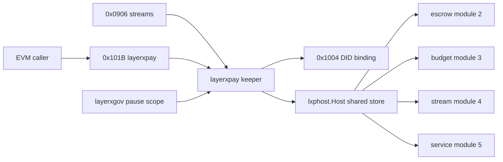

# Pay contract: layerxpay 0x101B and the layerxpay module

This contract freezes the 0x101B layerxpay precompile (57 methods and 38 events of `precompiles/layerxpay/abi.json` over the escrow, budget, stream and service kernel modules 2 to 5), the layerxpay keeper, types, genesis, params, query and the pause and gas rules. At the pinned revision the ABI, the gas table and the Solidity binding exist but no executor or merge constructor serves 0x101B; `mergePrecompileGate` gates it on the layerxpay module (`node/upgrades.go:526`).

The pay keeper runs on the one shared kernel host and its store keeps Params only (decision.221). The 0x0906 agent streams precompile executes through the same stream keeper; its ABI is in [agent-functions.md](agent-functions.md#streams-0x0906).

Revision `2a1033aa2`. Every `path:line` below was read at that revision; `(planned)` marks a file that does not exist there.

## Contents

- [layerxpay-0x101b](#layerxpay-0x101b)
- [escrow](#escrow)
- [budget](#budget)
- [stream](#stream)
- [service](#service)
- [views](#views)
- [events](#events)
- [errors](#errors)
- [gas](#gas)
- [authority](#authority)
- [idempotency](#idempotency)
- [execution](#execution)
- [pause](#pause)
- [pay-keeper](#pay-keeper)
- [pay-types](#pay-types)
- [pay-genesis](#pay-genesis)
- [genesis](#genesis)
- [queries](#queries)
- [msg-layerxpay-updateparams](#msg-layerxpay-updateparams)
- [proto-layerxpay-params](#proto-layerxpay-params)
- [proto-layerxpay-msgupdateparams](#proto-layerxpay-msgupdateparams)
- [proto-layerxpay-msgupdateparamsresponse](#proto-layerxpay-msgupdateparamsresponse)
- [decisions](#decisions)

## layerxpay-0x101b

Precompile 0x000000000000000000000000000000000000101B: the full ABI method and event tables. Family sections below repeat the rows of their family.

| Aspect | Rule |
|---|---|
| Authority | Every write acts for the LayerX DID bound to msg.sender through the 0x1004 binding; an unbound caller is refused before any kernel call and no envelope signature is checked (decision.206). serviceDisputeResolve is refused from any caller other than the escrow arbiter with LXP_UNAUTHORIZED_ARBITER before HostExecute (decision.240). |
| Effects | Each write submits exactly one kernel activity through HostExecute on the caller gas meter and emits its event after the commit (decision.234); escrowPartialCapture and escrowTimeout reuse the capture and release payloads (decision.222). |

Contract context `2.layerxpay-0x101b`:

| Aspect | Rule |
|---|---|
| Interface | Precompile 0x000000000000000000000000000000000000101B named layerxpay: 57 ABI methods of precompiles/layerxpay/abi.json over the escrow, budget, stream and service kernel modules 2 to 5, and its Solidity binding |
| Storage | No precompile-owned state; every write submits one kernel activity through the pay keeper on the shared layerxhost store (decision.221) and every view decodes the kernel record read back through the host |
| Errors | Error(string) reasons LXP_&lt;CODE&gt; from kernel names through LXPCodeName (precompiles/common/lxp_errors.go:320), the layerxpay codespace codes 4 to 6 through PayRevertCode and LXP_PAUSED_SCOPE 735 from layerxgov |
| Events | One 0x101B log per successful write as listed in the events context layerxpay-0x101b-events |
| Gas | methodGas rows of precompiles/layerxpay/gas.go:18-76 charged by the framework WithGasTable (decision.235): escrow writes 60000, dispute open 30000, plus DefaultGasCost of the input; views charge the read rows |
| Activation | Served from the height where MergeUpgrade is done, gated by mergePrecompileGate (node/upgrades.go:521) on the layerxpay module (node/upgrades.go:526) |
| Invariants | Every write acts for the DID bound to the EVM caller (decision.236); idempotency keys and stream ids are never zero (decision.223); the ledger effect of a call equals its kernel receipt |
| Pause | Params.Paused refuses every write except escrowRelease, escrowTimeout, budgetClose, budgetDefund, budgetRevoke, streamPause, streamClose, serviceOfferWithdraw and serviceCommitAbandon (modules/layerxgov/types/proposal.go:28-32); views always answer |

Frozen interfaces: 105 (stable 4, change 95, new 6).

**ABI methods**

| Method | Address | Selector | Status | Gas | Defined at |
|---|---|---|---|---|---|
| `budgetAmend(bytes32,uint128,uint128,uint64,uint8) nonpayable` | 0x101b | `0x90ce21c0` | change | 30000 write (`precompiles/layerxpay/gas.go:30`) | `precompiles/layerxpay/abi.json:2` |
| `budgetClose(bytes32,uint64) nonpayable` | 0x101b | `0xa139eb39` | change | 50000 write (`precompiles/layerxpay/gas.go:34`) | `precompiles/layerxpay/abi.json:3` |
| `budgetCreate(bytes32,bytes32,bytes32,bytes32,uint128,uint128,uint128,uint64,uint64,uint64,uint64,uint8) nonpayable` | 0x101b | `0xa863162b` | change | 50000 write (`precompiles/layerxpay/gas.go:26`) | `precompiles/layerxpay/abi.json:4` |
| `budgetCreateNative(bytes32,bytes32,bytes32,bytes32,uint128,uint128,uint128,uint64,uint64,uint64,uint64,uint8,bytes32,uint64) nonpayable` | 0x101b | `0x9cca862b` | change | 50000 write (`precompiles/layerxpay/gas.go:27`) | `precompiles/layerxpay/abi.json:5` |
| `budgetDefund(bytes32,uint128) nonpayable` | 0x101b | `0x3d054fb3` | change | 50000 write (`precompiles/layerxpay/gas.go:35`) | `precompiles/layerxpay/abi.json:6` |
| `budgetDelegateAdd(bytes32,bytes32) nonpayable` | 0x101b | `0xd7a025b7` | change | 30000 write (`precompiles/layerxpay/gas.go:31`) | `precompiles/layerxpay/abi.json:7` |
| `budgetDelegateRemove(bytes32,bytes32) nonpayable` | 0x101b | `0xe90bac70` | change | 30000 write (`precompiles/layerxpay/gas.go:32`) | `precompiles/layerxpay/abi.json:8` |
| `budgetDelegateSpend(bytes32,bytes32,uint128) nonpayable` | 0x101b | `0xf9708fc1` | change | 60000 write (`precompiles/layerxpay/gas.go:38`) | `precompiles/layerxpay/abi.json:9` |
| `budgetFund(bytes32,uint128) nonpayable` | 0x101b | `0x5051eb50` | change | 40000 write (`precompiles/layerxpay/gas.go:28`) | `precompiles/layerxpay/abi.json:10` |
| `budgetFundNative(bytes32,uint128,uint64) nonpayable` | 0x101b | `0x10b28d90` | change | 40000 write (`precompiles/layerxpay/gas.go:29`) | `precompiles/layerxpay/abi.json:11` |
| `budgetPull(bytes32,bytes32,uint128,bytes) nonpayable` | 0x101b | `0xbc2548e7` | change | 58000 write (`precompiles/layerxpay/gas.go:37`) | `precompiles/layerxpay/abi.json:12` |
| `budgetRemaining(bytes32) view returns (uint128)` | 0x101b | `0xd7778749` | change | read row (`precompiles/layerxpay/gas.go:63`) | `precompiles/layerxpay/abi.json:13` |
| `budgetRevoke(bytes32,uint64) nonpayable` | 0x101b | `0x62da81cd` | change | 50000 write (`precompiles/layerxpay/gas.go:36`) | `precompiles/layerxpay/abi.json:14` |
| `budgetSpend(bytes32,bytes32,uint128) nonpayable` | 0x101b | `0x8608d32b` | change | 50000 write (`precompiles/layerxpay/gas.go:33`) | `precompiles/layerxpay/abi.json:15` |
| `escrowCapture(bytes32,uint128,bytes32) nonpayable` | 0x101b | `0xb291ec43` | change | 60000 write (`precompiles/layerxpay/gas.go:20`) | `precompiles/layerxpay/abi.json:16` |
| `escrowDisputeOpen(bytes32) nonpayable` | 0x101b | `0xeafee6d1` | change | 30000 write (`precompiles/layerxpay/gas.go:24`) | `precompiles/layerxpay/abi.json:17` |
| `escrowDisputeResolve(bytes32,uint32,bytes32) nonpayable` | 0x101b | `0x3d00261e` | change | 80000 write (`precompiles/layerxpay/gas.go:25`) | `precompiles/layerxpay/abi.json:18` |
| `escrowOpen(bytes32,bytes32,bytes32,bytes32,bytes32,bytes32,uint128,uint64,uint64,bytes32,bytes32) nonpayable` | 0x101b | `0xa179121e` | change | 60000 write (`precompiles/layerxpay/gas.go:19`) | `precompiles/layerxpay/abi.json:19` |
| `escrowPartialCapture(bytes32,uint128,bytes32) nonpayable` | 0x101b | `0xb7a902ab` | change | 60000 write (`precompiles/layerxpay/gas.go:21`) | `precompiles/layerxpay/abi.json:20` |
| `escrowRelease(bytes32,bytes32) nonpayable` | 0x101b | `0x50e0d150` | change | 60000 write (`precompiles/layerxpay/gas.go:22`) | `precompiles/layerxpay/abi.json:21` |
| `escrowRemaining(bytes32) view returns (uint128)` | 0x101b | `0x9c328bc9` | change | read row (`precompiles/layerxpay/gas.go:60`) | `precompiles/layerxpay/abi.json:22` |
| `escrowTimeout(bytes32,bytes32) nonpayable` | 0x101b | `0xa49e626f` | change | 60000 write (`precompiles/layerxpay/gas.go:23`) | `precompiles/layerxpay/abi.json:23` |
| `getAgreement(bytes32) view returns ((bytes32,bytes32,bytes32,bytes32,bytes32,bytes32,uint64,uint64,uint64,uint8,uint8,uint64,uint16,bytes32[],bool,uint64,uint64))` | 0x101b | `0xf42eb765` | change | read row (`precompiles/layerxpay/gas.go:68`) | `precompiles/layerxpay/abi.json:24` |
| `getBudget(bytes32) view returns ((bytes32,bytes32,bytes32,bytes32,uint128,uint128,uint128,uint128,uint128,uint64,uint64,uint64,uint64,uint8,bool,bool,bytes32[],bytes32))` | 0x101b | `0x546887a3` | change | read row (`precompiles/layerxpay/gas.go:62`) | `precompiles/layerxpay/abi.json:25` |
| `getCommitment(bytes32) view returns ((bytes32,bytes32,bytes32,bytes32,bytes32,uint64,uint64,bytes32,uint64,bool,uint16))` | 0x101b | `0x7795820c` | change | read row (`precompiles/layerxpay/gas.go:69`) | `precompiles/layerxpay/abi.json:26` |
| `getDelivery(bytes32) view returns ((bytes32,bytes32,(bytes32,uint64,bytes32)[],uint64))` | 0x101b | `0xedab743e` | change | read row (`precompiles/layerxpay/gas.go:71`) | `precompiles/layerxpay/abi.json:27` |
| `getDispute(bytes32) view returns ((bytes32,bytes32,bytes32,bytes32,bytes32[],uint64,bool,uint16,uint32,bytes32,uint64))` | 0x101b | `0x136ba6aa` | change | read row (`precompiles/layerxpay/gas.go:75`) | `precompiles/layerxpay/abi.json:28` |
| `getEscrow(bytes32) view returns ((bytes32,bytes32,bytes32,bytes32,bytes32,uint128,uint128,uint8,uint64,uint64,bytes32,bytes32))` | 0x101b | `0xf023b811` | change | read row (`precompiles/layerxpay/gas.go:59`) | `precompiles/layerxpay/abi.json:29` |
| `getEscrowResult(bytes32) view returns (bytes)` | 0x101b | `0x068833a7` | change | read row (`precompiles/layerxpay/gas.go:61`) | `precompiles/layerxpay/abi.json:30` |
| `getExecution(bytes32) view returns (bytes)` | 0x101b | `0x0fe11ab3` | change | read row (`precompiles/layerxpay/gas.go:70`) | `precompiles/layerxpay/abi.json:31` |
| `getOffer(bytes32) view returns ((bytes32,bytes32,bytes32,bytes32,uint128,bytes32,bytes32,uint64,uint64,uint64,uint8,uint64,uint64,bool,bool))` | 0x101b | `0xd597b8c8` | change | read row (`precompiles/layerxpay/gas.go:67`) | `precompiles/layerxpay/abi.json:32` |
| `getProgress(bytes32) view returns ((bytes32,bytes32,bytes32,bytes32,bytes32,bytes32,bytes32,uint32,uint64,uint64))` | 0x101b | `0x0f89ff41` | change | read row (`precompiles/layerxpay/gas.go:73`) | `precompiles/layerxpay/abi.json:33` |
| `getStream(bytes32) view returns ((bytes32,bytes32,bytes32,bytes32,uint8,uint128,uint64,uint64,uint64,uint64,uint128,uint128,uint128,uint128,uint64,bytes32[],bool,bool,bool))` | 0x101b | `0x1290abe8` | change | read row (`precompiles/layerxpay/gas.go:64`) | `precompiles/layerxpay/abi.json:34` |
| `getStreamResult(bytes32) view returns ((bytes32,bytes32,uint128,uint128,uint16,uint8))` | 0x101b | `0xb3d268df` | change | read row (`precompiles/layerxpay/gas.go:66`) | `precompiles/layerxpay/abi.json:35` |
| `latestDelivery(bytes32) view returns ((bytes32,bytes32,(bytes32,uint64,bytes32)[],uint64))` | 0x101b | `0x1e0ac80d` | change | read row (`precompiles/layerxpay/gas.go:72`) | `precompiles/layerxpay/abi.json:36` |
| `progressHighWater(bytes32) view returns (uint32)` | 0x101b | `0x2c4e8866` | change | read row (`precompiles/layerxpay/gas.go:74`) | `precompiles/layerxpay/abi.json:37` |
| `serviceAccept(bytes32) nonpayable` | 0x101b | `0x9f8dfee6` | change | 30000 write (`precompiles/layerxpay/gas.go:55`) | `precompiles/layerxpay/abi.json:38` |
| `serviceAgreementAccept(bytes32) nonpayable` | 0x101b | `0x85997911` | change | 40000 write (`precompiles/layerxpay/gas.go:49`) | `precompiles/layerxpay/abi.json:39` |
| `serviceAgreementPropose(bytes32,bytes32,bytes32,bytes32) nonpayable` | 0x101b | `0xe5589018` | change | 30000 write (`precompiles/layerxpay/gas.go:48`) | `precompiles/layerxpay/abi.json:40` |
| `serviceCommitAbandon(bytes32,uint16) nonpayable` | 0x101b | `0x3415adc7` | change | 40000 write (`precompiles/layerxpay/gas.go:51`) | `precompiles/layerxpay/abi.json:41` |
| `serviceCommitTask(bytes32,bytes32,bytes32,bytes32,uint64,uint64) nonpayable` | 0x101b | `0xdbc88a65` | change | 40000 write (`precompiles/layerxpay/gas.go:50`) | `precompiles/layerxpay/abi.json:42` |
| `serviceDeliver(bytes32,bytes32,(bytes32,uint64,bytes32)[]) nonpayable` | 0x101b | `0xbda35baa` | change | 50000 write (`precompiles/layerxpay/gas.go:54`) | `precompiles/layerxpay/abi.json:43` |
| `serviceDisputeOpen(bytes32,bytes32,bytes32[]) nonpayable` | 0x101b | `0x1274face` | change | 50000 write (`precompiles/layerxpay/gas.go:57`) | `precompiles/layerxpay/abi.json:44` |
| `serviceDisputeResolve(bytes32,uint16,uint32,bytes32) nonpayable` | 0x101b | `0x696b2d17` | change | 100000 write (`precompiles/layerxpay/gas.go:58`) | `precompiles/layerxpay/abi.json:45` |
| `serviceOfferPublish(bytes32,bytes32,uint128,bytes32,bytes32,uint64,uint64,uint64,uint8,uint64) nonpayable` | 0x101b | `0x34569433` | change | 30000 write (`precompiles/layerxpay/gas.go:46`) | `precompiles/layerxpay/abi.json:46` |
| `serviceOfferWithdraw(bytes32) nonpayable` | 0x101b | `0xd5584d7c` | change | 30000 write (`precompiles/layerxpay/gas.go:47`) | `precompiles/layerxpay/abi.json:47` |
| `serviceProgressReport(bytes32,bytes32,bytes32,bytes32,uint32) nonpayable` | 0x101b | `0xa203571a` | change | 30000 write (`precompiles/layerxpay/gas.go:53`) | `precompiles/layerxpay/abi.json:48` |
| `serviceReject(bytes32,uint16,bytes32[]) nonpayable` | 0x101b | `0x4d71a096` | change | 30000 write (`precompiles/layerxpay/gas.go:56`) | `precompiles/layerxpay/abi.json:49` |
| `serviceToolExecAttest(bytes) nonpayable` | 0x101b | `0x5169415d` | change | 38000 write (`precompiles/layerxpay/gas.go:52`) | `precompiles/layerxpay/abi.json:50` |
| `streamAccrued(bytes32) view returns (uint128,uint128)` | 0x101b | `0xb750cb8e` | change | read row (`precompiles/layerxpay/gas.go:65`) | `precompiles/layerxpay/abi.json:51` |
| `streamClose(bytes32,bytes32) nonpayable` | 0x101b | `0x78725d86` | change | 80000 write (`precompiles/layerxpay/gas.go:45`) | `precompiles/layerxpay/abi.json:52` |
| `streamMeter(bytes32,uint64,bytes32,bytes) nonpayable` | 0x101b | `0xb96ba914` | change | 38000 write (`precompiles/layerxpay/gas.go:41`) | `precompiles/layerxpay/abi.json:53` |
| `streamOpen(bytes32,bytes32,bytes32,bytes32,uint8,uint128,uint64,uint64,uint64,uint128,uint128,bytes32[]) nonpayable` | 0x101b | `0x89fdbd3b` | change | 50000 write (`precompiles/layerxpay/gas.go:39`) | `precompiles/layerxpay/abi.json:54` |
| `streamPause(bytes32) nonpayable` | 0x101b | `0x71ed5358` | change | 30000 write (`precompiles/layerxpay/gas.go:43`) | `precompiles/layerxpay/abi.json:55` |
| `streamResume(bytes32) nonpayable` | 0x101b | `0x59aa40a2` | change | 30000 write (`precompiles/layerxpay/gas.go:44`) | `precompiles/layerxpay/abi.json:56` |
| `streamSettle(bytes32,bytes32) nonpayable` | 0x101b | `0x00a56e5f` | change | 60000 write (`precompiles/layerxpay/gas.go:42`) | `precompiles/layerxpay/abi.json:57` |
| `streamTopUp(bytes32,uint128) nonpayable` | 0x101b | `0x0b69f222` | change | 50000 write (`precompiles/layerxpay/gas.go:40`) | `precompiles/layerxpay/abi.json:58` |

**Events**

| Event | Address | topic0 | Status | Defined at |
|---|---|---|---|---|
| `AgreementAccepted(bytes32 indexed,bytes32 indexed,uint8,uint64)` | 0x101b | `0x9de5935a09572b051c9194e7e83c1e5e340c717e25a06c66268b8892121474d4` | change | `precompiles/layerxpay/abi.json:59` |
| `AgreementProposed(bytes32 indexed,bytes32 indexed,uint8,uint64)` | 0x101b | `0x3e9d8e46bd4c26cf3e14abb64acb712a44dfdc616aaf61b4b2e1bac16aedee39` | change | `precompiles/layerxpay/abi.json:60` |
| `BudgetAmended(bytes32 indexed,uint128,uint64)` | 0x101b | `0x31c93d31b53c28bc0fa050fb1c3062f782ba9a79bddc2e03ce2fd9b1fe6beff1` | change | `precompiles/layerxpay/abi.json:61` |
| `BudgetClosed(bytes32 indexed,uint128,uint64)` | 0x101b | `0xa75bf542dcea5f85d998297a562512ea52af43a7dbf6b2e52283ac9e7269a064` | change | `precompiles/layerxpay/abi.json:62` |
| `BudgetCreated(bytes32 indexed,bytes32,uint128)` | 0x101b | `0x4ffe02fb44ac10fea9c67d108d6137f20d66416c427018cd7c5c85134367a2b3` | change | `precompiles/layerxpay/abi.json:63` |
| `BudgetDefunded(bytes32 indexed,uint128,uint128)` | 0x101b | `0xddf7b24a523c211d8e64a31f112821e871669f996eac19ae03a6ca742cf33dd3` | change | `precompiles/layerxpay/abi.json:64` |
| `BudgetDelegateAdded(bytes32 indexed,bytes32)` | 0x101b | `0xfb88d261a6feb94af7f84c47e1ee79be8f7a17b4592b3cfaacfd30e7fcc8de3b` | change | `precompiles/layerxpay/abi.json:65` |
| `BudgetDelegateRemoved(bytes32 indexed,bytes32)` | 0x101b | `0x5cde5fb6325cdde9badecb2d773ddcbd29bbd1ab44f7fa976e9b824ddccf2dbc` | change | `precompiles/layerxpay/abi.json:66` |
| `BudgetFunded(bytes32 indexed,uint128)` | 0x101b | `0xb5395e31b1001c1a3db7533e5433ded6d549d5831c06882d39e8747947506d3f` | change | `precompiles/layerxpay/abi.json:67` |
| `BudgetRevoked(bytes32 indexed,uint128,uint64)` | 0x101b | `0x6940118bfee95d3acf3b067b81e5d0eed108c543c9b0e0a462b502a81de64586` | change | `precompiles/layerxpay/abi.json:68` |
| `BudgetSpent(bytes32 indexed,bytes32,uint128)` | 0x101b | `0xe7061a9872a2a196198f5fc257e098280fc29533217100b36a8a45113481624a` | change | `precompiles/layerxpay/abi.json:69` |
| `CommitAbandoned(bytes32 indexed,bytes32 indexed,uint8,uint64)` | 0x101b | `0xf82b0eee8867ff42a37f93f9ff76ac9f49c6d9d87212401d309bfe38d8784080` | change | `precompiles/layerxpay/abi.json:70` |
| `DefaultOutcomeApplied(bytes32 indexed,uint8,bool,uint64,uint64)` | 0x101b | `0x52cdc71e077aa63bc67e6a932084f167c9160b7b857a3e3c1d26d3ec4923da98` | change | `precompiles/layerxpay/abi.json:71` |
| `Delivered(bytes32 indexed,bytes32 indexed,uint8,uint64)` | 0x101b | `0x8e7c33a038e5e59bac9f44a0eb4bb592c7d0cc1c7271360f73f232a8c9511552` | change | `precompiles/layerxpay/abi.json:72` |
| `DisputeOpened(bytes32 indexed,bytes32 indexed,uint8,uint64)` | 0x101b | `0xbf7c0c01d9d1cca84d5e6e3c398fd19d7b9bf4aa1eb2344706c0cd9605734d07` | change | `precompiles/layerxpay/abi.json:73` |
| `DisputeResolved(bytes32 indexed,bytes32 indexed,uint8,uint64)` | 0x101b | `0xa4df9ab184633d8a0e83b36ceccf4a447aab7b5d6c0687d9cbec51e2eb54192a` | change | `precompiles/layerxpay/abi.json:74` |
| `EscrowCaptured(bytes32 indexed,uint16,uint8,uint128,uint128)` | 0x101b | `0xad68d39439fc7b036c914e06aff1e364d909efc098ae0a50a48f10dfb4246e34` | change | `precompiles/layerxpay/abi.json:75` |
| `EscrowDisputed(bytes32 indexed,uint16,uint8,uint128,uint128)` | 0x101b | `0x01030c369649c257abfaf58265fd8e25cfd284243d7e111bf34ae8df760ef1a6` | change | `precompiles/layerxpay/abi.json:76` |
| `EscrowOpened(bytes32 indexed,uint16,uint8,uint128,uint128)` | 0x101b | `0xeb55494fa55a2ce6e323b2b8776e5e352d2964877c0f5bc592679325749bfc2f` | change | `precompiles/layerxpay/abi.json:77` |
| `EscrowPartiallyCaptured(bytes32 indexed,uint16,uint8,uint128,uint128)` | 0x101b | `0xc84c61f008e334a19c74068689bf3a54f2ae0ecfec049d62b819f5f68d7a1a9d` | change | `precompiles/layerxpay/abi.json:78` |
| `EscrowReleased(bytes32 indexed,uint16,uint8,uint128,uint128)` | 0x101b | `0x65407a7b21a4dbbe609b634d05221c6beab59a52ac8e17b8be2bb7fa6e399654` | change | `precompiles/layerxpay/abi.json:79` |
| `EscrowResolved(bytes32 indexed,uint16,uint8,uint128,uint128)` | 0x101b | `0xe3a9e891d675b5ae5ea35ed61028e3f15be7ab2dad8b4bb7ad51ac5af1737c73` | change | `precompiles/layerxpay/abi.json:80` |
| `EscrowTimedOut(bytes32 indexed,uint16,uint8,uint128,uint128)` | 0x101b | `0x3cb7cfeaeaccd65cfb44ed6f0f50c4ecd0d08b5b9b7c507c8554672ea0e2df98` | change | `precompiles/layerxpay/abi.json:81` |
| `ExecutionAttested(bytes32 indexed,bytes32 indexed,uint8,uint64)` | 0x101b | `0x3fd39a11ff049c70f0c6c1e3e311f2bd0d00607756c7fae5156587bf82a19467` | change | `precompiles/layerxpay/abi.json:82` |
| `OfferPublished(bytes32 indexed,bytes32 indexed,uint8,uint64)` | 0x101b | `0x094bfb6e853a36faae49604b89e04fef60a8ce2f9e4c1f9d0c53c6166d7f6b43` | change | `precompiles/layerxpay/abi.json:83` |
| `OfferWithdrawn(bytes32 indexed,bytes32 indexed,uint8,uint64)` | 0x101b | `0x1dc29fd3e5c1c7ecf9bbd0e84ede6461886d0dafe96843e82dd32efd004c31b4` | change | `precompiles/layerxpay/abi.json:84` |
| `OutcomeAccepted(bytes32 indexed,bytes32 indexed,uint8,uint64)` | 0x101b | `0x5d654e0e0378bd06e4e6fcd1728c8954e62e820aa2147d3a6a90a133bffaf1de` | change | `precompiles/layerxpay/abi.json:85` |
| `OutcomeRejected(bytes32 indexed,bytes32 indexed,uint8,uint64)` | 0x101b | `0x6b6c89470b91617fc6fa2384b31e88021ddf3bcb78491fc0e82748dc84b13518` | change | `precompiles/layerxpay/abi.json:86` |
| `ProgressReported(bytes32 indexed,bytes32 indexed,uint8,uint64)` | 0x101b | `0x819ea4c59366246bb925fe1c7273f9af36a52b0ff8d393e63e789762e328c0fa` | change | `precompiles/layerxpay/abi.json:87` |
| `StreamClosed(bytes32 indexed,uint128,uint128)` | 0x101b | `0x8063cfde1c85c4898f9fff27df374f273806733152313f92e8a5914423678a9f` | change | `precompiles/layerxpay/abi.json:88` |
| `StreamMetered(bytes32 indexed,uint64,uint128,uint128)` | 0x101b | `0x932366bfeca08e9b804274a1a7eb67bd4d66f03e9290b961e60b8eeaf5d78b02` | change | `precompiles/layerxpay/abi.json:89` |
| `StreamOpened(bytes32 indexed,bytes32,bytes32,bytes32,bytes32,uint8,uint128)` | 0x101b | `0x8277b76c675fc9dab63f492a7ac5479a66d6552828f1fdbc9a76e2340ada9448` | change | `precompiles/layerxpay/abi.json:90` |
| `StreamPaused(bytes32 indexed,uint64,uint128)` | 0x101b | `0x9032eddf8dcc6800a443fad0f2630b6edbeb66a914d9cb09347325363cf7fe1e` | change | `precompiles/layerxpay/abi.json:91` |
| `StreamRateUpdated(bytes32 indexed,uint128,uint128,uint128)` | 0x101b | `0x6006a657a93ec26224beb6993b55b31a96ca5b9e8719252665286ab2b7f58e60` | change | `precompiles/layerxpay/abi.json:92` |
| `StreamResumed(bytes32 indexed,uint64,uint128)` | 0x101b | `0x90f70f76c4cceddd91668722f7b46eb8b8df7612a6f9c6087fc49b97b9758a14` | change | `precompiles/layerxpay/abi.json:93` |
| `StreamSettled(bytes32 indexed,uint128,uint128,bool)` | 0x101b | `0xa87dc98d52838f3eb3a565c28fa8ccfb54ffcc925bc81b759eb3e64fb5185f69` | change | `precompiles/layerxpay/abi.json:94` |
| `StreamToppedUp(bytes32 indexed,uint128,bool)` | 0x101b | `0x643cbe429fc24e5e4f0f1ddb6f5d583d651e5558832d390e9b65557734ce47c9` | change | `precompiles/layerxpay/abi.json:95` |
| `TaskCommitted(bytes32 indexed,bytes32 indexed,uint8,uint64)` | 0x101b | `0x6e00443b450170a849061291f9a4797138ee198a5cc8de5f4c30f1aa79e501f1` | change | `precompiles/layerxpay/abi.json:96` |

**Other interfaces**

| Interface block | Kind | Signature | Status | Defined at |
|---|---|---|---|---|
| `interface.2.go-layerxpay-activity-constants-j24` | go_exported | `const ActivityEscrowOpen uint32 = 0x00020001 .. ActivityServiceDisputeResolve uint32 = 0x0005000d` | new | `modules/layerxpay/types/activity.go` (planned) |
| `interface.2.go-layerxpay-methodactivity-j24` | go_exported | `var MethodActivity map[string]KernelActivity` | new | `modules/layerxpay/types/activity.go` (planned) |
| `interface.2.go-layerxpay-pc-requiredgas-j24` | go_exported | `func RequiredGas(input []byte) uint64` | stable | `precompiles/layerxpay/gas.go:82` |
| `interface.2.go-layerxpay-pc-layerxpaykeepers-j24` | go_exported | `type LayerXPayKeepers interface { LayerXPayK() *paykeeper.Keeper }` | new | `precompiles/layerxpay/keepers.go` (planned) |
| `interface.2.go-layerxpay-pc-newmergeprecompile-j24` | go_exported | `func NewMergePrecompile(keepers utils.Keepers, planName string) (precompiles.IPrecompile, error)` | new | `precompiles/layerxpay/layerxpay.go` (planned) |
| `interface.2.go-layerxpay-pc-newprecompile-j24` | go_exported | `func NewPrecompile(k *paykeeper.Keeper, evm *evmkeeper.Keeper, upgrade *upgradekeeper.Keeper, planName string) (*pcommon.Precompile, error)` | new | `precompiles/layerxpay/layerxpay.go` (planned) |
| `interface.2.go-layerxpay-pc-payaddress-j24` | go_exported | `const PayAddress = "0x000000000000000000000000000000000000101B"; const PrecompileName = "layerxpay"` | new | `precompiles/layerxpay/layerxpay.go` (planned) |
| `interface.2.sol-layerxpay-precompile-address-j24` | sol_function | `address constant LAYERX_PAY_PRECOMPILE_ADDRESS = 0x000000000000000000000000000000000000101B;` | stable | `precompiles/layerxpay/LayerXPay.sol:4` |
| `interface.2.sol-layerxpay-contract-j24` | sol_function | `ILayerXPay constant LAYERX_PAY_CONTRACT = ILayerXPay(LAYERX_PAY_PRECOMPILE_ADDRESS);` | stable | `precompiles/layerxpay/LayerXPay.sol:6` |
| `interface.2.sol-layerxpay-ilayerxpay-j24` | sol_function | `interface ILayerXPay (57 functions, 38 events, 12 structs mirroring precompiles/layerxpay/abi.json)` | stable | `precompiles/layerxpay/LayerXPay.sol:12` |

Capabilities verified against this section: 2.21.4, 2.25.5, 2.28.1, 2.38.2, 2.40.1, 2.40.2, 2.40.3.

| Acceptance | Requirement | Test |
|---|---|---|
| 2.244.1 | 2244.1 | `modules/layerxpay/types/activity_test.go::TestMethodActivityMatchesKernelTypes (planned)` |
| 2.244.2 | 2244.2 | `modules/layerxpay/types/activity_test.go::TestMethodActivitySharedOrdinals (planned)` |
| 2.266.1 | 2266.1 | `modules/layerxpay/keeper/stream_agent_test.go::TestAgentStreamOpenMapsTokenAndUnits (planned)` |
| 2.266.2 | 2266.2 | `modules/layerxpay/keeper/stream_agent_test.go::TestAgentStreamSettleCloseRateAndView (planned)` |
| 2.266.3 | 2266.3 | `modules/layerxpay/keeper/stream_agent_test.go::TestAgentStreamUnknownTokenRefused (planned)` |
| 2.276.1 | 2276.1 | `precompiles/layerxpay/layerxpay_test.go::TestPayPrecompileRegistersMergeConstructor (planned)` |
| 2.276.2 | 2276.2 | `precompiles/layerxpay/layerxpay_test.go::TestPayPrecompileChargesGasTable (planned)` |
| 2.304.1 | 2304.1 | `precompiles/layerxpay/served/served_test.go::TestPayServedAfterUpgrade (planned)` |
| 2.304.2 | 2304.2 | `precompiles/layerxpay/served/served_test.go::TestPayServedEscrowOpenThroughEVM (planned)` |
| 2.311.1 | 2311.1 | `precompiles/layerxpay/conformance_escrow_test.go::TestPayEscrowPathMatchesHostExecute (planned)` |
| 2.312.1 | 2312.1 | `precompiles/layerxpay/conformance_budget_test.go::TestPayBudgetPathMatchesHostExecute (planned)` |
| 2.313.1 | 2313.1 | `precompiles/layerxpay/conformance_service_test.go::TestPayServicePathMatchesHostExecute (planned)` |

## escrow

Escrow family, kernel module 2: open, capture, partial capture, release, timeout, dispute open and dispute resolve, with the escrow views.

Methods of this group (rows repeated from [layerxpay-0x101b](#layerxpay-0x101b)):

| Method | Address | Selector | Status | Gas | Defined at |
|---|---|---|---|---|---|
| `escrowCapture(bytes32,uint128,bytes32) nonpayable` | 0x101b | `0xb291ec43` | change | 60000 write (`precompiles/layerxpay/gas.go:20`) | `precompiles/layerxpay/abi.json:16` |
| `escrowDisputeOpen(bytes32) nonpayable` | 0x101b | `0xeafee6d1` | change | 30000 write (`precompiles/layerxpay/gas.go:24`) | `precompiles/layerxpay/abi.json:17` |
| `escrowDisputeResolve(bytes32,uint32,bytes32) nonpayable` | 0x101b | `0x3d00261e` | change | 80000 write (`precompiles/layerxpay/gas.go:25`) | `precompiles/layerxpay/abi.json:18` |
| `escrowOpen(bytes32,bytes32,bytes32,bytes32,bytes32,bytes32,uint128,uint64,uint64,bytes32,bytes32) nonpayable` | 0x101b | `0xa179121e` | change | 60000 write (`precompiles/layerxpay/gas.go:19`) | `precompiles/layerxpay/abi.json:19` |
| `escrowPartialCapture(bytes32,uint128,bytes32) nonpayable` | 0x101b | `0xb7a902ab` | change | 60000 write (`precompiles/layerxpay/gas.go:21`) | `precompiles/layerxpay/abi.json:20` |
| `escrowRelease(bytes32,bytes32) nonpayable` | 0x101b | `0x50e0d150` | change | 60000 write (`precompiles/layerxpay/gas.go:22`) | `precompiles/layerxpay/abi.json:21` |
| `escrowRemaining(bytes32) view returns (uint128)` | 0x101b | `0x9c328bc9` | change | read row (`precompiles/layerxpay/gas.go:60`) | `precompiles/layerxpay/abi.json:22` |
| `escrowTimeout(bytes32,bytes32) nonpayable` | 0x101b | `0xa49e626f` | change | 60000 write (`precompiles/layerxpay/gas.go:23`) | `precompiles/layerxpay/abi.json:23` |
| `getEscrow(bytes32) view returns ((bytes32,bytes32,bytes32,bytes32,bytes32,uint128,uint128,uint8,uint64,uint64,bytes32,bytes32))` | 0x101b | `0xf023b811` | change | read row (`precompiles/layerxpay/gas.go:59`) | `precompiles/layerxpay/abi.json:29` |
| `getEscrowResult(bytes32) view returns (bytes)` | 0x101b | `0x068833a7` | change | read row (`precompiles/layerxpay/gas.go:61`) | `precompiles/layerxpay/abi.json:30` |

Events of this group (rows repeated from [layerxpay-0x101b](#layerxpay-0x101b)):

| Event | Address | topic0 | Status | Defined at |
|---|---|---|---|---|
| `EscrowCaptured(bytes32 indexed,uint16,uint8,uint128,uint128)` | 0x101b | `0xad68d39439fc7b036c914e06aff1e364d909efc098ae0a50a48f10dfb4246e34` | change | `precompiles/layerxpay/abi.json:75` |
| `EscrowDisputed(bytes32 indexed,uint16,uint8,uint128,uint128)` | 0x101b | `0x01030c369649c257abfaf58265fd8e25cfd284243d7e111bf34ae8df760ef1a6` | change | `precompiles/layerxpay/abi.json:76` |
| `EscrowOpened(bytes32 indexed,uint16,uint8,uint128,uint128)` | 0x101b | `0xeb55494fa55a2ce6e323b2b8776e5e352d2964877c0f5bc592679325749bfc2f` | change | `precompiles/layerxpay/abi.json:77` |
| `EscrowPartiallyCaptured(bytes32 indexed,uint16,uint8,uint128,uint128)` | 0x101b | `0xc84c61f008e334a19c74068689bf3a54f2ae0ecfec049d62b819f5f68d7a1a9d` | change | `precompiles/layerxpay/abi.json:78` |
| `EscrowReleased(bytes32 indexed,uint16,uint8,uint128,uint128)` | 0x101b | `0x65407a7b21a4dbbe609b634d05221c6beab59a52ac8e17b8be2bb7fa6e399654` | change | `precompiles/layerxpay/abi.json:79` |
| `EscrowResolved(bytes32 indexed,uint16,uint8,uint128,uint128)` | 0x101b | `0xe3a9e891d675b5ae5ea35ed61028e3f15be7ab2dad8b4bb7ad51ac5af1737c73` | change | `precompiles/layerxpay/abi.json:80` |
| `EscrowTimedOut(bytes32 indexed,uint16,uint8,uint128,uint128)` | 0x101b | `0x3cb7cfeaeaccd65cfb44ed6f0f50c4ecd0d08b5b9b7c507c8554672ea0e2df98` | change | `precompiles/layerxpay/abi.json:81` |

Capabilities verified against this section: 2.23.1, 2.23.2, 2.28.4.

| Acceptance | Requirement | Test |
|---|---|---|
| 2.254.1 | 2254.1 | `modules/layerxpay/keeper/escrow_open_test.go::TestEscrowOpenLocksFunds (planned)` |
| 2.254.2 | 2254.2 | `modules/layerxpay/keeper/escrow_open_test.go::TestEscrowCaptureAndPartialCapture (planned)` |
| 2.255.1 | 2255.1 | `modules/layerxpay/keeper/escrow_settle_test.go::TestEscrowReleaseAndTimeout (planned)` |
| 2.255.2 | 2255.2 | `modules/layerxpay/keeper/escrow_settle_test.go::TestEscrowDisputeResolveSplit (planned)` |
| 2.279.1 | 2279.1 | `precompiles/layerxpay/escrow_test.go::TestPrecompileEscrowLifecycle (planned)` |
| 2.279.2 | 2279.2 | `precompiles/layerxpay/escrow_test.go::TestPrecompileEscrowViews (planned)` |
| 2.279.3 | 2279.3 | `precompiles/layerxpay/escrow_test.go::TestPrecompileEscrowUnboundCallerReverts (planned)` |

## budget

Budget family, kernel module 3: create and create native, fund and fund native, amend, spend, delegate add, remove and spend, pull against a payer grant, close, defund and revoke, with the budget views.

Methods of this group (rows repeated from [layerxpay-0x101b](#layerxpay-0x101b)):

| Method | Address | Selector | Status | Gas | Defined at |
|---|---|---|---|---|---|
| `budgetAmend(bytes32,uint128,uint128,uint64,uint8) nonpayable` | 0x101b | `0x90ce21c0` | change | 30000 write (`precompiles/layerxpay/gas.go:30`) | `precompiles/layerxpay/abi.json:2` |
| `budgetClose(bytes32,uint64) nonpayable` | 0x101b | `0xa139eb39` | change | 50000 write (`precompiles/layerxpay/gas.go:34`) | `precompiles/layerxpay/abi.json:3` |
| `budgetCreate(bytes32,bytes32,bytes32,bytes32,uint128,uint128,uint128,uint64,uint64,uint64,uint64,uint8) nonpayable` | 0x101b | `0xa863162b` | change | 50000 write (`precompiles/layerxpay/gas.go:26`) | `precompiles/layerxpay/abi.json:4` |
| `budgetCreateNative(bytes32,bytes32,bytes32,bytes32,uint128,uint128,uint128,uint64,uint64,uint64,uint64,uint8,bytes32,uint64) nonpayable` | 0x101b | `0x9cca862b` | change | 50000 write (`precompiles/layerxpay/gas.go:27`) | `precompiles/layerxpay/abi.json:5` |
| `budgetDefund(bytes32,uint128) nonpayable` | 0x101b | `0x3d054fb3` | change | 50000 write (`precompiles/layerxpay/gas.go:35`) | `precompiles/layerxpay/abi.json:6` |
| `budgetDelegateAdd(bytes32,bytes32) nonpayable` | 0x101b | `0xd7a025b7` | change | 30000 write (`precompiles/layerxpay/gas.go:31`) | `precompiles/layerxpay/abi.json:7` |
| `budgetDelegateRemove(bytes32,bytes32) nonpayable` | 0x101b | `0xe90bac70` | change | 30000 write (`precompiles/layerxpay/gas.go:32`) | `precompiles/layerxpay/abi.json:8` |
| `budgetDelegateSpend(bytes32,bytes32,uint128) nonpayable` | 0x101b | `0xf9708fc1` | change | 60000 write (`precompiles/layerxpay/gas.go:38`) | `precompiles/layerxpay/abi.json:9` |
| `budgetFund(bytes32,uint128) nonpayable` | 0x101b | `0x5051eb50` | change | 40000 write (`precompiles/layerxpay/gas.go:28`) | `precompiles/layerxpay/abi.json:10` |
| `budgetFundNative(bytes32,uint128,uint64) nonpayable` | 0x101b | `0x10b28d90` | change | 40000 write (`precompiles/layerxpay/gas.go:29`) | `precompiles/layerxpay/abi.json:11` |
| `budgetPull(bytes32,bytes32,uint128,bytes) nonpayable` | 0x101b | `0xbc2548e7` | change | 58000 write (`precompiles/layerxpay/gas.go:37`) | `precompiles/layerxpay/abi.json:12` |
| `budgetRemaining(bytes32) view returns (uint128)` | 0x101b | `0xd7778749` | change | read row (`precompiles/layerxpay/gas.go:63`) | `precompiles/layerxpay/abi.json:13` |
| `budgetRevoke(bytes32,uint64) nonpayable` | 0x101b | `0x62da81cd` | change | 50000 write (`precompiles/layerxpay/gas.go:36`) | `precompiles/layerxpay/abi.json:14` |
| `budgetSpend(bytes32,bytes32,uint128) nonpayable` | 0x101b | `0x8608d32b` | change | 50000 write (`precompiles/layerxpay/gas.go:33`) | `precompiles/layerxpay/abi.json:15` |
| `getBudget(bytes32) view returns ((bytes32,bytes32,bytes32,bytes32,uint128,uint128,uint128,uint128,uint128,uint64,uint64,uint64,uint64,uint8,bool,bool,bytes32[],bytes32))` | 0x101b | `0x546887a3` | change | read row (`precompiles/layerxpay/gas.go:62`) | `precompiles/layerxpay/abi.json:25` |

Events of this group (rows repeated from [layerxpay-0x101b](#layerxpay-0x101b)):

| Event | Address | topic0 | Status | Defined at |
|---|---|---|---|---|
| `BudgetAmended(bytes32 indexed,uint128,uint64)` | 0x101b | `0x31c93d31b53c28bc0fa050fb1c3062f782ba9a79bddc2e03ce2fd9b1fe6beff1` | change | `precompiles/layerxpay/abi.json:61` |
| `BudgetClosed(bytes32 indexed,uint128,uint64)` | 0x101b | `0xa75bf542dcea5f85d998297a562512ea52af43a7dbf6b2e52283ac9e7269a064` | change | `precompiles/layerxpay/abi.json:62` |
| `BudgetCreated(bytes32 indexed,bytes32,uint128)` | 0x101b | `0x4ffe02fb44ac10fea9c67d108d6137f20d66416c427018cd7c5c85134367a2b3` | change | `precompiles/layerxpay/abi.json:63` |
| `BudgetDefunded(bytes32 indexed,uint128,uint128)` | 0x101b | `0xddf7b24a523c211d8e64a31f112821e871669f996eac19ae03a6ca742cf33dd3` | change | `precompiles/layerxpay/abi.json:64` |
| `BudgetDelegateAdded(bytes32 indexed,bytes32)` | 0x101b | `0xfb88d261a6feb94af7f84c47e1ee79be8f7a17b4592b3cfaacfd30e7fcc8de3b` | change | `precompiles/layerxpay/abi.json:65` |
| `BudgetDelegateRemoved(bytes32 indexed,bytes32)` | 0x101b | `0x5cde5fb6325cdde9badecb2d773ddcbd29bbd1ab44f7fa976e9b824ddccf2dbc` | change | `precompiles/layerxpay/abi.json:66` |
| `BudgetFunded(bytes32 indexed,uint128)` | 0x101b | `0xb5395e31b1001c1a3db7533e5433ded6d549d5831c06882d39e8747947506d3f` | change | `precompiles/layerxpay/abi.json:67` |
| `BudgetRevoked(bytes32 indexed,uint128,uint64)` | 0x101b | `0x6940118bfee95d3acf3b067b81e5d0eed108c543c9b0e0a462b502a81de64586` | change | `precompiles/layerxpay/abi.json:68` |
| `BudgetSpent(bytes32 indexed,bytes32,uint128)` | 0x101b | `0xe7061a9872a2a196198f5fc257e098280fc29533217100b36a8a45113481624a` | change | `precompiles/layerxpay/abi.json:69` |

Capabilities verified against this section: 2.24.1, 2.24.2, 2.24.3, 2.24.4, 2.28.5.

| Acceptance | Requirement | Test |
|---|---|---|
| 2.257.1 | 2257.1 | `modules/layerxpay/keeper/budget_create_test.go::TestBudgetCreateAndFund (planned)` |
| 2.257.2 | 2257.2 | `modules/layerxpay/keeper/budget_create_test.go::TestBudgetNativeVariantsAndAmend (planned)` |
| 2.258.1 | 2258.1 | `modules/layerxpay/keeper/budget_spend_test.go::TestBudgetSpendWithinPeriodLimit (planned)` |
| 2.258.2 | 2258.2 | `modules/layerxpay/keeper/budget_spend_test.go::TestBudgetDelegateSpendDerivedKey (planned)` |
| 2.259.1 | 2259.1 | `modules/layerxpay/keeper/budget_pull_test.go::TestBudgetPullWithPayerGrant (planned)` |
| 2.259.2 | 2259.2 | `modules/layerxpay/keeper/budget_pull_test.go::TestBudgetPullRefusesMalformedGrant (planned)` |
| 2.260.1 | 2260.1 | `modules/layerxpay/keeper/budget_close_test.go::TestBudgetCloseDrainsToOwner (planned)` |
| 2.260.2 | 2260.2 | `modules/layerxpay/keeper/budget_close_test.go::TestBudgetDefundAndRevoke (planned)` |
| 2.280.1 | 2280.1 | `precompiles/layerxpay/budget_test.go::TestPrecompileBudgetLifecycle (planned)` |
| 2.280.2 | 2280.2 | `precompiles/layerxpay/budget_test.go::TestPrecompileBudgetNativeAndPull (planned)` |

## stream

Stream family, kernel module 4: open, top up, meter, settle, pause, resume and close. The 0x0906 agent streams share the stream records of this keeper and the kernel rate change (decision.237).

Methods of this group (rows repeated from [layerxpay-0x101b](#layerxpay-0x101b)):

| Method | Address | Selector | Status | Gas | Defined at |
|---|---|---|---|---|---|
| `getStream(bytes32) view returns ((bytes32,bytes32,bytes32,bytes32,uint8,uint128,uint64,uint64,uint64,uint64,uint128,uint128,uint128,uint128,uint64,bytes32[],bool,bool,bool))` | 0x101b | `0x1290abe8` | change | read row (`precompiles/layerxpay/gas.go:64`) | `precompiles/layerxpay/abi.json:34` |
| `getStreamResult(bytes32) view returns ((bytes32,bytes32,uint128,uint128,uint16,uint8))` | 0x101b | `0xb3d268df` | change | read row (`precompiles/layerxpay/gas.go:66`) | `precompiles/layerxpay/abi.json:35` |
| `streamAccrued(bytes32) view returns (uint128,uint128)` | 0x101b | `0xb750cb8e` | change | read row (`precompiles/layerxpay/gas.go:65`) | `precompiles/layerxpay/abi.json:51` |
| `streamClose(bytes32,bytes32) nonpayable` | 0x101b | `0x78725d86` | change | 80000 write (`precompiles/layerxpay/gas.go:45`) | `precompiles/layerxpay/abi.json:52` |
| `streamMeter(bytes32,uint64,bytes32,bytes) nonpayable` | 0x101b | `0xb96ba914` | change | 38000 write (`precompiles/layerxpay/gas.go:41`) | `precompiles/layerxpay/abi.json:53` |
| `streamOpen(bytes32,bytes32,bytes32,bytes32,uint8,uint128,uint64,uint64,uint64,uint128,uint128,bytes32[]) nonpayable` | 0x101b | `0x89fdbd3b` | change | 50000 write (`precompiles/layerxpay/gas.go:39`) | `precompiles/layerxpay/abi.json:54` |
| `streamPause(bytes32) nonpayable` | 0x101b | `0x71ed5358` | change | 30000 write (`precompiles/layerxpay/gas.go:43`) | `precompiles/layerxpay/abi.json:55` |
| `streamResume(bytes32) nonpayable` | 0x101b | `0x59aa40a2` | change | 30000 write (`precompiles/layerxpay/gas.go:44`) | `precompiles/layerxpay/abi.json:56` |
| `streamSettle(bytes32,bytes32) nonpayable` | 0x101b | `0x00a56e5f` | change | 60000 write (`precompiles/layerxpay/gas.go:42`) | `precompiles/layerxpay/abi.json:57` |
| `streamTopUp(bytes32,uint128) nonpayable` | 0x101b | `0x0b69f222` | change | 50000 write (`precompiles/layerxpay/gas.go:40`) | `precompiles/layerxpay/abi.json:58` |

Events of this group (rows repeated from [layerxpay-0x101b](#layerxpay-0x101b)):

| Event | Address | topic0 | Status | Defined at |
|---|---|---|---|---|
| `StreamClosed(bytes32 indexed,uint128,uint128)` | 0x101b | `0x8063cfde1c85c4898f9fff27df374f273806733152313f92e8a5914423678a9f` | change | `precompiles/layerxpay/abi.json:88` |
| `StreamMetered(bytes32 indexed,uint64,uint128,uint128)` | 0x101b | `0x932366bfeca08e9b804274a1a7eb67bd4d66f03e9290b961e60b8eeaf5d78b02` | change | `precompiles/layerxpay/abi.json:89` |
| `StreamOpened(bytes32 indexed,bytes32,bytes32,bytes32,bytes32,uint8,uint128)` | 0x101b | `0x8277b76c675fc9dab63f492a7ac5479a66d6552828f1fdbc9a76e2340ada9448` | change | `precompiles/layerxpay/abi.json:90` |
| `StreamPaused(bytes32 indexed,uint64,uint128)` | 0x101b | `0x9032eddf8dcc6800a443fad0f2630b6edbeb66a914d9cb09347325363cf7fe1e` | change | `precompiles/layerxpay/abi.json:91` |
| `StreamRateUpdated(bytes32 indexed,uint128,uint128,uint128)` | 0x101b | `0x6006a657a93ec26224beb6993b55b31a96ca5b9e8719252665286ab2b7f58e60` | change | `precompiles/layerxpay/abi.json:92` |
| `StreamResumed(bytes32 indexed,uint64,uint128)` | 0x101b | `0x90f70f76c4cceddd91668722f7b46eb8b8df7612a6f9c6087fc49b97b9758a14` | change | `precompiles/layerxpay/abi.json:93` |
| `StreamSettled(bytes32 indexed,uint128,uint128,bool)` | 0x101b | `0xa87dc98d52838f3eb3a565c28fa8ccfb54ffcc925bc81b759eb3e64fb5185f69` | change | `precompiles/layerxpay/abi.json:94` |
| `StreamToppedUp(bytes32 indexed,uint128,bool)` | 0x101b | `0x643cbe429fc24e5e4f0f1ddb6f5d583d651e5558832d390e9b65557734ce47c9` | change | `precompiles/layerxpay/abi.json:95` |

Capabilities verified against this section: 2.25.1, 2.25.2, 2.25.3, 2.28.6.

| Acceptance | Requirement | Test |
|---|---|---|
| 2.262.1 | 2262.1 | `modules/layerxpay/keeper/stream_open_test.go::TestStreamOpenFundsFromPayer (planned)` |
| 2.262.2 | 2262.2 | `modules/layerxpay/keeper/stream_open_test.go::TestStreamTopUpAddsFunding (planned)` |
| 2.263.1 | 2263.1 | `modules/layerxpay/keeper/stream_settle_test.go::TestStreamSettlePaysAccrued (planned)` |
| 2.263.2 | 2263.2 | `modules/layerxpay/keeper/stream_settle_test.go::TestStreamMeterThenClose (planned)` |
| 2.264.1 | 2264.1 | `modules/layerxpay/keeper/stream_lifecycle_test.go::TestStreamPauseResumeStopsAccrual (planned)` |
| 2.264.2 | 2264.2 | `modules/layerxpay/keeper/stream_lifecycle_test.go::TestStreamRateChangeSettlesAtOldRate (planned)` |
| 2.281.1 | 2281.1 | `precompiles/layerxpay/stream_test.go::TestPrecompileStreamLifecycle (planned)` |
| 2.281.2 | 2281.2 | `precompiles/layerxpay/stream_test.go::TestPrecompileStreamViews (planned)` |
| 2.281.3 | 2281.3 | `precompiles/layerxpay/stream_test.go::TestPrecompileStreamRateUpdatedLog (planned)` |

## service

Service family, kernel module 5: offers, agreements, task commitments, tool attestations, progress, delivery, acceptance, rejection and disputes, with the service views.

Methods of this group (rows repeated from [layerxpay-0x101b](#layerxpay-0x101b)):

| Method | Address | Selector | Status | Gas | Defined at |
|---|---|---|---|---|---|
| `getAgreement(bytes32) view returns ((bytes32,bytes32,bytes32,bytes32,bytes32,bytes32,uint64,uint64,uint64,uint8,uint8,uint64,uint16,bytes32[],bool,uint64,uint64))` | 0x101b | `0xf42eb765` | change | read row (`precompiles/layerxpay/gas.go:68`) | `precompiles/layerxpay/abi.json:24` |
| `getCommitment(bytes32) view returns ((bytes32,bytes32,bytes32,bytes32,bytes32,uint64,uint64,bytes32,uint64,bool,uint16))` | 0x101b | `0x7795820c` | change | read row (`precompiles/layerxpay/gas.go:69`) | `precompiles/layerxpay/abi.json:26` |
| `getDelivery(bytes32) view returns ((bytes32,bytes32,(bytes32,uint64,bytes32)[],uint64))` | 0x101b | `0xedab743e` | change | read row (`precompiles/layerxpay/gas.go:71`) | `precompiles/layerxpay/abi.json:27` |
| `getDispute(bytes32) view returns ((bytes32,bytes32,bytes32,bytes32,bytes32[],uint64,bool,uint16,uint32,bytes32,uint64))` | 0x101b | `0x136ba6aa` | change | read row (`precompiles/layerxpay/gas.go:75`) | `precompiles/layerxpay/abi.json:28` |
| `getExecution(bytes32) view returns (bytes)` | 0x101b | `0x0fe11ab3` | change | read row (`precompiles/layerxpay/gas.go:70`) | `precompiles/layerxpay/abi.json:31` |
| `getOffer(bytes32) view returns ((bytes32,bytes32,bytes32,bytes32,uint128,bytes32,bytes32,uint64,uint64,uint64,uint8,uint64,uint64,bool,bool))` | 0x101b | `0xd597b8c8` | change | read row (`precompiles/layerxpay/gas.go:67`) | `precompiles/layerxpay/abi.json:32` |
| `getProgress(bytes32) view returns ((bytes32,bytes32,bytes32,bytes32,bytes32,bytes32,bytes32,uint32,uint64,uint64))` | 0x101b | `0x0f89ff41` | change | read row (`precompiles/layerxpay/gas.go:73`) | `precompiles/layerxpay/abi.json:33` |
| `latestDelivery(bytes32) view returns ((bytes32,bytes32,(bytes32,uint64,bytes32)[],uint64))` | 0x101b | `0x1e0ac80d` | change | read row (`precompiles/layerxpay/gas.go:72`) | `precompiles/layerxpay/abi.json:36` |
| `progressHighWater(bytes32) view returns (uint32)` | 0x101b | `0x2c4e8866` | change | read row (`precompiles/layerxpay/gas.go:74`) | `precompiles/layerxpay/abi.json:37` |
| `serviceAccept(bytes32) nonpayable` | 0x101b | `0x9f8dfee6` | change | 30000 write (`precompiles/layerxpay/gas.go:55`) | `precompiles/layerxpay/abi.json:38` |
| `serviceAgreementAccept(bytes32) nonpayable` | 0x101b | `0x85997911` | change | 40000 write (`precompiles/layerxpay/gas.go:49`) | `precompiles/layerxpay/abi.json:39` |
| `serviceAgreementPropose(bytes32,bytes32,bytes32,bytes32) nonpayable` | 0x101b | `0xe5589018` | change | 30000 write (`precompiles/layerxpay/gas.go:48`) | `precompiles/layerxpay/abi.json:40` |
| `serviceCommitAbandon(bytes32,uint16) nonpayable` | 0x101b | `0x3415adc7` | change | 40000 write (`precompiles/layerxpay/gas.go:51`) | `precompiles/layerxpay/abi.json:41` |
| `serviceCommitTask(bytes32,bytes32,bytes32,bytes32,uint64,uint64) nonpayable` | 0x101b | `0xdbc88a65` | change | 40000 write (`precompiles/layerxpay/gas.go:50`) | `precompiles/layerxpay/abi.json:42` |
| `serviceDeliver(bytes32,bytes32,(bytes32,uint64,bytes32)[]) nonpayable` | 0x101b | `0xbda35baa` | change | 50000 write (`precompiles/layerxpay/gas.go:54`) | `precompiles/layerxpay/abi.json:43` |
| `serviceDisputeOpen(bytes32,bytes32,bytes32[]) nonpayable` | 0x101b | `0x1274face` | change | 50000 write (`precompiles/layerxpay/gas.go:57`) | `precompiles/layerxpay/abi.json:44` |
| `serviceDisputeResolve(bytes32,uint16,uint32,bytes32) nonpayable` | 0x101b | `0x696b2d17` | change | 100000 write (`precompiles/layerxpay/gas.go:58`) | `precompiles/layerxpay/abi.json:45` |
| `serviceOfferPublish(bytes32,bytes32,uint128,bytes32,bytes32,uint64,uint64,uint64,uint8,uint64) nonpayable` | 0x101b | `0x34569433` | change | 30000 write (`precompiles/layerxpay/gas.go:46`) | `precompiles/layerxpay/abi.json:46` |
| `serviceOfferWithdraw(bytes32) nonpayable` | 0x101b | `0xd5584d7c` | change | 30000 write (`precompiles/layerxpay/gas.go:47`) | `precompiles/layerxpay/abi.json:47` |
| `serviceProgressReport(bytes32,bytes32,bytes32,bytes32,uint32) nonpayable` | 0x101b | `0xa203571a` | change | 30000 write (`precompiles/layerxpay/gas.go:53`) | `precompiles/layerxpay/abi.json:48` |
| `serviceReject(bytes32,uint16,bytes32[]) nonpayable` | 0x101b | `0x4d71a096` | change | 30000 write (`precompiles/layerxpay/gas.go:56`) | `precompiles/layerxpay/abi.json:49` |
| `serviceToolExecAttest(bytes) nonpayable` | 0x101b | `0x5169415d` | change | 38000 write (`precompiles/layerxpay/gas.go:52`) | `precompiles/layerxpay/abi.json:50` |

Events of this group (rows repeated from [layerxpay-0x101b](#layerxpay-0x101b)):

| Event | Address | topic0 | Status | Defined at |
|---|---|---|---|---|
| `AgreementAccepted(bytes32 indexed,bytes32 indexed,uint8,uint64)` | 0x101b | `0x9de5935a09572b051c9194e7e83c1e5e340c717e25a06c66268b8892121474d4` | change | `precompiles/layerxpay/abi.json:59` |
| `AgreementProposed(bytes32 indexed,bytes32 indexed,uint8,uint64)` | 0x101b | `0x3e9d8e46bd4c26cf3e14abb64acb712a44dfdc616aaf61b4b2e1bac16aedee39` | change | `precompiles/layerxpay/abi.json:60` |
| `CommitAbandoned(bytes32 indexed,bytes32 indexed,uint8,uint64)` | 0x101b | `0xf82b0eee8867ff42a37f93f9ff76ac9f49c6d9d87212401d309bfe38d8784080` | change | `precompiles/layerxpay/abi.json:70` |
| `DefaultOutcomeApplied(bytes32 indexed,uint8,bool,uint64,uint64)` | 0x101b | `0x52cdc71e077aa63bc67e6a932084f167c9160b7b857a3e3c1d26d3ec4923da98` | change | `precompiles/layerxpay/abi.json:71` |
| `Delivered(bytes32 indexed,bytes32 indexed,uint8,uint64)` | 0x101b | `0x8e7c33a038e5e59bac9f44a0eb4bb592c7d0cc1c7271360f73f232a8c9511552` | change | `precompiles/layerxpay/abi.json:72` |
| `DisputeOpened(bytes32 indexed,bytes32 indexed,uint8,uint64)` | 0x101b | `0xbf7c0c01d9d1cca84d5e6e3c398fd19d7b9bf4aa1eb2344706c0cd9605734d07` | change | `precompiles/layerxpay/abi.json:73` |
| `DisputeResolved(bytes32 indexed,bytes32 indexed,uint8,uint64)` | 0x101b | `0xa4df9ab184633d8a0e83b36ceccf4a447aab7b5d6c0687d9cbec51e2eb54192a` | change | `precompiles/layerxpay/abi.json:74` |
| `ExecutionAttested(bytes32 indexed,bytes32 indexed,uint8,uint64)` | 0x101b | `0x3fd39a11ff049c70f0c6c1e3e311f2bd0d00607756c7fae5156587bf82a19467` | change | `precompiles/layerxpay/abi.json:82` |
| `OfferPublished(bytes32 indexed,bytes32 indexed,uint8,uint64)` | 0x101b | `0x094bfb6e853a36faae49604b89e04fef60a8ce2f9e4c1f9d0c53c6166d7f6b43` | change | `precompiles/layerxpay/abi.json:83` |
| `OfferWithdrawn(bytes32 indexed,bytes32 indexed,uint8,uint64)` | 0x101b | `0x1dc29fd3e5c1c7ecf9bbd0e84ede6461886d0dafe96843e82dd32efd004c31b4` | change | `precompiles/layerxpay/abi.json:84` |
| `OutcomeAccepted(bytes32 indexed,bytes32 indexed,uint8,uint64)` | 0x101b | `0x5d654e0e0378bd06e4e6fcd1728c8954e62e820aa2147d3a6a90a133bffaf1de` | change | `precompiles/layerxpay/abi.json:85` |
| `OutcomeRejected(bytes32 indexed,bytes32 indexed,uint8,uint64)` | 0x101b | `0x6b6c89470b91617fc6fa2384b31e88021ddf3bcb78491fc0e82748dc84b13518` | change | `precompiles/layerxpay/abi.json:86` |
| `ProgressReported(bytes32 indexed,bytes32 indexed,uint8,uint64)` | 0x101b | `0x819ea4c59366246bb925fe1c7273f9af36a52b0ff8d393e63e789762e328c0fa` | change | `precompiles/layerxpay/abi.json:87` |
| `TaskCommitted(bytes32 indexed,bytes32 indexed,uint8,uint64)` | 0x101b | `0x6e00443b450170a849061291f9a4797138ee198a5cc8de5f4c30f1aa79e501f1` | change | `precompiles/layerxpay/abi.json:96` |

Capabilities verified against this section: 2.26.1, 2.26.2, 2.26.3, 2.26.4, 2.28.7.

| Acceptance | Requirement | Test |
|---|---|---|
| 2.267.1 | 2267.1 | `modules/layerxpay/keeper/service_offer_test.go::TestServiceOfferPublishWithdraw (planned)` |
| 2.268.1 | 2268.1 | `modules/layerxpay/keeper/service_agreement_test.go::TestServiceAgreementProposeAccept (planned)` |
| 2.268.2 | 2268.2 | `modules/layerxpay/keeper/service_agreement_test.go::TestServiceCommitAndAbandon (planned)` |
| 2.269.1 | 2269.1 | `modules/layerxpay/keeper/service_delivery_test.go::TestServiceDeliverAcceptFlow (planned)` |
| 2.269.2 | 2269.2 | `modules/layerxpay/keeper/service_delivery_test.go::TestServiceRejectAndToolAttest (planned)` |
| 2.270.1 | 2270.1 | `modules/layerxpay/keeper/service_dispute_test.go::TestServiceDisputeResolvedByEscrowArbiter (planned)` |
| 2.270.2 | 2270.2 | `modules/layerxpay/keeper/service_dispute_test.go::TestServiceDisputeArbiterRefusals (planned)` |
| 2.282.1 | 2282.1 | `precompiles/layerxpay/service_test.go::TestPrecompileServiceHappyPath (planned)` |
| 2.282.2 | 2282.2 | `precompiles/layerxpay/service_test.go::TestPrecompileServiceDisputePath (planned)` |
| 2.282.3 | 2282.3 | `precompiles/layerxpay/service_test.go::TestPrecompileServiceWithdrawAbandonAttest (planned)` |

## views

The 17 0x101B views decode the kernel record read back through the host; they never check pause and never write.

Contract context `2.layerxpay-payloads`:

| Aspect | Rule |
|---|---|
| Interface | modules/layerxpay/types kernel module ids, stream and service constants and kernel record decoders for the escrow, budget, stream and service families |
| Storage | None; encoders produce kernel activity payloads and decoders read kernel records fetched through the host |
| Errors | Encoders refuse zero idempotency keys and zero stream ids; decoders refuse records of the wrong length |
| Events | None |
| Gas | Payload lengths feed the kernel validate charge of payload_length+1 |
| Activation | Linked into the application with the pay keeper at wave 4 |
| Invariants | Every encoded payload length equals its PayloadBytes constant and decodes in the kernel module of its activity type (decision.222) |
| Pause | Not pausable |

Methods of this group (rows repeated from [layerxpay-0x101b](#layerxpay-0x101b)):

| Method | Address | Selector | Status | Gas | Defined at |
|---|---|---|---|---|---|
| `budgetRemaining(bytes32) view returns (uint128)` | 0x101b | `0xd7778749` | change | read row (`precompiles/layerxpay/gas.go:63`) | `precompiles/layerxpay/abi.json:13` |
| `escrowRemaining(bytes32) view returns (uint128)` | 0x101b | `0x9c328bc9` | change | read row (`precompiles/layerxpay/gas.go:60`) | `precompiles/layerxpay/abi.json:22` |
| `getAgreement(bytes32) view returns ((bytes32,bytes32,bytes32,bytes32,bytes32,bytes32,uint64,uint64,uint64,uint8,uint8,uint64,uint16,bytes32[],bool,uint64,uint64))` | 0x101b | `0xf42eb765` | change | read row (`precompiles/layerxpay/gas.go:68`) | `precompiles/layerxpay/abi.json:24` |
| `getBudget(bytes32) view returns ((bytes32,bytes32,bytes32,bytes32,uint128,uint128,uint128,uint128,uint128,uint64,uint64,uint64,uint64,uint8,bool,bool,bytes32[],bytes32))` | 0x101b | `0x546887a3` | change | read row (`precompiles/layerxpay/gas.go:62`) | `precompiles/layerxpay/abi.json:25` |
| `getCommitment(bytes32) view returns ((bytes32,bytes32,bytes32,bytes32,bytes32,uint64,uint64,bytes32,uint64,bool,uint16))` | 0x101b | `0x7795820c` | change | read row (`precompiles/layerxpay/gas.go:69`) | `precompiles/layerxpay/abi.json:26` |
| `getDelivery(bytes32) view returns ((bytes32,bytes32,(bytes32,uint64,bytes32)[],uint64))` | 0x101b | `0xedab743e` | change | read row (`precompiles/layerxpay/gas.go:71`) | `precompiles/layerxpay/abi.json:27` |
| `getDispute(bytes32) view returns ((bytes32,bytes32,bytes32,bytes32,bytes32[],uint64,bool,uint16,uint32,bytes32,uint64))` | 0x101b | `0x136ba6aa` | change | read row (`precompiles/layerxpay/gas.go:75`) | `precompiles/layerxpay/abi.json:28` |
| `getEscrow(bytes32) view returns ((bytes32,bytes32,bytes32,bytes32,bytes32,uint128,uint128,uint8,uint64,uint64,bytes32,bytes32))` | 0x101b | `0xf023b811` | change | read row (`precompiles/layerxpay/gas.go:59`) | `precompiles/layerxpay/abi.json:29` |
| `getEscrowResult(bytes32) view returns (bytes)` | 0x101b | `0x068833a7` | change | read row (`precompiles/layerxpay/gas.go:61`) | `precompiles/layerxpay/abi.json:30` |
| `getExecution(bytes32) view returns (bytes)` | 0x101b | `0x0fe11ab3` | change | read row (`precompiles/layerxpay/gas.go:70`) | `precompiles/layerxpay/abi.json:31` |
| `getOffer(bytes32) view returns ((bytes32,bytes32,bytes32,bytes32,uint128,bytes32,bytes32,uint64,uint64,uint64,uint8,uint64,uint64,bool,bool))` | 0x101b | `0xd597b8c8` | change | read row (`precompiles/layerxpay/gas.go:67`) | `precompiles/layerxpay/abi.json:32` |
| `getProgress(bytes32) view returns ((bytes32,bytes32,bytes32,bytes32,bytes32,bytes32,bytes32,uint32,uint64,uint64))` | 0x101b | `0x0f89ff41` | change | read row (`precompiles/layerxpay/gas.go:73`) | `precompiles/layerxpay/abi.json:33` |
| `getStream(bytes32) view returns ((bytes32,bytes32,bytes32,bytes32,uint8,uint128,uint64,uint64,uint64,uint64,uint128,uint128,uint128,uint128,uint64,bytes32[],bool,bool,bool))` | 0x101b | `0x1290abe8` | change | read row (`precompiles/layerxpay/gas.go:64`) | `precompiles/layerxpay/abi.json:34` |
| `getStreamResult(bytes32) view returns ((bytes32,bytes32,uint128,uint128,uint16,uint8))` | 0x101b | `0xb3d268df` | change | read row (`precompiles/layerxpay/gas.go:66`) | `precompiles/layerxpay/abi.json:35` |
| `latestDelivery(bytes32) view returns ((bytes32,bytes32,(bytes32,uint64,bytes32)[],uint64))` | 0x101b | `0x1e0ac80d` | change | read row (`precompiles/layerxpay/gas.go:72`) | `precompiles/layerxpay/abi.json:36` |
| `progressHighWater(bytes32) view returns (uint32)` | 0x101b | `0x2c4e8866` | change | read row (`precompiles/layerxpay/gas.go:74`) | `precompiles/layerxpay/abi.json:37` |
| `streamAccrued(bytes32) view returns (uint128,uint128)` | 0x101b | `0xb750cb8e` | change | read row (`precompiles/layerxpay/gas.go:65`) | `precompiles/layerxpay/abi.json:51` |

Frozen interfaces: 12 (new 12).

**Other interfaces**

| Interface block | Kind | Signature | Status | Defined at |
|---|---|---|---|---|
| `interface.2.go-layerxpay-decodebudgetrecord-j24` | go_exported | `func DecodeBudgetRecord(b []byte) (BudgetRecord, error)` | new | `modules/layerxpay/types/records_budget.go` (planned) |
| `interface.2.go-layerxpay-decodeescrowrecord-j24` | go_exported | `func DecodeEscrowRecord(b []byte) (EscrowRecord, error)` | new | `modules/layerxpay/types/records_escrow.go` (planned) |
| `interface.2.go-layerxpay-decodeescrowresult-j24` | go_exported | `func DecodeEscrowResult(b []byte) (EscrowResult, error)` | new | `modules/layerxpay/types/records_escrow.go` (planned) |
| `interface.2.go-layerxpay-decodeserviceagreement-j24` | go_exported | `func DecodeServiceAgreement(b []byte) (ServiceAgreement, error)` | new | `modules/layerxpay/types/records_service.go` (planned) |
| `interface.2.go-layerxpay-decodeservicecommitment-j24` | go_exported | `func DecodeServiceCommitment(b []byte) (ServiceCommitment, error)` | new | `modules/layerxpay/types/records_service.go` (planned) |
| `interface.2.go-layerxpay-decodeservicedelivery-j24` | go_exported | `func DecodeServiceDelivery(b []byte) (ServiceDelivery, error)` | new | `modules/layerxpay/types/records_service.go` (planned) |
| `interface.2.go-layerxpay-decodeservicedispute-j24` | go_exported | `func DecodeServiceDispute(b []byte) (ServiceDispute, error)` | new | `modules/layerxpay/types/records_service.go` (planned) |
| `interface.2.go-layerxpay-decodeserviceexecution-j24` | go_exported | `func DecodeServiceExecution(b []byte) (ServiceExecution, error)` | new | `modules/layerxpay/types/records_service.go` (planned) |
| `interface.2.go-layerxpay-decodeserviceoffer-j24` | go_exported | `func DecodeServiceOffer(b []byte) (ServiceOffer, error)` | new | `modules/layerxpay/types/records_service.go` (planned) |
| `interface.2.go-layerxpay-decodeserviceprogress-j24` | go_exported | `func DecodeServiceProgress(b []byte) (ServiceProgress, error)` | new | `modules/layerxpay/types/records_service.go` (planned) |
| `interface.2.go-layerxpay-decodestreamrecord-j24` | go_exported | `func DecodeStreamRecord(b []byte) (StreamRecord, error)` | new | `modules/layerxpay/types/records_stream.go` (planned) |
| `interface.2.go-layerxpay-decodestreamresult-j24` | go_exported | `func DecodeStreamResult(b []byte) (StreamResult, error)` | new | `modules/layerxpay/types/records_stream.go` (planned) |

Capabilities verified against this section: 2.21.5, 2.21.6, 2.21.7, 2.23.3, 2.24.5, 2.25.4, 2.26.5, 2.28.8.

| Acceptance | Requirement | Test |
|---|---|---|
| 2.245.1 | 2245.1 | `modules/layerxpay/types/records_escrow_test.go::TestDecodeEscrowRecordLayout (planned)` |
| 2.245.2 | 2245.2 | `modules/layerxpay/types/records_escrow_test.go::TestDecodeBudgetRecordLayout (planned)` |
| 2.246.1 | 2246.1 | `modules/layerxpay/types/records_stream_test.go::TestDecodeStreamRecordLayout (planned)` |
| 2.246.2 | 2246.2 | `modules/layerxpay/types/records_stream_test.go::TestDecodeStreamResultLayout (planned)` |
| 2.247.1 | 2247.1 | `modules/layerxpay/types/records_service_test.go::TestDecodeServiceFixedRecords (planned)` |
| 2.247.2 | 2247.2 | `modules/layerxpay/types/records_service_test.go::TestDecodeServiceVariableRecords (planned)` |
| 2.256.1 | 2256.1 | `modules/layerxpay/keeper/escrow_views_test.go::TestEscrowViewsReadKernelRecord (planned)` |
| 2.256.2 | 2256.2 | `modules/layerxpay/keeper/escrow_views_test.go::TestEscrowViewsUnknownIDEmpty (planned)` |
| 2.261.1 | 2261.1 | `modules/layerxpay/keeper/budget_views_test.go::TestBudgetViewsReadKernelRecord (planned)` |
| 2.265.1 | 2265.1 | `modules/layerxpay/keeper/stream_views_test.go::TestStreamAccruedAtBlockOpen (planned)` |
| 2.265.2 | 2265.2 | `modules/layerxpay/keeper/stream_views_test.go::TestStreamRecordAndResultViews (planned)` |
| 2.271.1 | 2271.1 | `modules/layerxpay/keeper/service_views_test.go::TestServiceViewsReadKernelRecords (planned)` |
| 2.271.2 | 2271.2 | `modules/layerxpay/keeper/service_views_test.go::TestServiceViewsUnknownEmpty (planned)` |
| 2.283.1 | 2283.1 | `precompiles/layerxpay/service_views_test.go::TestPrecompileServiceViews (planned)` |
| 2.283.2 | 2283.2 | `precompiles/layerxpay/service_views_test.go::TestPrecompileServiceViewsUngatedWhenPaused (planned)` |

## events

One 0x101B log per successful write, packed from the call arguments and the post-call kernel record (decision.234). The event table is under [layerxpay-0x101b](#layerxpay-0x101b).

Contract context `2.layerxpay-0x101b-events`:

| Aspect | Rule |
|---|---|
| Interface | The 38 events of precompiles/layerxpay/abi.json logged by 0x101B writes |
| Storage | Events carry no state; they are packed from call arguments and the kernel record read back after HostExecute (decision.234) |
| Errors | A write that reverts emits no event |
| Events | Escrow, budget, stream and service lifecycle events; StreamRateUpdated is logged at 0x0906 and at 0x101B through EmitStreamRateUpdated (decision.237) |
| Gas | Log gas is part of the methodGas row of the emitting write (precompiles/layerxpay/gas.go:18-76) |
| Activation | Served from the height where MergeUpgrade is done, gated by mergePrecompileGate (node/upgrades.go:521) on the layerxpay module (node/upgrades.go:526) |
| Invariants | Indexed ids equal the call arguments and amounts equal the post-call kernel record; topic0 equals keccak256 of the ABI event signature |
| Pause | A paused write emits nothing; exit-path writes emit as usual |

Capabilities verified against this section: 2.28.3.

| Acceptance | Requirement | Test |
|---|---|---|
| 2.278.1 | 2278.1 | `precompiles/layerxpay/events_test.go::TestPayEventTopicsMatchABI (planned)` |
| 2.278.2 | 2278.2 | `precompiles/layerxpay/events_test.go::TestPayEventEmittedAtPayAddress (planned)` |

## errors

Revert reasons of 0x101B in `LXP_<CODE>` form: kernel names through `LXPCodeName`, the layerxpay codespace codes 4 to 6 (ErrUnboundCaller, ErrFamilyDisabled, ErrKernelGateMismatch) and `LXP_PAUSED_SCOPE` 735 of layerxgov.

Frozen interfaces: 6 (stable 1, new 5).

**Other interfaces**

| Interface block | Kind | Signature | Status | Defined at |
|---|---|---|---|---|
| `interface.2.err-sdk-layerxpay-4-unbound-caller-j24` | error_code | `ErrUnboundCaller = sdkerrors.Register(ModuleName, 4, "LXP_PAY_UNBOUND_CALLER")` | new | `modules/layerxpay/types/errors.go` (planned) |
| `interface.2.err-sdk-layerxpay-5-module-disabled-j24` | error_code | `ErrFamilyDisabled = sdkerrors.Register(ModuleName, 5, "LXP_MODULE_DISABLED")` | new | `modules/layerxpay/types/errors.go` (planned) |
| `interface.2.err-sdk-layerxpay-6-kernel-gate-mismatch-j24` | error_code | `ErrKernelGateMismatch = sdkerrors.Register(ModuleName, 6, "LXP_PAY_KERNEL_GATE_MISMATCH")` | new | `modules/layerxpay/types/errors.go` (planned) |
| `interface.2.err-sdk-layerxpay-3-invalid-genesis` | error_code | `ErrInvalidGenesis = Register("layerxpay", 3, "invalid genesis")` | stable | `modules/layerxpay/types/params.go:11` |
| `interface.2.go-layerxpay-payrevertcode-j24` | go_exported | `func PayRevertCode(err error) string` | new | `modules/layerxpay/types/errors.go` (planned) |
| `interface.2.go-layerxpay-pc-reverterror-j24` | go_exported | `func RevertError(err error) error` | new | `precompiles/layerxpay/errors.go` (planned) |

Capabilities verified against this section: 2.21.2, 2.28.2.

| Acceptance | Requirement | Test |
|---|---|---|
| 2.242.1 | 2242.1 | `modules/layerxpay/types/errors_test.go::TestPayErrorsRegisteredInCodespace (planned)` |
| 2.242.2 | 2242.2 | `modules/layerxpay/types/errors_test.go::TestPayRevertCodeMapsToRegistry (planned)` |
| 2.277.1 | 2277.1 | `precompiles/layerxpay/errors_test.go::TestPayRevertFromKernelCode (planned)` |
| 2.277.2 | 2277.2 | `precompiles/layerxpay/errors_test.go::TestPayRevertFromModuleErrors (planned)` |

## gas

0x101B charges the `methodGas` rows of `precompiles/layerxpay/gas.go:17` through the framework WithGasTable (decision.235): `writeGas(flat)` sets the surcharge to the flat value minus the KV write flat cost (`precompiles/layerxpay/gas.go:77`), views charge the read row. Each row is shown in the method tables.

Capabilities verified against this section: 2.40.5.

| Acceptance | Requirement | Test |
|---|---|---|
| 2.315.1 | 2315.1 | `precompiles/layerxpay/gas_bound_test.go::TestPayChargedGasCoversHostStoreWork (planned)` |

## authority

The pay keeper resolves the acting kernel identity from GetLayerXDid of msg.sender; an unbound caller is refused with ErrUnboundCaller and no ed25519 signature is required (decision.236).

Frozen interfaces: 1 (new 1).

**Other interfaces**

| Interface block | Kind | Signature | Status | Defined at |
|---|---|---|---|---|
| `interface.2.go-layerxpay-keeper-authorityfor-j24` | go_exported | `func (k Keeper) AuthorityFor(ctx sdk.Context, caller common.Address) (Caller, error)` | new | `modules/layerxpay/keeper/authority.go` (planned) |

Capabilities verified against this section: 2.22.2.

| Acceptance | Requirement | Test |
|---|---|---|
| 2.250.1 | 2250.1 | `modules/layerxpay/keeper/authority_test.go::TestAuthorityForBoundCaller (planned)` |
| 2.250.2 | 2250.2 | `modules/layerxpay/keeper/authority_test.go::TestAuthorityForUnboundCallerRefused (planned)` |

## idempotency

Writes whose ABI carries no idempotency key (budgetPull, budgetDelegateSpend, 0x0906 settle and close) and the 0x0906 stream id use sha256 domain-tagged keys derived from the transaction; keys and stream ids are never zero (decision.223).

Frozen interfaces: 2 (new 2).

**Other interfaces**

| Interface block | Kind | Signature | Status | Defined at |
|---|---|---|---|---|
| `interface.2.go-layerxpay-deriveidempotencykey-j24` | go_exported | `func DeriveIdempotencyKey(txHash [32]byte, callOrdinal uint32, selector [4]byte) [32]byte` | new | `modules/layerxpay/types/idempotency.go` (planned) |
| `interface.2.go-layerxpay-derivestreamid-j24` | go_exported | `func DeriveStreamID(txHash [32]byte, callOrdinal uint32, payer [32]byte) [32]byte` | new | `modules/layerxpay/types/idempotency.go` (planned) |

Capabilities verified against this section: 2.21.3.

| Acceptance | Requirement | Test |
|---|---|---|
| 2.243.1 | 2243.1 | `modules/layerxpay/types/idempotency_test.go::TestDeriveIdempotencyKeyDomainSeparated (planned)` |
| 2.243.2 | 2243.2 | `modules/layerxpay/types/idempotency_test.go::TestDeriveStreamIDNonZeroAndPayerBound (planned)` |

## execution

One kernel activity per pay write through HostExecute on the shared host (decision.221); the ledger effect of a call equals its kernel receipt.

Capabilities verified against this section: 2.22.4.

| Acceptance | Requirement | Test |
|---|---|---|
| 2.252.1 | 2252.1 | `modules/layerxpay/keeper/execute_test.go::TestSubmitCommitsKernelActivity (planned)` |
| 2.252.2 | 2252.2 | `modules/layerxpay/keeper/execute_test.go::TestSubmitKernelRefusalCarriesRegistryCode (planned)` |
| 2.252.3 | 2252.3 | `modules/layerxpay/keeper/execute_test.go::TestSubmitReplayReturnsStoredReceipt (planned)` |

## pause

Params.Paused and the layerxgov pause scope refuse every pay write with `LXP_PAUSED_SCOPE` except the exit paths of `modules/layerxgov/types/proposal.go:28-32`; family enable flags are checked against kernel enable records (decision.224, decision.225).

Frozen interfaces: 1 (new 1).

**Other interfaces**

| Interface block | Kind | Signature | Status | Defined at |
|---|---|---|---|---|
| `interface.2.go-layerxpay-keeper-checkwrite-j24` | go_exported | `func (k Keeper) CheckWrite(ctx sdk.Context, method string, moduleID uint16) error` | new | `modules/layerxpay/keeper/gate.go` (planned) |

Capabilities verified against this section: 2.22.3.

| Acceptance | Requirement | Test |
|---|---|---|
| 2.251.1 | 2251.1 | `modules/layerxpay/keeper/gate_test.go::TestCheckWritePauseExitPaths (planned)` |
| 2.251.2 | 2251.2 | `modules/layerxpay/keeper/gate_test.go::TestCheckWriteFamilyDisabled (planned)` |
| 2.251.3 | 2251.3 | `modules/layerxpay/keeper/gate_test.go::TestCheckWriteViewsUngated (planned)` |

## pay-keeper

The layerxpay keeper over the shared lxphost host, with the agent stream entry points that 0x0906 calls.

Contract context `2.layerxpay-keeper`:

| Aspect | Rule |
|---|---|
| Interface | modules/layerxpay keeper, msg server, gRPC query, CLI query and AppModule, with the agent stream entry points used by 0x0906 |
| Storage | Params in the layerxpay store; kernel records only through the one lxphost.Host built over the shared host store key (decision.221) |
| Errors | Unbound callers refused with ErrUnboundCaller, disabled families with ErrFamilyDisabled, gate drift with ErrKernelGateMismatch, a non-arbiter dispute resolution with LXP_UNAUTHORIZED_ARBITER (decision.240) |
| Events | Typed module events are not emitted; precompile logs are packed by the 0x101B and 0x0906 executors |
| Gas | Kernel work runs on the caller's gas meter through HostExecute |
| Activation | Constructed in node/app.go at wave 4 with the shared host; genesis order after the kernel host module |
| Invariants | Genesis export carries params only and a rehearsal keeps kernel state byte-identical; one idempotency key per DID across the pay families |
| Pause | Params.Paused refuses every write except escrowRelease, escrowTimeout, budgetClose, budgetDefund, budgetRevoke, streamPause, streamClose, serviceOfferWithdraw and serviceCommitAbandon (modules/layerxgov/types/proposal.go:28-32); views always answer |

Frozen interfaces: 5 (new 5).

**Other interfaces**

| Interface block | Kind | Signature | Status | Defined at |
|---|---|---|---|---|
| `interface.2.go-layerxpay-keeper-submit-j24` | go_exported | `func (k Keeper) Submit(ctx sdk.Context, caller Caller, activityType uint32, payload []byte, idempotencyKey [32]byte) (lxphost.Receipt, error)` | new | `modules/layerxpay/keeper/execute.go` (planned) |
| `interface.2.go-layerxpay-keeper-getparams-j24` | go_exported | `func (k Keeper) GetParams(ctx sdk.Context) types.Params` | new | `modules/layerxpay/keeper/keeper.go` (planned) |
| `interface.2.go-layerxpay-keeper-j24` | go_exported | `type Keeper struct { cdc codec.BinaryCodec; storeKey, hostKey sdk.StoreKey; host *lxphost.Host; evm BindingReader; custody AssetReader; authority string }` | new | `modules/layerxpay/keeper/keeper.go` (planned) |
| `interface.2.go-layerxpay-keeper-setparams-j24` | go_exported | `func (k Keeper) SetParams(ctx sdk.Context, params types.Params)` | new | `modules/layerxpay/keeper/keeper.go` (planned) |
| `interface.2.go-layerxpay-newkeeper-j24` | go_exported | `func NewKeeper(cdc codec.BinaryCodec, storeKey, hostKey sdk.StoreKey, host *lxphost.Host, evm BindingReader, custody AssetReader, authority string) Keeper` | new | `modules/layerxpay/keeper/keeper.go` (planned) |

Capabilities verified against this section: 2.22.1.

| Acceptance | Requirement | Test |
|---|---|---|
| 2.249.1 | 2249.1 | `modules/layerxpay/keeper/keeper_test.go::TestPayKeeperParamsRoundTrip (planned)` |
| 2.249.2 | 2249.2 | `modules/layerxpay/keeper/keeper_test.go::TestPayKeeperRequiresHostAndKeys (planned)` |

## pay-types

modules/layerxpay/types: params, codec, errors, idempotency and stream id derivation, the method to kernel activity table, payload encoders and kernel record decoders.

Contract context `2.layerxpay-types`:

| Aspect | Rule |
|---|---|
| Interface | modules/layerxpay/types: proto Params and MsgUpdateParams, codec, codespace errors 4 to 6, idempotency and stream id derivation, the method activity table, payload encoders and kernel record decoders |
| Storage | The layerxpay module store keeps ParamsKey 0x05 only; kernel KV prefixes of modules/layerxpay/types/keys.go:20-28 are not written by the keeper (decision.221) |
| Errors | ErrInvalidGenesis code 3 and the new ErrUnboundCaller 4, ErrFamilyDisabled 5 and ErrKernelGateMismatch 6 in codespace layerxpay |
| Events | None |
| Gas | No gas of its own; payload lengths feed the kernel validate charge of payload_length+1 |
| Activation | Linked into the application with the pay keeper at wave 4 |
| Invariants | Params.Validate stays a no-op and family flags are checked against kernel enable records (decision.224); escrowPartialCapture and escrowTimeout reuse the capture and release payloads (decision.222) |
| Pause | Params.Paused is the pause flag read by the keeper write gate |

Contract context `2.layerxpay-encoders`:

| Aspect | Rule |
|---|---|
| Interface | modules/layerxpay/types payload encoders and payload size constants for the escrow, budget, stream and service kernel activities |
| Storage | None; encoders produce the kernel activity payloads submitted through the host |
| Errors | Encoders refuse zero idempotency keys and zero stream ids before any kernel call |
| Events | None |
| Gas | Payload lengths feed the kernel validate charge of payload_length+1 |
| Activation | Linked into the application with the pay keeper at wave 4 |
| Invariants | Every encoded payload length equals its PayloadBytes constant and decodes in the kernel module of its activity type (decision.222) |
| Pause | Not pausable |

Frozen interfaces: 93 (stable 92, change 1).

**Other interfaces**

| Interface block | Kind | Signature | Status | Defined at |
|---|---|---|---|---|
| `interface.2.go-layerxpay-modulename-j24` | go_exported | `ModuleName                 = "layerxpay"` | stable | `modules/layerxpay/types/keys.go:6` |
| `interface.2.go-layerxpay-storekey-j24` | go_exported | `StoreKey                   = ModuleName` | stable | `modules/layerxpay/types/keys.go:7` |
| `interface.2.go-layerxpay-routerkey-j24` | go_exported | `RouterKey                  = ModuleName` | stable | `modules/layerxpay/types/keys.go:8` |
| `interface.2.go-layerxpay-querierroute-j24` | go_exported | `QuerierRoute               = ModuleName` | stable | `modules/layerxpay/types/keys.go:9` |
| `interface.2.go-layerxpay-escrowmoduleid-j24` | go_exported | `EscrowModuleID      uint16 = 2` | stable | `modules/layerxpay/types/keys.go:10` |
| `interface.2.go-layerxpay-budgetmoduleid-j24` | go_exported | `BudgetModuleID      uint16 = 3` | stable | `modules/layerxpay/types/keys.go:11` |
| `interface.2.go-layerxpay-streammoduleid-j24` | go_exported | `StreamModuleID      uint16 = 4` | stable | `modules/layerxpay/types/keys.go:12` |
| `interface.2.go-layerxpay-servicemoduleid-j24` | go_exported | `ServiceModuleID     uint16 = 5` | stable | `modules/layerxpay/types/keys.go:13` |
| `interface.2.go-layerxpay-governancemoduleid-j24` | go_exported | `GovernanceModuleID  uint16 = 7` | stable | `modules/layerxpay/types/keys.go:14` |
| `interface.2.go-layerxpay-maxkernelrecords-j24` | go_exported | `MaxKernelRecords           = 512` | stable | `modules/layerxpay/types/keys.go:15` |
| `interface.2.go-layerxpay-maxkernelkeybytes-j24` | go_exported | `MaxKernelKeyBytes          = 128` | stable | `modules/layerxpay/types/keys.go:16` |
| `interface.2.go-layerxpay-maxkernelvaluebytes-j24` | go_exported | `MaxKernelValueBytes        = 1024` | stable | `modules/layerxpay/types/keys.go:17` |
| `interface.2.go-layerxpay-kernelkvkey-j24` | go_exported | `func KernelKVKey(moduleID uint16, key []byte) []byte` | stable | `modules/layerxpay/types/keys.go:30` |
| `interface.2.go-layerxpay-kernelmoduleenablekey-j24` | go_exported | `func KernelModuleEnableKey(moduleID uint16) ([]byte, error)` | stable | `modules/layerxpay/types/keys.go:37` |
| `interface.2.go-layerxpay-errinvalidgenesis-j24` | go_exported | `var ErrInvalidGenesis = sdkerrors.Register(ModuleName, 3, "invalid genesis")` | stable | `modules/layerxpay/types/params.go:11` |
| `interface.2.go-layerxpay-params-j24` | go_exported | `type Params struct` | change | `modules/layerxpay/types/params.go:13` |
| `interface.2.go-layerxpay-defaultparams-j24` | go_exported | `func DefaultParams() Params` | stable | `modules/layerxpay/types/params.go:21` |
| `interface.2.go-layerxpay-genesisstate-j24` | go_exported | `type GenesisState struct` | stable | `modules/layerxpay/types/params.go:29` |
| `interface.2.go-layerxpay-defaultgenesis-j24` | go_exported | `func DefaultGenesis() *GenesisState` | stable | `modules/layerxpay/types/params.go:34` |
| `interface.2.go-layerxpay-genesisstate-validate-j24` | go_exported | `func (g GenesisState) Validate() error` | stable | `modules/layerxpay/types/params.go:38` |
| `interface.2.go-layerxpay-budgetcreatepayloadbytes-j24` | go_exported | `BudgetCreatePayloadBytes        = 211` | stable | `modules/layerxpay/types/payload_budget.go:12` |
| `interface.2.go-layerxpay-budgetcreatenativepayloadbytes-j24` | go_exported | `BudgetCreateNativePayloadBytes  = 251` | stable | `modules/layerxpay/types/payload_budget.go:13` |
| `interface.2.go-layerxpay-budgetfundpayloadbytes-j24` | go_exported | `BudgetFundPayloadBytes          = 50` | stable | `modules/layerxpay/types/payload_budget.go:14` |
| `interface.2.go-layerxpay-budgetfundnativepayloadbytes-j24` | go_exported | `BudgetFundNativePayloadBytes    = 58` | stable | `modules/layerxpay/types/payload_budget.go:15` |
| `interface.2.go-layerxpay-budgetamendpayloadbytes-j24` | go_exported | `BudgetAmendPayloadBytes         = 75` | stable | `modules/layerxpay/types/payload_budget.go:16` |
| `interface.2.go-layerxpay-budgetdelegatepayloadbytes-j24` | go_exported | `BudgetDelegatePayloadBytes      = 66` | stable | `modules/layerxpay/types/payload_budget.go:17` |
| `interface.2.go-layerxpay-budgetspendpayloadbytes-j24` | go_exported | `BudgetSpendPayloadBytes         = 82` | stable | `modules/layerxpay/types/payload_budget.go:18` |
| `interface.2.go-layerxpay-budgetclosepayloadbytes-j24` | go_exported | `BudgetClosePayloadBytes         = 42` | stable | `modules/layerxpay/types/payload_budget.go:19` |
| `interface.2.go-layerxpay-budgetdefundpayloadbytes-j24` | go_exported | `BudgetDefundPayloadBytes        = 50` | stable | `modules/layerxpay/types/payload_budget.go:20` |
| `interface.2.go-layerxpay-budgetrevokepayloadbytes-j24` | go_exported | `BudgetRevokePayloadBytes        = 42` | stable | `modules/layerxpay/types/payload_budget.go:21` |
| `interface.2.go-layerxpay-budgetdelegatespendpayloadbytes-j24` | go_exported | `BudgetDelegateSpendPayloadBytes = 114` | stable | `modules/layerxpay/types/payload_budget.go:22` |
| `interface.2.go-layerxpay-payergrantbytes-j24` | go_exported | `PayerGrantBytes                 = 346` | stable | `modules/layerxpay/types/payload_budget.go:23` |
| `interface.2.go-layerxpay-budgetpullpayloadbytes-j24` | go_exported | `BudgetPullPayloadBytes          = BudgetDelegateSpendPayloadBytes + PayerGrantBytes` | stable | `modules/layerxpay/types/payload_budget.go:24` |
| `interface.2.go-layerxpay-encodebudgetcreate-j24` | go_exported | `func EncodeBudgetCreate(budgetID, budgetAccount, assetID, purposeHash [32]byte, perPeriodLimit, carryCap, amount codec.U128, periodLength, periodStart, expiry, revocationSequence uint64, rolloverPolicy uint8) ([]byte, error)` | stable | `modules/layerxpay/types/payload_budget.go:35` |
| `interface.2.go-layerxpay-encodebudgetcreatenative-j24` | go_exported | `func EncodeBudgetCreateNative(budgetID, budgetAccount, assetID, purposeHash [32]byte, perPeriodLimit, carryCap, amount codec.U128, periodLength, periodStart, expiry, revocationSequence uint64, rolloverPolicy uint8, sourceAccount [32]byte, sourceSequence uint64) ([]byte, error)` | stable | `modules/layerxpay/types/payload_budget.go:44` |
| `interface.2.go-layerxpay-encodebudgetfund-j24` | go_exported | `func EncodeBudgetFund(budgetID [32]byte, amount codec.U128) ([]byte, error)` | stable | `modules/layerxpay/types/payload_budget.go:58` |
| `interface.2.go-layerxpay-encodebudgetfundnative-j24` | go_exported | `func EncodeBudgetFundNative(budgetID [32]byte, amount codec.U128, sourceSequence uint64) ([]byte, error)` | stable | `modules/layerxpay/types/payload_budget.go:65` |
| `interface.2.go-layerxpay-encodebudgetamend-j24` | go_exported | `func EncodeBudgetAmend(budgetID [32]byte, perPeriodLimit, carryCap codec.U128, expiry uint64, rolloverPolicy uint8) ([]byte, error)` | stable | `modules/layerxpay/types/payload_budget.go:77` |
| `interface.2.go-layerxpay-encodebudgetdelegate-j24` | go_exported | `func EncodeBudgetDelegate(budgetID, delegate [32]byte) ([]byte, error)` | stable | `modules/layerxpay/types/payload_budget.go:89` |
| `interface.2.go-layerxpay-encodebudgetspend-j24` | go_exported | `func EncodeBudgetSpend(budgetID, recipient [32]byte, amount codec.U128) ([]byte, error)` | stable | `modules/layerxpay/types/payload_budget.go:99` |
| `interface.2.go-layerxpay-encodebudgetclose-j24` | go_exported | `func EncodeBudgetClose(budgetID [32]byte, revocationSequence uint64) ([]byte, error)` | stable | `modules/layerxpay/types/payload_budget.go:108` |
| `interface.2.go-layerxpay-encodebudgetdefund-j24` | go_exported | `func EncodeBudgetDefund(budgetID [32]byte, amount codec.U128) ([]byte, error)` | stable | `modules/layerxpay/types/payload_budget.go:112` |
| `interface.2.go-layerxpay-encodebudgetrevoke-j24` | go_exported | `func EncodeBudgetRevoke(budgetID [32]byte, revocationSequence uint64) ([]byte, error)` | stable | `modules/layerxpay/types/payload_budget.go:119` |
| `interface.2.go-layerxpay-encodebudgetdelegatespend-j24` | go_exported | `func EncodeBudgetDelegateSpend(budgetID, recipient [32]byte, amount codec.U128, idempotencyKey [32]byte) ([]byte, error)` | stable | `modules/layerxpay/types/payload_budget.go:123` |
| `interface.2.go-layerxpay-encodebudgetpull-j24` | go_exported | `func EncodeBudgetPull(budgetID, recipient [32]byte, amount codec.U128, idempotencyKey [32]byte, payerGrant []byte) ([]byte, error)` | stable | `modules/layerxpay/types/payload_budget.go:133` |
| `interface.2.go-layerxpay-escrowopenpayloadbytes-j24` | go_exported | `EscrowOpenPayloadBytes           = 288` | stable | `modules/layerxpay/types/payload_escrow.go:10` |
| `interface.2.go-layerxpay-escrowcapturepayloadbytes-j24` | go_exported | `EscrowCapturePayloadBytes        = 80` | stable | `modules/layerxpay/types/payload_escrow.go:11` |
| `interface.2.go-layerxpay-escrowreleasepayloadbytes-j24` | go_exported | `EscrowReleasePayloadBytes        = 64` | stable | `modules/layerxpay/types/payload_escrow.go:12` |
| `interface.2.go-layerxpay-escrowdisputeopenpayloadbytes-j24` | go_exported | `EscrowDisputeOpenPayloadBytes    = 32` | stable | `modules/layerxpay/types/payload_escrow.go:13` |
| `interface.2.go-layerxpay-escrowdisputeresolvepayloadbytes-j24` | go_exported | `EscrowDisputeResolvePayloadBytes = 68` | stable | `modules/layerxpay/types/payload_escrow.go:14` |
| `interface.2.go-layerxpay-encodeescrowopen-j24` | go_exported | `func EncodeEscrowOpen(escrowID, owner, escrowAccount, beneficiary, arbiter, assetID [32]byte, amount codec.U128, expiryMs, disputeWindowMs uint64, termsHash, agreementReference [32]byte) []byte` | stable | `modules/layerxpay/types/payload_escrow.go:17` |
| `interface.2.go-layerxpay-encodeescrowcapture-j24` | go_exported | `func EncodeEscrowCapture(escrowID [32]byte, amount codec.U128, idempotencyKey [32]byte) []byte` | stable | `modules/layerxpay/types/payload_escrow.go:34` |
| `interface.2.go-layerxpay-encodeescrowrelease-j24` | go_exported | `func EncodeEscrowRelease(escrowID, idempotencyKey [32]byte) []byte` | stable | `modules/layerxpay/types/payload_escrow.go:43` |
| `interface.2.go-layerxpay-encodeescrowdisputeopen-j24` | go_exported | `func EncodeEscrowDisputeOpen(escrowID [32]byte) []byte` | stable | `modules/layerxpay/types/payload_escrow.go:50` |
| `interface.2.go-layerxpay-encodeescrowdisputeresolve-j24` | go_exported | `func EncodeEscrowDisputeResolve(escrowID [32]byte, beneficiaryBps uint32, idempotencyKey [32]byte) []byte` | stable | `modules/layerxpay/types/payload_escrow.go:56` |
| `interface.2.go-layerxpay-servicemaxdeliverables-j24` | go_exported | `ServiceMaxDeliverables = 16` | stable | `modules/layerxpay/types/payload_service.go:13` |
| `interface.2.go-layerxpay-serviceexecutionbytes-j24` | go_exported | `ServiceExecutionBytes  = 416` | stable | `modules/layerxpay/types/payload_service.go:14` |
| `interface.2.go-layerxpay-servicedeliverable-j24` | go_exported | `type ServiceDeliverable struct` | stable | `modules/layerxpay/types/payload_service.go:25` |
| `interface.2.go-layerxpay-encodeserviceoffer-j24` | go_exported | `func EncodeServiceOffer(offerID, assetID [32]byte, price codec.U128, termsHash, deliverableSpecHash [32]byte, deliveryDeadline, acceptanceWindow, disputeWindow uint64, defaultOutcome uint8, offerExpiry uint64) ([]byte, error)` | stable | `modules/layerxpay/types/payload_service.go:31` |
| `interface.2.go-layerxpay-encodeserviceidentifier-j24` | go_exported | `func EncodeServiceIdentifier(identifier [32]byte) ([]byte, error)` | stable | `modules/layerxpay/types/payload_service.go:50` |
| `interface.2.go-layerxpay-encodeservicepropose-j24` | go_exported | `func EncodeServicePropose(agreementID, offerID, termsHash, escrowID [32]byte) ([]byte, error)` | stable | `modules/layerxpay/types/payload_service.go:59` |
| `interface.2.go-layerxpay-encodeservicecommit-j24` | go_exported | `func EncodeServiceCommit(commitmentID, agreementID, taskHash, escrowID [32]byte, deadline, resourceBound uint64) ([]byte, error)` | stable | `modules/layerxpay/types/payload_service.go:71` |
| `interface.2.go-layerxpay-encodeserviceabandon-j24` | go_exported | `func EncodeServiceAbandon(commitmentID [32]byte, reason uint16) ([]byte, error)` | stable | `modules/layerxpay/types/payload_service.go:85` |
| `interface.2.go-layerxpay-encodeserviceprogress-j24` | go_exported | `func EncodeServiceProgress(reportID, commitmentID, noteHash, availabilityReference [32]byte, progressBPS uint32) ([]byte, error)` | stable | `modules/layerxpay/types/payload_service.go:95` |
| `interface.2.go-layerxpay-encodeservicedeliver-j24` | go_exported | `func EncodeServiceDeliver(deliveryID, agreementID [32]byte, deliverables []ServiceDeliverable) ([]byte, error)` | stable | `modules/layerxpay/types/payload_service.go:108` |
| `interface.2.go-layerxpay-encodeservicereject-j24` | go_exported | `func EncodeServiceReject(agreementID [32]byte, reason uint16, contestedHashes [][32]byte) ([]byte, error)` | stable | `modules/layerxpay/types/payload_service.go:133` |
| `interface.2.go-layerxpay-encodeservicedisputeopen-j24` | go_exported | `func EncodeServiceDisputeOpen(disputeID, agreementID [32]byte, evidenceHashes [][32]byte) ([]byte, error)` | stable | `modules/layerxpay/types/payload_service.go:151` |
| `interface.2.go-layerxpay-encodeservicedisputeresolve-j24` | go_exported | `func EncodeServiceDisputeResolve(disputeID [32]byte, ruling uint16, providerBPS uint32, escrowResolutionID [32]byte) ([]byte, error)` | stable | `modules/layerxpay/types/payload_service.go:169` |
| `interface.2.go-layerxpay-encodeservicetoolexecattest-j24` | go_exported | `func EncodeServiceToolExecAttest(execution []byte) ([]byte, error)` | stable | `modules/layerxpay/types/payload_service.go:181` |
| `interface.2.go-layerxpay-streammaxmeterauthorities-j24` | go_exported | `StreamMaxMeterAuthorities          = 8` | stable | `modules/layerxpay/types/payload_stream.go:12` |
| `interface.2.go-layerxpay-streamopenpayloadfixedbytes-j24` | go_exported | `StreamOpenPayloadFixedBytes        = 204` | stable | `modules/layerxpay/types/payload_stream.go:13` |
| `interface.2.go-layerxpay-streamopenpayloadmaxbytes-j24` | go_exported | `StreamOpenPayloadMaxBytes          = StreamOpenPayloadFixedBytes + StreamMaxMeterAuthorities*32` | stable | `modules/layerxpay/types/payload_stream.go:14` |
| `interface.2.go-layerxpay-streamtopuppayloadbytes-j24` | go_exported | `StreamTopUpPayloadBytes            = 50` | stable | `modules/layerxpay/types/payload_stream.go:15` |
| `interface.2.go-layerxpay-streammeterpayloadbytes-j24` | go_exported | `StreamMeterPayloadBytes            = 138` | stable | `modules/layerxpay/types/payload_stream.go:16` |
| `interface.2.go-layerxpay-streamkeyedpayloadbytes-j24` | go_exported | `StreamKeyedPayloadBytes            = 66` | stable | `modules/layerxpay/types/payload_stream.go:17` |
| `interface.2.go-layerxpay-streamratechangepayloadbytes-j24` | go_exported | `StreamRateChangePayloadBytes       = 82` | stable | `modules/layerxpay/types/payload_stream.go:18` |
| `interface.2.go-layerxpay-streamidpayloadbytes-j24` | go_exported | `StreamIDPayloadBytes               = 34` | stable | `modules/layerxpay/types/payload_stream.go:19` |
| `interface.2.go-layerxpay-streammodetime-j24` | go_exported | `StreamModeTime               uint8 = 1` | stable | `modules/layerxpay/types/payload_stream.go:20` |
| `interface.2.go-layerxpay-streammodemetered-j24` | go_exported | `StreamModeMetered            uint8 = 2` | stable | `modules/layerxpay/types/payload_stream.go:21` |
| `interface.2.go-layerxpay-streamopen-j24` | go_exported | `type StreamOpen struct` | stable | `modules/layerxpay/types/payload_stream.go:28` |
| `interface.2.go-layerxpay-encodestreamopen-j24` | go_exported | `func EncodeStreamOpen(open StreamOpen) ([]byte, error)` | stable | `modules/layerxpay/types/payload_stream.go:43` |
| `interface.2.go-layerxpay-encodestreamtopup-j24` | go_exported | `func EncodeStreamTopUp(streamID [32]byte, amount codec.U128) ([]byte, error)` | stable | `modules/layerxpay/types/payload_stream.go:69` |
| `interface.2.go-layerxpay-encodestreammeter-j24` | go_exported | `func EncodeStreamMeter(streamID [32]byte, cumulativeReading uint64, authorityKey [32]byte, signature [64]byte) ([]byte, error)` | stable | `modules/layerxpay/types/payload_stream.go:80` |
| `interface.2.go-layerxpay-encodestreamkeyed-j24` | go_exported | `func EncodeStreamKeyed(streamID, idempotencyKey [32]byte) ([]byte, error)` | stable | `modules/layerxpay/types/payload_stream.go:92` |
| `interface.2.go-layerxpay-encodestreamid-j24` | go_exported | `func EncodeStreamID(streamID [32]byte) ([]byte, error)` | stable | `modules/layerxpay/types/payload_stream.go:102` |
| `interface.2.go-layerxpay-encodestreamratechange-j24` | go_exported | `func EncodeStreamRateChange(streamID [32]byte, newRate codec.U128, idempotencyKey [32]byte) ([]byte, error)` | stable | `modules/layerxpay/types/payload_stream.go:111` |
| `interface.2.key-layerxpay-paramskey-j24` | storage_key | `ParamsKey          = []byte{0x05}` | stable | `modules/layerxpay/types/keys.go:21` |
| `interface.2.key-layerxpay-kernelkvprefix-j24` | storage_key | `KernelKVPrefix     = []byte{0x01}` | stable | `modules/layerxpay/types/keys.go:22` |
| `interface.2.key-layerxpay-escrowkvprefix-j24` | storage_key | `EscrowKVPrefix     = []byte{0x01, 0x00, 0x02}` | stable | `modules/layerxpay/types/keys.go:23` |
| `interface.2.key-layerxpay-budgetkvprefix-j24` | storage_key | `BudgetKVPrefix     = []byte{0x01, 0x00, 0x03}` | stable | `modules/layerxpay/types/keys.go:24` |
| `interface.2.key-layerxpay-streamkvprefix-j24` | storage_key | `StreamKVPrefix     = []byte{0x01, 0x00, 0x04}` | stable | `modules/layerxpay/types/keys.go:25` |
| `interface.2.key-layerxpay-servicekvprefix-j24` | storage_key | `ServiceKVPrefix    = []byte{0x01, 0x00, 0x05}` | stable | `modules/layerxpay/types/keys.go:26` |
| `interface.2.key-layerxpay-governancekvprefix-j24` | storage_key | `GovernanceKVPrefix = []byte{0x01, 0x00, 0x07}` | stable | `modules/layerxpay/types/keys.go:27` |

## pay-genesis

Genesis of layerxpay: Params only in the module, kernel records stay in the host store.

Frozen interfaces: 3 (new 3).

**Other interfaces**

| Interface block | Kind | Signature | Status | Defined at |
|---|---|---|---|---|
| `interface.2.go-layerxpay-keeper-exportgenesis-j24` | go_exported | `func (k Keeper) ExportGenesis(ctx sdk.Context) *types.GenesisState` | new | `modules/layerxpay/keeper/genesis.go` (planned) |
| `interface.2.go-layerxpay-keeper-initgenesis-j24` | go_exported | `func (k Keeper) InitGenesis(ctx sdk.Context, gs types.GenesisState) error` | new | `modules/layerxpay/keeper/genesis.go` (planned) |
| `interface.2.go-layerxpay-appmodule-j24` | go_exported | `func NewAppModule(k keeper.Keeper) AppModule` | new | `modules/layerxpay/module.go` (planned) |

## genesis

Genesis import and export of layerxpay through the application, with the rehearsal that keeps kernel state byte-identical.

Capabilities verified against this section: 2.22.5, 2.27.3, 2.38.6, 2.40.9.

| Acceptance | Requirement | Test |
|---|---|---|
| 2.253.1 | 2253.1 | `modules/layerxpay/keeper/genesis_test.go::TestPayGenesisRoundTrip (planned)` |
| 2.253.2 | 2253.2 | `modules/layerxpay/keeper/genesis_test.go::TestPayGenesisRefusesGateDrift (planned)` |
| 2.274.1 | 2274.1 | `modules/layerxpay/module_test.go::TestPayAppModuleGenesisAndServices (planned)` |
| 2.308.1 | 2308.1 | `modules/layerxpay/integration/genesis_test.go::TestAppExportsPayGenesisWithSharedHost (planned)` |
| 2.319.1 | 2319.1 | `modules/layerxpay/keeper/genesis_rehearsal_test.go::TestPayGenesisRehearsalKeepsKernelState (planned)` |

## queries

The layerxpay Params gRPC query, its REST route and the params CLI command; reads of kernel records go through the 0x101B views.

Frozen interfaces: 5 (new 5).

**Other interfaces**

| Interface block | Kind | Signature | Status | Defined at |
|---|---|---|---|---|
| `interface.2.cli-layerxpay-query-params-j24` | cli_command | `query layerxpay params` | new | `modules/layerxpay/client/cli/query.go` (planned) |
| `interface.2.go-layerxpay-queryserver-j24` | go_exported | `func (k Keeper) Params(c context.Context, req *types.QueryParamsRequest) (*types.QueryParamsResponse, error)` | new | `modules/layerxpay/keeper/grpc_query.go` (planned) |
| `interface.2.qry-layerxpay-params-j24` | grpc_query | `rpc Params(QueryParamsRequest) returns (QueryParamsResponse) GET /paxprotocol/paxchain/layerxpay/params` | new | `api/layerxpay/query.proto` (planned) |
| `interface.2.proto-layerxpay-queryparamsrequest-j24` | proto_message | `message QueryParamsRequest {}` | new | `api/layerxpay/query.proto` (planned) |
| `interface.2.proto-layerxpay-queryparamsresponse-j24` | proto_message | `message QueryParamsResponse { Params params = 1; }` | new | `api/layerxpay/query.proto` (planned) |

Capabilities verified against this section: 2.21.8, 2.27.2, 2.27.4.

| Acceptance | Requirement | Test |
|---|---|---|
| 2.248.1 | 2248.1 | `modules/layerxpay/types/query_test.go::TestPayQueryParamsResponseRoundTrip (planned)` |
| 2.273.1 | 2273.1 | `modules/layerxpay/keeper/grpc_query_test.go::TestPayQueryParams (planned)` |
| 2.275.1 | 2275.1 | `modules/layerxpay/client/cli/query_test.go::TestPayQueryParamsCmd (planned)` |

## msg-layerxpay-updateparams

MsgUpdateParams of layerxpay, accepted only from the governance module account.

| Aspect | Rule |
|---|---|
| Authority | Governance module account only; any other authority is refused. |

Frozen interfaces: 6 (new 6).

**Other interfaces**

| Interface block | Kind | Signature | Status | Defined at |
|---|---|---|---|---|
| `interface.2.msg-layerxpay-updateparams` | cosmos_msg | `paxprotocol.paxchain.layerxpay.Msg/UpdateParams: rpc UpdateParams(MsgUpdateParams) returns (MsgUpdateParamsResponse)` | new | `api/layerxpay/tx.proto` (planned) |
| `interface.2.go-layerxpay-msgserver-j24` | go_exported | `func NewMsgServerImpl(k Keeper) types.MsgServer` | new | `modules/layerxpay/keeper/msg_server.go` (planned) |
| `interface.2.go-layerxpay-modulecdc-j24` | go_exported | `var ModuleCdc = codec.NewAminoCodec(amino)` | new | `modules/layerxpay/types/codec.go` (planned) |
| `interface.2.go-layerxpay-registercodec-j24` | go_exported | `func RegisterCodec(cdc *codec.LegacyAmino)` | new | `modules/layerxpay/types/codec.go` (planned) |
| `interface.2.go-layerxpay-registerinterfaces-j24` | go_exported | `func RegisterInterfaces(registry cdctypes.InterfaceRegistry)` | new | `modules/layerxpay/types/codec.go` (planned) |
| `interface.2.go-layerxpay-msgupdateparams-validatebasic-j24` | go_exported | `func (m MsgUpdateParams) ValidateBasic() error` | new | `modules/layerxpay/types/msgs.go` (planned) |

Capabilities verified against this section: 2.21.1, 2.27.1, 2.38.4.

| Acceptance | Requirement | Test |
|---|---|---|
| 2.241.1 | 2241.1 | `modules/layerxpay/types/msgs_test.go::TestPayMsgUpdateParamsValidateBasic (planned)` |
| 2.241.2 | 2241.2 | `modules/layerxpay/types/msgs_test.go::TestPayCodecRegistersMsgUpdateParams (planned)` |
| 2.272.1 | 2272.1 | `modules/layerxpay/keeper/msg_server_test.go::TestPayMsgUpdateParamsAuthority (planned)` |
| 2.272.2 | 2272.2 | `modules/layerxpay/keeper/msg_server_test.go::TestPayMsgUpdateParamsKernelGate (planned)` |
| 2.306.1 | 2306.1 | `modules/layerxpay/integration/gov_test.go::TestPayParamsThroughLayerXProposal (planned)` |

## proto-layerxpay-params

Freezes `message paxprotocol.paxchain.layerxpay.Params { bool paused = 1; bool escrow_enabled = 2; bool budget_enabled = 3; bool stream_enabled = 4; bool service_enabled = 5; }` (proto_message, new).

Frozen interfaces: 1 (new 1).

**Other interfaces**

| Interface block | Kind | Signature | Status | Defined at |
|---|---|---|---|---|
| `interface.2.proto-layerxpay-params` | proto_message | `message paxprotocol.paxchain.layerxpay.Params { bool paused = 1; bool escrow_enabled = 2; bool budget_enabled = 3; bool stream_enabled = 4; bool service_enabled = 5; }` | new | `api/layerxpay/tx.proto` (planned) |

## proto-layerxpay-msgupdateparams

Freezes `message paxprotocol.paxchain.layerxpay.MsgUpdateParams { string authority = 1; Params params = 2; }` (proto_message, new).

Frozen interfaces: 1 (new 1).

**Other interfaces**

| Interface block | Kind | Signature | Status | Defined at |
|---|---|---|---|---|
| `interface.2.proto-layerxpay-msgupdateparams` | proto_message | `message paxprotocol.paxchain.layerxpay.MsgUpdateParams { string authority = 1; Params params = 2; }` | new | `api/layerxpay/tx.proto` (planned) |

## proto-layerxpay-msgupdateparamsresponse

Freezes `message paxprotocol.paxchain.layerxpay.MsgUpdateParamsResponse { }` (proto_message, new).

Frozen interfaces: 1 (new 1).

**Other interfaces**

| Interface block | Kind | Signature | Status | Defined at |
|---|---|---|---|---|
| `interface.2.proto-layerxpay-msgupdateparamsresponse` | proto_message | `message paxprotocol.paxchain.layerxpay.MsgUpdateParamsResponse { }` | new | `api/layerxpay/tx.proto` (planned) |

## decisions

Rulings of the merged specification that this contract applies.

| Decision | Title | Value |
|---|---|---|
| 221 | The pay keeper runs on the shared kernel host; the layerxpay store keeps params only | The layerxpay keeper takes the one lxphost.Host the application builds over the shared host store key (decision.201) and reads and writes kernel records only through it; the layerxpay module store keeps ParamsKey 0x05 and KernelKVPrefix with the four family prefixes is not written by the keeper. |
| 222 | escrowPartialCapture and escrowTimeout reuse the capture and release payloads | escrowPartialCapture submits ordinal 3 with the 80-byte capture payload and escrowTimeout submits ordinal 5 with the 64-byte release payload; no new payload encoder is added. |
| 223 | Idempotency keys and 0x0906 stream ids are derived from the transaction | Writes whose ABI carries no idempotency key (budgetPull, budgetDelegateSpend, 0x0906 settle and close) and the 0x0906 stream id use sha256 domain-tagged digests of (tx hash, call ordinal, selector or payer), never zero. |
| 224 | layerxpay Params.Validate stays a no-op; family flags are checked against kernel enable records | Params.Validate keeps accepting every combination; genesis import, MsgUpdateParams and every write refuse a family flag set true whose kernel module-enable record is absent with ErrKernelGateMismatch. |
| 225 | Pause lives in module Params and the layerxgov pause scope | layerxpay and layerxagent each carry Params.Paused; writes call CheckPauseScope with their module name and method, the pay exit paths stay as listed and layerxagent gets the scope with cancel as its only exit; a paused scheduler runs no job and keeps them due. |
| 234 | 0x101B logs are packed from call arguments and post-call kernel records | Each 0x101B write emits its event after HostExecute commits, taking indexed ids from the call arguments and amounts from the kernel record read back through the host. |
| 235 | 0x101B charges the gas table through WithGasTable | The 0x101B precompile is built WithGasTable(methodGas) so the framework charges the methodGas rows; gas.go RequiredGas stays as the estimator used by tests. |
| 236 | Kernel authority comes from the caller's 0x1004 binding, with no signature | The pay keeper resolves the acting kernel identity from GetLayerXDid of msg.sender; an unbound caller is refused with ErrUnboundCaller and no ed25519 signature is carried in the call. |
| 237 | The rate change is a kernel activity; StreamRateUpdated is logged at both addresses | 0x0906 updateRate submits LX_STREAM_RATE_CHANGE 0x00040008 through the pay keeper and emits StreamRateUpdated at 0x0906 and, through EmitStreamRateUpdated, at 0x101B, which has no rate method of its own. |
| 238 | 0x0906 accepts the kernel stream authority | settle is accepted from payer or recipient and close from the payer only, as the kernel enforces. |
| 240 | The service dispute arbiter check runs in the pay keeper until the kernel carries it | The pay keeper refuses serviceDisputeResolve from a caller other than the escrow arbiter with LXP_UNAUTHORIZED_ARBITER before HostExecute; the kernel-side rule is requested from domain 1. |
