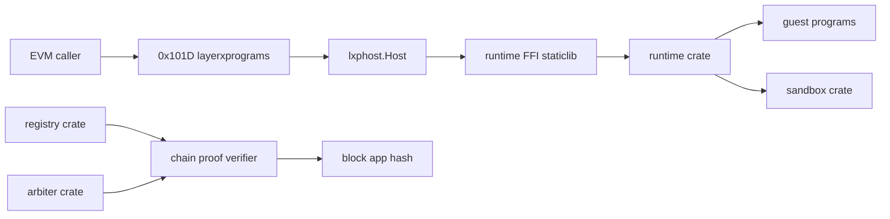

# Programs contract: layerxprograms 0x101D, the programs runtime and the guest SDKs

This contract freezes domain 13: the 0x101D layerxprograms precompile (35 methods of `precompiles/layerxprograms/abi.json` and 14 planned events), the runtime, registry, sandbox and arbiter crates, the runtime FFI linked into the host, the chain-proof evidence path, the guest SDKs for Rust, C and AssemblyScript, the market and AI market guests, error codes, configuration keys and fixtures. At the pinned revision `precompiles/layerxprograms` holds the ABI and gas table but no executor or merge constructor, and no `modules/layerxprograms` exists; `mergePrecompileGate` gates 0x101D on the layerxprograms module (`node/upgrades.go:528`).

Writes resolve the EVM caller to its bound DID and use its kernel main account as principal (decision.1329); static calls serve views and simulateCall only (decision.1330).

Revision `2a1033aa2`. Every `path:line` below was read at that revision; `(planned)` marks a file that does not exist there.

## Contents

- [layerxprograms-0x101d](#layerxprograms-0x101d)
- [layerxprograms-0x101d-views](#layerxprograms-0x101d-views)
- [layerxprograms-0x101d-events](#layerxprograms-0x101d-events)
- [frozen-abi](#frozen-abi)
- [fmt-abi-frozen](#fmt-abi-frozen)
- [host-interface](#host-interface)
- [runtime-ffi](#runtime-ffi)
- [runtime-crate](#runtime-crate)
- [interpreter-guest](#interpreter-guest)
- [sandbox-crate](#sandbox-crate)
- [sandbox-evidence](#sandbox-evidence)
- [registry-crate](#registry-crate)
- [registry-evidence](#registry-evidence)
- [chain-proof](#chain-proof)
- [arbiter-crate](#arbiter-crate)
- [protocol-adapter](#protocol-adapter)
- [market-guest](#market-guest)
- [ai-market-guest](#ai-market-guest)
- [guest-sdk-rust](#guest-sdk-rust)
- [guest-sdk-c](#guest-sdk-c)
- [guest-sdk-assemblyscript](#guest-sdk-assemblyscript)
- [sdk-examples](#sdk-examples)
- [sdk-lint](#sdk-lint)
- [error-codes](#error-codes)
- [config-keys](#config-keys)
- [fixtures](#fixtures)
- [test-vectors](#test-vectors)
- [fuzz-harness](#fuzz-harness)
- [wiring-integration](#wiring-integration)
- [msg-layerxprograms-stageretirementprofile](#msg-layerxprograms-stageretirementprofile)
- [msg-layerxprograms-updatefeeschedule](#msg-layerxprograms-updatefeeschedule)
- [msg-layerxprograms-updatemeteringschedule](#msg-layerxprograms-updatemeteringschedule)
- [msg-layerxprograms-updateparams](#msg-layerxprograms-updateparams)
- [proto-layerxprograms-feeschedule](#proto-layerxprograms-feeschedule)
- [proto-layerxprograms-genesisstate](#proto-layerxprograms-genesisstate)
- [proto-layerxprograms-meteringauthoritykind](#proto-layerxprograms-meteringauthoritykind)
- [proto-layerxprograms-meteringschedule](#proto-layerxprograms-meteringschedule)
- [proto-layerxprograms-migrationprofile](#proto-layerxprograms-migrationprofile)
- [proto-layerxprograms-msgstageretirementprofile](#proto-layerxprograms-msgstageretirementprofile)
- [proto-layerxprograms-msgstageretirementprofileresponse](#proto-layerxprograms-msgstageretirementprofileresponse)
- [proto-layerxprograms-msgupdatefeeschedule](#proto-layerxprograms-msgupdatefeeschedule)
- [proto-layerxprograms-msgupdatefeescheduleresponse](#proto-layerxprograms-msgupdatefeescheduleresponse)
- [proto-layerxprograms-msgupdatemeteringschedule](#proto-layerxprograms-msgupdatemeteringschedule)
- [proto-layerxprograms-msgupdatemeteringscheduleresponse](#proto-layerxprograms-msgupdatemeteringscheduleresponse)
- [proto-layerxprograms-msgupdateparams](#proto-layerxprograms-msgupdateparams)
- [proto-layerxprograms-msgupdateparamsresponse](#proto-layerxprograms-msgupdateparamsresponse)
- [proto-layerxprograms-params](#proto-layerxprograms-params)
- [proto-layerxprograms-programbalance](#proto-layerxprograms-programbalance)
- [proto-layerxprograms-programblob](#proto-layerxprograms-programblob)
- [proto-layerxprograms-programevent](#proto-layerxprograms-programevent)
- [proto-layerxprograms-programstoreentry](#proto-layerxprograms-programstoreentry)
- [proto-layerxprograms-queryprogrambalancesrequest](#proto-layerxprograms-queryprogrambalancesrequest)
- [proto-layerxprograms-queryprogrambalancesresponse](#proto-layerxprograms-queryprogrambalancesresponse)
- [proto-layerxprograms-queryprogrameventsrequest](#proto-layerxprograms-queryprogrameventsrequest)
- [proto-layerxprograms-queryprogrameventsresponse](#proto-layerxprograms-queryprogrameventsresponse)
- [proto-layerxprograms-queryprogramstaterequest](#proto-layerxprograms-queryprogramstaterequest)
- [proto-layerxprograms-queryprogramstateresponse](#proto-layerxprograms-queryprogramstateresponse)
- [proto-layerxprograms-retirementprofile](#proto-layerxprograms-retirementprofile)
- [decisions](#decisions)

## layerxprograms-0x101d

Precompile 0x000000000000000000000000000000000000101D: the full ABI method and event tables.

| Aspect | Rule |
|---|---|
| Authority | Writes act for the DID bound to msg.sender with its kernel main account as principal; an unbound caller is refused with LXP_ADDR_EVM_NOT_BOUND (decision.1329). Under a static call only views and simulateCall are served; value sent to any method is refused (decision.1330). |
| Effects | One kernel activity per write with IdempotencyKey = sha256("layerxprograms/idempotency/v1" \|\| txHash \|\| be32(ordinal) \|\| selector) (decision.1326); deploy keeps its seven inputs without feeLimit (decision.1321); quoteCallFee uses the occupancy formula of the current fee schedule (decision.1331). |

Contract context `13.layerxprograms-0x101d`:

| Aspect | Rule |
|---|---|
| Interface | Precompile 0x000000000000000000000000000000000000101D: 35 methods of precompiles/layerxprograms/abi.json (write methods nonpayable, views read-only) and 14 events with programId, activityId or leaseId as the only indexed input |
| Storage | no precompile-owned storage; every write is a kernel activity executed by lxphost.Host over the host store key, reads go through Host read accessors |
| Errors | LXP_ reasons from the registry of precompiles/common/lxp_errors.go: LXP_PRECOMPILE_UNKNOWN_METHOD, LXP_PRECOMPILE_NON_PAYABLE, LXP_PRECOMPILE_NO_CONTEXT, LXP_MODULE_DISABLED, LXP_ADDR_EVM_NOT_BOUND, LXP_PROGRAM_REFUSED, LXP_NOT_FOUND, LXP_NON_CANONICAL and the kernel result names |
| Events | ProgramDeployed, ProgramUpgraded, RegistryRead, ProgramTransferred, ProgramGuestEvent, ProgramCallOutcome, ProgramAccountRegistered, ExitRouteSet, ProgramDeprecated, ProgramTombstoned, ProgramValueExited, SandboxUsageReceipt, SandboxDestroyed, StorageRetired |
| Gas | EVM gas per method from gasTable (precompiles/layerxprograms/gas.go:32); kernel fees are charged in the fee asset bounded by feeLimit on call, simulateCall, upgrade and sandboxExecute |
| Activation | served only after the merge upgrade plan height through the merge constructor registered with RegisterMergeConstructor (precompiles/setup.go:89) |
| Invariants | one kernel activity per write call with a unique idempotency key; simulateCall and views never write; fee asset totals are conserved |
| Pause | module disabled refuses every write with LXP_MODULE_DISABLED; views stay served |

Frozen interfaces: 71 (stable 1, change 35, new 35).

**ABI methods**

| Method | Address | Selector | Status | Gas | Defined at |
|---|---|---|---|---|---|
| `call(bytes32,uint16,string,bytes,bytes,bytes,uint32,uint64[7],uint128) nonpayable returns (int32,uint8,bytes)` | 0x101d | `0x54bd2b48` | change | write + executionSurcharge (`precompiles/layerxprograms/gas.go:35`) | `precompiles/layerxprograms/abi.json:4` |
| `deploy(bytes32,uint16,uint8,bytes32,bytes32,bytes,bytes) nonpayable` | 0x101d | `0xbde3ff66` | change | write + lifecycleSurcharge (`precompiles/layerxprograms/gas.go:33`) | `precompiles/layerxprograms/abi.json:73` |
| `deprecate(bytes32,bytes32,uint64) nonpayable` | 0x101d | `0x86ba1a99` | change | write row (`precompiles/layerxprograms/gas.go:43`) | `precompiles/layerxprograms/abi.json:116` |
| `exitValue(bytes32,bytes32) nonpayable` | 0x101d | `0x4dc50730` | change | write row (`precompiles/layerxprograms/gas.go:45`) | `precompiles/layerxprograms/abi.json:139` |
| `exitValueBounded(bytes32,bytes32,uint128) nonpayable` | 0x101d | `0xade5d9e6` | change | write row (`precompiles/layerxprograms/gas.go:46`) | `precompiles/layerxprograms/abi.json:157` |
| `getAccountProfile(bytes32) view returns (uint8,bytes32)` | 0x101d | `0x0f2d0496` | change | read row (`precompiles/layerxprograms/gas.go:55`) | `precompiles/layerxprograms/abi.json:180` |
| `getCurrentFeeSchedule() view returns (uint32,uint64[7],bytes32)` | 0x101d | `0xbbe2e42d` | change | read row (`precompiles/layerxprograms/gas.go:62`) | `precompiles/layerxprograms/abi.json:204` |
| `getCurrentMeteringSchedule() view returns (uint32,uint64[9])` | 0x101d | `0x543c7a2f` | change | read row (`precompiles/layerxprograms/gas.go:65`) | `precompiles/layerxprograms/abi.json:227` |
| `getExitRoute(bytes32,bytes32) view returns (bytes32,bytes32,bytes)` | 0x101d | `0x3ee6f18d` | change | read row (`precompiles/layerxprograms/gas.go:59`) | `precompiles/layerxprograms/abi.json:245` |
| `getFeeSchedule(uint32) view returns (uint64[7],bytes32)` | 0x101d | `0x8d8bfb15` | change | read row (`precompiles/layerxprograms/gas.go:61`) | `precompiles/layerxprograms/abi.json:279` |
| `getInterface(bytes32) view returns (uint32,bytes32,bytes)` | 0x101d | `0x8efc7240` | change | read row (`precompiles/layerxprograms/gas.go:51`) | `precompiles/layerxprograms/abi.json:303` |
| `getMeteringSchedule(uint32) view returns (uint64[9],uint8)` | 0x101d | `0xa842e85b` | change | read row (`precompiles/layerxprograms/gas.go:64`) | `precompiles/layerxprograms/abi.json:332` |
| `getPendingFeeSchedule() view returns (uint64[7],bytes32,uint64[6],uint64)` | 0x101d | `0xe8b5cd95` | change | read row (`precompiles/layerxprograms/gas.go:63`) | `precompiles/layerxprograms/abi.json:356` |
| `getProgram(bytes32) view returns (uint8,bytes32,bytes32,uint16,uint32,bool)` | 0x101d | `0xb1ffb3d4` | change | read row (`precompiles/layerxprograms/gas.go:50`) | `precompiles/layerxprograms/abi.json:384` |
| `getProgramAccount(bytes32,bytes32,bytes) view returns (bytes32,bytes32,uint64)` | 0x101d | `0x9677b10c` | change | read row (`precompiles/layerxprograms/gas.go:53`) | `precompiles/layerxprograms/abi.json:428` |
| `getProgramAccountById(bytes32) view returns (bytes32,bytes32,bytes)` | 0x101d | `0x7a599bd0` | change | read row (`precompiles/layerxprograms/gas.go:54`) | `precompiles/layerxprograms/abi.json:467` |
| `getProgramOwner(bytes32) view returns (bytes32)` | 0x101d | `0x5d6be786` | change | read row (`precompiles/layerxprograms/gas.go:52`) | `precompiles/layerxprograms/abi.json:496` |
| `getRetirementControl() view returns (bytes)` | 0x101d | `0xdcee2e41` | change | read row (`precompiles/layerxprograms/gas.go:67`) | `precompiles/layerxprograms/abi.json:515` |
| `getSandbox(bytes32,uint8) view returns (bytes)` | 0x101d | `0xb8b4f8bc` | change | read row (`precompiles/layerxprograms/gas.go:60`) | `precompiles/layerxprograms/abi.json:528` |
| `getStateHead(bytes32) view returns (bytes)` | 0x101d | `0x0833650b` | change | read row (`precompiles/layerxprograms/gas.go:57`) | `precompiles/layerxprograms/abi.json:552` |
| `getValueAccount(bytes32,bytes32) view returns (uint128,bool)` | 0x101d | `0x24460e23` | change | read row (`precompiles/layerxprograms/gas.go:56`) | `precompiles/layerxprograms/abi.json:571` |
| `getWebRequest(bytes32,uint64) view returns (bytes)` | 0x101d | `0x61bc2ca4` | change | read row (`precompiles/layerxprograms/gas.go:66`) | `precompiles/layerxprograms/abi.json:600` |
| `getWindDown(bytes32) view returns (uint8,bytes32,uint64,uint64,uint16,uint16)` | 0x101d | `0x98e4e41d` | change | read row (`precompiles/layerxprograms/gas.go:58`) | `precompiles/layerxprograms/abi.json:624` |
| `quoteCallFee(uint64[7]) view returns (uint32,uint128,bytes32)` | 0x101d | `0xd67f9ffa` | change | read row (`precompiles/layerxprograms/gas.go:68`) | `precompiles/layerxprograms/abi.json:668` |
| `registerAccount(bytes32,uint8,bytes32,bytes) nonpayable` | 0x101d | `0xfc786007` | change | write row (`precompiles/layerxprograms/gas.go:41`) | `precompiles/layerxprograms/abi.json:697` |
| `registryRead(bytes32,bytes) nonpayable` | 0x101d | `0xfb28c4b1` | change | write row (`precompiles/layerxprograms/gas.go:39`) | `precompiles/layerxprograms/abi.json:725` |
| `retireStorage(bytes) nonpayable` | 0x101d | `0x1a5fe5ff` | change | write + retireSurcharge (`precompiles/layerxprograms/gas.go:38`) | `precompiles/layerxprograms/abi.json:743` |
| `sandboxActivate(bytes32,bytes32,uint64) nonpayable` | 0x101d | `0x64e1674e` | change | write row (`precompiles/layerxprograms/gas.go:48`) | `precompiles/layerxprograms/abi.json:756` |
| `sandboxExecute(bytes32,uint64,bytes32,bytes32,bytes32,bytes32,uint32,uint64[7],bytes,uint128) nonpayable returns (int32,uint8,bytes)` | 0x101d | `0xff04aa78` | change | write + executionSurcharge (`precompiles/layerxprograms/gas.go:36`) | `precompiles/layerxprograms/abi.json:779` |
| `sandboxFund(bytes32,bytes32,bytes32,bytes32,bytes32,uint128,uint64,uint32,uint64[7],bytes,bytes32,(bytes32,bytes32,bytes32,uint128)[]) nonpayable` | 0x101d | `0xf11e5752` | change | write row (`precompiles/layerxprograms/gas.go:47`) | `precompiles/layerxprograms/abi.json:853` |
| `setExitRoute(bytes32,bytes32,bytes32,bytes32,bytes) nonpayable` | 0x101d | `0x23330dd5` | change | write row (`precompiles/layerxprograms/gas.go:42`) | `precompiles/layerxprograms/abi.json:943` |
| `simulateCall(bytes32,uint16,string,bytes,bytes,bytes,uint32,uint64[7],uint128) view returns (int32,uint8,bytes)` | 0x101d | `0x3044bd56` | change | read + executionSurcharge (`precompiles/layerxprograms/gas.go:37`) | `precompiles/layerxprograms/abi.json:976` |
| `tombstone(bytes32) nonpayable` | 0x101d | `0xa512f1a9` | change | write row (`precompiles/layerxprograms/gas.go:44`) | `precompiles/layerxprograms/abi.json:1045` |
| `transfer(bytes32,(bytes32,bytes32,bytes32,uint128)[]) nonpayable` | 0x101d | `0x59849fe7` | change | write row (`precompiles/layerxprograms/gas.go:40`) | `precompiles/layerxprograms/abi.json:1058` |
| `upgrade(bytes32,uint16,uint8,bytes32,bytes32,bytes,bytes,bytes,uint128) nonpayable` | 0x101d | `0xa860929f` | change | write + lifecycleSurcharge (`precompiles/layerxprograms/gas.go:34`) | `precompiles/layerxprograms/abi.json:1098` |

**Events**

| Event | Address | topic0 | Status | Defined at |
|---|---|---|---|---|
| `ExitRouteSet(bytes32,bytes32,bytes32,bytes32) (planned)` | 0x101d | `0x6b9aceca11d63f8d54de57f0d38646082c9375dc119465a34e7099ec6f92ac57` | new | `precompiles/layerxprograms/abi.json` (planned) |
| `ProgramAccountRegistered(bytes32,bytes32,bytes32,bytes32,uint16,uint64) (planned)` | 0x101d | `0x25814f9b8786afbe9705da19656abcc9aa1f0afc96a17e02b7a0f5a85de27b5a` | new | `precompiles/layerxprograms/abi.json` (planned) |
| `ProgramCallOutcome(bytes32,bytes32,bytes32,uint64,uint8,uint16,uint16,uint32,uint32,int32,bytes32,bytes32,bytes32,bytes32) (planned)` | 0x101d | `0xcfe5297f03a2951065e463e9e0c2e3686bc0204f727eeec1a52357b5dd4a27a0` | new | `precompiles/layerxprograms/abi.json` (planned) |
| `ProgramDeployed(bytes32,bytes32) (planned)` | 0x101d | `0x2765c1020c93cab47e389edaa5b5c68834bdd76f7a5d384adb460fc86e688709` | new | `precompiles/layerxprograms/abi.json` (planned) |
| `ProgramDeprecated(bytes32,uint8,uint8,bytes32,bytes32,uint64,uint64,uint16,uint16,bytes32) (planned)` | 0x101d | `0x769e024ff1115e1c26a069148f332c81f2578f4ea67dde7d5076a9e9fd5e1eb8` | new | `precompiles/layerxprograms/abi.json` (planned) |
| `ProgramGuestEvent(bytes32,bytes32,bytes32,uint64,uint8,uint32,uint16,bytes32,uint32,bytes32) (planned)` | 0x101d | `0x23a84d3a8c8e7d232703d9715c64dba47a94a94c87c46fe61532e5a609e761d1` | new | `precompiles/layerxprograms/abi.json` (planned) |
| `ProgramTombstoned(bytes32,uint8,uint8,bytes32,bytes32,uint64,uint64,uint16,uint16,bytes32) (planned)` | 0x101d | `0x47fc53b89ce902506c8f3a0424a87f764a54dcb5ccb9c985639991a3a55b410c` | new | `precompiles/layerxprograms/abi.json` (planned) |
| `ProgramTransferred(bytes32,bytes32) (planned)` | 0x101d | `0x079c617c449e4a58644f3328aa041f2e65a1b6f281b13b8719ea21c3449aac6a` | new | `precompiles/layerxprograms/abi.json` (planned) |
| `ProgramUpgraded(bytes32,bytes32,bytes32) (planned)` | 0x101d | `0x36b27ad7ada15e27c12e726d56c3dbd2aaa084a9250e5282c7cd38eb78a1a8ab` | new | `precompiles/layerxprograms/abi.json` (planned) |
| `ProgramValueExited(bytes32,bytes32,bytes32) (planned)` | 0x101d | `0xf07e690dd4cedc62197bec125b1418cfee68758e9c183deac3b50902e52f59ca` | new | `precompiles/layerxprograms/abi.json` (planned) |
| `RegistryRead(bytes32) (planned)` | 0x101d | `0x74f03c32873ceda1e22e1bff01e678b798a6e7c3f6b64ea0547a965b6c33a900` | new | `precompiles/layerxprograms/abi.json` (planned) |
| `SandboxDestroyed(bytes32,uint8,bytes) (planned)` | 0x101d | `0x88612a15e0cf0a2b8bfa1e89a7ad1a7284828c20680de0bb004210052506dc10` | new | `precompiles/layerxprograms/abi.json` (planned) |
| `SandboxUsageReceipt(bytes32,uint64,uint16,uint16,uint32,bytes) (planned)` | 0x101d | `0x5c8386df0628270b0285d3f16695d6147ce4a66e048cbef0d572dae8ac4d2ba7` | new | `precompiles/layerxprograms/abi.json` (planned) |
| `StorageRetired(bytes32,uint8,bytes) (planned)` | 0x101d | `0xb8fb07925225ab6c059c761581d51adeb4b7017ea3b0523efded11df61bed65b` | new | `precompiles/layerxprograms/abi.json` (planned) |

**Other interfaces**

| Interface block | Kind | Signature | Status | Defined at |
|---|---|---|---|---|
| `interface.13.go-layerxprograms-errmoduledisabled-j52` | go_exported | `var ErrModuleDisabled` | new | `precompiles/layerxprograms/errors.go` (planned) |
| `interface.13.go-layerxprograms-errreadonlywrite-j52` | go_exported | `var ErrReadOnlyWrite` | new | `precompiles/layerxprograms/errors.go` (planned) |
| `interface.13.go-layerxprograms-errunboundcaller-j52` | go_exported | `var ErrUnboundCaller` | new | `precompiles/layerxprograms/errors.go` (planned) |
| `interface.13.go-layerxprograms-requiredgas-j74` | go_exported | `func RequiredGas(input []byte) uint64` | stable | `precompiles/layerxprograms/gas.go:75` |
| `interface.13.go-layerxprograms-idempotencykey-j52` | go_exported | `func IdempotencyKey(txHash [32]byte, ordinal uint32, selector [4]byte) [32]byte` | new | `precompiles/layerxprograms/idempotency.go` (planned) |
| `interface.13.go-layerxprograms-address-j52` | go_exported | `const Address = "0x000000000000000000000000000000000000101D"` | new | `precompiles/layerxprograms/layerxprograms.go` (planned) |
| `interface.13.go-layerxprograms-hostkeepers-j52` | go_exported | `type HostKeepers interface { utils.Keepers; LayerXHost() *lxphost.Host; XWebKeeper() *xwebkeeper.Keeper }` | new | `precompiles/layerxprograms/layerxprograms.go` (planned) |
| `interface.13.go-layerxprograms-newmergeprecompile-j52` | go_exported | `func NewMergePrecompile(keepers utils.Keepers, planName string) (precompiles.IPrecompile, error)` | new | `precompiles/layerxprograms/layerxprograms.go` (planned) |
| `interface.13.go-layerxprograms-newprecompile-j52` | go_exported | `func NewPrecompile(host *lxphost.Host, evm EVMKeeper, upgrade UpgradeKeeper, planName string) (*pcommon.Precompile, error)` | new | `precompiles/layerxprograms/layerxprograms.go` (planned) |
| `interface.13.go-layerxprograms-precompileexecutor-j52` | go_exported | `type PrecompileExecutor struct` | new | `precompiles/layerxprograms/layerxprograms.go` (planned) |
| `interface.13.go-layerxprograms-precompilename-j52` | go_exported | `const PrecompileName = "layerxprograms"` | new | `precompiles/layerxprograms/layerxprograms.go` (planned) |
| `interface.13.go-layerxprograms-encodeaccountpayload-j52` | go_exported | `func EncodeAccountPayload(programID [32]byte, profile uint8, assetID [32]byte, seed []byte) ([]byte, error)` | new | `precompiles/layerxprograms/payload_accounts.go` (planned) |
| `interface.13.go-layerxprograms-encodetransferpayload-j52` | go_exported | `func EncodeTransferPayload(programID [32]byte, legs []TransferLeg) ([]byte, error)` | new | `precompiles/layerxprograms/payload_accounts.go` (planned) |
| `interface.13.go-layerxprograms-transferleg-j52` | go_exported | `type TransferLeg struct { From, Asset, To [32]byte; Amount *big.Int }` | new | `precompiles/layerxprograms/payload_accounts.go` (planned) |
| `interface.13.go-layerxprograms-encodecallpayload-j52` | go_exported | `func EncodeCallPayload(programID [32]byte, abiVersion uint16, entrypoint string, calldata, capabilities, access []byte, responseCapacity uint32, budget [7]uint64) ([]byte, error)` | new | `precompiles/layerxprograms/payload_call.go` (planned) |
| `interface.13.go-layerxprograms-encodedeploypayload-j52` | go_exported | `func EncodeDeployPayload(programID [32]byte, abiVersion uint16, policy uint8, authority, codeHash [32]byte, iface, wasm []byte) ([]byte, error)` | new | `precompiles/layerxprograms/payload_lifecycle.go` (planned) |
| `interface.13.go-layerxprograms-encoderegistryreadpayload-j52` | go_exported | `func EncodeRegistryReadPayload(programID [32]byte, body []byte) ([]byte, error)` | new | `precompiles/layerxprograms/payload_lifecycle.go` (planned) |
| `interface.13.go-layerxprograms-encodeupgradepayload-j52` | go_exported | `func EncodeUpgradePayload(programID [32]byte, abiVersion uint16, flags uint8, oldHash, newHash [32]byte, hook, iface, wasm []byte) ([]byte, error)` | new | `precompiles/layerxprograms/payload_lifecycle.go` (planned) |
| `interface.13.go-layerxprograms-checkretirestoragerequest-j52` | go_exported | `func CheckRetireStorageRequest(request []byte) error` | new | `precompiles/layerxprograms/payload_sandbox.go` (planned) |
| `interface.13.go-layerxprograms-encodesandboxpayloads-j52` | go_exported | `func EncodeSandboxExecutePayload, EncodeSandboxFundPayload, EncodeSandboxActivatePayload` | new | `precompiles/layerxprograms/payload_sandbox.go` (planned) |
| `interface.13.go-layerxprograms-encodewinddownpayloads-j52` | go_exported | `func EncodeSetExitRoutePayload, EncodeDeprecatePayload, EncodeTombstonePayload, EncodeExitValuePayload, EncodeExitValueBoundedPayload` | new | `precompiles/layerxprograms/payload_winddown.go` (planned) |
| `interface.13.sol-layerxprograms-ilayerxprograms-j52` | sol_function | `interface ILayerXPrograms` | new | `precompiles/layerxprograms/LayerXPrograms.sol` (planned) |

Capabilities verified against this section: 13.21.2, 13.21.3, 13.21.4, 13.21.5, 13.21.6, 13.21.7, 13.21.8, 13.21.9, 13.22.1, 13.22.2, 13.22.3, 13.22.4, 13.23.1, 13.23.2, 13.23.3, 13.24.1, 13.24.2, 13.24.3, 13.25.1, 13.25.2, 13.26.1, 13.26.2, 13.26.3, 13.27.1, 13.27.2, 13.27.3, 13.27.4, 13.32.1, 13.32.2, 13.33.1, 13.34.3, 13.34.4, 13.34.5, 13.34.6, 13.34.7, 13.34.8, 13.34.9, 13.34.10.

| Acceptance | Requirement | Test |
|---|---|---|
| 13.242.1 | 13242.1 | `precompiles/layerxprograms/payload_lifecycle_test.go::TestEncodeDeployPayloadLayout (planned)` |
| 13.242.2 | 13242.2 | `precompiles/layerxprograms/payload_lifecycle_test.go::TestEncodeUpgradePayloadLayout (planned)` |
| 13.242.3 | 13242.3 | `precompiles/layerxprograms/payload_lifecycle_test.go::TestEncodeRegistryReadPayload (planned)` |
| 13.243.1 | 13243.1 | `precompiles/layerxprograms/payload_call_test.go::TestEncodeCallPayloadMatchesKernelDecoder (planned)` |
| 13.243.2 | 13243.2 | `precompiles/layerxprograms/payload_call_test.go::TestEncodeCallPayloadRefusesInvalidEntrypoint (planned)` |
| 13.244.1 | 13244.1 | `precompiles/layerxprograms/payload_accounts_test.go::TestEncodeTransferPayloadLegs (planned)` |
| 13.244.2 | 13244.2 | `precompiles/layerxprograms/payload_accounts_test.go::TestEncodeAccountPayloadProfiles (planned)` |
| 13.245.1 | 13245.1 | `precompiles/layerxprograms/payload_winddown_test.go::TestEncodeWindDownRouteAndDeprecate (planned)` |
| 13.245.2 | 13245.2 | `precompiles/layerxprograms/payload_winddown_test.go::TestEncodeWindDownTombstoneAndExits (planned)` |
| 13.246.1 | 13246.1 | `precompiles/layerxprograms/payload_sandbox_test.go::TestEncodeSandboxPayloads (planned)` |
| 13.246.2 | 13246.2 | `precompiles/layerxprograms/payload_sandbox_test.go::TestRetireStorageRequestBound (planned)` |
| 13.247.1 | 13247.1 | `precompiles/layerxprograms/errors_test.go::TestProgramsKernelCodeRevert (planned)` |
| 13.247.2 | 13247.2 | `precompiles/layerxprograms/errors_test.go::TestProgramsGateRevertCodes (planned)` |
| 13.248.1 | 13248.1 | `precompiles/layerxprograms/idempotency_test.go::TestProgramsIdempotencyKeyDomainSeparated (planned)` |
| 13.248.2 | 13248.2 | `precompiles/layerxprograms/idempotency_test.go::TestProgramsCallOrdinalPerTransaction (planned)` |
| 13.249.1 | 13249.1 | `precompiles/layerxprograms/args_test.go::TestDecodeLegsTuple (planned)` |
| 13.249.2 | 13249.2 | `precompiles/layerxprograms/args_test.go::TestDecodeBudgetAndFeeLimit (planned)` |
| 13.250.1 | 13250.1 | `precompiles/layerxprograms/layerxprograms_test.go::TestProgramsMergeConstructorRegistered (planned)` |
| 13.250.2 | 13250.2 | `precompiles/layerxprograms/layerxprograms_test.go::TestProgramsExecuteUnknownMethodRefused (planned)` |
| 13.251.1 | 13251.1 | `precompiles/layerxprograms/gate_test.go::TestProgramsGateRefusesBeforeMergeHeight (planned)` |
| 13.251.2 | 13251.2 | `precompiles/layerxprograms/gate_test.go::TestProgramsGateRefusesValueAndStaticWrites (planned)` |
| 13.252.1 | 13252.1 | `precompiles/layerxprograms/principal_test.go::TestProgramsPrincipalFromBoundDID (planned)` |
| 13.252.2 | 13252.2 | `precompiles/layerxprograms/principal_test.go::TestProgramsPrincipalUnboundRefused (planned)` |
| 13.253.1 | 13253.1 | `precompiles/layerxprograms/submit_test.go::TestProgramsSubmitCarriesFeeLimitAndKey (planned)` |
| 13.253.2 | 13253.2 | `precompiles/layerxprograms/submit_test.go::TestProgramsSubmitKernelRefusalReverts (planned)` |
| 13.257.1 | 13257.1 | `precompiles/layerxprograms/method_deploy_test.go::TestProgramsDeployRegistersProgram (planned)` |
| 13.257.2 | 13257.2 | `precompiles/layerxprograms/method_deploy_test.go::TestProgramsDeployRefusesCodeHashMismatch (planned)` |
| 13.258.1 | 13258.1 | `precompiles/layerxprograms/method_upgrade_test.go::TestProgramsUpgradeReplacesCodeHash (planned)` |
| 13.258.2 | 13258.2 | `precompiles/layerxprograms/method_upgrade_test.go::TestProgramsUpgradeRefusesStaleOldHash (planned)` |
| 13.259.1 | 13259.1 | `precompiles/layerxprograms/method_registry_test.go::TestProgramsRegistryReadEmitsEvent (planned)` |
| 13.259.2 | 13259.2 | `precompiles/layerxprograms/method_registry_test.go::TestProgramsRegistryReadZeroProgramReverts (planned)` |
| 13.260.1 | 13260.1 | `precompiles/layerxprograms/method_call_test.go::TestProgramsCallReturnsTerminalOutcome (planned)` |
| 13.260.2 | 13260.2 | `precompiles/layerxprograms/method_call_test.go::TestProgramsCallFeeLimitBelowFeeReverts (planned)` |
| 13.261.1 | 13261.1 | `precompiles/layerxprograms/method_simulate_test.go::TestProgramsSimulateCallMatchesCallOutput (planned)` |
| 13.261.2 | 13261.2 | `precompiles/layerxprograms/method_simulate_test.go::TestProgramsSimulateCallLeavesStateUnchanged (planned)` |
| 13.262.1 | 13262.1 | `precompiles/layerxprograms/method_quote_test.go::TestProgramsQuoteCallFeeMatchesKernelCeiling (planned)` |
| 13.262.2 | 13262.2 | `precompiles/layerxprograms/method_quote_test.go::TestProgramsQuoteBoundsCallFee (planned)` |
| 13.263.1 | 13263.1 | `precompiles/layerxprograms/method_transfer_test.go::TestProgramsTransferMovesLegs (planned)` |
| 13.263.2 | 13263.2 | `precompiles/layerxprograms/method_transfer_test.go::TestProgramsTransferOverdraftReverts (planned)` |
| 13.264.1 | 13264.1 | `precompiles/layerxprograms/method_account_test.go::TestProgramsRegisterAccountProfile1 (planned)` |
| 13.264.2 | 13264.2 | `precompiles/layerxprograms/method_account_test.go::TestProgramsRegisterAccountDuplicateReverts (planned)` |
| 13.265.1 | 13265.1 | `precompiles/layerxprograms/method_winddown_test.go::TestProgramsSetExitRouteThenDeprecate (planned)` |
| 13.265.2 | 13265.2 | `precompiles/layerxprograms/method_winddown_test.go::TestProgramsDeprecateByNonOwnerReverts (planned)` |
| 13.266.1 | 13266.1 | `precompiles/layerxprograms/method_tombstone_test.go::TestProgramsTombstoneAfterDeadline (planned)` |
| 13.266.2 | 13266.2 | `precompiles/layerxprograms/method_tombstone_test.go::TestProgramsTombstoneNotDeprecatedReverts (planned)` |
| 13.267.1 | 13267.1 | `precompiles/layerxprograms/method_exit_test.go::TestProgramsExitValueDrainsToRoute (planned)` |
| 13.267.2 | 13267.2 | `precompiles/layerxprograms/method_exit_test.go::TestProgramsExitValueBoundedRefusesBelowBalance (planned)` |
| 13.268.1 | 13268.1 | `precompiles/layerxprograms/method_sandbox_execute_test.go::TestProgramsSandboxExecuteEmitsUsage (planned)` |
| 13.268.2 | 13268.2 | `precompiles/layerxprograms/method_sandbox_execute_test.go::TestProgramsSandboxExecuteZeroAssetReverts (planned)` |
| 13.269.1 | 13269.1 | `precompiles/layerxprograms/method_sandbox_fund_test.go::TestProgramsSandboxFundEscrowsLegs (planned)` |
| 13.269.2 | 13269.2 | `precompiles/layerxprograms/method_sandbox_fund_test.go::TestProgramsSandboxFundEmptyLeaseRequestReverts (planned)` |
| 13.270.1 | 13270.1 | `precompiles/layerxprograms/method_sandbox_activate_test.go::TestProgramsSandboxActivateLease (planned)` |
| 13.270.2 | 13270.2 | `precompiles/layerxprograms/method_sandbox_activate_test.go::TestProgramsSandboxActivateWrongSequenceReverts (planned)` |
| 13.271.1 | 13271.1 | `precompiles/layerxprograms/method_retire_test.go::TestProgramsRetireStorageEmitsStorageRetired (planned)` |
| 13.271.2 | 13271.2 | `precompiles/layerxprograms/method_retire_test.go::TestProgramsRetireStorageOversizeReverts (planned)` |
| 13.288.1 | 13288.1 | `precompiles/layerxprograms/xweb_test.go::TestProgramsCallForwardsGuestWebRequest (planned)` |
| 13.288.2 | 13288.2 | `precompiles/layerxprograms/xweb_test.go::TestProgramsCallDiscardedWhenXWebRefuses (planned)` |
| 13.289.1 | 13289.1 | `precompiles/layerxprograms/activation_test.go::TestProgramsPrecompileActiveAfterMergeHeight (planned)` |
| 13.289.2 | 13289.2 | `precompiles/layerxprograms/activation_test.go::TestProgramsPrecompileListedInMergeSet (planned)` |
| 13.290.1 | 13290.1 | `precompiles/layerxprograms/webreader_test.go::TestWebReaderExampleRoundTripThroughXWeb (planned)` |
| 13.293.1 | 13293.1 | `precompiles/layerxprograms/fuzz_test.go::FuzzProgramsDecodeArgs (planned)` |
| 13.294.1 | 13294.1 | `precompiles/layerxprograms/replay_test.go::TestProgramsReplayedActivityReturnsStoredReceipt (planned)` |
| 13.295.1 | 13295.1 | `precompiles/layerxprograms/determinism_test.go::TestProgramsCallLogsDeterministicAcrossRuns (planned)` |
| 13.296.1 | 13296.1 | `precompiles/layerxprograms/gas_bound_test.go::TestProgramsCallOutOfGasDoesNotSubmit (planned)` |
| 13.297.1 | 13297.1 | `precompiles/layerxprograms/simulate_parity_test.go::TestProgramsSimulateMatchesCallForEveryFixtureEntrypoint (planned)` |
| 13.298.1 | 13298.1 | `precompiles/layerxprograms/gas_charge_test.go::TestProgramsWriteMethodsChargeGasTable (planned)` |
| 13.299.1 | 13299.1 | `precompiles/layerxprograms/bank_parity_test.go::TestProgramsValueAccountMatchesBankBalance (planned)` |
| 13.300.1 | 13300.1 | `precompiles/layerxprograms/occ_test.go::TestProgramsCallsMatchSequentialUnderParallelExecution (planned)` |

## layerxprograms-0x101d-views

The 0x101D views read the host store through Host read accessors and never write.

Methods of this group (rows repeated from [layerxprograms-0x101d](#layerxprograms-0x101d)):

| Method | Address | Selector | Status | Gas | Defined at |
|---|---|---|---|---|---|
| `getAccountProfile(bytes32) view returns (uint8,bytes32)` | 0x101d | `0x0f2d0496` | change | read row (`precompiles/layerxprograms/gas.go:55`) | `precompiles/layerxprograms/abi.json:180` |
| `getCurrentFeeSchedule() view returns (uint32,uint64[7],bytes32)` | 0x101d | `0xbbe2e42d` | change | read row (`precompiles/layerxprograms/gas.go:62`) | `precompiles/layerxprograms/abi.json:204` |
| `getCurrentMeteringSchedule() view returns (uint32,uint64[9])` | 0x101d | `0x543c7a2f` | change | read row (`precompiles/layerxprograms/gas.go:65`) | `precompiles/layerxprograms/abi.json:227` |
| `getExitRoute(bytes32,bytes32) view returns (bytes32,bytes32,bytes)` | 0x101d | `0x3ee6f18d` | change | read row (`precompiles/layerxprograms/gas.go:59`) | `precompiles/layerxprograms/abi.json:245` |
| `getFeeSchedule(uint32) view returns (uint64[7],bytes32)` | 0x101d | `0x8d8bfb15` | change | read row (`precompiles/layerxprograms/gas.go:61`) | `precompiles/layerxprograms/abi.json:279` |
| `getInterface(bytes32) view returns (uint32,bytes32,bytes)` | 0x101d | `0x8efc7240` | change | read row (`precompiles/layerxprograms/gas.go:51`) | `precompiles/layerxprograms/abi.json:303` |
| `getMeteringSchedule(uint32) view returns (uint64[9],uint8)` | 0x101d | `0xa842e85b` | change | read row (`precompiles/layerxprograms/gas.go:64`) | `precompiles/layerxprograms/abi.json:332` |
| `getPendingFeeSchedule() view returns (uint64[7],bytes32,uint64[6],uint64)` | 0x101d | `0xe8b5cd95` | change | read row (`precompiles/layerxprograms/gas.go:63`) | `precompiles/layerxprograms/abi.json:356` |
| `getProgram(bytes32) view returns (uint8,bytes32,bytes32,uint16,uint32,bool)` | 0x101d | `0xb1ffb3d4` | change | read row (`precompiles/layerxprograms/gas.go:50`) | `precompiles/layerxprograms/abi.json:384` |
| `getProgramAccount(bytes32,bytes32,bytes) view returns (bytes32,bytes32,uint64)` | 0x101d | `0x9677b10c` | change | read row (`precompiles/layerxprograms/gas.go:53`) | `precompiles/layerxprograms/abi.json:428` |
| `getProgramAccountById(bytes32) view returns (bytes32,bytes32,bytes)` | 0x101d | `0x7a599bd0` | change | read row (`precompiles/layerxprograms/gas.go:54`) | `precompiles/layerxprograms/abi.json:467` |
| `getProgramOwner(bytes32) view returns (bytes32)` | 0x101d | `0x5d6be786` | change | read row (`precompiles/layerxprograms/gas.go:52`) | `precompiles/layerxprograms/abi.json:496` |
| `getRetirementControl() view returns (bytes)` | 0x101d | `0xdcee2e41` | change | read row (`precompiles/layerxprograms/gas.go:67`) | `precompiles/layerxprograms/abi.json:515` |
| `getSandbox(bytes32,uint8) view returns (bytes)` | 0x101d | `0xb8b4f8bc` | change | read row (`precompiles/layerxprograms/gas.go:60`) | `precompiles/layerxprograms/abi.json:528` |
| `getStateHead(bytes32) view returns (bytes)` | 0x101d | `0x0833650b` | change | read row (`precompiles/layerxprograms/gas.go:57`) | `precompiles/layerxprograms/abi.json:552` |
| `getValueAccount(bytes32,bytes32) view returns (uint128,bool)` | 0x101d | `0x24460e23` | change | read row (`precompiles/layerxprograms/gas.go:56`) | `precompiles/layerxprograms/abi.json:571` |
| `getWebRequest(bytes32,uint64) view returns (bytes)` | 0x101d | `0x61bc2ca4` | change | read row (`precompiles/layerxprograms/gas.go:66`) | `precompiles/layerxprograms/abi.json:600` |
| `getWindDown(bytes32) view returns (uint8,bytes32,uint64,uint64,uint16,uint16)` | 0x101d | `0x98e4e41d` | change | read row (`precompiles/layerxprograms/gas.go:58`) | `precompiles/layerxprograms/abi.json:624` |
| `quoteCallFee(uint64[7]) view returns (uint32,uint128,bytes32)` | 0x101d | `0xd67f9ffa` | change | read row (`precompiles/layerxprograms/gas.go:68`) | `precompiles/layerxprograms/abi.json:668` |

Capabilities verified against this section: 13.28.1, 13.28.2, 13.28.3, 13.28.4, 13.28.5, 13.28.6, 13.28.7.

| Acceptance | Requirement | Test |
|---|---|---|
| 13.272.1 | 13272.1 | `precompiles/layerxprograms/view_registry_test.go::TestProgramsViewGetProgramRecord (planned)` |
| 13.272.2 | 13272.2 | `precompiles/layerxprograms/view_registry_test.go::TestProgramsViewGetInterfaceAndAbsent (planned)` |
| 13.273.1 | 13273.1 | `precompiles/layerxprograms/view_accounts_test.go::TestProgramsViewProgramAccountLookups (planned)` |
| 13.273.2 | 13273.2 | `precompiles/layerxprograms/view_accounts_test.go::TestProgramsViewValueAccountBalance (planned)` |
| 13.274.1 | 13274.1 | `precompiles/layerxprograms/view_winddown_test.go::TestProgramsViewWindDownRecord (planned)` |
| 13.274.2 | 13274.2 | `precompiles/layerxprograms/view_winddown_test.go::TestProgramsViewExitRoute (planned)` |
| 13.275.1 | 13275.1 | `precompiles/layerxprograms/view_fees_test.go::TestProgramsViewCurrentFeeSchedule (planned)` |
| 13.275.2 | 13275.2 | `precompiles/layerxprograms/view_fees_test.go::TestProgramsViewPendingFeeSchedule (planned)` |
| 13.276.1 | 13276.1 | `precompiles/layerxprograms/view_web_test.go::TestProgramsViewWebRequestRecord (planned)` |
| 13.276.2 | 13276.2 | `precompiles/layerxprograms/view_web_test.go::TestProgramsViewWebRequestAbsent (planned)` |
| 13.277.1 | 13277.1 | `precompiles/layerxprograms/view_metering_test.go::TestProgramsViewMeteringSchedules (planned)` |
| 13.277.2 | 13277.2 | `precompiles/layerxprograms/view_metering_test.go::TestProgramsViewMeteringUnknownVersion (planned)` |
| 13.278.1 | 13278.1 | `precompiles/layerxprograms/view_sandbox_test.go::TestProgramsViewSandboxRecord (planned)` |
| 13.278.2 | 13278.2 | `precompiles/layerxprograms/view_sandbox_test.go::TestProgramsViewRetirementControl (planned)` |

## layerxprograms-0x101d-events

The 14 0x101D events are emitted from kernel receipts of 0x101D calls; guest events become ProgramGuestEvent logs with topic1 the program id (decision.1306); SandboxDestroyed and StorageRetired are logged only inside 0x101D calls (decision.1325).

Events of this group (rows repeated from [layerxprograms-0x101d](#layerxprograms-0x101d)):

| Event | Address | topic0 | Status | Defined at |
|---|---|---|---|---|
| `ExitRouteSet(bytes32,bytes32,bytes32,bytes32) (planned)` | 0x101d | `0x6b9aceca11d63f8d54de57f0d38646082c9375dc119465a34e7099ec6f92ac57` | new | `precompiles/layerxprograms/abi.json` (planned) |
| `ProgramAccountRegistered(bytes32,bytes32,bytes32,bytes32,uint16,uint64) (planned)` | 0x101d | `0x25814f9b8786afbe9705da19656abcc9aa1f0afc96a17e02b7a0f5a85de27b5a` | new | `precompiles/layerxprograms/abi.json` (planned) |
| `ProgramCallOutcome(bytes32,bytes32,bytes32,uint64,uint8,uint16,uint16,uint32,uint32,int32,bytes32,bytes32,bytes32,bytes32) (planned)` | 0x101d | `0xcfe5297f03a2951065e463e9e0c2e3686bc0204f727eeec1a52357b5dd4a27a0` | new | `precompiles/layerxprograms/abi.json` (planned) |
| `ProgramDeployed(bytes32,bytes32) (planned)` | 0x101d | `0x2765c1020c93cab47e389edaa5b5c68834bdd76f7a5d384adb460fc86e688709` | new | `precompiles/layerxprograms/abi.json` (planned) |
| `ProgramDeprecated(bytes32,uint8,uint8,bytes32,bytes32,uint64,uint64,uint16,uint16,bytes32) (planned)` | 0x101d | `0x769e024ff1115e1c26a069148f332c81f2578f4ea67dde7d5076a9e9fd5e1eb8` | new | `precompiles/layerxprograms/abi.json` (planned) |
| `ProgramGuestEvent(bytes32,bytes32,bytes32,uint64,uint8,uint32,uint16,bytes32,uint32,bytes32) (planned)` | 0x101d | `0x23a84d3a8c8e7d232703d9715c64dba47a94a94c87c46fe61532e5a609e761d1` | new | `precompiles/layerxprograms/abi.json` (planned) |
| `ProgramTombstoned(bytes32,uint8,uint8,bytes32,bytes32,uint64,uint64,uint16,uint16,bytes32) (planned)` | 0x101d | `0x47fc53b89ce902506c8f3a0424a87f764a54dcb5ccb9c985639991a3a55b410c` | new | `precompiles/layerxprograms/abi.json` (planned) |
| `ProgramTransferred(bytes32,bytes32) (planned)` | 0x101d | `0x079c617c449e4a58644f3328aa041f2e65a1b6f281b13b8719ea21c3449aac6a` | new | `precompiles/layerxprograms/abi.json` (planned) |
| `ProgramUpgraded(bytes32,bytes32,bytes32) (planned)` | 0x101d | `0x36b27ad7ada15e27c12e726d56c3dbd2aaa084a9250e5282c7cd38eb78a1a8ab` | new | `precompiles/layerxprograms/abi.json` (planned) |
| `ProgramValueExited(bytes32,bytes32,bytes32) (planned)` | 0x101d | `0xf07e690dd4cedc62197bec125b1418cfee68758e9c183deac3b50902e52f59ca` | new | `precompiles/layerxprograms/abi.json` (planned) |
| `RegistryRead(bytes32) (planned)` | 0x101d | `0x74f03c32873ceda1e22e1bff01e678b798a6e7c3f6b64ea0547a965b6c33a900` | new | `precompiles/layerxprograms/abi.json` (planned) |
| `SandboxDestroyed(bytes32,uint8,bytes) (planned)` | 0x101d | `0x88612a15e0cf0a2b8bfa1e89a7ad1a7284828c20680de0bb004210052506dc10` | new | `precompiles/layerxprograms/abi.json` (planned) |
| `SandboxUsageReceipt(bytes32,uint64,uint16,uint16,uint32,bytes) (planned)` | 0x101d | `0x5c8386df0628270b0285d3f16695d6147ce4a66e048cbef0d572dae8ac4d2ba7` | new | `precompiles/layerxprograms/abi.json` (planned) |
| `StorageRetired(bytes32,uint8,bytes) (planned)` | 0x101d | `0xb8fb07925225ab6c059c761581d51adeb4b7017ea3b0523efded11df61bed65b` | new | `precompiles/layerxprograms/abi.json` (planned) |

Capabilities verified against this section: 13.21.1, 13.22.5, 13.22.6, 13.22.7.

| Acceptance | Requirement | Test |
|---|---|---|
| 13.241.1 | 13241.1 | `precompiles/layerxprograms/abi_test.go::TestProgramsABIEventTopics (planned)` |
| 13.241.2 | 13241.2 | `precompiles/layerxprograms/abi_test.go::TestProgramsABIKeepsThirtyFiveMethods (planned)` |
| 13.254.1 | 13254.1 | `precompiles/layerxprograms/events_test.go::TestProgramsLifecycleEventsFromReceipt (planned)` |
| 13.254.2 | 13254.2 | `precompiles/layerxprograms/events_test.go::TestProgramsWindDownAndAccountEventsFromReceipt (planned)` |
| 13.255.1 | 13255.1 | `precompiles/layerxprograms/events_call_test.go::TestProgramsGuestEventLogs (planned)` |
| 13.255.2 | 13255.2 | `precompiles/layerxprograms/events_call_test.go::TestProgramsCallOutcomeLog (planned)` |
| 13.256.1 | 13256.1 | `precompiles/layerxprograms/events_sandbox_test.go::TestProgramsSandboxUsageReceiptLog (planned)` |
| 13.256.2 | 13256.2 | `precompiles/layerxprograms/events_sandbox_test.go::TestProgramsSandboxDestroyedAndRetiredLogs (planned)` |

## frozen-abi

The frozen guest ABI sources whose checksum `programs/abi-frozen.sha256` the runtime test compares (decision.1307).

Frozen interfaces: 11 (stable 11).

**Other interfaces**

| Interface block | Kind | Signature | Status | Defined at |
|---|---|---|---|---|
| `interface.13.fmt-programs-abi-frozen-line-3` | file_format | `1 09fcad46aeea9659d7d555a4a09ec151bd36d60b85bfd052d1f7a43cf71d58a3` | stable | `programs/abi-frozen.sha256:3` |
| `interface.13.fmt-programs-abi-frozen-line-4` | file_format | `2 8827869bf1324c3e82c60baf7360b1c3e2baa84d8591e49eb6b73c2cea6c8b69` | stable | `programs/abi-frozen.sha256:4` |
| `interface.13.fmt-programs-abi-frozen-line-5` | file_format | `3 0d1c2505bb16c52cbac38f966359fafd4e930949f968484250ec96520a7de0b2` | stable | `programs/abi-frozen.sha256:5` |
| `interface.13.fmt-programs-abi-frozen-line-6` | file_format | `4 733f27cbf903eaceab532424d13e321f6dd8939afb1f85511c7a5a12c0289aef` | stable | `programs/abi-frozen.sha256:6` |
| `interface.13.fmt-programs-abi-frozen-line-7` | file_format | `5 07d573becee2e920b7bacb3f7d712ff017070681d46337f62e9b6987c58a2e87` | stable | `programs/abi-frozen.sha256:7` |
| `interface.13.fmt-sdk-abi-manifest-tsv` | file_format | `abi-manifest.tsv: TSV rows version<TAB>module<TAB>function<TAB>signature of the published guest ABI` | stable | `programs/sdk/abi-manifest.tsv:1` |
| `interface.13.fmt-tests-vectors-abi-v1-hex` | file_format | `abi-v1.hex: hex ABI v1 conformance vector` | stable | `programs/tests/vectors/abi-v1.hex:1` |
| `interface.13.fmt-tests-vectors-abi-v2-hex` | file_format | `abi-v2.hex: hex ABI v2 conformance vector` | stable | `programs/tests/vectors/abi-v2.hex:1` |
| `interface.13.fmt-tests-vectors-abi-v3-hex` | file_format | `abi-v3.hex: hex ABI v3 conformance vector` | stable | `programs/tests/vectors/abi-v3.hex:1` |
| `interface.13.fmt-tests-vectors-abi-v4-hex` | file_format | `abi-v4.hex: hex ABI v4 conformance vector` | stable | `programs/tests/vectors/abi-v4.hex:1` |
| `interface.13.fmt-tests-vectors-abi-v5-hex` | file_format | `abi-v5.hex: hex ABI v5 conformance vector` | stable | `programs/tests/vectors/abi-v5.hex:1` |

## fmt-abi-frozen

Freezes `<abi version> <sha256 hex of the frozen ABI vector> per line, # comments` (file_format, stable).

Frozen interfaces: 1 (stable 1).

**Other interfaces**

| Interface block | Kind | Signature | Status | Defined at |
|---|---|---|---|---|
| `interface.13.fmt-programs-abi-frozen-sha256-j16` | file_format | `<abi version> <sha256 hex of the frozen ABI vector> per line, # comments` | stable | `programs/abi-frozen.sha256:3` |

## host-interface

Host functions imported by guests from the runtime.

Frozen interfaces: 31 (stable 31).

**Other interfaces**

| Interface block | Kind | Signature | Status | Defined at |
|---|---|---|---|---|
| `interface.13.wasm-host-bigint-mul-256` | wasm_binding | `layerx_v2.bigint_mul_256(i32,i32,i32,i32,i32,i32)->i32` | stable | `programs/crates/layerx-programs-runtime/src/crypto/bigint.rs:186` |
| `interface.13.wasm-host-bigint-div-256` | wasm_binding | `layerx_v2.bigint_div_256(i32,i32,i32,i32,i32,i32)->i32` | stable | `programs/crates/layerx-programs-runtime/src/crypto/bigint.rs:240` |
| `interface.13.wasm-host-bigint-rem-256` | wasm_binding | `layerx_v2.bigint_rem_256(i32,i32,i32,i32,i32,i32)->i32` | stable | `programs/crates/layerx-programs-runtime/src/crypto/bigint.rs:296` |
| `interface.13.wasm-host-bigint-modexp-256` | wasm_binding | `layerx_v2.bigint_modexp_256(i32,i32,i32,i32,i32,i32,i32,i32)->i32` | stable | `programs/crates/layerx-programs-runtime/src/crypto/bigint.rs:352` |
| `interface.13.wasm-host-balance-read` | wasm_binding | `layerx_v2.balance_read(i32,i32,i32,i32,i32,i32)->i32` | stable | `programs/crates/layerx-programs-runtime/src/host/balance.rs:18` |
| `interface.13.wasm-host-program-call` | wasm_binding | `layerx_v1.program_call(i32,i32,i32,i32,i32,i32)->i32` | stable | `programs/crates/layerx-programs-runtime/src/host/calls.rs:21` |
| `interface.13.wasm-host-response-write` | wasm_binding | `layerx_v2.response_write(i32,i32,i32)->i32` | stable | `programs/crates/layerx-programs-runtime/src/host/calls.rs:92` |
| `interface.13.wasm-host-program-call-response` | wasm_binding | `layerx_v2.program_call_response(i32,i32,i32,i32,i32,i32,i32,i32)->i64` | stable | `programs/crates/layerx-programs-runtime/src/host/calls.rs:128` |
| `interface.13.wasm-host-refusal-write` | wasm_binding | `layerx_v2.refusal_write(i32,i32,i32)->i32` | stable | `programs/crates/layerx-programs-runtime/src/host/calls.rs:228` |
| `interface.13.wasm-host-context-read` | wasm_binding | `layerx_v2.context_read(i32,i32,i32)->i32` | stable | `programs/crates/layerx-programs-runtime/src/host/context.rs:17` |
| `interface.13.wasm-host-hash` | wasm_binding | `layerx_v2.hash(i32,i32,i32,i32)->i32` | stable | `programs/crates/layerx-programs-runtime/src/host/crypto.rs:15` |
| `interface.13.wasm-host-event-emit` | wasm_binding | `layerx_v1.event_emit(i32,i32,i32,i32)->i32` | stable | `programs/crates/layerx-programs-runtime/src/host/events.rs:16` |
| `interface.13.wasm-host-market-step-adjudicate` | wasm_binding | `layerx_v5.market_step_adjudicate(i32,i32,i32,i32,i32,i32)->i32` | stable | `programs/crates/layerx-programs-runtime/src/host/market.rs:22` |
| `interface.13.wasm-meter-check-i64` | wasm_binding | `layerx_private_metering/v1.check_i64(i64)` | stable | `programs/crates/layerx-programs-runtime/src/host/mod.rs:1156` |
| `interface.13.wasm-meter-charge-i64` | wasm_binding | `layerx_private_metering/v1.charge_i64(i64)` | stable | `programs/crates/layerx-programs-runtime/src/host/mod.rs:1171` |
| `interface.13.wasm-host-receipt-read` | wasm_binding | `layerx_v1.receipt_read(i32,i32,i32,i32)->i32` | stable | `programs/crates/layerx-programs-runtime/src/host/mod.rs:1204` |
| `interface.13.wasm-host-oracle-read` | wasm_binding | `layerx_v3.oracle_read(i32,i32,i32,i32)->i32` | stable | `programs/crates/layerx-programs-runtime/src/host/oracle.rs:18` |
| `interface.13.wasm-host-storage-scan-scoped` | wasm_binding | `layerx_v2.storage_scan_scoped(i32,i32,i32,i32,i32,i32,i32,i32,i32)->i32` | stable | `programs/crates/layerx-programs-runtime/src/host/scan.rs:22` |
| `interface.13.wasm-host-signature-verify` | wasm_binding | `layerx_v2.signature_verify(i32,i32,i32,i32,i32,i32,i32)->i32` | stable | `programs/crates/layerx-programs-runtime/src/host/signature.rs:21` |
| `interface.13.wasm-host-signature-recover` | wasm_binding | `layerx_v2.signature_recover(i32,i32,i32,i32,i32,i32,i32)->i32` | stable | `programs/crates/layerx-programs-runtime/src/host/signature.rs:91` |
| `interface.13.wasm-host-storage-read` | wasm_binding | `layerx_v1.storage_read(i32,i32,i32,i32)->i32` | stable | `programs/crates/layerx-programs-runtime/src/host/storage.rs:20` |
| `interface.13.wasm-host-storage-write` | wasm_binding | `layerx_v1.storage_write(i32,i32,i32,i32)->i32` | stable | `programs/crates/layerx-programs-runtime/src/host/storage.rs:61` |
| `interface.13.wasm-host-storage-delete` | wasm_binding | `layerx_v1.storage_delete(i32,i32)->i32` | stable | `programs/crates/layerx-programs-runtime/src/host/storage.rs:89` |
| `interface.13.wasm-host-storage-read-scoped` | wasm_binding | `layerx_v2.storage_read_scoped(i32,i32,i32,i32,i32)->i32` | stable | `programs/crates/layerx-programs-runtime/src/host/storage.rs:112` |
| `interface.13.wasm-host-storage-write-scoped` | wasm_binding | `layerx_v2.storage_write_scoped(i32,i32,i32,i32,i32)->i32` | stable | `programs/crates/layerx-programs-runtime/src/host/storage.rs:162` |
| `interface.13.wasm-host-storage-delete-scoped` | wasm_binding | `layerx_v2.storage_delete_scoped(i32,i32,i32)->i32` | stable | `programs/crates/layerx-programs-runtime/src/host/storage.rs:194` |
| `interface.13.wasm-host-storage-drop-scoped` | wasm_binding | `layerx_v2.storage_drop_scoped(i32)->i32` | stable | `programs/crates/layerx-programs-runtime/src/host/storage.rs:221` |
| `interface.13.wasm-host-transfer-402` | wasm_binding | `layerx_v1.transfer_402(i64,i64,i32,i32,i32,i32)->i32` | stable | `programs/crates/layerx-programs-runtime/src/host/transfer.rs:14` |
| `interface.13.wasm-host-transfer-program-402` | wasm_binding | `layerx_v2.transfer_program_402(i64,i64,i32,i32,i32,i32,i32,i32,i32,i32)->i32` | stable | `programs/crates/layerx-programs-runtime/src/host/transfer.rs:52` |
| `interface.13.wasm-host-fund-program-402` | wasm_binding | `layerx_v2.fund_program_402(i64,i64,i32,i32,i32,i32,i32,i32)->i32` | stable | `programs/crates/layerx-programs-runtime/src/host/transfer.rs:102` |
| `interface.13.wasm-host-web-read` | wasm_binding | `layerx_v4.web_read(i32,i32,i32,i32)->i32` | stable | `programs/crates/layerx-programs-runtime/src/host/web.rs:17` |

## runtime-ffi

Runtime FFI exports linked into the host staticlib; `layerx_programs_call_begin` keeps its C signature (decision.1309) and the native receipt authority moves to the 151-byte height-keyed V2 record (decision.1305).

Contract context `13.runtime-host-ffi`:

| Aspect | Rule |
|---|---|
| Interface | Runtime FFI exports linked into the host staticlib: layerx_programs_event_log_encode, layerx_programs_call_arbiter_authority_check, and AbiEffects::program_event_logs |
| Storage | none; reads the call record of layerx_programs_call_begin |
| Errors | negative i32 return codes: -1 index out of range, -2 buffer too short; authority decoder refuses unknown versions and lengths |
| Events | ProgramGuestEvent(bytes32,bytes32,bytes) logs of 0x000000000000000000000000000000000000101D with topic1 the program id |
| Gas | at most 512 logs per call, the LXP_MAX_EFFECTS bound |
| Activation | exports land at waves 1 to 3; the host uses them after the domain 1 wirings of wave 4; the V1 authority leaves at wave 6 |
| Invariants | log encoding is deterministic; the event envelope bytes are unchanged; the C signature of layerx_programs_call_begin is unchanged |
| Pause | none |

Frozen interfaces: 159 (stable 151, change 1, new 2, retire 5).

**Interfaces listed one by one** (every non-stable item and every ABI, message, error, key and format item)

| Interface block | Kind | Signature | Status | Defined at |
|---|---|---|---|---|
| `interface.13.c-pad-lxp-programs-value-account-iter` | c_symbol | `fn lxp_programs_value_account_iter(context: *mut c_void, program_id: *const u8, receipt_digest: *const u8, visitor: ValueVisitor, user: *mut c_void) -> i32` | retire | `programs/crates/layerx-programs-protocol-adapter/src/ffi.rs:148` |
| `interface.13.c-pad-lxp-programs-account-state-head-read` | c_symbol | `fn lxp_programs_account_state_head_read(context: *mut c_void, program_id: *const u8, receipt_digest: *const u8, head: *mut CAccountStateHead) -> i32` | retire | `programs/crates/layerx-programs-protocol-adapter/src/ffi.rs:155` |
| `interface.13.c-pad-lxp-programs-wind-down-read` | c_symbol | `fn lxp_programs_wind_down_read(context: *mut c_void, program_id: *const u8, view: *mut CWindDownView) -> i32` | retire | `programs/crates/layerx-programs-protocol-adapter/src/ffi.rs:161` |
| `interface.13.c-pad-lxp-programs-exit-route-iter` | c_symbol | `fn lxp_programs_exit_route_iter(context: *mut c_void, program_id: *const u8, visitor: RouteVisitor, user: *mut c_void) -> i32` | retire | `programs/crates/layerx-programs-protocol-adapter/src/ffi.rs:166` |
| `interface.13.c-pad-lxp-programs-wind-down-history-iter` | c_symbol | `fn lxp_programs_wind_down_history_iter(context: *mut c_void, program_id: *const u8, visitor: HistoryVisitor, user: *mut c_void) -> i32` | retire | `programs/crates/layerx-programs-protocol-adapter/src/ffi.rs:172` |
| `interface.13.rs-rt-ffi-call-layerx-programs-event-log-encode-j51` | rust_pub_item | `pub unsafe extern "C" fn layerx_programs_event_log_encode(call_token: u64, index: u32, out: *mut u8, out_len: u32) -> i32` | new | `programs/crates/layerx-programs-runtime/src/ffi_call.rs` (planned) |
| `interface.13.rs-rt-ffi-call-rawnativereceiptauthorityv2-j51` | rust_pub_item | `pub struct RawNativeReceiptAuthorityV2 (151 bytes, keyed by block_height)` | new | `programs/crates/layerx-programs-runtime/src/ffi_call.rs` (planned) |
| `interface.13.rs-rt-ffi-call-layerx-programs-call-arbiter-authority-check` | rust_pub_item | `pub unsafe extern "C" fn layerx_programs_call_arbiter_authority_check(token: u64, d0: u64, d1: u64, d2: u64, d3: u64, expected_batch: u64) -> i32` | change | `programs/crates/layerx-programs-runtime/src/ffi_call.rs:4056` |

**Stable code items by file** (151 stable items; each is an `interface` block of the merged specification with the same path)

| Path | Kind | Items | stable | change | new | retire |
|---|---|---|---|---|---|---|
| `programs/crates/layerx-programs-runtime/src/cache.rs` | rust_pub_item | 3 | 3 | 0 | 0 | 0 |
| `programs/crates/layerx-programs-runtime/src/ffi.rs` | c_symbol | 3 | 3 | 0 | 0 | 0 |
| `programs/crates/layerx-programs-runtime/src/ffi.rs` | rust_pub_item | 3 | 3 | 0 | 0 | 0 |
| `programs/crates/layerx-programs-runtime/src/ffi_call.rs` | c_symbol | 64 | 64 | 0 | 0 | 0 |
| `programs/crates/layerx-programs-runtime/src/ffi_call.rs` | rust_pub_item | 6 | 6 | 0 | 0 | 0 |
| `programs/crates/layerx-programs-runtime/src/ffi_interface.rs` | c_symbol | 1 | 1 | 0 | 0 | 0 |
| `programs/crates/layerx-programs-runtime/src/ffi_interface.rs` | rust_pub_item | 3 | 3 | 0 | 0 | 0 |
| `programs/crates/layerx-programs-runtime/src/ffi_transfer.rs` | c_symbol | 4 | 4 | 0 | 0 | 0 |
| `programs/crates/layerx-programs-runtime/src/ffi_transfer.rs` | rust_pub_item | 3 | 3 | 0 | 0 | 0 |
| `programs/crates/layerx-programs-sandbox/src/host_ffi.rs` | c_symbol | 19 | 19 | 0 | 0 | 0 |
| `programs/crates/layerx-programs-sandbox/src/host_ffi.rs` | rust_pub_item | 7 | 7 | 0 | 0 | 0 |
| `programs/sdk/rust/quickstart/src/lib.rs` | rust_pub_item | 6 | 6 | 0 | 0 | 0 |
| `programs/sdk/rust/src/host.rs` | c_symbol | 29 | 29 | 0 | 0 | 0 |

Capabilities verified against this section: 13.0.3, 13.7.1, 13.7.2, 13.7.3, 13.7.4, 13.7.5, 13.8.1.

| Acceptance | Requirement | Test |
|---|---|---|
| 13.3.1 | 13003.1 | `programs/crates/layerx-programs-sandbox/tests/host_ffi_link.rs::host_ffi_exports_link_and_refuse_unknown_tokens (planned)` |
| 13.52.1 | 13052.1 | `programs/crates/layerx-programs-runtime/tests/event_logs.rs::program_event_logs_encode_topics_and_abi_data (planned)` |
| 13.52.2 | 13052.2 | `programs/crates/layerx-programs-runtime/tests/event_logs.rs::program_event_logs_keep_envelope_commitment (planned)` |
| 13.53.1 | 13053.1 | `programs/crates/layerx-programs-runtime/src/ffi_call.rs::v2_authority_decodes_151_bytes_by_height (planned)` |
| 13.53.2 | 13053.2 | `programs/crates/layerx-programs-runtime/src/ffi_call.rs::authority_decoder_refuses_unknown_version_and_length (planned)` |
| 13.54.1 | 13054.1 | `programs/crates/layerx-programs-runtime/src/ffi_call.rs::arbiter_check_matches_v2_height_and_refuses_batch_number (planned)` |
| 13.55.1 | 13055.1 | `programs/crates/layerx-programs-runtime/src/ffi_call.rs::event_log_encode_writes_topics_and_data (planned)` |
| 13.55.2 | 13055.2 | `programs/crates/layerx-programs-runtime/src/ffi_call.rs::event_log_encode_refuses_index_and_short_buffer (planned)` |
| 13.56.1 | 13056.1 | `programs/crates/layerx-programs-runtime/src/ffi_call.rs::authority_decoder_refuses_version_1_after_retirement (planned)` |
| 13.57.1 | 13057.1 | `programs/fixtures/pay5/test_native_roundtrip.py::test_native_roundtrip_replays_without_history_feed (planned)` |

## runtime-crate

Frozen interfaces: 1165 (stable 1159, change 2, new 1, retire 3).

**Interfaces listed one by one** (every non-stable item and every ABI, message, error, key and format item)

| Interface block | Kind | Signature | Status | Defined at |
|---|---|---|---|---|
| `interface.13.rs-rt-abi-abieffects-program-event-logs-j51` | rust_pub_item | `pub fn program_event_logs(&self, program: ProgramId) -> Result<Vec<ProgramEventLog>, AbiError>` | new | `programs/crates/layerx-programs-runtime/src/abi/mod.rs` (planned) |
| `interface.13.rs-rt-abi-abieffects-canonical-program-event-envelope` | rust_pub_item | `pub fn canonical_program_event_envelope(&self) -> Result<Vec<u8>, AbiError>` | change | `programs/crates/layerx-programs-runtime/src/abi/mod.rs:577` |
| `interface.13.rs-rt-ffi-call-raw-native-receipt-authority-v1-bytes` | rust_pub_item | `pub const RAW_NATIVE_RECEIPT_AUTHORITY_V1_BYTES: usize = 247` | retire | `programs/crates/layerx-programs-runtime/src/ffi_call.rs:3870` |
| `interface.13.rs-rt-ffi-call-rawnativereceiptauthorityv1` | rust_pub_item | `pub struct RawNativeReceiptAuthorityV1` | retire | `programs/crates/layerx-programs-runtime/src/ffi_call.rs:3873` |
| `interface.13.rs-rt-ffi-call-rawnativereceiptauthorityv1-canonical-bytes` | rust_pub_item | `pub const fn canonical_bytes(&self) -> &[u8; RAW_NATIVE_RECEIPT_AUTHORITY_V1_BYTES]` | retire | `programs/crates/layerx-programs-runtime/src/ffi_call.rs:3946` |
| `interface.13.rs-rt-ffi-call-read-native-receipt-authority` | rust_pub_item | `pub unsafe fn read_native_receipt_authority(token: u64, digest: [u8; 32], expected_batch: u64) -> Result<RawNativeReceiptAuthorityV1, i32>` | change | `programs/crates/layerx-programs-runtime/src/ffi_call.rs:4028` |

**Stable code items by file** (1159 stable items; each is an `interface` block of the merged specification with the same path)

| Path | Kind | Items | stable | change | new | retire |
|---|---|---|---|---|---|---|
| `programs/crates/layerx-programs-runtime/src/abi/balance.rs` | rust_pub_item | 2 | 2 | 0 | 0 | 0 |
| `programs/crates/layerx-programs-runtime/src/abi/capability.rs` | rust_pub_item | 8 | 8 | 0 | 0 | 0 |
| `programs/crates/layerx-programs-runtime/src/abi/codec.rs` | rust_pub_item | 28 | 28 | 0 | 0 | 0 |
| `programs/crates/layerx-programs-runtime/src/abi/context.rs` | rust_pub_item | 5 | 5 | 0 | 0 | 0 |
| `programs/crates/layerx-programs-runtime/src/abi/manifest.rs` | rust_pub_item | 15 | 15 | 0 | 0 | 0 |
| `programs/crates/layerx-programs-runtime/src/abi/mod.rs` | rust_pub_item | 66 | 66 | 0 | 0 | 0 |
| `programs/crates/layerx-programs-runtime/src/abi/response.rs` | rust_pub_item | 6 | 6 | 0 | 0 | 0 |
| `programs/crates/layerx-programs-runtime/src/abi/storage_ops.rs` | rust_pub_item | 9 | 9 | 0 | 0 | 0 |
| `programs/crates/layerx-programs-runtime/src/abi_policy.rs` | rust_pub_item | 2 | 2 | 0 | 0 | 0 |
| `programs/crates/layerx-programs-runtime/src/access.rs` | rust_pub_item | 90 | 90 | 0 | 0 | 0 |
| `programs/crates/layerx-programs-runtime/src/accounts.rs` | rust_pub_item | 9 | 9 | 0 | 0 | 0 |
| `programs/crates/layerx-programs-runtime/src/budget.rs` | rust_pub_item | 26 | 26 | 0 | 0 | 0 |
| `programs/crates/layerx-programs-runtime/src/cache.rs` | rust_pub_item | 48 | 48 | 0 | 0 | 0 |
| `programs/crates/layerx-programs-runtime/src/calls.rs` | rust_pub_item | 60 | 60 | 0 | 0 | 0 |
| `programs/crates/layerx-programs-runtime/src/commit.rs` | rust_pub_item | 58 | 58 | 0 | 0 | 0 |
| `programs/crates/layerx-programs-runtime/src/crypto/bigint.rs` | rust_pub_item | 3 | 3 | 0 | 0 | 0 |
| `programs/crates/layerx-programs-runtime/src/crypto/hash.rs` | rust_pub_item | 7 | 7 | 0 | 0 | 0 |
| `programs/crates/layerx-programs-runtime/src/crypto/signature.rs` | rust_pub_item | 13 | 13 | 0 | 0 | 0 |
| `programs/crates/layerx-programs-runtime/src/dynamic_spend.rs` | rust_pub_item | 3 | 3 | 0 | 0 | 0 |
| `programs/crates/layerx-programs-runtime/src/engine.rs` | rust_pub_item | 16 | 16 | 0 | 0 | 0 |
| `programs/crates/layerx-programs-runtime/src/entrypoint.rs` | rust_pub_item | 2 | 2 | 0 | 0 | 0 |
| `programs/crates/layerx-programs-runtime/src/execute.rs` | rust_pub_item | 158 | 158 | 0 | 0 | 0 |
| `programs/crates/layerx-programs-runtime/src/fault.rs` | rust_pub_item | 21 | 21 | 0 | 0 | 0 |
| `programs/crates/layerx-programs-runtime/src/ffi_call.rs` | rust_pub_item | 24 | 24 | 0 | 0 | 0 |
| `programs/crates/layerx-programs-runtime/src/lib.rs` | rust_pub_item | 7 | 7 | 0 | 0 | 0 |
| `programs/crates/layerx-programs-runtime/src/lifecycle.rs` | rust_pub_item | 20 | 20 | 0 | 0 | 0 |
| `programs/crates/layerx-programs-runtime/src/limits.rs` | rust_pub_item | 13 | 13 | 0 | 0 | 0 |
| `programs/crates/layerx-programs-runtime/src/meter.rs` | rust_pub_item | 87 | 87 | 0 | 0 | 0 |
| `programs/crates/layerx-programs-runtime/src/meter/inject.rs` | rust_pub_item | 21 | 21 | 0 | 0 | 0 |
| `programs/crates/layerx-programs-runtime/src/occupancy.rs` | rust_pub_item | 64 | 64 | 0 | 0 | 0 |
| `programs/crates/layerx-programs-runtime/src/portable_replay.rs` | rust_pub_item | 10 | 10 | 0 | 0 | 0 |
| `programs/crates/layerx-programs-runtime/src/qualification.rs` | rust_pub_item | 20 | 20 | 0 | 0 | 0 |
| `programs/crates/layerx-programs-runtime/src/replay.rs` | rust_pub_item | 31 | 31 | 0 | 0 | 0 |
| `programs/crates/layerx-programs-runtime/src/replay_record.rs` | rust_pub_item | 23 | 23 | 0 | 0 | 0 |
| `programs/crates/layerx-programs-runtime/src/schedule.rs` | rust_pub_item | 27 | 27 | 0 | 0 | 0 |
| `programs/crates/layerx-programs-runtime/src/storage/mod.rs` | rust_pub_item | 29 | 29 | 0 | 0 | 0 |
| `programs/crates/layerx-programs-runtime/src/storage/namespace.rs` | rust_pub_item | 7 | 7 | 0 | 0 | 0 |
| `programs/crates/layerx-programs-runtime/src/storage/reclaim.rs` | rust_pub_item | 5 | 5 | 0 | 0 | 0 |
| `programs/crates/layerx-programs-runtime/src/storage/scan.rs` | rust_pub_item | 11 | 11 | 0 | 0 | 0 |
| `programs/crates/layerx-programs-runtime/src/terminal.rs` | rust_pub_item | 18 | 18 | 0 | 0 | 0 |
| `programs/crates/layerx-programs-runtime/src/test_support.rs` | rust_pub_item | 24 | 24 | 0 | 0 | 0 |
| `programs/crates/layerx-programs-runtime/src/transfer.rs` | rust_pub_item | 45 | 45 | 0 | 0 | 0 |
| `programs/crates/layerx-programs-runtime/src/validate.rs` | rust_pub_item | 18 | 18 | 0 | 0 | 0 |

## interpreter-guest

Frozen interfaces: 15 (stable 15).

**Other interfaces**

| Interface block | Kind | Signature | Status | Defined at |
|---|---|---|---|---|
| `interface.13.rs-itp-magic` | rust_pub_item | `pub const MAGIC: [u8; 4] = *b"LXSI"` | stable | `programs/crates/layerx-programs-interpreter/src/lib.rs:17` |
| `interface.13.rs-itp-version` | rust_pub_item | `pub const VERSION: u8 = 1` | stable | `programs/crates/layerx-programs-interpreter/src/lib.rs:19` |
| `interface.13.rs-itp-max-script-bytes` | rust_pub_item | `pub const MAX_SCRIPT_BYTES: usize = 4_096` | stable | `programs/crates/layerx-programs-interpreter/src/lib.rs:21` |
| `interface.13.rs-itp-max-registers` | rust_pub_item | `pub const MAX_REGISTERS: usize = 16` | stable | `programs/crates/layerx-programs-interpreter/src/lib.rs:23` |
| `interface.13.rs-itp-max-steps` | rust_pub_item | `pub const MAX_STEPS: u32 = 4_096` | stable | `programs/crates/layerx-programs-interpreter/src/lib.rs:25` |
| `interface.13.rs-itp-max-control-depth` | rust_pub_item | `pub const MAX_CONTROL_DEPTH: u8 = 4` | stable | `programs/crates/layerx-programs-interpreter/src/lib.rs:27` |
| `interface.13.rs-itp-header-bytes` | rust_pub_item | `pub const HEADER_BYTES: usize = 10` | stable | `programs/crates/layerx-programs-interpreter/src/lib.rs:29` |
| `interface.13.rs-itp-instruction` | rust_pub_item | `pub enum Instruction<'a>` | stable | `programs/crates/layerx-programs-interpreter/src/lib.rs:47` |
| `interface.13.rs-itp-interpreter` | rust_pub_item | `pub struct Interpreter<'a>` | stable | `programs/crates/layerx-programs-interpreter/src/lib.rs:106` |
| `interface.13.rs-itp-interpreter-validate` | rust_pub_item | `pub fn validate(script: &'a [u8]) -> Result<Self, ProgramError>` | stable | `programs/crates/layerx-programs-interpreter/src/lib.rs:293` |
| `interface.13.rs-itp-interpreter-maximum-steps` | rust_pub_item | `pub const fn maximum_steps(self) -> u32` | stable | `programs/crates/layerx-programs-interpreter/src/lib.rs:327` |
| `interface.13.rs-itp-interpreter-register-count` | rust_pub_item | `pub const fn register_count(self) -> u8` | stable | `programs/crates/layerx-programs-interpreter/src/lib.rs:333` |
| `interface.13.wasm-itp-layerx-main` | wasm_binding | `layerx_program_sdk::program!(legacy); => pub extern "C" fn layerx_main(input: i64) -> i64 {` | stable | `programs/crates/layerx-programs-interpreter/src/lib.rs:519` |
| `interface.13.wasm-itp-layerx-call` | wasm_binding | `layerx_program_sdk::entrypoint!(invoke); => pub extern "C" fn layerx_call(input_pointer: i32, input_length: i32) -> i32 {` | stable | `programs/crates/layerx-programs-interpreter/src/lib.rs:521` |
| `interface.13.wasm-itp-layerx-reserve` | wasm_binding | `layerx_program_sdk::entrypoint!(invoke); => pub extern "C" fn layerx_reserve(length: i32) -> i32 {` | stable | `programs/crates/layerx-programs-interpreter/src/lib.rs:521` |

## sandbox-crate

Frozen interfaces: 284 (stable 272, change 11, new 1).

**Interfaces listed one by one** (every non-stable item and every ABI, message, error, key and format item)

| Interface block | Kind | Signature | Status | Defined at |
|---|---|---|---|---|
| `interface.13.rs-sbx-activity-sandboxsubmissionreceipt` | rust_pub_item | `pub struct SandboxSubmissionReceipt` | change | `programs/crates/layerx-programs-sandbox/src/activity.rs:331` |
| `interface.13.rs-sbx-activity-sandboxreceiptevidence` | rust_pub_item | `pub struct SandboxReceiptEvidence` | change | `programs/crates/layerx-programs-sandbox/src/activity.rs:340` |
| `interface.13.rs-sbx-activity-sandboxsubmissionreceipt-verify` | rust_pub_item | `pub fn verify(verifier: &ProtocolDeploymentVerifier, submission: &SandboxSubmission, evidence: SandboxReceiptEvidence, now_ms: u64) -> Result<Self, SandboxActivityRefusal>` | change | `programs/crates/layerx-programs-sandbox/src/activity.rs:353` |
| `interface.13.rs-sbx-activity-sandboxsubmissionreceipt-activity-id` | rust_pub_item | `pub const fn activity_id(&self) -> [u8; 32]` | change | `programs/crates/layerx-programs-sandbox/src/activity.rs:378` |
| `interface.13.rs-sbx-activity-sandboxsubmissionreceipt-authenticated-usage-receipt` | rust_pub_item | `pub fn authenticated_usage_receipt(&self) -> Result<AuthenticatedUsageReceipt, SandboxActivityRefusal>` | change | `programs/crates/layerx-programs-sandbox/src/activity.rs:404` |
| `interface.13.rs-sbx-chain-keys-sandbox-state-key-j51` | rust_pub_item | `pub fn sandbox_state_key(kind: u8, lease_id: [u8; 32]) -> Result<Vec<u8>, SandboxActivityRefusal>` | new | `programs/crates/layerx-programs-sandbox/src/chain_keys.rs` (planned) |
| `interface.13.rs-sbx-expiry-max-sweep-leases-per-batch` | rust_pub_item | `pub const MAX_SWEEP_LEASES_PER_BATCH: u32 = 6` | change | `programs/crates/layerx-programs-sandbox/src/expiry.rs:25` |
| `interface.13.rs-sbx-expiry-terminalreceiptevidence` | rust_pub_item | `pub struct TerminalReceiptEvidence` | change | `programs/crates/layerx-programs-sandbox/src/expiry.rs:29` |
| `interface.13.rs-sbx-expiry-authenticatedterminalrecord-verify` | rust_pub_item | `pub fn verify(verifier: &ProtocolDeploymentVerifier, evidence: &TerminalReceiptEvidence, now_ms: u64, expected_lease: LeaseId) -> Result<Self, ExpiryRefusal>` | change | `programs/crates/layerx-programs-sandbox/src/expiry.rs:47` |
| `interface.13.rs-sbx-lease-leasetransition` | rust_pub_item | `pub struct LeaseTransition` | change | `programs/crates/layerx-programs-sandbox/src/lease.rs:358` |
| `interface.13.rs-sbx-lease-transitionevidence` | rust_pub_item | `pub struct TransitionEvidence` | change | `programs/crates/layerx-programs-sandbox/src/lease.rs:398` |
| `interface.13.rs-sbx-lease-transitionevidence-verify-call` | rust_pub_item | `pub fn verify_call(head: &VerifiedProtocolHead, lease: &Lease, transition: LeaseTransition, authorization: &AuthorizationContext, canonical_activity: &[u8], activity_proof: &Proof, canonical_header: &[u8]) -> Result<Self, LeaseRefusal>` | change | `programs/crates/layerx-programs-sandbox/src/lease.rs:410` |

**Stable code items by file** (272 stable items; each is an `interface` block of the merged specification with the same path)

| Path | Kind | Items | stable | change | new | retire |
|---|---|---|---|---|---|---|
| `programs/crates/layerx-programs-sandbox/src/activity.rs` | rust_pub_item | 27 | 27 | 0 | 0 | 0 |
| `programs/crates/layerx-programs-sandbox/src/escrow.rs` | rust_pub_item | 20 | 20 | 0 | 0 | 0 |
| `programs/crates/layerx-programs-sandbox/src/execute.rs` | rust_pub_item | 9 | 9 | 0 | 0 | 0 |
| `programs/crates/layerx-programs-sandbox/src/expiry.rs` | rust_pub_item | 44 | 44 | 0 | 0 | 0 |
| `programs/crates/layerx-programs-sandbox/src/lease.rs` | rust_pub_item | 86 | 86 | 0 | 0 | 0 |
| `programs/crates/layerx-programs-sandbox/src/lib.rs` | rust_pub_item | 1 | 1 | 0 | 0 | 0 |
| `programs/crates/layerx-programs-sandbox/src/snapshot.rs` | rust_pub_item | 38 | 38 | 0 | 0 | 0 |
| `programs/crates/layerx-programs-sandbox/src/usage.rs` | rust_pub_item | 47 | 47 | 0 | 0 | 0 |

## sandbox-evidence

Sandbox receipts, lease transitions and terminal records are verified from transaction inclusion, the deterministic transaction result and ICS23 proofs (decision.1310); the expiry sweep bound becomes 128 per block (decision.1304).

Contract context `13.sandbox-evidence`:

| Aspect | Rule |
|---|---|
| Interface | SandboxSubmissionReceipt::verify, TransitionEvidence::verify_call, AuthenticatedTerminalRecord::verify and sandbox_state_key of the sandbox crate |
| Storage | kernel sandbox keys 's' \|\| kind \|\| lease_id with kind 0 lease record, 1 usage ledger, 2 terminal record, under the programs module KV prefix |
| Errors | SandboxActivityRefusal, LeaseRefusal and the expiry refusals of the sandbox crate |
| Events | none |
| Gas | off-chain verifier; expiry sweep bounded by MAX_SWEEP_LEASES_PER_BATCH 128 |
| Activation | state-based evidence at wave 4; kernel signed activity decoding removed at wave 5 |
| Invariants | a receipt verifies only for an included transaction with result code 0 and a proven usage ledger value of the same lease; a Destroyed lease never verifies a later transition |
| Pause | none |

Capabilities verified against this section: 13.3.10, 13.6.1, 13.6.2, 13.6.3, 13.6.4, 13.6.5, 13.6.6, 13.6.7, 13.9.6, 13.9.7.

| Acceptance | Requirement | Test |
|---|---|---|
| 13.38.1 | 13038.1 | `programs/crates/layerx-programs-sandbox/tests/chain_keys.rs::sandbox_state_key_matches_kernel_layout (planned)` |
| 13.45.1 | 13045.1 | `programs/crates/layerx-programs-sandbox/src/expiry.rs::due_admits_kernel_bound_of_128_and_refuses_129 (planned)` |
| 13.46.1 | 13046.1 | `programs/crates/layerx-programs-sandbox/tests/activity_chain.rs::sandbox_receipt_verifies_tx_result_and_usage_state (planned)` |
| 13.46.2 | 13046.2 | `programs/crates/layerx-programs-sandbox/tests/activity_chain.rs::sandbox_receipt_refuses_failed_tx_and_foreign_lease (planned)` |
| 13.47.1 | 13047.1 | `programs/crates/layerx-programs-sandbox/tests/lease_chain.rs::lease_transition_verifies_against_proven_lease_record (planned)` |
| 13.47.2 | 13047.2 | `programs/crates/layerx-programs-sandbox/tests/lease_chain.rs::lease_transition_refuses_regressed_state (planned)` |
| 13.48.1 | 13048.1 | `programs/crates/layerx-programs-sandbox/tests/expiry_chain.rs::terminal_record_verifies_from_proven_state (planned)` |
| 13.49.1 | 13049.1 | `programs/crates/layerx-programs-sandbox/tests/activity_chain.rs::sandbox_receipt_refuses_kernel_signed_activity_bytes (planned)` |
| 13.50.1 | 13050.1 | `programs/crates/layerx-programs-sandbox/tests/lease_chain.rs::lease_transition_refuses_kernel_batch_header_evidence (planned)` |
| 13.51.1 | 13051.1 | `programs/crates/layerx-programs-sandbox/tests/expiry_chain.rs::terminal_record_refuses_kernel_receipt_bytes (planned)` |
| 13.64.1 | 13064.1 | `programs/crates/layerx-programs-sandbox/tests/lease.rs::real_receipts_drive_every_lifecycle_edge_and_destroyed_never_revives (existing)` |
| 13.65.1 | 13065.1 | `programs/crates/layerx-programs-sandbox/tests/snapshot.rs::snapshot_destroy_restore_and_continue_preserves_exact_execution_state (existing)` |

## registry-crate

Frozen interfaces: 337 (stable 222, change 72, new 21, retire 22).

**Interfaces listed one by one** (every non-stable item and every ABI, message, error, key and format item)

| Interface block | Kind | Signature | Status | Defined at |
|---|---|---|---|---|
| `interface.13.fmt-programs-chain-trust-root-j51` | file_format | `TrustRoot canonical bytes: "LXTR" \|\| u8 version 1 \|\| chain_id \|\| u64 height \|\| u64 time_ms \|\| [32] header_hash \|\| validators sorted by address` | new | `programs/crates/layerx-programs-registry/src/chain_proof/trust_store.rs` (planned) |
| `interface.13.rs-reg-account-state-verify-chain-j51` | rust_pub_item | `pub fn verify_chain(next: &VerifiedChainHead, leaf: &CanonicalAccountLeaf, ops: &[ProofOp]) -> Result<VerifiedAccountSnapshot, AccountStateError>` | new | `programs/crates/layerx-programs-registry/src/account_state.rs` (planned) |
| `interface.13.rs-reg-chain-evidence-programs-state-key-j51` | rust_pub_item | `pub fn programs_state_key(kernel_key: &[u8]) -> Vec<u8>` | new | `programs/crates/layerx-programs-registry/src/chain_evidence.rs` (planned) |
| `interface.13.rs-reg-chain-evidence-chaindeploymentproof-j51` | rust_pub_item | `pub struct ChainDeploymentProof` | new | `programs/crates/layerx-programs-registry/src/chain_evidence/deployment.rs` (planned) |
| `interface.13.rs-reg-chain-evidence-chainfreshness-j51` | rust_pub_item | `pub fn chain_freshness(head: &VerifiedChainHead, now_ms: u64, max_age_ms: u64) -> Result<ReadFreshness, ProtocolEvidenceError>` | new | `programs/crates/layerx-programs-registry/src/chain_evidence/freshness.rs` (planned) |
| `interface.13.rs-reg-chain-evidence-chainlifecycleproof-j51` | rust_pub_item | `pub struct ChainLifecycleProof` | new | `programs/crates/layerx-programs-registry/src/chain_evidence/lifecycle.rs` (planned) |
| `interface.13.rs-reg-chain-evidence-chainprogramstateproof-j51` | rust_pub_item | `pub struct ChainProgramStateProof` | new | `programs/crates/layerx-programs-registry/src/chain_evidence/program_state.rs` (planned) |
| `interface.13.rs-reg-chain-evidence-chainprotocolheadproof-j51` | rust_pub_item | `pub struct ChainProtocolHeadProof` | new | `programs/crates/layerx-programs-registry/src/chain_evidence/protocol_head.rs` (planned) |
| `interface.13.rs-reg-protocol-evidence-from-chain-trust-j51` | rust_pub_item | `pub fn from_chain_trust(chain_id: String, validators: Vec<TrustedValidator>, max_age_ms: u64) -> Result<ProtocolDeploymentVerifier, ProtocolEvidenceError>` | new | `programs/crates/layerx-programs-registry/src/chain_evidence/trust_root.rs` (planned) |
| `interface.13.rs-reg-chain-evidence-chainwinddownproof-j51` | rust_pub_item | `pub struct ChainWindDownProof` | new | `programs/crates/layerx-programs-registry/src/chain_evidence/wind_down.rs` (planned) |
| `interface.13.rs-reg-chain-proof-chainprooferror-j51` | rust_pub_item | `pub enum ChainProofError { Truncated, NonCanonical, UnknownField, Mismatch, InsufficientPower, Expired, Absent }` | new | `programs/crates/layerx-programs-registry/src/chain_proof.rs` (planned) |
| `interface.13.rs-reg-chain-proof-chainproofverifier` | rust_pub_item | `pub struct ChainProofVerifier (built from a trusted validator set and chain id)` | new | `programs/crates/layerx-programs-registry/src/chain_proof.rs` (planned) |
| `interface.13.rs-reg-chain-proof-verifiedchainhead` | rust_pub_item | `pub struct VerifiedChainHead { height, header_hash, app_hash, data_hash }` | new | `programs/crates/layerx-programs-registry/src/chain_proof.rs` (planned) |
| `interface.13.rs-reg-chain-proof-verify-head` | rust_pub_item | `ChainProofVerifier::verify_head(signed header, commit) -> VerifiedChainHead` | new | `programs/crates/layerx-programs-registry/src/chain_proof.rs` (planned) |
| `interface.13.rs-reg-chain-proof-verify-state` | rust_pub_item | `ChainProofVerifier::verify_state(head, store, key, value, ICS23 CommitmentProof)` | new | `programs/crates/layerx-programs-registry/src/chain_proof.rs` (planned) |
| `interface.13.rs-reg-chain-proof-verify-tx` | rust_pub_item | `ChainProofVerifier::verify_tx(head, transaction bytes, proof)` | new | `programs/crates/layerx-programs-registry/src/chain_proof.rs` (planned) |
| `interface.13.rs-reg-chain-proof-decode-commitment-proof-j51` | rust_pub_item | `pub fn decode_commitment_proof(bytes: &[u8]) -> Result<CommitmentProof, ChainProofError>` | new | `programs/crates/layerx-programs-registry/src/chain_proof/decode.rs` (planned) |
| `interface.13.rs-reg-chain-proof-verify-tx-result-j51` | rust_pub_item | `pub fn verify_tx_result(next: &VerifiedChainHead, result: &TxResult, proof: &SimpleProof) -> Result<(), ChainProofError>` | new | `programs/crates/layerx-programs-registry/src/chain_proof/results.rs` (planned) |
| `interface.13.rs-reg-chain-proof-verify-absent-j51` | rust_pub_item | `pub fn verify_absent(next: &VerifiedChainHead, store_name: &str, key: &[u8], ops: &[ProofOp]) -> Result<StateHeight, ChainProofError>` | new | `programs/crates/layerx-programs-registry/src/chain_proof/state.rs` (planned) |
| `interface.13.rs-reg-chain-proof-advance-trust-j51` | rust_pub_item | `pub fn advance(&self, trusted: &VerifiedChainHead, header: &ChainHeader, commit: &Commit, next_validators: &ValidatorSet) -> Result<ChainProofVerifier, ChainProofError>` | new | `programs/crates/layerx-programs-registry/src/chain_proof/trust.rs` (planned) |
| `interface.13.rs-reg-interface-verify-interface-read-at-head-j51` | rust_pub_item | `pub fn verify_interface_read_at_head(next: &VerifiedChainHead, program: ProgramId, witness: &InterfaceStateWitness, ops: &[ProofOp]) -> Result<VerifiedInterfaceRead, InterfaceRefusal>` | new | `programs/crates/layerx-programs-registry/src/interface.rs` (planned) |
| `interface.13.rs-reg-protocol-evidence-stateleafwitness` | rust_pub_item | `pub struct StateLeafWitness` | change | `programs/crates/layerx-programs-registry/src/protocol_evidence.rs:53` |
| `interface.13.rs-reg-protocol-evidence-programlifecycleproof` | rust_pub_item | `pub enum ProgramLifecycleProof` | change | `programs/crates/layerx-programs-registry/src/protocol_evidence.rs:61` |
| `interface.13.rs-reg-protocol-evidence-programstateproof` | rust_pub_item | `pub struct ProgramStateProof` | change | `programs/crates/layerx-programs-registry/src/protocol_evidence.rs:73` |
| `interface.13.rs-reg-protocol-evidence-deploymentproof` | rust_pub_item | `pub struct DeploymentProof` | change | `programs/crates/layerx-programs-registry/src/protocol_evidence.rs:86` |
| `interface.13.rs-reg-protocol-evidence-deploymentmaintenanceproof` | rust_pub_item | `pub struct DeploymentMaintenanceProof` | retire | `programs/crates/layerx-programs-registry/src/protocol_evidence.rs:94` |
| `interface.13.rs-reg-protocol-evidence-protocolheadmaintenanceproof` | rust_pub_item | `pub struct ProtocolHeadMaintenanceProof` | retire | `programs/crates/layerx-programs-registry/src/protocol_evidence.rs:100` |
| `interface.13.rs-reg-protocol-evidence-protocolheadproof` | rust_pub_item | `pub struct ProtocolHeadProof<'a>` | change | `programs/crates/layerx-programs-registry/src/protocol_evidence.rs:106` |
| `interface.13.rs-reg-protocol-evidence-protocolevidenceerror` | rust_pub_item | `pub enum ProtocolEvidenceError` | change | `programs/crates/layerx-programs-registry/src/protocol_evidence.rs:116` |
| `interface.13.rs-reg-protocol-evidence-verifieddeploymentevidence` | rust_pub_item | `pub struct VerifiedDeploymentEvidence` | change | `programs/crates/layerx-programs-registry/src/protocol_evidence.rs:185` |
| `interface.13.rs-reg-protocol-evidence-verifieddeploymentevidence-program` | rust_pub_item | `pub const fn program(&self) -> ProgramId` | change | `programs/crates/layerx-programs-registry/src/protocol_evidence.rs:204` |
| `interface.13.rs-reg-protocol-evidence-verifieddeploymentevidence-version` | rust_pub_item | `pub const fn version(&self) -> u32` | change | `programs/crates/layerx-programs-registry/src/protocol_evidence.rs:209` |
| `interface.13.rs-reg-protocol-evidence-verifieddeploymentevidence-code-hash` | rust_pub_item | `pub const fn code_hash(&self) -> [u8; 32]` | change | `programs/crates/layerx-programs-registry/src/protocol_evidence.rs:214` |
| `interface.13.rs-reg-protocol-evidence-verifieddeploymentevidence-abi-version` | rust_pub_item | `pub const fn abi_version(&self) -> u16` | change | `programs/crates/layerx-programs-registry/src/protocol_evidence.rs:219` |
| `interface.13.rs-reg-protocol-evidence-verifieddeploymentevidence-interface-present` | rust_pub_item | `pub const fn interface_present(&self) -> bool` | change | `programs/crates/layerx-programs-registry/src/protocol_evidence.rs:224` |
| `interface.13.rs-reg-protocol-evidence-verifieddeploymentevidence-interface` | rust_pub_item | `pub const fn interface(&self) -> Option<&crate::ProgramInterface>` | change | `programs/crates/layerx-programs-registry/src/protocol_evidence.rs:231` |
| `interface.13.rs-reg-protocol-evidence-verifieddeploymentevidence-receipt-digest` | rust_pub_item | `pub const fn receipt_digest(&self) -> [u8; 32]` | change | `programs/crates/layerx-programs-registry/src/protocol_evidence.rs:236` |
| `interface.13.rs-reg-protocol-evidence-verifieddeploymentevidence-activity-id` | rust_pub_item | `pub const fn activity_id(&self) -> [u8; 32]` | change | `programs/crates/layerx-programs-registry/src/protocol_evidence.rs:241` |
| `interface.13.rs-reg-protocol-evidence-verifieddeploymentevidence-batch-header-digest` | rust_pub_item | `pub const fn batch_header_digest(&self) -> [u8; 32]` | retire | `programs/crates/layerx-programs-registry/src/protocol_evidence.rs:246` |
| `interface.13.rs-reg-protocol-evidence-verifieddeploymentevidence-state-root` | rust_pub_item | `pub const fn state_root(&self) -> [u8; 32]` | change | `programs/crates/layerx-programs-registry/src/protocol_evidence.rs:251` |
| `interface.13.rs-reg-protocol-evidence-verifieddeploymentevidence-programs-root` | rust_pub_item | `pub const fn programs_root(&self) -> [u8; 32]` | change | `programs/crates/layerx-programs-registry/src/protocol_evidence.rs:256` |
| `interface.13.rs-reg-protocol-evidence-verifieddeploymentevidence-freshness` | rust_pub_item | `pub const fn freshness(&self) -> ReadFreshness` | change | `programs/crates/layerx-programs-registry/src/protocol_evidence.rs:261` |
| `interface.13.rs-reg-protocol-evidence-verifieddeploymentevidence-lifecycle` | rust_pub_item | `pub const fn lifecycle(&self) -> ProgramLifecycle` | change | `programs/crates/layerx-programs-registry/src/protocol_evidence.rs:266` |
| `interface.13.rs-reg-protocol-evidence-verifieddeploymentevidence-module` | rust_pub_item | `pub fn module(&self) -> &[u8]` | change | `programs/crates/layerx-programs-registry/src/protocol_evidence.rs:271` |
| `interface.13.rs-reg-protocol-evidence-verifieddeploymentevidence-record` | rust_pub_item | `pub const fn record(&self) -> &DeploymentRecord` | change | `programs/crates/layerx-programs-registry/src/protocol_evidence.rs:276` |
| `interface.13.rs-reg-protocol-evidence-verifieddeploymentevidence-proof` | rust_pub_item | `pub const fn proof(&self) -> &DeploymentProof` | change | `programs/crates/layerx-programs-registry/src/protocol_evidence.rs:281` |
| `interface.13.rs-reg-protocol-evidence-verifiedprogramhead` | rust_pub_item | `pub struct VerifiedProgramHead` | change | `programs/crates/layerx-programs-registry/src/protocol_evidence.rs:289` |
| `interface.13.rs-reg-protocol-evidence-verifiedprogramhead-program` | rust_pub_item | `pub const fn program(&self) -> ProgramId` | change | `programs/crates/layerx-programs-registry/src/protocol_evidence.rs:305` |
| `interface.13.rs-reg-protocol-evidence-verifiedprogramhead-version` | rust_pub_item | `pub const fn version(&self) -> u32` | change | `programs/crates/layerx-programs-registry/src/protocol_evidence.rs:310` |
| `interface.13.rs-reg-protocol-evidence-verifiedprogramhead-code-hash` | rust_pub_item | `pub const fn code_hash(&self) -> [u8; 32]` | change | `programs/crates/layerx-programs-registry/src/protocol_evidence.rs:315` |
| `interface.13.rs-reg-protocol-evidence-verifiedprogramhead-abi-version` | rust_pub_item | `pub const fn abi_version(&self) -> u16` | change | `programs/crates/layerx-programs-registry/src/protocol_evidence.rs:320` |
| `interface.13.rs-reg-protocol-evidence-verifiedprogramhead-policy` | rust_pub_item | `pub const fn policy(&self) -> UpgradePolicy` | change | `programs/crates/layerx-programs-registry/src/protocol_evidence.rs:325` |
| `interface.13.rs-reg-protocol-evidence-verifiedprogramhead-lifecycle` | rust_pub_item | `pub const fn lifecycle(&self) -> ProgramLifecycle` | change | `programs/crates/layerx-programs-registry/src/protocol_evidence.rs:330` |
| `interface.13.rs-reg-protocol-evidence-verifiedprogramhead-receipt-digest` | rust_pub_item | `pub const fn receipt_digest(&self) -> [u8; 32]` | change | `programs/crates/layerx-programs-registry/src/protocol_evidence.rs:335` |
| `interface.13.rs-reg-protocol-evidence-verifiedprogramhead-state-root` | rust_pub_item | `pub const fn state_root(&self) -> [u8; 32]` | change | `programs/crates/layerx-programs-registry/src/protocol_evidence.rs:340` |
| `interface.13.rs-reg-protocol-evidence-verifiedprogramhead-programs-root` | rust_pub_item | `pub const fn programs_root(&self) -> [u8; 32]` | change | `programs/crates/layerx-programs-registry/src/protocol_evidence.rs:345` |
| `interface.13.rs-reg-protocol-evidence-verifiedprogramhead-freshness` | rust_pub_item | `pub const fn freshness(&self) -> ReadFreshness` | change | `programs/crates/layerx-programs-registry/src/protocol_evidence.rs:350` |
| `interface.13.rs-reg-protocol-evidence-verifiedprogramhead-valid-until-ms` | rust_pub_item | `pub const fn valid_until_ms(&self) -> u64` | change | `programs/crates/layerx-programs-registry/src/protocol_evidence.rs:355` |
| `interface.13.rs-reg-protocol-evidence-verifiedprotocolhead` | rust_pub_item | `pub struct VerifiedProtocolHead` | change | `programs/crates/layerx-programs-registry/src/protocol_evidence.rs:363` |
| `interface.13.rs-reg-protocol-evidence-verifiedprotocolhead-activity-id` | rust_pub_item | `pub const fn activity_id(&self) -> [u8; 32]` | change | `programs/crates/layerx-programs-registry/src/protocol_evidence.rs:374` |
| `interface.13.rs-reg-protocol-evidence-verifiedprotocolhead-receipt-digest` | rust_pub_item | `pub const fn receipt_digest(&self) -> [u8; 32]` | change | `programs/crates/layerx-programs-registry/src/protocol_evidence.rs:379` |
| `interface.13.rs-reg-protocol-evidence-verifiedprotocolhead-batch-header-digest` | rust_pub_item | `pub const fn batch_header_digest(&self) -> [u8; 32]` | retire | `programs/crates/layerx-programs-registry/src/protocol_evidence.rs:384` |
| `interface.13.rs-reg-protocol-evidence-verifiedprotocolhead-state-root` | rust_pub_item | `pub const fn state_root(&self) -> [u8; 32]` | change | `programs/crates/layerx-programs-registry/src/protocol_evidence.rs:389` |
| `interface.13.rs-reg-protocol-evidence-verifiedprotocolhead-freshness` | rust_pub_item | `pub const fn freshness(&self) -> ReadFreshness` | change | `programs/crates/layerx-programs-registry/src/protocol_evidence.rs:394` |
| `interface.13.rs-reg-protocol-evidence-verifiedprotocolhead-sequencer-public-key` | rust_pub_item | `pub const fn sequencer_public_key(&self) -> [u8; 32]` | retire | `programs/crates/layerx-programs-registry/src/protocol_evidence.rs:399` |
| `interface.13.rs-reg-protocol-evidence-programheadkind` | rust_pub_item | `pub enum ProgramHeadKind` | change | `programs/crates/layerx-programs-registry/src/protocol_evidence.rs:406` |
| `interface.13.rs-reg-protocol-evidence-programheadkind-wire-byte` | rust_pub_item | `pub const fn wire_byte(self) -> u8` | change | `programs/crates/layerx-programs-registry/src/protocol_evidence.rs:415` |
| `interface.13.rs-reg-protocol-evidence-programheadkind-from-wire-byte` | rust_pub_item | `pub const fn from_wire_byte(byte: u8) -> Option<Self>` | change | `programs/crates/layerx-programs-registry/src/protocol_evidence.rs:423` |
| `interface.13.rs-reg-protocol-evidence-receiptevidencedigest` | rust_pub_item | `pub enum ReceiptEvidenceDigest` | change | `programs/crates/layerx-programs-registry/src/protocol_evidence.rs:434` |
| `interface.13.rs-reg-protocol-evidence-receiptevidencedigest-bytes` | rust_pub_item | `pub const fn bytes(self) -> [u8; 32]` | change | `programs/crates/layerx-programs-registry/src/protocol_evidence.rs:443` |
| `interface.13.rs-reg-protocol-evidence-receiptevidencedigest-head-kind` | rust_pub_item | `pub const fn head_kind(self) -> ProgramHeadKind` | change | `programs/crates/layerx-programs-registry/src/protocol_evidence.rs:452` |
| `interface.13.rs-reg-protocol-evidence-verifiedmaintenancehead` | rust_pub_item | `pub struct VerifiedMaintenanceHead` | retire | `programs/crates/layerx-programs-registry/src/protocol_evidence.rs:462` |
| `interface.13.rs-reg-protocol-evidence-verifiedmaintenancehead-maintenance-receipt-sha256` | rust_pub_item | `pub const fn maintenance_receipt_sha256(&self) -> [u8; 32]` | retire | `programs/crates/layerx-programs-registry/src/protocol_evidence.rs:472` |
| `interface.13.rs-reg-protocol-evidence-verifiedmaintenancehead-batch-header-digest` | rust_pub_item | `pub const fn batch_header_digest(&self) -> [u8; 32]` | retire | `programs/crates/layerx-programs-registry/src/protocol_evidence.rs:477` |
| `interface.13.rs-reg-protocol-evidence-verifiedmaintenancehead-state-root` | rust_pub_item | `pub const fn state_root(&self) -> [u8; 32]` | retire | `programs/crates/layerx-programs-registry/src/protocol_evidence.rs:482` |
| `interface.13.rs-reg-protocol-evidence-verifiedmaintenancehead-freshness` | rust_pub_item | `pub const fn freshness(&self) -> ReadFreshness` | retire | `programs/crates/layerx-programs-registry/src/protocol_evidence.rs:487` |
| `interface.13.rs-reg-protocol-evidence-verifiedmaintenancehead-sequencer-public-key` | rust_pub_item | `pub const fn sequencer_public_key(&self) -> [u8; 32]` | retire | `programs/crates/layerx-programs-registry/src/protocol_evidence.rs:492` |
| `interface.13.rs-reg-protocol-evidence-verifiedmaintenancehead-account-state-head` | rust_pub_item | `pub const fn account_state_head(&self) -> crate::AccountStateHead` | retire | `programs/crates/layerx-programs-registry/src/protocol_evidence.rs:497` |
| `interface.13.rs-reg-protocol-evidence-verifiedchainhead` | rust_pub_item | `pub struct VerifiedChainHead` | change | `programs/crates/layerx-programs-registry/src/protocol_evidence.rs:510` |
| `interface.13.rs-reg-protocol-evidence-verifiedchainhead-head-kind` | rust_pub_item | `pub const fn head_kind(&self) -> ProgramHeadKind` | change | `programs/crates/layerx-programs-registry/src/protocol_evidence.rs:520` |
| `interface.13.rs-reg-protocol-evidence-verifiedchainhead-receipt-evidence-digest` | rust_pub_item | `pub const fn receipt_evidence_digest(&self) -> ReceiptEvidenceDigest` | change | `programs/crates/layerx-programs-registry/src/protocol_evidence.rs:525` |
| `interface.13.rs-reg-protocol-evidence-verifiedchainhead-receipt-digest` | rust_pub_item | `pub const fn receipt_digest(&self) -> [u8; 32]` | change | `programs/crates/layerx-programs-registry/src/protocol_evidence.rs:530` |
| `interface.13.rs-reg-protocol-evidence-verifiedchainhead-batch-header-digest` | rust_pub_item | `pub const fn batch_header_digest(&self) -> [u8; 32]` | retire | `programs/crates/layerx-programs-registry/src/protocol_evidence.rs:535` |
| `interface.13.rs-reg-protocol-evidence-verifiedchainhead-state-root` | rust_pub_item | `pub const fn state_root(&self) -> [u8; 32]` | change | `programs/crates/layerx-programs-registry/src/protocol_evidence.rs:540` |
| `interface.13.rs-reg-protocol-evidence-verifiedchainhead-global-sequence` | rust_pub_item | `pub const fn global_sequence(&self) -> u64` | retire | `programs/crates/layerx-programs-registry/src/protocol_evidence.rs:545` |
| `interface.13.rs-reg-protocol-evidence-verifiedchainhead-freshness` | rust_pub_item | `pub const fn freshness(&self) -> ReadFreshness` | change | `programs/crates/layerx-programs-registry/src/protocol_evidence.rs:550` |
| `interface.13.rs-reg-protocol-evidence-verifiedchainhead-sequencer-public-key` | rust_pub_item | `pub const fn sequencer_public_key(&self) -> [u8; 32]` | retire | `programs/crates/layerx-programs-registry/src/protocol_evidence.rs:555` |
| `interface.13.rs-reg-protocol-evidence-programstatebundle` | rust_pub_item | `pub struct ProgramStateBundle` | change | `programs/crates/layerx-programs-registry/src/protocol_evidence.rs:576` |
| `interface.13.rs-reg-protocol-evidence-verifiedprogrambundle` | rust_pub_item | `pub struct VerifiedProgramBundle` | change | `programs/crates/layerx-programs-registry/src/protocol_evidence.rs:585` |
| `interface.13.rs-reg-protocol-evidence-verifiedprogrambundle-program-head` | rust_pub_item | `pub const fn program_head(&self) -> &VerifiedProgramHead` | change | `programs/crates/layerx-programs-registry/src/protocol_evidence.rs:593` |
| `interface.13.rs-reg-protocol-evidence-verifiedprogrambundle-chain-head` | rust_pub_item | `pub const fn chain_head(&self) -> &VerifiedChainHead` | change | `programs/crates/layerx-programs-registry/src/protocol_evidence.rs:598` |
| `interface.13.rs-reg-protocol-evidence-verifiedprogrambundle-interface` | rust_pub_item | `pub const fn interface(&self) -> &VerifiedInterfaceRead` | change | `programs/crates/layerx-programs-registry/src/protocol_evidence.rs:603` |
| `interface.13.rs-reg-protocol-evidence-programbundleerror` | rust_pub_item | `pub enum ProgramBundleError` | change | `programs/crates/layerx-programs-registry/src/protocol_evidence.rs:610` |
| `interface.13.rs-reg-protocol-evidence-protocoldeploymentverifier` | rust_pub_item | `pub struct ProtocolDeploymentVerifier` | change | `programs/crates/layerx-programs-registry/src/protocol_evidence.rs:681` |
| `interface.13.rs-reg-protocol-evidence-protocoldeploymentverifier-from-protected-history` | rust_pub_item | `pub fn from_protected_history(path: &Path, staleness_limit_ms: u64) -> Result<Self, ProtocolEvidenceError>` | retire | `programs/crates/layerx-programs-registry/src/protocol_evidence.rs:696` |
| `interface.13.rs-reg-protocol-evidence-protocoldeploymentverifier-with-signed-history` | rust_pub_item | `pub fn with_signed_history(&self, history: &layerx_proof::signed_authority::SignedAuthorityHistory) -> Result<Self, ProtocolEvidenceError>` | retire | `programs/crates/layerx-programs-registry/src/protocol_evidence.rs:740` |
| `interface.13.rs-reg-protocol-evidence-protocoldeploymentverifier-staleness-limit-ms` | rust_pub_item | `pub const fn staleness_limit_ms(&self) -> u64` | retire | `programs/crates/layerx-programs-registry/src/protocol_evidence.rs:827` |
| `interface.13.rs-reg-protocol-evidence-protocoldeploymentverifier-verify-deployment` | rust_pub_item | `pub fn verify_deployment(&self, proof: &DeploymentProof, now_ms: u64) -> Result<VerifiedDeploymentEvidence, ProtocolEvidenceError>` | change | `programs/crates/layerx-programs-registry/src/protocol_evidence.rs:836` |
| `interface.13.rs-reg-protocol-evidence-protocoldeploymentverifier-verify-historical-deployment` | rust_pub_item | `pub fn verify_historical_deployment(&self, proof: &DeploymentProof) -> Result<VerifiedDeploymentEvidence, ProtocolEvidenceError>` | change | `programs/crates/layerx-programs-registry/src/protocol_evidence.rs:893` |
| `interface.13.rs-reg-protocol-evidence-protocoldeploymentverifier-verify-current-program` | rust_pub_item | `pub fn verify_current_program(&self, proof: &ProgramStateProof, expected_program: ProgramId, now_ms: u64) -> Result<VerifiedProgramHead, ProtocolEvidenceError>` | change | `programs/crates/layerx-programs-registry/src/protocol_evidence.rs:947` |
| `interface.13.rs-reg-protocol-evidence-protocoldeploymentverifier-verify-current-protocol-head` | rust_pub_item | `pub fn verify_current_protocol_head(&self, receipt: &[u8], receipt_proof: &Proof, header: &[u8], header_signature: &[u8; 64], now_ms: u64) -> Result<VerifiedProtocolHead, ProtocolEvidenceError>` | change | `programs/crates/layerx-programs-registry/src/protocol_evidence.rs:982` |
| `interface.13.rs-reg-protocol-evidence-protocoldeploymentverifier-verify-historical-protocol-head` | rust_pub_item | `pub fn verify_historical_protocol_head(&self, receipt: &[u8], receipt_proof: &Proof, header: &[u8], header_signature: &[u8; 64]) -> Result<VerifiedProtocolHead, ProtocolEvidenceError>` | change | `programs/crates/layerx-programs-registry/src/protocol_evidence.rs:1004` |
| `interface.13.rs-reg-protocol-evidence-protocoldeploymentverifier-verify-current-protocol-head-proof` | rust_pub_item | `pub fn verify_current_protocol_head_proof(&self, proof: &ProtocolHeadProof<'_>, now_ms: u64) -> Result<VerifiedProtocolHead, ProtocolEvidenceError>` | change | `programs/crates/layerx-programs-registry/src/protocol_evidence.rs:1022` |
| `interface.13.rs-reg-protocol-evidence-protocoldeploymentverifier-verify-historical-protocol-head-proof` | rust_pub_item | `pub fn verify_historical_protocol_head_proof(&self, proof: &ProtocolHeadProof<'_>) -> Result<VerifiedProtocolHead, ProtocolEvidenceError>` | change | `programs/crates/layerx-programs-registry/src/protocol_evidence.rs:1032` |
| `interface.13.rs-reg-protocol-evidence-protocoldeploymentverifier-verify-current-maintenance-head` | rust_pub_item | `pub fn verify_current_maintenance_head(&self, receipt: &[u8], proof: &Proof, header: &[u8], signature: &[u8; 64], now_ms: u64) -> Result<(crate::AccountStateHead, [u8; 32]), ProtocolEvidenceError>` | retire | `programs/crates/layerx-programs-registry/src/protocol_evidence.rs:1133` |
| `interface.13.rs-reg-protocol-evidence-protocoldeploymentverifier-verify-current-maintenance-head-typed` | rust_pub_item | `pub fn verify_current_maintenance_head_typed(&self, receipt: &[u8], proof: &Proof, header: &[u8], signature: &[u8; 64], now_ms: u64) -> Result<VerifiedMaintenanceHead, ProtocolEvidenceError>` | retire | `programs/crates/layerx-programs-registry/src/protocol_evidence.rs:1155` |
| `interface.13.rs-reg-protocol-evidence-protocoldeploymentverifier-verify-historical-maintenance-head-typed` | rust_pub_item | `pub fn verify_historical_maintenance_head_typed(&self, receipt: &[u8], proof: &Proof, header: &[u8], signature: &[u8; 64]) -> Result<VerifiedMaintenanceHead, ProtocolEvidenceError>` | retire | `programs/crates/layerx-programs-registry/src/protocol_evidence.rs:1176` |
| `interface.13.rs-reg-protocol-evidence-protocoldeploymentverifier-verify-current-chain-head` | rust_pub_item | `pub fn verify_current_chain_head(&self, kind: ProgramHeadKind, receipt: &[u8], receipt_proof: &Proof, header: &[u8], header_signature: &[u8; 64], now_ms: u64) -> Result<VerifiedChainHead, ProtocolEvidenceError>` | change | `programs/crates/layerx-programs-registry/src/protocol_evidence.rs:1197` |
| `interface.13.rs-reg-protocol-evidence-protocoldeploymentverifier-verify-current-program-bundle` | rust_pub_item | `pub fn verify_current_program_bundle(&self, bundle: &ProgramStateBundle, chain: &VerifiedChainHead, expected_program: ProgramId, authorised_signer: &[u8; 32], now_ms: u64) -> Result<VerifiedProgramBundle, ProgramBundleError>` | change | `programs/crates/layerx-programs-registry/src/protocol_evidence.rs:1251` |
| `interface.13.rs-reg-protocol-evidence-protocoldeploymentverifier-verify-historical-maintenance-head` | rust_pub_item | `pub fn verify_historical_maintenance_head(&self, receipt: &[u8], proof: &Proof, header: &[u8], signature: &[u8; 64]) -> Result<(crate::AccountStateHead, [u8; 32]), ProtocolEvidenceError>` | retire | `programs/crates/layerx-programs-registry/src/protocol_evidence.rs:1314` |
| `interface.13.rs-reg-protocol-evidence-deploymentproof-canonical-encoding` | rust_pub_item | `pub fn canonical_encoding(&self) -> Vec<u8>` | change | `programs/crates/layerx-programs-registry/src/protocol_evidence.rs:2374` |
| `interface.13.rs-reg-protocol-evidence-deploymentproof-decode` | rust_pub_item | `pub fn decode(bytes: &[u8]) -> Result<Self, ProtocolEvidenceError>` | change | `programs/crates/layerx-programs-registry/src/protocol_evidence.rs:2396` |
| `interface.13.rs-reg-protocol-evidence-deploymentproof-claimed-receipt-digest` | rust_pub_item | `pub fn claimed_receipt_digest(&self) -> Result<[u8; 32], ProtocolEvidenceError>` | change | `programs/crates/layerx-programs-registry/src/protocol_evidence.rs:2438` |
| `interface.13.rs-reg-protocol-evidence-programstatebundle-canonical-encoding` | rust_pub_item | `pub fn canonical_encoding(&self) -> Vec<u8>` | change | `programs/crates/layerx-programs-registry/src/protocol_evidence.rs:2450` |
| `interface.13.rs-reg-protocol-evidence-programstatebundle-decode` | rust_pub_item | `pub fn decode(bytes: &[u8]) -> Result<Self, ProtocolEvidenceError>` | change | `programs/crates/layerx-programs-registry/src/protocol_evidence.rs:2467` |

**Stable code items by file** (222 stable items; each is an `interface` block of the merged specification with the same path)

| Path | Kind | Items | stable | change | new | retire |
|---|---|---|---|---|---|---|
| `programs/crates/layerx-programs-registry/src/account_state.rs` | rust_pub_item | 34 | 34 | 0 | 0 | 0 |
| `programs/crates/layerx-programs-registry/src/archive.rs` | rust_pub_item | 9 | 9 | 0 | 0 | 0 |
| `programs/crates/layerx-programs-registry/src/authority.rs` | rust_pub_item | 24 | 24 | 0 | 0 | 0 |
| `programs/crates/layerx-programs-registry/src/deprecate.rs` | rust_pub_item | 23 | 23 | 0 | 0 | 0 |
| `programs/crates/layerx-programs-registry/src/hex.rs` | rust_pub_item | 3 | 3 | 0 | 0 | 0 |
| `programs/crates/layerx-programs-registry/src/interface.rs` | rust_pub_item | 35 | 35 | 0 | 0 | 0 |
| `programs/crates/layerx-programs-registry/src/lib.rs` | rust_pub_item | 48 | 48 | 0 | 0 | 0 |
| `programs/crates/layerx-programs-registry/src/lxt20.rs` | rust_pub_item | 1 | 1 | 0 | 0 | 0 |
| `programs/crates/layerx-programs-registry/src/lxt721.rs` | rust_pub_item | 1 | 1 | 0 | 0 | 0 |
| `programs/crates/layerx-programs-registry/src/naming.rs` | rust_pub_item | 1 | 1 | 0 | 0 | 0 |
| `programs/crates/layerx-programs-registry/src/pipeline.rs` | rust_pub_item | 12 | 12 | 0 | 0 | 0 |
| `programs/crates/layerx-programs-registry/src/resolver.rs` | rust_pub_item | 14 | 14 | 0 | 0 | 0 |
| `programs/crates/layerx-programs-registry/src/swap.rs` | rust_pub_item | 17 | 17 | 0 | 0 | 0 |

## registry-evidence

Registry evidence built from chain proofs; programs kernel keys are proven under 0x01 || be16(9) || key in the host store (decision.1302); maintenance heads, trust history and batch fields retire (decision.1303).

Contract context `13.registry-evidence`:

| Aspect | Rule |
|---|---|
| Interface | ProtocolDeploymentVerifier and the Verified* evidence types of the registry crate, built from chain proofs through the chain_evidence module |
| Storage | programs kernel keys under the host module KV layout 0x01 \|\| be16(9) \|\| key: program records b"program\\0" \|\| id and wind-down status b"wind-down\\0s" \|\| id |
| Errors | ProtocolEvidenceError with ChainProof and Expired added; ProgramBundleError; InterfaceRefusal; AccountStateError |
| Events | none |
| Gas | off-chain verifier; bundle bytes bounded by the decoder |
| Activation | verifier switch at wave 5; kernel batch, maintenance and trust-history evidence deleted at wave 6 |
| Invariants | every verified head state root is the app hash of a verified header; freshness is header time against a caller bound; a deployment binds sha256 of its code to the proven record |
| Pause | none |

Capabilities verified against this section: 13.0.2, 13.0.4, 13.0.9, 13.2.5, 13.2.7, 13.3.1, 13.3.2, 13.3.3, 13.3.4, 13.3.5, 13.3.6, 13.3.7, 13.3.8, 13.3.9, 13.4.1, 13.4.2, 13.4.3, 13.4.4, 13.4.5, 13.4.6, 13.8.2, 13.9.1, 13.9.2, 13.9.3, 13.9.4, 13.9.5.

| Acceptance | Requirement | Test |
|---|---|---|
| 13.2.1 | 13002.1 | `programs/crates/layerx-programs-registry/tests/chain_evidence_keys.rs::chain_evidence_program_key_uses_module_kv_layout (planned)` |
| 13.4.1 | 13004.1 | `programs/crates/layerx-programs-registry/tests/chain_end_to_end.rs::chain_bundle_records_deployment_and_survives_rotation (planned)` |
| 13.24.1 | 13024.1 | `programs/crates/layerx-programs-registry/tests/chain_vectors_keys.rs::chain_programs_keys_match_host_vector (planned)` |
| 13.26.1 | 13026.1 | `programs/fuzz/src/main.rs::program_bundle_target_never_panics_on_seed_corpus (planned)` |
| 13.29.1 | 13029.1 | `programs/crates/layerx-programs-registry/tests/chain_evidence_program_state.rs::chain_program_record_verifies_at_head (planned)` |
| 13.29.2 | 13029.2 | `programs/crates/layerx-programs-registry/tests/chain_evidence_program_state.rs::chain_program_record_refuses_other_program (planned)` |
| 13.30.1 | 13030.1 | `programs/crates/layerx-programs-registry/tests/chain_evidence_deployment.rs::chain_deployment_binds_code_hash_at_head (planned)` |
| 13.30.2 | 13030.2 | `programs/crates/layerx-programs-registry/tests/chain_evidence_deployment.rs::chain_deployment_refuses_substituted_code (planned)` |
| 13.31.1 | 13031.1 | `programs/crates/layerx-programs-registry/tests/chain_evidence_protocol_head.rs::chain_protocol_head_binds_app_hash_and_height (planned)` |
| 13.32.1 | 13032.1 | `programs/crates/layerx-programs-registry/tests/chain_evidence_lifecycle.rs::chain_lifecycle_reads_proven_record_state (planned)` |
| 13.33.1 | 13033.1 | `programs/crates/layerx-programs-registry/tests/chain_evidence_wind_down.rs::chain_wind_down_reads_status_or_absence (planned)` |
| 13.34.1 | 13034.1 | `programs/crates/layerx-programs-registry/tests/chain_evidence_freshness.rs::chain_freshness_bounds_age_and_future_time (planned)` |
| 13.35.1 | 13035.1 | `programs/crates/layerx-programs-registry/tests/chain_evidence_trust_root.rs::chain_trust_root_builds_verifier (planned)` |
| 13.36.1 | 13036.1 | `programs/crates/layerx-programs-registry/tests/chain_evidence_account.rs::chain_account_snapshot_verifies_primary_leaf (planned)` |
| 13.37.1 | 13037.1 | `programs/crates/layerx-programs-registry/tests/chain_evidence_interface.rs::chain_interface_read_verifies_at_head (planned)` |
| 13.39.1 | 13039.1 | `programs/crates/layerx-programs-registry/tests/chain_verifier_deployment.rs::chain_deployment_current_and_historical_verify (planned)` |
| 13.39.2 | 13039.2 | `programs/crates/layerx-programs-registry/tests/chain_verifier_deployment.rs::chain_deployment_refuses_code_hash_mismatch (planned)` |
| 13.40.1 | 13040.1 | `programs/crates/layerx-programs-registry/tests/chain_verifier_program.rs::chain_program_head_reads_record_lifecycle_and_wind_down (planned)` |
| 13.41.1 | 13041.1 | `programs/crates/layerx-programs-registry/tests/chain_verifier_head.rs::chain_protocol_and_chain_heads_verify (planned)` |
| 13.41.2 | 13041.2 | `programs/crates/layerx-programs-registry/tests/chain_verifier_head.rs::chain_historical_protocol_head_requires_trust_chain (planned)` |
| 13.42.1 | 13042.1 | `programs/crates/layerx-programs-registry/tests/chain_verifier_bundle.rs::chain_bundle_v2_round_trips_and_verifies (planned)` |
| 13.42.2 | 13042.2 | `programs/crates/layerx-programs-registry/tests/chain_verifier_bundle.rs::chain_bundle_refuses_version_1_and_trailing_bytes (planned)` |
| 13.43.1 | 13043.1 | `programs/crates/layerx-programs-registry/tests/chain_verifier_switch.rs::verifier_public_methods_accept_chain_evidence (planned)` |
| 13.43.2 | 13043.2 | `programs/crates/layerx-programs-registry/tests/chain_verifier_switch.rs::verifier_public_methods_refuse_kernel_batch_evidence (planned)` |
| 13.44.1 | 13044.1 | `programs/crates/layerx-programs-registry/tests/chain_verifier_switch.rs::verifier_needs_no_trust_history_file (planned)` |
| 13.58.1 | 13058.1 | `programs/fixtures/test_workspace_graph.py::test_workspace_graph_has_no_adapter_or_kernel_proof_edges (planned)` |
| 13.59.1 | 13059.1 | `programs/crates/layerx-programs-registry/tests/chain_fixture.rs::support_fixture_verifies_through_public_verifier (planned)` |
| 13.60.1 | 13060.1 | `programs/crates/layerx-programs-registry/tests/registry.rs::historical_deployments_replay_across_an_explicit_sequencer_rotation (existing)` |
| 13.61.1 | 13061.1 | `programs/crates/layerx-programs-registry/tests/program_bundle_verification.rs::ordinary_bundle_verifies_only_against_its_independent_chain_head (existing)` |
| 13.62.1 | 13062.1 | `programs/crates/layerx-programs-registry/tests/interface_protocol.rs::canonical_abi_domains_and_legacy_vectors (existing)` |
| 13.63.1 | 13063.1 | `programs/crates/layerx-programs-registry/tests/interface.rs::verified_deployment_binding_and_current_head_use_the_same_receipt_state (existing)` |
| 13.999.1 | 13999.1 | `programs/crates/layerx-programs-registry/tests/completion_gate.rs::programs_completion_retired_surfaces_absent (planned)` |

## chain-proof

The in-crate chain proof verifier of the registry crate (decision.1301) with ZIP-215 validator signatures (decision.1312).

Contract context `13.chain-proof`:

| Aspect | Rule |
|---|---|
| Interface | Rust chain_proof module of the registry crate: ChainProofVerifier::verify_head and advance, verify_state, verify_absent, verify_tx, verify_tx_result, decode_commitment_proof and the TrustRoot file format |
| Storage | no storage; verifies a signed header and commit at height H+1 and ICS23 IAVL plus multistore proofs against its app hash for state after block H |
| Errors | ChainProofError: Truncated, NonCanonical, UnknownField, Mismatch, InsufficientPower, Expired, Absent |
| Events | none |
| Gas | off-chain verifier; inputs bounded by 524288 bytes per field and two proof ops |
| Activation | usable from wave 2; becomes the only evidence path when task 13.4.6 deletes the kernel batch evidence |
| Invariants | more than two thirds of trusted power signs the header hash; signatures follow ZIP-215; non-adjacent trust advance needs more than one third of trusted power; decoding is canonical and rejects trailing bytes |
| Pause | none; callers refuse reads when verification fails |

Capabilities verified against this section: 13.0.1, 13.1.1, 13.1.2, 13.1.3, 13.1.4, 13.1.5, 13.1.6, 13.1.7, 13.1.8, 13.1.9, 13.1.10, 13.1.11, 13.1.12, 13.1.13, 13.1.14, 13.1.15, 13.2.1, 13.2.2, 13.2.3, 13.2.4, 13.2.6, 13.2.8, 13.2.9.

| Acceptance | Requirement | Test |
|---|---|---|
| 13.1.1 | 13001.1 | `programs/crates/layerx-programs-registry/tests/chain_proto.rs::chain_proto_reader_decodes_canonical_fields (planned)` |
| 13.1.2 | 13001.2 | `programs/crates/layerx-programs-registry/tests/chain_proto.rs::chain_proto_reader_refuses_noncanonical_varint_and_order (planned)` |
| 13.5.1 | 13005.1 | `programs/crates/layerx-programs-registry/tests/chain_merkle.rs::chain_merkle_root_matches_split_rule (planned)` |
| 13.5.2 | 13005.2 | `programs/crates/layerx-programs-registry/tests/chain_merkle.rs::chain_merkle_proof_refuses_wrong_index_and_depth (planned)` |
| 13.6.1 | 13006.1 | `programs/crates/layerx-programs-registry/tests/chain_ics23.rs::chain_ics23_existence_verifies_iavl_leaf (planned)` |
| 13.6.2 | 13006.2 | `programs/crates/layerx-programs-registry/tests/chain_ics23.rs::chain_ics23_existence_refuses_spec_violations (planned)` |
| 13.7.1 | 13007.1 | `programs/crates/layerx-programs-registry/tests/chain_ics23_absent.rs::chain_ics23_absence_verifies_between_neighbours (planned)` |
| 13.7.2 | 13007.2 | `programs/crates/layerx-programs-registry/tests/chain_ics23_absent.rs::chain_ics23_absence_refuses_gap_and_order (planned)` |
| 13.8.1 | 13008.1 | `programs/crates/layerx-programs-registry/tests/chain_multistore.rs::chain_multistore_binds_store_root_to_app_hash (planned)` |
| 13.8.2 | 13008.2 | `programs/crates/layerx-programs-registry/tests/chain_multistore.rs::chain_multistore_refuses_wrong_store_name (planned)` |
| 13.9.1 | 13009.1 | `programs/crates/layerx-programs-registry/tests/chain_header.rs::chain_header_hash_matches_field_merkle (planned)` |
| 13.9.2 | 13009.2 | `programs/crates/layerx-programs-registry/tests/chain_header.rs::chain_header_refuses_malformed_fields (planned)` |
| 13.10.1 | 13010.1 | `programs/crates/layerx-programs-registry/tests/chain_vote.rs::chain_vote_sign_bytes_are_length_prefixed_canonical_vote (planned)` |
| 13.10.2 | 13010.2 | `programs/crates/layerx-programs-registry/tests/chain_vote.rs::chain_vote_nil_vote_omits_block_id (planned)` |
| 13.11.1 | 13011.1 | `programs/crates/layerx-programs-registry/tests/chain_validators.rs::chain_validator_set_hash_matches_simple_validator_merkle (planned)` |
| 13.11.2 | 13011.2 | `programs/crates/layerx-programs-registry/tests/chain_validators.rs::chain_validator_power_threshold_is_strictly_two_thirds (planned)` |
| 13.12.1 | 13012.1 | `programs/crates/layerx-programs-registry/tests/chain_decode.rs::chain_commitment_proof_round_trips (planned)` |
| 13.12.2 | 13012.2 | `programs/crates/layerx-programs-registry/tests/chain_decode.rs::chain_commitment_proof_refuses_oversize_and_trailing_bytes (planned)` |
| 13.13.1 | 13013.1 | `programs/crates/layerx-programs-registry/tests/chain_head.rs::chain_head_verifies_with_two_thirds_power (planned)` |
| 13.13.2 | 13013.2 | `programs/crates/layerx-programs-registry/tests/chain_head.rs::chain_head_refuses_forged_and_underpowered_commits (planned)` |
| 13.14.1 | 13014.1 | `programs/crates/layerx-programs-registry/tests/chain_state.rs::chain_state_membership_verifies_at_next_app_hash (planned)` |
| 13.14.2 | 13014.2 | `programs/crates/layerx-programs-registry/tests/chain_state.rs::chain_state_absence_verifies_and_refuses_present_key (planned)` |
| 13.15.1 | 13015.1 | `programs/crates/layerx-programs-registry/tests/chain_tx.rs::chain_tx_inclusion_verifies_against_data_hash (planned)` |
| 13.15.2 | 13015.2 | `programs/crates/layerx-programs-registry/tests/chain_tx.rs::chain_tx_inclusion_refuses_other_block (planned)` |
| 13.16.1 | 13016.1 | `programs/crates/layerx-programs-registry/tests/chain_results.rs::chain_tx_result_verifies_against_next_results_hash (planned)` |
| 13.16.2 | 13016.2 | `programs/crates/layerx-programs-registry/tests/chain_results.rs::chain_tx_result_refuses_changed_code (planned)` |
| 13.17.1 | 13017.1 | `programs/crates/layerx-programs-registry/tests/chain_trust.rs::chain_trust_advances_adjacent_and_one_third_skips (planned)` |
| 13.17.2 | 13017.2 | `programs/crates/layerx-programs-registry/tests/chain_trust.rs::chain_trust_refuses_backwards_and_expired_heads (planned)` |
| 13.18.1 | 13018.1 | `programs/crates/layerx-programs-registry/tests/chain_ed25519.rs::chain_zip215_accepts_noncanonical_and_small_order_cases (planned)` |
| 13.18.2 | 13018.2 | `programs/crates/layerx-programs-registry/tests/chain_ed25519.rs::chain_zip215_refuses_noncanonical_s (planned)` |
| 13.19.1 | 13019.1 | `programs/crates/layerx-programs-registry/tests/chain_trust_store.rs::chain_trust_root_round_trips (planned)` |
| 13.19.2 | 13019.2 | `programs/crates/layerx-programs-registry/tests/chain_trust_store.rs::chain_trust_root_refuses_unsorted_and_trailing_bytes (planned)` |
| 13.20.1 | 13020.1 | `programs/crates/layerx-programs-registry/tests/chain_fixture.rs::chain_fixture_proofs_verify_through_chain_proof_verifier (planned)` |
| 13.21.1 | 13021.1 | `programs/crates/layerx-programs-registry/tests/chain_vectors_ics23.rs::chain_ics23_matches_store_vector (planned)` |
| 13.22.1 | 13022.1 | `programs/crates/layerx-programs-registry/tests/chain_vectors_commit.rs::chain_commit_matches_consensus_vector (planned)` |
| 13.23.1 | 13023.1 | `programs/crates/layerx-programs-registry/tests/chain_vectors_results.rs::chain_results_match_consensus_vector (planned)` |
| 13.25.1 | 13025.1 | `programs/fuzz/src/main.rs::chain_proof_target_never_panics_on_seed_corpus (planned)` |
| 13.27.1 | 13027.1 | `programs/crates/layerx-programs-registry/tests/chain_vectors_ed25519.rs::chain_zip215_matches_consensus_vector (planned)` |
| 13.28.1 | 13028.1 | `programs/fuzz/src/main.rs::trust_root_target_never_panics_on_seed_corpus (planned)` |

## arbiter-crate

The arbiter crate verifies ICS23 IAVL proofs in-crate (decision.1333) and keeps its agent-client, proof and wire dependencies (decision.1342).

Contract context `13.arbiter-ics23`:

| Aspect | Rule |
|---|---|
| Interface | VerifiedReplayAuthority, VerifiedReplay, AuthenticatedCatalogue, NativeNamespaceProof and MarketReplayEvidence of programs/crates/layerx-programs-arbiter over ChainCommitProof and ICS23 IAVL existence proofs |
| Storage | none; verifies proofs of host store entries under a block app hash |
| Errors | ReplayError::Receipt, ReplayError::Catalogue, ReplayError::Authority, ProofError::RootMismatch, ProofError::Malformed, MarketStepVerdict::InvalidEvidence |
| Events | none |
| Gas | none |
| Activation | arbiter verifier revision pinned per release |
| Invariants | every proved value verifies under one app hash per commit; canonical authority bytes are unchanged from HEAD for the same activity |
| Pause | none |

Frozen interfaces: 73 (stable 62, change 7, new 4).

**Other interfaces**

| Interface block | Kind | Signature | Status | Defined at |
|---|---|---|---|---|
| `interface.13.rs-arb-signed-activity-bytes-j52` | rust_pub_item | `pub fn signed_activity_bytes(activity: &Activity) -> Result<Vec<u8>, ReplayError>` | new | `programs/crates/layerx-programs-arbiter/src/activity_codec.rs` (planned) |
| `interface.13.rs-arb-chaincommitproof-j52` | rust_pub_item | `pub struct ChainCommitProof` | new | `programs/crates/layerx-programs-arbiter/src/authority.rs` (planned) |
| `interface.13.rs-arb-authority-verifiedreplayauthority` | rust_pub_item | `pub struct VerifiedReplayAuthority` | stable | `programs/crates/layerx-programs-arbiter/src/authority.rs:15` |
| `interface.13.rs-arb-authority-verifiedreplayauthority-derive` | rust_pub_item | `pub fn derive(receipt: &VerifiedReceipt, admission: &VerifiedAdmissionPrestate, header: &VerifiedBatchHeader, receipt_proof: &Proof) -> Result<Self, ReplayError>` | change | `programs/crates/layerx-programs-arbiter/src/authority.rs:24` |
| `interface.13.rs-arb-authority-verifiedreplayauthority-derive-program-call` | rust_pub_item | `pub fn derive_program_call(receipt: &VerifiedReceipt, admission: &VerifiedAdmissionPrestate, header: &VerifiedBatchHeader, receipt_proof: &Proof) -> Result<Self, ReplayError>` | change | `programs/crates/layerx-programs-arbiter/src/authority.rs:33` |
| `interface.13.rs-arb-authority-verifiedreplayauthority-verify-native` | rust_pub_item | `pub fn verify_native(&self, bytes: &[u8]) -> Result<(), ReplayError>` | stable | `programs/crates/layerx-programs-arbiter/src/authority.rs:323` |
| `interface.13.rs-arb-authority-verifiedreplayauthority-canonical-bytes` | rust_pub_item | `pub fn canonical_bytes(&self) -> &[u8]` | stable | `programs/crates/layerx-programs-arbiter/src/authority.rs:329` |
| `interface.13.rs-arb-authority-verifiedreplayauthority-principal` | rust_pub_item | `pub const fn principal(&self) -> [u8; 32]` | stable | `programs/crates/layerx-programs-arbiter/src/authority.rs:332` |
| `interface.13.rs-arb-authority-verifiedreplayauthority-payer` | rust_pub_item | `pub const fn payer(&self) -> [u8; 32]` | stable | `programs/crates/layerx-programs-arbiter/src/authority.rs:335` |
| `interface.13.rs-arb-authority-verifiedreplayauthority-activity-binding` | rust_pub_item | `pub const fn activity_binding(&self) -> [u8; 32]` | stable | `programs/crates/layerx-programs-arbiter/src/authority.rs:338` |
| `interface.13.rs-arb-authority-verifiedreplayauthority-capabilities` | rust_pub_item | `pub fn capabilities(&self) -> &CapabilitySet` | stable | `programs/crates/layerx-programs-arbiter/src/authority.rs:341` |
| `interface.13.rs-arb-bisect-tracecommitment` | rust_pub_item | `pub struct TraceCommitment` | stable | `programs/crates/layerx-programs-arbiter/src/bisect.rs:21` |
| `interface.13.rs-arb-bisect-tracecommitment-open-leaf` | rust_pub_item | `pub fn open_leaf(&self, proof: &BoundaryProof) -> Option<PortableBoundary>` | stable | `programs/crates/layerx-programs-arbiter/src/bisect.rs:40` |
| `interface.13.rs-arb-bisect-committedtrace` | rust_pub_item | `pub struct CommittedTrace` | stable | `programs/crates/layerx-programs-arbiter/src/bisect.rs:70` |
| `interface.13.rs-arb-bisect-committedtrace-new` | rust_pub_item | `pub fn new(leaves: Vec<Vec<u8>>) -> Result<Self, GameError>` | stable | `programs/crates/layerx-programs-arbiter/src/bisect.rs:75` |
| `interface.13.rs-arb-bisect-committedtrace-root` | rust_pub_item | `pub fn root(&self) -> [u8; 32]` | stable | `programs/crates/layerx-programs-arbiter/src/bisect.rs:94` |
| `interface.13.rs-arb-bisect-committedtrace-boundary-count` | rust_pub_item | `pub fn boundary_count(&self) -> u32` | stable | `programs/crates/layerx-programs-arbiter/src/bisect.rs:97` |
| `interface.13.rs-arb-bisect-committedtrace-proof` | rust_pub_item | `pub fn proof(&self, index: u32) -> Option<BoundaryProof>` | stable | `programs/crates/layerx-programs-arbiter/src/bisect.rs:100` |
| `interface.13.rs-arb-bisect-stepjudge` | rust_pub_item | `pub trait StepJudge` | stable | `programs/crates/layerx-programs-arbiter/src/bisect.rs:116` |
| `interface.13.rs-arb-bisect-stepjudge-trace` | rust_pub_item | `fn trace(&self) -> TraceCommitment` | stable | `programs/crates/layerx-programs-arbiter/src/bisect.rs:117` |
| `interface.13.rs-arb-bisect-stepjudge-step-holds` | rust_pub_item | `fn step_holds(&self, pre: &BoundaryProof, post: &BoundaryProof) -> bool` | stable | `programs/crates/layerx-programs-arbiter/src/bisect.rs:118` |
| `interface.13.rs-arb-bisect-sandboxstepjudge` | rust_pub_item | `pub struct SandboxStepJudge<'a>` | stable | `programs/crates/layerx-programs-arbiter/src/bisect.rs:135` |
| `interface.13.rs-arb-bisect-sandboxstepjudge-new` | rust_pub_item | `pub fn new(module: &'a ValidatedModule, authority: &'a MarketSandboxReplayAuthority, trace: TraceCommitment) -> Result<Self, GameError>` | stable | `programs/crates/layerx-programs-arbiter/src/bisect.rs:141` |
| `interface.13.rs-arb-bisect-same-state` | rust_pub_item | `pub fn same_state(claimed: &PortableBoundary, truth: &PortableBoundary, maximum: u32) -> bool` | stable | `programs/crates/layerx-programs-arbiter/src/bisect.rs:191` |
| `interface.13.rs-arb-bisect-max-rounds` | rust_pub_item | `pub const fn max_rounds(boundary_count: u32) -> u32` | stable | `programs/crates/layerx-programs-arbiter/src/bisect.rs:201` |
| `interface.13.rs-arb-bisect-gameerror` | rust_pub_item | `pub enum GameError` | stable | `programs/crates/layerx-programs-arbiter/src/bisect.rs:210` |
| `interface.13.rs-arb-bisect-party` | rust_pub_item | `pub enum Party` | stable | `programs/crates/layerx-programs-arbiter/src/bisect.rs:229` |
| `interface.13.rs-arb-bisect-awaiting` | rust_pub_item | `pub enum Awaiting` | stable | `programs/crates/layerx-programs-arbiter/src/bisect.rs:235` |
| `interface.13.rs-arb-bisect-movekind` | rust_pub_item | `pub enum MoveKind` | stable | `programs/crates/layerx-programs-arbiter/src/bisect.rs:242` |
| `interface.13.rs-arb-bisect-move` | rust_pub_item | `pub struct Move` | stable | `programs/crates/layerx-programs-arbiter/src/bisect.rs:250` |
| `interface.13.rs-arb-bisect-reason` | rust_pub_item | `pub enum Reason` | stable | `programs/crates/layerx-programs-arbiter/src/bisect.rs:259` |
| `interface.13.rs-arb-bisect-stakes` | rust_pub_item | `pub struct Stakes` | stable | `programs/crates/layerx-programs-arbiter/src/bisect.rs:267` |
| `interface.13.rs-arb-bisect-settlement` | rust_pub_item | `pub struct Settlement` | stable | `programs/crates/layerx-programs-arbiter/src/bisect.rs:273` |
| `interface.13.rs-arb-bisect-bisectiongame` | rust_pub_item | `pub struct BisectionGame<J>` | stable | `programs/crates/layerx-programs-arbiter/src/bisect.rs:284` |
| `interface.13.rs-arb-bisect-bisectiongame-open` | rust_pub_item | `pub fn open(judge: J, stakes: Stakes, window: u64, height: u64) -> Result<Self, GameError>` | stable | `programs/crates/layerx-programs-arbiter/src/bisect.rs:302` |
| `interface.13.rs-arb-bisect-bisectiongame-trace` | rust_pub_item | `pub fn trace(&self) -> TraceCommitment` | stable | `programs/crates/layerx-programs-arbiter/src/bisect.rs:339` |
| `interface.13.rs-arb-bisect-bisectiongame-stakes` | rust_pub_item | `pub fn stakes(&self) -> Stakes` | stable | `programs/crates/layerx-programs-arbiter/src/bisect.rs:342` |
| `interface.13.rs-arb-bisect-bisectiongame-awaiting` | rust_pub_item | `pub fn awaiting(&self) -> Option<Awaiting>` | stable | `programs/crates/layerx-programs-arbiter/src/bisect.rs:345` |
| `interface.13.rs-arb-bisect-bisectiongame-deadline` | rust_pub_item | `pub fn deadline(&self) -> u64` | stable | `programs/crates/layerx-programs-arbiter/src/bisect.rs:348` |
| `interface.13.rs-arb-bisect-bisectiongame-interval` | rust_pub_item | `pub fn interval(&self) -> (u32, u32)` | stable | `programs/crates/layerx-programs-arbiter/src/bisect.rs:351` |
| `interface.13.rs-arb-bisect-bisectiongame-rounds` | rust_pub_item | `pub fn rounds(&self) -> u32` | stable | `programs/crates/layerx-programs-arbiter/src/bisect.rs:354` |
| `interface.13.rs-arb-bisect-bisectiongame-record` | rust_pub_item | `pub fn record(&self) -> &[Move]` | stable | `programs/crates/layerx-programs-arbiter/src/bisect.rs:357` |
| `interface.13.rs-arb-bisect-bisectiongame-settlement` | rust_pub_item | `pub fn settlement(&self) -> Option<&Settlement>` | stable | `programs/crates/layerx-programs-arbiter/src/bisect.rs:360` |
| `interface.13.rs-arb-bisect-bisectiongame-advance` | rust_pub_item | `pub fn advance(&mut self, height: u64) -> Result<Option<&Settlement>, GameError>` | stable | `programs/crates/layerx-programs-arbiter/src/bisect.rs:364` |
| `interface.13.rs-arb-bisect-bisectiongame-reveal` | rust_pub_item | `pub fn reveal(&mut self, height: u64, proof: BoundaryProof) -> Result<(), GameError>` | stable | `programs/crates/layerx-programs-arbiter/src/bisect.rs:376` |
| `interface.13.rs-arb-bisect-bisectiongame-respond` | rust_pub_item | `pub fn respond(&mut self, height: u64, agree: bool) -> Result<(), GameError>` | stable | `programs/crates/layerx-programs-arbiter/src/bisect.rs:407` |
| `interface.13.rs-arb-ics23-existenceproof-j52` | rust_pub_item | `pub struct ExistenceProof` | new | `programs/crates/layerx-programs-arbiter/src/ics23.rs` (planned) |
| `interface.13.rs-arb-ics23-verify-existence-j52` | rust_pub_item | `pub fn verify_existence(proof: &ExistenceProof, root: [u8; 32], key: &[u8], value: &[u8]) -> Result<(), ProofError>` | new | `programs/crates/layerx-programs-arbiter/src/ics23.rs` (planned) |
| `interface.13.rs-arb-market-marketevidenceerror` | rust_pub_item | `pub enum MarketEvidenceError` | stable | `programs/crates/layerx-programs-arbiter/src/market.rs:29` |
| `interface.13.rs-arb-market-marketstepverdict` | rust_pub_item | `pub enum MarketStepVerdict` | stable | `programs/crates/layerx-programs-arbiter/src/market.rs:53` |
| `interface.13.rs-arb-market-nativenamespaceproof` | rust_pub_item | `pub struct NativeNamespaceProof<'a>` | change | `programs/crates/layerx-programs-arbiter/src/market.rs:59` |
| `interface.13.rs-arb-market-marketreplayevidence` | rust_pub_item | `pub struct MarketReplayEvidence<'a>` | change | `programs/crates/layerx-programs-arbiter/src/market.rs:144` |
| `interface.13.rs-arb-market-verifiedmarketsandbox` | rust_pub_item | `pub struct VerifiedMarketSandbox` | stable | `programs/crates/layerx-programs-arbiter/src/market.rs:164` |
| `interface.13.rs-arb-market-verifiedmarketsandbox-verify` | rust_pub_item | `pub fn verify(evidence: MarketReplayEvidence<'_>) -> Result<Self, MarketEvidenceError>` | stable | `programs/crates/layerx-programs-arbiter/src/market.rs:171` |
| `interface.13.rs-arb-market-verifiedmarketsandbox-profile` | rust_pub_item | `pub fn profile(&self) -> &MarketSandboxProfile` | stable | `programs/crates/layerx-programs-arbiter/src/market.rs:491` |
| `interface.13.rs-arb-market-verifiedmarketsandbox-billing` | rust_pub_item | `pub fn billing(&self) -> &MarketBillingCommitment` | stable | `programs/crates/layerx-programs-arbiter/src/market.rs:494` |
| `interface.13.rs-arb-market-verifiedmarketsandbox-verify-step` | rust_pub_item | `pub fn verify_step(&self, pre: &BoundaryProof, post: &BoundaryProof) -> MarketStepVerdict` | stable | `programs/crates/layerx-programs-arbiter/src/market.rs:497` |
| `interface.13.rs-arb-step-replayerror` | rust_pub_item | `pub enum ReplayError` | stable | `programs/crates/layerx-programs-arbiter/src/step.rs:24` |
| `interface.13.rs-arb-step-replaymetadata` | rust_pub_item | `pub struct ReplayMetadata` | stable | `programs/crates/layerx-programs-arbiter/src/step.rs:49` |
| `interface.13.rs-arb-step-replaymetadata-decode-untrusted` | rust_pub_item | `pub fn decode_untrusted(bytes: &[u8]) -> Result<Self, ReplayError>` | stable | `programs/crates/layerx-programs-arbiter/src/step.rs:73` |
| `interface.13.rs-arb-step-authenticatedcatalogue` | rust_pub_item | `pub struct AuthenticatedCatalogue` | stable | `programs/crates/layerx-programs-arbiter/src/step.rs:149` |
| `interface.13.rs-arb-step-authenticatedcatalogue-verify` | rust_pub_item | `pub fn verify(admission: &VerifiedAdmissionPrestate, code_blobs: &BTreeMap<[u8; 32], Vec<u8>>) -> Result<Self, ReplayError>` | stable | `programs/crates/layerx-programs-arbiter/src/step.rs:159` |
| `interface.13.rs-arb-step-authenticatedcatalogue-verify-with-module` | rust_pub_item | `pub fn verify_with_module(admission: &VerifiedAdmissionPrestate, full_module9: &ModuleRangeWitness, code_blobs: &BTreeMap<[u8; 32], Vec<u8>>) -> Result<Self, ReplayError>` | change | `programs/crates/layerx-programs-arbiter/src/step.rs:259` |
| `interface.13.rs-arb-step-boundaryproof` | rust_pub_item | `pub struct BoundaryProof` | stable | `programs/crates/layerx-programs-arbiter/src/step.rs:323` |
| `interface.13.rs-arb-step-verifiedreplay` | rust_pub_item | `pub struct VerifiedReplay` | stable | `programs/crates/layerx-programs-arbiter/src/step.rs:386` |
| `interface.13.rs-arb-step-verifiedstep` | rust_pub_item | `pub struct VerifiedStep` | stable | `programs/crates/layerx-programs-arbiter/src/step.rs:392` |
| `interface.13.rs-arb-step-verifiedstep-activity-id` | rust_pub_item | `pub const fn activity_id(self) -> [u8; 32]` | stable | `programs/crates/layerx-programs-arbiter/src/step.rs:398` |
| `interface.13.rs-arb-step-verifiedstep-pre-index` | rust_pub_item | `pub const fn pre_index(self) -> u32` | stable | `programs/crates/layerx-programs-arbiter/src/step.rs:401` |
| `interface.13.rs-arb-step-verifiedstep-post-index` | rust_pub_item | `pub const fn post_index(self) -> u32` | stable | `programs/crates/layerx-programs-arbiter/src/step.rs:404` |
| `interface.13.rs-arb-step-verifiedreplay-verify-with-batch-context` | rust_pub_item | `pub fn verify_with_batch_context(receipt: &VerifiedReceipt, admission: &VerifiedAdmissionPrestate, header: &VerifiedBatchHeader, receipt_proof: &Proof, metadata_proof: &StateWitness, authority_bytes: &[u8], hosts_bytes: &[u8], catalogue: AuthenticatedCatalogue) -> Result<Self, ReplayError>` | change | `programs/crates/layerx-programs-arbiter/src/step.rs:409` |
| `interface.13.rs-arb-step-verifiedreplay-verify` | rust_pub_item | `pub fn verify(receipt: &VerifiedReceipt, admission: &VerifiedAdmissionPrestate, metadata_proof: &StateWitness, authority_bytes: &[u8], hosts_bytes: &[u8], mut catalogue: AuthenticatedCatalogue) -> Result<Self, ReplayError>` | change | `programs/crates/layerx-programs-arbiter/src/step.rs:432` |
| `interface.13.rs-arb-step-verifiedreplay-metadata` | rust_pub_item | `pub fn metadata(&self) -> &ReplayMetadata` | stable | `programs/crates/layerx-programs-arbiter/src/step.rs:564` |
| `interface.13.rs-arb-step-verifiedreplay-verify-step` | rust_pub_item | `pub fn verify_step(&self, pre: &BoundaryProof, post: &BoundaryProof) -> Result<VerifiedStep, ReplayError>` | stable | `programs/crates/layerx-programs-arbiter/src/step.rs:567` |

Capabilities verified against this section: 13.30.1, 13.30.2, 13.30.3, 13.30.4, 13.30.5.

| Acceptance | Requirement | Test |
|---|---|---|
| 13.282.1 | 13282.1 | `programs/crates/layerx-programs-arbiter/tests/ics23_iavl.rs::iavl_existence_proof_matches_go_ics23_vector (planned)` |
| 13.282.2 | 13282.2 | `programs/crates/layerx-programs-arbiter/tests/ics23_iavl.rs::iavl_existence_proof_refuses_tampered_value (planned)` |
| 13.283.1 | 13283.1 | `programs/crates/layerx-programs-arbiter/tests/activity_codec.rs::signed_activity_bytes_match_wire_encoder_golden (planned)` |
| 13.283.2 | 13283.2 | `programs/crates/layerx-programs-arbiter/tests/activity_codec.rs::signed_activity_bytes_refuse_oversize_payload (planned)` |
| 13.284.1 | 13284.1 | `programs/crates/layerx-programs-arbiter/tests/authority_from_prestate.rs::native_authority_derives_from_ics23_committed_receipt (planned)` |
| 13.284.2 | 13284.2 | `programs/crates/layerx-programs-arbiter/tests/authority_from_prestate.rs::authority_refuses_receipt_proof_for_another_app_hash (planned)` |
| 13.285.1 | 13285.1 | `programs/crates/layerx-programs-arbiter/tests/verified_step.rs::replay_verifies_metadata_from_ics23_host_store_proof (planned)` |
| 13.285.2 | 13285.2 | `programs/crates/layerx-programs-arbiter/tests/verified_step.rs::catalogue_refuses_module_blob_absent_from_app_hash (planned)` |
| 13.286.1 | 13286.1 | `programs/crates/layerx-programs-arbiter/tests/market_sandbox_profile.rs::market_namespace_verifies_against_ics23_app_hash (planned)` |
| 13.286.2 | 13286.2 | `programs/crates/layerx-programs-arbiter/tests/market_sandbox_profile.rs::market_evidence_refuses_mixed_app_hashes (planned)` |

## protocol-adapter

The protocol adapter crate is deleted, not retargeted; its consumers read program state through eth_call on 0x101D (decision.1311).

Frozen interfaces: 22 (retire 22).

**Other interfaces**

| Interface block | Kind | Signature | Status | Defined at |
|---|---|---|---|---|
| `interface.13.rs-pad-ffi-camount` | rust_pub_item | `struct CAmount` | retire | `programs/crates/layerx-programs-protocol-adapter/src/ffi.rs:24` |
| `interface.13.rs-pad-ffi-cproof` | rust_pub_item | `struct CProof` | retire | `programs/crates/layerx-programs-protocol-adapter/src/ffi.rs:31` |
| `interface.13.rs-pad-ffi-cbinding` | rust_pub_item | `struct CBinding` | retire | `programs/crates/layerx-programs-protocol-adapter/src/ffi.rs:40` |
| `interface.13.rs-pad-ffi-caccount` | rust_pub_item | `struct CAccount` | retire | `programs/crates/layerx-programs-protocol-adapter/src/ffi.rs:53` |
| `interface.13.rs-pad-ffi-cvalueaccountview` | rust_pub_item | `struct CValueAccountView` | retire | `programs/crates/layerx-programs-protocol-adapter/src/ffi.rs:71` |
| `interface.13.rs-pad-ffi-caccountstatehead` | rust_pub_item | `struct CAccountStateHead` | retire | `programs/crates/layerx-programs-protocol-adapter/src/ffi.rs:92` |
| `interface.13.rs-pad-ffi-cwinddownview` | rust_pub_item | `struct CWindDownView` | retire | `programs/crates/layerx-programs-protocol-adapter/src/ffi.rs:107` |
| `interface.13.rs-pad-ffi-cexitroute` | rust_pub_item | `struct CExitRoute` | retire | `programs/crates/layerx-programs-protocol-adapter/src/ffi.rs:119` |
| `interface.13.rs-pad-ffi-chistory` | rust_pub_item | `struct CHistory` | retire | `programs/crates/layerx-programs-protocol-adapter/src/ffi.rs:130` |
| `interface.13.rs-pad-ffi-protocoladaptererror` | rust_pub_item | `pub enum ProtocolAdapterError` | retire | `programs/crates/layerx-programs-protocol-adapter/src/ffi.rs:181` |
| `interface.13.rs-pad-ffi-protocolprogramstateread` | rust_pub_item | `pub struct ProtocolProgramStateRead` | retire | `programs/crates/layerx-programs-protocol-adapter/src/ffi.rs:202` |
| `interface.13.rs-pad-ffi-protocolprogramstateread-program` | rust_pub_item | `pub const fn program(&self) -> ProgramId` | retire | `programs/crates/layerx-programs-protocol-adapter/src/ffi.rs:214` |
| `interface.13.rs-pad-ffi-protocolprogramstateread-balances` | rust_pub_item | `pub const fn balances(&self) -> &VerifiedProgramBalanceRead` | retire | `programs/crates/layerx-programs-protocol-adapter/src/ffi.rs:219` |
| `interface.13.rs-pad-ffi-protocolprogramstateread-routes` | rust_pub_item | `pub fn routes(&self) -> &[ExitRoute]` | retire | `programs/crates/layerx-programs-protocol-adapter/src/ffi.rs:224` |
| `interface.13.rs-pad-ffi-protocolprogramstateread-history` | rust_pub_item | `pub fn history(&self) -> &[LifecycleReceipt]` | retire | `programs/crates/layerx-programs-protocol-adapter/src/ffi.rs:229` |
| `interface.13.rs-pad-ffi-protocolprogramstateread-into-balances` | rust_pub_item | `pub fn into_balances(self) -> VerifiedProgramBalanceRead` | retire | `programs/crates/layerx-programs-protocol-adapter/src/ffi.rs:234` |
| `interface.13.rs-pad-ffi-protocolprogramstateread-canonical-encode` | rust_pub_item | `pub fn canonical_encode(&self) -> Result<Vec<u8>, ProtocolAdapterError>` | retire | `programs/crates/layerx-programs-protocol-adapter/src/ffi.rs:241` |
| `interface.13.rs-pad-ffi-protocolprogramstateread-restore-verified` | rust_pub_item | `pub fn restore_verified(bytes: &[u8], registry: &mut Registry, verified_receipt: AccountStateHead, current_head: AccountStateHead, now: u64, staleness_limit: u64) -> Result<Self, ProtocolAdapterError>` | retire | `programs/crates/layerx-programs-protocol-adapter/src/ffi.rs:262` |
| `interface.13.rs-pad-ffi-protocolprogramstateread-account-snapshot` | rust_pub_item | `pub const fn account_snapshot(&self) -> &VerifiedAccountSnapshot` | retire | `programs/crates/layerx-programs-protocol-adapter/src/ffi.rs:284` |
| `interface.13.rs-pad-ffi-protocolprogramstateread-account-profile2` | rust_pub_item | `pub fn account_profile2(&self) -> Option<&VerifiedProgramAccountProfile2>` | retire | `programs/crates/layerx-programs-protocol-adapter/src/ffi.rs:288` |
| `interface.13.rs-pad-ffi-protocolprogramstateread-restore-verified-profile2` | rust_pub_item | `pub fn restore_verified_profile2(bytes: &[u8], registry: &mut Registry, verified_receipt: AccountStateHead, current_head: AccountStateHead, now: u64, staleness_limit: u64) -> Result<Self, ProtocolAdapterError>` | retire | `programs/crates/layerx-programs-protocol-adapter/src/ffi.rs:292` |
| `interface.13.rs-pad-ffi-read-program-state` | rust_pub_item | `pub unsafe fn read_program_state(context: *mut c_void, registry: &mut Registry, program: ProgramId, receipt_digest: [u8; 32], now: u64, staleness_limit: u64) -> Result<ProtocolProgramStateRead, ProtocolAdapterError>` | retire | `programs/crates/layerx-programs-protocol-adapter/src/ffi.rs:1205` |

## market-guest

Frozen interfaces: 145 (stable 145).

**Other interfaces**

| Interface block | Kind | Signature | Status | Defined at |
|---|---|---|---|---|
| `interface.13.rs-mkt-arbitration-authorize-sandbox-profile` | rust_pub_item | `pub const AUTHORIZE_SANDBOX_PROFILE: u8 = 13` | stable | `programs/crates/layerx-programs-market/src/arbitration.rs:6` |
| `interface.13.rs-mkt-arbitration-commit-sandbox-billing` | rust_pub_item | `pub const COMMIT_SANDBOX_BILLING: u8 = 14` | stable | `programs/crates/layerx-programs-market/src/arbitration.rs:7` |
| `interface.13.rs-mkt-arbitration-profile-prefix` | rust_pub_item | `pub const PROFILE_PREFIX: &[u8] = b"lx.market.arbitration-profile/"` | stable | `programs/crates/layerx-programs-market/src/arbitration.rs:8` |
| `interface.13.rs-mkt-arbitration-billing-prefix` | rust_pub_item | `pub const BILLING_PREFIX: &[u8] = b"lx.market.arbitration-billing/"` | stable | `programs/crates/layerx-programs-market/src/arbitration.rs:9` |
| `interface.13.rs-mkt-arbitration-topic-profile` | rust_pub_item | `pub const TOPIC_PROFILE: &[u8] = b"lx.market.arbitration-profile"` | stable | `programs/crates/layerx-programs-market/src/arbitration.rs:10` |
| `interface.13.rs-mkt-arbitration-topic-billing` | rust_pub_item | `pub const TOPIC_BILLING: &[u8] = b"lx.market.arbitration-billing"` | stable | `programs/crates/layerx-programs-market/src/arbitration.rs:11` |
| `interface.13.rs-mkt-arbitration-namespace-domain` | rust_pub_item | `pub const NAMESPACE_DOMAIN: &[u8] = b"LayerX/programs/sandbox/namespace/v1\\0"` | stable | `programs/crates/layerx-programs-market/src/arbitration.rs:12` |
| `interface.13.rs-mkt-arbitration-authorize-profile` | rust_pub_item | `pub fn authorize_profile(offer: &Offer<'_>, lease: &ComputeLease<'_>, profile: MarketSandboxProfile, principal: AccountId, market_program: [u8; 32], sealed_input_commitment: [u8; 32], expected_namespace: [u8; 32], height: u64) -> Result<MarketSandboxProfile, ProgramError>` | stable | `programs/crates/layerx-programs-market/src/arbitration.rs:14` |
| `interface.13.rs-mkt-arbitration-billing-claim` | rust_pub_item | `pub fn billing_claim(offer: Offer<'_>, lease: &ComputeLease<'_>, profile: &MarketSandboxProfile, billing: &MarketBillingCommitment, actual_profile_digest: [u8; 32], principal: AccountId, height: u64) -> Result<(crate::settle::UsageClaim, crate::settle::ChallengeWindow), ProgramError>` | stable | `programs/crates/layerx-programs-market/src/arbitration.rs:48` |
| `interface.13.rs-mkt-arbitration-matches-claim` | rust_pub_item | `pub fn matches_claim(profile: &MarketSandboxProfile, billing: &MarketBillingCommitment, claim: &crate::settle::UsageClaim) -> Result<(), ProgramError>` | stable | `programs/crates/layerx-programs-market/src/arbitration.rs:108` |
| `interface.13.rs-mkt-attest-max-attesters` | rust_pub_item | `pub const MAX_ATTESTERS: usize = 8` | stable | `programs/crates/layerx-programs-market/src/attest.rs:13` |
| `interface.13.rs-mkt-attest-max-attester-name-bytes` | rust_pub_item | `pub const MAX_ATTESTER_NAME_BYTES: usize = 32` | stable | `programs/crates/layerx-programs-market/src/attest.rs:14` |
| `interface.13.rs-mkt-attest-max-inputs-per-lease` | rust_pub_item | `pub const MAX_INPUTS_PER_LEASE: u32 = 1_024` | stable | `programs/crates/layerx-programs-market/src/attest.rs:15` |
| `interface.13.rs-mkt-attest-attester-set-capacity` | rust_pub_item | `pub const ATTESTER_SET_CAPACITY: usize = 252 + MAX_ATTESTERS * (33 + MAX_ATTESTER_NAME_BYTES)` | stable | `programs/crates/layerx-programs-market/src/attest.rs:16` |
| `interface.13.rs-mkt-attest-attested-input-capacity` | rust_pub_item | `pub const ATTESTED_INPUT_CAPACITY: usize = 244` | stable | `programs/crates/layerx-programs-market/src/attest.rs:17` |
| `interface.13.rs-mkt-attest-attestation-statement-capacity` | rust_pub_item | `pub const ATTESTATION_STATEMENT_CAPACITY: usize = 256` | stable | `programs/crates/layerx-programs-market/src/attest.rs:18` |
| `interface.13.rs-mkt-attest-attestation-request-capacity` | rust_pub_item | `pub const ATTESTATION_REQUEST_CAPACITY: usize = 242` | stable | `programs/crates/layerx-programs-market/src/attest.rs:19` |
| `interface.13.rs-mkt-attest-attestation-signature-bytes` | rust_pub_item | `pub const ATTESTATION_SIGNATURE_BYTES: usize = 64` | stable | `programs/crates/layerx-programs-market/src/attest.rs:20` |
| `interface.13.rs-mkt-attest-leaseid` | rust_pub_item | `pub type LeaseId = [u8; 32]` | stable | `programs/crates/layerx-programs-market/src/attest.rs:42` |
| `interface.13.rs-mkt-attest-externalinputsource` | rust_pub_item | `pub enum ExternalInputSource` | stable | `programs/crates/layerx-programs-market/src/attest.rs:46` |
| `interface.13.rs-mkt-attest-evidenceclass` | rust_pub_item | `pub enum EvidenceClass` | stable | `programs/crates/layerx-programs-market/src/attest.rs:67` |
| `interface.13.rs-mkt-attest-inputstatus` | rust_pub_item | `pub enum InputStatus` | stable | `programs/crates/layerx-programs-market/src/attest.rs:74` |
| `interface.13.rs-mkt-attest-attester` | rust_pub_item | `pub struct Attester<'a>` | stable | `programs/crates/layerx-programs-market/src/attest.rs:80` |
| `interface.13.rs-mkt-attest-attesterset` | rust_pub_item | `pub struct AttesterSet<'a>` | stable | `programs/crates/layerx-programs-market/src/attest.rs:86` |
| `interface.13.rs-mkt-attest-attesterset-new` | rust_pub_item | `pub fn new(lease_id: LeaseId, tenant: AccountId, revision: u64, entries: &[Option<Attester<'a>>; MAX_ATTESTERS]) -> Result<Self, ProgramError>` | stable | `programs/crates/layerx-programs-market/src/attest.rs:104` |
| `interface.13.rs-mkt-attest-attesterset-named-key` | rust_pub_item | `pub fn named_key(&self, name: &[u8]) -> Result<[u8; 32], ProgramError>` | stable | `programs/crates/layerx-programs-market/src/attest.rs:147` |
| `interface.13.rs-mkt-attest-attesterset-ready-for-settlement` | rust_pub_item | `pub fn ready_for_settlement(&self) -> bool` | stable | `programs/crates/layerx-programs-market/src/attest.rs:157` |
| `interface.13.rs-mkt-attest-attesterset-settlement-input-commitment` | rust_pub_item | `pub fn settlement_input_commitment(&self) -> Result<[u8; 32], ProgramError>` | stable | `programs/crates/layerx-programs-market/src/attest.rs:170` |
| `interface.13.rs-mkt-attest-inputcommitment` | rust_pub_item | `pub struct InputCommitment` | stable | `programs/crates/layerx-programs-market/src/attest.rs:179` |
| `interface.13.rs-mkt-attest-attestation` | rust_pub_item | `pub struct Attestation<'a>` | stable | `programs/crates/layerx-programs-market/src/attest.rs:189` |
| `interface.13.rs-mkt-attest-attestedinput` | rust_pub_item | `pub struct AttestedInput` | stable | `programs/crates/layerx-programs-market/src/attest.rs:197` |
| `interface.13.rs-mkt-attest-encode-attestation` | rust_pub_item | `pub fn encode_attestation(attestation: Attestation<'_>, output: &mut [u8]) -> Result<usize, ProgramError>` | stable | `programs/crates/layerx-programs-market/src/attest.rs:209` |
| `interface.13.rs-mkt-attest-decode-attestation` | rust_pub_item | `pub fn decode_attestation(input: &[u8]) -> Result<Attestation<'_>, ProgramError>` | stable | `programs/crates/layerx-programs-market/src/attest.rs:244` |
| `interface.13.rs-mkt-attest-commit-input` | rust_pub_item | `pub fn commit_input(policy: &mut AttesterSet<'_>, commitment: InputCommitment, principal: AccountId) -> Result<AttestedInput, ProgramError>` | stable | `programs/crates/layerx-programs-market/src/attest.rs:265` |
| `interface.13.rs-mkt-attest-seal-inputs` | rust_pub_item | `pub fn seal_inputs(policy: &mut AttesterSet<'_>, principal: AccountId, height: u64) -> Result<(), ProgramError>` | stable | `programs/crates/layerx-programs-market/src/attest.rs:302` |
| `interface.13.rs-mkt-attest-encode-policy` | rust_pub_item | `pub fn encode_policy(policy: &AttesterSet<'_>, output: &mut [u8]) -> Result<usize, ProgramError>` | stable | `programs/crates/layerx-programs-market/src/attest.rs:385` |
| `interface.13.rs-mkt-attest-decode-policy` | rust_pub_item | `pub fn decode_policy(input: &[u8]) -> Result<AttesterSet<'_>, ProgramError>` | stable | `programs/crates/layerx-programs-market/src/attest.rs:431` |
| `interface.13.rs-mkt-attest-encode-input` | rust_pub_item | `pub fn encode_input(input: AttestedInput, output: &mut [u8]) -> Result<usize, ProgramError>` | stable | `programs/crates/layerx-programs-market/src/attest.rs:491` |
| `interface.13.rs-mkt-attest-decode-input` | rust_pub_item | `pub fn decode_input(input: &[u8]) -> Result<AttestedInput, ProgramError>` | stable | `programs/crates/layerx-programs-market/src/attest.rs:521` |
| `interface.13.rs-mkt-attest-statement-bytes` | rust_pub_item | `pub fn statement_bytes(policy_root: [u8; 32], revision: u64, commitment: InputCommitment, observed_at: u64, attester_name: &[u8], output: &mut [u8]) -> Result<usize, ProgramError>` | stable | `programs/crates/layerx-programs-market/src/attest.rs:562` |
| `interface.13.rs-mkt-attest-encode-policy-commitment` | rust_pub_item | `pub fn encode_policy_commitment(policy: &AttesterSet<'_>, output: &mut [u8]) -> Result<usize, ProgramError>` | stable | `programs/crates/layerx-programs-market/src/attest.rs:599` |
| `interface.13.rs-mkt-attest-configure` | rust_pub_item | `pub fn configure(lease_id: LeaseId, tenant: AccountId, revision: u64, entries: [Option<Attester<'_>>; MAX_ATTESTERS], scratch: &mut [u8; ATTESTER_SET_CAPACITY]) -> Result<(), ProgramError>` | stable | `programs/crates/layerx-programs-market/src/attest.rs:764` |
| `interface.13.rs-mkt-attest-commit` | rust_pub_item | `pub fn commit(commitment: InputCommitment, principal: AccountId) -> Result<(), ProgramError>` | stable | `programs/crates/layerx-programs-market/src/attest.rs:780` |
| `interface.13.rs-mkt-attest-seal` | rust_pub_item | `pub fn seal(lease_id: LeaseId, principal: AccountId, height: u64) -> Result<(), ProgramError>` | stable | `programs/crates/layerx-programs-market/src/attest.rs:817` |
| `interface.13.rs-mkt-attest-admit` | rust_pub_item | `pub fn admit(attestation: Attestation<'_>, height: u64) -> Result<(), ProgramError>` | stable | `programs/crates/layerx-programs-market/src/attest.rs:833` |
| `interface.13.rs-mkt-attest-require-ready-commitment` | rust_pub_item | `pub fn require_ready_commitment(lease_id: LeaseId) -> Result<[u8; 32], ProgramError>` | stable | `programs/crates/layerx-programs-market/src/attest.rs:940` |
| `interface.13.rs-mkt-dispute-reveal-boundary` | rust_pub_item | `pub const REVEAL_BOUNDARY: u8 = 15` | stable | `programs/crates/layerx-programs-market/src/dispute.rs:16` |
| `interface.13.rs-mkt-dispute-respond-boundary` | rust_pub_item | `pub const RESPOND_BOUNDARY: u8 = 16` | stable | `programs/crates/layerx-programs-market/src/dispute.rs:17` |
| `interface.13.rs-mkt-dispute-resolve-dispute` | rust_pub_item | `pub const RESOLVE_DISPUTE: u8 = 17` | stable | `programs/crates/layerx-programs-market/src/dispute.rs:18` |
| `interface.13.rs-mkt-dispute-dispute-prefix` | rust_pub_item | `pub const DISPUTE_PREFIX: &[u8] = b"lx.market.dispute/"` | stable | `programs/crates/layerx-programs-market/src/dispute.rs:19` |
| `interface.13.rs-mkt-dispute-topic-dispute` | rust_pub_item | `pub const TOPIC_DISPUTE: &[u8] = b"lx.market.dispute"` | stable | `programs/crates/layerx-programs-market/src/dispute.rs:20` |
| `interface.13.rs-mkt-dispute-transcript-domain` | rust_pub_item | `pub const TRANSCRIPT_DOMAIN: &[u8] = b"LXP/market-dispute-transcript/v1\\0"` | stable | `programs/crates/layerx-programs-market/src/dispute.rs:21` |
| `interface.13.rs-mkt-dispute-dispute-capacity` | rust_pub_item | `pub const DISPUTE_CAPACITY: usize = 80` | stable | `programs/crates/layerx-programs-market/src/dispute.rs:22` |
| `interface.13.rs-mkt-dispute-move-bytes` | rust_pub_item | `pub const MOVE_BYTES: usize = 46` | stable | `programs/crates/layerx-programs-market/src/dispute.rs:23` |
| `interface.13.rs-mkt-dispute-transcript-preimage-bytes` | rust_pub_item | `pub const TRANSCRIPT_PREIMAGE_BYTES: usize = TRANSCRIPT_DOMAIN.len() + 32 + MOVE_BYTES` | stable | `programs/crates/layerx-programs-market/src/dispute.rs:24` |
| `interface.13.rs-mkt-dispute-max-boundaries` | rust_pub_item | `pub const MAX_BOUNDARIES: u32 = 4096` | stable | `programs/crates/layerx-programs-market/src/dispute.rs:25` |
| `interface.13.rs-mkt-dispute-party` | rust_pub_item | `pub enum Party` | stable | `programs/crates/layerx-programs-market/src/dispute.rs:30` |
| `interface.13.rs-mkt-dispute-movekind` | rust_pub_item | `pub enum MoveKind` | stable | `programs/crates/layerx-programs-market/src/dispute.rs:38` |
| `interface.13.rs-mkt-dispute-resolution` | rust_pub_item | `pub enum Resolution` | stable | `programs/crates/layerx-programs-market/src/dispute.rs:50` |
| `interface.13.rs-mkt-dispute-awaiting` | rust_pub_item | `pub enum Awaiting` | stable | `programs/crates/layerx-programs-market/src/dispute.rs:67` |
| `interface.13.rs-mkt-dispute-move` | rust_pub_item | `pub struct Move` | stable | `programs/crates/layerx-programs-market/src/dispute.rs:77` |
| `interface.13.rs-mkt-dispute-move-encode` | rust_pub_item | `pub fn encode(&self) -> [u8; MOVE_BYTES]` | stable | `programs/crates/layerx-programs-market/src/dispute.rs:87` |
| `interface.13.rs-mkt-dispute-dispute` | rust_pub_item | `pub struct Dispute` | stable | `programs/crates/layerx-programs-market/src/dispute.rs:99` |
| `interface.13.rs-mkt-dispute-dispute-open` | rust_pub_item | `pub fn open(claim: &UsageClaim, challenge: &UsageChallenge<'_>, trace_root: [u8; 32], count: u32, height: u64) -> Result<(Self, Move), ProgramError>` | stable | `programs/crates/layerx-programs-market/src/dispute.rs:118` |
| `interface.13.rs-mkt-dispute-dispute-transcript-preimage` | rust_pub_item | `pub fn transcript_preimage(&self, next: &Move) -> [u8; TRANSCRIPT_PREIMAGE_BYTES]` | stable | `programs/crates/layerx-programs-market/src/dispute.rs:168` |
| `interface.13.rs-mkt-dispute-dispute-verdict` | rust_pub_item | `pub const fn verdict(&self) -> Option<ArbiterVerdict>` | stable | `programs/crates/layerx-programs-market/src/dispute.rs:178` |
| `interface.13.rs-mkt-dispute-dispute-reveal` | rust_pub_item | `pub fn reveal(mut self, height: u64, position: u32, opened: &MarketStepOutcome, initial_state_root: [u8; 32]) -> Result<(Self, Move), ProgramError>` | stable | `programs/crates/layerx-programs-market/src/dispute.rs:215` |
| `interface.13.rs-mkt-dispute-dispute-respond` | rust_pub_item | `pub fn respond(mut self, height: u64, agree: bool) -> Result<(Self, Move), ProgramError>` | stable | `programs/crates/layerx-programs-market/src/dispute.rs:258` |
| `interface.13.rs-mkt-dispute-dispute-adjudication` | rust_pub_item | `pub fn adjudication(&self) -> Result<(u8, u32), ProgramError>` | stable | `programs/crates/layerx-programs-market/src/dispute.rs:288` |
| `interface.13.rs-mkt-dispute-dispute-adjudicate` | rust_pub_item | `pub fn adjudicate(mut self, height: u64, judged: &MarketStepOutcome) -> Result<(Self, Move), ProgramError>` | stable | `programs/crates/layerx-programs-market/src/dispute.rs:303` |
| `interface.13.rs-mkt-dispute-dispute-timeout` | rust_pub_item | `pub fn timeout(mut self, height: u64) -> Result<(Self, Move), ProgramError>` | stable | `programs/crates/layerx-programs-market/src/dispute.rs:338` |
| `interface.13.rs-mkt-dispute-encode-dispute` | rust_pub_item | `pub fn encode_dispute(dispute: &Dispute, output: &mut [u8]) -> Result<usize, ProgramError>` | stable | `programs/crates/layerx-programs-market/src/dispute.rs:403` |
| `interface.13.rs-mkt-dispute-decode-dispute` | rust_pub_item | `pub fn decode_dispute(input: &[u8]) -> Result<Dispute, ProgramError>` | stable | `programs/crates/layerx-programs-market/src/dispute.rs:428` |
| `interface.13.rs-mkt-offer-prefix` | rust_pub_item | `pub const OFFER_PREFIX: &[u8] = b"lx.market.offer/"` | stable | `programs/crates/layerx-programs-market/src/lib.rs:48` |
| `interface.13.rs-mkt-lease-prefix` | rust_pub_item | `pub const LEASE_PREFIX: &[u8] = b"lx.market.lease/"` | stable | `programs/crates/layerx-programs-market/src/lib.rs:49` |
| `interface.13.rs-mkt-claim-prefix` | rust_pub_item | `pub const CLAIM_PREFIX: &[u8] = b"lx.market.claim/"` | stable | `programs/crates/layerx-programs-market/src/lib.rs:50` |
| `interface.13.rs-mkt-settlement-prefix` | rust_pub_item | `pub const SETTLEMENT_PREFIX: &[u8] = b"lx.market.settlement/"` | stable | `programs/crates/layerx-programs-market/src/lib.rs:51` |
| `interface.13.rs-mkt-settlement-capacity` | rust_pub_item | `pub const SETTLEMENT_CAPACITY: usize = 282` | stable | `programs/crates/layerx-programs-market/src/lib.rs:52` |
| `interface.13.rs-mkt-verificationmodel` | rust_pub_item | `pub enum VerificationModel` | stable | `programs/crates/layerx-programs-market/src/lib.rs:78` |
| `interface.13.rs-mkt-offerstatus` | rust_pub_item | `pub enum OfferStatus` | stable | `programs/crates/layerx-programs-market/src/lib.rs:97` |
| `interface.13.rs-mkt-leasestatus` | rust_pub_item | `pub enum LeaseStatus` | stable | `programs/crates/layerx-programs-market/src/lib.rs:104` |
| `interface.13.rs-mkt-offer` | rust_pub_item | `pub struct Offer<'a>` | stable | `programs/crates/layerx-programs-market/src/lib.rs:111` |
| `interface.13.rs-mkt-computelease` | rust_pub_item | `pub struct ComputeLease<'a>` | stable | `programs/crates/layerx-programs-market/src/lib.rs:130` |
| `interface.13.rs-mkt-settlementrecord` | rust_pub_item | `pub struct SettlementRecord` | stable | `programs/crates/layerx-programs-market/src/lib.rs:149` |
| `interface.13.rs-mkt-settlementrecord-new` | rust_pub_item | `pub fn new(lease: &ComputeLease<'_>, claim_id: [u8; ID_BYTES], provider_paid: Amount, tenant_paid: Amount, settled_at: u64) -> Result<Self, ProgramError>` | stable | `programs/crates/layerx-programs-market/src/lib.rs:165` |
| `interface.13.rs-mkt-encode-settlement` | rust_pub_item | `pub fn encode_settlement(record: &SettlementRecord, output: &mut [u8]) -> Result<usize, ProgramError>` | stable | `programs/crates/layerx-programs-market/src/lib.rs:214` |
| `interface.13.rs-mkt-decode-settlement` | rust_pub_item | `pub fn decode_settlement(bytes: &[u8]) -> Result<SettlementRecord, ProgramError>` | stable | `programs/crates/layerx-programs-market/src/lib.rs:242` |
| `interface.13.rs-mkt-registeroffer` | rust_pub_item | `pub struct RegisterOffer<'a>` | stable | `programs/crates/layerx-programs-market/src/lib.rs:272` |
| `interface.13.rs-mkt-openlease` | rust_pub_item | `pub struct OpenLease<'a>` | stable | `programs/crates/layerx-programs-market/src/lib.rs:289` |
| `interface.13.rs-mkt-register` | rust_pub_item | `pub fn register(request: RegisterOffer<'_>, principal: AccountId, height: u64) -> Result<Offer<'_>, ProgramError>` | stable | `programs/crates/layerx-programs-market/src/lib.rs:303` |
| `interface.13.rs-mkt-open` | rust_pub_item | `pub fn open<'a>(offer: Offer<'a>, request: OpenLease<'a>, principal: AccountId, height: u64) -> Result<(Offer<'a>, ComputeLease<'a>), ProgramError>` | stable | `programs/crates/layerx-programs-market/src/lib.rs:343` |
| `interface.13.rs-mkt-expire` | rust_pub_item | `pub fn expire<'a>(offer: Offer<'a>, mut lease: ComputeLease<'a>, height: u64) -> Result<(Offer<'a>, ComputeLease<'a>), ProgramError>` | stable | `programs/crates/layerx-programs-market/src/lib.rs:395` |
| `interface.13.rs-mkt-close` | rust_pub_item | `pub fn close(mut offer: Offer<'_>, principal: AccountId) -> Result<Offer<'_>, ProgramError>` | stable | `programs/crates/layerx-programs-market/src/lib.rs:418` |
| `interface.13.rs-mkt-encode-offer` | rust_pub_item | `pub fn encode_offer(offer: Offer<'_>, output: &mut [u8]) -> Result<usize, ProgramError>` | stable | `programs/crates/layerx-programs-market/src/lib.rs:515` |
| `interface.13.rs-mkt-decode-offer` | rust_pub_item | `pub fn decode_offer(input: &[u8]) -> Result<Offer<'_>, ProgramError>` | stable | `programs/crates/layerx-programs-market/src/lib.rs:542` |
| `interface.13.rs-mkt-encode-lease` | rust_pub_item | `pub fn encode_lease(lease: &ComputeLease<'_>, output: &mut [u8]) -> Result<usize, ProgramError>` | stable | `programs/crates/layerx-programs-market/src/lib.rs:574` |
| `interface.13.rs-mkt-decode-lease` | rust_pub_item | `pub fn decode_lease(input: &[u8]) -> Result<ComputeLease<'_>, ProgramError>` | stable | `programs/crates/layerx-programs-market/src/lib.rs:601` |
| `interface.13.rs-mkt-settle-max-challenge-window-batches` | rust_pub_item | `pub const MAX_CHALLENGE_WINDOW_BATCHES: u64 = 100_000` | stable | `programs/crates/layerx-programs-market/src/settle.rs:10` |
| `interface.13.rs-mkt-settle-max-usage-units-per-claim` | rust_pub_item | `pub const MAX_USAGE_UNITS_PER_CLAIM: u64 = 1_000_000_000_000` | stable | `programs/crates/layerx-programs-market/src/settle.rs:11` |
| `interface.13.rs-mkt-settle-claim-capacity` | rust_pub_item | `pub const CLAIM_CAPACITY: usize = 290` | stable | `programs/crates/layerx-programs-market/src/settle.rs:12` |
| `interface.13.rs-mkt-settle-challenge-capacity` | rust_pub_item | `pub const CHALLENGE_CAPACITY: usize = 427 + layerx_program_sdk::MAX_PROGRAM_ACCOUNT_SEED_BYTES` | stable | `programs/crates/layerx-programs-market/src/settle.rs:13` |
| `interface.13.rs-mkt-settle-meteredusageclaim` | rust_pub_item | `pub struct MeteredUsageClaim` | stable | `programs/crates/layerx-programs-market/src/settle.rs:16` |
| `interface.13.rs-mkt-settle-claimstatus` | rust_pub_item | `pub enum ClaimStatus` | stable | `programs/crates/layerx-programs-market/src/settle.rs:48` |
| `interface.13.rs-mkt-settle-usageclaim` | rust_pub_item | `pub struct UsageClaim` | stable | `programs/crates/layerx-programs-market/src/settle.rs:57` |
| `interface.13.rs-mkt-settle-challengewindow` | rust_pub_item | `pub struct ChallengeWindow` | stable | `programs/crates/layerx-programs-market/src/settle.rs:73` |
| `interface.13.rs-mkt-settle-challengewindow-contains` | rust_pub_item | `pub fn contains(self, height: u64) -> bool` | stable | `programs/crates/layerx-programs-market/src/settle.rs:80` |
| `interface.13.rs-mkt-settle-challengewindow-elapsed` | rust_pub_item | `pub fn elapsed(self, height: u64) -> bool` | stable | `programs/crates/layerx-programs-market/src/settle.rs:85` |
| `interface.13.rs-mkt-settle-providercommitment` | rust_pub_item | `pub struct ProviderCommitment` | stable | `programs/crates/layerx-programs-market/src/settle.rs:91` |
| `interface.13.rs-mkt-settle-contradictingcommitment` | rust_pub_item | `pub struct ContradictingCommitment` | stable | `programs/crates/layerx-programs-market/src/settle.rs:104` |
| `interface.13.rs-mkt-settle-usagechallenge` | rust_pub_item | `pub struct UsageChallenge<'a>` | stable | `programs/crates/layerx-programs-market/src/settle.rs:112` |
| `interface.13.rs-mkt-settle-arbiterverdict` | rust_pub_item | `pub enum ArbiterVerdict` | stable | `programs/crates/layerx-programs-market/src/settle.rs:129` |
| `interface.13.rs-mkt-settle-arbiterresolution` | rust_pub_item | `pub struct ArbiterResolution` | stable | `programs/crates/layerx-programs-market/src/settle.rs:135` |
| `interface.13.rs-mkt-settle-settlementplan` | rust_pub_item | `pub struct SettlementPlan` | stable | `programs/crates/layerx-programs-market/src/settle.rs:143` |
| `interface.13.rs-mkt-settle-settlementplan-total` | rust_pub_item | `pub fn total(self) -> Result<Amount, ProgramError>` | stable | `programs/crates/layerx-programs-market/src/settle.rs:153` |
| `interface.13.rs-mkt-settle-settlementplan-conserves` | rust_pub_item | `pub fn conserves(self, escrow: Amount, stake: Amount) -> Result<(), ProgramError>` | stable | `programs/crates/layerx-programs-market/src/settle.rs:163` |
| `interface.13.rs-mkt-settle-decode-claim` | rust_pub_item | `pub fn decode_claim(input: &[u8]) -> Result<UsageClaim, ProgramError>` | stable | `programs/crates/layerx-programs-market/src/settle.rs:205` |
| `interface.13.rs-mkt-settle-commit-usage` | rust_pub_item | `pub fn commit_usage(offer: Offer<'_>, lease: &ComputeLease<'_>, commitment: ProviderCommitment, principal: AccountId, height: u64) -> Result<(UsageClaim, ChallengeWindow), ProgramError>` | stable | `programs/crates/layerx-programs-market/src/settle.rs:325` |
| `interface.13.rs-mkt-settle-commit-direct-usage` | rust_pub_item | `pub fn commit_direct_usage(offer: Offer<'_>, lease: &ComputeLease<'_>, commitment: ProviderCommitment, principal: AccountId, height: u64) -> Result<(UsageClaim, ChallengeWindow), ProgramError>` | stable | `programs/crates/layerx-programs-market/src/settle.rs:386` |
| `interface.13.rs-mkt-settle-challengerequest` | rust_pub_item | `pub struct ChallengeRequest<'a>` | stable | `programs/crates/layerx-programs-market/src/settle.rs:402` |
| `interface.13.rs-mkt-settle-challenge` | rust_pub_item | `pub fn challenge<'a>(offer: Offer<'_>, lease: &ComputeLease<'_>, mut claim: UsageClaim, request: &ChallengeRequest<'a>, height: u64) -> Result<(UsageClaim, UsageChallenge<'a>), ProgramError>` | stable | `programs/crates/layerx-programs-market/src/settle.rs:413` |
| `interface.13.rs-mkt-settle-finalize-unchallenged` | rust_pub_item | `pub fn finalize_unchallenged<'a>(offer: Offer<'a>, mut lease: ComputeLease<'a>, mut claim: UsageClaim, height: u64) -> Result<(Offer<'a>, ComputeLease<'a>, UsageClaim, SettlementPlan), ProgramError>` | stable | `programs/crates/layerx-programs-market/src/settle.rs:475` |
| `interface.13.rs-mkt-settle-fund-challenge` | rust_pub_item | `pub fn fund_challenge(challenge: UsageChallenge<'_>, asset: AssetId) -> Result<(), ProgramError>` | stable | `programs/crates/layerx-programs-market/src/settle.rs:598` |
| `interface.13.rs-mkt-settle-execute-settlement` | rust_pub_item | `pub fn execute_settlement(lease: &ComputeLease<'_>, challenge: Option<UsageChallenge<'_>>, plan: SettlementPlan) -> Result<(), ProgramError>` | stable | `programs/crates/layerx-programs-market/src/settle.rs:611` |
| `interface.13.rs-mkt-stake-stake-prefix` | rust_pub_item | `pub const STAKE_PREFIX: &[u8] = b"lx.market.stake/"` | stable | `programs/crates/layerx-programs-market/src/stake.rs:9` |
| `interface.13.rs-mkt-stake-stake-capacity` | rust_pub_item | `pub const STAKE_CAPACITY: usize = 177` | stable | `programs/crates/layerx-programs-market/src/stake.rs:10` |
| `interface.13.rs-mkt-stake-max-transfers` | rust_pub_item | `pub const MAX_TRANSFERS: usize = 3` | stable | `programs/crates/layerx-programs-market/src/stake.rs:11` |
| `interface.13.rs-mkt-stake-stake` | rust_pub_item | `pub struct Stake` | stable | `programs/crates/layerx-programs-market/src/stake.rs:20` |
| `interface.13.rs-mkt-stake-transfer` | rust_pub_item | `pub struct Transfer<'a>` | stable | `programs/crates/layerx-programs-market/src/stake.rs:31` |
| `interface.13.rs-mkt-stake-transferset` | rust_pub_item | `pub struct TransferSet<'a>` | stable | `programs/crates/layerx-programs-market/src/stake.rs:40` |
| `interface.13.rs-mkt-stake-transferset-iter` | rust_pub_item | `pub fn iter(&self) -> impl Iterator<Item = &Transfer<'a>>` | stable | `programs/crates/layerx-programs-market/src/stake.rs:77` |
| `interface.13.rs-mkt-stake-transferset-debited` | rust_pub_item | `pub fn debited(&self, account: AccountId) -> Result<Amount, ProgramError>` | stable | `programs/crates/layerx-programs-market/src/stake.rs:83` |
| `interface.13.rs-mkt-stake-transferset-credited` | rust_pub_item | `pub fn credited(&self, account: AccountId) -> Result<Amount, ProgramError>` | stable | `programs/crates/layerx-programs-market/src/stake.rs:93` |
| `interface.13.rs-mkt-stake-transferset-total` | rust_pub_item | `pub fn total(&self) -> Result<Amount, ProgramError>` | stable | `programs/crates/layerx-programs-market/src/stake.rs:103` |
| `interface.13.rs-mkt-stake-value-at-risk` | rust_pub_item | `pub const fn value_at_risk(lease: &ComputeLease<'_>) -> Amount` | stable | `programs/crates/layerx-programs-market/src/stake.rs:113` |
| `interface.13.rs-mkt-stake-stake-post` | rust_pub_item | `pub fn post(offer: &Offer<'_>) -> Result<Self, ProgramError>` | stable | `programs/crates/layerx-programs-market/src/stake.rs:120` |
| `interface.13.rs-mkt-stake-stake-unlocked` | rust_pub_item | `pub fn unlocked(self) -> Result<Amount, ProgramError>` | stable | `programs/crates/layerx-programs-market/src/stake.rs:137` |
| `interface.13.rs-mkt-stake-stake-lock` | rust_pub_item | `pub fn lock(mut self, offer: &Offer<'_>, lease: &ComputeLease<'_>, height: u64) -> Result<Self, ProgramError>` | stable | `programs/crates/layerx-programs-market/src/stake.rs:168` |
| `interface.13.rs-mkt-stake-stake-release` | rust_pub_item | `pub fn release(mut self, lease: &ComputeLease<'_>, claim: Option<&UsageClaim>, height: u64) -> Result<Self, ProgramError>` | stable | `programs/crates/layerx-programs-market/src/stake.rs:195` |
| `interface.13.rs-mkt-stake-stake-withdraw` | rust_pub_item | `pub fn withdraw<'a>(mut self, offer: &Offer<'a>, principal: AccountId) -> Result<(Self, TransferSet<'a>), ProgramError>` | stable | `programs/crates/layerx-programs-market/src/stake.rs:223` |
| `interface.13.rs-mkt-stake-slash` | rust_pub_item | `pub fn slash<'a>(mut stake: Stake, offer: &Offer<'a>, lease: &ComputeLease<'a>, claim: &UsageClaim, challenge: &UsageChallenge<'a>, plan: SettlementPlan) -> Result<(Stake, TransferSet<'a>), ProgramError>` | stable | `programs/crates/layerx-programs-market/src/stake.rs:256` |
| `interface.13.rs-mkt-stake-execute` | rust_pub_item | `pub fn execute(set: &TransferSet<'_>) -> Result<(), ProgramError>` | stable | `programs/crates/layerx-programs-market/src/stake.rs:366` |
| `interface.13.rs-mkt-stake-encode-stake` | rust_pub_item | `pub fn encode_stake(stake: &Stake, output: &mut [u8]) -> Result<usize, ProgramError>` | stable | `programs/crates/layerx-programs-market/src/stake.rs:381` |
| `interface.13.rs-mkt-stake-decode-stake` | rust_pub_item | `pub fn decode_stake(input: &[u8]) -> Result<Stake, ProgramError>` | stable | `programs/crates/layerx-programs-market/src/stake.rs:403` |
| `interface.13.wasm-mkt-layerx-call` | wasm_binding | `layerx_program_sdk::entrypoint!(invoke); => pub extern "C" fn layerx_call(input_pointer: i32, input_length: i32) -> i32 {` | stable | `programs/crates/layerx-programs-market/src/lib.rs:1453` |
| `interface.13.wasm-mkt-layerx-reserve` | wasm_binding | `layerx_program_sdk::entrypoint!(invoke); => pub extern "C" fn layerx_reserve(length: i32) -> i32 {` | stable | `programs/crates/layerx-programs-market/src/lib.rs:1453` |

## ai-market-guest

The AI market guest program and its off-chain query types; snapshot binding v2 uses block-commit finality (decision.1332) and the chain domain derives from the merged chain id (decision.1334).

Contract context `13.ai-market-snapshot-binding`:

| Aspect | Rule |
|---|---|
| Interface | SnapshotBinding v2 and FinalityEvidence v2 of programs/crates/layerx-programs-ai-market/src/queries.rs |
| Storage | none; off-chain view types over captured program state |
| Errors | QueryError::BindingMismatch, QueryError::FinalityUnavailable, NON_CANONICAL, CAPACITY |
| Events | none |
| Gas | none |
| Activation | binding v2 consumers repoint in wave 5 |
| Invariants | snapshot_id hashes only the content prefix; require_finalized needs rank 4 and nonzero block and app hashes |
| Pause | none |

Frozen interfaces: 1385 (stable 1377, change 8).

**Interfaces listed one by one** (every non-stable item and every ABI, message, error, key and format item)

| Interface block | Kind | Signature | Status | Defined at |
|---|---|---|---|---|
| `interface.13.rs-aim-queries-finalized-rank` | rust_pub_item | `pub const FINALIZED_RANK: u8 = 4` | change | `programs/crates/layerx-programs-ai-market/src/queries.rs:24` |
| `interface.13.rs-aim-queries-binding-max-bytes` | rust_pub_item | `pub const BINDING_MAX_BYTES: usize = BINDING_PREFIX_MAX_BYTES + 32 + 33 + 1 + 8 + 8` | change | `programs/crates/layerx-programs-ai-market/src/queries.rs:37` |
| `interface.13.rs-aim-queries-readproof` | rust_pub_item | `pub struct ReadProof` | change | `programs/crates/layerx-programs-ai-market/src/queries.rs:164` |
| `interface.13.rs-aim-queries-finalityevidence` | rust_pub_item | `pub struct FinalityEvidence` | change | `programs/crates/layerx-programs-ai-market/src/queries.rs:275` |
| `interface.13.rs-aim-queries-snapshotbinding` | rust_pub_item | `pub struct SnapshotBinding` | change | `programs/crates/layerx-programs-ai-market/src/queries.rs:284` |
| `interface.13.rs-aim-queries-bind-snapshot` | rust_pub_item | `pub fn bind_snapshot(state_bytes: &[u8], facts: &CaptureFacts, finality: &FinalityEvidence, publication_time_ms: u64) -> QueryResult<SnapshotBinding>` | change | `programs/crates/layerx-programs-ai-market/src/queries.rs:309` |
| `interface.13.rs-aim-queries-snapshotbinding-encode` | rust_pub_item | `pub fn encode(&self, out: &mut [u8]) -> CodecResult<usize>` | change | `programs/crates/layerx-programs-ai-market/src/queries.rs:367` |
| `interface.13.rs-aim-queries-snapshotbinding-require-finalized` | rust_pub_item | `pub fn require_finalized(&self) -> QueryResult<()>` | change | `programs/crates/layerx-programs-ai-market/src/queries.rs:395` |

**Stable code items by file** (1377 stable items; each is an `interface` block of the merged specification with the same path)

| Path | Kind | Items | stable | change | new | retire |
|---|---|---|---|---|---|---|
| `programs/crates/layerx-programs-ai-market/src/admission.rs` | rust_pub_item | 64 | 64 | 0 | 0 | 0 |
| `programs/crates/layerx-programs-ai-market/src/aggregation.rs` | rust_pub_item | 38 | 38 | 0 | 0 | 0 |
| `programs/crates/layerx-programs-ai-market/src/aggregation_codec.rs` | rust_pub_item | 92 | 92 | 0 | 0 | 0 |
| `programs/crates/layerx-programs-ai-market/src/closure.rs` | rust_pub_item | 7 | 7 | 0 | 0 | 0 |
| `programs/crates/layerx-programs-ai-market/src/codec.rs` | rust_pub_item | 136 | 136 | 0 | 0 | 0 |
| `programs/crates/layerx-programs-ai-market/src/commit_reveal.rs` | rust_pub_item | 16 | 16 | 0 | 0 | 0 |
| `programs/crates/layerx-programs-ai-market/src/commit_reveal/commitment.rs` | rust_pub_item | 27 | 27 | 0 | 0 | 0 |
| `programs/crates/layerx-programs-ai-market/src/dispatch.rs` | rust_pub_item | 68 | 68 | 0 | 0 | 0 |
| `programs/crates/layerx-programs-ai-market/src/epoch.rs` | rust_pub_item | 22 | 22 | 0 | 0 | 0 |
| `programs/crates/layerx-programs-ai-market/src/errors.rs` | rust_pub_item | 15 | 15 | 0 | 0 | 0 |
| `programs/crates/layerx-programs-ai-market/src/evaluators/admission.rs` | rust_pub_item | 40 | 40 | 0 | 0 | 0 |
| `programs/crates/layerx-programs-ai-market/src/evaluators/authority.rs` | rust_pub_item | 49 | 49 | 0 | 0 | 0 |
| `programs/crates/layerx-programs-ai-market/src/evaluators/codec.rs` | rust_pub_item | 17 | 17 | 0 | 0 | 0 |
| `programs/crates/layerx-programs-ai-market/src/evaluators/model.rs` | rust_pub_item | 22 | 22 | 0 | 0 | 0 |
| `programs/crates/layerx-programs-ai-market/src/evidence.rs` | rust_pub_item | 146 | 146 | 0 | 0 | 0 |
| `programs/crates/layerx-programs-ai-market/src/host_adapter.rs` | rust_pub_item | 20 | 20 | 0 | 0 | 0 |
| `programs/crates/layerx-programs-ai-market/src/lib.rs` | rust_pub_item | 17 | 17 | 0 | 0 | 0 |
| `programs/crates/layerx-programs-ai-market/src/lib.rs` | wasm_binding | 2 | 2 | 0 | 0 | 0 |
| `programs/crates/layerx-programs-ai-market/src/policy.rs` | rust_pub_item | 25 | 25 | 0 | 0 | 0 |
| `programs/crates/layerx-programs-ai-market/src/queries.rs` | rust_pub_item | 53 | 53 | 0 | 0 | 0 |
| `programs/crates/layerx-programs-ai-market/src/registry.rs` | rust_pub_item | 23 | 23 | 0 | 0 | 0 |
| `programs/crates/layerx-programs-ai-market/src/registry_ops.rs` | rust_pub_item | 25 | 25 | 0 | 0 | 0 |
| `programs/crates/layerx-programs-ai-market/src/reputation.rs` | rust_pub_item | 39 | 39 | 0 | 0 | 0 |
| `programs/crates/layerx-programs-ai-market/src/reputation_codec.rs` | rust_pub_item | 9 | 9 | 0 | 0 | 0 |
| `programs/crates/layerx-programs-ai-market/src/reputation_transition.rs` | rust_pub_item | 17 | 17 | 0 | 0 | 0 |
| `programs/crates/layerx-programs-ai-market/src/reward_math.rs` | rust_pub_item | 15 | 15 | 0 | 0 | 0 |
| `programs/crates/layerx-programs-ai-market/src/rewards.rs` | rust_pub_item | 113 | 113 | 0 | 0 | 0 |
| `programs/crates/layerx-programs-ai-market/src/roster.rs` | rust_pub_item | 10 | 10 | 0 | 0 | 0 |
| `programs/crates/layerx-programs-ai-market/src/state.rs` | rust_pub_item | 47 | 47 | 0 | 0 | 0 |
| `programs/crates/layerx-programs-ai-market/src/tasks.rs` | rust_pub_item | 28 | 28 | 0 | 0 | 0 |
| `programs/crates/layerx-programs-ai-market/src/types.rs` | rust_pub_item | 115 | 115 | 0 | 0 | 0 |
| `programs/crates/layerx-programs-ai-market/src/value_adapter.rs` | rust_pub_item | 23 | 23 | 0 | 0 | 0 |
| `programs/crates/layerx-programs-ai-market/src/workers.rs` | rust_pub_item | 37 | 37 | 0 | 0 | 0 |

Capabilities verified against this section: 13.29.1, 13.29.2.

| Acceptance | Requirement | Test |
|---|---|---|
| 13.279.1 | 13279.1 | `programs/crates/layerx-programs-ai-market/tests/view_binding.rs::a02_v2_finality_binds_block_commit_of_the_same_root (planned)` |
| 13.279.2 | 13279.2 | `programs/crates/layerx-programs-ai-market/tests/view_binding.rs::a02_v2_refuses_evidence_for_another_root_or_empty_commit (planned)` |
| 13.280.1 | 13280.1 | `programs/crates/layerx-programs-ai-market/tests/view_binding.rs::binding_v2_encodes_block_commit_section (planned)` |
| 13.280.2 | 13280.2 | `programs/crates/layerx-programs-ai-market/tests/view_binding.rs::binding_v2_snapshot_id_keeps_content_prefix (planned)` |
| 13.280.3 | 13280.3 | `programs/crates/layerx-programs-ai-market/tests/view_binding.rs::require_finalized_refuses_uncommitted_binding (planned)` |

## guest-sdk-rust

Frozen interfaces: 473 (stable 473).

**Stable code items by file** (473 stable items; each is an `interface` block of the merged specification with the same path)

| Path | Kind | Items | stable | change | new | retire |
|---|---|---|---|---|---|---|
| `programs/sdk/rust/src/abi.rs` | rust_pub_item | 43 | 43 | 0 | 0 | 0 |
| `programs/sdk/rust/src/abi_policy.rs` | rust_pub_item | 11 | 11 | 0 | 0 | 0 |
| `programs/sdk/rust/src/access.rs` | rust_pub_item | 13 | 13 | 0 | 0 | 0 |
| `programs/sdk/rust/src/amount.rs` | rust_pub_item | 19 | 19 | 0 | 0 | 0 |
| `programs/sdk/rust/src/arbiter.rs` | rust_pub_item | 29 | 29 | 0 | 0 | 0 |
| `programs/sdk/rust/src/balance.rs` | rust_pub_item | 1 | 1 | 0 | 0 | 0 |
| `programs/sdk/rust/src/bindgen.rs` | rust_pub_item | 14 | 14 | 0 | 0 | 0 |
| `programs/sdk/rust/src/bindgen_dotnet.rs` | rust_pub_item | 3 | 3 | 0 | 0 | 0 |
| `programs/sdk/rust/src/bindgen_go.rs` | rust_pub_item | 3 | 3 | 0 | 0 | 0 |
| `programs/sdk/rust/src/bindgen_jvm.rs` | rust_pub_item | 6 | 6 | 0 | 0 | 0 |
| `programs/sdk/rust/src/bindgen_python.rs` | rust_pub_item | 3 | 3 | 0 | 0 | 0 |
| `programs/sdk/rust/src/bindgen_swift.rs` | rust_pub_item | 3 | 3 | 0 | 0 | 0 |
| `programs/sdk/rust/src/buffer.rs` | rust_pub_item | 12 | 12 | 0 | 0 | 0 |
| `programs/sdk/rust/src/call.rs` | rust_pub_item | 21 | 21 | 0 | 0 | 0 |
| `programs/sdk/rust/src/capability.rs` | rust_pub_item | 15 | 15 | 0 | 0 | 0 |
| `programs/sdk/rust/src/context.rs` | rust_pub_item | 13 | 13 | 0 | 0 | 0 |
| `programs/sdk/rust/src/crypto.rs` | rust_pub_item | 22 | 22 | 0 | 0 | 0 |
| `programs/sdk/rust/src/entry.rs` | rust_pub_item | 5 | 5 | 0 | 0 | 0 |
| `programs/sdk/rust/src/error.rs` | rust_pub_item | 41 | 41 | 0 | 0 | 0 |
| `programs/sdk/rust/src/event.rs` | rust_pub_item | 7 | 7 | 0 | 0 | 0 |
| `programs/sdk/rust/src/ids.rs` | rust_pub_item | 12 | 12 | 0 | 0 | 0 |
| `programs/sdk/rust/src/lib.rs` | rust_pub_item | 2 | 2 | 0 | 0 | 0 |
| `programs/sdk/rust/src/lxt20.rs` | rust_pub_item | 11 | 11 | 0 | 0 | 0 |
| `programs/sdk/rust/src/lxt721.rs` | rust_pub_item | 16 | 16 | 0 | 0 | 0 |
| `programs/sdk/rust/src/macros.rs` | rust_pub_item | 6 | 6 | 0 | 0 | 0 |
| `programs/sdk/rust/src/naming.rs` | rust_pub_item | 28 | 28 | 0 | 0 | 0 |
| `programs/sdk/rust/src/oracle.rs` | rust_pub_item | 4 | 4 | 0 | 0 | 0 |
| `programs/sdk/rust/src/payments.rs` | rust_pub_item | 20 | 20 | 0 | 0 | 0 |
| `programs/sdk/rust/src/proposal.rs` | rust_pub_item | 19 | 19 | 0 | 0 | 0 |
| `programs/sdk/rust/src/receipt.rs` | rust_pub_item | 3 | 3 | 0 | 0 | 0 |
| `programs/sdk/rust/src/storage.rs` | rust_pub_item | 36 | 36 | 0 | 0 | 0 |
| `programs/sdk/rust/src/transfer.rs` | rust_pub_item | 24 | 24 | 0 | 0 | 0 |
| `programs/sdk/rust/src/web.rs` | rust_pub_item | 8 | 8 | 0 | 0 | 0 |

## guest-sdk-c

Frozen interfaces: 168 (stable 168).

**Stable code items by file** (168 stable items; each is an `interface` block of the merged specification with the same path)

| Path | Kind | Items | stable | change | new | retire |
|---|---|---|---|---|---|---|
| `programs/sdk/c/include/layerx/program.h` | c_symbol | 168 | 168 | 0 | 0 | 0 |

## guest-sdk-assemblyscript

Frozen interfaces: 289 (stable 289).

**Stable code items by file** (289 stable items; each is an `interface` block of the merged specification with the same path)

| Path | Kind | Items | stable | change | new | retire |
|---|---|---|---|---|---|---|
| `programs/sdk/assemblyscript/assembly/abi.ts` | ts_export | 51 | 51 | 0 | 0 | 0 |
| `programs/sdk/assemblyscript/assembly/amount.ts` | ts_export | 20 | 20 | 0 | 0 | 0 |
| `programs/sdk/assemblyscript/assembly/bytes.ts` | ts_export | 18 | 18 | 0 | 0 | 0 |
| `programs/sdk/assemblyscript/assembly/call.ts` | ts_export | 2 | 2 | 0 | 0 | 0 |
| `programs/sdk/assemblyscript/assembly/capability.ts` | ts_export | 44 | 44 | 0 | 0 | 0 |
| `programs/sdk/assemblyscript/assembly/entry.ts` | ts_export | 4 | 4 | 0 | 0 | 0 |
| `programs/sdk/assemblyscript/assembly/error.ts` | ts_export | 4 | 4 | 0 | 0 | 0 |
| `programs/sdk/assemblyscript/assembly/event.ts` | ts_export | 1 | 1 | 0 | 0 | 0 |
| `programs/sdk/assemblyscript/assembly/host.ts` | ts_export | 7 | 7 | 0 | 0 | 0 |
| `programs/sdk/assemblyscript/assembly/ids.ts` | ts_export | 20 | 20 | 0 | 0 | 0 |
| `programs/sdk/assemblyscript/assembly/receipt.ts` | ts_export | 16 | 16 | 0 | 0 | 0 |
| `programs/sdk/assemblyscript/assembly/storage.ts` | ts_export | 10 | 10 | 0 | 0 | 0 |
| `programs/sdk/assemblyscript/assembly/transfer.ts` | ts_export | 8 | 8 | 0 | 0 | 0 |
| `programs/sdk/assemblyscript/assembly/versioned.ts` | ts_export | 84 | 84 | 0 | 0 | 0 |

## sdk-examples

Frozen interfaces: 99 (stable 99).

**Other interfaces**

| Interface block | Kind | Signature | Status | Defined at |
|---|---|---|---|---|
| `interface.13.cli-build-sh-c-examples-paid-counter` | cli_command | `sh build.sh all\|clean\|compile\|lint` | stable | `programs/sdk/c/examples/paid-counter/build.sh:1` |
| `interface.13.cli-build-sh-rust-examples-escrow` | cli_command | `sh build.sh ` | stable | `programs/sdk/rust/examples/escrow/build.sh:1` |
| `interface.13.cli-build-sh-rust-examples-naming` | cli_command | `sh build.sh ` | stable | `programs/sdk/rust/examples/naming/build.sh:1` |
| `interface.13.cli-build-sh-rust-examples-nft-lxt721` | cli_command | `sh build.sh ` | stable | `programs/sdk/rust/examples/nft-lxt721/build.sh:1` |
| `interface.13.cli-build-sh-rust-examples-vault` | cli_command | `sh build.sh ` | stable | `programs/sdk/rust/examples/vault/build.sh:1` |
| `interface.13.cli-build-sh-rust-examples-web-reader` | cli_command | `sh build.sh ` | stable | `programs/sdk/rust/examples/web-reader/build.sh:1` |
| `interface.13.cli-build-sh-rust-quickstart` | cli_command | `sh build.sh all\|clean\|compile\|lint` | stable | `programs/sdk/rust/quickstart/build.sh:1` |
| `interface.13.cli-build-sh-rust-response-fixture` | cli_command | `sh build.sh ` | stable | `programs/sdk/rust/response-fixture/build.sh:1` |
| `interface.13.fmt-sdk-assemblyscript-examples-paid-counter-layerx-program-json` | file_format | `layerx-program.json: program project manifest (schema, abi_version, build, lint, entry, exports)` | stable | `programs/sdk/assemblyscript/examples/paid-counter/layerx-program.json:1` |
| `interface.13.fmt-sdk-c-examples-paid-counter-layerx-program-json` | file_format | `layerx-program.json: program project manifest (schema, abi_version, build, lint, entry, exports)` | stable | `programs/sdk/c/examples/paid-counter/layerx-program.json:1` |
| `interface.13.fmt-sdk-rust-examples-escrow-layerx-toml` | file_format | `LayerX.toml: program project descriptor read by the platform CLI` | stable | `programs/sdk/rust/examples/escrow/LayerX.toml:1` |
| `interface.13.fmt-sdk-rust-examples-escrow-interface-kvx` | file_format | `interface.kvx: typed program interface consumed by bindgen` | stable | `programs/sdk/rust/examples/escrow/interface.kvx:1` |
| `interface.13.fmt-sdk-rust-examples-escrow-layerx-program-json` | file_format | `layerx-program.json: program project manifest (schema, abi_version, build, lint, entry, exports)` | stable | `programs/sdk/rust/examples/escrow/layerx-program.json:1` |
| `interface.13.fmt-sdk-rust-examples-naming-layerx-toml` | file_format | `LayerX.toml: program project descriptor read by the platform CLI` | stable | `programs/sdk/rust/examples/naming/LayerX.toml:1` |
| `interface.13.fmt-sdk-rust-examples-naming-interface-kvx` | file_format | `interface.kvx: typed program interface consumed by bindgen` | stable | `programs/sdk/rust/examples/naming/interface.kvx:1` |
| `interface.13.fmt-sdk-rust-examples-naming-layerx-program-json` | file_format | `layerx-program.json: program project manifest (schema, abi_version, build, lint, entry, exports)` | stable | `programs/sdk/rust/examples/naming/layerx-program.json:1` |
| `interface.13.fmt-sdk-rust-examples-nft-lxt721-layerx-toml` | file_format | `LayerX.toml: program project descriptor read by the platform CLI` | stable | `programs/sdk/rust/examples/nft-lxt721/LayerX.toml:1` |
| `interface.13.fmt-sdk-rust-examples-nft-lxt721-interface-kvx` | file_format | `interface.kvx: typed program interface consumed by bindgen` | stable | `programs/sdk/rust/examples/nft-lxt721/interface.kvx:1` |
| `interface.13.fmt-sdk-rust-examples-nft-lxt721-layerx-program-json` | file_format | `layerx-program.json: program project manifest (schema, abi_version, build, lint, entry, exports)` | stable | `programs/sdk/rust/examples/nft-lxt721/layerx-program.json:1` |
| `interface.13.fmt-sdk-rust-examples-vault-layerx-toml` | file_format | `LayerX.toml: program project descriptor read by the platform CLI` | stable | `programs/sdk/rust/examples/vault/LayerX.toml:1` |
| `interface.13.fmt-sdk-rust-examples-vault-interface-kvx` | file_format | `interface.kvx: typed program interface consumed by bindgen` | stable | `programs/sdk/rust/examples/vault/interface.kvx:1` |
| `interface.13.fmt-sdk-rust-examples-vault-layerx-program-json` | file_format | `layerx-program.json: program project manifest (schema, abi_version, build, lint, entry, exports)` | stable | `programs/sdk/rust/examples/vault/layerx-program.json:1` |
| `interface.13.fmt-sdk-rust-examples-web-reader-layerx-toml` | file_format | `LayerX.toml: program project descriptor read by the platform CLI` | stable | `programs/sdk/rust/examples/web-reader/LayerX.toml:1` |
| `interface.13.fmt-sdk-rust-examples-web-reader-interface-kvx` | file_format | `interface.kvx: typed program interface consumed by bindgen` | stable | `programs/sdk/rust/examples/web-reader/interface.kvx:1` |
| `interface.13.fmt-sdk-rust-examples-web-reader-layerx-program-json` | file_format | `layerx-program.json: program project manifest (schema, abi_version, build, lint, entry, exports)` | stable | `programs/sdk/rust/examples/web-reader/layerx-program.json:1` |
| `interface.13.fmt-sdk-rust-quickstart-layerx-toml` | file_format | `LayerX.toml: program project descriptor read by the platform CLI` | stable | `programs/sdk/rust/quickstart/LayerX.toml:1` |
| `interface.13.fmt-sdk-rust-quickstart-layerx-program-json` | file_format | `layerx-program.json: program project manifest (schema, abi_version, build, lint, entry, exports)` | stable | `programs/sdk/rust/quickstart/layerx-program.json:1` |
| `interface.13.fmt-sdk-rust-response-fixture-layerx-program-json` | file_format | `layerx-program.json: program project manifest (schema, abi_version, build, lint, entry, exports)` | stable | `programs/sdk/rust/response-fixture/layerx-program.json:1` |
| `interface.13.wasm-as-paid-counter-configure` | wasm_binding | `export function configure(` | stable | `programs/sdk/assemblyscript/examples/paid-counter/assembly/index.ts:132` |
| `interface.13.wasm-as-paid-counter-count` | wasm_binding | `export function count(): i64` | stable | `programs/sdk/assemblyscript/examples/paid-counter/assembly/index.ts:171` |
| `interface.13.wasm-as-paid-counter-settle` | wasm_binding | `export function settle(` | stable | `programs/sdk/assemblyscript/examples/paid-counter/assembly/index.ts:178` |
| `interface.13.wasm-as-paid-counter-forward` | wasm_binding | `export function forward(` | stable | `programs/sdk/assemblyscript/examples/paid-counter/assembly/index.ts:231` |
| `interface.13.wasm-as-paid-counter-reset` | wasm_binding | `export function reset(): i32` | stable | `programs/sdk/assemblyscript/examples/paid-counter/assembly/index.ts:255` |
| `interface.13.wasm-as-paid-counter-layerx-main` | wasm_binding | `export function layerx_main(selector: i64): i64` | stable | `programs/sdk/assemblyscript/examples/paid-counter/assembly/index.ts:259` |
| `interface.13.wasm-as-paid-counter-layerx-reserve` | wasm_binding | `export function layerx_reserve(length: i32): i32` | stable | `programs/sdk/assemblyscript/examples/paid-counter/assembly/index.ts:265` |
| `interface.13.wasm-as-paid-counter-layerx-call` | wasm_binding | `export function layerx_call(inputPointer: i32, inputLength: i32): i32` | stable | `programs/sdk/assemblyscript/examples/paid-counter/assembly/index.ts:274` |
| `interface.13.wasm-c-paid-counter-configure` | wasm_binding | `LXP_PROGRAM_EXPORT("configure") int32_t configure(int64_t fee_high, int64_t fee_low, int64_t asset_word0,` | stable | `programs/sdk/c/examples/paid-counter/src/program.c:74` |
| `interface.13.wasm-c-paid-counter-count` | wasm_binding | `LXP_PROGRAM_EXPORT("count") int64_t count(void)` | stable | `programs/sdk/c/examples/paid-counter/src/program.c:123` |
| `interface.13.wasm-c-paid-counter-settle` | wasm_binding | `LXP_PROGRAM_EXPORT("settle") int64_t settle(int64_t digest_word0, int64_t digest_word1,` | stable | `programs/sdk/c/examples/paid-counter/src/program.c:133` |
| `interface.13.wasm-c-paid-counter-forward` | wasm_binding | `LXP_PROGRAM_EXPORT("forward") int32_t forward(int64_t callee_word0, int64_t callee_word1,` | stable | `programs/sdk/c/examples/paid-counter/src/program.c:187` |
| `interface.13.wasm-c-paid-counter-reset` | wasm_binding | `LXP_PROGRAM_EXPORT("reset") int32_t reset(void)` | stable | `programs/sdk/c/examples/paid-counter/src/program.c:217` |
| `interface.13.wasm-c-paid-counter-lxp-program-entrypoint` | wasm_binding | `LXP_PROGRAM_EXPORT(LXP_PROGRAM_ENTRYPOINT) int64_t layerx_main(int64_t selector)` | stable | `programs/sdk/c/examples/paid-counter/src/program.c:224` |
| `interface.13.wasm-c-paid-counter-lxp-program-call-reserve-export` | wasm_binding | `LXP_PROGRAM_EXPORT(LXP_PROGRAM_CALL_RESERVE_EXPORT) int32_t layerx_reserve(int32_t length)` | stable | `programs/sdk/c/examples/paid-counter/src/program.c:237` |
| `interface.13.wasm-c-paid-counter-lxp-program-call-entry-export` | wasm_binding | `LXP_PROGRAM_EXPORT(LXP_PROGRAM_CALL_ENTRY_EXPORT) int32_t layerx_call(int32_t input_pointer, int32_t input_length)` | stable | `programs/sdk/c/examples/paid-counter/src/program.c:248` |
| `interface.13.wasm-ex-escrow-layerx-main` | wasm_binding | `layerx_program_sdk::program!(legacy); => pub extern "C" fn layerx_main(input: i64) -> i64 {` | stable | `programs/sdk/rust/examples/escrow/src/lib.rs:267` |
| `interface.13.wasm-ex-escrow-layerx-call` | wasm_binding | `layerx_program_sdk::entrypoint!(invoke); => pub extern "C" fn layerx_call(input_pointer: i32, input_length: i32) -> i32 {` | stable | `programs/sdk/rust/examples/escrow/src/lib.rs:268` |
| `interface.13.wasm-ex-escrow-layerx-reserve` | wasm_binding | `layerx_program_sdk::entrypoint!(invoke); => pub extern "C" fn layerx_reserve(length: i32) -> i32 {` | stable | `programs/sdk/rust/examples/escrow/src/lib.rs:268` |
| `interface.13.wasm-ex-naming-register` | wasm_binding | `pub extern "C" fn register(pointer: i32, length: i32) -> i32  (export!(register, register_impl))` | stable | `programs/sdk/rust/examples/naming/src/lib.rs:230` |
| `interface.13.wasm-ex-naming-transfer` | wasm_binding | `pub extern "C" fn transfer(pointer: i32, length: i32) -> i32  (export!(transfer, transfer_impl))` | stable | `programs/sdk/rust/examples/naming/src/lib.rs:231` |
| `interface.13.wasm-ex-naming-renew` | wasm_binding | `pub extern "C" fn renew(pointer: i32, length: i32) -> i32  (export!(renew, renew_impl))` | stable | `programs/sdk/rust/examples/naming/src/lib.rs:232` |
| `interface.13.wasm-ex-naming-resolve` | wasm_binding | `pub extern "C" fn resolve(pointer: i32, length: i32) -> i32  (export!(resolve, resolve_impl))` | stable | `programs/sdk/rust/examples/naming/src/lib.rs:233` |
| `interface.13.wasm-ex-naming-reverse-resolve` | wasm_binding | `pub extern "C" fn reverse_resolve(pointer: i32, length: i32) -> i32  (export!(reverse_resolve, reverse_resolve_impl))` | stable | `programs/sdk/rust/examples/naming/src/lib.rs:234` |
| `interface.13.wasm-ex-naming-layerx-call` | wasm_binding | `layerx_program_sdk::entrypoint!(refuse); => pub extern "C" fn layerx_call(input_pointer: i32, input_length: i32) -> i32 {` | stable | `programs/sdk/rust/examples/naming/src/lib.rs:242` |
| `interface.13.wasm-ex-naming-layerx-reserve` | wasm_binding | `layerx_program_sdk::entrypoint!(refuse); => pub extern "C" fn layerx_reserve(length: i32) -> i32 {` | stable | `programs/sdk/rust/examples/naming/src/lib.rs:242` |
| `interface.13.wasm-ex-naming-layerx-main` | wasm_binding | `layerx_program_sdk::program!(legacy); => pub extern "C" fn layerx_main(input: i64) -> i64 {` | stable | `programs/sdk/rust/examples/naming/src/lib.rs:243` |
| `interface.13.wasm-ex-nft-lxt721-mint` | wasm_binding | `pub extern "C" fn mint(pointer: i32, length: i32) -> i32  (export!(mint, mint_impl))` | stable | `programs/sdk/rust/examples/nft-lxt721/src/lib.rs:242` |
| `interface.13.wasm-ex-nft-lxt721-transfer` | wasm_binding | `pub extern "C" fn transfer(pointer: i32, length: i32) -> i32  (export!(transfer, transfer_impl))` | stable | `programs/sdk/rust/examples/nft-lxt721/src/lib.rs:243` |
| `interface.13.wasm-ex-nft-lxt721-approve` | wasm_binding | `pub extern "C" fn approve(pointer: i32, length: i32) -> i32  (export!(approve, approve_impl))` | stable | `programs/sdk/rust/examples/nft-lxt721/src/lib.rs:244` |
| `interface.13.wasm-ex-nft-lxt721-set-approval-for-all` | wasm_binding | `pub extern "C" fn set_approval_for_all(pointer: i32, length: i32) -> i32  (export!(set_approval_for_all, set_approval_for_all_impl))` | stable | `programs/sdk/rust/examples/nft-lxt721/src/lib.rs:245` |
| `interface.13.wasm-ex-nft-lxt721-owner-of` | wasm_binding | `pub extern "C" fn owner_of(pointer: i32, length: i32) -> i32  (export!(owner_of, owner_of_impl))` | stable | `programs/sdk/rust/examples/nft-lxt721/src/lib.rs:246` |
| `interface.13.wasm-ex-nft-lxt721-balance-of` | wasm_binding | `pub extern "C" fn balance_of(pointer: i32, length: i32) -> i32  (export!(balance_of, balance_of_impl))` | stable | `programs/sdk/rust/examples/nft-lxt721/src/lib.rs:247` |
| `interface.13.wasm-ex-nft-lxt721-token-uri` | wasm_binding | `pub extern "C" fn token_uri(pointer: i32, length: i32) -> i32  (export!(token_uri, token_uri_impl))` | stable | `programs/sdk/rust/examples/nft-lxt721/src/lib.rs:248` |
| `interface.13.wasm-ex-nft-lxt721-total-supply` | wasm_binding | `pub extern "C" fn total_supply(pointer: i32, length: i32) -> i32  (export!(total_supply, total_supply_impl))` | stable | `programs/sdk/rust/examples/nft-lxt721/src/lib.rs:249` |
| `interface.13.wasm-ex-nft-lxt721-metadata` | wasm_binding | `pub extern "C" fn metadata(pointer: i32, length: i32) -> i32  (export!(metadata, metadata_impl))` | stable | `programs/sdk/rust/examples/nft-lxt721/src/lib.rs:250` |
| `interface.13.wasm-ex-nft-lxt721-layerx-call` | wasm_binding | `layerx_program_sdk::entrypoint!(refuse); => pub extern "C" fn layerx_call(input_pointer: i32, input_length: i32) -> i32 {` | stable | `programs/sdk/rust/examples/nft-lxt721/src/lib.rs:258` |
| `interface.13.wasm-ex-nft-lxt721-layerx-reserve` | wasm_binding | `layerx_program_sdk::entrypoint!(refuse); => pub extern "C" fn layerx_reserve(length: i32) -> i32 {` | stable | `programs/sdk/rust/examples/nft-lxt721/src/lib.rs:258` |
| `interface.13.wasm-ex-nft-lxt721-layerx-main` | wasm_binding | `layerx_program_sdk::program!(legacy); => pub extern "C" fn layerx_main(input: i64) -> i64 {` | stable | `programs/sdk/rust/examples/nft-lxt721/src/lib.rs:259` |
| `interface.13.wasm-ex-payments-merchant-layerx-main` | wasm_binding | `layerx_program_sdk::program!(legacy); => pub extern "C" fn layerx_main(input: i64) -> i64 {` | stable | `programs/sdk/rust/examples/payments-merchant/src/lib.rs:46` |
| `interface.13.wasm-ex-payments-merchant-layerx-call` | wasm_binding | `layerx_program_sdk::entrypoint!(invoke); => pub extern "C" fn layerx_call(input_pointer: i32, input_length: i32) -> i32 {` | stable | `programs/sdk/rust/examples/payments-merchant/src/lib.rs:47` |
| `interface.13.wasm-ex-payments-merchant-layerx-reserve` | wasm_binding | `layerx_program_sdk::entrypoint!(invoke); => pub extern "C" fn layerx_reserve(length: i32) -> i32 {` | stable | `programs/sdk/rust/examples/payments-merchant/src/lib.rs:47` |
| `interface.13.wasm-ex-swap-cpmm-add-liquidity` | wasm_binding | `pub extern "C" fn add_liquidity(pointer: i32, length: i32) -> i32  (export!(add_liquidity, add_liquidity_impl))` | stable | `programs/sdk/rust/examples/swap-cpmm/src/lib.rs:421` |
| `interface.13.wasm-ex-swap-cpmm-remove-liquidity` | wasm_binding | `pub extern "C" fn remove_liquidity(pointer: i32, length: i32) -> i32  (export!(remove_liquidity, remove_liquidity_impl))` | stable | `programs/sdk/rust/examples/swap-cpmm/src/lib.rs:422` |
| `interface.13.wasm-ex-swap-cpmm-swap-exact-in` | wasm_binding | `pub extern "C" fn swap_exact_in(pointer: i32, length: i32) -> i32  (export!(swap_exact_in, swap_exact_in_impl))` | stable | `programs/sdk/rust/examples/swap-cpmm/src/lib.rs:423` |
| `interface.13.wasm-ex-swap-cpmm-quote` | wasm_binding | `pub extern "C" fn quote(pointer: i32, length: i32) -> i32  (export!(quote, quote_impl))` | stable | `programs/sdk/rust/examples/swap-cpmm/src/lib.rs:424` |
| `interface.13.wasm-ex-swap-cpmm-reserves` | wasm_binding | `pub extern "C" fn reserves(pointer: i32, length: i32) -> i32  (export!(reserves, reserves_impl))` | stable | `programs/sdk/rust/examples/swap-cpmm/src/lib.rs:425` |
| `interface.13.wasm-ex-swap-cpmm-layerx-call` | wasm_binding | `layerx_program_sdk::entrypoint!(refuse); => pub extern "C" fn layerx_call(input_pointer: i32, input_length: i32) -> i32 {` | stable | `programs/sdk/rust/examples/swap-cpmm/src/lib.rs:433` |
| `interface.13.wasm-ex-swap-cpmm-layerx-reserve` | wasm_binding | `layerx_program_sdk::entrypoint!(refuse); => pub extern "C" fn layerx_reserve(length: i32) -> i32 {` | stable | `programs/sdk/rust/examples/swap-cpmm/src/lib.rs:433` |
| `interface.13.wasm-ex-swap-cpmm-layerx-main` | wasm_binding | `layerx_program_sdk::program!(legacy); => pub extern "C" fn layerx_main(input: i64) -> i64 {` | stable | `programs/sdk/rust/examples/swap-cpmm/src/lib.rs:434` |
| `interface.13.wasm-ex-token-lxt20-initialize` | wasm_binding | `pub extern "C" fn initialize(pointer: i32, length: i32) -> i32  (export!(initialize, initialize_impl))` | stable | `programs/sdk/rust/examples/token-lxt20/src/lib.rs:213` |
| `interface.13.wasm-ex-token-lxt20-transfer` | wasm_binding | `pub extern "C" fn transfer(pointer: i32, length: i32) -> i32  (export!(transfer, transfer_impl))` | stable | `programs/sdk/rust/examples/token-lxt20/src/lib.rs:214` |
| `interface.13.wasm-ex-token-lxt20-approve` | wasm_binding | `pub extern "C" fn approve(pointer: i32, length: i32) -> i32  (export!(approve, approve_impl))` | stable | `programs/sdk/rust/examples/token-lxt20/src/lib.rs:215` |
| `interface.13.wasm-ex-token-lxt20-transfer-from` | wasm_binding | `pub extern "C" fn transfer_from(pointer: i32, length: i32) -> i32  (export!(transfer_from, transfer_from_impl))` | stable | `programs/sdk/rust/examples/token-lxt20/src/lib.rs:216` |
| `interface.13.wasm-ex-token-lxt20-balance-of` | wasm_binding | `pub extern "C" fn balance_of(pointer: i32, length: i32) -> i32  (export!(balance_of, balance_of_impl))` | stable | `programs/sdk/rust/examples/token-lxt20/src/lib.rs:217` |
| `interface.13.wasm-ex-token-lxt20-allowance` | wasm_binding | `pub extern "C" fn allowance(pointer: i32, length: i32) -> i32  (export!(allowance, allowance_impl))` | stable | `programs/sdk/rust/examples/token-lxt20/src/lib.rs:218` |
| `interface.13.wasm-ex-token-lxt20-total-supply` | wasm_binding | `pub extern "C" fn total_supply(pointer: i32, length: i32) -> i32  (export!(total_supply, total_supply_impl))` | stable | `programs/sdk/rust/examples/token-lxt20/src/lib.rs:219` |
| `interface.13.wasm-ex-token-lxt20-metadata` | wasm_binding | `pub extern "C" fn metadata(pointer: i32, length: i32) -> i32  (export!(metadata, metadata_impl))` | stable | `programs/sdk/rust/examples/token-lxt20/src/lib.rs:220` |
| `interface.13.wasm-ex-token-lxt20-layerx-call` | wasm_binding | `layerx_program_sdk::entrypoint!(refuse); => pub extern "C" fn layerx_call(input_pointer: i32, input_length: i32) -> i32 {` | stable | `programs/sdk/rust/examples/token-lxt20/src/lib.rs:228` |
| `interface.13.wasm-ex-token-lxt20-layerx-reserve` | wasm_binding | `layerx_program_sdk::entrypoint!(refuse); => pub extern "C" fn layerx_reserve(length: i32) -> i32 {` | stable | `programs/sdk/rust/examples/token-lxt20/src/lib.rs:228` |
| `interface.13.wasm-ex-token-lxt20-layerx-main` | wasm_binding | `layerx_program_sdk::program!(legacy); => pub extern "C" fn layerx_main(input: i64) -> i64 {` | stable | `programs/sdk/rust/examples/token-lxt20/src/lib.rs:229` |
| `interface.13.wasm-ex-vault-layerx-main` | wasm_binding | `layerx_program_sdk::program!(legacy); => pub extern "C" fn layerx_main(input: i64) -> i64 {` | stable | `programs/sdk/rust/examples/vault/src/lib.rs:192` |
| `interface.13.wasm-ex-vault-layerx-call` | wasm_binding | `layerx_program_sdk::entrypoint!(invoke); => pub extern "C" fn layerx_call(input_pointer: i32, input_length: i32) -> i32 {` | stable | `programs/sdk/rust/examples/vault/src/lib.rs:193` |
| `interface.13.wasm-ex-vault-layerx-reserve` | wasm_binding | `layerx_program_sdk::entrypoint!(invoke); => pub extern "C" fn layerx_reserve(length: i32) -> i32 {` | stable | `programs/sdk/rust/examples/vault/src/lib.rs:193` |
| `interface.13.wasm-ex-web-reader-layerx-main` | wasm_binding | `layerx_program_sdk::program!(legacy); => pub extern "C" fn layerx_main(input: i64) -> i64 {` | stable | `programs/sdk/rust/examples/web-reader/src/lib.rs:115` |
| `interface.13.wasm-ex-web-reader-layerx-call` | wasm_binding | `layerx_program_sdk::entrypoint!(invoke); => pub extern "C" fn layerx_call(input_pointer: i32, input_length: i32) -> i32 {` | stable | `programs/sdk/rust/examples/web-reader/src/lib.rs:116` |
| `interface.13.wasm-ex-web-reader-layerx-reserve` | wasm_binding | `layerx_program_sdk::entrypoint!(invoke); => pub extern "C" fn layerx_reserve(length: i32) -> i32 {` | stable | `programs/sdk/rust/examples/web-reader/src/lib.rs:116` |
| `interface.13.wasm-qs-layerx-call` | wasm_binding | `layerx_program_sdk::entrypoint!(note_call); => pub extern "C" fn layerx_call(input_pointer: i32, input_length: i32) -> i32 {` | stable | `programs/sdk/rust/quickstart/src/lib.rs:329` |
| `interface.13.wasm-qs-layerx-reserve` | wasm_binding | `layerx_program_sdk::entrypoint!(note_call); => pub extern "C" fn layerx_reserve(length: i32) -> i32 {` | stable | `programs/sdk/rust/quickstart/src/lib.rs:329` |
| `interface.13.wasm-rfx-layerx-call` | wasm_binding | `layerx_program_sdk::failure_entrypoint!(echo); => pub extern "C" fn layerx_call(input_pointer: i32, input_length: i32) -> i32 {` | stable | `programs/sdk/rust/response-fixture/src/lib.rs:54` |
| `interface.13.wasm-rfx-layerx-reserve` | wasm_binding | `layerx_program_sdk::failure_entrypoint!(echo); => pub extern "C" fn layerx_reserve(length: i32) -> i32 {` | stable | `programs/sdk/rust/response-fixture/src/lib.rs:54` |

## sdk-lint

Frozen interfaces: 14 (stable 14).

**Other interfaces**

| Interface block | Kind | Signature | Status | Defined at |
|---|---|---|---|---|
| `interface.13.cli-check-capability-fixture` | cli_command | `node tools/check-capability-fixture.mjs` | stable | `programs/sdk/assemblyscript/tools/check-capability-fixture.mjs:1` |
| `interface.13.cli-layerx-determinism-lint` | cli_command | `layerx-determinism-lint [--abi-version 1..4] [--abi-manifest path] <target>...` | stable | `programs/sdk/assemblyscript/tools/determinism-lint.mjs:540` |
| `interface.13.cli-c-determinism-lint` | cli_command | `determinism-lint [--abi-version 1..4] [--abi-manifest path] <module.wasm\|source.c>...` | stable | `programs/sdk/c/tools/determinism_lint.c:783` |
| `interface.13.cli-layerx-program-lint` | cli_command | `layerx-program-lint <project-directory> [artifact.wasm] \| --abi-version <1\|2\|3\|4> <project-directory> [artifact.wasm] \| --abi-version <v> --artifact <wasm> \| --abi` | stable | `programs/sdk/rust/lint/src/main.rs:18` |
| `interface.13.rs-lint-determinismviolation` | rust_pub_item | `pub enum DeterminismViolation` | stable | `programs/sdk/rust/lint/src/lib.rs:105` |
| `interface.13.rs-lint-determinismviolation-name` | rust_pub_item | `pub fn name(&self) -> &'static str` | stable | `programs/sdk/rust/lint/src/lib.rs:199` |
| `interface.13.rs-lint-abi-surface-violations` | rust_pub_item | `pub fn abi_surface_violations() -> Vec<DeterminismViolation>` | stable | `programs/sdk/rust/lint/src/lib.rs:291` |
| `interface.13.rs-lint-lint-artifact` | rust_pub_item | `pub fn lint_artifact(wasm: &[u8]) -> Vec<DeterminismViolation>` | stable | `programs/sdk/rust/lint/src/lib.rs:503` |
| `interface.13.rs-lint-lint-candidate-artifact` | rust_pub_item | `pub fn lint_candidate_artifact(wasm: &[u8]) -> Vec<DeterminismViolation>` | stable | `programs/sdk/rust/lint/src/lib.rs:509` |
| `interface.13.rs-lint-lint-artifact-for-abi` | rust_pub_item | `pub fn lint_artifact_for_abi(wasm: &[u8], abi_version: u16) -> Vec<DeterminismViolation>` | stable | `programs/sdk/rust/lint/src/lib.rs:515` |
| `interface.13.rs-lint-lint-sources` | rust_pub_item | `pub fn lint_sources(project: &Path) -> Vec<DeterminismViolation>` | stable | `programs/sdk/rust/lint/src/lib.rs:539` |
| `interface.13.rs-lint-lint-project` | rust_pub_item | `pub fn lint_project(project: &Path, artifact: Option<&Path>) -> Vec<DeterminismViolation>` | stable | `programs/sdk/rust/lint/src/lib.rs:570` |
| `interface.13.rs-lint-lint-project-for-abi` | rust_pub_item | `pub fn lint_project_for_abi(project: &Path, artifact: Option<&Path>, abi_version: u16) -> Vec<DeterminismViolation>` | stable | `programs/sdk/rust/lint/src/lib.rs:576` |
| `interface.13.rs-lint-discover-artifact` | rust_pub_item | `pub fn discover_artifact(project: &Path) -> Result<PathBuf, DeterminismViolation>` | stable | `programs/sdk/rust/lint/src/lib.rs:608` |

## error-codes

Frozen interfaces: 211 (stable 211).

**Other interfaces**

| Interface block | Kind | Signature | Status | Defined at |
|---|---|---|---|---|
| `interface.13.err-aim-errors-bad-version` | error_code | `pub const BAD_VERSION: ApplicationError = ApplicationError(0x0001)` | stable | `programs/crates/layerx-programs-ai-market/src/errors.rs:47` |
| `interface.13.err-aim-errors-non-canonical` | error_code | `pub const NON_CANONICAL: ApplicationError = ApplicationError(0x0002)` | stable | `programs/crates/layerx-programs-ai-market/src/errors.rs:48` |
| `interface.13.err-aim-errors-wrong-domain` | error_code | `pub const WRONG_DOMAIN: ApplicationError = ApplicationError(0x0003)` | stable | `programs/crates/layerx-programs-ai-market/src/errors.rs:49` |
| `interface.13.err-aim-errors-wrong-program` | error_code | `pub const WRONG_PROGRAM: ApplicationError = ApplicationError(0x0004)` | stable | `programs/crates/layerx-programs-ai-market/src/errors.rs:50` |
| `interface.13.err-aim-errors-wrong-market` | error_code | `pub const WRONG_MARKET: ApplicationError = ApplicationError(0x0005)` | stable | `programs/crates/layerx-programs-ai-market/src/errors.rs:51` |
| `interface.13.err-aim-errors-unauthorized` | error_code | `pub const UNAUTHORIZED: ApplicationError = ApplicationError(0x0006)` | stable | `programs/crates/layerx-programs-ai-market/src/errors.rs:52` |
| `interface.13.err-aim-errors-role-conflict` | error_code | `pub const ROLE_CONFLICT: ApplicationError = ApplicationError(0x0007)` | stable | `programs/crates/layerx-programs-ai-market/src/errors.rs:53` |
| `interface.13.err-aim-errors-revoked` | error_code | `pub const REVOKED: ApplicationError = ApplicationError(0x0008)` | stable | `programs/crates/layerx-programs-ai-market/src/errors.rs:54` |
| `interface.13.err-aim-errors-key-mismatch` | error_code | `pub const KEY_MISMATCH: ApplicationError = ApplicationError(0x0009)` | stable | `programs/crates/layerx-programs-ai-market/src/errors.rs:55` |
| `interface.13.err-aim-errors-bad-signature` | error_code | `pub const BAD_SIGNATURE: ApplicationError = ApplicationError(0x000a)` | stable | `programs/crates/layerx-programs-ai-market/src/errors.rs:56` |
| `interface.13.err-aim-errors-expired` | error_code | `pub const EXPIRED: ApplicationError = ApplicationError(0x000b)` | stable | `programs/crates/layerx-programs-ai-market/src/errors.rs:57` |
| `interface.13.err-aim-errors-wrong-epoch` | error_code | `pub const WRONG_EPOCH: ApplicationError = ApplicationError(0x000c)` | stable | `programs/crates/layerx-programs-ai-market/src/errors.rs:58` |
| `interface.13.err-aim-errors-wrong-config` | error_code | `pub const WRONG_CONFIG: ApplicationError = ApplicationError(0x000d)` | stable | `programs/crates/layerx-programs-ai-market/src/errors.rs:59` |
| `interface.13.err-aim-errors-wrong-roster` | error_code | `pub const WRONG_ROSTER: ApplicationError = ApplicationError(0x000e)` | stable | `programs/crates/layerx-programs-ai-market/src/errors.rs:60` |
| `interface.13.err-aim-errors-wrong-phase` | error_code | `pub const WRONG_PHASE: ApplicationError = ApplicationError(0x000f)` | stable | `programs/crates/layerx-programs-ai-market/src/errors.rs:61` |
| `interface.13.err-aim-errors-replay-conflict` | error_code | `pub const REPLAY_CONFLICT: ApplicationError = ApplicationError(0x0010)` | stable | `programs/crates/layerx-programs-ai-market/src/errors.rs:62` |
| `interface.13.err-aim-errors-sequence-consumed` | error_code | `pub const SEQUENCE_CONSUMED: ApplicationError = ApplicationError(0x0011)` | stable | `programs/crates/layerx-programs-ai-market/src/errors.rs:63` |
| `interface.13.err-aim-errors-sequence-gap` | error_code | `pub const SEQUENCE_GAP: ApplicationError = ApplicationError(0x0012)` | stable | `programs/crates/layerx-programs-ai-market/src/errors.rs:64` |
| `interface.13.err-aim-errors-stale-cursor` | error_code | `pub const STALE_CURSOR: ApplicationError = ApplicationError(0x0013)` | stable | `programs/crates/layerx-programs-ai-market/src/errors.rs:65` |
| `interface.13.err-aim-errors-conflict` | error_code | `pub const CONFLICT: ApplicationError = ApplicationError(0x0014)` | stable | `programs/crates/layerx-programs-ai-market/src/errors.rs:66` |
| `interface.13.err-aim-errors-not-found` | error_code | `pub const NOT_FOUND: ApplicationError = ApplicationError(0x0015)` | stable | `programs/crates/layerx-programs-ai-market/src/errors.rs:67` |
| `interface.13.err-aim-errors-capacity` | error_code | `pub const CAPACITY: ApplicationError = ApplicationError(0x0016)` | stable | `programs/crates/layerx-programs-ai-market/src/errors.rs:68` |
| `interface.13.err-aim-errors-retention-full` | error_code | `pub const RETENTION_FULL: ApplicationError = ApplicationError(0x0017)` | stable | `programs/crates/layerx-programs-ai-market/src/errors.rs:69` |
| `interface.13.err-aim-errors-insufficient-free` | error_code | `pub const INSUFFICIENT_FREE: ApplicationError = ApplicationError(0x0018)` | stable | `programs/crates/layerx-programs-ai-market/src/errors.rs:70` |
| `interface.13.err-aim-errors-account-binding` | error_code | `pub const ACCOUNT_BINDING: ApplicationError = ApplicationError(0x0019)` | stable | `programs/crates/layerx-programs-ai-market/src/errors.rs:71` |
| `interface.13.err-aim-errors-host-capability` | error_code | `pub const HOST_CAPABILITY: ApplicationError = ApplicationError(0x001a)` | stable | `programs/crates/layerx-programs-ai-market/src/errors.rs:72` |
| `interface.13.err-aim-errors-host-transfer` | error_code | `pub const HOST_TRANSFER: ApplicationError = ApplicationError(0x001b)` | stable | `programs/crates/layerx-programs-ai-market/src/errors.rs:73` |
| `interface.13.err-aim-errors-arithmetic` | error_code | `pub const ARITHMETIC: ApplicationError = ApplicationError(0x001c)` | stable | `programs/crates/layerx-programs-ai-market/src/errors.rs:74` |
| `interface.13.err-aim-errors-evidence-binding` | error_code | `pub const EVIDENCE_BINDING: ApplicationError = ApplicationError(0x001d)` | stable | `programs/crates/layerx-programs-ai-market/src/errors.rs:75` |
| `interface.13.err-aim-errors-readiness-blocked` | error_code | `pub const READINESS_BLOCKED: ApplicationError = ApplicationError(0x001e)` | stable | `programs/crates/layerx-programs-ai-market/src/errors.rs:76` |
| `interface.13.err-aim-errors-unknown-operation` | error_code | `pub const UNKNOWN_OPERATION: ApplicationError = ApplicationError(0x001f)` | stable | `programs/crates/layerx-programs-ai-market/src/errors.rs:77` |
| `interface.13.err-aim-errors-f03-no-grant` | error_code | `pub const F03_NO_GRANT: ApplicationError = ApplicationError(0x0301)` | stable | `programs/crates/layerx-programs-ai-market/src/errors.rs:78` |
| `interface.13.err-aim-errors-f03-evaluator-capacity` | error_code | `pub const F03_EVALUATOR_CAPACITY: ApplicationError = ApplicationError(0x0302)` | stable | `programs/crates/layerx-programs-ai-market/src/errors.rs:79` |
| `interface.13.err-aim-errors-f03-bad-activation` | error_code | `pub const F03_BAD_ACTIVATION: ApplicationError = ApplicationError(0x0303)` | stable | `programs/crates/layerx-programs-ai-market/src/errors.rs:80` |
| `interface.13.err-aim-errors-f03-key-reused` | error_code | `pub const F03_KEY_REUSED: ApplicationError = ApplicationError(0x0304)` | stable | `programs/crates/layerx-programs-ai-market/src/errors.rs:81` |
| `interface.13.err-aim-errors-f03-key-version-conflict` | error_code | `pub const F03_KEY_VERSION_CONFLICT: ApplicationError = ApplicationError(0x0305)` | stable | `programs/crates/layerx-programs-ai-market/src/errors.rs:82` |
| `interface.13.err-aim-errors-f03-grant-version-conflict` | error_code | `pub const F03_GRANT_VERSION_CONFLICT: ApplicationError = ApplicationError(0x0306)` | stable | `programs/crates/layerx-programs-ai-market/src/errors.rs:83` |
| `interface.13.err-aim-errors-f03-report-already-final` | error_code | `pub const F03_REPORT_ALREADY_FINAL: ApplicationError = ApplicationError(0x0307)` | stable | `programs/crates/layerx-programs-ai-market/src/errors.rs:84` |
| `interface.13.err-aim-errors-f03-challenge-capacity` | error_code | `pub const F03_CHALLENGE_CAPACITY: ApplicationError = ApplicationError(0x0308)` | stable | `programs/crates/layerx-programs-ai-market/src/errors.rs:85` |
| `interface.13.err-aim-errors-f03-unknown-worker` | error_code | `pub const F03_UNKNOWN_WORKER: ApplicationError = ApplicationError(0x0309)` | stable | `programs/crates/layerx-programs-ai-market/src/errors.rs:86` |
| `interface.13.err-aim-errors-f03-no-scores` | error_code | `pub const F03_NO_SCORES: ApplicationError = ApplicationError(0x030a)` | stable | `programs/crates/layerx-programs-ai-market/src/errors.rs:87` |
| `interface.13.err-aim-errors-f03-score-range` | error_code | `pub const F03_SCORE_RANGE: ApplicationError = ApplicationError(0x030b)` | stable | `programs/crates/layerx-programs-ai-market/src/errors.rs:88` |
| `interface.13.err-aim-errors-f03-noncanonical-vector` | error_code | `pub const F03_NONCANONICAL_VECTOR: ApplicationError = ApplicationError(0x030c)` | stable | `programs/crates/layerx-programs-ai-market/src/errors.rs:89` |
| `interface.13.err-aim-errors-f03-evidence-not-sealed` | error_code | `pub const F03_EVIDENCE_NOT_SEALED: ApplicationError = ApplicationError(0x030d)` | stable | `programs/crates/layerx-programs-ai-market/src/errors.rs:90` |
| `interface.13.err-aim-errors-f03-evidence-root-mismatch` | error_code | `pub const F03_EVIDENCE_ROOT_MISMATCH: ApplicationError = ApplicationError(0x030e)` | stable | `programs/crates/layerx-programs-ai-market/src/errors.rs:91` |
| `interface.13.err-aim-errors-f06-funding-policy-mismatch` | error_code | `pub const F06_FUNDING_POLICY_MISMATCH: ApplicationError = ApplicationError(0x0601)` | stable | `programs/crates/layerx-programs-ai-market/src/errors.rs:92` |
| `interface.13.err-aim-errors-f06-refund-recipient-mismatch` | error_code | `pub const F06_REFUND_RECIPIENT_MISMATCH: ApplicationError = ApplicationError(0x0602)` | stable | `programs/crates/layerx-programs-ai-market/src/errors.rs:93` |
| `interface.13.err-aim-errors-f06-wrong-asset` | error_code | `pub const F06_WRONG_ASSET: ApplicationError = ApplicationError(0x0603)` | stable | `programs/crates/layerx-programs-ai-market/src/errors.rs:94` |
| `interface.13.err-aim-errors-f06-invalid-amount` | error_code | `pub const F06_INVALID_AMOUNT: ApplicationError = ApplicationError(0x0604)` | stable | `programs/crates/layerx-programs-ai-market/src/errors.rs:95` |
| `interface.13.err-aim-errors-f06-epoch-already-reserved` | error_code | `pub const F06_EPOCH_ALREADY_RESERVED: ApplicationError = ApplicationError(0x0605)` | stable | `programs/crates/layerx-programs-ai-market/src/errors.rs:96` |
| `interface.13.err-aim-errors-f06-epoch-not-reserved` | error_code | `pub const F06_EPOCH_NOT_RESERVED: ApplicationError = ApplicationError(0x0606)` | stable | `programs/crates/layerx-programs-ai-market/src/errors.rs:97` |
| `interface.13.err-aim-errors-f06-aggregation-mismatch` | error_code | `pub const F06_AGGREGATION_MISMATCH: ApplicationError = ApplicationError(0x0607)` | stable | `programs/crates/layerx-programs-ai-market/src/errors.rs:98` |
| `interface.13.err-aim-errors-f06-epoch-terminal` | error_code | `pub const F06_EPOCH_TERMINAL: ApplicationError = ApplicationError(0x0608)` | stable | `programs/crates/layerx-programs-ai-market/src/errors.rs:99` |
| `interface.13.err-aim-errors-f06-claim-not-ready` | error_code | `pub const F06_CLAIM_NOT_READY: ApplicationError = ApplicationError(0x0609)` | stable | `programs/crates/layerx-programs-ai-market/src/errors.rs:100` |
| `interface.13.err-aim-errors-f06-claim-expired` | error_code | `pub const F06_CLAIM_EXPIRED: ApplicationError = ApplicationError(0x060a)` | stable | `programs/crates/layerx-programs-ai-market/src/errors.rs:101` |
| `interface.13.err-aim-errors-f06-unknown-worker-entitlement` | error_code | `pub const F06_UNKNOWN_WORKER_ENTITLEMENT: ApplicationError = ApplicationError(0x060b)` | stable | `programs/crates/layerx-programs-ai-market/src/errors.rs:102` |
| `interface.13.err-aim-errors-f06-wrong-claim-recipient` | error_code | `pub const F06_WRONG_CLAIM_RECIPIENT: ApplicationError = ApplicationError(0x060c)` | stable | `programs/crates/layerx-programs-ai-market/src/errors.rs:103` |
| `interface.13.err-aim-errors-f06-wrong-claim-amount` | error_code | `pub const F06_WRONG_CLAIM_AMOUNT: ApplicationError = ApplicationError(0x060d)` | stable | `programs/crates/layerx-programs-ai-market/src/errors.rs:104` |
| `interface.13.err-aim-errors-f06-nothing-to-claim` | error_code | `pub const F06_NOTHING_TO_CLAIM: ApplicationError = ApplicationError(0x060e)` | stable | `programs/crates/layerx-programs-ai-market/src/errors.rs:105` |
| `interface.13.err-aim-errors-f06-ledger-invariant-violation` | error_code | `pub const F06_LEDGER_INVARIANT_VIOLATION: ApplicationError = ApplicationError(0x060f)` | stable | `programs/crates/layerx-programs-ai-market/src/errors.rs:106` |
| `interface.13.err-aim-errors-f06-contribution-consent-required` | error_code | `pub const F06_CONTRIBUTION_CONSENT_REQUIRED: ApplicationError = ApplicationError(0x0610)` | stable | `programs/crates/layerx-programs-ai-market/src/errors.rs:107` |
| `interface.13.err-aim-errors-f01-invalid-policy` | error_code | `pub const F01_INVALID_POLICY: ApplicationError = ApplicationError(0x0101)` | stable | `programs/crates/layerx-programs-ai-market/src/errors.rs:108` |
| `interface.13.err-aim-errors-f01-principal-mismatch` | error_code | `pub const F01_PRINCIPAL_MISMATCH: ApplicationError = ApplicationError(0x0102)` | stable | `programs/crates/layerx-programs-ai-market/src/errors.rs:109` |
| `interface.13.err-aim-errors-f01-stale-revision` | error_code | `pub const F01_STALE_REVISION: ApplicationError = ApplicationError(0x0103)` | stable | `programs/crates/layerx-programs-ai-market/src/errors.rs:110` |
| `interface.13.err-aim-errors-f01-already-created` | error_code | `pub const F01_ALREADY_CREATED: ApplicationError = ApplicationError(0x0104)` | stable | `programs/crates/layerx-programs-ai-market/src/errors.rs:111` |
| `interface.13.err-aim-errors-f01-account-binding-missing` | error_code | `pub const F01_ACCOUNT_BINDING_MISSING: ApplicationError = ApplicationError(0x0105)` | stable | `programs/crates/layerx-programs-ai-market/src/errors.rs:112` |
| `interface.13.err-aim-errors-f01-version-mismatch` | error_code | `pub const F01_VERSION_MISMATCH: ApplicationError = ApplicationError(0x0106)` | stable | `programs/crates/layerx-programs-ai-market/src/errors.rs:113` |
| `interface.13.err-aim-errors-f01-pending-policy-exists` | error_code | `pub const F01_PENDING_POLICY_EXISTS: ApplicationError = ApplicationError(0x0107)` | stable | `programs/crates/layerx-programs-ai-market/src/errors.rs:114` |
| `interface.13.err-aim-errors-f01-no-pending-policy` | error_code | `pub const F01_NO_PENDING_POLICY: ApplicationError = ApplicationError(0x0108)` | stable | `programs/crates/layerx-programs-ai-market/src/errors.rs:115` |
| `interface.13.err-aim-errors-f01-activation-too-early` | error_code | `pub const F01_ACTIVATION_TOO_EARLY: ApplicationError = ApplicationError(0x0109)` | stable | `programs/crates/layerx-programs-ai-market/src/errors.rs:116` |
| `interface.13.err-aim-errors-f01-activation-not-ready` | error_code | `pub const F01_ACTIVATION_NOT_READY: ApplicationError = ApplicationError(0x010a)` | stable | `programs/crates/layerx-programs-ai-market/src/errors.rs:117` |
| `interface.13.err-aim-errors-f01-already-activated` | error_code | `pub const F01_ALREADY_ACTIVATED: ApplicationError = ApplicationError(0x010b)` | stable | `programs/crates/layerx-programs-ai-market/src/errors.rs:118` |
| `interface.13.err-aim-errors-f01-wrong-lifecycle` | error_code | `pub const F01_WRONG_LIFECYCLE: ApplicationError = ApplicationError(0x010c)` | stable | `programs/crates/layerx-programs-ai-market/src/errors.rs:119` |
| `interface.13.err-aim-errors-f01-lifecycle-closed` | error_code | `pub const F01_LIFECYCLE_CLOSED: ApplicationError = ApplicationError(0x010d)` | stable | `programs/crates/layerx-programs-ai-market/src/errors.rs:120` |
| `interface.13.err-aim-errors-f01-invalid-reason` | error_code | `pub const F01_INVALID_REASON: ApplicationError = ApplicationError(0x010e)` | stable | `programs/crates/layerx-programs-ai-market/src/errors.rs:121` |
| `interface.13.err-aim-errors-f01-grant-already-revoked` | error_code | `pub const F01_GRANT_ALREADY_REVOKED: ApplicationError = ApplicationError(0x010f)` | stable | `programs/crates/layerx-programs-ai-market/src/errors.rs:122` |
| `interface.13.err-aim-errors-f01-already-closing` | error_code | `pub const F01_ALREADY_CLOSING: ApplicationError = ApplicationError(0x0110)` | stable | `programs/crates/layerx-programs-ai-market/src/errors.rs:123` |
| `interface.13.err-aim-errors-f01-obligations-outstanding` | error_code | `pub const F01_OBLIGATIONS_OUTSTANDING: ApplicationError = ApplicationError(0x0111)` | stable | `programs/crates/layerx-programs-ai-market/src/errors.rs:124` |
| `interface.13.err-aim-errors-f01-capacity-unavailable` | error_code | `pub const F01_CAPACITY_UNAVAILABLE: ApplicationError = ApplicationError(0x0112)` | stable | `programs/crates/layerx-programs-ai-market/src/errors.rs:125` |
| `interface.13.err-aim-errors-f01-no-task-capacity` | error_code | `pub const F01_NO_TASK_CAPACITY: ApplicationError = ApplicationError(0x0113)` | stable | `programs/crates/layerx-programs-ai-market/src/errors.rs:126` |
| `interface.13.err-aim-errors-f01-unknown-worker` | error_code | `pub const F01_UNKNOWN_WORKER: ApplicationError = ApplicationError(0x0114)` | stable | `programs/crates/layerx-programs-ai-market/src/errors.rs:127` |
| `interface.13.err-aim-errors-f01-task-conflict` | error_code | `pub const F01_TASK_CONFLICT: ApplicationError = ApplicationError(0x0115)` | stable | `programs/crates/layerx-programs-ai-market/src/errors.rs:128` |
| `interface.13.err-aim-errors-f01-task-expired` | error_code | `pub const F01_TASK_EXPIRED: ApplicationError = ApplicationError(0x0116)` | stable | `programs/crates/layerx-programs-ai-market/src/errors.rs:129` |
| `interface.13.err-aim-errors-f01-policy-mismatch` | error_code | `pub const F01_POLICY_MISMATCH: ApplicationError = ApplicationError(0x0117)` | stable | `programs/crates/layerx-programs-ai-market/src/errors.rs:130` |
| `interface.13.err-aim-errors-f01-task-not-found` | error_code | `pub const F01_TASK_NOT_FOUND: ApplicationError = ApplicationError(0x0118)` | stable | `programs/crates/layerx-programs-ai-market/src/errors.rs:131` |
| `interface.13.err-aim-errors-f01-wrong-worker` | error_code | `pub const F01_WRONG_WORKER: ApplicationError = ApplicationError(0x0119)` | stable | `programs/crates/layerx-programs-ai-market/src/errors.rs:132` |
| `interface.13.err-aim-errors-f01-task-already-accepted` | error_code | `pub const F01_TASK_ALREADY_ACCEPTED: ApplicationError = ApplicationError(0x011a)` | stable | `programs/crates/layerx-programs-ai-market/src/errors.rs:133` |
| `interface.13.err-aim-errors-f02-owner-required` | error_code | `pub const F02_OWNER_REQUIRED: ApplicationError = ApplicationError(0x0201)` | stable | `programs/crates/layerx-programs-ai-market/src/errors.rs:134` |
| `interface.13.err-aim-errors-f02-delegate-consent-required` | error_code | `pub const F02_DELEGATE_CONSENT_REQUIRED: ApplicationError = ApplicationError(0x0202)` | stable | `programs/crates/layerx-programs-ai-market/src/errors.rs:135` |
| `interface.13.err-aim-errors-f02-delegate-revoked` | error_code | `pub const F02_DELEGATE_REVOKED: ApplicationError = ApplicationError(0x0203)` | stable | `programs/crates/layerx-programs-ai-market/src/errors.rs:136` |
| `interface.13.err-aim-errors-f02-identity-frozen` | error_code | `pub const F02_IDENTITY_FROZEN: ApplicationError = ApplicationError(0x0204)` | stable | `programs/crates/layerx-programs-ai-market/src/errors.rs:137` |
| `interface.13.err-aim-errors-f02-stale-authority` | error_code | `pub const F02_STALE_AUTHORITY: ApplicationError = ApplicationError(0x0205)` | stable | `programs/crates/layerx-programs-ai-market/src/errors.rs:138` |
| `interface.13.err-aim-errors-f02-wrong-generation` | error_code | `pub const F02_WRONG_GENERATION: ApplicationError = ApplicationError(0x0206)` | stable | `programs/crates/layerx-programs-ai-market/src/errors.rs:139` |
| `interface.13.err-aim-errors-f02-wrong-revision` | error_code | `pub const F02_WRONG_REVISION: ApplicationError = ApplicationError(0x0207)` | stable | `programs/crates/layerx-programs-ai-market/src/errors.rs:140` |
| `interface.13.err-aim-errors-f02-metadata-expired` | error_code | `pub const F02_METADATA_EXPIRED: ApplicationError = ApplicationError(0x0208)` | stable | `programs/crates/layerx-programs-ai-market/src/errors.rs:141` |
| `interface.13.err-aim-errors-f02-metadata-unavailable` | error_code | `pub const F02_METADATA_UNAVAILABLE: ApplicationError = ApplicationError(0x0209)` | stable | `programs/crates/layerx-programs-ai-market/src/errors.rs:142` |
| `interface.13.err-aim-errors-f02-metadata-integrity-failure` | error_code | `pub const F02_METADATA_INTEGRITY_FAILURE: ApplicationError = ApplicationError(0x020a)` | stable | `programs/crates/layerx-programs-ai-market/src/errors.rs:143` |
| `interface.13.err-aim-errors-f02-capability-mismatch` | error_code | `pub const F02_CAPABILITY_MISMATCH: ApplicationError = ApplicationError(0x020b)` | stable | `programs/crates/layerx-programs-ai-market/src/errors.rs:144` |
| `interface.13.err-aim-errors-f02-admission-not-effective` | error_code | `pub const F02_ADMISSION_NOT_EFFECTIVE: ApplicationError = ApplicationError(0x020c)` | stable | `programs/crates/layerx-programs-ai-market/src/errors.rs:145` |
| `interface.13.err-aim-errors-f02-market-paused` | error_code | `pub const F02_MARKET_PAUSED: ApplicationError = ApplicationError(0x020d)` | stable | `programs/crates/layerx-programs-ai-market/src/errors.rs:146` |
| `interface.13.err-aim-errors-f02-rate-limited` | error_code | `pub const F02_RATE_LIMITED: ApplicationError = ApplicationError(0x020e)` | stable | `programs/crates/layerx-programs-ai-market/src/errors.rs:147` |
| `interface.13.err-aim-errors-f02-input-too-large` | error_code | `pub const F02_INPUT_TOO_LARGE: ApplicationError = ApplicationError(0x020f)` | stable | `programs/crates/layerx-programs-ai-market/src/errors.rs:148` |
| `interface.13.err-aim-errors-f02-output-too-large` | error_code | `pub const F02_OUTPUT_TOO_LARGE: ApplicationError = ApplicationError(0x0210)` | stable | `programs/crates/layerx-programs-ai-market/src/errors.rs:149` |
| `interface.13.err-aim-errors-f02-deadline-invalid` | error_code | `pub const F02_DEADLINE_INVALID: ApplicationError = ApplicationError(0x0211)` | stable | `programs/crates/layerx-programs-ai-market/src/errors.rs:150` |
| `interface.13.err-aim-errors-f02-access-denied` | error_code | `pub const F02_ACCESS_DENIED: ApplicationError = ApplicationError(0x0212)` | stable | `programs/crates/layerx-programs-ai-market/src/errors.rs:151` |
| `interface.13.err-aim-errors-f02-unknown-execution` | error_code | `pub const F02_UNKNOWN_EXECUTION: ApplicationError = ApplicationError(0x0213)` | stable | `programs/crates/layerx-programs-ai-market/src/errors.rs:152` |
| `interface.13.err-aim-errors-f04-no-scores` | error_code | `pub const F04_NO_SCORES: ApplicationError = ApplicationError(0x0401)` | stable | `programs/crates/layerx-programs-ai-market/src/errors.rs:153` |
| `interface.13.err-aim-errors-f04-salt-invalid` | error_code | `pub const F04_SALT_INVALID: ApplicationError = ApplicationError(0x0402)` | stable | `programs/crates/layerx-programs-ai-market/src/errors.rs:154` |
| `interface.13.err-aim-errors-f04-commit-mismatch` | error_code | `pub const F04_COMMIT_MISMATCH: ApplicationError = ApplicationError(0x0403)` | stable | `programs/crates/layerx-programs-ai-market/src/errors.rs:155` |
| `interface.13.err-aim-errors-f05-report-invariant` | error_code | `pub const F05_REPORT_INVARIANT: ApplicationError = ApplicationError(0x0501)` | stable | `programs/crates/layerx-programs-ai-market/src/errors.rs:156` |
| `interface.13.err-aim-errors-f07-identity-frozen` | error_code | `pub const F07_IDENTITY_FROZEN: ApplicationError = ApplicationError(0x0701)` | stable | `programs/crates/layerx-programs-ai-market/src/errors.rs:157` |
| `interface.13.err-aim-errors-f07-segment-mismatch` | error_code | `pub const F07_SEGMENT_MISMATCH: ApplicationError = ApplicationError(0x0702)` | stable | `programs/crates/layerx-programs-ai-market/src/errors.rs:158` |
| `interface.13.err-aim-errors-f07-generation-mismatch` | error_code | `pub const F07_GENERATION_MISMATCH: ApplicationError = ApplicationError(0x0703)` | stable | `programs/crates/layerx-programs-ai-market/src/errors.rs:159` |
| `interface.13.err-aim-errors-f07-unknown-worker` | error_code | `pub const F07_UNKNOWN_WORKER: ApplicationError = ApplicationError(0x0704)` | stable | `programs/crates/layerx-programs-ai-market/src/errors.rs:160` |
| `interface.13.err-aim-errors-f07-epoch-not-sealed` | error_code | `pub const F07_EPOCH_NOT_SEALED: ApplicationError = ApplicationError(0x0705)` | stable | `programs/crates/layerx-programs-ai-market/src/errors.rs:161` |
| `interface.13.err-aim-errors-f07-binding-mismatch` | error_code | `pub const F07_BINDING_MISMATCH: ApplicationError = ApplicationError(0x0706)` | stable | `programs/crates/layerx-programs-ai-market/src/errors.rs:162` |
| `interface.13.err-aim-errors-f07-resource-limit` | error_code | `pub const F07_RESOURCE_LIMIT: ApplicationError = ApplicationError(0x0707)` | stable | `programs/crates/layerx-programs-ai-market/src/errors.rs:163` |
| `interface.13.err-aim-errors-f07-finality-unavailable` | error_code | `pub const F07_FINALITY_UNAVAILABLE: ApplicationError = ApplicationError(0x0708)` | stable | `programs/crates/layerx-programs-ai-market/src/errors.rs:164` |
| `interface.13.err-aim-errors-f08-owner-required` | error_code | `pub const F08_OWNER_REQUIRED: ApplicationError = ApplicationError(0x0801)` | stable | `programs/crates/layerx-programs-ai-market/src/errors.rs:165` |
| `interface.13.err-aim-errors-f08-administrator-approval-required` | error_code | `pub const F08_ADMINISTRATOR_APPROVAL_REQUIRED: ApplicationError = ApplicationError(0x0802)` | stable | `programs/crates/layerx-programs-ai-market/src/errors.rs:166` |
| `interface.13.err-aim-errors-f08-bad-consent` | error_code | `pub const F08_BAD_CONSENT: ApplicationError = ApplicationError(0x0803)` | stable | `programs/crates/layerx-programs-ai-market/src/errors.rs:167` |
| `interface.13.err-aim-errors-f08-permit-expired` | error_code | `pub const F08_PERMIT_EXPIRED: ApplicationError = ApplicationError(0x0804)` | stable | `programs/crates/layerx-programs-ai-market/src/errors.rs:168` |
| `interface.13.err-aim-errors-f08-permit-consumed` | error_code | `pub const F08_PERMIT_CONSUMED: ApplicationError = ApplicationError(0x0805)` | stable | `programs/crates/layerx-programs-ai-market/src/errors.rs:169` |
| `interface.13.err-aim-errors-f08-identity-frozen` | error_code | `pub const F08_IDENTITY_FROZEN: ApplicationError = ApplicationError(0x0806)` | stable | `programs/crates/layerx-programs-ai-market/src/errors.rs:170` |
| `interface.13.err-aim-errors-f08-delegate-revoked` | error_code | `pub const F08_DELEGATE_REVOKED: ApplicationError = ApplicationError(0x0807)` | stable | `programs/crates/layerx-programs-ai-market/src/errors.rs:171` |
| `interface.13.err-aim-errors-f08-wrong-generation` | error_code | `pub const F08_WRONG_GENERATION: ApplicationError = ApplicationError(0x0808)` | stable | `programs/crates/layerx-programs-ai-market/src/errors.rs:172` |
| `interface.13.err-aim-errors-f08-market-paused` | error_code | `pub const F08_MARKET_PAUSED: ApplicationError = ApplicationError(0x0809)` | stable | `programs/crates/layerx-programs-ai-market/src/errors.rs:173` |
| `interface.13.err-aim-errors-f08-duplicate-identity` | error_code | `pub const F08_DUPLICATE_IDENTITY: ApplicationError = ApplicationError(0x080a)` | stable | `programs/crates/layerx-programs-ai-market/src/errors.rs:174` |
| `interface.13.err-aim-errors-f08-owner-capacity-exceeded` | error_code | `pub const F08_OWNER_CAPACITY_EXCEEDED: ApplicationError = ApplicationError(0x080b)` | stable | `programs/crates/layerx-programs-ai-market/src/errors.rs:175` |
| `interface.13.err-aim-errors-f08-capacity-exceeded` | error_code | `pub const F08_CAPACITY_EXCEEDED: ApplicationError = ApplicationError(0x080c)` | stable | `programs/crates/layerx-programs-ai-market/src/errors.rs:176` |
| `interface.13.err-aim-errors-f08-admission-window-full` | error_code | `pub const F08_ADMISSION_WINDOW_FULL: ApplicationError = ApplicationError(0x080d)` | stable | `programs/crates/layerx-programs-ai-market/src/errors.rs:177` |
| `interface.13.err-aim-errors-f08-rate-limited` | error_code | `pub const F08_RATE_LIMITED: ApplicationError = ApplicationError(0x080e)` | stable | `programs/crates/layerx-programs-ai-market/src/errors.rs:178` |
| `interface.13.err-aim-errors-f08-no-prunable-member` | error_code | `pub const F08_NO_PRUNABLE_MEMBER: ApplicationError = ApplicationError(0x080f)` | stable | `programs/crates/layerx-programs-ai-market/src/errors.rs:179` |
| `interface.13.err-aim-errors-f08-candidate-changed` | error_code | `pub const F08_CANDIDATE_CHANGED: ApplicationError = ApplicationError(0x0810)` | stable | `programs/crates/layerx-programs-ai-market/src/errors.rs:180` |
| `interface.13.err-aim-errors-f08-stale-state` | error_code | `pub const F08_STALE_STATE: ApplicationError = ApplicationError(0x0811)` | stable | `programs/crates/layerx-programs-ai-market/src/errors.rs:181` |
| `interface.13.err-aim-errors-f08-retention-blocked` | error_code | `pub const F08_RETENTION_BLOCKED: ApplicationError = ApplicationError(0x0812)` | stable | `programs/crates/layerx-programs-ai-market/src/errors.rs:182` |
| `interface.13.err-aim-errors-f08-quorum-unavailable` | error_code | `pub const F08_QUORUM_UNAVAILABLE: ApplicationError = ApplicationError(0x0813)` | stable | `programs/crates/layerx-programs-ai-market/src/errors.rs:183` |
| `interface.13.err-aim-errors-f08-idempotency-conflict` | error_code | `pub const F08_IDEMPOTENCY_CONFLICT: ApplicationError = ApplicationError(0x0814)` | stable | `programs/crates/layerx-programs-ai-market/src/errors.rs:184` |
| `interface.13.err-aim-errors-f08-resource-exhausted` | error_code | `pub const F08_RESOURCE_EXHAUSTED: ApplicationError = ApplicationError(0x0815)` | stable | `programs/crates/layerx-programs-ai-market/src/errors.rs:185` |
| `interface.13.err-aim-errors-f09-evidence-task-set-unsealed` | error_code | `pub const F09_EVIDENCE_TASK_SET_UNSEALED: ApplicationError = ApplicationError(0x0901)` | stable | `programs/crates/layerx-programs-ai-market/src/errors.rs:186` |
| `interface.13.err-aim-errors-f09-evidence-seal-conflict` | error_code | `pub const F09_EVIDENCE_SEAL_CONFLICT: ApplicationError = ApplicationError(0x0902)` | stable | `programs/crates/layerx-programs-ai-market/src/errors.rs:187` |
| `interface.13.err-aim-errors-f07-idempotency-conflict` | error_code | `pub const F07_IDEMPOTENCY_CONFLICT: ApplicationError = ApplicationError(0x0709)` | stable | `programs/crates/layerx-programs-ai-market/src/errors.rs:188` |
| `interface.13.err-as-error-ok` | error_code | `export const OK: i32 = 0;` | stable | `programs/sdk/assemblyscript/assembly/error.ts:11` |
| `interface.13.err-as-error-err-denied` | error_code | `export const ERR_DENIED: i32 = -1;` | stable | `programs/sdk/assemblyscript/assembly/error.ts:12` |
| `interface.13.err-as-error-err-invalid` | error_code | `export const ERR_INVALID: i32 = -2;` | stable | `programs/sdk/assemblyscript/assembly/error.ts:13` |
| `interface.13.err-as-error-err-bounds` | error_code | `export const ERR_BOUNDS: i32 = -3;` | stable | `programs/sdk/assemblyscript/assembly/error.ts:14` |
| `interface.13.err-as-error-err-meter` | error_code | `export const ERR_METER: i32 = -4;` | stable | `programs/sdk/assemblyscript/assembly/error.ts:15` |
| `interface.13.err-as-error-err-evidence` | error_code | `export const ERR_EVIDENCE: i32 = -5;` | stable | `programs/sdk/assemblyscript/assembly/error.ts:16` |
| `interface.13.err-as-error-err-null-argument` | error_code | `export const ERR_NULL_ARGUMENT: i32 = -16;` | stable | `programs/sdk/assemblyscript/assembly/error.ts:17` |
| `interface.13.err-as-error-err-empty-key` | error_code | `export const ERR_EMPTY_KEY: i32 = -17;` | stable | `programs/sdk/assemblyscript/assembly/error.ts:18` |
| `interface.13.err-as-error-err-key-too-large` | error_code | `export const ERR_KEY_TOO_LARGE: i32 = -18;` | stable | `programs/sdk/assemblyscript/assembly/error.ts:19` |
| `interface.13.err-as-error-err-value-too-large` | error_code | `export const ERR_VALUE_TOO_LARGE: i32 = -19;` | stable | `programs/sdk/assemblyscript/assembly/error.ts:20` |
| `interface.13.err-as-error-err-empty-topic` | error_code | `export const ERR_EMPTY_TOPIC: i32 = -20;` | stable | `programs/sdk/assemblyscript/assembly/error.ts:21` |
| `interface.13.err-as-error-err-topic-too-large` | error_code | `export const ERR_TOPIC_TOO_LARGE: i32 = -21;` | stable | `programs/sdk/assemblyscript/assembly/error.ts:22` |
| `interface.13.err-as-error-err-data-too-large` | error_code | `export const ERR_DATA_TOO_LARGE: i32 = -22;` | stable | `programs/sdk/assemblyscript/assembly/error.ts:23` |
| `interface.13.err-as-error-err-input-too-large` | error_code | `export const ERR_INPUT_TOO_LARGE: i32 = -23;` | stable | `programs/sdk/assemblyscript/assembly/error.ts:24` |
| `interface.13.err-as-error-err-zero-amount` | error_code | `export const ERR_ZERO_AMOUNT: i32 = -24;` | stable | `programs/sdk/assemblyscript/assembly/error.ts:25` |
| `interface.13.err-as-error-err-reserved-identifier` | error_code | `export const ERR_RESERVED_IDENTIFIER: i32 = -25;` | stable | `programs/sdk/assemblyscript/assembly/error.ts:26` |
| `interface.13.err-as-error-err-duplicate-capability` | error_code | `export const ERR_DUPLICATE_CAPABILITY: i32 = -26;` | stable | `programs/sdk/assemblyscript/assembly/error.ts:27` |
| `interface.13.err-as-error-err-capability-limit` | error_code | `export const ERR_CAPABILITY_LIMIT: i32 = -27;` | stable | `programs/sdk/assemblyscript/assembly/error.ts:28` |
| `interface.13.err-as-error-err-capability-bytes` | error_code | `export const ERR_CAPABILITY_BYTES: i32 = -28;` | stable | `programs/sdk/assemblyscript/assembly/error.ts:29` |
| `interface.13.err-as-error-err-buffer-too-small` | error_code | `export const ERR_BUFFER_TOO_SMALL: i32 = -29;` | stable | `programs/sdk/assemblyscript/assembly/error.ts:30` |
| `interface.13.err-as-error-err-receipt-encoding` | error_code | `export const ERR_RECEIPT_ENCODING: i32 = -30;` | stable | `programs/sdk/assemblyscript/assembly/error.ts:31` |
| `interface.13.err-as-error-err-overflow` | error_code | `export const ERR_OVERFLOW: i32 = -31;` | stable | `programs/sdk/assemblyscript/assembly/error.ts:32` |
| `interface.13.err-as-error-err-underflow` | error_code | `export const ERR_UNDERFLOW: i32 = -32;` | stable | `programs/sdk/assemblyscript/assembly/error.ts:33` |
| `interface.13.err-c-lxp-program-ok` | error_code | `LXP_PROGRAM_OK = 0` | stable | `programs/sdk/c/include/layerx/program.h:54` |
| `interface.13.err-c-lxp-program-err-denied` | error_code | `LXP_PROGRAM_ERR_DENIED = -1` | stable | `programs/sdk/c/include/layerx/program.h:55` |
| `interface.13.err-c-lxp-program-err-invalid` | error_code | `LXP_PROGRAM_ERR_INVALID = -2` | stable | `programs/sdk/c/include/layerx/program.h:56` |
| `interface.13.err-c-lxp-program-err-bounds` | error_code | `LXP_PROGRAM_ERR_BOUNDS = -3` | stable | `programs/sdk/c/include/layerx/program.h:57` |
| `interface.13.err-c-lxp-program-err-meter` | error_code | `LXP_PROGRAM_ERR_METER = -4` | stable | `programs/sdk/c/include/layerx/program.h:58` |
| `interface.13.err-c-lxp-program-err-evidence` | error_code | `LXP_PROGRAM_ERR_EVIDENCE = -5` | stable | `programs/sdk/c/include/layerx/program.h:59` |
| `interface.13.err-c-lxp-program-err-null-argument` | error_code | `LXP_PROGRAM_ERR_NULL_ARGUMENT = -16` | stable | `programs/sdk/c/include/layerx/program.h:60` |
| `interface.13.err-c-lxp-program-err-empty-key` | error_code | `LXP_PROGRAM_ERR_EMPTY_KEY = -17` | stable | `programs/sdk/c/include/layerx/program.h:61` |
| `interface.13.err-c-lxp-program-err-key-too-large` | error_code | `LXP_PROGRAM_ERR_KEY_TOO_LARGE = -18` | stable | `programs/sdk/c/include/layerx/program.h:62` |
| `interface.13.err-c-lxp-program-err-value-too-large` | error_code | `LXP_PROGRAM_ERR_VALUE_TOO_LARGE = -19` | stable | `programs/sdk/c/include/layerx/program.h:63` |
| `interface.13.err-c-lxp-program-err-empty-topic` | error_code | `LXP_PROGRAM_ERR_EMPTY_TOPIC = -20` | stable | `programs/sdk/c/include/layerx/program.h:64` |
| `interface.13.err-c-lxp-program-err-topic-too-large` | error_code | `LXP_PROGRAM_ERR_TOPIC_TOO_LARGE = -21` | stable | `programs/sdk/c/include/layerx/program.h:65` |
| `interface.13.err-c-lxp-program-err-data-too-large` | error_code | `LXP_PROGRAM_ERR_DATA_TOO_LARGE = -22` | stable | `programs/sdk/c/include/layerx/program.h:66` |
| `interface.13.err-c-lxp-program-err-input-too-large` | error_code | `LXP_PROGRAM_ERR_INPUT_TOO_LARGE = -23` | stable | `programs/sdk/c/include/layerx/program.h:67` |
| `interface.13.err-c-lxp-program-err-zero-amount` | error_code | `LXP_PROGRAM_ERR_ZERO_AMOUNT = -24` | stable | `programs/sdk/c/include/layerx/program.h:68` |
| `interface.13.err-c-lxp-program-err-reserved-identifier` | error_code | `LXP_PROGRAM_ERR_RESERVED_IDENTIFIER = -25` | stable | `programs/sdk/c/include/layerx/program.h:69` |
| `interface.13.err-c-lxp-program-err-duplicate-capability` | error_code | `LXP_PROGRAM_ERR_DUPLICATE_CAPABILITY = -26` | stable | `programs/sdk/c/include/layerx/program.h:70` |
| `interface.13.err-c-lxp-program-err-capability-limit` | error_code | `LXP_PROGRAM_ERR_CAPABILITY_LIMIT = -27` | stable | `programs/sdk/c/include/layerx/program.h:71` |
| `interface.13.err-c-lxp-program-err-capability-bytes` | error_code | `LXP_PROGRAM_ERR_CAPABILITY_BYTES = -28` | stable | `programs/sdk/c/include/layerx/program.h:72` |
| `interface.13.err-c-lxp-program-err-buffer-too-small` | error_code | `LXP_PROGRAM_ERR_BUFFER_TOO_SMALL = -29` | stable | `programs/sdk/c/include/layerx/program.h:73` |
| `interface.13.err-c-lxp-program-err-receipt-encoding` | error_code | `LXP_PROGRAM_ERR_RECEIPT_ENCODING = -30` | stable | `programs/sdk/c/include/layerx/program.h:74` |
| `interface.13.err-c-lxp-program-err-overflow` | error_code | `LXP_PROGRAM_ERR_OVERFLOW = -31` | stable | `programs/sdk/c/include/layerx/program.h:75` |
| `interface.13.err-c-lxp-program-err-underflow` | error_code | `LXP_PROGRAM_ERR_UNDERFLOW = -32` | stable | `programs/sdk/c/include/layerx/program.h:76` |
| `interface.13.err-sdk-error-status-denied` | error_code | `pub const STATUS_DENIED: i32 = -1` | stable | `programs/sdk/rust/src/error.rs:19` |
| `interface.13.err-sdk-error-status-invalid` | error_code | `pub const STATUS_INVALID: i32 = -2` | stable | `programs/sdk/rust/src/error.rs:21` |
| `interface.13.err-sdk-error-status-bounds` | error_code | `pub const STATUS_BOUNDS: i32 = -3` | stable | `programs/sdk/rust/src/error.rs:23` |
| `interface.13.err-sdk-error-status-meter` | error_code | `pub const STATUS_METER: i32 = -4` | stable | `programs/sdk/rust/src/error.rs:25` |
| `interface.13.err-sdk-error-status-evidence` | error_code | `pub const STATUS_EVIDENCE: i32 = -5` | stable | `programs/sdk/rust/src/error.rs:27` |
| `interface.13.err-sdk-error-status-verify-failed` | error_code | `pub const STATUS_VERIFY_FAILED: i32 = -6` | stable | `programs/sdk/rust/src/error.rs:29` |
| `interface.13.err-sdk-error-status-null-argument` | error_code | `pub const STATUS_NULL_ARGUMENT: i32 = -16` | stable | `programs/sdk/rust/src/error.rs:34` |
| `interface.13.err-sdk-error-status-empty-key` | error_code | `pub const STATUS_EMPTY_KEY: i32 = -17` | stable | `programs/sdk/rust/src/error.rs:36` |
| `interface.13.err-sdk-error-status-key-too-large` | error_code | `pub const STATUS_KEY_TOO_LARGE: i32 = -18` | stable | `programs/sdk/rust/src/error.rs:38` |
| `interface.13.err-sdk-error-status-value-too-large` | error_code | `pub const STATUS_VALUE_TOO_LARGE: i32 = -19` | stable | `programs/sdk/rust/src/error.rs:40` |
| `interface.13.err-sdk-error-status-empty-topic` | error_code | `pub const STATUS_EMPTY_TOPIC: i32 = -20` | stable | `programs/sdk/rust/src/error.rs:42` |
| `interface.13.err-sdk-error-status-topic-too-large` | error_code | `pub const STATUS_TOPIC_TOO_LARGE: i32 = -21` | stable | `programs/sdk/rust/src/error.rs:44` |
| `interface.13.err-sdk-error-status-data-too-large` | error_code | `pub const STATUS_DATA_TOO_LARGE: i32 = -22` | stable | `programs/sdk/rust/src/error.rs:46` |
| `interface.13.err-sdk-error-status-input-too-large` | error_code | `pub const STATUS_INPUT_TOO_LARGE: i32 = -23` | stable | `programs/sdk/rust/src/error.rs:48` |
| `interface.13.err-sdk-error-status-zero-amount` | error_code | `pub const STATUS_ZERO_AMOUNT: i32 = -24` | stable | `programs/sdk/rust/src/error.rs:50` |
| `interface.13.err-sdk-error-status-reserved-identifier` | error_code | `pub const STATUS_RESERVED_IDENTIFIER: i32 = -25` | stable | `programs/sdk/rust/src/error.rs:52` |
| `interface.13.err-sdk-error-status-duplicate-capability` | error_code | `pub const STATUS_DUPLICATE_CAPABILITY: i32 = -26` | stable | `programs/sdk/rust/src/error.rs:54` |
| `interface.13.err-sdk-error-status-capability-limit` | error_code | `pub const STATUS_CAPABILITY_LIMIT: i32 = -27` | stable | `programs/sdk/rust/src/error.rs:56` |
| `interface.13.err-sdk-error-status-capability-bytes` | error_code | `pub const STATUS_CAPABILITY_BYTES: i32 = -28` | stable | `programs/sdk/rust/src/error.rs:58` |
| `interface.13.err-sdk-error-status-buffer-too-small` | error_code | `pub const STATUS_BUFFER_TOO_SMALL: i32 = -29` | stable | `programs/sdk/rust/src/error.rs:60` |
| `interface.13.err-sdk-error-status-receipt-encoding` | error_code | `pub const STATUS_RECEIPT_ENCODING: i32 = -30` | stable | `programs/sdk/rust/src/error.rs:62` |
| `interface.13.err-sdk-error-status-overflow` | error_code | `pub const STATUS_OVERFLOW: i32 = -31` | stable | `programs/sdk/rust/src/error.rs:64` |
| `interface.13.err-sdk-error-status-underflow` | error_code | `pub const STATUS_UNDERFLOW: i32 = -32` | stable | `programs/sdk/rust/src/error.rs:66` |

## config-keys

Cargo, toolchain and build configuration keys of the programs workspace; the release profile keys are baseline (decision.1308).

Frozen interfaces: 145 (stable 143, change 2).

**Other interfaces**

| Interface block | Kind | Signature | Status | Defined at |
|---|---|---|---|---|
| `interface.13.cli-npm-assemblyscript-examples-paid-counter-build` | cli_command | `npm run build  (asc assembly/index.ts --config asconfig.json --target release)` | stable | `programs/sdk/assemblyscript/examples/paid-counter/package.json:9` |
| `interface.13.cli-npm-assemblyscript-examples-paid-counter-lint` | cli_command | `npm run lint  (node ../../tools/determinism-lint.mjs assembly build/paid-counter.wasm)` | stable | `programs/sdk/assemblyscript/examples/paid-counter/package.json:10` |
| `interface.13.cli-npm-assemblyscript-examples-paid-counter-clean` | cli_command | `npm run clean  (node -e \\"require('node:fs').rmSync('build', { recursive: true, force: true })\\")` | stable | `programs/sdk/assemblyscript/examples/paid-counter/package.json:11` |
| `interface.13.cli-npm-assemblyscript-lint` | cli_command | `npm run lint  (node tools/determinism-lint.mjs --abi-version 4 assembly)` | stable | `programs/sdk/assemblyscript/package.json:26` |
| `interface.13.cli-npm-assemblyscript-test-source` | cli_command | `npm run test:source  (node tools/check-capability-fixture.mjs && asc tests/safety.ts --config asconfig.json --target release --outFile build/safety.wasm)` | stable | `programs/sdk/assemblyscript/package.json:27` |
| `interface.13.cfg-programs-cargo-workspace-members` | config_key | `[workspace] members = [ "benches/compiled-equivalent", "crates/layerx-programs-registry", "crates/layerx-programs-protocol-adapter", "crates/layerx-programs-interpreter", "crates/layerx-programs-market", "crates/layerx-programs-ai-market", "crates/layerx-programs-runtime", "crates/layerx-programs-arbiter", "crates/layerx-programs-sandbox", "fuzz", "porting/cosmwasm", "porting/cosmwasm/guest", "porting/evm", "porting/evm/guest", "porting/solana", "porting/solana/guest", "sdk/rust", "sdk/rust/lint", ]` | change | `programs/Cargo.toml:2` |
| `interface.13.cfg-programs-cargo-workspace-exclude` | config_key | `[workspace] exclude = [ "sdk/rust/examples/escrow", "sdk/rust/examples/naming", "sdk/rust/examples/vault", "sdk/rust/quickstart", "sdk/rust/response-fixture", ]` | stable | `programs/Cargo.toml:22` |
| `interface.13.cfg-programs-cargo-workspace-resolver` | config_key | `[workspace] resolver = "2"` | stable | `programs/Cargo.toml:29` |
| `interface.13.cfg-programs-cargo-profile-release-opt-level` | config_key | `[profile.release] opt-level = 3` | stable | `programs/Cargo.toml:32` |
| `interface.13.cfg-programs-cargo-profile-release-lto` | config_key | `[profile.release] lto = true` | stable | `programs/Cargo.toml:33` |
| `interface.13.cfg-programs-cargo-profile-release-codegen-units` | config_key | `[profile.release] codegen-units = 1` | stable | `programs/Cargo.toml:34` |
| `interface.13.cfg-programs-cargo-profile-release-panic` | config_key | `[profile.release] panic = "abort"` | stable | `programs/Cargo.toml:35` |
| `interface.13.cfg-programs-cargo-profile-release-strip` | config_key | `[profile.release] strip = true` | stable | `programs/Cargo.toml:36` |
| `interface.13.cfg-programs-cargo-workspace-package-edition` | config_key | `[workspace.package] edition = "2021"` | stable | `programs/Cargo.toml:39` |
| `interface.13.cfg-programs-cargo-workspace-package-rust-version` | config_key | `[workspace.package] rust-version = "1.91.1"` | stable | `programs/Cargo.toml:40` |
| `interface.13.cfg-programs-cargo-workspace-package-version` | config_key | `[workspace.package] version = "0.1.0"` | stable | `programs/Cargo.toml:41` |
| `interface.13.cfg-programs-cargo-workspace-package-license` | config_key | `[workspace.package] license = "Apache-2.0"` | stable | `programs/Cargo.toml:42` |
| `interface.13.cfg-programs-cargo-workspace-dependencies-wasmi` | config_key | `[workspace.dependencies] wasmi = { path = "vendor/wasmi-0.31.2", version = "=0.31.2" }` | stable | `programs/Cargo.toml:45` |
| `interface.13.cfg-programs-cargo-workspace-dependencies-wasmparser-nostd` | config_key | `[workspace.dependencies] wasmparser-nostd = "=0.100.2"` | stable | `programs/Cargo.toml:46` |
| `interface.13.cfg-programs-cargo-workspace-dependencies-wasm-instrument` | config_key | `[workspace.dependencies] wasm-instrument = { path = "vendor/wasm-instrument", default-features = false, features = ["bulk", "reference_types", "sign_ext"] }` | stable | `programs/Cargo.toml:47` |
| `interface.13.cfg-programs-cargo-workspace-dependencies-sha2` | config_key | `[workspace.dependencies] sha2 = { version = "=0.10.9", default-features = false }` | stable | `programs/Cargo.toml:48` |
| `interface.13.cfg-programs-cargo-workspace-dependencies-sha3` | config_key | `[workspace.dependencies] sha3 = { version = "=0.10.8", default-features = false }` | stable | `programs/Cargo.toml:49` |
| `interface.13.cfg-programs-cargo-workspace-dependencies-blake3` | config_key | `[workspace.dependencies] blake3 = { version = "=1.5.0", default-features = false }` | stable | `programs/Cargo.toml:50` |
| `interface.13.cfg-programs-cargo-workspace-dependencies-ed25519-dalek` | config_key | `[workspace.dependencies] ed25519-dalek = { version = "2.1", default-features = false, features = ["digest"] }` | stable | `programs/Cargo.toml:51` |
| `interface.13.cfg-programs-cargo-workspace-dependencies-k256` | config_key | `[workspace.dependencies] k256 = { version = "0.13", default-features = false, features = ["ecdsa", "sha256"] }` | stable | `programs/Cargo.toml:52` |
| `interface.13.cfg-programs-cargo-workspace-dependencies-num-bigint` | config_key | `[workspace.dependencies] num-bigint = { version = "0.4", default-features = false }` | stable | `programs/Cargo.toml:53` |
| `interface.13.cfg-programs-cargo-workspace-lints-rust-unsafe-code` | config_key | `[workspace.lints.rust] unsafe_code = "deny"` | stable | `programs/Cargo.toml:56` |
| `interface.13.cfg-programs-cargo-workspace-lints-clippy-all` | config_key | `[workspace.lints.clippy] all = { level = "deny", priority = -1 }` | stable | `programs/Cargo.toml:59` |
| `interface.13.cfg-programs-cargo-workspace-lints-clippy-pedantic` | config_key | `[workspace.lints.clippy] pedantic = { level = "deny", priority = -1 }` | stable | `programs/Cargo.toml:60` |
| `interface.13.cfg-programs-cargo-workspace-lints-clippy-unwrap-used` | config_key | `[workspace.lints.clippy] unwrap_used = "deny"` | stable | `programs/Cargo.toml:61` |
| `interface.13.cfg-programs-cargo-workspace-lints-clippy-expect-used` | config_key | `[workspace.lints.clippy] expect_used = "deny"` | stable | `programs/Cargo.toml:62` |
| `interface.13.cfg-programs-cargo-workspace-lints-clippy-float-arithmetic` | config_key | `[workspace.lints.clippy] float_arithmetic = "deny"` | stable | `programs/Cargo.toml:63` |
| `interface.13.cfg-programs-cargo-workspace-lints-clippy-lossy-float-literal` | config_key | `[workspace.lints.clippy] lossy_float_literal = "deny"` | stable | `programs/Cargo.toml:64` |
| `interface.13.cfg-benches-compiled-equivalent-lib-crate-type` | config_key | `[lib] crate-type = ["cdylib"]` | stable | `programs/benches/compiled-equivalent/Cargo.toml:10` |
| `interface.13.cfg-layerx-programs-runtime-crate-type` | config_key | `[lib] crate-type = ["rlib", "staticlib"]` | stable | `programs/crates/layerx-programs-runtime/Cargo.toml:9` |
| `interface.13.cfg-layerx-programs-runtime-feature-host-ffi` | config_key | `[features] host-ffi = []` | stable | `programs/crates/layerx-programs-runtime/Cargo.toml:17` |
| `interface.13.cfg-layerx-programs-sandbox-crate-type` | config_key | `[lib] crate-type = ["rlib", "staticlib"]` | stable | `programs/crates/layerx-programs-sandbox/Cargo.toml:9` |
| `interface.13.cfg-layerx-programs-sandbox-feature-host-ffi` | config_key | `[features] host-ffi = ["layerx-programs-runtime/host-ffi"]` | stable | `programs/crates/layerx-programs-sandbox/Cargo.toml:12` |
| `interface.13.cfg-sdk-assemblyscript-asconfig-json` | config_key | `asconfig.json: AssemblyScript compiler targets` | stable | `programs/sdk/assemblyscript/asconfig.json:1` |
| `interface.13.cfg-sdk-assemblyscript-examples-paid-counter-asconfig-json` | config_key | `asconfig.json: AssemblyScript compiler targets` | stable | `programs/sdk/assemblyscript/examples/paid-counter/asconfig.json:1` |
| `interface.13.cfg-sdk-rust-examples-escrow-lib-crate-type` | config_key | `[lib] crate-type = ["cdylib"]` | stable | `programs/sdk/rust/examples/escrow/Cargo.toml:12` |
| `interface.13.cfg-sdk-rust-examples-escrow-profile-release` | config_key | `[profile.release] ` | stable | `programs/sdk/rust/examples/escrow/Cargo.toml:19` |
| `interface.13.cfg-sdk-rust-examples-escrow-profile-release-opt-level` | config_key | `[profile.release] opt-level = "z"` | stable | `programs/sdk/rust/examples/escrow/Cargo.toml:20` |
| `interface.13.cfg-sdk-rust-examples-escrow-profile-release-lto` | config_key | `[profile.release] lto = true` | stable | `programs/sdk/rust/examples/escrow/Cargo.toml:21` |
| `interface.13.cfg-sdk-rust-examples-escrow-profile-release-codegen-units` | config_key | `[profile.release] codegen-units = 1` | stable | `programs/sdk/rust/examples/escrow/Cargo.toml:22` |
| `interface.13.cfg-sdk-rust-examples-escrow-profile-release-panic` | config_key | `[profile.release] panic = "abort"` | stable | `programs/sdk/rust/examples/escrow/Cargo.toml:23` |
| `interface.13.cfg-sdk-rust-examples-escrow-profile-release-strip` | config_key | `[profile.release] strip = true` | stable | `programs/sdk/rust/examples/escrow/Cargo.toml:24` |
| `interface.13.cfg-sdk-rust-examples-naming-lib-crate-type` | config_key | `[lib] crate-type = ["cdylib"]` | stable | `programs/sdk/rust/examples/naming/Cargo.toml:12` |
| `interface.13.cfg-sdk-rust-examples-naming-profile-release` | config_key | `[profile.release] ` | stable | `programs/sdk/rust/examples/naming/Cargo.toml:19` |
| `interface.13.cfg-sdk-rust-examples-naming-profile-release-opt-level` | config_key | `[profile.release] opt-level = "z"` | stable | `programs/sdk/rust/examples/naming/Cargo.toml:20` |
| `interface.13.cfg-sdk-rust-examples-naming-profile-release-lto` | config_key | `[profile.release] lto = true` | stable | `programs/sdk/rust/examples/naming/Cargo.toml:21` |
| `interface.13.cfg-sdk-rust-examples-naming-profile-release-codegen-units` | config_key | `[profile.release] codegen-units = 1` | stable | `programs/sdk/rust/examples/naming/Cargo.toml:22` |
| `interface.13.cfg-sdk-rust-examples-naming-profile-release-panic` | config_key | `[profile.release] panic = "abort"` | stable | `programs/sdk/rust/examples/naming/Cargo.toml:23` |
| `interface.13.cfg-sdk-rust-examples-naming-profile-release-strip` | config_key | `[profile.release] strip = true` | stable | `programs/sdk/rust/examples/naming/Cargo.toml:24` |
| `interface.13.cfg-sdk-rust-examples-nft-lxt721-lib-crate-type` | config_key | `[lib] crate-type = ["cdylib"]` | stable | `programs/sdk/rust/examples/nft-lxt721/Cargo.toml:12` |
| `interface.13.cfg-sdk-rust-examples-nft-lxt721-profile-release` | config_key | `[profile.release] ` | stable | `programs/sdk/rust/examples/nft-lxt721/Cargo.toml:19` |
| `interface.13.cfg-sdk-rust-examples-nft-lxt721-profile-release-opt-level` | config_key | `[profile.release] opt-level = "z"` | stable | `programs/sdk/rust/examples/nft-lxt721/Cargo.toml:20` |
| `interface.13.cfg-sdk-rust-examples-nft-lxt721-profile-release-lto` | config_key | `[profile.release] lto = true` | stable | `programs/sdk/rust/examples/nft-lxt721/Cargo.toml:21` |
| `interface.13.cfg-sdk-rust-examples-nft-lxt721-profile-release-codegen-units` | config_key | `[profile.release] codegen-units = 1` | stable | `programs/sdk/rust/examples/nft-lxt721/Cargo.toml:22` |
| `interface.13.cfg-sdk-rust-examples-nft-lxt721-profile-release-panic` | config_key | `[profile.release] panic = "abort"` | stable | `programs/sdk/rust/examples/nft-lxt721/Cargo.toml:23` |
| `interface.13.cfg-sdk-rust-examples-nft-lxt721-profile-release-strip` | config_key | `[profile.release] strip = true` | stable | `programs/sdk/rust/examples/nft-lxt721/Cargo.toml:24` |
| `interface.13.cfg-sdk-rust-examples-payments-merchant-lib-crate-type` | config_key | `[lib] crate-type = ["cdylib"]` | stable | `programs/sdk/rust/examples/payments-merchant/Cargo.toml:12` |
| `interface.13.cfg-sdk-rust-examples-payments-merchant-profile-release` | config_key | `[profile.release] ` | stable | `programs/sdk/rust/examples/payments-merchant/Cargo.toml:19` |
| `interface.13.cfg-sdk-rust-examples-payments-merchant-profile-release-opt-level` | config_key | `[profile.release] opt-level = "z"` | stable | `programs/sdk/rust/examples/payments-merchant/Cargo.toml:20` |
| `interface.13.cfg-sdk-rust-examples-payments-merchant-profile-release-lto` | config_key | `[profile.release] lto = true` | stable | `programs/sdk/rust/examples/payments-merchant/Cargo.toml:21` |
| `interface.13.cfg-sdk-rust-examples-payments-merchant-profile-release-codegen-units` | config_key | `[profile.release] codegen-units = 1` | stable | `programs/sdk/rust/examples/payments-merchant/Cargo.toml:22` |
| `interface.13.cfg-sdk-rust-examples-payments-merchant-profile-release-panic` | config_key | `[profile.release] panic = "abort"` | stable | `programs/sdk/rust/examples/payments-merchant/Cargo.toml:23` |
| `interface.13.cfg-sdk-rust-examples-payments-merchant-profile-release-strip` | config_key | `[profile.release] strip = true` | stable | `programs/sdk/rust/examples/payments-merchant/Cargo.toml:24` |
| `interface.13.cfg-sdk-rust-examples-swap-cpmm-lib-crate-type` | config_key | `[lib] crate-type = ["cdylib"]` | stable | `programs/sdk/rust/examples/swap-cpmm/Cargo.toml:12` |
| `interface.13.cfg-sdk-rust-examples-swap-cpmm-profile-release` | config_key | `[profile.release] ` | stable | `programs/sdk/rust/examples/swap-cpmm/Cargo.toml:19` |
| `interface.13.cfg-sdk-rust-examples-swap-cpmm-profile-release-opt-level` | config_key | `[profile.release] opt-level = "z"` | stable | `programs/sdk/rust/examples/swap-cpmm/Cargo.toml:20` |
| `interface.13.cfg-sdk-rust-examples-swap-cpmm-profile-release-lto` | config_key | `[profile.release] lto = true` | stable | `programs/sdk/rust/examples/swap-cpmm/Cargo.toml:21` |
| `interface.13.cfg-sdk-rust-examples-swap-cpmm-profile-release-codegen-units` | config_key | `[profile.release] codegen-units = 1` | stable | `programs/sdk/rust/examples/swap-cpmm/Cargo.toml:22` |
| `interface.13.cfg-sdk-rust-examples-swap-cpmm-profile-release-panic` | config_key | `[profile.release] panic = "abort"` | stable | `programs/sdk/rust/examples/swap-cpmm/Cargo.toml:23` |
| `interface.13.cfg-sdk-rust-examples-swap-cpmm-profile-release-strip` | config_key | `[profile.release] strip = true` | stable | `programs/sdk/rust/examples/swap-cpmm/Cargo.toml:24` |
| `interface.13.cfg-sdk-rust-examples-token-lxt20-lib-crate-type` | config_key | `[lib] crate-type = ["cdylib"]` | stable | `programs/sdk/rust/examples/token-lxt20/Cargo.toml:12` |
| `interface.13.cfg-sdk-rust-examples-token-lxt20-profile-release` | config_key | `[profile.release] ` | stable | `programs/sdk/rust/examples/token-lxt20/Cargo.toml:19` |
| `interface.13.cfg-sdk-rust-examples-token-lxt20-profile-release-opt-level` | config_key | `[profile.release] opt-level = "z"` | stable | `programs/sdk/rust/examples/token-lxt20/Cargo.toml:20` |
| `interface.13.cfg-sdk-rust-examples-token-lxt20-profile-release-lto` | config_key | `[profile.release] lto = true` | stable | `programs/sdk/rust/examples/token-lxt20/Cargo.toml:21` |
| `interface.13.cfg-sdk-rust-examples-token-lxt20-profile-release-codegen-units` | config_key | `[profile.release] codegen-units = 1` | stable | `programs/sdk/rust/examples/token-lxt20/Cargo.toml:22` |
| `interface.13.cfg-sdk-rust-examples-token-lxt20-profile-release-panic` | config_key | `[profile.release] panic = "abort"` | stable | `programs/sdk/rust/examples/token-lxt20/Cargo.toml:23` |
| `interface.13.cfg-sdk-rust-examples-token-lxt20-profile-release-strip` | config_key | `[profile.release] strip = true` | stable | `programs/sdk/rust/examples/token-lxt20/Cargo.toml:24` |
| `interface.13.cfg-sdk-rust-examples-vault-lib-crate-type` | config_key | `[lib] crate-type = ["cdylib"]` | stable | `programs/sdk/rust/examples/vault/Cargo.toml:12` |
| `interface.13.cfg-sdk-rust-examples-vault-profile-release` | config_key | `[profile.release] ` | stable | `programs/sdk/rust/examples/vault/Cargo.toml:19` |
| `interface.13.cfg-sdk-rust-examples-vault-profile-release-opt-level` | config_key | `[profile.release] opt-level = "z"` | stable | `programs/sdk/rust/examples/vault/Cargo.toml:20` |
| `interface.13.cfg-sdk-rust-examples-vault-profile-release-lto` | config_key | `[profile.release] lto = true` | stable | `programs/sdk/rust/examples/vault/Cargo.toml:21` |
| `interface.13.cfg-sdk-rust-examples-vault-profile-release-codegen-units` | config_key | `[profile.release] codegen-units = 1` | stable | `programs/sdk/rust/examples/vault/Cargo.toml:22` |
| `interface.13.cfg-sdk-rust-examples-vault-profile-release-panic` | config_key | `[profile.release] panic = "abort"` | stable | `programs/sdk/rust/examples/vault/Cargo.toml:23` |
| `interface.13.cfg-sdk-rust-examples-vault-profile-release-strip` | config_key | `[profile.release] strip = true` | stable | `programs/sdk/rust/examples/vault/Cargo.toml:24` |
| `interface.13.cfg-sdk-rust-examples-web-reader-lib-crate-type` | config_key | `[lib] crate-type = ["cdylib"]` | stable | `programs/sdk/rust/examples/web-reader/Cargo.toml:12` |
| `interface.13.cfg-sdk-rust-examples-web-reader-profile-release` | config_key | `[profile.release] ` | stable | `programs/sdk/rust/examples/web-reader/Cargo.toml:19` |
| `interface.13.cfg-sdk-rust-examples-web-reader-profile-release-opt-level` | config_key | `[profile.release] opt-level = "z"` | stable | `programs/sdk/rust/examples/web-reader/Cargo.toml:20` |
| `interface.13.cfg-sdk-rust-examples-web-reader-profile-release-lto` | config_key | `[profile.release] lto = true` | stable | `programs/sdk/rust/examples/web-reader/Cargo.toml:21` |
| `interface.13.cfg-sdk-rust-examples-web-reader-profile-release-codegen-units` | config_key | `[profile.release] codegen-units = 1` | stable | `programs/sdk/rust/examples/web-reader/Cargo.toml:22` |
| `interface.13.cfg-sdk-rust-examples-web-reader-profile-release-panic` | config_key | `[profile.release] panic = "abort"` | stable | `programs/sdk/rust/examples/web-reader/Cargo.toml:23` |
| `interface.13.cfg-sdk-rust-examples-web-reader-profile-release-strip` | config_key | `[profile.release] strip = true` | stable | `programs/sdk/rust/examples/web-reader/Cargo.toml:24` |
| `interface.13.cfg-quickstart-cargo-config-target` | config_key | `target = "wasm32-unknown-unknown"` | stable | `programs/sdk/rust/quickstart/.cargo/config.toml:2` |
| `interface.13.cfg-sdk-rust-quickstart-lib-crate-type` | config_key | `[lib] crate-type = ["cdylib"]` | stable | `programs/sdk/rust/quickstart/Cargo.toml:12` |
| `interface.13.cfg-sdk-rust-quickstart-profile-release` | config_key | `[profile.release] ` | stable | `programs/sdk/rust/quickstart/Cargo.toml:17` |
| `interface.13.cfg-sdk-rust-quickstart-profile-release-opt-level` | config_key | `[profile.release] opt-level = "z"` | stable | `programs/sdk/rust/quickstart/Cargo.toml:18` |
| `interface.13.cfg-sdk-rust-quickstart-profile-release-lto` | config_key | `[profile.release] lto = true` | stable | `programs/sdk/rust/quickstart/Cargo.toml:19` |
| `interface.13.cfg-sdk-rust-quickstart-profile-release-codegen-units` | config_key | `[profile.release] codegen-units = 1` | stable | `programs/sdk/rust/quickstart/Cargo.toml:20` |
| `interface.13.cfg-sdk-rust-quickstart-profile-release-panic` | config_key | `[profile.release] panic = "abort"` | stable | `programs/sdk/rust/quickstart/Cargo.toml:21` |
| `interface.13.cfg-sdk-rust-quickstart-profile-release-strip` | config_key | `[profile.release] strip = true` | stable | `programs/sdk/rust/quickstart/Cargo.toml:22` |
| `interface.13.cfg-sdk-rust-response-fixture-lib-crate-type` | config_key | `[lib] crate-type = ["cdylib"]` | stable | `programs/sdk/rust/response-fixture/Cargo.toml:10` |
| `interface.13.cfg-sdk-rust-response-fixture-profile-release` | config_key | `[profile.release] ` | stable | `programs/sdk/rust/response-fixture/Cargo.toml:18` |
| `interface.13.cfg-sdk-rust-response-fixture-profile-release-opt-level` | config_key | `[profile.release] opt-level = "z"` | stable | `programs/sdk/rust/response-fixture/Cargo.toml:19` |
| `interface.13.cfg-sdk-rust-response-fixture-profile-release-lto` | config_key | `[profile.release] lto = true` | stable | `programs/sdk/rust/response-fixture/Cargo.toml:20` |
| `interface.13.cfg-sdk-rust-response-fixture-profile-release-codegen-units` | config_key | `[profile.release] codegen-units = 1` | stable | `programs/sdk/rust/response-fixture/Cargo.toml:21` |
| `interface.13.cfg-sdk-rust-response-fixture-profile-release-panic` | config_key | `[profile.release] panic = "abort"` | stable | `programs/sdk/rust/response-fixture/Cargo.toml:22` |
| `interface.13.cfg-sdk-rust-response-fixture-profile-release-strip` | config_key | `[profile.release] strip = true` | stable | `programs/sdk/rust/response-fixture/Cargo.toml:23` |
| `interface.13.env-layerx-interpreter-bench-samples-benches-interpreter-rs` | env_var | `let samples = env::var("LAYERX_INTERPRETER_BENCH_SAMPLES")` | stable | `programs/benches/interpreter.rs:208` |
| `interface.13.env-layerx-interpreter-wasm-benches-interpreter-rs` | env_var | `let interpreter = fs::read(required_path("LAYERX_INTERPRETER_WASM"))` | stable | `programs/benches/interpreter.rs:216` |
| `interface.13.env-layerx-compiled-equivalent-wasm-benches-interpreter-rs` | env_var | `let compiled = fs::read(required_path("LAYERX_COMPILED_EQUIVALENT_WASM"))` | stable | `programs/benches/interpreter.rs:218` |
| `interface.13.env-paxai-chain-domain-src-lib-rs` | env_var | `const CHAIN_DOMAIN: Option<[u8; 32]> = match option_env!("PAXAI_CHAIN_DOMAIN") {` | change | `programs/crates/layerx-programs-ai-market/src/lib.rs:42` |
| `interface.13.env-layerx-market-wasm-src-market-tests-rs` | env_var | `let path = std::env::var("LAYERX_MARKET_WASM")` | stable | `programs/crates/layerx-programs-runtime/src/market_tests.rs:103` |
| `interface.13.env-clang-paid-counter-build-sh` | env_var | `CLANG=${CLANG:-clang}` | stable | `programs/sdk/c/examples/paid-counter/build.sh:10` |
| `interface.13.env-hostcc-paid-counter-build-sh` | env_var | `HOSTCC=${HOSTCC:-cc}` | stable | `programs/sdk/c/examples/paid-counter/build.sh:11` |
| `interface.13.env-strict-paid-counter-build-sh` | env_var | `if [ "${STRICT:-0}" = "1" ]; then` | stable | `programs/sdk/c/examples/paid-counter/build.sh:13` |
| `interface.13.env-layerx-interface-path-rust-build-rs` | env_var | `const INTERFACE_PATH: &str = "LAYERX_INTERFACE_PATH";` | stable | `programs/sdk/rust/build.rs:24` |
| `interface.13.env-layerx-interface-digest-rust-build-rs` | env_var | `const INTERFACE_DIGEST: &str = "LAYERX_INTERFACE_DIGEST";` | stable | `programs/sdk/rust/build.rs:25` |
| `interface.13.env-layerx-program-code-hash-rust-build-rs` | env_var | `const PROGRAM_CODE_HASH: &str = "LAYERX_PROGRAM_CODE_HASH";` | stable | `programs/sdk/rust/build.rs:26` |
| `interface.13.env-layerx-bindings-dir-rust-build-rs` | env_var | `const BINDINGS_DIR: &str = "LAYERX_BINDINGS_DIR";` | stable | `programs/sdk/rust/build.rs:27` |
| `interface.13.env-cargo-target-dir-escrow-build-sh` | env_var | `target_dir=${CARGO_TARGET_DIR:-target}` | stable | `programs/sdk/rust/examples/escrow/build.sh:7` |
| `interface.13.env-cargo-escrow-build-sh` | env_var | `CARGO=${CARGO:-cargo}` | stable | `programs/sdk/rust/examples/escrow/build.sh:13` |
| `interface.13.env-cargo-target-dir-naming-build-sh` | env_var | `target_dir=${CARGO_TARGET_DIR:-target}` | stable | `programs/sdk/rust/examples/naming/build.sh:7` |
| `interface.13.env-cargo-naming-build-sh` | env_var | `CARGO=${CARGO:-cargo}` | stable | `programs/sdk/rust/examples/naming/build.sh:13` |
| `interface.13.env-cargo-target-dir-nft-lxt721-build-sh` | env_var | `target_dir=${CARGO_TARGET_DIR:-target}` | stable | `programs/sdk/rust/examples/nft-lxt721/build.sh:7` |
| `interface.13.env-cargo-nft-lxt721-build-sh` | env_var | `CARGO=${CARGO:-cargo}` | stable | `programs/sdk/rust/examples/nft-lxt721/build.sh:13` |
| `interface.13.env-cargo-target-dir-vault-build-sh` | env_var | `target_dir=${CARGO_TARGET_DIR:-target}` | stable | `programs/sdk/rust/examples/vault/build.sh:7` |
| `interface.13.env-cargo-vault-build-sh` | env_var | `CARGO=${CARGO:-cargo}` | stable | `programs/sdk/rust/examples/vault/build.sh:13` |
| `interface.13.env-cargo-target-dir-web-reader-build-sh` | env_var | `target_dir=${CARGO_TARGET_DIR:-target}` | stable | `programs/sdk/rust/examples/web-reader/build.sh:7` |
| `interface.13.env-cargo-web-reader-build-sh` | env_var | `CARGO=${CARGO:-cargo}` | stable | `programs/sdk/rust/examples/web-reader/build.sh:13` |
| `interface.13.env-cargo-quickstart-build-sh` | env_var | `CARGO=${CARGO:-cargo}` | stable | `programs/sdk/rust/quickstart/build.sh:11` |
| `interface.13.env-cargo-response-fixture-build-sh` | env_var | `CARGO=${CARGO:-cargo}` | stable | `programs/sdk/rust/response-fixture/build.sh:7` |
| `interface.13.env-paxeer-x-typed-interface-inputs-src-bindgen-rs` | env_var | `match (std::env::var_os("PAXEER_X_TYPED_INTERFACE_INPUTS"),` | stable | `programs/sdk/rust/src/bindgen.rs:1276` |
| `interface.13.env-paxeer-x-typed-consumer-output-src-bindgen-rs` | env_var | `std::env::var_os("PAXEER_X_TYPED_CONSUMER_OUTPUT")) {` | stable | `programs/sdk/rust/src/bindgen.rs:1277` |
| `interface.13.env-paxeer-x-bindings-emit-dir-tests-bindgen-conformance-rs` | env_var | `let output = std::env::var_os("PAXEER_X_BINDINGS_EMIT_DIR").unwrap_or_else(\|\| panic!("explicit consumer output directory is required"));` | stable | `programs/sdk/rust/tests/bindgen_conformance.rs:332` |
| `interface.13.env-paxeer-x-bindings-artifacts-tests-bindgen-conformance-rs` | env_var | `let root = std::path::PathBuf::from(std::env::var_os("PAXEER_X_BINDINGS_ARTIFACTS").unwrap_or_else(\|\| panic!("prebuilt bindings artifacts are required; run the explicit producer first")));` | stable | `programs/sdk/rust/tests/bindgen_conformance.rs:527` |
| `interface.13.env-paxeer-x-bindings-fixtures-tests-bindgen-conformance-rs` | env_var | `let root = std::path::PathBuf::from(std::env::var_os("PAXEER_X_BINDINGS_FIXTURES").unwrap_or_else(\|\| panic!("immutable published fixtures are required")));` | stable | `programs/sdk/rust/tests/bindgen_conformance.rs:620` |
| `interface.13.env-programs-cargo-ai-market-run-aggregation-runtime-sh` | env_var | `programs_cargo=${PROGRAMS_CARGO:-cargo}` | stable | `programs/tests/ai-market/run-aggregation-runtime.sh:8` |
| `interface.13.env-programs-cargo-conservation-run-sh` | env_var | `programs_cargo=${PROGRAMS_CARGO:-cargo}` | stable | `programs/tests/conservation/run.sh:6` |
| `interface.13.fmt-sdk-assemblyscript-toolchain-json` | file_format | `toolchain.json: pinned SDK toolchain descriptor` | stable | `programs/sdk/assemblyscript/toolchain.json:1` |
| `interface.13.fmt-sdk-c-toolchain-json` | file_format | `toolchain.json: pinned SDK toolchain descriptor` | stable | `programs/sdk/c/toolchain.json:1` |
| `interface.13.fmt-sdk-rust-toolchain-json` | file_format | `toolchain.json: pinned SDK toolchain descriptor` | stable | `programs/sdk/rust/toolchain.json:1` |

Capabilities verified against this section: 13.31.1.

| Acceptance | Requirement | Test |
|---|---|---|
| 13.287.1 | 13287.1 | `programs/crates/layerx-programs-ai-market/tests/chain_domain.rs::chain_domain_is_derived_from_the_merged_chain_id (planned)` |
| 13.287.2 | 13287.2 | `programs/crates/layerx-programs-ai-market/tests/chain_domain.rs::deployment_refuses_state_of_another_chain_domain (planned)` |

## fixtures

Freezes `JSON account authorization vectors generated by programs/fixtures/pay5/generate_sdk_account_fixtures.py` (file_format, stable).

Frozen interfaces: 1 (stable 1).

**Other interfaces**

| Interface block | Kind | Signature | Status | Defined at |
|---|---|---|---|---|
| `interface.13.fmt-programs-fixtures-pay5-account-authorization-vectors-j51` | file_format | `JSON account authorization vectors generated by programs/fixtures/pay5/generate_sdk_account_fixtures.py` | stable | `programs/fixtures/pay5/account-authorization-vectors.json:1` |

## test-vectors

Frozen interfaces: 12 (stable 11, change 1).

**Other interfaces**

| Interface block | Kind | Signature | Status | Defined at |
|---|---|---|---|---|
| `interface.13.cli-programs-ai-market-aggregation-run` | cli_command | `sh programs/tests/ai-market/run-aggregation-runtime.sh` | stable | `programs/tests/ai-market/run-aggregation-runtime.sh:1` |
| `interface.13.cli-programs-conservation-run` | cli_command | `sh programs/tests/conservation/run.sh` | change | `programs/tests/conservation/run.sh:1` |
| `interface.13.cli-programs-differential-parallel` | cli_command | `programs differential parallel test (C, kernel)` | stable | `programs/tests/differential/parallel.c:1322` |
| `interface.13.fmt-sdk-rust-vectors-lxt20-requests-txt` | file_format | `lxt20-requests.txt: LXT-20 request vectors` | stable | `programs/sdk/rust/vectors/lxt20-requests.txt:1` |
| `interface.13.fmt-sdk-vectors-capability-boundary-kvx` | file_format | `capability-boundary.kvx: kvx capability boundary vectors shared by the three SDKs` | stable | `programs/sdk/vectors/capability-boundary.kvx:1` |
| `interface.13.fmt-tests-gauntlet-attack-inventory-tsv` | file_format | `attack-inventory.tsv: TSV attack inventory of the isolation gauntlet` | stable | `programs/tests/gauntlet/attack-inventory.tsv:1` |
| `interface.13.fmt-tests-vectors-calldata-boundaries-depth-and-size-json` | file_format | `depth_and_size.json: JSON calldata vector set` | stable | `programs/tests/vectors/calldata/boundaries/depth_and_size.json:1` |
| `interface.13.fmt-tests-vectors-calldata-evm-head-only-layout-json` | file_format | `head_only_layout.json: JSON calldata vector set` | stable | `programs/tests/vectors/calldata/evm/head_only_layout.json:1` |
| `interface.13.fmt-tests-vectors-calldata-invalid-malformed-json` | file_format | `malformed.json: JSON calldata vector set` | stable | `programs/tests/vectors/calldata/invalid/malformed.json:1` |
| `interface.13.fmt-tests-vectors-calldata-valid-primitives-json` | file_format | `primitives.json: JSON calldata vector set` | stable | `programs/tests/vectors/calldata/valid/primitives.json:1` |
| `interface.13.fmt-tests-vectors-terminal-v4-outcome-hex` | file_format | `terminal-v4-outcome.hex: hex terminal v4 outcome vector` | stable | `programs/tests/vectors/terminal-v4-outcome.hex:1` |
| `interface.13.fmt-tests-vectors-terminal-v4-schema-json` | file_format | `terminal-v4-schema.json: JSON schema of the terminal v4 outcome` | stable | `programs/tests/vectors/terminal-v4-schema.json:1` |

Capabilities verified against this section: 13.29.3, 13.34.1, 13.34.2.

| Acceptance | Requirement | Test |
|---|---|---|
| 13.281.1 | 13281.1 | `programs/crates/layerx-programs-ai-market/tests/view_binding.rs::binding_v2_matches_pinned_vector (planned)` |
| 13.291.1 | 13291.1 | `programs/tests/differential/parallel.c::programs_parallel_differential (existing)` |
| 13.292.1 | 13292.1 | `precompiles/layerxprograms/conservation_test.go::TestProgramsCallsConserveFeeAsset (planned)` |
| 13.292.2 | 13292.2 | `precompiles/layerxprograms/conservation_test.go::TestProgramsTransferConservesProgramValue (planned)` |

## fuzz-harness

Frozen interfaces: 9 (stable 9).

**Other interfaces**

| Interface block | Kind | Signature | Status | Defined at |
|---|---|---|---|---|
| `interface.13.cli-programs-fuzz` | cli_command | `programs-fuzz <target> <corpus-directory>` | stable | `programs/fuzz/src/main.rs:143` |
| `interface.13.fmt-fuzz-corpus-execution-add-hex` | file_format | `add.hex: hex wasm seed of the execution fuzz target` | stable | `programs/fuzz/corpus/execution/add.hex:1` |
| `interface.13.fmt-fuzz-corpus-execution-noadd-hex` | file_format | `noadd.hex: hex wasm seed of the execution fuzz target` | stable | `programs/fuzz/corpus/execution/noadd.hex:1` |
| `interface.13.fmt-fuzz-corpus-instantiation-add-hex` | file_format | `add.hex: hex wasm seed of the instantiation fuzz target` | stable | `programs/fuzz/corpus/instantiation/add.hex:1` |
| `interface.13.fmt-fuzz-corpus-instantiation-memory-hex` | file_format | `memory.hex: hex wasm seed of the instantiation fuzz target` | stable | `programs/fuzz/corpus/instantiation/memory.hex:1` |
| `interface.13.fmt-fuzz-corpus-validation-add-hex` | file_format | `add.hex: hex wasm seed of the validation fuzz target` | stable | `programs/fuzz/corpus/validation/add.hex:1` |
| `interface.13.fmt-fuzz-corpus-validation-float-hex` | file_format | `float.hex: hex wasm seed of the validation fuzz target` | stable | `programs/fuzz/corpus/validation/float.hex:1` |
| `interface.13.fmt-fuzz-corpus-validation-forbidden-import-hex` | file_format | `forbidden_import.hex: hex wasm seed of the validation fuzz target` | stable | `programs/fuzz/corpus/validation/forbidden_import.hex:1` |
| `interface.13.fmt-fuzz-corpus-validation-malformed-hex` | file_format | `malformed.hex: hex wasm seed of the validation fuzz target` | stable | `programs/fuzz/corpus/validation/malformed.hex:1` |

## wiring-integration

| Acceptance | Requirement | Test |
|---|---|---|
| 13.961.1 | 13961.1 | `precompiles/layerxprograms/descriptors_test.go::TestLayerXProgramsDescriptorsLinked (planned)` |

## msg-layerxprograms-stageretirementprofile

Freezes `paxprotocol.paxchain.layerxprograms.Msg/StageRetirementProfile: rpc StageRetirementProfile(MsgStageRetirementProfile) returns (MsgStageRetirementProfileResponse)` (cosmos_msg, stable).

Frozen interfaces: 1 (stable 1).

**Other interfaces**

| Interface block | Kind | Signature | Status | Defined at |
|---|---|---|---|---|
| `interface.13.msg-layerxprograms-stageretirementprofile` | cosmos_msg | `paxprotocol.paxchain.layerxprograms.Msg/StageRetirementProfile: rpc StageRetirementProfile(MsgStageRetirementProfile) returns (MsgStageRetirementProfileResponse)` | stable | `api/layerxprograms/tx.proto:11` |

## msg-layerxprograms-updatefeeschedule

Freezes `paxprotocol.paxchain.layerxprograms.Msg/UpdateFeeSchedule: rpc UpdateFeeSchedule(MsgUpdateFeeSchedule) returns (MsgUpdateFeeScheduleResponse)` (cosmos_msg, stable).

Frozen interfaces: 1 (stable 1).

**Other interfaces**

| Interface block | Kind | Signature | Status | Defined at |
|---|---|---|---|---|
| `interface.13.msg-layerxprograms-updatefeeschedule` | cosmos_msg | `paxprotocol.paxchain.layerxprograms.Msg/UpdateFeeSchedule: rpc UpdateFeeSchedule(MsgUpdateFeeSchedule) returns (MsgUpdateFeeScheduleResponse)` | stable | `api/layerxprograms/tx.proto:9` |

## msg-layerxprograms-updatemeteringschedule

Freezes `paxprotocol.paxchain.layerxprograms.Msg/UpdateMeteringSchedule: rpc UpdateMeteringSchedule(MsgUpdateMeteringSchedule) returns (MsgUpdateMeteringScheduleResponse)` (cosmos_msg, stable).

Frozen interfaces: 1 (stable 1).

**Other interfaces**

| Interface block | Kind | Signature | Status | Defined at |
|---|---|---|---|---|
| `interface.13.msg-layerxprograms-updatemeteringschedule` | cosmos_msg | `paxprotocol.paxchain.layerxprograms.Msg/UpdateMeteringSchedule: rpc UpdateMeteringSchedule(MsgUpdateMeteringSchedule) returns (MsgUpdateMeteringScheduleResponse)` | stable | `api/layerxprograms/tx.proto:10` |

## msg-layerxprograms-updateparams

Freezes `paxprotocol.paxchain.layerxprograms.Msg/UpdateParams: rpc UpdateParams(MsgUpdateParams) returns (MsgUpdateParamsResponse)` (cosmos_msg, stable).

Frozen interfaces: 1 (stable 1).

**Other interfaces**

| Interface block | Kind | Signature | Status | Defined at |
|---|---|---|---|---|
| `interface.13.msg-layerxprograms-updateparams` | cosmos_msg | `paxprotocol.paxchain.layerxprograms.Msg/UpdateParams: rpc UpdateParams(MsgUpdateParams) returns (MsgUpdateParamsResponse)` | stable | `api/layerxprograms/tx.proto:12` |

## proto-layerxprograms-feeschedule

Freezes `message paxprotocol.paxchain.layerxprograms.FeeSchedule { uint32 version = 1; uint64 cpu = 2; uint64 memory_byte = 3; uint64 storage_read_byte = 4; uint64 storage_write_byte = 5; uint64 output_value = 6; uint64 output_byte = 7; uint64 occupancy_byte_batch = 8; }` (proto_message, stable).

Frozen interfaces: 1 (stable 1).

**Other interfaces**

| Interface block | Kind | Signature | Status | Defined at |
|---|---|---|---|---|
| `interface.13.proto-layerxprograms-feeschedule` | proto_message | `message paxprotocol.paxchain.layerxprograms.FeeSchedule { uint32 version = 1; uint64 cpu = 2; uint64 memory_byte = 3; uint64 storage_read_byte = 4; uint64 storage_write_byte = 5; uint64 output_value = 6; uint64 output_byte = 7; uint64 occupancy_byte_batch = 8; }` | stable | `api/layerxprograms/tx.proto:15` |

## proto-layerxprograms-genesisstate

Freezes `message paxprotocol.paxchain.layerxprograms.GenesisState { Params params = 1; repeated ProgramStoreEntry program_store = 2; repeated ProgramBlob program_blobs = 3; }` (proto_message, stable).

Frozen interfaces: 1 (stable 1).

**Other interfaces**

| Interface block | Kind | Signature | Status | Defined at |
|---|---|---|---|---|
| `interface.13.proto-layerxprograms-genesisstate` | proto_message | `message paxprotocol.paxchain.layerxprograms.GenesisState { Params params = 1; repeated ProgramStoreEntry program_store = 2; repeated ProgramBlob program_blobs = 3; }` | stable | `api/layerxprograms/genesis.proto:9` |

## proto-layerxprograms-meteringauthoritykind

Freezes `enum paxprotocol.paxchain.layerxprograms.MeteringAuthorityKind { METERING_AUTHORITY_KIND_UNSPECIFIED = 0; METERING_AUTHORITY_KIND_GENESIS = 1; METERING_AUTHORITY_KIND_GOVERNANCE = 2; }` (proto_message, stable).

Frozen interfaces: 1 (stable 1).

**Other interfaces**

| Interface block | Kind | Signature | Status | Defined at |
|---|---|---|---|---|
| `interface.13.proto-layerxprograms-meteringauthoritykind` | proto_message | `enum paxprotocol.paxchain.layerxprograms.MeteringAuthorityKind { METERING_AUTHORITY_KIND_UNSPECIFIED = 0; METERING_AUTHORITY_KIND_GENESIS = 1; METERING_AUTHORITY_KIND_GOVERNANCE = 2; }` | stable | `api/layerxprograms/tx.proto:26` |

## proto-layerxprograms-meteringschedule

Freezes `message paxprotocol.paxchain.layerxprograms.MeteringSchedule { uint32 version = 1; repeated uint64 coefficients = 2; uint64 activation_height = 3; MeteringAuthorityKind authority_kind = 4; bytes authority_digest = 5; }` (proto_message, stable).

Frozen interfaces: 1 (stable 1).

**Other interfaces**

| Interface block | Kind | Signature | Status | Defined at |
|---|---|---|---|---|
| `interface.13.proto-layerxprograms-meteringschedule` | proto_message | `message paxprotocol.paxchain.layerxprograms.MeteringSchedule { uint32 version = 1; repeated uint64 coefficients = 2; uint64 activation_height = 3; MeteringAuthorityKind authority_kind = 4; bytes authority_digest = 5; }` | stable | `api/layerxprograms/tx.proto:32` |

## proto-layerxprograms-migrationprofile

Freezes `message paxprotocol.paxchain.layerxprograms.MigrationProfile { uint32 version = 1; uint32 module_version = 2; uint32 parameter_version = 3; uint64 activation_epoch = 4; bytes authority_digest = 5; repeated uint64 limits = 6; }` (proto_message, stable).

Frozen interfaces: 1 (stable 1).

**Other interfaces**

| Interface block | Kind | Signature | Status | Defined at |
|---|---|---|---|---|
| `interface.13.proto-layerxprograms-migrationprofile` | proto_message | `message paxprotocol.paxchain.layerxprograms.MigrationProfile { uint32 version = 1; uint32 module_version = 2; uint32 parameter_version = 3; uint64 activation_epoch = 4; bytes authority_digest = 5; repeated uint64 limits = 6; }` | stable | `api/layerxprograms/tx.proto:50` |

## proto-layerxprograms-msgstageretirementprofile

Freezes `message paxprotocol.paxchain.layerxprograms.MsgStageRetirementProfile { string authority = 1; RetirementProfile profile = 2; }` (proto_message, stable).

Frozen interfaces: 1 (stable 1).

**Other interfaces**

| Interface block | Kind | Signature | Status | Defined at |
|---|---|---|---|---|
| `interface.13.proto-layerxprograms-msgstageretirementprofile` | proto_message | `message paxprotocol.paxchain.layerxprograms.MsgStageRetirementProfile { string authority = 1; RetirementProfile profile = 2; }` | stable | `api/layerxprograms/tx.proto:96` |

## proto-layerxprograms-msgstageretirementprofileresponse

Freezes `message paxprotocol.paxchain.layerxprograms.MsgStageRetirementProfileResponse { }` (proto_message, stable).

Frozen interfaces: 1 (stable 1).

**Other interfaces**

| Interface block | Kind | Signature | Status | Defined at |
|---|---|---|---|---|
| `interface.13.proto-layerxprograms-msgstageretirementprofileresponse` | proto_message | `message paxprotocol.paxchain.layerxprograms.MsgStageRetirementProfileResponse { }` | stable | `api/layerxprograms/tx.proto:101` |

## proto-layerxprograms-msgupdatefeeschedule

Freezes `message paxprotocol.paxchain.layerxprograms.MsgUpdateFeeSchedule { string authority = 1; FeeSchedule schedule = 2; bytes occupancy_asset_id = 3; uint64 target_occupancy_byte_batches = 4; uint64 response_denominator = 5; uint64 maximum_change_numerator = 6; uint64 maximum_change_denominator = 7; uint64 minimum_fee_units_per_occupancy_byte_batch = 8; uint64 maximum_fee_units_per_occupancy_byte_batch = 9; uint64 activation_height = 10; }` (proto_message, stable).

Frozen interfaces: 1 (stable 1).

**Other interfaces**

| Interface block | Kind | Signature | Status | Defined at |
|---|---|---|---|---|
| `interface.13.proto-layerxprograms-msgupdatefeeschedule` | proto_message | `message paxprotocol.paxchain.layerxprograms.MsgUpdateFeeSchedule { string authority = 1; FeeSchedule schedule = 2; bytes occupancy_asset_id = 3; uint64 target_occupancy_byte_batches = 4; uint64 response_denominator = 5; uint64 maximum_change_numerator = 6; uint64 maximum_change_denominator = 7; uint64 minimum_fee_units_per_occupancy_byte_batch = 8; uint64 maximum_fee_units_per_occupancy_byte_batch = 9; uint64 activation_height = 10; }` | stable | `api/layerxprograms/tx.proto:74` |

## proto-layerxprograms-msgupdatefeescheduleresponse

Freezes `message paxprotocol.paxchain.layerxprograms.MsgUpdateFeeScheduleResponse { }` (proto_message, stable).

Frozen interfaces: 1 (stable 1).

**Other interfaces**

| Interface block | Kind | Signature | Status | Defined at |
|---|---|---|---|---|
| `interface.13.proto-layerxprograms-msgupdatefeescheduleresponse` | proto_message | `message paxprotocol.paxchain.layerxprograms.MsgUpdateFeeScheduleResponse { }` | stable | `api/layerxprograms/tx.proto:87` |

## proto-layerxprograms-msgupdatemeteringschedule

Freezes `message paxprotocol.paxchain.layerxprograms.MsgUpdateMeteringSchedule { string authority = 1; MeteringSchedule schedule = 2; }` (proto_message, stable).

Frozen interfaces: 1 (stable 1).

**Other interfaces**

| Interface block | Kind | Signature | Status | Defined at |
|---|---|---|---|---|
| `interface.13.proto-layerxprograms-msgupdatemeteringschedule` | proto_message | `message paxprotocol.paxchain.layerxprograms.MsgUpdateMeteringSchedule { string authority = 1; MeteringSchedule schedule = 2; }` | stable | `api/layerxprograms/tx.proto:89` |

## proto-layerxprograms-msgupdatemeteringscheduleresponse

Freezes `message paxprotocol.paxchain.layerxprograms.MsgUpdateMeteringScheduleResponse { }` (proto_message, stable).

Frozen interfaces: 1 (stable 1).

**Other interfaces**

| Interface block | Kind | Signature | Status | Defined at |
|---|---|---|---|---|
| `interface.13.proto-layerxprograms-msgupdatemeteringscheduleresponse` | proto_message | `message paxprotocol.paxchain.layerxprograms.MsgUpdateMeteringScheduleResponse { }` | stable | `api/layerxprograms/tx.proto:94` |

## proto-layerxprograms-msgupdateparams

Freezes `message paxprotocol.paxchain.layerxprograms.MsgUpdateParams { string authority = 1; Params params = 2; }` (proto_message, stable).

Frozen interfaces: 1 (stable 1).

**Other interfaces**

| Interface block | Kind | Signature | Status | Defined at |
|---|---|---|---|---|
| `interface.13.proto-layerxprograms-msgupdateparams` | proto_message | `message paxprotocol.paxchain.layerxprograms.MsgUpdateParams { string authority = 1; Params params = 2; }` | stable | `api/layerxprograms/tx.proto:103` |

## proto-layerxprograms-msgupdateparamsresponse

Freezes `message paxprotocol.paxchain.layerxprograms.MsgUpdateParamsResponse { }` (proto_message, stable).

Frozen interfaces: 1 (stable 1).

**Other interfaces**

| Interface block | Kind | Signature | Status | Defined at |
|---|---|---|---|---|
| `interface.13.proto-layerxprograms-msgupdateparamsresponse` | proto_message | `message paxprotocol.paxchain.layerxprograms.MsgUpdateParamsResponse { }` | stable | `api/layerxprograms/tx.proto:108` |

## proto-layerxprograms-params

Freezes `message paxprotocol.paxchain.layerxprograms.Params { bool paused = 1; FeeSchedule fee_schedule = 2; MeteringSchedule metering_schedule = 3; bytes occupancy_asset_id = 4; uint64 target_occupancy_byte_batches = 5; uint64 response_denominator = 6; uint64 maximum_change_numerator = 7; uint64 maximum_change_denominator = 8; uint64 minimum_fee_units_per_occupancy_byte_batch = 9; uint64 maximum_fee_units_per_occupancy_byte_batch = 10; RetirementProfile retirement_profile = 11; MigrationProfile migration_profile = 12; }` (proto_message, stable).

Frozen interfaces: 1 (stable 1).

**Other interfaces**

| Interface block | Kind | Signature | Status | Defined at |
|---|---|---|---|---|
| `interface.13.proto-layerxprograms-params` | proto_message | `message paxprotocol.paxchain.layerxprograms.Params { bool paused = 1; FeeSchedule fee_schedule = 2; MeteringSchedule metering_schedule = 3; bytes occupancy_asset_id = 4; uint64 target_occupancy_byte_batches = 5; uint64 response_denominator = 6; uint64 maximum_change_numerator = 7; uint64 maximum_change_denominator = 8; uint64 minimum_fee_units_per_occupancy_byte_batch = 9; uint64 maximum_fee_units_per_occupancy_byte_batch = 10; RetirementProfile retirement_profile = 11; MigrationProfile migration_profile = 12; }` | stable | `api/layerxprograms/tx.proto:59` |

## proto-layerxprograms-programbalance

Freezes `message paxprotocol.paxchain.layerxprograms.ProgramBalance { bytes program_id = 1; bytes account_id = 2; bytes asset_id = 3; bytes seed = 4; uint32 record_version = 5; uint64 registered_sequence = 6; bytes registration_event_digest = 7; bytes balance_be = 8; bool frozen = 9; bytes account_record = 10; tendermint.crypto.ProofOps proof_ops = 11; tendermint.crypto.ProofOps binding_proof_ops = 12; bytes binding_record = 13; }` (proto_message, stable).

Frozen interfaces: 1 (stable 1).

**Other interfaces**

| Interface block | Kind | Signature | Status | Defined at |
|---|---|---|---|---|
| `interface.13.proto-layerxprograms-programbalance` | proto_message | `message paxprotocol.paxchain.layerxprograms.ProgramBalance { bytes program_id = 1; bytes account_id = 2; bytes asset_id = 3; bytes seed = 4; uint32 record_version = 5; uint64 registered_sequence = 6; bytes registration_event_digest = 7; bytes balance_be = 8; bool frozen = 9; bytes account_record = 10; tendermint.crypto.ProofOps proof_ops = 11; tendermint.crypto.ProofOps binding_proof_ops = 12; bytes binding_record = 13; }` | stable | `api/layerxprograms/query.proto:41` |

## proto-layerxprograms-programblob

Freezes `message paxprotocol.paxchain.layerxprograms.ProgramBlob { bytes key = 1; bytes value = 2; }` (proto_message, stable).

Frozen interfaces: 1 (stable 1).

**Other interfaces**

| Interface block | Kind | Signature | Status | Defined at |
|---|---|---|---|---|
| `interface.13.proto-layerxprograms-programblob` | proto_message | `message paxprotocol.paxchain.layerxprograms.ProgramBlob { bytes key = 1; bytes value = 2; }` | stable | `api/layerxprograms/genesis.proto:20` |

## proto-layerxprograms-programevent

Freezes `message paxprotocol.paxchain.layerxprograms.ProgramEvent { bytes program_id = 1; int64 height = 2; uint64 log_index = 3; bytes transaction_hash = 4; uint32 event_type = 5; repeated bytes topics = 6; bytes data = 7; uint64 global_sequence = 8; uint32 ordinal = 9; uint32 activity_type = 10; bytes receipt_digest = 11; }` (proto_message, stable).

Frozen interfaces: 1 (stable 1).

**Other interfaces**

| Interface block | Kind | Signature | Status | Defined at |
|---|---|---|---|---|
| `interface.13.proto-layerxprograms-programevent` | proto_message | `message paxprotocol.paxchain.layerxprograms.ProgramEvent { bytes program_id = 1; int64 height = 2; uint64 log_index = 3; bytes transaction_hash = 4; uint32 event_type = 5; repeated bytes topics = 6; bytes data = 7; uint64 global_sequence = 8; uint32 ordinal = 9; uint32 activity_type = 10; bytes receipt_digest = 11; }` | stable | `api/layerxprograms/query.proto:75` |

## proto-layerxprograms-programstoreentry

Freezes `message paxprotocol.paxchain.layerxprograms.ProgramStoreEntry { bytes key = 1; bytes value = 2; }` (proto_message, stable).

Frozen interfaces: 1 (stable 1).

**Other interfaces**

| Interface block | Kind | Signature | Status | Defined at |
|---|---|---|---|---|
| `interface.13.proto-layerxprograms-programstoreentry` | proto_message | `message paxprotocol.paxchain.layerxprograms.ProgramStoreEntry { bytes key = 1; bytes value = 2; }` | stable | `api/layerxprograms/genesis.proto:15` |

## proto-layerxprograms-queryprogrambalancesrequest

Freezes `message paxprotocol.paxchain.layerxprograms.QueryProgramBalancesRequest { bytes program_id = 1; int64 height = 2; bool prove = 3; cosmos.base.query.v1beta1.PageRequest pagination = 4; }` (proto_message, stable).

Frozen interfaces: 1 (stable 1).

**Other interfaces**

| Interface block | Kind | Signature | Status | Defined at |
|---|---|---|---|---|
| `interface.13.proto-layerxprograms-queryprogrambalancesrequest` | proto_message | `message paxprotocol.paxchain.layerxprograms.QueryProgramBalancesRequest { bytes program_id = 1; int64 height = 2; bool prove = 3; cosmos.base.query.v1beta1.PageRequest pagination = 4; }` | stable | `api/layerxprograms/query.proto:34` |

## proto-layerxprograms-queryprogrambalancesresponse

Freezes `message paxprotocol.paxchain.layerxprograms.QueryProgramBalancesResponse { bytes program_id = 1; repeated ProgramBalance balances = 2; int64 height = 3; bytes app_hash = 4; cosmos.base.query.v1beta1.PageResponse pagination = 5; bytes state_record = 6; tendermint.crypto.ProofOps state_record_proof_ops = 7; }` (proto_message, stable).

Frozen interfaces: 1 (stable 1).

**Other interfaces**

| Interface block | Kind | Signature | Status | Defined at |
|---|---|---|---|---|
| `interface.13.proto-layerxprograms-queryprogrambalancesresponse` | proto_message | `message paxprotocol.paxchain.layerxprograms.QueryProgramBalancesResponse { bytes program_id = 1; repeated ProgramBalance balances = 2; int64 height = 3; bytes app_hash = 4; cosmos.base.query.v1beta1.PageResponse pagination = 5; bytes state_record = 6; tendermint.crypto.ProofOps state_record_proof_ops = 7; }` | stable | `api/layerxprograms/query.proto:57` |

## proto-layerxprograms-queryprogrameventsrequest

Freezes `message paxprotocol.paxchain.layerxprograms.QueryProgramEventsRequest { bytes program_id = 1; int64 from_height = 2; int64 to_height = 3; cosmos.base.query.v1beta1.PageRequest pagination = 4; uint64 after_sequence = 5; }` (proto_message, stable).

Frozen interfaces: 1 (stable 1).

**Other interfaces**

| Interface block | Kind | Signature | Status | Defined at |
|---|---|---|---|---|
| `interface.13.proto-layerxprograms-queryprogrameventsrequest` | proto_message | `message paxprotocol.paxchain.layerxprograms.QueryProgramEventsRequest { bytes program_id = 1; int64 from_height = 2; int64 to_height = 3; cosmos.base.query.v1beta1.PageRequest pagination = 4; uint64 after_sequence = 5; }` | stable | `api/layerxprograms/query.proto:67` |

## proto-layerxprograms-queryprogrameventsresponse

Freezes `message paxprotocol.paxchain.layerxprograms.QueryProgramEventsResponse { repeated ProgramEvent events = 1; cosmos.base.query.v1beta1.PageResponse pagination = 2; uint64 complete_through = 3; uint64 scanned_through = 4; }` (proto_message, stable).

Frozen interfaces: 1 (stable 1).

**Other interfaces**

| Interface block | Kind | Signature | Status | Defined at |
|---|---|---|---|---|
| `interface.13.proto-layerxprograms-queryprogrameventsresponse` | proto_message | `message paxprotocol.paxchain.layerxprograms.QueryProgramEventsResponse { repeated ProgramEvent events = 1; cosmos.base.query.v1beta1.PageResponse pagination = 2; uint64 complete_through = 3; uint64 scanned_through = 4; }` | stable | `api/layerxprograms/query.proto:89` |

## proto-layerxprograms-queryprogramstaterequest

Freezes `message paxprotocol.paxchain.layerxprograms.QueryProgramStateRequest { bytes program_id = 1; bytes key = 2; int64 height = 3; bool prove = 4; }` (proto_message, stable).

Frozen interfaces: 1 (stable 1).

**Other interfaces**

| Interface block | Kind | Signature | Status | Defined at |
|---|---|---|---|---|
| `interface.13.proto-layerxprograms-queryprogramstaterequest` | proto_message | `message paxprotocol.paxchain.layerxprograms.QueryProgramStateRequest { bytes program_id = 1; bytes key = 2; int64 height = 3; bool prove = 4; }` | stable | `api/layerxprograms/query.proto:16` |

## proto-layerxprograms-queryprogramstateresponse

Freezes `message paxprotocol.paxchain.layerxprograms.QueryProgramStateResponse { bytes program_id = 1; bytes key = 2; bytes value = 3; bytes state_record = 4; int64 height = 5; bytes app_hash = 6; tendermint.crypto.ProofOps proof_ops = 7; tendermint.crypto.ProofOps state_record_proof_ops = 8; }` (proto_message, stable).

Frozen interfaces: 1 (stable 1).

**Other interfaces**

| Interface block | Kind | Signature | Status | Defined at |
|---|---|---|---|---|
| `interface.13.proto-layerxprograms-queryprogramstateresponse` | proto_message | `message paxprotocol.paxchain.layerxprograms.QueryProgramStateResponse { bytes program_id = 1; bytes key = 2; bytes value = 3; bytes state_record = 4; int64 height = 5; bytes app_hash = 6; tendermint.crypto.ProofOps proof_ops = 7; tendermint.crypto.ProofOps state_record_proof_ops = 8; }` | stable | `api/layerxprograms/query.proto:23` |

## proto-layerxprograms-retirementprofile

Freezes `message paxprotocol.paxchain.layerxprograms.RetirementProfile { uint32 version = 1; uint32 network_id = 2; bytes controller = 3; bytes archive_key_1 = 4; bytes archive_key_2 = 5; bytes paxai_program_id = 6; uint64 hot_horizon = 7; }` (proto_message, stable).

Frozen interfaces: 1 (stable 1).

**Other interfaces**

| Interface block | Kind | Signature | Status | Defined at |
|---|---|---|---|---|
| `interface.13.proto-layerxprograms-retirementprofile` | proto_message | `message paxprotocol.paxchain.layerxprograms.RetirementProfile { uint32 version = 1; uint32 network_id = 2; bytes controller = 3; bytes archive_key_1 = 4; bytes archive_key_2 = 5; bytes paxai_program_id = 6; uint64 hot_horizon = 7; }` | stable | `api/layerxprograms/tx.proto:40` |

## decisions

Rulings of the merged specification that this contract applies.

| Decision | Title | Value |
|---|---|---|
| 1301 | Chain proofs are verified by an in-crate verifier without new crates | The registry crate verifies Comet signed headers, commits, simple-merkle proofs and ICS23 IAVL and multistore proofs in its own chain_proof module, using only sha2, ed25519-dalek and curve25519-dalek that the programs lock already pins, and the kernel proof crates layerx-proof and layerx-wire leave the registry and sandbox dependencies. |
| 1302 | Programs state keys use the host module KV layout | A programs kernel key k is proven under the store key 0x01 \|\| be16(9) \|\| k in the host store; the store name is a parameter of the verifier, not a constant of the crate. |
| 1303 | Maintenance heads, trust history and batch fields retire | VerifiedMaintenanceHead, the maintenance proofs, the trust-history constructors and every batch header digest, global sequence and sequencer key accessor are deleted; freshness comes from verified header time and trust from a persisted validator set. |
| 1304 | Sandbox expiry sweep bound becomes 128 per block | MAX_SWEEP_LEASES_PER_BATCH rises from 6 to 128 in Rust first; the kernel keeps passing its own MAX_EXPIRIES_PER_BATCH until the domain 1 change raises it to 128, so the Rust bound is never below the kernel bound. |
| 1305 | Native receipt authority is keyed by block height | A 151-byte RawNativeReceiptAuthorityV2 keyed by block height replaces the 247-byte V1 record; Rust decodes both from wave 1 and drops V1 at wave 6 after the kernel emitter switches. |
| 1306 | Program events become 0x101D logs | Guest events are emitted as ProgramGuestEvent logs of the 0x101D precompile with topic1 the program id; the canonical event envelope stays byte-identical as the commitment over one call's logs. |
| 1307 | The frozen ABI checksum file is baseline | programs/abi-frozen.sha256 needs no task; the runtime test already compares it with the frozen sources, and the documentation mismatch belongs to domain 17. |
| 1308 | The workspace release profile is baseline | The five release profile keys keep their values; no per-package profile is added. |
| 1309 | layerx_programs_call_begin keeps its signature | The call entry keeps its C signature; event logs and the V2 authority are reached through separate exports so the kernel call site does not change. |
| 1310 | Sandbox evidence is state-based | Sandbox receipts, lease transitions and terminal records are verified from transaction inclusion, the deterministic transaction result and ICS23 proofs of the kernel sandbox keys at the app hash of the next height; signed kernel activities are no longer decoded. |
| 1311 | The protocol adapter crate is deleted, not retargeted | The protocol adapter crate is removed with its C reads; its consumers read program state through eth_call on 0x101D, so no Rust replacement crate is written. |
| 1312 | Validator signatures follow ZIP-215 | The Rust commit verifier accepts exactly the signatures the consensus engine accepts, using the cofactored ZIP-215 rule rather than the strict rule of ed25519-dalek. |
| 1321 | deploy keeps seven inputs without feeLimit | The 0x101D deploy method keeps the seven-input signature of the ABI at HEAD; the stale contract's feeLimit form of deploy is dropped and deploy submits with a zero fee limit because the kernel deploy validate charges the lifecycle fee itself. |
| 1325 | Sandbox expiry and retirement events are logged only inside 0x101D calls | SandboxDestroyed and StorageRetired EVM logs are emitted only when the kernel events 0x090A or 0x090B appear in the receipt of a 0x101D call; expiries the kernel runs outside a call produce no EVM log. |
| 1326 | Activity idempotency key from transaction hash and call ordinal | IdempotencyKey = sha256("layerxprograms/idempotency/v1" \|\| txHash \|\| be32(ordinal) \|\| selector), never zero, so each 0x101D call of one transaction has a distinct kernel idempotency key. |
| 1329 | 0x101D principal is the bound DID's kernel main account | The precompile resolves the EVM caller to its bound DID and uses MainAccountID as principal with the DID as actor; an unbound caller is refused with LXP_ADDR_EVM_NOT_BOUND. |
| 1330 | Static calls serve views and simulateCall only | Under readOnly the precompile serves view methods and simulateCall and refuses every other write method with ErrReadOnlyWrite; value sent to any method is refused with LXP_PRECOMPILE_NON_PAYABLE. |
| 1331 | quoteCallFee uses the occupancy formula of the current fee schedule | quoteCallFee returns the current fee schedule version, the fee ceiling of the seven budget words computed by the kernel occupancy formula, and the schedule digest; it never runs the program. |
| 1332 | AI market snapshot binding v2 uses block-commit finality | FinalityEvidence and SnapshotBinding replace kernel checkpoint and settlement digests with block height, block hash, app hash and the digest of the ICS23 store proof; a committed block is final so rank is FINALIZED_RANK; snapshot_id keeps hashing only the content prefix. |
| 1333 | Arbiter verifies ICS23 IAVL proofs in-crate without a new dependency | The arbiter crate carries its own IAVL existence proof verifier over its existing sha2 dependency, checked against vectors produced by the Go ics23 package, so the programs workspace lockfile gains no crate. |
| 1334 | AI market chain domain is derived from the merged chain id | PAXAI_CHAIN_DOMAIN for the merged chain is sha256("PAXAI/chain-domain/v1" \|\| chain id u64 big-endian); the Makefile host-boundary default stays for the boundary test build only. |
| 1341 | layerxprograms Msg and Query services stay descriptor-only | No Msg or Query server is registered for paxprotocol.paxchain.layerxprograms; task 13.95.1 only links the generated descriptors. Program fee governance is staged through the kernel governance activity LXP_GOVERNANCE_PROGRAMS_FEE, retirement profiles through lxp_programs_retirement_profile_stage, and every schedule, program state and balance read is a 0x101D view, so the proto rpc and message shapes stay as they are at HEAD. |
| 1342 | The arbiter crate keeps its agent-client, proof and wire dependencies | Only the registry and sandbox crates drop layerx-proof and layerx-wire (task 13.8.2, decision.1301). layerx-programs-arbiter keeps layerx-client, layerx-proof, layerx-wire and layerx-types, because it consumes VerifiedAdmissionPrestate from layerx-client, which itself depends on layerx-proof and layerx-wire; tasks 13.30.2 to 13.30.5 replace only the kernel batch, range and signed-activity paths inside the arbiter. |
