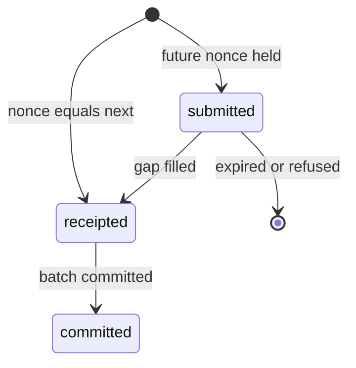

# Sequencer contract

| Item | Value |
|---|---|
| Version | 2.0.0 (supersedes 1.0.2, which was read at revision 52b672ac4) |
| Revision read | 2a1033aa2 |
| Scope | Signed receipt v2, receipt key pin, MsgSequenceBatch, sequencer WAL, nonce and fee rules at receipt, leader pin, and the node-runtime interfaces of domain 5 that name an anchor in this file |
| Change control | Changes only by amendment; each amendment raises the version and names the covering task ids |
| Conventions | u64be = big-endian unsigned 64-bit; arr32 = u32be length 32 then 32 bytes (node/sequencer/receipt.go:80); addr32 = 12 zero bytes then the 20-byte EVM address (node/sequencer/receipt.go:85); "(planned)" marks a file that does not exist at HEAD |

Status words follow CONTRACT section 3: stable (code and intent agree, no task touches it), change, new (planned file, line 0), retire. Every interface row carries the task ids whose `interfaces` list names it; a stable row carries none.

## Sections

| Anchor | Section | Interfaces | Non-stable |
|---|---|---|---|
| [sequencer-receipt](#sequencer-receipt) | Signed receipt v2 | 8 | 5 |
| [receipt-key-pin](#receipt-key-pin) | Receipt key pin and rotation | 0 | 0 |
| [rungs](#rungs) | Rungs: submitted, receipted, committed | 0 | 0 |
| [sequencer-msg](#sequencer-msg) | MsgSequenceBatch (tx 0 of a sequenced block) | 25 | 9 |
| [sequencer-wal](#sequencer-wal) | Sequencer WAL and standby replication | 76 | 18 |
| [sequencer-executor](#sequencer-executor) | Executor, nonce rules and fee rules at receipt | 159 | 35 |
| [sequencer-config](#sequencer-config) | Sequencer config section | 16 | 16 |
| [sequencer-module](#sequencer-module) | modules/sequencer store, genesis and params | 94 | 37 |
| [consensus-leader-pin](#consensus-leader-pin) | Consensus leader pin | 13 | 13 |
| [errors](#errors) | Error codes | 9 | 0 |
| [wiring-integration](#wiring-integration) | Integration into the node | 0 | 0 |
| [sequencer-receipt-store](#sequencer-receipt-store) | EVM receipt store | 19 | 0 |
| [node-abci](#node-abci) | Node ABCI surface | 107 | 11 |
| [node-ante](#node-ante) | Ante handlers | 57 | 0 |
| [node-engine](#node-engine) | Execution engine | 162 | 3 |
| [node-storage](#node-storage) | Storage | 577 | 16 |
| [node-config](#node-config) | Node config keys | 421 | 109 |
| [node-cli](#node-cli) | Node CLI commands | 294 | 83 |
| [node-go-api](#node-go-api) | Node exported Go API | 309 | 11 |
| [node-metrics](#node-metrics) | Node metrics | 314 | 31 |
| [node-genesis](#node-genesis) | Genesis | 20 | 11 |
| [node-upgrades](#node-upgrades) | Upgrade plans | 19 | 2 |
| [node-admin](#node-admin) | Admin service | 24 | 0 |

## Signed receipt v2

Baseline at HEAD. `Receipter.Accept` (node/sequencer/receipt.go:325) executes one transaction on the open layer through `Executor.Accept`, builds a `ReceiptInput` (node/sequencer/receipt.go:54) and signs it with `ReceiptKey.SignReceipt` (node/sequencer/receiptkey.go:105). The encoder is `encodeReceipt` (node/sequencer/receipt.go:196); `BuildReceipt` (node/sequencer/receipt.go:288) appends signature flag 0. The RPC decoder and JSON view are `SequencerReceiptView` (rpc/sequencer_receipt.go:125) and `SequencerReceiptResult` (rpc/sequencer_receipt.go:150).

### Envelope fields in canonical order

| # | Field | Encoding | Value | Written at |
|---|---|---|---|---|
| 1 | header | u16be protocol_version 2, u16be structure tag 0x5201 | fixed (`receiptProtocolVersion`, `receiptStructureTag`, node/sequencer/receipt.go:24-25) | node/sequencer/receipt.go:235-236 |
| 2 | protocol_version | u16be | 2 | node/sequencer/receipt.go:237 |
| 3 | activity_id | arr32 | EVM tx: keccak256 of the signed tx; Cosmos tx: sha256 of the tx bytes; zero refused (node/sequencer/receipt.go:202) | node/sequencer/receipt.go:238 |
| 4 | global_sequence | u64be | seq, gap-free, 0 refused (node/sequencer/receipt.go:205) | node/sequencer/receipt.go:239 |
| 5 | previous_state_root | arr32 | prevSeqHash | node/sequencer/receipt.go:240 |
| 6 | resulting_state_root | arr32 | seqHash = sha256("PAXEER/v1/sequence\0" ‖ prevSeqHash ‖ u64be(seq) ‖ activity_id) (`nextSeqHash`, node/sequencer/executor.go:342); a mismatch is refused (node/sequencer/receipt.go:208) | node/sequencer/receipt.go:241 |
| 7 | activity_root | arr32 | sha256(returnData) | node/sequencer/receipt.go:242 |
| 8 | result_status | u32be | 0 when EVM status 1, 1 when EVM status 0; any other status refused | node/sequencer/receipt.go:243 |
| 9 | effects | u32be count = logs + 1, then effect 0 (summary, kind 1 STATE) and effects 1..n (one per log, kind 3 EVENT); more than 65534 logs refused (node/sequencer/receipt.go:226) | | node/sequencer/receipt.go:244-252 |
| 10 | fee_charged | u128be | gasUsed × effectiveGasPrice in the base denom, or converted into the fee-token denom with `ConvertFeeToDenom` when the ante charged a fee token (node/sequencer/receipt.go:460-472); Cosmos tx: the single fee coin (node/sequencer/receipt.go:407) | node/sequencer/receipt.go:253 |
| 11 | batch_id | arr32 | 24 zero bytes ‖ u64be open height | node/sequencer/receipt.go:256 |
| 12 | module_id | u16be | `EVMReceiptModuleID` = 12, the next id after LXP_MODULE_RESERVED_COUNT 11 (node/app.go:3092); ids at or below 11 refused (node/sequencer/receipt.go:214) | node/sequencer/receipt.go:257 |
| 13 | module_version | u32be | `ReceiptLayoutVersion` 1 (node/sequencer/receipt.go:27) | node/sequencer/receipt.go:258 |
| 14 | parameter_version | u32be | 0 | node/sequencer/receipt.go:259 |
| 15 | operation | u8 | EVM tx type; Cosmos tx `CosmosOperation` 0xFF (node/sequencer/receipt.go:29) | node/sequencer/receipt.go:260 |
| 16 | asset | arr32 | sha256(fee denom UTF-8) | node/sequencer/receipt.go:261 |
| 17 | amount | u128be | tx value in wei; a value above 128 bits is refused before execution (node/sequencer/receipt.go:382) | node/sequencer/receipt.go:262 |
| 18 | from | addr32 | recovered EVM sender | node/sequencer/receipt.go:265 |
| 19 | from_balance_before, from_balance_after | u128be each | sender balance on the open layer before and after | node/sequencer/receipt.go:266-271 |
| 20 | from_sequence | u64be | tx nonce | node/sequencer/receipt.go:272 |
| 21 | to | addr32 | recipient, or `crypto.CreateAddress(from, nonce)` for a create (node/sequencer/receipt.go:385) | node/sequencer/receipt.go:273 |
| 22 | to_balance_before, to_balance_after | u128be each | recipient balance before and after | node/sequencer/receipt.go:274-279 |
| 23 | transfer_set_root | arr32 | 32 zero bytes | node/sequencer/receipt.go:280 |
| 24 | authorization_hash | arr32 | keccak256 of the RLP of the EIP-7702 authorization list for a SetCode tx, else zero (node/sequencer/receipt.go:389-395) | node/sequencer/receipt.go:281 |
| 25 | context_hash | arr32 | keyId of the ReceiptKeys entry covering the receipt height (`ReceiptKey.KeyID`, node/sequencer/receiptkey.go:91) | node/sequencer/receipt.go:282 |
| 26 | timestamp | u64be | open time of the pending block in unix milliseconds | node/sequencer/receipt.go:283 |
| 27 | signature | u8 flag 1, u32be 64, 64-byte ed25519 signature; unsigned form ends with flag 0 | ed25519 over sha256("LXP/v1/receipt\0" ‖ unsigned bytes) (`codec.ReceiptDigest`, layerxproof/codec/domain.go:91) | node/sequencer/receiptkey.go:105-121 |

### Effects

| Effect | Body | Bound | Written at |
|---|---|---|---|
| 0 summary | gasUsed u64be ‖ cumulativeGasUsed u64be ‖ effectiveGasPrice u64be ‖ txIndex u32be ‖ contractAddress 20 bytes ‖ sponsor 20 bytes ‖ sha256(vmError) 32 bytes ‖ returnData length u32be ‖ log count u32be ‖ feeDenom length u8 ‖ feeDenom (1..64 bytes) | 191 bytes (`maxSummaryBody`, node/sequencer/receipt.go:36) | `SummaryEffect`, node/sequencer/receipt.go:125 |
| 1..n log | address 20 bytes ‖ topic count u8 (0..4) ‖ topics 32 bytes each ‖ sha256(data) 32 bytes | 181 bytes (`maxLogBody`, node/sequencer/receipt.go:37) | `LogEffect`, node/sequencer/receipt.go:180 |
| header of each effect | u16be module_id ‖ u16be ordinal ‖ u16be event_type 0 ‖ u8 kind ‖ u8 0 ‖ arr32 zero transfer_set_root ‖ u32be body length ‖ body | | `appendEffect`, node/sequencer/receipt.go:100 |

Sponsor is the first topic-1 address of a `Sponsored(address,address,uint256,uint256)` log (node/sequencer/receipt.go:50, :500). A receipt that cannot be built after execution returns `ErrReceiptInvariant` with the Accepted outcome (node/sequencer/receipt.go:47).

Verification. The Go verifier is `ReceiptKeys.VerifyReceipt` (modules/sequencer/keeper/receipt_keys.go:112): decode, height from batch_id (`ReceiptHeight`, modules/sequencer/keeper/receipt_keys.go:133), key lookup by context_hash and height, then `verify.ReceiptSignature` (layerxproof/verify/receipt.go:49). The Rust verifier is `verify_sequencer_signature` (services/agent/crates/layerx-proof/src/receipt.rs:666), which re-encodes byte-exactly, refuses a zero activity id and selects the key by batch_id height from the pinned list.

Planned changes (from the interface rows below): the accepter that releases a receipt only after WAL write and standby ack (task 5.5.4), the receipt source served by hash (5.5.3), the log feed publisher (5.5.10) and the follower receipt option (5.5.13).

Interfaces frozen here: stable 3, new 5.

| Interface | Kind | Defined at (HEAD) | Status | Covering tasks | Signature |
|---|---|---|---|---|---|
| 5.go-node-sequencer-err-replication-halted-j31 | go_exported | node/sequencer/accepter.go (planned) | new | 5.5.4 | var ErrReplicationHalted = errors.New("sequencer: replication halted") |
| 5.go-node-sequencer-new-accepter-j31 | go_exported | node/sequencer/accepter.go (planned) | new | 5.5.4 | func NewAccepter(r *Receipter, rep *Replicator, src *ReceiptSource, m *Metrics) *Accepter |
| 5.go-node-sequencer-follower-receipt-option-j31 | go_exported | node/sequencer/follower.go (planned) | new | 5.5.13 | func NewFollowerReceiptOption(cfg Config) (evmrpc.SequencerReceiptOption, bool) |
| 5.go-node-sequencer-new-log-feed-publisher-j31 | go_exported | node/sequencer/log_feed.go (planned) | new | 5.5.10 | func NewLogFeedPublisher(feed *evmrpc.ReceiptLogFeed) *LogFeedPublisher |
| 5.go-node-sequencer-receipt-source-j31 | go_exported | node/sequencer/receipt_source.go (planned) | new | 5.5.3 | type ReceiptSource struct |
| 5.fmt-sequencer-receipt-build | file_format | node/sequencer/receipt.go:288 | stable | - | func BuildReceipt(in *ReceiptInput, contextHash [32]byte) ([]byte, error) |
| 5.fmt-sequencer-receipt-encode | file_format | node/sequencer/receipt.go:196 | stable | - | func encodeReceipt(in *ReceiptInput, contextHash [32]byte) ([]byte, error) |
| 5.fmt-sequencer-receipt-v2 | file_format | node/sequencer/receipt.go:24 | stable | - | receiptProtocolVersion uint16 = 2 |

## Receipt key pin and rotation

| Item | Rule at HEAD | Hook |
|---|---|---|
| Key material | ed25519 seed, hex, 32 bytes, in a regular file of mode 0600 or stricter; refused when it is the consensus key file or equals the consensus public key | `LoadReceiptKey`, node/sequencer/receiptkey.go:42 |
| Pin entry (node) | `verify.SequencerAuthorization` {SequencerID, PublicKey, FirstBatchNumber, LastBatchNumber}; a zero id or an inverted range is refused with `ErrReceiptKeyPin` | layerxproof/verify/receipt.go:24; node/sequencer/receiptkey.go:25 |
| Start rule | the node refuses to start unless a pin covers its public key at the open height (`ErrReceiptKeyNotPinned`) | node/sequencer/receiptkey.go:27, :91 |
| Pin entry (chain store) | `types.ReceiptKey` {KeyId [32], PublicKey [32], FirstHeight, LastHeight}, 80 bytes each, concatenated under store key 0x03 | modules/sequencer/types/genesis.go:12; modules/sequencer/types/keys.go:16; modules/sequencer/keeper/keeper.go:26 |
| Pin entry (governed param) | `ReceiptKeyEntry` {key_id, public_key, first_height, last_height} in the sequencer param subspace under key "ReceiptKeys"; non-zero 32-byte id, canonical ed25519 key, first ≤ last | modules/sequencer/keeper/receipt_keys.go:18, :40, :50 |
| Rotation rule | an existing keyId keeps its public key and firstHeight; coverage at or below the current height is unchanged; a new keyId starts above the current height | `ValidateRotation`, modules/sequencer/keeper/receipt_keys.go:144 |
| Rotation path | a param-change proposal on the sequencer subspace runs `ValidateRotation`, then `SetReceiptKeys` copies the list into store key 0x03 | modules/sequencer/module.go:218; modules/sequencer/keeper/keeper.go:182; route node/app.go:960 |
| Batch check | `DeliverSequenceBatch` looks up the keyId covering the height (`ErrUnknownReceiptKey`, code 9) and verifies the batch signature | modules/sequencer/keeper/keeper.go:56, :230 |
| Off-chain verifier | key chosen by batch_id height from the pinned list | services/agent/crates/layerx-proof/src/receipt.rs:666 |

Planned: firstHeight 0 refused in the governed list (5.24.1), the pins exposed as `SequencerAuthorization` values for the node loader (5.24.4), and the node refreshing its pins from the keeper at each Open (5.5.16). Other domains pin the same list in their verifiers; the requirements that name a receipt key pin are:

| Requirement | Title |
|---|---|
| req.5012 | The merge plan pins a receipt key for the first sequenced height |
| req.5027 | Receipt key rotation is honoured without a restart |
| req.5250 | The governed receipt key list applies the genesis range rule |
| req.5253 | The receipt key signer is pinned from chain state |
| req.5503 | Conformance: a paxd home with a pinned receipt key and leader validates |
| req.8002 | The gateway pins sequencer receipt keys independently of kernel backends |
| req.8003 | The router serves the consensus commit, validator set and pinned receipt keys |
| req.8112 | The authority's sequencer trust is the pinned receipt key list |
| req.8260 | Drive service conformance and connected acceptance with receipt keys and EVM preparations |
| req.8264 | Pay through the Node public RPC example with a raw EIP-1559 transaction and receipt keys |
| req.8265 | Pay through the Python public RPC example with a raw EIP-1559 transaction and receipt keys |
| req.8268 | Configure the ramp LayerX client for the sequencer endpoint, chain id and pinned receipt keys |
| req.8278 | Run the ramp sandbox journey on transaction hashes and receipt keys |
| req.8285 | Sell the paid API on eip155 with receipt keys from the environment |
| req.8289 | Ship merchant example configurations for eip155 and receipt keys |
| req.8290 | Drive the reference application runner with receipt keys instead of a receipt authority |
| req.9017 | Report finality as rungs with receipt keys and block commit |
| req.10251 | Raw receipt evidence binds the pinned receipt key |
| req.11013 | Read the sequencer endpoint and pinned receipt keys into the interop config |
| req.11025 | Compare the pinned receipt keys with the sequencer's published key list at start |
| req.11037 | Refuse a receipt keys file with overlapping or inverted height ranges |
| req.11039 | Start the interop service against the sequencer endpoint and pinned receipt keys |
| req.11051 | Render the receipt keys file from the gateway deploy renderer |
| req.11053 | Pin receipt keys in the x-websearch example config instead of the kernel network id |
| req.11063 | Render the mirror paxeer section and receipt keys from the pinned receipt keys file |
| req.11242 | Relayer configuration builds Paxeer endpoints and receipt keys without the verifier crate |
| req.11301 | The mirror verifier checks a v4 archive's receipts under configured receipt keys |
| req.11361 | x-websearch verifies sequencer receipts under a configured receipt key list |
| req.11394 | x-websearch checks its settlement endpoint and receipt keys at startup without the kernel node-info call |
| req.15004 | Repoint the express integration from authorized batches to pinned receipt keys |
| req.15005 | Repoint the next integration from authorized batches to pinned receipt keys |
| req.15006 | Read pinned receipt keys in the fastapi integration config |
| req.15009 | Bind pinned receipt keys in the spring starter configuration |

## Rungs: submitted, receipted, committed

| Rung | Meaning | JSON answer of pax_sequencerReceipt | Hook |
|---|---|---|---|
| submitted | held without a receipt (future nonce in the nonce queue) | rung, txHash, nonce only | rpc/sequencer_receipt.go:33; node/sequencer/nonce_queue.go:95 |
| receipted | signed receipt issued, batch not committed | rung, txHash, nonce and every view field; no block | rpc/sequencer_receipt.go:35 |
| committed | receipted and covered by the MsgSequenceBatch of a committed block | as receipted plus blockNumber and blockHash; blockNumber is at or above the receipt height | rpc/sequencer_receipt.go:37, :177 |

`SequencerReceiptResult.Verify` (rpc/sequencer_receipt.go:161) refuses an answer whose fields disagree with its rung. A node that is neither the sequencer nor the standby and has no forward URL answers -32000 "pax_sequencerReceipt served by sequencer" (rpc/sequencer_receipt.go:49, :68). eth_getTransactionReceipt stays committed-only.

No interface block names this anchor; it is cited by acceptance and contract_context blocks only.

## MsgSequenceBatch (tx 0 of a sequenced block)

| Field | Type | Rule | Hook |
|---|---|---|---|
| Height | u64 | equals the block height; 0 refused | modules/sequencer/types/msgs.go:34; modules/sequencer/keeper/keeper.go:67 |
| FromSeq | u64 | stored lastSeq + 1 (`ErrSeqDiscontinuity`, code 7) | modules/sequencer/types/msgs.go:35; modules/sequencer/keeper/keeper.go:88 |
| ToSeq | u64 | last seq of the block; empty block: FromSeq - 1 (`IsEmpty`) | modules/sequencer/types/msgs.go:36, :93 |
| PrevSeqHash | 32 bytes | equals stored lastSeqHash | modules/sequencer/types/msgs.go:37; modules/sequencer/keeper/keeper.go:91 |
| LastSeqHash | 32 bytes | seqHash of ToSeq; equals PrevSeqHash when empty | modules/sequencer/types/msgs.go:38 |
| TxRoot | 32 bytes | sha256 over the activity ids of txs 1..n; empty: `EmptyTxRoot` = sha256 of nothing | modules/sequencer/types/msgs.go:39, :28; node/app.go:3157 |
| KeyId | 32 bytes | a ReceiptKeys entry covering Height | modules/sequencer/types/msgs.go:40 |
| Sig | 64 bytes | ed25519 by the receipt key over sha256("PAXEER/v1/sequence-batch\0" ‖ chain-id ‖ u64be Height ‖ u64be FromSeq ‖ u64be ToSeq ‖ PrevSeqHash ‖ LastSeqHash ‖ TxRoot) | modules/sequencer/types/msgs.go:41, :98, :119 |

Tx-0 encoding at HEAD: domain ‖ u64be height ‖ u64be fromSeq ‖ u64be toSeq ‖ prevSeqHash ‖ lastSeqHash ‖ txRoot ‖ keyId ‖ sig, 241 bytes (`EncodeSequenceBatch` node/app.go:3112, `DecodeSequenceBatch` node/app.go:3129, length node/app.go:3108). The batch carries no Cosmos signer and is refused in CheckTx (`ErrBatchBlockOnly`, code 8, modules/sequencer/keeper/keeper.go:44).

| Stage | Check at HEAD | Hook |
|---|---|---|
| Sequenced gate | a block is sequenced when the merge plan "v7.0" is done at a lower height | node/app.go:3099; node/upgrades.go:112 |
| ProcessProposal | tx 0 decodes as a batch and TxRoot equals the recomputed root, else REJECT; then the existing gas check | node/app.go:1539-1570 |
| ProcessBlock | tx 0 decoded, BeginBlock, then `DeliverSequenceBatch` at tx index 0 before the transactions behind it | node/app.go:2239-2256 |
| DeliverSequenceBatch | not CheckTx; tx index 0 (`ErrBatchPosition`, 5); once per height (`ErrBatchRepeated`, 6); height; continuity; pinned key; signature; then stores toSeq, lastSeqHash and the batch height | modules/sequencer/keeper/keeper.go:56-106 |

Planned: the codec moves into modules/sequencer/types with `SeqHash`, `TxRoot`, `EncodeSequenceBatchTx`, `DecodeSequenceBatchTx` and `VerifyBatchTxs` (tasks 5.22.1-5.22.4); the order and proposer checks move into ProcessProposal with a halt on a failed batch (5.0.2); a batch below the activation height is refused (5.24.3).

Interfaces frozen here: stable 16, change 1, new 8.

| Interface | Kind | Defined at (HEAD) | Status | Covering tasks | Signature |
|---|---|---|---|---|---|
| 5.fmt-tx0-sequence-batch-domain | file_format | node/app.go:3105 | change | 5.0.2 | const sequenceBatchDomain = "PAXEER/v1/sequence-batch\\x00" |
| 5.fmt-sequence-batch-tx-j32 | file_format | modules/sequencer/types/batch_tx.go (planned) | new | 5.22.3 | domain(25) \|\| u64be height \|\| u64be fromSeq \|\| u64be toSeq \|\| prevSeqHash(32) ... |
| 5.go-modules-sequencer-types-decode-sequence-batch-tx-j32 | go_exported | modules/sequencer/types/batch_tx.go (planned) | new | 5.22.3 | func DecodeSequenceBatchTx(tx []byte) (MsgSequenceBatch, error) |
| 5.go-modules-sequencer-types-encode-sequence-batch-tx-j32 | go_exported | modules/sequencer/types/batch_tx.go (planned) | new | 5.22.3 | func EncodeSequenceBatchTx(m MsgSequenceBatch) ([]byte, error) |
| 5.go-modules-sequencer-types-sequence-batch-tx-length-j32 | go_exported | modules/sequencer/types/batch_tx.go (planned) | new | 5.22.3 | const SequenceBatchTxLength = 241 |
| 5.go-modules-sequencer-types-verify-batch-txs-j32 | go_exported | modules/sequencer/types/batch_verify.go (planned) | new | 5.22.4 | func VerifyBatchTxs(m MsgSequenceBatch, activityIDs [][32]byte) error |
| 5.go-modules-sequencer-types-seq-hash-domain-j32 | go_exported | modules/sequencer/types/seqhash.go (planned) | new | 5.22.1 | const SeqHashDomain = "PAXEER/v1/sequence\\x00" |
| 5.go-modules-sequencer-types-seq-hash-j32 | go_exported | modules/sequencer/types/seqhash.go (planned) | new | 5.22.1 | func SeqHash(prev [32]byte, seq uint64, activityID [32]byte) [32]byte |
| 5.go-modules-sequencer-types-tx-root-j32 | go_exported | modules/sequencer/types/txroot.go (planned) | new | 5.22.2 | func TxRoot(activityIDs [][32]byte) [32]byte |
| 5.fmt-sequence-batch-domain | file_format | modules/sequencer/types/msgs.go:14 | stable | - | SequenceBatchDomain = "PAXEER/v1/sequence-batch\\x00" |
| 5.fmt-sequence-batch-sign-bytes | file_format | modules/sequencer/types/msgs.go:98 | stable | - | func (m MsgSequenceBatch) SignBytes(chainID string) ([HashLength]byte, error) |
| 5.go-modules-sequencer-types-empty-tx-root | go_exported | modules/sequencer/types/msgs.go:28 | stable | - | var EmptyTxRoot = sha256.Sum256(nil) |
| 5.go-modules-sequencer-types-err-bad-signature | go_exported | modules/sequencer/types/msgs.go:23 | stable | - | ErrBadSignature = sdkerrors.Register(ModuleName, 3, "bad sequence batch signature") |
| 5.go-modules-sequencer-types-err-invalid-sequence-batch | go_exported | modules/sequencer/types/msgs.go:22 | stable | - | ErrInvalidSequenceBatch = sdkerrors.Register(ModuleName, 2, "invalid sequence batch") |
| 5.go-modules-sequencer-types-hash-length | go_exported | modules/sequencer/types/msgs.go:16 | stable | - | HashLength = 32 |
| 5.go-modules-sequencer-types-key-id-length | go_exported | modules/sequencer/types/msgs.go:17 | stable | - | KeyIDLength = 32 |
| 5.go-modules-sequencer-types-msg-sequence-batch | go_exported | modules/sequencer/types/msgs.go:33 | stable | - | type MsgSequenceBatch struct |
| 5.go-modules-sequencer-types-msg-sequence-batch-is-empty | go_exported | modules/sequencer/types/msgs.go:93 | stable | - | func (m MsgSequenceBatch) IsEmpty() bool { return m.ToSeq == m.FromSeq-1 } |
| 5.go-modules-sequencer-types-msg-sequence-batch-sign-bytes | go_exported | modules/sequencer/types/msgs.go:98 | stable | - | func (m MsgSequenceBatch) SignBytes(chainID string) ([HashLength]byte, error) |
| 5.go-modules-sequencer-types-msg-sequence-batch-validate-basic | go_exported | modules/sequencer/types/msgs.go:46 | stable | - | func (m MsgSequenceBatch) ValidateBasic() error |
| 5.go-modules-sequencer-types-msg-sequence-batch-verify-signature | go_exported | modules/sequencer/types/msgs.go:119 | stable | - | func (m MsgSequenceBatch) VerifySignature(chainID string, publicKey [32]byte) error |
| 5.go-modules-sequencer-types-sequence-batch-domain | go_exported | modules/sequencer/types/msgs.go:14 | stable | - | SequenceBatchDomain = "PAXEER/v1/sequence-batch\\x00" |
| 5.go-modules-sequencer-types-signature-length | go_exported | modules/sequencer/types/msgs.go:18 | stable | - | SignatureLength = 64 |
| 5.msg-sequencer-msg-sequence-batch | cosmos_msg | modules/sequencer/types/msgs.go:33 | stable | - | type MsgSequenceBatch struct |
| 5.fmt-tx0-sequence-batch | file_format | node/app.go:3112 | stable | - | func EncodeSequenceBatch(m seqtypes.MsgSequenceBatch) ([]byte, error) |

## Sequencer WAL and standby replication

Frame: u32be crc32c(entry) ‖ u32be len(entry) ‖ entry; entry: u8 version 1 ‖ u8 kind ‖ payload (node/sequencer/wal/wal.go:36, :194, :280). An entry above `MaxEntrySize` 8 MiB is refused (node/sequencer/wal/wal.go:39). Segments roll at `SegmentSizeLimit`, default 64 MiB (node/sequencer/wal/wal.go:387).

| Kind | Name | Payload | Hook |
|---|---|---|---|
| 1 | OPEN | u64be height ‖ u64be openTimeMs ‖ baseFee 32 bytes (uint256); OPEN without a base fee refused | node/sequencer/wal/wal.go:107, :149 |
| 2 | ACCEPT | u64be seq ‖ u64be height ‖ u32be txLen ‖ tx ‖ u32be receiptLen ‖ signed receipt | node/sequencer/wal/wal.go:114, :159 |
| 3 | SEAL | u64be height ‖ u64be toSeq ‖ lastSeqHash 32 bytes ‖ u64be fromSeq; fromSeq above toSeq refused | node/sequencer/wal/wal.go:122, :166 |
| 4 | COMMITTED | u64be height ‖ u64be lastSeq ‖ appHash 32 bytes | node/sequencer/wal/wal.go:130, :176 |
| 5 | LEASE | u64be epoch ‖ keyId 32 bytes ‖ u64be expiryMs | node/sequencer/wal/wal.go:137, :182 |

| Rule | Value | Hook |
|---|---|---|
| Durability | `GroupSync` covers every frame appended since the previous call with one fdatasync and only then releases their `Pending` handles | node/sequencer/wal/wal.go:532, :560 |
| Prune | sealed segments whose entries lie below both the retain height and the last COMMITTED height, from a background worker | node/sequencer/wal/wal.go:664 |
| Replay | every entry after the last COMMITTED is fed to the executor; the first ACCEPT whose re-executed receipt differs stops replay with `ErrReceiptMismatch` | node/sequencer/wal/wal.go:69, :720 |
| Replication wire | group = u32be count ‖ WAL frames; Ack = u8 status ‖ u64be lastSeq ‖ u64be gapFrom ‖ u64be gapTo (25 bytes); status 1 OK, 2 GAP, 3 REFUSED | node/sequencer/standby.go:22-29, :54-61 |
| Release order | `Replicator.Release` appends locally, waits for the group fsync, streams to the standby and returns its Ack; no Ack → `ErrNoAck` | node/sequencer/standby.go:214, :37 |
| Standby | appends and syncs each group to its own WAL, re-executes it in seq order, then acks; keys never equal the primary's (`ErrSharedKey`); lower lease epoch refused (`ErrStaleLease`) | node/sequencer/standby.go:482, :44, :46 |

Planned: the bounded standby dialer (5.5.5), the block driver that commits, prunes and opens the next block (5.5.7), the production replayer (5.5.8), lease take, renewal and fencing (5.15.1-5.15.4, 5.26.1, 5.27.2), failover and lease handover (5.27.3, 5.27.4).

Interfaces frozen here: stable 58, change 3, new 15.

| Interface | Kind | Defined at (HEAD) | Status | Covering tasks | Signature |
|---|---|---|---|---|---|
| 5.fmt-sequencer-replication-ack-j32 | file_format | node/sequencer/standby.go:24 | change | 5.27.2 | u8 status \|\| u64be lastSeq \|\| u64be gapFrom \|\| u64be gapTo (25 bytes) |
| 5.go-node-sequencer-wal-replay-result | go_exported | node/sequencer/wal/wal.go:706 | change | 5.26.1, 5.27.1 | type ReplayResult struct |
| 5.go-node-sequencer-wal-wal-replay | go_exported | node/sequencer/wal/wal.go:720 | change | 5.26.1 | func (w *WAL) Replay(exec Executor) (ReplayResult, error) |
| 5.go-node-sequencer-dial-standby-j31 | go_exported | node/sequencer/dial.go (planned) | new | 5.5.5 | func DialStandby(address string, timeout time.Duration) func(ctx context.Context) (net.... |
| 5.go-node-sequencer-new-driver-j31 | go_exported | node/sequencer/driver.go (planned) | new | 5.5.7 | func NewDriver(exec Executor, rep *Replicator, w *wal.WAL, cfg Config, m *Metrics) *Driver |
| 5.go-node-sequencer-err-divergent-logs-j32 | go_exported | node/sequencer/failover.go (planned) | new | 5.27.3 | ErrDivergentLogs = errors.New("sequencer: two logs hold different receipts for one seq") |
| 5.go-node-sequencer-failover-j32 | go_exported | node/sequencer/failover.go (planned) | new | 5.27.3 | func Failover(s *Standby, key *ReceiptKey, openHeight int64, expiryMs uint64) (Failover... |
| 5.go-node-sequencer-failover-result-j32 | go_exported | node/sequencer/failover.go (planned) | new | 5.27.3 | type FailoverResult struct { Lease *wal.Lease; LastSeq uint64; OpenHeight int64 } |
| 5.go-node-sequencer-recovery-order-j32 | go_exported | node/sequencer/failover.go (planned) | new | 5.27.3 | func RecoveryOrder(a, b wal.ReplayResult) (int, error) |
| 5.go-node-sequencer-fencer-j32 | go_exported | node/sequencer/handover.go (planned) | new | 5.27.4 | type Fencer interface { Fence() error } |
| 5.go-node-sequencer-handover-config-j32 | go_exported | node/sequencer/handover.go (planned) | new | 5.27.4 | type HandoverConfig struct { Primary Fencer; Replicator *Replicator; Standby *Standby; ... |
| 5.go-node-sequencer-handover-j32 | go_exported | node/sequencer/handover.go (planned) | new | 5.27.4 | func Handover(ctx context.Context, cfg HandoverConfig) (HandoverResult, error) |
| 5.go-node-sequencer-replicator-drain-j32 | go_exported | node/sequencer/handover.go (planned) | new | 5.27.4 | func (r *Replicator) Drain(ctx context.Context) (Ack, error) |
| 5.go-node-sequencer-lease-holder-j31 | go_exported | node/sequencer/lease.go (planned) | new | 5.15.1, 5.15.2 | type LeaseHolder struct |
| 5.go-node-sequencer-new-app-replayer-j31 | go_exported | node/sequencer/replay.go (planned) | new | 5.5.8 | func NewAppReplayer(exec Executor, r *Receipter) *AppReplayer |
| 5.go-node-sequencer-err-fenced-j32 | go_exported | node/sequencer/standby.go (planned) | new | 5.27.2 | ErrFenced = errors.New("sequencer: a later lease fences this primary") |
| 5.go-node-sequencer-replicator-epoch-j32 | go_exported | node/sequencer/standby.go (planned) | new | 5.27.2 | func (r *Replicator) Epoch() uint64 |
| 5.go-node-sequencer-standby-take-lease-j32 | go_exported | node/sequencer/standby.go (planned) | new | 5.27.2 | func (s *Standby) TakeLease(l *wal.Lease) error |
| 5.fmt-sequencer-wal-entry | file_format | node/sequencer/wal/wal.go:194 | stable | - | func EncodeEntry(e Entry) ([]byte, error) |
| 5.fmt-sequencer-wal-frame | file_format | node/sequencer/wal/wal.go:280 | stable | - | func NewFrame(e Entry) (Frame, error) |
| 5.fmt-sequencer-wal-record-accept | file_format | node/sequencer/wal/wal.go:114 | stable | - | type Accept struct |
| 5.fmt-sequencer-wal-record-committed | file_format | node/sequencer/wal/wal.go:130 | stable | - | type Committed struct |
| 5.fmt-sequencer-wal-record-lease | file_format | node/sequencer/wal/wal.go:137 | stable | - | type Lease struct |
| 5.fmt-sequencer-wal-record-open | file_format | node/sequencer/wal/wal.go:107 | stable | - | type Open struct |
| 5.fmt-sequencer-wal-record-seal | file_format | node/sequencer/wal/wal.go:122 | stable | - | type Seal struct |
| 5.fmt-sequencer-wal-version | file_format | node/sequencer/wal/wal.go:36 | stable | - | const Version byte = 1 |
| 5.go-node-sequencer-wal-accept | go_exported | node/sequencer/wal/wal.go:114 | stable | - | type Accept struct |
| 5.go-node-sequencer-wal-accept-kind | go_exported | node/sequencer/wal/wal.go:144 | stable | - | func (*Accept) Kind() EntryKind { return KindAccept } |
| 5.go-node-sequencer-wal-committed | go_exported | node/sequencer/wal/wal.go:130 | stable | - | type Committed struct |
| 5.go-node-sequencer-wal-committed-kind | go_exported | node/sequencer/wal/wal.go:146 | stable | - | func (*Committed) Kind() EntryKind { return KindCommitted } |
| 5.go-node-sequencer-wal-config | go_exported | node/sequencer/wal/wal.go:381 | stable | - | type Config struct |
| 5.go-node-sequencer-wal-corrupt-tail | go_exported | node/sequencer/wal/wal.go:307 | stable | - | type CorruptTail struct |
| 5.go-node-sequencer-wal-decode-entry | go_exported | node/sequencer/wal/wal.go:209 | stable | - | func DecodeEntry(b []byte) (Entry, error) |
| 5.go-node-sequencer-wal-default-config | go_exported | node/sequencer/wal/wal.go:387 | stable | - | func DefaultConfig() Config { return Config{SegmentSizeLimit: 64 &lt;&lt; 20} } |
| 5.go-node-sequencer-wal-encode-entry | go_exported | node/sequencer/wal/wal.go:194 | stable | - | func EncodeEntry(e Entry) ([]byte, error) |
| 5.go-node-sequencer-wal-entry | go_exported | node/sequencer/wal/wal.go:101 | stable | - | type Entry interface |
| 5.go-node-sequencer-wal-entry-kind | go_exported | node/sequencer/wal/wal.go:73 | stable | - | type EntryKind uint8 |
| 5.go-node-sequencer-wal-entry-kind-string | go_exported | node/sequencer/wal/wal.go:83 | stable | - | func (k EntryKind) String() string |
| 5.go-node-sequencer-wal-err-checksum | go_exported | node/sequencer/wal/wal.go:63 | stable | - | ErrChecksum = errors.New("wal frame checksum mismatch") |
| 5.go-node-sequencer-wal-err-closed | go_exported | node/sequencer/wal/wal.go:53 | stable | - | ErrClosed = errors.New("sequencer wal closed") |
| 5.go-node-sequencer-wal-err-corrupt-segment | go_exported | node/sequencer/wal/wal.go:67 | stable | - | ErrCorruptSegment = errors.New("sealed wal segment corrupt") |
| 5.go-node-sequencer-wal-err-entry-too-large | go_exported | node/sequencer/wal/wal.go:61 | stable | - | ErrEntryTooLarge = errors.New("wal entry too large") |
| 5.go-node-sequencer-wal-err-malformed | go_exported | node/sequencer/wal/wal.go:59 | stable | - | ErrMalformed = errors.New("malformed wal entry") |
| 5.go-node-sequencer-wal-err-receipt-mismatch | go_exported | node/sequencer/wal/wal.go:69 | stable | - | ErrReceiptMismatch = errors.New("replayed receipt differs from stored receipt") |
| 5.go-node-sequencer-wal-err-torn | go_exported | node/sequencer/wal/wal.go:65 | stable | - | ErrTorn = errors.New("wal frame torn") |
| 5.go-node-sequencer-wal-err-unknown-kind | go_exported | node/sequencer/wal/wal.go:57 | stable | - | ErrUnknownKind = errors.New("unknown wal entry kind") |
| 5.go-node-sequencer-wal-err-unknown-version | go_exported | node/sequencer/wal/wal.go:55 | stable | - | ErrUnknownVersion = errors.New("unknown wal entry version") |
| 5.go-node-sequencer-wal-executor | go_exported | node/sequencer/wal/wal.go:698 | stable | - | type Executor interface |
| 5.go-node-sequencer-wal-frame | go_exported | node/sequencer/wal/wal.go:277 | stable | - | type Frame []byte |
| 5.go-node-sequencer-wal-kind-accept | go_exported | node/sequencer/wal/wal.go:77 | stable | - | KindAccept EntryKind = 2 |
| 5.go-node-sequencer-wal-kind-committed | go_exported | node/sequencer/wal/wal.go:79 | stable | - | KindCommitted EntryKind = 4 |
| 5.go-node-sequencer-wal-kind-lease | go_exported | node/sequencer/wal/wal.go:80 | stable | - | KindLease EntryKind = 5 |
| 5.go-node-sequencer-wal-kind-open | go_exported | node/sequencer/wal/wal.go:76 | stable | - | KindOpen EntryKind = 1 |
| 5.go-node-sequencer-wal-kind-seal | go_exported | node/sequencer/wal/wal.go:78 | stable | - | KindSeal EntryKind = 3 |
| 5.go-node-sequencer-wal-lease | go_exported | node/sequencer/wal/wal.go:137 | stable | - | type Lease struct |
| 5.go-node-sequencer-wal-lease-kind | go_exported | node/sequencer/wal/wal.go:147 | stable | - | func (*Lease) Kind() EntryKind { return KindLease } |
| 5.go-node-sequencer-wal-max-entry-size | go_exported | node/sequencer/wal/wal.go:39 | stable | - | const MaxEntrySize = 8 &lt;&lt; 20 |
| 5.go-node-sequencer-wal-new-frame | go_exported | node/sequencer/wal/wal.go:280 | stable | - | func NewFrame(e Entry) (Frame, error) |
| 5.go-node-sequencer-wal-open | go_exported | node/sequencer/wal/wal.go:107 | stable | - | type Open struct |
| 5.go-node-sequencer-wal-open-kind | go_exported | node/sequencer/wal/wal.go:143 | stable | - | func (*Open) Kind() EntryKind { return KindOpen } |
| 5.go-node-sequencer-wal-open-wal | go_exported | node/sequencer/wal/wal.go:434 | stable | - | func OpenWAL(dir string, cfg Config) (w *WAL, err error) |
| 5.go-node-sequencer-wal-pending | go_exported | node/sequencer/wal/wal.go:396 | stable | - | type Pending struct |
| 5.go-node-sequencer-wal-pending-wait | go_exported | node/sequencer/wal/wal.go:401 | stable | - | func (p *Pending) Wait(ctx context.Context) error |
| 5.go-node-sequencer-wal-seal | go_exported | node/sequencer/wal/wal.go:122 | stable | - | type Seal struct |
| 5.go-node-sequencer-wal-seal-kind | go_exported | node/sequencer/wal/wal.go:145 | stable | - | func (*Seal) Kind() EntryKind { return KindSeal } |
| 5.go-node-sequencer-wal-version | go_exported | node/sequencer/wal/wal.go:36 | stable | - | const Version byte = 1 |
| 5.go-node-sequencer-wal-wal | go_exported | node/sequencer/wal/wal.go:411 | stable | - | type WAL struct |
| 5.go-node-sequencer-wal-wal-append | go_exported | node/sequencer/wal/wal.go:532 | stable | - | func (w *WAL) Append(e Entry) (*Pending, error) |
| 5.go-node-sequencer-wal-wal-close | go_exported | node/sequencer/wal/wal.go:646 | stable | - | func (w *WAL) Close() |
| 5.go-node-sequencer-wal-wal-group-sync | go_exported | node/sequencer/wal/wal.go:560 | stable | - | func (w *WAL) GroupSync() (int, error) |
| 5.go-node-sequencer-wal-wal-last-committed | go_exported | node/sequencer/wal/wal.go:655 | stable | - | func (w *WAL) LastCommitted() *Committed |
| 5.go-node-sequencer-wal-wal-prune | go_exported | node/sequencer/wal/wal.go:664 | stable | - | func (w *WAL) Prune(retainHeight uint64) (int, error) |
| 5.key-node-sequencer-wal-head-name | storage_key | node/sequencer/wal/wal.go:44 | stable | - | headName = "head.seg" |
| 5.key-node-sequencer-wal-lock-name | storage_key | node/sequencer/wal/wal.go:45 | stable | - | lockName = "wal.lock" |
| 5.key-node-sequencer-wal-sealed-suffix | storage_key | node/sequencer/wal/wal.go:46 | stable | - | sealedSuffix = ".seg" |
| 5.key-sequencer-wal-sealed-segment-name | storage_key | node/sequencer/wal/wal.go:365 | stable | - | func (s segment) name() string |

## Executor, nonce rules and fee rules at receipt

`Executor` (node/sequencer/executor.go:40): `Open(height, timestampMs)` builds L_open over the committed state and runs BeginBlock once; `Accept(txBytes)` executes in deliver mode, writes the branch and assigns the next seq, or writes nothing and takes no seq; `Seal(height)` returns the accepted txs in seq order with lastSeq and lastSeqHash; `Snapshot()` is a point-in-time read view; `PendingTx(hash)` serves receipted EVM txs of L_open. Two modes: `ModeSequential` 0 (node/sequencer/executor.go:25) and `ModeMicroBatch` 1 (node/sequencer/microbatch.go:19).

### Nonce rules

| Case | Rule at HEAD | Hook |
|---|---|---|
| nonce = next | accepted at once; held nonces it unblocks drain behind it | node/sequencer/nonce_queue.go:109-115 |
| nonce > next | held at rung submitted, bounded per sender (`ErrSenderQueueFull`) and in total (`ErrQueueFull`), expired after `Lifetime` | node/sequencer/nonce_queue.go:117-131, :19, :21, :168 |
| nonce < next | refused with `ErrNonceTooLow` = core.ErrNonceTooLow | node/sequencer/nonce_queue.go:15, :107-108 |
| same (sender, nonce) receipted or held | refused with `ErrSameNonce`; nothing is superseded | node/sequencer/nonce_queue.go:17, :99-104 |
| next nonce source | `NextNonceReader.EvmNonce`, the keeper path the ante uses, read from the open state | node/sequencer/nonce_queue.go:26 |
| bounds | `NonceQueueConfig` {PerSender, Total, Lifetime}, set at activation rehearsal | node/sequencer/nonce_queue.go:34 |
| pending nonce over RPC | eth_getTransactionCount("pending") reads the open block context (`PendingCtxHeight`) | rpc/tx.go:433; rpc/utils.go:47 |

The nonce queue is not yet on the send path; task 5.5.11 admits future-nonce transactions through it.

### Fee rules

| Rule | Value at HEAD | Hook |
|---|---|---|
| EVM minimum fee per gas | `DefaultMinFeePerGas` 67 000 000 wei (0.067 gwei), param `KeyMinFeePerGas` | modules/evm/types/params.go:52, :21; checked modules/evm/ante/fee.go:56 |
| EVM base fee | gasFeeCap must be at or above the base fee; the sequencer fixes the base fee for the open block from `GetNextBaseFeePerGas` at Open and records it in the WAL OPEN entry | modules/evm/ante/fee.go:53; modules/evm/keeper/fee.go:100; node/sequencer/fee.go:86 |
| Node floor (Cosmos txs) | default min gas prices "0.01uhpx"; Accept runs deliver mode, which skips the floor, so `FeeFloor.CheckNodeFloor` applies it before Accept with the CheckTx checker; gasless txs skip it | daemon/paxd/cmd/root.go:404; node/sequencer/fee.go:69, :103 |
| Fee-token charge | fee_charged converts gasUsed × effectiveGasPrice into the fee-token denom when the ante charged one | node/sequencer/receipt.go:460-472 |
| Fee-token rate age | `DefaultMaxFeeTokenRateAge` 1000 blocks | modules/evm/types/params.go:39 |

Interfaces frozen here: stable 124, change 20, new 4, retire 11.

| Interface | Kind | Defined at (HEAD) | Status | Covering tasks | Signature |
|---|---|---|---|---|---|
| 5.go-node-sequencer-config | go_exported | node/sequencer/config.go:46 | change | 5.5.1 | type Config struct |
| 5.go-node-sequencer-config-template | go_exported | node/sequencer/config.go:189 | change | 5.5.1 | const ConfigTemplate = ' |
| 5.go-node-sequencer-config-validate | go_exported | node/sequencer/config.go:96 | change | 5.5.1 | func (c Config) Validate() error |
| 5.go-node-sequencer-read-config | go_exported | node/sequencer/config.go:133 | change | 5.5.12 | func ReadConfig(opts servertypes.AppOptions) (Config, error) |
| 5.go-node-sequencer-consensus-source-seal | go_exported | node/sequencer/consensus_source.go:56 | change | 5.4.4 | func (s *ConsensusSource) Seal(ctx context.Context, height int64) (tmtypes.SealedBlock,... |
| 5.go-node-sequencer-new-consensus-source | go_exported | node/sequencer/consensus_source.go:33 | change | 5.5.12, 5.5.14, 5.15.4 | func NewConsensusSource(a *app.App, exec Executor, key *ReceiptKey) (*ConsensusSource, ... |
| 5.fmt-seq-hash-chain | file_format | node/sequencer/executor.go:37 | change | 5.17.1 | var seqHashDomain = []byte("PAXEER/v1/sequence\\x00") |
| 5.go-node-sequencer-host | go_exported | node/sequencer/executor.go:67 | change | 5.4.2, 5.4.5 | type Host interface |
| 5.go-node-sequencer-new-executor | go_exported | node/sequencer/executor.go:194 | change | 5.5.12, 5.15.3 | func NewExecutor(host Host, opts Options) (Executor, error) |
| 5.go-node-sequencer-new-fee-floor | go_exported | node/sequencer/fee.go:38 | change | 5.5.12 | func NewFeeFloor(exec Executor, host Host, minGasPrices string, params paramskeeper.Kee... |
| 5.go-node-sequencer-new-micro-batch | go_exported | node/sequencer/microbatch.go:85 | change | 5.4.7 | func NewMicroBatch(host BatchHost, opts Options, mb MicroBatchOptions) (Executor, error) |
| 5.go-node-sequencer-refresh-precompiles | go_exported | node/sequencer/precompiles.go:39 | change | 5.4.2 | func RefreshPrecompiles(host PrecompileHost, exec Executor) error |
| 5.go-node-sequencer-set-tx-position | go_exported | node/sequencer/precompiles.go:28 | change | 5.4.1 | func SetTxPosition(ctx sdk.Context, txIndex int) (sdk.Context, error) |
| 5.go-node-sequencer-new-receipter | go_exported | node/sequencer/receipt.go:311 | change | 5.5.12 | func NewReceipter(exec Executor, host Host, evm *evmkeeper.Keeper, key *ReceiptKey, mod... |
| 5.go-node-sequencer-receipter-accept | go_exported | node/sequencer/receipt.go:325 | change | 5.4.1, 5.5.4 | func (r *Receipter) Accept(txBytes []byte) (*Accepted, []byte, error) |
| 5.go-node-sequencer-load-receipt-key | go_exported | node/sequencer/receiptkey.go:42 | change | 5.5.16, 5.5.19 | func LoadReceiptKey(keyFile, consensusKeyFile string, pins []verify.SequencerAuthorizat... |
| 5.go-node-sequencer-ack | go_exported | node/sequencer/standby.go:64 | change | 5.27.2 | type Ack struct |
| 5.go-node-sequencer-new-replicator | go_exported | node/sequencer/standby.go:196 | change | 5.5.12 | func NewReplicator(cfg ReplicatorConfig) (*Replicator, error) |
| 5.go-node-sequencer-new-standby | go_exported | node/sequencer/standby.go:494 | change | 5.5.9, 5.26.2 | func NewStandby(ctx context.Context, cfg StandbyConfig) (*Standby, error) |
| 5.go-node-sequencer-replicator-release | go_exported | node/sequencer/standby.go:214 | change | 5.27.2 | func (r *Replicator) Release(ctx context.Context, entries ...wal.Entry) (Ack, error) |
| 5.go-node-sequencer-new-promoted-consensus-source-j31 | go_exported | node/sequencer/consensus_source.go (planned) | new | 5.15.4 | func NewPromotedConsensusSource(a *app.App, host Host, opts Options, lastSeq uint64, ke... |
| 5.go-node-sequencer-err-lease-fenced-j31 | go_exported | node/sequencer/executor.go (planned) | new | 5.15.3 | var ErrLeaseFenced = errors.New("sequencer: executor fenced by a later lease") |
| 5.go-node-sequencer-executor-fence-j31 | go_exported | node/sequencer/executor.go (planned) | new | 5.15.3 | Fence() error |
| 5.go-node-sequencer-new-nonce-admission-j31 | go_exported | node/sequencer/nonce_admission.go (planned) | new | 5.5.11 | func NewNonceAdmission(cfg Config, nonces NextNonceReader, accept AcceptFunc) (*NonceAd... |
| 5.go-node-sequencer-layers | go_exported | node/sequencer/layers.go:63 | retire | 5.17.2 | type Layers struct |
| 5.go-node-sequencer-layers-committed | go_exported | node/sequencer/layers.go:178 | retire | 5.17.2 | func (l *Layers) Committed(height int64) error |
| 5.go-node-sequencer-layers-last-seq | go_exported | node/sequencer/layers.go:117 | retire | 5.17.2 | func (l *Layers) LastSeq() (uint64, [32]byte) |
| 5.go-node-sequencer-layers-open | go_exported | node/sequencer/layers.go:129 | retire | 5.17.2 | func (l *Layers) Open(header tmproto.Header, votes []abci.VoteInfo, byzantine []abci.Mi... |
| 5.go-node-sequencer-layers-sealed | go_exported | node/sequencer/layers.go:122 | retire | 5.17.2 | func (l *Layers) Sealed() *SealedLayer |
| 5.go-node-sequencer-new-layers | go_exported | node/sequencer/layers.go:112 | retire | 5.17.2 | func NewLayers(a *app.App, committed sdk.MultiStore, lastSeq uint64, lastSeqHash [32]by... |
| 5.go-node-sequencer-open-layer | go_exported | node/sequencer/layers.go:73 | retire | 5.17.2 | type OpenLayer struct |
| 5.go-node-sequencer-open-layer-apply | go_exported | node/sequencer/layers.go:236 | retire | 5.17.2 | func (o *OpenLayer) Apply(txBytes []byte) (SequencedTx, error) |
| 5.go-node-sequencer-open-layer-height | go_exported | node/sequencer/layers.go:228 | retire | 5.17.2 | func (o *OpenLayer) Height() int64 |
| 5.go-node-sequencer-sequenced-tx | go_exported | node/sequencer/layers.go:53 | retire | 5.17.2 | type SequencedTx struct |
| 5.go-node-sequencer-seal | go_exported | node/sequencer/seal.go:28 | retire | 5.17.2 | func Seal(l *Layers, height int64) (*SealedLayer, error) |
| 5.go-node-sequencer-config-micro-batch-options | go_exported | node/sequencer/config.go:184 | stable | - | func (c Config) MicroBatchOptions() MicroBatchOptions |
| 5.go-node-sequencer-default-config | go_exported | node/sequencer/config.go:67 | stable | - | func DefaultConfig() Config |
| 5.go-node-sequencer-err-config-mode | go_exported | node/sequencer/config.go:31 | stable | - | ErrConfigMode = errors.New("sequencer config: unknown mode") |
| 5.go-node-sequencer-err-config-receipt-key-file | go_exported | node/sequencer/config.go:35 | stable | - | ErrConfigReceiptKeyFile = errors.New("sequencer config: receipt-key-file is required") |
| 5.go-node-sequencer-err-config-replication-timeout | go_exported | node/sequencer/config.go:40 | stable | - | ErrConfigReplicationTimeout = errors.New("sequencer config: invalid replication-timeout") |
| 5.go-node-sequencer-err-config-standby-address | go_exported | node/sequencer/config.go:37 | stable | - | ErrConfigStandbyAddress = errors.New("sequencer config: invalid standby-address") |
| 5.go-node-sequencer-err-config-value | go_exported | node/sequencer/config.go:42 | stable | - | ErrConfigValue = errors.New("sequencer config: invalid value") |
| 5.go-node-sequencer-err-config-wal-dir | go_exported | node/sequencer/config.go:33 | stable | - | ErrConfigWALDir = errors.New("sequencer config: wal-dir is required") |
| 5.go-node-sequencer-flag-enable | go_exported | node/sequencer/config.go:14 | stable | - | FlagEnable = "sequencer.enable" |
| 5.go-node-sequencer-flag-micro-batch-max-count | go_exported | node/sequencer/config.go:21 | stable | - | FlagMicroBatchMaxCount = "sequencer.microbatch-max-count" |
| 5.go-node-sequencer-flag-micro-batch-window | go_exported | node/sequencer/config.go:20 | stable | - | FlagMicroBatchWindow = "sequencer.microbatch-window" |
| 5.go-node-sequencer-flag-mode | go_exported | node/sequencer/config.go:15 | stable | - | FlagMode = "sequencer.mode" |
| 5.go-node-sequencer-flag-receipt-key-file | go_exported | node/sequencer/config.go:17 | stable | - | FlagReceiptKeyFile = "sequencer.receipt-key-file" |
| 5.go-node-sequencer-flag-replication-timeout | go_exported | node/sequencer/config.go:19 | stable | - | FlagReplicationTimeout = "sequencer.replication-timeout" |
| 5.go-node-sequencer-flag-standby-address | go_exported | node/sequencer/config.go:18 | stable | - | FlagStandbyAddress = "sequencer.standby-address" |
| 5.go-node-sequencer-flag-wal-dir | go_exported | node/sequencer/config.go:16 | stable | - | FlagWALDir = "sequencer.wal-dir" |
| 5.go-node-sequencer-mode-string | go_exported | node/sequencer/config.go:72 | stable | - | func (m Mode) String() string |
| 5.go-node-sequencer-parse-mode | go_exported | node/sequencer/config.go:84 | stable | - | func ParseMode(name string) (Mode, error) |
| 5.go-node-sequencer-consensus-source | go_exported | node/sequencer/consensus_source.go:24 | stable | - | type ConsensusSource struct |
| 5.go-node-sequencer-consensus-source-sealed | go_exported | node/sequencer/consensus_source.go:47 | stable | - | func (s *ConsensusSource) Sealed() *SealedLayer |
| 5.go-node-sequencer-consensus-source-sequenced | go_exported | node/sequencer/consensus_source.go:42 | stable | - | func (s *ConsensusSource) Sequenced(height int64) bool |
| 5.go-node-sequencer-err-not-sequenced | go_exported | node/sequencer/consensus_source.go:18 | stable | - | var ErrNotSequenced = errors.New("sequencer: height is not sequenced") |
| 5.go-node-sequencer-accepted | go_exported | node/sequencer/executor.go:91 | stable | - | type Accepted struct |
| 5.go-node-sequencer-batch | go_exported | node/sequencer/executor.go:105 | stable | - | type Batch struct |
| 5.go-node-sequencer-err-begin-block | go_exported | node/sequencer/executor.go:34 | stable | - | ErrBeginBlock = errors.New("sequencer: begin block failed") |
| 5.go-node-sequencer-err-layer-not-open | go_exported | node/sequencer/executor.go:29 | stable | - | ErrLayerNotOpen = errors.New("sequencer: no block is open") |
| 5.go-node-sequencer-err-layer-open | go_exported | node/sequencer/executor.go:28 | stable | - | ErrLayerOpen = errors.New("sequencer: a block is already open") |
| 5.go-node-sequencer-err-open-height | go_exported | node/sequencer/executor.go:30 | stable | - | ErrOpenHeight = errors.New("sequencer: open height is not the next height") |
| 5.go-node-sequencer-err-open-timestamp | go_exported | node/sequencer/executor.go:31 | stable | - | ErrOpenTimestamp = errors.New("sequencer: open timestamp must be positive") |
| 5.go-node-sequencer-err-seal-height | go_exported | node/sequencer/executor.go:32 | stable | - | ErrSealHeight = errors.New("sequencer: seal height is not the open height") |
| 5.go-node-sequencer-err-seq-exhausted | go_exported | node/sequencer/executor.go:33 | stable | - | ErrSeqExhausted = errors.New("sequencer: sequence number space exhausted") |
| 5.go-node-sequencer-executor | go_exported | node/sequencer/executor.go:40 | stable | - | type Executor interface |
| 5.go-node-sequencer-mode | go_exported | node/sequencer/executor.go:21 | stable | - | type Mode uint8 |
| 5.go-node-sequencer-mode-sequential | go_exported | node/sequencer/executor.go:25 | stable | - | const ModeSequential Mode = 0 |
| 5.go-node-sequencer-options | go_exported | node/sequencer/executor.go:79 | stable | - | type Options struct |
| 5.go-node-sequencer-pending-tx | go_exported | node/sequencer/executor.go:64 | stable | - | type PendingTx = evmrpc.PendingTx |
| 5.go-node-sequencer-fee-floor | go_exported | node/sequencer/fee.go:22 | stable | - | type FeeFloor struct |
| 5.go-node-sequencer-fee-floor-accept | go_exported | node/sequencer/fee.go:103 | stable | - | func (f *FeeFloor) Accept(txBytes []byte) (*Accepted, error) |
| 5.go-node-sequencer-fee-floor-base-fee-per-gas | go_exported | node/sequencer/fee.go:129 | stable | - | func (f *FeeFloor) BaseFeePerGas() (sdk.Dec, error) |
| 5.go-node-sequencer-fee-floor-check-node-floor | go_exported | node/sequencer/fee.go:69 | stable | - | func (f *FeeFloor) CheckNodeFloor(ctx sdk.Context, tx sdk.Tx) error |
| 5.go-node-sequencer-fee-floor-open | go_exported | node/sequencer/fee.go:86 | stable | - | func (f *FeeFloor) Open(height int64, timestampMs int64) error |
| 5.go-node-sequencer-fee-floor-seal | go_exported | node/sequencer/fee.go:117 | stable | - | func (f *FeeFloor) Seal(height int64) (*Batch, error) |
| 5.go-node-sequencer-err-begin-block-panic | go_exported | node/sequencer/layers.go:38 | stable | - | ErrBeginBlockPanic = errors.New("sequencer: begin block panicked") |
| 5.go-node-sequencer-err-block-full | go_exported | node/sequencer/layers.go:35 | stable | - | ErrBlockFull = errors.New("sequencer: transaction does not fit the block limits") |
| 5.go-node-sequencer-err-deliver-tx-panicked | go_exported | node/sequencer/layers.go:39 | stable | - | ErrDeliverTxPanicked = errors.New("sequencer: deliver tx panicked") |
| 5.go-node-sequencer-err-height-mismatch | go_exported | node/sequencer/layers.go:31 | stable | - | ErrHeightMismatch = errors.New("sequencer: height does not follow the layer below") |
| 5.go-node-sequencer-err-malicious-gasless | go_exported | node/sequencer/layers.go:37 | stable | - | ErrMaliciousGasless = errors.New("sequencer: gasless check panicked") |
| 5.go-node-sequencer-err-no-block-params | go_exported | node/sequencer/layers.go:33 | stable | - | ErrNoBlockParams = errors.New("sequencer: consensus block params are not set") |
| 5.go-node-sequencer-err-no-block-space | go_exported | node/sequencer/layers.go:34 | stable | - | ErrNoBlockSpace = errors.New("sequencer: block max bytes leave no room for transactions") |
| 5.go-node-sequencer-err-no-open-layer | go_exported | node/sequencer/layers.go:28 | stable | - | ErrNoOpenLayer = errors.New("sequencer: no open layer") |
| 5.go-node-sequencer-err-no-sealed-layer | go_exported | node/sequencer/layers.go:30 | stable | - | ErrNoSealedLayer = errors.New("sequencer: no sealed layer") |
| 5.go-node-sequencer-err-sealed-pending | go_exported | node/sequencer/layers.go:29 | stable | - | ErrSealedPending = errors.New("sequencer: the sealed layer is not committed yet") |
| 5.go-node-sequencer-err-undecodable-tx | go_exported | node/sequencer/layers.go:36 | stable | - | ErrUndecodableTx = errors.New("sequencer: transaction does not decode") |
| 5.go-node-sequencer-err-upgrade-height | go_exported | node/sequencer/layers.go:32 | stable | - | ErrUpgradeHeight = errors.New("sequencer: an upgrade plan executes at this height") |
| 5.go-node-sequencer-sealed-layer | go_exported | node/sequencer/layers.go:94 | stable | - | type SealedLayer struct |
| 5.go-node-sequencer-sealed-layer-context | go_exported | node/sequencer/layers.go:383 | stable | - | func (s *SealedLayer) Context() sdk.Context |
| 5.go-node-sequencer-sequence-batch-fields | go_exported | node/sequencer/layers.go:43 | stable | - | type SequenceBatchFields struct |
| 5.go-node-sequencer-batch-host | go_exported | node/sequencer/microbatch.go:32 | stable | - | type BatchHost interface |
| 5.go-node-sequencer-err-micro-batch-max-count | go_exported | node/sequencer/microbatch.go:27 | stable | - | ErrMicroBatchMaxCount = errors.New("sequencer: micro-batch maximum count must be positi... |
| 5.go-node-sequencer-err-micro-batch-mode | go_exported | node/sequencer/microbatch.go:23 | stable | - | ErrMicroBatchMode = errors.New("sequencer: micro-batch executor needs ModeMicroBatch") |
| 5.go-node-sequencer-err-micro-batch-window | go_exported | node/sequencer/microbatch.go:25 | stable | - | ErrMicroBatchWindow = errors.New("sequencer: micro-batch window must be positive") |
| 5.go-node-sequencer-micro-batch-options | go_exported | node/sequencer/microbatch.go:39 | stable | - | type MicroBatchOptions struct |
| 5.go-node-sequencer-mode-micro-batch | go_exported | node/sequencer/microbatch.go:19 | stable | - | const ModeMicroBatch Mode = 1 |
| 5.go-node-sequencer-accept-func | go_exported | node/sequencer/nonce_queue.go:31 | stable | - | type AcceptFunc func(sender common.Address, nonce uint64, tx []byte) error |
| 5.go-node-sequencer-err-nonce-too-low | go_exported | node/sequencer/nonce_queue.go:15 | stable | - | ErrNonceTooLow = core.ErrNonceTooLow |
| 5.go-node-sequencer-err-queue-full | go_exported | node/sequencer/nonce_queue.go:21 | stable | - | ErrQueueFull = errors.New("future-nonce queue full") |
| 5.go-node-sequencer-err-same-nonce | go_exported | node/sequencer/nonce_queue.go:17 | stable | - | ErrSameNonce = errors.New("same nonce already receipted or held") |
| 5.go-node-sequencer-err-sender-queue-full | go_exported | node/sequencer/nonce_queue.go:19 | stable | - | ErrSenderQueueFull = errors.New("sender future-nonce queue full") |
| 5.go-node-sequencer-held-tx | go_exported | node/sequencer/nonce_queue.go:41 | stable | - | type HeldTx struct |
| 5.go-node-sequencer-new-nonce-queue | go_exported | node/sequencer/nonce_queue.go:69 | stable | - | func NewNonceQueue(cfg NonceQueueConfig, nonces NextNonceReader, accept AcceptFunc) (*N... |
| 5.go-node-sequencer-next-nonce-reader | go_exported | node/sequencer/nonce_queue.go:26 | stable | - | type NextNonceReader interface |
| 5.go-node-sequencer-nonce-queue | go_exported | node/sequencer/nonce_queue.go:57 | stable | - | type NonceQueue struct |
| 5.go-node-sequencer-nonce-queue-config | go_exported | node/sequencer/nonce_queue.go:34 | stable | - | type NonceQueueConfig struct |
| 5.go-node-sequencer-nonce-queue-drain | go_exported | node/sequencer/nonce_queue.go:136 | stable | - | func (q *NonceQueue) Drain(sender common.Address) |
| 5.go-node-sequencer-nonce-queue-expire | go_exported | node/sequencer/nonce_queue.go:168 | stable | - | func (q *NonceQueue) Expire(now time.Time) []HeldTx |
| 5.go-node-sequencer-nonce-queue-held | go_exported | node/sequencer/nonce_queue.go:195 | stable | - | func (q *NonceQueue) Held(sender common.Address, nonce uint64) bool |
| 5.go-node-sequencer-nonce-queue-hold | go_exported | node/sequencer/nonce_queue.go:95 | stable | - | func (q *NonceQueue) Hold(sender common.Address, nonce uint64, tx []byte) (bool, error) |
| 5.go-node-sequencer-nonce-queue-len | go_exported | node/sequencer/nonce_queue.go:203 | stable | - | func (q *NonceQueue) Len() int |
| 5.go-node-sequencer-nonce-queue-sealed | go_exported | node/sequencer/nonce_queue.go:188 | stable | - | func (q *NonceQueue) Sealed() |
| 5.go-node-sequencer-err-tx-position | go_exported | node/sequencer/precompiles.go:13 | stable | - | var ErrTxPosition = errors.New("sequencer: transaction position outside the sealed block") |
| 5.go-node-sequencer-precompile-host | go_exported | node/sequencer/precompiles.go:17 | stable | - | type PrecompileHost interface |
| 5.go-node-sequencer-build-receipt | go_exported | node/sequencer/receipt.go:288 | stable | - | func BuildReceipt(in *ReceiptInput, contextHash [32]byte) ([]byte, error) |
| 5.go-node-sequencer-cosmos-operation | go_exported | node/sequencer/receipt.go:29 | stable | - | CosmosOperation uint8 = 0xFF |
| 5.go-node-sequencer-err-receipt-input | go_exported | node/sequencer/receipt.go:44 | stable | - | ErrReceiptInput = errors.New("sequencer: invalid receipt input") |
| 5.go-node-sequencer-err-receipt-invariant | go_exported | node/sequencer/receipt.go:47 | stable | - | ErrReceiptInvariant = errors.New("sequencer: accepted transaction has no receipt") |
| 5.go-node-sequencer-kernel-reserved-modules | go_exported | node/sequencer/receipt.go:32 | stable | - | KernelReservedModules uint16 = 11 |
| 5.go-node-sequencer-log-effect | go_exported | node/sequencer/receipt.go:180 | stable | - | func LogEffect(log *evmtypes.Log) ([]byte, error) |
| 5.go-node-sequencer-receipt-input | go_exported | node/sequencer/receipt.go:54 | stable | - | type ReceiptInput struct |
| 5.go-node-sequencer-receipt-layout-version | go_exported | node/sequencer/receipt.go:27 | stable | - | ReceiptLayoutVersion uint32 = 1 |
| 5.go-node-sequencer-receipter | go_exported | node/sequencer/receipt.go:298 | stable | - | type Receipter struct |
| 5.go-node-sequencer-summary-effect | go_exported | node/sequencer/receipt.go:125 | stable | - | func SummaryEffect(in *ReceiptInput) ([]byte, error) |
| 5.go-node-sequencer-err-receipt-key-file | go_exported | node/sequencer/receiptkey.go:21 | stable | - | ErrReceiptKeyFile = errors.New("sequencer: receipt key file") |
| 5.go-node-sequencer-err-receipt-key-is-consensus-key | go_exported | node/sequencer/receiptkey.go:23 | stable | - | ErrReceiptKeyIsConsensusKey = errors.New("sequencer: receipt key is the consensus key") |
| 5.go-node-sequencer-err-receipt-key-not-pinned | go_exported | node/sequencer/receiptkey.go:27 | stable | - | ErrReceiptKeyNotPinned = errors.New("sequencer: receipt key is not pinned for the height") |
| 5.go-node-sequencer-err-receipt-key-pin | go_exported | node/sequencer/receiptkey.go:25 | stable | - | ErrReceiptKeyPin = errors.New("sequencer: invalid receipt key pin") |
| 5.go-node-sequencer-receipt-key | go_exported | node/sequencer/receiptkey.go:32 | stable | - | type ReceiptKey struct |
| 5.go-node-sequencer-receipt-key-key-id | go_exported | node/sequencer/receiptkey.go:91 | stable | - | func (k *ReceiptKey) KeyID(height int64) ([32]byte, error) |
| 5.go-node-sequencer-receipt-key-public-key | go_exported | node/sequencer/receiptkey.go:88 | stable | - | func (k *ReceiptKey) PublicKey() [32]byte { return k.public } |
| 5.go-node-sequencer-receipt-key-sign-receipt | go_exported | node/sequencer/receiptkey.go:105 | stable | - | func (k *ReceiptKey) SignReceipt(in *ReceiptInput) ([]byte, error) |
| 5.go-node-sequencer-batch-fields | go_exported | node/sequencer/seal.go:106 | stable | - | func BatchFields(b *Batch) SequenceBatchFields |
| 5.go-node-sequencer-err-batch-fields-mismatch | go_exported | node/sequencer/seal.go:22 | stable | - | ErrBatchFieldsMismatch = errors.New("sequencer: sequence batch fields differ from the s... |
| 5.go-node-sequencer-err-malformed-batch | go_exported | node/sequencer/seal.go:20 | stable | - | ErrMalformedBatch = errors.New("sequencer: sealed batch is malformed") |
| 5.go-node-sequencer-err-seal-panicked | go_exported | node/sequencer/seal.go:18 | stable | - | ErrSealPanicked = errors.New("sequencer: seal panicked") |
| 5.go-node-sequencer-seal-batch | go_exported | node/sequencer/seal.go:133 | stable | - | func SealBatch(a *app.App, b *Batch, msg seqtypes.MsgSequenceBatch) (*SealedLayer, []by... |
| 5.go-node-sequencer-ack-gap | go_exported | node/sequencer/standby.go:58 | stable | - | AckGap AckStatus = 2 |
| 5.go-node-sequencer-ack-ok | go_exported | node/sequencer/standby.go:56 | stable | - | AckOK AckStatus = 1 |
| 5.go-node-sequencer-ack-refused | go_exported | node/sequencer/standby.go:60 | stable | - | AckRefused AckStatus = 3 |
| 5.go-node-sequencer-ack-status | go_exported | node/sequencer/standby.go:52 | stable | - | type AckStatus uint8 |
| 5.go-node-sequencer-err-group-too-large | go_exported | node/sequencer/standby.go:42 | stable | - | ErrGroupTooLarge = errors.New("sequencer: replication group too large") |
| 5.go-node-sequencer-err-no-ack | go_exported | node/sequencer/standby.go:37 | stable | - | ErrNoAck = errors.New("sequencer: standby did not acknowledge") |
| 5.go-node-sequencer-err-seal-continuity | go_exported | node/sequencer/standby.go:48 | stable | - | ErrSealContinuity = errors.New("sequencer: seal does not cover the replicated seqs") |
| 5.go-node-sequencer-err-shared-key | go_exported | node/sequencer/standby.go:44 | stable | - | ErrSharedKey = errors.New("sequencer: standby shares a key with the primary") |
| 5.go-node-sequencer-err-stale-lease | go_exported | node/sequencer/standby.go:46 | stable | - | ErrStaleLease = errors.New("sequencer: lease epoch below the held epoch") |
| 5.go-node-sequencer-err-standby-refused | go_exported | node/sequencer/standby.go:40 | stable | - | ErrStandbyRefused = errors.New("sequencer: standby refused the group") |
| 5.go-node-sequencer-replicator | go_exported | node/sequencer/standby.go:176 | stable | - | type Replicator struct |
| 5.go-node-sequencer-replicator-close | go_exported | node/sequencer/standby.go:373 | stable | - | func (r *Replicator) Close() |
| 5.go-node-sequencer-replicator-config | go_exported | node/sequencer/standby.go:164 | stable | - | type ReplicatorConfig struct |
| 5.go-node-sequencer-standby | go_exported | node/sequencer/standby.go:482 | stable | - | type Standby struct |
| 5.go-node-sequencer-standby-config | go_exported | node/sequencer/standby.go:380 | stable | - | type StandbyConfig struct |
| 5.go-node-sequencer-standby-consensus-key | go_exported | node/sequencer/standby.go:581 | stable | - | func (s *Standby) ConsensusKey() tmtypes.PrivValidator { return s.consensusKey } |
| 5.go-node-sequencer-standby-err | go_exported | node/sequencer/standby.go:574 | stable | - | func (s *Standby) Err() error |
| 5.go-node-sequencer-standby-last-seq | go_exported | node/sequencer/standby.go:567 | stable | - | func (s *Standby) LastSeq() uint64 |
| 5.go-node-sequencer-standby-receipt-key | go_exported | node/sequencer/standby.go:584 | stable | - | func (s *Standby) ReceiptKey() ed25519.PrivateKey { return s.receiptKey } |
| 5.go-node-sequencer-standby-serve | go_exported | node/sequencer/standby.go:587 | stable | - | func (s *Standby) Serve(l net.Listener) error |

## Sequencer config section

The `[sequencer]` app-config section (`ConfigTemplate`, node/sequencer/config.go:189) is read and validated at start (daemon/paxd/cmd/root.go:249) but does not start the sequencer runtime at HEAD; tasks 5.5.12 and 5.5.19 assemble and start it.

| Key | Default | Rule | Hook |
|---|---|---|---|
| sequencer.enable | false | when true, wal-dir and receipt-key-file are required | node/sequencer/config.go:14 |
| sequencer.mode | "sequential" | "sequential" or "microbatch" (`ErrConfigMode`) | node/sequencer/config.go:15 |
| sequencer.wal-dir | "" | required when enabled (`ErrConfigWALDir`) | node/sequencer/config.go:16 |
| sequencer.receipt-key-file | "" | required when enabled (`ErrConfigReceiptKeyFile`) | node/sequencer/config.go:17 |
| sequencer.standby-address | "" | host:port (`ErrConfigStandbyAddress`) | node/sequencer/config.go:18 |
| sequencer.replication-timeout | "0s" | positive when a standby address is set | node/sequencer/config.go:19 |
| sequencer.microbatch-window | "0s" | positive in microbatch mode | node/sequencer/config.go:20 |
| sequencer.microbatch-max-count | 0 | positive in microbatch mode | node/sequencer/config.go:21 |

Planned keys: the receipt forward URL and standby role keys (5.5.1); WAL retention, nonce queue bounds, lease duration and start flags (5.5.15).

Interfaces frozen here: change 9, new 7.

| Interface | Kind | Defined at (HEAD) | Status | Covering tasks | Signature |
|---|---|---|---|---|---|
| 5.cfg-app-sequencer-enable | config_key | node/sequencer/config.go:14 | change | 5.5.12 | FlagEnable = "sequencer.enable" |
| 5.cfg-app-sequencer-microbatch-max-count | config_key | node/sequencer/config.go:21 | change | 5.5.12 | FlagMicroBatchMaxCount = "sequencer.microbatch-max-count" |
| 5.cfg-app-sequencer-microbatch-window | config_key | node/sequencer/config.go:20 | change | 5.5.12 | FlagMicroBatchWindow = "sequencer.microbatch-window" |
| 5.cfg-app-sequencer-mode | config_key | node/sequencer/config.go:15 | change | 5.5.12 | FlagMode = "sequencer.mode" |
| 5.cfg-app-sequencer-receipt-key-file | config_key | node/sequencer/config.go:17 | change | 5.5.12 | FlagReceiptKeyFile = "sequencer.receipt-key-file" |
| 5.cfg-app-sequencer-replication-timeout | config_key | node/sequencer/config.go:19 | change | 5.5.12 | FlagReplicationTimeout = "sequencer.replication-timeout" |
| 5.cfg-app-sequencer-standby-address | config_key | node/sequencer/config.go:18 | change | 5.5.12 | FlagStandbyAddress = "sequencer.standby-address" |
| 5.cfg-app-sequencer-wal-dir | config_key | node/sequencer/config.go:16 | change | 5.5.12 | FlagWALDir = "sequencer.wal-dir" |
| 5.fmt-sequencer-receipt-key-file | file_format | node/sequencer/receiptkey.go:42 | change | 5.5.19 | func LoadReceiptKey(keyFile, consensusKeyFile string, pins []verify.SequencerAuthorizat... |
| 5.cfg-app-sequencer-lease-duration-j31 | config_key | node/sequencer/config.go (planned) | new | 5.5.15 | sequencer.lease-duration |
| 5.cfg-app-sequencer-nonce-queue-max-per-sender-j31 | config_key | node/sequencer/config.go (planned) | new | 5.5.15 | sequencer.nonce-queue-max-per-sender |
| 5.cfg-app-sequencer-nonce-queue-max-total-j31 | config_key | node/sequencer/config.go (planned) | new | 5.5.15 | sequencer.nonce-queue-max-total |
| 5.cfg-app-sequencer-receipt-forward-url | config_key | node/sequencer/config.go (planned) | new | 5.5.1 | sequencer.receipt-forward-url |
| 5.cfg-app-sequencer-role-j31 | config_key | node/sequencer/config.go (planned) | new | 5.5.1 | sequencer.role |
| 5.cfg-app-sequencer-wal-retain-blocks-j31 | config_key | node/sequencer/config.go (planned) | new | 5.5.15 | sequencer.wal-retain-blocks |
| 5.go-node-sequencer-add-start-flags-j31 | go_exported | node/sequencer/config.go (planned) | new | 5.5.15 | func AddStartFlags(cmd *cobra.Command) |

## modules/sequencer store, genesis and params

| Store key | Content | Hook |
|---|---|---|
| 0x01 LastSeqKey | last committed seq, u64be | modules/sequencer/types/keys.go:12 |
| 0x02 LastSeqHashKey | seqHash of LastSeq, 32 bytes | modules/sequencer/types/keys.go:14 |
| 0x03 ReceiptKeysKey | pinned receipt keys, 80 bytes each | modules/sequencer/types/keys.go:16 |
| 0x04 LeaderListKey | pinned leader list, 32 bytes per validator key, primary first | modules/sequencer/types/keys.go:18 |
| 0x05 StoredVotesKey | decided votes fed to the next BeginBlock | modules/sequencer/types/keys.go:20 |
| 0x06 lastBatchHeightKey | height of the last delivered batch | modules/sequencer/keeper/keeper.go:24 |

`GenesisState` {Leaders, ReceiptKeys, LastSeq, LastSeqHash} (modules/sequencer/types/genesis.go:28) is validated by `Validate` (modules/sequencer/types/genesis.go:41): non-empty leader list without zero or repeated keys, non-empty receipt key list with distinct non-zero ids, canonical keys and ranges starting at 1 or later, and lastSeq 0 exactly when the hash is zero. Planned: ActivationHeightKey 0x07 and per-height stored votes (5.21.1, 5.23.2), `ValidateLeaders` (5.21.2), the governed Leaders param and its store sync (5.25.3, 5.25.5), activation height in genesis (5.21.3, 5.25.4).

Interfaces frozen here: stable 57, change 13, new 24.

| Interface | Kind | Defined at (HEAD) | Status | Covering tasks | Signature |
|---|---|---|---|---|---|
| 5.go-modules-sequencer-keeper-keeper-deliver-sequence-batch | go_exported | modules/sequencer/keeper/keeper.go:56 | change | 5.24.3 | func (k Keeper) DeliverSequenceBatch(ctx sdk.Context, msg types.MsgSequenceBatch) error |
| 5.go-modules-sequencer-keeper-keeper-export-genesis | go_exported | modules/sequencer/keeper/keeper.go:199 | change | 5.25.2 | func (k Keeper) ExportGenesis(ctx sdk.Context) (types.GenesisState, error) |
| 5.go-modules-sequencer-keeper-keeper-init-genesis | go_exported | modules/sequencer/keeper/keeper.go:163 | change | 5.25.2 | func (k Keeper) InitGenesis(ctx sdk.Context, gs types.GenesisState) error |
| 5.go-modules-sequencer-keeper-keeper-leaders | go_exported | modules/sequencer/keeper/keeper.go:149 | change | 5.25.2 | func (k Keeper) Leaders(ctx sdk.Context) ([][32]byte, error) |
| 5.go-modules-sequencer-keeper-param-key-table | go_exported | modules/sequencer/keeper/receipt_keys.go:172 | change | 5.25.3 | func ParamKeyTable() paramtypes.KeyTable |
| 5.go-modules-sequencer-keeper-receipt-key-entry-validate | go_exported | modules/sequencer/keeper/receipt_keys.go:50 | change | 5.24.1 | func (e ReceiptKeyEntry) Validate() error |
| 5.go-modules-sequencer-app-module-export-genesis | go_exported | modules/sequencer/module.go:178 | change | 5.25.4 | func (am AppModule) ExportGenesis(ctx sdk.Context, _ codec.JSONCodec) json.RawMessage |
| 5.go-modules-sequencer-app-module-init-genesis | go_exported | modules/sequencer/module.go:159 | change | 5.25.4 | func (am AppModule) InitGenesis(ctx sdk.Context, _ codec.JSONCodec, gs json.RawMessage)... |
| 5.go-modules-sequencer-new-param-change-proposal-handler | go_exported | modules/sequencer/module.go:218 | change | 5.25.5 | func NewParamChangeProposalHandler(k keeper.Keeper, paramSpace paramtypes.Subspace, nex... |
| 5.go-modules-sequencer-types-genesis-state | go_exported | modules/sequencer/types/genesis.go:28 | change | 5.21.3 | type GenesisState struct |
| 5.go-modules-sequencer-types-genesis-state-validate | go_exported | modules/sequencer/types/genesis.go:41 | change | 5.21.3 | func (gs GenesisState) Validate() error |
| 5.go-modules-sequencer-types-stored-votes-key | go_exported | modules/sequencer/types/keys.go:20 | change | 5.21.1 | StoredVotesKey = []byte{0x05} |
| 5.key-modules-sequencer-types-stored-votes-key | storage_key | modules/sequencer/types/keys.go:20 | change | 5.21.1 | StoredVotesKey = []byte{0x05} |
| 5.go-modules-sequencer-keeper-keeper-activation-height-j32 | go_exported | modules/sequencer/keeper/activation.go (planned) | new | 5.24.2 | func (k Keeper) ActivationHeight(ctx sdk.Context) (int64, error) |
| 5.go-modules-sequencer-keeper-keeper-sequenced-j32 | go_exported | modules/sequencer/keeper/activation.go (planned) | new | 5.24.2 | func (k Keeper) Sequenced(ctx sdk.Context, height int64) (bool, error) |
| 5.go-modules-sequencer-keeper-keeper-set-activation-height-j32 | go_exported | modules/sequencer/keeper/activation.go (planned) | new | 5.24.2 | func (k Keeper) SetActivationHeight(ctx sdk.Context, height int64) error |
| 5.err-sdk-sequencer-11-not-activated-j32 | error_code | modules/sequencer/keeper/keeper.go (planned) | new | 5.24.3 | ErrNotActivated = Register("sequencer", 11, "sequence batch below the activation height") |
| 5.go-modules-sequencer-keeper-err-not-activated-j32 | go_exported | modules/sequencer/keeper/keeper.go (planned) | new | 5.24.3 | ErrNotActivated = sdkerrors.Register(types.ModuleName, 11, "sequence batch below the ac... |
| 5.go-modules-sequencer-keeper-keeper-set-leaders-j32 | go_exported | modules/sequencer/keeper/leaders.go (planned) | new | 5.25.1 | func (k Keeper) SetLeaders(ctx sdk.Context, leaders [][32]byte) error |
| 5.go-modules-sequencer-keeper-get-leaders-param-j32 | go_exported | modules/sequencer/keeper/leaders_param.go (planned) | new | 5.25.3 | func GetLeadersParam(ctx sdk.Context, paramSpace paramtypes.Subspace) [][32]byte |
| 5.go-modules-sequencer-keeper-key-leaders-j32 | go_exported | modules/sequencer/keeper/leaders_param.go (planned) | new | 5.25.3 | var KeyLeaders = []byte("Leaders") |
| 5.go-modules-sequencer-keeper-set-leaders-param-j32 | go_exported | modules/sequencer/keeper/leaders_param.go (planned) | new | 5.25.3 | func SetLeadersParam(ctx sdk.Context, paramSpace paramtypes.Subspace, leaders [][32]byt... |
| 5.go-modules-sequencer-keeper-keeper-receipt-key-pins-j32 | go_exported | modules/sequencer/keeper/pins.go (planned) | new | 5.24.4 | func (k Keeper) ReceiptKeyPins(ctx sdk.Context) ([]verify.SequencerAuthorization, error) |
| 5.go-modules-sequencer-keeper-keeper-store-votes-j32 | go_exported | modules/sequencer/keeper/votes.go (planned) | new | 5.23.2 | func (k Keeper) StoreVotes(ctx sdk.Context, height int64, votes []abci.VoteInfo) error |
| 5.go-modules-sequencer-keeper-keeper-stored-votes-j32 | go_exported | modules/sequencer/keeper/votes.go (planned) | new | 5.23.2 | func (k Keeper) StoredVotes(ctx sdk.Context, height int64) ([]abci.VoteInfo, error) |
| 5.gen-sequencer-activation-height | genesis_param | modules/sequencer/types/genesis.go (planned) | new | 5.21.3, 5.25.4 | activation_height |
| 5.go-modules-sequencer-types-activation-height-key-j32 | go_exported | modules/sequencer/types/keys.go (planned) | new | 5.21.1 | ActivationHeightKey = []byte{0x07} |
| 5.go-modules-sequencer-types-stored-votes-key-at-j32 | go_exported | modules/sequencer/types/keys.go (planned) | new | 5.21.1 | func StoredVotesKeyAt(height int64) []byte |
| 5.key-sequencer-activation-height | storage_key | modules/sequencer/types/keys.go (planned) | new | 5.21.1 | ActivationHeightKey |
| 5.go-modules-sequencer-types-validate-leaders-j32 | go_exported | modules/sequencer/types/leaders.go (planned) | new | 5.21.2 | func ValidateLeaders(leaders [][32]byte) error |
| 5.fmt-sequencer-stored-votes-j32 | file_format | modules/sequencer/types/votes.go (planned) | new | 5.23.1 | u32be count \|\| (u8 len \|\| address \|\| i64be power \|\| u8 signedLastBlock)* |
| 5.go-modules-sequencer-types-decode-stored-votes-j32 | go_exported | modules/sequencer/types/votes.go (planned) | new | 5.23.1 | func DecodeStoredVotes(bz []byte) ([]abci.VoteInfo, error) |
| 5.go-modules-sequencer-types-encode-stored-votes-j32 | go_exported | modules/sequencer/types/votes.go (planned) | new | 5.23.1 | func EncodeStoredVotes(votes []abci.VoteInfo) ([]byte, error) |
| 5.go-node-sequencer-new-node-j31 | go_exported | node/sequencer/node.go (planned) | new | 5.5.12 | func NewNode(cfg Config, a *app.App) (*Node, error) |
| 5.go-node-sequencer-node-start-j31 | go_exported | node/sequencer/node_start.go (planned) | new | 5.5.19 | func (n *Node) Start(ctx context.Context) error |
| 5.go-node-sequencer-node-stop-j31 | go_exported | node/sequencer/node_stop.go (planned) | new | 5.5.17 | func (n *Node) Stop() error |
| 5.go-node-sequencer-start-standby-j31 | go_exported | node/sequencer/standby_role.go (planned) | new | 5.5.9 | func StartStandby(ctx context.Context, cfg Config, a *app.App) (*Standby, error) |
| 5.go-modules-sequencer-keeper-err-batch-block-only | go_exported | modules/sequencer/keeper/keeper.go:17 | stable | - | ErrBatchBlockOnly = sdkerrors.Register(types.ModuleName, 8, "sequence batch is block-on... |
| 5.go-modules-sequencer-keeper-err-batch-position | go_exported | modules/sequencer/keeper/keeper.go:14 | stable | - | ErrBatchPosition = sdkerrors.Register(types.ModuleName, 5, "sequence batch is not tx 0") |
| 5.go-modules-sequencer-keeper-err-batch-repeated | go_exported | modules/sequencer/keeper/keeper.go:15 | stable | - | ErrBatchRepeated = sdkerrors.Register(types.ModuleName, 6, "sequence batch already deli... |
| 5.go-modules-sequencer-keeper-err-corrupt-store | go_exported | modules/sequencer/keeper/keeper.go:19 | stable | - | ErrCorruptStore = sdkerrors.Register(types.ModuleName, 10, "corrupt sequencer store ent... |
| 5.go-modules-sequencer-keeper-err-seq-discontinuity | go_exported | modules/sequencer/keeper/keeper.go:16 | stable | - | ErrSeqDiscontinuity = sdkerrors.Register(types.ModuleName, 7, "sequence batch does not ... |
| 5.go-modules-sequencer-keeper-err-unknown-receipt-key | go_exported | modules/sequencer/keeper/keeper.go:18 | stable | - | ErrUnknownReceiptKey = sdkerrors.Register(types.ModuleName, 9, "no pinned receipt key f... |
| 5.go-modules-sequencer-keeper-keeper | go_exported | modules/sequencer/keeper/keeper.go:30 | stable | - | type Keeper struct |
| 5.go-modules-sequencer-keeper-keeper-last-seq | go_exported | modules/sequencer/keeper/keeper.go:110 | stable | - | func (k Keeper) LastSeq(ctx sdk.Context) (uint64, error) |
| 5.go-modules-sequencer-keeper-keeper-last-seq-hash | go_exported | modules/sequencer/keeper/keeper.go:116 | stable | - | func (k Keeper) LastSeqHash(ctx sdk.Context) ([types.HashLength]byte, error) |
| 5.go-modules-sequencer-keeper-keeper-receipt-keys | go_exported | modules/sequencer/keeper/keeper.go:130 | stable | - | func (k Keeper) ReceiptKeys(ctx sdk.Context) ([]types.ReceiptKey, error) |
| 5.go-modules-sequencer-keeper-keeper-set-receipt-keys | go_exported | modules/sequencer/keeper/keeper.go:182 | stable | - | func (k Keeper) SetReceiptKeys(ctx sdk.Context, keys ReceiptKeys) error |
| 5.go-modules-sequencer-keeper-new-keeper | go_exported | modules/sequencer/keeper/keeper.go:34 | stable | - | func NewKeeper(storeKey sdk.StoreKey) Keeper { return Keeper{storeKey: storeKey} } |
| 5.go-modules-sequencer-keeper-refuse-check-tx | go_exported | modules/sequencer/keeper/keeper.go:44 | stable | - | func RefuseCheckTx(ctx sdk.Context) error |
| 5.key-modules-sequencer-keeper-last-batch-height-key | storage_key | modules/sequencer/keeper/keeper.go:24 | stable | - | var lastBatchHeightKey = []byte{0x06} |
| 5.gen-sequencer-receipt-keys-first-height | genesis_param | modules/sequencer/keeper/receipt_keys.go:43 | stable | - | FirstHeight uint64 'json:"first_height" yaml:"first_height"' |
| 5.gen-sequencer-receipt-keys-key-id | genesis_param | modules/sequencer/keeper/receipt_keys.go:41 | stable | - | KeyId []byte 'json:"key_id" yaml:"key_id"' |
| 5.gen-sequencer-receipt-keys-last-height | genesis_param | modules/sequencer/keeper/receipt_keys.go:44 | stable | - | LastHeight uint64 'json:"last_height" yaml:"last_height"' |
| 5.gen-sequencer-receipt-keys-public-key | genesis_param | modules/sequencer/keeper/receipt_keys.go:42 | stable | - | PublicKey []byte 'json:"public_key" yaml:"public_key"' |
| 5.go-modules-sequencer-keeper-err-invalid-receipt-key | go_exported | modules/sequencer/keeper/receipt_keys.go:23 | stable | - | ErrInvalidReceiptKey = errors.New("sequencer: invalid receipt key") |
| 5.go-modules-sequencer-keeper-err-receipt-batch-id | go_exported | modules/sequencer/keeper/receipt_keys.go:34 | stable | - | ErrReceiptBatchID = errors.New("sequencer: receipt batch_id is not a block height") |
| 5.go-modules-sequencer-keeper-err-receipt-key-not-pinned | go_exported | modules/sequencer/keeper/receipt_keys.go:28 | stable | - | ErrReceiptKeyNotPinned = errors.New("sequencer: receipt key not pinned at height") |
| 5.go-modules-sequencer-keeper-err-receipt-key-range | go_exported | modules/sequencer/keeper/receipt_keys.go:26 | stable | - | ErrReceiptKeyRange = errors.New("sequencer: receipt key range has firstHeight above las... |
| 5.go-modules-sequencer-keeper-err-receipt-key-rotation | go_exported | modules/sequencer/keeper/receipt_keys.go:31 | stable | - | ErrReceiptKeyRotation = errors.New("sequencer: receipt key change rewrites a past height") |
| 5.go-modules-sequencer-keeper-get-receipt-keys | go_exported | modules/sequencer/keeper/receipt_keys.go:185 | stable | - | func GetReceiptKeys(ctx sdk.Context, paramSpace paramtypes.Subspace) ReceiptKeys |
| 5.go-modules-sequencer-keeper-init-receipt-keys | go_exported | modules/sequencer/keeper/receipt_keys.go:193 | stable | - | func InitReceiptKeys(ctx sdk.Context, paramSpace paramtypes.Subspace, keys ReceiptKeys)... |
| 5.go-modules-sequencer-keeper-key-receipt-keys | go_exported | modules/sequencer/keeper/receipt_keys.go:18 | stable | - | var KeyReceiptKeys = []byte("ReceiptKeys") |
| 5.go-modules-sequencer-keeper-receipt-height | go_exported | modules/sequencer/keeper/receipt_keys.go:133 | stable | - | func ReceiptHeight(receipt *codec.Receipt) (uint64, error) |
| 5.go-modules-sequencer-keeper-receipt-key-entry | go_exported | modules/sequencer/keeper/receipt_keys.go:40 | stable | - | type ReceiptKeyEntry struct |
| 5.go-modules-sequencer-keeper-receipt-keys | go_exported | modules/sequencer/keeper/receipt_keys.go:76 | stable | - | type ReceiptKeys []ReceiptKeyEntry |
| 5.go-modules-sequencer-keeper-receipt-keys-key-for-height | go_exported | modules/sequencer/keeper/receipt_keys.go:96 | stable | - | func (keys ReceiptKeys) KeyForHeight(keyID [32]byte, height uint64) (ReceiptKeyEntry, e... |
| 5.go-modules-sequencer-keeper-receipt-keys-validate | go_exported | modules/sequencer/keeper/receipt_keys.go:79 | stable | - | func (keys ReceiptKeys) Validate() error |
| 5.go-modules-sequencer-keeper-receipt-keys-verify-receipt | go_exported | modules/sequencer/keeper/receipt_keys.go:112 | stable | - | func (keys ReceiptKeys) VerifyReceipt(receiptBytes []byte) (*verify.VerifiedReceipt, er... |
| 5.go-modules-sequencer-keeper-validate-rotation | go_exported | modules/sequencer/keeper/receipt_keys.go:144 | stable | - | func ValidateRotation(current, next ReceiptKeys, height int64) error |
| 5.key-modules-sequencer-keeper-key-receipt-keys | storage_key | modules/sequencer/keeper/receipt_keys.go:18 | stable | - | var KeyReceiptKeys = []byte("ReceiptKeys") |
| 5.gen-sequencer-last-seq | genesis_param | modules/sequencer/module.go:42 | stable | - | LastSeq uint64 'json:"last_seq,omitempty"' |
| 5.gen-sequencer-last-seq-hash | genesis_param | modules/sequencer/module.go:43 | stable | - | LastSeqHash []byte 'json:"last_seq_hash,omitempty"' |
| 5.gen-sequencer-leaders | genesis_param | modules/sequencer/module.go:40 | stable | - | Leaders [][]byte 'json:"leaders,omitempty"' |
| 5.gen-sequencer-receipt-keys | genesis_param | modules/sequencer/module.go:41 | stable | - | ReceiptKeys keeper.ReceiptKeys 'json:"receipt_keys"' |
| 5.go-modules-sequencer-app-module | go_exported | modules/sequencer/module.go:132 | stable | - | type AppModule struct |
| 5.go-modules-sequencer-app-module-basic | go_exported | modules/sequencer/module.go:90 | stable | - | type AppModuleBasic struct{} |
| 5.go-modules-sequencer-app-module-basic-validate-genesis-stream | go_exported | modules/sequencer/module.go:112 | stable | - | func (am AppModuleBasic) ValidateGenesisStream(cdc codec.JSONCodec, config client.TxEnc... |
| 5.go-modules-sequencer-app-module-export-genesis-stream | go_exported | modules/sequencer/module.go:201 | stable | - | func (am AppModule) ExportGenesisStream(ctx sdk.Context, cdc codec.JSONCodec) &lt;-chan... |
| 5.go-modules-sequencer-new-app-module | go_exported | modules/sequencer/module.go:139 | stable | - | func NewAppModule(k keeper.Keeper, paramSpace paramtypes.Subspace) AppModule |
| 5.go-modules-sequencer-types-err-invalid-genesis | go_exported | modules/sequencer/types/genesis.go:8 | stable | - | var ErrInvalidGenesis = sdkerrors.Register(ModuleName, 4, "invalid sequencer genesis") |
| 5.go-modules-sequencer-types-receipt-key | go_exported | modules/sequencer/types/genesis.go:12 | stable | - | type ReceiptKey struct |
| 5.go-modules-sequencer-types-receipt-key-covers | go_exported | modules/sequencer/types/genesis.go:20 | stable | - | func (k ReceiptKey) Covers(height uint64) bool |
| 5.go-modules-sequencer-types-last-seq-hash-key | go_exported | modules/sequencer/types/keys.go:14 | stable | - | LastSeqHashKey = []byte{0x02} |
| 5.go-modules-sequencer-types-last-seq-key | go_exported | modules/sequencer/types/keys.go:12 | stable | - | LastSeqKey = []byte{0x01} |
| 5.go-modules-sequencer-types-leader-list-key | go_exported | modules/sequencer/types/keys.go:18 | stable | - | LeaderListKey = []byte{0x04} |
| 5.go-modules-sequencer-types-module-name | go_exported | modules/sequencer/types/keys.go:6 | stable | - | ModuleName = "sequencer" |
| 5.go-modules-sequencer-types-receipt-keys-key | go_exported | modules/sequencer/types/keys.go:16 | stable | - | ReceiptKeysKey = []byte{0x03} |
| 5.go-modules-sequencer-types-store-key | go_exported | modules/sequencer/types/keys.go:7 | stable | - | StoreKey = ModuleName |
| 5.key-modules-sequencer-types-last-seq-hash-key | storage_key | modules/sequencer/types/keys.go:14 | stable | - | LastSeqHashKey = []byte{0x02} |
| 5.key-modules-sequencer-types-last-seq-key | storage_key | modules/sequencer/types/keys.go:12 | stable | - | LastSeqKey = []byte{0x01} |
| 5.key-modules-sequencer-types-leader-list-key | storage_key | modules/sequencer/types/keys.go:18 | stable | - | LeaderListKey = []byte{0x04} |
| 5.key-modules-sequencer-types-module-name | storage_key | modules/sequencer/types/keys.go:6 | stable | - | ModuleName = "sequencer" |
| 5.key-modules-sequencer-types-receipt-keys-key | storage_key | modules/sequencer/types/keys.go:16 | stable | - | ReceiptKeysKey = []byte{0x03} |

## Consensus leader pin

At HEAD `RoundState.Leader` (consensus/internal/consensus/types/round_state.go:473) returns `LeaderPin.Leader(height, round)` = L[round mod len(L)] at heights at or above the pin's activation height, else the sha256(seed ‖ height ‖ round) power-weighted draw. `NewLeaderPin` (consensus/internal/consensus/types/round_state.go:429) refuses activation height below 1, an empty list, a zero key and a duplicate key. The sealed proposal source is `SequencerSource` with `SealedBlock` {Batch, Txs, OpenTime} (consensus/types/sequencer.go:10, :20). Planned: `LeaderSource` and `LeaderPinFromSchedule` (5.31.1), refresh of the pin per height from the chain schedule (5.31.2, 5.34.1), refusal of a sealed block whose open time is not after the last block time (5.33.3), and the e2e manifest pin (5.35.1, 5.35.2).

Interfaces frozen here: change 3, new 10.

| Interface | Kind | Defined at (HEAD) | Status | Covering tasks | Signature |
|---|---|---|---|---|---|
| 5.go-consensus-internal-state-block-executor-create-proposal-block-j32 | go_exported | consensus/internal/state/execution.go:241 | change | 5.33.3 | func (blockExec *BlockExecutor) CreateProposalBlock(ctx context.Context, height int64, ... |
| 5.go-consensus-node-new-j32 | go_exported | consensus/node/public.go:25 | change | 5.34.1 | func New(ctx context.Context, conf *config.Config, ...) (service.Service, error) |
| 5.go-consensus-test-e2e-pkg-testnet-validate-j32 | go_exported | consensus/test/e2e/pkg/testnet.go:294 | change | 5.35.1 | func (t Testnet) Validate() error |
| 5.go-consensus-internal-consensus-state-set-leader-source-j32 | go_exported | consensus/internal/consensus/state.go (planned) | new | 5.31.2 | func (cs *State) SetLeaderSource(src types.LeaderSource) |
| 5.go-consensus-internal-consensus-types-leader-pin-applies-j32 | go_exported | consensus/internal/consensus/types/leader_schedule.go (planned) | new | 5.31.1 | func (p LeaderPin) Applies(height int64) bool |
| 5.go-consensus-internal-consensus-types-leader-pin-from-schedule-j32 | go_exported | consensus/internal/consensus/types/leader_schedule.go (planned) | new | 5.31.1 | func LeaderPinFromSchedule(activationHeight int64, leaders [][32]byte) (LeaderPin, error) |
| 5.go-consensus-internal-state-err-open-time-not-after-last-block-j32 | go_exported | consensus/internal/state/execution.go (planned) | new | 5.33.3 | ErrOpenTimeNotAfterLastBlock = errors.New("sealed block open time is not after the last... |
| 5.cfg-e2e-app-leader-pin-j32 | config_key | consensus/test/e2e/app/app.go (planned) | new | 5.35.2 | LeaderPin []string 'toml:"leader_pin"'; LeaderPinHeight int64 'toml:"leader_pin_height"' |
| 5.go-consensus-test-e2e-app-application-leader-schedule-j32 | go_exported | consensus/test/e2e/app/leaders.go (planned) | new | 5.35.2 | func (app *Application) LeaderSchedule(height int64) (int64, [][32]byte, error) |
| 5.cfg-e2e-manifest-leader-pin-height-j32 | config_key | consensus/test/e2e/pkg/manifest.go (planned) | new | 5.35.1 | LeaderPinHeight int64 'toml:"leader_pin_height"' |
| 5.cfg-e2e-manifest-leader-pin-j32 | config_key | consensus/test/e2e/pkg/manifest.go (planned) | new | 5.35.1 | LeaderPin []string 'toml:"leader_pin"' |
| 5.go-consensus-types-leader-source-j32 | go_exported | consensus/types/sequencer.go (planned) | new | 5.31.1 | type LeaderSource interface { LeaderSchedule(height int64) (activationHeight int64, lea... |
| 5.go-modules-sequencer-keeper-keeper-leader-schedule-j32 | go_exported | modules/sequencer/keeper/leaders.go (planned) | new | 5.25.1 | func (k Keeper) LeaderSchedule(ctx sdk.Context) (int64, [][32]byte, error) |

## Error codes

Registered codes of codespace "sequencer": 2 `ErrInvalidSequenceBatch`, 3 `ErrBadSignature` (modules/sequencer/types/msgs.go:22-23), 4 `ErrInvalidGenesis` (modules/sequencer/types/genesis.go:8), 5 `ErrBatchPosition`, 6 `ErrBatchRepeated`, 7 `ErrSeqDiscontinuity`, 8 `ErrBatchBlockOnly`, 9 `ErrUnknownReceiptKey`, 10 `ErrCorruptStore` (modules/sequencer/keeper/keeper.go:14-19). Node-side sentinel errors (not ABCI codes): executor node/sequencer/executor.go:28-34, receipt node/sequencer/receipt.go:44-47, receipt key node/sequencer/receiptkey.go:21-27, nonce queue node/sequencer/nonce_queue.go:15-21, config node/sequencer/config.go:31-42, WAL node/sequencer/wal/wal.go:53-69, replication node/sequencer/standby.go:37-48. JSON-RPC: -32000 "pending served by sequencer" (rpc/utils.go:51) and -32000 "pax_sequencerReceipt served by sequencer" (rpc/sequencer_receipt.go:49).

Interfaces frozen here: stable 9.

| Interface | Kind | Defined at (HEAD) | Status | Covering tasks | Signature |
|---|---|---|---|---|---|
| 5.err-sdk-sequencer-10-corrupt-store | error_code | modules/sequencer/keeper/keeper.go:19 | stable | - | ErrCorruptStore = Register("sequencer", 10, "corrupt sequencer store entry") |
| 5.err-sdk-sequencer-5-batch-position | error_code | modules/sequencer/keeper/keeper.go:14 | stable | - | ErrBatchPosition = Register("sequencer", 5, "sequence batch is not tx 0") |
| 5.err-sdk-sequencer-6-batch-repeated | error_code | modules/sequencer/keeper/keeper.go:15 | stable | - | ErrBatchRepeated = Register("sequencer", 6, "sequence batch already delivered in this b... |
| 5.err-sdk-sequencer-7-seq-discontinuity | error_code | modules/sequencer/keeper/keeper.go:16 | stable | - | ErrSeqDiscontinuity = Register("sequencer", 7, "sequence batch does not chain from the ... |
| 5.err-sdk-sequencer-8-batch-block-only | error_code | modules/sequencer/keeper/keeper.go:17 | stable | - | ErrBatchBlockOnly = Register("sequencer", 8, "sequence batch is block-only and refused ... |
| 5.err-sdk-sequencer-9-unknown-receipt-key | error_code | modules/sequencer/keeper/keeper.go:18 | stable | - | ErrUnknownReceiptKey = Register("sequencer", 9, "no pinned receipt key for keyId at hei... |
| 5.err-sdk-sequencer-4-invalid-genesis | error_code | modules/sequencer/types/genesis.go:8 | stable | - | ErrInvalidGenesis = Register("sequencer", 4, "invalid sequencer genesis") |
| 5.err-sdk-sequencer-2-invalid-sequence-batch | error_code | modules/sequencer/types/msgs.go:22 | stable | - | ErrInvalidSequenceBatch = Register("sequencer", 2, "invalid sequence batch") |
| 5.err-sdk-sequencer-3-bad-signature | error_code | modules/sequencer/types/msgs.go:23 | stable | - | ErrBadSignature = Register("sequencer", 3, "bad sequence batch signature") |

## Integration into the node

At HEAD the app holds `SequencerKeeper` (node/app.go:845), registers the module (node/app.go:1039) and the param-change route (node/app.go:960), exposes `SetOpenBlock` and `LatestCtx` for sequencer mode (node/app.go:3049, :3055) and serves pending reads through `PendingCtxHeight` (node/app.go:3036). No production code constructs the executor, receipter, WAL or replicator: node/sequencer is imported only by tests outside its own package. The start path is tasks 5.5.12 (assemble from config), 5.5.19 (load the key, replay the WAL, install on the App) and 5.5.17 (clean stop); the RPC send path already calls `SequencerAccepter.Accept` when `SendConfig.Sequencer` is set (rpc/send.go:124, :180) and forwards to `SequencerURL` otherwise (rpc/send.go:263).

No interface block names this anchor; it is cited by acceptance and contract_context blocks only.

## EVM receipt store

The committed EVM receipt store behind eth_getTransactionReceipt: `ReceiptStore` (storage/ledger_db/receipt/receipt_store.go:36), built by `NewReceiptStore` (storage/ledger_db/receipt/receipt_store.go:88), and the pebble tx-hash index with prefixes 'h' and 'b' (storage/ledger_db/receipt/tx_hash_index.go:42-43). It holds committed receipts only; signed sequencer receipts are never stored here.

Interfaces frozen here: stable 19.

| Interface | Kind | Defined at (HEAD) | Status | Covering tasks | Signature |
|---|---|---|---|---|---|
| 5.go-storage-ledger-db-receipt-backend-type-name | go_exported | storage/ledger_db/receipt/receipt_store.go:103 | stable | - | func BackendTypeName(store ReceiptStore) string |
| 5.go-storage-ledger-db-receipt-err-not-configured | go_exported | storage/ledger_db/receipt/receipt_store.go:31 | stable | - | ErrNotConfigured = errors.New("receipt store not configured") |
| 5.go-storage-ledger-db-receipt-err-not-found | go_exported | storage/ledger_db/receipt/receipt_store.go:30 | stable | - | ErrNotFound = errors.New("receipt not found") |
| 5.go-storage-ledger-db-receipt-err-range-query-not-supported | go_exported | storage/ledger_db/receipt/receipt_store.go:32 | stable | - | ErrRangeQueryNotSupported = errors.New("range query not supported by this backend") |
| 5.go-storage-ledger-db-receipt-new-receipt-store | go_exported | storage/ledger_db/receipt/receipt_store.go:88 | stable | - | func NewReceiptStore(config dbconfig.ReceiptStoreConfig, storeKey sdk.StoreKey) (Receip... |
| 5.go-storage-ledger-db-receipt-new-receipt-store-with-read-metrics | go_exported | storage/ledger_db/receipt/receipt_store.go:94 | stable | - | func NewReceiptStoreWithReadMetrics( |
| 5.go-storage-ledger-db-receipt-receipt-read-metrics | go_exported | storage/ledger_db/receipt/receipt_store.go:58 | stable | - | type ReceiptReadMetrics interface |
| 5.go-storage-ledger-db-receipt-receipt-record | go_exported | storage/ledger_db/receipt/receipt_store.go:50 | stable | - | type ReceiptRecord struct |
| 5.go-storage-ledger-db-receipt-receipt-store | go_exported | storage/ledger_db/receipt/receipt_store.go:36 | stable | - | type ReceiptStore interface |
| 5.go-storage-ledger-db-receipt-new-pebble-tx-hash-index | go_exported | storage/ledger_db/receipt/tx_hash_index.go:91 | stable | - | func NewPebbleTxHashIndex(dir string) (*PebbleTxHashIndex, error) |
| 5.go-storage-ledger-db-receipt-pebble-tx-hash-index | go_exported | storage/ledger_db/receipt/tx_hash_index.go:82 | stable | - | type PebbleTxHashIndex struct |
| 5.go-storage-ledger-db-receipt-pebble-tx-hash-index-close | go_exported | storage/ledger_db/receipt/tx_hash_index.go:211 | stable | - | func (idx *PebbleTxHashIndex) Close() error |
| 5.go-storage-ledger-db-receipt-pebble-tx-hash-index-get-block-number | go_exported | storage/ledger_db/receipt/tx_hash_index.go:104 | stable | - | func (idx *PebbleTxHashIndex) GetBlockNumber(_ context.Context, txHash common.Hash) (ui... |
| 5.go-storage-ledger-db-receipt-pebble-tx-hash-index-index-block | go_exported | storage/ledger_db/receipt/tx_hash_index.go:118 | stable | - | func (idx *PebbleTxHashIndex) IndexBlock(_ context.Context, blockNumber uint64, txHashe... |
| 5.go-storage-ledger-db-receipt-pebble-tx-hash-index-prune-before | go_exported | storage/ledger_db/receipt/tx_hash_index.go:143 | stable | - | func (idx *PebbleTxHashIndex) PruneBefore(_ context.Context, blockNumber uint64) (err e... |
| 5.go-storage-ledger-db-receipt-tx-hash-index | go_exported | storage/ledger_db/receipt/tx_hash_index.go:20 | stable | - | type TxHashIndex interface |
| 5.go-storage-ledger-db-receipt-tx-hash-index-dir | go_exported | storage/ledger_db/receipt/tx_hash_index.go:221 | stable | - | func TxHashIndexDir(receiptDBDir string) string |
| 5.key-storage-ledger-db-receipt-block-prefix | storage_key | storage/ledger_db/receipt/tx_hash_index.go:43 | stable | - | blockPrefix = 'b' |
| 5.key-storage-ledger-db-receipt-tx-hash-prefix | storage_key | storage/ledger_db/receipt/tx_hash_index.go:42 | stable | - | txHashPrefix = 'h' |

## Node ABCI surface

ABCI types and entry points: the consensus/abci packages, node/abci.go, node/legacyabci and the ABCI handlers in node/app.go, including the sequenced-block branches described in [sequencer-msg](#sequencer-msg).

Interfaces frozen here: stable 96, change 9, new 2.

| Interface | Kind | Defined at (HEAD) | Status | Covering tasks | Signature |
|---|---|---|---|---|---|
| 5.go-node-app-begin-block | go_exported | node/abci.go:25 | change | 5.9.1 | func (app *App) BeginBlock( |
| 5.go-node-app-check-tx | go_exported | node/abci.go:95 | change | 5.14.1 | func (app *App) CheckTx(ctx context.Context, req *abci.RequestCheckTxV2) *abci.Response... |
| 5.go-node-app-commit | go_exported | node/abci.go:260 | change | 5.5.6 | func (app *App) Commit(ctx context.Context) (res *abci.ResponseCommit, err error) |
| 5.go-node-app-finalize-blocker | go_exported | node/app.go:1657 | change | 5.19.3 | func (app *App) FinalizeBlocker(ctx sdk.Context, req *abci.RequestFinalizeBlock) (*abci... |
| 5.go-node-app-process-block | go_exported | node/app.go:2207 | change | 5.0.2 | func (app *App) ProcessBlock(ctx sdk.Context, txs [][]byte, req *BlockProcessRequest, l... |
| 5.go-node-app-process-proposal-handler | go_exported | node/app.go:1533 | change | 5.0.2 | func (app *App) ProcessProposalHandler(ctx sdk.Context, req *abci.RequestProcessProposa... |
| 5.go-node-legacyabci-begin-block | go_exported | node/legacyabci/begin_block.go:43 | change | 5.9.1 | func BeginBlock( |
| 5.go-node-legacyabci-end-block | go_exported | node/legacyabci/end_block.go:32 | change | 5.10.1 | func EndBlock(ctx sdk.Context, height int64, blockGasUsed int64, keepers EndBlockKeeper... |
| 5.go-node-legacyabci-end-block-keepers | go_exported | node/legacyabci/end_block.go:22 | change | 5.10.1 | type EndBlockKeepers struct |
| 5.go-node-app-leader-schedule-j31 | go_exported | node/leader_source.go (planned) | new | 5.18.1 | func (app *App) LeaderSchedule(height int64) (int64, [][32]byte, error) |
| 5.go-node-err-sequenced-block-halt-j31 | go_exported | node/sequenced_halt.go (planned) | new | 5.2.2 | var ErrSequencedBlockHalt = errors.New("sequenced block halt") |
| 5.go-consensus-abci-example-code-code-type-bad-nonce | go_exported | consensus/abci/example/code/code.go:7 | stable | - | CodeTypeBadNonce uint32 = 2 |
| 5.go-consensus-abci-example-code-code-type-encoding-error | go_exported | consensus/abci/example/code/code.go:6 | stable | - | CodeTypeEncodingError uint32 = 1 |
| 5.go-consensus-abci-example-code-code-type-ok | go_exported | consensus/abci/example/code/code.go:5 | stable | - | CodeTypeOK uint32 = 0 |
| 5.go-consensus-abci-example-code-code-type-unauthorized | go_exported | consensus/abci/example/code/code.go:8 | stable | - | CodeTypeUnauthorized uint32 = 3 |
| 5.go-consensus-abci-example-kvstore-application | go_exported | consensus/abci/example/kvstore/kvstore.go:82 | stable | - | type Application struct |
| 5.go-consensus-abci-example-kvstore-make-val-set-change-tx | go_exported | consensus/abci/example/kvstore/kvstore.go:334 | stable | - | func MakeValSetChangeTx(pubkey cryptoproto.PublicKey, power int64) []byte |
| 5.go-consensus-abci-example-kvstore-new-application | go_exported | consensus/abci/example/kvstore/kvstore.go:93 | stable | - | func NewApplication() *Application |
| 5.go-consensus-abci-example-kvstore-new-proxy | go_exported | consensus/abci/example/kvstore/kvstore.go:100 | stable | - | func NewProxy() *proxy.Proxy |
| 5.go-consensus-abci-example-kvstore-protocol-version | go_exported | consensus/abci/example/kvstore/kvstore.go:34 | stable | - | ProtocolVersion uint64 = 0x1 |
| 5.go-consensus-abci-types-application | go_exported | consensus/abci/types/application.go:14 | stable | - | type Application interface |
| 5.go-consensus-abci-types-base-application | go_exported | consensus/abci/types/application.go:46 | stable | - | type BaseApplication struct{} |
| 5.go-consensus-abci-types-mocks-new-application | go_exported | consensus/abci/types/mocks/application.go:432 | stable | - | func NewApplication(t interface |
| 5.go-consensus-abci-types-commit-info | go_exported | consensus/abci/types/plain_types.go:227 | stable | - | type CommitInfo struct |
| 5.go-consensus-abci-types-evidence | go_exported | consensus/abci/types/plain_types.go:255 | stable | - | type Evidence struct |
| 5.go-consensus-abci-types-last-commit-info | go_exported | consensus/abci/types/plain_types.go:232 | stable | - | type LastCommitInfo struct |
| 5.go-consensus-abci-types-misbehavior | go_exported | consensus/abci/types/plain_types.go:247 | stable | - | type Misbehavior struct |
| 5.go-consensus-abci-types-request-apply-snapshot-chunk | go_exported | consensus/abci/types/plain_types.go:125 | stable | - | type RequestApplySnapshotChunk struct |
| 5.go-consensus-abci-types-request-begin-block | go_exported | consensus/abci/types/plain_types.go:33 | stable | - | type RequestBeginBlock struct |
| 5.go-consensus-abci-types-request-end-block | go_exported | consensus/abci/types/plain_types.go:41 | stable | - | type RequestEndBlock struct |
| 5.go-consensus-abci-types-request-finalize-block | go_exported | consensus/abci/types/plain_types.go:218 | stable | - | type RequestFinalizeBlock struct |
| 5.go-consensus-abci-types-request-info | go_exported | consensus/abci/types/plain_types.go:9 | stable | - | type RequestInfo struct |
| 5.go-consensus-abci-types-request-init-chain | go_exported | consensus/abci/types/plain_types.go:18 | stable | - | type RequestInitChain struct |
| 5.go-consensus-abci-types-request-list-snapshots | go_exported | consensus/abci/types/plain_types.go:57 | stable | - | type RequestListSnapshots struct{} |
| 5.go-consensus-abci-types-request-load-snapshot-chunk | go_exported | consensus/abci/types/plain_types.go:112 | stable | - | type RequestLoadSnapshotChunk struct |
| 5.go-consensus-abci-types-request-offer-snapshot | go_exported | consensus/abci/types/plain_types.go:67 | stable | - | type RequestOfferSnapshot struct |
| 5.go-consensus-abci-types-request-process-proposal | go_exported | consensus/abci/types/plain_types.go:207 | stable | - | type RequestProcessProposal struct |
| 5.go-consensus-abci-types-request-query | go_exported | consensus/abci/types/plain_types.go:26 | stable | - | type RequestQuery struct |
| 5.go-consensus-abci-types-response-apply-snapshot-chunk | go_exported | consensus/abci/types/plain_types.go:133 | stable | - | type ResponseApplySnapshotChunk struct |
| 5.go-consensus-abci-types-response-apply-snapshot-chunk-abort | go_exported | consensus/abci/types/plain_types.go:146 | stable | - | ResponseApplySnapshotChunk_ABORT |
| 5.go-consensus-abci-types-response-apply-snapshot-chunk-accept | go_exported | consensus/abci/types/plain_types.go:145 | stable | - | ResponseApplySnapshotChunk_ACCEPT |
| 5.go-consensus-abci-types-response-apply-snapshot-chunk-reject-snapshot | go_exported | consensus/abci/types/plain_types.go:149 | stable | - | ResponseApplySnapshotChunk_REJECT_SNAPSHOT |
| 5.go-consensus-abci-types-response-apply-snapshot-chunk-result | go_exported | consensus/abci/types/plain_types.go:141 | stable | - | type ResponseApplySnapshotChunk_Result int32 |
| 5.go-consensus-abci-types-response-apply-snapshot-chunk-retry | go_exported | consensus/abci/types/plain_types.go:147 | stable | - | ResponseApplySnapshotChunk_RETRY |
| 5.go-consensus-abci-types-response-apply-snapshot-chunk-retry-snapshot | go_exported | consensus/abci/types/plain_types.go:148 | stable | - | ResponseApplySnapshotChunk_RETRY_SNAPSHOT |
| 5.go-consensus-abci-types-response-apply-snapshot-chunk-unknown | go_exported | consensus/abci/types/plain_types.go:144 | stable | - | ResponseApplySnapshotChunk_UNKNOWN ResponseApplySnapshotChunk_Result = iota |
| 5.go-consensus-abci-types-response-get-tx-priority-hint | go_exported | consensus/abci/types/plain_types.go:51 | stable | - | type ResponseGetTxPriorityHint struct |
| 5.go-consensus-abci-types-response-init-chain | go_exported | consensus/abci/types/plain_types.go:46 | stable | - | type ResponseInitChain struct |
| 5.go-consensus-abci-types-response-list-snapshots | go_exported | consensus/abci/types/plain_types.go:61 | stable | - | type ResponseListSnapshots struct |
| 5.go-consensus-abci-types-response-load-snapshot-chunk | go_exported | consensus/abci/types/plain_types.go:119 | stable | - | type ResponseLoadSnapshotChunk struct |
| 5.go-consensus-abci-types-response-offer-snapshot | go_exported | consensus/abci/types/plain_types.go:74 | stable | - | type ResponseOfferSnapshot struct |
| 5.go-consensus-abci-types-response-offer-snapshot-abort | go_exported | consensus/abci/types/plain_types.go:85 | stable | - | ResponseOfferSnapshot_ABORT |
| 5.go-consensus-abci-types-response-offer-snapshot-accept | go_exported | consensus/abci/types/plain_types.go:84 | stable | - | ResponseOfferSnapshot_ACCEPT |
| 5.go-consensus-abci-types-response-offer-snapshot-reject | go_exported | consensus/abci/types/plain_types.go:86 | stable | - | ResponseOfferSnapshot_REJECT |
| 5.go-consensus-abci-types-response-offer-snapshot-reject-format | go_exported | consensus/abci/types/plain_types.go:87 | stable | - | ResponseOfferSnapshot_REJECT_FORMAT |
| 5.go-consensus-abci-types-response-offer-snapshot-reject-sender | go_exported | consensus/abci/types/plain_types.go:88 | stable | - | ResponseOfferSnapshot_REJECT_SENDER |
| 5.go-consensus-abci-types-response-offer-snapshot-result | go_exported | consensus/abci/types/plain_types.go:80 | stable | - | type ResponseOfferSnapshot_Result int32 |
| 5.go-consensus-abci-types-response-offer-snapshot-unknown | go_exported | consensus/abci/types/plain_types.go:83 | stable | - | ResponseOfferSnapshot_UNKNOWN ResponseOfferSnapshot_Result = iota |
| 5.go-consensus-abci-types-response-process-proposal | go_exported | consensus/abci/types/plain_types.go:173 | stable | - | type ResponseProcessProposal struct |
| 5.go-consensus-abci-types-response-process-proposal-accept | go_exported | consensus/abci/types/plain_types.go:187 | stable | - | ResponseProcessProposal_ACCEPT |
| 5.go-consensus-abci-types-response-process-proposal-proposal-status | go_exported | consensus/abci/types/plain_types.go:183 | stable | - | type ResponseProcessProposal_ProposalStatus int32 |
| 5.go-consensus-abci-types-response-process-proposal-reject | go_exported | consensus/abci/types/plain_types.go:188 | stable | - | ResponseProcessProposal_REJECT |
| 5.go-consensus-abci-types-snapshot | go_exported | consensus/abci/types/plain_types.go:263 | stable | - | type Snapshot struct |
| 5.go-consensus-abci-types-validator | go_exported | consensus/abci/types/plain_types.go:237 | stable | - | type Validator struct |
| 5.go-consensus-abci-types-vote-info | go_exported | consensus/abci/types/plain_types.go:242 | stable | - | type VoteInfo struct |
| 5.go-consensus-abci-types-check-tx-type-v2-new | go_exported | consensus/abci/types/types.go:248 | stable | - | CheckTxTypeV2New CheckTxTypeV2 = iota |
| 5.go-consensus-abci-types-check-tx-type-v2-recheck | go_exported | consensus/abci/types/types.go:249 | stable | - | CheckTxTypeV2Recheck |
| 5.go-consensus-abci-types-code-type-ok | go_exported | consensus/abci/types/types.go:16 | stable | - | CodeTypeOK uint32 = 0 |
| 5.go-consensus-abci-types-marshal-tx-results | go_exported | consensus/abci/types/types.go:208 | stable | - | func MarshalTxResults(r []*ExecTxResult) ([][]byte, error) |
| 5.go-consensus-abci-types-request-check-tx-v2 | go_exported | consensus/abci/types/types.go:252 | stable | - | type RequestCheckTxV2 struct |
| 5.go-consensus-abci-types-request-deliver-tx-v2 | go_exported | consensus/abci/types/types.go:257 | stable | - | type RequestDeliverTxV2 struct |
| 5.go-consensus-abci-types-request-get-tx-priority-hint-v2 | go_exported | consensus/abci/types/types.go:262 | stable | - | type RequestGetTxPriorityHintV2 struct |
| 5.go-consensus-abci-types-response-check-tx-v2 | go_exported | consensus/abci/types/types.go:231 | stable | - | type ResponseCheckTxV2 struct |
| 5.go-consensus-abci-types-tx-result-v2 | go_exported | consensus/abci/types/types.go:266 | stable | - | type TxResultV2 struct |
| 5.go-consensus-abci-types-block-params | go_exported | consensus/abci/types/types.pb.go:974 | stable | - | type BlockParams struct |
| 5.go-consensus-abci-types-consensus-params | go_exported | consensus/abci/types/types.pb.go:1046 | stable | - | type ConsensusParams struct |
| 5.go-consensus-abci-types-event | go_exported | consensus/abci/types/types.pb.go:679 | stable | - | type Event struct |
| 5.go-consensus-abci-types-event-attribute | go_exported | consensus/abci/types/types.pb.go:732 | stable | - | type EventAttribute struct |
| 5.go-consensus-abci-types-evm-tx-info | go_exported | consensus/abci/types/types.pb.go:1167 | stable | - | type EvmTxInfo struct |
| 5.go-consensus-abci-types-exec-tx-result | go_exported | consensus/abci/types/types.pb.go:795 | stable | - | type ExecTxResult struct |
| 5.go-consensus-abci-types-misbehavior-type-duplicate-vote | go_exported | consensus/abci/types/types.pb.go:32 | stable | - | MisbehaviorType_DUPLICATE_VOTE MisbehaviorType = 1 |
| 5.go-consensus-abci-types-misbehavior-type-light-client-attack | go_exported | consensus/abci/types/types.pb.go:33 | stable | - | MisbehaviorType_LIGHT_CLIENT_ATTACK MisbehaviorType = 2 |
| 5.go-consensus-abci-types-response-begin-block | go_exported | consensus/abci/types/types.pb.go:251 | stable | - | type ResponseBeginBlock struct |
| 5.go-consensus-abci-types-response-check-tx | go_exported | consensus/abci/types/types.pb.go:295 | stable | - | type ResponseCheckTx struct |
| 5.go-consensus-abci-types-response-commit | go_exported | consensus/abci/types/types.pb.go:555 | stable | - | type ResponseCommit struct |
| 5.go-consensus-abci-types-response-deliver-tx | go_exported | consensus/abci/types/types.pb.go:387 | stable | - | type ResponseDeliverTx struct |
| 5.go-consensus-abci-types-response-end-block | go_exported | consensus/abci/types/types.pb.go:495 | stable | - | type ResponseEndBlock struct |
| 5.go-consensus-abci-types-response-finalize-block | go_exported | consensus/abci/types/types.pb.go:600 | stable | - | type ResponseFinalizeBlock struct |
| 5.go-consensus-abci-types-response-info | go_exported | consensus/abci/types/types.pb.go:58 | stable | - | type ResponseInfo struct |
| 5.go-consensus-abci-types-response-query | go_exported | consensus/abci/types/types.pb.go:142 | stable | - | type ResponseQuery struct |
| 5.go-consensus-abci-types-tx-result | go_exported | consensus/abci/types/types.pb.go:906 | stable | - | type TxResult struct |
| 5.go-consensus-abci-types-validator-update | go_exported | consensus/abci/types/types.pb.go:1115 | stable | - | type ValidatorUpdate struct |
| 5.go-consensus-abci-types-validator-updates | go_exported | consensus/abci/types/util.go:10 | stable | - | type ValidatorUpdates []ValidatorUpdate |
| 5.go-node-app-deliver-tx | go_exported | node/abci.go:169 | stable | - | func (app *App) DeliverTx(ctx sdk.Context, req abci.RequestDeliverTxV2, tx sdk.Tx, chec... |
| 5.go-node-app-deliver-tx-batch | go_exported | node/abci.go:230 | stable | - | func (app *App) DeliverTxBatch(ctx sdk.Context, req sdk.DeliverTxBatchRequest) (res sdk... |
| 5.go-node-app-end-block | go_exported | node/abci.go:72 | stable | - | func (app *App) EndBlock(ctx sdk.Context, height int64, blockGasUsed int64) (res abci.R... |
| 5.go-node-app-evm-balance | go_exported | node/abci.go:148 | stable | - | func (app *App) EvmBalance(evmAddr common.Address, paxAddrBz []byte) uint256.Int |
| 5.go-node-app-evm-nonce | go_exported | node/abci.go:144 | stable | - | func (app *App) EvmNonce(evmAddr common.Address) uint64 |
| 5.go-node-app-mid-block | go_exported | node/abci.go:66 | stable | - | func (app *App) MidBlock(ctx sdk.Context, height int64) []abci.Event |
| 5.go-node-app-init-chainer | go_exported | node/app.go:1507 | stable | - | func (app *App) InitChainer(ctx sdk.Context, req abci.RequestInitChain) abci.ResponseIn... |
| 5.go-node-app-mid-blocker | go_exported | node/app.go:1502 | stable | - | func (app *App) MidBlocker(ctx sdk.Context, height int64) []abci.Event |
| 5.go-node-legacyabci-begin-block-keepers | go_exported | node/legacyabci/begin_block.go:31 | stable | - | type BeginBlockKeepers struct |
| 5.go-node-legacyabci-check-tx | go_exported | node/legacyabci/check_tx.go:45 | stable | - | func CheckTx( |
| 5.go-node-legacyabci-check-tx-keepers | go_exported | node/legacyabci/check_tx.go:33 | stable | - | type CheckTxKeepers struct |
| 5.go-node-legacyabci-deliver-tx | go_exported | node/legacyabci/deliver_tx.go:40 | stable | - | func DeliverTx( |
| 5.go-node-legacyabci-deliver-tx-keepers | go_exported | node/legacyabci/deliver_tx.go:29 | stable | - | type DeliverTxKeepers struct |
| 5.go-node-legacyabci-recovery-handler | go_exported | node/legacyabci/recovery.go:15 | stable | - | type RecoveryHandler func(recoveryObj interface{}) error |

## Ante handlers

Ante handlers under node/ante, node/antedecorators and node/ante.go; on the sequencer they run in deliver mode at receipt.

Interfaces frozen here: stable 57.

| Interface | Kind | Defined at (HEAD) | Status | Covering tasks | Signature |
|---|---|---|---|---|---|
| 5.go-node-handler-options | go_exported | node/ante.go:25 | stable | - | type HandlerOptions struct |
| 5.go-node-new-ante-handler | go_exported | node/ante.go:41 | stable | - | func NewAnteHandler(options HandlerOptions) (sdk.AnteHandler, sdk.AnteHandler, error) |
| 5.go-node-ante-check-and-charge-fees | go_exported | node/ante/cosmos_checktx.go:262 | stable | - | func CheckAndChargeFees(ctx sdk.Context, tx sdk.Tx, accountKeeper authkeeper.AccountKee... |
| 5.go-node-ante-check-authz-contains-evm | go_exported | node/ante/cosmos_checktx.go:640 | stable | - | func CheckAuthzContainsEvm(authzMsg *authz.MsgExec, nestedLvl int) (bool, error) |
| 5.go-node-ante-check-memo-length | go_exported | node/ante/cosmos_checktx.go:354 | stable | - | func CheckMemoLength(tx sdk.Tx, authParams authtypes.Params) error |
| 5.go-node-ante-check-message | go_exported | node/ante/cosmos_checktx.go:547 | stable | - | func CheckMessage(ctx sdk.Context, tx sdk.Tx, ibcKeeper *ibckeeper.Keeper, oracleKeeper... |
| 5.go-node-ante-check-pub-keys | go_exported | node/ante/cosmos_checktx.go:365 | stable | - | func CheckPubKeys(ctx sdk.Context, tx sdk.Tx, accountKeeper authkeeper.AccountKeeper, a... |
| 5.go-node-ante-check-signatures | go_exported | node/ante/cosmos_checktx.go:398 | stable | - | func CheckSignatures(ctx sdk.Context, txConfig client.TxConfig, tx sdk.Tx, signerAccoun... |
| 5.go-node-ante-cosmos-check-tx-ante | go_exported | node/ante/cosmos_checktx.go:65 | stable | - | func CosmosCheckTxAnte( |
| 5.go-node-ante-cosmos-stateless-checks | go_exported | node/ante/cosmos_checktx.go:143 | stable | - | func CosmosStatelessChecks(tx sdk.Tx, height int64, consensusParams *tmproto.ConsensusP... |
| 5.go-node-ante-decorate-priority | go_exported | node/ante/cosmos_checktx.go:345 | stable | - | func DecoratePriority(ctx sdk.Context, priority int64, oracleVote bool) sdk.Context |
| 5.go-node-ante-gas-tx | go_exported | node/ante/cosmos_checktx.go:47 | stable | - | type GasTx interface |
| 5.go-node-ante-handle-outof-gas | go_exported | node/ante/cosmos_checktx.go:130 | stable | - | func HandleOutofGas(recoveredErr any, gasLimit uint64, gasConsumed uint64) error |
| 5.go-node-ante-has-extension-options-tx | go_exported | node/ante/cosmos_checktx.go:52 | stable | - | type HasExtensionOptionsTx interface |
| 5.go-node-ante-set-gas-meter | go_exported | node/ante/cosmos_checktx.go:252 | stable | - | func SetGasMeter(ctx sdk.Context, gasLimit uint64, paramsKeeper paramskeeper.Keeper) sd... |
| 5.go-node-ante-tx-with-timeout-height | go_exported | node/ante/cosmos_checktx.go:59 | stable | - | type TxWithTimeoutHeight interface |
| 5.go-node-ante-update-signers | go_exported | node/ante/cosmos_checktx.go:492 | stable | - | func UpdateSigners(ctx sdk.Context, tx sdk.Tx, accountKeeper authkeeper.AccountKeeper, ... |
| 5.go-node-ante-charge-fees | go_exported | node/ante/cosmos_delivertx.go:83 | stable | - | func ChargeFees(ctx sdk.Context, tx sdk.Tx, accountKeeper authkeeper.AccountKeeper, ban... |
| 5.go-node-ante-cosmos-deliver-tx-ante | go_exported | node/ante/cosmos_delivertx.go:18 | stable | - | func CosmosDeliverTxAnte( |
| 5.go-node-ante-associate-address | go_exported | node/ante/evm_checktx.go:242 | stable | - | func AssociateAddress(ctx sdk.Context, ek *evmkeeper.Keeper, evmAddr common.Address, pa... |
| 5.go-node-ante-calculate-priority | go_exported | node/ante/evm_checktx.go:372 | stable | - | func CalculatePriority(ctx sdk.Context, txData ethtx.EthereumTxData, evmKeeper *evmkeep... |
| 5.go-node-ante-check-and-decode-signature | go_exported | node/ante/evm_checktx.go:208 | stable | - | func CheckAndDecodeSignature(ctx sdk.Context, txData ethtx.EthereumTxData, chainID *big... |
| 5.go-node-ante-check-nonce | go_exported | node/ante/evm_checktx.go:326 | stable | - | func CheckNonce(ctx sdk.Context, ek *evmkeeper.Keeper, etx *ethtypes.Transaction, evmAd... |
| 5.go-node-ante-decorate-context | go_exported | node/ante/evm_checktx.go:164 | stable | - | func DecorateContext(ctx sdk.Context, ek *evmkeeper.Keeper, tx sdk.Tx, txData ethtx.Eth... |
| 5.go-node-ante-evm-check-and-charge-fees | go_exported | node/ante/evm_checktx.go:253 | stable | - | func EvmCheckAndChargeFees(ctx sdk.Context, sender common.Address, ek *evmkeeper.Keeper... |
| 5.go-node-ante-evm-check-tx-ante | go_exported | node/ante/evm_checktx.go:35 | stable | - | func EvmCheckTxAnte( |
| 5.go-node-ante-evm-stateless-checks | go_exported | node/ante/evm_checktx.go:76 | stable | - | func EvmStatelessChecks(ctx sdk.Context, tx sdk.Tx, chainID *big.Int) error |
| 5.go-node-ante-get-base-fee | go_exported | node/ante/evm_checktx.go:357 | stable | - | func GetBaseFee(ctx sdk.Context, evmKeeper *evmkeeper.Keeper, upgradeKeeper *upgradekee... |
| 5.go-node-ante-get-minimum-fee | go_exported | node/ante/evm_checktx.go:368 | stable | - | func GetMinimumFee(ctx sdk.Context, evmKeeper *evmkeeper.Keeper) *big.Int |
| 5.go-node-ante-handle-associate-tx | go_exported | node/ante/evm_checktx.go:184 | stable | - | func HandleAssociateTx(ctx sdk.Context, ek *evmkeeper.Keeper, atx *ethtx.AssociateTx, r... |
| 5.go-node-ante-is-account-balance-positive | go_exported | node/ante/evm_checktx.go:342 | stable | - | func IsAccountBalancePositive(ctx sdk.Context, evmKeeper *evmkeeper.Keeper, paxAddr sdk... |
| 5.go-node-ante-decorate-nonce-callback | go_exported | node/ante/evm_delivertx.go:102 | stable | - | func DecorateNonceCallback(ctx sdk.Context, ek *evmkeeper.Keeper, evmAddr common.Addres... |
| 5.go-node-ante-evm-deliver-charge-fees | go_exported | node/ante/evm_delivertx.go:90 | stable | - | func EvmDeliverChargeFees(ctx sdk.Context, ek *evmkeeper.Keeper, upgradeKeeper *upgrade... |
| 5.go-node-ante-evm-deliver-handle-signatures | go_exported | node/ante/evm_delivertx.go:53 | stable | - | func EvmDeliverHandleSignatures(ctx sdk.Context, ek *evmkeeper.Keeper, txData ethtx.Eth... |
| 5.go-node-ante-evm-deliver-tx-ante | go_exported | node/ante/evm_delivertx.go:19 | stable | - | func EvmDeliverTxAnte( |
| 5.go-node-ante-tx-auth-info | go_exported | node/ante/types.go:12 | stable | - | type TxAuthInfo interface |
| 5.go-node-ante-tx-body | go_exported | node/ante/types.go:8 | stable | - | type TxBody interface |
| 5.go-node-ante-tx-signatures-v2 | go_exported | node/ante/types.go:16 | stable | - | type TxSignaturesV2 interface |
| 5.go-node-antedecorators-authz-nested-message-decorator | go_exported | node/antedecorators/authz_nested_message.go:14 | stable | - | type AuthzNestedMessageDecorator struct{} |
| 5.go-node-antedecorators-authz-nested-message-decorator-ante-handle | go_exported | node/antedecorators/authz_nested_message.go:20 | stable | - | func (ad AuthzNestedMessageDecorator) AnteHandle(ctx sdk.Context, tx sdk.Tx, simulate b... |
| 5.go-node-antedecorators-authz-nested-message-decorator-check-authz-contains-evm | go_exported | node/antedecorators/authz_nested_message.go:40 | stable | - | func (ad AuthzNestedMessageDecorator) CheckAuthzContainsEvm(ctx sdk.Context, authzMsg *... |
| 5.go-node-antedecorators-new-authz-nested-message-decorator | go_exported | node/antedecorators/authz_nested_message.go:16 | stable | - | func NewAuthzNestedMessageDecorator() AuthzNestedMessageDecorator |
| 5.go-node-antedecorators-new-fee-denom-tx-fee-checker | go_exported | node/antedecorators/feedenom.go:21 | stable | - | func NewFeeDenomTxFeeChecker(k *evmkeeper.Keeper, inner ante.TxFeeChecker) ante.TxFeeCh... |
| 5.go-node-antedecorators-get-gas-meter-setter | go_exported | node/antedecorators/gas.go:9 | stable | - | func GetGasMeterSetter(pk paramskeeper.Keeper) func(bool, sdk.Context, uint64, sdk.Tx) ... |
| 5.go-node-antedecorators-gasless-decorator | go_exported | node/antedecorators/gasless.go:21 | stable | - | type GaslessDecorator struct |
| 5.go-node-antedecorators-gasless-decorator-ante-handle | go_exported | node/antedecorators/gasless.go:32 | stable | - | func (gd GaslessDecorator) AnteHandle(ctx sdk.Context, tx sdk.Tx, simulate bool, next s... |
| 5.go-node-antedecorators-is-tx-gasless | go_exported | node/antedecorators/gasless.go:77 | stable | - | func IsTxGasless(tx sdk.Tx, ctx sdk.Context, oracleKeeper oraclekeeper.Keeper, evmKeepe... |
| 5.go-node-antedecorators-new-gasless-decorator | go_exported | node/antedecorators/gasless.go:28 | stable | - | func NewGaslessDecorator(wrapped []sdk.AnteDecorator, oracleKeeper oraclekeeper.Keeper,... |
| 5.go-node-antedecorators-evm-associate-priority | go_exported | node/antedecorators/priority.go:13 | stable | - | EVMAssociatePriority = math.MaxInt64 - 101 |
| 5.go-node-antedecorators-max-priority | go_exported | node/antedecorators/priority.go:15 | stable | - | MaxPriority = math.MaxInt64 - 1000 |
| 5.go-node-antedecorators-new-priority-decorator | go_exported | node/antedecorators/priority.go:20 | stable | - | func NewPriorityDecorator() PriorityDecorator |
| 5.go-node-antedecorators-oracle-priority | go_exported | node/antedecorators/priority.go:12 | stable | - | OraclePriority = math.MaxInt64 - 100 |
| 5.go-node-antedecorators-priority-decorator | go_exported | node/antedecorators/priority.go:18 | stable | - | type PriorityDecorator struct{} |
| 5.go-node-antedecorators-priority-decorator-ante-handle | go_exported | node/antedecorators/priority.go:32 | stable | - | func (pd PriorityDecorator) AnteHandle(ctx sdk.Context, tx sdk.Tx, simulate bool, next ... |
| 5.go-node-antedecorators-new-traced-ante-decorator | go_exported | node/antedecorators/traced.go:17 | stable | - | func NewTracedAnteDecorator(wrapped sdk.AnteDecorator, tracingInfo *tracing.Info) Trace... |
| 5.go-node-antedecorators-traced-ante-decorator | go_exported | node/antedecorators/traced.go:10 | stable | - | type TracedAnteDecorator struct |
| 5.go-node-antedecorators-traced-ante-decorator-ante-handle | go_exported | node/antedecorators/traced.go:21 | stable | - | func (d TracedAnteDecorator) AnteHandle(ctx sdk.Context, tx sdk.Tx, simulate bool, next... |

## Execution engine

The execution engine under engine/deps and engine/executor.

Interfaces frozen here: stable 159, new 3.

| Interface | Kind | Defined at (HEAD) | Status | Covering tasks | Signature |
|---|---|---|---|---|---|
| 5.go-engine-deps-xbank-keeper-register-send-enabled-checker-j33 | go_exported | engine/deps/xbank/keeper/send.go (planned) | new | 5.56.1 | RegisterSendEnabledChecker(SendEnabledChecker) |
| 5.go-engine-executor-precompiles-all-custom-precompiles-fail-fast-merge-j33 | go_exported | engine/executor/precompiles/failfast.go (planned) | new | 5.45.1 | var AllCustomPrecompilesFailFastMerge = map[common.Address]vm.PrecompiledContract{} |
| 5.go-engine-executor-precompiles-merge-fail-fast-precompile-addresses-j33 | go_exported | engine/executor/precompiles/failfast.go (planned) | new | 5.45.1 | var MergeFailFastPrecompileAddresses = []common.Address{...} |
| 5.go-engine-deps-store-err-iterator-unsupported | go_exported | engine/deps/store/cachekv.go:14 | stable | - | var ErrIteratorUnsupported = errors.New("unexpected iterator call on cachekv store") |
| 5.go-engine-deps-store-new-store | go_exported | engine/deps/store/cachekv.go:30 | stable | - | func NewStore(parent types.KVStore, storeKey types.StoreKey, cacheSize int) *Store |
| 5.go-engine-deps-store-store | go_exported | engine/deps/store/cachekv.go:18 | stable | - | type Store struct |
| 5.go-engine-deps-tasks-new-scheduler | go_exported | engine/deps/tasks/scheduler.go:125 | stable | - | func NewScheduler(workers int, tracingInfo *tracing.Info, deliverTxFunc func(ctx sdk.Co... |
| 5.go-engine-deps-testutil-keeper-mock-address-pair | go_exported | engine/deps/testutil/keeper/evm.go:80 | stable | - | func MockAddressPair() (sdk.AccAddress, common.Address) |
| 5.go-engine-deps-testutil-keeper-mock-app | go_exported | engine/deps/testutil/keeper/evm.go:27 | stable | - | func MockApp(t *testing.T) (*app.App, sdk.Context) |
| 5.go-engine-deps-testutil-keeper-mock-evm-keeper | go_exported | engine/deps/testutil/keeper/evm.go:36 | stable | - | func MockEVMKeeper(t *testing.T) (*evmkeeper.Keeper, sdk.Context) |
| 5.go-engine-deps-testutil-keeper-mock-private-key | go_exported | engine/deps/testutil/keeper/evm.go:84 | stable | - | func MockPrivateKey() cryptotypes.PrivKey |
| 5.go-engine-deps-xbank-exported-genesis-balance | go_exported | engine/deps/xbank/exported/exported.go:9 | stable | - | type GenesisBalance interface |
| 5.go-engine-deps-xbank-keeper-base-keeper | go_exported | engine/deps/xbank/keeper/keeper.go:60 | stable | - | type BaseKeeper struct |
| 5.go-engine-deps-xbank-keeper-keeper | go_exported | engine/deps/xbank/keeper/keeper.go:27 | stable | - | type Keeper interface |
| 5.go-engine-deps-xbank-keeper-new-base-keeper-with-deferred-cache | go_exported | engine/deps/xbank/keeper/keeper.go:105 | stable | - | func NewBaseKeeperWithDeferredCache( |
| 5.go-engine-deps-xbank-types-sanitize-genesis-balances | go_exported | engine/deps/xbank/types/balance.go:53 | stable | - | func SanitizeGenesisBalances(balances []Balance) []Balance |
| 5.go-engine-deps-xbank-types-allow-list | go_exported | engine/deps/xbank/types/bank.pb.go:421 | stable | - | type AllowList struct |
| 5.go-engine-deps-xbank-types-denom-unit | go_exported | engine/deps/xbank/types/bank.pb.go:257 | stable | - | type DenomUnit struct |
| 5.go-engine-deps-xbank-types-input | go_exported | engine/deps/xbank/types/bank.pb.go:136 | stable | - | type Input struct |
| 5.go-engine-deps-xbank-types-metadata | go_exported | engine/deps/xbank/types/bank.pb.go:326 | stable | - | type Metadata struct |
| 5.go-engine-deps-xbank-types-output | go_exported | engine/deps/xbank/types/bank.pb.go:175 | stable | - | type Output struct |
| 5.go-engine-deps-xbank-types-params | go_exported | engine/deps/xbank/types/bank.pb.go:31 | stable | - | type Params struct |
| 5.go-engine-deps-xbank-types-send-enabled | go_exported | engine/deps/xbank/types/bank.pb.go:84 | stable | - | type SendEnabled struct |
| 5.go-engine-deps-xbank-types-err-send-disabled | go_exported | engine/deps/xbank/types/errors.go:12 | stable | - | ErrSendDisabled = bankerrors.ErrSendDisabled |
| 5.go-engine-deps-xbank-types-attribute-key-recipient | go_exported | engine/deps/xbank/types/events.go:12 | stable | - | AttributeKeyRecipient = "recipient" |
| 5.go-engine-deps-xbank-types-attribute-key-sender | go_exported | engine/deps/xbank/types/events.go:13 | stable | - | AttributeKeySender = "sender" |
| 5.go-engine-deps-xbank-types-event-type-transfer | go_exported | engine/deps/xbank/types/events.go:9 | stable | - | EventTypeTransfer = "transfer" |
| 5.go-engine-deps-xbank-types-event-type-wei-transfer | go_exported | engine/deps/xbank/types/events.go:10 | stable | - | EventTypeWeiTransfer = "wei_transfer" |
| 5.go-engine-deps-xbank-types-new-coin-burn-event | go_exported | engine/deps/xbank/types/events.go:83 | stable | - | func NewCoinBurnEvent(burner sdk.AccAddress, amount sdk.Coins) sdk.Event |
| 5.go-engine-deps-xbank-types-new-coin-mint-event | go_exported | engine/deps/xbank/types/events.go:73 | stable | - | func NewCoinMintEvent(minter sdk.AccAddress, amount sdk.Coins) sdk.Event |
| 5.go-engine-deps-xbank-types-new-coin-received-event | go_exported | engine/deps/xbank/types/events.go:43 | stable | - | func NewCoinReceivedEvent(receiver sdk.AccAddress, amount sdk.Coins) sdk.Event |
| 5.go-engine-deps-xbank-types-new-coin-spent-event | go_exported | engine/deps/xbank/types/events.go:33 | stable | - | func NewCoinSpentEvent(spender sdk.AccAddress, amount sdk.Coins) sdk.Event |
| 5.go-engine-deps-xbank-types-new-wei-received-event | go_exported | engine/deps/xbank/types/events.go:63 | stable | - | func NewWeiReceivedEvent(receiver sdk.AccAddress, amount sdk.Int) sdk.Event |
| 5.go-engine-deps-xbank-types-new-wei-spent-event | go_exported | engine/deps/xbank/types/events.go:53 | stable | - | func NewWeiSpentEvent(spender sdk.AccAddress, amount sdk.Int) sdk.Event |
| 5.go-engine-deps-xbank-types-account-keeper | go_exported | engine/deps/xbank/types/expected_keepers.go:10 | stable | - | type AccountKeeper interface |
| 5.go-engine-deps-xbank-types-default-genesis-state | go_exported | engine/deps/xbank/types/genesis.go:105 | stable | - | func DefaultGenesisState() *GenesisState |
| 5.go-engine-deps-xbank-types-new-genesis-state | go_exported | engine/deps/xbank/types/genesis.go:94 | stable | - | func NewGenesisState(params Params, balances []Balance, supply sdk.Coins, denomMetaData... |
| 5.go-engine-deps-xbank-types-balance | go_exported | engine/deps/xbank/types/genesis.pb.go:114 | stable | - | type Balance struct |
| 5.go-engine-deps-xbank-types-genesis-state | go_exported | engine/deps/xbank/types/genesis.pb.go:30 | stable | - | type GenesisState struct |
| 5.go-engine-deps-xbank-types-wei-balance | go_exported | engine/deps/xbank/types/genesis.pb.go:154 | stable | - | type WeiBalance struct |
| 5.go-engine-deps-xbank-types-address-from-deferred-cache-store | go_exported | engine/deps/xbank/types/key.go:100 | stable | - | func AddressFromDeferredCacheStore(key []byte) (sdk.AccAddress, error) |
| 5.go-engine-deps-xbank-types-create-account-balances-prefix | go_exported | engine/deps/xbank/types/key.go:69 | stable | - | func CreateAccountBalancesPrefix(addr []byte) []byte |
| 5.go-engine-deps-xbank-types-create-deferred-cache-module-tx-indexed-prefix | go_exported | engine/deps/xbank/types/key.go:91 | stable | - | func CreateDeferredCacheModuleTxIndexedPrefix(moduleAddr []byte, index uint64) []byte |
| 5.go-engine-deps-xbank-types-deferred-cache-prefix | go_exported | engine/deps/xbank/types/key.go:31 | stable | - | DeferredCachePrefix = []byte{0x03} |
| 5.go-engine-deps-xbank-types-deferred-cache-store-key | go_exported | engine/deps/xbank/types/key.go:17 | stable | - | DeferredCacheStoreKey = "deferredcache" |
| 5.go-engine-deps-xbank-types-denom-allow-list-key | go_exported | engine/deps/xbank/types/key.go:45 | stable | - | func DenomAllowListKey(denom string) []byte |
| 5.go-engine-deps-xbank-types-denom-metadata-key | go_exported | engine/deps/xbank/types/key.go:39 | stable | - | func DenomMetadataKey(denom string) []byte |
| 5.go-engine-deps-xbank-types-module-name | go_exported | engine/deps/xbank/types/key.go:11 | stable | - | ModuleName = "bank" |
| 5.go-engine-deps-xbank-types-store-key | go_exported | engine/deps/xbank/types/key.go:14 | stable | - | StoreKey = ModuleName |
| 5.go-engine-deps-xbank-types-supply-key | go_exported | engine/deps/xbank/types/key.go:33 | stable | - | SupplyKey = []byte{0x00} |
| 5.go-engine-deps-xbank-types-wei-balances-prefix | go_exported | engine/deps/xbank/types/key.go:28 | stable | - | WeiBalancesPrefix = []byte{0x04} |
| 5.go-engine-deps-xbank-types-validate-inputs-outputs | go_exported | engine/deps/xbank/types/msgs.go:62 | stable | - | func ValidateInputsOutputs(inputs []Input, outputs []Output) error |
| 5.go-engine-deps-xbank-types-param-key-table | go_exported | engine/deps/xbank/types/params.go:25 | stable | - | func ParamKeyTable() paramtypes.KeyTable |
| 5.go-engine-deps-xevm-config-default-chain-id | go_exported | engine/deps/xevm/config/config.go:11 | stable | - | const DefaultChainID = canonical.DefaultChainID |
| 5.go-engine-deps-xevm-config-get-evm-chain-id | go_exported | engine/deps/xevm/config/config.go:16 | stable | - | func GetEVMChainID(cosmosChainID string) *big.Int |
| 5.go-engine-deps-xevm-derived-derived | go_exported | engine/deps/xevm/derived/derived.go:17 | stable | - | type Derived struct |
| 5.go-engine-deps-xevm-keeper-keeper | go_exported | engine/deps/xevm/keeper/keeper.go:45 | stable | - | type Keeper struct |
| 5.go-engine-deps-xevm-keeper-new-keeper | go_exported | engine/deps/xevm/keeper/keeper.go:123 | stable | - | func NewKeeper( |
| 5.go-engine-deps-xevm-state-zero-int | go_exported | engine/deps/xevm/state/balance.go:13 | stable | - | var ZeroInt = uint256.NewInt(0) |
| 5.go-engine-deps-xevm-state-db-impl | go_exported | engine/deps/xevm/state/statedb.go:23 | stable | - | type DBImpl struct |
| 5.go-engine-deps-xevm-state-new-db-impl | go_exported | engine/deps/xevm/state/statedb.go:52 | stable | - | func NewDBImpl(ctx sdk.Context, k EVMKeeper, simulation bool) *DBImpl |
| 5.go-engine-deps-xevm-state-transfer-without-events | go_exported | engine/deps/xevm/state/transfer.go:10 | stable | - | func TransferWithoutEvents(db vm.StateDB, sender, recipient common.Address, amount *uin... |
| 5.go-engine-deps-xevm-state-get-coinbase-address | go_exported | engine/deps/xevm/state/utils.go:17 | stable | - | func GetCoinbaseAddress(txIdx int) sdk.AccAddress |
| 5.go-engine-deps-xevm-state-sdk-uhpx-to-swei-multiplier | go_exported | engine/deps/xevm/state/utils.go:13 | stable | - | var SdkUhpxToSweiMultiplier = sdk.NewIntFromBigInt(UhpxToSweiMultiplier) |
| 5.go-engine-deps-xevm-types-default-chain-config | go_exported | engine/deps/xevm/types/config.go:57 | stable | - | func DefaultChainConfig() ChainConfig |
| 5.go-engine-deps-xevm-types-ethtx-new-dynamic-fee-tx | go_exported | engine/deps/xevm/types/ethtx/dynamic_fee_tx.go:13 | stable | - | func NewDynamicFeeTx(tx *ethtypes.Transaction) (*DynamicFeeTx, error) |
| 5.go-engine-deps-xevm-types-ethtx-access-list-tx | go_exported | engine/deps/xevm/types/ethtx/tx.pb.go:196 | stable | - | type AccessListTx struct |
| 5.go-engine-deps-xevm-types-ethtx-access-tuple | go_exported | engine/deps/xevm/types/ethtx/tx.pb.go:28 | stable | - | type AccessTuple struct |
| 5.go-engine-deps-xevm-types-ethtx-associate-tx | go_exported | engine/deps/xevm/types/ethtx/tx.pb.go:66 | stable | - | type AssociateTx struct |
| 5.go-engine-deps-xevm-types-ethtx-blob-tx | go_exported | engine/deps/xevm/types/ethtx/tx.pb.go:343 | stable | - | type BlobTx struct |
| 5.go-engine-deps-xevm-types-ethtx-dynamic-fee-tx | go_exported | engine/deps/xevm/types/ethtx/tx.pb.go:294 | stable | - | type DynamicFeeTx struct |
| 5.go-engine-deps-xevm-types-ethtx-legacy-tx | go_exported | engine/deps/xevm/types/ethtx/tx.pb.go:150 | stable | - | type LegacyTx struct |
| 5.go-engine-deps-xevm-types-ethtx-set-code-tx | go_exported | engine/deps/xevm/types/ethtx/tx.pb.go:244 | stable | - | type SetCodeTx struct |
| 5.go-engine-deps-xevm-types-ethtx-ethereum-tx-data | go_exported | engine/deps/xevm/types/ethtx/txdata.go:37 | stable | - | type EthereumTxData interface |
| 5.go-engine-deps-xevm-types-ethtx-tx-data | go_exported | engine/deps/xevm/types/ethtx/txdata.go:29 | stable | - | type TxData interface |
| 5.go-engine-deps-xevm-types-attribute-key-evm-address | go_exported | engine/deps/xevm/types/events.go:9 | stable | - | AttributeKeyEvmAddress = "evm_addr" |
| 5.go-engine-deps-xevm-types-attribute-key-pax-address | go_exported | engine/deps/xevm/types/events.go:8 | stable | - | AttributeKeyPaxAddress = "pax_addr" |
| 5.go-engine-deps-xevm-types-event-type-address-associated | go_exported | engine/deps/xevm/types/events.go:4 | stable | - | EventTypeAddressAssociated = "address_associated" |
| 5.go-engine-deps-xevm-types-default-genesis | go_exported | engine/deps/xevm/types/genesis.go:3 | stable | - | func DefaultGenesis() *GenesisState |
| 5.go-engine-deps-xevm-types-genesis-state | go_exported | engine/deps/xevm/types/genesis.pb.go:305 | stable | - | type GenesisState struct |
| 5.go-engine-deps-xevm-types-ante-surplus-prefix | go_exported | engine/deps/xevm/types/keys.go:57 | stable | - | AnteSurplusPrefix = []byte{0x18} // transient |
| 5.go-engine-deps-xevm-types-base-fee-per-gas-prefix | go_exported | engine/deps/xevm/types/keys.go:61 | stable | - | BaseFeePerGasPrefix = []byte{0x1b} |
| 5.go-engine-deps-xevm-types-block-bloom-key | go_exported | engine/deps/xevm/types/keys.go:106 | stable | - | func BlockBloomKey(height int64) []byte |
| 5.go-engine-deps-xevm-types-block-bloom-prefix | go_exported | engine/deps/xevm/types/keys.go:42 | stable | - | BlockBloomPrefix = []byte{0x0d} |
| 5.go-engine-deps-xevm-types-code-hash-key-prefix | go_exported | engine/deps/xevm/types/keys.go:37 | stable | - | CodeHashKeyPrefix = []byte{0x08} |
| 5.go-engine-deps-xevm-types-code-key-prefix | go_exported | engine/deps/xevm/types/keys.go:36 | stable | - | CodeKeyPrefix = []byte{0x07} |
| 5.go-engine-deps-xevm-types-code-size-key-prefix | go_exported | engine/deps/xevm/types/keys.go:38 | stable | - | CodeSizeKeyPrefix = []byte{0x09} |
| 5.go-engine-deps-xevm-types-deferred-info-prefix | go_exported | engine/deps/xevm/types/keys.go:58 | stable | - | DeferredInfoPrefix = []byte{0x19} // transient |
| 5.go-engine-deps-xevm-types-evm-address-to-pax-address-key | go_exported | engine/deps/xevm/types/keys.go:77 | stable | - | func EVMAddressToPaxAddressKey(evmAddress common.Address) []byte |
| 5.go-engine-deps-xevm-types-evm-address-to-pax-address-key-prefix | go_exported | engine/deps/xevm/types/keys.go:30 | stable | - | EVMAddressToPaxAddressKeyPrefix = []byte{0x01} |
| 5.go-engine-deps-xevm-types-evm-only-block-bloom-prefix | go_exported | engine/deps/xevm/types/keys.go:63 | stable | - | EvmOnlyBlockBloomPrefix = []byte{0x1d} |
| 5.go-engine-deps-xevm-types-legacy-block-bloom-cutoff-height-key | go_exported | engine/deps/xevm/types/keys.go:60 | stable | - | LegacyBlockBloomCutoffHeightKey = []byte{0x1a} |
| 5.go-engine-deps-xevm-types-module-name | go_exported | engine/deps/xevm/types/keys.go:14 | stable | - | ModuleName = "evm" |
| 5.go-engine-deps-xevm-types-new-transient-receipt-key | go_exported | engine/deps/xevm/types/keys.go:95 | stable | - | func NewTransientReceiptKey(txIndex uint64, txHash common.Hash) TransientReceiptKey |
| 5.go-engine-deps-xevm-types-next-base-fee-per-gas-prefix | go_exported | engine/deps/xevm/types/keys.go:62 | stable | - | NextBaseFeePerGasPrefix = []byte{0x1c} |
| 5.go-engine-deps-xevm-types-nonce-key-prefix | go_exported | engine/deps/xevm/types/keys.go:39 | stable | - | NonceKeyPrefix = []byte{0x0a} |
| 5.go-engine-deps-xevm-types-pax-address-to-evm-address-key | go_exported | engine/deps/xevm/types/keys.go:81 | stable | - | func PaxAddressToEVMAddressKey(paxAddress sdk.AccAddress) []byte |
| 5.go-engine-deps-xevm-types-receipt-key | go_exported | engine/deps/xevm/types/keys.go:89 | stable | - | func ReceiptKey(txHash common.Hash) []byte |
| 5.go-engine-deps-xevm-types-state-key | go_exported | engine/deps/xevm/types/keys.go:85 | stable | - | func StateKey(evmAddress common.Address) []byte |
| 5.go-engine-deps-xevm-types-state-key-prefix | go_exported | engine/deps/xevm/types/keys.go:32 | stable | - | StateKeyPrefix = []byte{0x03} |
| 5.go-engine-deps-xevm-types-new-msg-evm-transaction | go_exported | engine/deps/xevm/types/message_evm_transaction.go:20 | stable | - | func NewMsgEVMTransaction(txData proto.Message) (*MsgEVMTransaction, error) |
| 5.go-engine-deps-xevm-types-default-base-fee-per-gas | go_exported | engine/deps/xevm/types/params.go:32 | stable | - | var DefaultBaseFeePerGas = sdk.NewDec(0) // used for static base fee, deprecated in fav... |
| 5.go-engine-deps-xevm-types-default-deliver-tx-hook-wasm-gas-limit | go_exported | engine/deps/xevm/types/params.go:34 | stable | - | var DefaultDeliverTxHookWasmGasLimit = uint64(300000) |
| 5.go-engine-deps-xevm-types-default-max-dynamic-base-fee-downward-adjustment | go_exported | engine/deps/xevm/types/params.go:39 | stable | - | var DefaultMaxDynamicBaseFeeDownwardAdjustment = sdk.NewDecWithPrec(39, 4) // .39% |
| 5.go-engine-deps-xevm-types-default-max-dynamic-base-fee-upward-adjustment | go_exported | engine/deps/xevm/types/params.go:38 | stable | - | var DefaultMaxDynamicBaseFeeUpwardAdjustment = sdk.NewDecWithPrec(189, 4) // 1.89% |
| 5.go-engine-deps-xevm-types-default-max-fee-per-gas | go_exported | engine/deps/xevm/types/params.go:41 | stable | - | var DefaultMaxFeePerGas = sdk.NewDec(1000000000000) // 1,000gwei |
| 5.go-engine-deps-xevm-types-default-min-fee-per-gas | go_exported | engine/deps/xevm/types/params.go:33 | stable | - | var DefaultMinFeePerGas = sdk.NewDec(1000000000) // 1gwei |
| 5.go-engine-deps-xevm-types-default-params | go_exported | engine/deps/xevm/types/params.go:51 | stable | - | func DefaultParams() Params |
| 5.go-engine-deps-xevm-types-default-priority-normalizer | go_exported | engine/deps/xevm/types/params.go:27 | stable | - | var DefaultPriorityNormalizer = sdk.NewDec(1) |
| 5.go-engine-deps-xevm-types-default-register-pointer-disabled | go_exported | engine/deps/xevm/types/params.go:42 | stable | - | var DefaultRegisterPointerDisabled = false |
| 5.go-engine-deps-xevm-types-default-target-gas-used-per-block | go_exported | engine/deps/xevm/types/params.go:40 | stable | - | var DefaultTargetGasUsedPerBlock = uint64(250000) // 250k |
| 5.go-engine-deps-xevm-types-key-base-fee-per-gas | go_exported | engine/deps/xevm/types/params.go:22 | stable | - | KeyBaseFeePerGas = []byte("KeyBaseFeePerGas") |
| 5.go-engine-deps-xevm-types-key-deliver-tx-hook-wasm-gas-limit | go_exported | engine/deps/xevm/types/params.go:16 | stable | - | KeyDeliverTxHookWasmGasLimit = []byte("KeyDeliverTxHookWasmGasLimit") |
| 5.go-engine-deps-xevm-types-key-max-dynamic-base-fee-downward-adjustment | go_exported | engine/deps/xevm/types/params.go:18 | stable | - | KeyMaxDynamicBaseFeeDownwardAdjustment = []byte("KeyMaxDynamicBaseFeeDownwardAdjustment") |
| 5.go-engine-deps-xevm-types-key-max-dynamic-base-fee-upward-adjustment | go_exported | engine/deps/xevm/types/params.go:17 | stable | - | KeyMaxDynamicBaseFeeUpwardAdjustment = []byte("KeyMaxDynamicBaseFeeUpwardAdjustment") |
| 5.go-engine-deps-xevm-types-key-max-fee-per-gas | go_exported | engine/deps/xevm/types/params.go:15 | stable | - | KeyMaxFeePerGas = []byte("KeyMaximumFeePerGas") |
| 5.go-engine-deps-xevm-types-key-min-fee-per-gas | go_exported | engine/deps/xevm/types/params.go:14 | stable | - | KeyMinFeePerGas = []byte("KeyMinFeePerGas") |
| 5.go-engine-deps-xevm-types-key-priority-normalizer | go_exported | engine/deps/xevm/types/params.go:13 | stable | - | KeyPriorityNormalizer = []byte("KeyPriorityNormalizer") |
| 5.go-engine-deps-xevm-types-key-register-pointer-disabled | go_exported | engine/deps/xevm/types/params.go:24 | stable | - | KeyRegisterPointerDisabled = []byte("KeyRegisterPointerDisabled") |
| 5.go-engine-deps-xevm-types-key-target-gas-used-per-block | go_exported | engine/deps/xevm/types/params.go:19 | stable | - | KeyTargetGasUsedPerBlock = []byte("KeyTargetGasUsedPerBlock") |
| 5.go-engine-deps-xevm-types-param-key-table | go_exported | engine/deps/xevm/types/params.go:47 | stable | - | func ParamKeyTable() paramtypes.KeyTable |
| 5.go-engine-deps-xevm-types-params | go_exported | engine/deps/xevm/types/params.pb.go:29 | stable | - | type Params struct |
| 5.go-engine-deps-xevm-types-params-pre-v580 | go_exported | engine/deps/xevm/types/params.pb.go:125 | stable | - | type ParamsPreV580 struct |
| 5.go-engine-deps-xevm-types-params-pre-v600 | go_exported | engine/deps/xevm/types/params.pb.go:192 | stable | - | type ParamsPreV600 struct |
| 5.go-engine-deps-xevm-types-params-pre-v601 | go_exported | engine/deps/xevm/types/params.pb.go:267 | stable | - | type ParamsPreV601 struct |
| 5.go-engine-deps-xevm-types-params-pre-v606 | go_exported | engine/deps/xevm/types/params.pb.go:352 | stable | - | type ParamsPreV606 struct |
| 5.go-engine-deps-xevm-types-log | go_exported | engine/deps/xevm/types/receipt.pb.go:27 | stable | - | type Log struct |
| 5.go-engine-deps-xevm-types-receipt | go_exported | engine/deps/xevm/types/receipt.pb.go:103 | stable | - | type Receipt struct |
| 5.go-engine-deps-xevm-types-msg-evm-transaction | go_exported | engine/deps/xevm/types/tx.pb.go:36 | stable | - | type MsgEVMTransaction struct |
| 5.go-engine-deps-xevm-types-deferred-info | go_exported | engine/deps/xevm/types/types.pb.go:72 | stable | - | type DeferredInfo struct |
| 5.cfg-app-giga-executor-enabled | config_key | engine/executor/config/config.go:22 | stable | - | FlagEnabled = "giga_executor.enabled" |
| 5.cfg-app-giga-executor-occ-enabled | config_key | engine/executor/config/config.go:23 | stable | - | FlagOCCEnabled = "giga_executor.occ_enabled" |
| 5.go-engine-executor-config-config | go_exported | engine/executor/config/config.go:9 | stable | - | type Config struct |
| 5.go-engine-executor-config-config-template | go_exported | engine/executor/config/config.go:43 | stable | - | const ConfigTemplate = ' |
| 5.go-engine-executor-config-default-config | go_exported | engine/executor/config/config.go:16 | stable | - | var DefaultConfig = Config |
| 5.go-engine-executor-config-flag-enabled | go_exported | engine/executor/config/config.go:22 | stable | - | FlagEnabled = "giga_executor.enabled" |
| 5.go-engine-executor-config-flag-occ-enabled | go_exported | engine/executor/config/config.go:23 | stable | - | FlagOCCEnabled = "giga_executor.occ_enabled" |
| 5.go-engine-executor-config-read-config | go_exported | engine/executor/config/config.go:26 | stable | - | func ReadConfig(opts servertypes.AppOptions) (Config, error) |
| 5.go-engine-executor-new-geth-executor | go_exported | engine/executor/executor.go:30 | stable | - | func NewGethExecutor(blockCtx vm.BlockContext, stateDB vm.StateDB, chainConfig *params.... |
| 5.go-engine-executor-internal-new-host-context | go_exported | engine/executor/internal/host_context.go:71 | stable | - | func NewHostContext(vm *evmc.VM, evm *vm.EVM, config HostContextConfig) *HostContext |
| 5.go-engine-executor-internal-new-host-context-config | go_exported | engine/executor/internal/host_context.go:36 | stable | - | func NewHostContextConfig(chainConfig *params.ChainConfig) HostContextConfig |
| 5.go-engine-executor-internal-new-evm-interpreter | go_exported | engine/executor/internal/interpreter.go:21 | stable | - | func NewEVMInterpreter(hostContext *HostContext, evm *vm.EVM) *EVMInterpreter |
| 5.go-engine-executor-internal-transaction-to-message | go_exported | engine/executor/internal/message.go:19 | stable | - | func TransactionToMessage(tx *types.Transaction, sender common.Address, baseFee *big.In... |
| 5.go-engine-executor-lib-init-evmone-vm | go_exported | engine/executor/lib/evmlib.go:15 | stable | - | func InitEvmoneVM() (*evmc.VM, error) |
| 5.go-engine-executor-precompiles-all-custom-precompiles-fail-fast | go_exported | engine/executor/precompiles/failfast.go:111 | stable | - | var AllCustomPrecompilesFailFast = map[common.Address]vm.PrecompiledContract{} |
| 5.go-engine-executor-precompiles-all-custom-precompiles-fail-fast-late | go_exported | engine/executor/precompiles/failfast.go:128 | stable | - | var AllCustomPrecompilesFailFastLate = map[common.Address]vm.PrecompiledContract{} |
| 5.go-engine-executor-precompiles-err-balance-migration-required | go_exported | engine/executor/precompiles/failfast.go:83 | stable | - | var ErrBalanceMigrationRequired error = &BalanceMigrationAbortError{} |
| 5.go-engine-executor-precompiles-err-self-destruct-unsupported | go_exported | engine/executor/precompiles/failfast.go:97 | stable | - | var ErrSelfDestructUnsupported error = &SelfDestructAbortError{} |
| 5.go-engine-executor-precompiles-fail-fast-precompile-addresses | go_exported | engine/executor/precompiles/failfast.go:32 | stable | - | var FailFastPrecompileAddresses = []common.Address |
| 5.go-engine-executor-precompiles-fail-fast-singleton | go_exported | engine/executor/precompiles/failfast.go:101 | stable | - | var FailFastSingleton vm.PrecompiledContract = &FailFastPrecompile{} |
| 5.go-engine-executor-precompiles-late-fail-fast-precompile-addresses | go_exported | engine/executor/precompiles/failfast.go:116 | stable | - | var LateFailFastPrecompileAddresses = []common.Address |
| 5.go-engine-executor-utils-giga-abort-code | go_exported | engine/executor/utils/errors.go:11 | stable | - | GigaAbortCode = uint32(1) |
| 5.go-engine-executor-utils-giga-abort-codespace | go_exported | engine/executor/utils/errors.go:10 | stable | - | GigaAbortCodespace = "giga" |
| 5.go-engine-executor-utils-giga-abort-info | go_exported | engine/executor/utils/errors.go:12 | stable | - | GigaAbortInfo = "giga_fallback_to_v2" |
| 5.go-engine-executor-utils-should-execution-abort | go_exported | engine/executor/utils/errors.go:17 | stable | - | func ShouldExecutionAbort(err error) bool |
| 5.go-engine-tests-harness-build-transaction | go_exported | engine/tests/harness/builder.go:19 | stable | - | func BuildTransaction(st *StateTestJSON, subtest StateTestPost) (*ethtypes.Transaction,... |
| 5.go-engine-tests-harness-encode-tx-for-app | go_exported | engine/tests/harness/builder.go:136 | stable | - | func EncodeTxForApp(signedTx *ethtypes.Transaction) ([]byte, error) |
| 5.go-engine-tests-harness-get-state-tests-path | go_exported | engine/tests/harness/loader.go:82 | stable | - | func GetStateTestsPath() (string, error) |
| 5.go-engine-tests-harness-load-state-tests-from-dir | go_exported | engine/tests/harness/loader.go:45 | stable | - | func LoadStateTestsFromDir(dirPath string) (map[string]*StateTestJSON, error) |
| 5.go-engine-tests-harness-load-skip-list | go_exported | engine/tests/harness/skip.go:17 | stable | - | func LoadSkipList() (*SkipList, error) |
| 5.go-engine-tests-harness-state-test-json | go_exported | engine/tests/harness/types.go:50 | stable | - | type StateTestJSON struct |
| 5.go-engine-tests-harness-state-test-post | go_exported | engine/tests/harness/types.go:36 | stable | - | type StateTestPost struct |

## Storage

State, ledger and database storage under storage/ (db_engine, state_db, common, config) and the storage dependencies under engine/deps.

Interfaces frozen here: stable 561, change 10, new 4, retire 2.

| Interface | Kind | Defined at (HEAD) | Status | Covering tasks | Signature |
|---|---|---|---|---|---|
| 5.go-storage-common-keys-layer-x-auth-store-key | go_exported | storage/common/keys/store_keys.go:44 | change | 5.41.2 | LayerXAuthStoreKey = "layerxauth" // modules/layerxauth/types.StoreKey |
| 5.go-storage-common-keys-layer-x-ledger-store-key | go_exported | storage/common/keys/store_keys.go:43 | change | 5.41.2 | LayerXLedgerStoreKey = "layerxledger" // modules/layerxledger/types.StoreKey |
| 5.go-storage-common-keys-layer-x-pay-store-key | go_exported | storage/common/keys/store_keys.go:45 | change | 5.41.2 | LayerXPayStoreKey = "layerxpay" // modules/layerxpay/types.StoreKey |
| 5.go-storage-common-keys-layer-x-programs-store-key | go_exported | storage/common/keys/store_keys.go:46 | change | 5.41.2 | LayerXProgramsStoreKey = "layerxprograms" // modules/layerxprograms/types.StoreKey |
| 5.go-storage-common-keys-mem-iavl-store-keys | go_exported | storage/common/keys/store_keys.go:54 | change | 5.41.2, 5.41.3 | var MemIAVLStoreKeys = []string |
| 5.key-storage-common-keys-layer-x-auth-store-key | storage_key | storage/common/keys/store_keys.go:44 | change | 5.41.2 | LayerXAuthStoreKey = "layerxauth" // modules/layerxauth/types.StoreKey |
| 5.key-storage-common-keys-layer-x-ledger-store-key | storage_key | storage/common/keys/store_keys.go:43 | change | 5.41.2 | LayerXLedgerStoreKey = "layerxledger" // modules/layerxledger/types.StoreKey |
| 5.key-storage-common-keys-layer-x-pay-store-key | storage_key | storage/common/keys/store_keys.go:45 | change | 5.41.2 | LayerXPayStoreKey = "layerxpay" // modules/layerxpay/types.StoreKey |
| 5.key-storage-common-keys-layer-x-programs-store-key | storage_key | storage/common/keys/store_keys.go:46 | change | 5.41.2 | LayerXProgramsStoreKey = "layerxprograms" // modules/layerxprograms/types.StoreKey |
| 5.go-storage-config-state-commit-config-template | go_exported | storage/config/toml.go:4 | change | 5.43.2 | const StateCommitConfigTemplate = ' |
| 5.go-storage-common-keys-layer-x-agent-store-key-j33 | go_exported | storage/common/keys/store_keys.go (planned) | new | 5.41.1 | LayerXAgentStoreKey = "layerxagent" |
| 5.go-storage-common-keys-layer-x-host-store-key-j33 | go_exported | storage/common/keys/store_keys.go (planned) | new | 5.41.2 | LayerXHostStoreKey = "layerxhost" |
| 5.key-storage-common-keys-layer-x-agent-store-key-j33 | storage_key | storage/common/keys/store_keys.go (planned) | new | 5.41.1 | store key "layerxagent" |
| 5.key-storage-common-keys-layer-x-host-store-key-j33 | storage_key | storage/common/keys/store_keys.go (planned) | new | 5.41.2 | store key "layerxhost" |
| 5.go-storage-common-keys-layer-x-anchor-store-key | go_exported | storage/common/keys/store_keys.go:35 | retire | 5.41.3 | LayerXAnchorStoreKey = "layerxanchor" // modules/layerxanchor/types.StoreKey |
| 5.key-storage-common-keys-layer-x-anchor-store-key | storage_key | storage/common/keys/store_keys.go:35 | retire | 5.41.3 | LayerXAnchorStoreKey = "layerxanchor" // modules/layerxanchor/types.StoreKey |
| 5.key-engine-deps-xbank-types-balances-prefix | storage_key | engine/deps/xbank/types/key.go:32 | stable | - | BalancesPrefix = []byte{0x02} |
| 5.key-engine-deps-xbank-types-deferred-cache-prefix | storage_key | engine/deps/xbank/types/key.go:31 | stable | - | DeferredCachePrefix = []byte{0x03} |
| 5.key-engine-deps-xbank-types-deferred-cache-store-key | storage_key | engine/deps/xbank/types/key.go:17 | stable | - | DeferredCacheStoreKey = "deferredcache" |
| 5.key-engine-deps-xbank-types-denom-allow-list-prefix | storage_key | engine/deps/xbank/types/key.go:35 | stable | - | DenomAllowListPrefix = []byte{0x11} |
| 5.key-engine-deps-xbank-types-denom-metadata-prefix | storage_key | engine/deps/xbank/types/key.go:34 | stable | - | DenomMetadataPrefix = []byte{0x1} |
| 5.key-engine-deps-xbank-types-module-name | storage_key | engine/deps/xbank/types/key.go:11 | stable | - | ModuleName = "bank" |
| 5.key-engine-deps-xbank-types-supply-key | storage_key | engine/deps/xbank/types/key.go:33 | stable | - | SupplyKey = []byte{0x00} |
| 5.key-engine-deps-xbank-types-wei-balances-prefix | storage_key | engine/deps/xbank/types/key.go:28 | stable | - | WeiBalancesPrefix = []byte{0x04} |
| 5.key-engine-deps-xevm-state-coinbase-address-prefix | storage_key | engine/deps/xevm/state/utils.go:15 | stable | - | var CoinbaseAddressPrefix = []byte("evm_coinbase") |
| 5.key-engine-deps-xevm-types-account-transient-state-key-prefix | storage_key | engine/deps/xevm/types/keys.go:34 | stable | - | AccountTransientStateKeyPrefix = []byte{0x05} // deprecated |
| 5.key-engine-deps-xevm-types-ante-surplus-prefix | storage_key | engine/deps/xevm/types/keys.go:57 | stable | - | AnteSurplusPrefix = []byte{0x18} // transient |
| 5.key-engine-deps-xevm-types-base-fee-per-gas-prefix | storage_key | engine/deps/xevm/types/keys.go:61 | stable | - | BaseFeePerGasPrefix = []byte{0x1b} |
| 5.key-engine-deps-xevm-types-block-bloom-prefix | storage_key | engine/deps/xevm/types/keys.go:42 | stable | - | BlockBloomPrefix = []byte{0x0d} |
| 5.key-engine-deps-xevm-types-code-hash-key-prefix | storage_key | engine/deps/xevm/types/keys.go:37 | stable | - | CodeHashKeyPrefix = []byte{0x08} |
| 5.key-engine-deps-xevm-types-code-key-prefix | storage_key | engine/deps/xevm/types/keys.go:36 | stable | - | CodeKeyPrefix = []byte{0x07} |
| 5.key-engine-deps-xevm-types-code-size-key-prefix | storage_key | engine/deps/xevm/types/keys.go:38 | stable | - | CodeSizeKeyPrefix = []byte{0x09} |
| 5.key-engine-deps-xevm-types-deferred-info-prefix | storage_key | engine/deps/xevm/types/keys.go:58 | stable | - | DeferredInfoPrefix = []byte{0x19} // transient |
| 5.key-engine-deps-xevm-types-evm-address-to-pax-address-key-prefix | storage_key | engine/deps/xevm/types/keys.go:30 | stable | - | EVMAddressToPaxAddressKeyPrefix = []byte{0x01} |
| 5.key-engine-deps-xevm-types-evm-only-block-bloom-prefix | storage_key | engine/deps/xevm/types/keys.go:63 | stable | - | EvmOnlyBlockBloomPrefix = []byte{0x1d} |
| 5.key-engine-deps-xevm-types-legacy-block-bloom-cutoff-height-key | storage_key | engine/deps/xevm/types/keys.go:60 | stable | - | LegacyBlockBloomCutoffHeightKey = []byte{0x1a} |
| 5.key-engine-deps-xevm-types-module-name | storage_key | engine/deps/xevm/types/keys.go:14 | stable | - | ModuleName = "evm" |
| 5.key-engine-deps-xevm-types-next-base-fee-per-gas-prefix | storage_key | engine/deps/xevm/types/keys.go:62 | stable | - | NextBaseFeePerGasPrefix = []byte{0x1c} |
| 5.key-engine-deps-xevm-types-nonce-key-prefix | storage_key | engine/deps/xevm/types/keys.go:39 | stable | - | NonceKeyPrefix = []byte{0x0a} |
| 5.key-engine-deps-xevm-types-pax-address-to-evm-address-key-prefix | storage_key | engine/deps/xevm/types/keys.go:31 | stable | - | PaxAddressToEVMAddressKeyPrefix = []byte{0x02} |
| 5.key-engine-deps-xevm-types-pointer-cw-code-prefix | storage_key | engine/deps/xevm/types/keys.go:54 | stable | - | PointerCWCodePrefix = []byte{0x16} |
| 5.key-engine-deps-xevm-types-pointer-cw1155-erc1155-prefix | storage_key | engine/deps/xevm/types/keys.go:74 | stable | - | PointerCW1155ERC1155Prefix = []byte{0x6} |
| 5.key-engine-deps-xevm-types-pointer-cw20-erc20-prefix | storage_key | engine/deps/xevm/types/keys.go:71 | stable | - | PointerCW20ERC20Prefix = []byte{0x3} |
| 5.key-engine-deps-xevm-types-pointer-cw721-erc721-prefix | storage_key | engine/deps/xevm/types/keys.go:72 | stable | - | PointerCW721ERC721Prefix = []byte{0x4} |
| 5.key-engine-deps-xevm-types-pointer-erc1155-cw1155-prefix | storage_key | engine/deps/xevm/types/keys.go:73 | stable | - | PointerERC1155CW1155Prefix = []byte{0x5} |
| 5.key-engine-deps-xevm-types-pointer-erc20-cw20-prefix | storage_key | engine/deps/xevm/types/keys.go:69 | stable | - | PointerERC20CW20Prefix = []byte{0x1} |
| 5.key-engine-deps-xevm-types-pointer-erc20-native-prefix | storage_key | engine/deps/xevm/types/keys.go:68 | stable | - | PointerERC20NativePrefix = []byte{0x0} |
| 5.key-engine-deps-xevm-types-pointer-erc721-cw721-prefix | storage_key | engine/deps/xevm/types/keys.go:70 | stable | - | PointerERC721CW721Prefix = []byte{0x2} |
| 5.key-engine-deps-xevm-types-pointer-registry-prefix | storage_key | engine/deps/xevm/types/keys.go:53 | stable | - | PointerRegistryPrefix = []byte{0x15} |
| 5.key-engine-deps-xevm-types-pointer-reverse-registry-prefix | storage_key | engine/deps/xevm/types/keys.go:55 | stable | - | PointerReverseRegistryPrefix = []byte{0x17} |
| 5.key-engine-deps-xevm-types-receipt-key-prefix | storage_key | engine/deps/xevm/types/keys.go:40 | stable | - | ReceiptKeyPrefix = []byte{0x0b} |
| 5.key-engine-deps-xevm-types-receipt-store-key | storage_key | engine/deps/xevm/types/keys.go:23 | stable | - | ReceiptStoreKey = "receipt" |
| 5.key-engine-deps-xevm-types-replay-initial-height | storage_key | engine/deps/xevm/types/keys.go:51 | stable | - | ReplayInitialHeight = []byte{0x14} |
| 5.key-engine-deps-xevm-types-replay-seen-addr-prefix | storage_key | engine/deps/xevm/types/keys.go:49 | stable | - | ReplaySeenAddrPrefix = []byte{0x12} |
| 5.key-engine-deps-xevm-types-replayed-height | storage_key | engine/deps/xevm/types/keys.go:50 | stable | - | ReplayedHeight = []byte{0x13} |
| 5.key-engine-deps-xevm-types-state-key-prefix | storage_key | engine/deps/xevm/types/keys.go:32 | stable | - | StateKeyPrefix = []byte{0x03} |
| 5.key-engine-deps-xevm-types-store-key | storage_key | engine/deps/xevm/types/keys.go:19 | stable | - | StoreKey = "evm" |
| 5.key-engine-deps-xevm-types-transient-module-state-key-prefix | storage_key | engine/deps/xevm/types/keys.go:35 | stable | - | TransientModuleStateKeyPrefix = []byte{0x06} // deprecated |
| 5.key-engine-deps-xevm-types-transient-state-key-prefix | storage_key | engine/deps/xevm/types/keys.go:33 | stable | - | TransientStateKeyPrefix = []byte{0x04} // deprecated |
| 5.key-engine-deps-xevm-types-transient-store-key | storage_key | engine/deps/xevm/types/keys.go:21 | stable | - | TransientStoreKey = "evm_transient" |
| 5.key-engine-deps-xevm-types-tx-hashes-prefix | storage_key | engine/deps/xevm/types/keys.go:43 | stable | - | TxHashesPrefix = []byte{0x0e} // deprecated |
| 5.key-engine-deps-xevm-types-whitelisted-code-hashes-for-bank-send-prefix | storage_key | engine/deps/xevm/types/keys.go:41 | stable | - | WhitelistedCodeHashesForBankSendPrefix = []byte{0x0c} |
| 5.key-engine-deps-xevm-types-whitelisted-code-hashes-for-delegate-call-prefix | storage_key | engine/deps/xevm/types/keys.go:44 | stable | - | WhitelistedCodeHashesForDelegateCallPrefix = []byte{0x0f} |
| 5.key-engine-deps-xevm-types-zero-storage-cleanup-checkpoint-key | storage_key | engine/deps/xevm/types/keys.go:64 | stable | - | ZeroStorageCleanupCheckpointKey = []byte{0x1e} |
| 5.key-node-app-memory-store-keys | storage_key | node/app.go:634 | stable | - | memKeys := sdk.NewMemoryStoreKeys(capabilitytypes.MemStoreKey, banktypes.DeferredCacheS... |
| 5.key-node-app-transient-store-keys | storage_key | node/app.go:633 | stable | - | tkeys := sdk.NewTransientStoreKeys(paramstypes.TStoreKey, evmtypes.TransientStoreKey) |
| 5.go-storage-common-errors-err-file-lock-unavailable | go_exported | storage/common/errors/errors.go:13 | stable | - | ErrFileLockUnavailable = errors.New("file lock unavailable") |
| 5.go-storage-common-errors-err-key-empty | go_exported | storage/common/errors/errors.go:8 | stable | - | ErrKeyEmpty = errors.New("key empty") |
| 5.go-storage-common-errors-err-not-found | go_exported | storage/common/errors/errors.go:12 | stable | - | ErrNotFound = errors.New("not found") |
| 5.go-storage-common-errors-err-record-not-found | go_exported | storage/common/errors/errors.go:9 | stable | - | ErrRecordNotFound = errors.New("record not found") |
| 5.go-storage-common-errors-err-start-after-end | go_exported | storage/common/errors/errors.go:10 | stable | - | ErrStartAfterEnd = errors.New("start key after end key") |
| 5.go-storage-common-errors-error-export-done | go_exported | storage/common/errors/errors.go:11 | stable | - | ErrorExportDone = errors.New("export is complete") |
| 5.go-storage-common-errors-is-file-lock-error | go_exported | storage/common/errors/errors.go:23 | stable | - | func IsFileLockError(err error) bool |
| 5.go-storage-common-errors-is-not-found | go_exported | storage/common/errors/errors.go:17 | stable | - | func IsNotFound(err error) bool |
| 5.go-storage-common-errors-join | go_exported | storage/common/errors/errors.go:33 | stable | - | func Join(errs ...error) error |
| 5.go-storage-common-iterators-new-domain-iterator | go_exported | storage/common/iterators/domain_iterator.go:24 | stable | - | func NewDomainIterator(parent dbm.Iterator, start, end []byte) (dbm.Iterator, error) |
| 5.go-storage-common-iterators-new-map-iterator | go_exported | storage/common/iterators/map_iterator.go:36 | stable | - | func NewMapIterator[T any]( |
| 5.go-storage-common-iterators-new-merging-iterator | go_exported | storage/common/iterators/merging_iterator.go:49 | stable | - | func NewMergingIterator(ascending bool, iterators ...dbm.Iterator) (dbm.Iterator, error) |
| 5.go-storage-common-iterators-iterator-transform | go_exported | storage/common/iterators/transforming_iterator.go:12 | stable | - | type IteratorTransform func( |
| 5.go-storage-common-iterators-new-transforming-iterator | go_exported | storage/common/iterators/transforming_iterator.go:50 | stable | - | func NewTransformingIterator(parent dbm.Iterator, transform IteratorTransform) (dbm.Ite... |
| 5.go-storage-common-keys-address-len | go_exported | storage/common/keys/evm.go:10 | stable | - | const AddressLen = 20 |
| 5.go-storage-common-keys-build-evm-key | go_exported | storage/common/keys/evm.go:109 | stable | - | func BuildEVMKey(kind EVMKeyKind, keyBytes []byte) []byte |
| 5.go-storage-common-keys-evm-key-code | go_exported | storage/common/keys/evm.go:41 | stable | - | EVMKeyCode // Stripped key: 20-byte address |
| 5.go-storage-common-keys-evm-key-code-hash | go_exported | storage/common/keys/evm.go:40 | stable | - | EVMKeyCodeHash // Stripped key: 20-byte address |
| 5.go-storage-common-keys-evm-key-empty | go_exported | storage/common/keys/evm.go:38 | stable | - | EVMKeyEmpty EVMKeyKind = iota // Returned only for zero-length keys |
| 5.go-storage-common-keys-evm-key-kind | go_exported | storage/common/keys/evm.go:35 | stable | - | type EVMKeyKind uint8 |
| 5.go-storage-common-keys-evm-key-legacy | go_exported | storage/common/keys/evm.go:43 | stable | - | EVMKeyLegacy // Full original key preserved (address mappings, codesize, etc.) |
| 5.go-storage-common-keys-evm-key-nonce | go_exported | storage/common/keys/evm.go:39 | stable | - | EVMKeyNonce // Stripped key: 20-byte address |
| 5.go-storage-common-keys-evm-key-prefix-byte | go_exported | storage/common/keys/evm.go:88 | stable | - | func EVMKeyPrefixByte(kind EVMKeyKind) (byte, bool) |
| 5.go-storage-common-keys-evm-key-storage | go_exported | storage/common/keys/evm.go:42 | stable | - | EVMKeyStorage // Stripped key: addr\|\|slot (20+32 bytes) |
| 5.go-storage-common-keys-flat-kv-store-key | go_exported | storage/common/keys/evm.go:17 | stable | - | const FlatKVStoreKey = "flatkv" |
| 5.go-storage-common-keys-parse-evm-key | go_exported | storage/common/keys/evm.go:51 | stable | - | func ParseEVMKey(key []byte) (kind EVMKeyKind, keyBytes []byte) |
| 5.go-storage-common-keys-state-key-prefix | go_exported | storage/common/keys/evm.go:32 | stable | - | func StateKeyPrefix() []byte { return stateKeyPrefix } |
| 5.key-storage-common-keys-code-hash-key-prefix | storage_key | storage/common/keys/evm.go:26 | stable | - | codeHashKeyPrefix = []byte{0x08} |
| 5.key-storage-common-keys-code-key-prefix | storage_key | storage/common/keys/evm.go:25 | stable | - | codeKeyPrefix = []byte{0x07} |
| 5.key-storage-common-keys-flat-kv-store-key | storage_key | storage/common/keys/evm.go:17 | stable | - | const FlatKVStoreKey = "flatkv" |
| 5.key-storage-common-keys-nonce-key-prefix | storage_key | storage/common/keys/evm.go:27 | stable | - | nonceKeyPrefix = []byte{0x0a} |
| 5.key-storage-common-keys-state-key-prefix | storage_key | storage/common/keys/evm.go:24 | stable | - | stateKeyPrefix = []byte{0x03} |
| 5.go-storage-common-keys-all-modules-except | go_exported | storage/common/keys/store_keys.go:107 | stable | - | func AllModulesExcept(modulesNotToInclude ...string) ([]string, error) |
| 5.go-storage-common-keys-bank-store-key | go_exported | storage/common/keys/store_keys.go:15 | stable | - | BankStoreKey = "bank" // cosmos/x/bank/types.StoreKey |
| 5.go-storage-common-keys-evm-store-key | go_exported | storage/common/keys/store_keys.go:29 | stable | - | EVMStoreKey = "evm" // modules/evm/types.StoreKey |
| 5.go-storage-common-keys-is-mem-iavl-store-key | go_exported | storage/common/keys/store_keys.go:99 | stable | - | func IsMemIAVLStoreKey(name string) bool |
| 5.go-storage-common-keys-launchpad-store-key | go_exported | storage/common/keys/store_keys.go:38 | stable | - | LaunchpadStoreKey = "launchpad" // modules/launchpad/types.StoreKey |
| 5.go-storage-common-keys-layer-x-bridge-store-key | go_exported | storage/common/keys/store_keys.go:37 | stable | - | LayerXBridgeStoreKey = "layerxbridge" // modules/layerxbridge/types.StoreKey |
| 5.go-storage-common-keys-layer-x-custody-store-key | go_exported | storage/common/keys/store_keys.go:34 | stable | - | LayerXCustodyStoreKey = "layerxcustody" // modules/layerxcustody/types.StoreKey |
| 5.go-storage-common-keys-layer-x-exchange-store-key | go_exported | storage/common/keys/store_keys.go:36 | stable | - | LayerXExchangeStoreKey = "layerxexchange" // modules/layerxexchange/types.StoreKey |
| 5.go-storage-common-keys-perps-store-key | go_exported | storage/common/keys/store_keys.go:39 | stable | - | PerpsStoreKey = "perps" // modules/perps/types.StoreKey |
| 5.go-storage-common-keys-price-feed-store-key | go_exported | storage/common/keys/store_keys.go:41 | stable | - | PriceFeedStoreKey = "pricefeed" // modules/pricefeed/types.StoreKey |
| 5.go-storage-common-keys-sequencer-store-key | go_exported | storage/common/keys/store_keys.go:47 | stable | - | SequencerStoreKey = "sequencer" // modules/sequencer/types.StoreKey |
| 5.go-storage-common-keys-spot-store-key | go_exported | storage/common/keys/store_keys.go:40 | stable | - | SpotStoreKey = "spot" // modules/spot/types.StoreKey |
| 5.go-storage-common-keys-staking-store-key | go_exported | storage/common/keys/store_keys.go:16 | stable | - | StakingStoreKey = "staking" // cosmos/x/staking/types.StoreKey |
| 5.go-storage-common-keys-x-web-store-key | go_exported | storage/common/keys/store_keys.go:42 | stable | - | XWebStoreKey = "xweb" // modules/xweb/types.StoreKey |
| 5.key-storage-common-keys-auth-store-key | storage_key | storage/common/keys/store_keys.go:13 | stable | - | AuthStoreKey = "acc" // cosmos/x/auth/types.StoreKey |
| 5.key-storage-common-keys-authz-store-key | storage_key | storage/common/keys/store_keys.go:14 | stable | - | AuthzStoreKey = "authz" // cosmos/x/authz/keeper.StoreKey |
| 5.key-storage-common-keys-bank-store-key | storage_key | storage/common/keys/store_keys.go:15 | stable | - | BankStoreKey = "bank" // cosmos/x/bank/types.StoreKey |
| 5.key-storage-common-keys-capability-store-key | storage_key | storage/common/keys/store_keys.go:27 | stable | - | CapabilityStoreKey = "capability" // cosmos/x/capability/types.StoreKey |
| 5.key-storage-common-keys-distribution-store-key | storage_key | storage/common/keys/store_keys.go:18 | stable | - | DistributionStoreKey = "distribution" // cosmos/x/distribution/types.StoreKey |
| 5.key-storage-common-keys-epoch-store-key | storage_key | storage/common/keys/store_keys.go:31 | stable | - | EpochStoreKey = "epoch" // modules/epoch/types.StoreKey |
| 5.key-storage-common-keys-evidence-store-key | storage_key | storage/common/keys/store_keys.go:25 | stable | - | EvidenceStoreKey = "evidence" // cosmos/x/evidence/types.StoreKey |
| 5.key-storage-common-keys-evm-store-key | storage_key | storage/common/keys/store_keys.go:29 | stable | - | EVMStoreKey = "evm" // modules/evm/types.StoreKey |
| 5.key-storage-common-keys-feegrant-store-key | storage_key | storage/common/keys/store_keys.go:24 | stable | - | FeegrantStoreKey = "feegrant" // cosmos/x/feegrant.StoreKey |
| 5.key-storage-common-keys-gov-store-key | storage_key | storage/common/keys/store_keys.go:20 | stable | - | GovStoreKey = "gov" // cosmos/x/gov/types.StoreKey |
| 5.key-storage-common-keys-ibc-store-key | storage_key | storage/common/keys/store_keys.go:22 | stable | - | IBCStoreKey = "ibc" // ibc-go/modules/core/24-host.StoreKey |
| 5.key-storage-common-keys-ibc-transfer-store-key | storage_key | storage/common/keys/store_keys.go:26 | stable | - | IBCTransferStoreKey = "transfer" // ibc-go/modules/apps/transfer/types.StoreKey |
| 5.key-storage-common-keys-launchpad-store-key | storage_key | storage/common/keys/store_keys.go:38 | stable | - | LaunchpadStoreKey = "launchpad" // modules/launchpad/types.StoreKey |
| 5.key-storage-common-keys-layer-x-bridge-store-key | storage_key | storage/common/keys/store_keys.go:37 | stable | - | LayerXBridgeStoreKey = "layerxbridge" // modules/layerxbridge/types.StoreKey |
| 5.key-storage-common-keys-layer-x-custody-store-key | storage_key | storage/common/keys/store_keys.go:34 | stable | - | LayerXCustodyStoreKey = "layerxcustody" // modules/layerxcustody/types.StoreKey |
| 5.key-storage-common-keys-layer-x-exchange-store-key | storage_key | storage/common/keys/store_keys.go:36 | stable | - | LayerXExchangeStoreKey = "layerxexchange" // modules/layerxexchange/types.StoreKey |
| 5.key-storage-common-keys-mint-store-key | storage_key | storage/common/keys/store_keys.go:17 | stable | - | MintStoreKey = "mint" // modules/mint/types.StoreKey |
| 5.key-storage-common-keys-oracle-store-key | storage_key | storage/common/keys/store_keys.go:28 | stable | - | OracleStoreKey = "oracle" // modules/oracle/types.StoreKey |
| 5.key-storage-common-keys-params-store-key | storage_key | storage/common/keys/store_keys.go:21 | stable | - | ParamsStoreKey = "params" // cosmos/x/params/types.StoreKey |
| 5.key-storage-common-keys-perps-store-key | storage_key | storage/common/keys/store_keys.go:39 | stable | - | PerpsStoreKey = "perps" // modules/perps/types.StoreKey |
| 5.key-storage-common-keys-price-feed-store-key | storage_key | storage/common/keys/store_keys.go:41 | stable | - | PriceFeedStoreKey = "pricefeed" // modules/pricefeed/types.StoreKey |
| 5.key-storage-common-keys-sequencer-store-key | storage_key | storage/common/keys/store_keys.go:47 | stable | - | SequencerStoreKey = "sequencer" // modules/sequencer/types.StoreKey |
| 5.key-storage-common-keys-slashing-store-key | storage_key | storage/common/keys/store_keys.go:19 | stable | - | SlashingStoreKey = "slashing" // cosmos/x/slashing/types.StoreKey |
| 5.key-storage-common-keys-spot-store-key | storage_key | storage/common/keys/store_keys.go:40 | stable | - | SpotStoreKey = "spot" // modules/spot/types.StoreKey |
| 5.key-storage-common-keys-staking-store-key | storage_key | storage/common/keys/store_keys.go:16 | stable | - | StakingStoreKey = "staking" // cosmos/x/staking/types.StoreKey |
| 5.key-storage-common-keys-tokenfactory-store-key | storage_key | storage/common/keys/store_keys.go:32 | stable | - | TokenfactoryStoreKey = "tokenfactory" // modules/tokenfactory/types.StoreKey |
| 5.key-storage-common-keys-upgrade-store-key | storage_key | storage/common/keys/store_keys.go:23 | stable | - | UpgradeStoreKey = "upgrade" // cosmos/x/upgrade/types.StoreKey |
| 5.key-storage-common-keys-wasm-store-key | storage_key | storage/common/keys/store_keys.go:30 | stable | - | WasmStoreKey = "wasm" // wasm/x/wasm/types.StoreKey |
| 5.key-storage-common-keys-x-web-store-key | storage_key | storage/common/keys/store_keys.go:42 | stable | - | XWebStoreKey = "xweb" // modules/xweb/types.StoreKey |
| 5.go-storage-common-metrics-byte-size-buckets | go_exported | storage/common/metrics/buckets.go:17 | stable | - | var ByteSizeBuckets = []float64 |
| 5.go-storage-common-metrics-count-buckets | go_exported | storage/common/metrics/buckets.go:23 | stable | - | var CountBuckets = []float64 |
| 5.go-storage-common-metrics-latency-buckets | go_exported | storage/common/metrics/buckets.go:10 | stable | - | var LatencyBuckets = []float64 |
| 5.go-storage-common-metrics-new-phase-timer | go_exported | storage/common/metrics/phase_timer.go:44 | stable | - | func NewPhaseTimer(meter metric.Meter, timerName string) *PhaseTimer |
| 5.go-storage-common-metrics-new-phase-timer-factory | go_exported | storage/common/metrics/phase_timer.go:23 | stable | - | func NewPhaseTimerFactory(meter metric.Meter, timerName string) *PhaseTimerFactory |
| 5.go-storage-common-metrics-phase-timer | go_exported | storage/common/metrics/phase_timer.go:62 | stable | - | type PhaseTimer struct |
| 5.go-storage-common-metrics-phase-timer-factory | go_exported | storage/common/metrics/phase_timer.go:13 | stable | - | type PhaseTimerFactory struct |
| 5.go-storage-common-metrics-setup-otel-prometheus | go_exported | storage/common/metrics/setup.go:20 | stable | - | func SetupOtelPrometheus() (*prometheus.Registry, func(context.Context) error, error) |
| 5.go-storage-common-metrics-start-metrics-server | go_exported | storage/common/metrics/setup.go:43 | stable | - | func StartMetricsServer(ctx context.Context, gatherer prometheus.Gatherer, addr string) |
| 5.go-storage-common-metrics-monitored-dir | go_exported | storage/common/metrics/system_metrics.go:20 | stable | - | type MonitoredDir struct |
| 5.go-storage-common-metrics-start-system-metrics | go_exported | storage/common/metrics/system_metrics.go:43 | stable | - | func StartSystemMetrics(ctx context.Context, prefix string, intervalSeconds int, dirs [... |
| 5.go-storage-common-rand-canned-random | go_exported | storage/common/rand/canned_random.go:23 | stable | - | type CannedRandom struct |
| 5.go-storage-common-rand-new-canned-random | go_exported | storage/common/rand/canned_random.go:32 | stable | - | func NewCannedRandom( |
| 5.go-storage-common-testutil-new-test-random | go_exported | storage/common/testutil/test_random.go:22 | stable | - | func NewTestRandom(fixedSeed ...int64) *TestRandom |
| 5.go-storage-common-testutil-new-test-random-no-print | go_exported | storage/common/testutil/test_random.go:27 | stable | - | func NewTestRandomNoPrint(fixedSeed ...int64) *TestRandom |
| 5.go-storage-common-testutil-test-random | go_exported | storage/common/testutil/test_random.go:14 | stable | - | type TestRandom struct |
| 5.go-storage-common-threading-new-ad-hoc-pool | go_exported | storage/common/threading/adhoc_pool.go:15 | stable | - | func NewAdHocPool() Pool |
| 5.go-storage-common-threading-interruptible-pull | go_exported | storage/common/threading/chan_utils.go:19 | stable | - | func InterruptiblePull[T any](ctx context.Context, ch &lt;-chan T) (T, error) |
| 5.go-storage-common-threading-interruptible-push | go_exported | storage/common/threading/chan_utils.go:9 | stable | - | func InterruptiblePush[T any](ctx context.Context, ch chan T, value T) error |
| 5.go-storage-common-threading-new-elastic-pool | go_exported | storage/common/threading/elastic_pool.go:28 | stable | - | func NewElasticPool( |
| 5.go-storage-common-threading-new-fixed-pool | go_exported | storage/common/threading/fixed_pool.go:17 | stable | - | func NewFixedPool( |
| 5.go-storage-common-threading-pool | go_exported | storage/common/threading/pool.go:4 | stable | - | type Pool interface |
| 5.go-storage-common-unit-gb | go_exported | storage/common/unit/data_units.go:9 | stable | - | GB = MB * 1024 |
| 5.go-storage-common-unit-kb | go_exported | storage/common/unit/data_units.go:5 | stable | - | KB = 1024 |
| 5.go-storage-common-unit-mb | go_exported | storage/common/unit/data_units.go:7 | stable | - | MB = KB * 1024 |
| 5.go-storage-common-utils-clone | go_exported | storage/common/utils/bytes.go:6 | stable | - | func Clone(b []byte) []byte |
| 5.go-storage-common-utils-config | go_exported | storage/common/utils/config.go:11 | stable | - | type Config interface |
| 5.go-storage-common-utils-load-config-from-file | go_exported | storage/common/utils/config.go:28 | stable | - | func LoadConfigFromFile(path string, defaults Config) error |
| 5.go-storage-common-utils-stringify-config | go_exported | storage/common/utils/config.go:16 | stable | - | func StringifyConfig(cfg Config) (string, error) |
| 5.go-storage-common-utils-format-bytes | go_exported | storage/common/utils/format.go:76 | stable | - | func FormatBytes(b int64) string |
| 5.go-storage-common-utils-format-duration | go_exported | storage/common/utils/format.go:102 | stable | - | func FormatDuration(d time.Duration, decimals int) string |
| 5.go-storage-common-utils-int64-commas | go_exported | storage/common/utils/format.go:12 | stable | - | func Int64Commas(n int64) string |
| 5.go-storage-common-utils-hash64 | go_exported | storage/common/utils/hash64.go:18 | stable | - | func Hash64(x int64) int64 |
| 5.go-storage-common-utils-positive-hash64 | go_exported | storage/common/utils/hash64.go:30 | stable | - | func PositiveHash64(x int64) int64 |
| 5.go-storage-common-utils-get-changelog-path | go_exported | storage/common/utils/path.go:77 | stable | - | func GetChangelogPath(dbPath string) string |
| 5.go-storage-common-utils-get-cosmos-sc-store-path | go_exported | storage/common/utils/path.go:25 | stable | - | func GetCosmosSCStorePath(homePath string) string |
| 5.go-storage-common-utils-get-evm-state-store-path | go_exported | storage/common/utils/path.go:58 | stable | - | func GetEVMStateStorePath(homePath string, backend string) string |
| 5.go-storage-common-utils-get-flat-kv-path | go_exported | storage/common/utils/path.go:36 | stable | - | func GetFlatKVPath(homePath string) string |
| 5.go-storage-common-utils-get-receipt-store-path | go_exported | storage/common/utils/path.go:69 | stable | - | func GetReceiptStorePath(homePath string, backend string) string |
| 5.go-storage-common-utils-get-state-store-path | go_exported | storage/common/utils/path.go:47 | stable | - | func GetStateStorePath(homePath string, backend string) string |
| 5.go-storage-common-utils-resolve-and-create-dir | go_exported | storage/common/utils/path.go:83 | stable | - | func ResolveAndCreateDir(dir string) (string, error) |
| 5.go-storage-common-utils-index-to-version | go_exported | storage/common/utils/versions.go:28 | stable | - | func IndexToVersion(index uint64, initialVersion uint32) int64 |
| 5.go-storage-common-utils-next-version | go_exported | storage/common/utils/versions.go:9 | stable | - | func NextVersion(v int64, initialVersion uint32) int64 |
| 5.go-storage-common-utils-version-to-index | go_exported | storage/common/utils/versions.go:17 | stable | - | func VersionToIndex(version int64, initialVersion uint32) uint64 |
| 5.go-storage-config-app-options | go_exported | storage/config/receipt_config.go:12 | stable | - | type AppOptions interface |
| 5.go-storage-config-default-receipt-store-config | go_exported | storage/config/receipt_config.go:56 | stable | - | func DefaultReceiptStoreConfig() ReceiptStoreConfig |
| 5.go-storage-config-read-receipt-config | go_exported | storage/config/receipt_config.go:66 | stable | - | func ReadReceiptConfig(opts AppOptions) (ReceiptStoreConfig, error) |
| 5.go-storage-config-receipt-store-config | go_exported | storage/config/receipt_config.go:25 | stable | - | type ReceiptStoreConfig struct |
| 5.go-storage-config-default-state-commit-config | go_exported | storage/config/sc_config.go:58 | stable | - | func DefaultStateCommitConfig() StateCommitConfig |
| 5.go-storage-config-state-commit-config | go_exported | storage/config/sc_config.go:17 | stable | - | type StateCommitConfig struct |
| 5.go-storage-config-default-ss-async-buffer | go_exported | storage/config/ss_config.go:10 | stable | - | DefaultSSAsyncBuffer = 100 |
| 5.go-storage-config-default-ss-backend | go_exported | storage/config/ss_config.go:13 | stable | - | DefaultSSBackend = PebbleDBBackend |
| 5.go-storage-config-default-ss-import-workers | go_exported | storage/config/ss_config.go:9 | stable | - | DefaultSSImportWorkers = 1 |
| 5.go-storage-config-default-ss-keep-recent | go_exported | storage/config/ss_config.go:7 | stable | - | DefaultSSKeepRecent = 100000 |
| 5.go-storage-config-default-ss-prune-interval | go_exported | storage/config/ss_config.go:8 | stable | - | DefaultSSPruneInterval = 600 |
| 5.go-storage-config-default-state-store-config | go_exported | storage/config/ss_config.go:82 | stable | - | func DefaultStateStoreConfig() StateStoreConfig |
| 5.go-storage-config-pebble-db-backend | go_exported | storage/config/ss_config.go:11 | stable | - | PebbleDBBackend = "pebbledb" |
| 5.go-storage-config-rocks-db-backend | go_exported | storage/config/ss_config.go:12 | stable | - | RocksDBBackend = "rocksdb" |
| 5.go-storage-config-state-store-config | go_exported | storage/config/ss_config.go:20 | stable | - | type StateStoreConfig struct |
| 5.go-storage-config-receipt-store-config-template | go_exported | storage/config/toml.go:146 | stable | - | const ReceiptStoreConfigTemplate = ' |
| 5.go-storage-config-state-store-config-template | go_exported | storage/config/toml.go:90 | stable | - | const StateStoreConfigTemplate = ' |
| 5.go-storage-config-all-migrated-but-bank | go_exported | storage/config/write_mode.go:36 | stable | - | AllMigratedButBank WriteMode = "all_migrated_but_bank" |
| 5.go-storage-config-evm-migrated | go_exported | storage/config/write_mode.go:24 | stable | - | EVMMigrated WriteMode = "evm_migrated" |
| 5.go-storage-config-flat-kv-only | go_exported | storage/config/write_mode.go:47 | stable | - | FlatKVOnly WriteMode = "flatkv_only" |
| 5.go-storage-config-memiavl-only | go_exported | storage/config/write_mode.go:12 | stable | - | MemiavlOnly WriteMode = "memiavl_only" |
| 5.go-storage-config-migrate-all-but-bank | go_exported | storage/config/write_mode.go:30 | stable | - | MigrateAllButBank WriteMode = "migrate_all_but_bank" |
| 5.go-storage-config-migrate-bank | go_exported | storage/config/write_mode.go:42 | stable | - | MigrateBank WriteMode = "migrate_bank" |
| 5.go-storage-config-migrate-evm | go_exported | storage/config/write_mode.go:18 | stable | - | MigrateEVM WriteMode = "migrate_evm" |
| 5.go-storage-config-parse-write-mode | go_exported | storage/config/write_mode.go:82 | stable | - | func ParseWriteMode(s string) (WriteMode, error) |
| 5.go-storage-config-test-only-dual-write | go_exported | storage/config/write_mode.go:53 | stable | - | TestOnlyDualWrite WriteMode = "test_only_dual_write" |
| 5.go-storage-config-write-mode | go_exported | storage/config/write_mode.go:6 | stable | - | type WriteMode string |
| 5.go-storage-db-engine-dbcache-build-cache | go_exported | storage/db_engine/dbcache/cache.go:96 | stable | - | func BuildCache( |
| 5.go-storage-db-engine-dbcache-cache-config | go_exported | storage/db_engine/dbcache/cache_config.go:11 | stable | - | type CacheConfig struct |
| 5.go-storage-db-engine-dbcache-default-cache-config | go_exported | storage/db_engine/dbcache/cache_config.go:26 | stable | - | func DefaultCacheConfig() CacheConfig |
| 5.go-storage-db-engine-dbcache-new-cached-key-value-db | go_exported | storage/db_engine/dbcache/cached_key_value_db.go:26 | stable | - | func NewCachedKeyValueDB(db types.KeyValueDB, cache Cache) types.KeyValueDB |
| 5.go-storage-db-engine-dbcache-unwrap | go_exported | storage/db_engine/dbcache/unwrap.go:6 | stable | - | func Unwrap(db types.KeyValueDB) types.KeyValueDB |
| 5.go-storage-db-engine-litt-benchmark-new-benchmark-engine | go_exported | storage/db_engine/litt/benchmark/benchmark_engine.go:59 | stable | - | func NewBenchmarkEngine(configPath string) (*BenchmarkEngine, error) |
| 5.fmt-litt-cohort-file-extension | file_format | storage/db_engine/litt/benchmark/cohort.go:18 | stable | - | const CohortFileExtension = ".cohort" |
| 5.go-storage-db-engine-litt-benchmark-config-benchmark-config | go_exported | storage/db_engine/litt/benchmark/config/benchmark_config.go:15 | stable | - | type BenchmarkConfig struct |
| 5.go-storage-db-engine-litt-benchmark-config-default-benchmark-config | go_exported | storage/db_engine/litt/benchmark/config/benchmark_config.go:91 | stable | - | func DefaultBenchmarkConfig() *BenchmarkConfig |
| 5.go-storage-db-engine-litt-benchmark-config-load-config | go_exported | storage/db_engine/litt/benchmark/config/benchmark_config.go:121 | stable | - | func LoadConfig(path string) (*BenchmarkConfig, error) |
| 5.go-storage-db-engine-litt-db | go_exported | storage/db_engine/litt/db.go:25 | stable | - | type DB interface |
| 5.go-storage-db-engine-litt-dbcache-new-cached-table | go_exported | storage/db_engine/litt/dbcache/cached_table.go:28 | stable | - | func NewCachedTable( |
| 5.fmt-litt-lower-bound-file-name | file_format | storage/db_engine/litt/disktable/boundary_file.go:14 | stable | - | const LowerBoundFileName = "lower-bound.txt" |
| 5.fmt-litt-upper-bound-file-name | file_format | storage/db_engine/litt/disktable/boundary_file.go:17 | stable | - | const UpperBoundFileName = "upper-bound.txt" |
| 5.go-storage-db-engine-litt-disktable-load-boundary-file | go_exported | storage/db_engine/litt/disktable/boundary_file.go:50 | stable | - | func LoadBoundaryFile(boundaryType BoundaryType, parentDirectory string) (*BoundaryFile... |
| 5.go-storage-db-engine-litt-disktable-lower-bound | go_exported | storage/db_engine/litt/disktable/boundary_file.go:24 | stable | - | LowerBound BoundaryType = true |
| 5.go-storage-db-engine-litt-disktable-lower-bound-file-name | go_exported | storage/db_engine/litt/disktable/boundary_file.go:14 | stable | - | const LowerBoundFileName = "lower-bound.txt" |
| 5.go-storage-db-engine-litt-disktable-upper-bound | go_exported | storage/db_engine/litt/disktable/boundary_file.go:26 | stable | - | UpperBound BoundaryType = false |
| 5.go-storage-db-engine-litt-disktable-upper-bound-file-name | go_exported | storage/db_engine/litt/disktable/boundary_file.go:17 | stable | - | const UpperBoundFileName = "upper-bound.txt" |
| 5.go-storage-db-engine-litt-disktable-new-disk-table | go_exported | storage/db_engine/litt/disktable/disk_table.go:103 | stable | - | func NewDiskTable( |
| 5.fmt-litt-keymap-initialized-file-name | file_format | storage/db_engine/litt/disktable/keymap/keymap.go:19 | stable | - | const KeymapInitializedFileName = "initialized" |
| 5.go-storage-db-engine-litt-disktable-keymap-build-keymap | go_exported | storage/db_engine/litt/disktable/keymap/keymap.go:54 | stable | - | type BuildKeymap func(logger *slog.Logger, keymapPath string, doubleWriteProtection boo... |
| 5.go-storage-db-engine-litt-disktable-keymap-keymap | go_exported | storage/db_engine/litt/disktable/keymap/keymap.go:22 | stable | - | type Keymap interface |
| 5.go-storage-db-engine-litt-disktable-keymap-keymap-data-directory-name | go_exported | storage/db_engine/litt/disktable/keymap/keymap.go:15 | stable | - | const KeymapDataDirectoryName = "data" |
| 5.go-storage-db-engine-litt-disktable-keymap-keymap-directory-name | go_exported | storage/db_engine/litt/disktable/keymap/keymap.go:11 | stable | - | const KeymapDirectoryName = "keymap" |
| 5.go-storage-db-engine-litt-disktable-keymap-keymap-initialized-file-name | go_exported | storage/db_engine/litt/disktable/keymap/keymap.go:19 | stable | - | const KeymapInitializedFileName = "initialized" |
| 5.go-storage-db-engine-litt-disktable-keymap-keymap-type | go_exported | storage/db_engine/litt/disktable/keymap/keymap_type.go:4 | stable | - | type KeymapType string |
| 5.go-storage-db-engine-litt-disktable-keymap-mem-keymap-type | go_exported | storage/db_engine/litt/disktable/keymap/keymap_type.go:14 | stable | - | const MemKeymapType = "MemKeymap" |
| 5.go-storage-db-engine-litt-disktable-keymap-pebble-db-keymap-type | go_exported | storage/db_engine/litt/disktable/keymap/keymap_type.go:7 | stable | - | const PebbleDBKeymapType = "PebbleDBKeymap" |
| 5.go-storage-db-engine-litt-disktable-keymap-unsafe-pebble-db-keymap-type | go_exported | storage/db_engine/litt/disktable/keymap/keymap_type.go:11 | stable | - | const UnsafePebbleDBKeymapType = "UnsafePebbleDBKeymap" |
| 5.fmt-litt-keymap-type-file-name | file_format | storage/db_engine/litt/disktable/keymap/keymap_type_file.go:12 | stable | - | const KeymapTypeFileName = "keymap-type.txt" |
| 5.go-storage-db-engine-litt-disktable-keymap-keymap-file-exists | go_exported | storage/db_engine/litt/disktable/keymap/keymap_type_file.go:25 | stable | - | func KeymapFileExists(keymapPath string) (bool, error) |
| 5.go-storage-db-engine-litt-disktable-keymap-keymap-type-file | go_exported | storage/db_engine/litt/disktable/keymap/keymap_type_file.go:16 | stable | - | type KeymapTypeFile struct |
| 5.go-storage-db-engine-litt-disktable-keymap-load-keymap-type-file | go_exported | storage/db_engine/litt/disktable/keymap/keymap_type_file.go:38 | stable | - | func LoadKeymapTypeFile(keymapPath string) (*KeymapTypeFile, error) |
| 5.go-storage-db-engine-litt-disktable-keymap-new-keymap-type-file | go_exported | storage/db_engine/litt/disktable/keymap/keymap_type_file.go:30 | stable | - | func NewKeymapTypeFile(keymapPath string, keymapType KeymapType) *KeymapTypeFile |
| 5.go-storage-db-engine-litt-disktable-keymap-new-mem-keymap | go_exported | storage/db_engine/litt/disktable/keymap/mem_keymap.go:31 | stable | - | func NewMemKeymap(logger *slog.Logger, |
| 5.go-storage-db-engine-litt-disktable-keymap-new-pebble-db-keymap | go_exported | storage/db_engine/litt/disktable/keymap/pebble_db_keymap.go:37 | stable | - | func NewPebbleDBKeymap( |
| 5.go-storage-db-engine-litt-disktable-keymap-new-unsafe-pebble-db-keymap | go_exported | storage/db_engine/litt/disktable/keymap/pebble_db_keymap.go:47 | stable | - | func NewUnsafePebbleDBKeymap( |
| 5.fmt-litt-key-file-extension | file_format | storage/db_engine/litt/disktable/segment/key_file.go:18 | stable | - | const KeyFileExtension = ".keys" |
| 5.go-storage-db-engine-litt-disktable-segment-key-file-extension | go_exported | storage/db_engine/litt/disktable/segment/key_file.go:18 | stable | - | const KeyFileExtension = ".keys" |
| 5.fmt-litt-metadata-file-extension | file_format | storage/db_engine/litt/disktable/segment/metadata_file.go:17 | stable | - | MetadataFileExtension = ".metadata" |
| 5.go-storage-db-engine-litt-disktable-segment-metadata-file-extension | go_exported | storage/db_engine/litt/disktable/segment/metadata_file.go:17 | stable | - | MetadataFileExtension = ".metadata" |
| 5.go-storage-db-engine-litt-disktable-segment-v3-metadata-size | go_exported | storage/db_engine/litt/disktable/segment/metadata_file.go:33 | stable | - | V3MetadataSize = 18 |
| 5.go-storage-db-engine-litt-disktable-segment-create-segment | go_exported | storage/db_engine/litt/disktable/segment/segment.go:108 | stable | - | func CreateSegment( |
| 5.go-storage-db-engine-litt-disktable-segment-flush-wait-function | go_exported | storage/db_engine/litt/disktable/segment/segment.go:628 | stable | - | type FlushWaitFunction func() ([]*types.ScopedKey, error) |
| 5.go-storage-db-engine-litt-disktable-segment-segment | go_exported | storage/db_engine/litt/disktable/segment/segment.go:27 | stable | - | type Segment struct |
| 5.go-storage-db-engine-litt-disktable-segment-build-segment-paths | go_exported | storage/db_engine/litt/disktable/segment/segment_path.go:69 | stable | - | func BuildSegmentPaths( |
| 5.go-storage-db-engine-litt-disktable-segment-hard-link-directory | go_exported | storage/db_engine/litt/disktable/segment/segment_path.go:19 | stable | - | const HardLinkDirectory = "snapshot" |
| 5.go-storage-db-engine-litt-disktable-segment-new-segment-path | go_exported | storage/db_engine/litt/disktable/segment/segment_path.go:42 | stable | - | func NewSegmentPath( |
| 5.go-storage-db-engine-litt-disktable-segment-segment-directory | go_exported | storage/db_engine/litt/disktable/segment/segment_path.go:15 | stable | - | const SegmentDirectory = "segments" |
| 5.go-storage-db-engine-litt-disktable-segment-segment-path | go_exported | storage/db_engine/litt/disktable/segment/segment_path.go:22 | stable | - | type SegmentPath struct |
| 5.go-storage-db-engine-litt-disktable-segment-segment-reader | go_exported | storage/db_engine/litt/disktable/segment/segment_reader.go:24 | stable | - | type SegmentReader struct |
| 5.go-storage-db-engine-litt-disktable-segment-gather-segment-files | go_exported | storage/db_engine/litt/disktable/segment/segment_scanner.go:303 | stable | - | func GatherSegmentFiles( |
| 5.fmt-litt-sharded-address-segment-version | file_format | storage/db_engine/litt/disktable/segment/segment_version.go:27 | stable | - | ShardedAddressSegmentVersion SegmentVersion = 3 |
| 5.go-storage-db-engine-litt-disktable-segment-latest-segment-version | go_exported | storage/db_engine/litt/disktable/segment/segment_version.go:31 | stable | - | const LatestSegmentVersion = ShardedAddressSegmentVersion |
| 5.fmt-litt-values-file-extension | file_format | storage/db_engine/litt/disktable/segment/value_file.go:20 | stable | - | const ValuesFileExtension = ".values" |
| 5.go-storage-db-engine-litt-disktable-segment-values-file-extension | go_exported | storage/db_engine/litt/disktable/segment/value_file.go:20 | stable | - | const ValuesFileExtension = ".values" |
| 5.go-storage-db-engine-litt-disktable-unlock | go_exported | storage/db_engine/litt/disktable/unlock.go:17 | stable | - | func Unlock(logger *slog.Logger, sourcePaths []string) error |
| 5.go-storage-db-engine-litt-littbuilder-find-keymap-location | go_exported | storage/db_engine/litt/littbuilder/build_utils.go:32 | stable | - | func FindKeymapLocation( |
| 5.go-storage-db-engine-litt-littbuilder-new-db | go_exported | storage/db_engine/litt/littbuilder/db_impl.go:50 | stable | - | func NewDB(config *litt.Config, runtimeConfig ...*litt.RuntimeConfig) (litt.DB, error) |
| 5.go-storage-db-engine-litt-config | go_exported | storage/db_engine/litt/littdb_config.go:19 | stable | - | type Config struct |
| 5.go-storage-db-engine-litt-default-config | go_exported | storage/db_engine/litt/littdb_config.go:118 | stable | - | func DefaultConfig(paths ...string) (*Config, error) |
| 5.go-storage-db-engine-litt-default-config-no-paths | go_exported | storage/db_engine/litt/littdb_config.go:131 | stable | - | func DefaultConfigNoPaths() *Config |
| 5.go-storage-db-engine-litt-max-sharding-factor | go_exported | storage/db_engine/litt/littdb_config.go:16 | stable | - | const MaxShardingFactor = 255 |
| 5.go-storage-db-engine-litt-metrics-litt-db-metrics | go_exported | storage/db_engine/litt/metrics/littdb_metrics.go:38 | stable | - | type LittDBMetrics struct |
| 5.go-storage-db-engine-litt-metrics-new-litt-db-metrics | go_exported | storage/db_engine/litt/metrics/littdb_metrics.go:102 | stable | - | func NewLittDBMetrics() *LittDBMetrics |
| 5.go-storage-db-engine-litt-default-runtime-config | go_exported | storage/db_engine/litt/runtime_config.go:32 | stable | - | func DefaultRuntimeConfig() *RuntimeConfig |
| 5.go-storage-db-engine-litt-runtime-config | go_exported | storage/db_engine/litt/runtime_config.go:13 | stable | - | type RuntimeConfig struct |
| 5.go-storage-db-engine-litt-is-table-name-valid | go_exported | storage/db_engine/litt/table.go:196 | stable | - | func IsTableNameValid(name string) bool |
| 5.go-storage-db-engine-litt-iterator | go_exported | storage/db_engine/litt/table.go:174 | stable | - | type Iterator interface |
| 5.go-storage-db-engine-litt-managed-table | go_exported | storage/db_engine/litt/table.go:201 | stable | - | type ManagedTable interface |
| 5.go-storage-db-engine-litt-table | go_exported | storage/db_engine/litt/table.go:17 | stable | - | type Table interface |
| 5.go-storage-db-engine-litt-default-table-config | go_exported | storage/db_engine/litt/table_config.go:61 | stable | - | func DefaultTableConfig(name string) TableConfig |
| 5.go-storage-db-engine-litt-gc-filter | go_exported | storage/db_engine/litt/table_config.go:57 | stable | - | type GCFilter func(key []byte, isPrimaryKey bool) (bool, error) |
| 5.go-storage-db-engine-litt-table-config | go_exported | storage/db_engine/litt/table_config.go:11 | stable | - | type TableConfig struct |
| 5.go-storage-db-engine-litt-types-address | go_exported | storage/db_engine/litt/types/address.go:17 | stable | - | type Address struct |
| 5.go-storage-db-engine-litt-types-address-serialized-size | go_exported | storage/db_engine/litt/types/address.go:10 | stable | - | const AddressSerializedSize = 13 |
| 5.go-storage-db-engine-litt-types-deserialize-address | go_exported | storage/db_engine/litt/types/address.go:42 | stable | - | func DeserializeAddress(bytes []byte) (Address, error) |
| 5.go-storage-db-engine-litt-types-new-address | go_exported | storage/db_engine/litt/types/address.go:32 | stable | - | func NewAddress(index uint32, offset uint32, shardID uint8, valueSize uint32) Address |
| 5.go-storage-db-engine-litt-types-key-kind | go_exported | storage/db_engine/litt/types/key_kind.go:9 | stable | - | type KeyKind uint8 |
| 5.go-storage-db-engine-litt-types-key-kind-final-secondary | go_exported | storage/db_engine/litt/types/key_kind.go:24 | stable | - | KeyKindFinalSecondary KeyKind = 3 |
| 5.go-storage-db-engine-litt-types-key-kind-primary | go_exported | storage/db_engine/litt/types/key_kind.go:19 | stable | - | KeyKindPrimary KeyKind = 1 |
| 5.go-storage-db-engine-litt-types-key-kind-secondary | go_exported | storage/db_engine/litt/types/key_kind.go:21 | stable | - | KeyKindSecondary KeyKind = 2 |
| 5.go-storage-db-engine-litt-types-key-kind-standalone | go_exported | storage/db_engine/litt/types/key_kind.go:15 | stable | - | KeyKindStandalone KeyKind = 0 |
| 5.go-storage-db-engine-litt-types-put-request | go_exported | storage/db_engine/litt/types/put_request.go:4 | stable | - | type PutRequest struct |
| 5.go-storage-db-engine-litt-types-scoped-key | go_exported | storage/db_engine/litt/types/scoped_key.go:5 | stable | - | type ScopedKey struct |
| 5.go-storage-db-engine-litt-types-secondary-key | go_exported | storage/db_engine/litt/types/secondary_key.go:5 | stable | - | type SecondaryKey struct |
| 5.go-storage-db-engine-litt-util-cache | go_exported | storage/db_engine/litt/util/cache.go:11 | stable | - | type Cache[K comparable, V any] interface |
| 5.go-storage-db-engine-litt-util-cache-metrics | go_exported | storage/db_engine/litt/util/cache_metrics.go:24 | stable | - | type CacheMetrics struct |
| 5.go-storage-db-engine-litt-util-new-cache-metrics | go_exported | storage/db_engine/litt/util/cache_metrics.go:43 | stable | - | func NewCacheMetrics(cacheName string) *CacheMetrics |
| 5.go-storage-db-engine-litt-util-lockfile-name | go_exported | storage/db_engine/litt/util/constants.go:4 | stable | - | const LockfileName = "litt.lock" |
| 5.go-storage-db-engine-litt-util-close-log-on-error | go_exported | storage/db_engine/litt/util/core_utils.go:11 | stable | - | func CloseLogOnError(c io.Closer, name string, log *slog.Logger) |
| 5.go-storage-db-engine-litt-util-map-does-not-contain-key | go_exported | storage/db_engine/litt/util/enforce.go:14 | stable | - | func MapDoesNotContainKey[K comparable, V any](m map[K]V, key K, message string, args .... |
| 5.go-storage-db-engine-litt-util-true | go_exported | storage/db_engine/litt/util/enforce.go:6 | stable | - | func True(condition bool, message string, args ...any) |
| 5.go-storage-db-engine-litt-util-await | go_exported | storage/db_engine/litt/util/error_monitor.go:52 | stable | - | func Await[T any](handler *ErrorMonitor, channel &lt;-chan T) (T, error) |
| 5.go-storage-db-engine-litt-util-error-monitor | go_exported | storage/db_engine/litt/util/error_monitor.go:20 | stable | - | type ErrorMonitor struct |
| 5.go-storage-db-engine-litt-util-new-error-monitor | go_exported | storage/db_engine/litt/util/error_monitor.go:35 | stable | - | func NewErrorMonitor( |
| 5.go-storage-db-engine-litt-util-send | go_exported | storage/db_engine/litt/util/error_monitor.go:64 | stable | - | func Send[T any](handler *ErrorMonitor, channel chan&lt;- any, value T) error |
| 5.go-storage-db-engine-litt-util-new-fifo-cache | go_exported | storage/db_engine/litt/util/fifo_cache.go:29 | stable | - | func NewFIFOCache[K comparable, V any]( |
| 5.go-storage-db-engine-litt-util-is-process-alive | go_exported | storage/db_engine/litt/util/file_lock.go:23 | stable | - | func IsProcessAlive(pid int) bool |
| 5.go-storage-db-engine-litt-util-lock-directories | go_exported | storage/db_engine/litt/util/file_lock.go:199 | stable | - | func LockDirectories( |
| 5.go-storage-db-engine-litt-util-new-file-lock | go_exported | storage/db_engine/litt/util/file_lock.go:81 | stable | - | func NewFileLock(logger *slog.Logger, path string, fsync bool) (*FileLock, error) |
| 5.fmt-litt-swap-file-extension | file_format | storage/db_engine/litt/util/file_utils.go:11 | stable | - | const SwapFileExtension = ".swap" |
| 5.go-storage-db-engine-litt-util-atomic-rename | go_exported | storage/db_engine/litt/util/file_utils.go:139 | stable | - | func AtomicRename(oldPath string, newPath string, fsync bool) error |
| 5.go-storage-db-engine-litt-util-atomic-write | go_exported | storage/db_engine/litt/util/file_utils.go:101 | stable | - | func AtomicWrite(destination string, data []byte, fsync bool) error |
| 5.go-storage-db-engine-litt-util-deep-delete | go_exported | storage/db_engine/litt/util/file_utils.go:431 | stable | - | func DeepDelete(path string) error |
| 5.go-storage-db-engine-litt-util-delete-orphaned-swap-files | go_exported | storage/db_engine/litt/util/file_utils.go:78 | stable | - | func DeleteOrphanedSwapFiles(directory string) error |
| 5.go-storage-db-engine-litt-util-ensure-directory-exists | go_exported | storage/db_engine/litt/util/file_utils.go:363 | stable | - | func EnsureDirectoryExists(dirPath string, fsync bool) error |
| 5.go-storage-db-engine-litt-util-err-if-not-exists | go_exported | storage/db_engine/litt/util/file_utils.go:256 | stable | - | func ErrIfNotExists(path string) error |
| 5.go-storage-db-engine-litt-util-err-if-not-writable-file | go_exported | storage/db_engine/litt/util/file_utils.go:177 | stable | - | func ErrIfNotWritableFile(path string) (exists bool, size int64, err error) |
| 5.go-storage-db-engine-litt-util-exists | go_exported | storage/db_engine/litt/util/file_utils.go:268 | stable | - | func Exists(path string) (bool, error) |
| 5.go-storage-db-engine-litt-util-is-directory | go_exported | storage/db_engine/litt/util/file_utils.go:39 | stable | - | func IsDirectory(path string) (bool, error) |
| 5.go-storage-db-engine-litt-util-sanitize-path | go_exported | storage/db_engine/litt/util/file_utils.go:53 | stable | - | func SanitizePath(path string) (string, error) |
| 5.go-storage-db-engine-litt-util-swap-file-extension | go_exported | storage/db_engine/litt/util/file_utils.go:11 | stable | - | const SwapFileExtension = ".swap" |
| 5.go-storage-db-engine-litt-util-new-pprof-profiler | go_exported | storage/db_engine/litt/util/pprof.go:17 | stable | - | func NewPprofProfiler(httpPort string, logger *slog.Logger) *PprofProfiler |
| 5.go-storage-db-engine-litt-util-new-queue | go_exported | storage/db_engine/litt/util/queue.go:12 | stable | - | func NewQueue[T any](initialCapacity uint64) *Queue[T] |
| 5.go-storage-db-engine-litt-util-recursive-move | go_exported | storage/db_engine/litt/util/recursive_move.go:16 | stable | - | func RecursiveMove( |
| 5.go-storage-db-engine-litt-util-new-ssh-session | go_exported | storage/db_engine/litt/util/ssh.go:31 | stable | - | func NewSSHSession( |
| 5.go-storage-db-engine-litt-util-ssh-session | go_exported | storage/db_engine/litt/util/ssh.go:16 | stable | - | type SSHSession struct |
| 5.go-storage-db-engine-litt-util-assert-eventually-true | go_exported | storage/db_engine/litt/util/test_assertions.go:12 | stable | - | func AssertEventuallyTrue(t *testing.T, condition func() bool, duration time.Duration, ... |
| 5.go-storage-db-engine-litt-util-new-test-random | go_exported | storage/db_engine/litt/util/test_random.go:29 | stable | - | func NewTestRandom(fixedSeed ...int64) *TestRandom |
| 5.go-storage-db-engine-litt-util-test-random | go_exported | storage/db_engine/litt/util/test_random.go:19 | stable | - | type TestRandom struct |
| 5.go-storage-db-engine-litt-util-new-thread-safe-cache | go_exported | storage/db_engine/litt/util/thread_safe_cache.go:14 | stable | - | func NewThreadSafeCache[K comparable, V any](cache Cache[K, V]) Cache[K, V] |
| 5.go-storage-db-engine-litt-util-comma-o-matic | go_exported | storage/db_engine/litt/util/units.go:72 | stable | - | func CommaOMatic(value uint64) string |
| 5.go-storage-db-engine-litt-util-pretty-print-bytes | go_exported | storage/db_engine/litt/util/units.go:62 | stable | - | func PrettyPrintBytes(bytes uint64) string |
| 5.go-storage-db-engine-litt-util-pretty-print-time | go_exported | storage/db_engine/litt/util/units.go:67 | stable | - | func PrettyPrintTime(nanoseconds uint64) string |
| 5.go-storage-db-engine-litt-util-unsafe-bytes-to-string | go_exported | storage/db_engine/litt/util/unsafe_string.go:7 | stable | - | func UnsafeBytesToString(b []byte) string |
| 5.go-storage-db-engine-pebbledb-open | go_exported | storage/db_engine/pebbledb/db.go:32 | stable | - | func Open( |
| 5.go-storage-db-engine-pebbledb-open-with-cache | go_exported | storage/db_engine/pebbledb/db.go:102 | stable | - | func OpenWithCache( |
| 5.go-storage-db-engine-pebbledb-mvcc-database | go_exported | storage/db_engine/pebbledb/mvcc/db.go:60 | stable | - | type Database struct |
| 5.go-storage-db-engine-pebbledb-mvcc-open-db | go_exported | storage/db_engine/pebbledb/mvcc/db.go:95 | stable | - | func OpenDB(dataDir string, config config.StateStoreConfig) (types.StateStore, error) |
| 5.key-storage-db-engine-pebbledb-mvcc-descending-mvcc-marker-key | storage_key | storage/db_engine/pebbledb/mvcc/db.go:44 | stable | - | descendingMVCCMarkerKey = "s/_mvcc_descending" |
| 5.key-storage-db-engine-pebbledb-mvcc-earliest-version-key | storage_key | storage/db_engine/pebbledb/mvcc/db.go:39 | stable | - | earliestVersionKey = "s/_earliest" |
| 5.key-storage-db-engine-pebbledb-mvcc-latest-version-key | storage_key | storage/db_engine/pebbledb/mvcc/db.go:38 | stable | - | latestVersionKey = "s/_latest" |
| 5.key-storage-db-engine-pebbledb-mvcc-store-prefix-tpl | storage_key | storage/db_engine/pebbledb/mvcc/db.go:37 | stable | - | StorePrefixTpl = "s/k:%s/" // s/k:&lt;storeKey&gt; |
| 5.key-storage-db-engine-pebbledb-mvcc-tombstone-val | storage_key | storage/db_engine/pebbledb/mvcc/db.go:45 | stable | - | tombstoneVal = "TOMBSTONE" |
| 5.go-storage-db-engine-pebbledb-default-config | go_exported | storage/db_engine/pebbledb/pebbledb_config.go:19 | stable | - | func DefaultConfig() PebbleDBConfig |
| 5.go-storage-db-engine-pebbledb-pebble-db-config | go_exported | storage/db_engine/pebbledb/pebbledb_config.go:9 | stable | - | type PebbleDBConfig struct |
| 5.go-storage-db-engine-pebbledb-default-test-cache-config | go_exported | storage/db_engine/pebbledb/pebbledb_test_config.go:20 | stable | - | func DefaultTestCacheConfig() dbcache.CacheConfig |
| 5.go-storage-db-engine-pebbledb-default-test-config | go_exported | storage/db_engine/pebbledb/pebbledb_test_config.go:12 | stable | - | func DefaultTestConfig(t *testing.T) PebbleDBConfig |
| 5.go-storage-db-engine-pebbledb-table-iters | go_exported | storage/db_engine/pebbledb/table_iters.go:12 | stable | - | func TableIters(db types.KeyValueDB) (int64, error) |
| 5.go-storage-db-engine-rocksdb-mvcc-open-db | go_exported | storage/db_engine/rocksdb/mvcc/db.go:77 | stable | - | func OpenDB(dataDir string, config config.StateStoreConfig) (*Database, error) |
| 5.key-storage-db-engine-rocksdb-mvcc-earliest-version-key | storage_key | storage/db_engine/rocksdb/mvcc/db.go:34 | stable | - | earliestVersionKey = "s/earliest" |
| 5.key-storage-db-engine-rocksdb-mvcc-latest-version-key | storage_key | storage/db_engine/rocksdb/mvcc/db.go:33 | stable | - | latestVersionKey = "s/latest" |
| 5.key-storage-db-engine-rocksdb-mvcc-store-prefix-tpl | storage_key | storage/db_engine/rocksdb/mvcc/db.go:32 | stable | - | StorePrefixTpl = "s/k:%s/" |
| 5.go-storage-db-engine-test-storage-bench-suite | go_exported | storage/db_engine/test/storage_bench_suite.go:16 | stable | - | type StorageBenchSuite struct |
| 5.go-storage-db-engine-test-base-storage-test-suite | go_exported | storage/db_engine/test/storage_test_suite.go:23 | stable | - | type BaseStorageTestSuite struct |
| 5.go-storage-db-engine-test-storage-test-suite | go_exported | storage/db_engine/test/storage_test_suite.go:33 | stable | - | type StorageTestSuite struct |
| 5.go-storage-db-engine-types-batch | go_exported | storage/db_engine/types/types.go:87 | stable | - | type Batch interface |
| 5.go-storage-db-engine-types-batch-get-result | go_exported | storage/db_engine/types/types.go:27 | stable | - | type BatchGetResult struct |
| 5.go-storage-db-engine-types-checkpointable | go_exported | storage/db_engine/types/types.go:108 | stable | - | type Checkpointable interface |
| 5.go-storage-db-engine-types-iter-options | go_exported | storage/db_engine/types/types.go:20 | stable | - | type IterOptions struct |
| 5.go-storage-db-engine-types-key-value-db | go_exported | storage/db_engine/types/types.go:55 | stable | - | type KeyValueDB interface |
| 5.go-storage-db-engine-types-snapshot-node | go_exported | storage/db_engine/types/types.go:136 | stable | - | type SnapshotNode struct |
| 5.go-storage-db-engine-types-state-store | go_exported | storage/db_engine/types/types.go:119 | stable | - | type StateStore interface |
| 5.go-storage-db-engine-types-write-options | go_exported | storage/db_engine/types/types.go:12 | stable | - | type WriteOptions struct |
| 5.go-storage-db-engine-util-iterate-with-prefix | go_exported | storage/db_engine/util/iterator.go:5 | stable | - | func IterateWithPrefix(prefix, begin, end []byte) ([]byte, []byte) |
| 5.go-storage-ledger-db-block-binary-block | go_exported | storage/ledger_db/block/block_db.go:21 | stable | - | type BinaryBlock struct |
| 5.go-storage-ledger-db-block-binary-transaction | go_exported | storage/ledger_db/block/block_db.go:13 | stable | - | type BinaryTransaction struct |
| 5.go-storage-ledger-db-block-block-db | go_exported | storage/ledger_db/block/block_db.go:38 | stable | - | type BlockDB interface |
| 5.go-storage-ledger-db-block-err-no-blocks | go_exported | storage/ledger_db/block/block_db.go:10 | stable | - | var ErrNoBlocks = errors.New("block db: no blocks") |
| 5.go-storage-ledger-db-block-blocksim-new-block-sim | go_exported | storage/ledger_db/block/blocksim/blocksim.go:48 | stable | - | func NewBlockSim( |
| 5.go-storage-ledger-db-block-blocksim-default-blocksim-config | go_exported | storage/ledger_db/block/blocksim/blocksim_config.go:114 | stable | - | func DefaultBlocksimConfig() *BlocksimConfig |
| 5.go-storage-ledger-db-block-blocksim-new-blocksim-metrics | go_exported | storage/ledger_db/block/blocksim/blocksim_metrics.go:35 | stable | - | func NewBlocksimMetrics(ctx context.Context, config *BlocksimConfig) *BlocksimMetrics |
| 5.go-storage-ledger-db-block-mem-block-db-new-mem-block-db | go_exported | storage/ledger_db/block/mem_block_db/mem_block_db.go:28 | stable | - | func NewMemBlockDB() block.BlockDB |
| 5.go-storage-proto-changelog-entry | go_exported | storage/proto/changelog.pb.go:198 | stable | - | type ChangelogEntry struct |
| 5.go-storage-proto-multi-tree-metadata | go_exported | storage/proto/changelog.pb.go:145 | stable | - | type MultiTreeMetadata struct |
| 5.go-storage-proto-named-change-set | go_exported | storage/proto/changelog.pb.go:28 | stable | - | type NamedChangeSet struct |
| 5.go-storage-proto-tree-name-upgrade | go_exported | storage/proto/changelog.pb.go:84 | stable | - | type TreeNameUpgrade struct |
| 5.go-storage-proto-change-set | go_exported | storage/proto/changeset.pb.go:82 | stable | - | type ChangeSet struct |
| 5.go-storage-proto-kv-pair | go_exported | storage/proto/changeset.pb.go:22 | stable | - | type KVPair struct |
| 5.go-storage-proto-commit-id | go_exported | storage/proto/commit_info.pb.go:137 | stable | - | type CommitID struct |
| 5.go-storage-proto-commit-info | go_exported | storage/proto/commit_info.pb.go:29 | stable | - | type CommitInfo struct |
| 5.go-storage-proto-store-info | go_exported | storage/proto/commit_info.pb.go:83 | stable | - | type StoreInfo struct |
| 5.go-storage-state-db-bench-cryptosim-new-crypto-sim | go_exported | storage/state_db/bench/cryptosim/cryptosim.go:90 | stable | - | func NewCryptoSim( |
| 5.go-storage-state-db-bench-cryptosim-load-config-from-file | go_exported | storage/state_db/bench/cryptosim/cryptosim_config.go:437 | stable | - | func LoadConfigFromFile(path string) (*CryptoSimConfig, error) |
| 5.go-storage-state-db-bench-wrappers-composite-cosmos | go_exported | storage/state_db/bench/wrappers/db_implementations.go:27 | stable | - | CompositeCosmos DBType = "CompositeCosmos" |
| 5.go-storage-state-db-bench-wrappers-composite-dual | go_exported | storage/state_db/bench/wrappers/db_implementations.go:25 | stable | - | CompositeDual DBType = "CompositeDual" |
| 5.go-storage-state-db-bench-wrappers-composite-dual-ss-composite | go_exported | storage/state_db/bench/wrappers/db_implementations.go:31 | stable | - | CompositeDual_SSComposite DBType = "CompositeDual+SSComposite" |
| 5.go-storage-state-db-bench-wrappers-composite-split | go_exported | storage/state_db/bench/wrappers/db_implementations.go:26 | stable | - | CompositeSplit DBType = "CompositeSplit" |
| 5.go-storage-state-db-bench-wrappers-db-type | go_exported | storage/state_db/bench/wrappers/db_implementations.go:19 | stable | - | type DBType string |
| 5.go-storage-state-db-bench-wrappers-default-bench-state-store-config | go_exported | storage/state_db/bench/wrappers/db_implementations.go:34 | stable | - | func DefaultBenchStateStoreConfig() *config.StateStoreConfig |
| 5.go-storage-state-db-bench-wrappers-evm-store-name | go_exported | storage/state_db/bench/wrappers/db_implementations.go:17 | stable | - | const EVMStoreName = commonevm.EVMStoreKey |
| 5.go-storage-state-db-bench-wrappers-flat-kv | go_exported | storage/state_db/bench/wrappers/db_implementations.go:24 | stable | - | FlatKV DBType = "FlatKV" |
| 5.go-storage-state-db-bench-wrappers-mem-iavl | go_exported | storage/state_db/bench/wrappers/db_implementations.go:23 | stable | - | MemIAVL DBType = "MemIAVL" |
| 5.go-storage-state-db-bench-wrappers-new-db-impl | go_exported | storage/state_db/bench/wrappers/db_implementations.go:145 | stable | - | func NewDBImpl(ctx context.Context, dbType DBType, dataDir string, dbConfig any) (DBWra... |
| 5.go-storage-state-db-bench-wrappers-no-op | go_exported | storage/state_db/bench/wrappers/db_implementations.go:22 | stable | - | NoOp DBType = "NoOp" |
| 5.go-storage-state-db-bench-wrappers-ss-composite | go_exported | storage/state_db/bench/wrappers/db_implementations.go:29 | stable | - | SSComposite DBType = "SSComposite" |
| 5.go-storage-state-db-bench-wrappers-ss-historical-offload | go_exported | storage/state_db/bench/wrappers/db_implementations.go:30 | stable | - | SSHistoricalOffload DBType = "SSHistoricalOffload" |
| 5.go-storage-state-db-bench-wrappers-db-wrapper | go_exported | storage/state_db/bench/wrappers/db_wrapper.go:10 | stable | - | type DBWrapper interface |
| 5.go-storage-state-db-bench-wrappers-historical-offload-config | go_exported | storage/state_db/bench/wrappers/historical_offload_wrapper.go:19 | stable | - | type HistoricalOffloadConfig struct |
| 5.go-storage-state-db-bench-wrappers-kafka-historical-offload-config | go_exported | storage/state_db/bench/wrappers/historical_offload_wrapper.go:24 | stable | - | type KafkaHistoricalOffloadConfig struct |
| 5.go-storage-state-db-sc-composite-composite-commit-store | go_exported | storage/state_db/sc/composite/store.go:35 | stable | - | type CompositeCommitStore struct |
| 5.go-storage-state-db-sc-composite-new-composite-commit-store | go_exported | storage/state_db/sc/composite/store.go:117 | stable | - | func NewCompositeCommitStore( |
| 5.go-storage-state-db-sc-flatkv-store | go_exported | storage/state_db/sc/flatkv/api.go:25 | stable | - | type Store interface |
| 5.go-storage-state-db-sc-flatkv-config-config | go_exported | storage/state_db/sc/flatkv/config/config.go:17 | stable | - | type Config struct |
| 5.go-storage-state-db-sc-flatkv-config-default-config | go_exported | storage/state_db/sc/flatkv/config/config.go:100 | stable | - | func DefaultConfig() *Config |
| 5.go-storage-state-db-sc-flatkv-config-default-test-config | go_exported | storage/state_db/sc/flatkv/config/flatkv_test_config.go:27 | stable | - | func DefaultTestConfig(t *testing.T) *Config |
| 5.go-storage-state-db-sc-flatkv-new-import-translator | go_exported | storage/state_db/sc/flatkv/import_translator.go:52 | stable | - | func NewImportTranslator(blockHeight int64) *ImportTranslator |
| 5.go-storage-state-db-sc-flatkv-physical-kv-pair | go_exported | storage/state_db/sc/flatkv/import_translator.go:22 | stable | - | type PhysicalKVPair struct |
| 5.go-storage-state-db-sc-flatkv-kv-importer | go_exported | storage/state_db/sc/flatkv/importer.go:134 | stable | - | type KVImporter struct |
| 5.go-storage-state-db-sc-flatkv-ktype-address | go_exported | storage/state_db/sc/flatkv/ktype/ktype.go:25 | stable | - | type Address [AddressLen]byte |
| 5.go-storage-state-db-sc-flatkv-ktype-address-len | go_exported | storage/state_db/sc/flatkv/ktype/ktype.go:20 | stable | - | AddressLen = 20 |
| 5.go-storage-state-db-sc-flatkv-ktype-evm-key-account | go_exported | storage/state_db/sc/flatkv/ktype/ktype.go:56 | stable | - | const EVMKeyAccount = keys.EVMKeyNonce |
| 5.go-storage-state-db-sc-flatkv-ktype-evm-physical-key | go_exported | storage/state_db/sc/flatkv/ktype/ktype.go:84 | stable | - | func EVMPhysicalKey(kind keys.EVMKeyKind, strippedKey []byte) []byte |
| 5.go-storage-state-db-sc-flatkv-ktype-module-physical-key | go_exported | storage/state_db/sc/flatkv/ktype/ktype.go:61 | stable | - | func ModulePhysicalKey(moduleName string, key []byte) []byte |
| 5.go-storage-state-db-sc-flatkv-ktype-prefix-end | go_exported | storage/state_db/sc/flatkv/ktype/ktype.go:117 | stable | - | func PrefixEnd(prefix []byte) []byte |
| 5.go-storage-state-db-sc-flatkv-ktype-slot | go_exported | storage/state_db/sc/flatkv/ktype/ktype.go:28 | stable | - | type Slot [SlotLen]byte |
| 5.go-storage-state-db-sc-flatkv-ktype-slot-len | go_exported | storage/state_db/sc/flatkv/ktype/ktype.go:21 | stable | - | SlotLen = 32 |
| 5.go-storage-state-db-sc-flatkv-ktype-storage-key | go_exported | storage/state_db/sc/flatkv/ktype/ktype.go:33 | stable | - | func StorageKey(addr Address, slot Slot) []byte |
| 5.go-storage-state-db-sc-flatkv-ktype-strip-evm-physical-key | go_exported | storage/state_db/sc/flatkv/ktype/ktype.go:104 | stable | - | func StripEVMPhysicalKey(physicalKey []byte) (kind keys.EVMKeyKind, strippedKey []byte,... |
| 5.go-storage-state-db-sc-flatkv-ktype-strip-module-prefix | go_exported | storage/state_db/sc/flatkv/ktype/ktype.go:72 | stable | - | func StripModulePrefix(physicalKey []byte) (moduleName string, originalKey []byte, err ... |
| 5.go-storage-state-db-sc-flatkv-ktype-is-meta-key | go_exported | storage/state_db/sc/flatkv/ktype/meta.go:29 | stable | - | func IsMetaKey(key []byte) bool |
| 5.go-storage-state-db-sc-flatkv-ktype-local-meta | go_exported | storage/state_db/sc/flatkv/ktype/meta.go:35 | stable | - | type LocalMeta struct |
| 5.go-storage-state-db-sc-flatkv-ktype-meta-lt-hash-key | go_exported | storage/state_db/sc/flatkv/ktype/meta.go:19 | stable | - | MetaLtHashKey = []byte(metaLtHash) |
| 5.go-storage-state-db-sc-flatkv-ktype-meta-version-key | go_exported | storage/state_db/sc/flatkv/ktype/meta.go:18 | stable | - | MetaVersionKey = []byte(metaVersion) |
| 5.key-storage-state-db-sc-flatkv-ktype-meta-key-prefix | storage_key | storage/state_db/sc/flatkv/ktype/meta.go:9 | stable | - | const metaKeyPrefix = "_meta/" |
| 5.go-storage-state-db-sc-flatkv-lthash-compute-lt-hash | go_exported | storage/state_db/sc/flatkv/lthash/api.go:53 | stable | - | func ComputeLtHash(prev *LtHash, kvPairs []KVPairWithLastValue) (*LtHash, *LtHashTimings) |
| 5.go-storage-state-db-sc-flatkv-lthash-kv-pair-with-last-value | go_exported | storage/state_db/sc/flatkv/lthash/api.go:12 | stable | - | type KVPairWithLastValue struct |
| 5.go-storage-state-db-sc-flatkv-lthash-lt-hash | go_exported | storage/state_db/sc/flatkv/lthash/lthash.go:19 | stable | - | type LtHash struct |
| 5.go-storage-state-db-sc-flatkv-lthash-new | go_exported | storage/state_db/sc/flatkv/lthash/lthash.go:24 | stable | - | func New() *LtHash |
| 5.go-storage-state-db-sc-flatkv-lthash-unmarshal | go_exported | storage/state_db/sc/flatkv/lthash/lthash.go:112 | stable | - | func Unmarshal(data []byte) (*LtHash, error) |
| 5.key-storage-state-db-sc-flatkv-snapshot-prefix | storage_key | storage/state_db/sc/flatkv/snapshot.go:38 | stable | - | snapshotPrefix = "snapshot-" |
| 5.go-storage-state-db-sc-flatkv-commit-store | go_exported | storage/state_db/sc/flatkv/store.go:104 | stable | - | type CommitStore struct |
| 5.go-storage-state-db-sc-flatkv-new-commit-store | go_exported | storage/state_db/sc/flatkv/store.go:223 | stable | - | func NewCommitStore( |
| 5.key-storage-state-db-sc-flatkv-account-db-dir | storage_key | storage/state_db/sc/flatkv/store.go:43 | stable | - | accountDBDir = "account" |
| 5.key-storage-state-db-sc-flatkv-changelog-dir | storage_key | storage/state_db/sc/flatkv/store.go:39 | stable | - | changelogDir = "changelog" |
| 5.key-storage-state-db-sc-flatkv-code-db-dir | storage_key | storage/state_db/sc/flatkv/store.go:44 | stable | - | codeDBDir = "code" |
| 5.key-storage-state-db-sc-flatkv-flatkv-root-dir | storage_key | storage/state_db/sc/flatkv/store.go:38 | stable | - | flatkvRootDir = "flatkv" |
| 5.key-storage-state-db-sc-flatkv-legacy-db-dir | storage_key | storage/state_db/sc/flatkv/store.go:46 | stable | - | legacyDBDir = "legacy" |
| 5.key-storage-state-db-sc-flatkv-lock-file-name | storage_key | storage/state_db/sc/flatkv/store.go:40 | stable | - | lockFileName = "LOCK" |
| 5.key-storage-state-db-sc-flatkv-metadata-dir | storage_key | storage/state_db/sc/flatkv/store.go:47 | stable | - | metadataDir = "metadata" |
| 5.key-storage-state-db-sc-flatkv-storage-db-dir | storage_key | storage/state_db/sc/flatkv/store.go:45 | stable | - | storageDBDir = "storage" |
| 5.go-storage-state-db-sc-flatkv-verify-lt-hash | go_exported | storage/state_db/sc/flatkv/verify.go:19 | stable | - | func VerifyLtHash(s Store) error |
| 5.go-storage-state-db-sc-flatkv-vtype-account-data | go_exported | storage/state_db/sc/flatkv/vtype/account_data.go:54 | stable | - | type AccountData struct |
| 5.go-storage-state-db-sc-flatkv-vtype-deserialize-account-data | go_exported | storage/state_db/sc/flatkv/vtype/account_data.go:83 | stable | - | func DeserializeAccountData(data []byte) (*AccountData, error) |
| 5.go-storage-state-db-sc-flatkv-vtype-new-account-data | go_exported | storage/state_db/sc/flatkv/vtype/account_data.go:59 | stable | - | func NewAccountData() *AccountData |
| 5.go-storage-state-db-sc-flatkv-vtype-balance | go_exported | storage/state_db/sc/flatkv/vtype/base_types.go:26 | stable | - | type Balance [BalanceLen]byte |
| 5.go-storage-state-db-sc-flatkv-vtype-code-hash | go_exported | storage/state_db/sc/flatkv/vtype/base_types.go:20 | stable | - | type CodeHash [CodeHashLen]byte |
| 5.go-storage-state-db-sc-flatkv-vtype-code-hash-len | go_exported | storage/state_db/sc/flatkv/vtype/base_types.go:10 | stable | - | CodeHashLen = 32 |
| 5.go-storage-state-db-sc-flatkv-vtype-nonce-len | go_exported | storage/state_db/sc/flatkv/vtype/base_types.go:11 | stable | - | NonceLen = 8 |
| 5.go-storage-state-db-sc-flatkv-vtype-parse-balance | go_exported | storage/state_db/sc/flatkv/vtype/base_types.go:53 | stable | - | func ParseBalance(b []byte) (*Balance, error) |
| 5.go-storage-state-db-sc-flatkv-vtype-parse-code-hash | go_exported | storage/state_db/sc/flatkv/vtype/base_types.go:38 | stable | - | func ParseCodeHash(b []byte) (*CodeHash, error) |
| 5.go-storage-state-db-sc-flatkv-vtype-parse-nonce | go_exported | storage/state_db/sc/flatkv/vtype/base_types.go:29 | stable | - | func ParseNonce(b []byte) (uint64, error) |
| 5.go-storage-state-db-sc-flatkv-vtype-parse-storage-value | go_exported | storage/state_db/sc/flatkv/vtype/base_types.go:65 | stable | - | func ParseStorageValue(b []byte) (*[32]byte, error) |
| 5.go-storage-state-db-sc-flatkv-vtype-slot-len | go_exported | storage/state_db/sc/flatkv/vtype/base_types.go:12 | stable | - | SlotLen = 32 |
| 5.go-storage-state-db-sc-flatkv-vtype-code-data | go_exported | storage/state_db/sc/flatkv/vtype/code_data.go:39 | stable | - | type CodeData struct |
| 5.go-storage-state-db-sc-flatkv-vtype-deserialize-code-data | go_exported | storage/state_db/sc/flatkv/vtype/code_data.go:63 | stable | - | func DeserializeCodeData(data []byte) (*CodeData, error) |
| 5.go-storage-state-db-sc-flatkv-vtype-new-code-data | go_exported | storage/state_db/sc/flatkv/vtype/code_data.go:46 | stable | - | func NewCodeData() *CodeData |
| 5.go-storage-state-db-sc-flatkv-vtype-balance-length | go_exported | storage/state_db/sc/flatkv/vtype/constants.go:9 | stable | - | BalanceLength = 32 |
| 5.go-storage-state-db-sc-flatkv-vtype-block-height-length | go_exported | storage/state_db/sc/flatkv/vtype/constants.go:7 | stable | - | BlockHeightLength = 8 |
| 5.go-storage-state-db-sc-flatkv-vtype-code-hash-length | go_exported | storage/state_db/sc/flatkv/vtype/constants.go:13 | stable | - | CodeHashLength = 32 |
| 5.go-storage-state-db-sc-flatkv-vtype-nonce-length | go_exported | storage/state_db/sc/flatkv/vtype/constants.go:11 | stable | - | NonceLength = 8 |
| 5.go-storage-state-db-sc-flatkv-vtype-version-length | go_exported | storage/state_db/sc/flatkv/vtype/constants.go:5 | stable | - | VersionLength = 1 |
| 5.go-storage-state-db-sc-flatkv-vtype-deserialize-legacy-data | go_exported | storage/state_db/sc/flatkv/vtype/legacy_data.go:64 | stable | - | func DeserializeLegacyData(data []byte) (*LegacyData, error) |
| 5.go-storage-state-db-sc-flatkv-vtype-legacy-data | go_exported | storage/state_db/sc/flatkv/vtype/legacy_data.go:39 | stable | - | type LegacyData struct |
| 5.go-storage-state-db-sc-flatkv-vtype-new-legacy-data | go_exported | storage/state_db/sc/flatkv/vtype/legacy_data.go:47 | stable | - | func NewLegacyData() *LegacyData |
| 5.go-storage-state-db-sc-flatkv-vtype-pending-account-write | go_exported | storage/state_db/sc/flatkv/vtype/pending_account_write.go:9 | stable | - | type PendingAccountWrite struct |
| 5.go-storage-state-db-sc-flatkv-vtype-deserialize-storage-data | go_exported | storage/state_db/sc/flatkv/vtype/storage_data.go:62 | stable | - | func DeserializeStorageData(data []byte) (*StorageData, error) |
| 5.go-storage-state-db-sc-flatkv-vtype-new-storage-data | go_exported | storage/state_db/sc/flatkv/vtype/storage_data.go:45 | stable | - | func NewStorageData() *StorageData |
| 5.go-storage-state-db-sc-flatkv-vtype-storage-data | go_exported | storage/state_db/sc/flatkv/vtype/storage_data.go:40 | stable | - | type StorageData struct |
| 5.go-storage-state-db-sc-flatkv-vtype-v-type | go_exported | storage/state_db/sc/flatkv/vtype/vtype.go:9 | stable | - | type VType interface |
| 5.key-storage-state-db-sc-hashvault-hash-key-prefix | storage_key | storage/state_db/sc/hashvault/pebble_hashvault_codec.go:43 | stable | - | hashKeyPrefix = []byte("h") |
| 5.key-storage-state-db-sc-hashvault-prune-boundary-key | storage_key | storage/state_db/sc/hashvault/pebble_hashvault_codec.go:44 | stable | - | pruneBoundaryKey = []byte("prune_boundary") |
| 5.go-storage-state-db-sc-memiavl-config | go_exported | storage/state_db/sc/memiavl/config.go:13 | stable | - | type Config struct |
| 5.go-storage-state-db-sc-memiavl-default-config | go_exported | storage/state_db/sc/memiavl/config.go:45 | stable | - | func DefaultConfig() Config |
| 5.go-storage-state-db-sc-memiavl-db | go_exported | storage/state_db/sc/memiavl/db.go:46 | stable | - | type DB struct |
| 5.go-storage-state-db-sc-memiavl-get-latest-version | go_exported | storage/state_db/sc/memiavl/db.go:1350 | stable | - | func GetLatestVersion(dir string) (int64, error) |
| 5.go-storage-state-db-sc-memiavl-open-db | go_exported | storage/state_db/sc/memiavl/db.go:150 | stable | - | func OpenDB(targetVersion int64, opts Options) (database *DB, _err error) |
| 5.key-storage-state-db-sc-memiavl-snapshot-prefix | storage_key | storage/state_db/sc/memiavl/db.go:99 | stable | - | SnapshotPrefix = "snapshot-" |
| 5.go-storage-state-db-sc-memiavl-new-multi-tree-exporter | go_exported | storage/state_db/sc/memiavl/export.go:28 | stable | - | func NewMultiTreeExporter(dir string, version uint32, onlyAllowExportOnSnapshotVersion ... |
| 5.key-storage-state-db-sc-memiavl-metadata-file-name | storage_key | storage/state_db/sc/memiavl/multitree.go:26 | stable | - | MetadataFileName = "__metadata" |
| 5.go-storage-state-db-sc-memiavl-node | go_exported | storage/state_db/sc/memiavl/node.go:12 | stable | - | type Node interface |
| 5.go-storage-state-db-sc-memiavl-options | go_exported | storage/state_db/sc/memiavl/opts.go:10 | stable | - | type Options struct |
| 5.fmt-memiavl-snapshot | file_format | storage/state_db/sc/memiavl/snapshot.go:29 | stable | - | SnapshotFileMagic = 1280721225 |
| 5.go-storage-state-db-sc-memiavl-commit-store | go_exported | storage/state_db/sc/memiavl/store.go:18 | stable | - | type CommitStore struct |
| 5.go-storage-state-db-sc-memiavl-new-commit-store | go_exported | storage/state_db/sc/memiavl/store.go:24 | stable | - | func NewCommitStore(homeDir string, config Config) *CommitStore |
| 5.go-storage-state-db-sc-memiavl-new | go_exported | storage/state_db/sc/memiavl/tree.go:57 | stable | - | func New(_ int) *Tree |
| 5.go-storage-state-db-sc-memiavl-tree | go_exported | storage/state_db/sc/memiavl/tree.go:22 | stable | - | type Tree struct |
| 5.go-storage-state-db-sc-migration-deserialize-migration-boundary | go_exported | storage/state_db/sc/migration/migration_boundary.go:146 | stable | - | func DeserializeMigrationBoundary(data []byte) (MigrationBoundary, error) |
| 5.go-storage-state-db-sc-migration-new-migration-boundary | go_exported | storage/state_db/sc/migration/migration_boundary.go:52 | stable | - | func NewMigrationBoundary( |
| 5.go-storage-state-db-sc-migration-migration-boundary-key | go_exported | storage/state_db/sc/migration/migration_keys.go:14 | stable | - | MigrationBoundaryKey = "migration-boundary" |
| 5.go-storage-state-db-sc-migration-migration-store | go_exported | storage/state_db/sc/migration/migration_keys.go:8 | stable | - | const MigrationStore = "migration" |
| 5.go-storage-state-db-sc-migration-migration-version-key | go_exported | storage/state_db/sc/migration/migration_keys.go:27 | stable | - | MigrationVersionKey = "migration-version" |
| 5.key-storage-state-db-sc-migration-migration-boundary-key | storage_key | storage/state_db/sc/migration/migration_keys.go:14 | stable | - | MigrationBoundaryKey = "migration-boundary" |
| 5.key-storage-state-db-sc-migration-migration-version-key | storage_key | storage/state_db/sc/migration/migration_keys.go:27 | stable | - | MigrationVersionKey = "migration-version" |
| 5.go-storage-state-db-sc-migration-is-at-version | go_exported | storage/state_db/sc/migration/migration_manager.go:211 | stable | - | func IsAtVersion(reader DBReader, version uint64) (bool, error) |
| 5.go-storage-state-db-sc-migration-db-reader | go_exported | storage/state_db/sc/migration/migration_types.go:50 | stable | - | type DBReader func(store string, key []byte) ([]byte, bool, error) |
| 5.go-storage-state-db-sc-migration-migration-not-started | go_exported | storage/state_db/sc/migration/migration_types.go:15 | stable | - | MigrationNotStarted MigrationStatus = 0 |
| 5.go-storage-state-db-sc-migration-router | go_exported | storage/state_db/sc/migration/migration_types.go:56 | stable | - | type Router interface |
| 5.go-storage-state-db-sc-migration-version0-memiavl-only | go_exported | storage/state_db/sc/migration/migration_versions.go:5 | stable | - | Version0_MemiavlOnly = 0 |
| 5.go-storage-state-db-sc-migration-version1-migrate-evm | go_exported | storage/state_db/sc/migration/migration_versions.go:7 | stable | - | Version1_MigrateEVM = 1 |
| 5.go-storage-state-db-sc-migration-version2-migrate-all-but-bank | go_exported | storage/state_db/sc/migration/migration_versions.go:9 | stable | - | Version2_MigrateAllButBank = 2 |
| 5.go-storage-state-db-sc-migration-version3-flat-kv-only | go_exported | storage/state_db/sc/migration/migration_versions.go:11 | stable | - | Version3_FlatKVOnly = 3 |
| 5.go-storage-state-db-sc-migration-build-router | go_exported | storage/state_db/sc/migration/router_builder.go:18 | stable | - | func BuildRouter( |
| 5.go-storage-state-db-sc-migration-new-router-commit-kv-store | go_exported | storage/state_db/sc/migration/router_kvstore.go:32 | stable | - | func NewRouterCommitKVStore( |
| 5.go-storage-state-db-sc-types-commit-kv-store | go_exported | storage/state_db/sc/types/types.go:148 | stable | - | type CommitKVStore interface |
| 5.go-storage-state-db-sc-types-committer | go_exported | storage/state_db/sc/types/types.go:20 | stable | - | type Committer interface |
| 5.go-storage-state-db-sc-types-exporter | go_exported | storage/state_db/sc/types/types.go:188 | stable | - | type Exporter interface |
| 5.go-storage-state-db-sc-types-importer | go_exported | storage/state_db/sc/types/types.go:180 | stable | - | type Importer interface |
| 5.go-storage-state-db-sc-types-snapshot-node | go_exported | storage/state_db/sc/types/types.go:195 | stable | - | type SnapshotNode struct |
| 5.go-storage-state-db-ss-backend-resolve-backend | go_exported | storage/state_db/ss/backend/resolve.go:13 | stable | - | func ResolveBackend(backendName string) OpenFunc |
| 5.go-storage-state-db-ss-composite-composite-state-store | go_exported | storage/state_db/ss/composite/store.go:33 | stable | - | type CompositeStateStore struct |
| 5.go-storage-state-db-ss-composite-new-composite-state-store | go_exported | storage/state_db/ss/composite/store.go:44 | stable | - | func NewCompositeStateStore( |
| 5.go-storage-state-db-ss-cosmos-new-cosmos-state-store | go_exported | storage/state_db/ss/cosmos/store.go:20 | stable | - | func NewCosmosStateStore(db types.StateStore) types.StateStore |
| 5.go-storage-state-db-ss-evm-new-evm-state-store | go_exported | storage/state_db/ss/evm/store.go:31 | stable | - | func NewEVMStateStore(dir string, ssConfig config.StateStoreConfig) (*EVMStateStore, er... |
| 5.go-storage-state-db-ss-evm-evm-store-key | go_exported | storage/state_db/ss/evm/types.go:8 | stable | - | const EVMStoreKey = commonevm.EVMStoreKey |
| 5.go-storage-state-db-ss-offload-kafka-config | go_exported | storage/state_db/ss/offload/kafka.go:21 | stable | - | type KafkaConfig struct |
| 5.go-storage-state-db-ss-offload-new-kafka-stream | go_exported | storage/state_db/ss/offload/kafka.go:109 | stable | - | func NewKafkaStream(cfg KafkaConfig) (Stream, error) |
| 5.go-storage-state-db-ss-offload-ack | go_exported | storage/state_db/ss/offload/types.go:12 | stable | - | type Ack struct |
| 5.go-storage-state-db-ss-offload-stream | go_exported | storage/state_db/ss/offload/types.go:25 | stable | - | type Stream interface |
| 5.go-storage-state-db-ss-pruning-manager | go_exported | storage/state_db/ss/pruning/manager.go:14 | stable | - | type Manager struct |
| 5.go-storage-state-db-ss-pruning-new-pruning-manager | go_exported | storage/state_db/ss/pruning/manager.go:28 | stable | - | func NewPruningManager( |
| 5.go-storage-state-db-ss-new-state-store | go_exported | storage/state_db/ss/store.go:13 | stable | - | func NewStateStore(homeDir string, ssConfig config.StateStoreConfig) (types.StateStore,... |
| 5.go-storage-tools-bench-benchmark-db-forward-iteration | go_exported | storage/tools/bench/benchmark.go:277 | stable | - | func BenchmarkDBForwardIteration(db types.StateStore, inputKVDir string, numVersions in... |
| 5.go-storage-tools-bench-benchmark-db-read | go_exported | storage/tools/bench/benchmark.go:178 | stable | - | func BenchmarkDBRead(db types.StateStore, inputKVDir string, numVersions int, concurren... |
| 5.go-storage-tools-bench-benchmark-db-reverse-iteration | go_exported | storage/tools/bench/benchmark.go:369 | stable | - | func BenchmarkDBReverseIteration(db types.StateStore, inputKVDir string, numVersions in... |
| 5.go-storage-tools-bench-benchmark-db-write | go_exported | storage/tools/bench/benchmark.go:87 | stable | - | func BenchmarkDBWrite(db types.StateStore, inputKVDir string, numVersions int, concurre... |
| 5.go-storage-tools-cmd-paxdb-benchmark-generate-cmd | go_exported | storage/tools/cmd/paxdb/benchmark/generate.go:9 | stable | - | func GenerateCmd() *cobra.Command |
| 5.go-storage-tools-cmd-paxdb-benchmark-db-iteration-cmd | go_exported | storage/tools/cmd/paxdb/benchmark/iteration.go:12 | stable | - | func DBIterationCmd() *cobra.Command |
| 5.go-storage-tools-cmd-paxdb-benchmark-db-random-read-cmd | go_exported | storage/tools/cmd/paxdb/benchmark/random_read.go:14 | stable | - | func DBRandomReadCmd() *cobra.Command |
| 5.go-storage-tools-cmd-paxdb-benchmark-db-reverse-iteration-cmd | go_exported | storage/tools/cmd/paxdb/benchmark/reverse_iteration.go:12 | stable | - | func DBReverseIterationCmd() *cobra.Command |
| 5.go-storage-tools-cmd-paxdb-benchmark-valid-db-backends | go_exported | storage/tools/cmd/paxdb/benchmark/types.go:9 | stable | - | ValidDBBackends = map[string]bool |
| 5.go-storage-tools-cmd-paxdb-benchmark-db-write-cmd | go_exported | storage/tools/cmd/paxdb/benchmark/write.go:14 | stable | - | func DBWriteCmd() *cobra.Command |
| 5.go-storage-tools-cmd-paxdb-operations-dump-db-cmd | go_exported | storage/tools/cmd/paxdb/operations/dump_db.go:17 | stable | - | func DumpDbCmd() *cobra.Command |
| 5.go-storage-tools-cmd-paxdb-operations-dump-flat-kv-cmd | go_exported | storage/tools/cmd/paxdb/operations/dump_flatkv.go:29 | stable | - | func DumpFlatKVCmd() *cobra.Command |
| 5.go-storage-tools-cmd-paxdb-operations-dump-iavl-cmd | go_exported | storage/tools/cmd/paxdb/operations/dump_iavl.go:11 | stable | - | func DumpIAVLCmd() *cobra.Command |
| 5.go-storage-tools-cmd-paxdb-operations-import-flat-kv-from-memiavl-cmd | go_exported | storage/tools/cmd/paxdb/operations/import_flatkv_from_memiavl.go:40 | stable | - | func ImportFlatKVFromMemiavlCmd() *cobra.Command |
| 5.go-storage-tools-cmd-paxdb-operations-memiavl-latest-version-cmd | go_exported | storage/tools/cmd/paxdb/operations/import_flatkv_from_memiavl.go:369 | stable | - | func MemiavlLatestVersionCmd() *cobra.Command |
| 5.go-storage-tools-cmd-paxdb-operations-migrate-evm-status-cmd | go_exported | storage/tools/cmd/paxdb/operations/migrate_evm_status.go:38 | stable | - | func MigrateEvmStatusCmd() *cobra.Command |
| 5.go-storage-tools-cmd-paxdb-operations-prune-cmd | go_exported | storage/tools/cmd/paxdb/operations/prune.go:12 | stable | - | func PruneCmd() *cobra.Command |
| 5.go-storage-tools-cmd-paxdb-operations-replay-changelog-cmd | go_exported | storage/tools/cmd/paxdb/operations/replay_changelog.go:18 | stable | - | func ReplayChangelogCmd() *cobra.Command |
| 5.go-storage-tools-cmd-paxdb-operations-state-size-cmd | go_exported | storage/tools/cmd/paxdb/operations/state_size.go:17 | stable | - | func StateSizeCmd() *cobra.Command |
| 5.go-storage-tools-cmd-paxdb-operations-trace-profile-report-cmd | go_exported | storage/tools/cmd/paxdb/operations/trace_profile_report.go:138 | stable | - | func TraceProfileReportCmd() *cobra.Command |
| 5.go-storage-tools-utils-contract-size-entry | go_exported | storage/tools/utils/dynamo.go:49 | stable | - | type ContractSizeEntry struct |
| 5.go-storage-tools-utils-new-dynamo-db-client | go_exported | storage/tools/utils/dynamo.go:21 | stable | - | func NewDynamoDBClient(tableName, awsRegion string) (*DynamoDBClient, error) |
| 5.go-storage-tools-utils-prefix-size | go_exported | storage/tools/utils/dynamo.go:56 | stable | - | type PrefixSize struct |
| 5.go-storage-tools-utils-state-size-analysis | go_exported | storage/tools/utils/dynamo.go:37 | stable | - | type StateSizeAnalysis struct |
| 5.go-storage-tools-utils-calculate-percentile | go_exported | storage/tools/utils/utils.go:89 | stable | - | func CalculatePercentile(latencies []time.Duration, percentile float64) time.Duration |
| 5.go-storage-tools-utils-create-file | go_exported | storage/tools/utils/utils.go:179 | stable | - | func CreateFile(outputDir string, fileName string) (*os.File, error) |
| 5.go-storage-tools-utils-key-value-pair | go_exported | storage/tools/utils/utils.go:19 | stable | - | type KeyValuePair struct |
| 5.go-storage-tools-utils-load-and-shuffle-kv | go_exported | storage/tools/utils/utils.go:131 | stable | - | func LoadAndShuffleKV(inputDir string, concurrency int) ([]KeyValuePair, error) |
| 5.fmt-storage-changelog-wal | file_format | storage/wal/changelog.go:14 | stable | - | func NewChangelogWAL(dir string, config Config) (ChangelogWAL, error) |
| 5.go-storage-wal-changelog-wal | go_exported | storage/wal/changelog.go:10 | stable | - | type ChangelogWAL = GenericWAL[proto.ChangelogEntry] |
| 5.go-storage-wal-new-changelog-wal | go_exported | storage/wal/changelog.go:14 | stable | - | func NewChangelogWAL(dir string, config Config) (ChangelogWAL, error) |
| 5.go-storage-wal-generic-wal | go_exported | storage/wal/types.go:10 | stable | - | type GenericWAL[T any] interface |
| 5.go-storage-wal-generic-wal-processor | go_exported | storage/wal/types.go:35 | stable | - | type GenericWALProcessor[T any] interface |
| 5.go-storage-wal-marshal-fn | go_exported | storage/wal/types.go:4 | stable | - | type MarshalFn[T any] func(entry T) ([]byte, error) |
| 5.go-storage-wal-unmarshal-fn | go_exported | storage/wal/types.go:7 | stable | - | type UnmarshalFn[T any] func(data []byte) (T, error) |
| 5.go-storage-wal-get-last-entry-version | go_exported | storage/wal/utils.go:38 | stable | - | func GetLastEntryVersion(dir string) (index uint64, version int64, err error) |
| 5.go-storage-wal-get-last-index | go_exported | storage/wal/utils.go:24 | stable | - | func GetLastIndex(dir string) (index uint64, err error) |
| 5.go-storage-wal-log-path | go_exported | storage/wal/utils.go:19 | stable | - | func LogPath(dir string) string |
| 5.go-storage-wal-mock-kv-pairs | go_exported | storage/wal/utils.go:138 | stable | - | func MockKVPairs(kvPairs ...string) []*paxdbproto.KVPair |
| 5.go-storage-wal-config | go_exported | storage/wal/wal.go:69 | stable | - | type Config struct |
| 5.go-storage-wal-new-wal | go_exported | storage/wal/wal.go:112 | stable | - | func NewWAL[T any]( |
| 5.go-storage-wal-wal | go_exported | storage/wal/wal.go:25 | stable | - | type WAL[T any] struct |
| 5.go-storage-wal-wal-close | go_exported | storage/wal/wal.go:529 | stable | - | func (walLog *WAL[T]) Close() error |
| 5.go-storage-wal-wal-first-offset | go_exported | storage/wal/wal.go:409 | stable | - | func (walLog *WAL[T]) FirstOffset() (uint64, error) |
| 5.go-storage-wal-wal-last-offset | go_exported | storage/wal/wal.go:423 | stable | - | func (walLog *WAL[T]) LastOffset() (uint64, error) |
| 5.go-storage-wal-wal-read-at | go_exported | storage/wal/wal.go:437 | stable | - | func (walLog *WAL[T]) ReadAt(index uint64) (T, error) |
| 5.go-storage-wal-wal-replay | go_exported | storage/wal/wal.go:457 | stable | - | func (walLog *WAL[T]) Replay(start uint64, end uint64, processFn func(index uint64, ent... |
| 5.go-storage-wal-wal-truncate-after | go_exported | storage/wal/wal.go:323 | stable | - | func (walLog *WAL[T]) TruncateAfter(index uint64) error |
| 5.go-storage-wal-wal-truncate-all | go_exported | storage/wal/wal.go:343 | stable | - | func (walLog *WAL[T]) TruncateAll() error |
| 5.go-storage-wal-wal-truncate-before | go_exported | storage/wal/wal.go:334 | stable | - | func (walLog *WAL[T]) TruncateBefore(index uint64) error |
| 5.go-storage-wal-wal-write | go_exported | storage/wal/wal.go:167 | stable | - | func (walLog *WAL[T]) Write(entry T) error |

## Node config keys

Config keys, env vars and their Go readers: consensus/config, node/paxdb.go, cmd/layerxd, cmd/layerx-guarantor and daemon/paxd.

Interfaces frozen here: stable 312, change 13, new 5, retire 91.

| Interface | Kind | Defined at (HEAD) | Status | Covering tasks | Signature |
|---|---|---|---|---|---|
| 5.cfg-config-toml-consensus-sequencer-enable | config_key | consensus/config/config.go:1228 | change | 5.32.2 | Enable bool 'mapstructure:"enable"' |
| 5.cfg-config-toml-consensus-sequencer-timeout-commit | config_key | consensus/config/config.go:1237 | change | 5.32.2 | TimeoutCommit time.Duration 'mapstructure:"timeout-commit"' |
| 5.cfg-config-toml-consensus-sequencer-timeout-propose | config_key | consensus/config/config.go:1230 | change | 5.32.2 | TimeoutPropose time.Duration 'mapstructure:"timeout-propose"' |
| 5.cfg-config-toml-consensus-sequencer-timeout-propose-delta | config_key | consensus/config/config.go:1232 | change | 5.32.2 | TimeoutProposeDelta time.Duration 'mapstructure:"timeout-propose-delta"' |
| 5.cfg-config-toml-consensus-sequencer-timeout-vote | config_key | consensus/config/config.go:1234 | change | 5.32.2 | TimeoutVote time.Duration 'mapstructure:"timeout-vote"' |
| 5.go-consensus-config-config-validate-basic | go_exported | consensus/config/config.go:136 | change | 5.32.1 | func (cfg *Config) ValidateBasic() error |
| 5.cfg-app-eth-replay-eth-replay-contract-state-checks | config_key | daemon/paxd/cmd/root.go:452 | change | 5.46.1 | eth_replay_contract_state_checks = {{ .ETHReplay.ContractStateChecks }} |
| 5.cfg-app-wasm-lru-size | config_key | daemon/paxd/cmd/root.go:442 | change | 5.46.1 | lru_size = 0 |
| 5.cfg-app-state-commit-sc-snapshot-writer-limit | config_key | node/paxdb.go:24 | change | 5.12.1 | FlagSCSnapshotWriterLimit = "state-commit.sc-snapshot-writer-limit" |
| 5.cfg-app-state-commit-flatkv-async-write-buffer | config_key | storage/config/toml.go:78 | change | 5.12.2, 5.43.1 | async-write-buffer = {{ .StateCommit.FlatKVConfig.AsyncWriteBuffer }} |
| 5.cfg-app-state-commit-flatkv-fsync | config_key | storage/config/toml.go:74 | change | 5.12.2, 5.43.1 | fsync = {{ .StateCommit.FlatKVConfig.Fsync }} |
| 5.cfg-app-state-commit-flatkv-snapshot-interval | config_key | storage/config/toml.go:82 | change | 5.12.2, 5.43.1 | snapshot-interval = {{ .StateCommit.FlatKVConfig.SnapshotInterval }} |
| 5.cfg-app-state-commit-flatkv-snapshot-keep-recent | config_key | storage/config/toml.go:86 | change | 5.12.2, 5.43.1 | snapshot-keep-recent = {{ .StateCommit.FlatKVConfig.SnapshotKeepRecent }} |
| 5.cfg-app-eth-replay-contract-state-checks-j33 | config_key | daemon/paxd/cmd/root.go (planned) | new | 5.46.1 | contract_state_checks = {{ .ETHReplay.ContractStateChecks }} |
| 5.cfg-app-wasm-memory-cache-size-j33 | config_key | daemon/paxd/cmd/root.go (planned) | new | 5.46.1 | memory_cache_size = {{ .WASM.MemoryCacheSize }} |
| 5.cfg-app-wasm-simulation-gas-limit-j33 | config_key | daemon/paxd/cmd/root.go (planned) | new | 5.46.1 | simulation_gas_limit = "{{ .WASM.SimulationGasLimit }}" |
| 5.go-storage-config-parse-flat-kv-config-j33 | go_exported | storage/config/flatkv_parse.go (planned) | new | 5.43.1 | func ParseFlatKVConfig(opts interface{ Get(string) interface{} }) (config.Config, error) |
| 5.cfg-app-state-commit-sc-snapshot-writer-limit-j33 | config_key | storage/config/toml.go (planned) | new | 5.43.2 | sc-snapshot-writer-limit = {{ .StateCommit.MemIAVLConfig.SnapshotWriterLimit }} |
| 5.env-layerx-guarantor-checkpoint-pause-at | env_var | cmd/layerx-guarantor/main.c:521 | retire | 5.51.1 | const char *selected = getenv("LAYERX_GUARANTOR_CHECKPOINT_PAUSE_AT"); |
| 5.env-layerx-guarantor-id | env_var | cmd/layerx-guarantor/main.c:730 | retire | 5.51.1 | if (unhex(required("LAYERX_GUARANTOR_ID"), ctx.guarantor_id, 32U) != 0) |
| 5.env-layerx-guarantor-key-file | env_var | cmd/layerx-guarantor/main.c:734 | retire | 5.51.1 | status = gp_key_load(required("LAYERX_GUARANTOR_KEY_FILE"), &ctx); |
| 5.env-layerx-guarantor-listen-port | env_var | cmd/layerx-guarantor/main.c:761 | retire | 5.51.1 | if (number(required("LAYERX_GUARANTOR_LISTEN_PORT"), &number_value) != 0 \|\| |
| 5.env-layerx-guarantor-lni-socket | env_var | cmd/layerx-guarantor/main.c:698 | retire | 5.51.1 | socket_path = required("LAYERX_GUARANTOR_LNI_SOCKET"); |
| 5.env-layerx-guarantor-node-config | env_var | cmd/layerx-guarantor/main.c:737 | retire | 5.51.1 | node_config = required("LAYERX_GUARANTOR_NODE_CONFIG"); |
| 5.env-layerx-guarantor-peer-url | env_var | cmd/layerx-guarantor/main.c:763 | retire | 5.51.1 | peer_url(required("LAYERX_GUARANTOR_PEER_URL"), host, &peer_port) != 0 \|\| |
| 5.env-layerx-guarantor-state-dir | env_var | cmd/layerx-guarantor/main.c:697 | retire | 5.51.1 | state = required("LAYERX_GUARANTOR_STATE_DIR"); |
| 5.env-layerx-guarantor-tls-ca-file | env_var | cmd/layerx-guarantor/main.c:760 | retire | 5.51.1 | required("LAYERX_GUARANTOR_TLS_CA_FILE")}; |
| 5.env-layerx-guarantor-tls-cert-file | env_var | cmd/layerx-guarantor/main.c:758 | retire | 5.51.1 | p-&gt;tls = (struct gp_exchange_tls){required("LAYERX_GUARANTOR_TLS_CERT_FILE"), |
| 5.env-layerx-guarantor-tls-key-file | env_var | cmd/layerx-guarantor/main.c:759 | retire | 5.51.1 | required("LAYERX_GUARANTOR_TLS_KEY_FILE"), |
| 5.env-layerx-node-first-batch | env_var | cmd/layerx-guarantor/main.c:700 | retire | 5.51.1 | number(required("LAYERX_NODE_FIRST_BATCH"), &batch) != 0 \|\| batch == 0U \|\| |
| 5.env-layerx-node-last-batch | env_var | cmd/layerx-guarantor/main.c:701 | retire | 5.51.1 | number(required("LAYERX_NODE_LAST_BATCH"), &authority.last_batch_number) != 0 \|\| |
| 5.env-layerx-node-network-id | env_var | cmd/layerx-guarantor/main.c:704 | retire | 5.51.1 | number(required("LAYERX_NODE_NETWORK_ID"), &number_value) != 0 \|\| number_value == 0U ... |
| 5.env-layerx-node-sequencer-id | env_var | cmd/layerx-guarantor/main.c:702 | retire | 5.51.1 | unhex(required("LAYERX_NODE_SEQUENCER_ID"), authority.sequencer_id, 32U) != 0 \|\| |
| 5.env-layerx-node-sequencer-public-key | env_var | cmd/layerx-guarantor/main.c:703 | retire | 5.51.1 | unhex(required("LAYERX_NODE_SEQUENCER_PUBLIC_KEY"), authority.public_key, 32U) != 0 \|\| |
| 5.env-layerx-guarantor-publication-authorization-file | env_var | cmd/layerx-guarantor/publication.py:493 | retire | 5.51.4 | policy = os.environ.get('LAYERX_GUARANTOR_PUBLICATION_AUTHORIZATION_FILE') |
| 5.env-layerx-node-genesis-manifest | env_var | cmd/layerx-guarantor/runtime.c:1068 | retire | 5.51.1 | status = read_artifact(getenv("LAYERX_NODE_GENESIS_MANIFEST"), |
| 5.env-layerx-node-genesis-registration | env_var | cmd/layerx-guarantor/runtime.c:1077 | retire | 5.51.1 | status = read_artifact(getenv("LAYERX_NODE_GENESIS_REGISTRATION"), |
| 5.env-layerx-node-identities | env_var | cmd/layerx-guarantor/runtime.c:1145 | retire | 5.51.1 | status = load_identities(getenv("LAYERX_NODE_IDENTITIES"), &runtime-&gt;identities); |
| 5.env-layerx-node-snapshot | env_var | cmd/layerx-guarantor/runtime.c:1112 | retire | 5.51.1 | status = lxp_snapshot_store_read(getenv("LAYERX_NODE_SNAPSHOT"), |
| 5.env-layerx-guarantor-checkpoint-timeout-ms | env_var | cmd/layerx-guarantor/settlement.c:645 | retire | 5.51.3 | const char *timeout = getenv("LAYERX_GUARANTOR_CHECKPOINT_TIMEOUT_MS"); |
| 5.env-layerx-guarantor-publication-inputs-dir | env_var | cmd/layerx-guarantor/settlement.c:665 | retire | 5.51.3 | config-&gt;publication_inputs_dir = getenv("LAYERX_GUARANTOR_PUBLICATION_INPUTS_DIR"); |
| 5.env-layerx-guarantor-python | env_var | cmd/layerx-guarantor/settlement.c:661 | retire | 5.51.3 | config-&gt;python = getenv("LAYERX_GUARANTOR_PYTHON"); |
| 5.env-layerx-guarantor-settlement-domain | env_var | cmd/layerx-guarantor/settlement.c:624 | retire | 5.51.3 | const char *domain = getenv("LAYERX_GUARANTOR_SETTLEMENT_DOMAIN"); |
| 5.env-layerx-guarantor-settlement-file | env_var | cmd/layerx-guarantor/settlement.c:623 | retire | 5.51.3 | const char *file = getenv("LAYERX_GUARANTOR_SETTLEMENT_FILE"); |
| 5.env-layerx-guarantor-settlement-helper | env_var | cmd/layerx-guarantor/settlement.c:662 | retire | 5.51.3 | config-&gt;helper = getenv("LAYERX_GUARANTOR_SETTLEMENT_HELPER"); |
| 5.env-layerx-guarantor-submitter-key-file | env_var | cmd/layerx-guarantor/settlement.c:663 | retire | 5.51.3 | config-&gt;submitter_key_file = getenv("LAYERX_GUARANTOR_SUBMITTER_KEY_FILE"); |
| 5.env-layerx-guarantor-submitter-lock-file | env_var | cmd/layerx-guarantor/settlement.c:664 | retire | 5.51.3 | config-&gt;submitter_lock_file = getenv("LAYERX_GUARANTOR_SUBMITTER_LOCK_FILE"); |
| 5.env-layerx-node-paxeer-rpc-address | env_var | cmd/layerx-guarantor/settlement.c:625 | retire | 5.51.3 | const char *address = getenv("LAYERX_NODE_PAXEER_RPC_ADDRESS"); |
| 5.env-layerx-node-paxeer-rpc-port | env_var | cmd/layerx-guarantor/settlement.c:626 | retire | 5.51.3 | const char *port = getenv("LAYERX_NODE_PAXEER_RPC_PORT"); |
| 5.env-layerx-guarantor-anchor-abi | env_var | cmd/layerx-guarantor/settlement.py:76 | retire | 5.51.4 | path = os.environ.get('LAYERX_GUARANTOR_ANCHOR_ABI', |
| 5.env-layerx-guarantor-timing | env_var | cmd/layerx-guarantor/settlement.py:180 | retire | 5.51.4 | if os.environ.get('LAYERX_GUARANTOR_TIMING') == '1': |
| 5.env-layerx-node-anchor-precompile | env_var | cmd/layerx-guarantor/settlement.py:850 | retire | 5.51.4 | ('LAYERX_NODE_ANCHOR_PRECOMPILE', ANCHOR)): |
| 5.env-layerx-node-checkpoint-registry | env_var | cmd/layerx-guarantor/settlement.py:846 | retire | 5.51.4 | require(raw(os.environ['LAYERX_NODE_CHECKPOINT_REGISTRY'], 20) == raw(result['checkpoin... |
| 5.env-layerx-node-custody-precompile | env_var | cmd/layerx-guarantor/settlement.py:849 | retire | 5.51.4 | ('LAYERX_NODE_CUSTODY_PRECOMPILE', '0x0000000000000000000000000000000000001013'), |
| 5.env-layerx-node-paxeer-chain-id | env_var | cmd/layerx-guarantor/settlement.py:844 | retire | 5.51.4 | require(int(os.environ['LAYERX_NODE_PAXEER_CHAIN_ID']) == result['chain_id'], 'settleme... |
| 5.env-layerx-node-registry-precompile | env_var | cmd/layerx-guarantor/settlement.py:848 | retire | 5.51.4 | ('LAYERX_NODE_REGISTRY_PRECOMPILE', '0x0000000000000000000000000000000000001004'), |
| 5.env-layerx-node-settlement-contract | env_var | cmd/layerx-guarantor/settlement.py:845 | retire | 5.51.4 | require(raw(os.environ['LAYERX_NODE_SETTLEMENT_CONTRACT'], 20) == raw(result['settlemen... |
| 5.env-layerx-node-checkpoint-directory | env_var | cmd/layerxd/lni.env.example:17 | retire | 5.50.1 | LAYERX_NODE_CHECKPOINT_DIRECTORY=/var/lib/layerx/checkpoints |
| 5.env-layerx-node-lni-allowed-gid | env_var | cmd/layerxd/lni.env.example:16 | retire | 5.50.1 | LAYERX_NODE_LNI_ALLOWED_GID=1001 |
| 5.env-layerx-node-lni-allowed-uid | env_var | cmd/layerxd/lni.env.example:15 | retire | 5.50.1 | LAYERX_NODE_LNI_ALLOWED_UID=1001 |
| 5.env-layerx-node-lni-deadline-ms | env_var | cmd/layerxd/lni.env.example:24 | retire | 5.50.1 | LAYERX_NODE_LNI_DEADLINE_MS=2000 |
| 5.env-layerx-node-lni-frame-bytes | env_var | cmd/layerxd/lni.env.example:23 | retire | 5.50.1 | LAYERX_NODE_LNI_FRAME_BYTES=1146902 |
| 5.env-layerx-node-lni-socket | env_var | cmd/layerxd/lni.env.example:14 | retire | 5.50.1 | LAYERX_NODE_LNI_SOCKET=/run/layerx/layerxd.lni.sock |
| 5.env-layerx-authority-address | env_var | cmd/layerxd/lxp_daemon_authority_replica.c:1073 | retire | 5.50.3 | bind_address = required("LAYERX_AUTHORITY_ADDRESS"); |
| 5.env-layerx-authority-availability-log | env_var | cmd/layerxd/lxp_daemon_authority_replica.c:116 | retire | 5.50.3 | replica-&gt;availability_path = getenv("LAYERX_AUTHORITY_AVAILABILITY_LOG"); |
| 5.env-layerx-authority-bearer-token | env_var | cmd/layerxd/lxp_daemon_authority_replica.c:1049 | retire | 5.50.3 | token = required("LAYERX_AUTHORITY_BEARER_TOKEN"); |
| 5.env-layerx-authority-first-batch | env_var | cmd/layerxd/lxp_daemon_authority_replica.c:1041 | retire | 5.50.3 | status = parse_u64(required("LAYERX_AUTHORITY_FIRST_BATCH"), &value); |
| 5.env-layerx-authority-genesis-manifest | env_var | cmd/layerxd/lxp_daemon_authority_replica.c:108 | retire | 5.50.3 | const char *path = getenv("LAYERX_AUTHORITY_GENESIS_MANIFEST"); |
| 5.env-layerx-authority-last-batch | env_var | cmd/layerxd/lxp_daemon_authority_replica.c:1044 | retire | 5.50.3 | status = parse_u64(required("LAYERX_AUTHORITY_LAST_BATCH"), &value); |
| 5.env-layerx-authority-port | env_var | cmd/layerxd/lxp_daemon_authority_replica.c:1075 | retire | 5.50.3 | status = parse_u64(required("LAYERX_AUTHORITY_PORT"), &value); |
| 5.env-layerx-authority-ready-fd | env_var | cmd/layerxd/lxp_daemon_authority_replica.c:1103 | retire | 5.50.3 | if (status == LXP_OK && getenv("LAYERX_AUTHORITY_READY_FD") != NULL) |
| 5.env-layerx-authority-replica-id | env_var | cmd/layerxd/lxp_daemon_authority_replica.c:1032 | retire | 5.50.3 | status = decode_hex32(required("LAYERX_AUTHORITY_REPLICA_ID"), |
| 5.env-layerx-authority-replica-log | env_var | cmd/layerxd/lxp_daemon_authority_replica.c:1028 | retire | 5.50.3 | required("LAYERX_AUTHORITY_REPLICA_LOG"), |
| 5.env-layerx-authority-sequencer-id | env_var | cmd/layerxd/lxp_daemon_authority_replica.c:1035 | retire | 5.50.3 | status = decode_hex32(required("LAYERX_AUTHORITY_SEQUENCER_ID"), |
| 5.env-layerx-authority-sequencer-public-key | env_var | cmd/layerxd/lxp_daemon_authority_replica.c:1038 | retire | 5.50.3 | status = decode_hex32(required("LAYERX_AUTHORITY_SEQUENCER_PUBLIC_KEY"), |
| 5.env-layerx-authority-status-genesis-manifest | env_var | cmd/layerxd/lxp_daemon_authority_replica.c:150 | retire | 5.50.3 | const char *path = getenv("LAYERX_AUTHORITY_STATUS_GENESIS_MANIFEST"); |
| 5.env-layerx-pay-timing | env_var | cmd/layerxd/lxp_daemon_batch_wal.c:1135 | retire | 5.50.2 | if(getenv("LAYERX_PAY_TIMING")!=NULL) |
| 5.env-layerx-relay-archive-runtime | env_var | cmd/layerxd/lxp_daemon_cli.c:9 | retire | 5.50.7 | const char *runtime = getenv("LAYERX_RELAY_ARCHIVE_RUNTIME"); |
| 5.env-layerx-node-paxeer-rpc-url | env_var | cmd/layerxd/lxp_daemon_finality_authority.c:380 | retire | 5.50.4 | const char *url = getenv("LAYERX_NODE_PAXEER_RPC_URL"); |
| 5.env-layerx-node-sequencer-private-key | env_var | cmd/layerxd/lxp_daemon_lni.c:144 | retire | 5.50.1 | "LAYERX_NODE_SEQUENCER_PRIVATE_KEY"; |
| 5.env-layerx-arbiter-admission-prestate | env_var | cmd/layerxd/lxp_daemon_process.c:6012 | retire | 5.50.7 | const char *prestate = getenv("LAYERX_ARBITER_ADMISSION_PRESTATE"); |
| 5.env-layerx-arbiter-prestate | env_var | cmd/layerxd/lxp_daemon_process.c:6002 | retire | 5.50.7 | const char *prestate = getenv("LAYERX_ARBITER_PRESTATE"); |
| 5.env-layerx-asset-execution-prestate | env_var | cmd/layerxd/lxp_daemon_process.c:6022 | retire | 5.50.7 | const char *prestate = getenv("LAYERX_ASSET_EXECUTION_PRESTATE"); |
| 5.env-layerx-execution-prestate | env_var | cmd/layerxd/lxp_daemon_process.c:5989 | retire | 5.50.7 | const char *prestate = getenv("LAYERX_EXECUTION_PRESTATE"); |
| 5.env-layerx-node-authority-replica-address | env_var | cmd/layerxd/lxp_daemon_process.c:6061 | retire | 5.50.7 | "LAYERX_NODE_AUTHORITY_REPLICA_ADDRESS"); |
| 5.env-layerx-node-authority-replica-bearer-token | env_var | cmd/layerxd/lxp_daemon_process.c:6080 | retire | 5.50.7 | "LAYERX_NODE_AUTHORITY_REPLICA_BEARER_TOKEN"); |
| 5.env-layerx-node-authority-replica-id | env_var | cmd/layerxd/lxp_daemon_process.c:6074 | retire | 5.50.7 | "LAYERX_NODE_AUTHORITY_REPLICA_ID"), |
| 5.env-layerx-node-authority-replica-port | env_var | cmd/layerxd/lxp_daemon_process.c:6068 | retire | 5.50.7 | "LAYERX_NODE_AUTHORITY_REPLICA_PORT"), &value); |
| 5.env-layerx-node-batch-log | env_var | cmd/layerxd/lxp_daemon_process.c:5279 | retire | 5.50.7 | "LAYERX_NODE_RECEIPT_AUTHORITY_LOG", "LAYERX_NODE_BATCH_LOG", |
| 5.env-layerx-node-canonical-log | env_var | cmd/layerxd/lxp_daemon_process.c:5278 | retire | 5.50.7 | "LAYERX_NODE_PROGRAM_FEED_LOG", "LAYERX_NODE_CANONICAL_LOG", |
| 5.env-layerx-node-da-retain-batches | env_var | cmd/layerxd/lxp_daemon_process.c:5883 | retire | 5.50.7 | const char *retain = getenv("LAYERX_NODE_DA_RETAIN_BATCHES"); |
| 5.env-layerx-node-evidence-log | env_var | cmd/layerxd/lxp_daemon_process.c:5280 | retire | 5.50.7 | "LAYERX_NODE_EVIDENCE_LOG", "LAYERX_NODE_HISTORY_DATABASE" |
| 5.env-layerx-node-history-database | env_var | cmd/layerxd/lxp_daemon_process.c:5280 | retire | 5.50.7 | "LAYERX_NODE_EVIDENCE_LOG", "LAYERX_NODE_HISTORY_DATABASE" |
| 5.env-layerx-node-history-migrations | env_var | cmd/layerxd/lxp_daemon_process.c:6055 | retire | 5.50.7 | required_environment("LAYERX_NODE_HISTORY_MIGRATIONS")); |
| 5.env-layerx-node-program-address | env_var | cmd/layerxd/lxp_daemon_process.c:6140 | retire | 5.50.7 | *listener_address = required_environment("LAYERX_NODE_PROGRAM_ADDRESS"); |
| 5.env-layerx-node-program-bearer-token | env_var | cmd/layerxd/lxp_daemon_process.c:6106 | retire | 5.50.7 | bearer = required_environment("LAYERX_NODE_PROGRAM_BEARER_TOKEN"); |
| 5.env-layerx-node-program-feed-log | env_var | cmd/layerxd/lxp_daemon_process.c:5278 | retire | 5.50.7 | "LAYERX_NODE_PROGRAM_FEED_LOG", "LAYERX_NODE_CANONICAL_LOG", |
| 5.env-layerx-node-program-port | env_var | cmd/layerxd/lxp_daemon_process.c:6136 | retire | 5.50.7 | required_environment("LAYERX_NODE_PROGRAM_PORT"), &value); |
| 5.env-layerx-node-receipt-authority-log | env_var | cmd/layerxd/lxp_daemon_process.c:5279 | retire | 5.50.7 | "LAYERX_NODE_RECEIPT_AUTHORITY_LOG", "LAYERX_NODE_BATCH_LOG", |
| 5.env-layerx-replay-catalogue | env_var | cmd/layerxd/lxp_daemon_process.c:6035 | retire | 5.50.7 | const char *prestate = getenv("LAYERX_REPLAY_CATALOGUE"); |
| 5.env-layerx-replica-ack-threshold | env_var | cmd/layerxd/lxp_daemon_replica.c:117 | retire | 5.50.3 | const char *configured = replica_environment("LAYERX_REPLICA_ACK_THRESHOLD"); |
| 5.env-layerx-replica-availability-log | env_var | cmd/layerxd/lxp_daemon_replica.c:217 | retire | 5.50.3 | availability_path = replica_environment("LAYERX_REPLICA_AVAILABILITY_LOG"); |
| 5.env-layerx-replica-batch-limit | env_var | cmd/layerxd/lxp_daemon_replica.c:228 | retire | 5.50.3 | text = replica_environment("LAYERX_REPLICA_BATCH_LIMIT"); |
| 5.env-layerx-replica-first-batch | env_var | cmd/layerxd/lxp_daemon_replica.c:225 | retire | 5.50.3 | text = replica_environment("LAYERX_REPLICA_FIRST_BATCH"); |
| 5.env-layerx-replica-id | env_var | cmd/layerxd/lxp_daemon_replica.c:219 | retire | 5.50.3 | identifier = replica_environment("LAYERX_REPLICA_ID"); |
| 5.env-layerx-replica-log | env_var | cmd/layerxd/lxp_daemon_replica.c:218 | retire | 5.50.3 | replica_log_path = replica_environment("LAYERX_REPLICA_LOG"); |
| 5.env-layerx-replica-poll-ms | env_var | cmd/layerxd/lxp_daemon_replica.c:231 | retire | 5.50.3 | text = replica_environment("LAYERX_REPLICA_POLL_MS"); |
| 5.env-layerx-replica-set | env_var | cmd/layerxd/lxp_daemon_replica.c:116 | retire | 5.50.3 | const char *set = replica_environment("LAYERX_REPLICA_SET"); |
| 5.env-layerx-replica-state-directory | env_var | cmd/layerxd/lxp_daemon_replica.c:216 | retire | 5.50.3 | state_directory = replica_environment("LAYERX_REPLICA_STATE_DIRECTORY"); |
| 5.go-consensus-config-autobahn-file-config | go_exported | consensus/config/autobahn.go:65 | stable | - | type AutobahnFileConfig struct |
| 5.go-consensus-config-autobahn-file-config-consensus-persistent-state-dir | go_exported | consensus/config/autobahn.go:109 | stable | - | func (fc *AutobahnFileConfig) ConsensusPersistentStateDir() (utils.Option[string], error) |
| 5.go-consensus-config-autobahn-file-config-validate | go_exported | consensus/config/autobahn.go:117 | stable | - | func (fc *AutobahnFileConfig) Validate() error |
| 5.go-consensus-config-autobahn-validator | go_exported | consensus/config/autobahn.go:47 | stable | - | type AutobahnValidator struct |
| 5.go-consensus-config-autobahn-validator-get-evmrpc | go_exported | consensus/config/autobahn.go:57 | stable | - | func (av *AutobahnValidator) GetEVMRPC() utils.Option[*url.URL] |
| 5.go-consensus-config-err-persistence-opt-out-conflict | go_exported | consensus/config/autobahn.go:31 | stable | - | ErrPersistenceOptOutConflict = errors.New("persistent_state_dir must not be set togethe... |
| 5.go-consensus-config-err-persistent-state-dir-blank | go_exported | consensus/config/autobahn.go:27 | stable | - | ErrPersistentStateDirBlank = errors.New("persistent_state_dir must not be blank") |
| 5.go-consensus-config-err-persistent-state-dir-required | go_exported | consensus/config/autobahn.go:24 | stable | - | ErrPersistentStateDirRequired = errors.New("persistent_state_dir must be set: without i... |
| 5.go-consensus-config-url | go_exported | consensus/config/autobahn.go:34 | stable | - | type URL struct{ *url.URL } |
| 5.go-consensus-config-url-marshal-text | go_exported | consensus/config/autobahn.go:36 | stable | - | func (u URL) MarshalText() ([]byte, error) { return []byte(u.String()), nil } |
| 5.go-consensus-config-url-unmarshal-text | go_exported | consensus/config/autobahn.go:37 | stable | - | func (u *URL) UnmarshalText(text []byte) error |
| 5.cfg-config-toml-autobahn-config-file | config_key | consensus/config/config.go:80 | stable | - | AutobahnConfigFile string 'mapstructure:"autobahn-config-file"' |
| 5.cfg-config-toml-consensus-create-empty-blocks | config_key | consensus/config/config.go:1140 | stable | - | CreateEmptyBlocks bool 'mapstructure:"create-empty-blocks"' |
| 5.cfg-config-toml-consensus-create-empty-blocks-interval | config_key | consensus/config/config.go:1141 | stable | - | CreateEmptyBlocksInterval time.Duration 'mapstructure:"create-empty-blocks-interval"' |
| 5.cfg-config-toml-consensus-double-sign-check-height | config_key | consensus/config/config.go:1149 | stable | - | DoubleSignCheckHeight int64 'mapstructure:"double-sign-check-height"' |
| 5.cfg-config-toml-consensus-gossip-tx-key-only | config_key | consensus/config/config.go:1143 | stable | - | GossipTransactionKeyOnly bool 'mapstructure:"gossip-tx-key-only"' |
| 5.cfg-config-toml-consensus-home | config_key | consensus/config/config.go:1136 | stable | - | RootDir string 'mapstructure:"home"' |
| 5.cfg-config-toml-consensus-peer-gossip-sleep-duration | config_key | consensus/config/config.go:1146 | stable | - | PeerGossipSleepDuration time.Duration 'mapstructure:"peer-gossip-sleep-duration"' |
| 5.cfg-config-toml-consensus-peer-query-maj23-sleep-duration | config_key | consensus/config/config.go:1147 | stable | - | PeerQueryMaj23SleepDuration time.Duration 'mapstructure:"peer-query-maj23-sleep-duration"' |
| 5.cfg-config-toml-consensus-skip-timeout-commit | config_key | consensus/config/config.go:1206 | stable | - | DeprecatedSkipTimeoutCommit *any 'mapstructure:"skip-timeout-commit"' |
| 5.cfg-config-toml-consensus-stateless-leader-election | config_key | consensus/config/config.go:1154 | stable | - | StatelessLeaderElection bool 'mapstructure:"stateless-leader-election"' |
| 5.cfg-config-toml-consensus-timeout-commit | config_key | consensus/config/config.go:1205 | stable | - | DeprecatedTimeoutCommit *any 'mapstructure:"timeout-commit"' |
| 5.cfg-config-toml-consensus-timeout-precommit | config_key | consensus/config/config.go:1203 | stable | - | DeprecatedTimeoutPrecommit *any 'mapstructure:"timeout-precommit"' |
| 5.cfg-config-toml-consensus-timeout-precommit-delta | config_key | consensus/config/config.go:1204 | stable | - | DeprecatedTimeoutPrecommitDelta *any 'mapstructure:"timeout-precommit-delta"' |
| 5.cfg-config-toml-consensus-timeout-prevote | config_key | consensus/config/config.go:1201 | stable | - | DeprecatedTimeoutPrevote *any 'mapstructure:"timeout-prevote"' |
| 5.cfg-config-toml-consensus-timeout-prevote-delta | config_key | consensus/config/config.go:1202 | stable | - | DeprecatedTimeoutPrevoteDelta *any 'mapstructure:"timeout-prevote-delta"' |
| 5.cfg-config-toml-consensus-timeout-propose | config_key | consensus/config/config.go:1199 | stable | - | DeprecatedTimeoutPropose *any 'mapstructure:"timeout-propose"' |
| 5.cfg-config-toml-consensus-timeout-propose-delta | config_key | consensus/config/config.go:1200 | stable | - | DeprecatedTimeoutProposeDelta *any 'mapstructure:"timeout-propose-delta"' |
| 5.cfg-config-toml-consensus-unsafe-bypass-commit-timeout-override | config_key | consensus/config/config.go:1187 | stable | - | UnsafeBypassCommitTimeoutOverride *bool 'mapstructure:"unsafe-bypass-commit-timeout-ove... |
| 5.cfg-config-toml-consensus-unsafe-commit-timeout-override | config_key | consensus/config/config.go:1180 | stable | - | UnsafeCommitTimeoutOverride time.Duration 'mapstructure:"unsafe-commit-timeout-override"' |
| 5.cfg-config-toml-consensus-unsafe-propose-timeout-delta-override | config_key | consensus/config/config.go:1168 | stable | - | UnsafeProposeTimeoutDeltaOverride time.Duration 'mapstructure:"unsafe-propose-timeout-d... |
| 5.cfg-config-toml-consensus-unsafe-propose-timeout-override | config_key | consensus/config/config.go:1164 | stable | - | UnsafeProposeTimeoutOverride time.Duration 'mapstructure:"unsafe-propose-timeout-overri... |
| 5.cfg-config-toml-consensus-unsafe-vote-timeout-delta-override | config_key | consensus/config/config.go:1176 | stable | - | UnsafeVoteTimeoutDeltaOverride time.Duration 'mapstructure:"unsafe-vote-timeout-delta-o... |
| 5.cfg-config-toml-consensus-unsafe-vote-timeout-override | config_key | consensus/config/config.go:1172 | stable | - | UnsafeVoteTimeoutOverride time.Duration 'mapstructure:"unsafe-vote-timeout-override"' |
| 5.cfg-config-toml-consensus-wal-file | config_key | consensus/config/config.go:1137 | stable | - | WalPath string 'mapstructure:"wal-file"' |
| 5.cfg-config-toml-instrumentation-max-open-connections | config_key | consensus/config/config.go:1441 | stable | - | MaxOpenConnections int 'mapstructure:"max-open-connections"' |
| 5.cfg-config-toml-instrumentation-namespace | config_key | consensus/config/config.go:1444 | stable | - | Namespace string 'mapstructure:"namespace"' |
| 5.cfg-config-toml-instrumentation-prometheus | config_key | consensus/config/config.go:1432 | stable | - | Prometheus bool 'mapstructure:"prometheus"' |
| 5.cfg-config-toml-instrumentation-prometheus-listen-addr | config_key | consensus/config/config.go:1435 | stable | - | PrometheusListenAddr string 'mapstructure:"prometheus-listen-addr"' |
| 5.cfg-config-toml-mempool-broadcast | config_key | consensus/config/config.go:767 | stable | - | Broadcast bool 'mapstructure:"broadcast"' |
| 5.cfg-config-toml-mempool-cache-size | config_key | consensus/config/config.go:778 | stable | - | CacheSize int 'mapstructure:"cache-size"' |
| 5.cfg-config-toml-mempool-check-tx-error-blacklist-enabled | config_key | consensus/config/config.go:819 | stable | - | CheckTxErrorBlacklistEnabled bool 'mapstructure:"check-tx-error-blacklist-enabled"' |
| 5.cfg-config-toml-mempool-check-tx-error-threshold | config_key | consensus/config/config.go:820 | stable | - | CheckTxErrorThreshold int 'mapstructure:"check-tx-error-threshold"' |
| 5.cfg-config-toml-mempool-drop-priority-reservoir-size | config_key | consensus/config/config.go:872 | stable | - | DropPriorityReservoirSize int 'mapstructure:"drop-priority-reservoir-size"' |
| 5.cfg-config-toml-mempool-drop-priority-threshold | config_key | consensus/config/config.go:843 | stable | - | DropPriorityThreshold float64 'mapstructure:"drop-priority-threshold"' |
| 5.cfg-config-toml-mempool-drop-utilisation-threshold | config_key | consensus/config/config.go:852 | stable | - | DropUtilisationThreshold float64 'mapstructure:"drop-utilisation-threshold"' |
| 5.cfg-config-toml-mempool-duplicate-txs-cache-size | config_key | consensus/config/config.go:781 | stable | - | DuplicateTxsCacheSize int 'mapstructure:"duplicate-txs-cache-size"' |
| 5.cfg-config-toml-mempool-home | config_key | consensus/config/config.go:764 | stable | - | RootDir string 'mapstructure:"home"' |
| 5.cfg-config-toml-mempool-keep-invalid-txs-in-cache | config_key | consensus/config/config.go:786 | stable | - | KeepInvalidTxsInCache bool 'mapstructure:"keep-invalid-txs-in-cache"' |
| 5.cfg-config-toml-mempool-max-batch-bytes | config_key | consensus/config/config.go:795 | stable | - | MaxBatchBytes int 'mapstructure:"max-batch-bytes"' |
| 5.cfg-config-toml-mempool-max-pending-txs-bytes | config_key | consensus/config/config.go:824 | stable | - | MaxPendingTxsBytes int64 'mapstructure:"max-pending-txs-bytes"' |
| 5.cfg-config-toml-mempool-max-tx-bytes | config_key | consensus/config/config.go:790 | stable | - | MaxTxBytes int 'mapstructure:"max-tx-bytes"' |
| 5.cfg-config-toml-mempool-max-txs-bytes | config_key | consensus/config/config.go:775 | stable | - | MaxTxsBytes int64 'mapstructure:"max-txs-bytes"' |
| 5.cfg-config-toml-mempool-pending-size | config_key | consensus/config/config.go:822 | stable | - | PendingSize int 'mapstructure:"pending-size"' |
| 5.cfg-config-toml-mempool-pending-ttl-duration | config_key | consensus/config/config.go:827 | stable | - | PendingTTLDuration time.Duration 'mapstructure:"pending-ttl-duration"' |
| 5.cfg-config-toml-mempool-pending-ttl-num-blocks | config_key | consensus/config/config.go:830 | stable | - | PendingTTLNumBlocks int64 'mapstructure:"pending-ttl-num-blocks"' |
| 5.cfg-config-toml-mempool-remove-expired-txs-from-queue | config_key | consensus/config/config.go:832 | stable | - | RemoveExpiredTxsFromQueue bool 'mapstructure:"remove-expired-txs-from-queue"' |
| 5.cfg-config-toml-mempool-size | config_key | consensus/config/config.go:770 | stable | - | Size int 'mapstructure:"size"' |
| 5.cfg-config-toml-mempool-ttl-duration | config_key | consensus/config/config.go:803 | stable | - | TTLDuration time.Duration 'mapstructure:"ttl-duration"' |
| 5.cfg-config-toml-mempool-ttl-num-blocks | config_key | consensus/config/config.go:811 | stable | - | TTLNumBlocks int64 'mapstructure:"ttl-num-blocks"' |
| 5.cfg-config-toml-mempool-tx-notify-threshold | config_key | consensus/config/config.go:815 | stable | - | TxNotifyThreshold uint64 'mapstructure:"tx-notify-threshold"' |
| 5.cfg-config-toml-p2p-allow-duplicate-ip | config_key | consensus/config/config.go:676 | stable | - | AllowDuplicateIP bool 'mapstructure:"allow-duplicate-ip"' |
| 5.cfg-config-toml-p2p-blocksync-peers | config_key | consensus/config/config.go:651 | stable | - | BlockSyncPeers string 'mapstructure:"blocksync-peers"' |
| 5.cfg-config-toml-p2p-bootstrap-peers | config_key | consensus/config/config.go:645 | stable | - | BootstrapPeers string 'mapstructure:"bootstrap-peers"' |
| 5.cfg-config-toml-p2p-dial-interval | config_key | consensus/config/config.go:695 | stable | - | DialInterval time.Duration 'mapstructure:"dial-interval"' |
| 5.cfg-config-toml-p2p-dial-timeout | config_key | consensus/config/config.go:692 | stable | - | DialTimeout time.Duration 'mapstructure:"dial-timeout"' |
| 5.cfg-config-toml-p2p-external-address | config_key | consensus/config/config.go:640 | stable | - | ExternalAddress string 'mapstructure:"external-address"' |
| 5.cfg-config-toml-p2p-flush-throttle-timeout | config_key | consensus/config/config.go:679 | stable | - | FlushThrottleTimeout time.Duration 'mapstructure:"flush-throttle-timeout"' |
| 5.cfg-config-toml-p2p-handshake-timeout | config_key | consensus/config/config.go:691 | stable | - | HandshakeTimeout time.Duration 'mapstructure:"handshake-timeout"' |
| 5.cfg-config-toml-p2p-home | config_key | consensus/config/config.go:634 | stable | - | RootDir string 'mapstructure:"home"' |
| 5.cfg-config-toml-p2p-laddr | config_key | consensus/config/config.go:637 | stable | - | ListenAddress string 'mapstructure:"laddr"' |
| 5.cfg-config-toml-p2p-max-connections | config_key | consensus/config/config.go:657 | stable | - | MaxConnections uint 'mapstructure:"max-connections"' |
| 5.cfg-config-toml-p2p-max-incoming-connection-attempts | config_key | consensus/config/config.go:666 | stable | - | MaxIncomingConnectionAttempts uint 'mapstructure:"max-incoming-connection-attempts"' |
| 5.cfg-config-toml-p2p-max-outbound-connections | config_key | consensus/config/config.go:662 | stable | - | MaxOutboundConnections *uint 'mapstructure:"max-outbound-connections"' |
| 5.cfg-config-toml-p2p-max-packet-msg-payload-size | config_key | consensus/config/config.go:682 | stable | - | MaxPacketMsgPayloadSize int 'mapstructure:"max-packet-msg-payload-size"' |
| 5.cfg-config-toml-p2p-persistent-peers | config_key | consensus/config/config.go:648 | stable | - | PersistentPeers string 'mapstructure:"persistent-peers"' |
| 5.cfg-config-toml-p2p-pex | config_key | consensus/config/config.go:669 | stable | - | PexReactor bool 'mapstructure:"pex"' |
| 5.cfg-config-toml-p2p-private-peer-ids | config_key | consensus/config/config.go:673 | stable | - | PrivatePeerIDs string 'mapstructure:"private-peer-ids"' |
| 5.cfg-config-toml-p2p-queue-type | config_key | consensus/config/config.go:704 | stable | - | QueueType string 'mapstructure:"queue-type"' |
| 5.cfg-config-toml-p2p-recv-rate | config_key | consensus/config/config.go:688 | stable | - | RecvRate int64 'mapstructure:"recv-rate"' |
| 5.cfg-config-toml-p2p-send-rate | config_key | consensus/config/config.go:685 | stable | - | SendRate int64 'mapstructure:"send-rate"' |
| 5.cfg-config-toml-p2p-test-dial-fail | config_key | consensus/config/config.go:699 | stable | - | TestDialFail bool 'mapstructure:"test-dial-fail"' |
| 5.cfg-config-toml-p2p-unconditional-peer-ids | config_key | consensus/config/config.go:707 | stable | - | UnconditionalPeerIDs string 'mapstructure:"unconditional-peer-ids"' |
| 5.cfg-config-toml-p2p-upnp | config_key | consensus/config/config.go:654 | stable | - | UPNP bool 'mapstructure:"upnp"' |
| 5.cfg-config-toml-priv-validator-client-certificate-file | config_key | consensus/config/config.go:353 | stable | - | ClientCertificate string 'mapstructure:"client-certificate-file"' |
| 5.cfg-config-toml-priv-validator-client-key-file | config_key | consensus/config/config.go:356 | stable | - | ClientKey string 'mapstructure:"client-key-file"' |
| 5.cfg-config-toml-priv-validator-home | config_key | consensus/config/config.go:339 | stable | - | RootDir string 'mapstructure:"home"' |
| 5.cfg-config-toml-priv-validator-key-file | config_key | consensus/config/config.go:342 | stable | - | Key string 'mapstructure:"key-file"' |
| 5.cfg-config-toml-priv-validator-laddr | config_key | consensus/config/config.go:349 | stable | - | ListenAddr string 'mapstructure:"laddr"' |
| 5.cfg-config-toml-priv-validator-root-ca-file | config_key | consensus/config/config.go:359 | stable | - | RootCA string 'mapstructure:"root-ca-file"' |
| 5.cfg-config-toml-priv-validator-state-file | config_key | consensus/config/config.go:345 | stable | - | State string 'mapstructure:"state-file"' |
| 5.cfg-config-toml-rpc-cors-allowed-headers | config_key | consensus/config/config.go:429 | stable | - | CORSAllowedHeaders []string 'mapstructure:"cors-allowed-headers"' |
| 5.cfg-config-toml-rpc-cors-allowed-methods | config_key | consensus/config/config.go:426 | stable | - | CORSAllowedMethods []string 'mapstructure:"cors-allowed-methods"' |
| 5.cfg-config-toml-rpc-cors-allowed-origins | config_key | consensus/config/config.go:423 | stable | - | CORSAllowedOrigins []string 'mapstructure:"cors-allowed-origins"' |
| 5.cfg-config-toml-rpc-event-log-max-items | config_key | consensus/config/config.go:477 | stable | - | EventLogMaxItems int 'mapstructure:"event-log-max-items"' |
| 5.cfg-config-toml-rpc-event-log-window-size | config_key | consensus/config/config.go:463 | stable | - | EventLogWindowSize time.Duration 'mapstructure:"event-log-window-size"' |
| 5.cfg-config-toml-rpc-experimental-disable-websocket | config_key | consensus/config/config.go:457 | stable | - | ExperimentalDisableWebsocket bool 'mapstructure:"experimental-disable-websocket"' |
| 5.cfg-config-toml-rpc-home | config_key | consensus/config/config.go:414 | stable | - | RootDir string 'mapstructure:"home"' |
| 5.cfg-config-toml-rpc-laddr | config_key | consensus/config/config.go:417 | stable | - | ListenAddress string 'mapstructure:"laddr"' |
| 5.cfg-config-toml-rpc-lag-threshold | config_key | consensus/config/config.go:513 | stable | - | LagThreshold int64 'mapstructure:"lag-threshold"' |
| 5.cfg-config-toml-rpc-max-body-bytes | config_key | consensus/config/config.go:486 | stable | - | MaxBodyBytes int64 'mapstructure:"max-body-bytes"' |
| 5.cfg-config-toml-rpc-max-header-bytes | config_key | consensus/config/config.go:489 | stable | - | MaxHeaderBytes int 'mapstructure:"max-header-bytes"' |
| 5.cfg-config-toml-rpc-max-open-connections | config_key | consensus/config/config.go:440 | stable | - | MaxOpenConnections int 'mapstructure:"max-open-connections"' |
| 5.cfg-config-toml-rpc-max-subscription-clients | config_key | consensus/config/config.go:445 | stable | - | MaxSubscriptionClients int 'mapstructure:"max-subscription-clients"' |
| 5.cfg-config-toml-rpc-max-subscriptions-per-client | config_key | consensus/config/config.go:450 | stable | - | MaxSubscriptionsPerClient int 'mapstructure:"max-subscriptions-per-client"' |
| 5.cfg-config-toml-rpc-pprof-laddr | config_key | consensus/config/config.go:510 | stable | - | PprofListenAddress string 'mapstructure:"pprof-laddr"' |
| 5.cfg-config-toml-rpc-timeout-broadcast-tx-commit | config_key | consensus/config/config.go:483 | stable | - | TimeoutBroadcastTxCommit time.Duration 'mapstructure:"timeout-broadcast-tx-commit"' |
| 5.cfg-config-toml-rpc-timeout-read | config_key | consensus/config/config.go:516 | stable | - | TimeoutRead time.Duration 'mapstructure:"timeout-read"' |
| 5.cfg-config-toml-rpc-timeout-write | config_key | consensus/config/config.go:520 | stable | - | TimeoutWrite time.Duration 'mapstructure:"timeout-write"' |
| 5.cfg-config-toml-rpc-tls-cert-file | config_key | consensus/config/config.go:500 | stable | - | TLSCertFile string 'mapstructure:"tls-cert-file"' |
| 5.cfg-config-toml-rpc-tls-key-file | config_key | consensus/config/config.go:507 | stable | - | TLSKeyFile string 'mapstructure:"tls-key-file"' |
| 5.cfg-config-toml-rpc-unsafe | config_key | consensus/config/config.go:432 | stable | - | Unsafe bool 'mapstructure:"unsafe"' |
| 5.cfg-config-toml-self-remediation-blocks-behind-check-interval | config_key | consensus/config/config.go:1517 | stable | - | BlocksBehindCheckIntervalSeconds uint64 'mapstructure:"blocks-behind-check-interval"' |
| 5.cfg-config-toml-self-remediation-blocks-behind-threshold | config_key | consensus/config/config.go:1514 | stable | - | BlocksBehindThreshold uint64 'mapstructure:"blocks-behind-threshold"' |
| 5.cfg-config-toml-self-remediation-p2p-no-peers-available-window-seconds | config_key | consensus/config/config.go:1506 | stable | - | P2pNoPeersRestarWindowSeconds uint64 'mapstructure:"p2p-no-peers-available-window-secon... |
| 5.cfg-config-toml-self-remediation-restart-cooldown-seconds | config_key | consensus/config/config.go:1520 | stable | - | RestartCooldownSeconds uint64 'mapstructure:"restart-cooldown-seconds"' |
| 5.cfg-config-toml-self-remediation-statesync-no-peers-available-window-seconds | config_key | consensus/config/config.go:1510 | stable | - | StatesyncNoPeersRestartWindowSeconds uint64 'mapstructure:"statesync-no-peers-available... |
| 5.cfg-config-toml-statesync-backfill-blocks | config_key | consensus/config/config.go:1007 | stable | - | BackfillBlocks int64 'mapstructure:"backfill-blocks"' |
| 5.cfg-config-toml-statesync-backfill-duration | config_key | consensus/config/config.go:1008 | stable | - | BackfillDuration time.Duration 'mapstructure:"backfill-duration"' |
| 5.cfg-config-toml-statesync-blacklist-ttl | config_key | consensus/config/config.go:1029 | stable | - | BlacklistTTL time.Duration 'mapstructure:"blacklist-ttl"' |
| 5.cfg-config-toml-statesync-chunk-request-timeout | config_key | consensus/config/config.go:1020 | stable | - | ChunkRequestTimeout time.Duration 'mapstructure:"chunk-request-timeout"' |
| 5.cfg-config-toml-statesync-discovery-time | config_key | consensus/config/config.go:1011 | stable | - | DiscoveryTime time.Duration 'mapstructure:"discovery-time"' |
| 5.cfg-config-toml-statesync-enable | config_key | consensus/config/config.go:983 | stable | - | Enable bool 'mapstructure:"enable"' |
| 5.cfg-config-toml-statesync-fetchers | config_key | consensus/config/config.go:1023 | stable | - | Fetchers int32 'mapstructure:"fetchers"' |
| 5.cfg-config-toml-statesync-light-block-response-timeout | config_key | consensus/config/config.go:1038 | stable | - | LightBlockResponseTimeout time.Duration 'mapstructure:"light-block-response-timeout"' |
| 5.cfg-config-toml-statesync-rpc-servers | config_key | consensus/config/config.go:992 | stable | - | RPCServers []string 'mapstructure:"rpc-servers"' |
| 5.cfg-config-toml-statesync-temp-dir | config_key | consensus/config/config.go:1016 | stable | - | TempDir string 'mapstructure:"temp-dir"' |
| 5.cfg-config-toml-statesync-trust-hash | config_key | consensus/config/config.go:996 | stable | - | TrustHash string 'mapstructure:"trust-hash"' |
| 5.cfg-config-toml-statesync-trust-height | config_key | consensus/config/config.go:995 | stable | - | TrustHeight int64 'mapstructure:"trust-height"' |
| 5.cfg-config-toml-statesync-trust-period | config_key | consensus/config/config.go:1001 | stable | - | TrustPeriod time.Duration 'mapstructure:"trust-period"' |
| 5.cfg-config-toml-statesync-use-local-snapshot | config_key | consensus/config/config.go:1034 | stable | - | UseLocalSnapshot bool 'mapstructure:"use-local-snapshot"' |
| 5.cfg-config-toml-statesync-use-p2p | config_key | consensus/config/config.go:988 | stable | - | UseP2P bool 'mapstructure:"use-p2p"' |
| 5.cfg-config-toml-statesync-verify-light-block-timeout | config_key | consensus/config/config.go:1026 | stable | - | VerifyLightBlockTimeout time.Duration 'mapstructure:"verify-light-block-timeout"' |
| 5.cfg-config-toml-tx-index-indexer | config_key | consensus/config/config.go:1407 | stable | - | Indexer []string 'mapstructure:"indexer"' |
| 5.cfg-config-toml-tx-index-psql-conn | config_key | consensus/config/config.go:1411 | stable | - | PsqlConn string 'mapstructure:"psql-conn"' |
| 5.go-consensus-config-base-config | go_exported | consensus/config/config.go:169 | stable | - | type BaseConfig struct |
| 5.go-consensus-config-base-config-chain-id | go_exported | consensus/config/config.go:268 | stable | - | func (cfg BaseConfig) ChainID() string |
| 5.go-consensus-config-base-config-db-dir | go_exported | consensus/config/config.go:309 | stable | - | func (cfg BaseConfig) DBDir() string |
| 5.go-consensus-config-base-config-genesis-file | go_exported | consensus/config/config.go:273 | stable | - | func (cfg BaseConfig) GenesisFile() string |
| 5.go-consensus-config-base-config-load-node-key-id | go_exported | consensus/config/config.go:283 | stable | - | func (cfg BaseConfig) LoadNodeKeyID() (types.NodeID, error) |
| 5.go-consensus-config-base-config-load-or-gen-node-key-id | go_exported | consensus/config/config.go:297 | stable | - | func (cfg BaseConfig) LoadOrGenNodeKeyID() (types.NodeID, error) |
| 5.go-consensus-config-base-config-node-key-file | go_exported | consensus/config/config.go:278 | stable | - | func (cfg BaseConfig) NodeKeyFile() string |
| 5.go-consensus-config-base-config-validate-basic | go_exported | consensus/config/config.go:315 | stable | - | func (cfg BaseConfig) ValidateBasic() error |
| 5.go-consensus-config-config | go_exported | consensus/config/config.go:63 | stable | - | type Config struct |
| 5.go-consensus-config-config-deprecated-field-warning | go_exported | consensus/config/config.go:161 | stable | - | func (cfg *Config) DeprecatedFieldWarning() error |
| 5.go-consensus-config-config-set-root | go_exported | consensus/config/config.go:124 | stable | - | func (cfg *Config) SetRoot(root string) *Config |
| 5.go-consensus-config-consensus-config | go_exported | consensus/config/config.go:1135 | stable | - | type ConsensusConfig struct |
| 5.go-consensus-config-consensus-config-deprecated-field-warning | go_exported | consensus/config/config.go:1348 | stable | - | func (cfg *ConsensusConfig) DeprecatedFieldWarning() error |
| 5.go-consensus-config-consensus-config-validate-basic | go_exported | consensus/config/config.go:1317 | stable | - | func (cfg *ConsensusConfig) ValidateBasic() error |
| 5.go-consensus-config-consensus-config-wait-for-txs | go_exported | consensus/config/config.go:1291 | stable | - | func (cfg *ConsensusConfig) WaitForTxs() bool |
| 5.go-consensus-config-consensus-config-wal-file | go_exported | consensus/config/config.go:1301 | stable | - | func (cfg *ConsensusConfig) WalFile() string |
| 5.go-consensus-config-default-base-config | go_exported | consensus/config/config.go:243 | stable | - | func DefaultBaseConfig() BaseConfig |
| 5.go-consensus-config-default-config | go_exported | consensus/config/config.go:84 | stable | - | func DefaultConfig() *Config |
| 5.go-consensus-config-default-consensus-config | go_exported | consensus/config/config.go:1210 | stable | - | func DefaultConsensusConfig() *ConsensusConfig |
| 5.go-consensus-config-default-instrumentation-config | go_exported | consensus/config/config.go:1449 | stable | - | func DefaultInstrumentationConfig() *InstrumentationConfig |
| 5.go-consensus-config-default-log-level | go_exported | consensus/config/config.go:27 | stable | - | DefaultLogLevel = "info" |
| 5.go-consensus-config-default-mempool-config | go_exported | consensus/config/config.go:901 | stable | - | func DefaultMempoolConfig() *MempoolConfig |
| 5.go-consensus-config-default-p2-p-config | go_exported | consensus/config/config.go:711 | stable | - | func DefaultP2PConfig() *P2PConfig |
| 5.go-consensus-config-default-priv-validator-config | go_exported | consensus/config/config.go:364 | stable | - | func DefaultPrivValidatorConfig() *PrivValidatorConfig |
| 5.go-consensus-config-default-rpc-config | go_exported | consensus/config/config.go:524 | stable | - | func DefaultRPCConfig() *RPCConfig |
| 5.go-consensus-config-default-self-remediation-config | go_exported | consensus/config/config.go:1525 | stable | - | func DefaultSelfRemediationConfig() *SelfRemediationConfig |
| 5.go-consensus-config-default-sequencer-config | go_exported | consensus/config/config.go:1242 | stable | - | func DefaultSequencerConfig() SequencerConfig |
| 5.go-consensus-config-default-state-sync-config | go_exported | consensus/config/config.go:1051 | stable | - | func DefaultStateSyncConfig() *StateSyncConfig |
| 5.go-consensus-config-default-tendermint-dir | go_exported | consensus/config/config.go:41 | stable | - | DefaultTendermintDir = ".tendermint" |
| 5.go-consensus-config-default-tx-index-config | go_exported | consensus/config/config.go:1415 | stable | - | func DefaultTxIndexConfig() *TxIndexConfig |
| 5.go-consensus-config-default-validator-config | go_exported | consensus/config/config.go:100 | stable | - | func DefaultValidatorConfig() *Config |
| 5.go-consensus-config-fuzz-mode-delay | go_exported | consensus/config/config.go:24 | stable | - | FuzzModeDelay |
| 5.go-consensus-config-fuzz-mode-drop | go_exported | consensus/config/config.go:22 | stable | - | FuzzModeDrop = iota |
| 5.go-consensus-config-instrumentation-config | go_exported | consensus/config/config.go:1428 | stable | - | type InstrumentationConfig struct |
| 5.go-consensus-config-instrumentation-config-validate-basic | go_exported | consensus/config/config.go:1466 | stable | - | func (cfg *InstrumentationConfig) ValidateBasic() error |
| 5.go-consensus-config-mempool-config | go_exported | consensus/config/config.go:763 | stable | - | type MempoolConfig struct |
| 5.go-consensus-config-mempool-config-to-mempool-config | go_exported | consensus/config/config.go:875 | stable | - | func (cfg *MempoolConfig) ToMempoolConfig() *mempoolcfg.Config |
| 5.go-consensus-config-mempool-config-validate-basic | go_exported | consensus/config/config.go:939 | stable | - | func (cfg *MempoolConfig) ValidateBasic() error |
| 5.go-consensus-config-mode-full | go_exported | consensus/config/config.go:29 | stable | - | ModeFull = "full" |
| 5.go-consensus-config-mode-seed | go_exported | consensus/config/config.go:31 | stable | - | ModeSeed = "seed" |
| 5.go-consensus-config-mode-validator | go_exported | consensus/config/config.go:30 | stable | - | ModeValidator = "validator" |
| 5.go-consensus-config-p2-p-config | go_exported | consensus/config/config.go:633 | stable | - | type P2PConfig struct |
| 5.go-consensus-config-p2-p-config-validate-basic | go_exported | consensus/config/config.go:734 | stable | - | func (cfg *P2PConfig) ValidateBasic() error |
| 5.go-consensus-config-priv-validator-config | go_exported | consensus/config/config.go:338 | stable | - | type PrivValidatorConfig struct |
| 5.go-consensus-config-priv-validator-config-are-security-options-present | go_exported | consensus/config/config.go:396 | stable | - | func (cfg *PrivValidatorConfig) AreSecurityOptionsPresent() bool |
| 5.go-consensus-config-priv-validator-config-client-certificate-file | go_exported | consensus/config/config.go:377 | stable | - | func (cfg *PrivValidatorConfig) ClientCertificateFile() string |
| 5.go-consensus-config-priv-validator-config-client-key-file | go_exported | consensus/config/config.go:372 | stable | - | func (cfg *PrivValidatorConfig) ClientKeyFile() string |
| 5.go-consensus-config-priv-validator-config-key-file | go_exported | consensus/config/config.go:387 | stable | - | func (cfg *PrivValidatorConfig) KeyFile() string |
| 5.go-consensus-config-priv-validator-config-root-ca-file | go_exported | consensus/config/config.go:382 | stable | - | func (cfg *PrivValidatorConfig) RootCAFile() string |
| 5.go-consensus-config-priv-validator-config-state-file | go_exported | consensus/config/config.go:392 | stable | - | func (cfg *PrivValidatorConfig) StateFile() string |
| 5.go-consensus-config-rpc-config | go_exported | consensus/config/config.go:413 | stable | - | type RPCConfig struct |
| 5.go-consensus-config-rpc-config-cert-file | go_exported | consensus/config/config.go:617 | stable | - | func (cfg RPCConfig) CertFile() string |
| 5.go-consensus-config-rpc-config-is-cors-enabled | go_exported | consensus/config/config.go:605 | stable | - | func (cfg *RPCConfig) IsCorsEnabled() bool |
| 5.go-consensus-config-rpc-config-is-tls-enabled | go_exported | consensus/config/config.go:625 | stable | - | func (cfg RPCConfig) IsTLSEnabled() bool |
| 5.go-consensus-config-rpc-config-key-file | go_exported | consensus/config/config.go:609 | stable | - | func (cfg RPCConfig) KeyFile() string |
| 5.go-consensus-config-rpc-config-validate-basic | go_exported | consensus/config/config.go:566 | stable | - | func (cfg *RPCConfig) ValidateBasic() error |
| 5.go-consensus-config-self-remediation-config | go_exported | consensus/config/config.go:1503 | stable | - | type SelfRemediationConfig struct |
| 5.go-consensus-config-self-remediation-config-validate-basic | go_exported | consensus/config/config.go:1542 | stable | - | func (cfg *SelfRemediationConfig) ValidateBasic() error |
| 5.go-consensus-config-sequencer-config | go_exported | consensus/config/config.go:1226 | stable | - | type SequencerConfig struct |
| 5.go-consensus-config-sequencer-config-propose-timeout | go_exported | consensus/config/config.go:1252 | stable | - | func (cfg SequencerConfig) ProposeTimeout(round int32) time.Duration |
| 5.go-consensus-config-sequencer-config-validate-basic | go_exported | consensus/config/config.go:1258 | stable | - | func (cfg SequencerConfig) ValidateBasic() error |
| 5.go-consensus-config-state-sync-config | go_exported | consensus/config/config.go:976 | stable | - | type StateSyncConfig struct |
| 5.go-consensus-config-state-sync-config-trust-hash-bytes | go_exported | consensus/config/config.go:1041 | stable | - | func (cfg *StateSyncConfig) TrustHashBytes() []byte |
| 5.go-consensus-config-state-sync-config-validate-basic | go_exported | consensus/config/config.go:1071 | stable | - | func (cfg *StateSyncConfig) ValidateBasic() error |
| 5.go-consensus-config-test-base-config | go_exported | consensus/config/config.go:259 | stable | - | func TestBaseConfig() BaseConfig |
| 5.go-consensus-config-test-config | go_exported | consensus/config/config.go:108 | stable | - | func TestConfig() *Config |
| 5.go-consensus-config-test-consensus-config | go_exported | consensus/config/config.go:1280 | stable | - | func TestConsensusConfig() *ConsensusConfig |
| 5.go-consensus-config-test-instrumentation-config | go_exported | consensus/config/config.go:1460 | stable | - | func TestInstrumentationConfig() *InstrumentationConfig |
| 5.go-consensus-config-test-mempool-config | go_exported | consensus/config/config.go:929 | stable | - | func TestMempoolConfig() *MempoolConfig |
| 5.go-consensus-config-test-p2-p-config | go_exported | consensus/config/config.go:751 | stable | - | func TestP2PConfig() *P2PConfig |
| 5.go-consensus-config-test-rpc-config | go_exported | consensus/config/config.go:556 | stable | - | func TestRPCConfig() *RPCConfig |
| 5.go-consensus-config-test-self-remediation-config | go_exported | consensus/config/config.go:1536 | stable | - | func TestSelfRemediationConfig() *SelfRemediationConfig |
| 5.go-consensus-config-test-state-sync-config | go_exported | consensus/config/config.go:1066 | stable | - | func TestStateSyncConfig() *StateSyncConfig |
| 5.go-consensus-config-test-tx-index-config | go_exported | consensus/config/config.go:1420 | stable | - | func TestTxIndexConfig() *TxIndexConfig |
| 5.go-consensus-config-tx-index-config | go_exported | consensus/config/config.go:1399 | stable | - | type TxIndexConfig struct |
| 5.go-consensus-config-db-context | go_exported | consensus/config/db.go:11 | stable | - | type DBContext struct |
| 5.go-consensus-config-db-provider | go_exported | consensus/config/db.go:17 | stable | - | type DBProvider func(*DBContext) (dbm.DB, error) |
| 5.go-consensus-config-default-db-provider | go_exported | consensus/config/db.go:23 | stable | - | func DefaultDBProvider(ctx *DBContext) (dbm.DB, error) |
| 5.go-consensus-config-resolve-db-dir | go_exported | consensus/config/db.go:43 | stable | - | func ResolveDBDir(dbID string, baseDir string) string |
| 5.go-consensus-config-config-write-to-template | go_exported | consensus/config/toml.go:57 | stable | - | func (cfg *Config) WriteToTemplate(path string) error |
| 5.go-consensus-config-ensure-root | go_exported | consensus/config/toml.go:36 | stable | - | func EnsureRoot(rootDir string) |
| 5.go-consensus-config-reset-test-root | go_exported | consensus/config/toml.go:646 | stable | - | func ResetTestRoot(dir, testName string) (*Config, error) |
| 5.go-consensus-config-reset-test-root-with-chain-id | go_exported | consensus/config/toml.go:650 | stable | - | func ResetTestRootWithChainID(dir, testName string, chainID string) (*Config, error) |
| 5.go-consensus-config-write-config-file | go_exported | consensus/config/toml.go:50 | stable | - | func WriteConfigFile(rootDir string, config *Config) error |
| 5.cfg-app-eth-blocktest-eth-blocktest-enabled | config_key | daemon/paxd/cmd/root.go:459 | stable | - | eth_blocktest_enabled = {{ .ETHBlockTest.Enabled }} |
| 5.cfg-app-eth-blocktest-eth-blocktest-test-data-path | config_key | daemon/paxd/cmd/root.go:460 | stable | - | eth_blocktest_test_data_path = "{{ .ETHBlockTest.TestDataPath }}" |
| 5.cfg-app-eth-replay-eth-data-dir | config_key | daemon/paxd/cmd/root.go:451 | stable | - | eth_data_dir = "{{ .ETHReplay.EthDataDir }}" |
| 5.cfg-app-eth-replay-eth-replay-enabled | config_key | daemon/paxd/cmd/root.go:449 | stable | - | eth_replay_enabled = {{ .ETHReplay.Enabled }} |
| 5.cfg-app-eth-replay-eth-rpc | config_key | daemon/paxd/cmd/root.go:450 | stable | - | eth_rpc = "{{ .ETHReplay.EthRPC }}" |
| 5.cfg-app-evm-query-evm-query-gas-limit | config_key | daemon/paxd/cmd/root.go:467 | stable | - | evm_query_gas_limit = {{ .EvmQuery.GasLimit }} |
| 5.cfg-app-halt-height | config_key | daemon/paxd/cmd/root.go:296 | stable | - | baseapp.SetHaltHeight(cast.ToUint64(appOpts.Get(server.FlagHaltHeight))), |
| 5.cfg-app-halt-time | config_key | daemon/paxd/cmd/root.go:297 | stable | - | baseapp.SetHaltTime(cast.ToUint64(appOpts.Get(server.FlagHaltTime))), |
| 5.cfg-app-index-events | config_key | daemon/paxd/cmd/root.go:300 | stable | - | baseapp.SetIndexEvents(cast.ToStringSlice(appOpts.Get(server.FlagIndexEvents))), |
| 5.cfg-app-inter-block-cache | config_key | daemon/paxd/cmd/root.go:235 | stable | - | if cast.ToBool(appOpts.Get(server.FlagInterBlockCache)) |
| 5.cfg-app-inv-check-period | config_key | daemon/paxd/cmd/root.go:279 | stable | - | cast.ToUint(appOpts.Get(server.FlagInvCheckPeriod)), |
| 5.cfg-app-min-retain-blocks | config_key | daemon/paxd/cmd/root.go:295 | stable | - | baseapp.SetMinRetainBlocks(cast.ToUint64(appOpts.Get(server.FlagMinRetainBlocks))), |
| 5.cfg-app-minimum-gas-prices | config_key | daemon/paxd/cmd/root.go:294 | stable | - | baseapp.SetMinGasPrices(cast.ToString(appOpts.Get(server.FlagMinGasPrices))), |
| 5.cfg-app-occ-enabled | config_key | daemon/paxd/cmd/root.go:305 | stable | - | baseapp.SetOccEnabled(cast.ToBool(appOpts.Get(baseapp.FlagOccEnabled))), |
| 5.cfg-app-state-sync-snapshot-directory | config_key | daemon/paxd/cmd/root.go:253 | stable | - | snapshotDirectory := cast.ToString(appOpts.Get(server.FlagStateSyncSnapshotDir)) |
| 5.cfg-app-state-sync-snapshot-interval-2 | config_key | daemon/paxd/cmd/root.go:302 | stable | - | baseapp.SetSnapshotInterval(cast.ToUint64(appOpts.Get(server.FlagStateSyncSnapshotInter... |
| 5.cfg-app-state-sync-snapshot-keep-recent | config_key | daemon/paxd/cmd/root.go:303 | stable | - | baseapp.SetSnapshotKeepRecent(cast.ToUint32(appOpts.Get(server.FlagStateSyncSnapshotKee... |
| 5.cfg-app-trace | config_key | daemon/paxd/cmd/root.go:299 | stable | - | baseapp.SetTrace(cast.ToBool(appOpts.Get(server.FlagTrace))), |
| 5.cfg-app-unsafe-skip-upgrades | config_key | daemon/paxd/cmd/root.go:240 | stable | - | for _, h := range cast.ToIntSlice(appOpts.Get(server.FlagUnsafeSkipUpgrades)) |
| 5.cfg-app-wasm-query-gas-limit | config_key | daemon/paxd/cmd/root.go:439 | stable | - | query_gas_limit = 300000 |
| 5.env-ignore-skip-list | env_var | engine/tests/state_harness_test.go:579 | stable | - | ignoreSkipList := os.Getenv("IGNORE_SKIP_LIST") == "true" |
| 5.env-state-test-dir | env_var | engine/tests/state_harness_test.go:570 | stable | - | specificDir := os.Getenv("STATE_TEST_DIR") |
| 5.env-state-test-name | env_var | engine/tests/state_harness_test.go:576 | stable | - | specificTestName := os.Getenv("STATE_TEST_NAME") |
| 5.env-use-regular-store | env_var | engine/tests/state_test.go:190 | stable | - | if os.Getenv("USE_REGULAR_STORE") == "true" |
| 5.env-verify-ethereum-spec | env_var | engine/tests/state_test.go:196 | stable | - | VerifyEthereumSpec: os.Getenv("VERIFY_ETHEREUM_SPEC") == "true", |
| 5.env-benchmark-config | env_var | node/benchmark/benchmark.go:51 | stable | - | configPath := os.Getenv("BENCHMARK_CONFIG") |
| 5.env-benchmark-txs-per-batch | env_var | node/benchmark/generator.go:74 | stable | - | if envVal := os.Getenv("BENCHMARK_TXS_PER_BATCH"); envVal != "" |
| 5.env-update-genesis-digests | env_var | node/genesis/genesis_test.go:35 | stable | - | if os.Getenv("UPDATE_GENESIS_DIGESTS") == "" |
| 5.cfg-app-light-invariance-supply-enabled | config_key | node/invariance.go:32 | stable | - | flagSupplyEnabled = "light_invariance.supply_enabled" |
| 5.go-node-app-light-invariance-checks | go_exported | node/invariance.go:46 | stable | - | func (app *App) LightInvarianceChecks(ctx context.Context, cms sdk.CommitMultiStore, co... |
| 5.go-node-app-light-invariance-total-supply | go_exported | node/invariance.go:57 | stable | - | func (app *App) LightInvarianceTotalSupply(ctx context.Context, cms sdk.CommitMultiStore) |
| 5.go-node-default-light-invariance-config | go_exported | node/invariance.go:27 | stable | - | var DefaultLightInvarianceConfig = LightInvarianceConfig |
| 5.go-node-light-invariance-config | go_exported | node/invariance.go:23 | stable | - | type LightInvarianceConfig struct |
| 5.go-node-read-light-invariance-config | go_exported | node/invariance.go:35 | stable | - | func ReadLightInvarianceConfig(opts servertypes.AppOptions) (LightInvarianceConfig, error) |
| 5.cfg-app-state-commit-sc-async-commit-buffer | config_key | node/paxdb.go:20 | stable | - | FlagSCAsyncCommitBuffer = "state-commit.sc-async-commit-buffer" |
| 5.cfg-app-state-commit-sc-directory | config_key | node/paxdb.go:19 | stable | - | FlagSCDirectory = "state-commit.sc-directory" |
| 5.cfg-app-state-commit-sc-enable | config_key | node/paxdb.go:18 | stable | - | FlagSCEnable = "state-commit.sc-enable" |
| 5.cfg-app-state-commit-sc-historical-proof-burst | config_key | node/paxdb.go:29 | stable | - | FlagSCHistoricalProofBurst = "state-commit.sc-historical-proof-burst" |
| 5.cfg-app-state-commit-sc-historical-proof-max-inflight | config_key | node/paxdb.go:27 | stable | - | FlagSCHistoricalProofMaxInFlight = "state-commit.sc-historical-proof-max-inflight" |
| 5.cfg-app-state-commit-sc-historical-proof-rate-limit | config_key | node/paxdb.go:28 | stable | - | FlagSCHistoricalProofRateLimit = "state-commit.sc-historical-proof-rate-limit" |
| 5.cfg-app-state-commit-sc-keep-recent | config_key | node/paxdb.go:21 | stable | - | FlagSCSnapshotKeepRecent = "state-commit.sc-keep-recent" |
| 5.cfg-app-state-commit-sc-keys-to-migrate-per-block | config_key | node/paxdb.go:38 | stable | - | FlagSCKeysToMigratePerBlock = "state-commit.sc-keys-to-migrate-per-block" |
| 5.cfg-app-state-commit-sc-snapshot-interval | config_key | node/paxdb.go:22 | stable | - | FlagSCSnapshotInterval = "state-commit.sc-snapshot-interval" |
| 5.cfg-app-state-commit-sc-snapshot-min-time-interval | config_key | node/paxdb.go:23 | stable | - | FlagSCSnapshotMinTimeInterval = "state-commit.sc-snapshot-min-time-interval" |
| 5.cfg-app-state-commit-sc-snapshot-prefetch-threshold | config_key | node/paxdb.go:25 | stable | - | FlagSCSnapshotPrefetchThreshold = "state-commit.sc-snapshot-prefetch-threshold" |
| 5.cfg-app-state-commit-sc-snapshot-write-rate-mbps | config_key | node/paxdb.go:26 | stable | - | FlagSCSnapshotWriteRateMBps = "state-commit.sc-snapshot-write-rate-mbps" |
| 5.cfg-app-state-commit-sc-write-mode | config_key | node/paxdb.go:30 | stable | - | FlagSCWriteMode = "state-commit.sc-write-mode" |
| 5.cfg-app-state-store-evm-ss-db-directory | config_key | node/paxdb.go:50 | stable | - | FlagEVMSSDirectory = "state-store.evm-ss-db-directory" |
| 5.cfg-app-state-store-evm-ss-separate-dbs | config_key | node/paxdb.go:52 | stable | - | FlagEVMSSSeparateDBs = "state-store.evm-ss-separate-dbs" |
| 5.cfg-app-state-store-evm-ss-split | config_key | node/paxdb.go:51 | stable | - | FlagEVMSSSplit = "state-store.evm-ss-split" |
| 5.cfg-app-state-store-ss-async-write-buffer | config_key | node/paxdb.go:44 | stable | - | FlagSSAsyncWriterBuffer = "state-store.ss-async-write-buffer" |
| 5.cfg-app-state-store-ss-backend | config_key | node/paxdb.go:43 | stable | - | FlagSSBackend = "state-store.ss-backend" |
| 5.cfg-app-state-store-ss-db-directory | config_key | node/paxdb.go:42 | stable | - | FlagSSDirectory = "state-store.ss-db-directory" |
| 5.cfg-app-state-store-ss-enable | config_key | node/paxdb.go:41 | stable | - | FlagSSEnable = "state-store.ss-enable" |
| 5.cfg-app-state-store-ss-import-num-workers | config_key | node/paxdb.go:47 | stable | - | FlagSSImportNumWorkers = "state-store.ss-import-num-workers" |
| 5.cfg-app-state-store-ss-keep-recent | config_key | node/paxdb.go:45 | stable | - | FlagSSKeepRecent = "state-store.ss-keep-recent" |
| 5.cfg-app-state-store-ss-prune-interval | config_key | node/paxdb.go:46 | stable | - | FlagSSPruneInterval = "state-store.ss-prune-interval" |
| 5.cfg-app-state-sync-snapshot-interval | config_key | node/paxdb.go:55 | stable | - | FlagSnapshotInterval = "state-sync.snapshot-interval" |
| 5.go-node-flag-evmss-directory | go_exported | node/paxdb.go:50 | stable | - | FlagEVMSSDirectory = "state-store.evm-ss-db-directory" |
| 5.go-node-flag-evmss-separate-d-bs | go_exported | node/paxdb.go:52 | stable | - | FlagEVMSSSeparateDBs = "state-store.evm-ss-separate-dbs" |
| 5.go-node-flag-evmss-split | go_exported | node/paxdb.go:51 | stable | - | FlagEVMSSSplit = "state-store.evm-ss-split" |
| 5.go-node-flag-sc-async-commit-buffer | go_exported | node/paxdb.go:20 | stable | - | FlagSCAsyncCommitBuffer = "state-commit.sc-async-commit-buffer" |
| 5.go-node-flag-sc-directory | go_exported | node/paxdb.go:19 | stable | - | FlagSCDirectory = "state-commit.sc-directory" |
| 5.go-node-flag-sc-enable | go_exported | node/paxdb.go:18 | stable | - | FlagSCEnable = "state-commit.sc-enable" |
| 5.go-node-flag-sc-historical-proof-burst | go_exported | node/paxdb.go:29 | stable | - | FlagSCHistoricalProofBurst = "state-commit.sc-historical-proof-burst" |
| 5.go-node-flag-sc-historical-proof-max-in-flight | go_exported | node/paxdb.go:27 | stable | - | FlagSCHistoricalProofMaxInFlight = "state-commit.sc-historical-proof-max-inflight" |
| 5.go-node-flag-sc-historical-proof-rate-limit | go_exported | node/paxdb.go:28 | stable | - | FlagSCHistoricalProofRateLimit = "state-commit.sc-historical-proof-rate-limit" |
| 5.go-node-flag-sc-keys-to-migrate-per-block | go_exported | node/paxdb.go:38 | stable | - | FlagSCKeysToMigratePerBlock = "state-commit.sc-keys-to-migrate-per-block" |
| 5.go-node-flag-sc-snapshot-interval | go_exported | node/paxdb.go:22 | stable | - | FlagSCSnapshotInterval = "state-commit.sc-snapshot-interval" |
| 5.go-node-flag-sc-snapshot-keep-recent | go_exported | node/paxdb.go:21 | stable | - | FlagSCSnapshotKeepRecent = "state-commit.sc-keep-recent" |
| 5.go-node-flag-sc-snapshot-min-time-interval | go_exported | node/paxdb.go:23 | stable | - | FlagSCSnapshotMinTimeInterval = "state-commit.sc-snapshot-min-time-interval" |
| 5.go-node-flag-sc-snapshot-prefetch-threshold | go_exported | node/paxdb.go:25 | stable | - | FlagSCSnapshotPrefetchThreshold = "state-commit.sc-snapshot-prefetch-threshold" |
| 5.go-node-flag-sc-snapshot-write-rate-m-bps | go_exported | node/paxdb.go:26 | stable | - | FlagSCSnapshotWriteRateMBps = "state-commit.sc-snapshot-write-rate-mbps" |
| 5.go-node-flag-sc-snapshot-writer-limit | go_exported | node/paxdb.go:24 | stable | - | FlagSCSnapshotWriterLimit = "state-commit.sc-snapshot-writer-limit" |
| 5.go-node-flag-sc-write-mode | go_exported | node/paxdb.go:30 | stable | - | FlagSCWriteMode = "state-commit.sc-write-mode" |
| 5.go-node-flag-snapshot-interval | go_exported | node/paxdb.go:55 | stable | - | FlagSnapshotInterval = "state-sync.snapshot-interval" |
| 5.go-node-flag-ss-async-writer-buffer | go_exported | node/paxdb.go:44 | stable | - | FlagSSAsyncWriterBuffer = "state-store.ss-async-write-buffer" |
| 5.go-node-flag-ss-backend | go_exported | node/paxdb.go:43 | stable | - | FlagSSBackend = "state-store.ss-backend" |
| 5.go-node-flag-ss-directory | go_exported | node/paxdb.go:42 | stable | - | FlagSSDirectory = "state-store.ss-db-directory" |
| 5.go-node-flag-ss-enable | go_exported | node/paxdb.go:41 | stable | - | FlagSSEnable = "state-store.ss-enable" |
| 5.go-node-flag-ss-import-num-workers | go_exported | node/paxdb.go:47 | stable | - | FlagSSImportNumWorkers = "state-store.ss-import-num-workers" |
| 5.go-node-flag-ss-keep-recent | go_exported | node/paxdb.go:45 | stable | - | FlagSSKeepRecent = "state-store.ss-keep-recent" |
| 5.go-node-flag-ss-prune-interval | go_exported | node/paxdb.go:46 | stable | - | FlagSSPruneInterval = "state-store.ss-prune-interval" |
| 5.go-node-giga-keys | go_exported | node/paxdb.go:58 | stable | - | var GigaKeys = []string{"evm", "bank"} |
| 5.go-node-setup-pax-db | go_exported | node/paxdb.go:60 | stable | - | func SetupPaxDB( |
| 5.cfg-app-min-retain-blocks-receipt-keep-recent | config_key | node/receipt_store_config.go:26 | stable | - | receiptConfig.KeepRecent = cast.ToInt(appOpts.Get(server.FlagMinRetainBlocks)) |
| 5.env-upgrade-version-list | env_var | node/upgrades.go:73 | stable | - | envList := os.Getenv("UPGRADE_VERSION_LIST") |
| 5.cfg-app-receipt-store-async-write-buffer | config_key | storage/config/receipt_config.go:20 | stable | - | flagRSAsyncWriteBuffer = "receipt-store.async-write-buffer" |
| 5.cfg-app-receipt-store-backend | config_key | storage/config/receipt_config.go:19 | stable | - | flagRSMisnamedBackend = "receipt-store.backend" |
| 5.cfg-app-receipt-store-db-directory | config_key | storage/config/receipt_config.go:17 | stable | - | flagRSDBDirectory = "receipt-store.db-directory" |
| 5.cfg-app-receipt-store-prune-interval-seconds | config_key | storage/config/receipt_config.go:21 | stable | - | flagRSPruneIntervalSeconds = "receipt-store.prune-interval-seconds" |
| 5.cfg-app-receipt-store-rs-backend | config_key | storage/config/receipt_config.go:18 | stable | - | flagRSBackend = "receipt-store.rs-backend" |
| 5.env-snapshot-path | env_var | storage/state_db/bench/bench_sc_long_running_test.go:41 | stable | - | snapshotPath := os.Getenv("SNAPSHOT_PATH") |

## Node CLI commands

Command-line commands and flags of daemon/paxd, the storage tools, cmd/ binaries and daemon/layerx-custody-proof.

Interfaces frozen here: stable 211, change 10, new 5, retire 68.

| Interface | Kind | Defined at (HEAD) | Status | Covering tasks | Signature |
|---|---|---|---|---|---|
| 5.cli-layerx-genesis-migrate-snapshot-issuance | cli_command | cmd/layerx-genesis/lxp_genesis_build_cli.c:726 | change | 5.49.3 | strcmp(argv[1], "--migrate-snapshot-issuance") == 0) |
| 5.cli-layerx-module-registry | cli_command | cmd/layerx-module-registry/main.c:122 | change | 5.48.1, 5.48.2 | int main(int argc, char **argv) |
| 5.cli-layerx-module-registry-generate | cli_command | cmd/layerx-module-registry/main.c:130 | change | 5.48.2 | if (argc &lt; 2 \|\| (!read_node && strcmp(argv[1], "generate") != 0)) goto refused; |
| 5.cli-layerxctl-submit | cli_command | cmd/layerxctl/src/main.rs:232 | change | 5.47.2, 5.47.3 | "submit" =&gt; true, |
| 5.cli-layerxctl-wire-limit | cli_command | cmd/layerxctl/src/main.rs:10 | change | 5.47.1 | use layerx_wire::limits::MAX_MESSAGE_BYTES; |
| 5.go-daemon-paxd-cmd-custom-app-config | go_exported | daemon/paxd/cmd/app_config.go:23 | change | 5.46.1 | type CustomAppConfig struct |
| 5.go-daemon-paxd-cmd-new-custom-app-config | go_exported | daemon/paxd/cmd/app_config.go:40 | change | 5.46.1 | func NewCustomAppConfig(baseConfig *srvconfig.Config, evmConfig evmrpcconfig.Config) Cu... |
| 5.go-daemon-paxd-cmd-wasm-config | go_exported | daemon/paxd/cmd/app_config.go:16 | change | 5.46.1 | type WASMConfig struct |
| 5.cli-paxd-root-addcommand | cli_command | daemon/paxd/cmd/root.go:126 | change | 5.46.6 | rootCmd.AddCommand( |
| 5.cli-paxd-server-commands | cli_command | daemon/paxd/cmd/root.go:152 | change | 5.46.2 | server.AddCommands( |
| 5.cli-committed-fixture-record-j33 | cli_command | daemon/committed-fixture/main.go (planned) | new | 5.55.1 | committed-fixture record --paxd PATH --out DIR |
| 5.cli-paxd-start-sequencer-flags-j33 | cli_command | daemon/paxd/cmd/root.go (planned) | new | 5.46.2 | paxd start --sequencer.enable --sequencer.mode --sequencer.wal-dir --sequencer.receipt-... |
| 5.cli-paxd-start-wasm-flags-j33 | cli_command | daemon/paxd/cmd/root.go (planned) | new | 5.46.2 | paxd start --wasm.memory_cache_size --wasm.query_gas_limit --wasm.simulation_gas_limit |
| 5.cli-paxd-sequencer-gen-receipt-key-j33 | cli_command | daemon/paxd/cmd/sequencer.go (planned) | new | 5.46.3 | paxd sequencer gen-receipt-key --output FILE |
| 5.cli-paxd-sequencer-j33 | cli_command | daemon/paxd/cmd/sequencer.go (planned) | new | 5.46.3 | Use: "sequencer" |
| 5.cli-layerx-archive-codec | cli_command | cmd/layerx-archive-codec/main.c:1444 | retire | 5.52.2 | int lxp_archive_codec_main(int argc, char **argv) |
| 5.cli-layerx-archive-codec-activity | cli_command | cmd/layerx-archive-codec/main.c:1453 | retire | 5.52.2 | if (strcmp(argv[1], "activity") == 0) |
| 5.cli-layerx-archive-codec-export | cli_command | cmd/layerx-archive-codec/main.c:1447 | retire | 5.52.2 | if (strcmp(argv[1], "export") == 0) |
| 5.cli-layerx-archive-codec-genesis | cli_command | cmd/layerx-archive-codec/main.c:1451 | retire | 5.52.2 | if (strcmp(argv[1], "genesis") == 0) |
| 5.cli-layerx-archive-codec-submit | cli_command | cmd/layerx-archive-codec/main.c:1455 | retire | 5.52.2 | if (strcmp(argv[1], "submit") == 0) |
| 5.cli-layerx-archive-codec-verify | cli_command | cmd/layerx-archive-codec/main.c:1449 | retire | 5.52.2 | if (strcmp(argv[1], "verify") == 0) |
| 5.fmt-layerx-archive | file_format | cmd/layerx-archive-codec/main.c:1444 | retire | 5.52.2 | int lxp_archive_codec_main(int argc, char **argv) |
| 5.cli-layerx-genesis-custody-profile | cli_command | cmd/layerx-genesis/lxp_genesis_build_cli.c:730 | retire | 5.49.1 | (argc == 6 && strcmp(argv[4], "--custody-profile") != 0 && |
| 5.cli-layerx-genesis-custody-registry | cli_command | cmd/layerx-genesis/lxp_genesis_build_cli.c:731 | retire | 5.49.1 | strcmp(argv[4], "--custody-registry") != 0)) |
| 5.cli-layerx-guarantor | cli_command | cmd/layerx-guarantor/main.c:670 | retire | 5.51.1 | int main(int argc, char **argv) |
| 5.cli-layerx-guarantor-fetch-only | cli_command | cmd/layerx-guarantor/main.c:690 | retire | 5.51.1 | bool fetch_only = argc == 2 && strcmp(argv[1], "--fetch-only") == 0; |
| 5.cli-layerx-guarantor-once | cli_command | cmd/layerx-guarantor/main.c:689 | retire | 5.51.1 | bool once = argc == 2 && strcmp(argv[1], "--once") == 0; |
| 5.cli-layerx-handover | cli_command | cmd/layerx-handover/main.c:352 | retire | 5.52.1 | int main(int argc, char **argv) |
| 5.cli-layerx-handover-issue | cli_command | cmd/layerx-handover/main.c:356 | retire | 5.52.1 | bool issuing = argc == 15 && strcmp(argv[1], "--issue") == 0; |
| 5.cli-layerx-handover-verify-key | cli_command | cmd/layerx-handover/main.c:357 | retire | 5.52.1 | bool verifying = (argc == 5 \|\| argc == 6) && strcmp(argv[1], "--verify-key") == 0; |
| 5.cli-layerx-module-registry-actor | cli_command | cmd/layerx-module-registry/main.c:147 | retire | 5.48.1 | else if (strcmp(key, "--actor") == 0) { bit = 256U; actor = value; } |
| 5.cli-layerx-module-registry-custody-profile | cli_command | cmd/layerx-module-registry/main.c:145 | retire | 5.48.2 | else if (strcmp(key, "--custody-profile") == 0) { bit = 64U; profile_path = value; } |
| 5.cli-layerx-module-registry-read-node | cli_command | cmd/layerx-module-registry/main.c:129 | retire | 5.48.1 | bool read_node = argc &gt; 1 && strcmp(argv[1], "read-node") == 0; |
| 5.cli-layerx-module-registry-socket | cli_command | cmd/layerx-module-registry/main.c:146 | retire | 5.48.1 | else if (strcmp(key, "--socket") == 0) { bit = 128U; socket_path = value; } |
| 5.cli-layerx-verify | cli_command | cmd/layerx-verify/lxp_verify_cli.c:676 | retire | 5.52.3 | int lxp_verify_cli_main(int argc, char **argv) |
| 5.cli-layerx-verify-bundle | cli_command | cmd/layerx-verify/lxp_verify_cli.c:705 | retire | 5.52.3 | bundle = strcmp(argv[1], "bundle") == 0; |
| 5.cli-layerx-verify-proof | cli_command | cmd/layerx-verify/lxp_verify_cli.c:730 | retire | 5.52.3 | } else if (bundle && strcmp(key, "--proof") == 0) |
| 5.cli-layerx-verify-receipt | cli_command | cmd/layerx-verify/lxp_verify_cli.c:706 | retire | 5.52.3 | if (!trust_root_only && !bundle && strcmp(argv[1], "receipt") != 0) |
| 5.cli-layerx-verify-receipt-2 | cli_command | cmd/layerx-verify/lxp_verify_cli.c:724 | retire | 5.52.3 | strcmp(key, "--receipt") == 0) |
| 5.cli-layerx-verify-trust-root | cli_command | cmd/layerx-verify/lxp_verify_cli.c:704 | retire | 5.52.3 | trust_root_only = strcmp(argv[1], "trust-root") == 0; |
| 5.cli-layerx-verify-trust-root-2 | cli_command | cmd/layerx-verify/lxp_verify_cli.c:720 | retire | 5.52.3 | if (strcmp(key, "--trust-root") == 0) |
| 5.cli-layerx-verify-value | cli_command | cmd/layerx-verify/lxp_verify_cli.c:727 | retire | 5.52.3 | } else if (bundle && strcmp(key, "--value") == 0) |
| 5.fmt-layerxctl-lxct-output | file_format | cmd/layerxctl/lxp_ctl_main.c:17 | retire | 5.52.4 | (void)memcpy(output, "LXCT", 4U); |
| 5.cli-layerxd | cli_command | cmd/layerxd/lxp_daemon_cli.c:21 | retire | 5.50.7 | lxp_result lxp_daemon_main(int argc, char **argv) |
| 5.cli-layerxd-authority-replica | cli_command | cmd/layerxd/lxp_daemon_cli.c:32 | retire | 5.50.7 | if (strcmp(argv[1], "--authority-replica") == 0) |
| 5.cli-layerxd-check-config | cli_command | cmd/layerxd/lxp_daemon_cli.c:26 | retire | 5.50.7 | if (strcmp(argv[1], "--check-config") == 0) |
| 5.cli-layerxd-config | cli_command | cmd/layerxd/lxp_daemon_cli.c:16 | retire | 5.50.7 | (void)execlp("python3", "python3", runtime, "--config", configuration, |
| 5.cli-layerxd-relay-archive | cli_command | cmd/layerxd/lxp_daemon_cli.c:34 | retire | 5.50.7 | if (strcmp(argv[1], "--relay-archive") == 0) |
| 5.cli-layerxd-replica | cli_command | cmd/layerxd/lxp_daemon_cli.c:30 | retire | 5.50.7 | if (strcmp(argv[1], "--replica") == 0) |
| 5.cli-layerxd-serve | cli_command | cmd/layerxd/lxp_daemon_cli.c:28 | retire | 5.50.7 | if (strcmp(argv[1], "--serve") == 0) |
| 5.cli-custody-proof-light-credit-flag-asset | cli_command | daemon/layerx-custody-proof/light.go:502 | retire | 5.53.1 | assetSelector := flags.String("asset", "", "32-byte registry asset id, hex") |
| 5.cli-custody-proof-light-credit-flag-current-header-hash | cli_command | daemon/layerx-custody-proof/light.go:513 | retire | 5.53.1 | currentHeader := flags.String("current-header-hash", "", "independently authenticated c... |
| 5.cli-custody-proof-light-credit-flag-deposit-id | cli_command | daemon/layerx-custody-proof/light.go:503 | retire | 5.53.1 | deposit := flags.String("deposit-id", "", "32-byte deposit id, hex") |
| 5.cli-custody-proof-light-credit-flag-first-authorized-batch | cli_command | daemon/layerx-custody-proof/light.go:511 | retire | 5.53.1 | firstBatch := flags.Uint64("first-authorized-batch", 0, "first independently authorized... |
| 5.cli-custody-proof-light-credit-flag-height | cli_command | daemon/layerx-custody-proof/light.go:505 | retire | 5.53.1 | height := flags.Int64("height", 0, "header height N; the record is proven at N-1 (defau... |
| 5.cli-custody-proof-light-credit-flag-kernel-socket | cli_command | daemon/layerx-custody-proof/light.go:507 | retire | 5.53.1 | kernelSocket := flags.String("kernel-socket", "", "authenticated production LayerX LNI ... |
| 5.cli-custody-proof-light-credit-flag-last-authorized-batch | cli_command | daemon/layerx-custody-proof/light.go:512 | retire | 5.53.1 | lastBatch := flags.Uint64("last-authorized-batch", 0, "last independently authorized se... |
| 5.cli-custody-proof-light-credit-flag-output | cli_command | daemon/layerx-custody-proof/light.go:514 | retire | 5.53.1 | output := flags.String("output", "", "credit file to write") |
| 5.cli-custody-proof-light-credit-flag-owner-key | cli_command | daemon/layerx-custody-proof/light.go:504 | retire | 5.53.1 | owner := flags.String("owner-key", "", "32-byte beneficiary owner ed25519 public key, h... |
| 5.cli-custody-proof-light-credit-flag-profile | cli_command | daemon/layerx-custody-proof/light.go:500 | retire | 5.53.1 | profilePath := flags.String("profile", "", "LXBC3 or LXBC4 profile file") |
| 5.cli-custody-proof-light-credit-flag-registry | cli_command | daemon/layerx-custody-proof/light.go:501 | retire | 5.53.1 | registryPath := flags.String("registry", "", "LXBR1 custody registry file") |
| 5.cli-custody-proof-light-credit-flag-rpc | cli_command | daemon/layerx-custody-proof/light.go:499 | retire | 5.53.1 | rpc := flags.String("rpc", "", "Comet RPC URL") |
| 5.cli-custody-proof-light-credit-flag-sequencer-id | cli_command | daemon/layerx-custody-proof/light.go:509 | retire | 5.53.1 | sequencerID := flags.String("sequencer-id", "", "independently authenticated LayerX seq... |
| 5.cli-custody-proof-light-credit-flag-sequencer-key | cli_command | daemon/layerx-custody-proof/light.go:510 | retire | 5.53.1 | sequencerKey := flags.String("sequencer-key", "", "independently authenticated LayerX s... |
| 5.cli-custody-proof-light-credit-flag-trust-snapshot | cli_command | daemon/layerx-custody-proof/light.go:508 | retire | 5.53.1 | trustPath := flags.String("trust-snapshot", "", "authenticated LXTS1 committed custody ... |
| 5.cli-custody-proof-light-credit-flag-trusted-validators-height | cli_command | daemon/layerx-custody-proof/light.go:506 | retire | 5.53.1 | trustedHeight := flags.Int64("trusted-validators-height", 0, "trusted height T whose ne... |
| 5.cli-custody-proof-light-profile-flag-asset | cli_command | daemon/layerx-custody-proof/light.go:104 | retire | 5.53.1 | asset := flags.String("asset", "", "32-byte asset id, hex") |
| 5.cli-custody-proof-light-profile-flag-network-id | cli_command | daemon/layerx-custody-proof/light.go:105 | retire | 5.53.1 | network := flags.Uint("network-id", 0, "LayerX network id") |
| 5.cli-custody-proof-light-profile-flag-output | cli_command | daemon/layerx-custody-proof/light.go:108 | retire | 5.53.1 | output := flags.String("output", "", "profile file to write") |
| 5.cli-custody-proof-light-profile-flag-rpc | cli_command | daemon/layerx-custody-proof/light.go:103 | retire | 5.53.1 | rpc := flags.String("rpc", "", "Comet RPC URL") |
| 5.cli-custody-proof-light-profile-flag-trusted-height | cli_command | daemon/layerx-custody-proof/light.go:106 | retire | 5.53.1 | trusted := flags.Int64("trusted-height", 0, "trusted header height") |
| 5.cli-custody-proof-light-profile-flag-trusting-period-seconds | cli_command | daemon/layerx-custody-proof/light.go:107 | retire | 5.53.1 | period := flags.Uint64("trusting-period-seconds", 0, "trusting period in seconds") |
| 5.cli-custody-proof-light-registry-flag-evm-rpc | cli_command | daemon/layerx-custody-proof/light.go:283 | retire | 5.53.1 | evmRPC := flags.String("evm-rpc", "", "chain 125 EVM RPC URL") |
| 5.cli-custody-proof-light-registry-flag-network-id | cli_command | daemon/layerx-custody-proof/light.go:285 | retire | 5.53.1 | network := flags.Uint("network-id", 0, "LayerX network id") |
| 5.cli-custody-proof-light-registry-flag-output | cli_command | daemon/layerx-custody-proof/light.go:288 | retire | 5.53.1 | output := flags.String("output", "", "registry file to write") |
| 5.cli-custody-proof-light-registry-flag-registry | cli_command | daemon/layerx-custody-proof/light.go:284 | retire | 5.53.1 | metadataPath := flags.String("registry", "", "approved four-asset metadata JSON") |
| 5.cli-custody-proof-light-registry-flag-rpc | cli_command | daemon/layerx-custody-proof/light.go:282 | retire | 5.53.1 | rpc := flags.String("rpc", "", "Comet RPC URL") |
| 5.cli-custody-proof-light-registry-flag-trusted-height | cli_command | daemon/layerx-custody-proof/light.go:286 | retire | 5.53.1 | trusted := flags.Int64("trusted-height", 0, "trusted header height") |
| 5.cli-custody-proof-light-registry-flag-trusting-period-seconds | cli_command | daemon/layerx-custody-proof/light.go:287 | retire | 5.53.1 | period := flags.Uint64("trusting-period-seconds", 0, "trusting period in seconds") |
| 5.cli-custody-proof-light-credit | cli_command | daemon/layerx-custody-proof/main.go:20 | retire | 5.53.1 | case "light-credit": |
| 5.cli-custody-proof-light-profile | cli_command | daemon/layerx-custody-proof/main.go:16 | retire | 5.53.1 | case "light-profile": |
| 5.cli-custody-proof-light-registry | cli_command | daemon/layerx-custody-proof/main.go:18 | retire | 5.53.1 | case "light-registry": |
| 5.cli-main-daemon-layerx-custody-proof | cli_command | daemon/layerx-custody-proof/main.go:48 | retire | 5.53.1 | func main() |
| 5.cli-layerx-module-registry-asset | cli_command | cmd/layerx-module-registry/main.c:139 | stable | - | if (strcmp(key, "--asset") == 0) { bit = 1U; asset = value; } |
| 5.cli-layerx-module-registry-currency | cli_command | cmd/layerx-module-registry/main.c:141 | stable | - | else if (strcmp(key, "--currency") == 0) { bit = 4U; currency = value; } |
| 5.cli-layerx-module-registry-decimals | cli_command | cmd/layerx-module-registry/main.c:142 | stable | - | else if (strcmp(key, "--decimals") == 0) { bit = 8U; if (number(value, 38U, &decimals))... |
| 5.cli-layerx-module-registry-enable-module | cli_command | cmd/layerx-module-registry/main.c:135 | stable | - | if (strcmp(key, "--enable-module") == 0) |
| 5.cli-layerx-module-registry-network-id | cli_command | cmd/layerx-module-registry/main.c:143 | stable | - | else if (strcmp(key, "--network-id") == 0) { bit = 16U; if (number(value, UINT32_MAX, &... |
| 5.cli-layerx-module-registry-protocol-version | cli_command | cmd/layerx-module-registry/main.c:144 | stable | - | else if (strcmp(key, "--protocol-version") == 0) { bit = 32U; if (number(value, 3U, &pr... |
| 5.cli-layerx-module-registry-symbol | cli_command | cmd/layerx-module-registry/main.c:140 | stable | - | else if (strcmp(key, "--symbol") == 0) { bit = 2U; symbol = value; } |
| 5.cli-layerxctl | cli_command | cmd/layerxctl/src/main.rs:291 | stable | - | fn main() -&gt; ExitCode |
| 5.cli-layerxctl-flag-block-height | cli_command | cmd/layerxctl/src/main.rs:25 | stable | - | matches!(key.as_str(), "--to" \| "--data" \| "--block-height") |
| 5.cli-layerxctl-flag-ca-cert | cli_command | cmd/layerxctl/src/main.rs:21 | stable | - | let common = matches!(key.as_str(), "--rpc-url" \| "--ca-cert"); |
| 5.cli-layerxctl-flag-data | cli_command | cmd/layerxctl/src/main.rs:25 | stable | - | matches!(key.as_str(), "--to" \| "--data" \| "--block-height") |
| 5.cli-layerxctl-flag-rpc-url | cli_command | cmd/layerxctl/src/main.rs:21 | stable | - | let common = matches!(key.as_str(), "--rpc-url" \| "--ca-cert"); |
| 5.cli-layerxctl-flag-to | cli_command | cmd/layerxctl/src/main.rs:25 | stable | - | matches!(key.as_str(), "--to" \| "--data" \| "--block-height") |
| 5.cli-layerxctl-flag-transaction | cli_command | cmd/layerxctl/src/main.rs:23 | stable | - | key == "--transaction" |
| 5.cli-layerxctl-read-state | cli_command | cmd/layerxctl/src/main.rs:231 | stable | - | "read-state" =&gt; false, |
| 5.cli-paxd-blocktest-blocktest | cli_command | daemon/paxd/cmd/blocktest.go:29 | stable | - | Use: "blocktest", |
| 5.cli-paxd-blocktest-flag-block-test | cli_command | daemon/paxd/cmd/blocktest.go:97 | stable | - | cmd.Flags().String("block-test", "", "path to a block test json file") |
| 5.cli-paxd-blocktest-flag-chain-id | cli_command | daemon/paxd/cmd/blocktest.go:96 | stable | - | cmd.Flags().String(flags.FlagChainID, "pax-chain", "chain ID") |
| 5.cli-paxd-blocktest-flag-home | cli_command | daemon/paxd/cmd/blocktest.go:95 | stable | - | cmd.Flags().String(flags.FlagHome, defaultNodeHome, "The database home directory") |
| 5.cli-paxd-blocktest-flag-test-name | cli_command | daemon/paxd/cmd/blocktest.go:98 | stable | - | cmd.Flags().String("test-name", "", "individual test name") |
| 5.go-daemon-paxd-cmd-blocktest-cmd | go_exported | daemon/paxd/cmd/blocktest.go:27 | stable | - | func BlocktestCmd(defaultNodeHome string) *cobra.Command |
| 5.cli-paxd-ethreplay-ethreplay | cli_command | daemon/paxd/cmd/ethreplay.go:24 | stable | - | Use: "ethreplay", |
| 5.cli-paxd-ethreplay-flag-chain-id | cli_command | daemon/paxd/cmd/ethreplay.go:77 | stable | - | cmd.Flags().String(flags.FlagChainID, "pax-chain", "chain ID") |
| 5.cli-paxd-ethreplay-flag-home | cli_command | daemon/paxd/cmd/ethreplay.go:76 | stable | - | cmd.Flags().String(flags.FlagHome, defaultNodeHome, "The database home directory") |
| 5.go-daemon-paxd-cmd-replay-cmd | go_exported | daemon/paxd/cmd/ethreplay.go:22 | stable | - | func ReplayCmd(defaultNodeHome string) *cobra.Command |
| 5.cli-paxd-genaccounts-add-genesis-account | cli_command | daemon/paxd/cmd/genaccounts.go:39 | stable | - | Use: "add-genesis-account [address_or_key_name] [coin][,[coin]]", |
| 5.cli-paxd-genaccounts-flag-flag-vesting-amt | cli_command | daemon/paxd/cmd/genaccounts.go:204 | stable | - | cmd.Flags().String(flagVestingAmt, "", "amount of coins for vesting accounts") |
| 5.cli-paxd-genaccounts-flag-flag-vesting-end | cli_command | daemon/paxd/cmd/genaccounts.go:206 | stable | - | cmd.Flags().Int64(flagVestingEnd, 0, "schedule end time (unix epoch) for vesting accoun... |
| 5.cli-paxd-genaccounts-flag-flag-vesting-start | cli_command | daemon/paxd/cmd/genaccounts.go:205 | stable | - | cmd.Flags().Int64(flagVestingStart, 0, "schedule start time (unix epoch) for vesting ac... |
| 5.cli-paxd-genaccounts-flag-home | cli_command | daemon/paxd/cmd/genaccounts.go:202 | stable | - | cmd.Flags().String(flags.FlagHome, defaultNodeHome, "The application home directory") |
| 5.cli-paxd-genaccounts-flag-keyring-backend | cli_command | daemon/paxd/cmd/genaccounts.go:203 | stable | - | cmd.Flags().String(flags.FlagKeyringBackend, flags.DefaultKeyringBackend, "Select keyri... |
| 5.go-daemon-paxd-cmd-add-genesis-account-cmd | go_exported | daemon/paxd/cmd/genaccounts.go:37 | stable | - | func AddGenesisAccountCmd(defaultNodeHome string) *cobra.Command |
| 5.cli-paxd-genwasm-add-wasm-genesis-message | cli_command | daemon/paxd/cmd/genwasm.go:12 | stable | - | Use: "add-wasm-genesis-message", |
| 5.go-daemon-paxd-cmd-add-genesis-wasm-msg-cmd | go_exported | daemon/paxd/cmd/genwasm.go:10 | stable | - | func AddGenesisWasmMsgCmd(defaultNodeHome string) *cobra.Command |
| 5.cli-paxd-init-flag-chain-id | cli_command | daemon/paxd/cmd/init.go:199 | stable | - | cmd.Flags().String(flags.FlagChainID, "", "genesis file chain-id, if left blank will us... |
| 5.cli-paxd-init-flag-flag-mode | cli_command | daemon/paxd/cmd/init.go:200 | stable | - | cmd.Flags().String(FlagMode, "full", "node mode: validator, full, seed, or archive") |
| 5.cli-paxd-init-flag-home-flag | cli_command | daemon/paxd/cmd/init.go:196 | stable | - | cmd.Flags().String(cli.HomeFlag, defaultNodeHome, "node's home directory") |
| 5.cli-paxd-init-flag-overwrite | cli_command | daemon/paxd/cmd/init.go:197 | stable | - | cmd.Flags().BoolP(FlagOverwrite, "o", false, "overwrite the genesis.json and existing c... |
| 5.cli-paxd-init-flag-recover | cli_command | daemon/paxd/cmd/init.go:198 | stable | - | cmd.Flags().Bool(FlagRecover, false, "provide seed phrase to recover existing key inste... |
| 5.cli-paxd-init-init | cli_command | daemon/paxd/cmd/init.go:86 | stable | - | Use: "init [moniker]", |
| 5.go-daemon-paxd-cmd-flag-mode | go_exported | daemon/paxd/cmd/init.go:40 | stable | - | FlagMode = "mode" |
| 5.go-daemon-paxd-cmd-flag-overwrite | go_exported | daemon/paxd/cmd/init.go:34 | stable | - | FlagOverwrite = "overwrite" |
| 5.go-daemon-paxd-cmd-flag-recover | go_exported | daemon/paxd/cmd/init.go:37 | stable | - | FlagRecover = "recover" |
| 5.go-daemon-paxd-cmd-init-cmd | go_exported | daemon/paxd/cmd/init.go:84 | stable | - | func InitCmd(mbm module.BasicManager, defaultNodeHome string) *cobra.Command |
| 5.cli-paxd-log-flag-admin-addr | cli_command | daemon/paxd/cmd/log.go:29 | stable | - | cmd.PersistentFlags().String("admin-addr", admin.DefaultAddress, "admin gRPC server add... |
| 5.cli-paxd-log-get | cli_command | daemon/paxd/cmd/log.go:73 | stable | - | Use: "get &lt;logger&gt;", |
| 5.cli-paxd-log-level | cli_command | daemon/paxd/cmd/log.go:24 | stable | - | Use: "level", |
| 5.cli-paxd-log-list | cli_command | daemon/paxd/cmd/log.go:98 | stable | - | Use: "list [prefix]", |
| 5.cli-paxd-log-log | cli_command | daemon/paxd/cmd/log.go:15 | stable | - | Use: "log", |
| 5.cli-paxd-log-set | cli_command | daemon/paxd/cmd/log.go:40 | stable | - | Use: "set &lt;pattern&gt; &lt;level&gt;", |
| 5.go-daemon-paxd-cmd-log-level-cmd | go_exported | daemon/paxd/cmd/log.go:13 | stable | - | func LogLevelCmd() *cobra.Command |
| 5.cli-paxd-root-addcommand-2 | cli_command | daemon/paxd/cmd/root.go:162 | stable | - | rootCmd.AddCommand( |
| 5.cli-paxd-root-flag-chain-id | cli_command | daemon/paxd/cmd/root.go:192 | stable | - | cmd.PersistentFlags().String(flags.FlagChainID, "", "The network chain ID") |
| 5.cli-paxd-root-flag-chain-id-2 | cli_command | daemon/paxd/cmd/root.go:219 | stable | - | cmd.PersistentFlags().String(flags.FlagChainID, "", "The network chain ID") |
| 5.cli-paxd-root-paxd | cli_command | daemon/paxd/cmd/root.go:77 | stable | - | Use: "paxd", |
| 5.cli-paxd-root-query | cli_command | daemon/paxd/cmd/root.go:175 | stable | - | Use: "query", |
| 5.cli-paxd-root-tx | cli_command | daemon/paxd/cmd/root.go:200 | stable | - | Use: "tx", |
| 5.env-pax-prefix | env_var | daemon/paxd/cmd/root.go:74 | stable | - | WithViper("PAX") |
| 5.go-daemon-paxd-cmd-new-root-cmd | go_exported | daemon/paxd/cmd/root.go:63 | stable | - | func NewRootCmd() (*cobra.Command, params.EncodingConfig) |
| 5.go-daemon-paxd-cmd-option | go_exported | daemon/paxd/cmd/root.go:55 | stable | - | type Option func(*rootOptions) |
| 5.cli-paxd-snapshot-flag-chain-id | cli_command | daemon/paxd/cmd/snapshot.go:116 | stable | - | cmd.Flags().String(flags.FlagChainID, "", "The network chain ID") |
| 5.cli-paxd-snapshot-flag-height | cli_command | daemon/paxd/cmd/snapshot.go:114 | stable | - | cmd.Flags().Int64("height", 0, "Height at which to create the snapshot (required)") |
| 5.cli-paxd-snapshot-flag-snapshot-dir | cli_command | daemon/paxd/cmd/snapshot.go:115 | stable | - | cmd.Flags().String("snapshot-dir", "", "Directory to store the snapshot (default: &lt;h... |
| 5.cli-paxd-snapshot-snapshot | cli_command | daemon/paxd/cmd/snapshot.go:25 | stable | - | Use: "snapshot", |
| 5.go-daemon-paxd-cmd-snapshot-cmd | go_exported | daemon/paxd/cmd/snapshot.go:23 | stable | - | func SnapshotCmd() *cobra.Command |
| 5.cli-main-daemon-paxd | cli_command | daemon/paxd/main.go:14 | stable | - | func main() |
| 5.cli-executor-lib-gen | cli_command | engine/executor/lib/gen/main.go:61 | stable | - | func main() |
| 5.cli-litt-benchmark-2 | cli_command | storage/db_engine/litt/benchmark/cmd/main.go:11 | stable | - | func main() |
| 5.cli-litt | cli_command | storage/db_engine/litt/cli/litt_cli.go:16 | stable | - | Name: "src", |
| 5.cli-litt-2 | cli_command | storage/db_engine/litt/cli/litt_cli.go:22 | stable | - | Name: "force", |
| 5.cli-litt-3 | cli_command | storage/db_engine/litt/cli/litt_cli.go:27 | stable | - | Name: "known-hosts", |
| 5.cli-litt-4 | cli_command | storage/db_engine/litt/cli/litt_cli.go:38 | stable | - | Name: "litt", |
| 5.cli-litt-benchmark | cli_command | storage/db_engine/litt/cli/litt_cli.go:122 | stable | - | Name: "benchmark", |
| 5.cli-litt-flag-debug | cli_command | storage/db_engine/litt/cli/litt_cli.go:42 | stable | - | Name: "debug", |
| 5.cli-litt-flag-pprof | cli_command | storage/db_engine/litt/cli/litt_cli.go:47 | stable | - | Name: "pprof", |
| 5.cli-litt-flag-pprof-port | cli_command | storage/db_engine/litt/cli/litt_cli.go:52 | stable | - | Name: "pprof-port", |
| 5.cli-litt-ls | cli_command | storage/db_engine/litt/cli/litt_cli.go:61 | stable | - | Name: "ls", |
| 5.cli-litt-ls-flag-src | cli_command | storage/db_engine/litt/cli/litt_cli.go:66 | stable | - | Name: "src", |
| 5.cli-litt-prune | cli_command | storage/db_engine/litt/cli/litt_cli.go:129 | stable | - | Name: "prune", |
| 5.cli-litt-prune-flag-max-age | cli_command | storage/db_engine/litt/cli/litt_cli.go:146 | stable | - | Name: "max-age", |
| 5.cli-litt-prune-flag-src | cli_command | storage/db_engine/litt/cli/litt_cli.go:135 | stable | - | Name: "src", |
| 5.cli-litt-prune-flag-table | cli_command | storage/db_engine/litt/cli/litt_cli.go:141 | stable | - | Name: "table", |
| 5.cli-litt-push | cli_command | storage/db_engine/litt/cli/litt_cli.go:156 | stable | - | Name: "push", |
| 5.cli-litt-push-flag-dst | cli_command | storage/db_engine/litt/cli/litt_cli.go:171 | stable | - | Name: "dst", |
| 5.cli-litt-push-flag-key | cli_command | storage/db_engine/litt/cli/litt_cli.go:184 | stable | - | Name: "key", |
| 5.cli-litt-push-flag-no-gc | cli_command | storage/db_engine/litt/cli/litt_cli.go:190 | stable | - | Name: "no-gc", |
| 5.cli-litt-push-flag-port | cli_command | storage/db_engine/litt/cli/litt_cli.go:177 | stable | - | Name: "port", |
| 5.cli-litt-push-flag-quiet | cli_command | storage/db_engine/litt/cli/litt_cli.go:195 | stable | - | Name: "quiet", |
| 5.cli-litt-push-flag-src | cli_command | storage/db_engine/litt/cli/litt_cli.go:165 | stable | - | Name: "src", |
| 5.cli-litt-push-flag-threads | cli_command | storage/db_engine/litt/cli/litt_cli.go:200 | stable | - | Name: "threads", |
| 5.cli-litt-push-flag-throttle | cli_command | storage/db_engine/litt/cli/litt_cli.go:206 | stable | - | Name: "throttle", |
| 5.cli-litt-rebase | cli_command | storage/db_engine/litt/cli/litt_cli.go:91 | stable | - | Name: "rebase", |
| 5.cli-litt-rebase-flag-dst | cli_command | storage/db_engine/litt/cli/litt_cli.go:103 | stable | - | Name: "dst", |
| 5.cli-litt-rebase-flag-preserve | cli_command | storage/db_engine/litt/cli/litt_cli.go:109 | stable | - | Name: "preserve", |
| 5.cli-litt-rebase-flag-quiet | cli_command | storage/db_engine/litt/cli/litt_cli.go:114 | stable | - | Name: "quiet", |
| 5.cli-litt-rebase-flag-src | cli_command | storage/db_engine/litt/cli/litt_cli.go:97 | stable | - | Name: "src", |
| 5.cli-litt-sync | cli_command | storage/db_engine/litt/cli/litt_cli.go:215 | stable | - | Name: "sync", |
| 5.cli-litt-sync-flag-dst | cli_command | storage/db_engine/litt/cli/litt_cli.go:232 | stable | - | Name: "dst", |
| 5.cli-litt-sync-flag-key | cli_command | storage/db_engine/litt/cli/litt_cli.go:244 | stable | - | Name: "key", |
| 5.cli-litt-sync-flag-litt-binary | cli_command | storage/db_engine/litt/cli/litt_cli.go:280 | stable | - | Name: "litt-binary", |
| 5.cli-litt-sync-flag-max-age | cli_command | storage/db_engine/litt/cli/litt_cli.go:273 | stable | - | Name: "max-age", |
| 5.cli-litt-sync-flag-no-gc | cli_command | storage/db_engine/litt/cli/litt_cli.go:251 | stable | - | Name: "no-gc", |
| 5.cli-litt-sync-flag-period | cli_command | storage/db_engine/litt/cli/litt_cli.go:286 | stable | - | Name: "period", |
| 5.cli-litt-sync-flag-port | cli_command | storage/db_engine/litt/cli/litt_cli.go:238 | stable | - | Name: "port", |
| 5.cli-litt-sync-flag-quiet | cli_command | storage/db_engine/litt/cli/litt_cli.go:256 | stable | - | Name: "quiet", |
| 5.cli-litt-sync-flag-src | cli_command | storage/db_engine/litt/cli/litt_cli.go:226 | stable | - | Name: "src", |
| 5.cli-litt-sync-flag-threads | cli_command | storage/db_engine/litt/cli/litt_cli.go:261 | stable | - | Name: "threads", |
| 5.cli-litt-sync-flag-throttle | cli_command | storage/db_engine/litt/cli/litt_cli.go:267 | stable | - | Name: "throttle", |
| 5.cli-litt-table-info | cli_command | storage/db_engine/litt/cli/litt_cli.go:75 | stable | - | Name: "table-info", |
| 5.cli-litt-table-info-flag-src | cli_command | storage/db_engine/litt/cli/litt_cli.go:82 | stable | - | Name: "src", |
| 5.cli-litt-unlock | cli_command | storage/db_engine/litt/cli/litt_cli.go:295 | stable | - | Name: "unlock", |
| 5.cli-main-storage-db-engine-litt-cli | cli_command | storage/db_engine/litt/cli/main.go:9 | stable | - | func main() |
| 5.cli-blocksim | cli_command | storage/ledger_db/block/blocksim/cmd/blocksim/main.go:15 | stable | - | func main() |
| 5.cli-main-storage-ledger-db-block-blocksim-cmd-configure-logger | cli_command | storage/ledger_db/block/blocksim/cmd/configure-logger/main.go:20 | stable | - | func main() |
| 5.cli-cryptosim | cli_command | storage/state_db/bench/cryptosim/cmd/configure-logger/main.go:25 | stable | - | func main() |
| 5.cli-main-storage-state-db-bench-cryptosim-cmd-cryptosim | cli_command | storage/state_db/bench/cryptosim/cmd/cryptosim/main.go:69 | stable | - | func main() |
| 5.cli-paxdb-generate-generate | cli_command | storage/tools/cmd/paxdb/benchmark/generate.go:11 | stable | - | Use: "generate", |
| 5.cli-paxdb-iteration-benchmark-iteration | cli_command | storage/tools/cmd/paxdb/benchmark/iteration.go:14 | stable | - | Use: "benchmark-iteration", |
| 5.cli-paxdb-iteration-flag-concurrency | cli_command | storage/tools/cmd/paxdb/benchmark/iteration.go:22 | stable | - | benchmarkForwardIterationCmd.PersistentFlags().IntP("concurrency", "c", 1, "Concurrency... |
| 5.cli-paxdb-iteration-flag-db-backend | cli_command | storage/tools/cmd/paxdb/benchmark/iteration.go:19 | stable | - | benchmarkForwardIterationCmd.PersistentFlags().StringP("db-backend", "d", "", "DB Backe... |
| 5.cli-paxdb-iteration-flag-iteration-steps | cli_command | storage/tools/cmd/paxdb/benchmark/iteration.go:25 | stable | - | benchmarkForwardIterationCmd.PersistentFlags().IntP("iteration-steps", "i", 10, "Number... |
| 5.cli-paxdb-iteration-flag-max-operations | cli_command | storage/tools/cmd/paxdb/benchmark/iteration.go:23 | stable | - | benchmarkForwardIterationCmd.PersistentFlags().Int64P("max-operations", "p", 1000, "Max... |
| 5.cli-paxdb-iteration-flag-num-versions | cli_command | storage/tools/cmd/paxdb/benchmark/iteration.go:24 | stable | - | benchmarkForwardIterationCmd.PersistentFlags().IntP("num-versions", "v", 1, "number of ... |
| 5.cli-paxdb-iteration-flag-output-dir | cli_command | storage/tools/cmd/paxdb/benchmark/iteration.go:21 | stable | - | benchmarkForwardIterationCmd.PersistentFlags().StringP("output-dir", "o", "", "Output D... |
| 5.cli-paxdb-iteration-flag-raw-kv-input-dir | cli_command | storage/tools/cmd/paxdb/benchmark/iteration.go:20 | stable | - | benchmarkForwardIterationCmd.PersistentFlags().StringP("raw-kv-input-dir", "r", "", "In... |
| 5.cli-paxdb-random-read-benchmark-read | cli_command | storage/tools/cmd/paxdb/benchmark/random_read.go:16 | stable | - | Use: "benchmark-read", |
| 5.cli-paxdb-random-read-flag-concurrency | cli_command | storage/tools/cmd/paxdb/benchmark/random_read.go:24 | stable | - | benchmarkReadCmd.PersistentFlags().IntP("concurrency", "c", 1, "Concurrency while writi... |
| 5.cli-paxdb-random-read-flag-db-backend | cli_command | storage/tools/cmd/paxdb/benchmark/random_read.go:21 | stable | - | benchmarkReadCmd.PersistentFlags().StringP("db-backend", "d", "", "DB Backend") |
| 5.cli-paxdb-random-read-flag-max-operations | cli_command | storage/tools/cmd/paxdb/benchmark/random_read.go:25 | stable | - | benchmarkReadCmd.PersistentFlags().Int64P("max-operations", "p", 1000, "Max operations ... |
| 5.cli-paxdb-random-read-flag-num-versions | cli_command | storage/tools/cmd/paxdb/benchmark/random_read.go:26 | stable | - | benchmarkReadCmd.PersistentFlags().IntP("num-versions", "v", 1, "number of versions in ... |
| 5.cli-paxdb-random-read-flag-output-dir | cli_command | storage/tools/cmd/paxdb/benchmark/random_read.go:23 | stable | - | benchmarkReadCmd.PersistentFlags().StringP("output-dir", "o", "", "Output Directory") |
| 5.cli-paxdb-random-read-flag-raw-kv-input-dir | cli_command | storage/tools/cmd/paxdb/benchmark/random_read.go:22 | stable | - | benchmarkReadCmd.PersistentFlags().StringP("raw-kv-input-dir", "r", "", "Input Director... |
| 5.cli-paxdb-reverse-iteration-benchmark-reverse-iteration | cli_command | storage/tools/cmd/paxdb/benchmark/reverse_iteration.go:14 | stable | - | Use: "benchmark-reverse-iteration", |
| 5.cli-paxdb-reverse-iteration-flag-concurrency | cli_command | storage/tools/cmd/paxdb/benchmark/reverse_iteration.go:22 | stable | - | benchmarkReverseIterationCmd.PersistentFlags().IntP("concurrency", "c", 1, "Concurrency... |
| 5.cli-paxdb-reverse-iteration-flag-db-backend | cli_command | storage/tools/cmd/paxdb/benchmark/reverse_iteration.go:19 | stable | - | benchmarkReverseIterationCmd.PersistentFlags().StringP("db-backend", "d", "", "DB Backe... |
| 5.cli-paxdb-reverse-iteration-flag-iteration-steps | cli_command | storage/tools/cmd/paxdb/benchmark/reverse_iteration.go:25 | stable | - | benchmarkReverseIterationCmd.PersistentFlags().IntP("iteration-steps", "i", 10, "Number... |
| 5.cli-paxdb-reverse-iteration-flag-max-operations | cli_command | storage/tools/cmd/paxdb/benchmark/reverse_iteration.go:23 | stable | - | benchmarkReverseIterationCmd.PersistentFlags().Int64P("max-operations", "p", 1000, "Max... |
| 5.cli-paxdb-reverse-iteration-flag-num-versions | cli_command | storage/tools/cmd/paxdb/benchmark/reverse_iteration.go:24 | stable | - | benchmarkReverseIterationCmd.PersistentFlags().IntP("num-versions", "v", 1, "number of ... |
| 5.cli-paxdb-reverse-iteration-flag-output-dir | cli_command | storage/tools/cmd/paxdb/benchmark/reverse_iteration.go:21 | stable | - | benchmarkReverseIterationCmd.PersistentFlags().StringP("output-dir", "o", "", "Output D... |
| 5.cli-paxdb-reverse-iteration-flag-raw-kv-input-dir | cli_command | storage/tools/cmd/paxdb/benchmark/reverse_iteration.go:20 | stable | - | benchmarkReverseIterationCmd.PersistentFlags().StringP("raw-kv-input-dir", "r", "", "In... |
| 5.cli-paxdb-write-benchmark-write | cli_command | storage/tools/cmd/paxdb/benchmark/write.go:16 | stable | - | Use: "benchmark-write", |
| 5.cli-paxdb-write-flag-batch-size | cli_command | storage/tools/cmd/paxdb/benchmark/write.go:25 | stable | - | benchmarkWriteCmd.PersistentFlags().IntP("batch-size", "b", 1, "batch size for db writes") |
| 5.cli-paxdb-write-flag-concurrency | cli_command | storage/tools/cmd/paxdb/benchmark/write.go:24 | stable | - | benchmarkWriteCmd.PersistentFlags().IntP("concurrency", "c", 1, "Concurrency while writ... |
| 5.cli-paxdb-write-flag-db-backend | cli_command | storage/tools/cmd/paxdb/benchmark/write.go:21 | stable | - | benchmarkWriteCmd.PersistentFlags().StringP("db-backend", "d", "", "DB Backend") |
| 5.cli-paxdb-write-flag-num-versions | cli_command | storage/tools/cmd/paxdb/benchmark/write.go:26 | stable | - | benchmarkWriteCmd.PersistentFlags().IntP("num-versions", "v", 1, "number of versions in... |
| 5.cli-paxdb-write-flag-output-dir | cli_command | storage/tools/cmd/paxdb/benchmark/write.go:23 | stable | - | benchmarkWriteCmd.PersistentFlags().StringP("output-dir", "o", "", "Output Directory") |
| 5.cli-paxdb-write-flag-raw-kv-input-dir | cli_command | storage/tools/cmd/paxdb/benchmark/write.go:22 | stable | - | benchmarkWriteCmd.PersistentFlags().StringP("raw-kv-input-dir", "r", "", "Input Directo... |
| 5.cli-paxdb-main-paxdb | cli_command | storage/tools/cmd/paxdb/main.go:14 | stable | - | Use: "paxdb", |
| 5.cli-paxdb-dump-db-dump-db | cli_command | storage/tools/cmd/paxdb/operations/dump_db.go:19 | stable | - | Use: "dump-db", |
| 5.cli-paxdb-dump-db-flag-db-backend | cli_command | storage/tools/cmd/paxdb/operations/dump_db.go:28 | stable | - | dumpDbCmd.PersistentFlags().StringP("db-backend", "b", "", "DB Backend") |
| 5.cli-paxdb-dump-db-flag-db-dir | cli_command | storage/tools/cmd/paxdb/operations/dump_db.go:25 | stable | - | dumpDbCmd.PersistentFlags().StringP("db-dir", "d", "", "Database Directory") |
| 5.cli-paxdb-dump-db-flag-module | cli_command | storage/tools/cmd/paxdb/operations/dump_db.go:27 | stable | - | dumpDbCmd.PersistentFlags().StringP("module", "m", "", "Module to export. Leave empty t... |
| 5.cli-paxdb-dump-db-flag-output-dir | cli_command | storage/tools/cmd/paxdb/operations/dump_db.go:24 | stable | - | dumpDbCmd.PersistentFlags().StringP("output-dir", "o", "", "Output Directory") |
| 5.cli-paxdb-dump-flatkv-dump-flatkv | cli_command | storage/tools/cmd/paxdb/operations/dump_flatkv.go:31 | stable | - | Use: "dump-flatkv", |
| 5.cli-paxdb-dump-flatkv-flag-bucket | cli_command | storage/tools/cmd/paxdb/operations/dump_flatkv.go:38 | stable | - | cmd.PersistentFlags().StringP("bucket", "b", "", "Restrict dump to a single bucket (acc... |
| 5.cli-paxdb-dump-flatkv-flag-db-dir | cli_command | storage/tools/cmd/paxdb/operations/dump_flatkv.go:35 | stable | - | cmd.PersistentFlags().StringP("db-dir", "d", "", "FlatKV database directory") |
| 5.cli-paxdb-dump-flatkv-flag-height | cli_command | storage/tools/cmd/paxdb/operations/dump_flatkv.go:37 | stable | - | cmd.PersistentFlags().Int64("height", 0, "FlatKV target version; 0 selects the latest a... |
| 5.cli-paxdb-dump-flatkv-flag-output-dir | cli_command | storage/tools/cmd/paxdb/operations/dump_flatkv.go:36 | stable | - | cmd.PersistentFlags().StringP("output-dir", "o", "", "Output directory (one file per bu... |
| 5.cli-paxdb-dump-iavl-dump-iavl | cli_command | storage/tools/cmd/paxdb/operations/dump_iavl.go:13 | stable | - | Use: "dump-iavl", |
| 5.cli-paxdb-dump-iavl-flag-db-dir | cli_command | storage/tools/cmd/paxdb/operations/dump_iavl.go:18 | stable | - | cmd.PersistentFlags().StringP("db-dir", "d", "", "Database Directory") |
| 5.cli-paxdb-dump-iavl-flag-height | cli_command | storage/tools/cmd/paxdb/operations/dump_iavl.go:20 | stable | - | cmd.PersistentFlags().Int64("height", 0, "Block Height") |
| 5.cli-paxdb-dump-iavl-flag-module | cli_command | storage/tools/cmd/paxdb/operations/dump_iavl.go:21 | stable | - | cmd.PersistentFlags().StringP("module", "m", "", "Module to export. Default to export a... |
| 5.cli-paxdb-dump-iavl-flag-output-dir | cli_command | storage/tools/cmd/paxdb/operations/dump_iavl.go:19 | stable | - | cmd.PersistentFlags().StringP("output-dir", "o", "", "Output Directory") |
| 5.cli-paxdb-import-flatkv-from-memiavl-flag-data-dir | cli_command | storage/tools/cmd/paxdb/operations/import_flatkv_from_memiavl.go:72 | stable | - | cmd.Flags().String("data-dir", "", "Pax data directory or home directory. If the basena... |
| 5.cli-paxdb-import-flatkv-from-memiavl-flag-data-dir-2 | cli_command | storage/tools/cmd/paxdb/operations/import_flatkv_from_memiavl.go:391 | stable | - | cmd.Flags().String("data-dir", "", "Pax data directory or home directory. If the basena... |
| 5.cli-paxdb-import-flatkv-from-memiavl-flag-force | cli_command | storage/tools/cmd/paxdb/operations/import_flatkv_from_memiavl.go:75 | stable | - | cmd.Flags().Bool("force", false, "Overwrite existing committed FlatKV data") |
| 5.cli-paxdb-import-flatkv-from-memiavl-flag-height | cli_command | storage/tools/cmd/paxdb/operations/import_flatkv_from_memiavl.go:74 | stable | - | cmd.Flags().Int64("height", 0, "memiavl version to import. 0 means latest") |
| 5.cli-paxdb-import-flatkv-from-memiavl-flag-home | cli_command | storage/tools/cmd/paxdb/operations/import_flatkv_from_memiavl.go:71 | stable | - | cmd.Flags().String("home", "", "Pax home directory. Defaults to $HOME/.pax") |
| 5.cli-paxdb-import-flatkv-from-memiavl-flag-home-2 | cli_command | storage/tools/cmd/paxdb/operations/import_flatkv_from_memiavl.go:390 | stable | - | cmd.Flags().String("home", "", "Pax home directory. Defaults to $HOME/.pax") |
| 5.cli-paxdb-import-flatkv-from-memiavl-flag-modules | cli_command | storage/tools/cmd/paxdb/operations/import_flatkv_from_memiavl.go:73 | stable | - | cmd.Flags().StringSlice("modules", []string{keys.EVMStoreKey}, "Comma-separated module ... |
| 5.cli-paxdb-import-flatkv-from-memiavl-import-flatkv-from-memiavl | cli_command | storage/tools/cmd/paxdb/operations/import_flatkv_from_memiavl.go:42 | stable | - | Use: "import-flatkv-from-memiavl", |
| 5.cli-paxdb-import-flatkv-from-memiavl-memiavl-latest-version | cli_command | storage/tools/cmd/paxdb/operations/import_flatkv_from_memiavl.go:371 | stable | - | Use: "memiavl-latest-version", |
| 5.cli-paxdb-migrate-evm-status-flag-db-dir | cli_command | storage/tools/cmd/paxdb/operations/migrate_evm_status.go:48 | stable | - | cmd.PersistentFlags().StringP("db-dir", "d", "", "FlatKV database directory") |
| 5.cli-paxdb-migrate-evm-status-flag-height | cli_command | storage/tools/cmd/paxdb/operations/migrate_evm_status.go:49 | stable | - | cmd.PersistentFlags().Int64("height", 0, "FlatKV target version; 0 selects the latest a... |
| 5.cli-paxdb-migrate-evm-status-migrate-evm-status | cli_command | storage/tools/cmd/paxdb/operations/migrate_evm_status.go:40 | stable | - | Use: "migrate-evm-status", |
| 5.cli-paxdb-prune-flag-db-backend | cli_command | storage/tools/cmd/paxdb/operations/prune.go:20 | stable | - | pruneDbCmd.PersistentFlags().StringP("db-backend", "b", "", "DB Backend") |
| 5.cli-paxdb-prune-flag-db-dir | cli_command | storage/tools/cmd/paxdb/operations/prune.go:19 | stable | - | pruneDbCmd.PersistentFlags().StringP("db-dir", "d", "", "Database Directory") |
| 5.cli-paxdb-prune-flag-version | cli_command | storage/tools/cmd/paxdb/operations/prune.go:21 | stable | - | pruneDbCmd.PersistentFlags().Int64P("version", "v", 0, "Version to prune at") |
| 5.cli-paxdb-prune-prune | cli_command | storage/tools/cmd/paxdb/operations/prune.go:14 | stable | - | Use: "prune", |
| 5.cli-paxdb-replay-changelog-flag-db-dir | cli_command | storage/tools/cmd/paxdb/operations/replay_changelog.go:25 | stable | - | dumpDbCmd.PersistentFlags().StringP("db-dir", "d", "", "Database Directory") |
| 5.cli-paxdb-replay-changelog-flag-end-offset | cli_command | storage/tools/cmd/paxdb/operations/replay_changelog.go:27 | stable | - | dumpDbCmd.PersistentFlags().Int64P("end-offset", "e", 0, "End offset, default to latest... |
| 5.cli-paxdb-replay-changelog-flag-no-dry-run | cli_command | storage/tools/cmd/paxdb/operations/replay_changelog.go:28 | stable | - | dumpDbCmd.PersistentFlags().Bool("no-dry-run", false, "Whether to dry run or re-apply t... |
| 5.cli-paxdb-replay-changelog-flag-start-offset | cli_command | storage/tools/cmd/paxdb/operations/replay_changelog.go:26 | stable | - | dumpDbCmd.PersistentFlags().Int64P("start-offset", "s", 0, "Start offset, default to ea... |
| 5.cli-paxdb-replay-changelog-replay-changelog | cli_command | storage/tools/cmd/paxdb/operations/replay_changelog.go:20 | stable | - | Use: "replay-changelog", |
| 5.cli-paxdb-state-size-flag-aws-region | cli_command | storage/tools/cmd/paxdb/operations/state_size.go:37 | stable | - | cmd.PersistentFlags().String("aws-region", "us-east-2", "AWS region for DynamoDB") |
| 5.cli-paxdb-state-size-flag-db-dir | cli_command | storage/tools/cmd/paxdb/operations/state_size.go:24 | stable | - | cmd.PersistentFlags().StringP("db-dir", "d", "", "memIAVL database directory") |
| 5.cli-paxdb-state-size-flag-dynamodb-table | cli_command | storage/tools/cmd/paxdb/operations/state_size.go:36 | stable | - | cmd.PersistentFlags().String("dynamodb-table", "state_size_analysis", "DynamoDB table n... |
| 5.cli-paxdb-state-size-flag-export-dynamodb | cli_command | storage/tools/cmd/paxdb/operations/state_size.go:35 | stable | - | cmd.PersistentFlags().Bool("export-dynamodb", false, "Export results to DynamoDB instea... |
| 5.cli-paxdb-state-size-flag-flatkv-dir | cli_command | storage/tools/cmd/paxdb/operations/state_size.go:32 | stable | - | cmd.PersistentFlags().String("flatkv-dir", "", "FlatKV data directory (default: auto-de... |
| 5.cli-paxdb-state-size-flag-height | cli_command | storage/tools/cmd/paxdb/operations/state_size.go:25 | stable | - | cmd.PersistentFlags().Int64("height", 0, "Block Height") |
| 5.cli-paxdb-state-size-flag-module | cli_command | storage/tools/cmd/paxdb/operations/state_size.go:26 | stable | - | cmd.PersistentFlags().StringP("module", "m", "", "Module to export. Default to export a... |
| 5.cli-paxdb-state-size-state-size | cli_command | storage/tools/cmd/paxdb/operations/state_size.go:19 | stable | - | Use: "state-size", |
| 5.cli-paxdb-trace-profile-report-flag-concurrency | cli_command | storage/tools/cmd/paxdb/operations/trace_profile_report.go:184 | stable | - | cmd.Flags().IntVarP(&concurrency, "concurrency", "c", 4, "Concurrent traceTransactionPr... |
| 5.cli-paxdb-trace-profile-report-flag-end-block | cli_command | storage/tools/cmd/paxdb/operations/trace_profile_report.go:182 | stable | - | cmd.Flags().Int64Var(&endBlock, "end-block", 0, "Ending block number") |
| 5.cli-paxdb-trace-profile-report-flag-endpoint | cli_command | storage/tools/cmd/paxdb/operations/trace_profile_report.go:180 | stable | - | cmd.Flags().StringVar(&endpoint, "endpoint", "", "RPC endpoint, e.g. &lt;url&gt;") |
| 5.cli-paxdb-trace-profile-report-flag-max-transactions | cli_command | storage/tools/cmd/paxdb/operations/trace_profile_report.go:186 | stable | - | cmd.Flags().IntVar(&maxTransactions, "max-transactions", 0, "Optional cap on the number... |
| 5.cli-paxdb-trace-profile-report-flag-output-dir | cli_command | storage/tools/cmd/paxdb/operations/trace_profile_report.go:183 | stable | - | cmd.Flags().StringVarP(&outputDir, "output-dir", "o", "", "Directory for raw_profiles.j... |
| 5.cli-paxdb-trace-profile-report-flag-start-block | cli_command | storage/tools/cmd/paxdb/operations/trace_profile_report.go:181 | stable | - | cmd.Flags().Int64Var(&startBlock, "start-block", 0, "Starting block number") |
| 5.cli-paxdb-trace-profile-report-flag-trace-config-json | cli_command | storage/tools/cmd/paxdb/operations/trace_profile_report.go:185 | stable | - | cmd.Flags().StringVar(&traceConfigJSON, "trace-config-json", "{}", "JSON object passed ... |
| 5.cli-paxdb-trace-profile-report-trace-profile-report | cli_command | storage/tools/cmd/paxdb/operations/trace_profile_report.go:150 | stable | - | Use: "trace-profile-report", |
| 5.cli-main-storage-tools-rpc-bench | cli_command | storage/tools/rpc_bench/main.go:656 | stable | - | func main() |
| 5.cli-rpc-bench-flag-blocks | cli_command | storage/tools/rpc_bench/main.go:671 | stable | - | flag.IntVar(&blockCount, "blocks", 20, "number of recent blocks to sample") |
| 5.cli-rpc-bench-flag-concurrency | cli_command | storage/tools/rpc_bench/main.go:670 | stable | - | flag.IntVar(&concurrency, "concurrency", 16, "number of concurrent workers") |
| 5.cli-rpc-bench-flag-end-block | cli_command | storage/tools/rpc_bench/main.go:673 | stable | - | flag.Int64Var(&endBlock, "end-block", 0, "explicit ending block number to benchmark (in... |
| 5.cli-rpc-bench-flag-endpoint | cli_command | storage/tools/rpc_bench/main.go:669 | stable | - | flag.StringVar(&endpoint, "endpoint", "", "RPC endpoint URL (required)") |
| 5.cli-rpc-bench-flag-methods | cli_command | storage/tools/rpc_bench/main.go:675 | stable | - | flag.StringVar(&methodsFlag, "methods", "", "comma-separated methods to run (default: a... |
| 5.cli-rpc-bench-flag-output-file | cli_command | storage/tools/rpc_bench/main.go:678 | stable | - | flag.StringVar(&outputFile, "output-file", "", "file to write benchmark output to in ad... |
| 5.cli-rpc-bench-flag-plot-dir | cli_command | storage/tools/rpc_bench/main.go:677 | stable | - | flag.StringVar(&plotDir, "plot-dir", "", "directory to write per-block trace PNG charts... |
| 5.cli-rpc-bench-flag-requests | cli_command | storage/tools/rpc_bench/main.go:674 | stable | - | flag.IntVar(&requestsPer, "requests", 100, "requests per method per phase") |
| 5.cli-rpc-bench-flag-start-block | cli_command | storage/tools/rpc_bench/main.go:672 | stable | - | flag.Int64Var(&startBlock, "start-block", 0, "explicit starting block number to benchma... |
| 5.cli-rpc-bench-flag-trace-discover | cli_command | storage/tools/rpc_bench/main.go:676 | stable | - | flag.IntVar(&traceDiscover, "trace-discover", 5, "txs to trace for storage slot discove... |

## Node exported Go API

Exported Go identifiers of node/ used across packages: node/app.go, node/params, node/wasmbinding, node/precompiles.go and the test helpers.

Interfaces frozen here: stable 298, change 5, new 6.

| Interface | Kind | Defined at (HEAD) | Status | Covering tasks | Signature |
|---|---|---|---|---|---|
| 5.go-node-app-register-local-services | go_exported | node/app.go:3248 | change | 5.0.3 | func (app *App) RegisterLocalServices(node client.LocalClient, txConfig client.TxConfig) |
| 5.go-node-app-sequenced | go_exported | node/app.go:3099 | change | 5.0.2 | func (app *App) Sequenced(ctx sdk.Context, height int64) bool |
| 5.go-node-app-set-open-block | go_exported | node/app.go:3049 | change | 5.5.19 | func (app *App) SetOpenBlock(ob OpenBlock) |
| 5.go-node-open-block | go_exported | node/app.go:3042 | change | 5.5.19 | type OpenBlock interface |
| 5.go-node-precompile-keepers-anchor-k | go_exported | node/precompiles.go:105 | change | 5.7.2 | func (pk *PrecompileKeepers) AnchorK() putils.AnchorKeeper { return pk.AnchorKeeper } |
| 5.go-node-app-sequencer-source-j31 | go_exported | node/app.go (planned) | new | 5.0.1 | func (app *App) SequencerSource() tmtypes.SequencerSource |
| 5.go-node-app-set-commit-listener-j31 | go_exported | node/app.go (planned) | new | 5.0.1 | func (app *App) SetCommitListener(fn func(height int64, appHash []byte)) |
| 5.go-node-app-set-sequencer-rpc-j31 | go_exported | node/app.go (planned) | new | 5.0.1 | func (app *App) SetSequencerRPC(opt evmrpc.SequencerOption, rcpt evmrpc.SequencerReceip... |
| 5.go-node-app-set-sequencer-source-j31 | go_exported | node/app.go (planned) | new | 5.0.1 | func (app *App) SetSequencerSource(src tmtypes.SequencerSource) |
| 5.go-node-app-layerx-auth-k-j31 | go_exported | node/precompiles.go (planned) | new | 5.19.4 | func (pk *PrecompileKeepers) LayerXAuthK() *layerxauthkeeper.Keeper |
| 5.go-node-app-layerx-ledger-k-j31 | go_exported | node/precompiles.go (planned) | new | 5.19.4 | func (pk *PrecompileKeepers) LayerXLedgerK() *layerxledgerkeeper.Keeper |
| 5.go-modules-store-get-cached-context | go_exported | modules/store/handler.go:7 | stable | - | func GetCachedContext(ctx sdk.Context) (sdk.Context, sdk.CacheMultiStore) |
| 5.go-node-app | go_exported | node/app.go:455 | stable | - | type App struct |
| 5.go-node-app-app-codec | go_exported | node/app.go:2974 | stable | - | func (app *App) AppCodec() codec.Codec |
| 5.go-node-app-blacklisted-acc-addrs | go_exported | node/app.go:3483 | stable | - | func (app *App) BlacklistedAccAddrs() map[string]bool |
| 5.go-node-app-cache-context | go_exported | node/app.go:1965 | stable | - | func (app *App) CacheContext(ctx sdk.Context) (sdk.Context, sdk.CacheMultiStore) |
| 5.go-node-app-clear-optimistic-processing-info | go_exported | node/app.go:1527 | stable | - | func (app *App) ClearOptimisticProcessingInfo() |
| 5.go-node-app-close | go_exported | node/app.go:1321 | stable | - | func (app *App) Close() error |
| 5.go-node-app-decode-transactions-concurrently | go_exported | node/app.go:2804 | stable | - | func (app *App) DecodeTransactionsConcurrently(ctx sdk.Context, txs [][]byte) []sdk.Tx |
| 5.go-node-app-decode-tx-bytes-concurrently | go_exported | node/app.go:2730 | stable | - | func (app *App) DecodeTxBytesConcurrently(ctx context.Context, txs [][]byte) ([]sdk.Tx,... |
| 5.go-node-app-deliver-tx-with-result | go_exported | node/app.go:1743 | stable | - | func (app *App) DeliverTxWithResult(ctx sdk.Context, tx []byte, typedTx sdk.Tx) *abci.E... |
| 5.go-node-app-execute-txs-concurrently | go_exported | node/app.go:1973 | stable | - | func (app *App) ExecuteTxsConcurrently(ctx sdk.Context, txs [][]byte, typedTxs []sdk.Tx... |
| 5.go-node-app-finalize-decoded-transactions-concurrently | go_exported | node/app.go:2780 | stable | - | func (app *App) FinalizeDecodedTransactionsConcurrently(ctx sdk.Context, typedTxs []sdk... |
| 5.go-node-app-get-base-app | go_exported | node/app.go:1496 | stable | - | func (app *App) GetBaseApp() *baseapp.BaseApp { return app.BaseApp } |
| 5.go-node-app-get-deliver-tx-entry | go_exported | node/app.go:1989 | stable | - | func (app *App) GetDeliverTxEntry(ctx sdk.Context, txIndex int, bz []byte, tx sdk.Tx) (... |
| 5.go-node-app-get-evm-msg | go_exported | node/app.go:2712 | stable | - | func (app *App) GetEVMMsg(tx sdk.Tx) (res *evmtypes.MsgEVMTransaction) |
| 5.go-node-app-get-key | go_exported | node/app.go:2986 | stable | - | func (app *App) GetKey(storeKey string) *sdk.KVStoreKey |
| 5.go-node-app-get-legacy-tx-config | go_exported | node/app.go:3441 | stable | - | func (app *App) GetLegacyTxConfig() client.TxConfig |
| 5.go-node-app-get-mem-key | go_exported | node/app.go:3000 | stable | - | func (app *App) GetMemKey(storeKey string) *sdk.MemoryStoreKey |
| 5.go-node-app-get-optimistic-processing-info | go_exported | node/app.go:1521 | stable | - | func (app *App) GetOptimisticProcessingInfo() OptimisticProcessingInfo |
| 5.go-node-app-get-precompile-keepers | go_exported | node/app.go:3492 | stable | - | func (app *App) GetPrecompileKeepers() putils.Keepers |
| 5.go-node-app-get-state-store | go_exported | node/app.go:1499 | stable | - | func (app *App) GetStateStore() paxdb.StateStore { return app.stateStore } |
| 5.go-node-app-get-subspace | go_exported | node/app.go:3007 | stable | - | func (app *App) GetSubspace(moduleName string) paramstypes.Subspace |
| 5.go-node-app-get-t-key | go_exported | node/app.go:2993 | stable | - | func (app *App) GetTKey(storeKey string) *sdk.TransientStoreKey |
| 5.go-node-app-get-tx-config | go_exported | node/app.go:3437 | stable | - | func (app *App) GetTxConfig() client.TxConfig |
| 5.go-node-app-get-validators | go_exported | node/app.go:2954 | stable | - | func (app *App) GetValidators() []abci.ValidatorUpdate |
| 5.go-node-app-handle-close | go_exported | node/app.go:1332 | stable | - | func (app *App) HandleClose() error |
| 5.go-node-app-handle-pre-commit | go_exported | node/app.go:1327 | stable | - | func (app *App) HandlePreCommit(ctx sdk.Context) error |
| 5.go-node-app-interface-registry | go_exported | node/app.go:2979 | stable | - | func (app *App) InterfaceRegistry() types.InterfaceRegistry |
| 5.go-node-app-latest-ctx | go_exported | node/app.go:3055 | stable | - | func (app *App) LatestCtx() sdk.Context |
| 5.go-node-app-legacy-amino | go_exported | node/app.go:2950 | stable | - | func (app *App) LegacyAmino() *codec.LegacyAmino |
| 5.go-node-app-load-height | go_exported | node/app.go:2932 | stable | - | func (app *App) LoadHeight(height int64) error |
| 5.go-node-app-module-account-addrs | go_exported | node/app.go:2937 | stable | - | func (app *App) ModuleAccountAddrs() map[string]bool |
| 5.go-node-app-name-2 | go_exported | node/app.go:1493 | stable | - | func (app *App) Name() string { return app.BaseApp.Name() } |
| 5.go-node-app-option | go_exported | node/app.go:597 | stable | - | type AppOption func(*App) |
| 5.go-node-app-pending-snapshot | go_exported | node/app.go:3067 | stable | - | func (app *App) PendingSnapshot() (sdk.Context, error) |
| 5.go-node-app-process-t-xs-with-occ-giga | go_exported | node/app.go:2073 | stable | - | func (app *App) ProcessTXsWithOCCGiga(ctx sdk.Context, txs [][]byte, typedTxs []sdk.Tx,... |
| 5.go-node-app-process-t-xs-with-occv2 | go_exported | node/app.go:2001 | stable | - | func (app *App) ProcessTXsWithOCCV2(ctx sdk.Context, txs [][]byte, typedTxs []sdk.Tx, f... |
| 5.go-node-app-process-txs-synchronous-giga | go_exported | node/app.go:1817 | stable | - | func (app *App) ProcessTxsSynchronousGiga(ctx sdk.Context, txs [][]byte, typedTxs []sdk... |
| 5.go-node-app-process-txs-synchronous-v2 | go_exported | node/app.go:1795 | stable | - | func (app *App) ProcessTxsSynchronousV2(ctx sdk.Context, txs [][]byte, typedTxs []sdk.T... |
| 5.go-node-app-register-api-routes | go_exported | node/app.go:3014 | stable | - | func (app *App) RegisterAPIRoutes(apiSvr *api.Server, apiConfig config.APIConfig) |
| 5.go-node-app-rpc-context-provider | go_exported | node/app.go:3173 | stable | - | func (app *App) RPCContextProvider(i int64) sdk.Context |
| 5.go-node-app-sequenced-tx-root | go_exported | node/app.go:3157 | stable | - | func (app *App) SequencedTxRoot(txs [][]byte, typedTxs []sdk.Tx) [32]byte |
| 5.go-node-app-set-store-upgrade-handlers | go_exported | node/app.go:1369 | stable | - | func (app *App) SetStoreUpgradeHandlers() |
| 5.go-node-app-set-tx-decoder | go_exported | node/app.go:3540 | stable | - | func (app *App) SetTxDecoder(txDecoder sdk.TxDecoder) |
| 5.go-node-app-simulation-manager | go_exported | node/app.go:3479 | stable | - | func (app *App) SimulationManager() *module.SimulationManager |
| 5.go-node-app-snapshot-aware-rpc-context-provider | go_exported | node/app.go:3206 | stable | - | func (app *App) SnapshotAwareRPCContextProvider() evmrpc.TraceContextProvider |
| 5.go-node-decode-sequence-batch | go_exported | node/app.go:3129 | stable | - | func DecodeSequenceBatch(tx []byte) (seqtypes.MsgSequenceBatch, error) |
| 5.go-node-default-node-home | go_exported | node/app.go:251 | stable | - | DefaultNodeHome string |
| 5.go-node-emitted-paxd-version-metric | go_exported | node/app.go:372 | stable | - | EmittedPaxdVersionMetric = false |
| 5.go-node-empty-app-options | go_exported | node/app.go:375 | stable | - | EmptyAppOptions []AppOption |
| 5.go-node-empty-wasm-opts | go_exported | node/app.go:369 | stable | - | EmptyWasmOpts []wasm.Option |
| 5.go-node-enable-occ | go_exported | node/app.go:374 | stable | - | EnableOCC = true |
| 5.go-node-enable-specific-wasm-proposals | go_exported | node/app.go:366 | stable | - | EnableSpecificWasmProposals = "" |
| 5.go-node-encode-sequence-batch | go_exported | node/app.go:3112 | stable | - | func EncodeSequenceBatch(m seqtypes.MsgSequenceBatch) ([]byte, error) |
| 5.go-node-err-pending-served-by-sequencer | go_exported | node/app.go:3039 | stable | - | var ErrPendingServedBySequencer = errors.New("pending served by sequencer") |
| 5.go-node-evm-receipt-module-id | go_exported | node/app.go:3092 | stable | - | const EVMReceiptModuleID = lxpModuleReservedCount + 1 |
| 5.go-node-get-macc-perms | go_exported | node/app.go:3446 | stable | - | func GetMaccPerms() map[string][]string |
| 5.go-node-get-wasm-enabled-proposals | go_exported | node/app.go:406 | stable | - | func GetWasmEnabledProposals() []wasm.ProposalType |
| 5.go-node-min-gas-evm-tx | go_exported | node/app.go:383 | stable | - | MinGasEVMTx = 21000 |
| 5.go-node-module-basics | go_exported | node/app.go:263 | stable | - | ModuleBasics = module.NewBasicManager( |
| 5.go-node-new | go_exported | node/app.go:600 | stable | - | func New( |
| 5.go-node-new-heads-notifier-capacity | go_exported | node/app.go:391 | stable | - | NewHeadsNotifierCapacity = 1 |
| 5.go-node-pending-ctx-height | go_exported | node/app.go:3036 | stable | - | const PendingCtxHeight int64 = evmrpc.LatestCtxHeight - 1 |
| 5.go-node-register-swagger-api | go_exported | node/app.go:3295 | stable | - | func RegisterSwaggerAPI(rtr *mux.Router) |
| 5.go-node-wasm-proposals-enabled | go_exported | node/app.go:359 | stable | - | WasmProposalsEnabled = "true" |
| 5.go-node-apptesting-create-random-accounts-j31 | go_exported | node/apptesting/test_suite.go:162 | stable | - | func CreateRandomAccounts(numAccts int) []sdk.AccAddress { |
| 5.go-node-apptesting-fund-account | go_exported | node/apptesting/test_suite.go:185 | stable | - | func FundAccount(bankKeeper bankKeeper, ctx sdk.Context, addr sdk.AccAddress, amounts s... |
| 5.go-node-apptesting-fund-module-account | go_exported | node/apptesting/test_suite.go:193 | stable | - | func FundModuleAccount(bankKeeper bankKeeper, ctx sdk.Context, recipientMod string, amo... |
| 5.go-node-apptesting-generate-test-addrs-j31 | go_exported | node/apptesting/test_suite.go:172 | stable | - | func GenerateTestAddrs() (string, string) { |
| 5.go-node-apptesting-keeper-test-helper | go_exported | node/apptesting/test_suite.go:29 | stable | - | type KeeperTestHelper struct |
| 5.go-node-apptesting-keeper-test-helper-allocate-rewards-to-validator-j31 | go_exported | node/apptesting/test_suite.go:124 | stable | - | func (s *KeeperTestHelper) AllocateRewardsToValidator(valAddr sdk.ValAddress, rewardAmt... |
| 5.go-node-apptesting-keeper-test-helper-build-tx-j31 | go_exported | node/apptesting/test_suite.go:140 | stable | - | func (s *KeeperTestHelper) BuildTx( |
| 5.go-node-apptesting-keeper-test-helper-commit-j31 | go_exported | node/apptesting/test_suite.go:60 | stable | - | func (s *KeeperTestHelper) Commit() { |
| 5.go-node-apptesting-keeper-test-helper-create-test-context-j31 | go_exported | node/apptesting/test_suite.go:51 | stable | - | func (s *KeeperTestHelper) CreateTestContext() sdk.Context { |
| 5.go-node-apptesting-keeper-test-helper-end-block-j31 | go_exported | node/apptesting/test_suite.go:119 | stable | - | func (s *KeeperTestHelper) EndBlock() { |
| 5.go-node-apptesting-keeper-test-helper-fund-acc-j31 | go_exported | node/apptesting/test_suite.go:73 | stable | - | func (s *KeeperTestHelper) FundAcc(acc sdk.AccAddress, amounts sdk.Coins) { |
| 5.go-node-apptesting-keeper-test-helper-setup-j31 | go_exported | node/apptesting/test_suite.go:39 | stable | - | func (s *KeeperTestHelper) Setup() { |
| 5.go-node-apptesting-keeper-test-helper-setup-token-factory-j31 | go_exported | node/apptesting/test_suite.go:114 | stable | - | func (s *KeeperTestHelper) SetupTokenFactory() { |
| 5.go-node-apptesting-keeper-test-helper-setup-validator-j31 | go_exported | node/apptesting/test_suite.go:79 | stable | - | func (s *KeeperTestHelper) SetupValidator(bondStatus stakingtypes.BondStatus) sdk.ValAd... |
| 5.go-node-app-benchmark-logger | go_exported | node/benchmark.go:73 | stable | - | func (app *App) BenchmarkLogger() *benchmark.Logger |
| 5.go-node-app-end-benchmark-block-processing | go_exported | node/benchmark.go:95 | stable | - | func (app *App) EndBenchmarkBlockProcessing() |
| 5.go-node-app-init-benchmark | go_exported | node/benchmark.go:16 | stable | - | func (app *App) InitBenchmark(ctx context.Context, chainID string, evmChainID int64) |
| 5.go-node-app-process-benchmark-receipts | go_exported | node/benchmark.go:35 | stable | - | func (app *App) ProcessBenchmarkReceipts(ctx sdk.Context) |
| 5.go-node-app-record-benchmark-commit-time | go_exported | node/benchmark.go:81 | stable | - | func (app *App) RecordBenchmarkCommitTime(duration time.Duration) |
| 5.go-node-app-start-benchmark-block-processing | go_exported | node/benchmark.go:88 | stable | - | func (app *App) StartBenchmarkBlockProcessing() |
| 5.go-node-benchmark-manager | go_exported | node/benchmark/benchmark.go:37 | stable | - | type Manager struct |
| 5.go-node-benchmark-manager-proposal-channel-j31 | go_exported | node/benchmark/benchmark.go:81 | stable | - | func (m *Manager) ProposalChannel() &lt;-chan [][]byte { |
| 5.go-node-benchmark-new-manager | go_exported | node/benchmark/benchmark.go:44 | stable | - | func NewManager(ctx context.Context, txConfig client.TxConfig, chainID string, evmChain... |
| 5.go-node-benchmark-load-config-j31 | go_exported | node/benchmark/config.go:13 | stable | - | func LoadConfig(configPath string, evmChainID int64, paxChainID string) (*config.LoadCo... |
| 5.go-node-benchmark-generator-generate-j31 | go_exported | node/benchmark/generator.go:451 | stable | - | func (g *Generator) Generate() [][]byte { |
| 5.go-node-benchmark-generator-j31 | go_exported | node/benchmark/generator.go:50 | stable | - | type Generator struct { |
| 5.go-node-benchmark-generator-start-proposal-channel-j31 | go_exported | node/benchmark/generator.go:493 | stable | - | func (g *Generator) StartProposalChannel(ctx context.Context, logger *Logger) &lt;-chan... |
| 5.go-node-benchmark-new-generator-j31 | go_exported | node/benchmark/generator.go:71 | stable | - | func NewGenerator(cfg *config.LoadConfig, txConfig client.TxConfig) (*Generator, error) { |
| 5.go-node-benchmark-phase-j31 | go_exported | node/benchmark/generator.go:23 | stable | - | type Phase int |
| 5.go-node-benchmark-phase-load-j31 | go_exported | node/benchmark/generator.go:31 | stable | - | PhaseLoad |
| 5.go-node-benchmark-phase-setup-j31 | go_exported | node/benchmark/generator.go:29 | stable | - | PhaseSetup |
| 5.go-node-benchmark-phase-warmup-j31 | go_exported | node/benchmark/generator.go:27 | stable | - | PhaseWarmup Phase = iota |
| 5.go-node-benchmark-warmup-blocks-j31 | go_exported | node/benchmark/generator.go:36 | stable | - | const WarmupBlocks = 3 |
| 5.go-node-benchmark-logger | go_exported | node/benchmark/logger.go:10 | stable | - | type Logger struct |
| 5.go-node-benchmark-logger-end-block-processing-j31 | go_exported | node/benchmark/logger.go:84 | stable | - | func (l *Logger) EndBlockProcessing() { |
| 5.go-node-benchmark-logger-flush-log-j31 | go_exported | node/benchmark/logger.go:207 | stable | - | func (l *Logger) FlushLog() { |
| 5.go-node-benchmark-logger-increment-j31 | go_exported | node/benchmark/logger.go:37 | stable | - | func (l *Logger) Increment(count int64, blocktime time.Time, height int64) { |
| 5.go-node-benchmark-logger-record-commit-time-j31 | go_exported | node/benchmark/logger.go:65 | stable | - | func (l *Logger) RecordCommitTime(duration time.Duration) { |
| 5.go-node-benchmark-logger-start-block-processing-j31 | go_exported | node/benchmark/logger.go:77 | stable | - | func (l *Logger) StartBlockProcessing() { |
| 5.go-node-benchmark-logger-start-j31 | go_exported | node/benchmark/logger.go:227 | stable | - | func (l *Logger) Start(ctx context.Context) { |
| 5.go-node-benchmark-new-logger | go_exported | node/benchmark/logger.go:32 | stable | - | func NewLogger() *Logger |
| 5.go-node-account-address-prefix | go_exported | node/const.go:5 | stable | - | AccountAddressPrefix = "pax" |
| 5.go-node-app-name | go_exported | node/const.go:7 | stable | - | AppName = "paxeer" |
| 5.go-node-optimistic-processing-timeout-in-seconds | go_exported | node/const.go:9 | stable | - | OptimisticProcessingTimeoutInSeconds = 5 |
| 5.go-node-make-encoding-config | go_exported | node/encoding.go:9 | stable | - | func MakeEncodingConfig() params.EncodingConfig |
| 5.go-node-make-legacy-encoding-config | go_exported | node/encoding.go:19 | stable | - | func MakeLegacyEncodingConfig() params.EncodingConfig |
| 5.go-node-block-test | go_exported | node/eth_replay.go:114 | stable | - | func BlockTest(a *App, bt *ethtests.BlockTest, home string) |
| 5.go-node-is-withdrawal-address | go_exported | node/eth_replay.go:257 | stable | - | func IsWithdrawalAddress(addr common.Address, blocks []*ethtypes.Block) bool |
| 5.go-node-replay | go_exported | node/eth_replay.go:30 | stable | - | func Replay(a *App) |
| 5.go-node-address-from-validators-key | go_exported | node/export.go:90 | stable | - | func AddressFromValidatorsKey(key []byte) []byte |
| 5.go-node-app-export-app-state-and-validators | go_exported | node/export.go:22 | stable | - | func (app *App) ExportAppStateAndValidators( |
| 5.go-node-app-export-app-to-file-state-and-validators | go_exported | node/export.go:54 | stable | - | func (app *App) ExportAppToFileStateAndValidators( |
| 5.go-node-mock-balances-enabled-2 | go_exported | node/mock_balances_buildtag.go:6 | stable | - | const MockBalancesEnabled = true |
| 5.go-node-mock-balances-enabled | go_exported | node/mock_balances_buildtag_default.go:6 | stable | - | const MockBalancesEnabled = false |
| 5.go-node-params-make-encoding-config | go_exported | node/params/amino.go:12 | stable | - | func MakeEncodingConfig() EncodingConfig |
| 5.go-node-params-make-legacy-encoding-config | go_exported | node/params/amino.go:26 | stable | - | func MakeLegacyEncodingConfig() EncodingConfig |
| 5.go-node-params-base-coin-unit | go_exported | node/params/config.go:15 | stable | - | BaseCoinUnit = "uhpx" |
| 5.go-node-params-bech32-prefix-acc-addr | go_exported | node/params/config.go:21 | stable | - | Bech32PrefixAccAddr = "pax" |
| 5.go-node-params-bech32-prefix-acc-pub | go_exported | node/params/config.go:30 | stable | - | Bech32PrefixAccPub = Bech32PrefixAccAddr + "pub" |
| 5.go-node-params-bech32-prefix-cons-addr | go_exported | node/params/config.go:36 | stable | - | Bech32PrefixConsAddr = Bech32PrefixAccAddr + "valcons" |
| 5.go-node-params-bech32-prefix-cons-pub | go_exported | node/params/config.go:38 | stable | - | Bech32PrefixConsPub = Bech32PrefixAccAddr + "valconspub" |
| 5.go-node-params-bech32-prefix-val-addr | go_exported | node/params/config.go:32 | stable | - | Bech32PrefixValAddr = Bech32PrefixAccAddr + "valoper" |
| 5.go-node-params-bech32-prefix-val-pub | go_exported | node/params/config.go:34 | stable | - | Bech32PrefixValPub = Bech32PrefixAccAddr + "valoperpub" |
| 5.go-node-params-default-bond-denom | go_exported | node/params/config.go:18 | stable | - | DefaultBondDenom = BaseCoinUnit |
| 5.go-node-params-human-coin-unit | go_exported | node/params/config.go:14 | stable | - | HumanCoinUnit = "hpx" |
| 5.go-node-params-node-mode | go_exported | node/params/config.go:85 | stable | - | type NodeMode string |
| 5.go-node-params-node-mode-archive | go_exported | node/params/config.go:93 | stable | - | NodeModeArchive NodeMode = "archive" |
| 5.go-node-params-node-mode-full | go_exported | node/params/config.go:90 | stable | - | NodeModeFull NodeMode = tmcfg.ModeFull // "full" |
| 5.go-node-params-node-mode-is-fullnode-type | go_exported | node/params/config.go:97 | stable | - | func (m NodeMode) IsFullnodeType() bool |
| 5.go-node-params-node-mode-seed | go_exported | node/params/config.go:91 | stable | - | NodeModeSeed NodeMode = tmcfg.ModeSeed // "seed" |
| 5.go-node-params-node-mode-validator | go_exported | node/params/config.go:89 | stable | - | NodeModeValidator NodeMode = tmcfg.ModeValidator // "validator" |
| 5.go-node-params-register-denoms | go_exported | node/params/config.go:46 | stable | - | func RegisterDenoms() |
| 5.go-node-params-set-address-prefixes | go_exported | node/params/config.go:57 | stable | - | func SetAddressPrefixes() |
| 5.go-node-params-set-app-config-by-mode | go_exported | node/params/config.go:180 | stable | - | func SetAppConfigByMode(config *srvconfig.Config, mode NodeMode) |
| 5.go-node-params-set-evm-config-by-mode | go_exported | node/params/config.go:200 | stable | - | func SetEVMConfigByMode(config *evmrpcconfig.Config, mode NodeMode) |
| 5.go-node-params-set-tendermint-config-by-mode | go_exported | node/params/config.go:117 | stable | - | func SetTendermintConfigByMode(config *tmcfg.Config) |
| 5.go-node-params-uhpx-exponent | go_exported | node/params/config.go:16 | stable | - | UhpxExponent = 6 |
| 5.go-node-params-unsafe-bypass-commit-timeout-override | go_exported | node/params/config.go:26 | stable | - | var UnsafeBypassCommitTimeoutOverride = false |
| 5.go-node-params-encoding-config | go_exported | node/params/encoding.go:11 | stable | - | type EncodingConfig struct |
| 5.go-node-params-initially-bonded-validators | go_exported | node/params/params.go:6 | stable | - | InitiallyBondedValidators = "initially_bonded_validators" |
| 5.go-node-params-stake-per-account | go_exported | node/params/params.go:5 | stable | - | StakePerAccount = "stake_per_account" |
| 5.go-node-params-make-encoding-config-2 | go_exported | node/params/proto.go:12 | stable | - | func MakeEncodingConfig() EncodingConfig |
| 5.go-node-params-make-legacy-encoding-config-2 | go_exported | node/params/proto.go:27 | stable | - | func MakeLegacyEncodingConfig() EncodingConfig |
| 5.go-node-params-default-weight-community-spend-proposal | go_exported | node/params/weights.go:21 | stable | - | DefaultWeightCommunitySpendProposal int = 5 |
| 5.go-node-params-default-weight-grant-allowance | go_exported | node/params/weights.go:26 | stable | - | DefaultWeightGrantAllowance int = 100 |
| 5.go-node-params-default-weight-msg-begin-redelegate | go_exported | node/params/weights.go:19 | stable | - | DefaultWeightMsgBeginRedelegate int = 100 |
| 5.go-node-params-default-weight-msg-create-validator | go_exported | node/params/weights.go:15 | stable | - | DefaultWeightMsgCreateValidator int = 100 |
| 5.go-node-params-default-weight-msg-delegate | go_exported | node/params/weights.go:17 | stable | - | DefaultWeightMsgDelegate int = 100 |
| 5.go-node-params-default-weight-msg-deposit | go_exported | node/params/weights.go:11 | stable | - | DefaultWeightMsgDeposit int = 100 |
| 5.go-node-params-default-weight-msg-edit-validator | go_exported | node/params/weights.go:16 | stable | - | DefaultWeightMsgEditValidator int = 5 |
| 5.go-node-params-default-weight-msg-fund-community-pool | go_exported | node/params/weights.go:10 | stable | - | DefaultWeightMsgFundCommunityPool int = 50 |
| 5.go-node-params-default-weight-msg-multi-send | go_exported | node/params/weights.go:6 | stable | - | DefaultWeightMsgMultiSend int = 10 |
| 5.go-node-params-default-weight-msg-send | go_exported | node/params/weights.go:5 | stable | - | DefaultWeightMsgSend int = 100 |
| 5.go-node-params-default-weight-msg-set-withdraw-address | go_exported | node/params/weights.go:7 | stable | - | DefaultWeightMsgSetWithdrawAddress int = 50 |
| 5.go-node-params-default-weight-msg-undelegate | go_exported | node/params/weights.go:18 | stable | - | DefaultWeightMsgUndelegate int = 100 |
| 5.go-node-params-default-weight-msg-unjail | go_exported | node/params/weights.go:14 | stable | - | DefaultWeightMsgUnjail int = 100 |
| 5.go-node-params-default-weight-msg-vote | go_exported | node/params/weights.go:12 | stable | - | DefaultWeightMsgVote int = 67 |
| 5.go-node-params-default-weight-msg-vote-weighted | go_exported | node/params/weights.go:13 | stable | - | DefaultWeightMsgVoteWeighted int = 33 |
| 5.go-node-params-default-weight-msg-withdraw-delegation-reward | go_exported | node/params/weights.go:8 | stable | - | DefaultWeightMsgWithdrawDelegationReward int = 50 |
| 5.go-node-params-default-weight-msg-withdraw-validator-commission | go_exported | node/params/weights.go:9 | stable | - | DefaultWeightMsgWithdrawValidatorCommission int = 50 |
| 5.go-node-params-default-weight-param-change-proposal | go_exported | node/params/weights.go:23 | stable | - | DefaultWeightParamChangeProposal int = 5 |
| 5.go-node-params-default-weight-revoke-allowance | go_exported | node/params/weights.go:27 | stable | - | DefaultWeightRevokeAllowance int = 100 |
| 5.go-node-params-default-weight-text-proposal | go_exported | node/params/weights.go:22 | stable | - | DefaultWeightTextProposal int = 5 |
| 5.go-node-new-precompile-keepers | go_exported | node/precompiles.go:56 | stable | - | func NewPrecompileKeepers(a *App) *PrecompileKeepers |
| 5.go-node-precompile-keepers | go_exported | node/precompiles.go:26 | stable | - | type PrecompileKeepers struct |
| 5.go-node-precompile-keepers-account-k | go_exported | node/precompiles.go:92 | stable | - | func (pk *PrecompileKeepers) AccountK() putils.AccountKeeper { return pk.AccountKeeper } |
| 5.go-node-precompile-keepers-bank-k | go_exported | node/precompiles.go:89 | stable | - | func (pk *PrecompileKeepers) BankK() putils.BankKeeper { return pk.BankKeeper } |
| 5.go-node-precompile-keepers-bank-ms | go_exported | node/precompiles.go:90 | stable | - | func (pk *PrecompileKeepers) BankMS() putils.BankMsgServer { return pk.BankMsgServer } |
| 5.go-node-precompile-keepers-channel-k | go_exported | node/precompiles.go:104 | stable | - | func (pk *PrecompileKeepers) ChannelK() putils.ChannelKeeper { return pk.ChannelKeeper } |
| 5.go-node-precompile-keepers-client-k | go_exported | node/precompiles.go:102 | stable | - | func (pk *PrecompileKeepers) ClientK() putils.ClientKeeper { return pk.ClientKeeper } |
| 5.go-node-precompile-keepers-connection-k | go_exported | node/precompiles.go:103 | stable | - | func (pk *PrecompileKeepers) ConnectionK() putils.ConnectionKeeper { return pk.Connecti... |
| 5.go-node-precompile-keepers-distribution-k | go_exported | node/precompiles.go:100 | stable | - | func (pk *PrecompileKeepers) DistributionK() putils.DistributionKeeper { return pk.Dist... |
| 5.go-node-precompile-keepers-evmk | go_exported | node/precompiles.go:91 | stable | - | func (pk *PrecompileKeepers) EVMK() putils.EVMKeeper { return pk.EVMKeeper } |
| 5.go-node-precompile-keepers-gov-k | go_exported | node/precompiles.go:98 | stable | - | func (pk *PrecompileKeepers) GovK() putils.GovKeeper { return pk.GovKeeper } |
| 5.go-node-precompile-keepers-gov-ms | go_exported | node/precompiles.go:99 | stable | - | func (pk *PrecompileKeepers) GovMS() putils.GovMsgServer { return pk.GovMsgServer } |
| 5.go-node-precompile-keepers-launchpad-k | go_exported | node/precompiles.go:116 | stable | - | func (pk *PrecompileKeepers) LaunchpadK() *launchpadkeeper.Keeper |
| 5.go-node-precompile-keepers-launchpad-v610-k | go_exported | node/precompiles.go:122 | stable | - | func (pk *PrecompileKeepers) LaunchpadV610K() *launchpadv610keeper.Keeper |
| 5.go-node-precompile-keepers-layer-x-bridge-k | go_exported | node/precompiles.go:113 | stable | - | func (pk *PrecompileKeepers) LayerXBridgeK() *layerxbridgekeeper.Keeper |
| 5.go-node-precompile-keepers-layer-x-custody-k | go_exported | node/precompiles.go:107 | stable | - | func (pk *PrecompileKeepers) LayerXCustodyK() *layerxcustodykeeper.Keeper |
| 5.go-node-precompile-keepers-layer-x-exchange-k | go_exported | node/precompiles.go:110 | stable | - | func (pk *PrecompileKeepers) LayerXExchangeK() *layerxexchangekeeper.Keeper |
| 5.go-node-precompile-keepers-oracle-k | go_exported | node/precompiles.go:93 | stable | - | func (pk *PrecompileKeepers) OracleK() putils.OracleKeeper { return pk.OracleKeeper } |
| 5.go-node-precompile-keepers-perps-k | go_exported | node/precompiles.go:132 | stable | - | func (pk *PrecompileKeepers) PerpsK() *perpskeeper.Keeper |
| 5.go-node-precompile-keepers-price-feed-k | go_exported | node/precompiles.go:142 | stable | - | func (pk *PrecompileKeepers) PriceFeedK() *pricefeedkeeper.Keeper |
| 5.go-node-precompile-keepers-spot-k | go_exported | node/precompiles.go:137 | stable | - | func (pk *PrecompileKeepers) SpotK() *spotkeeper.Keeper |
| 5.go-node-precompile-keepers-staking-k | go_exported | node/precompiles.go:96 | stable | - | func (pk *PrecompileKeepers) StakingK() putils.StakingKeeper { return pk.StakingKeeper } |
| 5.go-node-precompile-keepers-staking-q | go_exported | node/precompiles.go:97 | stable | - | func (pk *PrecompileKeepers) StakingQ() putils.StakingQuerier { return pk.StakingQuerier } |
| 5.go-node-precompile-keepers-transfer-k | go_exported | node/precompiles.go:101 | stable | - | func (pk *PrecompileKeepers) TransferK() putils.TransferKeeper { return pk.TransferKeep... |
| 5.go-node-precompile-keepers-tx-config | go_exported | node/precompiles.go:106 | stable | - | func (pk *PrecompileKeepers) TxConfig() client.TxConfig { return pk.txConf } |
| 5.go-node-precompile-keepers-wasmd-k | go_exported | node/precompiles.go:94 | stable | - | func (pk *PrecompileKeepers) WasmdK() putils.WasmdKeeper { return pk.WasmdKeeper } |
| 5.go-node-precompile-keepers-wasmd-vk | go_exported | node/precompiles.go:95 | stable | - | func (pk *PrecompileKeepers) WasmdVK() putils.WasmdViewKeeper { return pk.WasmdViewKeep... |
| 5.go-node-precompile-keepers-x-web-k | go_exported | node/precompiles.go:127 | stable | - | func (pk *PrecompileKeepers) XWebK() *xwebkeeper.Keeper |
| 5.go-node-new-pax-tx-prioritizer | go_exported | node/prioritizer.go:33 | stable | - | func NewPaxTxPrioritizer(ek *evmkeeper.Keeper, uk *upgradekeeper.Keeper, pk *paramskeep... |
| 5.go-node-pax-tx-prioritizer | go_exported | node/prioritizer.go:27 | stable | - | type PaxTxPrioritizer struct |
| 5.go-node-pax-tx-prioritizer-get-tx-priority-hint | go_exported | node/prioritizer.go:41 | stable | - | func (s *PaxTxPrioritizer) GetTxPriorityHint(ctx sdk.Context, tx sdk.Tx) (_priorityHint... |
| 5.go-node-action | go_exported | node/receipt.go:632 | stable | - | type Action struct |
| 5.go-node-allowance-response | go_exported | node/receipt.go:46 | stable | - | type AllowanceResponse struct |
| 5.go-node-app-add-cosmos-events-to-evm-receipt-if-applicable | go_exported | node/receipt.go:55 | stable | - | func (app *App) AddCosmosEventsToEVMReceiptIfApplicable(ctx sdk.Context, tx sdk.Tx, che... |
| 5.go-node-app-get-actions-from-wasm-event | go_exported | node/receipt.go:568 | stable | - | func (app *App) GetActionsFromWasmEvent(ctx sdk.Context, event abci.Event) ([]*Action, ... |
| 5.go-node-app-get-evm-address-hash | go_exported | node/receipt.go:541 | stable | - | func (app *App) GetEvmAddressHash(ctx sdk.Context, addrStr string) (common.Hash, error) |
| 5.go-node-empty-hash | go_exported | node/receipt.go:32 | stable | - | var EmptyHash = common.HexToHash("0x0") |
| 5.go-node-erc1155-approval-for-all-topic | go_exported | node/receipt.go:30 | stable | - | var ERC1155ApprovalForAllTopic = common.HexToHash("0x17307eab39ab6107e8899845ad3d59bd96... |
| 5.go-node-erc1155-transfer-batch-topic | go_exported | node/receipt.go:29 | stable | - | var ERC1155TransferBatchTopic = common.HexToHash("0x4a39dc06d4c0dbc64b70af90fd698a233a5... |
| 5.go-node-erc1155-transfer-single-topic | go_exported | node/receipt.go:28 | stable | - | var ERC1155TransferSingleTopic = common.HexToHash("0xc3d58168c5ae7397731d063d5bbf3d6578... |
| 5.go-node-erc1155-uri-topic | go_exported | node/receipt.go:31 | stable | - | var ERC1155URITopic = common.HexToHash("0x6bb7ff708619ba0610cba295a58592e0451dee2622938... |
| 5.go-node-erc20-approval-topic | go_exported | node/receipt.go:23 | stable | - | var ERC20ApprovalTopic = common.HexToHash("0x8c5be1e5ebec7d5bd14f71427d1e84f3dd0314c0f7... |
| 5.go-node-erc20-transfer-topic | go_exported | node/receipt.go:24 | stable | - | var ERC20TransferTopic = common.HexToHash("0xddf252ad1be2c89b69c2b068fc378daa952ba7f163... |
| 5.go-node-erc721-approval-topic | go_exported | node/receipt.go:26 | stable | - | var ERC721ApprovalTopic = common.HexToHash("0x8c5be1e5ebec7d5bd14f71427d1e84f3dd0314c0f... |
| 5.go-node-erc721-approve-all-topic | go_exported | node/receipt.go:27 | stable | - | var ERC721ApproveAllTopic = common.HexToHash("0x17307eab39ab6107e8899845ad3d59bd9653f20... |
| 5.go-node-erc721-transfer-topic | go_exported | node/receipt.go:25 | stable | - | var ERC721TransferTopic = common.HexToHash("0xddf252ad1be2c89b69c2b068fc378daa952ba7f16... |
| 5.go-node-err-synthetic-receipt-translation | go_exported | node/receipt.go:35 | stable | - | var ErrSyntheticReceiptTranslation = errors.New("synthetic EVM receipt translation fail... |
| 5.go-node-get-attribute-value | go_exported | node/receipt.go:559 | stable | - | func GetAttributeValue(event abci.Event, attribute string) (string, bool) |
| 5.go-node-get-events-of-type | go_exported | node/receipt.go:550 | stable | - | func GetEventsOfType(rdtx sdk.DeliverTxHookInput, ty string) (res []abci.Event) |
| 5.go-node-true-hash | go_exported | node/receipt.go:33 | stable | - | var TrueHash = common.HexToHash("0x1") |
| 5.go-node-add-test-addrs | go_exported | node/test_helpers.go:872 | stable | - | func AddTestAddrs(app *App, ctx sdk.Context, accNum int, accAmt sdk.Int) []sdk.AccAddress |
| 5.go-node-add-test-addrs-from-pub-keys | go_exported | node/test_helpers.go:862 | stable | - | func AddTestAddrsFromPubKeys(app *App, ctx sdk.Context, pubKeys []cryptotypes.PubKey, a... |
| 5.go-node-add-test-addrs-incremental | go_exported | node/test_helpers.go:878 | stable | - | func AddTestAddrsIncremental(app *App, ctx sdk.Context, accNum int, accAmt sdk.Int) []s... |
| 5.go-node-check-balance | go_exported | node/test_helpers.go:1081 | stable | - | func CheckBalance(t *testing.T, app *App, addr sdk.AccAddress, balances sdk.Coins) |
| 5.go-node-convert-addrs-to-val-addrs | go_exported | node/test_helpers.go:907 | stable | - | func ConvertAddrsToValAddrs(addrs []sdk.AccAddress) []sdk.ValAddress |
| 5.go-node-create-test-pub-keys | go_exported | node/test_helpers.go:1087 | stable | - | func CreateTestPubKeys(numPubKeys int) []cryptotypes.PubKey |
| 5.go-node-default-consensus-params | go_exported | node/test_helpers.go:664 | stable | - | var DefaultConsensusParams = &tmproto.ConsensusParams |
| 5.go-node-default-gen-tx-gas | go_exported | node/test_helpers.go:1115 | stable | - | const DefaultGenTxGas = 10000000 |
| 5.go-node-gen-sequence-of-txs | go_exported | node/test_helpers.go:1051 | stable | - | func GenSequenceOfTxs(txGen client.TxConfig, msgs []sdk.Msg, accNums []uint64, initSeqN... |
| 5.go-node-gen-tx | go_exported | node/test_helpers.go:938 | stable | - | func GenTx(gen client.TxConfig, msgs []sdk.Msg, feeAmt sdk.Coins, gas uint64, chainID s... |
| 5.go-node-generate-account-strategy | go_exported | node/test_helpers.go:826 | stable | - | type GenerateAccountStrategy func(int) []sdk.AccAddress |
| 5.go-node-new-giga-test-wrapper | go_exported | node/test_helpers.go:136 | stable | - | func NewGigaTestWrapper(t *testing.T, tm time.Time, valPub cryptotypes.PubKey, enableEV... |
| 5.go-node-new-giga-test-wrapper-with-regular-store | go_exported | node/test_helpers.go:151 | stable | - | func NewGigaTestWrapperWithRegularStore(t *testing.T, tm time.Time, valPub cryptotypes.... |
| 5.go-node-new-pub-key-from-hex | go_exported | node/test_helpers.go:1104 | stable | - | func NewPubKeyFromHex(pk string) (res cryptotypes.PubKey) |
| 5.go-node-new-test-tx | go_exported | node/test_helpers.go:60 | stable | - | func NewTestTx(msgs []sdk.Msg) TestTx |
| 5.go-node-new-test-wrapper | go_exported | node/test_helpers.go:128 | stable | - | func NewTestWrapper(tb testing.TB, tm time.Time, valPub cryptotypes.PubKey, enableEVMCu... |
| 5.go-node-new-test-wrapper-with-sc | go_exported | node/test_helpers.go:132 | stable | - | func NewTestWrapperWithSc(t *testing.T, tm time.Time, valPub cryptotypes.PubKey, enable... |
| 5.go-node-setup | go_exported | node/test_helpers.go:433 | stable | - | func Setup(tb testing.TB, isCheckTx bool, enableEVMCustomPrecompiles bool, overrideWasm... |
| 5.go-node-setup-testing-app-with-level-db | go_exported | node/test_helpers.go:608 | stable | - | func SetupTestingAppWithLevelDb(t *testing.T, isCheckTx bool, enableEVMCustomPrecompile... |
| 5.go-node-setup-with-app-opts-and-default-home | go_exported | node/test_helpers.go:351 | stable | - | func SetupWithAppOptsAndDefaultHome(isCheckTx bool, appOpts TestAppOpts, enableEVMCusto... |
| 5.go-node-setup-with-db | go_exported | node/test_helpers.go:438 | stable | - | func SetupWithDB(tb testing.TB, db dbm.DB, isCheckTx bool, enableEVMCustomPrecompiles b... |
| 5.go-node-setup-with-default-home | go_exported | node/test_helpers.go:347 | stable | - | func SetupWithDefaultHome(isCheckTx bool, enableEVMCustomPrecompiles bool, overrideWasm... |
| 5.go-node-setup-with-genesis-accounts | go_exported | node/test_helpers.go:793 | stable | - | func SetupWithGenesisAccounts(t *testing.T, genAccs []authtypes.GenesisAccount, balance... |
| 5.go-node-setup-with-genesis-val-set | go_exported | node/test_helpers.go:709 | stable | - | func SetupWithGenesisValSet(t *testing.T, valSet *tmtypes.ValidatorSet, genAccs []autht... |
| 5.go-node-setup-with-sc | go_exported | node/test_helpers.go:552 | stable | - | func SetupWithSc(t *testing.T, isCheckTx bool, enableEVMCustomPrecompiles bool, testApp... |
| 5.go-node-setup-with-sc-receipt-from-opts | go_exported | node/test_helpers.go:506 | stable | - | func SetupWithScReceiptFromOpts(t *testing.T, isCheckTx bool, enableEVMCustomPrecompile... |
| 5.go-node-sign-check-deliver | go_exported | node/test_helpers.go:998 | stable | - | func SignCheckDeliver( |
| 5.go-node-test-addr | go_exported | node/test_helpers.go:917 | stable | - | func TestAddr(addr string, bech string) (sdk.AccAddress, error) |
| 5.go-node-test-app-opts | go_exported | node/test_helpers.go:76 | stable | - | type TestAppOpts struct |
| 5.go-node-test-app-opts-get | go_exported | node/test_helpers.go:83 | stable | - | func (t TestAppOpts) Get(s string) interface{} |
| 5.go-node-test-contract | go_exported | node/test_helpers.go:53 | stable | - | const TestContract = "TEST" |
| 5.go-node-test-tx | go_exported | node/test_helpers.go:56 | stable | - | type TestTx struct |
| 5.go-node-test-tx-get-gas-estimate | go_exported | node/test_helpers.go:72 | stable | - | func (t TestTx) GetGasEstimate() uint64 |
| 5.go-node-test-tx-get-msgs | go_exported | node/test_helpers.go:64 | stable | - | func (t TestTx) GetMsgs() []sdk.Msg |
| 5.go-node-test-tx-validate-basic | go_exported | node/test_helpers.go:68 | stable | - | func (t TestTx) ValidateBasic() error |
| 5.go-node-test-user | go_exported | node/test_helpers.go:54 | stable | - | const TestUser = "pax1jdppe6fnj2q7hjsepty5crxtrryzhuqsrq7tpd" |
| 5.go-node-test-wrapper | go_exported | node/test_helpers.go:118 | stable | - | type TestWrapper struct |
| 5.go-node-test-wrapper-begin-block | go_exported | node/test_helpers.go:288 | stable | - | func (s *TestWrapper) BeginBlock() |
| 5.go-node-test-wrapper-end-block | go_exported | node/test_helpers.go:322 | stable | - | func (s *TestWrapper) EndBlock() |
| 5.go-node-test-wrapper-fund-acc | go_exported | node/test_helpers.go:234 | stable | - | func (s *TestWrapper) FundAcc(acc sdk.AccAddress, amounts sdk.Coins) |
| 5.go-node-block-process-request | go_exported | node/utils.go:20 | stable | - | type BlockProcessRequest struct |
| 5.go-node-optimistic-processing-info | go_exported | node/utils.go:9 | stable | - | type OptimisticProcessingInfo struct |
| 5.fmt-wasm-abi-json | file_format | node/wasm_abi.json:1 | stable | - | [{"inputs":[{"internalType":"string","name":"contractAddress","type":"string"},{"intern... |
| 5.go-node-wasmbinding-bindings-default-codespace-j31 | go_exported | node/wasmbinding/bindings/errors.go:9 | stable | - | DefaultCodespace = "wasmbinding" |
| 5.go-node-wasmbinding-bindings-burn-tokens | go_exported | node/wasmbinding/bindings/msg.go:33 | stable | - | type BurnTokens struct |
| 5.go-node-wasmbinding-bindings-call-evm | go_exported | node/wasmbinding/bindings/msg.go:37 | stable | - | type CallEVM struct |
| 5.go-node-wasmbinding-bindings-change-admin | go_exported | node/wasmbinding/bindings/msg.go:20 | stable | - | type ChangeAdmin struct |
| 5.go-node-wasmbinding-bindings-create-denom | go_exported | node/wasmbinding/bindings/msg.go:14 | stable | - | type CreateDenom struct |
| 5.go-node-wasmbinding-bindings-delegate-call-evm | go_exported | node/wasmbinding/bindings/msg.go:43 | stable | - | type DelegateCallEVM struct |
| 5.go-node-wasmbinding-bindings-mint-tokens | go_exported | node/wasmbinding/bindings/msg.go:29 | stable | - | type MintTokens struct |
| 5.go-node-wasmbinding-bindings-set-metadata | go_exported | node/wasmbinding/bindings/msg.go:25 | stable | - | type SetMetadata struct |
| 5.go-node-wasmbinding-custom-encoder | go_exported | node/wasmbinding/encoder.go:24 | stable | - | func CustomEncoder(sender sdk.AccAddress, msg json.RawMessage, info wasmvmtypes.Message... |
| 5.go-node-wasmbinding-pax-wasm-message | go_exported | node/wasmbinding/encoder.go:14 | stable | - | type PaxWasmMessage struct |
| 5.go-node-wasmbinding-custom-message-handler | go_exported | node/wasmbinding/message_plugin.go:35 | stable | - | func CustomMessageHandler( |
| 5.go-node-wasmbinding-custom-router | go_exported | node/wasmbinding/message_plugin.go:13 | stable | - | type CustomRouter struct |
| 5.go-node-wasmbinding-custom-router-handler | go_exported | node/wasmbinding/message_plugin.go:19 | stable | - | func (r *CustomRouter) Handler(msg sdk.Msg) baseapp.MsgServiceHandler |
| 5.go-node-wasmbinding-new-query-plugin | go_exported | node/wasmbinding/queries.go:34 | stable | - | func NewQueryPlugin(oh *oraclewasm.OracleWasmQueryHandler, eh *epochwasm.EpochWasmQuery... |
| 5.go-node-wasmbinding-query-plugin | go_exported | node/wasmbinding/queries.go:25 | stable | - | type QueryPlugin struct |
| 5.go-node-wasmbinding-query-plugin-handle-epoch-query | go_exported | node/wasmbinding/queries.go:77 | stable | - | func (qp QueryPlugin) HandleEpochQuery(ctx sdk.Context, queryData json.RawMessage) ([]b... |
| 5.go-node-wasmbinding-query-plugin-handle-evm-query | go_exported | node/wasmbinding/queries.go:132 | stable | - | func (qp QueryPlugin) HandleEVMQuery(ctx sdk.Context, queryData json.RawMessage) (res [... |
| 5.go-node-wasmbinding-query-plugin-handle-oracle-query | go_exported | node/wasmbinding/queries.go:44 | stable | - | func (qp QueryPlugin) HandleOracleQuery(ctx sdk.Context, queryData json.RawMessage) ([]... |
| 5.go-node-wasmbinding-query-plugin-handle-staking-ext-query | go_exported | node/wasmbinding/queries.go:276 | stable | - | func (qp QueryPlugin) HandleStakingExtQuery(ctx sdk.Context, queryData json.RawMessage)... |
| 5.go-node-wasmbinding-query-plugin-handle-token-factory-query | go_exported | node/wasmbinding/queries.go:99 | stable | - | func (qp QueryPlugin) HandleTokenFactoryQuery(ctx sdk.Context, queryData json.RawMessag... |
| 5.go-node-wasmbinding-staking-ext-query | go_exported | node/wasmbinding/queries.go:250 | stable | - | type StakingExtQuery struct |
| 5.go-node-wasmbinding-staking-ext-query-get-query-type | go_exported | node/wasmbinding/queries.go:254 | stable | - | func (seq *StakingExtQuery) GetQueryType() StakingExtQueryType |
| 5.go-node-wasmbinding-staking-ext-query-type | go_exported | node/wasmbinding/queries.go:244 | stable | - | type StakingExtQueryType string |
| 5.go-node-wasmbinding-unbonding-delegation-entry | go_exported | node/wasmbinding/queries.go:269 | stable | - | type UnbondingDelegationEntry struct |
| 5.go-node-wasmbinding-unbonding-delegations-request | go_exported | node/wasmbinding/queries.go:261 | stable | - | type UnbondingDelegationsRequest struct |
| 5.go-node-wasmbinding-unbonding-delegations-response | go_exported | node/wasmbinding/queries.go:265 | stable | - | type UnbondingDelegationsResponse struct |
| 5.go-node-wasmbinding-unbonding-delegations-type | go_exported | node/wasmbinding/queries.go:247 | stable | - | UnbondingDelegationsType StakingExtQueryType = "staking_ext_unbonding_delegations" |
| 5.go-node-wasmbinding-custom-querier | go_exported | node/wasmbinding/query_plugin.go:26 | stable | - | func CustomQuerier(qp *QueryPlugin) func(ctx sdk.Context, request json.RawMessage) ([]b... |
| 5.go-node-wasmbinding-epoch-route | go_exported | node/wasmbinding/query_plugin.go:13 | stable | - | EpochRoute = "epoch" |
| 5.go-node-wasmbinding-evm-route | go_exported | node/wasmbinding/query_plugin.go:15 | stable | - | EVMRoute = "evm" |
| 5.go-node-wasmbinding-oracle-route | go_exported | node/wasmbinding/query_plugin.go:12 | stable | - | OracleRoute = "oracle" |
| 5.go-node-wasmbinding-pax-query-wrapper | go_exported | node/wasmbinding/query_plugin.go:19 | stable | - | type PaxQueryWrapper struct |
| 5.go-node-wasmbinding-staking-ext-route | go_exported | node/wasmbinding/query_plugin.go:16 | stable | - | StakingExtRoute = "stakingext" |
| 5.go-node-wasmbinding-token-factory-route | go_exported | node/wasmbinding/query_plugin.go:14 | stable | - | TokenFactoryRoute = "tokenfactory" |
| 5.go-node-wasmbinding-register-custom-plugins | go_exported | node/wasmbinding/wasm.go:20 | stable | - | func RegisterCustomPlugins( |
| 5.go-node-x-web-attestors | go_exported | node/xweb_attestors.go:30 | stable | - | var XWebAttestors = mustXWebAttestors([]xwebAttestor |
| 5.go-node-x-web-threshold | go_exported | node/xweb_attestors.go:14 | stable | - | const XWebThreshold = uint32(3) |

## Node metrics

Metrics of the storage engines (storage/db_engine, storage/state_db, storage/ledger_db) and of node/abci.go.

Interfaces frozen here: stable 283, change 24, new 7.

| Interface | Kind | Defined at (HEAD) | Status | Covering tasks | Signature |
|---|---|---|---|---|---|
| 5.met-paxdb-pebble-pebble-apply-changeset-async-latency-2 | metric | storage/db_engine/pebbledb/mvcc/metrics.go:51 | change | 5.44.1 | Float64Histogram pebble_apply_changeset_async_latency |
| 5.met-paxdb-pebble-pebble-apply-changeset-latency-2 | metric | storage/db_engine/pebbledb/mvcc/metrics.go:46 | change | 5.44.1 | Float64Histogram pebble_apply_changeset_latency |
| 5.met-paxdb-pebble-pebble-batch-size-2 | metric | storage/db_engine/pebbledb/mvcc/metrics.go:151 | change | 5.44.1 | Int64Histogram pebble_batch_size |
| 5.met-paxdb-pebble-pebble-batch-write-latency-2 | metric | storage/db_engine/pebbledb/mvcc/metrics.go:66 | change | 5.44.1 | Float64Histogram pebble_batch_write_latency |
| 5.met-paxdb-pebble-pebble-cache-hits-2 | metric | storage/db_engine/pebbledb/mvcc/metrics.go:135 | change | 5.44.1 | Int64Counter pebble_cache_hits |
| 5.met-paxdb-pebble-pebble-cache-misses-2 | metric | storage/db_engine/pebbledb/mvcc/metrics.go:140 | change | 5.44.1 | Int64Counter pebble_cache_misses |
| 5.met-paxdb-pebble-pebble-cache-size-2 | metric | storage/db_engine/pebbledb/mvcc/metrics.go:145 | change | 5.44.1 | Int64Gauge pebble_cache_size |
| 5.met-paxdb-pebble-pebble-compaction-bytes-read-2 | metric | storage/db_engine/pebbledb/mvcc/metrics.go:82 | change | 5.44.1 | Int64Counter pebble_compaction_bytes_read |
| 5.met-paxdb-pebble-pebble-compaction-bytes-written-2 | metric | storage/db_engine/pebbledb/mvcc/metrics.go:87 | change | 5.44.1 | Int64Counter pebble_compaction_bytes_written |
| 5.met-paxdb-pebble-pebble-compaction-count-2 | metric | storage/db_engine/pebbledb/mvcc/metrics.go:72 | change | 5.44.1 | Int64Counter pebble_compaction_count |
| 5.met-paxdb-pebble-pebble-compaction-duration-2 | metric | storage/db_engine/pebbledb/mvcc/metrics.go:77 | change | 5.44.1 | Float64Histogram pebble_compaction_duration |
| 5.met-paxdb-pebble-pebble-flush-bytes-written-2 | metric | storage/db_engine/pebbledb/mvcc/metrics.go:103 | change | 5.44.1 | Int64Counter pebble_flush_bytes_written |
| 5.met-paxdb-pebble-pebble-flush-count-2 | metric | storage/db_engine/pebbledb/mvcc/metrics.go:93 | change | 5.44.1 | Int64Counter pebble_flush_count |
| 5.met-paxdb-pebble-pebble-flush-duration-2 | metric | storage/db_engine/pebbledb/mvcc/metrics.go:98 | change | 5.44.1 | Float64Histogram pebble_flush_duration |
| 5.met-paxdb-pebble-pebble-get-latency-2 | metric | storage/db_engine/pebbledb/mvcc/metrics.go:41 | change | 5.44.1 | Float64Histogram pebble_get_latency |
| 5.met-paxdb-pebble-pebble-import-latency-2 | metric | storage/db_engine/pebbledb/mvcc/metrics.go:61 | change | 5.44.1 | Float64Histogram pebble_import_latency |
| 5.met-paxdb-pebble-pebble-iterator-iterations-2 | metric | storage/db_engine/pebbledb/mvcc/metrics.go:161 | change | 5.44.1 | Float64Histogram pebble_iterator_iterations |
| 5.met-paxdb-pebble-pebble-memtable-count-2 | metric | storage/db_engine/pebbledb/mvcc/metrics.go:119 | change | 5.44.1 | Int64Gauge pebble_memtable_count |
| 5.met-paxdb-pebble-pebble-memtable-total-size-2 | metric | storage/db_engine/pebbledb/mvcc/metrics.go:124 | change | 5.44.1 | Int64Gauge pebble_memtable_total_size |
| 5.met-paxdb-pebble-pebble-pending-changes-queue-depth-2 | metric | storage/db_engine/pebbledb/mvcc/metrics.go:156 | change | 5.44.1 | Int64Gauge pebble_pending_changes_queue_depth |
| 5.met-paxdb-pebble-pebble-prune-latency-2 | metric | storage/db_engine/pebbledb/mvcc/metrics.go:56 | change | 5.44.1 | Float64Histogram pebble_prune_latency |
| 5.met-paxdb-pebble-pebble-sstable-count-2 | metric | storage/db_engine/pebbledb/mvcc/metrics.go:109 | change | 5.44.1 | Int64Gauge pebble_sstable_count |
| 5.met-paxdb-pebble-pebble-sstable-total-size-2 | metric | storage/db_engine/pebbledb/mvcc/metrics.go:114 | change | 5.44.1 | Int64Gauge pebble_sstable_total_size |
| 5.met-paxdb-pebble-pebble-wal-size-2 | metric | storage/db_engine/pebbledb/mvcc/metrics.go:129 | change | 5.44.1 | Int64Gauge pebble_wal_size |
| 5.met-app-sequenced-block-halt-j31 | metric | node/sequenced_metrics.go (planned) | new | 5.2.1 | Int64Counter("app_sequenced_block_halt") |
| 5.met-app-sequenced-proposal-rejected-j31 | metric | node/sequenced_metrics.go (planned) | new | 5.2.1 | Int64Counter("app_sequenced_proposal_rejected") attrs [reason] |
| 5.met-sequencer-open-seq | metric | node/sequencer/metrics.go (planned) | new | 5.5.2 | sequencer open_seq |
| 5.met-sequencer-receipt-latency | metric | node/sequencer/metrics.go (planned) | new | 5.5.2 | sequencer receipt_latency |
| 5.met-sequencer-sealed-height | metric | node/sequencer/metrics.go (planned) | new | 5.5.2 | sequencer sealed_height |
| 5.met-sequencer-standby-ack | metric | node/sequencer/metrics.go (planned) | new | 5.5.2 | sequencer standby_ack |
| 5.met-sequencer-wal-sync | metric | node/sequencer/metrics.go (planned) | new | 5.5.2 | sequencer wal_sync |
| 5.met-tasks-scheduler-incarnations | metric | engine/deps/tasks/scheduler.go:284 | stable | - | telemetry.IncrCounter scheduler_incarnations |
| 5.met-tasks-scheduler-retries | metric | engine/deps/tasks/scheduler.go:283 | stable | - | telemetry.IncrCounter scheduler_retries |
| 5.met-keeper-new-account | metric | engine/deps/xbank/keeper/send.go:161 | stable | - | telemetry.IncrCounter new_account |
| 5.met-keeper-new-account-2 | metric | engine/deps/xbank/keeper/send.go:182 | stable | - | telemetry.IncrCounter new_account |
| 5.met-node-abci-begin-block | metric | node/abci.go:38 | stable | - | telemetry.MeasureSince abci_begin_block |
| 5.met-node-abci-check-tx | metric | node/abci.go:110 | stable | - | telemetry.MeasureSince abci_check_tx |
| 5.met-node-abci-deliver-tx | metric | node/abci.go:178 | stable | - | telemetry.MeasureSince abci_deliver_tx |
| 5.met-node-abci-end-block | metric | node/abci.go:78 | stable | - | telemetry.MeasureSince abci_end_block |
| 5.met-node-module-total-end-block | metric | node/abci.go:84 | stable | - | telemetry.MeasureSince module_total_end_block |
| 5.met-node-tx | metric | node/abci.go:187 | stable | - | telemetry.IncrCounter tx |
| 5.met-node-tx-count | metric | node/abci.go:186 | stable | - | telemetry.IncrCounter tx_count |
| 5.met-node-tx-gas-used | metric | node/abci.go:188 | stable | - | telemetry.SetGauge tx_gas_used |
| 5.met-node-tx-gas-wanted | metric | node/abci.go:189 | stable | - | telemetry.SetGauge tx_gas_wanted |
| 5.met-legacyabci-ibc | metric | node/legacyabci/begin_block.go:69 | stable | - | telemetry.ModuleMeasureSince ibc |
| 5.met-legacyabci-module-total-begin-block | metric | node/legacyabci/begin_block.go:54 | stable | - | telemetry.MeasureSince module_total_begin_block |
| 5.met-legacyabci-begin-blocker-duration | metric | node/legacyabci/metrics.go:21 | stable | - | Float64Histogram begin_blocker_duration |
| 5.met-legacyabci-ibc-begin-blocker-duration | metric | node/legacyabci/metrics.go:27 | stable | - | Float64Histogram ibc_begin_blocker_duration |
| 5.met-legacyabci-tx-duration | metric | node/legacyabci/metrics.go:33 | stable | - | Float64Histogram tx_duration |
| 5.met-wasmbinding-wasm-query-association-error | metric | node/wasmbinding/metrics.go:22 | stable | - | Int64Counter wasm_query_association_error |
| 5.met-wasmbinding-wasm-query-sdk-error | metric | node/wasmbinding/metrics.go:27 | stable | - | Int64Counter wasm_query_sdk_error |
| 5.met-metrics-timername-phase-duration-seconds-total | metric | storage/common/metrics/phase_timer.go:24 | stable | - | Float64Counter timerName+"_phase_duration_seconds_total |
| 5.met-metrics-timername-phase-latency-seconds | metric | storage/common/metrics/phase_timer.go:29 | stable | - | Float64Histogram timerName+"_phase_latency_seconds |
| 5.met-metrics-fmt-sprintf-s-process-read-bytes-total | metric | storage/common/metrics/system_metrics.go:145 | stable | - | Int64Counter fmt.Sprintf("%s_process_read_bytes_total |
| 5.met-metrics-fmt-sprintf-s-process-read-count-total | metric | storage/common/metrics/system_metrics.go:155 | stable | - | Int64Counter fmt.Sprintf("%s_process_read_count_total |
| 5.met-metrics-fmt-sprintf-s-process-write-bytes-total | metric | storage/common/metrics/system_metrics.go:150 | stable | - | Int64Counter fmt.Sprintf("%s_process_write_bytes_total |
| 5.met-metrics-fmt-sprintf-s-process-write-count-total | metric | storage/common/metrics/system_metrics.go:160 | stable | - | Int64Counter fmt.Sprintf("%s_process_write_count_total |
| 5.met-metrics-fmt-sprintf-s-s-available-bytes | metric | storage/common/metrics/system_metrics.go:65 | stable | - | Int64Gauge fmt.Sprintf("%s_%s_available_bytes |
| 5.met-metrics-fmt-sprintf-s-s-size-bytes | metric | storage/common/metrics/system_metrics.go:55 | stable | - | Int64Gauge fmt.Sprintf("%s_%s_size_bytes |
| 5.met-metrics-fmt-sprintf-s-uptime-seconds | metric | storage/common/metrics/system_metrics.go:77 | stable | - | Float64Gauge fmt.Sprintf("%s_uptime_seconds |
| 5.met-paxdb-pebblecache-pebblecache-hits | metric | storage/db_engine/dbcache/cache_metrics.go:61 | stable | - | Int64Counter pebblecache_hits |
| 5.met-paxdb-pebblecache-pebblecache-miss-latency | metric | storage/db_engine/dbcache/cache_metrics.go:71 | stable | - | Float64Histogram pebblecache_miss_latency |
| 5.met-paxdb-pebblecache-pebblecache-misses | metric | storage/db_engine/dbcache/cache_metrics.go:66 | stable | - | Int64Counter pebblecache_misses |
| 5.met-paxdb-pebblecache-pebblecache-size-bytes | metric | storage/db_engine/dbcache/cache_metrics.go:51 | stable | - | Int64Gauge pebblecache_size_bytes |
| 5.met-paxdb-pebblecache-pebblecache-size-entries | metric | storage/db_engine/dbcache/cache_metrics.go:56 | stable | - | Int64Gauge pebblecache_size_entries |
| 5.met-litt-litt-bytes-read | metric | storage/db_engine/litt/metrics/littdb_metrics.go:125 | stable | - | Int64Counter litt_bytes_read |
| 5.met-litt-litt-bytes-written | metric | storage/db_engine/litt/metrics/littdb_metrics.go:167 | stable | - | Int64Counter litt_bytes_written |
| 5.met-litt-litt-cache-hits | metric | storage/db_engine/litt/metrics/littdb_metrics.go:137 | stable | - | Int64Counter litt_cache_hits |
| 5.met-litt-litt-cache-miss-latency-seconds | metric | storage/db_engine/litt/metrics/littdb_metrics.go:158 | stable | - | Float64Histogram litt_cache_miss_latency_seconds |
| 5.met-litt-litt-cache-misses | metric | storage/db_engine/litt/metrics/littdb_metrics.go:143 | stable | - | Int64Counter litt_cache_misses |
| 5.met-litt-litt-flush-count | metric | storage/db_engine/litt/metrics/littdb_metrics.go:186 | stable | - | Int64Counter litt_flush_count |
| 5.met-litt-litt-flush-latency-seconds | metric | storage/db_engine/litt/metrics/littdb_metrics.go:192 | stable | - | Float64Histogram litt_flush_latency_seconds |
| 5.met-litt-litt-garbage-collection-latency-seconds | metric | storage/db_engine/litt/metrics/littdb_metrics.go:215 | stable | - | Float64Histogram litt_garbage_collection_latency_seconds |
| 5.met-litt-litt-keymap-flush-latency-seconds | metric | storage/db_engine/litt/metrics/littdb_metrics.go:206 | stable | - | Float64Histogram litt_keymap_flush_latency_seconds |
| 5.met-litt-litt-keys-read | metric | storage/db_engine/litt/metrics/littdb_metrics.go:131 | stable | - | Int64Counter litt_keys_read |
| 5.met-litt-litt-keys-written | metric | storage/db_engine/litt/metrics/littdb_metrics.go:173 | stable | - | Int64Counter litt_keys_written |
| 5.met-litt-litt-open-iterator-count | metric | storage/db_engine/litt/metrics/littdb_metrics.go:117 | stable | - | Int64Gauge litt_open_iterator_count |
| 5.met-litt-litt-read-latency-seconds | metric | storage/db_engine/litt/metrics/littdb_metrics.go:149 | stable | - | Float64Histogram litt_read_latency_seconds |
| 5.met-litt-litt-segment-flush-latency-seconds | metric | storage/db_engine/litt/metrics/littdb_metrics.go:199 | stable | - | Float64Histogram litt_segment_flush_latency_seconds |
| 5.met-litt-litt-table-key-count | metric | storage/db_engine/litt/metrics/littdb_metrics.go:111 | stable | - | Int64Gauge litt_table_key_count |
| 5.met-litt-litt-table-size-bytes | metric | storage/db_engine/litt/metrics/littdb_metrics.go:105 | stable | - | Int64Gauge litt_table_size_bytes |
| 5.met-litt-litt-write-latency-seconds | metric | storage/db_engine/litt/metrics/littdb_metrics.go:179 | stable | - | Float64Histogram litt_write_latency_seconds |
| 5.met-litt-litt-chunk-cache-eviction-latency-seconds | metric | storage/db_engine/litt/util/cache_metrics.go:70 | stable | - | Float64Histogram litt_chunk_cache_eviction_latency_seconds |
| 5.met-litt-litt-chunk-cache-key-count | metric | storage/db_engine/litt/util/cache_metrics.go:46 | stable | - | Int64Gauge litt_chunk_cache_key_count |
| 5.met-litt-litt-chunk-cache-keys-added | metric | storage/db_engine/litt/util/cache_metrics.go:58 | stable | - | Int64Counter litt_chunk_cache_keys_added |
| 5.met-litt-litt-chunk-cache-weight-added-bytes | metric | storage/db_engine/litt/util/cache_metrics.go:64 | stable | - | Int64Counter litt_chunk_cache_weight_added_bytes |
| 5.met-litt-litt-chunk-cache-weight-bytes | metric | storage/db_engine/litt/util/cache_metrics.go:52 | stable | - | Int64Gauge litt_chunk_cache_weight_bytes |
| 5.met-paxdb-pebble-pebble-apply-changeset-async-latency | metric | storage/db_engine/pebbledb/pebble_metrics.go:276 | stable | - | Float64Histogram pebble_apply_changeset_async_latency |
| 5.met-paxdb-pebble-pebble-apply-changeset-latency | metric | storage/db_engine/pebbledb/pebble_metrics.go:270 | stable | - | Float64Histogram pebble_apply_changeset_latency |
| 5.met-paxdb-pebble-pebble-batch-size | metric | storage/db_engine/pebbledb/pebble_metrics.go:985 | stable | - | Int64Histogram pebble_batch_size |
| 5.met-paxdb-pebble-pebble-batch-write-latency | metric | storage/db_engine/pebbledb/pebble_metrics.go:294 | stable | - | Float64Histogram pebble_batch_write_latency |
| 5.met-paxdb-pebble-pebble-blob-files-live-count | metric | storage/db_engine/pebbledb/pebble_metrics.go:780 | stable | - | Int64Gauge pebble_blob_files_live_count |
| 5.met-paxdb-pebble-pebble-blob-files-live-size | metric | storage/db_engine/pebbledb/pebble_metrics.go:785 | stable | - | Int64Gauge pebble_blob_files_live_size |
| 5.met-paxdb-pebble-pebble-blob-files-local-live-count | metric | storage/db_engine/pebbledb/pebble_metrics.go:825 | stable | - | Int64Gauge pebble_blob_files_local_live_count |
| 5.met-paxdb-pebble-pebble-blob-files-local-live-size | metric | storage/db_engine/pebbledb/pebble_metrics.go:820 | stable | - | Int64Gauge pebble_blob_files_local_live_size |
| 5.met-paxdb-pebble-pebble-blob-files-local-obsolete-count | metric | storage/db_engine/pebbledb/pebble_metrics.go:835 | stable | - | Int64Gauge pebble_blob_files_local_obsolete_count |
| 5.met-paxdb-pebble-pebble-blob-files-local-obsolete-size | metric | storage/db_engine/pebbledb/pebble_metrics.go:830 | stable | - | Int64Gauge pebble_blob_files_local_obsolete_size |
| 5.met-paxdb-pebble-pebble-blob-files-local-zombie-count | metric | storage/db_engine/pebbledb/pebble_metrics.go:845 | stable | - | Int64Gauge pebble_blob_files_local_zombie_count |
| 5.met-paxdb-pebble-pebble-blob-files-local-zombie-size | metric | storage/db_engine/pebbledb/pebble_metrics.go:840 | stable | - | Int64Gauge pebble_blob_files_local_zombie_size |
| 5.met-paxdb-pebble-pebble-blob-files-obsolete-count | metric | storage/db_engine/pebbledb/pebble_metrics.go:800 | stable | - | Int64Gauge pebble_blob_files_obsolete_count |
| 5.met-paxdb-pebble-pebble-blob-files-obsolete-size | metric | storage/db_engine/pebbledb/pebble_metrics.go:805 | stable | - | Int64Gauge pebble_blob_files_obsolete_size |
| 5.met-paxdb-pebble-pebble-blob-files-referenced-value-size | metric | storage/db_engine/pebbledb/pebble_metrics.go:795 | stable | - | Int64Gauge pebble_blob_files_referenced_value_size |
| 5.met-paxdb-pebble-pebble-blob-files-value-size | metric | storage/db_engine/pebbledb/pebble_metrics.go:790 | stable | - | Int64Gauge pebble_blob_files_value_size |
| 5.met-paxdb-pebble-pebble-blob-files-zombie-count | metric | storage/db_engine/pebbledb/pebble_metrics.go:810 | stable | - | Int64Gauge pebble_blob_files_zombie_count |
| 5.met-paxdb-pebble-pebble-blob-files-zombie-size | metric | storage/db_engine/pebbledb/pebble_metrics.go:815 | stable | - | Int64Gauge pebble_blob_files_zombie_size |
| 5.met-paxdb-pebble-pebble-cache-hits | metric | storage/db_engine/pebbledb/pebble_metrics.go:969 | stable | - | Int64Counter pebble_cache_hits |
| 5.met-paxdb-pebble-pebble-cache-misses | metric | storage/db_engine/pebbledb/pebble_metrics.go:974 | stable | - | Int64Counter pebble_cache_misses |
| 5.met-paxdb-pebble-pebble-cache-size | metric | storage/db_engine/pebbledb/pebble_metrics.go:979 | stable | - | Int64Gauge pebble_cache_size |
| 5.met-paxdb-pebble-pebble-compaction-blob-file-rewrite-count | metric | storage/db_engine/pebbledb/pebble_metrics.go:397 | stable | - | Int64Counter pebble_compaction_blob_file_rewrite_count |
| 5.met-paxdb-pebble-pebble-compaction-bytes-read | metric | storage/db_engine/pebbledb/pebble_metrics.go:312 | stable | - | Int64Counter pebble_compaction_bytes_read |
| 5.met-paxdb-pebble-pebble-compaction-bytes-written | metric | storage/db_engine/pebbledb/pebble_metrics.go:317 | stable | - | Int64Counter pebble_compaction_bytes_written |
| 5.met-paxdb-pebble-pebble-compaction-cancelled-bytes | metric | storage/db_engine/pebbledb/pebble_metrics.go:342 | stable | - | Int64Counter pebble_compaction_cancelled_bytes |
| 5.met-paxdb-pebble-pebble-compaction-cancelled-count | metric | storage/db_engine/pebbledb/pebble_metrics.go:337 | stable | - | Int64Counter pebble_compaction_cancelled_count |
| 5.met-paxdb-pebble-pebble-compaction-copy-count | metric | storage/db_engine/pebbledb/pebble_metrics.go:367 | stable | - | Int64Counter pebble_compaction_copy_count |
| 5.met-paxdb-pebble-pebble-compaction-count | metric | storage/db_engine/pebbledb/pebble_metrics.go:301 | stable | - | Int64Counter pebble_compaction_count |
| 5.met-paxdb-pebble-pebble-compaction-counter-level-count | metric | storage/db_engine/pebbledb/pebble_metrics.go:402 | stable | - | Int64Counter pebble_compaction_counter_level_count |
| 5.met-paxdb-pebble-pebble-compaction-default-count | metric | storage/db_engine/pebbledb/pebble_metrics.go:352 | stable | - | Int64Counter pebble_compaction_default_count |
| 5.met-paxdb-pebble-pebble-compaction-delete-only-count | metric | storage/db_engine/pebbledb/pebble_metrics.go:357 | stable | - | Int64Counter pebble_compaction_delete_only_count |
| 5.met-paxdb-pebble-pebble-compaction-duration | metric | storage/db_engine/pebbledb/pebble_metrics.go:306 | stable | - | Float64Histogram pebble_compaction_duration |
| 5.met-paxdb-pebble-pebble-compaction-elision-only-count | metric | storage/db_engine/pebbledb/pebble_metrics.go:362 | stable | - | Int64Counter pebble_compaction_elision_only_count |
| 5.met-paxdb-pebble-pebble-compaction-estimated-debt | metric | storage/db_engine/pebbledb/pebble_metrics.go:322 | stable | - | Int64Gauge pebble_compaction_estimated_debt |
| 5.met-paxdb-pebble-pebble-compaction-failed-count | metric | storage/db_engine/pebbledb/pebble_metrics.go:347 | stable | - | Int64Counter pebble_compaction_failed_count |
| 5.met-paxdb-pebble-pebble-compaction-in-progress-bytes | metric | storage/db_engine/pebbledb/pebble_metrics.go:327 | stable | - | Int64Gauge pebble_compaction_in_progress_bytes |
| 5.met-paxdb-pebble-pebble-compaction-marked-files | metric | storage/db_engine/pebbledb/pebble_metrics.go:412 | stable | - | Int64Gauge pebble_compaction_marked_files |
| 5.met-paxdb-pebble-pebble-compaction-move-count | metric | storage/db_engine/pebbledb/pebble_metrics.go:372 | stable | - | Int64Counter pebble_compaction_move_count |
| 5.met-paxdb-pebble-pebble-compaction-multi-level-count | metric | storage/db_engine/pebbledb/pebble_metrics.go:392 | stable | - | Int64Counter pebble_compaction_multi_level_count |
| 5.met-paxdb-pebble-pebble-compaction-num-in-progress | metric | storage/db_engine/pebbledb/pebble_metrics.go:332 | stable | - | Int64Gauge pebble_compaction_num_in_progress |
| 5.met-paxdb-pebble-pebble-compaction-num-problem-spans | metric | storage/db_engine/pebbledb/pebble_metrics.go:407 | stable | - | Int64Gauge pebble_compaction_num_problem_spans |
| 5.met-paxdb-pebble-pebble-compaction-read-count | metric | storage/db_engine/pebbledb/pebble_metrics.go:377 | stable | - | Int64Counter pebble_compaction_read_count |
| 5.met-paxdb-pebble-pebble-compaction-rewrite-count | metric | storage/db_engine/pebbledb/pebble_metrics.go:387 | stable | - | Int64Counter pebble_compaction_rewrite_count |
| 5.met-paxdb-pebble-pebble-compaction-tombstone-density-count | metric | storage/db_engine/pebbledb/pebble_metrics.go:382 | stable | - | Int64Counter pebble_compaction_tombstone_density_count |
| 5.met-paxdb-pebble-pebble-disk-space-usage | metric | storage/db_engine/pebbledb/pebble_metrics.go:963 | stable | - | Int64Gauge pebble_disk_space_usage |
| 5.met-paxdb-pebble-pebble-file-cache-blob-file-count | metric | storage/db_engine/pebbledb/pebble_metrics.go:860 | stable | - | Int64Gauge pebble_file_cache_blob_file_count |
| 5.met-paxdb-pebble-pebble-file-cache-hits | metric | storage/db_engine/pebbledb/pebble_metrics.go:865 | stable | - | Int64Counter pebble_file_cache_hits |
| 5.met-paxdb-pebble-pebble-file-cache-misses | metric | storage/db_engine/pebbledb/pebble_metrics.go:870 | stable | - | Int64Counter pebble_file_cache_misses |
| 5.met-paxdb-pebble-pebble-file-cache-size | metric | storage/db_engine/pebbledb/pebble_metrics.go:850 | stable | - | Int64Gauge pebble_file_cache_size |
| 5.met-paxdb-pebble-pebble-file-cache-table-count | metric | storage/db_engine/pebbledb/pebble_metrics.go:855 | stable | - | Int64Gauge pebble_file_cache_table_count |
| 5.met-paxdb-pebble-pebble-filter-hits | metric | storage/db_engine/pebbledb/pebble_metrics.go:466 | stable | - | Int64Counter pebble_filter_hits |
| 5.met-paxdb-pebble-pebble-filter-misses | metric | storage/db_engine/pebbledb/pebble_metrics.go:471 | stable | - | Int64Counter pebble_filter_misses |
| 5.met-paxdb-pebble-pebble-flush-as-ingest-bytes | metric | storage/db_engine/pebbledb/pebble_metrics.go:455 | stable | - | Int64Counter pebble_flush_as_ingest_bytes |
| 5.met-paxdb-pebble-pebble-flush-as-ingest-count | metric | storage/db_engine/pebbledb/pebble_metrics.go:445 | stable | - | Int64Counter pebble_flush_as_ingest_count |
| 5.met-paxdb-pebble-pebble-flush-as-ingest-table-count | metric | storage/db_engine/pebbledb/pebble_metrics.go:450 | stable | - | Int64Counter pebble_flush_as_ingest_table_count |
| 5.met-paxdb-pebble-pebble-flush-bytes-written | metric | storage/db_engine/pebbledb/pebble_metrics.go:435 | stable | - | Int64Counter pebble_flush_bytes_written |
| 5.met-paxdb-pebble-pebble-flush-count | metric | storage/db_engine/pebbledb/pebble_metrics.go:424 | stable | - | Int64Counter pebble_flush_count |
| 5.met-paxdb-pebble-pebble-flush-duration | metric | storage/db_engine/pebbledb/pebble_metrics.go:429 | stable | - | Float64Histogram pebble_flush_duration |
| 5.met-paxdb-pebble-pebble-flush-idle-duration | metric | storage/db_engine/pebbledb/pebble_metrics.go:460 | stable | - | Float64Gauge pebble_flush_idle_duration |
| 5.met-paxdb-pebble-pebble-flush-num-in-progress | metric | storage/db_engine/pebbledb/pebble_metrics.go:440 | stable | - | Int64Gauge pebble_flush_num_in_progress |
| 5.met-paxdb-pebble-pebble-get-latency | metric | storage/db_engine/pebbledb/pebble_metrics.go:264 | stable | - | Float64Histogram pebble_get_latency |
| 5.met-paxdb-pebble-pebble-import-latency | metric | storage/db_engine/pebbledb/pebble_metrics.go:288 | stable | - | Float64Histogram pebble_import_latency |
| 5.met-paxdb-pebble-pebble-ingest-count | metric | storage/db_engine/pebbledb/pebble_metrics.go:418 | stable | - | Int64Counter pebble_ingest_count |
| 5.met-paxdb-pebble-pebble-iterator-iterations | metric | storage/db_engine/pebbledb/pebble_metrics.go:996 | stable | - | Float64Histogram pebble_iterator_iterations |
| 5.met-paxdb-pebble-pebble-keys-missized-tombstones-count | metric | storage/db_engine/pebbledb/pebble_metrics.go:921 | stable | - | Int64Counter pebble_keys_missized_tombstones_count |
| 5.met-paxdb-pebble-pebble-keys-range-key-sets-count | metric | storage/db_engine/pebbledb/pebble_metrics.go:911 | stable | - | Int64Gauge pebble_keys_range_key_sets_count |
| 5.met-paxdb-pebble-pebble-keys-tombstone-count | metric | storage/db_engine/pebbledb/pebble_metrics.go:916 | stable | - | Int64Gauge pebble_keys_tombstone_count |
| 5.met-paxdb-pebble-pebble-memtable-count | metric | storage/db_engine/pebbledb/pebble_metrics.go:618 | stable | - | Int64Gauge pebble_memtable_count |
| 5.met-paxdb-pebble-pebble-memtable-total-size | metric | storage/db_engine/pebbledb/pebble_metrics.go:623 | stable | - | Int64Gauge pebble_memtable_total_size |
| 5.met-paxdb-pebble-pebble-memtable-zombie-count | metric | storage/db_engine/pebbledb/pebble_metrics.go:633 | stable | - | Int64Gauge pebble_memtable_zombie_count |
| 5.met-paxdb-pebble-pebble-memtable-zombie-size | metric | storage/db_engine/pebbledb/pebble_metrics.go:628 | stable | - | Int64Gauge pebble_memtable_zombie_size |
| 5.met-paxdb-pebble-pebble-num-virtual | metric | storage/db_engine/pebbledb/pebble_metrics.go:890 | stable | - | Int64Gauge pebble_num_virtual |
| 5.met-paxdb-pebble-pebble-pending-changes-queue-depth | metric | storage/db_engine/pebbledb/pebble_metrics.go:991 | stable | - | Int64Gauge pebble_pending_changes_queue_depth |
| 5.met-paxdb-pebble-pebble-prune-latency | metric | storage/db_engine/pebbledb/pebble_metrics.go:282 | stable | - | Float64Histogram pebble_prune_latency |
| 5.met-paxdb-pebble-pebble-read-amp | metric | storage/db_engine/pebbledb/pebble_metrics.go:958 | stable | - | Int64Gauge pebble_read_amp |
| 5.met-paxdb-pebble-pebble-remote-tables-count | metric | storage/db_engine/pebbledb/pebble_metrics.go:900 | stable | - | Int64Gauge pebble_remote_tables_count |
| 5.met-paxdb-pebble-pebble-remote-tables-size | metric | storage/db_engine/pebbledb/pebble_metrics.go:905 | stable | - | Int64Gauge pebble_remote_tables_size |
| 5.met-paxdb-pebble-pebble-snapshot-count | metric | storage/db_engine/pebbledb/pebble_metrics.go:927 | stable | - | Int64Gauge pebble_snapshot_count |
| 5.met-paxdb-pebble-pebble-snapshot-earliest-seq-num | metric | storage/db_engine/pebbledb/pebble_metrics.go:942 | stable | - | Int64Gauge pebble_snapshot_earliest_seq_num |
| 5.met-paxdb-pebble-pebble-snapshot-pinned-keys | metric | storage/db_engine/pebbledb/pebble_metrics.go:932 | stable | - | Int64Counter pebble_snapshot_pinned_keys |
| 5.met-paxdb-pebble-pebble-snapshot-pinned-size | metric | storage/db_engine/pebbledb/pebble_metrics.go:937 | stable | - | Int64Counter pebble_snapshot_pinned_size |
| 5.met-paxdb-pebble-pebble-sstable-blob-bytes-compacted | metric | storage/db_engine/pebbledb/pebble_metrics.go:577 | stable | - | Int64Counter pebble_sstable_blob_bytes_compacted |
| 5.met-paxdb-pebble-pebble-sstable-blob-bytes-flushed | metric | storage/db_engine/pebbledb/pebble_metrics.go:582 | stable | - | Int64Counter pebble_sstable_blob_bytes_flushed |
| 5.met-paxdb-pebble-pebble-sstable-blob-bytes-read-estimate | metric | storage/db_engine/pebbledb/pebble_metrics.go:572 | stable | - | Int64Counter pebble_sstable_blob_bytes_read_estimate |
| 5.met-paxdb-pebble-pebble-sstable-bytes-flushed | metric | storage/db_engine/pebbledb/pebble_metrics.go:527 | stable | - | Int64Counter pebble_sstable_bytes_flushed |
| 5.met-paxdb-pebble-pebble-sstable-bytes-ingested | metric | storage/db_engine/pebbledb/pebble_metrics.go:512 | stable | - | Int64Counter pebble_sstable_bytes_ingested |
| 5.met-paxdb-pebble-pebble-sstable-bytes-moved | metric | storage/db_engine/pebbledb/pebble_metrics.go:517 | stable | - | Int64Counter pebble_sstable_bytes_moved |
| 5.met-paxdb-pebble-pebble-sstable-bytes-read | metric | storage/db_engine/pebbledb/pebble_metrics.go:522 | stable | - | Int64Counter pebble_sstable_bytes_read |
| 5.met-paxdb-pebble-pebble-sstable-bytes-written-data-blocks | metric | storage/db_engine/pebbledb/pebble_metrics.go:607 | stable | - | Int64Counter pebble_sstable_bytes_written_data_blocks |
| 5.met-paxdb-pebble-pebble-sstable-bytes-written-value-blocks | metric | storage/db_engine/pebbledb/pebble_metrics.go:612 | stable | - | Int64Counter pebble_sstable_bytes_written_value_blocks |
| 5.met-paxdb-pebble-pebble-sstable-compensated-fill-factor | metric | storage/db_engine/pebbledb/pebble_metrics.go:552 | stable | - | Float64Gauge pebble_sstable_compensated_fill_factor |
| 5.met-paxdb-pebble-pebble-sstable-count | metric | storage/db_engine/pebbledb/pebble_metrics.go:477 | stable | - | Int64Gauge pebble_sstable_count |
| 5.met-paxdb-pebble-pebble-sstable-estimated-references-size | metric | storage/db_engine/pebbledb/pebble_metrics.go:557 | stable | - | Int64Gauge pebble_sstable_estimated_references_size |
| 5.met-paxdb-pebble-pebble-sstable-fill-factor | metric | storage/db_engine/pebbledb/pebble_metrics.go:497 | stable | - | Float64Gauge pebble_sstable_fill_factor |
| 5.met-paxdb-pebble-pebble-sstable-multi-level-bytes-in | metric | storage/db_engine/pebbledb/pebble_metrics.go:592 | stable | - | Int64Counter pebble_sstable_multi_level_bytes_in |
| 5.met-paxdb-pebble-pebble-sstable-multi-level-bytes-in-top | metric | storage/db_engine/pebbledb/pebble_metrics.go:587 | stable | - | Int64Counter pebble_sstable_multi_level_bytes_in_top |
| 5.met-paxdb-pebble-pebble-sstable-multi-level-bytes-read | metric | storage/db_engine/pebbledb/pebble_metrics.go:597 | stable | - | Int64Counter pebble_sstable_multi_level_bytes_read |
| 5.met-paxdb-pebble-pebble-sstable-score | metric | storage/db_engine/pebbledb/pebble_metrics.go:492 | stable | - | Float64Gauge pebble_sstable_score |
| 5.met-paxdb-pebble-pebble-sstable-sublevels | metric | storage/db_engine/pebbledb/pebble_metrics.go:487 | stable | - | Int64Gauge pebble_sstable_sublevels |
| 5.met-paxdb-pebble-pebble-sstable-tables-compacted | metric | storage/db_engine/pebbledb/pebble_metrics.go:532 | stable | - | Int64Counter pebble_sstable_tables_compacted |
| 5.met-paxdb-pebble-pebble-sstable-tables-deleted | metric | storage/db_engine/pebbledb/pebble_metrics.go:562 | stable | - | Int64Counter pebble_sstable_tables_deleted |
| 5.met-paxdb-pebble-pebble-sstable-tables-excised | metric | storage/db_engine/pebbledb/pebble_metrics.go:567 | stable | - | Int64Counter pebble_sstable_tables_excised |
| 5.met-paxdb-pebble-pebble-sstable-tables-flushed | metric | storage/db_engine/pebbledb/pebble_metrics.go:537 | stable | - | Int64Counter pebble_sstable_tables_flushed |
| 5.met-paxdb-pebble-pebble-sstable-tables-ingested | metric | storage/db_engine/pebbledb/pebble_metrics.go:542 | stable | - | Int64Counter pebble_sstable_tables_ingested |
| 5.met-paxdb-pebble-pebble-sstable-tables-moved | metric | storage/db_engine/pebbledb/pebble_metrics.go:547 | stable | - | Int64Counter pebble_sstable_tables_moved |
| 5.met-paxdb-pebble-pebble-sstable-total-size | metric | storage/db_engine/pebbledb/pebble_metrics.go:482 | stable | - | Int64Gauge pebble_sstable_total_size |
| 5.met-paxdb-pebble-pebble-sstable-value-blocks-size | metric | storage/db_engine/pebbledb/pebble_metrics.go:602 | stable | - | Int64Gauge pebble_sstable_value_blocks_size |
| 5.met-paxdb-pebble-pebble-sstable-virtual-count | metric | storage/db_engine/pebbledb/pebble_metrics.go:502 | stable | - | Int64Gauge pebble_sstable_virtual_count |
| 5.met-paxdb-pebble-pebble-sstable-virtual-size | metric | storage/db_engine/pebbledb/pebble_metrics.go:507 | stable | - | Int64Gauge pebble_sstable_virtual_size |
| 5.met-paxdb-pebble-pebble-table-backing-count | metric | storage/db_engine/pebbledb/pebble_metrics.go:705 | stable | - | Int64Gauge pebble_table_backing_count |
| 5.met-paxdb-pebble-pebble-table-backing-size | metric | storage/db_engine/pebbledb/pebble_metrics.go:710 | stable | - | Int64Gauge pebble_table_backing_size |
| 5.met-paxdb-pebble-pebble-table-compressed-minlz | metric | storage/db_engine/pebbledb/pebble_metrics.go:730 | stable | - | Int64Gauge pebble_table_compressed_minlz |
| 5.met-paxdb-pebble-pebble-table-compressed-none | metric | storage/db_engine/pebbledb/pebble_metrics.go:735 | stable | - | Int64Gauge pebble_table_compressed_none |
| 5.met-paxdb-pebble-pebble-table-compressed-snappy | metric | storage/db_engine/pebbledb/pebble_metrics.go:720 | stable | - | Int64Gauge pebble_table_compressed_snappy |
| 5.met-paxdb-pebble-pebble-table-compressed-unknown | metric | storage/db_engine/pebbledb/pebble_metrics.go:715 | stable | - | Int64Gauge pebble_table_compressed_unknown |
| 5.met-paxdb-pebble-pebble-table-compressed-zstd | metric | storage/db_engine/pebbledb/pebble_metrics.go:725 | stable | - | Int64Gauge pebble_table_compressed_zstd |
| 5.met-paxdb-pebble-pebble-table-garbage-point-deletions-estimate | metric | storage/db_engine/pebbledb/pebble_metrics.go:760 | stable | - | Int64Gauge pebble_table_garbage_point_deletions_estimate |
| 5.met-paxdb-pebble-pebble-table-garbage-range-deletions-estimate | metric | storage/db_engine/pebbledb/pebble_metrics.go:765 | stable | - | Int64Gauge pebble_table_garbage_range_deletions_estimate |
| 5.met-paxdb-pebble-pebble-table-initial-stats-complete | metric | storage/db_engine/pebbledb/pebble_metrics.go:770 | stable | - | Int64Gauge pebble_table_initial_stats_complete |
| 5.met-paxdb-pebble-pebble-table-iters | metric | storage/db_engine/pebbledb/pebble_metrics.go:948 | stable | - | Int64Gauge pebble_table_iters |
| 5.met-paxdb-pebble-pebble-table-live-count | metric | storage/db_engine/pebbledb/pebble_metrics.go:700 | stable | - | Int64Gauge pebble_table_live_count |
| 5.met-paxdb-pebble-pebble-table-live-size | metric | storage/db_engine/pebbledb/pebble_metrics.go:695 | stable | - | Int64Gauge pebble_table_live_size |
| 5.met-paxdb-pebble-pebble-table-local-obsolete-count | metric | storage/db_engine/pebbledb/pebble_metrics.go:745 | stable | - | Int64Gauge pebble_table_local_obsolete_count |
| 5.met-paxdb-pebble-pebble-table-local-obsolete-size | metric | storage/db_engine/pebbledb/pebble_metrics.go:740 | stable | - | Int64Gauge pebble_table_local_obsolete_size |
| 5.met-paxdb-pebble-pebble-table-local-zombie-count | metric | storage/db_engine/pebbledb/pebble_metrics.go:755 | stable | - | Int64Gauge pebble_table_local_zombie_count |
| 5.met-paxdb-pebble-pebble-table-local-zombie-size | metric | storage/db_engine/pebbledb/pebble_metrics.go:750 | stable | - | Int64Gauge pebble_table_local_zombie_size |
| 5.met-paxdb-pebble-pebble-table-obsolete-count | metric | storage/db_engine/pebbledb/pebble_metrics.go:680 | stable | - | Int64Gauge pebble_table_obsolete_count |
| 5.met-paxdb-pebble-pebble-table-obsolete-size | metric | storage/db_engine/pebbledb/pebble_metrics.go:675 | stable | - | Int64Gauge pebble_table_obsolete_size |
| 5.met-paxdb-pebble-pebble-table-pending-stats-count | metric | storage/db_engine/pebbledb/pebble_metrics.go:775 | stable | - | Int64Gauge pebble_table_pending_stats_count |
| 5.met-paxdb-pebble-pebble-table-zombie-count | metric | storage/db_engine/pebbledb/pebble_metrics.go:690 | stable | - | Int64Gauge pebble_table_zombie_count |
| 5.met-paxdb-pebble-pebble-table-zombie-size | metric | storage/db_engine/pebbledb/pebble_metrics.go:685 | stable | - | Int64Gauge pebble_table_zombie_size |
| 5.met-paxdb-pebble-pebble-uptime-seconds | metric | storage/db_engine/pebbledb/pebble_metrics.go:953 | stable | - | Float64Gauge pebble_uptime_seconds |
| 5.met-paxdb-pebble-pebble-virtual-size | metric | storage/db_engine/pebbledb/pebble_metrics.go:895 | stable | - | Int64Gauge pebble_virtual_size |
| 5.met-paxdb-pebble-pebble-wal-bytes-in | metric | storage/db_engine/pebbledb/pebble_metrics.go:664 | stable | - | Int64Counter pebble_wal_bytes_in |
| 5.met-paxdb-pebble-pebble-wal-bytes-written | metric | storage/db_engine/pebbledb/pebble_metrics.go:669 | stable | - | Int64Counter pebble_wal_bytes_written |
| 5.met-paxdb-pebble-pebble-wal-failover-dir-switch-count | metric | storage/db_engine/pebbledb/pebble_metrics.go:875 | stable | - | Int64Counter pebble_wal_failover_dir_switch_count |
| 5.met-paxdb-pebble-pebble-wal-failover-primary-duration | metric | storage/db_engine/pebbledb/pebble_metrics.go:880 | stable | - | Float64Gauge pebble_wal_failover_primary_duration |
| 5.met-paxdb-pebble-pebble-wal-failover-secondary-duration | metric | storage/db_engine/pebbledb/pebble_metrics.go:885 | stable | - | Float64Gauge pebble_wal_failover_secondary_duration |
| 5.met-paxdb-pebble-pebble-wal-files | metric | storage/db_engine/pebbledb/pebble_metrics.go:644 | stable | - | Int64Gauge pebble_wal_files |
| 5.met-paxdb-pebble-pebble-wal-obsolete-files | metric | storage/db_engine/pebbledb/pebble_metrics.go:649 | stable | - | Int64Gauge pebble_wal_obsolete_files |
| 5.met-paxdb-pebble-pebble-wal-obsolete-physical-size | metric | storage/db_engine/pebbledb/pebble_metrics.go:654 | stable | - | Int64Gauge pebble_wal_obsolete_physical_size |
| 5.met-paxdb-pebble-pebble-wal-physical-size | metric | storage/db_engine/pebbledb/pebble_metrics.go:659 | stable | - | Int64Gauge pebble_wal_physical_size |
| 5.met-paxdb-pebble-pebble-wal-size | metric | storage/db_engine/pebbledb/pebble_metrics.go:639 | stable | - | Int64Gauge pebble_wal_size |
| 5.met-blocksim-blocksim-block-size-bytes | metric | storage/ledger_db/block/blocksim/blocksim_metrics.go:73 | stable | - | Int64Gauge blocksim_block_size_bytes |
| 5.met-blocksim-blocksim-blocks-written-total | metric | storage/ledger_db/block/blocksim/blocksim_metrics.go:38 | stable | - | Int64Counter blocksim_blocks_written_total |
| 5.met-blocksim-blocksim-bytes-written-total | metric | storage/ledger_db/block/blocksim/blocksim_metrics.go:48 | stable | - | Int64Counter blocksim_bytes_written_total |
| 5.met-blocksim-blocksim-flush-calls-total | metric | storage/ledger_db/block/blocksim/blocksim_metrics.go:57 | stable | - | Int64Counter blocksim_flush_calls_total |
| 5.met-blocksim-blocksim-highest-block-height | metric | storage/ledger_db/block/blocksim/blocksim_metrics.go:68 | stable | - | Int64Gauge blocksim_highest_block_height |
| 5.met-blocksim-blocksim-lowest-block-height | metric | storage/ledger_db/block/blocksim/blocksim_metrics.go:63 | stable | - | Int64Gauge blocksim_lowest_block_height |
| 5.met-blocksim-blocksim-prune-calls-total | metric | storage/ledger_db/block/blocksim/blocksim_metrics.go:52 | stable | - | Int64Counter blocksim_prune_calls_total |
| 5.met-blocksim-blocksim-transactions-written-total | metric | storage/ledger_db/block/blocksim/blocksim_metrics.go:43 | stable | - | Int64Counter blocksim_transactions_written_total |
| 5.met-cryptosim-cryptosim-accounts-cold | metric | storage/state_db/bench/cryptosim/cryptosim_metrics.go:126 | stable | - | Int64Gauge cryptosim_accounts_cold |
| 5.met-cryptosim-cryptosim-accounts-dormant | metric | storage/state_db/bench/cryptosim/cryptosim_metrics.go:131 | stable | - | Int64Gauge cryptosim_accounts_dormant |
| 5.met-cryptosim-cryptosim-accounts-hot | metric | storage/state_db/bench/cryptosim/cryptosim_metrics.go:121 | stable | - | Int64Gauge cryptosim_accounts_hot |
| 5.met-cryptosim-cryptosim-accounts-total | metric | storage/state_db/bench/cryptosim/cryptosim_metrics.go:116 | stable | - | Int64Gauge cryptosim_accounts_total |
| 5.met-cryptosim-cryptosim-blocks-finalized-total | metric | storage/state_db/bench/cryptosim/cryptosim_metrics.go:106 | stable | - | Int64Counter cryptosim_blocks_finalized_total |
| 5.met-cryptosim-cryptosim-data-dir-available-bytes | metric | storage/state_db/bench/cryptosim/cryptosim_metrics.go:151 | stable | - | Int64Gauge cryptosim_data_dir_available_bytes |
| 5.met-cryptosim-cryptosim-data-dir-size-bytes | metric | storage/state_db/bench/cryptosim/cryptosim_metrics.go:146 | stable | - | Int64Gauge cryptosim_data_dir_size_bytes |
| 5.met-cryptosim-cryptosim-db-commits-total | metric | storage/state_db/bench/cryptosim/cryptosim_metrics.go:141 | stable | - | Int64Counter cryptosim_db_commits_total |
| 5.met-cryptosim-cryptosim-erc20-contracts-total | metric | storage/state_db/bench/cryptosim/cryptosim_metrics.go:136 | stable | - | Int64Gauge cryptosim_erc20_contracts_total |
| 5.met-cryptosim-cryptosim-log-dir-size-bytes | metric | storage/state_db/bench/cryptosim/cryptosim_metrics.go:156 | stable | - | Int64Gauge cryptosim_log_dir_size_bytes |
| 5.met-cryptosim-cryptosim-process-read-bytes-total | metric | storage/state_db/bench/cryptosim/cryptosim_metrics.go:161 | stable | - | Int64Counter cryptosim_process_read_bytes_total |
| 5.met-cryptosim-cryptosim-process-read-count-total | metric | storage/state_db/bench/cryptosim/cryptosim_metrics.go:171 | stable | - | Int64Counter cryptosim_process_read_count_total |
| 5.met-cryptosim-cryptosim-process-write-bytes-total | metric | storage/state_db/bench/cryptosim/cryptosim_metrics.go:166 | stable | - | Int64Counter cryptosim_process_write_bytes_total |
| 5.met-cryptosim-cryptosim-process-write-count-total | metric | storage/state_db/bench/cryptosim/cryptosim_metrics.go:176 | stable | - | Int64Counter cryptosim_process_write_count_total |
| 5.met-cryptosim-cryptosim-receipt-block-write-duration-seconds | metric | storage/state_db/bench/cryptosim/cryptosim_metrics.go:187 | stable | - | Float64Histogram cryptosim_receipt_block_write_duration_seconds |
| 5.met-cryptosim-cryptosim-receipt-cache-filter-scan-duration-seconds | metric | storage/state_db/bench/cryptosim/cryptosim_metrics.go:262 | stable | - | Float64Histogram cryptosim_receipt_cache_filter_scan_duration_seconds |
| 5.met-cryptosim-cryptosim-receipt-cache-get-duration-seconds | metric | storage/state_db/bench/cryptosim/cryptosim_metrics.go:268 | stable | - | Float64Histogram cryptosim_receipt_cache_get_duration_seconds |
| 5.met-cryptosim-cryptosim-receipt-cache-hits-total | metric | storage/state_db/bench/cryptosim/cryptosim_metrics.go:219 | stable | - | Int64Counter cryptosim_receipt_cache_hits_total |
| 5.met-cryptosim-cryptosim-receipt-cache-misses-total | metric | storage/state_db/bench/cryptosim/cryptosim_metrics.go:224 | stable | - | Int64Counter cryptosim_receipt_cache_misses_total |
| 5.met-cryptosim-cryptosim-receipt-channel-depth | metric | storage/state_db/bench/cryptosim/cryptosim_metrics.go:193 | stable | - | Int64Gauge cryptosim_receipt_channel_depth |
| 5.met-cryptosim-cryptosim-receipt-errors-total | metric | storage/state_db/bench/cryptosim/cryptosim_metrics.go:203 | stable | - | Int64Counter cryptosim_receipt_errors_total |
| 5.met-cryptosim-cryptosim-receipt-log-filter-cache-hits-total | metric | storage/state_db/bench/cryptosim/cryptosim_metrics.go:245 | stable | - | Int64Counter cryptosim_receipt_log_filter_cache_hits_total |
| 5.met-cryptosim-cryptosim-receipt-log-filter-cache-miss-total | metric | storage/state_db/bench/cryptosim/cryptosim_metrics.go:250 | stable | - | Int64Counter cryptosim_receipt_log_filter_cache_miss_total |
| 5.met-cryptosim-cryptosim-receipt-log-filter-duration-seconds | metric | storage/state_db/bench/cryptosim/cryptosim_metrics.go:239 | stable | - | Float64Histogram cryptosim_receipt_log_filter_duration_seconds |
| 5.met-cryptosim-cryptosim-receipt-log-filter-logs-returned | metric | storage/state_db/bench/cryptosim/cryptosim_metrics.go:255 | stable | - | Int64Histogram cryptosim_receipt_log_filter_logs_returned |
| 5.met-cryptosim-cryptosim-receipt-read-duration-seconds | metric | storage/state_db/bench/cryptosim/cryptosim_metrics.go:208 | stable | - | Float64Histogram cryptosim_receipt_read_duration_seconds |
| 5.met-cryptosim-cryptosim-receipt-reads-found-total | metric | storage/state_db/bench/cryptosim/cryptosim_metrics.go:229 | stable | - | Int64Counter cryptosim_receipt_reads_found_total |
| 5.met-cryptosim-cryptosim-receipt-reads-not-found-total | metric | storage/state_db/bench/cryptosim/cryptosim_metrics.go:234 | stable | - | Int64Counter cryptosim_receipt_reads_not_found_total |
| 5.met-cryptosim-cryptosim-receipt-reads-total | metric | storage/state_db/bench/cryptosim/cryptosim_metrics.go:214 | stable | - | Int64Counter cryptosim_receipt_reads_total |
| 5.met-cryptosim-cryptosim-receipts-written-total | metric | storage/state_db/bench/cryptosim/cryptosim_metrics.go:198 | stable | - | Int64Counter cryptosim_receipts_written_total |
| 5.met-cryptosim-cryptosim-transactions-processed-total | metric | storage/state_db/bench/cryptosim/cryptosim_metrics.go:111 | stable | - | Int64Counter cryptosim_transactions_processed_total |
| 5.met-cryptosim-cryptosim-uptime-seconds | metric | storage/state_db/bench/cryptosim/cryptosim_metrics.go:181 | stable | - | Float64Gauge cryptosim_uptime_seconds |
| 5.met-paxdb-flatkv-flatkv-apply-changesets-latency | metric | storage/state_db/sc/flatkv/metrics.go:42 | stable | - | Float64Histogram flatkv_apply_changesets_latency |
| 5.met-paxdb-flatkv-flatkv-batch-read-old-values-latency | metric | storage/state_db/sc/flatkv/metrics.go:57 | stable | - | Float64Histogram flatkv_batch_read_old_values_latency |
| 5.met-paxdb-flatkv-flatkv-catchup-latency | metric | storage/state_db/sc/flatkv/metrics.go:77 | stable | - | Float64Histogram flatkv_catchup_latency |
| 5.met-paxdb-flatkv-flatkv-catchup-replay-num-blocks | metric | storage/state_db/sc/flatkv/metrics.go:82 | stable | - | Int64Counter flatkv_catchup_replay_num_blocks |
| 5.met-paxdb-flatkv-flatkv-commit-batch-latency | metric | storage/state_db/sc/flatkv/metrics.go:52 | stable | - | Float64Histogram flatkv_commit_batch_latency |
| 5.met-paxdb-flatkv-flatkv-commit-latency | metric | storage/state_db/sc/flatkv/metrics.go:47 | stable | - | Float64Histogram flatkv_commit_latency |
| 5.met-paxdb-flatkv-flatkv-current-snapshot-height | metric | storage/state_db/sc/flatkv/metrics.go:102 | stable | - | Int64Gauge flatkv_current_snapshot_height |
| 5.met-paxdb-flatkv-flatkv-current-version | metric | storage/state_db/sc/flatkv/metrics.go:72 | stable | - | Int64Gauge flatkv_current_version |
| 5.met-paxdb-flatkv-flatkv-flush-latency | metric | storage/state_db/sc/flatkv/metrics.go:127 | stable | - | Float64Histogram flatkv_flush_latency |
| 5.met-paxdb-flatkv-flatkv-import-kv-pairs | metric | storage/state_db/sc/flatkv/metrics.go:117 | stable | - | Int64Counter flatkv_import_kv_pairs |
| 5.met-paxdb-flatkv-flatkv-import-latency | metric | storage/state_db/sc/flatkv/metrics.go:112 | stable | - | Float64Histogram flatkv_import_latency |
| 5.met-paxdb-flatkv-flatkv-import-worker-flush-latency | metric | storage/state_db/sc/flatkv/metrics.go:122 | stable | - | Float64Histogram flatkv_import_worker_flush_latency |
| 5.met-paxdb-flatkv-flatkv-num-kv-pairs | metric | storage/state_db/sc/flatkv/metrics.go:62 | stable | - | Int64Counter flatkv_num_kv_pairs |
| 5.met-paxdb-flatkv-flatkv-open-latency | metric | storage/state_db/sc/flatkv/metrics.go:37 | stable | - | Float64Histogram flatkv_open_latency |
| 5.met-paxdb-flatkv-flatkv-pending-writes | metric | storage/state_db/sc/flatkv/metrics.go:67 | stable | - | Int64Gauge flatkv_pending_writes |
| 5.met-paxdb-flatkv-flatkv-rollback-latency | metric | storage/state_db/sc/flatkv/metrics.go:107 | stable | - | Float64Histogram flatkv_rollback_latency |
| 5.met-paxdb-flatkv-flatkv-snapshot-prune-attempts | metric | storage/state_db/sc/flatkv/metrics.go:97 | stable | - | Int64Counter flatkv_snapshot_prune_attempts |
| 5.met-paxdb-flatkv-flatkv-snapshot-prune-latency | metric | storage/state_db/sc/flatkv/metrics.go:92 | stable | - | Float64Histogram flatkv_snapshot_prune_latency |
| 5.met-paxdb-flatkv-flatkv-snapshot-write-latency | metric | storage/state_db/sc/flatkv/metrics.go:87 | stable | - | Float64Histogram flatkv_snapshot_write_latency |
| 5.met-paxdb-memiavl-memiavl-apply-changeset-latency | metric | storage/state_db/sc/memiavl/metrics.go:75 | stable | - | Float64Histogram memiavl_apply_changeset_latency |
| 5.met-paxdb-memiavl-memiavl-commit-latency | metric | storage/state_db/sc/memiavl/metrics.go:70 | stable | - | Float64Histogram memiavl_commit_latency |
| 5.met-paxdb-memiavl-memiavl-current-snapshot-height | metric | storage/state_db/sc/memiavl/metrics.go:66 | stable | - | Int64Gauge memiavl_current_snapshot_height |
| 5.met-paxdb-memiavl-memiavl-mem-node-count | metric | storage/state_db/sc/memiavl/metrics.go:90 | stable | - | Int64Gauge memiavl_mem_node_count |
| 5.met-paxdb-memiavl-memiavl-mem-node-total-size | metric | storage/state_db/sc/memiavl/metrics.go:85 | stable | - | Int64Gauge memiavl_mem_node_total_size |
| 5.met-paxdb-memiavl-memiavl-num-of-kv-pairs | metric | storage/state_db/sc/memiavl/metrics.go:80 | stable | - | Int64Counter memiavl_num_of_kv_pairs |
| 5.met-paxdb-memiavl-memiavl-num-snapshot-prune-attempts | metric | storage/state_db/sc/memiavl/metrics.go:46 | stable | - | Int64Counter memiavl_num_snapshot_prune_attempts |
| 5.met-paxdb-memiavl-memiavl-num-snapshot-rewrite-attempts | metric | storage/state_db/sc/memiavl/metrics.go:37 | stable | - | Int64Counter memiavl_num_snapshot_rewrite_attempts |
| 5.met-paxdb-memiavl-memiavl-restart-latency | metric | storage/state_db/sc/memiavl/metrics.go:27 | stable | - | Float64Histogram memiavl_restart_latency |
| 5.met-paxdb-memiavl-memiavl-snapshot-catchup-after-rewrite-latency | metric | storage/state_db/sc/memiavl/metrics.go:51 | stable | - | Float64Histogram memiavl_snapshot_catchup_after_rewrite_latency |
| 5.met-paxdb-memiavl-memiavl-snapshot-catchup-before-reload-latency | metric | storage/state_db/sc/memiavl/metrics.go:56 | stable | - | Float64Histogram memiavl_snapshot_catchup_before_reload_latency |
| 5.met-paxdb-memiavl-memiavl-snapshot-catchup-replay-num-blocks | metric | storage/state_db/sc/memiavl/metrics.go:61 | stable | - | Int64Counter memiavl_snapshot_catchup_replay_num_blocks |
| 5.met-paxdb-memiavl-memiavl-snapshot-prune-latency | metric | storage/state_db/sc/memiavl/metrics.go:41 | stable | - | Float64Histogram memiavl_snapshot_prune_latency |
| 5.met-paxdb-memiavl-memiavl-snapshot-rewrite-latency | metric | storage/state_db/sc/memiavl/metrics.go:32 | stable | - | Float64Histogram memiavl_snapshot_rewrite_latency |
| 5.met-paxdb-migration-paxdb-migration-apply-change-sets-duration-seconds | metric | storage/state_db/sc/migration/migration_metrics.go:159 | stable | - | Float64Histogram paxdb_migration_apply_change_sets_duration_seconds |
| 5.met-paxdb-migration-paxdb-migration-batches-total | metric | storage/state_db/sc/migration/migration_metrics.go:134 | stable | - | Int64Counter paxdb_migration_batches_total |
| 5.met-paxdb-migration-paxdb-migration-boundary-snapshot | metric | storage/state_db/sc/migration/migration_metrics.go:171 | stable | - | Int64Gauge paxdb_migration_boundary_snapshot |
| 5.met-paxdb-migration-paxdb-migration-key-bytes-migrated-total | metric | storage/state_db/sc/migration/migration_metrics.go:124 | stable | - | Int64Counter paxdb_migration_key_bytes_migrated_total |
| 5.met-paxdb-migration-paxdb-migration-keys-migrated-total | metric | storage/state_db/sc/migration/migration_metrics.go:119 | stable | - | Int64Counter paxdb_migration_keys_migrated_total |
| 5.met-paxdb-migration-paxdb-migration-new-db-pairs-written-total | metric | storage/state_db/sc/migration/migration_metrics.go:154 | stable | - | Int64Counter paxdb_migration_new_db_pairs_written_total |
| 5.met-paxdb-migration-paxdb-migration-old-db-pairs-written-total | metric | storage/state_db/sc/migration/migration_metrics.go:149 | stable | - | Int64Counter paxdb_migration_old_db_pairs_written_total |
| 5.met-paxdb-migration-paxdb-migration-original-pairs-routed-new-db-total | metric | storage/state_db/sc/migration/migration_metrics.go:144 | stable | - | Int64Counter paxdb_migration_original_pairs_routed_new_db_total |
| 5.met-paxdb-migration-paxdb-migration-original-pairs-routed-old-db-total | metric | storage/state_db/sc/migration/migration_metrics.go:139 | stable | - | Int64Counter paxdb_migration_original_pairs_routed_old_db_total |
| 5.met-paxdb-migration-paxdb-migration-value-bytes-migrated-total | metric | storage/state_db/sc/migration/migration_metrics.go:129 | stable | - | Int64Counter paxdb_migration_value_bytes_migrated_total |
| 5.met-paxdb-migration-paxdb-migration-version | metric | storage/state_db/sc/migration/migration_metrics.go:165 | stable | - | Int64Gauge paxdb_migration_version |

## Genesis

Genesis handling: node/genesis.go, node/genesis, cmd/layerx-genesis and the paxd genesis commands.

Interfaces frozen here: stable 9, change 3, new 3, retire 5.

| Interface | Kind | Defined at (HEAD) | Status | Covering tasks | Signature |
|---|---|---|---|---|---|
| 5.cli-layerx-genesis | cli_command | cmd/layerx-genesis/lxp_genesis_build_cli.c:721 | change | 5.49.1, 5.49.2 | int lxp_genesis_builder_cli_main(int argc, char **argv) |
| 5.cfg-app-genesis-import-file | config_key | node/genesis.go:23 | change | 5.11.1 | flagGenesisImportFile = "genesis.import-file" |
| 5.go-node-read-genesis-import-config | go_exported | node/genesis.go:26 | change | 5.11.1 | func ReadGenesisImportConfig(opts servertypes.AppOptions) (genesistypes.GenesisImportCo... |
| 5.fmt-committed-fixture-vector-j33 | file_format | daemon/committed-fixture/vectors/vector-v1-receipted-positive.json (planned) | new | 5.55.2 | receipt vector JSON: raw transaction, receipt bytes, pinned receipt keys, provenance |
| 5.cli-paxd-add-genesis-receipt-key-j33 | cli_command | daemon/paxd/cmd/genreceiptkey.go (planned) | new | 5.46.4 | paxd add-genesis-receipt-key --public-key HEX --first-height F --last-height L |
| 5.cli-paxd-add-genesis-sequencer-leader-j33 | cli_command | daemon/paxd/cmd/genseqleader.go (planned) | new | 5.46.5 | paxd add-genesis-sequencer-leader --pubkey HEX |
| 5.fmt-embedded-genesis-chains | file_format | node/genesis/genesis.go:14 | retire | 5.11.2 | //go:embed chains/*.json |
| 5.go-node-genesis-embedded-genesis | go_exported | node/genesis/genesis.go:44 | retire | 5.11.2 | func EmbeddedGenesis(chainID string) ([]byte, error) |
| 5.go-node-genesis-embedded-genesis-doc | go_exported | node/genesis/genesis.go:60 | retire | 5.11.2 | func EmbeddedGenesisDoc(chainID string) (*types.GenesisDoc, error) |
| 5.go-node-genesis-is-well-known | go_exported | node/genesis/genesis.go:36 | retire | 5.11.2 | func IsWellKnown(chainID string) bool |
| 5.go-node-genesis-well-known-chain-i-ds | go_exported | node/genesis/genesis.go:17 | retire | 5.11.2 | func WellKnownChainIDs() ([]string, error) |
| 5.fmt-layerx-genesis-lxgb-input | file_format | cmd/layerx-genesis/lxp_genesis_build_cli.c:114 | stable | - | if (status == LXP_OK && memcmp(magic, "LXGB", 4U) != 0) |
| 5.fmt-layerx-genesis-lxgn-output | file_format | cmd/layerx-genesis/lxp_genesis_cli.c:20 | stable | - | (void)memcpy(output, "LXGN", 4U); |
| 5.gen-chain-id | genesis_param | daemon/paxd/cmd/init.go:227 | stable | - | if genDoc.ChainID != chainID |
| 5.cfg-app-genesis-stream-import | config_key | node/genesis.go:22 | stable | - | flagGenesisStreamImport = "genesis.stream-import" |
| 5.gen-app-state-map | genesis_param | node/genesis.go:47 | stable | - | type GenesisState map[string]json.RawMessage |
| 5.gen-distribution-community-tax | genesis_param | node/genesis.go:55 | stable | - | distrGen := distrtypes.GenesisState |
| 5.go-node-default-genesis-config | go_exported | node/genesis.go:16 | stable | - | var DefaultGenesisConfig = genesistypes.GenesisImportConfig |
| 5.go-node-genesis-state | go_exported | node/genesis.go:47 | stable | - | type GenesisState map[string]json.RawMessage |
| 5.go-node-new-default-genesis-state | go_exported | node/genesis.go:50 | stable | - | func NewDefaultGenesisState(cdc codec.JSONCodec) GenesisState |

## Upgrade plans

Upgrade plans and handlers (node/upgrades.go, node/upgrades), including `MergeUpgrade` "v7.0" (node/upgrades.go:112), the plan after which blocks are sequenced.

Interfaces frozen here: stable 17, change 1, new 1.

| Interface | Kind | Defined at (HEAD) | Status | Covering tasks | Signature |
|---|---|---|---|---|---|
| 5.go-node-merge-upgrade | go_exported | node/upgrades.go:112 | change | 5.6.1 | const MergeUpgrade = "v7.0" |
| 5.go-node-anchor-store-delete-upgrade-j31 | go_exported | node/upgrades.go (planned) | new | 5.7.1 | const AnchorStoreDeleteUpgrade = "v7.0-anchor-store-delete" |
| 5.go-node-activation-upgrade | go_exported | node/upgrades.go:95 | stable | - | const ActivationUpgrade = "v6.9" |
| 5.go-node-app-launchpad-v610-keeper | go_exported | node/upgrades.go:366 | stable | - | func (app *App) LaunchpadV610Keeper() *launchpadv610keeper.Keeper |
| 5.go-node-app-refresh-precompiles | go_exported | node/upgrades.go:263 | stable | - | func (app *App) RefreshPrecompiles(ctx sdk.Context) |
| 5.go-node-app-register-upgrade-handlers | go_exported | node/upgrades.go:122 | stable | - | func (app *App) RegisterUpgradeHandlers() |
| 5.go-node-latest-upgrade | go_exported | node/upgrades.go:49 | stable | - | var LatestUpgrade string |
| 5.go-node-v610-expedited-voting-period | go_exported | node/upgrades.go:119 | stable | - | V610ExpeditedVotingPeriod = 20 * time.Minute |
| 5.go-node-v610-upgrade | go_exported | node/upgrades.go:104 | stable | - | const V610Upgrade = "v6.10" |
| 5.go-node-v610-voting-period | go_exported | node/upgrades.go:118 | stable | - | V610VotingPeriod = time.Hour |
| 5.go-node-upgrades-chain-id-pax-hard-fork-test | go_exported | node/upgrades/fork_manager.go:15 | stable | - | ChainIDPaxHardForkTest = "pax-hard-fork-test" |
| 5.go-node-upgrades-hard-fork-handler | go_exported | node/upgrades/fork_manager.go:18 | stable | - | type HardForkHandler interface |
| 5.go-node-upgrades-hard-fork-manager | go_exported | node/upgrades/fork_manager.go:29 | stable | - | type HardForkManager struct |
| 5.go-node-upgrades-hard-fork-manager-execute-for-target-height | go_exported | node/upgrades/fork_manager.go:77 | stable | - | func (hfm *HardForkManager) ExecuteForTargetHeight(ctx sdk.Context) |
| 5.go-node-upgrades-hard-fork-manager-register-handler | go_exported | node/upgrades/fork_manager.go:49 | stable | - | func (hfm *HardForkManager) RegisterHandler(handler HardForkHandler) |
| 5.go-node-upgrades-hard-fork-manager-target-height-reached | go_exported | node/upgrades/fork_manager.go:71 | stable | - | func (hfm *HardForkManager) TargetHeightReached(ctx sdk.Context) bool |
| 5.go-node-upgrades-new-hard-fork-manager | go_exported | node/upgrades/fork_manager.go:38 | stable | - | func NewHardForkManager(chainID string) *HardForkManager |
| 5.go-node-sidiora-proxy-address | go_exported | node/upgrades_v611.go:24 | stable | - | var SidioraProxyAddress = common.HexToAddress("0x21f7b20a555199fa73A238B1a91FD0f549068f... |
| 5.go-node-v6120-upgrade | go_exported | node/upgrades_v6120.go:32 | stable | - | const V6120Upgrade = "v6.12.0" |

## Admin service

The admin service under admin/: config, gRPC service methods and types.

Interfaces frozen here: stable 24.

| Interface | Kind | Defined at (HEAD) | Status | Covering tasks | Signature |
|---|---|---|---|---|---|
| 5.cfg-app-admin-server-admin-address | config_key | admin/config.go:35 | stable | - | if v := opts.Get("admin_server.admin_address"); v != nil |
| 5.cfg-app-admin-server-admin-enabled | config_key | admin/config.go:32 | stable | - | if v := opts.Get("admin_server.admin_enabled"); v != nil |
| 5.go-admin-config | go_exported | admin/config.go:17 | stable | - | type Config struct |
| 5.go-admin-config-template | go_exported | admin/config.go:65 | stable | - | const ConfigTemplate = ' |
| 5.go-admin-default-address | go_exported | admin/config.go:13 | stable | - | DefaultAddress = "&lt;ip&gt;:9095" |
| 5.go-admin-default-config | go_exported | admin/config.go:24 | stable | - | var DefaultConfig = Config |
| 5.go-admin-default-enabled | go_exported | admin/config.go:12 | stable | - | DefaultEnabled = false |
| 5.go-admin-read-config | go_exported | admin/config.go:30 | stable | - | func ReadConfig(opts servertypes.AppOptions) (Config, error) |
| 5.go-admin-start-server | go_exported | admin/server.go:16 | stable | - | func StartServer(address string) (*grpc.Server, error) |
| 5.grpcs-admin-get-log-level | grpc_service_method | admin/service.go:47 | stable | - | func (s *service) GetLogLevel(_ context.Context, req *types.GetLogLevelRequest) (*types... |
| 5.grpcs-admin-list-loggers | grpc_service_method | admin/service.go:63 | stable | - | func (s *service) ListLoggers(_ context.Context, req *types.ListLoggersRequest) (*types... |
| 5.grpcs-admin-set-log-level | grpc_service_method | admin/service.go:19 | stable | - | func (s *service) SetLogLevel(_ context.Context, req *types.SetLogLevelRequest) (*types... |
| 5.go-admin-types-admin-service-client | go_exported | admin/types/admin.pb.go:437 | stable | - | type AdminServiceClient interface |
| 5.go-admin-types-get-log-level-request | go_exported | admin/types/admin.pb.go:145 | stable | - | type GetLogLevelRequest struct |
| 5.go-admin-types-get-log-level-response | go_exported | admin/types/admin.pb.go:190 | stable | - | type GetLogLevelResponse struct |
| 5.go-admin-types-list-loggers-request | go_exported | admin/types/admin.pb.go:242 | stable | - | type ListLoggersRequest struct |
| 5.go-admin-types-list-loggers-response | go_exported | admin/types/admin.pb.go:287 | stable | - | type ListLoggersResponse struct |
| 5.go-admin-types-logger-info | go_exported | admin/types/admin.pb.go:331 | stable | - | type LoggerInfo struct |
| 5.go-admin-types-new-admin-service-client | go_exported | admin/types/admin.pb.go:450 | stable | - | func NewAdminServiceClient(cc grpc1.ClientConn) AdminServiceClient |
| 5.go-admin-types-register-admin-service-server | go_exported | admin/types/admin.pb.go:505 | stable | - | func RegisterAdminServiceServer(s grpc1.Server, srv AdminServiceServer) |
| 5.go-admin-types-set-log-level-request | go_exported | admin/types/admin.pb.go:31 | stable | - | type SetLogLevelRequest struct |
| 5.go-admin-types-set-log-level-response | go_exported | admin/types/admin.pb.go:85 | stable | - | type SetLogLevelResponse struct |
| 5.go-admin-types-unimplemented-admin-service-server | go_exported | admin/types/admin.pb.go:492 | stable | - | type UnimplementedAdminServiceServer struct |
| 5.grpcs-admin-service | grpc_service_method | admin/types/admin.pb.go:564 | stable | - | ServiceName: "paxprotocol.paxchain.admin.v0.AdminService", |

