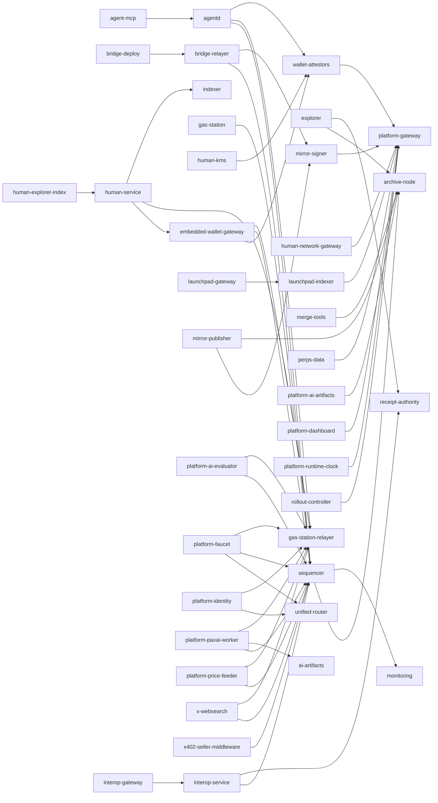

# services.md: off-chain service contracts (revision 2a1033aa2)

| Item | Value |
|---|---|
| Contract | one chain-facing contract per operator-run off-chain service after the merge, plus the interface groups of the service trees |
| Version | 2.0.0 |
| Change control | changes only by amendment; each amendment raises the version |
| Sources | the 40 `[service.*]` blocks of the merged specification, the interface blocks of domains 3, 4, 5, 8-14 and 16 that name this file, and the repository at HEAD |
| Conformance | method names, selectors, receipt fields and error codes belong to the construct contracts and to contracts/sequencer.md and contracts/rpc.md; this file takes theirs. HTTP route catalogues of the hosted platform belong to contracts/platform-hosted.md and contracts/platform-gateway.md |
| Citations | every `path:line` is relative to the repository root at revision 2a1033aa2 and was read by the generator; `(planned)` marks a file that does not exist at HEAD |

## 1. Reading a service contract

| Field | Meaning |
|---|---|
| purpose, route, inputs, outputs, state, dependencies, failure policy | the frozen values of the `[service.*]` block, quoted |
| reads at HEAD | what the service reads today, with the defining line |
| writes at HEAD | what it writes today: chain transactions, stores, journals |
| signing keys and secrets | every key that signs or decrypts, and where it is loaded |
| liveness | what stops when it is down, and its health routes |
| on-chain evidence | what a third party can check on chain or in a receipt |
| completion task, operation task | the domain gate that closes the service and the task that brings it to its operated shape |
| key variables, routes, interfaces, tasks, acceptance | generated from the interface, task and acceptance blocks; tasks are listed only for interfaces with status change, new or retire |

Rules that hold for every service:

1. A service never reports a state it did not read: an unavailable source answers a named refusal, never a default, zero or cached value presented as current.
2. A receipt is admitted, relayed or acted on only after it verifies against the ReceiptKeys pins (key id and height range, contracts/sequencer.md); a single pinned sequencer public key is the HEAD baseline and changes to the pinned list where the key variables table shows status change or new.
3. Every chain write is a user-signed or service-signed EVM transaction sent with `eth_sendRawTransaction` or a Cosmos message named in its row; no service sends a kernel activity after the switch-off (contracts/clients.md#lx-switch-off).
4. Secrets are read from files or a KMS named by an environment variable; none is passed on a command line.

## 2. Catalogue

| service | domain | route | state | completion | operation | route contract |
|---|---|---|---|---|---|---|
| [perps-data](#perps-data) | 3 | GraphQL and HTTP market data routes | Postgres store rebuilt from chain events | 3.0.9 | 3.42.6 | this file |
| [launchpad-gateway](#launchpad-gateway) | 4 | launchpad v1/v2 HTTP and WebSocket routes | stateless | 4.0.9 | 4.22.6 | this file |
| [launchpad-indexer](#launchpad-indexer) | 4 | internal | Postgres store | 4.0.9 | 4.28.1 | this file |
| [sequencer](#sequencer) | 5 | node JSON-RPC eth_sendRawTransaction, pax_sequencerReceipt and pending-tag reads; private to the router and registered hosted senders | receipt WAL replicated synchronously to the standby; ReceiptKeys list in chain state | 5.0.9 | 5.4.6 | this file |
| [platform-agent-boundary](#platform-agent-boundary) | 8 | GET /v1/receipts/{id}, GET /internal/v1/receipts/{id}, GET /internal/v1/deployment-proof/{id}, GET /v1/protocol/account-state/head, /livez, /readyz | state directory with journal and activity records | 8.0.9 | 8.8.4 | contracts/platform-hosted.md#agent-boundary-http-routes |
| [platform-ai-artifacts](#platform-ai-artifacts) | 8 | artifact routes | replicated storage | 8.0.9 | 8.0.4 | this file |
| [platform-ai-evaluator](#platform-ai-evaluator) | 8 | health endpoint | commitment journal | 8.0.9 | 8.0.4 | this file |
| [platform-core-boundary](#platform-core-boundary) | 8 | /livez, /readyz, GET /v1/sequencer, GET /v1/state, GET /v1/receipts/{id}, POST /admin/v1/testnet/fund, POST /admin/v1/testnet/reset | journal directory of fund and reset transitions | 8.0.9 | 8.20.1 | contracts/platform-hosted.md#core-http-routes |
| [platform-dashboard](#platform-dashboard) | 8 | dashboard HTTP routes | stateless | 8.0.9 | 8.0.4 | this file |
| [platform-faucet](#platform-faucet) | 8 | router px_requestFunds over the claim path | claim journal | 8.0.9 | 8.0.4 | this file |
| [platform-gateway](#platform-gateway) | 8 | POST /rpc, GET /rpc/schema, /rpc/ws, /rpc/evm/ws, /livez, /readyz, /v1/settle, /v1/keys, UI proxy prefixes | Redis durable store for keys, idempotency and event production | 8.0.9 | 8.3.1 | contracts/platform-gateway.md#gateway-jsonrpc-methods |
| [platform-identity](#platform-identity) | 8 | router px_register; identity service routes | identity service database | 8.0.9 | 8.0.4 | this file |
| [platform-indexer](#platform-indexer) | 8 | /healthz, /readyz, /v1/history, /v1/assets, /v1/assets/{id}, /v1/holders | SQLite store | 8.0.9 | 8.16.7 | contracts/platform-hosted.md#indexer-http-routes |
| [platform-paxai-worker](#platform-paxai-worker) | 8 | job submission path | job journal | 8.0.9 | 8.0.4 | this file |
| [platform-price-feeder](#platform-price-feeder) | 8 | health endpoint | last accepted push | 8.0.9 | 8.0.4 | this file |
| [platform-program-registry](#platform-program-registry) | 8 | POST /__registry/head, POST /__registry/deployments, registry read routes | registry journal, source mirror, verified builds | 8.0.9 | 8.12.3 | contracts/platform-hosted.md#registry-http-routes |
| [platform-receipt-authority](#platform-receipt-authority) | 8 | receipt admission and lookup routes of layerx-receipt-authority, /livez, /readyz | authority receipt store | 8.0.9 | 8.11.3 | contracts/platform-hosted.md#authority-http-routes |
| [platform-runtime-clock](#platform-runtime-clock) | 8 | internal | last submitted height | 8.0.9 | 8.0.4 | this file |
| [platform-testnet-control](#platform-testnet-control) | 8 | /livez, /readyz, /v1/status, /v1/parameters, POST /admin/v1/testnet/fund, POST /admin/v1/testnet/reset | none | 8.0.9 | 8.14.4 | contracts/platform-hosted.md#testnet-http-routes |
| [platform-webhooks](#platform-webhooks) | 8 | webhook endpoint management and delivery routes of layerx-webhooks | delivery and endpoint store | 8.0.9 | 8.13.2 | contracts/platform-hosted.md#webhooks-rust-pub-items |
| [agent-mcp](#agent-mcp) | 9 | MCP stdio and HTTP transports | stateless | 9.0.9 | 9.15.3 | this file |
| [agentd](#agentd) | 9 | agent RPC | outbox and sessions | 9.0.9 | 9.11.3 | this file |
| [human-explorer-index](#human-explorer-index) | 10 | internal HTTP | index store | 10.0.9 | 10.27.1 | this file |
| [human-kms](#human-kms) | 10 | Unix sockets | provider state | 10.0.9 | 10.11.5 | this file |
| [human-network-gateway](#human-network-gateway) | 10 | internal HTTP | stateless | 10.0.9 | 10.24.3 | this file |
| [human-service](#human-service) | 10 | human web routes | plans rebuilt from chain | 10.0.9 | 10.1.2 | this file |
| [bridge-relayer](#bridge-relayer) | 11 | none public | relayer journal | 11.0.9 | 11.22.4 | this file |
| [gas-station](#gas-station) | 11 | /quote, /submit, /status, /retry | journal of quotes and submissions | 11.0.9 | 11.24.3 | this file |
| [interop-gateway](#interop-gateway) | 11 | interop HTTP routes | stateless | 11.0.9 | 11.15.2 | this file |
| [interop-service](#interop-service) | 11 | interop service routes | settlement journal | 11.0.9 | 11.12.2 | this file |
| [mirror-publisher](#mirror-publisher) | 11 | none public | last finalized segment | 11.0.9 | 11.27.1 | this file |
| [mirror-signer](#mirror-signer) | 11 | operator-only socket | key files | 11.0.9 | 11.0.4 | this file |
| [x-websearch](#x-websearch) | 11 | /search and /fetch per node; private listeners | index and journal | 11.0.9 | 11.34.7 | this file |
| [x402-seller-middleware](#x402-seller-middleware) | 11 | merchant HTTP middleware | none | 11.0.9 | 11.4.2 | this file |
| [embedded-wallet-gateway](#embedded-wallet-gateway) | 12 | wallet gateway routes | sessions | 12.0.9 | 12.13.2 | this file |
| [wallet-attestors](#wallet-attestors) | 12 | attestor endpoints | key shares | 12.0.9 | 12.12.1 | this file |
| [bridge-deploy](#bridge-deploy) | 14 | operator command line | proposal files | 14.0.9 | 14.53.5 | this file |
| [explorer](#explorer) | 14 | explorer through the router UI proxy | explorer database | 14.0.9 | 14.23.5 | this file |
| [merge-tools](#merge-tools) | 16 | operator command line | none | 16.0.9 | 16.9.4 | this file |
| [rollout-controller](#rollout-controller) | 16 | operator command line | plan | 16.0.9 | 16.9.1 | this file |
| [archive-node](#archive-node) | none | no service block | | | | |
| [monitoring](#monitoring) | none | no service block | | | | |
| [validator-oracle-feeders](#validator-oracle-feeders) | none | no service block | | | | |
| [perps-keeper](#perps-keeper) | none | no service block | | | | |
| [wallet-app-backends](#wallet-app-backends) | none | no service block | | | | |

## 3. Dependencies

Edges come from the `dependencies` lists of the service blocks. Services whose block gives dependencies as prose (the hosted platform boundaries) are not drawn; their rows in section 4 name them. Targets `gas-station-relayer`, `unified-router`, `receipt-authority`, `indexer`, `ai-artifacts`, `archive-node` and `monitoring` are the names the blocks use for [gas-station](#gas-station), [platform-gateway](#platform-gateway), [platform-receipt-authority](#platform-receipt-authority), [platform-indexer](#platform-indexer), [platform-ai-artifacts](#platform-ai-artifacts), [archive-node](#archive-node) and [monitoring](#monitoring).

## 4. Service contracts

### Domain 3 (markets)

#### perps-data

| Field | Value |
|---|---|
| purpose | Indexes the perps 0x1015, pricefeed 0x1020 and spot 0x1021-0x1025 events into the market data API. |
| route | GraphQL and HTTP market data routes |
| inputs | committed blocks and logs of the venue precompiles |
| outputs | market, account and leaderboard views |
| state | Postgres store rebuilt from chain events |
| dependencies | platform-gateway |
| failure policy | a gap in indexed heights stops answers past the gap; data is rebuilt from chain, never synthesised |
| code root | `services/platform/perps-data` |
| reads at HEAD | Perps 0x1015, pricefeed 0x1020 and spot 0x1021-0x1025 events. |
| writes at HEAD | Postgres store rebuilt from chain events. |
| signing keys and secrets | `PERPS_AUTH_SECRET` for its own API (`services/platform/perps-data/internal/config/config.go:37`); no chain key. |
| liveness | A gap stops answers past the gap. Health: `GET /healthz/live` and `GET /healthz/ready` (`services/platform/perps-data/internal/httpx/health.go:32-33`). |
| on-chain evidence | Chain events by height; market data contracts in contracts/markets.md. |
| completion task | 3.0.9 (wave 7: Gate domain 3 completion on its retired surfaces and planned paths) |
| operation task | 3.42.6 (wave 6: Conformance: the seed migration matches getMarketConfig of the chain seed) |

Key, secret and token variables (2):

| variable | status | defined at | tasks |
|---|---|---|---|
| `PERPS_AUTH_SECRET` | stable | `services/platform/perps-data/internal/config/config.go:37` | none |
| `PERPS_DATA_TEST_SEED_KEY_FILE` | stable | `services/platform/perps-data/e2e_test.go:58` | none |

Liveness and metrics routes: `GET /api/chain/health` `services/platform/perps-data/internal/explorer/server.go:82` (change); `GET /api/explorer/health` `services/platform/perps-data/internal/explorer/server.go:83` (change); `GET /api/markets/health` `services/platform/perps-data/internal/rest/markets.go:50` (stable); `GET /healthz/live` `services/platform/perps-data/internal/httpx/health.go:32` (stable); `GET /healthz/ready` `services/platform/perps-data/internal/httpx/health.go:33` (stable); `GET /metrics (explorer)` `services/platform/perps-data/cmd/perps-explorer/main.go:84` (stable); `GET /metrics (gateway)` `services/platform/perps-data/internal/gateway/server.go:298` (stable); `GET /metrics (indexer)` `services/platform/perps-data/cmd/perps-indexer/main.go:187` (stable); `GET /metrics (portal)` `services/platform/perps-data/internal/portal/server.go:111` (stable).

Interfaces:

| kind | stable | change | new | retire | total |
|---|---|---|---|---|---|
| cli_command | 8 | 1 | 0 | 0 | 9 |
| env_var | 19 | 1 | 0 | 0 | 20 |
| error_code | 6 | 0 | 0 | 0 | 6 |
| file_format | 6 | 0 | 0 | 0 | 6 |
| go_exported | 334 | 18 | 5 | 2 | 359 |
| http_route | 102 | 10 | 1 | 8 | 121 |
| metric | 19 | 0 | 3 | 0 | 22 |
| storage_key | 54 | 3 | 3 | 0 | 60 |
| ws_route | 10 | 5 | 0 | 0 | 15 |
| all | 558 | 38 | 12 | 10 | 618 |

Covering tasks (24):

| task | wave | title | interfaces named (by status) |
|---|---|---|---|
| 3.42.1 | 0 | Add the chain market-config columns to perps.markets in migration 0012 | change 1 |
| 3.42.8 | 0 | Add perps.market_tiers for the chain margin tiers (migration 0014) | new 1 |
| 3.45.1 | 0 | Maintain block and transaction counters in perps.chain_counters (migration 0013) | new 1 |
| 3.46.1 | 0 | Add perps.spot_leaderboard for the projected spot boards (migration 0015) | new 1 |
| 3.41.1 | 1 | Resolve symbols through a MarketSet loaded from perps.markets | change 6, new 1 |
| 3.42.2 | 1 | Refresh reads getMarketConfig and writes chain decimals and config columns | change 1 |
| 3.44.1 | 1 | Expire rolling market stats of markets without fills in the window | change 1 |
| 3.50.1 | 1 | Parse PERPS_TRUSTED_PROXY_CIDRS in config.Load instead of a panicking package var | change 5, new 1 |
| 3.41.2 | 2 | Serve the symbol REST routes from the MarketSet | change 1 |
| 3.42.4 | 2 | Expose chain decimals, tick, lot, tier class and listing time on GraphQL Market | change 3 |
| 3.42.7 | 2 | Write the chain margin tiers into perps.market_tiers on refresh | change 1 |
| 3.46.2 | 2 | Fold spot legs into perps.spot_account_legs and perps.spot_leaderboard in Project | change 1, new 1 |
| 3.41.3 | 3 | Carry market_id on the market record and retire records.MarketIDs | change 4, retire 1 |
| 3.41.4 | 3 | Reload the websocket market set on MarketInterval and gauge its size | change 6, new 1 |
| 3.42.3 | 3 | Refresh markets periodically with markets.Run and report height and failures | new 3 |
| 3.42.9 | 3 | Serve Market.marginTiers from perps.market_tiers | new 1 |
| 3.45.2 | 3 | Answer explorer chain health from perps.chain_counters | change 2 |
| 3.46.3 | 3 | Serve the spot leaderboards from the perps.spot_leaderboard projection | change 1 |
| 3.42.5 | 4 | Run the periodic market refresh in perps-indexer and gate readiness on it | new 1, retire 1 |
| 3.43.1 | 6 | Retire the eight spot GraphQL roots that resolve to no facts | retire 8 |
| 3.45.4 | 6 | Rebuild perps.leaderboard only for the accounts a block changes | change 1 |
| 3.45.5 | 6 | Scope store.Rebuild to the accounts and markets of the rewritten range | change 1 |
| 3.46.4 | 6 | Fold an account once per spot trade in SpotUsers.StreamItems | change 1 |
| 3.56.1 | 6 | Load-test the symbols the gateway serves instead of a fixed list | change 3 |

### Domain 4 (launchpad)

#### launchpad-gateway

| Field | Value |
|---|---|
| purpose | Public gateway of the launchpad service set over the 0x1017 venue. |
| route | launchpad v1/v2 HTTP and WebSocket routes |
| inputs | client HTTP |
| outputs | launchpad API answers |
| state | stateless |
| dependencies | launchpad-indexer |
| failure policy | an unavailable backend answers 503 naming it |
| code root | `services/launchpad/gateway` |
| reads at HEAD | Launchpad v1/v2 HTTP and WebSocket requests; backend services behind it. |
| writes at HEAD | Media objects to object storage (`S3_ACCESS_KEY_ID`, `S3_SECRET_ACCESS_KEY` `services/launchpad/gateway/internal/config/config.go:100-101`). |
| signing keys and secrets | Gateway JWT secret (`services/launchpad/gateway/internal/config/config.go:75`), identity signing secret (`services/launchpad/gateway/internal/config/config.go:57`). |
| liveness | An unavailable backend answers 503 naming it. Metrics: `ANY /metrics` (`services/launchpad/gateway/internal/app/app.go:447`). |
| on-chain evidence | None on chain; launchpad state is the 0x1017 venue (contracts/launchpad.md). |
| completion task | 4.0.9 (wave 7: Gate domain 4 completion on its retired surfaces and planned paths) |
| operation task | 4.22.6 (wave 5: Pin the gateway media route tables to the frozen media catalog) |

Key, secret and token variables (10):

| variable | status | defined at | tasks |
|---|---|---|---|
| `GATEWAY_JWT_SECRET` | stable | `services/launchpad/gateway/internal/config/config.go:75` | none |
| `GATEWAY_TEST_MINIO_ACCESS_KEY_ID` | stable | `services/launchpad/gateway/internal/internaltest/containers.go:67` | none |
| `GATEWAY_TEST_MINIO_SECRET_ACCESS_KEY` | stable | `services/launchpad/gateway/internal/internaltest/containers.go:67` | none |
| `IDENTITY_LIMITER_KEY` | stable | `services/launchpad/gateway/internal/config/config.go:56` | none |
| `IDENTITY_SERVICE_TOKEN` | stable | `services/launchpad/gateway/internal/config/config.go:55` | none |
| `IDENTITY_SIGNING_SECRET` | stable | `services/launchpad/gateway/internal/config/config.go:57` | none |
| `S3_ACCESS_KEY_ID` | stable | `services/launchpad/gateway/internal/config/config.go:100` | none |
| `S3_SECRET_ACCESS_KEY` | stable | `services/launchpad/gateway/internal/config/config.go:101` | none |
| `SECRETS_PROVIDER` | stable | `services/launchpad/gateway/internal/config/config.go:60` | none |
| `SECRETS_REFRESH_SECONDS` | stable | `services/launchpad/gateway/internal/config/config.go:61` | none |

Liveness and metrics routes: `ANY /metrics -> http.HandlerFunc(func(w http.ResponseWriter, r *http.Request)` `services/launchpad/gateway/internal/app/app.go:447` (stable).

Interfaces:

| kind | stable | change | new | retire | total |
|---|---|---|---|---|---|
| cli_command | 1 | 0 | 0 | 0 | 1 |
| env_var | 56 | 0 | 0 | 0 | 56 |
| error_code | 33 | 0 | 0 | 0 | 33 |
| go_exported | 0 | 0 | 1 | 0 | 1 |
| http_route | 206 | 7 | 18 | 7 | 238 |
| metric | 4 | 0 | 0 | 0 | 4 |
| ws_route | 2 | 0 | 0 | 0 | 2 |
| all | 302 | 7 | 19 | 7 | 335 |

Covering tasks (4):

| task | wave | title | interfaces named (by status) |
|---|---|---|---|
| 4.22.2 | 2 | Retire unbacked asset-upload and room-message templates from the gateway tables | new 1, retire 7 |
| 4.22.3 | 3 | Answer retired connected templates with the frozen not-served envelope | new 1 |
| 4.22.4 | 3 | Forward the frozen v2 watchlist, profile patch and owner templates to the user upstream | new 10 |
| 4.22.5 | 4 | Forward frozen voice-room and stream templates to the social and livestream upstreams | change 7, new 7 |

Acceptance criteria frozen by this section (13):

| criterion | test |
|---|---|
| 4245.1 | `services/launchpad/gateway/internal/auth/identity_http_test.go::TestIdentityOwnerRealJetStreamRevisionDedup (existing)` |
| 4245.2 | `services/launchpad/gateway/internal/auth/identity_measurement_test.go::TestIdentityMeasurementActualHTTPPostgresAndImmutableCapture (existing)` |
| 4246.1 | `services/launchpad/gateway/internal/proxy/connected_retired_test.go::TestAllowedConnectedRouteRefusesRetiredTemplates (planned)` |
| 4246.2 | `services/launchpad/gateway/internal/proxy/connected_retired_test.go::TestDevelopmentSocialRoutesOmitRoomMessages (planned)` |
| 4247.1 | `services/launchpad/gateway/internal/app/retired_routes_test.go::TestRetiredConnectedTemplatesAnswerNotServed (planned)` |
| 4248.1 | `services/launchpad/gateway/internal/proxy/connected_user_v2_test.go::TestUserConnectedRoutesForwardFrozenV2Owner (planned)` |
| 4248.2 | `services/launchpad/gateway/internal/proxy/connected_user_v2_test.go::TestUserConnectedRoutesKeepV2ProfileReadPublic (planned)` |
| 4249.1 | `services/launchpad/gateway/internal/proxy/connected_media_v2_test.go::TestSocialConnectedRoutesForwardFrozenVoiceTemplates (planned)` |
| 4249.2 | `services/launchpad/gateway/internal/proxy/connected_media_v2_test.go::TestLivestreamConnectedRoutesForwardFrozenStreamTemplates (planned)` |
| 4250.1 | `services/launchpad/gateway/internal/proxy/frozen_media_catalog_test.go::TestConnectedTablesCoverFrozenMediaCatalog (planned)` |
| 4250.2 | `services/launchpad/gateway/internal/proxy/frozen_media_catalog_test.go::TestConnectedTablesForwardOnlyCatalogTemplates (planned)` |
| 4251.1 | `services/launchpad/gateway/internal/auth/identity_catalog_test.go::TestIdentityV2RoutesCoverFrozenIdentityCatalog (planned)` |
| 4251.2 | `services/launchpad/gateway/internal/auth/identity_catalog_test.go::TestIdentityChallengeErrorMatchesFrozenErrorSchema (planned)` |

#### launchpad-indexer

| Field | Value |
|---|---|
| purpose | Indexes launchpad 0x1017 factory and pool events. |
| route | internal |
| inputs | committed logs of the launchpad precompile |
| outputs | market and pool rows |
| state | Postgres store |
| dependencies | platform-gateway |
| failure policy | a reorg or gap re-indexes from the last committed height |
| code root | `services/launchpad/indexer` |
| reads at HEAD | 0x1017 factory and pool events; the market creation topic is decoded in `services/launchpad/indexer/internal/chainreader/creation.go`. |
| writes at HEAD | Postgres store; signed webhooks with `WEBHOOK_HMAC_SECRET` (`services/launchpad/indexer/internal/config/config.go:94`). |
| signing keys and secrets | Webhook HMAC secrets only (`services/launchpad/indexer/internal/config/config.go:95`); no chain key. |
| liveness | A reorg or gap re-indexes from the last committed height. Metrics: `ANY /metrics` (`services/launchpad/indexer/internal/app/app.go:610`). |
| on-chain evidence | Indexed rows carry the source height and log index of the 0x1017 event. |
| completion task | 4.0.9 (wave 7: Gate domain 4 completion on its retired surfaces and planned paths) |
| operation task | 4.28.1 (wave 4: Pin the indexer market creation topic to the factory ABI) |

Key, secret and token variables (2):

| variable | status | defined at | tasks |
|---|---|---|---|
| `WEBHOOK_HMAC_SECRET` | stable | `services/launchpad/indexer/internal/config/config.go:94` | none |
| `WEBHOOK_HMAC_SECRETS` | stable | `services/launchpad/indexer/internal/config/config.go:95` | none |

Liveness and metrics routes: `ANY /metrics -> metrics` `services/launchpad/indexer/internal/app/app.go:610` (stable).

Interfaces:

| kind | stable | change | new | retire | total |
|---|---|---|---|---|---|
| cli_command | 2 | 0 | 0 | 0 | 2 |
| config_key | 4 | 0 | 0 | 0 | 4 |
| env_var | 56 | 0 | 0 | 0 | 56 |
| error_code | 5 | 0 | 0 | 0 | 5 |
| http_route | 4 | 0 | 0 | 0 | 4 |
| all | 71 | 0 | 0 | 0 | 71 |

Covering tasks: none (every interface here is stable).

Acceptance criteria frozen by this section (2):

| criterion | test |
|---|---|
| 4277.1 | `services/launchpad/indexer/internal/chainreader/creation_abi_parity_test.go::TestMarketCreatedTopicMatchesFactoryABI (planned)` |
| 4278.1 | `services/launchpad/indexer/internal/receipt/reserves_abi_parity_test.go::TestGetReservesSelectorMatchesPoolABI (planned)` |

### Domain 5 (node-runtime)

#### sequencer

| Field | Value |
|---|---|
| purpose | Proposer that executes each user-signed EVM transaction at receipt and returns a signed ProtocolReceipt v2; primary plus hot standby. |
| route | node JSON-RPC eth_sendRawTransaction, pax_sequencerReceipt and pending-tag reads; private to the router and registered hosted senders |
| inputs | user-signed raw EVM transactions; committed state |
| outputs | ProtocolReceipt v2 per transaction; one block per height with MsgSequenceBatch as transaction 0 |
| state | receipt WAL replicated synchronously to the standby; ReceiptKeys list in chain state |
| dependencies | archive-node, monitoring |
| failure policy | standby proposes the replicated WAL slice at round 1; without the standby acknowledgement sends return an error, never a receipt |
| code root | `node/sequencer`, `modules/sequencer`, `rpc/sequencer_receipt.go` |
| reads at HEAD | Committed state plus its own open layer; serves `pax_sequencerReceipt` (`rpc/sequencer_receipt.go:26`) through `SequencerReceiptAPI.SequencerReceipt` (`rpc/sequencer_receipt.go:232`) with rung `submitted`, `receipted` or `committed` (`rpc/sequencer_receipt.go:33-37`). |
| writes at HEAD | Receipt WAL entries (`WAL.Append` `node/sequencer/wal/wal.go:532`, `WAL.GroupSync` `node/sequencer/wal/wal.go:560`); one `MsgSequenceBatch` per block (`modules/sequencer/types/msgs.go:33`) sealed by `SealBatch` (`node/sequencer/seal.go:133`). |
| signing keys and secrets | Receipt key: an ed25519 seed held apart from the consensus key, flag `sequencer.receipt-key-file` (`node/sequencer/config.go:17`), loaded by `LoadReceiptKey` (`node/sequencer/receiptkey.go:42`) and checked against the pinned list. Pins: `ReceiptKeys.KeyForHeight` selects the key by keyId and height (`modules/sequencer/keeper/receipt_keys.go:96`); rotation is checked by `ValidateRotation` (`modules/sequencer/keeper/receipt_keys.go:144`). Consensus key: the validator privval key, unchanged. |
| liveness | Every user write stops without it. The standby address is flag `sequencer.standby-address` (`node/sequencer/config.go:18`); `Replicator.Release` returns the standby acknowledgement before a receipt is released (`node/sequencer/standby.go:214`). |
| on-chain evidence | `ReceiptKeys.VerifyReceipt` verifies a receipt against the chain-state pins (`modules/sequencer/keeper/receipt_keys.go:112`); the committed rung is backed by the block's `MsgSequenceBatch`. Field-level rules belong to contracts/sequencer.md. |
| completion task | 5.0.9 (wave 7: Gate domain 5 completion on its retired surfaces and planned paths) |
| operation task | 5.4.6 (wave 5: Check fee-token charging at Accept against the block path) |

Interfaces:

| kind | stable | change | new | retire | total |
|---|---|---|---|---|---|
| config_key | 0 | 8 | 6 | 0 | 14 |
| cosmos_msg | 1 | 0 | 0 | 0 | 1 |
| error_code | 10 | 0 | 1 | 0 | 11 |
| file_format | 13 | 3 | 2 | 0 | 18 |
| genesis_param | 8 | 0 | 1 | 0 | 9 |
| go_exported | 225 | 33 | 53 | 11 | 322 |
| jsonrpc_method | 1 | 0 | 0 | 0 | 1 |
| metric | 0 | 0 | 5 | 0 | 5 |
| storage_key | 11 | 1 | 1 | 0 | 13 |
| all | 269 | 45 | 69 | 11 | 394 |

Covering tasks (52):

| task | wave | title | interfaces named (by status) |
|---|---|---|---|
| 5.21.1 | 0 | Add ActivationHeightKey 0x07 and per-height stored-votes keys | change 2, new 3 |
| 5.21.2 | 0 | Add ValidateLeaders as the single leader-list rule | new 1 |
| 5.22.1 | 0 | Make seqHash canonical in modules/sequencer/types | new 2 |
| 5.22.2 | 0 | Make txRoot canonical in modules/sequencer/types | new 1 |
| 5.22.3 | 0 | Move the tx-0 MsgSequenceBatch codec into modules/sequencer/types | new 4 |
| 5.23.1 | 0 | Add the stored-votes binary codec | new 3 |
| 5.4.1 | 1 | Place each accepted transaction with SetTxPosition | change 2 |
| 5.4.2 | 1 | Refresh the precompile set inside executor Open | change 2 |
| 5.4.4 | 1 | Keep the sealed batch when ConsensusSource.Seal fails after the executor sealed | change 1 |
| 5.5.1 | 1 | Add the receipt forward URL and the standby role keys to the sequencer config | change 3, new 2 |
| 5.5.2 | 1 | Add the sequencer runtime metrics instruments | new 5 |
| 5.21.3 | 1 | Carry the activation height in GenesisState and validate its key coverage | change 2, new 1 |
| 5.22.4 | 1 | Add VerifyBatchTxs binding a batch to its sequenced transactions | new 1 |
| 5.23.2 | 1 | Store decided votes per height in the keeper and keep two heights | new 2 |
| 5.24.1 | 1 | Refuse a governed receipt key entry with firstHeight 0 | change 1 |
| 5.24.2 | 1 | Store the first sequenced height in the keeper | new 3 |
| 5.24.4 | 1 | Expose the pinned receipt keys as sequencer authorizations | new 1 |
| 5.25.1 | 1 | Add SetLeaders and LeaderSchedule to the keeper | new 2 |
| 5.26.1 | 1 | Report the fencing lease from WAL replay | change 2 |
| 5.4.7 | 2 | Place micro-batch transactions with SetTxPosition | change 1 |
| 5.5.3 | 2 | Add the receipt source that serves accepted sequencer receipts by hash | new 1 |
| 5.5.4 | 2 | Add the accepter that receipts a send only after WAL write and standby ack | change 1, new 2 |
| 5.5.5 | 2 | Add the bounded TCP dialer for the standby replication link | new 1 |
| 5.5.14 | 2 | Record the seal of each block in the WAL before the sealed block is returned | change 1 |
| 5.5.15 | 2 | Add WAL retention, nonce queue bounds, lease duration and the start flags to the sequencer config | new 5 |
| 5.5.16 | 2 | Refresh the receipt key pins from the keeper at each Open | change 1 |
| 5.17.1 | 2 | Use the module seqHash in the executor | change 1 |
| 5.17.2 | 2 | Retire the Layers seal path in favour of SealBatch | retire 11 |
| 5.24.3 | 2 | Refuse a sequence batch below the activation height | change 1, new 2 |
| 5.25.3 | 2 | Register the governed Leaders param in the sequencer subspace | change 1, new 3 |
| 5.26.2 | 2 | Restore the standby lease epoch on restart | change 1 |
| 5.27.1 | 2 | Report the last logged ACCEPT from WAL replay | change 1 |
| 5.4.5 | 3 | Carry the committed app hash and last block id in the executor Open header | change 1 |
| 5.5.7 | 3 | Add the block driver that commits, prunes and opens the next block | new 1 |
| 5.5.8 | 3 | Add the production WAL replayer that re-executes accepted transactions | new 1 |
| 5.5.9 | 3 | Start a standby from the sequencer config role | change 1, new 1 |
| 5.5.10 | 3 | Publish receipted logs to the RPC receipt log feed | new 1 |
| 5.5.11 | 3 | Admit future-nonce transactions through the nonce queue | new 1 |
| 5.25.2 | 3 | Init and export the activation height and validate the stored leader list | change 3 |
| 5.25.4 | 3 | Carry activation_height and the Leaders param through module genesis | change 2, new 1 |
| (12 more) | | | |

### Domain 8 (platform)

#### platform-agent-boundary

| Field | Value |
|---|---|
| purpose | Authenticated boundary between the gateway, registry and webhook planes and the chain for receipt and deployment-proof reads |
| route | GET /v1/receipts/{id}, GET /internal/v1/receipts/{id}, GET /internal/v1/deployment-proof/{id}, GET /v1/protocol/account-state/head, /livez, /readyz |
| inputs | plane bearer tokens, LAYERX_AGENT_BOUNDARY_CHAIN_RPC_URL, LAYERX_AGENT_BOUNDARY_RECEIPT_KEYS_FILE, LAYERX_AGENT_BOUNDARY_NODE_URL |
| outputs | signed sequencer receipts and relayed account-state answers |
| state | state directory with journal and activity records |
| dependencies | chain JSON-RPC, local node relay |
| failure policy | an unreachable chain answers node_unavailable 503 with retry; an unverifiable receipt is never relayed |
| code root | `services/platform/hosted/agent-boundary` |
| reads at HEAD | Receipt and deployment-proof reads through the node bearer token (`services/platform/hosted/agent-boundary/src/main.rs:608`). |
| writes at HEAD | State directory with journal and activity records. |
| signing keys and secrets | Gateway, registry and webhook tokens (`services/platform/hosted/agent-boundary/src/main.rs:549-559`); TLS key (`services/platform/hosted/agent-boundary/src/main.rs:455`); planned receipt keys file `LAYERX_AGENT_BOUNDARY_RECEIPT_KEYS_FILE` (planned). |
| liveness | Health: `GET /livez` and `GET /readyz` (`services/platform/hosted/agent-boundary/src/main.rs:2160-2163`). |
| on-chain evidence | An unverifiable receipt is never relayed. |
| completion task | 8.0.9 (wave 7: Gate domain 8 completion on its retired surfaces and planned paths) |
| operation task | 8.8.4 (wave 6: Remove the kernel session and the head attestation route from the agent boundary) |
| route contract | contracts/platform-hosted.md#agent-boundary-http-routes |

Key, secret and token variables (7):

| variable | status | defined at | tasks |
|---|---|---|---|
| `LAYERX_AGENT_BOUNDARY_GATEWAY_TOKEN_FILE` | stable | `services/platform/hosted/agent-boundary/src/main.rs:549` | none |
| `LAYERX_AGENT_BOUNDARY_NODE_BEARER_TOKEN_FILE` | stable | `services/platform/hosted/agent-boundary/src/main.rs:608` | none |
| `LAYERX_AGENT_BOUNDARY_RECEIPT_KEYS_FILE` | new | `services/platform/hosted/agent-boundary/src/chain_receipt.rs` (planned) | 8.8.1 |
| `LAYERX_AGENT_BOUNDARY_REGISTRY_TOKEN_FILE` | stable | `services/platform/hosted/agent-boundary/src/main.rs:550` | none |
| `LAYERX_AGENT_BOUNDARY_TLS_CERT_DER` | stable | `services/platform/hosted/agent-boundary/src/main.rs:453` | none |
| `LAYERX_AGENT_BOUNDARY_TLS_KEY_DER` | stable | `services/platform/hosted/agent-boundary/src/main.rs:455` | none |
| `LAYERX_AGENT_BOUNDARY_WEBHOOK_TOKEN_FILE` | stable | `services/platform/hosted/agent-boundary/src/main.rs:559` | none |

Liveness and metrics routes: `if request.method == "GET" && path == "/livez" && query.is_none() {` `services/platform/hosted/agent-boundary/src/main.rs:2160` (stable); `if request.method == "GET" && path == "/readyz" && query.is_none() {` `services/platform/hosted/agent-boundary/src/main.rs:2163` (stable).

Interfaces:

| kind | stable | change | new | retire | total |
|---|---|---|---|---|---|
| env_var | 14 | 0 | 2 | 2 | 18 |
| error_code | 43 | 0 | 0 | 5 | 48 |
| http_route | 8 | 0 | 0 | 14 | 22 |
| all | 65 | 0 | 2 | 21 | 88 |

Covering tasks (4):

| task | wave | title | interfaces named (by status) |
|---|---|---|---|
| 8.8.1 | 3 | Answer agent-boundary receipts from pax_sequencerReceipt | new 2 |
| 8.8.2 | 4 | Retire agent-boundary program deployment submission and read deployment proofs from the chain | retire 2 |
| 8.8.3 | 5 | Retire the kernel activity and program routes of the agent-boundary gateway plane | retire 11 |
| 8.8.4 | 6 | Remove the kernel session and the head attestation route from the agent boundary | retire 8 |

#### platform-ai-artifacts

| Field | Value |
|---|---|
| purpose | Encrypted model, dataset and evidence storage. |
| route | artifact routes |
| inputs | payload uploads |
| outputs | payloads for reveal and challenge |
| state | replicated storage |
| dependencies | archive-node |
| failure policy | restore from replicas |
| code root | `services/platform/hosted/ai-artifacts` |
| reads at HEAD | Artifact routes: PrepareObject, upload frames, FinalizeObject, ResolveArtifact (`services/platform/hosted/ai-artifacts/src/main.rs:1-3`). |
| writes at HEAD | Retention ledger and payload store; key releases are durable intents before any byte is sent (`services/platform/hosted/ai-artifacts/src/main.rs:6-8`). |
| signing keys and secrets | Access envelope keys (`services/platform/hosted/ai-artifacts/src/crypto.rs`). |
| liveness | Restore from replicas; a restore below the revocation or retention high-water mark never becomes ready (`services/platform/hosted/ai-artifacts/src/main.rs:9-10`). |
| on-chain evidence | None: nothing here is a protocol receipt (`services/platform/hosted/ai-artifacts/src/main.rs:11`). |
| completion task | 8.0.9 (wave 7: Gate domain 8 completion on its retired surfaces and planned paths) |
| operation task | 8.0.4 (wave 5: Prove the hosted chain readers before the kernel switch-off) |

Interfaces:

| kind | stable | change | new | retire | total |
|---|---|---|---|---|---|
| cli_command | 4 | 0 | 0 | 0 | 4 |
| config_key | 7 | 0 | 0 | 0 | 7 |
| file_format | 3 | 0 | 0 | 0 | 3 |
| http_route | 22 | 0 | 0 | 0 | 22 |
| all | 36 | 0 | 0 | 0 | 36 |

Covering tasks: none (every interface here is stable).

#### platform-ai-evaluator

| Field | Value |
|---|---|
| purpose | Signs assessments and commits and reveals scores for ai-market epochs. |
| route | health endpoint |
| inputs | grants and epoch state |
| outputs | CommitScore and RevealScore calls |
| state | commitment journal |
| dependencies | sequencer, gas-station-relayer |
| failure policy | absent reveal forfeits; below quorum no result |
| code root | `services/platform/hosted/ai-evaluator` |
| reads at HEAD | Committed market state through 0x101D (`services/platform/hosted/ai-evaluator/src/main.rs:1-2`). |
| writes at HEAD | One `CommitScore` and one `RevealScore` per epoch; the commitment secret is kept in a local journal (`services/platform/hosted/ai-evaluator/src/main.rs:2-4`). |
| signing keys and secrets | `LAYERX_AI_EVALUATOR_KEY_FILE` (`services/platform/hosted/ai-evaluator/src/main.rs:76`). |
| liveness | Health: `/healthz`, `/readyz`, `/metrics` (`services/platform/hosted/ai-evaluator/src/main.rs:853-856`). An absent reveal forfeits. |
| on-chain evidence | Commit and reveal transactions on chain. |
| completion task | 8.0.9 (wave 7: Gate domain 8 completion on its retired surfaces and planned paths) |
| operation task | 8.0.4 (wave 5: Prove the hosted chain readers before the kernel switch-off) |

Key, secret and token variables (1):

| variable | status | defined at | tasks |
|---|---|---|---|
| `KEY_VARIABLE` | stable | `services/platform/hosted/ai-evaluator/src/main.rs:76` | none |

Liveness and metrics routes: `("GET", "/healthz") => ok(r#"{"status":"ok"}"#.to_owned()),` `services/platform/hosted/ai-evaluator/src/main.rs:853` (stable); `("GET", "/metrics") => ok(metrics.render()),` `services/platform/hosted/ai-evaluator/src/main.rs:856` (stable); `("GET", "/readyz") if ready => ok(r#"{"status":"ready"}"#.to_owned()),` `services/platform/hosted/ai-evaluator/src/main.rs:854` (stable).

Interfaces:

| kind | stable | change | new | retire | total |
|---|---|---|---|---|---|
| config_key | 18 | 0 | 0 | 0 | 18 |
| env_var | 3 | 0 | 0 | 0 | 3 |
| error_code | 3 | 0 | 0 | 0 | 3 |
| http_route | 3 | 0 | 0 | 0 | 3 |
| metric | 9 | 0 | 0 | 0 | 9 |
| all | 36 | 0 | 0 | 0 | 36 |

Covering tasks: none (every interface here is stable).

#### platform-core-boundary

| Field | Value |
|---|---|
| purpose | Hosted core boundary: sequencer and state reads, receipts and the admin testnet fund and reset plane |
| route | /livez, /readyz, GET /v1/sequencer, GET /v1/state, GET /v1/receipts/{id}, POST /admin/v1/testnet/fund, POST /admin/v1/testnet/reset |
| inputs | LAYERX_CORE_CHAIN_RPC_URL, LAYERX_CORE_FUNDING_SENDER_KEY_FILE, LAYERX_CORE_CLIENT_CA_DER, admin bearer tokens |
| outputs | sequencer, state and receipt answers; funding transaction hashes |
| state | journal directory of fund and reset transitions |
| dependencies | paxeer chain JSON-RPC, local node relay |
| failure policy | an unreachable chain or sender answers treasury_unavailable 503 with retry; a retried fund replays the journaled transaction |
| code root | `services/platform/hosted/core` |
| reads at HEAD | Sequencer and state reads through the node bearer token (`services/platform/hosted/core/src/main.rs:350`). |
| writes at HEAD | Journal of fund and reset transitions; testnet funding sends (planned sender key `LAYERX_CORE_FUNDING_SENDER_KEY_FILE` or `LAYERX_CORE_FUNDING_SENDER_KMS_KEY_ID`, planned). |
| signing keys and secrets | Admin token (`services/platform/hosted/core/src/main.rs:359`), TLS keys (`services/platform/hosted/core/src/main.rs:339-344`). |
| liveness | Health: `GET /livez`, `GET /readyz` (`services/platform/hosted/core/src/main.rs:1643-1644`). |
| on-chain evidence | A retried fund replays the journaled transaction. |
| completion task | 8.0.9 (wave 7: Gate domain 8 completion on its retired surfaces and planned paths) |
| operation task | 8.20.1 (wave 5: Retire the activity and program routes of the core boundary) |
| route contract | contracts/platform-hosted.md#core-http-routes |

Key, secret and token variables (11):

| variable | status | defined at | tasks |
|---|---|---|---|
| `LAYERX_CORE_ADMIN_TLS_CERT_DER` | stable | `services/platform/hosted/core/src/main.rs:343` | none |
| `LAYERX_CORE_ADMIN_TLS_KEY_DER` | stable | `services/platform/hosted/core/src/main.rs:344` | none |
| `LAYERX_CORE_ADMIN_TOKEN_FILE` | stable | `services/platform/hosted/core/src/main.rs:359` | none |
| `LAYERX_CORE_FUNDING_SENDER_KEY_FILE` | new | `services/platform/hosted/core/src/chain_fund.rs` (planned) | 8.10.1 |
| `LAYERX_CORE_FUNDING_SENDER_KMS_KEY_ID` | new | `services/platform/hosted/core/src/chain_fund.rs` (planned) | 8.10.1 |
| `LAYERX_CORE_NODE_BEARER_TOKEN_FILE` | stable | `services/platform/hosted/core/src/main.rs:350` | none |
| `LAYERX_CORE_RECEIPT_EVENTS_TOKEN_FILE` | stable | `services/platform/hosted/core/src/main.rs:354` | none |
| `LAYERX_CORE_REPLICA_BEARER_TOKEN_FILE` | stable | `services/platform/hosted/core/src/main.rs:358` | none |
| `LAYERX_CORE_TLS_CERT_DER` | stable | `services/platform/hosted/core/src/main.rs:338` | none |
| `LAYERX_CORE_TLS_KEY_DER` | stable | `services/platform/hosted/core/src/main.rs:339` | none |
| `LAYERX_CORE_WALLET_CAPS_TOKEN_FILE` | stable | `services/platform/hosted/core/src/main.rs:351` | none |

Liveness and metrics routes: `("GET", "/livez") => json_response(200, &serde_json::json!({ "live": true })),` `services/platform/hosted/core/src/main.rs:1643` (stable); `("GET", "/readyz") => readiness(config),` `services/platform/hosted/core/src/main.rs:1644` (stable); `if request.path == "/internal/readyz" {` `services/platform/hosted/core/src/main.rs:1600` (stable).

Interfaces:

| kind | stable | change | new | retire | total |
|---|---|---|---|---|---|
| env_var | 21 | 0 | 3 | 0 | 24 |
| error_code | 63 | 0 | 0 | 16 | 79 |
| file_format | 3 | 0 | 0 | 1 | 4 |
| http_route | 18 | 0 | 0 | 7 | 25 |
| rust_pub_item | 13 | 0 | 0 | 0 | 13 |
| all | 118 | 0 | 3 | 24 | 145 |

Covering tasks (2):

| task | wave | title | interfaces named (by status) |
|---|---|---|---|
| 8.10.1 | 3 | Send testnet funding as one EVM bank transfer from the core treasury | new 3 |
| 8.20.1 | 5 | Retire the activity and program routes of the core boundary | retire 24 |

#### platform-dashboard

| Field | Value |
|---|---|
| purpose | Operator dashboard of the hosted platform services. |
| route | dashboard HTTP routes |
| inputs | service readiness and metrics endpoints |
| outputs | dashboard pages |
| state | stateless |
| dependencies | platform-gateway |
| failure policy | an unreachable service is shown unavailable, never as healthy |
| code root | `services/platform/hosted/dashboard` |
| reads at HEAD | Hosted LayerX surfaces (`services/platform/hosted/dashboard/src/lib.rs:1`). |
| writes at HEAD | None. |
| signing keys and secrets | TLS key only (`services/platform/hosted/dashboard/src/main.rs:74`). |
| liveness | Health: `GET /healthz` (`services/platform/hosted/dashboard/src/main.rs:193`). An unreachable service is shown unavailable. |
| on-chain evidence | None. |
| completion task | 8.0.9 (wave 7: Gate domain 8 completion on its retired surfaces and planned paths) |
| operation task | 8.0.4 (wave 5: Prove the hosted chain readers before the kernel switch-off) |

Key, secret and token variables (2):

| variable | status | defined at | tasks |
|---|---|---|---|
| `LAYERX_DASHBOARD_TLS_CERT_DER` | stable | `services/platform/hosted/dashboard/src/main.rs:67` | none |
| `LAYERX_DASHBOARD_TLS_KEY_DER` | stable | `services/platform/hosted/dashboard/src/main.rs:74` | none |

Liveness and metrics routes: `if request.method == "GET" && request.path == "/healthz" {` `services/platform/hosted/dashboard/src/main.rs:193` (stable).

Interfaces:

| kind | stable | change | new | retire | total |
|---|---|---|---|---|---|
| env_var | 8 | 0 | 0 | 0 | 8 |
| error_code | 7 | 0 | 0 | 0 | 7 |
| http_route | 1 | 0 | 0 | 0 | 1 |
| all | 16 | 0 | 0 | 0 | 16 |

Covering tasks: none (every interface here is stable).

#### platform-faucet

| Field | Value |
|---|---|
| purpose | Funds admitted claims by an EVM bank send from the faucet account. |
| route | router px_requestFunds over the claim path |
| inputs | claims with identity, address and network quotas |
| outputs | funding id; EVM transfer |
| state | claim journal |
| dependencies | unified-router, sequencer, gas-station-relayer |
| failure policy | down or empty: 503; a pending or refused claim is never reported funded |
| code root | `services/platform/hosted/faucet` |
| reads at HEAD | Claims admitted through the identity service token (`services/platform/hosted/faucet/src/main.rs:307`). |
| writes at HEAD | At HEAD `fund` posts a `FundingRequest` to the core boundary funding endpoint with the testnet admin token (`services/platform/hosted/faucet/src/main.rs:903`, `services/platform/hosted/faucet/src/main.rs:314`); the EVM bank send of the service block is made by the core boundary, not by the faucet. |
| signing keys and secrets | No chain key of its own at HEAD; TLS key (`services/platform/hosted/faucet/src/main.rs:261`). |
| liveness | Health: `/livez`, `/readyz` (`services/platform/hosted/faucet/src/main.rs:1036-1039`). A pending or refused claim is never reported funded. |
| on-chain evidence | The funding transaction receipt from the core boundary. |
| completion task | 8.0.9 (wave 7: Gate domain 8 completion on its retired surfaces and planned paths) |
| operation task | 8.0.4 (wave 5: Prove the hosted chain readers before the kernel switch-off) |

Key, secret and token variables (5):

| variable | status | defined at | tasks |
|---|---|---|---|
| `LAYERX_FAUCET_SERVICE_CLAIM_TOKEN_FILE` | stable | `services/platform/hosted/faucet/src/main.rs:308` | none |
| `LAYERX_FAUCET_TLS_CERT_DER` | stable | `services/platform/hosted/faucet/src/main.rs:259` | none |
| `LAYERX_FAUCET_TLS_KEY_DER` | stable | `services/platform/hosted/faucet/src/main.rs:261` | none |
| `LAYERX_IDENTITY_SERVICE_TOKEN_FILE` | stable | `services/platform/hosted/faucet/src/main.rs:307` | none |
| `LAYERX_TESTNET_ADMIN_TOKEN_FILE` | stable | `services/platform/hosted/faucet/src/main.rs:314` | none |

Liveness and metrics routes: `if request.method == "GET" && request.path == "/livez" {` `services/platform/hosted/faucet/src/main.rs:1036` (stable); `if request.method == "GET" && request.path == "/readyz" {` `services/platform/hosted/faucet/src/main.rs:1039` (stable).

Interfaces:

| kind | stable | change | new | retire | total |
|---|---|---|---|---|---|
| env_var | 20 | 0 | 0 | 0 | 20 |
| error_code | 14 | 0 | 0 | 0 | 14 |
| http_route | 5 | 0 | 0 | 0 | 5 |
| all | 39 | 0 | 0 | 0 | 39 |

Covering tasks: none (every interface here is stable).

#### platform-gateway

| Field | Value |
|---|---|
| purpose | Public router of the platform: JSON-RPC px_ methods, the relayed EVM namespaces, WebSocket subscriptions, HTTP product routes and UI proxies |
| route | POST /rpc, GET /rpc/schema, /rpc/ws, /rpc/evm/ws, /livez, /readyz, /v1/settle, /v1/keys, UI proxy prefixes |
| inputs | client JSON-RPC and HTTP requests, LAYERX_GATEWAY_PAXEER_RPC_URLS, LAYERX_GATEWAY_PAXEER_WS_URL, LAYERX_GATEWAY_INDEXER_URL, LAYERX_GATEWAY_RECEIPT_KEYS_FILE |
| outputs | JSON-RPC answers, relayed node answers, readiness documents, settlement receipts |
| state | Redis durable store for keys, idempotency and event production |
| dependencies | Paxeer chain node JSON-RPC and WebSocket, consensus RPC, indexer, identity service, receipt authority |
| failure policy | an unavailable upstream answers its named refusal (-32003 or 503) and is never replaced by fabricated data; readiness reports each dependency |
| code root | `services/platform/hosted/gateway` |
| reads at HEAD | JSON-RPC on `POST /rpc`, WebSocket subscriptions, HTTP product routes and UI proxies; pinned receipt keys file `LAYERX_GATEWAY_RECEIPT_KEYS_FILE` (`services/platform/hosted/gateway/src/main.rs:1022`). |
| writes at HEAD | Redis durable store for keys, idempotency and event production; `px_register` forwards to the identity service (`services/platform/hosted/gateway/src/rpc_register.rs:404`). |
| signing keys and secrets | Key provisioning key (`services/platform/hosted/gateway/src/main.rs:117`), component, authority, identity and program registry tokens (`services/platform/hosted/gateway/src/main.rs:106-113`), TLS key (`services/platform/hosted/gateway/src/main.rs:955`). |
| liveness | An unavailable upstream answers its named refusal. Health: `GET /livez` (`services/platform/hosted/gateway/src/main.rs:3638`), `GET /metrics` (`services/platform/hosted/gateway/src/main.rs:3654`). |
| on-chain evidence | Receipts are relayed only after verification against the pinned keys; every lx_ name answers -32601 (decision.803, task 8.3.1). |
| completion task | 8.0.9 (wave 7: Gate domain 8 completion on its retired surfaces and planned paths) |
| operation task | 8.3.1 (wave 6: Answer -32601 for every lx_ JSON-RPC name on HTTP and WebSocket) |
| route contract | contracts/platform-gateway.md#gateway-jsonrpc-methods |

Key, secret and token variables (10):

| variable | status | defined at | tasks |
|---|---|---|---|
| `LAYERX_GATEWAY_AUTHORITY_TOKEN_FILE` | stable | `services/platform/hosted/gateway/src/main.rs:109` | none |
| `LAYERX_GATEWAY_COMPONENT_TOKEN_FILE` | stable | `services/platform/hosted/gateway/src/main.rs:106` | none |
| `LAYERX_GATEWAY_IDENTITY_TOKEN_FILE` | stable | `services/platform/hosted/gateway/src/main.rs:111` | none |
| `LAYERX_GATEWAY_KEY_PROVISIONING_KEY_FILE` | stable | `services/platform/hosted/gateway/src/main.rs:117` | none |
| `LAYERX_GATEWAY_PROGRAM_REGISTRY_TOKEN_FILE` | stable | `services/platform/hosted/gateway/src/main.rs:113` | none |
| `LAYERX_GATEWAY_RECEIPT_KEYS_FILE` | change | `services/platform/hosted/gateway/src/main.rs:1022` | 8.1.1 |
| `LAYERX_GATEWAY_TLS_CERT_DER` | stable | `services/platform/hosted/gateway/src/main.rs:948` | none |
| `LAYERX_GATEWAY_TLS_KEY_DER` | stable | `services/platform/hosted/gateway/src/main.rs:955` | none |
| `TOKEN_VARIABLE` | stable | `services/platform/hosted/gateway/src/rpc_faucet.rs:9` | none |
| `TOKEN_VARIABLE` | stable | `services/platform/hosted/gateway/src/rpc_register.rs:11` | none |

Liveness and metrics routes: `("GET", "/explorer/api/healthz"),` `services/platform/hosted/gateway/src/ui_proxy.rs:1318` (stable); `("GET", "/explorer/api/metrics"),` `services/platform/hosted/gateway/src/ui_proxy.rs:1320` (stable); `("GET", "/explorer/node-api/healthz"),` `services/platform/hosted/gateway/src/ui_proxy.rs:1327` (stable); `("GET", "/explorer/node-api/metrics"),` `services/platform/hosted/gateway/src/ui_proxy.rs:1329` (stable); `("GET", "/wallet/api/health"),` `services/platform/hosted/gateway/src/ui_proxy.rs:1345` (stable); `("GET", "/wallet/api/wallet/health"),` `services/platform/hosted/gateway/src/ui_proxy.rs:1455` (stable); `("HEAD", "/explorer/api/healthz"),` `services/platform/hosted/gateway/src/ui_proxy.rs:1457` (stable); `("HEAD", "/explorer/api/metrics"),` `services/platform/hosted/gateway/src/ui_proxy.rs:1458` (stable); `("HEAD", "/explorer/node-api/healthz"),` `services/platform/hosted/gateway/src/ui_proxy.rs:1460` (stable); `("HEAD", "/explorer/node-api/metrics"),` `services/platform/hosted/gateway/src/ui_proxy.rs:1461` (stable); `("HEAD", "/wallet/api/wallet/health"),` `services/platform/hosted/gateway/src/ui_proxy.rs:1549` (stable); `if request.method == "GET" && request.path == "/livez" {` `services/platform/hosted/gateway/src/main.rs:3638` (stable).

Interfaces:

| kind | stable | change | new | retire | total |
|---|---|---|---|---|---|
| config_key | 2 | 0 | 0 | 0 | 2 |
| env_var | 54 | 1 | 1 | 0 | 56 |
| error_code | 150 | 0 | 0 | 0 | 150 |
| http_route | 186 | 0 | 2 | 16 | 204 |
| jsonrpc_method | 25 | 0 | 6 | 20 | 51 |
| metric | 2 | 0 | 0 | 0 | 2 |
| rust_pub_item | 33 | 0 | 2 | 0 | 35 |
| ws_route | 2 | 0 | 0 | 0 | 2 |
| all | 454 | 1 | 11 | 36 | 502 |

Covering tasks (11):

| task | wave | title | interfaces named (by status) |
|---|---|---|---|
| 8.0.1 | 0 | Freeze the router public method table in the gateway library | new 1 |
| 8.1.1 | 1 | Load the receipt key list without the kernel backend set | change 1 |
| 8.4.1 | 1 | Pin the merged construct addresses and the bank coin-list ABI in the EVM table | new 1 |
| 8.1.2 | 2 | Serve px_getCommit, px_getValidators and px_getReceiptKeys from the router | new 4 |
| 8.1.4 | 2 | Relay pax_sequencerReceipt through the EVM relay namespace | new 1 |
| 8.1.3 | 3 | Serve px_getSequenceBatch with the transaction proof of a committed height | new 1 |
| 8.2.1 | 3 | Serve px_requestFunds over the faucet claim path | new 1 |
| 8.6.1 | 5 | Stop proxying the live explorer anchor and receipt views; proxy the archive views | new 2, retire 1 |
| 8.7.2 | 5 | Stop proxying the kernel program explorer paths through the gateway | retire 3 |
| 8.3.1 | 6 | Answer -32601 for every lx_ JSON-RPC name on HTTP and WebSocket | retire 20 |
| 8.7.3 | 6 | Retire the kernel activity and program production routes of the gateway | retire 12 |

#### platform-identity

| Field | Value |
|---|---|
| purpose | Registers tenants and keys and serves the binding for addr 0x1004 bindLayerX, through px_register. |
| route | router px_register; identity service routes |
| inputs | registration requests |
| outputs | binding digest; starter credits |
| state | identity service database |
| dependencies | unified-router, gas-station-relayer |
| failure policy | down: 503 with no partial registration; a bind already submitted lands on its own |
| code root | `services/platform/hosted/identity` |
| reads at HEAD | Registration requests forwarded by `px_register`; the binding digest domain `layerx-register-binding-v1` (`services/platform/hosted/gateway/src/rpc_register.rs:12`). |
| writes at HEAD | Identity service database sealed with `LAYERX_IDENTITY_STORE_KEY_FILE` (`services/platform/hosted/identity/src/main.rs:456`); signup outbox (`services/platform/hosted/identity/src/main.rs:492`). |
| signing keys and secrets | Store key and service tokens directory (`services/platform/hosted/identity/src/main.rs:447`); the 0x1004 `bindLayerX` signature is the user's. |
| liveness | Health: `/livez`, `/readyz` (`services/platform/hosted/identity/src/main.rs:1249-1252`). Down: 503 with no partial registration. |
| on-chain evidence | The addr 0x1004 binding on chain (`bindLayerX` `precompiles/addr/addr.go:39`). |
| completion task | 8.0.9 (wave 7: Gate domain 8 completion on its retired surfaces and planned paths) |
| operation task | 8.0.4 (wave 5: Prove the hosted chain readers before the kernel switch-off) |

Key, secret and token variables (9):

| variable | status | defined at | tasks |
|---|---|---|---|
| `LAYERX_IDENTITY_SERVICE_TOKENS_DIR` | stable | `services/platform/hosted/identity/src/main.rs:447` | none |
| `LAYERX_IDENTITY_SIGNUP_DAILY_CAP` | stable | `services/platform/hosted/identity/src/main.rs:470` | none |
| `LAYERX_IDENTITY_SIGNUP_OUTBOX_DIR` | stable | `services/platform/hosted/identity/src/main.rs:492` | none |
| `LAYERX_IDENTITY_SIGNUP_PER_EMAIL_PER_HOUR` | stable | `services/platform/hosted/identity/src/main.rs:465` | none |
| `LAYERX_IDENTITY_SIGNUP_PER_IP_PER_HOUR` | stable | `services/platform/hosted/identity/src/main.rs:460` | none |
| `LAYERX_IDENTITY_SIGNUP_TOKEN_TTL_SECONDS` | stable | `services/platform/hosted/identity/src/main.rs:475` | none |
| `LAYERX_IDENTITY_STORE_KEY_FILE` | stable | `services/platform/hosted/identity/src/main.rs:456` | none |
| `LAYERX_IDENTITY_TLS_CERT_DER` | stable | `services/platform/hosted/identity/src/main.rs:400` | none |
| `LAYERX_IDENTITY_TLS_KEY_DER` | stable | `services/platform/hosted/identity/src/main.rs:402` | none |

Liveness and metrics routes: `"/internal/v1/principal" \| "/internal/readyz"` `services/platform/hosted/identity/src/main.rs:1280` (stable); `Ok(request) if request.method == "GET" && request.path == "/healthz" => readiness(shared),` `services/platform/hosted/identity/src/main.rs:1435` (stable); `if request.method == "GET" && request.path == "/livez" {` `services/platform/hosted/identity/src/main.rs:1249` (stable); `if request.method == "GET" && request.path == "/readyz" {` `services/platform/hosted/identity/src/main.rs:1252` (stable).

Interfaces:

| kind | stable | change | new | retire | total |
|---|---|---|---|---|---|
| env_var | 17 | 0 | 0 | 0 | 17 |
| error_code | 30 | 0 | 0 | 0 | 30 |
| file_format | 2 | 0 | 0 | 0 | 2 |
| http_route | 15 | 0 | 0 | 0 | 15 |
| all | 64 | 0 | 0 | 0 | 64 |

Covering tasks: none (every interface here is stable).

#### platform-indexer

| Field | Value |
|---|---|
| purpose | Decodes paxeer chain blocks, logs and consensus events into account history, assets and holder records |
| route | /healthz, /readyz, /v1/history, /v1/assets, /v1/assets/{id}, /v1/holders |
| inputs | LAYERX_INDEXER_EVM_URL, LAYERX_INDEXER_COMET_URL, LAYERX_INDEXER_EXPLORER_URL, the precompiles ABI directory |
| outputs | paginated history, asset and holder answers |
| state | SQLite store |
| dependencies | paxeer chain JSON-RPC, consensus RPC, explorer API |
| failure policy | a stalled source makes readiness fail; a reorganised block is rolled back before its replacement is stored |
| code root | `services/platform/hosted/indexer` |
| reads at HEAD | Chain blocks, logs and consensus events; an initial sequencer key `LAYERX_INDEXER_INITIAL_SEQUENCER_KEY` (`services/platform/hosted/indexer/src/settlement.rs:98`) that retires with the kernel relay source (task 8.16.7). |
| writes at HEAD | SQLite store of history, assets and holder records. |
| signing keys and secrets | None for chain writes. |
| liveness | Health: `/healthz` (`services/platform/hosted/indexer/src/api.rs:285`), `/readyz` (`services/platform/hosted/indexer/src/api.rs:291`). |
| on-chain evidence | A reorganised block is rolled back before its replacement is stored. |
| completion task | 8.0.9 (wave 7: Gate domain 8 completion on its retired surfaces and planned paths) |
| operation task | 8.16.7 (wave 6: Retire the kernel relay source of the indexer) |
| route contract | contracts/platform-hosted.md#indexer-http-routes |

Key, secret and token variables (3):

| variable | status | defined at | tasks |
|---|---|---|---|
| `LAYERX_INDEXER_INITIAL_SEQUENCER_KEY` | retire | `services/platform/hosted/indexer/src/settlement.rs:98` | 8.16.4 |
| `LAYERX_INDEXER_PAXSCAN_CERT_SHA256` | stable | `services/platform/hosted/indexer/src/config.rs:151` | none |
| `LAYERX_INDEXER_TLS_CERT_DER` | stable | `services/platform/hosted/indexer/src/config.rs:349` | none |

Liveness and metrics routes: `if path == "/healthz" {` `services/platform/hosted/indexer/src/api.rs:285` (stable); `if path == "/readyz" {` `services/platform/hosted/indexer/src/api.rs:291` (stable).

Interfaces:

| kind | stable | change | new | retire | total |
|---|---|---|---|---|---|
| cli_command | 2 | 0 | 0 | 0 | 2 |
| env_var | 25 | 0 | 0 | 9 | 34 |
| error_code | 13 | 0 | 0 | 0 | 13 |
| file_format | 4 | 0 | 0 | 0 | 4 |
| http_route | 6 | 0 | 0 | 0 | 6 |
| metric | 3 | 0 | 0 | 0 | 3 |
| rust_pub_item | 22 | 2 | 1 | 0 | 25 |
| all | 75 | 2 | 1 | 9 | 87 |

Covering tasks (6):

| task | wave | title | interfaces named (by status) |
|---|---|---|---|
| 8.16.1 | 1 | Know the addresses of the merged construct precompiles in the indexer | change 1 |
| 8.16.5 | 3 | Load the perps and price feed ABIs from their nested directories | change 1, new 1 |
| 8.16.6 | 4 | Register the spot order book contracts in the indexer | new 1 |
| 8.16.3 | 5 | Drop the kernel verify, custody and anchor precompiles from the indexer | change 1 |
| 8.16.4 | 5 | Retire kernel checkpoint settlement verification in the indexer | retire 4 |
| 8.16.7 | 6 | Retire the kernel relay source of the indexer | change 1, retire 5 |

#### platform-paxai-worker

| Field | Value |
|---|---|
| purpose | Inference and embedding worker submitting ai-market operations. |
| route | job submission path |
| inputs | tasks from ai-market state |
| outputs | call transactions per operation |
| state | job journal |
| dependencies | sequencer, ai-artifacts, gas-station-relayer |
| failure policy | task timeout cancels with no reward; fenced re-dispatch |
| code root | `services/platform/hosted/paxai-worker` |
| reads at HEAD | Signed service transport, signed metadata and finalized discovery (`services/platform/hosted/paxai-worker/src/lib.rs:1`). |
| writes at HEAD | Job journal (`services/platform/hosted/paxai-worker/src/store.rs`); ai-market operations. |
| signing keys and secrets | Service transport signing key (no env_var interface inventoried; recorded for J98). |
| liveness | Task timeout cancels with no reward; fenced re-dispatch. |
| on-chain evidence | ai-market operations on chain. |
| completion task | 8.0.9 (wave 7: Gate domain 8 completion on its retired surfaces and planned paths) |
| operation task | 8.0.4 (wave 5: Prove the hosted chain readers before the kernel switch-off) |

Interfaces:

| kind | stable | change | new | retire | total |
|---|---|---|---|---|---|
| cli_command | 1 | 0 | 0 | 0 | 1 |
| config_key | 10 | 0 | 0 | 0 | 10 |
| env_var | 2 | 0 | 0 | 0 | 2 |
| file_format | 4 | 0 | 0 | 0 | 4 |
| http_route | 1 | 0 | 0 | 0 | 1 |
| all | 18 | 0 | 0 | 0 | 18 |

Covering tasks: none (every interface here is stable).

#### platform-price-feeder

| Field | Value |
|---|---|
| purpose | Signs price observations and pushes them to pricefeed 0x1020 (decision.1702); the 0x1015 pushOracle path is void (decision.304). |
| route | health endpoint |
| inputs | price sources |
| outputs | pricefeed observation transactions |
| state | last accepted push |
| dependencies | sequencer, gas-station-relayer |
| failure policy | markets go stale until the next accepted push |
| code root | `services/platform/hosted/feeder` |
| reads at HEAD | Price sources; health listener and journal (`services/platform/hosted/feeder/src/lib.rs:1-2`). |
| writes at HEAD | `MsgSubmitPrices` Cosmos transactions to pricefeed (`services/platform/hosted/feeder/src/cosmos_tx.rs:12`). |
| signing keys and secrets | Feed key file `PRICE_SIDECAR_FEED_KEY_FILE` (`services/platform/hosted/feeder/src/bin/price-sidecar/main.rs:192`); the sender binding is checked at 0x1004 (`services/platform/hosted/feeder/src/lib.rs:2`). |
| liveness | Markets go stale until the next accepted push. |
| on-chain evidence | Pricefeed state at 0x1020 (decision.1702). |
| completion task | 8.0.9 (wave 7: Gate domain 8 completion on its retired surfaces and planned paths) |
| operation task | 8.0.4 (wave 5: Prove the hosted chain readers before the kernel switch-off) |

Key, secret and token variables (1):

| variable | status | defined at | tasks |
|---|---|---|---|
| `PRICE_SIDECAR_FEED_KEY_FILE` | stable | `services/platform/hosted/feeder/src/bin/price-sidecar/main.rs:192` | none |

Interfaces:

| kind | stable | change | new | retire | total |
|---|---|---|---|---|---|
| cli_command | 2 | 0 | 0 | 0 | 2 |
| config_key | 15 | 0 | 0 | 0 | 15 |
| env_var | 6 | 0 | 0 | 0 | 6 |
| file_format | 1 | 0 | 0 | 0 | 1 |
| metric | 5 | 0 | 0 | 0 | 5 |
| rust_pub_item | 2 | 0 | 0 | 0 | 2 |
| all | 31 | 0 | 0 | 0 | 31 |

Covering tasks: none (every interface here is stable).

#### platform-program-registry

| Field | Value |
|---|---|
| purpose | Publishes verified program records and heads read from the programs construct |
| route | POST /__registry/head, POST /__registry/deployments, registry read routes |
| inputs | LAYERX_REGISTRY_CHAIN_RPC_URL, source mirror and builder configuration |
| outputs | registry documents with heads and deployment records |
| state | registry journal, source mirror, verified builds |
| dependencies | chain JSON-RPC eth_call at 0x101D |
| failure policy | an unreadable head answers protocol_state_unavailable 503 and keeps the last journaled head |
| code root | `services/platform/hosted/registry` |
| reads at HEAD | `eth_call` at 0x101D for program heads. |
| writes at HEAD | Registry journal, source mirror, verified builds. |
| signing keys and secrets | Bearer tokens only. |
| liveness | Health: `GET /healthz` (`services/platform/hosted/registry/src/routes.rs:300`); metrics (`services/platform/hosted/registry/src/main.rs:1113`). |
| on-chain evidence | An unreadable head answers protocol_state_unavailable 503 and keeps the last journaled head. |
| completion task | 8.0.9 (wave 7: Gate domain 8 completion on its retired surfaces and planned paths) |
| operation task | 8.12.3 (wave 6: Remove the kernel socket and node-state proofs from the program registry) |
| route contract | contracts/platform-hosted.md#registry-http-routes |

Liveness and metrics routes: `("GET", "/healthz") => Response {` `services/platform/hosted/registry/src/routes.rs:300` (stable); `if request.method == "GET" && request.path == "/metrics" {` `services/platform/hosted/registry/src/main.rs:1113` (stable).

Interfaces:

| kind | stable | change | new | retire | total |
|---|---|---|---|---|---|
| cli_command | 11 | 0 | 0 | 0 | 11 |
| env_var | 30 | 0 | 1 | 1 | 32 |
| error_code | 27 | 0 | 0 | 0 | 27 |
| file_format | 2 | 0 | 0 | 0 | 2 |
| http_route | 5 | 2 | 0 | 0 | 7 |
| metric | 3 | 0 | 0 | 0 | 3 |
| all | 78 | 2 | 1 | 1 | 82 |

Covering tasks (3):

| task | wave | title | interfaces named (by status) |
|---|---|---|---|
| 8.12.1 | 3 | Observe program heads from the programs construct getStateHead | change 1, new 1 |
| 8.12.2 | 4 | Record deployments from the programs construct getProgram | change 1 |
| 8.12.3 | 6 | Remove the kernel socket and node-state proofs from the program registry | retire 1 |

#### platform-receipt-authority

| Field | Value |
|---|---|
| purpose | Admits and serves sequencer receipts for hosted clients after verifying them against pinned keys |
| route | receipt admission and lookup routes of layerx-receipt-authority, /livez, /readyz |
| inputs | LAYERX_AUTHORITY_CHAIN_RPC_URL, LAYERX_AUTHORITY_RECEIPT_KEYS_FILE |
| outputs | verified receipts and refusals |
| state | authority receipt store |
| dependencies | chain JSON-RPC pax_sequencerReceipt |
| failure policy | an unreachable chain answers unavailable; an unpinned key is refused, never admitted |
| code root | `services/platform/hosted/authority` |
| reads at HEAD | `pax_sequencerReceipt` answers; at HEAD the trust document holds one `sequencer_public_key` (`services/platform/hosted/authority/src/lib.rs:184`) and admission calls `verify_sequencer_signature` (`services/platform/hosted/authority/src/lib.rs:500`). |
| writes at HEAD | Authority receipt store. |
| signing keys and secrets | TLS key (`services/platform/hosted/authority/src/main.rs:221`), replica token (`services/platform/hosted/authority/src/main.rs:268`), token files (`services/platform/hosted/authority/src/main.rs:252`); planned `LAYERX_AUTHORITY_RECEIPT_KEYS_FILE` replaces the single key with the ReceiptKeys list (planned). |
| liveness | Health: `/livez` (`services/platform/hosted/authority/src/main.rs:1252`), `/readyz` (`services/platform/hosted/authority/src/main.rs:1255`). An unpinned key is refused. |
| on-chain evidence | Admitted receipts verified against pinned keys. |
| completion task | 8.0.9 (wave 7: Gate domain 8 completion on its retired surfaces and planned paths) |
| operation task | 8.11.3 (wave 6: Remove the kernel socket from the receipt authority) |
| route contract | contracts/platform-hosted.md#authority-http-routes |

Key, secret and token variables (7):

| variable | status | defined at | tasks |
|---|---|---|---|
| `LAYERX_AUTHORITY_EVIDENCE_READ_TOKEN_FILE` | stable | `services/platform/hosted/authority/src/main.rs:155` | none |
| `LAYERX_AUTHORITY_HUMAN_AGENT_TOKEN_FILE` | stable | `services/platform/hosted/authority/src/human.rs:266` | none |
| `LAYERX_AUTHORITY_RECEIPT_KEYS_FILE` | new | `services/platform/hosted/authority/src/chain_receipt.rs` (planned) | 8.11.1 |
| `LAYERX_AUTHORITY_REPLICA_BEARER_TOKEN_FILE` | stable | `services/platform/hosted/authority/src/main.rs:268` | none |
| `LAYERX_AUTHORITY_TLS_CERT_DER` | stable | `services/platform/hosted/authority/src/main.rs:220` | none |
| `LAYERX_AUTHORITY_TLS_KEY_DER` | stable | `services/platform/hosted/authority/src/main.rs:221` | none |
| `LAYERX_AUTHORITY_TOKEN_FILES` | stable | `services/platform/hosted/authority/src/main.rs:252` | none |

Liveness and metrics routes: `if path == "/livez" {` `services/platform/hosted/authority/src/main.rs:1252` (stable); `if path == "/readyz" {` `services/platform/hosted/authority/src/main.rs:1255` (stable).

Interfaces:

| kind | stable | change | new | retire | total |
|---|---|---|---|---|---|
| cli_command | 1 | 0 | 0 | 0 | 1 |
| config_key | 18 | 0 | 0 | 0 | 18 |
| env_var | 24 | 0 | 2 | 1 | 27 |
| error_code | 31 | 0 | 0 | 0 | 31 |
| file_format | 2 | 0 | 0 | 1 | 3 |
| http_route | 5 | 0 | 0 | 0 | 5 |
| rust_pub_item | 8 | 0 | 0 | 27 | 35 |
| all | 89 | 0 | 2 | 29 | 120 |

Covering tasks (3):

| task | wave | title | interfaces named (by status) |
|---|---|---|---|
| 8.11.1 | 3 | Look up receipts for the authority from pax_sequencerReceipt | new 2 |
| 8.17.2 | 5 | Delete the storage admission module of the authority | retire 28 |
| 8.11.3 | 6 | Remove the kernel socket from the receipt authority | retire 1 |

#### platform-runtime-clock

| Field | Value |
|---|---|
| purpose | Hosted runtime clock for program and stream ticks of the platform. |
| route | internal |
| inputs | committed heights |
| outputs | tick submissions |
| state | last submitted height |
| dependencies | platform-gateway |
| failure policy | a missed tick is resubmitted for the same height, never skipped |
| code root | `services/platform/hosted/runtime-clock` |
| reads at HEAD | None from chain at HEAD. |
| writes at HEAD | At HEAD the binary supervises one child process through `setpriv` and serves a clock on a Unix socket passed as `LAYERX_RUNTIME_CLOCK_SOCKET` (`services/platform/hosted/runtime-clock/src/main.rs:60-64`); it submits no program or stream ticks (recorded for J98). |
| signing keys and secrets | None. |
| liveness | The supervised child stops with it. |
| on-chain evidence | None. |
| completion task | 8.0.9 (wave 7: Gate domain 8 completion on its retired surfaces and planned paths) |
| operation task | 8.0.4 (wave 5: Prove the hosted chain readers before the kernel switch-off) |

Interfaces:

| kind | stable | change | new | retire | total |
|---|---|---|---|---|---|
| cli_command | 1 | 0 | 0 | 0 | 1 |
| env_var | 2 | 0 | 0 | 0 | 2 |
| all | 3 | 0 | 0 | 0 | 3 |

Covering tasks: none (every interface here is stable).

#### platform-testnet-control

| Field | Value |
|---|---|
| purpose | Testnet control plane reporting journey readiness and forwarding funding and reset commands |
| route | /livez, /readyz, /v1/status, /v1/parameters, POST /admin/v1/testnet/fund, POST /admin/v1/testnet/reset |
| inputs | dependency endpoints and admin bearer token |
| outputs | journey readiness documents and forwarded admin answers |
| state | none |
| dependencies | identity, faucet, core boundary, receipt authority, gateway, paxeer chain, Redis |
| failure policy | a degraded journey names every failing dependency once and refuses its admin command |
| code root | `services/platform/hosted/testnet` |
| reads at HEAD | Readiness of identity, faucet, core boundary, receipt authority, gateway and chain. |
| writes at HEAD | None; forwards fund and reset commands. |
| signing keys and secrets | Admin and reset tokens (`services/platform/hosted/testnet/run-testnet.sh:17-18`, `services/platform/hosted/testnet/reset-testnet.sh:6`). |
| liveness | Health: `/livez`, `/readyz` (`services/platform/hosted/testnet/src/main.rs:1153-1154`). |
| on-chain evidence | A degraded journey names every failing dependency once. |
| completion task | 8.0.9 (wave 7: Gate domain 8 completion on its retired surfaces and planned paths) |
| operation task | 8.14.4 (wave 6: Retire the programs journey and the registry dependency of testnet control) |
| route contract | contracts/platform-hosted.md#testnet-http-routes |

Key, secret and token variables (6):

| variable | status | defined at | tasks |
|---|---|---|---|
| `LAYERX_STATUS_TOKEN_FILE` | stable | `services/platform/hosted/testnet/render-status.sh:7` | none |
| `LAYERX_TESTNET_BACKEND_ADMIN_TOKEN_FILE` | stable | `services/platform/hosted/testnet/run-testnet.sh:17` | none |
| `LAYERX_TESTNET_CONTROL_ADMIN_TOKEN_FILE` | stable | `services/platform/hosted/testnet/run-testnet.sh:18` | none |
| `LAYERX_TESTNET_RESET_TOKEN_FILE` | stable | `services/platform/hosted/testnet/reset-testnet.sh:6` | none |
| `LAYERX_TESTNET_TLS_CERT_DER` | stable | `services/platform/hosted/testnet/run-testnet.sh:14` | none |
| `LAYERX_TESTNET_TLS_KEY_DER` | stable | `services/platform/hosted/testnet/run-testnet.sh:15` | none |

Liveness and metrics routes: `"/livez" => json_response(200, serde_json::json!({ "status": "live" })),` `services/platform/hosted/testnet/src/main.rs:1153` (stable); `"/readyz" => {` `services/platform/hosted/testnet/src/main.rs:1154` (stable).

Interfaces:

| kind | stable | change | new | retire | total |
|---|---|---|---|---|---|
| env_var | 23 | 0 | 0 | 1 | 24 |
| error_code | 8 | 0 | 0 | 0 | 8 |
| http_route | 6 | 0 | 0 | 0 | 6 |
| all | 37 | 0 | 0 | 1 | 38 |

Covering tasks (1):

| task | wave | title | interfaces named (by status) |
|---|---|---|---|
| 8.14.4 | 6 | Retire the programs journey and the registry dependency of testnet control | retire 1 |

#### platform-webhooks

| Field | Value |
|---|---|
| purpose | Signs and delivers protocol event webhooks to registered endpoints |
| route | webhook endpoint management and delivery routes of layerx-webhooks |
| inputs | protocol facts with verification levels, endpoint registrations |
| outputs | signed webhook deliveries |
| state | delivery and endpoint store |
| dependencies | agent boundary internal receipts, KMS signing |
| failure policy | a delivery below the endpoint's minimum verification is held, never sent |
| code root | `services/platform/hosted/webhooks` |
| reads at HEAD | Agent boundary internal receipts; a pinned sequencer public key file (`services/platform/hosted/webhooks/src/trusted.rs:240`). |
| writes at HEAD | Delivery and endpoint store; signed deliveries. |
| signing keys and secrets | Delivery signatures through the KMS (`LAYERX_WEBHOOKS_KMS_URL` `services/platform/hosted/webhooks/src/hosted.rs:768`, token `services/platform/hosted/webhooks/src/hosted.rs:771`); cursor key (`services/platform/hosted/webhooks/src/hosted.rs:747`). |
| liveness | Health: `GET /healthz` (`services/platform/hosted/webhooks/src/main.rs:580`). |
| on-chain evidence | A delivery below the endpoint's minimum verification is held, never sent. |
| completion task | 8.0.9 (wave 7: Gate domain 8 completion on its retired surfaces and planned paths) |
| operation task | 8.13.2 (wave 6: Retire the checkpoint and anchor finality words of webhook events) |
| route contract | contracts/platform-hosted.md#webhooks-rust-pub-items |

Key, secret and token variables (13):

| variable | status | defined at | tasks |
|---|---|---|---|
| `LAYERX_DASHBOARD_IDENTITY_TOKEN_FILE` | stable | `services/platform/hosted/webhooks/src/trusted.rs:519` | none |
| `LAYERX_WEBHOOKS_AUTHORITY_TOKEN_FILE` | stable | `services/platform/hosted/webhooks/src/trusted.rs:258` | none |
| `LAYERX_WEBHOOKS_COMPONENT_TOKEN_FILE` | stable | `services/platform/hosted/webhooks/src/trusted.rs:253` | none |
| `LAYERX_WEBHOOKS_CURSOR_KEY_FILE` | stable | `services/platform/hosted/webhooks/src/hosted.rs:747` | none |
| `LAYERX_WEBHOOKS_IDENTITY_TOKEN_FILE` | stable | `services/platform/hosted/webhooks/src/main.rs:106` | none |
| `LAYERX_WEBHOOKS_KEY_OVERLAP_SECONDS` | stable | `services/platform/hosted/webhooks/src/hosted.rs:794` | none |
| `LAYERX_WEBHOOKS_KMS_TOKEN_FILE` | stable | `services/platform/hosted/webhooks/src/hosted.rs:771` | none |
| `LAYERX_WEBHOOKS_KMS_URL` | stable | `services/platform/hosted/webhooks/src/hosted.rs:768` | none |
| `LAYERX_WEBHOOKS_OPERATOR_TOKEN_FILE` | stable | `services/platform/hosted/webhooks/src/trusted.rs:610` | none |
| `LAYERX_WEBHOOKS_SEQUENCER_PUBLIC_KEY_FILE` | stable | `services/platform/hosted/webhooks/src/trusted.rs:240` | none |
| `LAYERX_WEBHOOKS_SOURCE_TRIGGER_TOKEN_FILE` | stable | `services/platform/hosted/webhooks/src/trusted.rs:602` | none |
| `LAYERX_WEBHOOKS_TLS_CERT_DER` | stable | `services/platform/hosted/webhooks/src/main.rs:163` | none |
| `LAYERX_WEBHOOKS_TLS_KEY_DER` | stable | `services/platform/hosted/webhooks/src/main.rs:170` | none |

Liveness and metrics routes: `if request.method == "GET" && request.path == "/healthz" {` `services/platform/hosted/webhooks/src/main.rs:580` (stable).

Interfaces:

| kind | stable | change | new | retire | total |
|---|---|---|---|---|---|
| config_key | 6 | 0 | 0 | 0 | 6 |
| env_var | 51 | 0 | 0 | 0 | 51 |
| error_code | 30 | 0 | 0 | 0 | 30 |
| file_format | 1 | 0 | 0 | 0 | 1 |
| http_route | 4 | 0 | 0 | 0 | 4 |
| rust_pub_item | 14 | 1 | 0 | 0 | 15 |
| all | 106 | 1 | 0 | 0 | 107 |

Covering tasks (2):

| task | wave | title | interfaces named (by status) |
|---|---|---|---|
| 8.13.1 | 1 | Add the block-committed verification word to webhook events | change 1 |
| 8.13.2 | 6 | Retire the checkpoint and anchor finality words of webhook events | change 1 |

### Domain 9 (agent)

#### agent-mcp

| Field | Value |
|---|---|
| purpose | MCP server exposing the agent API tools. |
| route | MCP stdio and HTTP transports |
| inputs | MCP tool calls |
| outputs | agent API results |
| state | stateless |
| dependencies | agentd |
| failure policy | an agentd refusal is returned as the tool error unchanged |
| code root | `services/agent/crates/layerx-mcp` |
| reads at HEAD | MCP tool calls; tool descriptions and input schemas from the catalogue (`description` `services/agent/crates/layerx-mcp/src/catalogue.rs:279`, `input_schema` `services/agent/crates/layerx-mcp/src/catalogue.rs:345`). |
| writes at HEAD | None of its own; every write is an agentd call. The paid web tools spend through the agentd approval boundary (`services/agent/crates/layerx-mcp/src/catalogue.rs:220`). |
| signing keys and secrets | None held; agentd signs. |
| liveness | Tools answer the agentd refusal unchanged when agentd is down. |
| on-chain evidence | agentd receipts; no evidence of its own. |
| completion task | 9.0.9 (wave 7: Gate domain 9 completion on its retired surfaces and planned paths) |
| operation task | 9.15.3 (wave 6: Serve approval and subscription tools with major-2 shapes) |

Interfaces:

| kind | stable | change | new | retire | total |
|---|---|---|---|---|---|
| cli_command | 1 | 0 | 0 | 0 | 1 |
| config_key | 36 | 2 | 0 | 0 | 38 |
| error_code | 16 | 1 | 0 | 0 | 17 |
| file_format | 0 | 1 | 0 | 0 | 1 |
| http_route | 1 | 35 | 0 | 0 | 36 |
| jsonrpc_method | 4 | 0 | 0 | 0 | 4 |
| rust_pub_item | 150 | 4 | 1 | 0 | 155 |
| all | 208 | 43 | 1 | 0 | 252 |

Covering tasks (7):

| task | wave | title | interfaces named (by status) |
|---|---|---|---|
| 9.14.1 | 2 | Accept 65-byte external signatures in the MCP activity tools | change 7 |
| 9.14.2 | 3 | Report rungs and block heights from the MCP read tools | change 6 |
| 9.15.1 | 3 | Serve faucet.request through px_requestFunds | change 2, new 1 |
| 9.16.1 | 3 | Pay for web tools with layerxpay payExact and draw | change 7 |
| 9.15.2 | 4 | Map wallet, token and grant aliases onto ledger and pay precompiles | change 8 |
| 9.15.4 | 5 | Bind MCP sessions by block height | change 2 |
| 9.15.3 | 6 | Serve approval and subscription tools with major-2 shapes | change 11 |

#### agentd

| Field | Value |
|---|---|
| purpose | Agent daemon and host: policy, approvals, sessions, outbox and web payer. |
| route | agent RPC |
| inputs | agent requests |
| outputs | user or agent EVM transactions |
| state | outbox and sessions |
| dependencies | sequencer, gas-station-relayer, wallet-attestors |
| failure policy | outbox Unknown keeps the exact raw transaction and resolves by idempotency |
| code root | `services/agent/crates/layerx-agentd`, `services/agent/crates/layerx-agentd-host` |
| reads at HEAD | Agent RPC requests on the agent RPC listener; chain reads through the node and authority bearer tokens (`LAYERX_AGENT_NODE_BEARER_TOKEN` `services/agent/crates/layerx-agentd/src/main.rs:1621`, `LAYERX_AGENT_AUTHORITY_BEARER_TOKEN` `services/agent/crates/layerx-agentd/src/main.rs:1622`). |
| writes at HEAD | Outbox records; an outbox entry in state Unknown is resolved by `resolve_unknown` (`services/agent/crates/layerx-agentd/src/outbox/unknown.rs:111`), which looks the receipt up by idempotency key (`services/agent/crates/layerx-agentd/src/outbox/unknown.rs:38`) or resends the exact bytes (`services/agent/crates/layerx-agentd/src/outbox/unknown.rs:49`). |
| signing keys and secrets | Session key root and operator secret file of the human session mode (`services/agent/crates/layerx-agentd/src/main.rs:862`, `services/agent/crates/layerx-agentd/src/main.rs:864`); the web payer pins one sequencer public key `LAYERX_AGENT_MCP_WEB_SEQUENCER_PUBLIC_KEY` (`services/agent/crates/layerx-agentd/src/main.rs:483`), status change: it moves to the ReceiptKeys list. |
| liveness | Agent writes stop; reads of committed state through other clients are unaffected. Health: `GET /healthz` on the agent RPC listener. |
| on-chain evidence | Sequencer receipts kept with each outbox record; the agentd metric family is catalogued under [layerx-agentd-metrics](#layerx-agentd-metrics). |
| completion task | 9.0.9 (wave 7: Gate domain 9 completion on its retired surfaces and planned paths) |
| operation task | 9.11.3 (wave 6: Answer subscription operations with block-position cursors) |

Key, secret and token variables (9):

| variable | status | defined at | tasks |
|---|---|---|---|
| `LAYERX_AGENTD_RPC_TLS_CERT` | stable | `services/agent/crates/layerx-agentd/src/main.rs:999` | none |
| `LAYERX_AGENTD_RPC_TLS_KEY` | stable | `services/agent/crates/layerx-agentd/src/main.rs:1000` | none |
| `LAYERX_AGENT_AUTHORITY_BEARER_TOKEN` | stable | `services/agent/crates/layerx-agentd/src/main.rs:1622` | none |
| `LAYERX_AGENT_HUMAN_SESSION_KEY_ROOT` | stable | `services/agent/crates/layerx-agentd/src/main.rs:862` | none |
| `LAYERX_AGENT_HUMAN_SESSION_OPERATOR_SECRET_FILE` | stable | `services/agent/crates/layerx-agentd/src/main.rs:864` | none |
| `LAYERX_AGENT_MCP_WEB_SEQUENCER_PUBLIC_KEY` | change | `services/agent/crates/layerx-agentd/src/main.rs:483` | 9.12.6 |
| `LAYERX_AGENT_NODE_BEARER_TOKEN` | stable | `services/agent/crates/layerx-agentd/src/main.rs:1621` | none |
| `LAYERX_AGENT_PROGRAM_BEARER_TOKEN` | stable | `services/agent/crates/layerx-agentd/src/human_owner_mode.rs:71` | none |
| `LAYERX_TEST_OWNER_AUTHORITY_KEY_FILE` | stable | `services/agent/crates/layerx-agentd/src/human_runtime.rs:19952` | none |

Liveness and metrics routes: `GET /healthz in human-owner mode (LAYERX_AGENT_MODE=human-owner); every other path 404 not` `services/agent/crates/layerx-agentd/src/human_owner_mode.rs:109` (stable); `GET /healthz on the agent RPC listener` `services/agent/crates/layerx-agentd/src/main.rs:1334` (stable); `GET /healthz on the bearer-authenticated serve listener (route_request, main.rs:1879; Bear` `services/agent/crates/layerx-agentd/src/main.rs:1886` (change).

Interfaces:

| kind | stable | change | new | retire | total |
|---|---|---|---|---|---|
| cli_command | 11 | 3 | 0 | 0 | 14 |
| config_key | 28 | 3 | 0 | 0 | 31 |
| env_var | 94 | 5 | 2 | 5 | 106 |
| error_code | 48 | 5 | 1 | 1 | 55 |
| file_format | 9 | 8 | 0 | 0 | 17 |
| http_route | 3 | 7 | 0 | 0 | 10 |
| metric | 11 | 1 | 0 | 0 | 12 |
| proto_message | 0 | 61 | 0 | 0 | 61 |
| rust_pub_item | 1104 | 38 | 1 | 0 | 1143 |
| all | 1308 | 131 | 4 | 6 | 1449 |

Covering tasks (37):

| task | wave | title | interfaces named (by status) |
|---|---|---|---|
| 9.12.1 | 0 | Add the agentd node JSON-RPC connection with a chain id check | new 3 |
| 9.13.1 | 0 | Move the human peer frame codec into agentd | change 1 |
| 9.2.1 | 1 | Prepare EIP-1559 transactions at the pending nonce | change 1 |
| 9.2.2 | 1 | Sign prepared transactions with secp256k1 and 65-byte signatures | change 2 |
| 9.3.1 | 1 | Key the outbox by transaction hash with a Committed state | change 2 |
| 9.3.2 | 1 | Sweep idempotency records by block height | change 2 |
| 9.4.1 | 1 | Report finality as rungs with receipt keys and block commit | change 1 |
| 9.4.2 | 1 | Store receipt metadata and evidence version 2 by transaction hash | change 2 |
| 9.5.3 | 1 | Serve availability from eth_getBlockByNumber | change 1 |
| 9.5.4 | 1 | Serve checkpoints as block commits | change 1 |
| 9.6.2 | 1 | Record audit entries version 3 with rungs and transaction hashes | change 1 |
| 9.7.1 | 1 | Derive session keys as secp256k1 keys bound to an EVM address | change 1 |
| 9.9.1 | 1 | Reconcile budgets against layerxpay getBudget | change 2 |
| 9.11.1 | 1 | Persist subscription cursors as block-position triples | change 2 |
| 9.12.2 | 1 | Gate daemon readiness on the node JSON-RPC connection | change 2 |
| 9.12.3 | 1 | Replace the startup node settings with JSON-RPC URL and chain id | change 4 |
| 9.2.4 | 2 | Refuse agent key rotation with rotation_unsupported | new 1 |
| 9.3.3 | 2 | Resolve unknown submissions through pax_sequencerReceipt | change 3 |
| 9.5.1 | 2 | Read balances at the pending block through eth_getBalance | change 1 |
| 9.5.2 | 2 | Page account history by block-position cursor through px_getHistory | change 1 |
| 9.5.5 | 2 | Build receipt proof bundles v2 from eth_getProof | change 1 |
| 9.5.8 | 2 | Read program balances through eth_call on layerxprograms | change 2 |
| 9.6.1 | 2 | Produce offline exports v2 without settlement certificates | change 2 |
| 9.10.1 | 2 | Run program operations against layerxprograms | change 7 |
| 9.12.4 | 2 | Serve health and program balance routes from node JSON-RPC readiness | change 7 |
| 9.13.2 | 2 | Carry nonces, heights and rungs in the human peer operations | change 61 |
| 9.17.1 | 2 | Label metrics and tenant errors by rung and node availability | change 1 |
| 9.5.7 | 3 | Serve the native read routes from node JSON-RPC | change 6 |
| 9.7.2 | 3 | Grant and revoke session authority through layerxauth | change 1 |
| 9.9.2 | 3 | Create, fund and revoke budgets on layerxpay | change 3 |
| 9.11.2 | 3 | Ingest events from eth_subscribe logs with gap backfill | change 3 |
| 9.12.5 | 3 | Remove the LNI connection from agentd startup | change 3, retire 1 |
| 9.0.3 | 4 | Integrate agentd startup with the node JSON-RPC endpoint end to end | change 1, new 2 |
| 9.16.2 | 4 | Settle agentd-host web payments through layerxpay receipts | change 1 |
| 9.15.4 | 5 | Bind MCP sessions by block height | change 2 |
| 9.12.6 | 6 | Retire the settlement, trust-history, handover and genesis startup variables | change 1, retire 4 |
| 9.13.3 | 6 | Retire the settlement anchoring refusal from the human peer | retire 1 |

### Domain 10 (human)

#### human-explorer-index

| Field | Value |
|---|---|
| purpose | Index of human identity events for the explorer. |
| route | internal HTTP |
| inputs | committed logs |
| outputs | identity event rows |
| state | index store |
| dependencies | human-service |
| failure policy | gaps are re-indexed from the last committed height |
| code root | `services/human/crates/layerx-explorer-index` |
| reads at HEAD | Chain reads with three bearer tokens (`services/human/crates/layerx-explorer-index/src/main.rs:285-287`) and a pinned sequencer public key file (`services/human/crates/layerx-explorer-index/src/main.rs:182`). |
| writes at HEAD | Its index store. |
| signing keys and secrets | Read key file `LAYERX_EXPLORER_READ_KEY_FILE` (`services/human/crates/layerx-explorer-index/src/main.rs:175`). |
| liveness | Retired: task 10.27.1 deletes the manifest and the binary entry point (wave 5); every interface of the crate has status retire. Health at HEAD: `GET /healthz` (`services/human/crates/layerx-explorer-index/src/main.rs:1337`). |
| on-chain evidence | None after retirement; explorer history is served by the explorer service. |
| completion task | 10.0.9 (wave 7: Gate domain 10 completion on its retired surfaces and planned paths) |
| operation task | 10.27.1 (wave 5: Delete the explorer index manifest and binary entry point) |

Key, secret and token variables (5):

| variable | status | defined at | tasks |
|---|---|---|---|
| `LAYERX_EXPLORER_AUTHORITY_BEARER_TOKEN` | retire | `services/human/crates/layerx-explorer-index/src/main.rs:287` | 10.27.1 |
| `LAYERX_EXPLORER_NODE_BEARER_TOKEN` | retire | `services/human/crates/layerx-explorer-index/src/main.rs:286` | 10.27.1 |
| `LAYERX_EXPLORER_PROGRAM_BEARER_TOKEN` | retire | `services/human/crates/layerx-explorer-index/src/main.rs:285` | 10.27.1 |
| `LAYERX_EXPLORER_READ_KEY_FILE` | retire | `services/human/crates/layerx-explorer-index/src/main.rs:175` | 10.27.1 |
| `LAYERX_EXPLORER_READ_SEQUENCER_PUBLIC_KEY_FILE` | retire | `services/human/crates/layerx-explorer-index/src/main.rs:182` | 10.27.1 |

Liveness and metrics routes: `GET /healthz` `services/human/crates/layerx-explorer-index/src/main.rs:1337` (retire).

Interfaces:

| kind | stable | change | new | retire | total |
|---|---|---|---|---|---|
| cli_command | 0 | 0 | 0 | 1 | 1 |
| env_var | 0 | 0 | 0 | 27 | 27 |
| error_code | 0 | 0 | 0 | 18 | 18 |
| http_route | 0 | 0 | 0 | 6 | 6 |
| rust_pub_item | 0 | 0 | 0 | 166 | 166 |
| all | 0 | 0 | 0 | 218 | 218 |

Covering tasks (9):

| task | wave | title | interfaces named (by status) |
|---|---|---|---|
| 10.27.1 | 5 | Delete the explorer index manifest and binary entry point | retire 52 |
| 10.27.3 | 5 | Delete the explorer index unified account join | retire 46 |
| 10.27.5 | 5 | Delete the explorer index indexer library root | retire 38 |
| 10.27.6 | 5 | Delete the explorer index freshness and mirror reports | retire 9 |
| 10.27.7 | 5 | Delete the explorer index naming reads | retire 26 |
| 10.27.8 | 5 | Delete the explorer index public query layer | retire 16 |
| 10.27.9 | 5 | Delete the explorer index program view | retire 14 |
| 10.27.10 | 5 | Delete the explorer index pasted-evidence verifier | retire 9 |
| 10.27.11 | 5 | Delete the explorer index receipt authority reader | retire 8 |

Acceptance criteria frozen by this section (11):

| criterion | test |
|---|---|
| 10271.1 | `services/human/crates/layerx-human-test-support/tests/retired_explorer_index_binary.rs::workspace_metadata_lists_no_layerx_explorer_index_package (planned)` |
| 10272.1 | `services/human/crates/layerx-human-test-support/tests/retired_explorer_index_config_tests.rs::retired_explorer_index_config_tests_files_and_references_are_gone (planned)` |
| 10273.1 | `services/human/crates/layerx-human-test-support/tests/retired_explorer_index_unified.rs::retired_explorer_index_unified_files_and_references_are_gone (planned)` |
| 10274.1 | `services/human/crates/layerx-human-test-support/tests/retired_explorer_index_unified_tests.rs::retired_explorer_index_unified_tests_files_and_references_are_gone (planned)` |
| 10275.1 | `services/human/crates/layerx-human-test-support/tests/retired_explorer_index_library.rs::retired_explorer_index_library_files_and_references_are_gone (planned)` |
| 10276.1 | `services/human/crates/layerx-human-test-support/tests/retired_explorer_index_mirror.rs::retired_explorer_index_mirror_files_and_references_are_gone (planned)` |
| 10277.1 | `services/human/crates/layerx-human-test-support/tests/retired_explorer_index_reads.rs::retired_explorer_index_reads_files_and_references_are_gone (planned)` |
| 10278.1 | `services/human/crates/layerx-human-test-support/tests/retired_explorer_index_query.rs::retired_explorer_index_query_files_and_references_are_gone (planned)` |
| 10279.1 | `services/human/crates/layerx-human-test-support/tests/retired_explorer_index_programs.rs::retired_explorer_index_programs_files_and_references_are_gone (planned)` |
| 10280.1 | `services/human/crates/layerx-human-test-support/tests/retired_explorer_index_verify.rs::retired_explorer_index_verify_files_and_references_are_gone (planned)` |
| 10281.1 | `services/human/crates/layerx-human-test-support/tests/retired_explorer_index_receipt_authority.rs::retired_explorer_index_receipt_authority_files_and_references_are_gone (planned)` |

#### human-kms

| Field | Value |
|---|---|
| purpose | Identity provider, security provider and KMS over Unix sockets. |
| route | Unix sockets |
| inputs | sign-in, step-up and signing requests |
| outputs | EVM actions signed by the KMS |
| state | provider state |
| dependencies | wallet-attestors |
| failure policy | fail closed |
| code root | `services/human/crates/layerx-human-kms` |
| reads at HEAD | Sign requests from the human service over mutual TLS; registry file `LAYERX_HUMAN_KMS_REGISTRY_FILE` (`services/human/crates/layerx-human-kms/src/config.rs:92`). |
| writes at HEAD | Sealed key state under `LAYERX_HUMAN_KMS_STATE_DIR` (`services/human/crates/layerx-human-kms/src/config.rs:163`). |
| signing keys and secrets | Seal secret `LAYERX_HUMAN_KMS_SEAL_SECRET_FILE` (`services/human/crates/layerx-human-kms/src/config.rs:137`), TLS key (`services/human/crates/layerx-human-kms/src/config.rs:133`), pinned client CA (`services/human/crates/layerx-human-kms/src/config.rs:121`). |
| liveness | Fail closed. At HEAD the KMS listens on a TCP listener with TLS (`services/human/crates/layerx-human-kms/src/server.rs:24`), not on a Unix socket as the service block says (recorded for J98). |
| on-chain evidence | None on chain; the signed transaction carries the evidence. |
| completion task | 10.0.9 (wave 7: Gate domain 10 completion on its retired surfaces and planned paths) |
| operation task | 10.11.5 (wave 4: Authorize sends as EIP-1559 transactions and retire the kernel send signers) |

Key, secret and token variables (9):

| variable | status | defined at | tasks |
|---|---|---|---|
| `LAYERX_HUMAN_KMS_CLIENT_CA_DER` | stable | `services/human/crates/layerx-human-kms/src/config.rs:121` | none |
| `LAYERX_HUMAN_KMS_CLIENT_CERT_DER` | stable | `services/human/crates/layerx-human-kms/src/config.rs:141` | none |
| `LAYERX_HUMAN_KMS_EVM_CLIENT_CERT_DER` | change | `services/human/crates/layerx-human-kms/src/config.rs:143` | 10.11.1 |
| `LAYERX_HUMAN_KMS_LISTEN` | stable | `services/human/crates/layerx-human-kms/src/config.rs:160` | none |
| `LAYERX_HUMAN_KMS_REGISTRY_FILE` | change | `services/human/crates/layerx-human-kms/src/config.rs:92` | 10.11.1 |
| `LAYERX_HUMAN_KMS_SEAL_SECRET_FILE` | stable | `services/human/crates/layerx-human-kms/src/config.rs:137` | none |
| `LAYERX_HUMAN_KMS_STATE_DIR` | stable | `services/human/crates/layerx-human-kms/src/config.rs:163` | none |
| `LAYERX_HUMAN_KMS_TLS_CERT_DER` | stable | `services/human/crates/layerx-human-kms/src/config.rs:131` | none |
| `LAYERX_HUMAN_KMS_TLS_KEY_DER` | stable | `services/human/crates/layerx-human-kms/src/config.rs:133` | none |

Interfaces:

| kind | stable | change | new | retire | total |
|---|---|---|---|---|---|
| cli_command | 1 | 1 | 0 | 0 | 2 |
| config_key | 2 | 3 | 0 | 0 | 5 |
| env_var | 7 | 2 | 0 | 0 | 9 |
| file_format | 2 | 0 | 0 | 0 | 2 |
| rust_pub_item | 33 | 1 | 1 | 3 | 38 |
| all | 45 | 7 | 1 | 3 | 56 |

Covering tasks (3):

| task | wave | title | interfaces named (by status) |
|---|---|---|---|
| 10.11.1 | 1 | Replace the KMS activity module registry with a chain snapshot | change 6 |
| 10.11.2 | 1 | Add secp256k1 EVM transaction signing through the attestor quorum to the KMS | change 1, new 1 |
| 10.11.5 | 4 | Authorize sends as EIP-1559 transactions and retire the kernel send signers | retire 3 |

Acceptance criteria frozen by this section (7):

| criterion | test |
|---|---|
| 10012.1 | `services/human/crates/layerx-human-kms/tests/chain_config.rs::kms_config_loads_a_chain_snapshot_for_chain_125 (planned)` |
| 10012.2 | `services/human/crates/layerx-human-kms/tests/chain_config.rs::kms_config_refuses_a_module_registry_document (planned)` |
| 10013.1 | `services/human/crates/layerx-human-kms/tests/attestor_evm_signer.rs::attestor_signs_an_eip1559_transaction_that_recovers_to_the_evm_address (planned)` |
| 10013.2 | `services/human/crates/layerx-human-kms/tests/attestor_evm_signer.rs::attestor_signer_config_without_evm_key_is_refused (planned)` |
| 10042.1 | `services/human/crates/layerx-human-kms/tests/attestor.rs::attestor_signs_a_send_authorization_then_the_completed_send (existing)` |
| 10042.2 | `services/human/crates/layerx-human-kms/tests/attestor.rs::attestor_refuses_a_mismatched_disclosure_before_contacting_any_node (existing)` |
| 10042.3 | `services/human/crates/layerx-human-kms/tests/attestor_native_profile.rs::native_provider_and_sdk_real_cluster (existing)` |

#### human-network-gateway

| Field | Value |
|---|---|
| purpose | Network gateway of the human services toward the chain. |
| route | internal HTTP |
| inputs | human service requests |
| outputs | chain submissions and reads |
| state | stateless |
| dependencies | platform-gateway |
| failure policy | an unavailable chain answers its refusal, never a fabricated result |
| code root | `services/human/crates/layerx-network-gateway` |
| reads at HEAD | The network gateway `px_*` reads and the `eth_*` relay (`services/human/crates/layerx-network-gateway/src/lib.rs:3-5`). |
| writes at HEAD | None. |
| signing keys and secrets | None. |
| liveness | An unavailable or malformed answer is a typed `GatewayError`, never a default value (`services/human/crates/layerx-network-gateway/src/lib.rs:12-14`). At HEAD this is a client crate shared by the human services, not a separate daemon (recorded for J98). |
| on-chain evidence | Every value is tagged `Evidence::GatewayReported`, never receipt-verified (`services/human/crates/layerx-network-gateway/src/lib.rs:10`). |
| completion task | 10.0.9 (wave 7: Gate domain 10 completion on its retired surfaces and planned paths) |
| operation task | 10.24.3 (wave 6: Decode px_getNetwork with the consensus head instead of the anchor head) |

Interfaces:

| kind | stable | change | new | retire | total |
|---|---|---|---|---|---|
| env_var | 1 | 0 | 0 | 0 | 1 |
| rust_pub_item | 48 | 11 | 0 | 4 | 63 |
| all | 49 | 11 | 0 | 4 | 64 |

Covering tasks (3):

| task | wave | title | interfaces named (by status) |
|---|---|---|---|
| 10.24.1 | 4 | Decode px_getBalances and px_getAccount as chain-state answers at one height | change 6, retire 2 |
| 10.24.2 | 5 | Decode px_listAssets as chain asset metadata without custody rows | change 3, retire 1 |
| 10.24.3 | 6 | Decode px_getNetwork with the consensus head instead of the anchor head | change 2, retire 1 |

Acceptance criteria frozen by this section (7):

| criterion | test |
|---|---|
| 10247.1 | `services/human/crates/layerx-network-gateway/tests/chain_balances.rs::balances_decode_bank_coins_at_one_height (planned)` |
| 10247.2 | `services/human/crates/layerx-network-gateway/tests/chain_balances.rs::balances_refuse_row_without_denom (planned)` |
| 10247.3 | `services/human/crates/layerx-network-gateway/tests/chain_balances.rs::account_decodes_paxeer_account_with_height (planned)` |
| 10248.1 | `services/human/crates/layerx-network-gateway/tests/chain_assets.rs::assets_decode_chain_metadata (planned)` |
| 10248.2 | `services/human/crates/layerx-network-gateway/tests/chain_assets.rs::assets_keep_null_metadata_rows (planned)` |
| 10249.1 | `services/human/crates/layerx-network-gateway/tests/consensus_head.rs::network_decodes_consensus_head (planned)` |
| 10249.2 | `services/human/crates/layerx-network-gateway/tests/consensus_head.rs::network_answers_without_consensus (planned)` |

#### human-service

| Field | Value |
|---|---|
| purpose | Web home, moves, agents, approvals, statements, native send and onboarding. |
| route | human web routes |
| inputs | user journeys |
| outputs | user EVM transfers through the sequencer |
| state | plans rebuilt from chain |
| dependencies | embedded-wallet-gateway, gas-station-relayer, indexer |
| failure policy | restart; plans rebuilt from chain state |
| code root | `services/human/crates/layerx-human-service` |
| reads at HEAD | Human web routes; chain and gateway reads; attestor signer list `LAYERX_HUMAN_ATTESTOR_SIGNERS` (`services/human/crates/layerx-human-service/src/server/production_components.rs:8333`). |
| writes at HEAD | Plans rebuilt from chain state; sends signed through the human KMS endpoint `LAYERX_HUMAN_KMS_ENDPOINT` (`services/human/crates/layerx-human-service/src/server/onboarding_sponsor.rs:217`). |
| signing keys and secrets | KMS client certificate and key (`services/human/crates/layerx-human-service/src/server/onboarding_sponsor.rs:205-206`), attestor client key (`services/human/crates/layerx-human-service/src/server/production_components.rs:8342`), auth index key (`services/human/crates/layerx-human-service/src/server/onboarding_sponsor.rs:270`). |
| liveness | Restart rebuilds plans from chain. Health: `GET /livez` (`services/human/crates/layerx-human-service/src/server/http.rs:455`), `GET /readyz` (`services/human/crates/layerx-human-service/src/server/http.rs:463`). |
| on-chain evidence | Sequencer receipts of the sends it submits; route and error catalogues under [human-api-routes](#human-api-routes) and [human-api-errors](#human-api-errors). |
| completion task | 10.0.9 (wave 7: Gate domain 10 completion on its retired surfaces and planned paths) |
| operation task | 10.1.2 (wave 6: Trim the human workspace manifest and gate the retired workspace members) |

Interfaces:

| kind | stable | change | new | retire | total |
|---|---|---|---|---|---|
| cli_command | 3 | 2 | 0 | 1 | 6 |
| file_format | 1 | 0 | 0 | 1 | 2 |
| rust_pub_item | 741 | 65 | 4 | 123 | 933 |
| all | 745 | 67 | 4 | 125 | 941 |

Covering tasks (29):

| task | wave | title | interfaces named (by status) |
|---|---|---|---|
| 10.0.1 | 0 | Add the human frame transport module that replaces the LNI client transport | new 3 |
| 10.2.1 | 1 | Record activity entries with rungs instead of kernel verification levels | change 1 |
| 10.2.5 | 1 | Carry rungs in activity entry detail and finality references | change 2 |
| 10.5.1 | 1 | Carry rungs in custody session provisioning, rotation and revocation evidence | change 7 |
| 10.13.1 | 1 | Carry rungs and transaction receipts in agent creation evidence | change 2 |
| 10.13.2 | 1 | Carry rungs in agent recovery key-change evidence | change 2 |
| 10.13.6 | 1 | Carry rungs in agent controls and archive fund-disposition evidence | change 2 |
| 10.13.7 | 1 | Reclaim agent funds with pending-tag nonces | change 2 |
| 10.20.1 | 1 | Integrate rung agent evidence into production agent creation | change 1 |
| 10.0.2 | 2 | Refuse retired human-api operations with operation-retired before dispatch | change 1 |
| 10.2.6 | 2 | Approve agent holds against the pending nonce instead of the kernel sequence | change 1 |
| 10.3.1 | 2 | Export evidence bundles from transaction receipts without a settlement domain | change 9 |
| 10.7.1 | 2 | Bind intent legs to pending-tag nonces | change 4 |
| 10.12.1 | 2 | Add a gas station client for sponsored onboarding batches | new 1 |
| 10.12.2 | 3 | Sponsor onboarding through the gas station with a bindLayerX first transaction | change 3, retire 1 |
| 10.13.4 | 3 | Answer agent account state and native send owner context with pending nonces | change 2 |
| 10.20.3 | 3 | Unhook retired journeys, wallet binding and the settlement recipient from production | change 5, retire 1 |
| 10.0.3 | 4 | Integrate intent plan, submit and send signing with EIP-1559 transactions | change 1 |
| 10.8.1 | 4 | Delete the orphaned deposit journey source | retire 26 |
| 10.8.2 | 4 | Delete the orphaned withdraw journey source | retire 26 |
| 10.8.3 | 4 | Delete the orphaned exit journey source | retire 29 |
| 10.9.1 | 4 | Delete the wallet payout binding module and its tests | retire 16 |
| 10.2.4 | 5 | Carry rungs, receipts and nonces in journey legs and receipt material | change 9 |
| 10.6.1 | 5 | Plan and execute Move money as bank 0x1001 sends completed from receipts | change 3 |
| 10.6.2 | 5 | Remove bridge mechanisms from send routing and executable shapes | change 5 |
| 10.17.1 | 5 | Retire the emergency-exit custody signing operation | change 1 |
| 10.17.2 | 5 | Retire wallet-binding and emergency-exit audit kinds | change 3 |
| 10.20.5 | 5 | Commit Move money through bank sends and delete the movement provider client | retire 26 |
| 10.1.2 | 6 | Trim the human workspace manifest and gate the retired workspace members | change 1 |

Acceptance criteria frozen by this section (63):

| criterion | test |
|---|---|
| 10001.1 | `services/human/crates/layerx-human-service/tests/frame_transport.rs::frame_transport_round_trips_a_frame_over_uds_within_limits (planned)` |
| 10001.2 | `services/human/crates/layerx-human-service/tests/frame_transport.rs::frame_transport_refuses_a_frame_above_max_frame_bytes (planned)` |
| 10005.1 | `services/human/crates/layerx-human-service/tests/activity_rungs.rs::agent_event_is_recorded_and_reread_with_its_rung (planned)` |
| 10005.2 | `services/human/crates/layerx-human-service/tests/activity_rungs.rs::stored_verification_byte_above_committed_is_refused (planned)` |
| 10006.1 | `services/human/crates/layerx-human-service/tests/detail_rungs.rs::receipted_entry_detail_is_not_final (planned)` |
| 10006.2 | `services/human/crates/layerx-human-service/tests/detail_rungs.rs::committed_entry_detail_is_final (planned)` |
| 10006.3 | `services/human/crates/layerx-human-service/tests/detail.rs::assembles_every_activity_class_from_verified_receipt_actuals (existing)` |
| 10007.1 | `services/human/crates/layerx-human-service/tests/approval_rungs.rs::approval_budget_read_below_committed_renders_unverified (planned)` |
| 10007.2 | `services/human/crates/layerx-human-service/tests/approval_rungs.rs::approval_budget_read_at_committed_renders_unchanged (planned)` |
| 10008.1 | `services/human/crates/layerx-human-service/tests/custody_frame.rs::custody_gateway_relays_an_lxkp_probe_over_the_human_frame_module (planned)` |
| 10009.1 | `services/human/crates/layerx-human-service/tests/component_frame.rs::unix_components_reach_the_component_server_over_the_human_frame_module (planned)` |
| 10011.1 | `services/human/crates/layerx-human-service/tests/evidence_node.rs::advertised_durable_submit_is_backed_by_authenticated_fdatasync_admission (existing)` |
| 10011.2 | `services/human/crates/layerx-human-service/tests/native_send_producer.rs::genuine_human_owner_session_consent_preview_and_reopen (existing)` |
| 10011.3 | `services/human/crates/layerx-human-service/tests/native_journey_approval.rs::genuine_native_journey_holds_reopens_and_resumes_original_authority (existing)` |
| 10014.1 | `services/human/crates/layerx-human-service/tests/agent_evidence_rungs.rs::agent_creation_is_complete_only_at_committed (planned)` |
| 10014.2 | `services/human/crates/layerx-human-service/tests/agent_evidence_rungs.rs::purpose_preset_with_activity_types_is_refused (planned)` |
| 10015.1 | `services/human/crates/layerx-human-service/tests/agent_controls_rungs.rs::archive_waits_for_committed_fund_disposition (planned)` |
| 10015.2 | `services/human/crates/layerx-human-service/tests/agent_controls_rungs.rs::agent_controls_refuse_a_change_read_below_committed (planned)` |
| 10016.1 | `services/human/crates/layerx-human-service/tests/agent_recovery_rungs.rs::key_change_is_effective_only_at_committed (planned)` |
| 10016.2 | `services/human/crates/layerx-human-service/tests/agent_recovery_rungs.rs::key_change_observation_rank_above_two_is_refused (planned)` |
| 10017.1 | `services/human/crates/layerx-human-service/tests/reclaim_nonces.rs::reclaim_starts_with_the_pending_nonce (planned)` |
| 10017.2 | `services/human/crates/layerx-human-service/tests/reclaim_nonces.rs::reclaim_refuses_a_stale_nonce (planned)` |
| 10018.1 | `services/human/crates/layerx-human-service/tests/session_rungs.rs::session_rotation_reconciles_only_at_committed (planned)` |
| 10018.2 | `services/human/crates/layerx-human-service/tests/session_rungs.rs::rotation_observation_for_another_transaction_is_refused (planned)` |
| 10021.1 | `services/human/crates/layerx-human-service/tests/agent_creation_rungs.rs::finalization_evidence_reports_the_runtime_rung (planned)` |
| 10021.2 | `services/human/crates/layerx-human-service/tests/agent_creation_rungs.rs::finalization_evidence_refuses_rung_byte_three (planned)` |
| 10024.1 | `services/human/crates/layerx-human-service/tests/export_receipts.rs::evidence_bundle_v2_round_trips_receipt_fields (planned)` |
| 10024.2 | `services/human/crates/layerx-human-service/tests/export_receipts.rs::evidence_bundle_v1_is_refused (planned)` |
| 10024.3 | `services/human/crates/layerx-human-service/tests/export_receipts.rs::tampered_receipt_hash_fails_verify_receipt (planned)` |
| 10024.4 | `services/human/crates/layerx-human-service/tests/activity.rs::cached_receipt_rows_are_labelled_only_by_the_verifier (existing)` |
| 10025.1 | `services/human/crates/layerx-human-service/tests/stream_journal_domain.rs::stream_journal_record_has_no_settlement_domain (planned)` |
| 10025.2 | `services/human/crates/layerx-human-service/tests/stream_journal_domain.rs::legacy_stream_journal_record_is_read_once (planned)` |
| 10026.1 | `services/human/crates/layerx-human-service/tests/agent_runtime_rungs.rs::runtime_decodes_rung_bytes_zero_one_two_and_refuses_three (planned)` |
| 10026.2 | `services/human/crates/layerx-human-service/tests/agent_runtime_rungs.rs::runtime_decodes_finalization_evidence_with_a_65_byte_signature (planned)` |
| 10030.1 | `services/human/crates/layerx-human-service/tests/gas_station_client.rs::gas_station_quote_body_uses_the_station_field_names (planned)` |
| 10030.2 | `services/human/crates/layerx-human-service/tests/gas_station_client.rs::gas_station_quote_for_another_chain_is_refused (planned)` |
| 10031.1 | `services/human/crates/layerx-human-service/tests/native_onboarding_rungs.rs::native_onboarding_completes_only_at_committed (planned)` |
| 10031.2 | `services/human/crates/layerx-human-service/tests/native_onboarding_rungs.rs::native_onboarding_uses_the_pending_nonce (planned)` |
| 10032.1 | `services/human/crates/layerx-human-service/tests/decide_nonces.rs::approval_releases_a_hold_prepared_at_the_pending_nonce (planned)` |
| 10032.2 | `services/human/crates/layerx-human-service/tests/decide_nonces.rs::approval_of_a_stale_nonce_hold_is_refused (planned)` |
| (23 more) | |

### Domain 11 (interop)

#### bridge-relayer

| Field | Value |
|---|---|
| purpose | Relays attested remote deposits by bridgeIn and BridgeOut releases. |
| route | none public |
| inputs | remote vault logs and BridgeOut logs |
| outputs | bridgeIn transactions and release requests |
| state | relayer journal |
| dependencies | sequencer, mirror-signer |
| failure policy | deposits wait; duplicates refused by isNullified |
| code root | `services/interop/crates/layerx-bridge-relayer` |
| reads at HEAD | Remote vault logs and BridgeOut logs by `eth_getLogs` (`services/interop/crates/layerx-bridge-relayer/src/relayer.rs:874`); `isNullified` (`services/interop/crates/layerx-bridge-relayer/src/abi.rs:32`). |
| writes at HEAD | `bridgeIn` (`services/interop/crates/layerx-bridge-relayer/src/abi.rs:30`) and remote `release` (`services/interop/crates/layerx-bridge-relayer/src/abi.rs:38`); relayer journal (`services/interop/crates/layerx-bridge-relayer/src/journal.rs`). |
| signing keys and secrets | Signatures come from the mirror signer over a Unix socket (`services/interop/crates/layerx-bridge-relayer/src/config.rs:42`); cosign transport config (`services/interop/crates/layerx-bridge-relayer/src/cosign.rs:280`). |
| liveness | Deposits wait; duplicates refused by `isNullified`. |
| on-chain evidence | BridgeIn and BridgeOut events. |
| completion task | 11.0.9 (wave 7: Gate domain 11 completion on its retired surfaces and planned paths) |
| operation task | 11.22.4 (wave 6: Check the relayer receipt decoder against the shared receipt vector) |

Key, secret and token variables (1):

| variable | status | defined at | tasks |
|---|---|---|---|
| `LAYERX_BRIDGE_COSIGN_TRANSPORT_CONFIG` | stable | `services/interop/crates/layerx-bridge-relayer/src/cosign.rs:280` | none |

Interfaces:

| kind | stable | change | new | retire | total |
|---|---|---|---|---|---|
| cli_command | 2 | 0 | 0 | 0 | 2 |
| config_key | 91 | 0 | 3 | 0 | 94 |
| env_var | 3 | 0 | 0 | 0 | 3 |
| file_format | 9 | 0 | 0 | 0 | 9 |
| http_route | 0 | 0 | 2 | 0 | 2 |
| rust_pub_item | 297 | 9 | 12 | 0 | 318 |
| all | 402 | 9 | 17 | 0 | 428 |

Covering tasks (10):

| task | wave | title | interfaces named (by status) |
|---|---|---|---|
| 11.21.1 | 0 | Add the relayer's own pinned Paxeer JSON-RPC transport | new 4 |
| 11.21.2 | 1 | Run PaxeerRpc majority reads over the relayer transport | change 3 |
| 11.22.1 | 1 | Decode and verify pax_sequencerReceipt answers in the relayer | new 3 |
| 11.21.3 | 2 | Build relayer Paxeer endpoints and receipt keys from the config file | change 2, new 1 |
| 11.38.1 | 2 | Build the deposit attestation bundle from journal items and cosign signatures | new 2 |
| 11.22.3 | 3 | Resolve Paxeer submissions from pax_sequencerReceipt rungs | change 2 |
| 11.38.2 | 3 | Build the release attestation bundle for Paxeer BridgeOut burns | new 1 |
| 11.38.3 | 4 | Publish an attestation view from the relay loop after each tick | change 1, new 1 |
| 11.38.4 | 5 | Serve the deposit and release attestation routes over HTTP from the relayer binary | change 1, new 4 |
| 11.38.5 | 6 | Answer cross-origin attestation reads for the configured bridge app origins | change 1, new 1 |

#### gas-station

| Field | Value |
|---|---|
| purpose | Sponsors user batches through BatchCallAndSponsor with per-DID budgets. |
| route | /quote, /submit, /status, /retry |
| inputs | quote requests with EIP-7702 authorisations |
| outputs | type-4 sponsored transactions |
| state | journal of quotes and submissions |
| dependencies | sequencer |
| failure policy | budgets fail closed; a refused send frees the nonce; no same-nonce replacement |
| code root | `services/interop/crates/layerx-gas-station` |
| reads at HEAD | `/quote`, `/submit`, `/status`, `/retry` (`services/interop/crates/layerx-gas-station/src/service.rs:289-292`); `eth_call` price reads (`services/interop/crates/layerx-gas-station/src/price.rs:54`). |
| writes at HEAD | Journal of quotes and submissions (`services/interop/crates/layerx-gas-station/src/journal.rs`); `eth_sendRawTransaction` (`services/interop/crates/layerx-gas-station/src/rpc.rs:227`). |
| signing keys and secrets | The relayer key through the shared EVM sender loader with prefix `relayer_key_env`: `<prefix>_KEY_FILE` or `<prefix>_KMS_KEY_ID` (`services/interop/crates/layerx-gas-station/src/signer.rs:47-49`, `services/interop/crates/layerx-gas-station/src/config.rs:72`). |
| liveness | Health: `GET /healthz` (`services/interop/crates/layerx-gas-station/src/service.rs:695`). Budgets fail closed; a refused send frees the nonce. |
| on-chain evidence | Sequencer receipts of sponsored batches. |
| completion task | 11.0.9 (wave 7: Gate domain 11 completion on its retired surfaces and planned paths) |
| operation task | 11.24.3 (wave 6: Check the gas station decoder against the shared receipt vector) |

Liveness and metrics routes: `GET /healthz` `services/interop/crates/layerx-gas-station/src/service.rs:695` (stable).

Interfaces:

| kind | stable | change | new | retire | total |
|---|---|---|---|---|---|
| cli_command | 1 | 0 | 0 | 0 | 1 |
| config_key | 25 | 0 | 0 | 0 | 25 |
| env_var | 4 | 1 | 0 | 0 | 5 |
| error_code | 17 | 0 | 0 | 0 | 17 |
| file_format | 13 | 0 | 0 | 0 | 13 |
| http_route | 2 | 3 | 0 | 0 | 5 |
| rust_pub_item | 174 | 10 | 4 | 0 | 188 |
| all | 236 | 14 | 4 | 0 | 254 |

Covering tasks (5):

| task | wave | title | interfaces named (by status) |
|---|---|---|---|
| 11.23.1 | 1 | Refuse a failed DID read as DidUnavailable and answer it 503 | change 5, new 1 |
| 11.24.1 | 1 | Decode the full pax_sequencerReceipt answer in the gas station | change 4, new 3 |
| 11.23.2 | 2 | Charge GAS_STATION_DID_GAS_LIMIT per UTC day, apart from the token interval | change 2 |
| 11.24.2 | 3 | Answer POST /submit with the full sequencer receipt | change 2 |
| 11.23.3 | 4 | Report the per-DID gas budget on POST /status | change 1 |

#### interop-gateway

| Field | Value |
|---|---|
| purpose | Public gateway of the interop protocols (x402, AP2, UCP, Visa TAP). |
| route | interop HTTP routes |
| inputs | client HTTP |
| outputs | protocol answers |
| state | stateless |
| dependencies | interop-service |
| failure policy | an unavailable backend answers 503 naming it |
| code root | `services/interop/crates/layerx-interop-gateway` |
| reads at HEAD | x402, AP2, UCP and Visa TAP requests. |
| writes at HEAD | None; forwards to the interop service. |
| signing keys and secrets | None of its own. |
| liveness | Health: `GET /livez`, `GET /readyz` (`services/interop/crates/layerx-interop-gateway/src/server.rs:201-202`). An unavailable backend answers 503 naming it. |
| on-chain evidence | Error codes under [layerx-interop-gateway-errors](#layerx-interop-gateway-errors). |
| completion task | 11.0.9 (wave 7: Gate domain 11 completion on its retired surfaces and planned paths) |
| operation task | 11.15.2 (wave 6: Guard the workspace against the retired batch settlement path) |

Liveness and metrics routes: `GET /livez` `services/interop/crates/layerx-interop-gateway/src/server.rs:201` (stable); `GET /readyz` `services/interop/crates/layerx-interop-gateway/src/server.rs:202` (stable).

Interfaces:

| kind | stable | change | new | retire | total |
|---|---|---|---|---|---|
| error_code | 13 | 0 | 1 | 0 | 14 |
| file_format | 11 | 1 | 0 | 0 | 12 |
| http_route | 12 | 9 | 0 | 0 | 21 |
| rust_pub_item | 149 | 3 | 4 | 1 | 157 |
| all | 185 | 13 | 5 | 1 | 204 |

Covering tasks (9):

| task | wave | title | interfaces named (by status) |
|---|---|---|---|
| 11.0.1 | 0 | Add the gateway evidence module with settlement rungs and the canonical receipt digest | new 3 |
| 11.1.2 | 0 | Add GatewayError::ReceiptPending for a submitted rung that carries no signed receipt | new 1 |
| 11.1.1 | 1 | Settle a translation on SequencerEvidence and record the canonical receipt digest | change 1, new 1 |
| 11.16.1 | 1 | Verify an x402 payment whose payload carries layerxTransaction instead of layerxActivity | change 1 |
| 11.0.2 | 2 | Report the submitted rung through ExternalState and freeze the protocol routes | change 12 |
| 11.16.2 | 2 | Settle x402 payments in the service through the chain relay | change 1 |
| 11.16.3 | 3 | Execute AP2 and UCP payments in the service through the chain relay | change 2 |
| 11.16.4 | 4 | Execute Visa TAP and fiat payments in the service through the chain relay | change 4 |
| 11.1.4 | 6 | Retire GatewayCore::settle_with_receipt and its AuthorizedBatch tests | retire 1 |

#### interop-service

| Field | Value |
|---|---|
| purpose | Payment protocol service and adapters settling on layerxledger with sequencer receipts. |
| route | interop service routes |
| inputs | payer-signed transactions and protocol payloads |
| outputs | settlement verification |
| state | settlement journal |
| dependencies | sequencer, receipt-authority |
| failure policy | down: payment refused, never relayed unsigned; retries reuse the idempotency key or payment reference |
| code root | `services/interop/crates/layerx-interop-service` |
| reads at HEAD | A trusted sequencer public key file `LAYERX_INTEROP_SEQUENCER_PUBLIC_KEY_FILE` (`services/interop/crates/layerx-interop-service/src/config.rs:268`), status change to the planned `LAYERX_INTEROP_RECEIPT_KEYS_FILE` (planned). |
| writes at HEAD | Settlement journal; settlements on layerxledger. |
| signing keys and secrets | Listener TLS key (`services/interop/crates/layerx-interop-service/src/config.rs:913`); the receipt authority token file retires (`services/interop/crates/layerx-interop-service/src/config.rs:338`). |
| liveness | Down: payment refused, never relayed unsigned. Readiness probes the hosted gateway at HEAD (`services/interop/crates/layerx-interop-service/src/server.rs:2903`); task 11.12.2 moves it to the sequencer. |
| on-chain evidence | Sequencer receipts of settlements. |
| completion task | 11.0.9 (wave 7: Gate domain 11 completion on its retired surfaces and planned paths) |
| operation task | 11.12.2 (wave 5: Report settlement readiness from the sequencer instead of the hosted gateway) |

Key, secret and token variables (6):

| variable | status | defined at | tasks |
|---|---|---|---|
| `LAYERX_INTEROP_ALLOW_<PLATFORM>_PRIVATE_NETWORK` | change | `services/interop/crates/layerx-interop-service/src/config.rs:359` | 11.18.1 |
| `LAYERX_INTEROP_RECEIPT_AUTHORITY_TOKEN_FILE` | retire | `services/interop/crates/layerx-interop-service/src/config.rs:338` | 11.18.1 |
| `LAYERX_INTEROP_RECEIPT_KEYS_FILE` | new | `services/interop/crates/layerx-interop-service/src/config.rs` (new, not at HEAD) | 11.12.1, 11.12.4, 11.12.5 |
| `LAYERX_INTEROP_SEQUENCER_PUBLIC_KEY_FILE` | change | `services/interop/crates/layerx-interop-service/src/config.rs:268` | 11.18.1 |
| `LAYERX_INTEROP_TLS_CERT_DER` | stable | `services/interop/crates/layerx-interop-service/src/config.rs:913` | none |
| `LAYERX_INTEROP_TLS_KEY_DER` | stable | `services/interop/crates/layerx-interop-service/src/config.rs:913` | none |

Liveness and metrics routes: `outbound GET /readyz/core` `services/interop/crates/layerx-interop-service/src/server.rs:3122` (stable); `outbound GET /readyz` `services/interop/crates/layerx-interop-service/src/server.rs:2903` (change).

Interfaces:

| kind | stable | change | new | retire | total |
|---|---|---|---|---|---|
| cli_command | 0 | 1 | 0 | 0 | 1 |
| config_key | 63 | 0 | 0 | 0 | 63 |
| env_var | 20 | 6 | 2 | 2 | 30 |
| error_code | 62 | 1 | 1 | 0 | 64 |
| file_format | 24 | 0 | 2 | 5 | 31 |
| http_route | 3 | 1 | 0 | 2 | 6 |
| all | 172 | 9 | 5 | 9 | 195 |

Covering tasks (8):

| task | wave | title | interfaces named (by status) |
|---|---|---|---|
| 11.11.1 | 0 | Decode a payer-signed payExact transaction in the interop service | new 1 |
| 11.12.1 | 1 | Read the sequencer endpoint and pinned receipt keys into the interop config | new 2 |
| 11.12.4 | 2 | Compare the pinned receipt keys with the sequencer's published key list at start | new 1 |
| 11.12.5 | 3 | Refuse a receipt keys file with overlapping or inverted height ranges | new 1 |
| 11.0.3 | 4 | Start the interop service against the sequencer endpoint and pinned receipt keys | change 1 |
| 11.16.4 | 4 | Execute Visa TAP and fiat payments in the service through the chain relay | change 1, new 1 |
| 11.12.2 | 5 | Report settlement readiness from the sequencer instead of the hosted gateway | change 1, new 1 |
| 11.18.1 | 6 | Retire the hosted activity path, receipt authority and readiness receipt CLI | change 6, retire 9 |

#### mirror-publisher

| Field | Value |
|---|---|
| purpose | Archives committed Paxeer headers and app hashes to Ethereum and Solana. |
| route | none public |
| inputs | committed headers and commits |
| outputs | remote archive segments |
| state | last finalized segment |
| dependencies | mirror-signer, archive-node |
| failure policy | resume from last finalized segment |
| code root | `services/interop/crates/layerx-mirror` |
| reads at HEAD | Committed headers and app hashes; batch authorization verified by `NodeBatch.verify` (`services/interop/crates/layerx-mirror/src/publisher.rs:82`). |
| writes at HEAD | Publication records appended to its store (`services/interop/crates/layerx-mirror/src/store.rs:277`); cursor of the last finalized segment (`services/interop/crates/layerx-mirror/src/store.rs:340`). |
| signing keys and secrets | None held; signs through the mirror signer. |
| liveness | Resume from last finalized segment. |
| on-chain evidence | Ethereum and Solana archive transactions. |
| completion task | 11.0.9 (wave 7: Gate domain 11 completion on its retired surfaces and planned paths) |
| operation task | 11.27.1 (wave 6: Encode the Ethereum begin call with the committed height and block hash) |

Interfaces:

| kind | stable | change | new | retire | total |
|---|---|---|---|---|---|
| cli_command | 2 | 0 | 0 | 0 | 2 |
| config_key | 50 | 17 | 3 | 0 | 70 |
| error_code | 0 | 19 | 1 | 0 | 20 |
| file_format | 7 | 3 | 0 | 0 | 10 |
| rust_pub_item | 172 | 33 | 13 | 11 | 229 |
| all | 231 | 72 | 17 | 11 | 331 |

Covering tasks (11):

| task | wave | title | interfaces named (by status) |
|---|---|---|---|
| 11.25.1 | 0 | Add the mirror committed module with coordinates, headers and refusal codes | new 4 |
| 11.25.2 | 1 | Acquire committed blocks and their sequencer receipts over the RPC quorum | new 4 |
| 11.26.1 | 1 | Encode and decode mirror archive v4 for one committed block | change 3, new 2 |
| 11.25.3 | 2 | Follow the finalized tag and enforce genesis and parent continuity | new 2 |
| 11.37.1 | 2 | Verify v4 archive receipts and the committed coordinate in MirrorVerifier | change 3, new 2 |
| 11.25.4 | 3 | Run the mirror runtime on the committed block source and its config section | change 14, new 3 |
| 11.37.2 | 3 | Rename mirror reconcile refusals to committed_mirror codes | change 7 |
| 11.25.5 | 4 | Delete the mirror LNI source, native checkpoint policy and certificate helpers | change 35, retire 1 |
| 11.26.2 | 5 | Replace CheckpointCoordinate with CommittedCoordinate in heads, cursors and freshness | change 7 |
| 11.26.3 | 5 | Move the mirror journal, head and spool records to version 3 | change 2 |
| 11.26.4 | 6 | Delete batch-era archive types and the checkpoint vector test from the mirror | change 1, retire 10 |

#### mirror-signer

| Field | Value |
|---|---|
| purpose | Private socket signer for the mirror and bridge. |
| route | operator-only socket |
| inputs | signing requests |
| outputs | signatures |
| state | key files |
| dependencies | platform-gateway |
| failure policy | callers fail closed; restart with the same key files |
| code root | `services/interop/crates/layerx-mirror-signer` |
| reads at HEAD | Sign requests on its Unix socket `LAYERX_MIRROR_SIGNER_SOCKET` (`services/interop/crates/layerx-mirror-signer/src/lib.rs:42`). |
| writes at HEAD | None. |
| signing keys and secrets | Ethereum secp256k1 key file (`services/interop/crates/layerx-mirror-signer/src/lib.rs:44`), Solana ed25519 key file (`services/interop/crates/layerx-mirror-signer/src/lib.rs:46`), bridge key manifest (`services/interop/crates/layerx-mirror-signer/src/lib.rs:68`). |
| liveness | Callers fail closed; restart with the same key files. |
| on-chain evidence | None of its own. |
| completion task | 11.0.9 (wave 7: Gate domain 11 completion on its retired surfaces and planned paths) |
| operation task | 11.0.4 (wave 5: Document the sequencer variables in the gateway deploy template and README) |

Key, secret and token variables (7):

| variable | status | defined at | tasks |
|---|---|---|---|
| `LAYERX_BRIDGE_SIGNER_KEYS_FILE` | stable | `services/interop/crates/layerx-mirror-signer/src/lib.rs:68` | none |
| `LAYERX_BRIDGE_SIGNER_SOCKET` | stable | `services/interop/crates/layerx-mirror-signer/src/lib.rs:66` | none |
| `LAYERX_MIRROR_SIGNER_ETHEREUM_KEY_FILE` | stable | `services/interop/crates/layerx-mirror-signer/src/lib.rs:44` | none |
| `LAYERX_MIRROR_SIGNER_ETHEREUM_KEY_HANDLE` | stable | `services/interop/crates/layerx-mirror-signer/src/lib.rs:48` | none |
| `LAYERX_MIRROR_SIGNER_SOCKET` | stable | `services/interop/crates/layerx-mirror-signer/src/lib.rs:42` | none |
| `LAYERX_MIRROR_SIGNER_SOLANA_KEY_FILE` | stable | `services/interop/crates/layerx-mirror-signer/src/lib.rs:46` | none |
| `LAYERX_MIRROR_SIGNER_SOLANA_KEY_HANDLE` | stable | `services/interop/crates/layerx-mirror-signer/src/lib.rs:50` | none |

Interfaces:

| kind | stable | change | new | retire | total |
|---|---|---|---|---|---|
| cli_command | 1 | 0 | 0 | 0 | 1 |
| env_var | 7 | 0 | 0 | 0 | 7 |
| file_format | 1 | 0 | 0 | 0 | 1 |
| rust_pub_item | 41 | 0 | 0 | 0 | 41 |
| all | 50 | 0 | 0 | 0 | 50 |

Covering tasks: none (every interface here is stable).

#### x-websearch

| Field | Value |
|---|---|
| purpose | Per-node sidecar: search, attest and fulfil xweb requests; paid HTTP settled by layerxledger draw. |
| route | /search and /fetch per node; private listeners |
| inputs | xweb requests and paid HTTP requests |
| outputs | fulfil transactions; draws |
| state | index and journal |
| dependencies | sequencer, gas-station-relayer |
| failure policy | below threshold origin-1 requests refund after timeout; no receipt means no release |
| code root | `services/interop/crates/x-websearch` |
| reads at HEAD | `/search` and `/fetch` per node; xweb requests. |
| writes at HEAD | Index and journal; fulfil transactions. |
| signing keys and secrets | Attestor key (`services/interop/crates/x-websearch/src/keys.rs:8`), submitter key (`services/interop/crates/x-websearch/src/keys.rs:9`), receiver key (`services/interop/crates/x-websearch/src/keys.rs:10`). |
| liveness | Health: `/health`, `/readyz` (`services/interop/crates/x-websearch/src/server.rs:709-710`). |
| on-chain evidence | xweb fulfil events; no receipt means no release. |
| completion task | 11.0.9 (wave 7: Gate domain 11 completion on its retired surfaces and planned paths) |
| operation task | 11.34.7 (wave 6: Name the payer by EVM address in config and the LAYERX-PAYER-ADDRESS header) |

Key, secret and token variables (3):

| variable | status | defined at | tasks |
|---|---|---|---|
| `X_WEBSEARCH_ATTESTOR_KEY_FILE` | stable | `services/interop/crates/x-websearch/src/keys.rs:8` | none |
| `X_WEBSEARCH_RECEIVER_KEY_FILE` | change | `services/interop/crates/x-websearch/src/keys.rs:10` | 11.34.3 |
| `X_WEBSEARCH_SUBMITTER_KEY_FILE` | stable | `services/interop/crates/x-websearch/src/keys.rs:9` | none |

Liveness and metrics routes: `GET /health \| GET /xweb/health` `services/interop/crates/x-websearch/src/server.rs:709` (stable); `GET /readyz` `services/interop/crates/x-websearch/src/server.rs:710` (stable).

Interfaces:

| kind | stable | change | new | retire | total |
|---|---|---|---|---|---|
| cli_command | 1 | 0 | 0 | 0 | 1 |
| config_key | 21 | 2 | 2 | 9 | 34 |
| env_var | 3 | 1 | 0 | 0 | 4 |
| error_code | 81 | 0 | 0 | 0 | 81 |
| file_format | 19 | 1 | 0 | 3 | 23 |
| http_route | 3 | 4 | 0 | 0 | 7 |
| rust_pub_item | 446 | 26 | 15 | 90 | 577 |
| all | 574 | 34 | 17 | 102 | 727 |

Covering tasks (18):

| task | wave | title | interfaces named (by status) |
|---|---|---|---|
| 11.31.1 | 0 | Replace the gateway sequencer key with a receipt_keys list in x-websearch | change 2, new 1, retire 3 |
| 11.31.2 | 1 | Make kernel_network_id optional and read it from getKernelNetworkId | change 2, new 1 |
| 11.34.1 | 1 | Add the x-websearch settlement client for eth_ and pax_sequencerReceipt calls | new 4 |
| 11.35.1 | 1 | Exempt GET /content from the serving-eligibility gate | change 2 |
| 11.33.1 | 2 | Move program attestation and the peer exchange into a program module | new 2 |
| 11.34.2 | 2 | Encode the 0x101A draw call and read getPayerGrant before a metered draw | change 2, new 2 |
| 11.32.1 | 3 | Decode XWebProgramRequested logs of 0x1019 in the request watcher | new 2 |
| 11.32.2 | 3 | Encode and submit fulfilProgram calldata from the EVM submitter | new 2 |
| 11.32.3 | 3 | Run the program relay from EVM program requests to fulfilProgram | new 1 |
| 11.34.3 | 3 | Broadcast metered draws as receiver-signed 0x101A transactions | change 4, retire 6 |
| 11.34.4 | 4 | Check the settlement endpoint with eth_chainId and pax_ support at startup | change 1 |
| 11.34.5 | 4 | Recover metered draws from pax_sequencerReceipt and retire the gateway lx_ client | change 7 |
| 11.35.2 | 4 | Serve /program-attestations from the program exchange of the EVM relay | change 2 |
| 11.34.6 | 5 | Settle exact payments from the payExact transaction hash and keep kernel-era records loadable | change 4, new 1 |
| 11.36.1 | 5 | Delete the x-websearch kernel module, its binary wiring and the kernel tests | retire 83 |
| 11.36.2 | 5 | Remove the kernel config section and gateway.authorization_file from x-websearch | retire 9 |
| 11.34.7 | 6 | Name the payer by EVM address in config and the LAYERX-PAYER-ADDRESS header | change 6, new 1, retire 4 |
| 11.36.3 | 6 | Re-record the x-websearch conformance suite digest and vector count | change 2 |

#### x402-seller-middleware

| Field | Value |
|---|---|
| purpose | Merchant middleware verifying sequencer receipts before serving. |
| route | merchant HTTP middleware |
| inputs | payment headers and receipts |
| outputs | serve or refuse |
| state | none |
| dependencies | sequencer |
| failure policy | unverifiable receipt: request not served |
| code root | `services/interop/crates/layerx-x402`, `services/platform/middleware/seller` |
| reads at HEAD | Payment proofs; at HEAD the Rust seller verifies a canonical kernel receipt with `layerx_proof::receipt::verify` (`services/interop/crates/layerx-x402/src/seller.rs:13`, `services/interop/crates/layerx-x402/src/seller.rs:247`). |
| writes at HEAD | None. |
| signing keys and secrets | None; verification keys are the pinned ReceiptKeys list (planned `LAYERX_RECEIPT_KEYS_JSON`). |
| liveness | Unverifiable receipt: request not served. |
| on-chain evidence | Sequencer receipt with a PaymentExact log (see contracts/clients.md#k3r-receipt-checks). |
| completion task | 11.0.9 (wave 7: Gate domain 11 completion on its retired surfaces and planned paths) |
| operation task | 11.4.2 (wave 6: Report the committed rung from the x402 facilitator only with a committed proof) |

Interfaces:

| kind | stable | change | new | retire | total |
|---|---|---|---|---|---|
| error_code | 1 | 0 | 0 | 0 | 1 |
| file_format | 10 | 1 | 0 | 0 | 11 |
| http_route | 1 | 0 | 0 | 0 | 1 |
| rust_pub_item | 81 | 8 | 1 | 0 | 90 |
| ts_export | 40 | 18 | 6 | 6 | 70 |
| all | 133 | 27 | 7 | 6 | 173 |

Covering tasks (18):

| task | wave | title | interfaces named (by status) |
|---|---|---|---|
| 8.21.1 | 0 | Add the 0x101A ledger calldata and log codec to the seller middleware | new 5 |
| 8.21.2 | 0 | Move seller commitment terms to rungs and the x402 network to eip155 | change 3 |
| 11.6.1 | 0 | Add the x402 TransactionForm error for a settlement transaction that is not a tx hash | change 1, new 1 |
| 8.22.1 | 1 | Verify seller payment receipts as signed sequencer receipts with pinned keys | change 3, new 1, retire 2 |
| 8.22.2 | 1 | Verify the committed rung from block landing and a Comet commit | change 4 |
| 8.22.3 | 1 | Point PaymentRpc at eth_sendRawTransaction and pax_sequencerReceipt | change 2 |
| 11.6.2 | 1 | Carry blockNumber and blockHash in the x402 layerx evidence for the committed rung | change 1 |
| 8.22.4 | 2 | Answer seller settlements with tx hash, rung and eip155 network | change 4 |
| 8.22.5 | 2 | Accept grant draws as signed raw transactions calling 0x101A draw | change 2 |
| 11.3.1 | 2 | Settle the x402 seller plane on SequencerEvidence and report the transaction hash | change 2 |
| 11.4.1 | 2 | Settle the x402 facilitator plane on SequencerEvidence | change 2 |
| 11.5.1 | 2 | Verify the signed receipt and PaymentExact log when the x402 buyer captures | change 3 |
| 11.3.2 | 3 | Match the x402 seller offer against the PaymentExact log instead of protocol facts | change 1 |
| 11.3.3 | 4 | Accept PaymentDrawn logs for x402 sellers paid from a standing grant | change 1 |
| 11.6.3 | 4 | Validate the x402 settlement response transaction against TransactionForm | change 1 |
| 8.22.6 | 6 | Retire the kernel batch, checkpoint and authorized-batch seller exports | retire 4 |
| 11.4.2 | 6 | Report the committed rung from the x402 facilitator only with a committed proof | change 1 |
| 11.5.2 | 6 | Accept a committed rung at the x402 buyer only with a verifying proof | change 1 |

### Domain 12 (wallet)

#### embedded-wallet-gateway

| Field | Value |
|---|---|
| purpose | Embedded wallet API signing through the attestor quorum. |
| route | wallet gateway routes |
| inputs | wallet requests |
| outputs | user EVM transactions |
| state | sessions |
| dependencies | wallet-attestors, sequencer, gas-station-relayer |
| failure policy | quorum loss: no signing, fail closed |
| code root | `services/wallet/gateway` |
| reads at HEAD | Wallet API requests; chain reads through its chain read module (`services/wallet/gateway/src/chainReads.ts`). |
| writes at HEAD | Sessions and custody records in its database (migrations under `services/wallet/gateway/migrations`); signed transactions sent to the sequencer after the attestor quorum signs. |
| signing keys and secrets | Envelope master key `WALLET_MASTER_KEY` (`services/wallet/gateway/src/env.ts:75`), identity binding key (`services/wallet/gateway/src/env.ts:68`), attestor client key (`services/wallet/gateway/src/env.ts:219`); the user key exists only as attestor shares. |
| liveness | Quorum loss: no signing, fail closed (`services/wallet/gateway/src/attestor/client.ts:533`). Health: `GET /healthz` (`services/wallet/gateway/src/index.ts:81`), readiness `GET /readyz` (`services/wallet/gateway/src/routes/readiness.ts:165`). |
| on-chain evidence | Sequencer receipt of each signed send. |
| completion task | 12.0.9 (wave 7: Gate domain 12 completion on its retired surfaces and planned paths) |
| operation task | 12.13.2 (wave 6: Conformance: agent scheduler routes reach the served precompile 0x0905) |

Key, secret and token variables (9):

| variable | status | defined at | tasks |
|---|---|---|---|
| `AGENT_JWT_SECRET` | stable | `services/wallet/gateway/src/env.ts:117` | none |
| `AGENT_TOKEN_TTL_SECONDS` | stable | `services/wallet/gateway/src/env.ts:126` | none |
| `ATTESTOR_CLIENT_CERT_FILE` | stable | `services/wallet/gateway/src/env.ts:218` | none |
| `ATTESTOR_CLIENT_KEY_FILE` | stable | `services/wallet/gateway/src/env.ts:219` | none |
| `GATEWAY_ADMIN_TOKEN` | stable | `services/wallet/gateway/src/env.ts:201` | none |
| `WALLET_CUSTODY_INVENTORY_PUBLIC_KEY_FILE` | stable | `services/wallet/gateway/src/env.ts:204` | none |
| `WALLET_IDENTITY_BINDING_PRIVATE_KEY_FILE` | stable | `services/wallet/gateway/src/env.ts:68` | none |
| `WALLET_MASTER_KEY` | stable | `services/wallet/gateway/src/env.ts:75` | none |
| `WALLET_MASTER_KEY_VERSION` | stable | `services/wallet/gateway/src/env.ts:86` | none |

Liveness and metrics routes: `GET /healthz (preHandler none)` `services/wallet/gateway/src/index.ts:81` (stable); `GET /readyz (preHandler none)` `services/wallet/gateway/src/routes/readiness.ts:165` (stable).

Interfaces:

| kind | stable | change | new | retire | total |
|---|---|---|---|---|---|
| cli_command | 9 | 1 | 0 | 0 | 10 |
| env_var | 53 | 1 | 1 | 5 | 60 |
| error_code | 98 | 5 | 0 | 12 | 115 |
| file_format | 16 | 3 | 1 | 0 | 20 |
| http_route | 42 | 29 | 5 | 4 | 80 |
| metric | 3 | 0 | 0 | 0 | 3 |
| storage_key | 23 | 2 | 1 | 3 | 29 |
| ts_export | 13 | 24 | 4 | 16 | 57 |
| all | 257 | 65 | 12 | 40 | 374 |

Covering tasks (32):

| task | wave | title | interfaces named (by status) |
|---|---|---|---|
| 12.0.1 | 0 | Gateway Env schema gains SEQUENCER_RPC_URL as the write endpoint | change 1, new 1 |
| 12.9.1 | 0 | Move the gas-station adapter into GasStationClient with quote, submit and status | new 1 |
| 12.5.1 | 1 | RpcPool sends writes to SEQUENCER_RPC_URL and reads pax_sequencerReceipt | change 4, new 1 |
| 12.6.1 | 1 | Read bind availability from addr 0x1004 instead of the retired anchor 0x1014 | change 1, retire 2 |
| 12.5.2 | 2 | Agent send, transfer and approve answer the signed sequencer receipt | change 3 |
| 12.5.3 | 2 | POST /v1/wallet/send answers the signed sequencer receipt | change 1 |
| 12.6.2 | 2 | Bind broadcast and receipt read go through the sequencer receipt | change 3 |
| 12.10.1 | 2 | AttestorClient.reviewEvmTransaction reviews an unsigned transaction across the quorum | new 1 |
| 12.10.2 | 2 | Migration 017 creates wallet_evm_approvals | new 2 |
| 12.5.5 | 3 | Agent action receipt wait reads pax_sequencerReceipt | change 1 |
| 12.6.3 | 3 | Provisioning sponsors the bind through the gas station in place of the top-up | change 1 |
| 12.7.1 | 3 | Remove the agent LayerX deposit route, plan and vault inputs | change 1, retire 7 |
| 12.10.3 | 3 | Gateway EVM review, approve and approval-status routes | new 3 |
| 12.11.1 | 3 | Migration 018 removes open lx_activity approvals | change 1 |
| 12.0.3 | 4 | Gateway entry mounts the EVM approval routes and drops the LayerX mirror worker | retire 4 |
| 12.5.6 | 4 | Agent action retained submission goes through the pool sequencer endpoint | change 1 |
| 12.6.4 | 4 | Backfill provisions through the station-sponsored bind path | change 1 |
| 12.9.2 | 4 | Sponsored quote route answers budget_exhausted and status reports the DID budget | change 1, new 1 |
| 12.10.4 | 4 | POST /v1/wallet/evm/sign signs an approved transaction and answers the receipt | new 1 |
| 12.11.2 | 4 | Gateway lx review, approve and sign routes accept lx_send_authorization only | change 15 |
| 12.7.2 | 5 | Agent action store drops the layerx_deposit kind and the custody authorization write | change 1 |
| 12.9.3 | 5 | Sponsored submit answers the signed sequencer receipt | change 1 |
| 12.13.1 | 5 | Serve the agent function precompiles 0x0901-0x0908 once the node registers them | change 4 |
| 12.14.1 | 5 | Remove the gateway custody consent routes and the custody authorization store | retire 20 |
| 12.13.2 | 6 | Conformance: agent scheduler routes reach the served precompile 0x0905 | change 5 |
| 12.13.3 | 6 | Conformance: agent streams routes reach the served precompile 0x0906 | change 6 |
| 12.13.4 | 6 | Conformance: agent eip712 routes reach the served precompile 0x0908 | change 3 |
| 12.13.5 | 6 | Conformance: agent tee routes reach the served precompile 0x0907 | change 3 |
| 12.13.6 | 6 | GET /v1/agent/precompiles lists the served method table | change 1 |
| 12.14.3 | 6 | Gateway attestor client drops custody exports and the retired sign kinds | change 3, retire 4 |
| 12.14.4 | 6 | Migration 019 drops the retired custody and LayerX mirror tables | change 3, retire 3 |
| 12.19.2 | 6 | Gateway end-to-end: EVM review, approve and sign with the signed receipt | new 1 |

Acceptance criteria frozen by this section (55):

| criterion | test |
|---|---|
| 12001.1 | `services/wallet/gateway/test/env.test.ts::sequencerUrlDefaultsToFirstReadUrl (planned)` |
| 12001.2 | `services/wallet/gateway/test/env.test.ts::configuredSequencerUrlIsKept (planned)` |
| 12003.1 | `services/wallet/gateway/test/sponsor-station.test.ts::stationClientRefusesUnconfiguredUrl (planned)` |
| 12003.2 | `services/wallet/gateway/test/sponsor-station.test.ts::stationClientRelaysStatusBody (planned)` |
| 12009.1 | `services/wallet/gateway/test/rpc-pool.test.ts::writeGoesToSequencerEndpointOnly (planned)` |
| 12009.2 | `services/wallet/gateway/test/rpc-pool.test.ts::sequencerReceiptReadsPaxSequencerReceipt (planned)` |
| 12010.1 | `services/wallet/gateway/test/bind-availability.test.ts::kernelAvailabilityReadsBindNonceView (planned)` |
| 12010.2 | `services/wallet/gateway/test/bind-availability.test.ts::kernelAvailabilityUnavailableWhenAddrCallFails (planned)` |
| 12016.1 | `services/wallet/gateway/test/agent-receipt.test.ts::agentSendReturnsSequencerReceipt (planned)` |
| 12016.2 | `services/wallet/gateway/test/agent-receipt.test.ts::agentTransferReturnsSequencerReceipt (planned)` |
| 12016.3 | `services/wallet/gateway/test/agent-receipt.test.ts::agentApproveReturnsSequencerReceipt (planned)` |
| 12017.1 | `services/wallet/gateway/test/wallet-send-receipt.test.ts::walletSendReturnsSequencerReceipt (planned)` |
| 12017.2 | `services/wallet/gateway/test/wallet-send-receipt.test.ts::walletSendReportsSubmittedWhenReceiptPending (planned)` |
| 12018.1 | `services/wallet/gateway/test/provisioning.test.ts::bindReadsSequencerReceipt (planned)` |
| 12018.2 | `services/wallet/gateway/test/provisioning.test.ts::bindBroadcastIsIdempotent (planned)` |
| 12019.1 | `services/wallet/gateway/test/attestor.test.ts::reviewEvmTransactionRequiresQuorumAgreement (planned)` |
| 12019.2 | `services/wallet/gateway/test/attestor.test.ts::reviewEvmTransactionRefusesEd25519Key (planned)` |
| 12020.1 | `services/wallet/gateway/test/migrations-evm.test.ts::evmApprovalsTableAppliesAfter016 (planned)` |
| 12023.1 | `services/wallet/gateway/test/evm-approvals.test.ts::evmReviewRetainsDecodedDisclosure (planned)` |
| 12023.2 | `services/wallet/gateway/test/evm-approvals.test.ts::evmApproveRequiresExactSigningHash (planned)` |
| 12023.3 | `services/wallet/gateway/test/evm-approvals.test.ts::evmApprovalStatusReturnsRetainedRow (planned)` |
| 12024.1 | `services/wallet/gateway/test/agent-actions-retired.test.ts::layerxDepositRouteIsNotServed (planned)` |
| 12026.1 | `services/wallet/gateway/test/provisioning-station.test.ts::provisionBindIsStationSponsored (planned)` |
| 12026.2 | `services/wallet/gateway/test/provisioning-station.test.ts::provisionRefusesWithoutStation (planned)` |
| 12027.1 | `services/wallet/gateway/test/chain-reads-receipt.test.ts::actionReceiptWaitUsesSequencerReceipt (planned)` |
| 12028.1 | `services/wallet/gateway/test/migrations-lx.test.ts::lxActivityOpenApprovalsRemovedByMigration018 (planned)` |
| 12029.1 | `services/wallet/gateway/test/served-by.test.ts::gatewayStartsWithoutMirrorSyncWorker (planned)` |
| 12029.2 | `services/wallet/gateway/test/served-by.test.ts::evmApprovalRoutesAreMounted (planned)` |
| 12030.1 | `services/wallet/gateway/test/lx-approvals.test.ts::lxReviewRefusesActivityKind (planned)` |
| 12030.2 | `services/wallet/gateway/test/lx-approvals.test.ts::lxReviewDefaultsToSendAuthorization (planned)` |
| 12030.3 | `services/wallet/gateway/test/lx-approvals.test.ts::lxSigningPreimageCoversSendAuthorizationOnly (planned)` |
| 12031.1 | `services/wallet/gateway/test/agent-actions-sequencer.test.ts::retainedSubmissionReachesSequencer (planned)` |
| 12032.1 | `services/wallet/gateway/test/sponsor-budget.test.ts::sponsoredQuoteAnswersBudgetExhausted (planned)` |
| 12032.2 | `services/wallet/gateway/test/sponsor-budget.test.ts::sponsoredStatusReportsDidBudget (planned)` |
| 12034.1 | `services/wallet/gateway/test/backfill-command.test.ts::backfillRefusesWithoutStation (planned)` |
| 12036.1 | `services/wallet/gateway/test/precompiles.test.ts::unservedSetMatchesNodeRegistrations (planned)` |
| 12036.2 | `services/wallet/gateway/test/precompiles.test.ts::servedAddressReturnsAgentAddresses (planned)` |
| 12038.1 | `services/wallet/gateway/test/custody-retired.test.ts::custodyRoutesAreNotServed (planned)` |
| 12038.2 | `services/wallet/gateway/test/custody-retired.test.ts::walletSendRefusesCustodyProof (planned)` |
| 12044.1 | `services/wallet/gateway/test/attestor-kinds.test.ts::signKindsExcludeRetiredKinds (planned)` |
| (15 more) | |

#### wallet-attestors

| Field | Value |
|---|---|
| purpose | Key shards and threshold signing for the embedded wallet. |
| route | attestor endpoints |
| inputs | signing requests |
| outputs | signature shares |
| state | key shares |
| dependencies | platform-gateway |
| failure policy | below threshold no signature; restore shares from backup |
| code root | `services/wallet/attestor` |
| reads at HEAD | Signing requests from the embedded wallet gateway over mutual TLS; the authority and inventory public keys (`ATTESTOR_AUTHORITY_PUBLIC_KEY_FILE` `services/wallet/attestor/internal/config/config.go:18`, `ATTESTOR_INVENTORY_PUBLIC_KEY_FILE` `services/wallet/attestor/internal/config/config.go:21`). |
| writes at HEAD | Partial threshold ECDSA signatures over the request digest (`services/wallet/attestor/internal/tss/ecdsa/share.go`); no chain write. |
| signing keys and secrets | Key share file `ATTESTOR_REPLICA_KEY_FILE` (`services/wallet/attestor/internal/replica/config.go:16`), host key (`services/wallet/attestor/internal/replica/config.go:17`), node key (`services/wallet/attestor/internal/config/config.go:28`), backup key (`services/wallet/attestor/internal/config/config.go:40`). |
| liveness | Below threshold no signature is produced. The gateway requires exactly five endpoints with threshold three (`services/wallet/gateway/src/attestor/client.ts:533`). Health: `GET /health` (`services/wallet/attestor/internal/server/server.go:40`). |
| on-chain evidence | The signed EVM transaction itself; activity types narrow to the asset send 0x10005 (decision.1204). |
| completion task | 12.0.9 (wave 7: Gate domain 12 completion on its retired surfaces and planned paths) |
| operation task | 12.12.1 (wave 6: ATTESTOR_ACTIVITY_TYPES admits only the asset send type 0x10005) |

Key, secret and token variables (12):

| variable | status | defined at | tasks |
|---|---|---|---|
| `ATTESTOR_AUTHORITY_PUBLIC_KEY_FILE` | stable | `services/wallet/attestor/internal/config/config.go:18` | none |
| `ATTESTOR_BACKUP_KEY_FILE` | stable | `services/wallet/attestor/internal/config/config.go:40` | none |
| `ATTESTOR_INVENTORY_PUBLIC_KEY_FILE` | stable | `services/wallet/attestor/internal/config/config.go:21` | none |
| `ATTESTOR_NODE_KEY_FILE` | stable | `services/wallet/attestor/internal/config/config.go:28` | none |
| `ATTESTOR_REPLICA_HOST_KEY_FILE` | stable | `services/wallet/attestor/internal/replica/config.go:17` | none |
| `ATTESTOR_REPLICA_KEY_FILE` | stable | `services/wallet/attestor/internal/replica/config.go:16` | none |
| `ATTESTOR_TLS_CERT_FILE` | stable | `services/wallet/attestor/internal/config/config.go:36` | none |
| `ATTESTOR_TLS_KEY_FILE` | stable | `services/wallet/attestor/internal/config/config.go:37` | none |
| `LOADTEST_CLIENT_CERT_FILE` | stable | `services/wallet/attestor/cmd/loadtest/main.go:45` | none |
| `LOADTEST_CLIENT_KEY_FILE` | stable | `services/wallet/attestor/cmd/loadtest/main.go:46` | none |
| `LOADTEST_KEYGEN_TIMEOUT` | stable | `services/wallet/attestor/cmd/loadtest/main.go:53` | none |
| `LOADTEST_TOKEN` | stable | `services/wallet/attestor/cmd/loadtest/main.go:49` | none |

Liveness and metrics routes: `GET /health (client certificate, no route gate)` `services/wallet/attestor/internal/server/server.go:149` (stable); `GET /metrics (operator certificate (operatorOnly metrics))` `services/wallet/attestor/internal/server/server.go` (new, not at HEAD) (new); `server.PathHealth: PathHealth   = "/health"` `services/wallet/attestor/internal/server/server.go:40` (stable).

Interfaces:

| kind | stable | change | new | retire | total |
|---|---|---|---|---|---|
| cli_command | 15 | 1 | 0 | 0 | 16 |
| config_key | 50 | 1 | 0 | 0 | 51 |
| env_var | 49 | 1 | 0 | 0 | 50 |
| error_code | 72 | 0 | 0 | 0 | 72 |
| file_format | 18 | 0 | 4 | 2 | 24 |
| go_exported | 574 | 24 | 6 | 10 | 614 |
| http_route | 8 | 6 | 2 | 0 | 16 |
| metric | 0 | 5 | 0 | 0 | 5 |
| rust_pub_item | 0 | 1 | 0 | 0 | 1 |
| storage_key | 13 | 0 | 0 | 1 | 14 |
| all | 799 | 39 | 12 | 13 | 863 |

Covering tasks (22):

| task | wave | title | interfaces named (by status) |
|---|---|---|---|
| 12.1.1 | 0 | Attestor API schema describes every served route and the gateway gate of generate | change 4 |
| 12.4.1 | 0 | Attestor server records session, refusal and latency metrics when Metrics is set | change 4, new 1 |
| 12.2.1 | 1 | Embed the layerxpay 0x101B and layerxprograms 0x101D ABIs in the attestor decoder | change 4, new 2 |
| 12.3.1 | 1 | Evaluate lx_send_authorization under its own policy kind | change 4, new 1 |
| 12.4.3 | 1 | Record peer round-trip time on every peer call | change 1 |
| 12.17.1 | 1 | Add a read-only ledger view so a review evaluates policy without recording spends | new 1 |
| 12.0.2 | 2 | Attestor serves POST /v1/evm/review for unsigned EVM transactions | new 3 |
| 12.2.2 | 2 | Embed the layerxledger 0x101A and layerxauth 0x101C ABIs in the attestor decoder | new 2 |
| 12.8.1 | 2 | Count layerxpay and layerxprograms value moves as spends and ship their selectors | change 1 |
| 12.3.2 | 3 | Load test drives lx_send_authorization in place of lx_activity | change 1 |
| 12.4.2 | 3 | Attestor daemon builds Metrics and serves GET /metrics to the operator | new 1 |
| 12.8.2 | 3 | Count layerxledger sends and layerxauth grant allowances as spends | change 1 |
| 12.4.4 | 4 | Bound the refusal metric label to the published error codes | change 1 |
| 12.11.3 | 5 | Attestor retires sign kind lx_activity and narrows /v1/lx/review to send authorizations | change 5, retire 1 |
| 12.2.3 | 6 | Drop the layerxcustody and layerxanchor ABIs and the custody deposit spend | retire 2 |
| 12.3.3 | 6 | Remove the lx_activity policy kind and its evaluator | change 3, retire 2 |
| 12.12.1 | 6 | ATTESTOR_ACTIVITY_TYPES admits only the asset send type 0x10005 | change 3 |
| 12.14.2 | 6 | Attestor retires sign kind custody and the LX:CUSTODY:v2 digest | change 4, retire 8 |
| 12.18.1 | 6 | FROST receipt test verifies through codec.DomainHash and Ed25519Digest | change 1 |
| 12.18.2 | 6 | Kernel vector generator stops importing the deleted layerx_wire activity codec | change 1 |
| 12.19.1 | 6 | Five-daemon conformance: EVM review then sign of the same transaction | new 1 |
| 12.19.3 | 6 | Attestor daemon refuses an activity-types input wider than the asset send | change 1 |

Acceptance criteria frozen by this section (35):

| criterion | test |
|---|---|
| 12004.1 | `services/wallet/attestor/internal/server/metrics_test.go::TestSigningSessionRecordsSessionMetrics (planned)` |
| 12004.2 | `services/wallet/attestor/internal/server/metrics_test.go::TestRefusalRecordsReasonCode (planned)` |
| 12006.1 | `services/wallet/attestor/internal/policy/evm/evm_test.go::TestDecodeCalldataForLayerxpayWrites (planned)` |
| 12006.2 | `services/wallet/attestor/internal/policy/evm/evm_test.go::TestDecodeCalldataForLayerxprogramsWrites (planned)` |
| 12007.1 | `services/wallet/attestor/internal/policy/kinds_test.go::TestRegisterKernelRegistersSendAuthorization (planned)` |
| 12007.2 | `services/wallet/attestor/internal/policy/lx/lx_test.go::TestSendAuthorizationEvaluatedUnderItsOwnKind (planned)` |
| 12007.3 | `services/wallet/attestor/internal/policy/policy_test.go::TestShippedPolicyListsSendAuthorizationKind (planned)` |
| 12008.1 | `services/wallet/attestor/internal/policy/ledger_test.go::TestReadOnlyLedgerRecordsNothing (planned)` |
| 12011.1 | `services/wallet/attestor/internal/server/metrics_peer_test.go::TestPeerCallObservesRoundTrip (planned)` |
| 12013.1 | `services/wallet/attestor/internal/server/evm_review_test.go::TestEVMReviewDisclosesDecodedCall (planned)` |
| 12013.2 | `services/wallet/attestor/internal/server/evm_review_test.go::TestEVMReviewRecordsNoSpend (planned)` |
| 12013.3 | `services/wallet/attestor/internal/server/evm_review_test.go::TestEVMReviewRefusesWrongChain (planned)` |
| 12014.1 | `services/wallet/attestor/internal/policy/evm/evm_test.go::TestDecodeCalldataForLayerxledgerWrites (planned)` |
| 12014.2 | `services/wallet/attestor/internal/policy/evm/evm_test.go::TestDecodeCalldataForLayerxauthWrites (planned)` |
| 12015.1 | `services/wallet/attestor/internal/policy/policy_test.go::TestLayerxpayBudgetFundCountsNativeSpend (planned)` |
| 12015.2 | `services/wallet/attestor/internal/policy/policy_test.go::TestLayerxprogramsUnlistedSelectorRefused (planned)` |
| 12015.3 | `services/wallet/attestor/internal/policy/policy_test.go::TestShippedPolicyAllowsConstructSelectors (planned)` |
| 12021.1 | `services/wallet/attestor/cmd/attestor/main_test.go::TestRunServesMetricsToTheOperator (planned)` |
| 12021.2 | `services/wallet/attestor/cmd/attestor/main_test.go::TestRunRefusesMetricsToTheGateway (planned)` |
| 12022.1 | `services/wallet/attestor/internal/policy/policy_test.go::TestLayerxledgerSendCountsSpend (planned)` |
| 12022.2 | `services/wallet/attestor/internal/policy/policy_test.go::TestLayerxauthGrantIssueCountsAllowance (planned)` |
| 12025.1 | `services/wallet/attestor/cmd/loadtest/loadtest_test.go::TestLoadTestDrivesSendAuthorization (planned)` |
| 12037.1 | `services/wallet/attestor/internal/server/lx_retired_test.go::TestSignRefusesRetiredLXActivityKind (planned)` |
| 12037.2 | `services/wallet/attestor/internal/server/lx_retired_test.go::TestLXReviewDefaultsToSendAuthorization (planned)` |
| 12040.1 | `services/wallet/attestor/internal/policy/evm/evm_test.go::TestDecodeCalldataRefusesRetiredCustodyAndAnchor (planned)` |
| 12041.1 | `services/wallet/attestor/internal/server/custody_retired_test.go::TestSignRefusesRetiredCustodyKind (planned)` |
| 12041.2 | `services/wallet/attestor/internal/server/custody_retired_test.go::TestSignRefusesCustodyProofField (planned)` |
| 12042.1 | `services/wallet/attestor/internal/policy/kinds_test.go::TestKernelKindsExcludeLXActivity (planned)` |
| 12042.2 | `services/wallet/attestor/internal/policy/lx/lx_test.go::TestReviewRefusesNonSendActivity (planned)` |
| 12043.1 | `services/wallet/attestor/internal/config/config_test.go::TestParseActivityTypesRefusesNonSendType (planned)` |
| 12046.1 | `services/wallet/attestor/internal/tss/eddsa/eddsa_test.go::TestKeygenSignAndVerify (existing)` |
| 12047.1 | `services/wallet/attestor/internal/policy/lx/testdata/kernelvectors/src/main.rs::generated_vectors_match_pinned_file (planned)` |
| 12048.1 | `services/wallet/attestor/internal/server/e2e_test.go::TestEVMReviewThenSignAcrossQuorum (planned)` |
| 12057.1 | `services/wallet/attestor/cmd/attestor/main_test.go::TestRunRefusesWideActivityTypes (planned)` |
| 12059.1 | `services/wallet/attestor/internal/health/health_test.go::TestRefusedFoldsUnknownReasonIntoOther (planned)` |

### Domain 14 (web-explorer-bridge)

#### bridge-deploy

| Field | Value |
|---|---|
| purpose | Bridge chain deployment and verification scripts with the relayer configuration. |
| route | operator command line |
| inputs | attestors.json and chain configuration |
| outputs | deployed bridge contracts and verification reports |
| state | proposal files |
| dependencies | bridge-relayer |
| failure policy | a failed verification stops the deployment |
| code root | `services/bridge/deploy` |
| reads at HEAD | `attestors.json` (`services/bridge/deploy/attestors.json`) and chain configuration (`services/bridge/deploy/chainconfig`). |
| writes at HEAD | Deployed bridge contracts (`services/bridge/deploy/deploy-evm-chain.sh`) and verification reports (`services/bridge/deploy/verify-evm-chain.sh`); proposal files (`services/bridge/deploy/proposals`). |
| signing keys and secrets | Solana program keypair file (`services/bridge/deploy/deploy-solana-program.sh:25`); EVM deployer key supplied by the operator. |
| liveness | Run on demand; a failed verification stops the deployment. |
| on-chain evidence | Deployed contract addresses and verification reports. |
| completion task | 14.0.9 (wave 7: Gate domain 14 completion on its retired surfaces and planned paths) |
| operation task | 14.53.5 (wave 5: Add a --check mode that reports app env vaults differing from the deployment records) |

Key, secret and token variables (1):

| variable | status | defined at | tasks |
|---|---|---|---|
| `PAXEER_BRIDGE_SOLANA_PROGRAM_KEYPAIR_FILE` | stable | `services/bridge/deploy/deploy-solana-program.sh:25` | none |

Interfaces:

| kind | stable | change | new | retire | total |
|---|---|---|---|---|---|
| cli_command | 15 | 0 | 2 | 0 | 17 |
| env_var | 17 | 0 | 1 | 0 | 18 |
| file_format | 5 | 0 | 0 | 0 | 5 |
| go_exported | 77 | 0 | 6 | 0 | 83 |
| all | 114 | 0 | 9 | 0 | 123 |

Covering tasks (5):

| task | wave | title | interfaces named (by status) |
|---|---|---|---|
| 14.53.1 | 1 | Add an appenv package that turns EVM deployment records into the app's vault variables | new 3 |
| 14.53.2 | 2 | Add the paxeer-bridge-app-env command that writes the app env from a records directory | new 2 |
| 14.53.6 | 4 | Pin the env names appenv writes to the names the bridge app reads | new 1 |
| 14.53.5 | 5 | Add a --check mode that reports app env vaults differing from the deployment records | new 2 |
| 14.58.1 | 5 | Compare the bridge app env with the deployment record in checklist.sh | new 1 |

#### explorer

| Field | Value |
|---|---|
| purpose | Explorer fork and explorer index over one chain. |
| route | explorer through the router UI proxy |
| inputs | node RPC blocks and logs |
| outputs | explorer pages and index reads |
| state | explorer database |
| dependencies | archive-node, receipt-authority |
| failure policy | re-index from last height |
| code root | `services/explorer` |
| reads at HEAD | One chain through its indexer; a pinned sequencer public key for kernel receipts that retires (`services/explorer/backend/apps/indexer/lib/indexer/fetcher/paxeer_x_kernel_receipts.ex:67`). |
| writes at HEAD | Explorer database; kernel tables are kept and no longer written (decision.1421). |
| signing keys and secrets | Database encryption key (`services/explorer/backend/apps/explorer/lib/explorer/vault.ex:11`). |
| liveness | Re-index from last height. Health: `GET /api/health` (`services/explorer/backend/apps/block_scout_web/lib/block_scout_web/health_router.ex:9`). |
| on-chain evidence | Indexed blocks and receipts. |
| completion task | 14.0.9 (wave 7: Gate domain 14 completion on its retired surfaces and planned paths) |
| operation task | 14.23.5 (wave 6: Replace the kernel list schemas in the OpenAPI document with the archive schemas) |

Key, secret and token variables (158):

| variable | status | defined at | tasks |
|---|---|---|---|
| `ACCOUNT_AUTH0_CLIENT_SECRET` | stable | `services/explorer/backend/config/runtime.exs:249` | none |
| `ACCOUNT_CLOAK_KEY` | stable | `services/explorer/backend/apps/explorer/lib/explorer/vault.ex:11` | none |
| `ACCOUNT_KEYCLOAK_CLIENT_ID` | stable | `services/explorer/backend/config/runtime.exs:754` | none |
| `ACCOUNT_KEYCLOAK_CLIENT_SECRET` | stable | `services/explorer/backend/config/runtime.exs:755` | none |
| `ACCOUNT_KEYCLOAK_DOMAIN` | stable | `services/explorer/backend/config/runtime.exs:752` | none |
| `ACCOUNT_KEYCLOAK_EMAIL_WEBHOOK_URL` | stable | `services/explorer/backend/config/runtime.exs:756` | none |
| `ACCOUNT_KEYCLOAK_REALM` | stable | `services/explorer/backend/config/runtime.exs:753` | none |
| `ACCOUNT_PRIVATE_TAGS_LIMIT` | stable | `services/explorer/backend/config/runtime.exs:844` | none |
| `ACCOUNT_SENDGRID_API_KEY` | stable | `services/explorer/backend/config/runtime.exs:832` | none |
| `ADDRESSES_BLACKLIST_KEY` | stable | `services/explorer/backend/config/runtime.exs:347` | none |
| `API_GRAPHQL_RATE_LIMIT_BY_KEY` | stable | `services/explorer/backend/config/runtime.exs:205` | none |
| `API_GRAPHQL_RATE_LIMIT_STATIC_API_KEY` | stable | `services/explorer/backend/config/runtime.exs:211` | none |
| `API_GRAPHQL_TOKEN_LIMIT` | stable | `services/explorer/backend/apps/block_scout_web/config/config.exs:81` | none |
| `API_NO_RATE_LIMIT_API_KEY` | stable | `services/explorer/backend/config/runtime.exs:175` | none |
| `API_RATE_LIMIT_BY_ACCOUNT_API_KEY_TIME_INTERVAL` | stable | `services/explorer/backend/config/runtime.exs:173` | none |
| `API_RATE_LIMIT_BY_KEY` | stable | `services/explorer/backend/config/runtime.exs:153` | none |
| `API_RATE_LIMIT_BY_KEY_TIME_INTERVAL` | stable | `services/explorer/backend/config/runtime.exs:154` | none |
| `API_RATE_LIMIT_STATIC_API_KEY` | stable | `services/explorer/backend/config/runtime.exs:151` | none |
| `API_RATE_LIMIT_UI_V2_TOKEN_TTL` | stable | `services/explorer/backend/config/runtime.exs:177` | none |
| `API_RATE_LIMIT_UI_V2_WITH_TOKEN` | stable | `services/explorer/backend/config/runtime.exs:169` | none |
| `API_RATE_LIMIT_UI_V2_WITH_TOKEN_TIME_INTERVAL` | stable | `services/explorer/backend/config/runtime.exs:170` | none |
| `API_SENSITIVE_ENDPOINTS_KEY` | stable | `services/explorer/backend/config/runtime.exs:66` | none |
| `BERYX_API_TOKEN` | stable | `services/explorer/backend/config/runtime.exs:2084` | none |
| `BRIDGED_TOKENS_AMB_BRIDGE_MEDIATORS` | stable | `services/explorer/backend/config/runtime.exs:1127` | none |
| `BRIDGED_TOKENS_BSC_OMNI_BRIDGE_MEDIATOR` | stable | `services/explorer/backend/config/runtime.exs:1125` | none |
| `BRIDGED_TOKENS_ENABLED` | stable | `services/explorer/backend/config/config_helper.exs:36` | none |
| `BRIDGED_TOKENS_ETH_OMNI_BRIDGE_MEDIATOR` | stable | `services/explorer/backend/config/runtime.exs:1124` | none |
| `BRIDGED_TOKENS_FOREIGN_JSON_RPC` | stable | `services/explorer/backend/config/runtime.exs:1128` | none |
| `BRIDGED_TOKENS_POA_OMNI_BRIDGE_MEDIATOR` | stable | `services/explorer/backend/config/runtime.exs:1126` | none |
| `CACHE_ADDRESS_TOKENS_USD_SUM_PERIOD` | stable | `services/explorer/backend/config/runtime.exs:461` | none |
| (128 more) | | | |

Liveness and metrics routes: `GET /api/health -> BlockScoutWeb.API.HealthController.health` `services/explorer/backend/apps/block_scout_web/lib/block_scout_web/health_router.ex:8` (stable); `GET /api/health -> BlockScoutWeb.API.HealthController.health` `services/explorer/backend/apps/block_scout_web/lib/block_scout_web/routers/api_router.ex` (stable); `GET /api/health/liveness -> BlockScoutWeb.API.HealthController.liveness` `services/explorer/backend/apps/block_scout_web/lib/block_scout_web/health_router.ex` (stable); `GET /api/health/liveness -> BlockScoutWeb.API.HealthController.liveness` `services/explorer/backend/apps/block_scout_web/lib/block_scout_web/routers/api_router.ex` (stable); `GET /api/health/multichain-search-export -> BlockScoutWeb.API.HealthController.multichain_` `services/explorer/backend/apps/block_scout_web/lib/block_scout_web/routers/api_router.ex` (stable); `GET /api/health/readiness -> BlockScoutWeb.API.HealthController.readiness` `services/explorer/backend/apps/block_scout_web/lib/block_scout_web/health_router.ex` (stable); `GET /api/health/readiness -> BlockScoutWeb.API.HealthController.readiness` `services/explorer/backend/apps/block_scout_web/lib/block_scout_web/routers/api_router.ex` (stable); `GET /health -> blockscout.sig_provider.v1.Health.Check` `services/explorer/services/sig-provider/sig-provider-proto/proto/api_config_http.yaml:22` (stable); `GET /health -> blockscout.smartContractVerifier.v2.Health.Check` `services/explorer/services/smart-contract-verifier/smart-contract-verifier-proto/proto/v2/api_config_http.yaml:67` (stable); `GET /metrics -> BlockScoutWeb.Prometheus.Exporter (Prometheus.PlugExporter default path)` `services/explorer/backend/apps/block_scout_web/lib/block_scout_web/prometheus/exporter.ex:8` (stable); `GET /metrics on <SERVICE>__METRICS__ADDR (default port 6060) when <SERVICE>__METRICS__ENAB` `services/explorer/services/libs/blockscout-service-launcher/src/launcher/settings.rs:177` (stable).

Interfaces:

| kind | stable | change | new | retire | total |
|---|---|---|---|---|---|
| config_key | 539 | 1 | 1 | 0 | 541 |
| env_var | 896 | 3 | 0 | 8 | 907 |
| error_code | 8 | 0 | 0 | 0 | 8 |
| grpc_service_method | 19 | 0 | 0 | 0 | 19 |
| http_route | 477 | 1 | 5 | 3 | 486 |
| jsonrpc_method | 16 | 0 | 0 | 0 | 16 |
| metric | 65 | 0 | 0 | 0 | 65 |
| rust_pub_item | 0 | 0 | 1 | 0 | 1 |
| storage_key | 2 | 6 | 0 | 0 | 8 |
| ws_route | 108 | 0 | 0 | 0 | 108 |
| all | 2130 | 11 | 7 | 11 | 2159 |

Covering tasks (10):

| task | wave | title | interfaces named (by status) |
|---|---|---|---|
| 14.30.1 | 1 | Add a sig-provider source that answers the paxeer precompile selectors | new 1 |
| 14.21.2 | 2 | Drop custody and anchor from the capabilities response and its OpenAPI schema | change 1 |
| 14.22.5 | 2 | Serve the verified sequencer signature at /transactions/:hash/signature | new 1 |
| 14.26.2 | 2 | Remove the unread PAXEER_X_FINALITY_* and PAXEER_X_FINAL_CONFIRMATIONS settings | change 4 |
| 14.30.2 | 2 | Enable the precompile source in sig-provider-server settings and startup | new 1 |
| 14.23.2 | 3 | Serve frozen anchors and receipts under /api/v2/paxeer-x/archive | new 3 |
| 14.25.3 | 3 | Run only the bindings and market runners in the paxeer_x import stage | change 3 |
| 14.23.6 | 5 | Make the Anchor and Receipt chain schemas read-only archive records | change 2 |
| 14.24.1 | 5 | Remove the kernel receipts fetcher and its INDEXER_PAXEER_X_KERNEL_RECEIPTS_* settings | change 1, retire 8 |
| 14.23.3 | 6 | Retire the live anchors and receipts routes and answer 404 under /paxeer-x | new 1, retire 3 |

### Domain 16 (tools-ops)

#### merge-tools

| Field | Value |
|---|---|
| purpose | One-shot tools run at the activation height. |
| route | operator command line |
| inputs | addr 0x1004 bindings |
| outputs | mapping reports; upgrade handler state |
| state | none |
| dependencies | archive-node |
| failure policy | abort and re-run at a new height |
| code root | `services/interop/crates/layerx-migrate`, `tools/paxeer-x` |
| reads at HEAD | Migration secrets directory `LAYERX_MIGRATION_SECRET_DIR` (`services/interop/crates/layerx-migrate/src/main.rs:70`). |
| writes at HEAD | Activation-height state through the upgrade handler; the retired-callers catalogue `tools/paxeer-x/retired_callers.json`. |
| signing keys and secrets | Operator keys supplied at the activation run. |
| liveness | Run once; abort and re-run at a new height. |
| on-chain evidence | Upgrade plan applied at the activation height. |
| completion task | 16.0.9 (wave 7: Gate domain 16 completion on its retired surfaces and planned paths) |
| operation task | 16.9.4 (wave 5: Record the deleted daemon trees in the retired-callers catalogue) |

Key, secret and token variables (5):

| variable | status | defined at | tasks |
|---|---|---|---|
| `LAYERX_GATEWAY_KEY_ID` | stable | `tools/paxeer-x/gates/104.33.7.sh:50` | none |
| `LAYERX_MIGRATION_SECRET_DIR` | stable | `services/interop/crates/layerx-migrate/src/main.rs:70` | none |
| `LAYERX_MIGRATION_SECRET_DIR` | stable | `tools/paxeer-x/gates/104.24.1.sh:214` | none |
| `LAYERX_PROGRAM_IDEMPOTENCY_KEY` | stable | `tools/paxeer-x/gates/104.33.7.sh:49` | none |
| `SEQUENCER_PUBKEY` | stable | `tools/paxeer-x/gov/render.sh:117` | none |

Interfaces:

| kind | stable | change | new | retire | total |
|---|---|---|---|---|---|
| cli_command | 248 | 11 | 0 | 5 | 264 |
| config_key | 137 | 0 | 1 | 0 | 138 |
| env_var | 253 | 0 | 0 | 3 | 256 |
| error_code | 27 | 0 | 0 | 0 | 27 |
| file_format | 48 | 1 | 1 | 3 | 53 |
| makefile_target | 30 | 1 | 0 | 0 | 31 |
| rust_pub_item | 130 | 0 | 0 | 0 | 130 |
| all | 873 | 13 | 2 | 11 | 899 |

Covering tasks (9):

| task | wave | title | interfaces named (by status) |
|---|---|---|---|
| 16.9.1 | 0 | Register paxeer-x gates in a committed registry instead of the deleted spec | change 3, new 1 |
| 16.9.2 | 0 | Read the paxeer-x service catalogue from the layerx-merge spec | change 3, new 1 |
| 16.8.4 | 3 | Remove the wire codec steps from paxeer-x gate 103.6.11 and the fee-governance relay case from the fee-governance producer | change 1 |
| 16.8.5 | 4 | Remove the exchange, custody and anchor governance templates | change 2, retire 3 |
| 16.8.1 | 5 | Remove the guarantor and finality steps from the paxeer-x gates 2.2 and 24.14 | retire 5 |
| 16.8.2 | 5 | Remove the layerxd and replica steps from the paxeer-x gates 104.30.5, 104.32.6 and 111.6.11 | change 2 |
| 16.8.3 | 5 | Remove the checkpoint, custody and bridge credit steps from the paxeer-x gates 24.16 and 5.1 | change 1 |
| 16.8.6 | 5 | Retire the versioned boundary gate and the hosted fixture checks of gate 104.17.4 | retire 3 |
| 16.9.3 | 6 | Delete the lx_ route entries from the paxeer-x route catalogue | change 1 |

#### rollout-controller

| Field | Value |
|---|---|
| purpose | Deploys services at pinned revisions in wave order. |
| route | operator command line |
| inputs | rollout plan |
| outputs | deployments |
| state | plan |
| dependencies | platform-gateway |
| failure policy | resume the halted wave |
| code root | `tools/rollout` |
| reads at HEAD | Service manifest (`tools/rollout/rollout.py:74`) and image digests (`tools/rollout/rollout.py:124`). |
| writes at HEAD | Rollout plan and ledger (`tools/rollout/ledger.sh`). |
| signing keys and secrets | Host keys per role (`tools/rollout/rollout.py:116`). |
| liveness | Resume the halted wave. |
| on-chain evidence | Pinned revisions per deployed service. |
| completion task | 16.0.9 (wave 7: Gate domain 16 completion on its retired surfaces and planned paths) |
| operation task | 16.9.1 (wave 0: Register paxeer-x gates in a committed registry instead of the deleted spec) |

Key, secret and token variables (2):

| variable | status | defined at | tasks |
|---|---|---|---|
| `RAILWAY_API_TOKEN` | stable | `tools/rollout/rollout.py:184` | none |
| `REGISTRY_TOKEN_FILE` | stable | `tools/rollout/rollout.py:327` | none |

Interfaces:

| kind | stable | change | new | retire | total |
|---|---|---|---|---|---|
| cli_command | 5 | 0 | 0 | 0 | 5 |
| env_var | 14 | 0 | 0 | 0 | 14 |
| file_format | 1 | 0 | 0 | 0 | 1 |
| all | 20 | 0 | 0 | 0 | 20 |

Covering tasks: none (every interface here is stable).

### Services without a service block

#### archive-node

Daemon run with pruning off; serves committed historical reads (`eth_getProof`, `eth_getLogs`, past-height `eth_getBlockByNumber`). No service block, no code path of its own.

#### monitoring

Alert rules and probes under `tools/ops/monitoring/rules.yml`; alert `ChainHeightStalled` (`tools/ops/monitoring/rules.yml:4`). No service block.

#### validator-oracle-feeders

Validator-run oracle price feeders. No service block; the hosted price feeder is [platform-price-feeder](#platform-price-feeder).

#### perps-keeper

Liquidation and funding keeper for 0x1015. No service block and no code root at HEAD.

#### wallet-app-backends

Server routes of the wallet app under `apps/wallet/src/server`; interfaces catalogued under [s32-wallet-app-backends](#s32-wallet-app-backends). No service block.

## 5. Interface groups of the service trees

Each group is a contract anchor that interface or acceptance blocks name. Groups with a service of the same name are in section 4.

### dashboard-errors

Error codes of the dashboard. Code root: `services/platform/hosted/dashboard`.

Interfaces:

| kind | stable | change | new | retire | total |
|---|---|---|---|---|---|
| error_code | 7 | 0 | 0 | 0 | 7 |
| all | 7 | 0 | 0 | 0 | 7 |

Covering tasks: none (every interface here is stable).

### human-api-errors

Human API error codes. Code root: `services/human/schema/human-api`.

Interfaces:

| kind | stable | change | new | retire | total |
|---|---|---|---|---|---|
| error_code | 31 | 0 | 1 | 2 | 34 |
| rust_pub_item | 0 | 1 | 0 | 0 | 1 |
| all | 31 | 1 | 1 | 2 | 35 |

Covering tasks (2):

| task | wave | title | interfaces named (by status) |
|---|---|---|---|
| 10.15.2 | 1 | Mark deposit, withdraw, exit and binding operations retired at schema minor 10 | new 1, retire 2 |
| 10.0.2 | 2 | Refuse retired human-api operations with operation-retired before dispatch | change 1 |

Acceptance criteria frozen by this section (3):

| criterion | test |
|---|---|
| 10022.1 | `services/human/crates/layerx-human-service/tests/retired_operations.rs::every_retired_operation_answers_operation_retired (planned)` |
| 10022.2 | `services/human/crates/layerx-human-service/tests/retired_operations.rs::retired_operation_is_refused_before_authorization (planned)` |
| 10022.3 | `services/human/crates/layerx-human-service/tests/retired_operations.rs::live_operation_is_still_dispatched (planned)` |

### human-api-routes

Human API routes. Code root: `services/human/schema/human-api`.

Liveness and metrics routes: `GET /livez` `services/human/crates/layerx-human-service/src/server/http.rs:455` (stable); `GET /readyz` `services/human/crates/layerx-human-service/src/server/http.rs:463` (stable).

Interfaces:

| kind | stable | change | new | retire | total |
|---|---|---|---|---|---|
| http_route | 72 | 17 | 0 | 11 | 100 |
| all | 72 | 17 | 0 | 11 | 100 |

Covering tasks (3):

| task | wave | title | interfaces named (by status) |
|---|---|---|---|
| 10.15.2 | 1 | Mark deposit, withdraw, exit and binding operations retired at schema minor 10 | retire 11 |
| 10.15.3 | 2 | Map journey verification to rungs and retire the settlement vocabulary | change 4 |
| 10.15.4 | 3 | Reshape money, intent, home and agent schema types for EIP-1559 and rungs | change 13 |

Acceptance criteria frozen by this section (7):

| criterion | test |
|---|---|
| 10023.1 | `services/human/crates/layerx-human-service/tests/projection_rungs.rs::projected_journey_names_rung_vocabulary (planned)` |
| 10023.2 | `services/human/crates/layerx-human-service/tests/projection_rungs.rs::projection_never_emits_settlement_anchored (planned)` |
| 10040.1 | `services/human/crates/layerx-human-service/tests/intent_plan_evm.rs::intent_plan_answers_eip1559_legs (planned)` |
| 10040.2 | `services/human/crates/layerx-human-service/tests/intent_plan_evm.rs::intent_submit_records_each_leg_tx_hash (planned)` |
| 10053.1 | `services/human/crates/layerx-human-service/tests/move_commit_bank_send.rs::move_commit_submits_a_bank_transfer_without_a_movement_provider (planned)` |
| 10062.1 | `services/human/crates/layerx-human-service/tests/balance_rungs.rs::account_balance_answers_the_balance_rung (planned)` |
| 10062.2 | `services/human/crates/layerx-human-service/tests/balance_rungs.rs::home_summary_balance_matches_account_balance (planned)` |

### human-api-schema

Human API schema files. Code root: `services/human/schema/human-api`.

Interfaces:

| kind | stable | change | new | retire | total |
|---|---|---|---|---|---|
| file_format | 210 | 16 | 0 | 14 | 240 |
| all | 210 | 16 | 0 | 14 | 240 |

Covering tasks (4):

| task | wave | title | interfaces named (by status) |
|---|---|---|---|
| 10.15.2 | 1 | Mark deposit, withdraw, exit and binding operations retired at schema minor 10 | change 2, retire 14 |
| 10.15.3 | 2 | Map journey verification to rungs and retire the settlement vocabulary | change 5 |
| 10.15.4 | 3 | Reshape money, intent, home and agent schema types for EIP-1559 and rungs | change 8 |
| 10.15.7 | 4 | Answer the retired binding operations' golden failure vectors with operation-retired | change 1 |

Acceptance criteria frozen by this section (11):

| criterion | test |
|---|---|
| 10019.1 | `services/human/tools/schema-check/tests/merged_schema_retired.rs::real_schema_marks_eleven_operations_retired (planned)` |
| 10019.2 | `services/human/tools/schema-check/tests/merged_schema_retired.rs::real_schema_declares_operation_retired_error_code (planned)` |
| 10019.3 | `services/human/tools/schema-check/tests/merged_schema_retired.rs::compatibility_rows_cover_every_minor_through_ten (planned)` |
| 10029.1 | `services/human/tools/schema-check/tests/journey_vocabulary.rs::journey_kind_retires_binding_deposit_withdraw_and_exit (planned)` |
| 10029.2 | `services/human/tools/schema-check/tests/journey_vocabulary.rs::verification_level_retires_settlement_values_and_maps_rungs (planned)` |
| 10039.1 | `services/human/tools/schema-check/tests/merged_schema_shapes.rs::wallet_sign_request_carries_eip1559_fields (planned)` |
| 10039.2 | `services/human/tools/schema-check/tests/merged_schema_shapes.rs::money_types_carry_an_optional_rung (planned)` |
| 10039.3 | `services/human/tools/schema-check/tests/merged_schema_shapes.rs::merged_schema_shapes_are_additive_over_the_baseline (planned)` |
| 10048.1 | `services/human/tools/schema-check/tests/retired_movement_goldens.rs::retired_movement_failure_vectors_answer_operation_retired (planned)` |
| 10049.1 | `services/human/tools/schema-check/tests/retired_binding_goldens.rs::retired_binding_failure_vectors_answer_operation_retired (planned)` |
| 10049.2 | `services/human/tools/schema-check/tests/retired_binding_goldens.rs::version_golden_answers_the_declared_minor (planned)` |

### human-identity-provider

Human identity provider. Code root: `services/human/crates/layerx-human-identity-provider`.

Key, secret and token variables (1):

| variable | status | defined at | tasks |
|---|---|---|---|
| `LAYERX_HUMAN_IDENTITY_PROVIDER_ASSERTION_BINDING_PRODUCER_KEY` | stable | `services/human/crates/layerx-human-identity-provider/src/assertion.rs:28` | none |

Interfaces:

| kind | stable | change | new | retire | total |
|---|---|---|---|---|---|
| cli_command | 6 | 0 | 0 | 0 | 6 |
| config_key | 3 | 0 | 0 | 0 | 3 |
| env_var | 14 | 0 | 0 | 0 | 14 |
| file_format | 2 | 0 | 0 | 0 | 2 |
| rust_pub_item | 24 | 0 | 0 | 0 | 24 |
| all | 49 | 0 | 0 | 0 | 49 |

Covering tasks: none (every interface here is stable).

### human-intents

Intent model of the human service: kept intents plus kernel intents that retire. Code root: `services/human/crates/layerx-intents`.

Interfaces:

| kind | stable | change | new | retire | total |
|---|---|---|---|---|---|
| rust_pub_item | 156 | 5 | 0 | 95 | 256 |
| all | 156 | 5 | 0 | 95 | 256 |

Covering tasks (5):

| task | wave | title | interfaces named (by status) |
|---|---|---|---|
| 10.21.1 | 4 | Remove the precompile-routed intent kinds from the intents vocabulary | change 3, retire 1 |
| 10.21.2 | 4 | Delete the layerx-intents precompile event router | retire 61 |
| 10.21.3 | 5 | Retire the bridge, payout-binding and custody-credit intent kinds | change 2, retire 18 |
| 10.21.4 | 6 | Retire the kernel activity re-exports and the owner activity envelope | retire 12 |
| 10.21.5 | 6 | Delete the bridge credit receipt test vector | retire 3 |

Acceptance criteria frozen by this section (10):

| criterion | test |
|---|---|
| 10241.1 | `services/human/crates/layerx-intents/tests/live_kinds.rs::every_remaining_intent_kind_compiles (planned)` |
| 10241.2 | `services/human/crates/layerx-intents/tests/live_kinds.rs::perps_intent_still_compiles_to_perps_module (planned)` |
| 10242.1 | `services/human/crates/layerx-intents/tests/router_retired.rs::evm_log_bytes_are_not_an_intent (planned)` |
| 10243.1 | `services/human/crates/layerx-intents/tests/retired_kinds.rs::retired_bridge_tags_answer_retired_shape (planned)` |
| 10243.2 | `services/human/crates/layerx-intents/tests/retired_kinds.rs::retired_custody_credit_tag_answers_retired_shape (planned)` |
| 10243.3 | `services/human/crates/layerx-intents/tests/retired_kinds.rs::golden_vectors_hold_no_bridge_entries (planned)` |
| 10244.1 | `services/human/crates/layerx-intents/tests/canonical_surface.rs::receipt_reexports_round_trip_after_activity_retirement (planned)` |
| 10245.1 | `services/human/crates/layerx-intents/tests/vectors_surface.rs::remaining_receipt_vectors_decode (planned)` |
| 10246.1 | `services/human/crates/layerx-intents/tests/session_grant.rs::session_grant_compiles_and_discloses_under_v3 (planned)` |
| 10246.2 | `services/human/crates/layerx-intents/tests/session_grant.rs::replacing_session_grant_is_refused_before_v3 (planned)` |

### human-kms-wire

Wire format of the human KMS. Code root: `services/human/crates/layerx-human-kms`.

Interfaces:

| kind | stable | change | new | retire | total |
|---|---|---|---|---|---|
| error_code | 6 | 0 | 0 | 0 | 6 |
| file_format | 9 | 4 | 0 | 1 | 14 |
| all | 15 | 4 | 0 | 1 | 20 |

Covering tasks (3):

| task | wave | title | interfaces named (by status) |
|---|---|---|---|
| 10.11.3 | 2 | Serve the LXKP EVM wallet and EVM operations through the attestor signer | change 3 |
| 10.11.4 | 3 | Retire the LXKP authorize-recipient operation and the KMS settlement recipient | retire 1 |
| 10.11.5 | 4 | Authorize sends as EIP-1559 transactions and retire the kernel send signers | change 1 |

Acceptance criteria frozen by this section (8):

| criterion | test |
|---|---|
| 10027.1 | `services/human/crates/layerx-human-kms/tests/evm_attestor_ops.rs::lxkp_evm_wallet_holds_no_local_seed (planned)` |
| 10027.2 | `services/human/crates/layerx-human-kms/tests/evm_attestor_ops.rs::lxkp_evm_sign_returns_an_attestor_signature (planned)` |
| 10027.3 | `services/human/crates/layerx-human-kms/tests/evm_attestor_ops.rs::lxkp_evm_sign_for_another_chain_is_refused (planned)` |
| 10028.1 | `services/human/crates/layerx-human-kms/tests/sign_eip1559_requests.rs::lxkp_sign_accepts_an_unsigned_type2_transaction (planned)` |
| 10028.2 | `services/human/crates/layerx-human-kms/tests/sign_eip1559_requests.rs::lxkp_sign_refuses_a_kernel_activity_envelope (planned)` |
| 10038.1 | `services/human/crates/layerx-human-kms/tests/retired_recipient.rs::lxkp_authorize_recipient_is_an_unknown_operation (planned)` |
| 10041.1 | `services/human/crates/layerx-human-kms/tests/send_authorization_evm.rs::authorize_send_returns_a_signed_bank_transfer (planned)` |
| 10041.2 | `services/human/crates/layerx-human-kms/tests/send_authorization_evm.rs::authorize_send_with_mismatched_disclosure_is_refused (planned)` |

### human-movement-provider

Kernel movement provider; retires. Code root: `services/human/crates/layerx-human-movement-provider`.

Key, secret and token variables (6):

| variable | status | defined at | tasks |
|---|---|---|---|
| `LAYERX_HUMAN_MOVEMENT_PROVIDER_KMS_CA_DER` | retire | `services/human/crates/layerx-human-movement-provider/src/config.rs:193` | 10.10.1 |
| `LAYERX_HUMAN_MOVEMENT_PROVIDER_KMS_CLIENT_CERT_DER` | retire | `services/human/crates/layerx-human-movement-provider/src/config.rs:197` | 10.10.1 |
| `LAYERX_HUMAN_MOVEMENT_PROVIDER_KMS_CLIENT_KEY_DER` | retire | `services/human/crates/layerx-human-movement-provider/src/config.rs:198` | 10.10.1 |
| `LAYERX_HUMAN_MOVEMENT_PROVIDER_KMS_ENDPOINT` | retire | `services/human/crates/layerx-human-movement-provider/src/config.rs:204` | 10.10.1 |
| `LAYERX_HUMAN_MOVEMENT_PROVIDER_KMS_PROVIDER_REFERENCE` | retire | `services/human/crates/layerx-human-movement-provider/src/config.rs:203` | 10.10.1 |
| `LAYERX_HUMAN_MOVEMENT_PROVIDER_KMS_SERVER_NAME` | retire | `services/human/crates/layerx-human-movement-provider/src/config.rs:207` | 10.10.1 |

Interfaces:

| kind | stable | change | new | retire | total |
|---|---|---|---|---|---|
| cli_command | 0 | 0 | 0 | 4 | 4 |
| env_var | 0 | 0 | 0 | 31 | 31 |
| file_format | 0 | 0 | 0 | 2 | 2 |
| all | 0 | 0 | 0 | 37 | 37 |

Covering tasks (2):

| task | wave | title | interfaces named (by status) |
|---|---|---|---|
| 10.20.5 | 5 | Commit Move money through bank sends and delete the movement provider client | retire 1 |
| 10.10.1 | 6 | Delete the movement provider crate manifest, entry point and configuration | retire 36 |

Acceptance criteria frozen by this section (2):

| criterion | test |
|---|---|
| 10057.1 | `services/human/tools/boundary-check/tests/retired_movement_crate.rs::human_crates_declare_no_movement_provider_crate (planned)` |
| 10058.1 | `services/human/tools/boundary-check/tests/retired_movement_sources.rs::movement_provider_directory_holds_no_rust_source (planned)` |

### human-paxeer-client

Kernel client crate of the human services; every interface retires with the crate. Code root: `services/human/crates/layerx-paxeer-client`.

Interfaces:

| kind | stable | change | new | retire | total |
|---|---|---|---|---|---|
| rust_pub_item | 0 | 0 | 0 | 288 | 288 |
| all | 0 | 0 | 0 | 288 | 288 |

Covering tasks (16):

| task | wave | title | interfaces named (by status) |
|---|---|---|---|
| 10.26.1 | 5 | Delete the Paxeer client manifest, crate root and example | retire 8 |
| 10.26.2 | 5 | Delete the Paxeer client JSON-RPC transport | retire 22 |
| 10.26.3 | 5 | Delete the Paxeer client verifier re-export modules | retire 1 |
| 10.26.4 | 5 | Delete the Paxeer client checkpoint evidence module | retire 3 |
| 10.26.5 | 5 | Delete the Paxeer client endpoint status model | retire 8 |
| 10.26.6 | 5 | Delete the Paxeer client state proof module and vectors | retire 3 |
| 10.26.7 | 5 | Delete the Paxeer client deposit proof builder | retire 60 |
| 10.26.8 | 5 | Delete the Paxeer client deposit and account vector tests | retire 1 |
| 10.26.9 | 5 | Delete the Paxeer client custody ABI codec | retire 59 |
| 10.26.10 | 5 | Delete the Paxeer client custody ABI fixtures | retire 1 |
| 10.26.11 | 5 | Delete the Paxeer client withdrawal boundary | retire 48 |
| 10.26.12 | 5 | Delete the Paxeer client debit wire codec | retire 15 |
| 10.26.13 | 5 | Delete the Paxeer client finality tracker | retire 22 |
| 10.26.14 | 5 | Delete the Paxeer client emergency exit planner | retire 20 |
| 10.26.15 | 5 | Delete the Paxeer client native custody profile | retire 16 |
| 10.26.16 | 5 | Delete the disposable custody harness | retire 1 |

Acceptance criteria frozen by this section (16):

| criterion | test |
|---|---|
| 10255.1 | `services/human/crates/layerx-human-test-support/tests/retired_paxeer_client_package.rs::workspace_metadata_lists_no_layerx_paxeer_client_package (planned)` |
| 10256.1 | `services/human/crates/layerx-human-test-support/tests/retired_paxeer_client_transport.rs::retired_paxeer_client_transport_files_and_references_are_gone (planned)` |
| 10257.1 | `services/human/crates/layerx-human-test-support/tests/retired_paxeer_client_verifier_reexports.rs::retired_paxeer_client_verifier_reexports_files_and_references_are_gone (planned)` |
| 10258.1 | `services/human/crates/layerx-human-test-support/tests/retired_paxeer_client_evidence.rs::retired_paxeer_client_evidence_files_and_references_are_gone (planned)` |
| 10259.1 | `services/human/crates/layerx-human-test-support/tests/retired_paxeer_client_status.rs::retired_paxeer_client_status_files_and_references_are_gone (planned)` |
| 10260.1 | `services/human/crates/layerx-human-test-support/tests/retired_paxeer_client_state_proof.rs::retired_paxeer_client_state_proof_files_and_references_are_gone (planned)` |
| 10261.1 | `services/human/crates/layerx-human-test-support/tests/retired_paxeer_client_deposit.rs::retired_paxeer_client_deposit_files_and_references_are_gone (planned)` |
| 10262.1 | `services/human/crates/layerx-human-test-support/tests/retired_paxeer_client_deposit_tests.rs::retired_paxeer_client_deposit_tests_files_and_references_are_gone (planned)` |
| 10263.1 | `services/human/crates/layerx-human-test-support/tests/retired_paxeer_client_custody.rs::retired_paxeer_client_custody_files_and_references_are_gone (planned)` |
| 10264.1 | `services/human/crates/layerx-human-test-support/tests/retired_paxeer_client_custody_fixtures.rs::retired_paxeer_client_custody_fixtures_files_and_references_are_gone (planned)` |
| 10265.1 | `services/human/crates/layerx-human-test-support/tests/retired_paxeer_client_withdraw.rs::retired_paxeer_client_withdraw_files_and_references_are_gone (planned)` |
| 10266.1 | `services/human/crates/layerx-human-test-support/tests/retired_paxeer_client_wire.rs::retired_paxeer_client_wire_files_and_references_are_gone (planned)` |
| 10267.1 | `services/human/crates/layerx-human-test-support/tests/retired_paxeer_client_finality.rs::retired_paxeer_client_finality_files_and_references_are_gone (planned)` |
| 10268.1 | `services/human/crates/layerx-human-test-support/tests/retired_paxeer_client_exit.rs::retired_paxeer_client_exit_files_and_references_are_gone (planned)` |
| 10269.1 | `services/human/crates/layerx-human-test-support/tests/retired_paxeer_client_native_custody.rs::retired_paxeer_client_native_custody_files_and_references_are_gone (planned)` |
| 10270.1 | `services/human/crates/layerx-human-test-support/tests/retired_paxeer_client_harness.rs::retired_paxeer_client_harness_files_and_references_are_gone (planned)` |

### human-security-provider

Human security provider. Code root: `services/human/crates/layerx-human-security-provider`.

Interfaces:

| kind | stable | change | new | retire | total |
|---|---|---|---|---|---|
| cli_command | 3 | 0 | 0 | 0 | 3 |
| env_var | 5 | 0 | 0 | 0 | 5 |
| file_format | 1 | 0 | 0 | 0 | 1 |
| rust_pub_item | 9 | 0 | 0 | 0 | 9 |
| all | 18 | 0 | 0 | 0 | 18 |

Covering tasks: none (every interface here is stable).

### human-service-config

Configuration surface of the human service. Code root: `services/human/crates/layerx-human-service`.

Key, secret and token variables (44):

| variable | status | defined at | tasks |
|---|---|---|---|
| `LAYERX_HUMAN_ATTESTOR_CLIENT_CERTIFICATE_DER` | stable | `services/human/crates/layerx-human-service/src/server/production_components.rs:8341` | none |
| `LAYERX_HUMAN_ATTESTOR_CLIENT_PRIVATE_KEY_DER` | stable | `services/human/crates/layerx-human-service/src/server/production_components.rs:8342` | none |
| `LAYERX_HUMAN_ATTESTOR_ROOT_CERTIFICATE_DER` | stable | `services/human/crates/layerx-human-service/src/server/production_components.rs:8340` | none |
| `LAYERX_HUMAN_ATTESTOR_SIGNERS` | stable | `services/human/crates/layerx-human-service/src/server/production_components.rs:8333` | none |
| `LAYERX_HUMAN_AUTH_INDEX_KEY` | stable | `services/human/crates/layerx-human-service/src/server/onboarding_sponsor.rs:270` | none |
| `LAYERX_HUMAN_KMS_CLIENT_CERTIFICATE_DER` | stable | `services/human/crates/layerx-human-service/src/server/onboarding_sponsor.rs:205` | none |
| `LAYERX_HUMAN_KMS_CLIENT_PRIVATE_KEY_DER` | stable | `services/human/crates/layerx-human-service/src/server/onboarding_sponsor.rs:206` | none |
| `LAYERX_HUMAN_KMS_DEADLINE_SECONDS` | stable | `services/human/crates/layerx-human-service/src/server/onboarding_sponsor.rs:213` | none |
| `LAYERX_HUMAN_KMS_ENDPOINT` | stable | `services/human/crates/layerx-human-service/src/server/onboarding_sponsor.rs:217` | none |
| `LAYERX_HUMAN_KMS_GATEWAY_CLIENT_CA_DER` | stable | `services/human/crates/layerx-human-service/src/bin/layerx-human-kms-gateway.rs:100` | none |
| `LAYERX_HUMAN_KMS_GATEWAY_CLIENT_CERT_DER` | stable | `services/human/crates/layerx-human-service/src/bin/layerx-human-kms-gateway.rs:103` | none |
| `LAYERX_HUMAN_KMS_GATEWAY_DEADLINE_SECONDS` | stable | `services/human/crates/layerx-human-service/src/bin/layerx-human-kms-gateway.rs:122` | none |
| `LAYERX_HUMAN_KMS_GATEWAY_LISTEN` | stable | `services/human/crates/layerx-human-service/src/bin/layerx-human-kms-gateway.rs:61` | none |
| `LAYERX_HUMAN_KMS_GATEWAY_MAX_CONNECTIONS` | stable | `services/human/crates/layerx-human-service/src/bin/layerx-human-kms-gateway.rs:120` | none |
| `LAYERX_HUMAN_KMS_GATEWAY_MAX_FRAME_BYTES` | stable | `services/human/crates/layerx-human-service/src/bin/layerx-human-kms-gateway.rs:121` | none |
| `LAYERX_HUMAN_KMS_GATEWAY_PROVIDER_CLIENT_CERTIFICATE_DER` | stable | `services/human/crates/layerx-human-service/src/bin/layerx-human-kms-gateway.rs:79` | none |
| `LAYERX_HUMAN_KMS_GATEWAY_PROVIDER_CLIENT_PRIVATE_KEY_DER` | stable | `services/human/crates/layerx-human-service/src/bin/layerx-human-kms-gateway.rs:81` | none |
| `LAYERX_HUMAN_KMS_GATEWAY_PROVIDER_DEADLINE_SECONDS` | stable | `services/human/crates/layerx-human-service/src/bin/layerx-human-kms-gateway.rs:95` | none |
| `LAYERX_HUMAN_KMS_GATEWAY_PROVIDER_ENDPOINT` | stable | `services/human/crates/layerx-human-service/src/bin/layerx-human-kms-gateway.rs:64` | none |
| `LAYERX_HUMAN_KMS_GATEWAY_PROVIDER_KIND` | stable | `services/human/crates/layerx-human-service/src/bin/layerx-human-kms-gateway.rs:55` | none |
| `LAYERX_HUMAN_KMS_GATEWAY_PROVIDER_MAX_CONNECTIONS` | stable | `services/human/crates/layerx-human-service/src/bin/layerx-human-kms-gateway.rs:92` | none |
| `LAYERX_HUMAN_KMS_GATEWAY_PROVIDER_MAX_FRAME_BYTES` | stable | `services/human/crates/layerx-human-service/src/bin/layerx-human-kms-gateway.rs:91` | none |
| `LAYERX_HUMAN_KMS_GATEWAY_PROVIDER_MAX_QUEUED_BYTES` | stable | `services/human/crates/layerx-human-service/src/bin/layerx-human-kms-gateway.rs:94` | none |
| `LAYERX_HUMAN_KMS_GATEWAY_PROVIDER_MAX_STREAMS` | stable | `services/human/crates/layerx-human-service/src/bin/layerx-human-kms-gateway.rs:93` | none |
| `LAYERX_HUMAN_KMS_GATEWAY_PROVIDER_REFERENCE` | stable | `services/human/crates/layerx-human-service/src/bin/layerx-human-kms-gateway.rs:86` | none |
| `LAYERX_HUMAN_KMS_GATEWAY_PROVIDER_ROOT_CERTIFICATE_DER` | stable | `services/human/crates/layerx-human-service/src/bin/layerx-human-kms-gateway.rs:73` | none |
| `LAYERX_HUMAN_KMS_GATEWAY_PROVIDER_SERVER_NAME` | stable | `services/human/crates/layerx-human-service/src/bin/layerx-human-kms-gateway.rs:88` | none |
| `LAYERX_HUMAN_KMS_GATEWAY_RATE_MAXIMUM` | stable | `services/human/crates/layerx-human-service/src/bin/layerx-human-kms-gateway.rs:123` | none |
| `LAYERX_HUMAN_KMS_GATEWAY_RATE_WINDOW_SECONDS` | stable | `services/human/crates/layerx-human-service/src/bin/layerx-human-kms-gateway.rs:124` | none |
| `LAYERX_HUMAN_KMS_GATEWAY_REGISTRY_FILE` | change | `services/human/crates/layerx-human-service/src/bin/layerx-human-kms-gateway.rs:137` | 10.4.2 |
| (14 more) | | | |

Interfaces:

| kind | stable | change | new | retire | total |
|---|---|---|---|---|---|
| config_key | 16 | 6 | 0 | 0 | 22 |
| env_var | 117 | 10 | 1 | 13 | 141 |
| all | 133 | 16 | 1 | 13 | 163 |

Covering tasks (5):

| task | wave | title | interfaces named (by status) |
|---|---|---|---|
| 10.4.2 | 1 | Move the KMS gateway binary and KMS provider tests onto the human frame module | change 1 |
| 10.13.1 | 1 | Carry rungs and transaction receipts in agent creation evidence | change 1 |
| 10.12.2 | 3 | Sponsor onboarding through the gas station with a bindLayerX first transaction | change 6, new 1 |
| 10.20.3 | 3 | Unhook retired journeys, wallet binding and the settlement recipient from production | change 8, retire 8 |
| 10.20.5 | 5 | Commit Move money through bank sends and delete the movement provider client | retire 5 |

Acceptance criteria frozen by this section (8):

| criterion | test |
|---|---|
| 10010.1 | `services/human/crates/layerx-human-service/tests/kms_gateway_frame.rs::kms_gateway_refuses_a_registry_document_with_modules (planned)` |
| 10010.2 | `services/human/crates/layerx-human-service/tests/kms_gateway_frame.rs::kms_gateway_starts_with_a_chain_snapshot_document (planned)` |
| 10034.1 | `services/human/crates/layerx-human-service/tests/production_unhooked.rs::production_components_open_without_paxeer_or_exit_environment (planned)` |
| 10034.2 | `services/human/crates/layerx-human-service/tests/production_unhooked.rs::production_configuration_validates_without_retired_operations (planned)` |
| 10034.3 | `services/human/crates/layerx-human-service/tests/production_unhooked.rs::components_binary_starts_without_recipient_environment (planned)` |
| 10035.1 | `services/human/crates/layerx-human-service/tests/onboarding_gas_station.rs::onboarding_prepare_builds_a_bind_layerx_call (planned)` |
| 10035.2 | `services/human/crates/layerx-human-service/tests/onboarding_gas_station.rs::onboarding_refuses_the_module_registry_document (planned)` |
| 10035.3 | `services/human/crates/layerx-human-service/tests/onboarding_gas_station.rs::onboarding_settlement_recipient_operation_is_unknown (planned)` |

### human-test-support

Test support crate of the human workspace. Code root: `services/human/crates/layerx-human-test-support`.

Interfaces:

| kind | stable | change | new | retire | total |
|---|---|---|---|---|---|
| rust_pub_item | 36 | 4 | 0 | 0 | 40 |
| all | 36 | 4 | 0 | 0 | 40 |

Covering tasks (4):

| task | wave | title | interfaces named (by status) |
|---|---|---|---|
| 10.25.3 | 1 | Serve the test evidence node over the human frame module | change 1 |
| 10.25.1 | 2 | Default the evidence gate tenant to the committed rung | change 1 |
| 10.25.2 | 3 | Bind raw receipt evidence to the pinned sequencer receipt key | change 1 |
| 10.25.4 | 6 | Admit signed EIP-1559 transactions in the test evidence node | change 1 |

Acceptance criteria frozen by this section (8):

| criterion | test |
|---|---|
| 10250.1 | `services/human/crates/layerx-human-test-support/tests/evidence_gate_rungs.rs::evidence_gate_defaults_tenant_to_committed_rung (planned)` |
| 10251.1 | `services/human/crates/layerx-human-test-support/tests/receipt_evidence_key.rs::raw_receipt_evidence_verifies_under_pinned_key (planned)` |
| 10251.2 | `services/human/crates/layerx-human-test-support/tests/receipt_evidence_key.rs::raw_receipt_evidence_rejects_foreign_key (planned)` |
| 10252.1 | `services/human/crates/layerx-human-test-support/tests/evidence_node_frames.rs::evidence_node_handshakes_over_human_frames (planned)` |
| 10252.2 | `services/human/crates/layerx-human-test-support/tests/evidence_node_frames.rs::evidence_node_refuses_oversized_frame (planned)` |
| 10253.1 | `services/human/crates/layerx-human-test-support/tests/evidence_node_transactions.rs::evidence_node_admits_signed_type2_transaction (planned)` |
| 10253.2 | `services/human/crates/layerx-human-test-support/tests/evidence_node_transactions.rs::evidence_node_refuses_unsigned_transaction (planned)` |
| 10254.1 | `services/human/crates/layerx-human-test-support/tests/workspace_metadata.rs::workspace_metadata_lists_test_support_package (planned)` |

### human-tools

Schema, API generation and boundary check tools of the human workspace. Code root: `services/human/tools`.

Interfaces:

| kind | stable | change | new | retire | total |
|---|---|---|---|---|---|
| cli_command | 6 | 3 | 0 | 0 | 9 |
| rust_pub_item | 19 | 0 | 1 | 0 | 20 |
| all | 25 | 3 | 1 | 0 | 29 |

Covering tasks (4):

| task | wave | title | interfaces named (by status) |
|---|---|---|---|
| 10.1.1 | 0 | Add a retired-surface gate to the human boundary check | new 1 |
| 10.0.4 | 5 | Report retired operations from the client generator and pin the regenerated client | change 1 |
| 10.1.3 | 6 | Ban the retired crates in the human dependency policy script | change 1 |
| 10.16.2 | 6 | Reject retired human-api routes in web sources from the copy lint | change 1 |

Acceptance criteria frozen by this section (17):

| criterion | test |
|---|---|
| 10002.1 | `services/human/tools/boundary-check/tests/retired_surface_rules.rs::retired_surface_gate_flags_each_retired_rule_in_a_fixture (planned)` |
| 10002.2 | `services/human/tools/boundary-check/tests/retired_surface_rules.rs::retired_surface_gate_passes_a_clean_fixture (planned)` |
| 10003.1 | `services/human/tools/schema-check/tests/retired_markers.rs::operation_marked_retired_is_accepted_and_reported (planned)` |
| 10003.2 | `services/human/tools/schema-check/tests/retired_markers.rs::retired_variant_outside_variants_is_rejected (planned)` |
| 10003.3 | `services/human/tools/schema-check/tests/retired_markers.rs::removing_a_retired_operation_is_still_a_baseline_break (planned)` |
| 10004.1 | `services/human/tools/api-gen/tests/retired_operations.rs::retired_operation_has_no_generated_client_method (planned)` |
| 10004.2 | `services/human/tools/api-gen/tests/retired_operations.rs::retired_variant_stays_in_the_generated_union (planned)` |
| 10020.1 | `services/human/tools/schema-check/tests/compatibility_rows.rs::missing_compatibility_row_for_a_minor_is_rejected (planned)` |
| 10020.2 | `services/human/tools/schema-check/tests/compatibility_rows.rs::out_of_order_compatibility_rows_are_rejected (planned)` |
| 10050.1 | `services/human/tools/api-gen/tests/generation.rs::committed_client_has_no_retired_operation_method (planned)` |
| 10050.2 | `services/human/tools/api-gen/tests/generation.rs::committed_client_matches_regeneration (existing)` |
| 10060.1 | `services/human/tools/boundary-check/tests/dependency_policy_script.rs::dependency_policy_script_passes_on_the_merged_workspace (planned)` |
| 10060.2 | `services/human/tools/boundary-check/tests/dependency_policy_script.rs::dependency_policy_script_bans_the_paxeer_client_crate (planned)` |
| 10061.1 | `services/human/tools/copy-lint/src/main.rs::retired_route_reference_is_rejected (planned)` |
| 10061.2 | `services/human/tools/copy-lint/src/main.rs::live_route_reference_is_accepted (planned)` |
| 10063.1 | `services/human/tools/boundary-check/tests/retired_surface_tree.rs::boundary_check_binary_passes_the_merged_human_tree (planned)` |
| 10999.1 | `services/human/tools/api-gen/tests/completion_gate.rs::human_completion_retired_surfaces_absent (planned)` |

### launchpad-api

Launchpad API service. Code root: `services/launchpad/api`.

Key, secret and token variables (11):

| variable | status | defined at | tasks |
|---|---|---|---|
| `ADMIN_API_KEY` | stable | `services/launchpad/api/internal/config/config.go:145` | none |
| `IDENTITY_CLIENT_CERT_FILE` | stable | `services/launchpad/api/internal/config/config.go:48` | none |
| `IDENTITY_CLIENT_CERT_PEM` | stable | `services/launchpad/api/internal/config/config.go:51` | none |
| `IDENTITY_CLIENT_KEY_FILE` | stable | `services/launchpad/api/internal/config/config.go:49` | none |
| `IDENTITY_CLIENT_KEY_PEM` | stable | `services/launchpad/api/internal/config/config.go:52` | none |
| `IDENTITY_PEER_CERT_SHA256` | stable | `services/launchpad/api/internal/config/config.go:46` | none |
| `IDENTITY_SERVICE_TOKEN` | stable | `services/launchpad/api/internal/config/config.go:91` | none |
| `IDENTITY_SIGNING_KEY` | stable | `services/launchpad/api/internal/config/config.go:53` | none |
| `SECRETS_PROVIDER` | stable | `services/launchpad/api/internal/config/config.go:98` | none |
| `SECRETS_REFRESH_SECONDS` | stable | `services/launchpad/api/internal/config/config.go:99` | none |
| `STREAM_SIGNING_KEY` | stable | `services/launchpad/api/internal/config/config.go:92` | none |

Liveness and metrics routes: `ANY /metrics -> metrics` `services/launchpad/api/internal/app/app.go:404` (stable); `GET /v2/operator/health -> rest.WriteV2NotConfiguredError` `services/launchpad/api/internal/app/production_unserved.go` (planned) (new); `GET /v2/operator/metrics/query -> rest.WriteV2NotConfiguredError` `services/launchpad/api/internal/app/production_unserved.go` (planned) (new); `GET /v2/platform/metrics -> AdmissionCached, platformMetricsV2(o.Store)` `services/launchpad/api/internal/rest/compatibility.go:84` (stable); `GET /v2/platform/metrics -> AdmissionCached, platformMetricsV2(o.Store)` `services/launchpad/api/internal/rest/dev_market.go:98` (stable).

Interfaces:

| kind | stable | change | new | retire | total |
|---|---|---|---|---|---|
| cli_command | 2 | 0 | 0 | 0 | 2 |
| env_var | 71 | 0 | 0 | 0 | 71 |
| error_code | 29 | 0 | 0 | 0 | 29 |
| go_exported | 0 | 0 | 2 | 0 | 2 |
| http_route | 82 | 0 | 28 | 0 | 110 |
| ws_route | 3 | 0 | 0 | 0 | 3 |
| all | 187 | 0 | 30 | 0 | 217 |

Covering tasks (5):

| task | wave | title | interfaces named (by status) |
|---|---|---|---|
| 4.24.1 | 0 | Add an api test helper that decodes the in-repo frozen catalog and repoint network-read tests | new 1 |
| 4.24.4 | 1 | Declare the frozen api operations that production answers as not configured | new 1 |
| 4.24.5 | 2 | Mount the unserved frozen api operations in the production rest router | new 21 |
| 4.24.6 | 3 | Mount the frozen squads and me-notifications routes in the api discovery registration | new 5 |
| 4.24.8 | 4 | Mount the frozen alert routes and the wallet resolver in the api discovery registration | new 2 |

Acceptance criteria frozen by this section (10):

| criterion | test |
|---|---|
| 4257.1 | `services/launchpad/api/internal/internaltest/frozen_catalog_test.go::TestFrozenV2OperationsDecodeCatalog (planned)` |
| 4257.2 | `services/launchpad/api/internal/app/dev_network_reads_test.go::TestDevelopmentNetworkReadsMountOnlyFrozenOperations (existing)` |
| 4258.1 | `services/launchpad/api/internal/rest/dev_history_discovery_test.go::TestDevelopmentHistoryDiscoveryRoutesAreContractOperations (existing)` |
| 4259.1 | `services/launchpad/api/internal/rest/frozen_response_schema_test.go::TestFrozenV2ResponseSchemasMatchHandlerBytes (existing)` |
| 4260.1 | `services/launchpad/api/internal/app/production_unserved_test.go::TestProductionUnservedOperationsAreFrozenApiOperations (planned)` |
| 4261.1 | `services/launchpad/api/internal/app/production_unserved_mount_test.go::TestProductionUnservedOperationsAnswerNotConfigured (planned)` |
| 4262.1 | `services/launchpad/api/internal/app/discovery_routes_test.go::TestRegisterDiscoveryFallbackMountsFrozenSquadAndNotificationRoutes (planned)` |
| 4263.1 | `services/launchpad/api/internal/rest/chain_abi_parity_test.go::TestDevChainMarketCreatedTopicMatchesPrecompileABI (planned)` |
| 4263.2 | `services/launchpad/api/internal/rest/chain_abi_parity_test.go::TestDevStreamDecimalsSelectorMatchesERC20ABI (planned)` |
| 4264.1 | `services/launchpad/api/internal/app/discovery_alert_routes_test.go::TestRegisterDiscoveryFallbackMountsFrozenAlertRoutes (planned)` |

### launchpad-discovery

Launchpad discovery and leaderboards. Code root: `services/launchpad/discovery`.

Interfaces:

| kind | stable | change | new | retire | total |
|---|---|---|---|---|---|
| error_code | 0 | 0 | 1 | 1 | 2 |
| go_exported | 97 | 0 | 7 | 0 | 104 |
| http_route | 12 | 0 | 5 | 0 | 17 |
| all | 109 | 0 | 13 | 1 | 123 |

Covering tasks (7):

| task | wave | title | interfaces named (by status) |
|---|---|---|---|
| 4.26.1 | 0 | Answer every discovery failure with the frozen v2 Error envelope | new 1, retire 1 |
| 4.26.2 | 1 | Add squad read, role change and join-request operations to the discovery store | new 3 |
| 4.26.3 | 1 | Add frozen v2 squad envelope adapters to the discovery package | new 1 |
| 4.36.1 | 1 | Add frozen v2 alert body and envelope adapters to discovery | new 1 |
| 4.36.2 | 1 | Add an owner-scoped alert rule removal to the discovery store | new 1 |
| 4.26.4 | 2 | Serve the frozen /v2/squads create, read and membership routes from discovery | new 3 |
| 4.36.3 | 3 | Serve the frozen /v2/me/alerts create and delete routes from discovery | new 3 |

Acceptance criteria frozen by this section (12):

| criterion | test |
|---|---|
| 4265.1 | `services/launchpad/discovery/errors_test.go::TestDiscoveryErrorsUseFrozenEnvelope (planned)` |
| 4265.2 | `services/launchpad/discovery/errors_test.go::TestDiscoveryUnauthenticatedWritesAnswerFrozenError (planned)` |
| 4266.1 | `services/launchpad/discovery/squads_store_v2_test.go::TestPostgresSquadRoleChangeAndJoinRequest (planned)` |
| 4267.1 | `services/launchpad/discovery/squads_v2_test.go::TestAdaptV2SquadEnvelopesMatchFrozenSchema (planned)` |
| 4268.1 | `services/launchpad/discovery/squads_v2_http_test.go::TestPostgresV2SquadCreateReadAndMembership (planned)` |
| 4268.2 | `services/launchpad/discovery/squads_v2_http_test.go::TestV2SquadCreateRejectsUnknownFields (planned)` |
| 4269.1 | `services/launchpad/discovery/catalog_test.go::TestDiscoveryHandlerServesFrozenDiscoveryCatalog (planned)` |
| 4270.1 | `services/launchpad/discovery/squads_actions_test.go::TestPostgresV2SquadMembershipCoversFrozenActionEnum (planned)` |
| 4307.1 | `services/launchpad/discovery/alerts_v2_test.go::TestAdaptV2AlertCreateMatchesFrozenSchema (planned)` |
| 4308.1 | `services/launchpad/discovery/alerts_disable_test.go::TestPostgresDisableRuleIsOwnerScoped (planned)` |
| 4309.1 | `services/launchpad/discovery/alerts_v2_http_test.go::TestPostgresV2AlertCreateAndDelete (planned)` |
| 4310.1 | `services/launchpad/discovery/alerts_v2_validation_test.go::TestV2AlertCreateRejectsBodiesOutsideFrozenSchema (planned)` |

### launchpad-livestream

Launchpad livestream service. Code root: `services/launchpad/livestream`.

Key, secret and token variables (23):

| variable | status | defined at | tasks |
|---|---|---|---|
| `ACTION_AUDIT_KEY` | stable | `services/launchpad/livestream/internal/config/config.go:61` | none |
| `GATEWAY_PEER_CERT_SHA256` | stable | `services/launchpad/livestream/internal/config/config.go:129` | none |
| `IDENTITY_ASSERTION_SIGNING_KEY` | stable | `services/launchpad/livestream/internal/config/config.go:53` | none |
| `IDENTITY_MTLS_CLIENT_CERT_FILE` | stable | `services/launchpad/livestream/internal/config/config.go:50` | none |
| `IDENTITY_MTLS_CLIENT_KEY_FILE` | stable | `services/launchpad/livestream/internal/config/config.go:51` | none |
| `IDENTITY_MTLS_PEER_CERT_SHA256` | stable | `services/launchpad/livestream/internal/config/config.go:52` | none |
| `IDENTITY_SERVICE_TOKEN` | stable | `services/launchpad/livestream/internal/config/config.go:85` | none |
| `LIVEPEER_API_KEY` | stable | `services/launchpad/livestream/internal/config/config.go:97` | none |
| `LIVEPEER_PLAYBACK_WEBHOOK_SECRET` | stable | `services/launchpad/livestream/internal/config/config.go:46` | none |
| `LIVEPEER_WEBHOOK_SECRET` | stable | `services/launchpad/livestream/internal/config/config.go:103` | none |
| `LIVESTREAM_BUDGET_ALERT_KEY` | stable | `services/launchpad/livestream/internal/config/config.go:48` | none |
| `LIVESTREAM_PRIVATE_LISTEN_ADDRESS` | stable | `services/launchpad/livestream/internal/config/config.go:122` | none |
| `LIVESTREAM_TLS_CERT_FILE` | stable | `services/launchpad/livestream/internal/config/config.go:123` | none |
| `LIVESTREAM_TLS_CERT_PEM` | stable | `services/launchpad/livestream/internal/config/config.go:124` | none |
| `LIVESTREAM_TLS_KEY_FILE` | stable | `services/launchpad/livestream/internal/config/config.go:125` | none |
| `LIVESTREAM_TLS_KEY_PEM` | stable | `services/launchpad/livestream/internal/config/config.go:126` | none |
| `LIVESTREAM_VAULT_TRANSIT_KEY` | stable | `services/launchpad/livestream/internal/config/config.go:65` | none |
| `LIVESTREAM_VAULT_TRANSIT_TOKEN` | stable | `services/launchpad/livestream/internal/config/config.go:64` | none |
| `LIVESTREAM_VIEWER_TOKEN_KEY` | stable | `services/launchpad/livestream/internal/config/config.go:62` | none |
| `PRIVATE_FIXTURE_MANIFEST_FILE` | stable | `services/launchpad/livestream/internal/config/config.go:69` | none |
| `PRIVATE_FIXTURE_MANIFEST_SHA256` | stable | `services/launchpad/livestream/internal/config/config.go:70` | none |
| `SECRETS_PROVIDER` | stable | `services/launchpad/livestream/internal/config/config.go:87` | none |
| `SECRETS_REFRESH_SECONDS` | stable | `services/launchpad/livestream/internal/config/config.go:88` | none |

Liveness and metrics routes: `ANY /metrics -> http.HandlerFunc(func(w http.ResponseWriter, r *http.Request)` `services/launchpad/livestream/internal/app/app.go:221` (stable).

Interfaces:

| kind | stable | change | new | retire | total |
|---|---|---|---|---|---|
| cli_command | 1 | 0 | 0 | 0 | 1 |
| env_var | 64 | 0 | 0 | 0 | 64 |
| error_code | 11 | 0 | 0 | 0 | 11 |
| go_exported | 11 | 0 | 2 | 0 | 13 |
| http_route | 26 | 0 | 5 | 0 | 31 |
| metric | 5 | 0 | 0 | 0 | 5 |
| all | 118 | 0 | 7 | 0 | 125 |

Covering tasks (5):

| task | wave | title | interfaces named (by status) |
|---|---|---|---|
| 4.30.2 | 1 | Add a frozen v2 stream list envelope adapter | new 1 |
| 4.30.3 | 1 | Add frozen v2 stream start, end and heartbeat envelope adapters | new 1 |
| 4.30.4 | 2 | Serve the frozen GET /v2/streams list with status, pool, cursor and limit | new 1 |
| 4.30.5 | 3 | Serve the frozen stream start, end and viewer heartbeat templates | new 3 |
| 4.30.6 | 4 | Accept provider webhooks on the frozen /v2/provider-webhooks/livepeer path | new 1 |

Acceptance criteria frozen by this section (10):

| criterion | test |
|---|---|
| 4280.1 | `services/launchpad/livestream/internal/streams/frozen_adapter_test.go::TestFrozenStreamExactRegistryShapeAndStates (existing)` |
| 4281.1 | `services/launchpad/livestream/internal/streams/v2_list_wire_test.go::TestAdaptV2StreamListMatchesFrozenSchema (planned)` |
| 4282.1 | `services/launchpad/livestream/internal/streams/v2_lifecycle_wire_test.go::TestAdaptV2StreamLifecycleEnvelopesMatchFrozenSchema (planned)` |
| 4283.1 | `services/launchpad/livestream/internal/streams/v2_list_http_test.go::TestPostgresV2StreamListFiltersLiveAndPool (planned)` |
| 4283.2 | `services/launchpad/livestream/internal/streams/v2_list_http_test.go::TestV2StreamListRejectsInvalidQuery (planned)` |
| 4284.1 | `services/launchpad/livestream/internal/streams/v2_lifecycle_http_test.go::TestPostgresV2StreamStartEndAliasesUseExpectedRevision (planned)` |
| 4284.2 | `services/launchpad/livestream/internal/streams/v2_lifecycle_http_test.go::TestV2StreamHeartbeatAliasRejectsConnectedBody (planned)` |
| 4285.1 | `services/launchpad/livestream/internal/streams/webhook_alias_test.go::TestPostgresProviderWebhookAliasVerifiesSignature (planned)` |
| 4286.1 | `services/launchpad/livestream/internal/streams/stream_catalog_test.go::TestLivestreamRoutesCoverFrozenStreamCatalog (planned)` |
| 4287.1 | `services/launchpad/livestream/internal/streams/stream_errors_test.go::TestV2StreamRoutesWithoutLifecycleAnswerFrozenError (planned)` |

### launchpad-metadata

Launchpad token metadata service. Code root: `services/launchpad/metadata`.

Key, secret and token variables (16):

| variable | status | defined at | tasks |
|---|---|---|---|
| `GATEWAY_ASSERTION_PUBLIC_KEY_HEX` | stable | `services/launchpad/metadata/internal/config/config.go:49` | none |
| `GATEWAY_PEER_CERT_SHA256` | stable | `services/launchpad/metadata/internal/config/config.go:50` | none |
| `IDENTITY_PEER_CERT_SHA256` | stable | `services/launchpad/metadata/internal/config/config.go:42` | none |
| `IDENTITY_SERVICE_TOKEN` | stable | `services/launchpad/metadata/internal/config/config.go:60` | none |
| `METADATA_ASSERTION_PRIVATE_KEY_HEX` | stable | `services/launchpad/metadata/internal/config/config.go:43` | none |
| `METADATA_PUBLICATION_AUDIT_KEY` | stable | `services/launchpad/metadata/internal/config/config.go:40` | none |
| `METADATA_TLS_CERT_FILE` | stable | `services/launchpad/metadata/internal/config/config.go:46` | none |
| `METADATA_TLS_KEY_FILE` | stable | `services/launchpad/metadata/internal/config/config.go:47` | none |
| `MODERATION_BEARER_KEY` | stable | `services/launchpad/metadata/internal/config/config.go:62` | none |
| `MODERATION_PEER_CERT_SHA256` | stable | `services/launchpad/metadata/internal/config/config.go:41` | none |
| `S3_ACCESS_KEY_ID` | stable | `services/launchpad/metadata/internal/config/config.go:127` | none |
| `S3_SECRET_ACCESS_KEY` | stable | `services/launchpad/metadata/internal/config/config.go:128` | none |
| `SECRETS_PROVIDER` | stable | `services/launchpad/metadata/internal/config/config.go:110` | none |
| `SECRETS_REFRESH_SECONDS` | stable | `services/launchpad/metadata/internal/config/config.go:111` | none |
| `USER_ASSERTION_PUBLIC_KEY_HEX` | stable | `services/launchpad/metadata/internal/config/config.go:45` | none |
| `USER_PEER_CERT_SHA256` | stable | `services/launchpad/metadata/internal/config/config.go:44` | none |

Liveness and metrics routes: `ANY /metrics -> metrics` `services/launchpad/metadata/internal/app/app.go:434` (stable).

Interfaces:

| kind | stable | change | new | retire | total |
|---|---|---|---|---|---|
| cli_command | 2 | 0 | 0 | 0 | 2 |
| env_var | 68 | 0 | 0 | 0 | 68 |
| error_code | 1 | 0 | 0 | 0 | 1 |
| go_exported | 5 | 0 | 0 | 0 | 5 |
| http_route | 34 | 0 | 0 | 0 | 34 |
| all | 110 | 0 | 0 | 0 | 110 |

Covering tasks: none (every interface here is stable).

Acceptance criteria frozen by this section (1):

| criterion | test |
|---|---|
| 4279.1 | `services/launchpad/metadata/internal/metadata/connected_catalog_test.go::TestConnectedMediaRoutesCoverFrozenMetadataCatalog (planned)` |

### launchpad-notifications

Launchpad notifications service. Code root: `services/launchpad/notifications`.

Interfaces:

| kind | stable | change | new | retire | total |
|---|---|---|---|---|---|
| cli_command | 1 | 0 | 0 | 0 | 1 |
| config_key | 1 | 0 | 0 | 0 | 1 |
| error_code | 0 | 0 | 1 | 1 | 2 |
| go_exported | 118 | 0 | 3 | 0 | 121 |
| http_route | 8 | 0 | 2 | 0 | 10 |
| storage_key | 0 | 0 | 1 | 0 | 1 |
| all | 128 | 0 | 7 | 1 | 136 |

Covering tasks (4):

| task | wave | title | interfaces named (by status) |
|---|---|---|---|
| 4.27.1 | 0 | Answer every notifications failure with the frozen v2 Error envelope | new 1, retire 1 |
| 4.27.2 | 1 | Add a cursor page with unread filter and a UUID read path to the notifications store | new 3 |
| 4.27.3 | 1 | Add frozen v2 notification list and read envelope adapters | new 1 |
| 4.27.4 | 2 | Serve the frozen /v2/me/notifications list and read routes | new 2 |

Acceptance criteria frozen by this section (7):

| criterion | test |
|---|---|
| 4271.1 | `services/launchpad/notifications/errors_test.go::TestNotificationErrorsUseFrozenEnvelope (planned)` |
| 4272.1 | `services/launchpad/notifications/store_page_test.go::TestPostgresListPageUnreadOnlyCursorAndLimit (planned)` |
| 4273.1 | `services/launchpad/notifications/v2_wire_test.go::TestAdaptV2NotificationsMatchFrozenSchema (planned)` |
| 4274.1 | `services/launchpad/notifications/v2_http_test.go::TestPostgresV2NotificationsListAndRead (planned)` |
| 4274.2 | `services/launchpad/notifications/v2_http_test.go::TestV2NotificationsRejectsInvalidQuery (planned)` |
| 4275.1 | `services/launchpad/notifications/catalog_test.go::TestNotificationsHandlerServesFrozenNotificationCatalog (planned)` |
| 4276.1 | `services/launchpad/notifications/runtime_routes_test.go::TestHTTPRuntimeRoutesFrozenNotificationPaths (planned)` |

### launchpad-pnl-tracker

Launchpad profit and loss tracker. Code root: `services/launchpad/pnl-tracker`.

Key, secret and token variables (6):

| variable | status | defined at | tasks |
|---|---|---|---|
| `BASELINE_TOKEN` | stable | `services/launchpad/pnl-tracker/internal/config/config.go:49` | none |
| `IDENTITY_SERVICE_TOKEN` | stable | `services/launchpad/pnl-tracker/internal/config/config.go:38` | none |
| `IDENTITY_SIGNING_KEY` | stable | `services/launchpad/pnl-tracker/internal/config/config.go:37` | none |
| `PNL_CDN_TOKEN` | stable | `services/launchpad/pnl-tracker/internal/config/config.go:40` | none |
| `PNL_CURSOR_KEY` | stable | `services/launchpad/pnl-tracker/internal/config/config.go:39` | none |
| `WEBHOOK_HMAC_SECRET` | stable | `services/launchpad/pnl-tracker/internal/config/config.go:96` | none |

Liveness and metrics routes: `ANY /metrics -> metrics` `services/launchpad/pnl-tracker/internal/app/app.go:337` (stable).

Interfaces:

| kind | stable | change | new | retire | total |
|---|---|---|---|---|---|
| cli_command | 5 | 0 | 0 | 0 | 5 |
| env_var | 43 | 0 | 0 | 0 | 43 |
| error_code | 15 | 0 | 0 | 0 | 15 |
| go_exported | 0 | 0 | 2 | 0 | 2 |
| http_route | 60 | 0 | 1 | 1 | 62 |
| all | 123 | 0 | 3 | 1 | 127 |

Covering tasks (2):

| task | wave | title | interfaces named (by status) |
|---|---|---|---|
| 4.33.1 | 1 | Bind the inventory measurement plan to the in-repo frozen catalog | new 1 |
| 4.33.2 | 2 | Mount reward claim preparation on the frozen :prepare-claim path | new 2, retire 1 |

Acceptance criteria frozen by this section (3):

| criterion | test |
|---|---|
| 4298.1 | `services/launchpad/pnl-tracker/internal/production/l16/measurement_binding_test.go::TestInventoryMeasurementSourcesExistAtRepositoryRoot (planned)` |
| 4299.1 | `services/launchpad/pnl-tracker/internal/app/reward_routes_test.go::TestRegisterRewardRoutesMountsFrozenRewardOperations (planned)` |
| 4300.1 | `services/launchpad/pnl-tracker/internal/production/l18/http_frozen_test.go::TestPrepareClaimRejectsRequestsOutsideFrozenRewardClaim (planned)` |

### launchpad-ranking-algo

Launchpad ranking service. Code root: `services/launchpad/ranking-algo`.

Liveness and metrics routes: `ANY /metrics -> metrics` `services/launchpad/ranking-algo/internal/app/app.go:140` (stable); `ANY /metrics -> metrics` `services/launchpad/ranking-algo/internal/app/app.go:497` (stable).

Interfaces:

| kind | stable | change | new | retire | total |
|---|---|---|---|---|---|
| cli_command | 1 | 0 | 0 | 0 | 1 |
| env_var | 21 | 0 | 0 | 0 | 21 |
| error_code | 9 | 1 | 0 | 0 | 10 |
| go_exported | 0 | 0 | 1 | 0 | 1 |
| http_route | 7 | 0 | 0 | 0 | 7 |
| all | 38 | 1 | 1 | 0 | 40 |

Covering tasks (2):

| task | wave | title | interfaces named (by status) |
|---|---|---|---|
| 4.31.1 | 1 | Accept the frozen gainers and losers categories in the ranking policy | new 1 |
| 4.31.3 | 2 | List the frozen ranking categories in the invalid-category guidance | change 1 |

Acceptance criteria frozen by this section (5):

| criterion | test |
|---|---|
| 4288.1 | `services/launchpad/ranking-algo/internal/ranker/policy_frozen_test.go::TestPolicyAcceptsEveryFrozenRankingCategory (planned)` |
| 4289.1 | `services/launchpad/ranking-algo/internal/ranker/finite_signed_test.go::TestFiniteScoreGainersAndLosersUseSignedChange (planned)` |
| 4290.1 | `services/launchpad/ranking-algo/internal/httpapi/snapshots_guidance_test.go::TestSnapshotInvalidCategoryGuidanceListsFrozenCategories (planned)` |
| 4291.1 | `services/launchpad/ranking-algo/internal/ranker/coordinator_categories_test.go::TestCoordinatorAndMeasurementCoverEveryPolicyCategory (planned)` |
| 4292.1 | `services/launchpad/ranking-algo/internal/httpapi/rankings_frozen_test.go::TestSnapshotRoutesAcceptEveryFrozenRankingCategory (planned)` |

### launchpad-security

Launchpad security control and policy packages. Code root: `services/launchpad/security`.

Interfaces:

| kind | stable | change | new | retire | total |
|---|---|---|---|---|---|
| cli_command | 9 | 0 | 0 | 0 | 9 |
| error_code | 4 | 0 | 0 | 0 | 4 |
| go_exported | 211 | 0 | 0 | 0 | 211 |
| http_route | 6 | 0 | 0 | 0 | 6 |
| all | 230 | 0 | 0 | 0 | 230 |

Covering tasks: none (every interface here is stable).

### launchpad-social

Launchpad social service. Code root: `services/launchpad/social`.

Key, secret and token variables (17):

| variable | status | defined at | tasks |
|---|---|---|---|
| `CHAT_ADMIN_API_KEY` | stable | `services/launchpad/social/internal/config/config.go:117` | none |
| `GATEWAY_PEER_CERT_SHA256` | stable | `services/launchpad/social/internal/config/config.go:85` | none |
| `IDENTITY_ASSERTION_SIGNING_KEY` | stable | `services/launchpad/social/internal/config/config.go:70` | none |
| `IDENTITY_MTLS_CLIENT_CERT_FILE` | stable | `services/launchpad/social/internal/config/config.go:65` | none |
| `IDENTITY_MTLS_CLIENT_CERT_PEM` | stable | `services/launchpad/social/internal/config/config.go:66` | none |
| `IDENTITY_MTLS_CLIENT_KEY_FILE` | stable | `services/launchpad/social/internal/config/config.go:67` | none |
| `IDENTITY_MTLS_CLIENT_KEY_PEM` | stable | `services/launchpad/social/internal/config/config.go:68` | none |
| `IDENTITY_MTLS_PEER_CERT_SHA256` | stable | `services/launchpad/social/internal/config/config.go:69` | none |
| `IDENTITY_SERVICE_TOKEN` | stable | `services/launchpad/social/internal/config/config.go:55` | none |
| `SECRETS_PROVIDER` | stable | `services/launchpad/social/internal/config/config.go:88` | none |
| `SECRETS_REFRESH_SECONDS` | stable | `services/launchpad/social/internal/config/config.go:89` | none |
| `SOCIAL_CURSOR_KEY` | stable | `services/launchpad/social/internal/config/config.go:125` | none |
| `SOCIAL_PRIVATE_LISTEN_ADDRESS` | stable | `services/launchpad/social/internal/config/config.go:78` | none |
| `SOCIAL_TLS_CERT_FILE` | stable | `services/launchpad/social/internal/config/config.go:79` | none |
| `SOCIAL_TLS_CERT_PEM` | stable | `services/launchpad/social/internal/config/config.go:80` | none |
| `SOCIAL_TLS_KEY_FILE` | stable | `services/launchpad/social/internal/config/config.go:81` | none |
| `SOCIAL_TLS_KEY_PEM` | stable | `services/launchpad/social/internal/config/config.go:82` | none |

Liveness and metrics routes: `ANY /metrics -> metrics` `services/launchpad/social/internal/app/app.go:360` (stable).

Interfaces:

| kind | stable | change | new | retire | total |
|---|---|---|---|---|---|
| cli_command | 2 | 0 | 0 | 0 | 2 |
| env_var | 54 | 0 | 0 | 0 | 54 |
| error_code | 18 | 0 | 0 | 0 | 18 |
| go_exported | 33 | 0 | 1 | 0 | 34 |
| http_route | 105 | 0 | 6 | 0 | 111 |
| ws_route | 3 | 0 | 0 | 0 | 3 |
| all | 215 | 0 | 7 | 0 | 222 |

Covering tasks (3):

| task | wave | title | interfaces named (by status) |
|---|---|---|---|
| 4.32.1 | 1 | Add frozen v2 voice-room envelope adapters | new 1 |
| 4.32.2 | 2 | Serve the frozen v2 voice-room create and read routes | new 2 |
| 4.32.3 | 3 | Serve the frozen v2 voice-room end, leave, ticket and moderation templates | new 4 |

Acceptance criteria frozen by this section (6):

| criterion | test |
|---|---|
| 4293.1 | `services/launchpad/social/internal/social/voice_v2_wire_test.go::TestAdaptV2VoiceEnvelopesMatchFrozenSchema (planned)` |
| 4293.2 | `services/launchpad/social/internal/social/voice_v2_wire_test.go::TestWriteV2VoiceErrorUsesFrozenEnvelope (planned)` |
| 4294.1 | `services/launchpad/social/internal/social/voice_v2_read_test.go::TestPostgresV2VoiceCreateAndRead (planned)` |
| 4295.1 | `services/launchpad/social/internal/social/voice_v2_actions_test.go::TestPostgresV2VoiceEndLeaveAndTicket (planned)` |
| 4296.1 | `services/launchpad/social/internal/social/voice_catalog_test.go::TestSafetyRoutesCoverFrozenVoiceCatalog (planned)` |
| 4297.1 | `services/launchpad/social/internal/social/voice_v2_errors_test.go::TestVoiceV2RoutesRejectBodiesOutsideFrozenSchema (planned)` |

### launchpad-stats-workers

Launchpad statistics workers. Code root: `services/launchpad/stats-workers`.

Key, secret and token variables (9):

| variable | status | defined at | tasks |
|---|---|---|---|
| `IDENTITY_ASSERTION_SIGNING_KEY` | stable | `services/launchpad/stats-workers/internal/config/config.go:74` | none |
| `IDENTITY_MTLS_CLIENT_CERT_FILE` | stable | `services/launchpad/stats-workers/internal/config/config.go:68` | none |
| `IDENTITY_MTLS_CLIENT_CERT_PEM` | stable | `services/launchpad/stats-workers/internal/config/config.go:70` | none |
| `IDENTITY_MTLS_CLIENT_KEY_FILE` | stable | `services/launchpad/stats-workers/internal/config/config.go:71` | none |
| `IDENTITY_MTLS_CLIENT_KEY_PEM` | stable | `services/launchpad/stats-workers/internal/config/config.go:72` | none |
| `IDENTITY_MTLS_PEER_CERT_SHA256` | stable | `services/launchpad/stats-workers/internal/config/config.go:73` | none |
| `STATS_AUDIT_KEY` | stable | `services/launchpad/stats-workers/internal/config/config.go:37` | none |
| `STATS_CURSOR_KEY` | stable | `services/launchpad/stats-workers/internal/config/config.go:36` | none |
| `WEBHOOK_HMAC_SECRET` | stable | `services/launchpad/stats-workers/internal/config/config.go:86` | none |

Liveness and metrics routes: `ANY /metrics -> metrics` `services/launchpad/stats-workers/internal/app/app.go:458` (stable).

Interfaces:

| kind | stable | change | new | retire | total |
|---|---|---|---|---|---|
| cli_command | 2 | 0 | 0 | 0 | 2 |
| env_var | 48 | 0 | 0 | 0 | 48 |
| error_code | 13 | 0 | 0 | 0 | 13 |
| go_exported | 0 | 0 | 1 | 0 | 1 |
| http_route | 29 | 0 | 0 | 0 | 29 |
| metric | 1 | 0 | 0 | 0 | 1 |
| all | 93 | 0 | 1 | 0 | 94 |

Covering tasks (1):

| task | wave | title | interfaces named (by status) |
|---|---|---|---|
| 4.34.1 | 1 | Bind the holdings phase 4 measurement to sources present in the repository | new 1 |

Acceptance criteria frozen by this section (3):

| criterion | test |
|---|---|
| 4301.1 | `services/launchpad/stats-workers/internal/holdings/phase4_bindings_test.go::TestPhase4RequiredSourcesExistAtRepositoryRoot (planned)` |
| 4302.1 | `services/launchpad/stats-workers/internal/analytics/phase4_bindings_test.go::TestPhase4CandidateSourcesExistAtRepositoryRoot (planned)` |
| 4303.1 | `services/launchpad/stats-workers/internal/httpapi/search_frozen_test.go::TestCanonicalSearchRejectsQueriesOutsideFrozenSearch (planned)` |

### launchpad-trading-charts

Launchpad trading chart service. Code root: `services/launchpad/trading-charts`.

Key, secret and token variables (4):

| variable | status | defined at | tasks |
|---|---|---|---|
| `CHART_OPERATOR_TOKEN` | stable | `services/launchpad/trading-charts/internal/config/config.go:42` | none |
| `S3_ACCESS_KEY_ID` | stable | `services/launchpad/trading-charts/cmd/charts-measure/main.go:469` | none |
| `S3_SECRET_ACCESS_KEY` | stable | `services/launchpad/trading-charts/cmd/charts-measure/main.go:469` | none |
| `WEBHOOK_HMAC_SECRET` | stable | `services/launchpad/trading-charts/internal/config/config.go:66` | none |

Liveness and metrics routes: `ANY /metrics -> metrics` `services/launchpad/trading-charts/internal/app/app.go:311` (stable).

Interfaces:

| kind | stable | change | new | retire | total |
|---|---|---|---|---|---|
| cli_command | 3 | 0 | 0 | 0 | 3 |
| config_key | 11 | 0 | 0 | 0 | 11 |
| env_var | 38 | 0 | 0 | 0 | 38 |
| error_code | 5 | 0 | 0 | 0 | 5 |
| go_exported | 2 | 0 | 0 | 0 | 2 |
| http_route | 22 | 0 | 0 | 0 | 22 |
| ws_route | 2 | 0 | 0 | 0 | 2 |
| all | 83 | 0 | 0 | 0 | 83 |

Covering tasks: none (every interface here is stable).

Acceptance criteria frozen by this section (3):

| criterion | test |
|---|---|
| 4304.1 | `services/launchpad/trading-charts/internal/httpapi/symbols_abi_parity_test.go::TestERC20MetadataSelectorsMatchTokenABI (planned)` |
| 4305.1 | `services/launchpad/trading-charts/internal/httpapi/replay_catalog_test.go::TestReplayGatewayMountsFrozenTopicSnapshotRead (planned)` |
| 4306.1 | `services/launchpad/trading-charts/internal/httpapi/replay_error_test.go::TestReplayGatewayOutageAnswersFrozenError (planned)` |

### launchpad-user

Launchpad user and account service. Code root: `services/launchpad/user`.

Key, secret and token variables (30):

| variable | status | defined at | tasks |
|---|---|---|---|
| `ACCOUNT_ASSERTION_SIGNATURE_HEADER` | stable | `services/launchpad/user/internal/config/config.go:51` | none |
| `ACCOUNT_AUDIT_KEY` | stable | `services/launchpad/user/internal/config/config.go:46` | none |
| `ACCOUNT_CURSOR_KEY` | stable | `services/launchpad/user/internal/config/config.go:87` | none |
| `ACCOUNT_ENDPOINT_FINGERPRINT_KEY` | stable | `services/launchpad/user/internal/config/config.go:45` | none |
| `ACCOUNT_ENDPOINT_KEY` | stable | `services/launchpad/user/internal/config/config.go:44` | none |
| `ACCOUNT_ENDPOINT_PROOF_PUBLIC_KEY` | stable | `services/launchpad/user/internal/config/config.go:47` | none |
| `ACCOUNT_EXPORT_KEY` | stable | `services/launchpad/user/internal/config/config.go:43` | none |
| `ACCOUNT_GATEWAY_CERT_SHA256` | stable | `services/launchpad/user/internal/config/config.go:49` | none |
| `ACCOUNT_GATEWAY_PUBLIC_KEY` | stable | `services/launchpad/user/internal/config/config.go:48` | none |
| `ACCOUNT_NATS_CERT_FILE` | stable | `services/launchpad/user/internal/config/config.go:68` | none |
| `ACCOUNT_NATS_CERT_PEM` | stable | `services/launchpad/user/internal/config/config.go:75` | none |
| `ACCOUNT_NATS_KEY_FILE` | stable | `services/launchpad/user/internal/config/config.go:69` | none |
| `ACCOUNT_NATS_KEY_PEM` | stable | `services/launchpad/user/internal/config/config.go:76` | none |
| `ACCOUNT_SERVICE_SIGNING_SEED` | stable | `services/launchpad/user/internal/config/config.go:37` | none |
| `ACCOUNT_TLS_CERT_FILE` | stable | `services/launchpad/user/internal/config/config.go:70` | none |
| `ACCOUNT_TLS_CERT_PEM` | stable | `services/launchpad/user/internal/config/config.go:77` | none |
| `ACCOUNT_TLS_KEY_FILE` | stable | `services/launchpad/user/internal/config/config.go:71` | none |
| `ACCOUNT_TLS_KEY_PEM` | stable | `services/launchpad/user/internal/config/config.go:78` | none |
| `IDENTITY_CERT_SHA256` | stable | `services/launchpad/user/internal/config/config.go:38` | none |
| `IDENTITY_SERVICE_TOKEN` | stable | `services/launchpad/user/internal/config/config.go:100` | none |
| `METADATA_CERT_SHA256` | stable | `services/launchpad/user/internal/config/config.go:40` | none |
| `NOTIFICATION_CERT_SHA256` | stable | `services/launchpad/user/internal/config/config.go:82` | none |
| `NOTIFICATION_D11_TOKEN` | stable | `services/launchpad/user/internal/config/config.go:83` | none |
| `NOTIFICATION_SERVICE_TOKEN` | stable | `services/launchpad/user/internal/config/config.go:81` | none |
| `S3_ACCESS_KEY_ID` | stable | `services/launchpad/user/internal/config/config.go:119` | none |
| `S3_SECRET_ACCESS_KEY` | stable | `services/launchpad/user/internal/config/config.go:120` | none |
| `SECRETS_PROVIDER` | stable | `services/launchpad/user/internal/config/config.go:102` | none |
| `SECRETS_REFRESH_SECONDS` | stable | `services/launchpad/user/internal/config/config.go:103` | none |
| `USER_TEST_MINIO_ACCESS_KEY` | stable | `services/launchpad/user/internal/internaltest/containers.go:172` | none |
| `USER_TEST_MINIO_SECRET_KEY` | stable | `services/launchpad/user/internal/internaltest/containers.go:172` | none |

Liveness and metrics routes: `ANY /metrics -> metrics` `services/launchpad/user/internal/app/app.go:320` (stable).

Interfaces:

| kind | stable | change | new | retire | total |
|---|---|---|---|---|---|
| cli_command | 3 | 0 | 0 | 0 | 3 |
| env_var | 83 | 0 | 0 | 0 | 83 |
| error_code | 12 | 0 | 0 | 0 | 12 |
| go_exported | 11 | 0 | 4 | 0 | 15 |
| http_route | 50 | 0 | 12 | 0 | 62 |
| all | 159 | 0 | 16 | 0 | 175 |

Covering tasks (4):

| task | wave | title | interfaces named (by status) |
|---|---|---|---|
| 4.23.1 | 1 | Add frozen v2 watchlist and profile-patch envelope adapters to the user account package | new 2 |
| 4.23.2 | 1 | Add frozen v2 owner envelope adapters for preferences, devices, exports and deletion | new 1 |
| 4.23.3 | 2 | Serve the frozen v2 watchlist and profile-patch routes from the user service | new 4 |
| 4.23.4 | 2 | Serve the frozen v2 preferences, devices, exports and deletion routes from the user service | new 9 |

Acceptance criteria frozen by this section (11):

| criterion | test |
|---|---|
| 4252.1 | `services/launchpad/user/internal/account/v2_wire_test.go::TestAdaptV2WatchlistMatchesFrozenSchema (planned)` |
| 4252.2 | `services/launchpad/user/internal/account/v2_wire_test.go::TestAdaptV2ProfilePatchMatchesFrozenSchema (planned)` |
| 4253.1 | `services/launchpad/user/internal/account/v2_owner_wire_test.go::TestAdaptV2PreferencesMatchesFrozenSchema (planned)` |
| 4253.2 | `services/launchpad/user/internal/account/v2_owner_wire_test.go::TestAdaptV2DeviceRegisterMatchesFrozenSchema (planned)` |
| 4253.3 | `services/launchpad/user/internal/account/v2_owner_wire_test.go::TestAdaptV2AccountJobsMatchFrozenSchema (planned)` |
| 4254.1 | `services/launchpad/user/internal/account/v2_watchlist_http_test.go::TestPostgresHTTPV2Watchlist (planned)` |
| 4254.2 | `services/launchpad/user/internal/account/v2_watchlist_http_test.go::TestPostgresHTTPV2ProfilePatch (planned)` |
| 4255.1 | `services/launchpad/user/internal/account/v2_owner_http_test.go::TestPostgresHTTPV2OwnerPreferencesAndDevices (planned)` |
| 4255.2 | `services/launchpad/user/internal/account/v2_owner_http_test.go::TestPostgresHTTPV2OwnerExportsAndDeletion (planned)` |
| 4255.3 | `services/launchpad/user/internal/account/v2_owner_http_test.go::TestOwnerActionCoversV2Paths (planned)` |
| 4256.1 | `services/launchpad/user/internal/account/v2_catalog_test.go::TestUserHandlerServesFrozenUserCatalog (planned)` |

### launchpad-workspace

Launchpad workspace Makefile targets and go.work. Code root: `services/launchpad/Makefile`.

Interfaces:

| kind | stable | change | new | retire | total |
|---|---|---|---|---|---|
| config_key | 1 | 1 | 0 | 0 | 2 |
| file_format | 1 | 0 | 0 | 0 | 1 |
| makefile_target | 14 | 1 | 1 | 0 | 16 |
| all | 16 | 2 | 1 | 0 | 19 |

Covering tasks (3):

| task | wave | title | interfaces named (by status) |
|---|---|---|---|
| 4.21.1 | 0 | Add discovery, notifications and security modules to the Makefile MODULES list | change 1 |
| 4.21.2 | 1 | Make the fmt target fail when goimports fails | change 1 |
| 4.21.3 | 2 | Add a test-module target that runs one module with an anchored -run | new 1 |

Acceptance criteria frozen by this section (6):

| criterion | test |
|---|---|
| 4241.1 | `services/launchpad/security/supplychain/test_workspace_gates.py::test_makefile_modules_match_go_work (planned)` |
| 4242.1 | `services/launchpad/security/supplychain/test_workspace_gates.py::test_fmt_target_does_not_mask_goimports_failure (planned)` |
| 4243.1 | `services/launchpad/security/supplychain/test_workspace_gates.py::test_test_module_target_rejects_unknown_module (planned)` |
| 4243.2 | `services/launchpad/security/supplychain/test_workspace_gates.py::test_test_module_target_runs_only_the_named_module (planned)` |
| 4244.1 | `services/launchpad/security/supplychain/test_go_work_shape.py::test_go_work_uses_every_launchpad_module (planned)` |
| 4244.2 | `services/launchpad/security/supplychain/test_go_work_shape.py::test_go_directives_match_workspace (planned)` |

### layerx-agent-api-errors

Error codes of the agent API. Code root: `services/agent/crates/layerx-agent-api`.

Interfaces:

| kind | stable | change | new | retire | total |
|---|---|---|---|---|---|
| error_code | 13 | 1 | 0 | 0 | 14 |
| all | 13 | 1 | 0 | 0 | 14 |

Covering tasks (1):

| task | wave | title | interfaces named (by status) |
|---|---|---|---|
| 9.1.2 | 1 | Re-target agent-api identity, stream and error mirrors to rungs and replay | change 1 |

### layerx-agentd-errors

Error codes of agentd. Code root: `services/agent/crates/layerx-agentd`.

Interfaces:

| kind | stable | change | new | retire | total |
|---|---|---|---|---|---|
| error_code | 14 | 0 | 0 | 0 | 14 |
| all | 14 | 0 | 0 | 0 | 14 |

Covering tasks: none (every interface here is stable).

### layerx-agentd-metrics

Metric family of agentd. Code root: `services/agent/crates/layerx-agentd`.

Interfaces:

| kind | stable | change | new | retire | total |
|---|---|---|---|---|---|
| metric | 72 | 6 | 0 | 0 | 78 |
| all | 72 | 6 | 0 | 0 | 78 |

Covering tasks (1):

| task | wave | title | interfaces named (by status) |
|---|---|---|---|
| 9.17.1 | 2 | Label metrics and tenant errors by rung and node availability | change 6 |

### layerx-ap2-errors

Error codes of the AP2 adapter. Code root: `services/interop/crates/layerx-ap2`.

Interfaces:

| kind | stable | change | new | retire | total |
|---|---|---|---|---|---|
| error_code | 27 | 0 | 0 | 0 | 27 |
| all | 27 | 0 | 0 | 0 | 27 |

Covering tasks: none (every interface here is stable).

### layerx-interop-gateway-errors

Error codes of the interop gateway. Code root: `services/interop/crates/layerx-interop-gateway`.

Interfaces:

| kind | stable | change | new | retire | total |
|---|---|---|---|---|---|
| error_code | 15 | 0 | 0 | 0 | 15 |
| all | 15 | 0 | 0 | 0 | 15 |

Covering tasks: none (every interface here is stable).

### layerx-types-errors

Error codes of the shared agent types crate. Code root: `services/agent/crates/layerx-types`.

Interfaces:

| kind | stable | change | new | retire | total |
|---|---|---|---|---|---|
| error_code | 22 | 0 | 0 | 0 | 22 |
| all | 22 | 0 | 0 | 0 | 22 |

Covering tasks: none (every interface here is stable).

### perf-db-errors

Error codes of the performance database tool. Code root: `services/platform/perf-db`.

Interfaces:

| kind | stable | change | new | retire | total |
|---|---|---|---|---|---|
| error_code | 4 | 0 | 0 | 0 | 4 |
| all | 4 | 0 | 0 | 0 | 4 |

Covering tasks: none (every interface here is stable).

### relay-archive-retirement

Retirement of the relay archive; acceptance criteria only. Code root: `services/platform/relay_archive`.

Acceptance criteria frozen by this section (7):

| criterion | test |
|---|---|
| 8280.1 | `services/platform/tests/test_relay_archive_rpc_retired.py::test_relay_runtime_and_forwarder_absent (planned)` |
| 8280.2 | `services/platform/tests/test_relay_archive_rpc_retired.py::test_no_platform_python_imports_relay_runtime (planned)` |
| 8281.1 | `services/platform/tests/test_relay_archive_install_retired.py::test_relay_install_assets_absent (planned)` |
| 8281.2 | `services/platform/tests/test_relay_archive_install_retired.py::test_no_platform_file_reads_relay_archive_variables (planned)` |
| 8282.1 | `services/platform/tests/test_relay_archive_store_retired.py::test_relay_store_and_state_archive_absent (planned)` |
| 8282.2 | `services/platform/tests/test_relay_archive_store_retired.py::test_no_platform_python_imports_relay_store (planned)` |
| 8283.1 | `services/platform/tests/test_relay_archive_package_retired.py::test_relay_archive_directory_absent (planned)` |

### s32-wallet-app-backends

Server routes of the wallet app. Code root: `apps/wallet/src/server`.

Key, secret and token variables (6):

| variable | status | defined at | tasks |
|---|---|---|---|
| `OPENAI_API_KEY` | stable | `apps/wallet/src/app/api/chat/route.ts:114` | none |
| `PUSH_ADMIN_KEY` | stable | `apps/wallet/src/server/http.ts:93` | none |
| `S3_ACCESS_KEY_ID` | stable | `apps/wallet/src/lib/railwayS3.ts:25` | none |
| `S3_SECRET_ACCESS_KEY` | stable | `apps/wallet/src/lib/railwayS3.ts:26` | none |
| `TRUSTED_PROXY_SECRET` | stable | `apps/wallet/src/server/http.ts:117` | none |
| `VAPID_PRIVATE_KEY` | stable | `apps/wallet/src/app/api/health/route.ts:128` | none |

Liveness and metrics routes: `GET /api/health` `apps/wallet/src/app/api/health/route.ts` (change).

Interfaces:

| kind | stable | change | new | retire | total |
|---|---|---|---|---|---|
| config_key | 6 | 0 | 0 | 0 | 6 |
| env_var | 16 | 0 | 0 | 0 | 16 |
| error_code | 21 | 0 | 0 | 0 | 21 |
| http_route | 32 | 1 | 0 | 0 | 33 |
| ts_export | 49 | 0 | 0 | 0 | 49 |
| all | 124 | 1 | 0 | 0 | 125 |

Covering tasks (1):

| task | wave | title | interfaces named (by status) |
|---|---|---|---|
| 12.32.1 | 1 | Check the wallet gateway health at /healthz | change 1 |

### wallet-attestor-api-schema

Attestor API schema. Code root: `services/wallet/schema/attestor-api`.

Interfaces:

| kind | stable | change | new | retire | total |
|---|---|---|---|---|---|
| file_format | 33 | 5 | 1 | 0 | 39 |
| all | 33 | 5 | 1 | 0 | 39 |

Covering tasks (4):

| task | wave | title | interfaces named (by status) |
|---|---|---|---|
| 12.1.1 | 0 | Attestor API schema describes every served route and the gateway gate of generate | change 2 |
| 12.1.2 | 4 | Attestor API schema describes /v1/evm/review and /metrics with goldens | new 1 |
| 12.11.3 | 5 | Attestor retires sign kind lx_activity and narrows /v1/lx/review to send authorizations | change 2 |
| 12.14.2 | 6 | Attestor retires sign kind custody and the LX:CUSTODY:v2 digest | change 1 |

Acceptance criteria frozen by this section (3):

| criterion | test |
|---|---|
| 12002.1 | `services/wallet/attestor/internal/server/server_test.go::TestSchemaDescribesEveryServedRoute (planned)` |
| 12002.2 | `services/wallet/attestor/internal/server/server_test.go::TestSchemaGenerateNamesGatewayCertificate (planned)` |
| 12033.1 | `services/wallet/attestor/internal/server/server_test.go::TestGoldenEVMReviewMessages (planned)` |

### wallet-deploy-and-cutover

Wallet deployment templates and cutover scripts. Code root: `services/wallet/deploy`.

Interfaces:

| kind | stable | change | new | retire | total |
|---|---|---|---|---|---|
| cli_command | 9 | 0 | 0 | 0 | 9 |
| env_var | 11 | 0 | 1 | 0 | 12 |
| file_format | 4 | 9 | 0 | 0 | 13 |
| all | 24 | 9 | 1 | 0 | 34 |

Covering tasks (6):

| task | wave | title | interfaces named (by status) |
|---|---|---|---|
| 12.16.1 | 0 | Deploy examples drop the sponsor key inputs the gateway no longer reads | change 1 |
| 12.16.2 | 1 | Deploy catalog documents SEQUENCER_RPC_URL and the single RPC_URLS default | change 1 |
| 12.8.1 | 2 | Count layerxpay and layerxprograms value moves as spends and ship their selectors | change 1 |
| 12.3.4 | 5 | Kernel policy narrows to the asset send the send authorization reviews | change 1 |
| 12.16.3 | 5 | Deploy catalog documents WALLET_GAS_STATION_URL as required for provisioning | new 1 |
| 12.12.1 | 6 | ATTESTOR_ACTIVITY_TYPES admits only the asset send type 0x10005 | change 5 |

Acceptance criteria frozen by this section (5):

| criterion | test |
|---|---|
| 12005.1 | `services/wallet/gateway/test/deploy-env.test.ts::railwayExampleNamesOnlyEnvSchemaKeys (planned)` |
| 12005.2 | `services/wallet/gateway/test/deploy-env.test.ts::envCatalogOmitsSponsorKey (planned)` |
| 12012.1 | `services/wallet/gateway/test/deploy-env.test.ts::envCatalogDocumentsSequencerRpcUrl (planned)` |
| 12039.1 | `services/wallet/attestor/cmd/attestor/main_test.go::TestShippedKernelPolicyAdmitsOnlyAssetSend (planned)` |
| 12058.1 | `services/wallet/gateway/test/deploy-env.test.ts::envCatalogMarksStationRequiredForProvisioning (planned)` |

### wallet-key-ceremony

Wallet key ceremony and legacy import tools. Code root: `services/wallet/ceremony`.

Key, secret and token variables (13):

| variable | status | defined at | tasks |
|---|---|---|---|
| `CEREMONY_GATEWAY_TLS_CERT_FILE` | stable | `services/wallet/ceremony/internal/attestor/client.go:109` | none |
| `CEREMONY_GATEWAY_TLS_KEY_FILE` | stable | `services/wallet/ceremony/internal/attestor/client.go:109` | none |
| `CEREMONY_JOURNAL_KEY_FILE` | stable | `services/wallet/ceremony/internal/migrate/migrate.go:270` | none |
| `CEREMONY_MASTER_KEY` | stable | `services/wallet/ceremony/internal/envelope/envelope.go:17` | none |
| `CEREMONY_OWNER_TOKENS_FILE` | stable | `services/wallet/ceremony/internal/attestor/client.go:109` | none |
| `CEREMONY_REHEARSAL_GATEWAY_TLS_CERT_FILE` | stable | `services/wallet/ceremony/internal/rehearsal/rehearsal.go:120` | none |
| `CEREMONY_REHEARSAL_GATEWAY_TLS_KEY_FILE` | stable | `services/wallet/ceremony/internal/rehearsal/rehearsal.go:120` | none |
| `CEREMONY_REHEARSAL_OWNER_TOKENS_FILE` | stable | `services/wallet/ceremony/internal/rehearsal/rehearsal.go:120` | none |
| `CEREMONY_REHEARSAL_TLS_CERT_FILE` | stable | `services/wallet/ceremony/internal/rehearsal/rehearsal.go:120` | none |
| `CEREMONY_REHEARSAL_TLS_KEY_FILE` | stable | `services/wallet/ceremony/internal/rehearsal/rehearsal.go:120` | none |
| `CEREMONY_TLS_CERT_FILE` | stable | `services/wallet/ceremony/internal/attestor/client.go:42` | none |
| `CEREMONY_TLS_KEY_FILE` | stable | `services/wallet/ceremony/internal/attestor/client.go:43` | none |
| `GATEWAY_ADMIN_TOKEN` | stable | `services/wallet/ceremony/legacy-import/src/cli.ts:29` | none |

Interfaces:

| kind | stable | change | new | retire | total |
|---|---|---|---|---|---|
| cli_command | 18 | 0 | 0 | 0 | 18 |
| env_var | 35 | 0 | 0 | 0 | 35 |
| error_code | 52 | 0 | 0 | 0 | 52 |
| file_format | 7 | 0 | 0 | 0 | 7 |
| go_exported | 26 | 0 | 0 | 0 | 26 |
| ts_export | 17 | 0 | 0 | 0 | 17 |
| all | 155 | 0 | 0 | 0 | 155 |

Covering tasks: none (every interface here is stable).

### webhooks-errors

Error codes of the webhook service. Code root: `services/platform/hosted/webhooks`.

Interfaces:

| kind | stable | change | new | retire | total |
|---|---|---|---|---|---|
| error_code | 19 | 0 | 0 | 0 | 19 |
| all | 19 | 0 | 0 | 0 | 19 |

Covering tasks: none (every interface here is stable).

### wiring-integration

Cross-domain integration criteria filed against this contract by the wiring job.

Acceptance criteria frozen by this section (7):

| criterion | test |
|---|---|
| 10961.1 | `services/human/crates/layerx-human-service/tests/receipt_evidence_v2.rs::evidence_get_returns_receipt_proof_v2 (planned)` |
| 10961.2 | `services/human/crates/layerx-human-service/tests/receipt_evidence_v2.rs::evidence_get_marks_committed_receipts (planned)` |
| 10962.1 | `services/human/tools/boundary-check/tests/paxeer_client_removed.rs::human_workspace_has_no_paxeer_client (planned)` |
| 10962.2 | `services/human/tools/boundary-check/tests/paxeer_client_removed.rs::human_workspace_has_no_protocol_adapter (planned)` |
| 10963.1 | `services/human/crates/layerx-human-service/tests/observed_balances_denom.rs::observed_balances_use_denom_amount_and_height (planned)` |
| 10964.1 | `services/human/crates/layerx-human-service/tests/no_retired_intent_kinds.rs::human_service_names_no_retired_intent_kind (planned)` |
| 10965.1 | `services/human/crates/layerx-human-kms/tests/no_layerx_intents.rs::human_kms_and_service_name_no_intents_envelope (planned)` |

## 6. Open items

- Services named by the programme with no `[service.*]` block: archive-node, monitoring, validator-oracle-feeders, perps-keeper, wallet-app-backends.
- human-kms: the service block says Unix sockets; HEAD listens on TCP with TLS (`services/human/crates/layerx-human-kms/src/server.rs:24`).
- human-network-gateway: the service block describes a daemon; HEAD has a client crate shared by the human services.
- platform-runtime-clock: the service block describes program and stream ticks; HEAD supervises one child and serves a clock socket.
- platform-faucet: the service block describes an EVM bank send by the faucet; HEAD forwards the claim to the core boundary funding endpoint.
- platform-paxai-worker: no env_var interface inventories its signing key.

