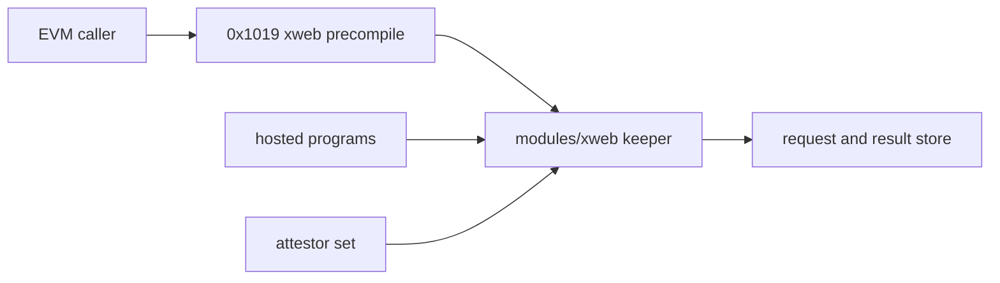

# Web contract: xweb precompile 0x1019 and modules/xweb

| Field | Value |
|---|---|
| Domain | 6 (chain-modules), feature manager fm-chain-modules |
| Precompile | xweb 0x1019 |
| Revision | repository at 2a1033aa2 |
| Change control | Changes only by amendment to this contract; every amendment updates the interface, contract_context and acceptance blocks that point here. |
| Status meaning | stable: code and intent agree, no task touches it; change: behaviour or shape must change; new: absent at the revision and created by a task; retire: removed or refused by a task. |

## Scope and reading guide

This contract freezes the xweb surface of domain 6: the 0x1019 precompile methods, views, events and errors, the module messages, queries, genesis parameters and store keys, the CLI, and the Solidity interfaces callers compile against.

Each `###` heading below is the anchor named by the `contract` key of the blocks it lists. The interface table is the frozen surface; a row's Defined at is the defining line at the revision. Rules tables reproduce the contract_context blocks; acceptance tables list the criteria verified against the section, one test each.

### Surface summary

| Item | Count |
|---|---|
| Anchors | 39 |
| Interfaces | 353 |
| Interfaces with status stable | 278 |
| Interfaces with status change | 14 |
| Interfaces with status new | 61 |
| Interfaces with status retire | 0 |
| Acceptance criteria | 57 |
| Contract contexts | 2 |

## xweb precompile 0x1019

Precompile `XWebAddress` 0x1019 (precompiles/xweb/xweb.go:59; module constant `PrecompileAddress` modules/xweb/types/keys.go:17), registered at the latest upgrade by `GetVersioned` (precompiles/xweb/setup.go:10). Methods are in section-a-methods, views in section-b-views, gas in section-d-framework-fit-and-gas, keeper-internal entries in section-f-internal-not-user-methods; origin-2 rules are in the rules table under xweb-0x1019.

### xweb-0x1019

15 interfaces: 12 stable, 3 change.

| Interface | Kind | Signature | Address / selector | Status | Defined at | Notes (non-stable only) |
|---|---|---|---|---|---|---|
| pc-0x1019-request | precompile_method | `request(uint8,bytes,uint64) payable returns (uint64)` | 0x1019 0x5f7c8e9b | stable | precompiles/xweb/abi.json:2 |  |
| pc-0x1019-fulfil | precompile_method | `fulfil(uint64,bytes,bytes32,uint32,bytes[]) nonpayable returns (uint8,uint64)` | 0x1019 0xaeb8a7ec | stable | precompiles/xweb/abi.json:3 |  |
| pc-0x1019-fulfilprogram | precompile_method | `fulfilProgram(bytes) nonpayable` | 0x1019 0x2d4bf7ad | change | precompiles/xweb/abi.json:4 | declared in the ABI and the stale contract (web.md A10, B7, B8) but xweb.go has no method constant or Execute case for it (precompiles/xweb/xweb.go:44-52, :283 default), so a call is refused; no Go reference to the method name in the package; sol precompiles/xweb/XWeb.sol:103; callers: 2 files (2 by selector or signature, 0 by name in files naming the address or its constants) |
| pc-0x1019-refund | precompile_method | `refund(uint64) nonpayable` | 0x1019 0xd7194ccb | stable | precompiles/xweb/abi.json:5 |  |
| pc-0x1019-getrequest | precompile_method | `getRequest(uint64) view returns ((uint64,address,uint8,bytes32,uint64,uint256,uint64,uint64,uint8,uint8,address))` | 0x1019 0xcbbf67ec | stable | precompiles/xweb/abi.json:6 |  |
| pc-0x1019-getresult | precompile_method | `getResult(uint64) view returns ((uint64,bytes,bytes32,uint32,address[],uint64,uint8,uint64,uint8))` | 0x1019 0xedff42d6 | stable | precompiles/xweb/abi.json:7 |  |
| pc-0x1019-getattestors | precompile_method | `getAttestors() view returns ((address,string,bytes)[],uint32)` | 0x1019 0x1a15922d | stable | precompiles/xweb/abi.json:8 |  |
| pc-0x1019-threshold | precompile_method | `threshold() view returns (uint32)` | 0x1019 0x42cde4e8 | stable | precompiles/xweb/abi.json:9 |  |
| pc-0x1019-fee | precompile_method | `fee() view returns (uint256)` | 0x1019 0xddca3f43 | stable | precompiles/xweb/abi.json:10 |  |
| pc-0x1019-getparams | precompile_method | `getParams() view returns ((uint256,uint32,uint64,uint64,bool))` | 0x1019 0x5e615a6b | stable | precompiles/xweb/abi.json:11 |  |
| pc-0x1019-getprogramresult | precompile_method | `getProgramResult(bytes32,uint64) view returns (bytes32,uint32,uint32,bytes)` | 0x1019 0x2b2e13fc | change | precompiles/xweb/abi.json:12 | declared in the ABI and the stale contract (web.md A10, B7, B8) but xweb.go has no method constant or Execute case for it (precompiles/xweb/xweb.go:44-52, :283 default), so a call is refused; no Go reference to the method name in the package; sol precompiles/xweb/XWeb.sol:119; callers: 1 files (1 by selector or signature, 0 by name in files naming the address or its constants) |
| pc-0x1019-getkernelnetworkid | precompile_method | `getKernelNetworkId() view returns (uint32)` | 0x1019 0xfc0d26f4 | change | precompiles/xweb/abi.json:13 | declared in the ABI and the stale contract (web.md A10, B7, B8) but xweb.go has no method constant or Execute case for it (precompiles/xweb/xweb.go:44-52, :283 default), so a call is refused; no Go reference to the method name in the package; sol precompiles/xweb/XWeb.sol:124; callers: 3 files (3 by selector or signature, 0 by name in files naming the address or its constants) |
| pc-0x1019-evt-xwebrequested | precompile_event | `XWebRequested(uint64 indexed,address indexed,uint8,bytes,uint64,uint256,uint64)` | 0x1019 0x3761cb12023af30e23da5dd47f1bf8cae4951138f813d82effc788e317254293 | stable | precompiles/xweb/abi.json:14 |  |
| pc-0x1019-evt-xwebfulfilled | precompile_event | `XWebFulfilled(uint64 indexed,address indexed,bytes32,uint32,uint8,uint8,uint64)` | 0x1019 0xc7eff87d7909e306e0e43af3c9ad333ddc311b8a3c1f90fa68044c11d62ecd1a | stable | precompiles/xweb/abi.json:15 |  |
| pc-0x1019-evt-xwebrefunded | precompile_event | `XWebRefunded(uint64 indexed,address indexed,uint256)` | 0x1019 0xc7eaafa8d3b0edacffbf86e1d4f404b61a8cb32dca0e8e57998422538045072d | stable | precompiles/xweb/abi.json:16 |  |

Rules frozen by `contract_context.6.xweb-origin-two-j37`:

| Aspect | Rule |
|---|---|
| interface | xweb precompile 0x1019 fulfilProgram(bytes), getProgramResult(bytes32,uint64) and getKernelNetworkId() (precompiles/xweb/abi.json), keeper RequestFromProgram, FulfilProgram, GetProgramResult and ProgramOriginActive |
| storage | xweb store: web/pending\|\|programId\|\|requestId -&gt; 123-byte record, web/answer\|\|programId\|\|requestId\|\|part -&gt; 40-byte header or 1024-byte chunk, web/feedenom\|\|asset -&gt; denom, the pending and committed counters (modules/xweb/keeper/keeper.go:52-53); all carried in GenesisState |
| errors | LXP_MODULE_DISABLED below the merge plan; LXP_XWEB_PAUSED; LXP_NON_CANONICAL, LXP_WRONG_NETWORK, LXP_UNKNOWN_FIELD, LXP_SEQUENCE_REUSED, LXP_ARENA_EXHAUSTED, LXP_CONTEXT_MISMATCH, LXP_ATTESTATION_THRESHOLD, LXP_UNSORTED_SEQUENCE, LXP_AUTH_DUPLICATE_SIGNER, LXP_BAD_SIGNATURE, LXP_INVALID_ATTESTATION, LXP_ASSET_MISMATCH; LXP_XWEB_STATICCALL for a static fulfilProgram |
| events | None: fulfilProgram emits no EVM log and no xweb event; the guest request event is the request record |
| gas | fulfilProgram 30000 + 16 per input byte + 8000 per observation signature (16 when unreadable); getProgramResult and getKernelNetworkId 3000 + 16 per input byte; charged at every height |
| activation | From the v7.0 merge plan height through IsUpgradeActiveAtHeight; below it every origin-2 path refuses with LXP_MODULE_DISABLED |
| invariants | Pending counter equals unfulfilled records and is at most 256; committed counter equals fulfilled records and answer headers and is at most 64; each fulfilled asset has one fee denom |
| pause | The module pause refuses RequestFromProgram and FulfilProgram after the activation check; views stay readable |

### section-a-methods

| Acceptance | Criterion | Test | Scenario |
|---|---|---|---|
| acceptance.6.722.1 | req.6722.1 | modules/xweb/keeper/program_gate_test.go::TestRequestFromProgramDisabledBeforeTheMergePlan (planned) | Given an unpaused xweb keeper with the program pair set and the v7.0 plan not applied, when a program call emits a paid PAXEERX_WEB_REQUEST_V1 event, then RequestFromProgram returns LXP_MODULE_DISABLED and no pending record, counter or fee leg is kept |
| acceptance.6.722.2 | req.6722.2 | modules/xweb/keeper/program_gate_test.go::TestRequestFromProgramOtherTopicBeforeTheMergePlanRecordsNothing (planned) | Given the v7.0 plan not applied, when a program call emits an event under any topic other than PAXEERX_WEB_REQUEST_V1, then RequestFromProgram returns nil and the xweb store is unchanged |
| acceptance.6.723.1 | req.6723.1 | modules/xweb/keeper/program_fulfil_gate_test.go::TestFulfilProgramDisabledBeforeTheMergePlan (planned) | Given a recorded origin-2 request and a threshold-signed observation for it while the v7.0 plan is not applied, when FulfilProgram runs, then it returns LXP_MODULE_DISABLED and the pending record, answer parts, counters and fee account balance are unchanged |
| acceptance.6.723.2 | req.6723.2 | modules/xweb/keeper/program_fulfil_gate_test.go::TestFulfilProgramPausedAfterTheMergePlanIsPaused (planned) | Given the v7.0 plan applied and the module paused, when FulfilProgram runs on any input, then it returns the LXP_XWEB_PAUSED error |
| acceptance.6.746.1 | req.6746.1 | modules/xweb/keeper/program_request_denom_test.go::TestRequestFromProgramRecordsTheFeeDenom (planned) | Given an asset with no recorded fee denom, when a program request pays its fee in that asset's mapped denom, then ProgramFeeDenom for the asset returns that denom and a second request in the same denom is accepted |
| acceptance.6.746.2 | req.6746.2 | modules/xweb/keeper/program_request_denom_test.go::TestRequestFromProgramRefusesADenomChangeForAnAsset (planned) | Given an asset whose fee denom is recorded, when a program request pays that asset's fee account in another mapped denom, then RequestFromProgram returns LXP_ASSET_MISMATCH and keeps no record, counter change or denom change |
| acceptance.6.747.1 | req.6747.1 | modules/xweb/keeper/program_fulfil_denom_test.go::TestFulfilProgramSplitsInTheRecordedDenom (planned) | Given a request paid in the USDL denom and three signing attestors, when FulfilProgram admits the observation, then each payout receives floor(amount/3) USDL, signers[0] the remainder, and no other denom moves |
| acceptance.6.747.2 | req.6747.2 | modules/xweb/keeper/program_fulfil_denom_test.go::TestFulfilProgramIgnoresAThirdPartyDepositOfAnotherDenom (planned) | Given a request paid in USDL and a third party that sent at least the same amount of the SID denom to the same fee account, when FulfilProgram admits the observation, then the split pays USDL and the SID deposit stays in the fee account |
| acceptance.6.747.3 | req.6747.3 | modules/xweb/keeper/program_fulfil_denom_test.go::TestFulfilProgramRefusesAnAssetWithoutARecordedDenom (planned) | Given a pending record written directly to the store for an asset with no web/feedenom entry, when FulfilProgram admits a valid observation for it, then it returns LXP_ASSET_MISMATCH and commits no answer |
| acceptance.6.769.1 | req.6769.1 | precompiles/xweb/methods_test.go::TestOriginTwoMethodConstantsResolveInTheABI (planned) | Given the xweb precompile ABI, when each origin-2 method constant is looked up, then fulfilProgram, getProgramResult and getKernelNetworkId resolve with selectors 0x2d4bf7ad, 0x2b2e13fc and 0xfc0d26f4 |
| acceptance.6.770.1 | req.6770.1 | precompiles/xweb/program_dispatch_test.go::TestFulfilProgramThroughTheEVMCommitsTheAnswer (planned) | Given a recorded origin-2 request and its threshold-signed observation, when a stranger calls fulfilProgram(bytes) on 0x1019 through the EVM, then the call succeeds with empty return data and the keeper holds the committed answer |
| acceptance.6.770.2 | req.6770.2 | precompiles/xweb/program_dispatch_test.go::TestFulfilProgramRefusesAStaticCall (planned) | Given any observation, when fulfilProgram is reached through STATICCALL, then the call reverts with LXP_XWEB_STATICCALL and the store is unchanged |
| acceptance.6.770.3 | req.6770.3 | precompiles/xweb/program_dispatch_test.go::TestFulfilProgramChargesTheObservationGas (planned) | Given observations with 2 and 3 signatures, when fulfilProgram runs through the EVM, then the gas left equals the supplied gas minus 30000 + 16 x len(input) + 8000 x signatures |
| acceptance.6.770.4 | req.6770.4 | precompiles/xweb/program_dispatch_test.go::TestGetProgramResultThroughTheEVMAfterTheMerge (planned) | Given a committed answer, when getProgramResult(programId, requestId) and getKernelNetworkId() are called with STATICCALL, then they return the committed tuple and the kernel network id param, and an absent answer reverts with LXP_UNKNOWN_FIELD |
| acceptance.6.793.1 | req.6793.1 | modules/xweb/client/cli/tx_test.go::TestSetParamsCmdCarriesTheProgramPair (planned) | Given set-params 1000000 8192 500000 3600 with --kernel-network-id 7 and --program-fee-denoms naming two mapped denoms and --generate-only, when the command runs, then the generated transaction holds one MsgSetParams with every field including the pair |
| acceptance.6.793.2 | req.6793.2 | modules/xweb/client/cli/tx_test.go::TestSetParamsCmdRefusesAnUnmappedFeeDenom (planned) | Given set-params with --program-fee-denoms naming a denom outside the four mapped denoms, or without --kernel-network-id, when the command runs, then it returns an error and generates no transaction |
| acceptance.6.877.1 | req.6877.1 | precompiles/xweb/origin_two_flow_test.go::TestOriginTwoRoundTripThroughThePrecompile (planned) | Given the merge plan applied and a program request paid in USDL, when its observation is submitted through fulfilProgram and read through getProgramResult, then the read returns the observed answer and each signer's payout received its share in USDL |
| acceptance.6.877.2 | req.6877.2 | precompiles/xweb/origin_two_flow_test.go::TestGetKernelNetworkIdThroughTheEVM (planned) | Given the merge plan applied and kernel network id 1 set by MsgSetParams, when getKernelNetworkId is called through STATICCALL, then it returns 1 |
| acceptance.6.877.3 | req.6877.3 | precompiles/xweb/origin_two_flow_test.go::TestFulfilProgramEmitsNoEVMLog (planned) | Given a successful fulfilProgram through the EVM, when the state DB logs are read, then there are none |
| acceptance.6.901.1 | req.6901.1 | modules/xweb/keeper/program_kernel_parity_test.go::TestFulfilProgramMatchesTheKernelRefusalMatrix (planned) | Given the kernel intake fixtures recorded as one pending origin-2 request after the merge plan, when FulfilProgram runs each refusal row of the kernel matrix (unknown request id, wrong network, kind or payload hash mismatch, one signature, swapped or duplicate signers, high-s or bad v, an outsider signer, a trailing byte, origin EVM), then each returns the kernel's LXP name and the store is unchanged |
| acceptance.6.901.2 | req.6901.2 | modules/xweb/keeper/program_kernel_parity_test.go::TestFulfilProgramAcceptsTheKernelFirstObservation (planned) | Given the same fixtures, when FulfilProgram runs the observation signed by the three kernel signatures, then it succeeds, the committed counter is 1 and the committed answer holds the text Paxeer X Network and the kernel content digest |
| acceptance.6.902.1 | req.6902.1 | modules/xweb/keeper/program_record_parity_test.go::TestDecodeProgramRequestMatchesTheKernelRecordRows (planned) | Given the request event data of the kernel request_records case, when decodeProgramRequest reads it whole, one byte short and with kind 3, then it returns request id 0x0102030405060708, kind fetch and the payload, then LXP_NON_CANONICAL twice |
| acceptance.6.902.2 | req.6902.2 | modules/xweb/keeper/program_record_parity_test.go::TestFulfilProgramTwiceMatchesTheKernelReuseRefusal (planned) | Given an origin-2 request already answered after the merge plan, when the same valid observation is submitted again, then FulfilProgram returns LXP_SEQUENCE_REUSED and the committed counter stays 1 |

Capability blocks verified against this section:

- `capability.6.61.2`: Refuse RequestFromProgram with LXP_MODULE_DISABLED below the merge plan
- `capability.6.61.3`: Refuse FulfilProgram with LXP_MODULE_DISABLED below the merge plan
- `capability.6.63.2`: Record the fee denom of each asset when RequestFromProgram accepts a paid request
- `capability.6.63.3`: Split the origin-2 fee in the recorded denom and remove balance probing
- `capability.6.65.1`: Name the three origin-2 methods of the xweb precompile
- `capability.6.65.2`: Serve fulfilProgram, getProgramResult and getKernelNetworkId on 0x1019
- `capability.6.67.1`: Let set-params carry the kernel network id and program fee denoms
- `capability.6.74.1`: Prove the origin-2 round trip from program request to EVM read after the merge
- `capability.6.76.1`: Port the kernel observation refusal matrix to FulfilProgram with the kernel's own signatures
- `capability.6.76.2`: Port the kernel request-record rows and the fulfilled-reuse refusal

### section-b-views

36 interfaces: 36 new.

| Interface | Kind | Signature | Address / selector | Status | Defined at | Notes (non-stable only) |
|---|---|---|---|---|---|---|
| grpcs-xweb-query-j37 | grpc_service_method | `service paxprotocol.paxchain.xweb.Query { Params, Attestors, Request, Result, ProgramRequest, ProgramResult, ProgramCounters }` |  | new | api/xweb/query.proto (planned) | Task 6.68.1. |
| proto-xweb-query-attestors-request-j37 | proto_message | `message QueryAttestorsRequest{}` |  | new | api/xweb/query.proto (planned) | Task 6.68.1. |
| proto-xweb-query-attestors-response-j37 | proto_message | `message QueryAttestorsResponse{attestors, threshold}` |  | new | api/xweb/query.proto (planned) | Task 6.68.1. |
| proto-xweb-query-params-request-j37 | proto_message | `message QueryParamsRequest{}` |  | new | api/xweb/query.proto (planned) | Task 6.68.1. |
| proto-xweb-query-params-response-j37 | proto_message | `message QueryParamsResponse{params}` |  | new | api/xweb/query.proto (planned) | Task 6.68.1. |
| proto-xweb-query-programcounters-request-j37 | proto_message | `message QueryProgramCountersRequest{}` |  | new | api/xweb/query.proto (planned) | Task 6.68.1. |
| proto-xweb-query-programcounters-response-j37 | proto_message | `message QueryProgramCountersResponse{pending, committed, pending_capacity, committed_capacity}` |  | new | api/xweb/query.proto (planned) | Task 6.68.1. |
| proto-xweb-query-programrequest-request-j37 | proto_message | `message QueryProgramRequestRequest{program_id, request_id}` |  | new | api/xweb/query.proto (planned) | Task 6.68.1. |
| proto-xweb-query-programrequest-response-j37 | proto_message | `message QueryProgramRequestResponse{record, fee_denom}` |  | new | api/xweb/query.proto (planned) | Task 6.68.1. |
| proto-xweb-query-programresult-request-j37 | proto_message | `message QueryProgramResultRequest{program_id, request_id}` |  | new | api/xweb/query.proto (planned) | Task 6.68.1. |
| proto-xweb-query-programresult-response-j37 | proto_message | `message QueryProgramResultResponse{content_digest, full_length, response_length, response}` |  | new | api/xweb/query.proto (planned) | Task 6.68.1. |
| proto-xweb-query-request-request-j37 | proto_message | `message QueryRequestRequest{id}` |  | new | api/xweb/query.proto (planned) | Task 6.68.1. |
| proto-xweb-query-request-response-j37 | proto_message | `message QueryRequestResponse{request}` |  | new | api/xweb/query.proto (planned) | Task 6.68.1. |
| proto-xweb-query-result-request-j37 | proto_message | `message QueryResultRequest{id}` |  | new | api/xweb/query.proto (planned) | Task 6.68.1. |
| proto-xweb-query-result-response-j37 | proto_message | `message QueryResultResponse{result}` |  | new | api/xweb/query.proto (planned) | Task 6.68.1. |
| rest-xweb-attestors-j37 | rest_route | `GET /pax-protocol/paxchain/xweb/attestors -> paxprotocol.paxchain.xweb.Query/Attestors` |  | new | api/xweb/query.proto (planned) | grpc-gateway route registered by task 6.69.4. |
| rest-xweb-params-j37 | rest_route | `GET /pax-protocol/paxchain/xweb/params -> paxprotocol.paxchain.xweb.Query/Params` |  | new | api/xweb/query.proto (planned) | grpc-gateway route registered by task 6.69.4. |
| rest-xweb-programcounters-j37 | rest_route | `GET /pax-protocol/paxchain/xweb/program/counters -> paxprotocol.paxchain.xweb.Query/ProgramCounters` |  | new | api/xweb/query.proto (planned) | grpc-gateway route registered by task 6.69.4. |
| rest-xweb-programrequest-j37 | rest_route | `GET /pax-protocol/paxchain/xweb/program/{program_id}/request/{request_id} -> paxprotocol.paxchain.xweb.Query/ProgramRequest` |  | new | api/xweb/query.proto (planned) | grpc-gateway route registered by task 6.69.4. |
| rest-xweb-programresult-j37 | rest_route | `GET /pax-protocol/paxchain/xweb/program/{program_id}/result/{request_id} -> paxprotocol.paxchain.xweb.Query/ProgramResult` |  | new | api/xweb/query.proto (planned) | grpc-gateway route registered by task 6.69.4. |
| rest-xweb-request-j37 | rest_route | `GET /pax-protocol/paxchain/xweb/request/{id} -> paxprotocol.paxchain.xweb.Query/Request` |  | new | api/xweb/query.proto (planned) | grpc-gateway route registered by task 6.69.4. |
| rest-xweb-result-j37 | rest_route | `GET /pax-protocol/paxchain/xweb/result/{id} -> paxprotocol.paxchain.xweb.Query/Result` |  | new | api/xweb/query.proto (planned) | grpc-gateway route registered by task 6.69.4. |
| cli-xweb-query-attestors-j37 | cli_command | `paxd query xweb attestors` |  | new | modules/xweb/client/cli/query.go (planned) | Task 6.70.1. |
| cli-xweb-query-params-j37 | cli_command | `paxd query xweb params` |  | new | modules/xweb/client/cli/query.go (planned) | Task 6.70.1. |
| cli-xweb-query-program-counters-j37 | cli_command | `paxd query xweb program-counters` |  | new | modules/xweb/client/cli/query_program.go (planned) | Task 6.70.3. |
| cli-xweb-query-program-request-j37 | cli_command | `paxd query xweb program-request [program-id-hex] [request-id]` |  | new | modules/xweb/client/cli/query_program.go (planned) | Task 6.70.3. |
| cli-xweb-query-program-result-j37 | cli_command | `paxd query xweb program-result [program-id-hex] [request-id]` |  | new | modules/xweb/client/cli/query_program.go (planned) | Task 6.70.3. |
| cli-xweb-query-request-j37 | cli_command | `paxd query xweb request [id]` |  | new | modules/xweb/client/cli/query_requests.go (planned) | Task 6.70.2. |
| cli-xweb-query-result-j37 | cli_command | `paxd query xweb result [id]` |  | new | modules/xweb/client/cli/query_requests.go (planned) | Task 6.70.2. |
| qry-xweb-attestors-j37 | grpc_query | `rpc paxprotocol.paxchain.xweb.Query/Attestors(QueryAttestorsRequest) returns (QueryAttestorsResponse); GET /pax-protocol/paxchain/xweb/attestors` |  | new | modules/xweb/keeper/grpc_query.go (planned) | Task 6.69.1; declared in api/xweb/query.proto by task 6.68.1. |
| qry-xweb-params-j37 | grpc_query | `rpc paxprotocol.paxchain.xweb.Query/Params(QueryParamsRequest) returns (QueryParamsResponse); GET /pax-protocol/paxchain/xweb/params` |  | new | modules/xweb/keeper/grpc_query.go (planned) | Task 6.69.1; declared in api/xweb/query.proto by task 6.68.1. |
| qry-xweb-programcounters-j37 | grpc_query | `rpc paxprotocol.paxchain.xweb.Query/ProgramCounters(QueryProgramCountersRequest) returns (QueryProgramCountersResponse); GET /pax-protocol/paxchain/xweb/program/counters` |  | new | modules/xweb/keeper/grpc_query_program.go (planned) | Task 6.69.3; declared in api/xweb/query.proto by task 6.68.1. |
| qry-xweb-programrequest-j37 | grpc_query | `rpc paxprotocol.paxchain.xweb.Query/ProgramRequest(QueryProgramRequestRequest) returns (QueryProgramRequestResponse); GET /pax-protocol/paxchain/xweb/program/{program_id}/request/{request_id}` |  | new | modules/xweb/keeper/grpc_query_program.go (planned) | Task 6.69.3; declared in api/xweb/query.proto by task 6.68.1. |
| qry-xweb-programresult-j37 | grpc_query | `rpc paxprotocol.paxchain.xweb.Query/ProgramResult(QueryProgramResultRequest) returns (QueryProgramResultResponse); GET /pax-protocol/paxchain/xweb/program/{program_id}/result/{request_id}` |  | new | modules/xweb/keeper/grpc_query_program.go (planned) | Task 6.69.3; declared in api/xweb/query.proto by task 6.68.1. |
| qry-xweb-request-j37 | grpc_query | `rpc paxprotocol.paxchain.xweb.Query/Request(QueryRequestRequest) returns (QueryRequestResponse); GET /pax-protocol/paxchain/xweb/request/{id}` |  | new | modules/xweb/keeper/grpc_query_requests.go (planned) | Task 6.69.2; declared in api/xweb/query.proto by task 6.68.1. |
| qry-xweb-result-j37 | grpc_query | `rpc paxprotocol.paxchain.xweb.Query/Result(QueryResultRequest) returns (QueryResultResponse); GET /pax-protocol/paxchain/xweb/result/{id}` |  | new | modules/xweb/keeper/grpc_query_requests.go (planned) | Task 6.69.2; declared in api/xweb/query.proto by task 6.68.1. |

Rules frozen by `contract_context.6.xweb-query-j37`:

| Aspect | Rule |
|---|---|
| interface | gRPC service paxprotocol.paxchain.xweb.Query (api/xweb/query.proto, planned) with Params, Attestors, Request, Result, ProgramRequest, ProgramResult and ProgramCounters, their gateway GET routes under /pax-protocol/paxchain/xweb/ and the query command tree |
| storage | Read-only over the xweb store keys of modules/xweb/types/keys.go and the origin-2 families |
| errors | codes.InvalidArgument for a nil request or a program id other than 32 bytes; codes.NotFound for an absent id or LXP_UNKNOWN_FIELD; codes.DataLoss for LXP_NON_CANONICAL |
| events | None |
| gas | Cosmos store read gas only |
| activation | Live from the release that registers the service; origin-2 reads answer NotFound until requests exist |
| invariants | Every answer is the stored value; no query writes |
| pause | Queries answer while the module is paused |

| Acceptance | Criterion | Test | Scenario |
|---|---|---|---|
| acceptance.6.733.1 | req.6733.1 | modules/xweb/keeper/program_result_test.go::TestGetProgramResultReassemblesTheChunks (planned) | Given a committed answer of 0, 1, 1024, 1025 and 4096 response bytes, when GetProgramResult reads it, then the digest, full length, response length and response bytes equal the observation's |
| acceptance.6.733.2 | req.6733.2 | modules/xweb/keeper/program_result_test.go::TestGetProgramResultAbsentIsUnknownField (planned) | Given no committed answer for a (programId, requestId), including a request that is pending but not fulfilled, when GetProgramResult reads it, then it returns LXP_UNKNOWN_FIELD |
| acceptance.6.733.3 | req.6733.3 | modules/xweb/keeper/program_result_test.go::TestGetProgramResultMalformedPartsAreNonCanonical (planned) | Given a committed answer whose header is 39 bytes, whose response length is 4097 or above the full length, or whose second chunk is deleted or truncated, when GetProgramResult reads it, then it returns LXP_NON_CANONICAL |
| acceptance.6.733.4 | req.6733.4 | modules/xweb/keeper/program_result_test.go::TestGetProgramResultIsScopedToTheProgram (planned) | Given two programs whose answers share one request id, when GetProgramResult reads each (programId, requestId), then each returns its own answer and a third program id returns LXP_UNKNOWN_FIELD |
| acceptance.6.805.1 | req.6805.1 | modules/xweb/types/query_test.go::TestQueryServiceDeclaresTheXWebReads (planned) | Given the generated xweb types package, when the paxprotocol.paxchain.xweb.Query descriptor is read, then it declares Params, Attestors, Request, Result, ProgramRequest, ProgramResult and ProgramCounters with GET routes under /pax-protocol/paxchain/xweb/ |
| acceptance.6.817.1 | req.6817.1 | modules/xweb/keeper/grpc_query_test.go::TestQueryParamsAnswersTheStoredParams (planned) | Given params updated by MsgSetParams including the program pair and the module unpaused, when Query/Params runs, then it returns those params, and a nil request returns InvalidArgument |
| acceptance.6.817.2 | req.6817.2 | modules/xweb/keeper/grpc_query_test.go::TestQueryAttestorsAnswersTheSetAndThreshold (planned) | Given three registered attestors and threshold 2, when Query/Attestors runs, then it returns the three attestors in ascending signer order and threshold 2 |
| acceptance.6.818.1 | req.6818.1 | modules/xweb/keeper/grpc_query_requests_test.go::TestQueryRequestAnswersARecordedRequest (planned) | Given an origin-1 request recorded through Keeper.Request, when Query/Request runs with its id, then it returns the stored Request with requester, kind, payload hash, fee, heights, status, level and attestor |
| acceptance.6.818.2 | req.6818.2 | modules/xweb/keeper/grpc_query_requests_test.go::TestQueryResultUnknownIdIsNotFound (planned) | Given no result for id 9, when Query/Result runs with 9, then it returns codes.NotFound, and after a fulfil it returns the stored Result |
| acceptance.6.819.1 | req.6819.1 | modules/xweb/keeper/grpc_query_program_test.go::TestQueryProgramRequestAnswersTheRecordAndDenom (planned) | Given a recorded origin-2 request paid in USDL, when Query/ProgramRequest runs with its program id and request id, then it returns the 123-byte record and the USDL denom, and an unknown key returns NotFound |
| acceptance.6.819.2 | req.6819.2 | modules/xweb/keeper/grpc_query_program_test.go::TestQueryProgramResultAnswersTheCommittedAnswer (planned) | Given a committed answer of 1500 bytes, when Query/ProgramResult runs, then it returns the digest, lengths and response, a pending request returns NotFound, and a 31-byte program id returns InvalidArgument |
| acceptance.6.819.3 | req.6819.3 | modules/xweb/keeper/grpc_query_program_test.go::TestQueryProgramCountersAnswersTheCounters (planned) | Given two pending and one committed origin-2 requests, when Query/ProgramCounters runs, then it returns pending 2, committed 1 and capacities 256 and 64 |
| acceptance.6.820.1 | req.6820.1 | modules/xweb/module_services_test.go::TestModuleServesTheXWebQueryService (planned) | Given the application built by app.Setup, when its gRPC query router is asked for every paxprotocol.paxchain.xweb.Query method, then each route resolves and a Params query through the router answers the stored params |
| acceptance.6.829.1 | req.6829.1 | modules/xweb/client/cli/query_test.go::TestGetQueryCmdMountsEveryXWebRead (planned) | Given GetQueryCmd, when its subcommands are listed, then params, attestors, request, result, program-request, program-result and program-counters are present and each carries the node and output flags |
| acceptance.6.830.1 | req.6830.1 | modules/xweb/client/cli/query_requests_test.go::TestQueryRequestCmdRefusesANonIntegerId (planned) | Given the request and result query commands, when each runs with the argument abc or with no argument, then it returns an argument error without contacting a node |
| acceptance.6.831.1 | req.6831.1 | modules/xweb/client/cli/query_program_test.go::TestQueryProgramResultCmdRefusesAShortProgramId (planned) | Given program-result and program-request, when each runs with a 31-byte hex program id or a non-hex id, then it returns an error naming the program id without contacting a node |
| acceptance.6.903.1 | req.6903.1 | modules/xweb/keeper/program_read_parity_test.go::TestGetProgramResultMatchesTheKernelCommittedRead (planned) | Given the kernel first observation committed after the merge plan, when GetProgramResult reads (0xa0..0xbf, 0x0102030405060708), then it returns full length 16, response length 16, Paxeer X Network and the kernel content digest, and request id plus one or a flipped program id return LXP_UNKNOWN_FIELD |

Capability blocks verified against this section:

- `capability.6.62.1`: Read a committed origin-2 answer with the kernel committed-read rules
- `capability.6.68.1`: Declare the xweb Query service in api/xweb/query.proto and generate its Go code
- `capability.6.69.1`: Serve the Params and Attestors queries
- `capability.6.69.2`: Serve the origin-1 Request and Result queries
- `capability.6.69.3`: Serve the origin-2 ProgramRequest, ProgramResult and ProgramCounters queries
- `capability.6.69.4`: Register the xweb query service, gateway routes and query command on the module
- `capability.6.70.1`: Mount the xweb query command tree with params and attestors
- `capability.6.70.2`: Add the request and result query commands
- `capability.6.70.3`: Add the program-request, program-result and program-counters query commands
- `capability.6.76.3`: Port the kernel committed-read rows to GetProgramResult

### section-d-framework-fit-and-gas

| Acceptance | Criterion | Test | Scenario |
|---|---|---|---|
| acceptance.6.781.1 | req.6781.1 | precompiles/xweb/gas_test.go::TestProgramFulfilGasCountsObservationSignatures (planned) | Given fulfilProgram calldata whose observation carries 1, 2 and 16 signatures and responses of 0 and 4096 bytes, when ProgramFulfilGas runs, then it returns 30000 + 16 x len(input) + 8000 x the signature count |
| acceptance.6.781.2 | req.6781.2 | precompiles/xweb/gas_test.go::TestProgramFulfilGasChargesSixteenForUndecodableInput (planned) | Given calldata that does not ABI-decode, an observation cut inside its header, or a signature count byte of 0 or 17, when ProgramFulfilGas runs, then it charges 16 signatures |

Capability blocks verified against this section:

- `capability.6.66.1`: Compute fulfilProgram gas from the observation's signature count

### section-f-internal-not-user-methods

| Acceptance | Criterion | Test | Scenario |
|---|---|---|---|
| acceptance.6.721.1 | req.6721.1 | modules/xweb/keeper/activation_test.go::TestProgramOriginActiveFromTheMergePlanHeight (planned) | Given an xweb keeper bound to a real upgrade keeper whose v7.0 plan is done at height 100, when ProgramOriginActive is read at heights 99, 100 and 101, then it answers false, true and true and the context gas meter is unchanged |
| acceptance.6.721.2 | req.6721.2 | modules/xweb/keeper/activation_test.go::TestProgramOriginInactiveWithoutAnUpgradeReader (planned) | Given an xweb keeper built by NewKeeper from an EVM keeper value that has no UpgradeKeeper method, when ProgramOriginActive is read at any height, then it answers false |
| acceptance.6.745.1 | req.6745.1 | modules/xweb/keeper/program_denom_test.go::TestProgramFeeDenomKeyLayout (planned) | Given an asset id, when ProgramFeeDenomKey is built and a denom is stored and read back, then the key is web/feedenom followed by the 32 asset bytes, the read returns the stored denom, and an unknown asset reads as absent |
| acceptance.6.757.1 | req.6757.1 | modules/xweb/types/genesis_test.go::TestGenesisValidateRefusesPendingOverCapacity (planned) | Given a genesis with 257 unfulfilled origin-2 records and a pending count of 257, when Validate runs, then it returns an ErrInvalidGenesis error naming the pending capacity, and with 256 records it returns nil |
| acceptance.6.757.2 | req.6757.2 | modules/xweb/types/genesis_test.go::TestGenesisValidateRefusesCommittedOverCapacity (planned) | Given a genesis with 65 fulfilled origin-2 records, 65 answer headers and a committed count of 65, when Validate runs, then it returns ErrInvalidGenesis, and with 64 it returns nil |
| acceptance.6.757.3 | req.6757.3 | modules/xweb/types/genesis_test.go::TestGenesisValidateRefusesCountersThatDisagreeWithRecords (planned) | Given a genesis whose pending count, committed count, answer headers or fee-denom entries disagree with its records, or whose record is 122 bytes or carries version 2, when Validate runs, then each case returns ErrInvalidGenesis |
| acceptance.6.758.1 | req.6758.1 | modules/xweb/keeper/genesis_entries_test.go::TestProgramPendingEntriesIterateInKeyOrder (planned) | Given three origin-2 requests recorded for two programs in an unsorted order and one of them fulfilled, when ProgramPendingEntries and ProgramFeeDenomEntries run, then the entries come back in ascending key order with the stored record bytes and one denom entry per asset |
| acceptance.6.758.2 | req.6758.2 | modules/xweb/keeper/genesis_entries_test.go::TestProgramAnswerEntriesCarryEveryPart (planned) | Given a committed answer of 2049 response bytes, when ProgramAnswerEntries runs, then it returns parts 0 to 3 of that request with the 40-byte header and the chunks of 1024, 1024 and 1 bytes |
| acceptance.6.759.1 | req.6759.1 | modules/xweb/keeper/genesis_program_test.go::TestGenesisRoundTripCarriesOriginTwoState (planned) | Given a keeper with two pending and one fulfilled origin-2 request, its answer and its fee denom, when ExportGenesis is imported by InitGenesis into a fresh store, then the xweb store snapshot, both counters and GetProgramResult of the fulfilled request are identical |
| acceptance.6.759.2 | req.6759.2 | modules/xweb/keeper/genesis_program_test.go::TestInitGenesisPanicsOnACorruptPendingRecord (planned) | Given a genesis whose pending record has 123 bytes and version 1 but a fee amount wider than 128 bits, when InitGenesis runs, then it panics and the store keeps no origin-2 key |
| acceptance.6.759.3 | req.6759.3 | modules/xweb/keeper/genesis_program_test.go::TestExportGenesisWithoutOriginTwoStateKeepsTheOldShape (planned) | Given a keeper with origin-1 state only, when ExportGenesis is marshalled to JSON, then the JSON has exactly the keys params, paused, attestors, nonce, requests and results |
| acceptance.6.760.1 | req.6760.1 | modules/xweb/module_test.go::TestModuleGenesisJSONRoundTripsOriginTwoState (planned) | Given an app with one fulfilled and one pending origin-2 request after the merge plan, when the module exports genesis JSON, validates it and imports it into a fresh store, then a second export is byte-identical |
| acceptance.6.760.2 | req.6760.2 | modules/xweb/module_test.go::TestModuleValidateGenesisRefusesOverCapacityCounters (planned) | Given exported genesis JSON edited to a committed count of 65, when AppModuleBasic.ValidateGenesis runs, then it returns an ErrInvalidGenesis error |
| acceptance.6.889.1 | req.6889.1 | modules/xweb/keeper/invariants_test.go::TestProgramCountersInvariantHoldsAfterFulfilment (planned) | Given two recorded and one fulfilled origin-2 requests, when ProgramCountersInvariant runs, then it reports not broken |
| acceptance.6.889.2 | req.6889.2 | modules/xweb/keeper/invariants_test.go::TestProgramCountersInvariantBreaksOnADriftedCounter (planned) | Given the pending counter written one above its records, when ProgramCountersInvariant runs, then it reports broken with both values in the message |

Capability blocks verified against this section:

- `capability.6.61.1`: Bind the upgrade reader to the xweb keeper and expose ProgramOriginActive
- `capability.6.63.1`: Add the web/feedenom key family and its accessor
- `capability.6.64.1`: Carry origin-2 records, answers, fee denoms and counters in GenesisState and validate them
- `capability.6.64.2`: Iterate origin-2 records, answers and fee denoms in key order
- `capability.6.64.3`: Export and import origin-2 state through InitGenesis and ExportGenesis
- `capability.6.64.4`: Prove the module genesis JSON path round-trips and validates origin-2 state
- `capability.6.75.1`: Register an invariant that the origin-2 counters match their records

### xweb-errors

24 interfaces: 24 stable.

| Interface | Kind | Signature | Address / selector | Status | Defined at | Notes (non-stable only) |
|---|---|---|---|---|---|---|
| err-sdk-xweb-2-unauthorized | error_code | `ErrUnauthorized = Register("xweb", 2, "unauthorized")` |  | stable | modules/xweb/types/errors.go:10 |  |
| err-sdk-xweb-3-invalid-genesis | error_code | `ErrInvalidGenesis = Register("xweb", 3, "invalid genesis")` |  | stable | modules/xweb/types/errors.go:11 |  |
| err-sdk-xweb-4-invalid-params | error_code | `ErrInvalidParams = Register("xweb", 4, "invalid params")` |  | stable | modules/xweb/types/errors.go:12 |  |
| err-sdk-xweb-5-invalid-attestors | error_code | `ErrInvalidAttestors = Register("xweb", 5, "invalid attestor set")` |  | stable | modules/xweb/types/errors.go:13 |  |
| err-sdk-xweb-6-invalid-threshold | error_code | `ErrInvalidThreshold = Register("xweb", 6, "threshold is not a majority of the attestor set")` |  | stable | modules/xweb/types/errors.go:14 |  |
| err-sdk-xweb-7-paused | error_code | `ErrPaused = Register("xweb", 7, "xweb paused")` |  | stable | modules/xweb/types/errors.go:15 |  |
| err-sdk-xweb-8-unknown-kind | error_code | `ErrUnknownKind = Register("xweb", 8, "unknown request kind")` |  | stable | modules/xweb/types/errors.go:16 |  |
| err-sdk-xweb-9-payload-size | error_code | `ErrPayloadSize = Register("xweb", 9, "payload empty or over the payload cap")` |  | stable | modules/xweb/types/errors.go:17 |  |
| err-sdk-xweb-10-callback-gas | error_code | `ErrCallbackGas = Register("xweb", 10, "callback gas zero or over the callback cap")` |  | stable | modules/xweb/types/errors.go:18 |  |
| err-sdk-xweb-11-wrong-fee | error_code | `ErrWrongFee = Register("xweb", 11, "paid amount is not the current fee")` |  | stable | modules/xweb/types/errors.go:19 |  |
| err-sdk-xweb-12-unknown-request | error_code | `ErrUnknownRequest = Register("xweb", 12, "request not found")` |  | stable | modules/xweb/types/errors.go:20 |  |
| err-sdk-xweb-13-already-fulfilled | error_code | `ErrAlreadyFulfilled = Register("xweb", 13, "request already fulfilled")` |  | stable | modules/xweb/types/errors.go:21 |  |
| err-sdk-xweb-14-refunded | error_code | `ErrRefunded = Register("xweb", 14, "request already refunded")` |  | stable | modules/xweb/types/errors.go:22 |  |
| err-sdk-xweb-15-response-too-large | error_code | `ErrResponseTooLarge = Register("xweb", 15, "response over the stored response bound")` |  | stable | modules/xweb/types/errors.go:23 |  |
| err-sdk-xweb-16-invalid-length | error_code | `ErrInvalidLength = Register("xweb", 16, "full length shorter than the response")` |  | stable | modules/xweb/types/errors.go:24 |  |
| err-sdk-xweb-17-bad-signature | error_code | `ErrBadSignature = Register("xweb", 17, "invalid attestor signature")` |  | stable | modules/xweb/types/errors.go:25 |  |
| err-sdk-xweb-18-below-threshold | error_code | `ErrBelowThreshold = Register("xweb", 18, "attestor signatures below threshold")` |  | stable | modules/xweb/types/errors.go:26 |  |
| err-sdk-xweb-19-not-expired | error_code | `ErrNotExpired = Register("xweb", 19, "request not yet past its timeout")` |  | stable | modules/xweb/types/errors.go:27 |  |
| err-sdk-xweb-20-unknown-attestor | error_code | `ErrUnknownAttestor = Register("xweb", 20, "attestor not registered")` |  | stable | modules/xweb/types/errors.go:28 |  |
| err-sdk-xweb-21-callback-recorded | error_code | `ErrCallbackRecorded = Register("xweb", 21, "callback outcome already recorded")` |  | stable | modules/xweb/types/errors.go:29 |  |
| err-sdk-xweb-22-invalid-request | error_code | `ErrInvalidRequest = Register("xweb", 22, "invalid request")` |  | stable | modules/xweb/types/errors.go:30 |  |
| err-sdk-xweb-23-invalid-api | error_code | `ErrInvalidApi = Register("xweb", 23, "invalid api payload")` |  | stable | modules/xweb/types/errors.go:31 |  |
| err-sdk-xweb-24-invalid-envelope | error_code | `ErrInvalidEnvelope = Register("xweb", 24, "invalid credential envelope")` |  | stable | modules/xweb/types/errors.go:32 |  |
| err-sdk-xweb-25-invalid-level | error_code | `ErrInvalidLevel = Register("xweb", 25, "invalid attestation level")` |  | stable | modules/xweb/types/errors.go:33 |  |

### xweb-events

10 interfaces: 10 stable.

| Interface | Kind | Signature | Address / selector | Status | Defined at | Notes (non-stable only) |
|---|---|---|---|---|---|---|
| evt-xweb-xweb-requested | event | `XWebRequested(request_id, origin, network_id, requester, kind, payload, payload_hash, callback_gas, fee, height, timeout_height, level, attestor)` |  | stable | modules/xweb/types/events.go:4 |  |
| evt-xweb-xweb-fulfilled | event | `XWebFulfilled(request_id, requester, content_digest, response_hash, full_length, fee, signers, level)` |  | stable | modules/xweb/types/events.go:5 |  |
| evt-xweb-xweb-refunded | event | `XWebRefunded(request_id, requester, fee)` |  | stable | modules/xweb/types/events.go:6 |  |
| evt-xweb-xweb-callback | event | `xweb_callback(request_id, outcome, gas_used)` |  | stable | modules/xweb/types/events.go:7 |  |
| evt-xweb-xweb-attestor-registered | event | `xweb_attestor_registered(signer, payout, public_key, threshold)` |  | stable | modules/xweb/types/events.go:8 |  |
| evt-xweb-xweb-attestor-removed | event | `xweb_attestor_removed(signer, threshold)` |  | stable | modules/xweb/types/events.go:9 |  |
| evt-xweb-xweb-threshold-set | event | `xweb_threshold_set(threshold)` |  | stable | modules/xweb/types/events.go:10 |  |
| evt-xweb-xweb-params-set | event | `xweb_params_set(fee, max_payload_bytes, max_callback_gas, timeout_blocks, kernel_network_id, program_fee_denoms)` |  | stable | modules/xweb/types/events.go:11 |  |
| evt-xweb-xweb-paused | event | `xweb_paused()` |  | stable | modules/xweb/types/events.go:12 |  |
| evt-xweb-xweb-unpaused | event | `xweb_unpaused()` |  | stable | modules/xweb/types/events.go:13 |  |

## xweb module messages and Go API

Module `modules/xweb`: Cosmos messages, proto messages, CLI commands and the exported Go API used across packages.

### msg-xweb-pause

1 interfaces: 1 stable.

| Interface | Kind | Signature | Address / selector | Status | Defined at | Notes (non-stable only) |
|---|---|---|---|---|---|---|
| msg-xweb-pause | cosmos_msg | `paxprotocol.paxchain.xweb.Msg/Pause: rpc Pause(MsgPause) returns (MsgPauseResponse)` |  | stable | api/xweb/tx.proto:17 |  |

### msg-xweb-registerattestor

1 interfaces: 1 stable.

| Interface | Kind | Signature | Address / selector | Status | Defined at | Notes (non-stable only) |
|---|---|---|---|---|---|---|
| msg-xweb-registerattestor | cosmos_msg | `paxprotocol.paxchain.xweb.Msg/RegisterAttestor: rpc RegisterAttestor(MsgRegisterAttestor) returns (MsgRegisterAttestorResponse)` |  | stable | api/xweb/tx.proto:13 |  |

### msg-xweb-removeattestor

1 interfaces: 1 stable.

| Interface | Kind | Signature | Address / selector | Status | Defined at | Notes (non-stable only) |
|---|---|---|---|---|---|---|
| msg-xweb-removeattestor | cosmos_msg | `paxprotocol.paxchain.xweb.Msg/RemoveAttestor: rpc RemoveAttestor(MsgRemoveAttestor) returns (MsgRemoveAttestorResponse)` |  | stable | api/xweb/tx.proto:14 |  |

### msg-xweb-setparams

1 interfaces: 1 stable.

| Interface | Kind | Signature | Address / selector | Status | Defined at | Notes (non-stable only) |
|---|---|---|---|---|---|---|
| msg-xweb-setparams | cosmos_msg | `paxprotocol.paxchain.xweb.Msg/SetParams: rpc SetParams(MsgSetParams) returns (MsgSetParamsResponse)` |  | stable | api/xweb/tx.proto:16 |  |

### msg-xweb-setthreshold

1 interfaces: 1 stable.

| Interface | Kind | Signature | Address / selector | Status | Defined at | Notes (non-stable only) |
|---|---|---|---|---|---|---|
| msg-xweb-setthreshold | cosmos_msg | `paxprotocol.paxchain.xweb.Msg/SetThreshold: rpc SetThreshold(MsgSetThreshold) returns (MsgSetThresholdResponse)` |  | stable | api/xweb/tx.proto:15 |  |

### msg-xweb-unpause

1 interfaces: 1 stable.

| Interface | Kind | Signature | Address / selector | Status | Defined at | Notes (non-stable only) |
|---|---|---|---|---|---|---|
| msg-xweb-unpause | cosmos_msg | `paxprotocol.paxchain.xweb.Msg/Unpause: rpc Unpause(MsgUnpause) returns (MsgUnpauseResponse)` |  | stable | api/xweb/tx.proto:18 |  |

### proto-xweb-attestor

1 interfaces: 1 stable.

| Interface | Kind | Signature | Address / selector | Status | Defined at | Notes (non-stable only) |
|---|---|---|---|---|---|---|
| proto-xweb-attestor | proto_message | `message paxprotocol.paxchain.xweb.Attestor { bytes signer = 1; string payout = 2; bytes public_key = 3; }` |  | stable | api/xweb/tx.proto:26 |  |

### proto-xweb-msgpause

1 interfaces: 1 stable.

| Interface | Kind | Signature | Address / selector | Status | Defined at | Notes (non-stable only) |
|---|---|---|---|---|---|---|
| proto-xweb-msgpause | proto_message | `message paxprotocol.paxchain.xweb.MsgPause { string authority = 1; }` |  | stable | api/xweb/tx.proto:96 |  |

### proto-xweb-msgpauseresponse

1 interfaces: 1 stable.

| Interface | Kind | Signature | Address / selector | Status | Defined at | Notes (non-stable only) |
|---|---|---|---|---|---|---|
| proto-xweb-msgpauseresponse | proto_message | `message paxprotocol.paxchain.xweb.MsgPauseResponse { }` |  | stable | api/xweb/tx.proto:103 |  |

### proto-xweb-msgregisterattestor

1 interfaces: 1 stable.

| Interface | Kind | Signature | Address / selector | Status | Defined at | Notes (non-stable only) |
|---|---|---|---|---|---|---|
| proto-xweb-msgregisterattestor | proto_message | `message paxprotocol.paxchain.xweb.MsgRegisterAttestor { string authority = 1; Attestor attestor = 2; }` |  | stable | api/xweb/tx.proto:37 |  |

### proto-xweb-msgregisterattestorresponse

1 interfaces: 1 stable.

| Interface | Kind | Signature | Address / selector | Status | Defined at | Notes (non-stable only) |
|---|---|---|---|---|---|---|
| proto-xweb-msgregisterattestorresponse | proto_message | `message paxprotocol.paxchain.xweb.MsgRegisterAttestorResponse { }` |  | stable | api/xweb/tx.proto:45 |  |

### proto-xweb-msgremoveattestor

1 interfaces: 1 stable.

| Interface | Kind | Signature | Address / selector | Status | Defined at | Notes (non-stable only) |
|---|---|---|---|---|---|---|
| proto-xweb-msgremoveattestor | proto_message | `message paxprotocol.paxchain.xweb.MsgRemoveAttestor { string authority = 1; bytes signer = 2; }` |  | stable | api/xweb/tx.proto:49 |  |

### proto-xweb-msgremoveattestorresponse

1 interfaces: 1 stable.

| Interface | Kind | Signature | Address / selector | Status | Defined at | Notes (non-stable only) |
|---|---|---|---|---|---|---|
| proto-xweb-msgremoveattestorresponse | proto_message | `message paxprotocol.paxchain.xweb.MsgRemoveAttestorResponse { }` |  | stable | api/xweb/tx.proto:57 |  |

### proto-xweb-msgsetparams

1 interfaces: 1 stable.

| Interface | Kind | Signature | Address / selector | Status | Defined at | Notes (non-stable only) |
|---|---|---|---|---|---|---|
| proto-xweb-msgsetparams | proto_message | `message paxprotocol.paxchain.xweb.MsgSetParams { string authority = 1; string fee = 2; uint32 max_payload_bytes = 3; uint64 max_callback_gas = 4; uint64 timeout_blocks = 5; uint32 kernel_network_id = 6; repeated string program_fee_denoms = 7; }` |  | stable | api/xweb/tx.proto:76 |  |

### proto-xweb-msgsetparamsresponse

1 interfaces: 1 stable.

| Interface | Kind | Signature | Address / selector | Status | Defined at | Notes (non-stable only) |
|---|---|---|---|---|---|---|
| proto-xweb-msgsetparamsresponse | proto_message | `message paxprotocol.paxchain.xweb.MsgSetParamsResponse { }` |  | stable | api/xweb/tx.proto:92 |  |

### proto-xweb-msgsetthreshold

1 interfaces: 1 stable.

| Interface | Kind | Signature | Address / selector | Status | Defined at | Notes (non-stable only) |
|---|---|---|---|---|---|---|
| proto-xweb-msgsetthreshold | proto_message | `message paxprotocol.paxchain.xweb.MsgSetThreshold { string authority = 1; uint32 threshold = 2; }` |  | stable | api/xweb/tx.proto:61 |  |

### proto-xweb-msgsetthresholdresponse

1 interfaces: 1 stable.

| Interface | Kind | Signature | Address / selector | Status | Defined at | Notes (non-stable only) |
|---|---|---|---|---|---|---|
| proto-xweb-msgsetthresholdresponse | proto_message | `message paxprotocol.paxchain.xweb.MsgSetThresholdResponse { }` |  | stable | api/xweb/tx.proto:69 |  |

### proto-xweb-msgunpause

1 interfaces: 1 stable.

| Interface | Kind | Signature | Address / selector | Status | Defined at | Notes (non-stable only) |
|---|---|---|---|---|---|---|
| proto-xweb-msgunpause | proto_message | `message paxprotocol.paxchain.xweb.MsgUnpause { string authority = 1; }` |  | stable | api/xweb/tx.proto:106 |  |

### proto-xweb-msgunpauseresponse

1 interfaces: 1 stable.

| Interface | Kind | Signature | Address / selector | Status | Defined at | Notes (non-stable only) |
|---|---|---|---|---|---|---|
| proto-xweb-msgunpauseresponse | proto_message | `message paxprotocol.paxchain.xweb.MsgUnpauseResponse { }` |  | stable | api/xweb/tx.proto:113 |  |

### cli-xweb-tx-pause

1 interfaces: 1 stable.

| Interface | Kind | Signature | Address / selector | Status | Defined at | Notes (non-stable only) |
|---|---|---|---|---|---|---|
| cli-xweb-tx-pause | cli_command | `paxd tx xweb pause \| flags: standard tx flags` |  | stable | modules/xweb/client/cli/tx.go:189 |  |

### cli-xweb-tx-register-attestor

1 interfaces: 1 stable.

| Interface | Kind | Signature | Address / selector | Status | Defined at | Notes (non-stable only) |
|---|---|---|---|---|---|---|
| cli-xweb-tx-register-attestor | cli_command | `paxd tx xweb register-attestor [signer] [payout] [public-key] \| flags: standard tx flags` |  | stable | modules/xweb/client/cli/tx.go:49 |  |

### cli-xweb-tx-remove-attestor

1 interfaces: 1 stable.

| Interface | Kind | Signature | Address / selector | Status | Defined at | Notes (non-stable only) |
|---|---|---|---|---|---|---|
| cli-xweb-tx-remove-attestor | cli_command | `paxd tx xweb remove-attestor [signer] \| flags: standard tx flags` |  | stable | modules/xweb/client/cli/tx.go:86 |  |

### cli-xweb-tx-root

1 interfaces: 1 stable.

| Interface | Kind | Signature | Address / selector | Status | Defined at | Notes (non-stable only) |
|---|---|---|---|---|---|---|
| cli-xweb-tx-root | cli_command | `paxd tx xweb` |  | stable | modules/xweb/client/cli/tx.go:25 |  |

### cli-xweb-tx-set-params

1 interfaces: 1 change.

| Interface | Kind | Signature | Address / selector | Status | Defined at | Notes (non-stable only) |
|---|---|---|---|---|---|---|
| cli-xweb-tx-set-params | cli_command | `paxd tx xweb set-params [fee] [max-payload-bytes] [max-callback-gas] [timeout-blocks] \| flags: standard tx flags` |  | change | modules/xweb/client/cli/tx.go:144 | the command fills fields 1-5 only, so kernel_network_id (field 6) and program_fee_denoms (field 7) of MsgSetParams (api/xweb/tx.proto:87-88) are zero and MsgSetParams.ValidateBasic (modules/xweb/types/msgs.go:119) refuses every message it builds; the keeper copies both fields into Params (modules/xweb/keeper/msg_server.go:175-176) and Unpause requires them (modules/xweb/keeper/msg_server.go:214); Use string at modules/xweb/client/cli/tx.go:146 |

### cli-xweb-tx-set-threshold

1 interfaces: 1 stable.

| Interface | Kind | Signature | Address / selector | Status | Defined at | Notes (non-stable only) |
|---|---|---|---|---|---|---|
| cli-xweb-tx-set-threshold | cli_command | `paxd tx xweb set-threshold [threshold] \| flags: standard tx flags` |  | stable | modules/xweb/client/cli/tx.go:115 |  |

### cli-xweb-tx-unpause

1 interfaces: 1 stable.

| Interface | Kind | Signature | Address / selector | Status | Defined at | Notes (non-stable only) |
|---|---|---|---|---|---|---|
| cli-xweb-tx-unpause | cli_command | `paxd tx xweb unpause \| flags: standard tx flags` |  | stable | modules/xweb/client/cli/tx.go:213 |  |

### go-api

211 interfaces: 179 stable, 7 change, 25 new.

| Interface | Kind | Signature | Address / selector | Status | Defined at | Notes (non-stable only) |
|---|---|---|---|---|---|---|
| go-xweb-cli-getquerycmd-j37 | go_exported | `func GetQueryCmd() *cobra.Command` |  | new | modules/xweb/client/cli/query.go (planned) | Task 6.70.1. |
| go-xweb-client-cli-gettxcmd-j37 | go_exported | `func GetTxCmd() *cobra.Command` |  | stable | modules/xweb/client/cli/tx.go:25 |  |
| go-xweb-keeper-errprogrammoduledisabled-j37 | go_exported | `var ErrProgramModuleDisabled = errors.New("LXP_MODULE_DISABLED")` |  | new | modules/xweb/keeper/activation.go (planned) | Task 6.61.1. |
| go-xweb-keeper-programoriginactive-j37 | go_exported | `func (k Keeper) ProgramOriginActive(ctx sdk.Context) bool` |  | new | modules/xweb/keeper/activation.go (planned) | Task 6.61.1; false without a bound reader. |
| go-xweb-keeper-attestation-j37 | go_exported | `func (k Keeper) Attestation(ctx sdk.Context, request types.Request, response []byte,` |  | stable | modules/xweb/keeper/fulfil.go:68 |  |
| go-xweb-keeper-fulfil-j37 | go_exported | `func (k Keeper) Fulfil(ctx sdk.Context, id uint64, response []byte, contentDigest types.Hash32,` |  | stable | modules/xweb/keeper/fulfil.go:93 |  |
| go-xweb-keeper-recordcallback-j37 | go_exported | `func (k Keeper) RecordCallback(ctx sdk.Context, id uint64, outcome types.CallbackOutcome, gasUsed uint64) error` |  | stable | modules/xweb/keeper/fulfil.go:186 |  |
| go-xweb-keeper-initgenesis-j37 | go_exported | `func (k Keeper) InitGenesis(ctx sdk.Context, genesis types.GenesisState)` |  | change | modules/xweb/keeper/genesis.go:12 | Imports no origin-2 state at HEAD (modules/xweb/keeper/genesis.go:12-33); task 6.64.3 imports pending records, answers, fee-denom entries and counters. |
| go-xweb-keeper-exportgenesis-j37 | go_exported | `func (k Keeper) ExportGenesis(ctx sdk.Context) types.GenesisState` |  | change | modules/xweb/keeper/genesis.go:35 | Exports no origin-2 state at HEAD (modules/xweb/keeper/genesis.go:35-44); task 6.64.3 exports it. |
| go-xweb-keeper-newqueryserver-j37 | go_exported | `func NewQueryServer(k Keeper) types.QueryServer` |  | new | modules/xweb/keeper/grpc_query.go (planned) | Task 6.69.1. |
| go-xweb-keeper-programcountersinvariant-j37 | go_exported | `func ProgramCountersInvariant(k Keeper) sdk.Invariant` |  | new | modules/xweb/keeper/invariants.go (planned) | Task 6.75.1; registered as xweb/program-counters. |
| go-xweb-keeper-programanswerentries-j37 | go_exported | `func (k Keeper) ProgramAnswerEntries(ctx sdk.Context) []types.ProgramAnswerEntry` |  | new | modules/xweb/keeper/keeper.go (planned) | Task 6.64.2. |
| go-xweb-keeper-programfeedenomentries-j37 | go_exported | `func (k Keeper) ProgramFeeDenomEntries(ctx sdk.Context) []types.ProgramFeeDenomEntry` |  | new | modules/xweb/keeper/keeper.go (planned) | Task 6.64.2. |
| go-xweb-keeper-programpendingentries-j37 | go_exported | `func (k Keeper) ProgramPendingEntries(ctx sdk.Context) []types.ProgramPendingEntry` |  | new | modules/xweb/keeper/keeper.go (planned) | Task 6.64.2. |
| go-xweb-keeper-keeper-j37 | go_exported | `type Keeper struct` |  | stable | modules/xweb/keeper/keeper.go:15 |  |
| go-xweb-keeper-newkeeper-j37 | go_exported | `func NewKeeper(storeKey sdk.StoreKey, bankKeeper types.BankKeeper, evmKeeper types.EVMKeeper) Keeper` |  | stable | modules/xweb/keeper/keeper.go:23 |  |
| go-xweb-keeper-moduleaddress-j37 | go_exported | `func (k Keeper) ModuleAddress() sdk.AccAddress { return types.ModuleAddress() }` |  | stable | modules/xweb/keeper/keeper.go:27 |  |
| key-xweb-program-count-pending-j37 | storage_key | `"web/count/pending": u64 count of unfulfilled origin-2 records, capacity 256` |  | stable | modules/xweb/keeper/keeper.go:52 |  |
| key-xweb-program-count-committed-j37 | storage_key | `"web/count/committed": u64 count of committed origin-2 answers, capacity 64, never decremented` |  | stable | modules/xweb/keeper/keeper.go:53 |  |
| go-xweb-keeper-getprogrampendingrecord-j37 | go_exported | `func (k Keeper) GetProgramPendingRecord(ctx sdk.Context, programID types.Hash32, requestID uint64) (` |  | stable | modules/xweb/keeper/keeper.go:66 |  |
| go-xweb-keeper-programpendingcount-j37 | go_exported | `func (k Keeper) ProgramPendingCount(ctx sdk.Context) uint64` |  | stable | modules/xweb/keeper/keeper.go:81 |  |
| go-xweb-keeper-programcommittedcount-j37 | go_exported | `func (k Keeper) ProgramCommittedCount(ctx sdk.Context) uint64` |  | stable | modules/xweb/keeper/keeper.go:92 |  |
| go-xweb-keeper-getparams-j37 | go_exported | `func (k Keeper) GetParams(ctx sdk.Context) types.Params` |  | stable | modules/xweb/keeper/keeper.go:112 |  |
| go-xweb-keeper-setparams-j37 | go_exported | `func (k Keeper) SetParams(ctx sdk.Context, params types.Params) error` |  | stable | modules/xweb/keeper/keeper.go:120 |  |
| go-xweb-keeper-fee-j37 | go_exported | `func (k Keeper) Fee(ctx sdk.Context) sdk.Int { return k.GetParams(ctx).Fee }` |  | stable | modules/xweb/keeper/keeper.go:129 |  |
| go-xweb-keeper-getattestorset-j37 | go_exported | `func (k Keeper) GetAttestorSet(ctx sdk.Context) types.AttestorSet` |  | stable | modules/xweb/keeper/keeper.go:140 |  |
| go-xweb-keeper-threshold-j37 | go_exported | `func (k Keeper) Threshold(ctx sdk.Context) uint32 { return k.GetAttestorSet(ctx).Threshold }` |  | stable | modules/xweb/keeper/keeper.go:147 |  |
| go-xweb-keeper-ispaused-j37 | go_exported | `func (k Keeper) IsPaused(ctx sdk.Context) bool` |  | stable | modules/xweb/keeper/keeper.go:155 |  |
| go-xweb-keeper-nonce-j37 | go_exported | `func (k Keeper) Nonce(ctx sdk.Context) uint64` |  | stable | modules/xweb/keeper/keeper.go:168 |  |
| go-xweb-keeper-getrequest-j37 | go_exported | `func (k Keeper) GetRequest(ctx sdk.Context, id uint64) (types.Request, bool)` |  | stable | modules/xweb/keeper/keeper.go:178 |  |
| go-xweb-keeper-getrequests-j37 | go_exported | `func (k Keeper) GetRequests(ctx sdk.Context) []types.Request` |  | stable | modules/xweb/keeper/keeper.go:184 |  |
| go-xweb-keeper-getresult-j37 | go_exported | `func (k Keeper) GetResult(ctx sdk.Context, id uint64) (types.Result, bool)` |  | stable | modules/xweb/keeper/keeper.go:198 |  |
| go-xweb-keeper-getresults-j37 | go_exported | `func (k Keeper) GetResults(ctx sdk.Context) []types.Result` |  | stable | modules/xweb/keeper/keeper.go:204 |  |
| go-xweb-keeper-newmsgserverimpl-j37 | go_exported | `func NewMsgServerImpl(k Keeper) types.MsgServer { return msgServer{keeper: k} }` |  | stable | modules/xweb/keeper/msg_server.go:22 |  |
| go-xweb-keeper-registerattestor-j37 | go_exported | `func (k Keeper) RegisterAttestor(ctx sdk.Context, msg types.MsgRegisterAttestor) error` |  | stable | modules/xweb/keeper/msg_server.go:72 |  |
| go-xweb-keeper-removeattestor-j37 | go_exported | `func (k Keeper) RemoveAttestor(ctx sdk.Context, msg types.MsgRemoveAttestor) error` |  | stable | modules/xweb/keeper/msg_server.go:108 |  |
| go-xweb-keeper-setthreshold-j37 | go_exported | `func (k Keeper) SetThreshold(ctx sdk.Context, msg types.MsgSetThreshold) error` |  | stable | modules/xweb/keeper/msg_server.go:141 |  |
| go-xweb-keeper-updateparams-j37 | go_exported | `func (k Keeper) UpdateParams(ctx sdk.Context, msg types.MsgSetParams) error` |  | stable | modules/xweb/keeper/msg_server.go:163 |  |
| go-xweb-keeper-pause-j37 | go_exported | `func (k Keeper) Pause(ctx sdk.Context, msg types.MsgPause) error` |  | stable | modules/xweb/keeper/msg_server.go:191 |  |
| go-xweb-keeper-unpause-j37 | go_exported | `func (k Keeper) Unpause(ctx sdk.Context, msg types.MsgUnpause) error` |  | stable | modules/xweb/keeper/msg_server.go:206 |  |
| key-xweb-program-pending-j37 | storage_key | `"web/pending" \|\| programId[32] \|\| u64 requestId: 123-byte origin-2 pending record` |  | stable | modules/xweb/keeper/program.go:42 |  |
| go-xweb-keeper-requestfromprogram-j37 | go_exported | `func (k Keeper) RequestFromProgram(ctx sdk.Context, call *ProgramCall, topic, data []byte) error` |  | change | modules/xweb/keeper/program.go:192 | No merge-plan gate and no fee-denom record at HEAD (modules/xweb/keeper/program.go:192-232); tasks 6.61.2 and 6.63.2. |
| go-xweb-keeper-programfeedenom-j37 | go_exported | `func (k Keeper) ProgramFeeDenom(ctx sdk.Context, asset types.Hash32) (string, bool)` |  | new | modules/xweb/keeper/program_denom.go (planned) | Task 6.63.1. |
| go-xweb-keeper-programfeedenomkey-j37 | go_exported | `func ProgramFeeDenomKey(asset types.Hash32) []byte` |  | new | modules/xweb/keeper/program_denom.go (planned) | Task 6.63.1. |
| key-xweb-program-feedenom-j37 | storage_key | `"web/feedenom" \|\| asset[32]: bank denom the asset's origin-2 fees were paid in` |  | new | modules/xweb/keeper/program_denom.go (planned) | Task 6.63.1 (decision.658). |
| key-xweb-program-answer-j37 | storage_key | `"web/answer" \|\| programId[32] \|\| u64 requestId \|\| u8 part: part 0 is the 40-byte header, parts 1.. are 1024-byte chunks` |  | stable | modules/xweb/keeper/program_fulfil.go:23 |  |
| go-xweb-keeper-fulfilprogram-j37 | go_exported | `func (k Keeper) FulfilProgram(ctx sdk.Context, raw []byte) error` |  | change | modules/xweb/keeper/program_fulfil.go:117 | No merge-plan gate and the fee split probes balances at HEAD (modules/xweb/keeper/program_fulfil.go:117-171, :233-248); tasks 6.61.3 and 6.63.3. |
| go-xweb-keeper-getprogramresult-j37 | go_exported | `func (k Keeper) GetProgramResult(ctx sdk.Context, programID types.Hash32, requestID uint64) (ProgramResult, error)` |  | new | modules/xweb/keeper/program_result.go (planned) | Task 6.62.1. |
| go-xweb-keeper-programresult-j37 | go_exported | `type ProgramResult struct { ContentDigest types.Hash32; FullLength uint32; ResponseLength uint32; Response []byte }` |  | new | modules/xweb/keeper/program_result.go (planned) | Task 6.62.1. |
| go-xweb-keeper-refund-j37 | go_exported | `func (k Keeper) Refund(ctx sdk.Context, id uint64) (types.Request, error)` |  | stable | modules/xweb/keeper/refund.go:17 |  |
| go-xweb-keeper-request-j37 | go_exported | `func (k Keeper) Request(ctx sdk.Context, requester common.Address, kind uint8, payload []byte,` |  | stable | modules/xweb/keeper/request.go:18 |  |
| go-xweb-appmodulebasic-j37 | go_exported | `type AppModuleBasic struct{}` |  | change | modules/xweb/module.go:32 | GetQueryCmd returns nil and RegisterGRPCGatewayRoutes is empty at HEAD (modules/xweb/module.go:69-75); the query service and CLI are added (tasks 6.69.4, 6.70.1). |
| go-xweb-appmodule-j37 | go_exported | `type AppModule struct` |  | change | modules/xweb/module.go:77 | RegisterServices registers only the Msg server and RegisterInvariants is empty at HEAD (modules/xweb/module.go:91-95); the Query server and the program counters invariant are added (tasks 6.69.4, 6.75.1). |
| go-xweb-newappmodule-j37 | go_exported | `func NewAppModule(k keeper.Keeper) AppModule { return AppModule{keeper: k} }` |  | stable | modules/xweb/module.go:82 |  |
| go-xweb-testutil-attestor-j37 | go_exported | `type Attestor struct` |  | stable | modules/xweb/testutil/attestors.go:15 |  |
| go-xweb-testutil-attestors-j37 | go_exported | `func Attestors(n int) []Attestor` |  | stable | modules/xweb/testutil/attestors.go:23 |  |
| go-xweb-testutil-set-j37 | go_exported | `func Set(attestors []Attestor, threshold uint32) types.AttestorSet` |  | stable | modules/xweb/testutil/attestors.go:48 |  |
| go-xweb-testutil-sign-j37 | go_exported | `func Sign(digest types.Hash32, attestors ...Attestor) [][]byte` |  | stable | modules/xweb/testutil/attestors.go:58 |  |
| go-xweb-testutil-withxwebstore-j37 | go_exported | `func WithXWebStore(ctx sdk.Context, key sdk.StoreKey) sdk.Context` |  | stable | modules/xweb/testutil/store.go:56 |  |
| go-xweb-testutil-newkeeper-j37 | go_exported | `func NewKeeper(testApp *app.App, ctx sdk.Context) (keeper.Keeper, sdk.Context)` |  | stable | modules/xweb/testutil/store.go:64 |  |
| go-xweb-types-methodget-j37 | go_exported | `MethodGet  uint8 = 1` |  | stable | modules/xweb/types/api.go:62 |  |
| go-xweb-types-methodpost-j37 | go_exported | `MethodPost uint8 = 2` |  | stable | modules/xweb/types/api.go:63 |  |
| go-xweb-types-apiheader-j37 | go_exported | `type ApiHeader struct` |  | stable | modules/xweb/types/api.go:86 |  |
| go-xweb-types-apipayload-j37 | go_exported | `type ApiPayload struct` |  | stable | modules/xweb/types/api.go:92 |  |
| go-xweb-types-decodeapipayload-j37 | go_exported | `func DecodeApiPayload(raw []byte) (ApiPayload, error)` |  | stable | modules/xweb/types/api.go:402 |  |
| go-xweb-types-encodecredential-j37 | go_exported | `func EncodeCredential(headers []ApiHeader) ([]byte, error)` |  | stable | modules/xweb/types/api.go:464 |  |
| go-xweb-types-originevm-j37 | go_exported | `OriginEVM     uint8 = 1` |  | stable | modules/xweb/types/attestation.go:19 |  |
| go-xweb-types-originprogram-j37 | go_exported | `OriginProgram uint8 = 2` |  | stable | modules/xweb/types/attestation.go:20 |  |
| go-xweb-types-signaturelength-j37 | go_exported | `SignatureLength = 65` |  | stable | modules/xweb/types/attestation.go:25 |  |
| go-xweb-types-attestation-j37 | go_exported | `type Attestation struct` |  | stable | modules/xweb/types/attestation.go:31 |  |
| go-xweb-types-evmrequester-j37 | go_exported | `func EVMRequester(address Address20) Hash32` |  | stable | modules/xweb/types/attestation.go:44 |  |
| go-xweb-types-keccak-j37 | go_exported | `func Keccak(data []byte) Hash32 { return Hash32(crypto.Keccak256Hash(data)) }` |  | stable | modules/xweb/types/attestation.go:51 |  |
| go-xweb-types-digest-j37 | go_exported | `func Digest(a Attestation) Hash32 { return Keccak(Preimage(a)) }` |  | stable | modules/xweb/types/attestation.go:75 |  |
| go-xweb-types-registercodec-j37 | go_exported | `func RegisterCodec(cdc *codec.LegacyAmino)` |  | stable | modules/xweb/types/codec.go:17 |  |
| go-xweb-types-registerinterfaces-j37 | go_exported | `func RegisterInterfaces(registry cdctypes.InterfaceRegistry)` |  | stable | modules/xweb/types/codec.go:28 |  |
| go-xweb-types-envelopekeylength-j37 | go_exported | `EnvelopeKeyLength   = 33` |  | stable | modules/xweb/types/envelope.go:35 |  |
| go-xweb-types-envelope-j37 | go_exported | `type Envelope struct` |  | stable | modules/xweb/types/envelope.go:50 |  |
| go-xweb-types-parseenvelope-j37 | go_exported | `func ParseEnvelope(raw []byte) (Envelope, error)` |  | stable | modules/xweb/types/envelope.go:81 |  |
| go-xweb-types-sealenvelope-j37 | go_exported | `func SealEnvelope(recipient *ecdsa.PublicKey, origin string, plaintext []byte) ([]byte, error)` |  | stable | modules/xweb/types/envelope.go:139 |  |
| go-xweb-types-openenvelope-j37 | go_exported | `func OpenEnvelope(raw []byte, key *ecdsa.PrivateKey, origin string) ([]byte, error)` |  | stable | modules/xweb/types/envelope.go:178 |  |
| go-xweb-types-lxpname-j37 | go_exported | `func LXPName(err error) (string, bool)` |  | stable | modules/xweb/types/errors.go:36 |  |
| go-xweb-types-attributerequestid-j37 | go_exported | `AttributeRequestID        = "request_id"` |  | stable | modules/xweb/types/events.go:14 |  |
| go-xweb-types-attributerequester-j37 | go_exported | `AttributeRequester        = "requester"` |  | stable | modules/xweb/types/events.go:15 |  |
| go-xweb-types-attributeorigin-j37 | go_exported | `AttributeOrigin           = "origin"` |  | stable | modules/xweb/types/events.go:16 |  |
| go-xweb-types-attributenetworkid-j37 | go_exported | `AttributeNetworkID        = "network_id"` |  | stable | modules/xweb/types/events.go:17 |  |
| go-xweb-types-attributekind-j37 | go_exported | `AttributeKind             = "kind"` |  | stable | modules/xweb/types/events.go:18 |  |
| go-xweb-types-attributepayload-j37 | go_exported | `AttributePayload          = "payload"` |  | stable | modules/xweb/types/events.go:19 |  |
| go-xweb-types-attributepayloadhash-j37 | go_exported | `AttributePayloadHash      = "payload_hash"` |  | stable | modules/xweb/types/events.go:20 |  |
| go-xweb-types-attributecallbackgas-j37 | go_exported | `AttributeCallbackGas      = "callback_gas"` |  | stable | modules/xweb/types/events.go:21 |  |
| go-xweb-types-attributefee-j37 | go_exported | `AttributeFee              = "fee"` |  | stable | modules/xweb/types/events.go:22 |  |
| go-xweb-types-attributeheight-j37 | go_exported | `AttributeHeight           = "height"` |  | stable | modules/xweb/types/events.go:23 |  |
| go-xweb-types-attributetimeoutheight-j37 | go_exported | `AttributeTimeoutHeight    = "timeout_height"` |  | stable | modules/xweb/types/events.go:24 |  |
| go-xweb-types-attributecontentdigest-j37 | go_exported | `AttributeContentDigest    = "content_digest"` |  | stable | modules/xweb/types/events.go:25 |  |
| go-xweb-types-attributeresponsehash-j37 | go_exported | `AttributeResponseHash     = "response_hash"` |  | stable | modules/xweb/types/events.go:26 |  |
| go-xweb-types-attributefulllength-j37 | go_exported | `AttributeFullLength       = "full_length"` |  | stable | modules/xweb/types/events.go:27 |  |
| go-xweb-types-attributesigners-j37 | go_exported | `AttributeSigners          = "signers"` |  | stable | modules/xweb/types/events.go:28 |  |
| go-xweb-types-attributeoutcome-j37 | go_exported | `AttributeOutcome          = "outcome"` |  | stable | modules/xweb/types/events.go:29 |  |
| go-xweb-types-attributegasused-j37 | go_exported | `AttributeGasUsed          = "gas_used"` |  | stable | modules/xweb/types/events.go:30 |  |
| go-xweb-types-attributesigner-j37 | go_exported | `AttributeSigner           = "signer"` |  | stable | modules/xweb/types/events.go:31 |  |
| go-xweb-types-attributepayout-j37 | go_exported | `AttributePayout           = "payout"` |  | stable | modules/xweb/types/events.go:32 |  |
| go-xweb-types-attributethreshold-j37 | go_exported | `AttributeThreshold        = "threshold"` |  | stable | modules/xweb/types/events.go:33 |  |
| go-xweb-types-attributepayloadcap-j37 | go_exported | `AttributePayloadCap       = "max_payload_bytes"` |  | stable | modules/xweb/types/events.go:34 |  |
| go-xweb-types-attributecallbackcap-j37 | go_exported | `AttributeCallbackCap      = "max_callback_gas"` |  | stable | modules/xweb/types/events.go:35 |  |
| go-xweb-types-attributetimeoutblocks-j37 | go_exported | `AttributeTimeoutBlocks    = "timeout_blocks"` |  | stable | modules/xweb/types/events.go:36 |  |
| go-xweb-types-attributekernelnetworkid-j37 | go_exported | `AttributeKernelNetworkID  = "kernel_network_id"` |  | stable | modules/xweb/types/events.go:37 |  |
| go-xweb-types-attributeprogramfeedenoms-j37 | go_exported | `AttributeProgramFeeDenoms = "program_fee_denoms"` |  | stable | modules/xweb/types/events.go:38 |  |
| go-xweb-types-attributelevel-j37 | go_exported | `AttributeLevel            = "level"` |  | stable | modules/xweb/types/events.go:39 |  |
| go-xweb-types-attributeattestor-j37 | go_exported | `AttributeAttestor         = "attestor"` |  | stable | modules/xweb/types/events.go:40 |  |
| go-xweb-types-attributepublickey-j37 | go_exported | `AttributePublicKey        = "public_key"` |  | stable | modules/xweb/types/events.go:41 |  |
| go-xweb-types-upgradereader-j37 | go_exported | `type UpgradeReader interface { IsUpgradeActiveAtHeight(ctx sdk.Context, name string, height int64) bool }` |  | new | modules/xweb/types/expected_keepers.go (planned) | Task 6.61.1. |
| go-xweb-types-bankkeeper-j37 | go_exported | `type BankKeeper interface` |  | stable | modules/xweb/types/expected_keepers.go:12 |  |
| go-xweb-types-evmkeeper-j37 | go_exported | `type EVMKeeper interface` |  | stable | modules/xweb/types/expected_keepers.go:19 |  |
| gen-xweb-program-answers-j37 | genesis_param | `program_answers []ProgramAnswerEntry{program_id, request_id, part, value}: every web/answer part` |  | new | modules/xweb/types/genesis.go (planned) | Task 6.64.1 (decision.659); omitted from JSON when empty. |
| gen-xweb-program-counters-j37 | genesis_param | `program_pending_count, program_committed_count uint64: the two origin-2 counters` |  | new | modules/xweb/types/genesis.go (planned) | Task 6.64.1 (decision.659); omitted from JSON when empty. |
| gen-xweb-program-feedenoms-j37 | genesis_param | `program_fee_denoms_by_asset []ProgramFeeDenomEntry{asset, denom}: every web/feedenom entry` |  | new | modules/xweb/types/genesis.go (planned) | Task 6.64.1 (decision.659); omitted from JSON when empty. |
| gen-xweb-program-pending-j37 | genesis_param | `program_pending []ProgramPendingEntry{program_id, request_id, record}: every web/pending record` |  | new | modules/xweb/types/genesis.go (planned) | Task 6.64.1 (decision.659); omitted from JSON when empty. |
| go-xweb-types-programanswerentry-j37 | go_exported | `type ProgramAnswerEntry struct { ProgramID Hash32; RequestID uint64; Part uint8; Value []byte }` |  | new | modules/xweb/types/genesis.go (planned) | Task 6.64.1. |
| go-xweb-types-programfeedenomentry-j37 | go_exported | `type ProgramFeeDenomEntry struct { Asset Hash32; Denom string }` |  | new | modules/xweb/types/genesis.go (planned) | Task 6.64.1. |
| go-xweb-types-programpendingentry-j37 | go_exported | `type ProgramPendingEntry struct { ProgramID Hash32; RequestID uint64; Record []byte }` |  | new | modules/xweb/types/genesis.go (planned) | Task 6.64.1. |
| go-xweb-types-genesisstate-j37 | go_exported | `type GenesisState struct` |  | change | modules/xweb/types/genesis.go:11 | Gains the origin-2 fields ProgramPending, ProgramAnswers, ProgramFeeDenoms and the two counters (task 6.64.1). |
| gen-xweb-paused-j37 | genesis_param | `paused bool: default true` |  | stable | modules/xweb/types/genesis.go:13 |  |
| gen-xweb-attestors-j37 | genesis_param | `attestors AttestorSet: at most 16 attestors and a strict-majority threshold` |  | stable | modules/xweb/types/genesis.go:14 |  |
| gen-xweb-nonce-j37 | genesis_param | `nonce uint64: last origin-1 request id` |  | stable | modules/xweb/types/genesis.go:15 |  |
| gen-xweb-requests-j37 | genesis_param | `requests []Request: origin-1 requests` |  | stable | modules/xweb/types/genesis.go:16 |  |
| gen-xweb-results-j37 | genesis_param | `results []Result: origin-1 results` |  | stable | modules/xweb/types/genesis.go:17 |  |
| go-xweb-types-defaultauthority-j37 | go_exported | `func DefaultAuthority() string` |  | stable | modules/xweb/types/genesis.go:21 |  |
| go-xweb-types-defaultgenesis-j37 | go_exported | `func DefaultGenesis() *GenesisState` |  | stable | modules/xweb/types/genesis.go:25 |  |
| go-xweb-types-modulename-j37 | go_exported | `ModuleName   = "xweb"` |  | stable | modules/xweb/types/keys.go:11 |  |
| go-xweb-types-storekey-j37 | go_exported | `StoreKey     = ModuleName` |  | stable | modules/xweb/types/keys.go:12 |  |
| go-xweb-types-querierroute-j37 | go_exported | `QuerierRoute = ModuleName` |  | stable | modules/xweb/types/keys.go:14 |  |
| go-xweb-types-precompileaddress-j37 | go_exported | `PrecompileAddress = "0x0000000000000000000000000000000000001019"` |  | stable | modules/xweb/types/keys.go:17 |  |
| go-xweb-types-maxattestors-j37 | go_exported | `MaxAttestors = 64` |  | stable | modules/xweb/types/keys.go:21 |  |
| go-xweb-types-maxresponsebytes-j37 | go_exported | `MaxResponseBytes = 4096` |  | stable | modules/xweb/types/keys.go:24 |  |
| go-xweb-types-paramskey-j37 | go_exported | `ParamsKey      = []byte{0x01}` |  | stable | modules/xweb/types/keys.go:28 |  |
| key-xweb-params-j37 | storage_key | `ParamsKey = []byte{0x01}: JSON Params of the module` |  | stable | modules/xweb/types/keys.go:28 |  |
| go-xweb-types-attestorsetkey-j37 | go_exported | `AttestorSetKey = []byte{0x02}` |  | stable | modules/xweb/types/keys.go:29 |  |
| key-xweb-attestor-set-j37 | storage_key | `AttestorSetKey = []byte{0x02}: JSON AttestorSet shared by both origins` |  | stable | modules/xweb/types/keys.go:29 |  |
| go-xweb-types-pausedkey-j37 | go_exported | `PausedKey      = []byte{0x03}` |  | stable | modules/xweb/types/keys.go:30 |  |
| key-xweb-paused-j37 | storage_key | `PausedKey = []byte{0x03}: present while the module is paused` |  | stable | modules/xweb/types/keys.go:30 |  |
| go-xweb-types-noncekey-j37 | go_exported | `NonceKey       = []byte{0x04}` |  | stable | modules/xweb/types/keys.go:31 |  |
| key-xweb-nonce-j37 | storage_key | `NonceKey = []byte{0x04}: u64 origin-1 request nonce` |  | stable | modules/xweb/types/keys.go:31 |  |
| go-xweb-types-requestprefix-j37 | go_exported | `RequestPrefix  = []byte{0x05}` |  | stable | modules/xweb/types/keys.go:32 |  |
| key-xweb-request-prefix-j37 | storage_key | `RequestPrefix = []byte{0x05} \|\| u64 id: origin-1 Request` |  | stable | modules/xweb/types/keys.go:32 |  |
| go-xweb-types-resultprefix-j37 | go_exported | `ResultPrefix   = []byte{0x06}` |  | stable | modules/xweb/types/keys.go:33 |  |
| key-xweb-result-prefix-j37 | storage_key | `ResultPrefix = []byte{0x06} \|\| u64 id: origin-1 Result` |  | stable | modules/xweb/types/keys.go:33 |  |
| go-xweb-types-moduleaddress-j37 | go_exported | `func ModuleAddress() sdk.AccAddress { return xwebModuleAddr }` |  | stable | modules/xweb/types/keys.go:39 |  |
| go-xweb-types-requestkey-j37 | go_exported | `func RequestKey(id uint64) []byte { return join(RequestPrefix, u64(id)) }` |  | stable | modules/xweb/types/keys.go:55 |  |
| go-xweb-types-resultkey-j37 | go_exported | `func ResultKey(id uint64) []byte { return join(ResultPrefix, u64(id)) }` |  | stable | modules/xweb/types/keys.go:57 |  |
| go-xweb-types-observationmaxsignatures-j37 | go_exported | `ObservationMaxSignatures = 16` |  | stable | modules/xweb/types/observation.go:11 |  |
| go-xweb-types-observation-j37 | go_exported | `type Observation struct` |  | stable | modules/xweb/types/observation.go:17 |  |
| go-xweb-types-encodeobservation-j37 | go_exported | `func EncodeObservation(observation Observation) ([]byte, error)` |  | stable | modules/xweb/types/observation.go:30 |  |
| go-xweb-types-decodeobservation-j37 | go_exported | `func DecodeObservation(raw []byte) (Observation, error)` |  | stable | modules/xweb/types/observation.go:63 |  |
| go-xweb-types-hash32-j37 | go_exported | `type Hash32 [32]byte` |  | stable | modules/xweb/types/state.go:14 |  |
| go-xweb-types-address20-j37 | go_exported | `type Address20 [20]byte` |  | stable | modules/xweb/types/state.go:23 |  |
| go-xweb-types-kindfetch-j37 | go_exported | `KindFetch  uint8 = 1` |  | stable | modules/xweb/types/state.go:49 |  |
| go-xweb-types-kindsearch-j37 | go_exported | `KindSearch uint8 = 2` |  | stable | modules/xweb/types/state.go:50 |  |
| go-xweb-types-kindapi-j37 | go_exported | `KindApi    uint8 = 3` |  | stable | modules/xweb/types/state.go:51 |  |
| go-xweb-types-knownkind-j37 | go_exported | `func KnownKind(kind uint8) bool { return kind == KindFetch \|\| kind == KindSearch \|\| kind == KindApi }` |  | stable | modules/xweb/types/state.go:55 |  |
| go-xweb-types-levelmajority-j37 | go_exported | `LevelMajority uint8 = 0` |  | stable | modules/xweb/types/state.go:61 |  |
| go-xweb-types-levelsingle-j37 | go_exported | `LevelSingle   uint8 = 1` |  | stable | modules/xweb/types/state.go:62 |  |
| go-xweb-types-defaultmaxpayloadbytes-j37 | go_exported | `DefaultMaxPayloadBytes = uint32(8192)` |  | stable | modules/xweb/types/state.go:68 |  |
| go-xweb-types-defaultmaxcallbackgas-j37 | go_exported | `DefaultMaxCallbackGas  = uint64(500_000)` |  | stable | modules/xweb/types/state.go:69 |  |
| go-xweb-types-defaulttimeoutblocks-j37 | go_exported | `DefaultTimeoutBlocks   = uint64(3600)` |  | stable | modules/xweb/types/state.go:70 |  |
| go-xweb-types-payloadbyteslimit-j37 | go_exported | `PayloadBytesLimit = uint32(16384)` |  | stable | modules/xweb/types/state.go:74 |  |
| go-xweb-types-callbackgaslimit-j37 | go_exported | `CallbackGasLimit  = uint64(5_000_000)` |  | stable | modules/xweb/types/state.go:75 |  |
| go-xweb-types-defaultfee-j37 | go_exported | `func DefaultFee() sdk.Int { return sdk.NewInt(1_000_000) }` |  | stable | modules/xweb/types/state.go:79 |  |
| go-xweb-types-programfeedenompax-j37 | go_exported | `ProgramFeeDenomPAX  = "uhpx"` |  | stable | modules/xweb/types/state.go:84 |  |
| go-xweb-types-programfeedenomsid-j37 | go_exported | `ProgramFeeDenomSID  = "usid"` |  | stable | modules/xweb/types/state.go:85 |  |
| go-xweb-types-programfeedenomusdc-j37 | go_exported | `ProgramFeeDenomUSDC = "uusdc"` |  | stable | modules/xweb/types/state.go:86 |  |
| go-xweb-types-programfeedenomusdl-j37 | go_exported | `ProgramFeeDenomUSDL = "uusdl"` |  | stable | modules/xweb/types/state.go:87 |  |
| go-xweb-types-params-j37 | go_exported | `type Params struct` |  | stable | modules/xweb/types/state.go:97 |  |
| gen-xweb-param-authority-j37 | genesis_param | `params.authority string: bech32 of the governance authority` |  | stable | modules/xweb/types/state.go:98 |  |
| gen-xweb-param-fee-j37 | genesis_param | `params.fee sdk.Int: origin-1 request fee in base units, default 1000000` |  | stable | modules/xweb/types/state.go:99 |  |
| gen-xweb-param-max-payload-bytes-j37 | genesis_param | `params.max_payload_bytes uint32: 1..16384` |  | stable | modules/xweb/types/state.go:100 |  |
| gen-xweb-param-max-callback-gas-j37 | genesis_param | `params.max_callback_gas uint64: 1..5000000` |  | stable | modules/xweb/types/state.go:101 |  |
| gen-xweb-param-timeout-blocks-j37 | genesis_param | `params.timeout_blocks uint64: > 0` |  | stable | modules/xweb/types/state.go:102 |  |
| gen-xweb-param-kernel-network-id-j37 | genesis_param | `params.kernel_network_id uint32: origin-2 network id, non-zero once set` |  | stable | modules/xweb/types/state.go:103 |  |
| gen-xweb-param-program-fee-denoms-j37 | genesis_param | `params.program_fee_denoms []string: subset of the four mapped denoms` |  | stable | modules/xweb/types/state.go:104 |  |
| go-xweb-types-defaultparams-j37 | go_exported | `func DefaultParams(authority string) Params` |  | stable | modules/xweb/types/state.go:107 |  |
| go-xweb-types-validateprogramsettings-j37 | go_exported | `func ValidateProgramSettings(kernelNetworkId uint32, programFeeDenoms []string) error` |  | stable | modules/xweb/types/state.go:153 |  |
| go-xweb-types-attestor-j37 | go_exported | `type Attestor struct` |  | stable | modules/xweb/types/state.go:180 |  |
| go-xweb-types-maxattestorsetsize-j37 | go_exported | `const MaxAttestorSetSize = 16` |  | stable | modules/xweb/types/state.go:210 |  |
| go-xweb-types-attestorset-j37 | go_exported | `type AttestorSet struct` |  | stable | modules/xweb/types/state.go:215 |  |
| go-xweb-types-majority-j37 | go_exported | `func Majority(n int) uint32 { return uint32(n/2 + 1) }` |  | stable | modules/xweb/types/state.go:221 |  |
| go-xweb-types-validthreshold-j37 | go_exported | `func ValidThreshold(threshold uint32, n int) bool` |  | stable | modules/xweb/types/state.go:224 |  |
| go-xweb-types-statuspending-j37 | go_exported | `StatusPending   RequestStatus = 0` |  | stable | modules/xweb/types/state.go:278 |  |
| go-xweb-types-statusfulfilled-j37 | go_exported | `StatusFulfilled RequestStatus = 1` |  | stable | modules/xweb/types/state.go:279 |  |
| go-xweb-types-statusrefunded-j37 | go_exported | `StatusRefunded  RequestStatus = 2` |  | stable | modules/xweb/types/state.go:280 |  |
| go-xweb-types-request-j37 | go_exported | `type Request struct` |  | stable | modules/xweb/types/state.go:286 |  |
| go-xweb-types-callbackoutcome-j37 | go_exported | `type CallbackOutcome uint8` |  | stable | modules/xweb/types/state.go:348 |  |
| go-xweb-types-callbackpending-j37 | go_exported | `CallbackPending   CallbackOutcome = 0` |  | stable | modules/xweb/types/state.go:351 |  |
| go-xweb-types-callbackdelivered-j37 | go_exported | `CallbackDelivered CallbackOutcome = 1` |  | stable | modules/xweb/types/state.go:352 |  |
| go-xweb-types-callbackreverted-j37 | go_exported | `CallbackReverted  CallbackOutcome = 2` |  | stable | modules/xweb/types/state.go:353 |  |
| go-xweb-types-callbackoutofgas-j37 | go_exported | `CallbackOutOfGas  CallbackOutcome = 3` |  | stable | modules/xweb/types/state.go:354 |  |
| go-xweb-types-result-j37 | go_exported | `type Result struct` |  | stable | modules/xweb/types/state.go:359 |  |
| go-xweb-types-msgserver-j37 | go_exported | `type MsgServer interface` |  | stable | modules/xweb/types/tx.pb.go:767 |  |
| go-xweb-types-registermsgserver-j37 | go_exported | `func RegisterMsgServer(s grpc1.Server, srv MsgServer)` |  | stable | modules/xweb/types/tx.pb.go:799 |  |
| go-pxweb-programfulfilgas-j37 | go_exported | `func ProgramFulfilGas(input []byte) uint64` |  | new | precompiles/xweb/gas.go (planned) | Task 6.66.1; WriteBaseGas + 16 x len + 8000 x signatures, 16 signatures when unreadable. |
| go-pxweb-getversioned-j37 | go_exported | `func GetVersioned(latestUpgrade string, keepers utils.Keepers) utils.VersionedPrecompiles` |  | stable | precompiles/xweb/setup.go:10 |  |
| go-pxweb-fulfilprogrammethod-j37 | go_exported | `const FulfilProgramMethod = "fulfilProgram"` |  | new | precompiles/xweb/xweb.go (planned) | Task 6.65.1. |
| go-pxweb-getkernelnetworkidmethod-j37 | go_exported | `const GetKernelNetworkIdMethod = "getKernelNetworkId"` |  | new | precompiles/xweb/xweb.go (planned) | Task 6.65.1. |
| go-pxweb-getprogramresultmethod-j37 | go_exported | `const GetProgramResultMethod = "getProgramResult"` |  | new | precompiles/xweb/xweb.go (planned) | Task 6.65.1. |
| go-pxweb-getattestorsmethod-j37 | go_exported | `GetAttestorsMethod = "getAttestors"` |  | stable | precompiles/xweb/xweb.go:49 |  |
| go-pxweb-thresholdmethod-j37 | go_exported | `ThresholdMethod    = "threshold"` |  | stable | precompiles/xweb/xweb.go:50 |  |
| go-pxweb-feemethod-j37 | go_exported | `FeeMethod          = "fee"` |  | stable | precompiles/xweb/xweb.go:51 |  |
| go-pxweb-xwebaddress-j37 | go_exported | `XWebAddress    = "0x0000000000000000000000000000000000001019"` |  | stable | precompiles/xweb/xweb.go:59 |  |
| go-pxweb-precompilename-j37 | go_exported | `PrecompileName = "xweb"` |  | stable | precompiles/xweb/xweb.go:60 |  |
| go-pxweb-viewbasegas-j37 | go_exported | `ViewBaseGas       uint64 = 3000` |  | stable | precompiles/xweb/xweb.go:62 |  |
| go-pxweb-attestorview-j37 | go_exported | `type AttestorView struct` |  | stable | precompiles/xweb/xweb.go:116 |  |
| go-pxweb-newprecompile-j37 | go_exported | `func NewPrecompile(keepers utils.Keepers) (*Precompile, error)` |  | stable | precompiles/xweb/xweb.go:151 |  |
| go-pxweb-newprecompilewithkeeper-j37 | go_exported | `func NewPrecompileWithKeeper(keeper *xwebkeeper.Keeper, bankKeeper utils.BankKeeper, evmKeeper utils.EVMKeeper) *Precompile` |  | stable | precompiles/xweb/xweb.go:159 |  |

## xweb Solidity interfaces

Solidity interfaces and consumers of the xweb precompile.

### sol-apiconsumer

3 interfaces: 3 stable.

| Interface | Kind | Signature | Address / selector | Status | Defined at | Notes (non-stable only) |
|---|---|---|---|---|---|---|
| sol-apiconsumer-prices-8caeb833 | sol_function | `mapping(uint64` | 0x8caeb833 | stable | contracts/src/xweb/examples/ApiConsumer.sol:10 |  |
| sol-apiconsumer-askprice-55e21ef1 | sol_function | `function askPrice(bytes calldata envelope, address attestor) external payable returns (uint64)` | 0x55e21ef1 | stable | contracts/src/xweb/examples/ApiConsumer.sol:12 |  |
| sol-apiconsumer-onxwebresponse-637f092c | sol_function | `function onXWebResponse(uint64 requestId, bytes32, uint32, bytes calldata response) external` | 0x637f092c | stable | contracts/src/xweb/examples/ApiConsumer.sol:17 |  |

### sol-ixweb

15 interfaces: 12 stable, 3 change.

| Interface | Kind | Signature | Address / selector | Status | Defined at | Notes (non-stable only) |
|---|---|---|---|---|---|---|
| sevt-ixweb-xwebrequested-3761cb12 | sol_event | `event XWebRequested( uint64 indexed requestId, address indexed requester, uint8 kind, bytes payload, uint64 callbackGas, uint256 paid, uint64 timeoutHeight )` | 0x1019 | stable | contracts/src/precompiles/IXWeb.sol:73 |  |
| sevt-ixweb-xwebfulfilled-c7eff87d | sol_event | `event XWebFulfilled( uint64 indexed requestId, address indexed requester, bytes32 contentDigest, uint32 fullLength, uint8 level, uint8 callback, uint64 callbackGasUsed )` | 0x1019 | stable | contracts/src/precompiles/IXWeb.sol:82 |  |
| sevt-ixweb-xwebrefunded-c7eaafa8 | sol_event | `event XWebRefunded(uint64 indexed requestId, address indexed requester, uint256 refunded)` | 0x1019 | stable | contracts/src/precompiles/IXWeb.sol:91 |  |
| sol-ixweb-request-5f7c8e9b | sol_function | `function request(uint8 kind, bytes calldata payload, uint64 callbackGas) external payable returns (uint64 requestId)` | 0x1019 0x5f7c8e9b | stable | contracts/src/precompiles/IXWeb.sol:93 |  |
| sol-ixweb-fulfil-aeb8a7ec | sol_function | `function fulfil( uint64 requestId, bytes calldata response, bytes32 contentDigest, uint32 fullLength, bytes[] calldata signatures ) external returns (uint8 callback, uint64 callbackGasUsed)` | 0x1019 0xaeb8a7ec | stable | contracts/src/precompiles/IXWeb.sol:95 |  |
| sol-ixweb-fulfilprogram-2d4bf7ad | sol_function | `function fulfilProgram(bytes calldata observation) external` | 0x1019 0x2d4bf7ad | change | contracts/src/precompiles/IXWeb.sol:103 | interface IXWeb; canonical fulfilProgram(bytes); external nonpayable; consumer interface for the precompile at 0x1019; change: declared here and in precompiles/xweb/abi.json (selector pinned at precompiles/xweb/xweb_test.go:797) but the Execute switch at precompiles/xweb/xweb.go:242-276 has no case for it, so the origin-2 program path is refused at HEAD |
| sol-ixweb-refund-d7194ccb | sol_function | `function refund(uint64 requestId) external` | 0x1019 0xd7194ccb | stable | contracts/src/precompiles/IXWeb.sol:105 |  |
| sol-ixweb-getrequest-cbbf67ec | sol_function | `function getRequest(uint64 requestId) external view returns (Request memory)` | 0x1019 0xcbbf67ec | stable | contracts/src/precompiles/IXWeb.sol:107 |  |
| sol-ixweb-getresult-edff42d6 | sol_function | `function getResult(uint64 requestId) external view returns (Result memory)` | 0x1019 0xedff42d6 | stable | contracts/src/precompiles/IXWeb.sol:109 |  |
| sol-ixweb-getattestors-1a15922d | sol_function | `function getAttestors() external view returns (Attestor[] memory attestors, uint32 required)` | 0x1019 0x1a15922d | stable | contracts/src/precompiles/IXWeb.sol:111 |  |
| sol-ixweb-threshold-42cde4e8 | sol_function | `function threshold() external view returns (uint32)` | 0x1019 0x42cde4e8 | stable | contracts/src/precompiles/IXWeb.sol:113 |  |
| sol-ixweb-fee-ddca3f43 | sol_function | `function fee() external view returns (uint256)` | 0x1019 0xddca3f43 | stable | contracts/src/precompiles/IXWeb.sol:115 |  |
| sol-ixweb-getparams-5e615a6b | sol_function | `function getParams() external view returns (Params memory)` | 0x1019 0x5e615a6b | stable | contracts/src/precompiles/IXWeb.sol:117 |  |
| sol-ixweb-getprogramresult-2b2e13fc | sol_function | `function getProgramResult(bytes32 programId, uint64 requestId) external view returns (bytes32 contentDigest, uint32 fullLength, uint32 responseLength, bytes memory response)` | 0x1019 0x2b2e13fc | change | contracts/src/precompiles/IXWeb.sol:119 | interface IXWeb; canonical getProgramResult(bytes32,uint64) returns (bytes32,uint32,uint32,bytes); external view; consumer interface for the precompile at 0x1019; change: declared here and in precompiles/xweb/abi.json (selector pinned at precompiles/xweb/xweb_test.go:797) but the Execute switch at precompiles/xweb/xweb.go:242-276 has no case for it, so the view is refused at HEAD |
| sol-ixweb-getkernelnetworkid-fc0d26f4 | sol_function | `function getKernelNetworkId() external view returns (uint32 kernelNetworkId)` | 0x1019 0xfc0d26f4 | change | contracts/src/precompiles/IXWeb.sol:124 | interface IXWeb; canonical getKernelNetworkId() returns (uint32); external view; consumer interface for the precompile at 0x1019; change: declared here and in precompiles/xweb/abi.json (selector pinned at precompiles/xweb/xweb_test.go:797) but the Execute switch at precompiles/xweb/xweb.go:242-276 has no case for it, so the view is refused at HEAD |

### sol-ixwebconsumer

1 interfaces: 1 stable.

| Interface | Kind | Signature | Address / selector | Status | Defined at | Notes (non-stable only) |
|---|---|---|---|---|---|---|
| sol-ixwebconsumer-onxwebresponse-637f092c | sol_function | `function onXWebResponse(uint64 requestId, bytes32 contentDigest, uint32 fullLength, bytes calldata response) external` | 0x1019 0x637f092c | stable | contracts/src/precompiles/IXWeb.sol:130 |  |

### sol-xwebapi

3 interfaces: 3 stable.

| Interface | Kind | Signature | Address / selector | Status | Defined at | Notes (non-stable only) |
|---|---|---|---|---|---|---|
| err-xwebapi-fieldtoolong-85c78ef1 | error_code | `error FieldTooLong(string field, uint256 length)` | 0x85c78ef1 | stable | contracts/src/xweb/XWebApi.sol:49 |  |
| err-xwebapi-toomany-0892c465 | error_code | `error TooMany(string field)` | 0x0892c465 | stable | contracts/src/xweb/XWebApi.sol:50 |  |
| err-xwebapi-zeroattestor-fccaaaf4 | error_code | `error ZeroAttestor()` | 0xfccaaaf4 | stable | contracts/src/xweb/XWebApi.sol:51 |  |

### sol-xwebconsumer

9 interfaces: 9 stable.

| Interface | Kind | Signature | Address / selector | Status | Defined at | Notes (non-stable only) |
|---|---|---|---|---|---|---|
| err-xwebconsumer-notxweb-f58b36a5 | error_code | `error NotXWeb(address caller)` | 0xf58b36a5 | stable | contracts/src/xweb/XWebConsumer.sol:17 |  |
| err-xwebconsumer-unknownrequest-b2064e15 | error_code | `error UnknownRequest(uint64 requestId)` | 0xb2064e15 | stable | contracts/src/xweb/XWebConsumer.sol:18 |  |
| err-xwebconsumer-alreadyanswered-21f14a74 | error_code | `error AlreadyAnswered(uint64 requestId)` | 0x21f14a74 | stable | contracts/src/xweb/XWebConsumer.sol:19 |  |
| sevt-xwebconsumer-asked-3a4b460a | sol_event | `event Asked(uint64 indexed requestId, uint8 kind, bytes payload, uint64 callbackGas)` |  | stable | contracts/src/xweb/XWebConsumer.sol:21 |  |
| sevt-xwebconsumer-answered-39f513ef | sol_event | `event Answered(uint64 indexed requestId, bytes32 contentDigest, uint32 fullLength, bytes response)` |  | stable | contracts/src/xweb/XWebConsumer.sol:22 |  |
| sol-xwebconsumer-issued-4f6cea36 | sol_function | `mapping(uint64` | 0x4f6cea36 | stable | contracts/src/xweb/XWebConsumer.sol:24 |  |
| sol-xwebconsumer-ask-09b36d72 | sol_function | `function ask(uint8 kind, bytes calldata payload, uint64 callbackGas) external payable returns (uint64 requestId)` | 0x09b36d72 | stable | contracts/src/xweb/XWebConsumer.sol:29 |  |
| sol-xwebconsumer-onxwebresponse-637f092c | sol_function | `function onXWebResponse(uint64 requestId, bytes32 contentDigest, uint32 fullLength, bytes calldata response) external` | 0x637f092c | stable | contracts/src/xweb/XWebConsumer.sol:35 |  |
| sol-xwebconsumer-answer-6e47a20a | sol_function | `function answer(uint64 requestId) external view returns (Answer memory)` | 0x6e47a20a | stable | contracts/src/xweb/XWebConsumer.sol:49 |  |
