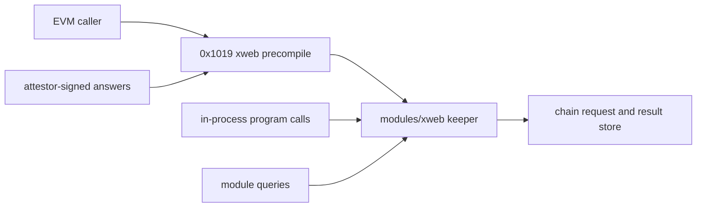

# Web contract: xweb precompile 0x1019 and modules/xweb

| Field | Value |
|---|---|
| Module / store | `xweb` / `modules/xweb` |
| Precompile | `0x0000000000000000000000000000000000001019` |
| Contract | Paid requests, attested answers and result reads. |

## Scope and reading guide

Paxeer mainnet-beta is one BFT network, with EVM chain id `125` (`0x7d`). The kernel runs within the network and proposes blocks; a receipt is final when its block is committed. xweb records paid requests and attested answers in chain state. Its attestor threshold establishes agreement about external data, not another layer of transaction finality. Sub-chains are tenant domains in the database.

Public node JSON-RPC uses the configured node root. Use `eth_call`, transactions and receipt logs to access the precompile. The module gRPC service and REST gateway routes below are separate transports whose availability depends on node configuration. See the [programs contract](programs.md) and [web client contract](web-client.md).

This page describes methods, events, governance messages, queries, genesis, storage and Solidity consumers. Source links identify their declarations and implementations.

### Surface summary

| Surface | Implementation |
|---|---|
| EVM entry points | 12 methods and 4 events in [abi.json](../../../precompiles/xweb/abi.json) |
| Origin 1 | EVM request, fee escrow, attestation, callback and timeout refund |
| Origin 2 | Program request record, recorded fee denom, observation fulfilment and result reads |
| Governance | Six authority-only methods in [tx.proto](../../../api/xweb/tx.proto) |
| Reads | Seven methods in [query.proto](../../../api/xweb/query.proto), plus `paxd query xweb` |
| Activation | Module defaults paused; program origin also requires the `v7.0` upgrade plan |



## xweb precompile 0x1019

[XWebAddress](../../../precompiles/xweb/xweb.go) and [PrecompileAddress](../../../modules/xweb/types/keys.go) both name `0x0000000000000000000000000000000000001019`. [GetVersioned](../../../precompiles/xweb/setup.go) constructs the precompile for the supplied latest upgrade. [node/precompiles.go](../../../node/precompiles.go) supplies the application's xweb keeper; [node/app.go](../../../node/app.go) constructs the keeper and registers the module.

### xweb-0x1019

All twelve ABI methods have dispatch implementations, including `fulfilProgram`, `getProgramResult` and `getKernelNetworkId`. Origin-2 methods check activation before execution and return `LXP_MODULE_DISABLED` before the merge plan is active. Views remain available while paused, subject to that activation gate. All methods refuse delegatecall; writes refuse staticcall. A precompile constructed without its keeper refuses calls.

| Method | Mutability / return | Selector |
|---|---|---|
| `request(uint8,bytes,uint64)` | payable; `uint64` request id | `0x5f7c8e9b` |
| `fulfil(uint64,bytes,bytes32,uint32,bytes[])` | nonpayable; `(uint8 callback,uint64 callbackGasUsed)` | `0xaeb8a7ec` |
| `fulfilProgram(bytes)` | nonpayable; no return values | `0x2d4bf7ad` |
| `refund(uint64)` | nonpayable; no return values | `0xd7194ccb` |
| `getRequest(uint64)` | view; `Request` tuple | `0xcbbf67ec` |
| `getResult(uint64)` | view; `Result` tuple | `0xedff42d6` |
| `getAttestors()` | view; `(Attestor[],uint32 required)` | `0x1a15922d` |
| `threshold()` | view; `uint32` | `0x42cde4e8` |
| `fee()` | view; `uint256` in wei | `0xddca3f43` |
| `getParams()` | view; `Params` tuple | `0x5e615a6b` |
| `getProgramResult(bytes32,uint64)` | view; `(bytes32 contentDigest,uint32 fullLength,uint32 responseLength,bytes response)` | `0x2b2e13fc` |
| `getKernelNetworkId()` | view; `uint32` governed kernel network id | `0xfc0d26f4` |

The kernel network id is `params.kernel_network_id`; it must not be inferred from EVM chain id 125. Program observations use that configured value. The constructor pins the three program-method selectors against the ABI.

### section-a-methods

**Origin 1.** [Keeper.Request](../../../modules/xweb/keeper/request.go) accepts kinds `1` fetch, `2` search, `3` API and `4` storage receipt. It requires an unpaused module, a nonzero requester, nonempty payload within the governed cap, positive callback gas within its cap and exactly the current fee. API and storage-receipt payloads receive additional validation. The precompile takes payment in wei, requiring a whole number of base units; one `uhpx` equals `10^12` wei. `fee()` returns the amount callers must attach. The keeper escrows base-denom coins in the xweb module account, allocates the next nonce and stores the request's fee and timeout height.

[Keeper.Fulfil](../../../modules/xweb/keeper/fulfil.go) accepts only a pending, unrefunded request, at most 4096 response bytes and a full length at least the response length. Signatures must recover to registered attestors in strictly ascending address order. Majority level `0` requires the current threshold; API single level `1` requires exactly the named attestor's signature, and that attestor must still be registered. The registered set has at most 16 members and a strict-majority threshold. The separate `MaxAttestors = 64` constant bounds origin-1 signature input; it does not permit registering 64 members.

Fulfilment stores the answer and splits the recorded fee equally among signing attestors' bank payout accounts, with the remainder going to the lowest signer. The EVM entry then calls `onXWebResponse(uint64,bytes32,uint32,bytes)` on the requester from address `0x1019`, records the callback outcome and emits `XWebFulfilled`. Callback values are `0` pending, `1` delivered, `2` reverted and `3` out of gas. A callback revert or out-of-gas result leaves the accepted fulfilment standing. Direct `Execute` dispatch of origin-1 `fulfil` refuses with `LXP_XWEB_FULFIL_EVM_ONLY`; `RunAndCalculateGas` owns the metered EVM path.

[Keeper.Refund](../../../modules/xweb/keeper/refund.go) is callable by anyone at or after the stored timeout height for a still-pending origin-1 request. Payment returns only to its requester, exactly once. Refund remains available while paused. A fulfilled request cannot be refunded, and a refunded request cannot be fulfilled. Timeout eligibility does not itself expire or delete a pending request. `timeout_blocks` is bounded to `1` through `9223372036854775807` (`math.MaxInt64`). Request admission checks that the block height is nonnegative and its sum with the timeout fits `int64` before accepting payment, then records that sum as the timeout height.

**Origin 2.** [Keeper.RequestFromProgram](../../../modules/xweb/keeper/program.go) consumes guest events with topic `PAXEERX_WEB_REQUEST_V1`. Other topics return without recording anything. For a matching topic it checks activation, pause, call identity, one request per call, canonical event data, unused `(programId,requestId)`, pending capacity and fee legs. Admission supports fetch/search only; API and storage receipts have no origin-2 request lifecycle.

Event data is `u64 requestId || u8 kind || u32 payloadLength || payload`, with big-endian integers, positive payload length and exactly that many remaining bytes. The call supplies its program id, principal, recording sequence and transfer legs. Fee legs must debit that principal into the fee account of one asset, use one allowed denom and total a positive amount fitting `u128`. The fee account id is `sha256("PAXEERX_WEB_FEES_V1" || asset[32])`; its bank address is `address.Module("layerx", feeAccountId)`. The denom is recorded by asset and cannot change on a later request. Origin-2 fees are not the fixed origin-1 `params.fee`.

Admission reserves a renewable hot-answer slot in a cached context, writes a 123-byte record, increments pending count and marks the call as having requested. The caller must keep fee transfers and admission in the same transaction branch. [precompiles/layerxprograms/xweb.go](../../../precompiles/layerxprograms/xweb.go) forwards successful hosted guest events directly to the keeper and applies bank legs in its cached receipt path. The separate EVM adapter `Precompile.RequestFromProgram` in [xweb.go](../../../precompiles/xweb/xweb.go) snapshots EVM state, calls the keeper and emits the program-specific log described under [events](#xweb-events). Direct keeper admission does not itself emit that EVM log; the hosted forwarding path calls the keeper rather than this adapter, so callers must not assume every accepted program request produces the adapter's log.

[Keeper.FulfilProgram](../../../modules/xweb/keeper/program_fulfil.go) checks activation, pause, canonical observation encoding, network id, the recorded request, replay status, kind/payload-hash agreement and threshold signatures. It atomically writes answer parts, pays the recorded amount in the recorded denom, marks the permanent request record fulfilled, decrements pending and increments hot committed count. It does not probe arbitrary fee-account balances to choose a denom. A bank failure discards the cached writes. `fulfilProgram(bytes)` delegates to this method and returns empty data; it emits no xweb EVM fulfilment log and performs no requester callback. There is no program timeout/refund entry corresponding to origin-1 `refund(uint64)`.

Attestors sign `keccak256` of the 188-byte [preimage](../../../modules/xweb/types/attestation.go): `"PAXEERX_WEB_V1" || u8 origin || u256 networkId || bytes32 requester || u64 requestId || u8 kind || bytes32 payloadHash || bytes32 contentDigest || bytes32 responseHash || u32 fullLength`, with big-endian integers. Origin 1 uses a zero-left-padded EVM requester and EVM chain id; origin 2 uses the program id and governed kernel network id. Signatures are 65-byte `r || s || v`; recovery rejects malformed and high-s signatures.

The [observation codec](../../../modules/xweb/types/observation.go) encodes an origin-2 header of 146 bytes, response bytes, a one-byte signature count and that many 65-byte signatures. It requires zero high 28 bytes in the network-id word, a nonzero `uint32` network id, nonzero program id, at most 4096 response bytes, `fullLength >= responseLength`, 1–16 signatures and no trailing bytes. The codec also recognizes kind 4, but `ProgramKind`, pending-record decoding and genesis validation restrict admitted origin-2 requests to kinds 1 and 2; codec acceptance alone does not enable program storage receipts.

### section-b-views

The ABI tuples, in field order, are:

| Tuple | Fields |
|---|---|
| `Request` | `uint64 id, address requester, uint8 kind, bytes32 payloadHash, uint64 callbackGas, uint256 fee, uint64 height, uint64 timeoutHeight, uint8 status, uint8 level, address attestor` |
| `Result` | `uint64 requestId, bytes response, bytes32 contentDigest, uint32 fullLength, address[] signers, uint64 height, uint8 callback, uint64 callbackGasUsed, uint8 level` |
| `Attestor` | `address signer, string payout, bytes publicKey` |
| `Params` | `uint256 fee, uint32 maxPayloadBytes, uint64 maxCallbackGas, uint64 timeoutBlocks, bool paused` |

Request status is `0` pending, `1` fulfilled or `2` refunded. `getParams()` deliberately exposes the five-field EVM tuple, not the authority or program fee-denom list. The module Params query exposes the full stored parameters. Unknown origin-1 requests/results fail; they do not return an empty success tuple.

[getProgramResult](../../../modules/xweb/keeper/program_result.go) reads the hot answer first, then its archive. It reassembles the digest, full length, response length and response from a 40-byte header and 1024-byte chunks. Missing headers, including still-pending requests, return `LXP_UNKNOWN_FIELD`; malformed headers, invalid lengths or missing/truncated chunks return `LXP_NON_CANONICAL`.

[AppModule.RegisterServices and RegisterGRPCGatewayRoutes](../../../modules/xweb/module.go) register `paxprotocol.paxchain.xweb.Query` and the gateway. These queries are read-only, remain readable while paused and do not apply the EVM program-method activation check. The paths below are the actual [query.proto](../../../api/xweb/query.proto) paths, not JSON-RPC method URLs:

| gRPC method | Gateway GET path | `paxd query xweb` command | Response |
|---|---|---|---|
| `Params` | `/pax-protocol/paxchain/xweb/params` | `params` | `params` |
| `Attestors` | `/pax-protocol/paxchain/xweb/attestors` | `attestors` | `attestors, threshold` |
| `Request` | `/pax-protocol/paxchain/xweb/request/{request_id}` | `request [id]` | `request` |
| `Result` | `/pax-protocol/paxchain/xweb/result/{request_id}` | `result [id]` | `result` |
| `ProgramRequest` | `/pax-protocol/paxchain/xweb/program_request/{program_id}/{request_id}` | `program-request [program-id] [request-id]` | canonical 123-byte `record, fee_denom` |
| `ProgramResult` | `/pax-protocol/paxchain/xweb/program_result/{program_id}/{request_id}` | `program-result [program-id] [request-id]` | `content_digest, full_length, response_length, response` |
| `ProgramCounters` | `/pax-protocol/paxchain/xweb/program_counters` | `program-counters` | `pending, committed, pending_capacity, committed_capacity` |

Query request types are `Query<Method>Request` and responses are `Query<Method>Response`. `Request`/`Result` take `uint64 request_id`; program request/result queries take `bytes program_id` of exactly 32 bytes plus `uint64 request_id`; the other request messages are empty. Protobuf bytes in gateway requests use protobuf JSON/base64 encoding, not the CLI's hex syntax. CLI program ids must be lowercase-`0x`-prefixed hex decoding to exactly 32 bytes; request ids are parsed as decimal `uint64`. All seven commands in [client/cli](../../../modules/xweb/client/cli/query.go) carry standard query flags, including node and output selection.

Nil query requests and wrong-width program ids return gRPC `InvalidArgument`. Absent requests/results, missing program records or missing recorded fee denoms return `NotFound`; malformed program records/answers return `DataLoss`. Unexpected program-result errors map to `Internal`. Program counters expose pending capacity 256 and hot committed capacity 64, not a lifetime total of answered requests.

The registered [sdkProtoCodec](../../../sdk/baseapp/grpcrouter.go) uses generated `Marshal`/`Unmarshal` methods for SDK custom protobuf types and resets reused destinations before decoding. Other protobuf messages retain the standard codec. [types/codec.go](../../../modules/xweb/types/codec.go) supplies binary `Address20`/`Hash32` methods and JSONPB methods for custom state messages. State/genesis JSON represents fixed hashes and addresses as unprefixed hex; ordinary byte slices are base64. `Params`, `Request`, `Result` and `Attestor` JSONPB methods use their state JSON shapes.

### section-d-framework-fit-and-gas

Gas is charged before dispatch. Let `n` be the byte length of ABI arguments after the four-byte selector.

| Operation | Charge |
|---|---|
| Views | `3000 + 16*n` |
| `request`, `refund` | `30000 + 16*n` |
| `fulfil` | `30000 + 16*n + 8000*signatureCount`, then callback gas used plus 10000 |
| `fulfilProgram` | `30000 + 16*n + 8000*observationSignatureCount` |

Origin-1 fulfil requires remaining gas covering `min(request.callbackGas, current max_callback_gas) + 10000` before acceptance. [ProgramFulfilGas](../../../precompiles/xweb/gas.go) locates the signature count after the observation response. Unreadable calldata, a missing count or a count outside 1–16 is charged as 16 signatures. Origin-1 undecodable fulfil arguments are charged using `MaxAttestors` (64). Activation refusals still incur the precompile gas charge. See [gas_test.go](../../../precompiles/xweb/gas_test.go).

### section-f-internal-not-user-methods

[ProgramOriginActive](../../../modules/xweb/keeper/activation.go) calls the bound `UpgradeReader.IsUpgradeActiveAtHeight` for `v7.0` using an infinite context gas meter. `NewKeeper` obtains the upgrade reader from the EVM keeper's `UpgradeKeeper()` method when available; without it program origin stays disabled.

| Store key / family | Encoding and use |
|---|---|
| `0x01` | JSON Params |
| `0x02` | JSON AttestorSet |
| `0x03` | pause marker |
| `0x04` | JSON origin-1 nonce |
| `0x05 \|\| u64 id` | JSON origin-1 Request |
| `0x06 \|\| u64 id` | JSON origin-1 Result |
| `web/pending \|\| programId[32] \|\| u64 requestId` | raw 123-byte program record, including fulfilled replay tombstones |
| `web/answer \|\| programId[32] \|\| u64 requestId \|\| u8 part` | hot answer header (part 0) or response chunk |
| `web/archive/ \|\| programId[32] \|\| u64 requestId \|\| u8 part` | archived answer with the same part layout |
| `web/feedenom \|\| asset[32]` | raw bank denom bytes |
| `web/count/pending` | JSON count of unfulfilled program records, at most 256 |
| `web/count/committed` | JSON count of hot committed answers, at most 64 |

Key integers are big-endian. A program record is version `1` at byte 0, kind at 1, payload hash at 2–33, fee asset at 34–65, fee account id at 66–97, `u128` amount at 98–113, `u64` sequence at 114–121 and fulfilled byte `0`/`1` at 122. Header part 0 holds digest `[32]`, full length `u32` and response length `u32`; subsequent parts hold up to 1024 bytes each.

The 256 pending bound and 64 hot-answer bound are independent. Admission and fulfilment call `reserveProgramAnswer(...,1)`: if hot state is full, it archives a completed answer in deterministic store-key order, retains the fulfilled tombstone and decrements hot committed count. Subsequent fulfilment can reuse the slot, including for previously accepted paid requests. Answer chunks and replay tombstones remain in consensus state indefinitely; 64 is not a lifetime limit or a bound on archive size. `ProgramCountersInvariant`, registered as `xweb/program-counters`, checks counts, hot headers, archived records and readable answers. It excludes archived tombstones from the hot committed count.

[GenesisState](../../../modules/xweb/types/genesis.go) carries the following fields:

| JSON field | Content |
|---|---|
| `params` | authority, fee, payload/callback caps, timeout and program settings |
| `paused` | defaults true |
| `attestors` | sorted attestor set and strict-majority threshold; defaults empty |
| `nonce`, `requests`, `results` | origin-1 state |
| `program_pending` | `ProgramPendingEntry{program_id,request_id,record}` |
| `program_answers` | `ProgramAnswerEntry{program_id,request_id,part,value}` for hot answers |
| `program_fee_denoms_by_asset` | `ProgramFeeDenomEntry{asset,denom}` |
| `program_pending_count`, `program_committed_count` | program counters |

The five program fields are omitted when empty/zero, preserving the six top-level origin-1 JSON keys in an origin-1-only export. Store iterators return owned entries in key order. [InitGenesis and ExportGenesis](../../../modules/xweb/keeper/genesis.go) import/export these records, hot answer parts, denom entries and counters. Validation rejects duplicate/malformed records, unsupported program kinds, counter/capacity disagreement and fulfilled records without fee denoms or matching answer headers. Init validates before writing and rechecks the program parameter pair for an unpaused genesis that supplies either field. It retains compatibility with older unpaused genesis carrying neither program setting.

Archived answers persist across a normal store restart. The JSON genesis schema contains no archive entries, so genesis export refuses state containing an archive key with `ErrInvalidGenesis`. JSON genesis export/import supports the unarchived state represented by its schema.

### xweb-errors

[types/errors.go](../../../modules/xweb/types/errors.go) maps SDK codes 2–26 in codespace `xweb` through `LXPName` to the EVM revert names below. The storage-receipt code is registered in [storage_receipt.go](../../../modules/xweb/types/storage_receipt.go). Reverts use `Error(string)` reasons, not ABI custom errors with these names.

| Code | Go error | Revert name |
|---|---|---|
| 2 | `ErrUnauthorized` | `LXP_XWEB_UNAUTHORIZED` |
| 3 | `ErrInvalidGenesis` | `LXP_XWEB_INVALID_GENESIS` |
| 4 | `ErrInvalidParams` | `LXP_XWEB_INVALID_PARAMS` |
| 5 | `ErrInvalidAttestors` | `LXP_XWEB_INVALID_ATTESTORS` |
| 6 | `ErrInvalidThreshold` | `LXP_XWEB_INVALID_THRESHOLD` |
| 7 | `ErrPaused` | `LXP_XWEB_PAUSED` |
| 8 | `ErrUnknownKind` | `LXP_XWEB_UNKNOWN_KIND` |
| 9 | `ErrPayloadSize` | `LXP_XWEB_PAYLOAD_SIZE` |
| 10 | `ErrCallbackGas` | `LXP_XWEB_CALLBACK_GAS` |
| 11 | `ErrWrongFee` | `LXP_XWEB_WRONG_FEE` |
| 12 | `ErrUnknownRequest` | `LXP_XWEB_UNKNOWN_REQUEST` |
| 13 | `ErrAlreadyFulfilled` | `LXP_XWEB_ALREADY_FULFILLED` |
| 14 | `ErrRefunded` | `LXP_XWEB_REFUNDED` |
| 15 | `ErrResponseTooLarge` | `LXP_XWEB_RESPONSE_TOO_LARGE` |
| 16 | `ErrInvalidLength` | `LXP_XWEB_INVALID_LENGTH` |
| 17 | `ErrBadSignature` | `LXP_XWEB_BAD_SIGNATURE` |
| 18 | `ErrBelowThreshold` | `LXP_XWEB_BELOW_THRESHOLD` |
| 19 | `ErrNotExpired` | `LXP_XWEB_NOT_EXPIRED` |
| 20 | `ErrUnknownAttestor` | `LXP_XWEB_UNKNOWN_ATTESTOR` |
| 21 | `ErrCallbackRecorded` | `LXP_XWEB_CALLBACK_RECORDED` |
| 22 | `ErrInvalidRequest` | `LXP_XWEB_INVALID_REQUEST` |
| 23 | `ErrInvalidApi` | `LXP_XWEB_INVALID_API` |
| 24 | `ErrInvalidEnvelope` | `LXP_XWEB_INVALID_ENVELOPE` |
| 25 | `ErrInvalidLevel` | `LXP_XWEB_INVALID_LEVEL` |
| 26 | `ErrInvalidPayload` (storage receipt) | `LXP_XWEB_INVALID_PAYLOAD` |

Program paths additionally return literal names: `LXP_MODULE_DISABLED`, `LXP_DUPLICATE_ENTRY`, `LXP_SEQUENCE_REUSED`, `LXP_FEE_UNPAYABLE`, `LXP_ASSET_MISMATCH`, `LXP_AUTH_SCOPE`, `LXP_ARENA_EXHAUSTED`, `LXP_OVERFLOW`, `LXP_FATAL_INVARIANT`, `LXP_NON_CANONICAL`, `LXP_WRONG_NETWORK`, `LXP_UNKNOWN_FIELD`, `LXP_CONTEXT_MISMATCH`, `LXP_ATTESTATION_THRESHOLD`, `LXP_BAD_SIGNATURE`, `LXP_AUTH_DUPLICATE_SIGNER`, `LXP_UNSORTED_SEQUENCE` and `LXP_INVALID_ATTESTATION`. Bank transfer errors propagate rather than being replaced with an invented program error.

Precompile guards and payment/argument checks use `LXP_XWEB_DELEGATECALL`, `LXP_XWEB_STATICCALL`, `LXP_XWEB_KEEPER_MISSING`, `LXP_PRECOMPILE_NON_PAYABLE`, `LXP_PRECOMPILE_ARG_COUNT`, `LXP_PRECOMPILE_WEI_REMAINDER`, `LXP_XWEB_CALLBACK_BUDGET` and `LXP_XWEB_FULFIL_EVM_ONLY`. Module pause maps to `LXP_XWEB_PAUSED` for both origins.

### xweb-events

The [producer ABI](../../../precompiles/xweb/abi.json) declares four non-anonymous EVM events at `0x1019`:

```solidity
event XWebRequested(uint64 indexed requestId, address indexed requester,
    uint8 kind, bytes payload, uint64 callbackGas, uint256 paid, uint64 timeoutHeight);
event XWebProgramRequested(bytes32 indexed programId, uint64 indexed requestId,
    uint8 kind, bytes payload, uint64 sequence);
event XWebFulfilled(uint64 indexed requestId, address indexed requester,
    bytes32 contentDigest, uint32 fullLength, uint8 level, uint8 callback, uint64 callbackGasUsed);
event XWebRefunded(uint64 indexed requestId, address indexed requester, uint256 refunded);
```

`XWebProgramRequested(bytes32,uint64,uint8,bytes,uint64)` is program-only. Its indexed fields are program id and program-local request id; its data is the accepted fetch/search kind, payload and stored call sequence. Sequence is not a deadline and kind is not origin `2`. No fee amount, asset, callback gas or timeout is encoded in this event. Program fee context comes from its stored record and denom query. The EVM adapter emits only this program event, never an origin-1 `XWebRequested` for the same admission. Consequently EVM and multiple program requests may share a numeric id without being the same work item.

[The x-websearch watcher](../../../services/interop/crates/x-websearch/src/watch.rs) decodes program work as `program_id, request_id, kind, payload, sequence`. The direct-keeper forwarding behavior in [methods](#section-a-methods) applies: watcher delivery requires an emitted log.

The Solidity event declarations in [precompiles/xweb/XWeb.sol](../../../precompiles/xweb/XWeb.sol) and [contracts/src/precompiles/IXWeb.sol](../../../contracts/src/precompiles/IXWeb.sol) name the non-indexed program fields `kind, payload, sequence`, matching the JSON ABI. The final `uint64` is the recording sequence.

Module SDK events are distinct from EVM logs. [types/events.go](../../../modules/xweb/types/events.go) defines:

| SDK event | Attributes |
|---|---|
| `XWebRequested` | `request_id, origin, network_id, requester, kind, payload, payload_hash, callback_gas, fee, height, timeout_height, level, attestor` |
| `XWebFulfilled` | `request_id, requester, content_digest, response_hash, full_length, fee, signers, level` |
| `XWebRefunded` | `request_id, requester, fee` |
| `xweb_callback` | `request_id, outcome, gas_used` |
| `xweb_attestor_registered` | `signer, payout, public_key, threshold` |
| `xweb_attestor_removed` | `signer, threshold` |
| `xweb_threshold_set` | `threshold` |
| `xweb_params_set` | `fee, max_payload_bytes, max_callback_gas, timeout_blocks, kernel_network_id, program_fee_denoms` |
| `xweb_paused`, `xweb_unpaused` | none |

## xweb module messages and Go API

The service `paxprotocol.paxchain.xweb.Msg` in [api/xweb/tx.proto](../../../api/xweb/tx.proto) has six authority-only methods. [msg_server.go](../../../modules/xweb/keeper/msg_server.go) checks message validation and the stored authority. Ordinary requests, fulfilments and refunds are not governance RPC methods. The following sections describe messages, protobuf fields and CLI commands.

### msg-xweb-pause

`Pause(MsgPause) returns (MsgPauseResponse)` stops requests and fulfilments of both origins. Origin-1 refunds and queries remain open.

### msg-xweb-registerattestor

`RegisterAttestor(MsgRegisterAttestor) returns (MsgRegisterAttestorResponse)` validates and inserts a new signer into ascending order, refusing duplicates and sets above 16. It raises the threshold to the new majority if needed.

### msg-xweb-removeattestor

`RemoveAttestor(MsgRemoveAttestor) returns (MsgRemoveAttestorResponse)` requires a registered signer. A threshold above the remaining set size drops to that size; removing the final member leaves threshold zero.

### msg-xweb-setparams

`SetParams(MsgSetParams) returns (MsgSetParamsResponse)` updates all six settable parameter fields, including kernel network id and program fee denoms, leaving authority unchanged. Pending origin-1 requests retain their stored fee and timeout height. Fulfilment uses the current attestor set and callback cap; program observations must match the current kernel network id.

### msg-xweb-setthreshold

`SetThreshold(MsgSetThreshold) returns (MsgSetThresholdResponse)` requires `threshold > size/2` and `threshold <= size` for a nonempty set.

### msg-xweb-unpause

`Unpause(MsgUnpause) returns (MsgUnpauseResponse)` requires a nonzero kernel network id and at least one allowed program fee denom before lifting pause. This does not apply the upgrade plan or manufacture an attestor set.

### proto-xweb-attestor

`Attestor` fields are `bytes signer = 1`, `string payout = 2`, `bytes public_key = 3`. Signer is exactly 20 bytes and nonzero, payout is a valid bank bech32 account, and an optional key is compressed secp256k1 (33 bytes) deriving that signer.

### proto-xweb-msgpause

`MsgPause { string authority = 1; }`.

### proto-xweb-msgpauseresponse

`MsgPauseResponse {}`.

### proto-xweb-msgregisterattestor

`MsgRegisterAttestor { string authority = 1; Attestor attestor = 2; }`.

### proto-xweb-msgregisterattestorresponse

`MsgRegisterAttestorResponse {}`.

### proto-xweb-msgremoveattestor

`MsgRemoveAttestor { string authority = 1; bytes signer = 2; }`; the custom `Address20` decoder requires exactly 20 bytes.

### proto-xweb-msgremoveattestorresponse

`MsgRemoveAttestorResponse {}`.

### proto-xweb-msgsetparams

`MsgSetParams` fields are `string authority = 1`, `string fee = 2` (SDK Int), `uint32 max_payload_bytes = 3`, `uint64 max_callback_gas = 4`, `uint64 timeout_blocks = 5`, `uint32 kernel_network_id = 6`, `repeated string program_fee_denoms = 7`. Validation requires the whole program pair, not just fields 1–5.

### proto-xweb-msgsetparamsresponse

`MsgSetParamsResponse {}`.

### proto-xweb-msgsetthreshold

`MsgSetThreshold { string authority = 1; uint32 threshold = 2; }`.

### proto-xweb-msgsetthresholdresponse

`MsgSetThresholdResponse {}`.

### proto-xweb-msgunpause

`MsgUnpause { string authority = 1; }`.

### proto-xweb-msgunpauseresponse

`MsgUnpauseResponse {}`.

### cli-xweb-tx-pause

`paxd tx xweb pause` builds `MsgPause` with standard transaction flags.

### cli-xweb-tx-register-attestor

`paxd tx xweb register-attestor [signer] [payout] [public-key]` takes two or three positional arguments. Signer is an EVM hex address; the optional compressed public key is hex, with or without a prefix.

### cli-xweb-tx-remove-attestor

`paxd tx xweb remove-attestor [signer]` builds `MsgRemoveAttestor`.

### cli-xweb-tx-root

`paxd tx xweb` mounts the six authority subcommands in [client/cli/tx.go](../../../modules/xweb/client/cli/tx.go). Each takes standard transaction flags, names the `--from` signer as authority and runs `ValidateBasic` before generation/broadcast. Merely selecting a signer does not grant module authority.

### cli-xweb-tx-set-params

The implemented command includes both required program flags:

```text
paxd tx xweb set-params 1000000 8192 500000 3600 \
  --kernel-network-id 1 --program-fee-denoms uhpx,usid,uusdc,uusdl --from <authority-key>
```

The kernel id `1` is an example setting, not the EVM chain id or an asserted deployed value. The four positional fields are fee, payload cap, callback cap and timeout blocks. `--kernel-network-id` must be nonzero; `--program-fee-denoms` is a nonempty comma-separated list without duplicates, restricted to `uhpx`, `usid`, `uusdc`, `uusdl`. The command populates fields 6 and 7, including both program settings.

### cli-xweb-tx-set-threshold

`paxd tx xweb set-threshold [threshold]` parses a `uint32` and builds `MsgSetThreshold`.

### cli-xweb-tx-unpause

`paxd tx xweb unpause` builds `MsgUnpause`; the keeper checks the stored program settings before resuming.

### go-api

| Package / source | Public entry points and types |
|---|---|
| [keeper.go](../../../modules/xweb/keeper/keeper.go) | `Keeper`, `NewKeeper`, parameter/set/pause/nonce/request/result readers, `ProgramPendingEntries`, `ProgramAnswerEntries`, `ProgramFeeDenomEntries`, program counters |
| [activation.go](../../../modules/xweb/keeper/activation.go) | `ProgramOriginPlan`, `ErrProgramModuleDisabled`, `Keeper.ProgramOriginActive` |
| [program.go](../../../modules/xweb/keeper/program.go) | `ProgramCall`, `ProgramLeg`, `ProgramPendingRecord`, `DecodeProgramPendingRecord`, `ProgramPendingKey`, `ProgramFeeAccountID`, `ProgramFeeAccount`, `Keeper.RequestFromProgram` |
| [program_denom.go](../../../modules/xweb/keeper/program_denom.go) | `ProgramFeeDenomKey`, `Keeper.ProgramFeeDenom` |
| [program_fulfil.go](../../../modules/xweb/keeper/program_fulfil.go) | `ProgramAnswerKey`, `Keeper.FulfilProgram` |
| [program_result.go](../../../modules/xweb/keeper/program_result.go) | `ProgramResult`, `Keeper.GetProgramResult` |
| [genesis.go](../../../modules/xweb/keeper/genesis.go) | `Keeper.InitGenesis`, `Keeper.ExportGenesis`, subject to archive limit above |
| [grpc_query.go](../../../modules/xweb/keeper/grpc_query.go) | `NewQueryServer`; request/program handlers in the adjacent query files |
| [invariants.go](../../../modules/xweb/keeper/invariants.go) | `ProgramCountersInvariant` |
| [module.go](../../../modules/xweb/module.go) | `AppModuleBasic`, `AppModule`, `NewAppModule`, message/query registration, gateway, commands and invariant registration |
| [types/codec.go](../../../modules/xweb/types/codec.go) | `RegisterCodec`, `RegisterInterfaces`, custom fixed-byte protobuf and state JSON codecs |
| [client/cli](../../../modules/xweb/client/cli/tx.go) | `GetTxCmd`, `GetQueryCmd` and authority/query command constructors |
| [precompile](../../../precompiles/xweb/xweb.go) | `NewPrecompile`, `NewPrecompileWithKeeper`, method constants, `Precompile.RequestFromProgram`; `ProgramFulfilGas` in gas.go |

The implemented parameter defaults and bounds in [types/state.go](../../../modules/xweb/types/state.go) are:

| Parameter | Default | Validation |
|---|---|---|
| `authority` | governance module account | valid bech32 bank address |
| `fee` | `1000000` base units | positive SDK Int |
| `max_payload_bytes` | `8192` | 1–16384 |
| `max_callback_gas` | `500000` | 1–5000000 |
| `timeout_blocks` | `3600` | 1–9223372036854775807; request height plus timeout must fit `int64` |
| `kernel_network_id` | `0` (unset) | nonzero when configured |
| `program_fee_denoms` | empty (unset) | nonempty subset of the four mapped denoms, without duplicates, when configured |

The unset program pair is accepted by `Params.Validate` for initial dormant state. `MsgSetParams` and `Unpause` require `ValidateProgramSettings`. Default genesis is paused, with no attestors or work. Program capacity constants, record types and genesis entries are defined by the module types.

## xweb Solidity interfaces

Both Solidity `IXWeb` copies expose the served methods. Native precompiles have no deployed bytecode: void calls may require a low-level call instead of Solidity's typed external-call code-existence check. The consumer's program submission helper below demonstrates this. The positional event fields are documented under [xweb-events](#xweb-events); identical event topics alone do not establish named-binding agreement.

### sol-apiconsumer

[ApiConsumer.sol](../../../contracts/src/xweb/examples/ApiConsumer.sol) implements `askPrice(bytes envelope,address attestor) payable`, `prices(uint64)` and `onXWebResponse(uint64,bytes32,uint32,bytes)`. `askPrice` requires exactly `fee()` (`WrongFee(supplied,expected)` otherwise), builds a single-attestor API request with a sealed credential and `/data/price` selection, and uses 200000 callback gas. Only `0x1019` may call its callback. The URL embedded in this example is application example code, not a node JSON-RPC endpoint.

### sol-ixweb

[contracts/src/precompiles/IXWeb.sol](../../../contracts/src/precompiles/IXWeb.sol) defines `IXWeb`, `XWEB_PRECOMPILE_ADDRESS` and `XWEB_CONTRACT`; [precompiles/xweb/XWeb.sol](../../../precompiles/xweb/XWeb.sol) carries the matching declaration. Method signatures, return tuples and selectors are listed under [xweb-0x1019](#xweb-0x1019) and [views](#section-b-views). All three origin-2 methods are served after activation. Source comments listing only kinds 1–3 do not remove current origin-1 storage receipt support.

### sol-ixwebconsumer

`IXWebConsumer.onXWebResponse(uint64 requestId,bytes32 contentDigest,uint32 fullLength,bytes response)` has selector `0x637f092c`. The precompile calls the requester from `XWEB_PRECOMPILE_ADDRESS`; consumers should authenticate that caller before accepting an answer.

### sol-xwebapi

[XWebApi.sol](../../../contracts/src/xweb/XWebApi.sol) builds `ApiCall` values with `get`, `post`, `header`, `select`, `withCredential` and `single`; `encode` produces the packed kind-3 payload and `submit` pays the current fee from the calling contract's balance. Builder errors are `FieldTooLong(string,uint256)`, `TooMany(string)` and `ZeroAttestor()`. Builder length/count checks do not replace keeper validation.

The packed payload is version `1`, method (`1` GET / `2` POST), level (`0` majority / `1` single), 20-byte named attestor (zero for majority), `u16` URL length plus URL, `u8` header count with `u16`-length names/values, `u16` body length plus body, `u8` pointer count with `u16`-length pointers, and `u8` envelope count with `u16`-length envelopes. Integers are big-endian and no trailing data is allowed. [types/api.go](../../../modules/xweb/types/api.go) validates HTTPS URL syntax, header restrictions, RFC 6901 pointers, attestor membership and envelopes. Limits include URL 2048 bytes, 16 headers (64-byte names and 1024-byte values), 4096-byte body, 16 pointers of at most 256 bytes and the overall governed payload cap. GET has an empty body; an empty pointer list attests the bounded raw response.

[Credential envelopes](../../../modules/xweb/types/envelope.go) contain attestor address (20 bytes), compressed ephemeral key (33), nonce (12) and AES-256-GCM ciphertext/tag. The key derives from secp256k1 ECDH via HKDF-SHA256 with info `PAXEERX_WEB_API_ENVELOPE_V1`; authenticated data binds the envelope to the named attestor and HTTPS origin. Seal secrets off chain to the registered public key returned by `getAttestors()`, not into public headers. Single-level requests name exactly the attestor expected to sign.

Origin-1 storage receipts use a different [payload codec](../../../modules/xweb/types/storage_receipt.go): a nonzero 32-byte object digest followed by a UTF-8 HTTPS base URL of 1–512 bytes. The URL requires a host and forbids userinfo, query, fragment and a trailing slash. Kind 4 remains majority-attested; it is not built with the kind-3 `XWebApi` encoding.

### sol-xwebconsumer

[XWebConsumer.sol](../../../contracts/src/xweb/XWebConsumer.sol) provides `ask`, `refund`, `onXWebResponse`, `answer`, `submitProgramObservation`, `programResult` and `kernelNetworkId`, plus `issued`, `payer` and `paid` getters. `ask` forwards `msg.value` and records the original payer and amount. `refund` deletes those payment entries, calls the precompile and attempts to forward the recorded amount to the original payer, reverting atomically if forwarding fails. Unlike the program submission helper, it still uses a typed void call to the native precompile, so the code-existence caveat above also applies to this refund wrapper.

The callback checks the precompile caller, an issued request and an unanswered result before storing the answer. Errors are `NotXWeb(address)`, `UnknownRequest(uint64)`, `AlreadyAnswered(uint64)`, `NotRefundable(uint64)`, `RefundTransferFailed(uint64)` and `UnexpectedProgramReturn()`. Events are `Asked`, `Answered` and `Refunded`.

`submitProgramObservation(bytes)` uses a low-level call with `abi.encodeCall(IXWeb.fulfilProgram, ...)`, bubbles revert bytes and requires empty successful return data; it avoids the code-existence guard on a typed void call to a native precompile. `programResult(bytes32,uint64)` and `kernelNetworkId()` call the live program views. These helpers do not create a program request or provide a program timeout/refund lifecycle.
