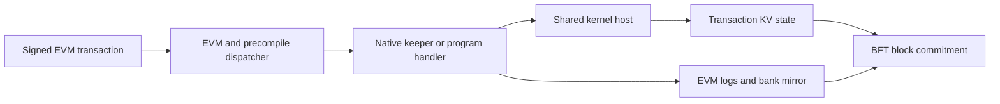

# Merged Paxeer network design

## One execution domain

Paxeer mainnet-beta runs one BFT state machine in `paxd`, with EVM chain ID `125` (`0x7d`). SDK modules, the EVM, CosmWasm and the native kernel execute against node state. A receipt is final when its block commits. Tenant domains share validator security and EVM state.

### Node assembly

[node/app.go](../../node/app.go) constructs the shared host and native keepers, registers modules and installs proposal and finalization handlers. [node/precompiles.go](../../node/precompiles.go) supplies application keeper access to native precompile constructors. [node/upgrades.go](../../node/upgrades.go) imports merge packages and applies the module activation gates.

### Kernel host inside paxd

[modules/lxphost/host.go](../../modules/lxphost/host.go) links the C kernel and Rust program sandbox through cgo. Host execution binds the verified authority and uses the caller's SDK KV context. [ctx.go](../../modules/lxphost/ctx.go) adapts kernel state access to that store. Cached transaction branches publish their writes only on success.

### OCC, CosmWasm and the EVM

The SDK execution engine supports optimistic concurrency. CosmWasm uses [wasm-runtime](../../wasm-runtime), while the EVM dispatches native calls through [precompiles/common](../../precompiles/common). Native host writes remain part of the enclosing transaction's state branch.

## Native constructs

[MergeAddressTable](../../precompiles/setup.go) lists thirteen addresses: five constructs and eight agent functions. Each short address below is zero-padded to twenty bytes. Constructors and activation gates determine the served set at a height; a registered address alone does not establish deployment activation.

| Address | Construct | Contract |
|---|---|---|
| `0x101A` | Ledger: assets, accounts and SEND payments | [Ledger and auth](contracts/ledger-auth.md) |
| `0x101B` | Escrow, budgets, streams and services | [Pay](contracts/pay.md) |
| `0x101C` | Session and capability authority | [Ledger and auth](contracts/ledger-auth.md#layerxauth-0x101c) |
| `0x101D` | Program lifecycle and execution | [Programs](contracts/programs.md) |
| `0x101E` | Tenant-domain registry | [Virtual chains](contracts/virtual-chains.md) |
| `0x0901`–`0x0908` | Agent functions | [Agent contract](contracts/agent-functions.md) |

Other native surfaces include bank `0x1001`, address/DID binding `0x1004`, perps `0x1015`, launchpad `0x1017`, fee token `0x1018`, xweb `0x1019`, pricefeed `0x1020` and spot rails `0x1021`–`0x1025`. The retained oracle precompile at `0x1008` refuses both queries. Versioned registration controls the historical address overlaps; see [markets](contracts/markets.md).

## Authority and state

Ledger, auth, pay and programs resolve the caller's current DID binding. The bound principal and verified authority enter the shared host; payload encoding does not grant authority. Activation, module enablement and pause policy apply at the served write path.

Ledger and auth module genesis exports hold params, while shared kernel records belong to the host store. Pay genesis additionally contains kernel records, escrow receipts and agent stream metadata. Payment-reference protection is persisted by the host and follows cache rollback, restart and host genesis recovery. See [ledger and auth](contracts/ledger-auth.md#idempotency) and [pay genesis](contracts/pay.md#genesis).

## Sequenced execution and commitment

The runtime under [node/sequencer](../../node/sequencer) is started by [paxd](../../daemon/paxd/cmd/root.go). It admits transactions, executes them on open block state, signs execution receipts, records and replicates WAL entries, and seals sequence batches for consensus. Receipt stages are `submitted`, `receipted` and `committed`.

`pax_sequencerReceipt` reports the receipt stage and signed execution data. `eth_getTransactionReceipt` remains a committed-receipt read. A receipt signature is authenticated against a governed key identifier and inclusive height range; a key supplied beside a receipt is not itself a trust pin. [The sequencer contract](contracts/sequencer.md) describes the envelope, batch, WAL and recovery.

## RPC and application services

Node JSON-RPC is served at the configured root path, with public namespaces `debug`, `echo`, `eth`, `net`, `pax`, `test` and `txpool`. gRPC and REST gateway listeners are configured separately. [RPC](contracts/rpc.md) identifies the listener defaults and handler sources.

Hosted gateway methods have their own [OpenRPC contract](../../services/platform/hosted/gateway/openrpc.json). The gateway, identity, indexers, funding, webhooks, agent and explorer components communicate with the same chain; their responses do not create a second transaction-finality stage. See [services](contracts/services.md).

## Programs and paid web requests

The [program runtime workspace](../../programs/Cargo.toml) contains the interpreter, sandbox, registry, arbiter and market crates. Guest ABI versions must agree with the host registration path. The AI market guest uses release `opt-level = "z"` and a deployment ceiling of `524288` bytes including its `104`-byte envelope. Its [deployment-domain reader](../../programs/crates/layerx-programs-ai-market/src/lib.rs) uses the chain-125 domain when `PAXAI_CHAIN_DOMAIN` is unset and accepts an override only when it matches that domain. The [guest recipe](../../programs/crates/layerx-programs-ai-market/tests/fixtures/guest-recipe.sh) compiles for `wasm32-unknown-unknown` and packages the guest with Binaryen 133.

[xweb](contracts/web.md) records paid requests and attested answers. Origin 1 is an EVM request with fee escrow, attestation, callback and timeout refund. Origin 2 records program fetch/search requests and observations. Attestor agreement concerns external data; block commitment determines transaction finality.

## Tenant domains

A virtual chain is a registry record and database namespace. Its derived EVM chain ID is `125000000 + id`; the root remains `125`. HTTP and WebSocket views use `/chain/<id>`. Domain admission, gas allowance, byte allowance and fees vary by registry record, while account state and validator security remain shared. [Virtual chains](contracts/virtual-chains.md) describes registration, fees, scoped reads and clients.

## Client contracts

Clients submit signed EVM transactions and use `eth_call` for reads and simulations. They verify signed receipts against independently pinned keys and distinguish receipt-stage evidence from block commitment. [Platform SDKs](contracts/platform-sdk.md), [examples](contracts/platform-examples.md), [MCP tools](contracts/mcp-tools.md) and [ramps](contracts/platform-ramps.md) identify their transport, encoding and authority boundaries.

