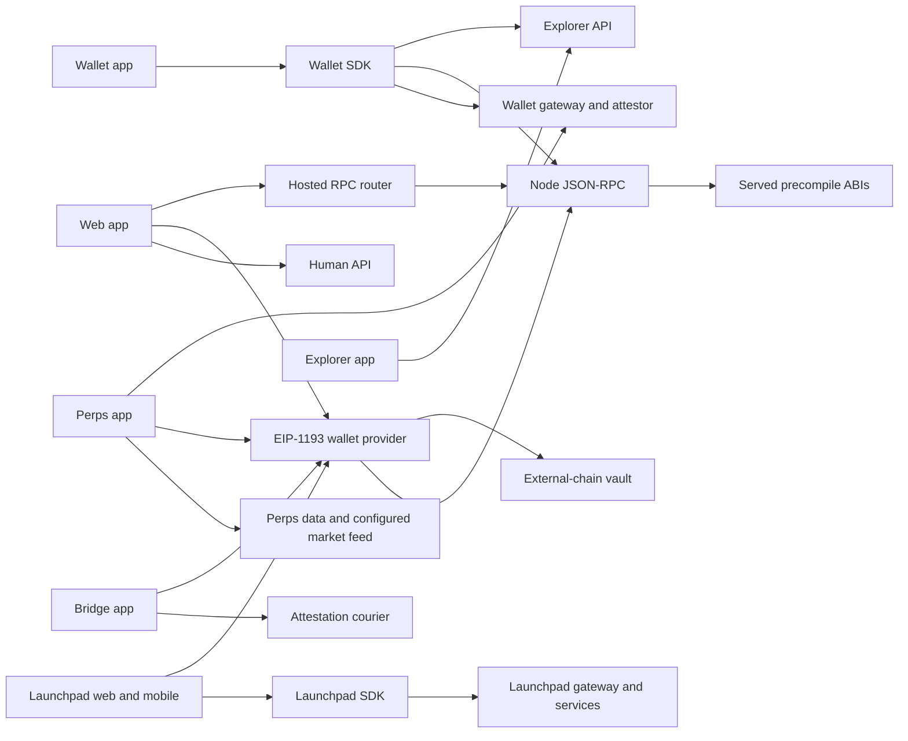
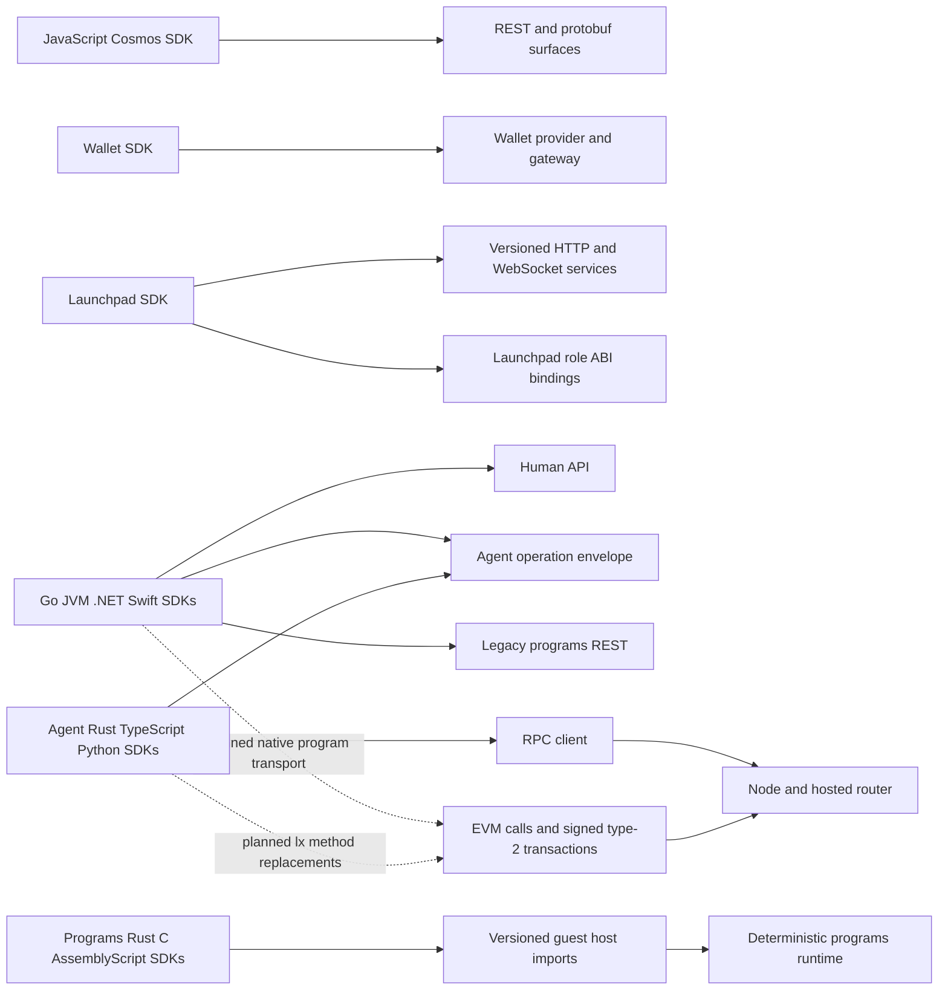
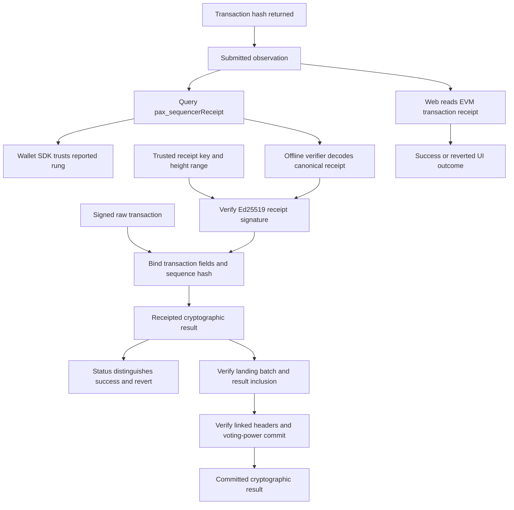

# Clients and SDKs

This schematic describes the six applications and the JavaScript, wallet, launchpad, platform, agent and programs SDKs at revision `2a1033aa2`. Interface IDs, pending migrations and qualification obligations come from the merged specification. In the application and SDK diagrams, a solid arrow is a caller boundary present at HEAD and a dashed arrow is a planned replacement. The receipt diagram shows the required verification sequence; its table identifies pending implementation. A returned transaction hash, an observed receipt and a cryptographically verified receipt are separate observations.

The [client contract](../../contracts/clients.md), [RPC contract](../../contracts/rpc.md), [sequencer contract](../../contracts/sequencer.md), [wallet SDK contract](../../contracts/clients.md#wallet-sdk), [launchpad contract](../../contracts/launchpad.md) and [programs contract](../../contracts/programs.md) define the receiving surfaces. The caller appendix gives each source site, the receiving interface IDs available in the merged document and their effective statuses. A status of `new` denotes planned code, including when an existing caller already needs that surface.

## Application and transport boundaries

| Client | Actual call boundary at HEAD | Planned change and task ownership |
|---|---|---|
| Web | Generated Human API client; server-side gateway JSON-RPC; injected wallet for signing. The server validates a session through account balance and session-list reads at `apps/web/src/auth/server-session.ts:12`. | `14.0.3` regenerates Human API types. `14.4.1`–`14.4.3` carry receipts and reverted outcomes. `14.6.1`–`14.8.2` retire mirror verification and custody journeys. |
| Wallet | `sdk/wallet` exposes both a browser provider adapter and authenticated gateway calls. Its current browser send returns the provider's hash at `sdk/wallet/src/wallet.ts:82`; gateway sends use `/v1/wallet/send` at `sdk/wallet/src/index.ts:264`. | `12.23.1`–`12.23.5` add bounded receipt reads and receipted sends. `12.24.1`–`12.25.4` replace joined/kernel reads; `12.27.2`, `12.28.1`–`12.28.3` retire activity and custody signing. |
| Explorer | Typed resource maps select the backend API. Transaction status and the live kernel lists are declared at `apps/explorer/lib/api/services/general/paxeerXLists.ts:6`; unified accounts are declared at `apps/explorer/lib/api/services/general/paxeerX.ts:6`. Optional analytics and metadata services have separate configured recipients. | `14.31.1`–`14.34.3` repoint the frontend to three rungs, unified accounts, signature evidence and frozen archives; `14.22.1`–`14.22.6` supply the backend verification path. |
| Launchpad | Web has its own wallet adapter at `apps/launchpad/web/src/core/wallet-sdk/client.ts:36`; mobile imports `SdkClient` directly at `apps/launchpad/mobile/src/runtime/service-client.ts:1`. Service HTTP, generated operations and stream adapters remain distinct from on-chain trading. | `4.43.4` and `4.47.1` pin served role runtime identities; `4.46.3`–`4.46.8` move mobile reads/streams to v2; `4.47.2`–`4.47.3` replace HTTP quotes with a block-pinned Quoter read. |
| Perps | The app already uses the pure-Go perps venue at `0x1015`; spot uses `0x1021`–`0x1025` under decisions `301`, `334`, `341`. Its GraphQL transport sends the supplied document and variables at `apps/perps/src/core/perfdb/client.ts:58`. | `3.48.3`, `3.48.5`–`3.48.7` use the gateway catalogue and chain limits; `3.47.1`–`3.47.2` gate ABI parity. Decision `343` retains the configured market feed for tickers, candles and explorer streams. |
| Bridge | Wallet writes target `0x1016` or the configured external-chain vault. The courier supplies an untrusted bundle; the client recomputes its digest and verifies recovered signers at `apps/bridge/src/components/bridge/transfer-actions.ts:131`. | `14.44.1`, `14.46.1` and `14.48.1` bind responses, recipient/asset/chain and receipt logs. `14.43.1` rejects an empty attestor set or zero threshold; `14.55.1`–`14.55.4` gate ABIs, chain IDs, errors and topics. |

The `0x1015` name is not enough to select an ABI. Decisions `1`, `301`, `323` and `1701` make the pure-Go perps ABI authoritative for live calls; the `layerxexchange` keeper and its legacy ABI remain for historical replay. The separate legacy and perps interface IDs are preserved in the appendix. SDK migration text that still asks for exchange-v2 calldata needs reconciliation with those decisions; it does not establish a second live venue.

## SDK layers

| SDK | Responsibility and boundary | Migration / conformance ownership |
|---|---|---|
| JavaScript | `@pax-js/cosmos` ships generated REST clients and protobuf encoders; package entry declarations are at `sdk/js/package.json:2`. It is a separate package from the browser EVM adapters and `sdk/wallet`. The matrix uses the ESM REST body once; CJS is the corresponding packaging form. | `14.0.1`, `14.1.1`–`14.3.10` align the package with current protos and retire absent access-control/mint clients. `14.3.6` percent-encodes tokenfactory path segments. No sequencer verifier is assigned to this generated Cosmos package. |
| Wallet | EIP-1193 discovery/provider, authenticated wallet gateway, bank/account/history clients, module calldata and display ladder. `PaxeerWallet.sendTransaction` and the gateway SDK method of the same name have different return types and recipients. | Domain 12 owns `12.21.1`–`12.29.2`. Decision `1222` explicitly trusts the node's reported rung; this SDK is not assigned offline signature verification. |
| Launchpad | `SdkClient` validates origins, contract payloads and sessions, and dispatches generated operation definitions; Go bindings dispatch role ABI calls. The generated operation catalogue starts at `sdk/launchpad/packages/sdk/src/operations.gen.ts:205`. | Domains 4 and its contract own the v1/v2/v3 service operations. `4.43.1`–`4.43.3` synchronize the three trading ABIs. An operation present in generated code can still have no served route, as with the HTTP quote replaced by `4.47.2`. |
| Platform Go/JVM/.NET/Swift | The shared operation catalogue contains 54 agent and 95 human operations at `sdk/platform/conformance/operations.json:3`. Agent operations with an empty catalogue path use the envelope; program operations with REST paths still use the legacy program transport at HEAD. | `8.41.*`, `8.42.*`, `8.43.*`, `8.44.*` own Go, JVM, .NET and Swift respectively. Suffix `.1` adds receipted verification, `.2` committed verification, `.3` native program transport, `.4` envelope major 2, `.5`/`.6` retire kernel verification/program REST, `.7` portable v2 and `.8` vector consumption. |
| Agent Rust/TypeScript/Python | Direct RPC clients, account derivation, EVM transaction construction, generated agent/human operations, native program payloads and payment helpers. Gateway `/v1/agent/rpc` and daemon `/rpc` are separate transport surfaces, selected at `services/agent/sdk/typescript/src/agent-http.ts:643`. | `9.33.2`–`9.36.1`, `9.91.1`, `9.92.1`, `9.96.1`, `9.97.1` migrate RPC, signing, receipts and generated errors; decisions `923`, `925`, `926` describe the retained RPC client and the replaced LNI transport. |
| Programs Rust/C/AssemblyScript | Guest libraries marshal calls into `layerx_v1`–`layerx_v4`; the manifest lists each imported function and machine signature at `programs/sdk/abi-manifest.tsv:1`. These are host calls inside execution, rather than HTTP calls to a program deployment service. | The published ABI remains stable. Runtime capability checks and byte-parity vectors qualify guest calls. The appendix enumerates every manifest row and its Rust, C and AssemblyScript import declaration. |

For the agent plane, the catalogue operation's `interface.9.http-rpc-*` ID identifies the semantic operation, while `interface.9.http-agent-rpc-post-rpc` identifies the daemon ingress. A gateway transport must use its gateway ingress before reaching that daemon operation. Sharing an operation name does not make gateway credentials valid on the daemon listener.

## Identity, signing keys and credentials

| Boundary | Identity and key authority | Source evidence / limitation |
|---|---|---|
| Injected wallet | The selected EVM account and chain authorize EIP-1193 signing. The app forwards a request to the provider; it does not obtain the private key. A wallet account/chain change invalidates a pending write. | `sdk/wallet/src/wallet.ts:154` and `apps/launchpad/web/src/core/wallet-sdk/client.ts:20`. |
| Embedded wallet | The authenticated gateway provisions the wallet and exposes transaction/message signing operations. Browser SDK calls carry a session, transaction or message; signing key material stays behind that service boundary. | `sdk/wallet/src/index.ts:253` and `apps/perps/src/core/wallet/embedded/sdk/index.ts:10`. |
| Derived LayerX identity | An EVM secp256k1 account and an Ed25519 identity are distinct keys. Seed derivation uses the EVM account index path and a separate Ed25519 derivation. Browser-wallet derivation canonicalizes the signature, checks recovered ownership and applies domain-separated HKDF. Binding is an explicit chain operation. | `services/agent/sdk/typescript/src/account-derivation.ts:185`, `services/agent/sdk/typescript/src/account-derivation.ts:334` and `services/agent/sdk/typescript/src/account-derivation.ts:361`. |
| Launchpad login | A wallet challenge binds the application origin, account, chain 125, nonce, exact message and expiry. Login proof is distinct from a transaction signature. Mobile authenticates cookie requests through the approved same-origin gateway. | `apps/launchpad/web/src/core/wallet-sdk/auth.ts:15` and `apps/launchpad/mobile/src/runtime/service-client.ts:9`. |
| Launchpad service requests | Bearer mode uses `Authorization`; cookie mode uses same-origin credentials and requires `X-CSRF-Token` for authenticated writes. Operation headers are allowlisted. | `sdk/launchpad/packages/sdk/src/transport.ts:110`, `sdk/launchpad/packages/sdk/src/transport.ts:115` and `sdk/launchpad/packages/sdk/src/transport.ts:101`. |
| Agent gateway and daemon | A gateway credential and agent-session proof are different from an EVM signer. The daemon transport requires HTTPS client-certificate/key credentials and rejects gateway credentials on that transport. | `services/agent/sdk/typescript/src/agent-http.ts:637`. Platform Go also separates `NewAgentDaemonEnvelopeHTTPTransport` from `NewAgentEnvelopeHTTPTransport` at `sdk/platform/go/http.go:566`. |
| Receipt authority | Receipt signing uses an Ed25519 key pinned by key ID and permitted height range. Decision `15` separates it from the validator key. A key supplied inside a portable bundle must match the verifier's trusted list; carrying a key in the bundle does not itself authorize it. | `services/agent/crates/layerx-proof/src/receipt.rs:666` and tasks `8.41.1`–`8.44.1`, `9.92.1`, `9.96.1`. |
| Guest program | The runtime supplies executing program, immediate caller and invoking principal; capabilities constrain storage, calls and transfers. The guest SDK does not sign an external EVM transaction for its caller. | `programs/sdk/rust/src/context.rs:77`, `programs/sdk/rust/src/context.rs:85` and `programs/sdk/rust/src/context.rs:106`. |

## Receipt observations and verification

The node defines `submitted`, `receipted` and `committed` at `rpc/sequencer_receipt.go:33`. The current wallet ladder still says `instant`, `sealed`, `final` at `sdk/wallet/src/ladder.ts:13`; `12.22.1` changes that model. Web display labels also have their own compatibility mapping under decision `1405`; a UI label alone is not evidence that a verifier ran.

| Check | Evidence required by the SDK migration tasks | Consequence |
|---|---|---|
| R1 | `pax_sequencerReceipt` returns receipt bytes and a receipted/committed answer. | A submitted-only or absent answer supplies no signed receipt. |
| R2 | Canonical decode and byte-exact re-encode; protocol version 2 or 3; nonzero activity ID; Ed25519 verification over SHA-256 of the `LXP/v1/receipt` domain with its NUL byte and unsigned receipt bytes. | Reject malformed encoding or a bad signature. HEAD receipt construction uses version 2 at `node/sequencer/receipt.go:24`. |
| R3 | Receipt `context_hash` identifies a trusted key; its receipt height lies in that key's inclusive authorized range. Primary and standby ranges can overlap under decision `36`. | Reject an unpinned key or an out-of-range signing height. |
| R4 | `activity_id` equals Keccak-256 of the exact signed raw transaction. | Reject a receipt for another transaction. |
| R5 | Returned JSON fields agree with decoded receipt fields; SHA-256 of `returnData` equals `activity_root`; decoded log effects agree with the reported logs. | Reject inconsistent RPC presentation. |
| R6 | Sequence hash equals SHA-256 of the NUL-terminated `PAXEER/v1/sequence` domain, previous hash, big-endian u64 sequence and activity ID. | R1–R6 together establish the receipted rung. |
| R7 | Landing EVM receipt status, gas and logs agree; landing height is at least receipt height and `MsgSequenceBatch` covers its sequence. Offline portable proof includes the batch-transaction inclusion and deterministic result-leaf inclusion through the linked headers. | A matching transaction hash or an indexed explorer row is insufficient for offline commitment. |
| R8 | The matching Comet header/commit/validator evidence verifies with strictly more than two-thirds voting power. | R7–R8 extend a receipted result to committed. The H/H+1 commit wording conflict in task `8.41.2` is retained as a reconciliation item below. |

The receipt checks are planned by `8.41.1`–`8.44.2`, `9.92.1` and the portable-v2 tasks. At HEAD, Go `VerifyReceiptOutcome` still takes an `AuthorizedBatch` at `sdk/platform/go/verify.go:149`; those old entry points remain until their wave-6 retirements under decision `842`. Existing Rust sequencer-signature verification is evidence for that check, not a claim that every SDK already performs the complete ladder.

The wallet SDK is deliberately weaker: decision `1222` and `12.23.1` decode and correlate the node's reported answer without checking its signature. Its planned polling helper has 30 attempts at 1000 ms by default, a target rung, cancellation and an explicit timeout (`12.23.2`). The web app instead polls `eth_getTransactionReceipt` up to 20 times at 500 ms and distinguishes reverted status (`14.4.1`, decision `1403`). Neither behavior should be described as R1–R8 offline verification.

Launchpad's optimistic receipt hook treats stream events as wake-up hints. It settles only after a chain receipt and matching block hash are read at `apps/launchpad/web/src/hooks/tx/use-optimistic-receipt.ts:40` and `apps/launchpad/web/src/hooks/tx/use-optimistic-receipt.ts:44`. Bridge threshold attestation checking is a separate proof: it verifies external deposit/release authority, while the eventual claim or release still needs its transaction receipt. A valid signature can authenticate a reverted outcome; signature verification does not establish execution success.

Portable v2 uses `format = layerx-receipt-proof-v2`, `verificationLevel`, `rawTransaction`, `signedReceipt`, `receiptDigest` and `receiptKey`; committed bundles also carry `blockHeader`, `receiptInclusion`, `commit` and `validatorSet` (decision `823`, tasks `8.41.7`–`8.44.7`). Receipted/committed evidence replaces the old batch, checkpoint and settlement authorization model. These fields describe the planned format, not a new format introduced by this schematic.

## Conformance vectors and gates

No application, SDK or repository test was executed to produce this document. Existing vectors are inspected inputs; tests named by pending tasks remain unqualified until those tasks run their specified gates.

| Vector family | HEAD evidence or planned artifact | Consumers / responsible tasks |
|---|---|---|
| Sequencer receipted corpus | `sdk/platform/conformance/fixtures/sequencer-receipt-v1.json` contains 11 cases at `sdk/platform/conformance/fixtures/sequencer-receipt-v1.json:10`; it is distinct from `receipt-sequencer-v1.json`, whose 7-vector corpus starts at `sdk/platform/conformance/fixtures/receipt-sequencer-v1.json:8`. | Existing `TestSequencerReceiptVectors` at `rpc/sequencer_receipt_vectors_test.go:537` and Rust `checked_in_vectors_verify_as_labelled` at `services/agent/crates/layerx-proof/tests/sequencer_corpus.rs:478`; platform receipted tasks `8.41.1`, `8.42.1`, `8.43.1`, `8.44.1` add consumers. |
| V1 / V2 / V3 | Planned `vector-v1-receipted-positive.json`, `vector-v2-receipted-revert.json`, `vector-v3-receipt-refusals.json` under `sdk/platform/conformance/fixtures/`; published from the existing sequencer cases by `8.47.7`. | `8.41.8` through `8.44.8` consume the new files; `8.41.1`–`8.44.1` check valid transfers/logs, receipted reverts and typed refusals. |
| V4 committed | Planned `sdk/platform/conformance/fixtures/vector-v4-committed.json`, sourced from `daemon/committed-fixture/vectors` through `5.55.5` and `8.47.7`. | Go/JVM/.NET/Swift committed verifiers; include insufficient voting power and tampered inclusion, not only a valid commit. |
| V5 portable | Planned `sdk/platform/conformance/fixtures/vector-v5-portable.json`, with one receipted and one committed portable v2 bundle. | `8.47.7`, `8.41.7`–`8.44.7`, and the language vector-consumption tasks. |
| Program lifecycle and intents | Existing payload bytes are retained and gain EVM transaction wrapping under decision `843`; `8.47.1`, `8.47.2`, `8.47.9` cover call, account derivation, intent plan, deploy, upgrade and wind-down. | Native program transports at `0x101D`; the old program REST paths and kernel receipt vectors retire through `8.41.6`–`8.44.6` and `8.47.4`–`8.47.6`. |
| Stream resume | Planned streams use log position and transaction hash rather than the kernel cursor. | `8.47.3`, `8.47.8`, `9.33.3`, `9.33.4`; the Rust streaming test names include their module path. |
| Wallet and web receipts | Planned wallet sequencer-answer fixtures (`12.21.2`) and bounded wait tests (`12.23.2`); web success/revert send tests (`14.4.1`). | These check polling/decoding and UI outcomes under their distinct trust models, not offline proof parity. |
| Explorer committed proof | Planned `services/explorer/backend/apps/explorer/test/support/fixture/paxeer_x/committed_vectors.json`; cases `committed-ok`, `r7-height-below-receipt`, `r8-commit-height-mismatch` under `14.22.1`. | `14.22.1`–`14.22.6` pass full evidence into backend verification and expose signature evidence to the frontend. |
| ABI and bridge parity | Current app, precompile, vault and relayer definitions; no newly invented selector or digest vector. | `3.47.1`–`3.47.2`, `4.43.1`–`4.43.3`, `14.55.1`–`14.55.4`. Bridge digest domains are defined at `apps/bridge/src/lib/bridge/digests.ts:29` and `apps/bridge/src/lib/bridge/digests.ts:31`. |
| Guest language ABI | `programs/sdk/abi-manifest.tsv`, `programs/sdk/vectors/capability-boundary.kvx` at `programs/sdk/vectors/capability-boundary.kvx:2`, and shared byte vectors tested at `programs/sdk/rust/tests/bindgen_conformance.rs:191`. | Rust/C/AssemblyScript guest marshalling and generated host clients; no live network or user key is part of this guest ABI comparison. |

## Caller matrix method and known boundaries

The appendix records logical operations as well as explicit dispatch sites. A loop that polls one method is one call site, not one row per runtime request. The source audit covers production `.ts`, `.tsx`, `.js`, `.py`, `.go`, `.rs`, `.java`, `.cs`, `.swift`, C headers and C implementations in the assigned trees; tests, examples, vendor packages and build outputs are excluded. The JavaScript SDK's shipped ESM REST code and the launchpad Go bindings are included because they contain its actual dispatch bodies. Generated catalogues are expanded so operations routed through a shared transport remain visible.

Rows use literal RPC methods, HTTP method/path templates, library-action mappings, ABI selectors/signatures or guest import names. `ANY` marks a resource catalogue that leaves the HTTP verb to its caller; it does not claim the server accepts arbitrary verbs. A library action denotes the provider operation; its transport may poll or batch requests. Node methods use domain-7 IDs, hosted `px_*` methods use domain-8 IDs, wallet signing uses provider IDs and service routes use receiving handler IDs. API route parameters are normalized to `{}`; optional resource parameters are shown in their expanded path form. ABI signatures retain their argument types. Several IDs can describe the gateway and downstream handler of one route. Status is taken from the merged specification, not inferred from a route string.

All printed source sites and receiver definitions are checked against the pinned repository. Interface caller arrays are search hints: RPC and ABI hints require the literal method or ABI function at their cited source line; HTTP rows come from source expressions and complete operation catalogues. General dispatcher sites are listed separately when their destination comes from an argument or configuration. A receiver gap means no suitable receiving interface ID was found; the source site remains visible. External EVM RPC calls use the shared method interface as a wire-shape reference; their configured chain and origin still determine the actual recipient. The table does not claim external service APIs are implemented in this repository, or that an absent route works.

Concrete gaps requiring reconciliation are retained in the appendix and reported to the integration audit. In particular, the generated JavaScript access-control/mint clients have no matching live proto routes and are already scheduled for retirement; the four legacy platform program-read REST paths still occur in the shared catalogue; legacy launchpad v1 snapshot/ticket/stream calls have no matching served route block; optional explorer service recipients are outside the backend inventory. These are separate from parameterized transport dispatchers.

Two cross-domain specification conflicts remain visible: some agent/attestor SDK tasks still name the legacy exchange-v2 ABI for live `0x1015` calls despite decisions `301`/`323`; and `8.41.2.do_3` asks for a commit at H while its offline proof uses the H+1 results header and the retained committed-codec description at `spec/layerx-merge/contracts/clients.md:189` specifies linked H+1 commit/validator evidence. This document preserves the task references and does not invent a replacement ABI or proof rule.

<!-- J86 CALLER APPENDIX -->
| Client family | Source edges | Logical rows before site splitting | Edges without a receiving ID |
|---|---:|---:|---:|
| Web | 200 | 173 | 24 |
| Wallet app | 190 | 126 | 105 |
| Explorer app | 331 | 289 | 107 |
| Launchpad app | 328 | 85 | 86 |
| Perps app | 332 | 205 | 63 |
| Bridge app | 64 | 32 | 4 |
| JavaScript SDK | 92 | 92 | 8 |
| Wallet SDK | 72 | 41 | 4 |
| Launchpad SDK | 460 | 429 | 31 |
| Platform SDKs | 161 | 154 | 16 |
| Agent SDKs | 182 | 63 | 12 |
| Programs SDKs | 112 | 28 | 0 |

The last column includes parameterized dispatchers and external recipients. Each such row states its available client-file surface, or explicitly records that none was inventoried. A client-file surface is not presented as a server implementation.

### Web

Outbound operations and source sites

| Protocol and target | Caller source sites | Receiving interface IDs and status |
|---|---|---|
| `HTTP` `DELETE /v1/sessions/{}` | `apps/web/src/api/generated/index.ts:5966` | `interface.10.http-human-session-revoke` [stable] |
| `HTTP` `GET /v1/account/balance` | `apps/web/src/api/generated/index.ts:5806` | `interface.10.http-human-account-balance` [change] |
| `HTTP` `GET /v1/accounts/{}/unified` | `apps/web/src/explorer/client.ts:206` `apps/web/src/explorer/client.ts:254` | `interface.10.http-explorer-account-unified` [retire] |
| `HTTP` `GET /v1/activity/{}` | `apps/web/src/api/generated/index.ts:5810` | `interface.10.http-human-activity-entry` [stable] |
| `HTTP` `GET /v1/agents` | `apps/web/src/api/generated/index.ts:5826` | `interface.10.http-human-agent-list` [stable] |
| `HTTP` `GET /v1/agents/{}` | `apps/web/src/api/generated/index.ts:5822` | `interface.10.http-human-agent-get` [stable] |
| `HTTP` `GET /v1/approvals` | `apps/web/src/api/generated/index.ts:5846` | `interface.10.http-human-approval-list` [stable] |
| `HTTP` `GET /v1/approvals/{}` | `apps/web/src/api/generated/index.ts:5844` | `interface.10.http-human-approval-get` [stable] |
| `HTTP` `GET /v1/evidence/{}` | `apps/web/src/api/generated/index.ts:5888` | `interface.10.http-human-evidence-get` [change] |
| `HTTP` `GET /v1/exit/eligibility` | `apps/web/src/api/generated/index.ts:5890` | `interface.10.http-human-exit-eligibility` [retire] |
| `HTTP` `GET /v1/explorer/accounts/{}` | `apps/web/src/explorer/client.ts:151` | Receiving ID unavailable. Client-file surface: `interface.14.ts-web-explorer-client-accountactivitypage` [change] |
| `HTTP` `GET /v1/explorer/receipts/{}` | `apps/web/src/explorer/client.ts:132` | Receiving ID unavailable. Client-file surface: `interface.14.ts-web-explorer-client-receiptrecord` [change] |
| `HTTP` `GET /v1/home` | `apps/web/src/api/generated/index.ts:5894` | `interface.10.http-human-home-summary` [change] |
| `HTTP` `GET /v1/journeys` | `apps/web/src/api/generated/index.ts:5902` | `interface.10.http-human-journey-list` [change] |
| `HTTP` `GET /v1/journeys/page/{}` | `apps/web/src/api/generated/index.ts:5904` | `interface.10.http-human-journey-page` [change] |
| `HTTP` `GET /v1/journeys/{}` | `apps/web/src/api/generated/index.ts:5900` | `interface.10.http-human-journey-get` [change] |
| `HTTP` `GET /v1/notifications` | `apps/web/src/api/generated/index.ts:5914` | `interface.10.http-human-notification-list` [stable] |
| `HTTP` `GET /v1/notifications/preferences` | `apps/web/src/api/generated/index.ts:5916` | `interface.10.http-human-notification-preferences-get` [stable] |
| `HTTP` `GET /v1/onboarding` | `apps/web/src/api/generated/index.ts:5924` | `interface.10.http-human-onboarding-status` [change] |
| `HTTP` `GET /v1/profile` | `apps/web/src/api/generated/index.ts:5934` | `interface.10.http-human-profile-get` [stable] |
| `HTTP` `GET /v1/program-approvals/page/{}` | `apps/web/src/api/generated/index.ts:5856` | `interface.10.http-human-approval-program-list` [stable] |
| `HTTP` `GET /v1/program-approvals/{}` | `apps/web/src/api/generated/index.ts:5854` | `interface.10.http-human-approval-program-get` [stable] |
| `HTTP` `GET /v1/program-approvals/{}/budget` | `apps/web/src/api/generated/index.ts:5850` | `interface.10.http-human-approval-program-budget` [stable] |
| `HTTP` `GET /v1/program-approvals/{}/material` | `apps/web/src/api/generated/index.ts:5858` | `interface.10.http-human-approval-program-material` [stable] |
| `HTTP` `GET /v1/programs/{}` | `apps/web/src/explorer/client.ts:165` | `interface.10.http-explorer-program` [retire] |
| `HTTP` `GET /v1/programs/{}/reads/resolve` | `apps/web/src/explorer/client.ts:311` | `interface.10.http-explorer-program-resolve` [retire] |
| `HTTP` `GET /v1/security/authenticators` | `apps/web/src/api/generated/index.ts:5872` | `interface.10.http-human-authenticator-status` [stable] |
| `HTTP` `GET /v1/security/passkeys` | `apps/web/src/api/generated/index.ts:5944` | `interface.10.http-human-security-passkey-list` [stable] |
| `HTTP` `GET /v1/sessions` | `apps/web/src/api/generated/index.ts:5960` | `interface.10.http-human-session-list` [stable] |
| `HTTP` `GET /v1/sessions/fee-policy` | `apps/web/src/api/generated/index.ts:5958` | `interface.10.http-human-session-fee-policy` [stable] |
| `HTTP` `GET /v1/stream/{}` | `apps/web/src/api/generated/index.ts:5974` | `interface.10.http-human-stream-next` [stable] `interface.10.http-human-stream-push-v2` [stable] |
| `HTTP` `GET /v1/support/conversations` | `apps/web/src/api/generated/index.ts:5982` | `interface.10.http-human-support-list` [stable] |
| `HTTP` `GET /v1/support/conversations/{}/status` | `apps/web/src/api/generated/index.ts:5988` | `interface.10.http-human-support-status` [stable] |
| `HTTP` `GET /v1/version` | `apps/web/src/api/generated/index.ts:5990` | `interface.10.http-human-version` [stable] |
| `HTTP` `GET /v1/wallet-binding` | `apps/web/src/api/generated/index.ts:5880` | `interface.10.http-human-binding-status` [retire] |
| `HTTP` `PATCH /v1/profile` | `apps/web/src/api/generated/index.ts:5936` | `interface.10.http-human-profile-update` [stable] |
| `HTTP` `POST /api/explorer/verify` | `apps/web/src/explorer/verifier.tsx:55` | `interface.14.http-web-post-api-explorer-verify` [retire] |
| `HTTP` `POST /api/performance/vitals` | `apps/web/src/api/performance-client.ts:13` `apps/web/src/api/performance-client.ts:19` | `interface.14.http-web-post-api-performance-vitals` [stable] |
| `HTTP` `POST /api/support/reports` | `apps/web/src/states/report.ts:92` | `interface.14.http-web-post-api-support-reports` [stable] |
| `HTTP` `POST /v1/accounts` | `apps/web/src/api/generated/index.ts:5808` | `interface.10.http-human-account-create` [stable] |
| `HTTP` `POST /v1/activity/exports/evidence` | `apps/web/src/api/generated/index.ts:5812` | `interface.10.http-human-activity-export-evidence` [change] |
| `HTTP` `POST /v1/activity/exports/statement` | `apps/web/src/api/generated/index.ts:5814` | `interface.10.http-human-activity-export-statement` [stable] |
| `HTTP` `POST /v1/activity/query` | `apps/web/src/api/generated/index.ts:5816` | `interface.10.http-human-activity-query` [stable] |
| `HTTP` `POST /v1/agents` | `apps/web/src/api/generated/index.ts:5820` | `interface.10.http-human-agent-create` [change] |
| `HTTP` `POST /v1/agents/{}/archive` | `apps/web/src/api/generated/index.ts:5818` | `interface.10.http-human-agent-archive` [stable] |
| `HTTP` `POST /v1/agents/{}/limit` | `apps/web/src/api/generated/index.ts:5824` | `interface.10.http-human-agent-limit` [stable] |
| `HTTP` `POST /v1/agents/{}/pause` | `apps/web/src/api/generated/index.ts:5828` | `interface.10.http-human-agent-pause` [stable] |
| `HTTP` `POST /v1/agents/{}/reclaim` | `apps/web/src/api/generated/index.ts:5830` | `interface.10.http-human-agent-reclaim` [stable] |
| `HTTP` `POST /v1/agents/{}/recover` | `apps/web/src/api/generated/index.ts:5832` | `interface.10.http-human-agent-recover` [stable] |
| `HTTP` `POST /v1/agents/{}/resume` | `apps/web/src/api/generated/index.ts:5834` | `interface.10.http-human-agent-resume` [stable] |
| `HTTP` `POST /v1/agents/{}/rotate` | `apps/web/src/api/generated/index.ts:5836` | `interface.10.http-human-agent-rotate` [stable] |
| `HTTP` `POST /v1/agents/{}/rotation` | `apps/web/src/api/generated/index.ts:5840` | `interface.10.http-human-agent-rotation-start` [stable] |
| `HTTP` `POST /v1/agents/{}/rotation/disclosure` | `apps/web/src/api/generated/index.ts:5838` | `interface.10.http-human-agent-rotation-disclosure` [stable] |
| `HTTP` `POST /v1/approvals/{}/approve` | `apps/web/src/api/generated/index.ts:5842` | `interface.10.http-human-approval-approve` [stable] |
| `HTTP` `POST /v1/approvals/{}/reject` | `apps/web/src/api/generated/index.ts:5862` | `interface.10.http-human-approval-reject` [stable] |
| `HTTP` `POST /v1/deposits` | `apps/web/src/api/generated/index.ts:5886` | `interface.10.http-human-deposit-start` [retire] |
| `HTTP` `POST /v1/deposits/{}/confirm` | `apps/web/src/api/generated/index.ts:5884` | `interface.10.http-human-deposit-confirm` [retire] |
| `HTTP` `POST /v1/exit` | `apps/web/src/api/generated/index.ts:5892` | `interface.10.http-human-exit-start` [retire] |
| `HTTP` `POST /v1/explorer/verify` | `apps/web/src/explorer/client.ts:346` | Receiving ID unavailable. Client-file surface: `interface.14.ts-web-explorer-client-verifyevidenceupstream` [retire] |
| `HTTP` `POST /v1/intents/plan` | `apps/web/src/api/generated/index.ts:5896` | `interface.10.http-human-intent-plan` [change] |
| `HTTP` `POST /v1/intents/submit` | `apps/web/src/api/generated/index.ts:5898` | `interface.10.http-human-intent-submit` [change] |
| `HTTP` `POST /v1/moves` | `apps/web/src/api/generated/index.ts:5906` | `interface.10.http-human-move-commit` [change] |
| `HTTP` `POST /v1/moves/quote` | `apps/web/src/api/generated/index.ts:5908` | `interface.10.http-human-move-quote` [change] |
| `HTTP` `POST /v1/native/send/access/begin` | `apps/web/src/api/generated/index.ts:5910` | `interface.10.http-human-native-send-access-begin` [change] |
| `HTTP` `POST /v1/native/send/access/confirm` | `apps/web/src/api/generated/index.ts:5912` | `interface.10.http-human-native-send-access-confirm` [change] |
| `HTTP` `POST /v1/notifications/preferences` | `apps/web/src/api/generated/index.ts:5918` | `interface.10.http-human-notification-preferences-set` [stable] |
| `HTTP` `POST /v1/notifications/{}/read` | `apps/web/src/api/generated/index.ts:5920` | `interface.10.http-human-notification-read` [stable] |
| `HTTP` `POST /v1/onboarding/resume` | `apps/web/src/api/generated/index.ts:5922` | `interface.10.http-human-onboarding-resume` [change] |
| `HTTP` `POST /v1/passkeys/assertions` | `apps/web/src/api/generated/index.ts:5926` | `interface.10.http-human-passkey-assert-begin` [stable] |
| `HTTP` `POST /v1/passkeys/assertions/{}` | `apps/web/src/api/generated/index.ts:5928` | `interface.10.http-human-passkey-assert-finish` [stable] |
| `HTTP` `POST /v1/passkeys/registrations` | `apps/web/src/api/generated/index.ts:5930` | `interface.10.http-human-passkey-register-begin` [stable] |
| `HTTP` `POST /v1/passkeys/registrations/{}` | `apps/web/src/api/generated/index.ts:5932` | `interface.10.http-human-passkey-register-finish` [stable] |
| `HTTP` `POST /v1/program-approvals/{}/approve` | `apps/web/src/api/generated/index.ts:5848` | `interface.10.http-human-approval-program-approve` [change] |
| `HTTP` `POST /v1/program-approvals/{}/disclosure` | `apps/web/src/api/generated/index.ts:5852` | `interface.10.http-human-approval-program-disclosure` [stable] |
| `HTTP` `POST /v1/program-approvals/{}/reject` | `apps/web/src/api/generated/index.ts:5860` | `interface.10.http-human-approval-program-reject` [stable] |
| `HTTP` `POST /v1/security/actions` | `apps/web/src/api/generated/index.ts:5938` | `interface.10.http-human-security-action` [stable] |
| `HTTP` `POST /v1/security/authenticators/backup-codes` | `apps/web/src/api/generated/index.ts:5864` | `interface.10.http-human-authenticator-backup-rotate` [stable] |
| `HTTP` `POST /v1/security/authenticators/setups` | `apps/web/src/api/generated/index.ts:5868` | `interface.10.http-human-authenticator-setup-begin` [stable] |
| `HTTP` `POST /v1/security/authenticators/setups/{}` | `apps/web/src/api/generated/index.ts:5870` | `interface.10.http-human-authenticator-setup-finish` [stable] |
| `HTTP` `POST /v1/security/authenticators/{}/disable` | `apps/web/src/api/generated/index.ts:5866` | `interface.10.http-human-authenticator-disable` [stable] |
| `HTTP` `POST /v1/security/key-export/begin` | `apps/web/src/api/generated/index.ts:5940` | `interface.10.http-human-security-key-export-begin` [stable] |
| `HTTP` `POST /v1/security/key-export/finish` | `apps/web/src/api/generated/index.ts:5942` | `interface.10.http-human-security-key-export-finish` [stable] |
| `HTTP` `POST /v1/security/passkeys/registrations` | `apps/web/src/api/generated/index.ts:5946` | `interface.10.http-human-security-passkey-register-begin` [stable] |
| `HTTP` `POST /v1/security/passkeys/registrations/{}` | `apps/web/src/api/generated/index.ts:5948` | `interface.10.http-human-security-passkey-register-finish` [stable] |
| `HTTP` `POST /v1/security/passkeys/{}/revoke` | `apps/web/src/api/generated/index.ts:5950` | `interface.10.http-human-security-passkey-revoke` [stable] |
| `HTTP` `POST /v1/security/recovery/evidence` | `apps/web/src/api/generated/index.ts:5952` | `interface.10.http-human-security-recovery-reveal` [stable] |
| `HTTP` `POST /v1/security/sessions/revoke-all` | `apps/web/src/api/generated/index.ts:5956` | `interface.10.http-human-security-session-revoke-all` [stable] |
| `HTTP` `POST /v1/security/sessions/{}/revoke` | `apps/web/src/api/generated/index.ts:5954` | `interface.10.http-human-security-session-revoke` [stable] |
| `HTTP` `POST /v1/sessions` | `apps/web/src/api/generated/index.ts:5962` | `interface.10.http-human-session-open` [stable] |
| `HTTP` `POST /v1/sessions/refresh` | `apps/web/src/api/generated/index.ts:5964` | `interface.10.http-human-session-refresh` [stable] |
| `HTTP` `POST /v1/sessions/revoke-all` | `apps/web/src/api/generated/index.ts:5968` | `interface.10.http-human-session-revoke-all` [stable] |
| `HTTP` `POST /v1/step-up` | `apps/web/src/api/generated/index.ts:5970` | `interface.10.http-human-stepup-begin` [stable] |
| `HTTP` `POST /v1/step-up/{}` | `apps/web/src/api/generated/index.ts:5972` | `interface.10.http-human-stepup-finish` [stable] |
| `HTTP` `POST /v1/stream` | `apps/web/src/api/generated/index.ts:5976` | `interface.10.http-human-stream-open` [stable] |
| `HTTP` `POST /v1/support/conversations` | `apps/web/src/api/generated/index.ts:5978` | `interface.10.http-human-support-create` [stable] |
| `HTTP` `POST /v1/support/conversations/{}/feedback` | `apps/web/src/api/generated/index.ts:5980` | `interface.10.http-human-support-feedback` [stable] |
| `HTTP` `POST /v1/support/conversations/{}/read` | `apps/web/src/api/generated/index.ts:5984` | `interface.10.http-human-support-read` [stable] |
| `HTTP` `POST /v1/support/conversations/{}/replies` | `apps/web/src/api/generated/index.ts:5986` | `interface.10.http-human-support-reply` [stable] |
| `HTTP` `POST /v1/wallet-binding` | `apps/web/src/api/generated/index.ts:5882` | `interface.10.http-human-binding-submit` [retire] |
| `HTTP` `POST /v1/wallet-binding/rebind` | `apps/web/src/api/generated/index.ts:5874` | `interface.10.http-human-binding-rebind` [retire] |
| `HTTP` `POST /v1/wallet-binding/rebind/action` | `apps/web/src/api/generated/index.ts:5876` | `interface.10.http-human-binding-rebind-action` [retire] |
| `HTTP` `POST /v1/wallet-binding/statement` | `apps/web/src/api/generated/index.ts:5878` | `interface.10.http-human-binding-statement` [retire] |
| `HTTP` `POST /v1/withdrawals` | `apps/web/src/api/generated/index.ts:5994` | `interface.10.http-human-withdraw-start` [retire] |
| `HTTP` `POST /v1/withdrawals/{}/claim` | `apps/web/src/api/generated/index.ts:5992` | `interface.10.http-human-withdraw-claim` [retire] |
| `dispatcher` `HTTP with argument-derived destination: endpoint` | `apps/web/src/api/gas-station.ts:104` | Receiving ID unavailable. Client-file surface: `interface.14.ts-web-api-gas-station-sendsponsoredbatch` [change] |
| `dispatcher` `HTTP with argument-derived destination: gatewayEndpoint(` | `apps/web/src/api/gateway.ts:75` | Receiving ID unavailable. Client-file surface: `interface.14.ts-web-api-gateway-gatewayrpcerror` [stable] |
| `dispatcher` `HTTP with argument-derived destination: url` | `apps/web/src/explorer/client.ts:168` `apps/web/src/explorer/client.ts:216` `apps/web/src/explorer/client.ts:264` `apps/web/src/explorer/client.ts:315` `apps/web/src/explorer/client.ts:349` `apps/web/src/explorer/client.ts:99` | Receiving ID unavailable. Client-file surface: `interface.14.ts-web-explorer-client-explorerlink` [stable] `interface.14.ts-web-explorer-client-programrecord` [change] `interface.14.ts-web-explorer-client-resolvename` [change] `interface.14.ts-web-explorer-client-unifiedaccount` [change] `interface.14.ts-web-explorer-client-unifiedaccountavailability` [change] `interface.14.ts-web-explorer-client-verifyevidenceupstream` [retire] |
| `dispatcher` `beacon POST with configured or argument-derived destination` | `apps/web/src/api/performance-client.ts:12` | Receiving ID unavailable. Client-file surface: `interface.14.ts-web-api-performance-client-submitwebvital` [stable] |
| `dispatcher` `fetch with configured or argument-derived destination` | `apps/web/src/api/gas-station.ts:104` `apps/web/src/api/gateway.ts:75` `apps/web/src/api/generated/index.ts:5664` `apps/web/src/api/performance-client.ts:19` `apps/web/src/explorer/client.ts:168` `apps/web/src/explorer/client.ts:216` | Receiving ID unavailable. Client-file surface: `interface.14.ts-web-api-gas-station-sendsponsoredbatch` [change] `interface.14.ts-web-api-gateway-gatewayrpcerror` [stable] `interface.14.ts-web-api-generated-index-createhumanapiclient` [stable] `interface.14.ts-web-api-performance-client-submitwebvital` [stable] `interface.14.ts-web-explorer-client-explorerlink` [stable] `interface.14.ts-web-explorer-client-programrecord` [change] `interface.14.ts-web-explorer-client-resolvename` [change] `interface.14.ts-web-explorer-client-unifiedaccount` [change] `interface.14.ts-web-explorer-client-unifiedaccountavailability` [change] `interface.14.ts-web-explorer-client-verifyevidenceupstream` [retire] `interface.14.ts-web-explorer-verifier-evidenceverifier` [retire] `interface.14.ts-web-states-report-redacterrorreport` [stable] |
| `dispatcher` `fetch with configured or argument-derived destination` | `apps/web/src/explorer/client.ts:264` `apps/web/src/explorer/client.ts:315` `apps/web/src/explorer/client.ts:349` `apps/web/src/explorer/client.ts:99` `apps/web/src/explorer/verifier.tsx:55` `apps/web/src/states/report.ts:92` | Receiving ID unavailable. Client-file surface: `interface.14.ts-web-api-gas-station-sendsponsoredbatch` [change] `interface.14.ts-web-api-gateway-gatewayrpcerror` [stable] `interface.14.ts-web-api-generated-index-createhumanapiclient` [stable] `interface.14.ts-web-api-performance-client-submitwebvital` [stable] `interface.14.ts-web-explorer-client-explorerlink` [stable] `interface.14.ts-web-explorer-client-programrecord` [change] `interface.14.ts-web-explorer-client-resolvename` [change] `interface.14.ts-web-explorer-client-unifiedaccount` [change] `interface.14.ts-web-explorer-client-unifiedaccountavailability` [change] `interface.14.ts-web-explorer-client-verifyevidenceupstream` [retire] `interface.14.ts-web-explorer-verifier-evidenceverifier` [retire] `interface.14.ts-web-states-report-redacterrorreport` [stable] |
| `jsonrpc` `eth_accounts` | `apps/web/src/journeys/custody/handoff.ts:174` | `interface.7.rpc-eth-accounts` [stable] |
| `jsonrpc` `eth_blockNumber` | `apps/web/src/api/gateway.ts:126` | `interface.7.rpc-eth-blocknumber` [stable] |
| `jsonrpc` `eth_call` | `apps/web/src/api/gateway.ts:118` | `interface.7.rpc-eth-call` [stable] |
| `jsonrpc` `eth_chainId` | `apps/web/src/api/wallet.ts:67` `apps/web/src/journeys/custody/handoff.ts:175` | `interface.7.rpc-eth-chainid` [stable] |
| `jsonrpc` `eth_estimateGas` | `apps/web/src/api/wallet.ts:71` | `interface.7.rpc-eth-estimategas` [stable] |
| `jsonrpc` `eth_gasPrice` | `apps/web/src/api/wallet.ts:74` | `interface.7.rpc-eth-gasprice` [stable] |
| `jsonrpc` `eth_getCode` | `apps/web/src/api/gateway.ts:185` | `interface.7.rpc-eth-getcode` [stable] |
| `jsonrpc` `eth_getLogs` | `apps/web/src/api/gateway.ts:142` | `interface.7.rpc-eth-getlogs` [change] |
| `jsonrpc` `eth_requestAccounts` | `apps/web/src/api/wallet.ts:47` `apps/web/src/settings/wallet/bridge.ts:57` | `interface.12.rpc-sdk-provider-eth-request-accounts` [stable] |
| `jsonrpc` `eth_sendTransaction` | `apps/web/src/journeys/custody/handoff.ts:246` | `interface.7.rpc-eth-sendtransaction` [stable] |
| `jsonrpc` `paxeer_custodyStatus` | `apps/web/src/journeys/custody/handoff.ts:216` | `interface.12.rpc-sdk-provider-paxeer-custody-status` [retire] |
| `jsonrpc` `paxeer_recoverCustody` | `apps/web/src/journeys/custody/handoff.ts:205` | `interface.12.rpc-sdk-provider-paxeer-recover-custody` [retire] |
| `jsonrpc` `paxeer_restoreCustody` | `apps/web/src/journeys/custody/handoff.ts:226` `apps/web/src/journeys/custody/handoff.ts:242` | `interface.12.rpc-sdk-provider-paxeer-restore-custody` [retire] |
| `jsonrpc` `paxeer_signCustody` | `apps/web/src/journeys/custody/handoff.ts:236` | `interface.12.rpc-sdk-provider-paxeer-sign-custody` [retire] |
| `jsonrpc` `personal_sign` | `apps/web/src/settings/wallet/bridge.ts:73` | `interface.12.rpc-sdk-provider-personal-sign` [stable] |
| `jsonrpc` `px_getCapabilities` | `apps/web/src/api/gateway.ts:199` `apps/web/src/api/gateway.ts:201` | `interface.8.rpc-gateway-px-getcapabilities` [stable] |
| `jsonrpc` `px_getHistory` | `apps/web/src/api/gateway.ts:394` `apps/web/src/api/gateway.ts:400` `apps/web/src/app/_markets/activity-feed.tsx:37` | `interface.8.rpc-gateway-px-gethistory` [stable] |
| `jsonrpc` `px_getUnifiedHistory` | `apps/web/src/api/gateway.ts:403` `apps/web/src/api/gateway.ts:409` `apps/web/src/app/_markets/activity-feed.tsx:36` | `interface.8.rpc-gateway-px-getunifiedhistory` [stable] |
| `jsonrpc` `px_resolveAccount` | `apps/web/src/api/gateway.ts:253` | `interface.8.rpc-gateway-px-resolveaccount` [stable] |
| `precompile` `0x1015 cancelOrder(uint256)` | `apps/web/src/app/exchange/exchange-client.tsx:235` | `interface.3.pc-0x1015-cancelorder` [stable] |
| `precompile` `0x1015 closePosition(uint256)` | `apps/web/src/app/exchange/exchange-client.tsx:210` | `interface.3.pc-0x1015-closeposition` [stable] |
| `precompile` `0x1015 deposit(address,uint256)` | `apps/web/src/app/exchange/exchange-client.tsx:260` | `interface.3.pc-0x1015-deposit` [stable] |
| `precompile` `0x1015 getAccountSummary(address,address)` | `apps/web/src/api/precompiles.ts:555` | `interface.3.pc-0x1015-getaccountsummary-65d53f6c` [stable] |
| `precompile` `0x1015 getMarket(uint256)` | `apps/web/src/api/precompiles.ts:467` | `interface.3.pc-0x1015-getmarket` [stable] |
| `precompile` `0x1015 getOrder(uint256)` | `apps/web/src/api/precompiles.ts:579` | `interface.3.pc-0x1015-getorder` [stable] |
| `precompile` `0x1015 getPosition(uint256)` | `apps/web/src/api/precompiles.ts:563` | `interface.3.pc-0x1015-getposition` [stable] |
| `precompile` `0x1015 getUserOrderIds(address)` | `apps/web/src/api/precompiles.ts:557` | `interface.3.pc-0x1015-getuserorderids` [stable] |
| `precompile` `0x1015 getUserPositionIds(address)` | `apps/web/src/api/precompiles.ts:556` | `interface.3.pc-0x1015-getuserpositionids` [stable] |
| `precompile` `0x1015 openPosition(uint256,address,uint256,uint256,bool)` | `apps/web/src/app/exchange/exchange-client.tsx:169` | `interface.3.pc-0x1015-openposition` [stable] |
| `precompile` `0x1015 totalMarkets()` | `apps/web/src/api/precompiles.ts:460` | `interface.3.pc-0x1015-totalmarkets` [stable] |
| `precompile` `0x1015 withdraw(address,uint256)` | `apps/web/src/app/exchange/exchange-client.tsx:273` | `interface.3.pc-0x1015-withdraw` [stable] |
| `precompile` `0x1016 bridgeOut(uint64,address,uint256,address)` | `apps/web/src/app/bridge/bridge-client.tsx:133` | `interface.6.pc-0x1016-bridgeout` [stable] |
| `precompile` `0x1016 getAttestors()` | `apps/web/src/api/precompiles.ts:311` | `interface.6.pc-0x1016-getattestors` [stable] |
| `precompile` `0x1016 getCap(uint64,address)` | `apps/web/src/api/precompiles.ts:294` | `interface.6.pc-0x1016-getcap` [stable] |
| `precompile` `0x1016 getChain(uint64)` | `apps/web/src/api/precompiles.ts:277` | `interface.6.pc-0x1016-getchain` [stable] |
| `precompile` `0x1016 isNullified(uint64,bytes32,uint64)` | `apps/web/src/api/precompiles.ts:326` | `interface.6.pc-0x1016-isnullified` [stable] |
| `precompile` `0x1016 isPaused()` | `apps/web/src/api/precompiles.ts:270` | `interface.6.pc-0x1016-ispaused` [stable] |
| `precompile` `0x1017 baseFeeBps()` | `apps/web/src/api/precompiles.ts:207` | `interface.4.pc-protocol-config-base-fee-bps` [stable] |
| `precompile` `0x1017 buy(address,uint256,uint256,uint256)` | `apps/web/src/app/launchpad/launchpad-client.tsx:146` | `interface.4.pc-router-buy` [stable] |
| `precompile` `0x1017 createMarket(string,string,uint8,address)` | `apps/web/src/app/launchpad/launchpad-client.tsx:167` | `interface.4.pc-router-create-market` [stable] `interface.4.pc-sidiora-factory-create-market` [stable] |
| `precompile` `0x1017 creationFee()` | `apps/web/src/api/precompiles.ts:204` | `interface.4.pc-protocol-config-creation-fee` [stable] |
| `precompile` `0x1017 getAllPools(uint256,uint256)` | `apps/web/src/api/precompiles.ts:191` | `interface.4.pc-pool-registry-get-all-pools` [stable] `interface.4.pc-quoter-get-all-pools` [stable] |
| `precompile` `0x1017 getPoolByToken(address)` | `apps/web/src/api/precompiles.ts:220` | `interface.4.pc-pool-registry-get-pool-by-token` [stable] |
| `precompile` `0x1017 getPoolCount()` | `apps/web/src/api/precompiles.ts:151` | `interface.4.pc-pool-registry-get-pool-count` [stable] |
| `precompile` `0x1017 getPoolMetadata(address)` | `apps/web/src/api/precompiles.ts:159` | `interface.4.pc-pool-registry-get-pool-metadata` [stable] |
| `precompile` `0x1017 getPoolStats(address)` | `apps/web/src/api/precompiles.ts:156` | `interface.4.pc-quoter-get-pool-stats` [stable] |
| `precompile` `0x1017 maxFeeBps()` | `apps/web/src/api/precompiles.ts:206` | `interface.4.pc-protocol-config-max-fee-bps` [stable] |
| `precompile` `0x1017 minFeeBps()` | `apps/web/src/api/precompiles.ts:205` | `interface.4.pc-protocol-config-min-fee-bps` [stable] |
| `precompile` `0x1017 nftContract()` | `apps/web/src/api/precompiles.ts:194` | `interface.4.pc-fees-router-nft-contract` [stable] `interface.4.pc-sidiora-factory-nft-contract` [stable] |
| `precompile` `0x1017 quoteExactInput(address,uint256,bool)` | `apps/web/src/api/precompiles.ts:226` | `interface.4.pc-quoter-quote-exact-input` [stable] |
| `precompile` `0x1017 sell(address,uint256,uint256,uint256)` | `apps/web/src/app/launchpad/launchpad-client.tsx:146` | `interface.4.pc-router-sell` [stable] |
| `precompile` `0x1017 usdlAddress()` | `apps/web/src/api/precompiles.ts:203` | `interface.4.pc-fee-accumulator-usdl-address` [stable] `interface.4.pc-protocol-config-usdl-address` [stable] `interface.4.pc-router-usdl-address` [stable] `interface.4.pc-sidiora-factory-usdl-address` [stable] `interface.4.pc-sidiora-pool-usdl-address` [stable] |
| `precompile` `erc20 approve(address,uint256)` | `apps/web/src/app/exchange/exchange-client.tsx:48` `apps/web/src/app/launchpad/launchpad-client.tsx:59` | `interface.3.pc-spotshare-approve` [stable] `interface.4.pc-sidiora-nft-approve` [stable] |
| `precompile` `getAccountSummary(address) view returns ((uint256,uint256,uint256))` | `apps/web/src/api/precompiles.ts:555` | `interface.3.pc-0x1015-getaccountsummary-43ad2977` [stable] |
| `precompile` `getAccountSummary(address,address) view returns ((uint256,uint256,uint256))` | `apps/web/src/api/precompiles.ts:555` | `interface.3.pc-0x1015-getaccountsummary-65d53f6c` [stable] |
| `precompile` `getUserOrderIds(address) view returns (uint256[])` | `apps/web/src/api/precompiles.ts:544` | `interface.3.pc-0x1015-getuserorderids` [stable] |
| `precompile` `getUserPositionIds(address) view returns (uint256[])` | `apps/web/src/api/precompiles.ts:544` | `interface.3.pc-0x1015-getuserpositionids` [stable] |
| `precompile` `isNullified(uint64,bytes32,uint64) view returns (bool)` | `apps/web/src/api/precompiles.ts:326` | `interface.6.pc-0x1016-isnullified` [stable] |
| `precompile` `runtime:feeRights getFeeStrategy(uint256)` | `apps/web/src/api/precompiles.ts:168` | `interface.4.pc-sidiora-nft-get-fee-strategy` [stable] |
| `precompile` `runtime:pool paused()` | `apps/web/src/api/precompiles.ts:160` | `interface.3.pc-0x1021-paused` [stable] `interface.3.pc-0x1022-paused` [stable] `interface.3.pc-0x1023-paused` [stable] `interface.4.pc-sidiora-pool-paused` [stable] |
| `precompile` `runtime:token name()` | `apps/web/src/api/precompiles.ts:165` | `interface.3.pc-spotshare-name` [stable] `interface.4.pc-sidiora-nft-name` [stable] |
| `precompile` `runtime:token symbol()` | `apps/web/src/api/precompiles.ts:166` | `interface.3.pc-spotshare-symbol` [stable] `interface.4.pc-sidiora-nft-symbol` [stable] |
| `precompile` `runtime:token totalSupply()` | `apps/web/src/api/precompiles.ts:167` | `interface.3.pc-spotshare-totalsupply` [stable] `interface.4.pc-sidiora-nft-total-supply` [stable] |
| `precompile` `runtime:usdl symbol()` | `apps/web/src/api/precompiles.ts:209` | `interface.3.pc-spotshare-symbol` [stable] `interface.4.pc-sidiora-nft-symbol` [stable] |

### Wallet app

Outbound operations and source sites

| Protocol and target | Caller source sites | Receiving interface IDs and status |
|---|---|---|
| `HTTP` `ANY /api/v1/addresses/{}` | `apps/wallet/src/server/wallet-read-proxy.ts:50` | Receiving ID unavailable. Client-file surface: `interface.12.ts-app-wallet-read-route` [stable] |
| `HTTP` `ANY /api/v1/addresses:lookup` | `apps/wallet/src/server/wallet-read-proxy.ts:33` | Receiving ID unavailable. Client-file surface: `interface.12.ts-app-wallet-read-route` [stable] |
| `HTTP` `ANY /api/v1/domains/{}` | `apps/wallet/src/server/wallet-read-proxy.ts:38` | Receiving ID unavailable. Client-file surface: `interface.12.ts-app-wallet-read-route` [stable] |
| `HTTP` `ANY /api/v1/domains/{}/events` | `apps/wallet/src/server/wallet-read-proxy.ts:44` | Receiving ID unavailable. Client-file surface: `interface.12.ts-app-wallet-read-route` [stable] |
| `HTTP` `ANY /api/v1/domains:lookup` | `apps/wallet/src/server/wallet-read-proxy.ts:56` | Receiving ID unavailable. Client-file surface: `interface.12.ts-app-wallet-read-route` [stable] |
| `HTTP` `GET /api/v1/addresses/{}` | `apps/wallet/src/lib/pns.ts:225` `apps/wallet/src/server/wallet-read-proxy.ts:50` | Receiving ID unavailable. Client-file surface: `interface.12.ts-app-fetch-address-name` [stable] `interface.12.ts-app-wallet-read-route` [stable] |
| `HTTP` `GET /api/v1/addresses:lookup` | `apps/wallet/src/lib/pns.ts:190` `apps/wallet/src/server/wallet-read-proxy.ts:33` | Receiving ID unavailable. Client-file surface: `interface.12.ts-app-fetch-owned-domains` [stable] `interface.12.ts-app-wallet-read-route` [stable] |
| `HTTP` `GET /api/v1/charts/{}` | `apps/wallet/src/lib/api.ts:252` | Receiving ID unavailable. Client-file surface: `interface.12.ts-app-fetch-asset-chart` [stable] |
| `HTTP` `GET /api/v1/domains/{}` | `apps/wallet/src/lib/pns.ts:202` `apps/wallet/src/server/wallet-read-proxy.ts:38` | Receiving ID unavailable. Client-file surface: `interface.12.ts-app-fetch-domain-detail` [stable] `interface.12.ts-app-wallet-read-route` [stable] |
| `HTTP` `GET /api/v1/domains/{}/events` | `apps/wallet/src/lib/pns.ts:213` `apps/wallet/src/server/wallet-read-proxy.ts:44` | Receiving ID unavailable. Client-file surface: `interface.12.ts-app-fetch-domain-events` [stable] `interface.12.ts-app-wallet-read-route` [stable] |
| `HTTP` `GET /api/v1/domains:lookup` | `apps/wallet/src/lib/pns.ts:241` `apps/wallet/src/server/wallet-read-proxy.ts:56` | Receiving ID unavailable. Client-file surface: `interface.12.ts-app-lookup-domain` [stable] `interface.12.ts-app-wallet-read-route` [stable] |
| `HTTP` `GET /api/v1/portfolio/{}/charts/holdings` | `apps/wallet/src/lib/api.ts:227` | Receiving ID unavailable. Client-file surface: `interface.12.ts-app-fetch-holdings-chart` [stable] |
| `HTTP` `GET /api/v1/portfolio/{}/charts/pnl` | `apps/wallet/src/lib/api.ts:221` | Receiving ID unavailable. Client-file surface: `interface.12.ts-app-fetch-pnl-chart` [stable] |
| `HTTP` `GET /api/v1/portfolio/{}/charts/tx-volume` | `apps/wallet/src/lib/api.ts:233` | Receiving ID unavailable. Client-file surface: `interface.12.ts-app-fetch-tx-volume-chart` [stable] |
| `HTTP` `GET /api/v1/portfolio/{}/charts/value` | `apps/wallet/src/lib/api.ts:215` | Receiving ID unavailable. Client-file surface: `interface.12.ts-app-fetch-portfolio-value-chart` [stable] |
| `HTTP` `GET /api/v1/portfolio/{}/pnl` | `apps/wallet/src/lib/api.ts:207` | Receiving ID unavailable. Client-file surface: `interface.12.ts-app-fetch-pnl-history` [stable] |
| `HTTP` `GET /api/v1/trending` | `apps/wallet/src/lib/api.ts:255` | Receiving ID unavailable. Client-file surface: `interface.12.ts-app-fetch-trending` [stable] |
| `HTTP` `GET /api/v1/{}/dex-history` | `apps/wallet/src/lib/api.ts:429` | Receiving ID unavailable. Client-file surface: `interface.12.ts-app-fetch-enriched-rankings` [stable] |
| `HTTP` `GET /api/v1/{}/performance` | `apps/wallet/src/lib/api.ts:241` | Receiving ID unavailable. Client-file surface: `interface.12.ts-app-fetch-user-performance` [stable] |
| `HTTP` `GET /api/v1/{}/profile` | `apps/wallet/src/lib/api.ts:244` | Receiving ID unavailable. Client-file surface: `interface.12.ts-app-fetch-user-profile` [stable] |
| `HTTP` `GET /api/v1/{}/rank` | `apps/wallet/src/lib/api.ts:238` | Receiving ID unavailable. Client-file surface: `interface.12.ts-app-fetch-user-rank` [stable] |
| `HTTP` `GET /api/v2/watch` | `apps/wallet/src/lib/portfolio-api/watch.ts:18` | Receiving ID unavailable. Client-file surface: `interface.12.ts-app-lib-portfolio-api-watch-watch-address` [stable] |
| `HTTP` `GET /api/v2/watch/{}` | `apps/wallet/src/lib/portfolio-api/watch.ts:22` `apps/wallet/src/lib/portfolio-api/watch.ts:29` | Receiving ID unavailable. Client-file surface: `interface.12.ts-app-lib-portfolio-api-watch-get-watch-status` [stable] `interface.12.ts-app-lib-portfolio-api-watch-unwatch-address` [stable] |
| `HTTP` `GET /api/v2/webhooks` | `apps/wallet/src/lib/portfolio-api/webhooks.ts:24` `apps/wallet/src/lib/portfolio-api/webhooks.ts:30` | Receiving ID unavailable. Client-file surface: `interface.12.ts-app-lib-portfolio-api-webhooks-create-webhook` [stable] `interface.12.ts-app-lib-portfolio-api-webhooks-list-webhooks` [stable] |
| `HTTP` `GET /api/v2/webhooks/{}` | `apps/wallet/src/lib/portfolio-api/webhooks.ts:37` `apps/wallet/src/lib/portfolio-api/webhooks.ts:44` `apps/wallet/src/lib/portfolio-api/webhooks.ts:51` | Receiving ID unavailable. Client-file surface: `interface.12.ts-app-lib-portfolio-api-webhooks-delete-webhook` [stable] `interface.12.ts-app-lib-portfolio-api-webhooks-get-webhook` [stable] `interface.12.ts-app-lib-portfolio-api-webhooks-update-webhook` [stable] |
| `HTTP` `GET /api/v2/webhooks/{}/deliveries` | `apps/wallet/src/lib/portfolio-api/webhooks.ts:57` | Receiving ID unavailable. Client-file surface: `interface.12.ts-app-lib-portfolio-api-webhooks-get-webhook-deliveries` [stable] |
| `HTTP` `GET /v2/addresses/{}` | `apps/wallet/src/lib/data/api/addresses.ts:24` | Receiving ID unavailable. Client-file surface: `interface.12.ts-app-get-address` [stable] |
| `HTTP` `GET /v2/addresses/{}/coin-balance-history` | `apps/wallet/src/lib/data/api/addresses.ts:108` | Receiving ID unavailable. Client-file surface: `interface.12.ts-app-get-address-coin-balance-history` [stable] |
| `HTTP` `GET /v2/addresses/{}/coin-balance-history-by-day` | `apps/wallet/src/lib/data/api/addresses.ts:119` | Receiving ID unavailable. Client-file surface: `interface.12.ts-app-get-address-coin-balance-history-by-day` [stable] |
| `HTTP` `GET /v2/addresses/{}/counters` | `apps/wallet/src/lib/data/api/addresses.ts:30` | Receiving ID unavailable. Client-file surface: `interface.12.ts-app-get-address-counters` [stable] |
| `HTTP` `GET /v2/addresses/{}/logs` | `apps/wallet/src/lib/data/api/addresses.ts:158` | Receiving ID unavailable. Client-file surface: `interface.12.ts-app-get-address-logs` [stable] |
| `HTTP` `GET /v2/addresses/{}/nft` | `apps/wallet/src/lib/data/api/addresses.ts:134` | Receiving ID unavailable. Client-file surface: `interface.12.ts-app-get-address-nfts` [stable] |
| `HTTP` `GET /v2/addresses/{}/nft/collections` | `apps/wallet/src/lib/data/api/addresses.ts:146` | Receiving ID unavailable. Client-file surface: `interface.12.ts-app-get-address-nft-collections` [stable] |
| `HTTP` `GET /v2/addresses/{}/tabs-counters` | `apps/wallet/src/lib/data/api/addresses.ts:37` | Receiving ID unavailable. Client-file surface: `interface.12.ts-app-get-address-tabs-counters` [stable] |
| `HTTP` `GET /v2/addresses/{}/token-balances` | `apps/wallet/src/lib/data/api/addresses.ts:97` | Receiving ID unavailable. Client-file surface: `interface.12.ts-app-get-address-token-balances` [stable] |
| `HTTP` `GET /v2/addresses/{}/token-transfers` | `apps/wallet/src/lib/data/api/addresses.ts:72` | Receiving ID unavailable. Client-file surface: `interface.12.ts-app-get-address-token-transfers` [stable] |
| `HTTP` `GET /v2/addresses/{}/tokens` | `apps/wallet/src/lib/data/api/addresses.ts:88` | Receiving ID unavailable. Client-file surface: `interface.12.ts-app-get-address-tokens` [stable] |
| `HTTP` `GET /v2/addresses/{}/transactions` | `apps/wallet/src/lib/data/api/addresses.ts:54` | Receiving ID unavailable. Client-file surface: `interface.12.ts-app-get-address-transactions` [stable] |
| `HTTP` `GET /v2/main-page/blocks` | `apps/wallet/src/lib/data/api/stats.ts:36` | Receiving ID unavailable. Client-file surface: `interface.12.ts-app-get-main-page-blocks` [stable] |
| `HTTP` `GET /v2/main-page/transactions` | `apps/wallet/src/lib/data/api/stats.ts:30` | Receiving ID unavailable. Client-file surface: `interface.12.ts-app-get-main-page-transactions` [stable] |
| `HTTP` `GET /v2/search` | `apps/wallet/src/lib/data/api/search.ts:28` | `interface.4.http-api-get-v2-search-dev-discovery` [stable] `interface.4.http-api-get-v2-search-rest` [stable] `interface.4.http-stats-workers-get-v2-search` [stable] |
| `HTTP` `GET /v2/stats` | `apps/wallet/src/lib/data/api/stats.ts:24` | Receiving ID unavailable. Client-file surface: `interface.12.ts-app-get-stats` [stable] |
| `HTTP` `GET /v2/tokens` | `apps/wallet/src/lib/data/api/tokens.ts:20` | Receiving ID unavailable. Client-file surface: `interface.12.ts-app-get-tokens` [stable] |
| `HTTP` `GET /v2/tokens/{}` | `apps/wallet/src/lib/data/api/tokens.ts:28` | Receiving ID unavailable. Client-file surface: `interface.12.ts-app-get-token` [stable] |
| `HTTP` `GET /v2/tokens/{}/holders` | `apps/wallet/src/lib/data/api/tokens.ts:45` | Receiving ID unavailable. Client-file surface: `interface.12.ts-app-get-token-holders` [stable] |
| `HTTP` `GET /v2/transactions/{}` | `apps/wallet/src/lib/data/api/transactions.ts:11` | `interface.4.http-api-get-v2-transactions-transaction-hash-authority` [stable] `interface.4.http-api-get-v2-transactions-transaction-hash-network-reads` [stable] |
| `HTTP` `GET /v2/transactions/{}/logs` | `apps/wallet/src/lib/data/api/transactions.ts:33` | Receiving ID unavailable. Client-file surface: `interface.12.ts-app-get-transaction-logs` [stable] |
| `HTTP` `GET /v2/transactions/{}/token-transfers` | `apps/wallet/src/lib/data/api/transactions.ts:21` | Receiving ID unavailable. Client-file surface: `interface.12.ts-app-get-transaction-token-transfers` [stable] |
| `HTTP` `GET /v6/latest/USD` | `apps/wallet/src/server/wallet-read-proxy.ts:67` | Receiving ID unavailable. Client-file surface: `interface.12.ts-app-wallet-read-route` [stable] |
| `HTTP` `POST /v1/chat/completions` | `apps/wallet/src/app/api/chat/route.ts:129` | Receiving ID unavailable. No client-file interface block inventoried. |
| `calldata encode` `PNS public resolver setAddr(bytes32,address) 0xd5fa2b00` | `apps/wallet/src/lib/pns.ts:312` | Receiving ID unavailable. Client-file surface: `interface.12.ts-app-commit-name` [stable] |
| `calldata encode` `token transfer(address,uint256) 0xa9059cbb` | `apps/wallet/src/lib/eip681.ts:102` `apps/wallet/src/wallet/session.ts:107` | `interface.3.pc-spotshare-transfer` [stable] `interface.4.sol-lp-erc20-base-transfer-j11` [stable] `interface.4.sol-lp-wpax9-transfer-j11` [stable] |
| `contract call/write` `PECOR marketBuy(address,address,uint256,uint256,uint256) 0x77a61952` | `apps/wallet/src/lib/swap/sdk/pecor.ts:118` | `interface.3.pc-0x1021-marketbuy` [stable] `interface.4.sol-lp-ipecor-market-buy-j11` [stable] `interface.4.sol-lp-pecor-market-buy-j11` [stable] |
| `contract call/write` `PECOR marketSell(address,address,uint256,uint256,uint256) 0x57f24201` | `apps/wallet/src/lib/swap/sdk/pecor.ts:135` | `interface.3.pc-0x1021-marketsell` [stable] `interface.4.sol-lp-ipecor-market-sell-j11` [stable] `interface.4.sol-lp-pecor-market-sell-j11` [stable] |
| `contract call/write` `PECOR swapExactIn(address,address,uint256,uint256,uint256) 0x55a124be` | `apps/wallet/src/lib/swap/executor.ts:77` `apps/wallet/src/lib/swap/sdk/pecor.ts:100` | `interface.3.pc-0x1021-swapexactin` [stable] `interface.4.sol-lp-ipecor-swap-exact-in-j11` [stable] `interface.4.sol-lp-pecor-swap-exact-in-j11` [stable] |
| `contract call/write` `PECOR swapExactInNative(address,uint256,uint256) 0xbac7a125` | `apps/wallet/src/lib/swap/executor.ts:69` `apps/wallet/src/lib/swap/sdk/pecor.ts:94` | `interface.3.pc-0x1021-swapexactinnative` [stable] `interface.4.sol-lp-ipecor-swap-exact-in-native-j11` [stable] `interface.4.sol-lp-pecor-swap-exact-in-native-j11` [stable] |
| `contract call/write` `PECOR swapExactInToNative(address,uint256,uint256,uint256) 0xce9e0cae` | `apps/wallet/src/lib/swap/executor.ts:73` `apps/wallet/src/lib/swap/sdk/pecor.ts:97` | `interface.3.pc-0x1021-swapexactintonative` [stable] `interface.4.sol-lp-ipecor-swap-exact-in-to-native-j11` [stable] `interface.4.sol-lp-pecor-swap-exact-in-to-native-j11` [stable] |
| `contract call/write` `PECOROrders cancelLimitOrder(uint256) 0xa5cdc8fc` | `apps/wallet/src/lib/swap/sdk/pecor.ts:214` | `interface.3.pc-0x1022-cancellimitorder` [stable] `interface.4.sol-lp-ipecororders-cancel-limit-order-j11` [stable] `interface.4.sol-lp-pecororders-cancel-limit-order-j11` [stable] |
| `contract call/write` `PECOROrders getLimitOrder(uint256) 0x53061026` | `apps/wallet/src/lib/swap/sdk/pecor.ts:233` | `interface.3.pc-0x1022-getlimitorder` [stable] `interface.4.sol-lp-ipecororders-get-limit-order-j11` [stable] `interface.4.sol-lp-pecororders-get-limit-order-j11` [stable] |
| `contract call/write` `PECOROrders getUserLimitOrders(address) 0xdd5d02e6` | `apps/wallet/src/lib/swap/sdk/pecor.ts:223` | `interface.3.pc-0x1022-getuserlimitorders` [stable] `interface.4.sol-lp-ipecororders-get-user-limit-orders-j11` [stable] `interface.4.sol-lp-pecororders-get-user-limit-orders-j11` [stable] |
| `contract call/write` `PECOROrders placeLimitBuy(address,address,uint256,uint256,uint256) 0x947de5b1` | `apps/wallet/src/lib/swap/sdk/pecor.ts:179` | `interface.3.pc-0x1022-placelimitbuy` [stable] `interface.4.sol-lp-ipecororders-place-limit-buy-j11` [stable] `interface.4.sol-lp-pecororders-place-limit-buy-j11` [stable] |
| `contract call/write` `PECOROrders placeLimitSell(address,address,uint256,uint256,uint256) 0x31880832` | `apps/wallet/src/lib/swap/sdk/pecor.ts:200` | `interface.3.pc-0x1022-placelimitsell` [stable] `interface.4.sol-lp-ipecororders-place-limit-sell-j11` [stable] `interface.4.sol-lp-pecororders-place-limit-sell-j11` [stable] |
| `contract call/write` `PECORQuoter quoteExactIn(address,address,uint256) 0x12be4fe0` | `apps/wallet/src/lib/swap/sdk/pecor.ts:47` | `interface.3.pc-0x1024-quoteexactin` [stable] `interface.4.sol-lp-imeta-agquoter-quote-exact-in-j11` [stable] `interface.4.sol-lp-meta-agquoter-quote-exact-in-j11` [stable] |
| `contract call/write` `PECORQuoter quoteMarketBuy(address,address,uint256) 0x6f6ac6a2` | `apps/wallet/src/lib/swap/sdk/pecor.ts:58` | `interface.3.pc-0x1024-quotemarketbuy` [stable] `interface.4.sol-lp-imeta-agquoter-quote-market-buy-j11` [stable] `interface.4.sol-lp-meta-agquoter-quote-market-buy-j11` [stable] |
| `contract call/write` `PECORQuoter quoteMarketSell(address,address,uint256) 0x5323412e` | `apps/wallet/src/lib/swap/sdk/pecor.ts:69` | `interface.3.pc-0x1024-quotemarketsell` [stable] `interface.4.sol-lp-imeta-agquoter-quote-market-sell-j11` [stable] `interface.4.sol-lp-meta-agquoter-quote-market-sell-j11` [stable] |
| `contract call/write` `PECORStopOrders cancelStopLimitOrder(uint256) 0x1f407810` | `apps/wallet/src/lib/swap/sdk/pecor.ts:320` | `interface.3.pc-0x1023-cancelstoplimitorder` [stable] `interface.4.sol-lp-ipecororders-cancel-stop-limit-order-j11` [stable] `interface.4.sol-lp-pecororders-cancel-stop-limit-order-j11` [stable] |
| `contract call/write` `PECORStopOrders cancelStopLossOrder(uint256) 0xc62bf4dc` | `apps/wallet/src/lib/swap/sdk/pecor.ts:312` | `interface.3.pc-0x1023-cancelstoplossorder` [stable] |
| `contract call/write` `PECORStopOrders getStopLimitOrder(uint256) 0x307ff324` | `apps/wallet/src/lib/swap/sdk/pecor.ts:351` | `interface.3.pc-0x1023-getstoplimitorder` [stable] `interface.4.sol-lp-ipecororders-get-stop-limit-order-j11` [stable] `interface.4.sol-lp-pecororders-get-stop-limit-order-j11` [stable] |
| `contract call/write` `PECORStopOrders getStopLossOrder(uint256) 0x4c34cf02` | `apps/wallet/src/lib/swap/sdk/pecor.ts:342` | `interface.3.pc-0x1023-getstoplossorder` [stable] |
| `contract call/write` `PECORStopOrders getUserStopLimitOrders(address) 0xe93c4673` | `apps/wallet/src/lib/swap/sdk/pecor.ts:331` | `interface.3.pc-0x1023-getuserstoplimitorders` [stable] `interface.4.sol-lp-ipecororders-get-user-stop-limit-orders-j11` [stable] `interface.4.sol-lp-pecororders-get-user-stop-limit-orders-j11` [stable] |
| `contract call/write` `PECORStopOrders getUserStopLossOrders(address) 0x21297b41` | `apps/wallet/src/lib/swap/sdk/pecor.ts:330` | `interface.3.pc-0x1023-getuserstoplossorders` [stable] |
| `contract call/write` `PECORStopOrders placeStopLimitBuy(address,address,uint256,uint256,uint256,uint256) 0xafbf4a9b` | `apps/wallet/src/lib/swap/sdk/pecor.ts:275` | `interface.3.pc-0x1023-placestoplimitbuy` [stable] `interface.4.sol-lp-ipecororders-place-stop-limit-buy-j11` [stable] `interface.4.sol-lp-pecororders-place-stop-limit-buy-j11` [stable] |
| `contract call/write` `PECORStopOrders placeStopLimitSell(address,address,uint256,uint256,uint256,uint256) 0x5b377378` | `apps/wallet/src/lib/swap/sdk/pecor.ts:298` | `interface.3.pc-0x1023-placestoplimitsell` [stable] `interface.4.sol-lp-ipecororders-place-stop-limit-sell-j11` [stable] `interface.4.sol-lp-pecororders-place-stop-limit-sell-j11` [stable] |
| `contract call/write` `PECORStopOrders placeStopLoss(address,address,uint256,uint256,uint256) 0x695970ef` | `apps/wallet/src/lib/swap/sdk/pecor.ts:250` | `interface.3.pc-0x1023-placestoploss` [stable] `interface.4.sol-lp-ipecororders-place-stop-loss-j11` [stable] `interface.4.sol-lp-pecororders-place-stop-loss-j11` [stable] |
| `contract call/write` `PECORVault getReserves(address) 0x3e99c1e4` | `apps/wallet/src/lib/swap/sdk/pecor.ts:162` | `interface.3.pc-0x1025-getreserves` [stable] `interface.4.pc-v610-get-reserves` [stable] `interface.4.sol-lp-ipecorvault-get-reserves-j11` [stable] |
| `contract call/write` `PNS controller available(string) 0xaeb8ce9b` | `apps/wallet/src/lib/pns.ts:260` | Receiving ID unavailable. Client-file surface: `interface.12.ts-app-check-availability` [stable] |
| `contract call/write` `PNS controller commit(bytes32) 0xf14fcbc8` | `apps/wallet/src/lib/pns.ts:339` | Receiving ID unavailable. Client-file surface: `interface.12.ts-app-commit-name` [stable] |
| `contract call/write` `PNS controller makeCommitment((string,address,uint256,bytes32,address,bytes[],uint8,bytes32)) 0xcf7d6e01` | `apps/wallet/src/lib/pns.ts:337` | Receiving ID unavailable. Client-file surface: `interface.12.ts-app-commit-name` [stable] |
| `contract call/write` `PNS controller minCommitmentAge() 0x8d839ffe` | `apps/wallet/src/lib/pns.ts:271` | Receiving ID unavailable. Client-file surface: `interface.12.ts-app-get-min-commitment-age` [stable] |
| `contract call/write` `PNS controller register((string,address,uint256,bytes32,address,bytes[],uint8,bytes32)) 0xef9c8805` | `apps/wallet/src/lib/pns.ts:359` | Receiving ID unavailable. Client-file surface: `interface.12.ts-app-register-name` [stable] |
| `contract call/write` `PNS controller renew(string,uint256) 0xacf1a841` | `apps/wallet/src/lib/pns.ts:376` | Receiving ID unavailable. Client-file surface: `interface.12.ts-app-renew-name` [stable] |
| `contract call/write` `PNS controller rentPrice(string,uint256) 0x83e7f6ff` | `apps/wallet/src/lib/pns.ts:265` | Receiving ID unavailable. Client-file surface: `interface.12.ts-app-get-rent-price` [stable] |
| `contract call/write` `PNS reverse registrar setName(string) 0xc47f0027` | `apps/wallet/src/lib/pns.ts:407` | Receiving ID unavailable. Client-file surface: `interface.12.ts-app-set-primary-name` [stable] |
| `contract call/write` `PriceOracle getPrice(address) 0x41976e09` | `apps/wallet/src/lib/swap/sdk/pecor.ts:148` | `interface.4.pc-v610-get-price` [stable] `interface.4.sol-lp-ioracle-hub-get-price-j11` [stable] `interface.4.sol-lp-iprice-oracle-get-price-j11` [stable] |
| `contract call/write` `PriceOracle isPriceStale(address) 0x17fdb62f` | `apps/wallet/src/lib/swap/sdk/pecor.ts:149` | `interface.4.sol-ipriceoracle-ispricestale-17fdb62f` [stable] `interface.4.sol-lp-iprice-oracle-is-price-stale-j11` [stable] `interface.4.sol-lp-price-oracle-is-price-stale-j11` [stable] |
| `contract call/write` `Sidiora PoolRegistry getPoolByToken(address) 0xbbadc03b` | `apps/wallet/src/lib/swap/sdk/sidiora.ts:38` | `interface.4.pc-pool-registry-get-pool-by-token` [stable] `interface.4.sol-lp-ipool-registry-get-pool-by-token-j11` [stable] `interface.4.sol-lp-pool-registry-get-pool-by-token-j11` [stable] |
| `contract call/write` `Sidiora Quoter quoteExactInput(address,uint256,bool) 0x4d9f71e4` | `apps/wallet/src/lib/swap/sdk/sidiora.ts:105` `apps/wallet/src/lib/swap/sdk/sidiora.ts:95` | `interface.4.pc-quoter-quote-exact-input` [stable] `interface.4.sol-lp-iquoter-quote-exact-input-j11` [stable] `interface.4.sol-lp-quoter-quote-exact-input-j11` [stable] |
| `contract call/write` `Sidiora Quoter quoteMultihop(address,address,uint256) 0x7f1737ce` | `apps/wallet/src/lib/swap/sdk/sidiora.ts:116` | `interface.4.pc-quoter-quote-multihop` [stable] `interface.4.sol-lp-iquoter-quote-multihop-j11` [stable] `interface.4.sol-lp-quoter-quote-multihop-j11` [stable] |
| `contract call/write` `Sidiora Router buy(address,uint256,uint256,uint256) 0x1622dbe4` | `apps/wallet/src/lib/swap/executor.ts:110` `apps/wallet/src/lib/swap/sdk/sidiora.ts:154` | `interface.4.pc-router-buy` [stable] `interface.4.sol-lp-irouter-buy-j11` [stable] `interface.4.sol-lp-router-buy-j11` [stable] |
| `contract call/write` `Sidiora Router sell(address,uint256,uint256,uint256) 0x92cdbac5` | `apps/wallet/src/lib/swap/executor.ts:104` `apps/wallet/src/lib/swap/sdk/sidiora.ts:192` | `interface.4.pc-router-sell` [stable] `interface.4.sol-lp-irouter-sell-j11` [stable] `interface.4.sol-lp-router-sell-j11` [stable] |
| `contract call/write` `Sidiora Router swapTokenToToken(address,address,uint256,uint256,uint256) 0xdebd7c8a` | `apps/wallet/src/lib/swap/executor.ts:130` `apps/wallet/src/lib/swap/sdk/sidiora.ts:211` | Receiving ID unavailable. Client-file surface: `interface.12.ts-app-lib-swap-executor-execute-swap` [change] `interface.12.ts-app-swap-token-to-token` [stable] |
| `contract call/write` `token or pool at poolAddress getPrice() 0x98d5fdca` | `apps/wallet/src/lib/swap/sdk/sidiora.ts:72` | `interface.4.pc-sidiora-pool-get-price` [stable] `interface.4.sol-lp-isidiora-pool-get-price-j11` [stable] `interface.4.sol-lp-sidiora-pool-get-price-j11` [stable] |
| `contract call/write` `token or pool at poolAddress getReserves() 0x0902f1ac` | `apps/wallet/src/lib/swap/sdk/sidiora.ts:73` | `interface.4.pc-sidiora-pool-get-reserves` [stable] `interface.4.sol-lp-isidiora-pool-get-reserves-j11` [stable] `interface.4.sol-lp-sidiora-pool-get-reserves-j11` [stable] |
| `contract call/write` `token or pool at t.address balanceOf(address) 0x70a08231` | `apps/wallet/src/hooks/useRpcBalances.ts:52` | `interface.3.pc-spotshare-balanceof` [stable] `interface.4.pc-sidiora-nft-balance-of` [stable] `interface.4.sol-lp-wpax9-balance-of-j11` [stable] |
| `contract call/write` `token or pool at token.contract_hash transferFrom(address,address,uint256) 0x23b872dd` | `apps/wallet/src/lib/pns.ts:394` | `interface.3.pc-spotshare-transferfrom` [stable] `interface.4.pc-sidiora-nft-transfer-from` [stable] `interface.4.sol-lp-wpax9-transfer-from-j11` [stable] |
| `contract call/write` `token or pool at tokenAddress allowance(address,address) 0xdd62ed3e` | `apps/wallet/src/lib/swap/sdk/pecor.ts:28` `apps/wallet/src/lib/swap/sdk/sidiora.ts:128` | `interface.3.pc-spotshare-allowance` [stable] `interface.4.sol-lp-erc20-base-allowance-j11` [stable] `interface.4.sol-lp-wpax9-allowance-j11` [stable] |
| `contract call/write` `token or pool at tokenAddress approve(address,uint256) 0x095ea7b3` | `apps/wallet/src/lib/swap/sdk/pecor.ts:30` `apps/wallet/src/lib/swap/sdk/sidiora.ts:130` | `interface.3.pc-spotshare-approve` [stable] `interface.4.pc-sidiora-nft-approve` [stable] `interface.4.sol-lp-wpax9-approve-j11` [stable] |
| `dispatcher` `fetch with configured or argument-derived destination` | `apps/wallet/src/app/api/chat/route.ts:129` `apps/wallet/src/app/api/health/route.ts:35` `apps/wallet/src/app/api/health/route.ts:61` `apps/wallet/src/app/api/health/route.ts:71` `apps/wallet/src/app/api/media/route.ts:27` `apps/wallet/src/app/api/sdk/[...path]/route.ts:36` | Receiving ID unavailable. Client-file surface: `interface.12.ts-app-blockscout-client` [stable] `interface.12.ts-app-fetch-address-name` [stable] `interface.12.ts-app-fetch-crossverse-history` [stable] `interface.12.ts-app-fetch-crossverse-price` [stable] `interface.12.ts-app-fetch-domain-detail` [stable] `interface.12.ts-app-fetch-domain-events` [stable] `interface.12.ts-app-fetch-launchpad-tokens` [stable] `interface.12.ts-app-fetch-owned-domains` [stable] `interface.12.ts-app-fetch-pax-history` [stable] `interface.12.ts-app-fetch-pax-price-latest` [stable] `interface.12.ts-app-fetch-points-balance` [stable] `interface.12.ts-app-fetch-sid-candles` [stable] `interface.12.ts-app-fetch-sidiora-candles` [stable] `interface.12.ts-app-get-active-currency` [stable] `interface.12.ts-app-lookup-domain` [stable] `interface.12.ts-app-portfolio-api-error` [stable] `interface.12.ts-app-proxy-json-get` [stable] `interface.12.ts-app-proxy-wallet-read` [stable] `interface.12.ts-app-set-wallet-address-for-push` [stable] `interface.12.ts-app-token-metadata-public` [stable] `interface.12.ts-app-validate-rpc-endpoint` [stable] |
| `dispatcher` `fetch with configured or argument-derived destination` | `apps/wallet/src/app/api/sidiora/logo/[...path]/route.ts:46` `apps/wallet/src/app/api/wallet/[...path]/route.ts:123` `apps/wallet/src/components/TransferSuccess.tsx:108` `apps/wallet/src/lib/api.ts:133` `apps/wallet/src/lib/api.ts:153` `apps/wallet/src/lib/api.ts:327` | Receiving ID unavailable. Client-file surface: `interface.12.ts-app-blockscout-client` [stable] `interface.12.ts-app-fetch-address-name` [stable] `interface.12.ts-app-fetch-crossverse-history` [stable] `interface.12.ts-app-fetch-crossverse-price` [stable] `interface.12.ts-app-fetch-domain-detail` [stable] `interface.12.ts-app-fetch-domain-events` [stable] `interface.12.ts-app-fetch-launchpad-tokens` [stable] `interface.12.ts-app-fetch-owned-domains` [stable] `interface.12.ts-app-fetch-pax-history` [stable] `interface.12.ts-app-fetch-pax-price-latest` [stable] `interface.12.ts-app-fetch-points-balance` [stable] `interface.12.ts-app-fetch-sid-candles` [stable] `interface.12.ts-app-fetch-sidiora-candles` [stable] `interface.12.ts-app-get-active-currency` [stable] `interface.12.ts-app-lookup-domain` [stable] `interface.12.ts-app-portfolio-api-error` [stable] `interface.12.ts-app-proxy-json-get` [stable] `interface.12.ts-app-proxy-wallet-read` [stable] `interface.12.ts-app-set-wallet-address-for-push` [stable] `interface.12.ts-app-token-metadata-public` [stable] `interface.12.ts-app-validate-rpc-endpoint` [stable] |
| `dispatcher` `fetch with configured or argument-derived destination` | `apps/wallet/src/lib/api.ts:510` `apps/wallet/src/lib/api.ts:610` `apps/wallet/src/lib/api.ts:626` `apps/wallet/src/lib/api.ts:725` `apps/wallet/src/lib/api.ts:776` `apps/wallet/src/lib/api.ts:798` | Receiving ID unavailable. Client-file surface: `interface.12.ts-app-blockscout-client` [stable] `interface.12.ts-app-fetch-address-name` [stable] `interface.12.ts-app-fetch-crossverse-history` [stable] `interface.12.ts-app-fetch-crossverse-price` [stable] `interface.12.ts-app-fetch-domain-detail` [stable] `interface.12.ts-app-fetch-domain-events` [stable] `interface.12.ts-app-fetch-launchpad-tokens` [stable] `interface.12.ts-app-fetch-owned-domains` [stable] `interface.12.ts-app-fetch-pax-history` [stable] `interface.12.ts-app-fetch-pax-price-latest` [stable] `interface.12.ts-app-fetch-points-balance` [stable] `interface.12.ts-app-fetch-sid-candles` [stable] `interface.12.ts-app-fetch-sidiora-candles` [stable] `interface.12.ts-app-get-active-currency` [stable] `interface.12.ts-app-lookup-domain` [stable] `interface.12.ts-app-portfolio-api-error` [stable] `interface.12.ts-app-proxy-json-get` [stable] `interface.12.ts-app-proxy-wallet-read` [stable] `interface.12.ts-app-set-wallet-address-for-push` [stable] `interface.12.ts-app-token-metadata-public` [stable] `interface.12.ts-app-validate-rpc-endpoint` [stable] |
| `dispatcher` `fetch with configured or argument-derived destination` | `apps/wallet/src/lib/api.ts:816` `apps/wallet/src/lib/constants.ts:76` `apps/wallet/src/lib/currency.ts:73` `apps/wallet/src/lib/data/client.ts:48` `apps/wallet/src/lib/pns.ts:190` `apps/wallet/src/lib/pns.ts:202` | Receiving ID unavailable. Client-file surface: `interface.12.ts-app-blockscout-client` [stable] `interface.12.ts-app-fetch-address-name` [stable] `interface.12.ts-app-fetch-crossverse-history` [stable] `interface.12.ts-app-fetch-crossverse-price` [stable] `interface.12.ts-app-fetch-domain-detail` [stable] `interface.12.ts-app-fetch-domain-events` [stable] `interface.12.ts-app-fetch-launchpad-tokens` [stable] `interface.12.ts-app-fetch-owned-domains` [stable] `interface.12.ts-app-fetch-pax-history` [stable] `interface.12.ts-app-fetch-pax-price-latest` [stable] `interface.12.ts-app-fetch-points-balance` [stable] `interface.12.ts-app-fetch-sid-candles` [stable] `interface.12.ts-app-fetch-sidiora-candles` [stable] `interface.12.ts-app-get-active-currency` [stable] `interface.12.ts-app-lookup-domain` [stable] `interface.12.ts-app-portfolio-api-error` [stable] `interface.12.ts-app-proxy-json-get` [stable] `interface.12.ts-app-proxy-wallet-read` [stable] `interface.12.ts-app-set-wallet-address-for-push` [stable] `interface.12.ts-app-token-metadata-public` [stable] `interface.12.ts-app-validate-rpc-endpoint` [stable] |
| `dispatcher` `fetch with configured or argument-derived destination` | `apps/wallet/src/lib/pns.ts:213` `apps/wallet/src/lib/pns.ts:225` `apps/wallet/src/lib/pns.ts:241` `apps/wallet/src/lib/portfolio-api/client.ts:58` `apps/wallet/src/lib/push.ts:148` `apps/wallet/src/lib/push.ts:164` | Receiving ID unavailable. Client-file surface: `interface.12.ts-app-blockscout-client` [stable] `interface.12.ts-app-fetch-address-name` [stable] `interface.12.ts-app-fetch-crossverse-history` [stable] `interface.12.ts-app-fetch-crossverse-price` [stable] `interface.12.ts-app-fetch-domain-detail` [stable] `interface.12.ts-app-fetch-domain-events` [stable] `interface.12.ts-app-fetch-launchpad-tokens` [stable] `interface.12.ts-app-fetch-owned-domains` [stable] `interface.12.ts-app-fetch-pax-history` [stable] `interface.12.ts-app-fetch-pax-price-latest` [stable] `interface.12.ts-app-fetch-points-balance` [stable] `interface.12.ts-app-fetch-sid-candles` [stable] `interface.12.ts-app-fetch-sidiora-candles` [stable] `interface.12.ts-app-get-active-currency` [stable] `interface.12.ts-app-lookup-domain` [stable] `interface.12.ts-app-portfolio-api-error` [stable] `interface.12.ts-app-proxy-json-get` [stable] `interface.12.ts-app-proxy-wallet-read` [stable] `interface.12.ts-app-set-wallet-address-for-push` [stable] `interface.12.ts-app-token-metadata-public` [stable] `interface.12.ts-app-validate-rpc-endpoint` [stable] |
| `dispatcher` `fetch with configured or argument-derived destination` | `apps/wallet/src/lib/queries/txCount.ts:8` `apps/wallet/src/lib/swap/hlpmm-v2.ts:103` `apps/wallet/src/lib/swap/hlpmm-v2.ts:42` `apps/wallet/src/pwa/sw.ts:102` `apps/wallet/src/pwa/sw.ts:89` `apps/wallet/src/server/json-proxy.ts:39` | Receiving ID unavailable. Client-file surface: `interface.12.ts-app-blockscout-client` [stable] `interface.12.ts-app-fetch-address-name` [stable] `interface.12.ts-app-fetch-crossverse-history` [stable] `interface.12.ts-app-fetch-crossverse-price` [stable] `interface.12.ts-app-fetch-domain-detail` [stable] `interface.12.ts-app-fetch-domain-events` [stable] `interface.12.ts-app-fetch-launchpad-tokens` [stable] `interface.12.ts-app-fetch-owned-domains` [stable] `interface.12.ts-app-fetch-pax-history` [stable] `interface.12.ts-app-fetch-pax-price-latest` [stable] `interface.12.ts-app-fetch-points-balance` [stable] `interface.12.ts-app-fetch-sid-candles` [stable] `interface.12.ts-app-fetch-sidiora-candles` [stable] `interface.12.ts-app-get-active-currency` [stable] `interface.12.ts-app-lookup-domain` [stable] `interface.12.ts-app-portfolio-api-error` [stable] `interface.12.ts-app-proxy-json-get` [stable] `interface.12.ts-app-proxy-wallet-read` [stable] `interface.12.ts-app-set-wallet-address-for-push` [stable] `interface.12.ts-app-token-metadata-public` [stable] `interface.12.ts-app-validate-rpc-endpoint` [stable] |
| `dispatcher` `fetch with configured or argument-derived destination` | `apps/wallet/src/server/wallet-read-proxy.ts:145` | Receiving ID unavailable. Client-file surface: `interface.12.ts-app-blockscout-client` [stable] `interface.12.ts-app-fetch-address-name` [stable] `interface.12.ts-app-fetch-crossverse-history` [stable] `interface.12.ts-app-fetch-crossverse-price` [stable] `interface.12.ts-app-fetch-domain-detail` [stable] `interface.12.ts-app-fetch-domain-events` [stable] `interface.12.ts-app-fetch-launchpad-tokens` [stable] `interface.12.ts-app-fetch-owned-domains` [stable] `interface.12.ts-app-fetch-pax-history` [stable] `interface.12.ts-app-fetch-pax-price-latest` [stable] `interface.12.ts-app-fetch-points-balance` [stable] `interface.12.ts-app-fetch-sid-candles` [stable] `interface.12.ts-app-fetch-sidiora-candles` [stable] `interface.12.ts-app-get-active-currency` [stable] `interface.12.ts-app-lookup-domain` [stable] `interface.12.ts-app-portfolio-api-error` [stable] `interface.12.ts-app-proxy-json-get` [stable] `interface.12.ts-app-proxy-wallet-read` [stable] `interface.12.ts-app-set-wallet-address-for-push` [stable] `interface.12.ts-app-token-metadata-public` [stable] `interface.12.ts-app-validate-rpc-endpoint` [stable] |
| `jsonrpc` `eth_accounts` | `apps/wallet/src/wallet/session.ts:63` | `interface.7.rpc-eth-accounts` [stable] |
| `jsonrpc` `eth_chainId` | `apps/wallet/src/app/api/health/route.ts:38` `apps/wallet/src/lib/constants.ts:82` `apps/wallet/src/surfaces/useSurface.ts:457` | `interface.7.rpc-eth-chainid` [stable] |
| `jsonrpc` `eth_estimateGas` | `apps/wallet/src/surfaces/FeeChoice.tsx:78` | `interface.7.rpc-eth-estimategas` [stable] |
| `jsonrpc` `eth_gasPrice` | `apps/wallet/src/surfaces/FeeChoice.tsx:83` | `interface.7.rpc-eth-gasprice` [stable] |
| `jsonrpc` `eth_getBalance` | `apps/wallet/src/account/AssetList.tsx:65` `apps/wallet/src/hooks/useRpcBalances.ts:4` `apps/wallet/src/hooks/useRpcBalances.ts:48` | `interface.7.rpc-eth-getbalance` [stable] |
| `jsonrpc` `eth_getBlockByNumber` | `apps/wallet/src/surfaces/useSurface.ts:458` | `interface.7.rpc-eth-getblockbynumber` [change] |
| `jsonrpc` `eth_getLogs` | `apps/wallet/src/surfaces/useSurface.ts:401` | `interface.7.rpc-eth-getlogs` [change] |
| `jsonrpc` `eth_getTransactionByHash` | `apps/wallet/src/surfaces/useSurface.ts:419` | `interface.7.rpc-eth-gettransactionbyhash` [stable] |
| `jsonrpc` `eth_getTransactionCount` | `apps/wallet/src/widgets/send/SendWidget.tsx:50` | `interface.7.rpc-eth-gettransactioncount` [stable] |
| `jsonrpc` `eth_getTransactionReceipt` | `apps/wallet/src/surfaces/useSurface.ts:98` | `interface.7.rpc-eth-gettransactionreceipt` [stable] |
| `jsonrpc` `eth_signTypedData_v4` | `apps/wallet/src/wallet/WalletProvider.tsx:410` `apps/wallet/src/wallet/signer.ts:62` | `interface.12.rpc-sdk-provider-eth-sign-typed-data-v4` [stable] |
| `jsonrpc` `paxeer_custodyStatus` | `apps/wallet/src/account/DepositFlow.tsx:102` | `interface.12.rpc-sdk-provider-paxeer-custody-status` [retire] |
| `jsonrpc` `paxeer_prepareCustody` | `apps/wallet/src/account/DepositFlow.tsx:160` | `interface.12.rpc-sdk-provider-paxeer-prepare-custody` [retire] |
| `jsonrpc` `paxeer_restoreCustody` | `apps/wallet/src/account/DepositFlow.tsx:172` `apps/wallet/src/account/DepositFlow.tsx:85` | `interface.12.rpc-sdk-provider-paxeer-restore-custody` [retire] |
| `jsonrpc` `personal_sign` | `apps/wallet/src/wallet/WalletProvider.tsx:406` `apps/wallet/src/wallet/signer.ts:53` | `interface.12.rpc-sdk-provider-personal-sign` [stable] |
| `jsonrpc` `wallet_switchEthereumChain` | `apps/wallet/src/wallet/WalletProvider.tsx:193` | `interface.12.rpc-sdk-provider-wallet-switch-ethereum-chain` [stable] |
| `jsonrpc (PaxeerProvider)` `paxeer_custodyStatus` | `apps/wallet/src/account/DepositFlow.tsx:102` | `interface.12.rpc-sdk-provider-paxeer-custody-status` [retire] |
| `jsonrpc (PaxeerProvider)` `paxeer_prepareCustody` | `apps/wallet/src/account/DepositFlow.tsx:160` | `interface.12.rpc-sdk-provider-paxeer-prepare-custody` [retire] |
| `jsonrpc (PaxeerProvider)` `paxeer_restoreCustody` | `apps/wallet/src/account/DepositFlow.tsx:172` `apps/wallet/src/account/DepositFlow.tsx:85` | `interface.12.rpc-sdk-provider-paxeer-restore-custody` [retire] |
| `jsonrpc (PaxeerProvider)` `wallet_switchEthereumChain` | `apps/wallet/src/wallet/WalletProvider.tsx:193` | `interface.12.rpc-sdk-provider-wallet-switch-ethereum-chain` [stable] |
| `precompile` `accountId(bytes32,bytes32) (planned)` | `apps/wallet/src/surfaces/useSurface.ts:468` | `interface.6.pc-0x101a-accountid` [new] |
| `precompile` `depositToken(address,uint256,bytes32) nonpayable returns (bytes32)` | `apps/wallet/src/account/DepositFlow.tsx:205` `apps/wallet/src/account/custody.ts:33` | `interface.6.pc-0x1013-deposittoken` [retire] |
| `precompile` `getLayerXDid(address) view returns (bytes32,string)` | `apps/wallet/src/surfaces/useSurface.ts:388` | `interface.6.pc-0x1004-getlayerxdid` [stable] |
| `precompile` `pecor() view returns (address)` | `apps/wallet/src/lib/swap/executor.ts:37` | `interface.3.pc-0x1024-pecor` [stable] |
| `precompile eth_call` `0x1004 getLayerXDid(address) 0xd3600b24` | `apps/wallet/src/surfaces/useSurface.ts:388` | `interface.6.pc-0x1004-getlayerxdid` [stable] `interface.6.sol-iaddr-getlayerxdid-d3600b24` [stable] |
| `precompile eth_call` `0x101A accountId(bytes32,bytes32) 0x3f050cbc` | `apps/wallet/src/surfaces/useSurface.ts:468` | `interface.6.pc-0x101a-accountid` [new] |
| `precompile log query` `0x101A PayerGrantIssued(bytes32) topic0 0xfacf09c43b359fef8d71b96c6e4c823b1f09c539e257224245c24345fa24f66e` | `apps/wallet/src/surfaces/useSurface.ts:401` | `interface.6.pc-0x101a-evt-payergrantissued` [new] |
| `precompile write encode` `0x1013 depositToken(address,uint256,bytes32) 0x84abac95` | `apps/wallet/src/account/custody.ts:33` | `interface.6.pc-0x1013-deposittoken` [retire] `interface.6.sol-ilayerxcustody-deposittoken-84abac95` [retire] |

### Explorer app

Outbound operations and source sites

| Protocol and target | Caller source sites | Receiving interface IDs and status |
|---|---|---|
| `HTTP` `ANY /api` | `apps/explorer/lib/api/services/general/v1.ts:9` | `interface.3.http-perps-data-perps-explorer-api-j27` [stable] |
| `HTTP` `ANY /api/account/auth/logout` | `apps/explorer/lib/api/services/general/account.ts:59` | `interface.8.http-gateway-get-api-account-auth-logout` [stable] |
| `HTTP` `ANY /api/account/v2/address/link` | `apps/explorer/lib/api/services/general/account.ts:56` | `interface.14.http-post-api-account-v2-address-link` [stable] |
| `HTTP` `ANY /api/account/v2/authenticate_via_dynamic` | `apps/explorer/lib/api/services/general/account.ts:62` | `interface.14.http-get-api-account-v2-authenticate-via-dynamic` [stable] `interface.8.http-gateway-get-api-account-v2-authenticate-via-dynamic` [stable] |
| `HTTP` `ANY /api/account/v2/authenticate_via_wallet` | `apps/explorer/lib/api/services/general/account.ts:50` | `interface.14.http-post-api-account-v2-authenticate-via-wallet` [stable] |
| `HTTP` `ANY /api/account/v2/confirm_otp` | `apps/explorer/lib/api/services/general/account.ts:44` | `interface.14.http-post-api-account-v2-confirm-otp` [stable] |
| `HTTP` `ANY /api/account/v2/email/link` | `apps/explorer/lib/api/services/general/account.ts:53` | `interface.14.http-post-api-account-v2-email-link` [stable] |
| `HTTP` `ANY /api/account/v2/get_csrf` | `apps/explorer/lib/api/services/general/account.ts:7` | `interface.14.http-get-api-account-v2-get-csrf` [stable] |
| `HTTP` `ANY /api/account/v2/send_otp` | `apps/explorer/lib/api/services/general/account.ts:41` | `interface.14.http-post-api-account-v2-send-otp` [stable] |
| `HTTP` `ANY /api/account/v2/siwe_message` | `apps/explorer/lib/api/services/general/account.ts:47` | `interface.14.http-get-api-account-v2-siwe-message` [stable] |
| `HTTP` `ANY /api/account/v2/user/api_keys/{}` | `apps/explorer/lib/api/services/general/account.ts:35` | `interface.14.http-delete-api-account-v2-user-api-keys-api-key` [stable] `interface.14.http-put-api-account-v2-user-api-keys-api-key` [stable] |
| `HTTP` `ANY /api/account/v2/user/custom_abis/{}` | `apps/explorer/lib/api/services/general/account.ts:13` | `interface.14.http-delete-api-account-v2-user-custom-abis-id` [stable] `interface.14.http-put-api-account-v2-user-custom-abis-id` [stable] |
| `HTTP` `ANY /api/account/v2/user/info` | `apps/explorer/lib/api/services/general/account.ts:10` | `interface.14.http-get-api-account-v2-user-info` [stable] |
| `HTTP` `ANY /api/account/v2/user/tags/address/{}` | `apps/explorer/lib/api/services/general/account.ts:23` | `interface.14.http-delete-api-account-v2-user-tags-address-id` [stable] `interface.14.http-get-api-account-v2-user-tags-address-id` [stable] `interface.14.http-put-api-account-v2-user-tags-address-id` [stable] |
| `HTTP` `ANY /api/account/v2/user/tags/transaction/{}` | `apps/explorer/lib/api/services/general/account.ts:29` | `interface.14.http-delete-api-account-v2-user-tags-transaction-id` [stable] `interface.14.http-get-api-account-v2-user-tags-transaction-id` [stable] `interface.14.http-put-api-account-v2-user-tags-transaction-id` [stable] |
| `HTTP` `ANY /api/account/v2/user/watchlist/{}` | `apps/explorer/lib/api/services/general/account.ts:17` | `interface.14.http-delete-api-account-v2-user-watchlist-id` [stable] `interface.14.http-put-api-account-v2-user-watchlist-id` [stable] |
| `HTTP` `ANY /api/v1/CctxInfo\\:get` | `apps/explorer/lib/api/services/zetaChain.ts:26` | Receiving ID unavailable. No client-file interface block inventoried. |
| `HTTP` `ANY /api/v1/CctxInfo\\:list` | `apps/explorer/lib/api/services/zetaChain.ts:7` | Receiving ID unavailable. No client-file interface block inventoried. |
| `HTTP` `ANY /api/v1/TokenInfo\\:list` | `apps/explorer/lib/api/services/zetaChain.ts:30` | Receiving ID unavailable. No client-file interface block inventoried. |
| `HTTP` `ANY /api/v1/activity/check-pass` | `apps/explorer/lib/api/services/rewards.ts:41` | Receiving ID unavailable. No client-file interface block inventoried. |
| `HTTP` `ANY /api/v1/activity/track/contract/confirm` | `apps/explorer/lib/api/services/rewards.ts:57` | Receiving ID unavailable. No client-file interface block inventoried. |
| `HTTP` `ANY /api/v1/activity/track/transaction/confirm` | `apps/explorer/lib/api/services/rewards.ts:51` | Receiving ID unavailable. No client-file interface block inventoried. |
| `HTTP` `ANY /api/v1/addresses/{}` | `apps/explorer/lib/api/services/bens.ts:12` | Receiving ID unavailable. No client-file interface block inventoried. |
| `HTTP` `ANY /api/v1/addresses\\:lookup` | `apps/explorer/lib/api/services/bens.ts:7` | Receiving ID unavailable. No client-file interface block inventoried. |
| `HTTP` `ANY /api/v1/addresses\\:submit` | `apps/explorer/lib/api/services/metadata.ts:15` | Receiving ID unavailable. No client-file interface block inventoried. |
| `HTTP` `ANY /api/v1/auth/code/{}` | `apps/explorer/lib/api/services/rewards.ts:9` | Receiving ID unavailable. No client-file interface block inventoried. |
| `HTTP` `ANY /api/v1/auth/login` | `apps/explorer/lib/api/services/rewards.ts:20` | Receiving ID unavailable. No client-file interface block inventoried. |
| `HTTP` `ANY /api/v1/auth/logout` | `apps/explorer/lib/api/services/rewards.ts:23` | Receiving ID unavailable. No client-file interface block inventoried. |
| `HTTP` `ANY /api/v1/auth/nonce` | `apps/explorer/lib/api/services/rewards.ts:13` | Receiving ID unavailable. No client-file interface block inventoried. |
| `HTTP` `ANY /api/v1/auth/user/{}` | `apps/explorer/lib/api/services/rewards.ts:16` | Receiving ID unavailable. No client-file interface block inventoried. |
| `HTTP` `ANY /api/v1/chains/{}/marketplace/dapps` | `apps/explorer/lib/api/services/admin.ts:19` | Receiving ID unavailable. No client-file interface block inventoried. |
| `HTTP` `ANY /api/v1/chains/{}/marketplace/dapps/{}` | `apps/explorer/lib/api/services/admin.ts:23` | Receiving ID unavailable. No client-file interface block inventoried. |
| `HTTP` `ANY /api/v1/chains/{}/marketplace/dapps/{}/ratings` | `apps/explorer/lib/api/services/admin.ts:27` | Receiving ID unavailable. No client-file interface block inventoried. |
| `HTTP` `ANY /api/v1/chains/{}/metadata-submissions/tag` | `apps/explorer/lib/api/services/admin.ts:7` | Receiving ID unavailable. No client-file interface block inventoried. |
| `HTTP` `ANY /api/v1/chains/{}/pools` | `apps/explorer/lib/api/services/contractInfo.ts:20` | Receiving ID unavailable. No client-file interface block inventoried. |
| `HTTP` `ANY /api/v1/chains/{}/pools/{}` | `apps/explorer/lib/api/services/contractInfo.ts:26` | Receiving ID unavailable. No client-file interface block inventoried. |
| `HTTP` `ANY /api/v1/chains/{}/token-info-submissions/selectors` | `apps/explorer/lib/api/services/admin.ts:11` | Receiving ID unavailable. No client-file interface block inventoried. |
| `HTTP` `ANY /api/v1/chains/{}/token-info-submissions/{}` | `apps/explorer/lib/api/services/admin.ts:15` | Receiving ID unavailable. No client-file interface block inventoried. |
| `HTTP` `ANY /api/v1/chains/{}/token-infos/{}` | `apps/explorer/lib/api/services/contractInfo.ts:16` | Receiving ID unavailable. No client-file interface block inventoried. |
| `HTTP` `ANY /api/v1/chains/{}/verified-addresses` | `apps/explorer/lib/api/services/contractInfo.ts:12` | Receiving ID unavailable. No client-file interface block inventoried. |
| `HTTP` `ANY /api/v1/chains/{}/verified-addresses:type` | `apps/explorer/lib/api/services/contractInfo.ts:8` | Receiving ID unavailable. No client-file interface block inventoried. |
| `HTTP` `ANY /api/v1/config` | `apps/explorer/lib/api/services/rewards.ts:6` | Receiving ID unavailable. No client-file interface block inventoried. |
| `HTTP` `ANY /api/v1/counters` | `apps/explorer/lib/api/services/stats.ts:6` | Receiving ID unavailable. No client-file interface block inventoried. |
| `HTTP` `ANY /api/v1/domains/{}` | `apps/explorer/lib/api/services/bens.ts:17` | Receiving ID unavailable. No client-file interface block inventoried. |
| `HTTP` `ANY /api/v1/domains/{}/events` | `apps/explorer/lib/api/services/bens.ts:22` | Receiving ID unavailable. No client-file interface block inventoried. |
| `HTTP` `ANY /api/v1/domains\\:lookup` | `apps/explorer/lib/api/services/bens.ts:27` | Receiving ID unavailable. No client-file interface block inventoried. |
| `HTTP` `ANY /api/v1/graphql` | `apps/explorer/lib/api/services/general/v1.ts:6` | `interface.14.http-forward-api-v1-graphql` [stable] `interface.14.http-graphql-query-address` [stable] `interface.14.http-graphql-query-addresses` [stable] `interface.14.http-graphql-query-block` [stable] `interface.14.http-graphql-query-node` [stable] `interface.14.http-graphql-query-token-transfers` [stable] `interface.14.http-graphql-query-transaction` [stable] |
| `HTTP` `ANY /api/v1/instances` | `apps/explorer/lib/api/services/rewards.ts:63` | Receiving ID unavailable. No client-file interface block inventoried. |
| `HTTP` `ANY /api/v1/interchain/messages` | `apps/explorer/lib/api/services/interchainIndexer.ts:7` | Receiving ID unavailable. No client-file interface block inventoried. |
| `HTTP` `ANY /api/v1/interchain/messages/{}` | `apps/explorer/lib/api/services/interchainIndexer.ts:12` | Receiving ID unavailable. No client-file interface block inventoried. |
| `HTTP` `ANY /api/v1/interchain/messages\\:byAddress/{}` | `apps/explorer/lib/api/services/interchainIndexer.ts:22` | Receiving ID unavailable. No client-file interface block inventoried. |
| `HTTP` `ANY /api/v1/interchain/messages\\:byTx/{}` | `apps/explorer/lib/api/services/interchainIndexer.ts:16` | Receiving ID unavailable. No client-file interface block inventoried. |
| `HTTP` `ANY /api/v1/interchain/transfers` | `apps/explorer/lib/api/services/interchainIndexer.ts:27` | Receiving ID unavailable. No client-file interface block inventoried. |
| `HTTP` `ANY /api/v1/interchain/transfers\\:byAddress/{}` | `apps/explorer/lib/api/services/interchainIndexer.ts:38` | Receiving ID unavailable. No client-file interface block inventoried. |
| `HTTP` `ANY /api/v1/interchain/transfers\\:byTx/{}` | `apps/explorer/lib/api/services/interchainIndexer.ts:32` | Receiving ID unavailable. No client-file interface block inventoried. |
| `HTTP` `ANY /api/v1/lines` | `apps/explorer/lib/api/services/stats.ts:9` | Receiving ID unavailable. No client-file interface block inventoried. |
| `HTTP` `ANY /api/v1/lines/{}` | `apps/explorer/lib/api/services/stats.ts:12` | Receiving ID unavailable. No client-file interface block inventoried. |
| `HTTP` `ANY /api/v1/metadata` | `apps/explorer/lib/api/services/metadata.ts:6` | Receiving ID unavailable. No client-file interface block inventoried. |
| `HTTP` `ANY /api/v1/pages/contracts` | `apps/explorer/lib/api/services/stats.ts:22` | Receiving ID unavailable. No client-file interface block inventoried. |
| `HTTP` `ANY /api/v1/pages/main` | `apps/explorer/lib/api/services/stats.ts:16` | Receiving ID unavailable. No client-file interface block inventoried. |
| `HTTP` `ANY /api/v1/pages/multichain/main` | `apps/explorer/lib/api/services/multichainStats.ts:6` | Receiving ID unavailable. No client-file interface block inventoried. |
| `HTTP` `ANY /api/v1/pages/transactions` | `apps/explorer/lib/api/services/stats.ts:19` | Receiving ID unavailable. No client-file interface block inventoried. |
| `HTTP` `ANY /api/v1/protocols` | `apps/explorer/lib/api/services/bens.ts:32` | Receiving ID unavailable. No client-file interface block inventoried. |
| `HTTP` `ANY /api/v1/public-tag-types` | `apps/explorer/lib/api/services/metadata.ts:12` | Receiving ID unavailable. No client-file interface block inventoried. |
| `HTTP` `ANY /api/v1/solidity\\:visualize-contracts` | `apps/explorer/lib/api/services/visualize.ts:6` | Receiving ID unavailable. No client-file interface block inventoried. |
| `HTTP` `ANY /api/v1/stat/operations` | `apps/explorer/lib/api/services/tac-operation-lifecycle.ts:19` | Receiving ID unavailable. No client-file interface block inventoried. |
| `HTTP` `ANY /api/v1/stats/common` | `apps/explorer/lib/api/services/interchainIndexer.ts:46` | Receiving ID unavailable. No client-file interface block inventoried. |
| `HTTP` `ANY /api/v1/stats/daily` | `apps/explorer/lib/api/services/interchainIndexer.ts:43` | Receiving ID unavailable. No client-file interface block inventoried. |
| `HTTP` `ANY /api/v1/tac/operations` | `apps/explorer/lib/api/services/tac-operation-lifecycle.ts:6` | Receiving ID unavailable. No client-file interface block inventoried. |
| `HTTP` `ANY /api/v1/tac/operations/{}` | `apps/explorer/lib/api/services/tac-operation-lifecycle.ts:11` | Receiving ID unavailable. No client-file interface block inventoried. |
| `HTTP` `ANY /api/v1/tac/operations\\:byTx/{}` | `apps/explorer/lib/api/services/tac-operation-lifecycle.ts:15` | Receiving ID unavailable. No client-file interface block inventoried. |
| `HTTP` `ANY /api/v1/tags:search` | `apps/explorer/lib/api/services/metadata.ts:9` | Receiving ID unavailable. No client-file interface block inventoried. |
| `HTTP` `ANY /api/v1/user/activity/rewards` | `apps/explorer/lib/api/services/rewards.ts:45` | Receiving ID unavailable. No client-file interface block inventoried. |
| `HTTP` `ANY /api/v1/user/activity/track/contract` | `apps/explorer/lib/api/services/rewards.ts:54` | Receiving ID unavailable. No client-file interface block inventoried. |
| `HTTP` `ANY /api/v1/user/activity/track/transaction` | `apps/explorer/lib/api/services/rewards.ts:48` | Receiving ID unavailable. No client-file interface block inventoried. |
| `HTTP` `ANY /api/v1/user/activity/track/usage` | `apps/explorer/lib/api/services/rewards.ts:60` | Receiving ID unavailable. No client-file interface block inventoried. |
| `HTTP` `ANY /api/v1/user/badges` | `apps/explorer/lib/api/services/rewards.ts:38` | Receiving ID unavailable. No client-file interface block inventoried. |
| `HTTP` `ANY /api/v1/user/balances` | `apps/explorer/lib/api/services/rewards.ts:26` | Receiving ID unavailable. No client-file interface block inventoried. |
| `HTTP` `ANY /api/v1/user/daily/check` | `apps/explorer/lib/api/services/rewards.ts:29` | Receiving ID unavailable. No client-file interface block inventoried. |
| `HTTP` `ANY /api/v1/user/daily/claim` | `apps/explorer/lib/api/services/rewards.ts:32` | Receiving ID unavailable. No client-file interface block inventoried. |
| `HTTP` `ANY /api/v1/user/referrals` | `apps/explorer/lib/api/services/rewards.ts:35` | Receiving ID unavailable. No client-file interface block inventoried. |
| `HTTP` `ANY /api/v2/addresses` | `apps/explorer/lib/api/services/general/address.ts:32` | `interface.14.http-get-api-v2-addresses` [stable] |
| `HTTP` `ANY /api/v2/addresses/{}` | `apps/explorer/lib/api/services/general/address.ts:44` | `interface.14.http-get-api-v2-addresses-address-hash-param` [stable] |
| `HTTP` `ANY /api/v2/addresses/{}/beacon/deposits` | `apps/explorer/lib/api/services/general/address.ts:120` | `interface.14.http-get-api-v2-addresses-address-hash-param-beacon-deposits` [stable] |
| `HTTP` `ANY /api/v2/addresses/{}/blocks-validated` | `apps/explorer/lib/api/services/general/address.ts:74` | `interface.14.http-get-api-v2-addresses-address-hash-param-blocks-validated` [stable] |
| `HTTP` `ANY /api/v2/addresses/{}/celo/election-rewards` | `apps/explorer/lib/api/services/general/address.ts:132` | `interface.14.http-get-api-v2-addresses-address-hash-param-celo-election-rewards` [stable] |
| `HTTP` `ANY /api/v2/addresses/{}/celo/election-rewards/csv` | `apps/explorer/lib/api/services/general/address.ts:165` | `interface.14.http-get-api-v2-addresses-address-hash-param-celo-election-rewards-csv` [stable] |
| `HTTP` `ANY /api/v2/addresses/{}/coin-balance-history` | `apps/explorer/lib/api/services/general/address.ts:80` | `interface.14.http-get-api-v2-addresses-address-hash-param-coin-balance-history` [stable] |
| `HTTP` `ANY /api/v2/addresses/{}/coin-balance-history-by-day` | `apps/explorer/lib/api/services/general/address.ts:86` | `interface.14.http-get-api-v2-addresses-address-hash-param-coin-balance-history-by-day` [stable] |
| `HTTP` `ANY /api/v2/addresses/{}/counters` | `apps/explorer/lib/api/services/general/address.ts:48` | `interface.14.http-get-api-v2-addresses-address-hash-param-counters` [stable] |
| `HTTP` `ANY /api/v2/addresses/{}/internal-transactions` | `apps/explorer/lib/api/services/general/address.ts:62` | `interface.14.http-get-api-v2-addresses-address-hash-param-internal-transactions` [stable] |
| `HTTP` `ANY /api/v2/addresses/{}/internal-transactions/csv` | `apps/explorer/lib/api/services/general/address.ts:153` | `interface.14.http-get-api-v2-addresses-address-hash-param-internal-transactions-csv` [stable] |
| `HTTP` `ANY /api/v2/addresses/{}/logs` | `apps/explorer/lib/api/services/general/address.ts:91` | `interface.14.http-get-api-v2-addresses-address-hash-param-logs` [stable] |
| `HTTP` `ANY /api/v2/addresses/{}/logs/csv` | `apps/explorer/lib/api/services/general/address.ts:161` | `interface.14.http-get-api-v2-addresses-address-hash-param-logs-csv` [stable] |
| `HTTP` `ANY /api/v2/addresses/{}/nft` | `apps/explorer/lib/api/services/general/address.ts:108` | `interface.14.http-get-api-v2-addresses-address-hash-param-nft` [stable] |
| `HTTP` `ANY /api/v2/addresses/{}/nft/collections` | `apps/explorer/lib/api/services/general/address.ts:114` | `interface.14.http-get-api-v2-addresses-address-hash-param-nft-collections` [stable] |
| `HTTP` `ANY /api/v2/addresses/{}/tabs-counters` | `apps/explorer/lib/api/services/general/address.ts:52` | `interface.14.http-get-api-v2-addresses-address-hash-param-tabs-counters` [stable] |
| `HTTP` `ANY /api/v2/addresses/{}/token-balances` | `apps/explorer/lib/api/services/general/address.ts:103` | `interface.14.http-get-api-v2-addresses-address-hash-param-token-balances` [stable] |
| `HTTP` `ANY /api/v2/addresses/{}/token-transfers` | `apps/explorer/lib/api/services/general/address.ts:68` | `interface.14.http-get-api-v2-addresses-address-hash-param-token-transfers` [stable] |
| `HTTP` `ANY /api/v2/addresses/{}/token-transfers/csv` | `apps/explorer/lib/api/services/general/address.ts:157` | `interface.14.http-get-api-v2-addresses-address-hash-param-token-transfers-csv` [stable] |
| `HTTP` `ANY /api/v2/addresses/{}/tokens` | `apps/explorer/lib/api/services/general/address.ts:97` | `interface.14.http-get-api-v2-addresses-address-hash-param-tokens` [stable] |
| `HTTP` `ANY /api/v2/addresses/{}/transactions` | `apps/explorer/lib/api/services/general/address.ts:56` | `interface.14.http-get-api-v2-addresses-address-hash-param-transactions` [stable] |
| `HTTP` `ANY /api/v2/addresses/{}/transactions/csv` | `apps/explorer/lib/api/services/general/address.ts:149` | `interface.14.http-get-api-v2-addresses-address-hash-param-transactions-csv` [stable] |
| `HTTP` `ANY /api/v2/addresses/{}/unified` | `apps/explorer/lib/api/services/general/paxeerX.ts:6` | `interface.14.http-get-api-v2-addresses-address-hash-param-unified` [stable] |
| `HTTP` `ANY /api/v2/addresses/{}/withdrawals` | `apps/explorer/lib/api/services/general/address.ts:126` | `interface.14.http-get-api-v2-addresses-address-hash-param-withdrawals` [stable] |
| `HTTP` `ANY /api/v2/advanced-filters` | `apps/explorer/lib/api/services/general/misc.ts:221` | `interface.14.http-get-api-v2-advanced-filters` [stable] |
| `HTTP` `ANY /api/v2/advanced-filters/csv` | `apps/explorer/lib/api/services/general/misc.ts:252` | `interface.14.http-get-api-v2-advanced-filters-csv` [stable] |
| `HTTP` `ANY /api/v2/advanced-filters/methods` | `apps/explorer/lib/api/services/general/misc.ts:248` | `interface.14.http-get-api-v2-advanced-filters-methods` [stable] |
| `HTTP` `ANY /api/v2/arbitrum/batches` | `apps/explorer/lib/api/services/general/rollup.ts:172` | `interface.14.http-get-api-v2-arbitrum-batches` [stable] |
| `HTTP` `ANY /api/v2/arbitrum/batches/count` | `apps/explorer/lib/api/services/general/rollup.ts:177` | `interface.14.http-get-api-v2-arbitrum-batches-count` [stable] |
| `HTTP` `ANY /api/v2/arbitrum/batches/da/celestia/{}/{}` | `apps/explorer/lib/api/services/general/rollup.ts:184` | `interface.14.http-get-api-v2-arbitrum-batches-da-celestia-height-transaction-commitment` [stable] |
| `HTTP` `ANY /api/v2/arbitrum/batches/{}` | `apps/explorer/lib/api/services/general/rollup.ts:180` | `interface.14.http-get-api-v2-arbitrum-batches-batch-number` [stable] |
| `HTTP` `ANY /api/v2/arbitrum/messages/claim/{}` | `apps/explorer/lib/api/services/general/rollup.ts:205` | `interface.14.http-get-api-v2-arbitrum-messages-claim-message-id` [stable] |
| `HTTP` `ANY /api/v2/arbitrum/messages/withdrawals/{}` | `apps/explorer/lib/api/services/general/rollup.ts:200` | `interface.14.http-get-api-v2-arbitrum-messages-withdrawals-transaction-hash` [stable] |
| `HTTP` `ANY /api/v2/arbitrum/messages/{}` | `apps/explorer/lib/api/services/general/rollup.ts:162` | `interface.14.http-get-api-v2-arbitrum-messages-direction` [stable] |
| `HTTP` `ANY /api/v2/arbitrum/messages/{}/count` | `apps/explorer/lib/api/services/general/rollup.ts:168` | `interface.14.http-get-api-v2-arbitrum-messages-direction-count` [stable] |
| `HTTP` `ANY /api/v2/beacon/deposits` | `apps/explorer/lib/api/services/general/misc.ts:55` | `interface.14.http-get-api-v2-beacon-deposits` [stable] |
| `HTTP` `ANY /api/v2/beacon/deposits/count` | `apps/explorer/lib/api/services/general/misc.ts:60` | `interface.14.http-get-api-v2-beacon-deposits-count` [stable] |
| `HTTP` `ANY /api/v2/blobs/{}` | `apps/explorer/lib/api/services/general/misc.ts:198` | `interface.14.http-get-api-v2-blobs-blob-hash-param` [stable] |
| `HTTP` `ANY /api/v2/blocks` | `apps/explorer/lib/api/services/general/block.ts:16` | `interface.14.http-get-api-v2-blocks` [stable] |
| `HTTP` `ANY /api/v2/blocks/arbitrum-batch/{}` | `apps/explorer/lib/api/services/general/rollup.ts:194` | `interface.14.http-get-api-v2-blocks-arbitrum-batch-batch-number-param` [stable] |
| `HTTP` `ANY /api/v2/blocks/optimism-batch/{}` | `apps/explorer/lib/api/services/general/rollup.ts:101` | `interface.14.http-get-api-v2-blocks-optimism-batch-batch-number-param` [stable] |
| `HTTP` `ANY /api/v2/blocks/scroll-batch/{}` | `apps/explorer/lib/api/services/general/rollup.ts:320` | `interface.14.http-get-api-v2-blocks-scroll-batch-batch-number-param` [stable] |
| `HTTP` `ANY /api/v2/blocks/{}` | `apps/explorer/lib/api/services/general/block.ts:21` | `interface.14.http-get-api-v2-blocks-block-hash-or-number-param` [stable] |
| `HTTP` `ANY /api/v2/blocks/{}/beacon/deposits` | `apps/explorer/lib/api/services/general/block.ts:36` | `interface.14.http-get-api-v2-blocks-block-hash-or-number-param-beacon-deposits` [stable] |
| `HTTP` `ANY /api/v2/blocks/{}/internal-transactions` | `apps/explorer/lib/api/services/general/block.ts:31` | `interface.14.http-get-api-v2-blocks-block-hash-or-number-param-internal-transactions` [stable] |
| `HTTP` `ANY /api/v2/blocks/{}/transactions` | `apps/explorer/lib/api/services/general/block.ts:25` | `interface.14.http-get-api-v2-blocks-block-hash-or-number-param-transactions` [stable] |
| `HTTP` `ANY /api/v2/blocks/{}/withdrawals` | `apps/explorer/lib/api/services/general/block.ts:42` | `interface.14.http-get-api-v2-blocks-block-hash-or-number-param-withdrawals` [stable] |
| `HTTP` `ANY /api/v2/celo/epochs` | `apps/explorer/lib/api/services/general/misc.ts:204` | `interface.14.http-get-api-v2-celo-epochs` [stable] |
| `HTTP` `ANY /api/v2/celo/epochs/{}` | `apps/explorer/lib/api/services/general/misc.ts:209` | `interface.14.http-get-api-v2-celo-epochs-number` [stable] |
| `HTTP` `ANY /api/v2/celo/epochs/{}/election-rewards/{}` | `apps/explorer/lib/api/services/general/misc.ts:213` | `interface.14.http-get-api-v2-celo-epochs-number-election-rewards-type` [stable] |
| `HTTP` `ANY /api/v2/config/backend` | `apps/explorer/lib/api/services/general/misc.ts:257` | `interface.14.http-get-api-v2-config-backend` [stable] |
| `HTTP` `ANY /api/v2/config/backend-version` | `apps/explorer/lib/api/services/general/misc.ts:260` | `interface.14.http-get-api-v2-config-backend-version` [stable] |
| `HTTP` `ANY /api/v2/config/celo` | `apps/explorer/lib/api/services/general/misc.ts:266` | `interface.14.http-get-api-v2-config-celo` [stable] |
| `HTTP` `ANY /api/v2/config/csv-export` | `apps/explorer/lib/api/services/general/misc.ts:263` | `interface.14.http-get-api-v2-config-csv-export` [stable] |
| `HTTP` `ANY /api/v2/config/smart-contracts/languages` | `apps/explorer/lib/api/services/general/misc.ts:269` | `interface.14.http-get-api-v2-config-smart-contracts-languages` [stable] |
| `HTTP` `ANY /api/v2/internal-transactions` | `apps/explorer/lib/api/services/general/tx.ts:101` | `interface.14.http-get-api-v2-internal-transactions` [stable] |
| `HTTP` `ANY /api/v2/key` | `apps/explorer/lib/api/services/general/misc.ts:274` | `interface.14.http-post-api-v2-key` [stable] |
| `HTTP` `ANY /api/v2/main-page/arbitrum/batches/committed` | `apps/explorer/lib/api/services/general/misc.ts:102` | `interface.14.http-get-api-v2-main-page-arbitrum-batches-committed` [stable] |
| `HTTP` `ANY /api/v2/main-page/arbitrum/batches/latest-number` | `apps/explorer/lib/api/services/general/misc.ts:117` | `interface.14.http-get-api-v2-main-page-arbitrum-batches-latest-number` [stable] |
| `HTTP` `ANY /api/v2/main-page/arbitrum/messages/to-rollup` | `apps/explorer/lib/api/services/general/misc.ts:93` | `interface.14.http-get-api-v2-main-page-arbitrum-messages-to-rollup` [stable] |
| `HTTP` `ANY /api/v2/main-page/blocks` | `apps/explorer/lib/api/services/general/misc.ts:87` | `interface.14.http-get-api-v2-main-page-blocks` [stable] |
| `HTTP` `ANY /api/v2/main-page/indexing-status` | `apps/explorer/lib/api/services/general/misc.ts:108` | `interface.14.http-get-api-v2-main-page-indexing-status` [stable] |
| `HTTP` `ANY /api/v2/main-page/optimism-deposits` | `apps/explorer/lib/api/services/general/misc.ts:90` | `interface.14.http-get-api-v2-main-page-optimism-deposits` [stable] |
| `HTTP` `ANY /api/v2/main-page/transactions` | `apps/explorer/lib/api/services/general/misc.ts:96` | `interface.14.http-get-api-v2-main-page-transactions` [stable] |
| `HTTP` `ANY /api/v2/main-page/transactions/watchlist` | `apps/explorer/lib/api/services/general/misc.ts:105` | `interface.14.http-get-api-v2-main-page-transactions-watchlist` [stable] |
| `HTTP` `ANY /api/v2/main-page/zkevm/batches/confirmed` | `apps/explorer/lib/api/services/general/misc.ts:99` | `interface.14.http-get-api-v2-main-page-zkevm-batches-confirmed` [stable] |
| `HTTP` `ANY /api/v2/main-page/zkevm/batches/latest-number` | `apps/explorer/lib/api/services/general/misc.ts:111` | `interface.14.http-get-api-v2-main-page-zkevm-batches-latest-number` [stable] |
| `HTTP` `ANY /api/v2/main-page/zksync/batches/latest-number` | `apps/explorer/lib/api/services/general/misc.ts:114` | `interface.14.http-get-api-v2-main-page-zksync-batches-latest-number` [stable] |
| `HTTP` `ANY /api/v2/mud/worlds` | `apps/explorer/lib/api/services/general/rollup.ts:127` | `interface.14.http-get-api-v2-mud-worlds` [stable] |
| `HTTP` `ANY /api/v2/mud/worlds/{}/systems` | `apps/explorer/lib/api/services/general/rollup.ts:152` | `interface.14.http-get-api-v2-mud-worlds-world-systems` [stable] |
| `HTTP` `ANY /api/v2/mud/worlds/{}/systems/{}` | `apps/explorer/lib/api/services/general/rollup.ts:156` | `interface.14.http-get-api-v2-mud-worlds-world-systems-system` [stable] |
| `HTTP` `ANY /api/v2/mud/worlds/{}/tables` | `apps/explorer/lib/api/services/general/rollup.ts:132` | `interface.14.http-get-api-v2-mud-worlds-world-tables` [stable] |
| `HTTP` `ANY /api/v2/mud/worlds/{}/tables/count` | `apps/explorer/lib/api/services/general/rollup.ts:138` | `interface.14.http-get-api-v2-mud-worlds-world-tables-count` [stable] |
| `HTTP` `ANY /api/v2/mud/worlds/{}/tables/{}/records` | `apps/explorer/lib/api/services/general/rollup.ts:142` | `interface.14.http-get-api-v2-mud-worlds-world-tables-table-id-records` [stable] |
| `HTTP` `ANY /api/v2/mud/worlds/{}/tables/{}/records/{}` | `apps/explorer/lib/api/services/general/rollup.ts:148` | `interface.14.http-get-api-v2-mud-worlds-world-tables-table-id-records-record-id` [stable] |
| `HTTP` `ANY /api/v2/optimism/batches` | `apps/explorer/lib/api/services/general/rollup.ts:79` | `interface.14.http-get-api-v2-optimism-batches` [stable] |
| `HTTP` `ANY /api/v2/optimism/batches/count` | `apps/explorer/lib/api/services/general/rollup.ts:84` | `interface.14.http-get-api-v2-optimism-batches-count` [stable] |
| `HTTP` `ANY /api/v2/optimism/batches/da/celestia/{}/{}` | `apps/explorer/lib/api/services/general/rollup.ts:91` | `interface.14.http-get-api-v2-optimism-batches-da-celestia-height-commitment` [stable] |
| `HTTP` `ANY /api/v2/optimism/batches/{}` | `apps/explorer/lib/api/services/general/rollup.ts:87` | `interface.14.http-get-api-v2-optimism-batches-number` [stable] |
| `HTTP` `ANY /api/v2/optimism/deposits` | `apps/explorer/lib/api/services/general/rollup.ts:55` | `interface.14.http-get-api-v2-optimism-deposits` [stable] |
| `HTTP` `ANY /api/v2/optimism/deposits/count` | `apps/explorer/lib/api/services/general/rollup.ts:60` | `interface.14.http-get-api-v2-optimism-deposits-count` [stable] |
| `HTTP` `ANY /api/v2/optimism/games` | `apps/explorer/lib/api/services/general/rollup.ts:107` | `interface.14.http-get-api-v2-optimism-games` [stable] |
| `HTTP` `ANY /api/v2/optimism/games/count` | `apps/explorer/lib/api/services/general/rollup.ts:112` | `interface.14.http-get-api-v2-optimism-games-count` [stable] |
| `HTTP` `ANY /api/v2/optimism/interop/messages` | `apps/explorer/lib/api/services/general/rollup.ts:117` | `interface.14.http-get-api-v2-optimism-interop-messages` [stable] |
| `HTTP` `ANY /api/v2/optimism/interop/messages/count` | `apps/explorer/lib/api/services/general/rollup.ts:122` | `interface.14.http-get-api-v2-optimism-interop-messages-count` [stable] |
| `HTTP` `ANY /api/v2/optimism/output-roots` | `apps/explorer/lib/api/services/general/rollup.ts:71` | `interface.14.http-get-api-v2-optimism-output-roots` [stable] |
| `HTTP` `ANY /api/v2/optimism/output-roots/count` | `apps/explorer/lib/api/services/general/rollup.ts:76` | `interface.14.http-get-api-v2-optimism-output-roots-count` [stable] |
| `HTTP` `ANY /api/v2/optimism/withdrawals` | `apps/explorer/lib/api/services/general/rollup.ts:63` | `interface.14.http-get-api-v2-optimism-withdrawals` [stable] |
| `HTTP` `ANY /api/v2/optimism/withdrawals/count` | `apps/explorer/lib/api/services/general/rollup.ts:68` | `interface.14.http-get-api-v2-optimism-withdrawals-count` [stable] |
| `HTTP` `ANY /api/v2/paxeer-x/anchors` | `apps/explorer/lib/api/services/general/paxeerXLists.ts:10` | `interface.14.http-get-api-v2-paxeer-x-anchors` [retire] |
| `HTTP` `ANY /api/v2/paxeer-x/capabilities` | `apps/explorer/lib/api/services/general/paxeerX.ts:11` | `interface.14.http-get-api-v2-paxeer-x-capabilities` [change] |
| `HTTP` `ANY /api/v2/paxeer-x/feed/markets` | `apps/explorer/lib/api/services/general/paxeerXFeed.ts:6` | `interface.14.http-get-api-v2-paxeer-x-feed-markets` [stable] |
| `HTTP` `ANY /api/v2/paxeer-x/feed/markets/{}/updates` | `apps/explorer/lib/api/services/general/paxeerXFeed.ts:13` | `interface.14.http-get-api-v2-paxeer-x-feed-markets-market-id-updates` [stable] |
| `HTTP` `ANY /api/v2/paxeer-x/feed/updates/{}` | `apps/explorer/lib/api/services/general/paxeerXFeed.ts:9` | `interface.14.http-get-api-v2-paxeer-x-feed-updates-hash` [stable] |
| `HTTP` `ANY /api/v2/paxeer-x/receipts` | `apps/explorer/lib/api/services/general/paxeerXLists.ts:15` | `interface.14.http-get-api-v2-paxeer-x-receipts` [retire] |
| `HTTP` `ANY /api/v2/paxeer-x/receipts/{}` | `apps/explorer/lib/api/services/general/paxeerXLists.ts:20` | `interface.14.http-get-api-v2-paxeer-x-receipts-id` [retire] |
| `HTTP` `ANY /api/v2/proxy/3rdparty/noves-fi/addresses/{}/transactions` | `apps/explorer/lib/api/services/general/misc.ts:140` | `interface.14.http-get-api-v2-proxy-3rdparty-noves-fi-addresses-address-hash-param-transactions` [stable] |
| `HTTP` `ANY /api/v2/proxy/3rdparty/noves-fi/transaction-descriptions` | `apps/explorer/lib/api/services/general/misc.ts:146` | `interface.14.http-get-api-v2-proxy-3rdparty-noves-fi-transaction-descriptions` [stable] |
| `HTTP` `ANY /api/v2/proxy/3rdparty/noves-fi/transactions/{}` | `apps/explorer/lib/api/services/general/misc.ts:136` | `interface.14.http-get-api-v2-proxy-3rdparty-noves-fi-transactions-transaction-hash-param` [stable] |
| `HTTP` `ANY /api/v2/proxy/3rdparty/solidityscan/smart-contracts/{}/report` | `apps/explorer/lib/api/services/general/contract.ts:23` | `interface.14.http-get-api-v2-proxy-3rdparty-solidityscan-smart-contracts-address-hash-report` [stable] |
| `HTTP` `ANY /api/v2/proxy/3rdparty/xname/addresses/{}` | `apps/explorer/lib/api/services/general/address.ts:138` | `interface.14.http-get-api-v2-proxy-3rdparty-xname-addresses-address-hash-param` [stable] |
| `HTTP` `ANY /api/v2/proxy/3rdparty/{}` | `apps/explorer/lib/api/services/general/address.ts:142` | `interface.14.http-get-api-v2-proxy-3rdparty-platform-id` [stable] |
| `HTTP` `ANY /api/v2/proxy/account-abstraction/accounts/{}` | `apps/explorer/lib/api/services/general/misc.ts:160` | `interface.14.http-get-api-v2-proxy-account-abstraction-accounts-address-hash-param` [stable] |
| `HTTP` `ANY /api/v2/proxy/account-abstraction/operations` | `apps/explorer/lib/api/services/general/misc.ts:151` | `interface.14.http-get-api-v2-proxy-account-abstraction-operations` [stable] |
| `HTTP` `ANY /api/v2/proxy/account-abstraction/operations/{}` | `apps/explorer/lib/api/services/general/misc.ts:156` | `interface.14.http-get-api-v2-proxy-account-abstraction-operations-operation-hash-param` [stable] |
| `HTTP` `ANY /api/v2/proxy/account-abstraction/operations/{}/summary` | `apps/explorer/lib/api/services/general/misc.ts:164` | `interface.14.http-get-api-v2-proxy-account-abstraction-operations-operation-hash-param-summary` [stable] |
| `HTTP` `ANY /api/v2/proxy/metadata/addresses` | `apps/explorer/lib/api/services/general/address.ts:37` | `interface.14.http-get-api-v2-proxy-metadata-addresses` [stable] |
| `HTTP` `ANY /api/v2/scroll/batches` | `apps/explorer/lib/api/services/general/rollup.ts:302` | `interface.14.http-get-api-v2-scroll-batches` [stable] |
| `HTTP` `ANY /api/v2/scroll/batches/count` | `apps/explorer/lib/api/services/general/rollup.ts:307` | `interface.14.http-get-api-v2-scroll-batches-count` [stable] |
| `HTTP` `ANY /api/v2/scroll/batches/{}` | `apps/explorer/lib/api/services/general/rollup.ts:310` | `interface.14.http-get-api-v2-scroll-batches-number` [stable] |
| `HTTP` `ANY /api/v2/scroll/deposits` | `apps/explorer/lib/api/services/general/rollup.ts:286` | `interface.14.http-get-api-v2-scroll-deposits` [stable] |
| `HTTP` `ANY /api/v2/scroll/deposits/count` | `apps/explorer/lib/api/services/general/rollup.ts:291` | `interface.14.http-get-api-v2-scroll-deposits-count` [stable] |
| `HTTP` `ANY /api/v2/scroll/withdrawals` | `apps/explorer/lib/api/services/general/rollup.ts:294` | `interface.14.http-get-api-v2-scroll-withdrawals` [stable] |
| `HTTP` `ANY /api/v2/scroll/withdrawals/count` | `apps/explorer/lib/api/services/general/rollup.ts:299` | `interface.14.http-get-api-v2-scroll-withdrawals-count` [stable] |
| `HTTP` `ANY /api/v2/search` | `apps/explorer/lib/api/services/general/misc.ts:126` | `interface.14.http-get-api-v2-search` [stable] |
| `HTTP` `ANY /api/v2/search/check-redirect` | `apps/explorer/lib/api/services/general/misc.ts:131` | `interface.14.http-get-api-v2-search-check-redirect` [stable] |
| `HTTP` `ANY /api/v2/search/quick` | `apps/explorer/lib/api/services/general/misc.ts:122` | `interface.14.http-get-api-v2-search-quick` [stable] |
| `HTTP` `ANY /api/v2/shibarium/deposits` | `apps/explorer/lib/api/services/general/rollup.ts:268` | `interface.14.http-get-api-v2-shibarium-deposits` [stable] |
| `HTTP` `ANY /api/v2/shibarium/deposits/count` | `apps/explorer/lib/api/services/general/rollup.ts:273` | `interface.14.http-get-api-v2-shibarium-deposits-count` [stable] |
| `HTTP` `ANY /api/v2/shibarium/withdrawals` | `apps/explorer/lib/api/services/general/rollup.ts:276` | `interface.14.http-get-api-v2-shibarium-withdrawals` [stable] |
| `HTTP` `ANY /api/v2/shibarium/withdrawals/count` | `apps/explorer/lib/api/services/general/rollup.ts:281` | `interface.14.http-get-api-v2-shibarium-withdrawals-count` [stable] |
| `HTTP` `ANY /api/v2/smart-contracts` | `apps/explorer/lib/api/services/general/contract.ts:31` | `interface.14.http-get-api-v2-smart-contracts` [stable] |
| `HTTP` `ANY /api/v2/smart-contracts/counters` | `apps/explorer/lib/api/services/general/contract.ts:36` | `interface.14.http-get-api-v2-smart-contracts-counters` [stable] |
| `HTTP` `ANY /api/v2/smart-contracts/verification/config` | `apps/explorer/lib/api/services/general/contract.ts:16` | `interface.14.http-get-api-v2-smart-contracts-verification-config` [stable] |
| `HTTP` `ANY /api/v2/smart-contracts/{}` | `apps/explorer/lib/api/services/general/contract.ts:12` | `interface.14.http-get-api-v2-smart-contracts-address-hash-param` [stable] |
| `HTTP` `ANY /api/v2/smart-contracts/{}/audit-reports` | `apps/explorer/lib/api/services/general/contract.ts:27` | `interface.14.http-get-api-v2-smart-contracts-address-hash-param-audit-reports` [stable] `interface.14.http-post-api-v2-smart-contracts-address-hash-param-audit-reports` [stable] |
| `HTTP` `ANY /api/v2/smart-contracts/{}/verification/via/{}` | `apps/explorer/lib/api/services/general/contract.ts:19` | Receiving ID unavailable. No client-file interface block inventoried. |
| `HTTP` `ANY /api/v2/stats` | `apps/explorer/lib/api/services/general/misc.ts:65` | `interface.14.http-get-api-v2-stats` [stable] |
| `HTTP` `ANY /api/v2/stats/charts/market` | `apps/explorer/lib/api/services/general/misc.ts:74` | `interface.14.http-get-api-v2-stats-charts-market` [stable] |
| `HTTP` `ANY /api/v2/stats/charts/secondary-coin-market` | `apps/explorer/lib/api/services/general/misc.ts:77` | `interface.14.http-get-api-v2-stats-charts-secondary-coin-market` [stable] |
| `HTTP` `ANY /api/v2/stats/charts/transactions` | `apps/explorer/lib/api/services/general/misc.ts:71` | `interface.14.http-get-api-v2-stats-charts-transactions` [stable] |
| `HTTP` `ANY /api/v2/stats/hot-smart-contracts` | `apps/explorer/lib/api/services/general/misc.ts:80` | `interface.14.http-get-api-v2-stats-hot-smart-contracts` [stable] |
| `HTTP` `ANY /api/v2/token-transfers` | `apps/explorer/lib/api/services/general/token.ts:86` | `interface.14.http-get-api-v2-token-transfers` [stable] |
| `HTTP` `ANY /api/v2/tokens` | `apps/explorer/lib/api/services/general/token.ts:43` | `interface.14.http-get-api-v2-tokens` [stable] |
| `HTTP` `ANY /api/v2/tokens/bridged` | `apps/explorer/lib/api/services/general/token.ts:48` | `interface.14.http-get-api-v2-tokens-bridged` [stable] |
| `HTTP` `ANY /api/v2/tokens/{}` | `apps/explorer/lib/api/services/general/token.ts:17` | `interface.14.http-get-api-v2-tokens-address-hash-param` [stable] |
| `HTTP` `ANY /api/v2/tokens/{}/counters` | `apps/explorer/lib/api/services/general/token.ts:21` | `interface.14.http-get-api-v2-tokens-address-hash-param-counters` [stable] |
| `HTTP` `ANY /api/v2/tokens/{}/holders` | `apps/explorer/lib/api/services/general/token.ts:25` | `interface.14.http-get-api-v2-tokens-address-hash-param-holders` [stable] |
| `HTTP` `ANY /api/v2/tokens/{}/holders/csv` | `apps/explorer/lib/api/services/general/token.ts:53` | `interface.14.http-get-api-v2-tokens-address-hash-param-holders-csv` [stable] |
| `HTTP` `ANY /api/v2/tokens/{}/instances` | `apps/explorer/lib/api/services/general/token.ts:37` | `interface.14.http-get-api-v2-tokens-address-hash-param-instances` [stable] |
| `HTTP` `ANY /api/v2/tokens/{}/instances/{}` | `apps/explorer/lib/api/services/general/token.ts:59` | `interface.14.http-get-api-v2-tokens-address-hash-param-instances-token-id-param` [stable] |
| `HTTP` `ANY /api/v2/tokens/{}/instances/{}/holders` | `apps/explorer/lib/api/services/general/token.ts:73` | `interface.14.http-get-api-v2-tokens-address-hash-param-instances-token-id-param-holders` [stable] |
| `HTTP` `ANY /api/v2/tokens/{}/instances/{}/refetch-metadata` | `apps/explorer/lib/api/services/general/token.ts:79` | `interface.14.http-patch-api-v2-tokens-address-hash-param-instances-token-id-param-refetch-metadata` [stable] |
| `HTTP` `ANY /api/v2/tokens/{}/instances/{}/transfers` | `apps/explorer/lib/api/services/general/token.ts:67` | `interface.14.http-get-api-v2-tokens-address-hash-param-instances-token-id-param-transfers` [stable] |
| `HTTP` `ANY /api/v2/tokens/{}/instances/{}/transfers-count` | `apps/explorer/lib/api/services/general/token.ts:63` | `interface.14.http-get-api-v2-tokens-address-hash-param-instances-token-id-param-transfers-count` [stable] |
| `HTTP` `ANY /api/v2/tokens/{}/transfers` | `apps/explorer/lib/api/services/general/token.ts:31` | `interface.14.http-get-api-v2-tokens-address-hash-param-transfers` [stable] |
| `HTTP` `ANY /api/v2/transactions` | `apps/explorer/lib/api/services/general/tx.ts:25` `apps/explorer/lib/api/services/general/tx.ts:30` `apps/explorer/lib/api/services/general/tx.ts:35` | `interface.14.http-get-api-v2-transactions` [stable] |
| `HTTP` `ANY /api/v2/transactions/arbitrum-batch/{}` | `apps/explorer/lib/api/services/general/rollup.ts:188` | `interface.14.http-get-api-v2-transactions-arbitrum-batch-batch-number-param` [stable] |
| `HTTP` `ANY /api/v2/transactions/execution-node/{}` | `apps/explorer/lib/api/services/general/tx.ts:45` | `interface.14.http-get-api-v2-transactions-execution-node-execution-node-hash-param` [stable] |
| `HTTP` `ANY /api/v2/transactions/optimism-batch/{}` | `apps/explorer/lib/api/services/general/rollup.ts:95` | `interface.14.http-get-api-v2-transactions-optimism-batch-batch-number-param` [stable] |
| `HTTP` `ANY /api/v2/transactions/scroll-batch/{}` | `apps/explorer/lib/api/services/general/rollup.ts:314` | `interface.14.http-get-api-v2-transactions-scroll-batch-batch-number-param` [stable] |
| `HTTP` `ANY /api/v2/transactions/stats` | `apps/explorer/lib/api/services/general/tx.ts:22` | `interface.14.http-get-api-v2-transactions-stats` [stable] |
| `HTTP` `ANY /api/v2/transactions/watchlist` | `apps/explorer/lib/api/services/general/tx.ts:40` | `interface.14.http-get-api-v2-transactions-watchlist` [stable] |
| `HTTP` `ANY /api/v2/transactions/zkevm-batch/{}` | `apps/explorer/lib/api/services/general/rollup.ts:260` | `interface.14.http-get-api-v2-transactions-zkevm-batch-batch-number-param` [stable] |
| `HTTP` `ANY /api/v2/transactions/zksync-batch/{}` | `apps/explorer/lib/api/services/general/rollup.ts:224` | `interface.14.http-get-api-v2-transactions-zksync-batch-batch-number-param` [stable] |
| `HTTP` `ANY /api/v2/transactions/{}` | `apps/explorer/lib/api/services/general/tx.ts:51` | `interface.14.http-get-api-v2-transactions-transaction-hash-param` [stable] |
| `HTTP` `ANY /api/v2/transactions/{}/blobs` | `apps/explorer/lib/api/services/general/tx.ts:88` | `interface.14.http-get-api-v2-transactions-transaction-hash-param-blobs` [stable] |
| `HTTP` `ANY /api/v2/transactions/{}/external-transactions` | `apps/explorer/lib/api/services/general/tx.ts:97` | `interface.14.http-get-api-v2-transactions-transaction-hash-param-external-transactions` [stable] |
| `HTTP` `ANY /api/v2/transactions/{}/fhe-operations` | `apps/explorer/lib/api/services/general/tx.ts:67` | Receiving ID unavailable. No client-file interface block inventoried. |
| `HTTP` `ANY /api/v2/transactions/{}/internal-transactions` | `apps/explorer/lib/api/services/general/tx.ts:55` | `interface.14.http-get-api-v2-transactions-transaction-hash-param-internal-transactions` [stable] |
| `HTTP` `ANY /api/v2/transactions/{}/logs` | `apps/explorer/lib/api/services/general/tx.ts:61` | `interface.14.http-get-api-v2-transactions-transaction-hash-param-logs` [stable] |
| `HTTP` `ANY /api/v2/transactions/{}/raw-trace` | `apps/explorer/lib/api/services/general/tx.ts:78` | `interface.14.http-get-api-v2-transactions-transaction-hash-param-raw-trace` [stable] |
| `HTTP` `ANY /api/v2/transactions/{}/state-changes` | `apps/explorer/lib/api/services/general/tx.ts:82` | `interface.14.http-get-api-v2-transactions-transaction-hash-param-state-changes` [stable] |
| `HTTP` `ANY /api/v2/transactions/{}/status` | `apps/explorer/lib/api/services/general/paxeerXLists.ts:6` | `interface.14.http-get-api-v2-transactions-transaction-hash-param-status` [stable] |
| `HTTP` `ANY /api/v2/transactions/{}/summary` | `apps/explorer/lib/api/services/general/tx.ts:93` | `interface.14.http-get-api-v2-transactions-transaction-hash-param-summary` [stable] |
| `HTTP` `ANY /api/v2/transactions/{}/token-transfers` | `apps/explorer/lib/api/services/general/tx.ts:72` | `interface.14.http-get-api-v2-transactions-transaction-hash-param-token-transfers` [stable] |
| `HTTP` `ANY /api/v2/validators/blackfort` | `apps/explorer/lib/api/services/general/misc.ts:178` | `interface.14.http-get-api-v2-validators-blackfort` [stable] |
| `HTTP` `ANY /api/v2/validators/blackfort/counters` | `apps/explorer/lib/api/services/general/misc.ts:183` | `interface.14.http-get-api-v2-validators-blackfort-counters` [stable] |
| `HTTP` `ANY /api/v2/validators/stability` | `apps/explorer/lib/api/services/general/misc.ts:170` | `interface.14.http-get-api-v2-validators-stability` [stable] |
| `HTTP` `ANY /api/v2/validators/stability/counters` | `apps/explorer/lib/api/services/general/misc.ts:175` | `interface.14.http-get-api-v2-validators-stability-counters` [stable] |
| `HTTP` `ANY /api/v2/validators/zilliqa` | `apps/explorer/lib/api/services/general/misc.ts:186` | `interface.14.http-get-api-v2-validators-zilliqa` [stable] |
| `HTTP` `ANY /api/v2/validators/zilliqa/{}` | `apps/explorer/lib/api/services/general/misc.ts:191` | `interface.14.http-get-api-v2-validators-zilliqa-bls-public-key` [stable] |
| `HTTP` `ANY /api/v2/withdrawals` | `apps/explorer/lib/api/services/general/misc.ts:45` | `interface.14.http-get-api-v2-withdrawals` [stable] |
| `HTTP` `ANY /api/v2/withdrawals/counters` | `apps/explorer/lib/api/services/general/misc.ts:50` | `interface.14.http-get-api-v2-withdrawals-counters` [stable] |
| `HTTP` `ANY /api/v2/zkevm/batches` | `apps/explorer/lib/api/services/general/rollup.ts:248` | `interface.14.http-get-api-v2-zkevm-batches` [stable] |
| `HTTP` `ANY /api/v2/zkevm/batches/count` | `apps/explorer/lib/api/services/general/rollup.ts:253` | `interface.14.http-get-api-v2-zkevm-batches-count` [stable] |
| `HTTP` `ANY /api/v2/zkevm/batches/{}` | `apps/explorer/lib/api/services/general/rollup.ts:256` | `interface.14.http-get-api-v2-zkevm-batches-batch-number` [stable] |
| `HTTP` `ANY /api/v2/zkevm/deposits` | `apps/explorer/lib/api/services/general/rollup.ts:232` | `interface.14.http-get-api-v2-zkevm-deposits` [stable] |
| `HTTP` `ANY /api/v2/zkevm/deposits/count` | `apps/explorer/lib/api/services/general/rollup.ts:237` | `interface.14.http-get-api-v2-zkevm-deposits-count` [stable] |
| `HTTP` `ANY /api/v2/zkevm/withdrawals` | `apps/explorer/lib/api/services/general/rollup.ts:240` | `interface.14.http-get-api-v2-zkevm-withdrawals` [stable] |
| `HTTP` `ANY /api/v2/zkevm/withdrawals/count` | `apps/explorer/lib/api/services/general/rollup.ts:245` | `interface.14.http-get-api-v2-zkevm-withdrawals-count` [stable] |
| `HTTP` `ANY /api/v2/zksync/batches` | `apps/explorer/lib/api/services/general/rollup.ts:212` | `interface.14.http-get-api-v2-zksync-batches` [stable] |
| `HTTP` `ANY /api/v2/zksync/batches/count` | `apps/explorer/lib/api/services/general/rollup.ts:217` | `interface.14.http-get-api-v2-zksync-batches-count` [stable] |
| `HTTP` `ANY /api/v2/zksync/batches/{}` | `apps/explorer/lib/api/services/general/rollup.ts:220` | `interface.14.http-get-api-v2-zksync-batches-batch-number` [stable] |
| `HTTP` `ANY /v1/trpc/clusters.getClusterById` | `apps/explorer/lib/api/services/clusters.ts:25` | Receiving ID unavailable. No client-file interface block inventoried. |
| `HTTP` `ANY /v1/trpc/names.get` | `apps/explorer/lib/api/services/clusters.ts:21` | Receiving ID unavailable. No client-file interface block inventoried. |
| `HTTP` `ANY /v1/trpc/names.getNamesByOwnerAddress` | `apps/explorer/lib/api/services/clusters.ts:17` | Receiving ID unavailable. No client-file interface block inventoried. |
| `HTTP` `ANY /v1/trpc/names.leaderboard` | `apps/explorer/lib/api/services/clusters.ts:29` | Receiving ID unavailable. No client-file interface block inventoried. |
| `HTTP` `ANY /v1/trpc/names.search` | `apps/explorer/lib/api/services/clusters.ts:33` | Receiving ID unavailable. No client-file interface block inventoried. |
| `HTTP` `GET /api/chains` | `apps/explorer/deploy/tools/essential-dapps-chains-config-generator/index.ts:27` `apps/explorer/deploy/tools/multichain-config-generator/index.ts:35` | Receiving ID unavailable. No client-file interface block inventoried. |
| `HTTP` `GET /api/v2{}` | `apps/explorer/ui/multichain/home/useFetchParentChainApi.tsx:14` | Receiving ID unavailable. No client-file interface block inventoried. |
| `dispatcher` `WebSocket with configured or argument-derived destination` | `apps/explorer/ui/blocks/flashblocks/useFlashblocksSocketData.ts:44` `apps/explorer/ui/megaEth/uptime/useUptimeSocketData.ts:24` | Receiving ID unavailable. No client-file interface block inventoried. |
| `dispatcher` `fetch with configured or argument-derived destination` | `apps/explorer/configs/essential-dapps-chains/config.edge.ts:24` `apps/explorer/configs/multichain/config.edge.ts:24` `apps/explorer/deploy/scripts/og_image_generator.js:39` `apps/explorer/deploy/tools/essential-dapps-chains-config-generator/index.ts:26` `apps/explorer/deploy/tools/essential-dapps-chains-config-generator/worker.ts:19` `apps/explorer/deploy/tools/multichain-config-generator/index.ts:35` | Receiving ID unavailable. No client-file interface block inventoried. |
| `dispatcher` `fetch with configured or argument-derived destination` | `apps/explorer/deploy/tools/multichain-config-generator/index.ts:92` `apps/explorer/deploy/tools/multichain-config-generator/worker.ts:19` `apps/explorer/deploy/tools/sitemap-generator/next-sitemap.config.js:12` `apps/explorer/lib/hooks/useAdblockDetect.tsx:30` `apps/explorer/lib/hooks/useAddressProfileApiQuery.tsx:30` `apps/explorer/lib/hooks/useFetch.tsx:49` | Receiving ID unavailable. No client-file interface block inventoried. |
| `dispatcher` `fetch with configured or argument-derived destination` | `apps/explorer/lib/hooks/useGetCsrfToken.tsx:17` `apps/explorer/lib/hooks/useGraphLinks.tsx:14` `apps/explorer/lib/hooks/useIsSafeAddress.tsx:18` `apps/explorer/lib/solidityScan/useFetchReport.ts:40` `apps/explorer/lib/xStarScore/useFetchXStarScore.ts:40` `apps/explorer/nextjs/getServerSideProps/handlers.ts:60` | Receiving ID unavailable. No client-file interface block inventoried. |
| `dispatcher` `fetch with configured or argument-derived destination` | `apps/explorer/nextjs/utils/fetchApi.ts:28` `apps/explorer/nextjs/utils/fetchProxy.ts:17` `apps/explorer/pages/apps/[id].tsx:59` `apps/explorer/tools/preset-sync/index.ts:126` `apps/explorer/ui/advancedFilter/ExportCSV.tsx:30` `apps/explorer/ui/contractVerification/fields/ContractVerificationFieldGitHubRepo.tsx:43` | Receiving ID unavailable. No client-file interface block inventoried. |
| `dispatcher` `fetch with configured or argument-derived destination` | `apps/explorer/ui/csvExport/CsvExportForm.tsx:56` `apps/explorer/ui/multichain/home/useFetchParentChainApi.tsx:14` `apps/explorer/ui/shared/AppError/custom/AppErrorTooManyRequests.tsx:46` `apps/explorer/ui/shared/nft/useNftMediaInfo.tsx:93` `apps/explorer/ui/snippets/footer/Footer.tsx:60` `apps/explorer/ui/zetaChain/useZetaChainConfig.ts:17` | Receiving ID unavailable. No client-file interface block inventoried. |
| `dispatcher` `injected fetcher with configured or argument-derived destination` | `apps/explorer/ui/shared/reCaptcha/useReCaptcha.tsx:54` | Receiving ID unavailable. No client-file interface block inventoried. |
| `jsonrpc` `eth_blockNumber` | `apps/explorer/ui/marketplace/essentialDapps/revoke/hooks/useApprovalsQuery.tsx:34` | `interface.7.rpc-eth-blocknumber` [stable] |
| `jsonrpc` `eth_call` | `apps/explorer/ui/address/contract/methods/useCallMethodPublicClient.ts:95` `apps/explorer/ui/marketplace/essentialDapps/revoke/hooks/useSearchErc20Allowances.tsx:36` `apps/explorer/ui/marketplace/essentialDapps/revoke/hooks/useSearchNftAllowances.tsx:102` `apps/explorer/ui/marketplace/essentialDapps/revoke/hooks/useSearchNftAllowances.tsx:48` | `interface.7.rpc-eth-call` [stable] |
| `jsonrpc` `eth_estimateGas` | `apps/explorer/ui/address/contract/methods/useCallMethodPublicClient.ts:48` `apps/explorer/ui/address/contract/methods/useCallMethodPublicClient.ts:63` `apps/explorer/ui/address/contract/methods/useCallMethodPublicClient.ts:96` | `interface.7.rpc-eth-estimategas` [stable] |
| `jsonrpc` `eth_gasPrice` | `apps/explorer/ui/home/fallbacks/StatsDegraded.tsx:30` | `interface.7.rpc-eth-gasprice` [stable] |
| `jsonrpc` `eth_getBalance` | `apps/explorer/ui/address/utils/useAddressQuery.ts:59` | `interface.7.rpc-eth-getbalance` [stable] |
| `jsonrpc` `eth_getLogs` | `apps/explorer/ui/marketplace/essentialDapps/revoke/lib/getLogs.ts:17` | `interface.7.rpc-eth-getlogs` [change] |
| `jsonrpc` `eth_getTransactionCount` | `apps/explorer/ui/address/utils/useAddressCountersQuery.ts:52` | `interface.7.rpc-eth-gettransactioncount` [stable] |
| `jsonrpc` `eth_getTransactionReceipt` | `apps/explorer/ui/address/contract/methods/form/ContractMethodResultWalletClient.tsx:20` `apps/explorer/ui/home/fallbacks/rpcDataContext.tsx:94` `apps/explorer/ui/tx/TxDetailsDegraded.tsx:50` `apps/explorer/ui/txnWithdrawals/arbitrumL2/ArbitrumL2TxnWithdrawalsClaimTx.tsx:18` `apps/explorer/ui/withdrawals/optimisticL2/OptimisticL2ClaimModal.tsx:66` | `interface.7.rpc-eth-gettransactionreceipt` [stable] |
| `jsonrpc` `eth_sendTransaction` | `apps/explorer/ui/withdrawals/optimisticL2/OptimisticL2ClaimModal.tsx:124` | `interface.7.rpc-eth-sendtransaction` [stable] |
| `jsonrpc` `eth_subscribe` | `apps/explorer/ui/blocks/flashblocks/useFlashblocksSocketData.ts:98` | `interface.7.rpc-eth-subscribe` [stable] `interface.7.rpc-eth-unsubscribe` [stable] |
| `jsonrpc` `eth_subscription` | `apps/explorer/ui/blocks/flashblocks/parseSocketEventData.tsx:26` | `interface.8.rpc-gateway-eth-subscription` [stable] |
| `jsonrpc` `personal_sign` | `apps/explorer/ui/addressVerification/steps/AddressVerificationStepSignature.tsx:115` | `interface.12.rpc-sdk-provider-personal-sign` [stable] |
| `jsonrpc` `wallet_addEthereumChain` | `apps/explorer/lib/web3/useAddChain.tsx:49` | `interface.12.rpc-sdk-provider-unsupported-wallet-add-ethereum-chain` [stable] |
| `jsonrpc` `wallet_switchEthereumChain` | `apps/explorer/lib/web3/useSwitchChain.tsx:33` | `interface.12.rpc-sdk-provider-wallet-switch-ethereum-chain` [stable] |

### Launchpad app

Outbound operations and source sites

| Protocol and target | Caller source sites | Receiving interface IDs and status |
|---|---|---|
| `HTTP` `ANY /api/og/pnl/{}` | `apps/launchpad/web/src/app/pnl/[cardId]/page.tsx:9` | Receiving ID unavailable. No client-file interface block inventoried. |
| `HTTP` `ANY /v2/tokens/{}/metadata` | `apps/launchpad/web/src/core/clients/metadata.ts:216` | `interface.4.http-gateway-allow-metadata-get-v2-tokens-token-address-metadata` [stable] `interface.4.http-gateway-allow-metadata-patch-v2-tokens-token-address-metadata` [stable] `interface.4.http-metadata-get-v2-tokens-token-address-metadata-connected` [stable] `interface.4.http-metadata-get-v2-tokens-token-address-metadata-dev-v2` [stable] `interface.4.http-metadata-get-v2-tokens-token-address-metadata-v2` [stable] `interface.4.http-metadata-get-v2-tokens-token-address-metadata-v2-2` [stable] `interface.4.http-metadata-patch-v2-tokens-token-address-metadata-connected` [stable] `interface.4.http-metadata-patch-v2-tokens-token-address-metadata-v2` [stable] `interface.4.http-metadata-patch-v2-tokens-token-address-metadata-v2-2` [stable] |
| `HTTP` `DELETE /v1/me/watchlist/{}` | `apps/launchpad/mobile/src/runtime/service-client.ts:35` | `interface.4.http-gateway-delete-v1-me-watchlist-pool-address-development-account` [stable] `interface.4.http-gateway-proxy-user-delete-v1-me-watchlist-pool-address` [stable] `interface.4.http-user-delete-v1-me-watchlist-pool-address` [stable] |
| `HTTP` `DELETE /v2/auth/sessions/{}` | `apps/launchpad/mobile/src/runtime/service-client.ts:62` `apps/launchpad/web/src/widgets/profile/account-transport.ts:205` | `interface.4.http-gateway-delete-v2-auth-sessions-session-id` [stable] |
| `HTTP` `GET /v1/me/conversations` | `apps/launchpad/mobile/src/runtime/service-client.ts:53` | Receiving ID unavailable. Client-file surface: `interface.4.ts-mobile-mobile-services-j30` [change] |
| `HTTP` `GET /v1/me/notifications` | `apps/launchpad/mobile/src/runtime/service-client.ts:38` | Receiving ID unavailable. Client-file surface: `interface.4.ts-mobile-mobile-services-j30` [change] |
| `HTTP` `GET /v1/me/portfolio` | `apps/launchpad/mobile/src/runtime/service-client.ts:32` | Receiving ID unavailable. Client-file surface: `interface.4.ts-mobile-mobile-services-j30` [change] |
| `HTTP` `GET /v1/me/preferences` | `apps/launchpad/mobile/src/runtime/service-client.ts:40` | `interface.4.http-gateway-proxy-user-get-v1-me-preferences` [stable] `interface.4.http-user-get-v1-me-preferences` [stable] |
| `HTTP` `GET /v1/me/watchlist` | `apps/launchpad/mobile/src/runtime/service-client.ts:33` | `interface.4.http-gateway-get-v1-me-watchlist-development-account` [stable] `interface.4.http-gateway-proxy-user-get-v1-me-watchlist` [stable] `interface.4.http-user-get-v1-me-watchlist` [stable] |
| `HTTP` `GET /v1/pools` | `apps/launchpad/mobile/src/runtime/service-client.ts:29` | Receiving ID unavailable. Client-file surface: `interface.4.ts-mobile-mobile-services-j30` [change] |
| `HTTP` `GET /v1/pools/{}` | `apps/launchpad/mobile/src/runtime/service-client.ts:30` | Receiving ID unavailable. Client-file surface: `interface.4.ts-mobile-mobile-services-j30` [change] |
| `HTTP` `GET /v1/pools/{}/holders` | `apps/launchpad/web/src/core/market/use-holders.ts:30` | `interface.4.http-stats-workers-get-v1-pools-pool-address-holders-pool-holders` [stable] `interface.4.http-stats-workers-get-v1-pools-pool-address-holders-pool-holders-2` [stable] |
| `HTTP` `GET /v1/profiles/{}` | `apps/launchpad/mobile/src/runtime/service-client.ts:36` | `interface.4.http-gateway-proxy-user-get-v1-profiles-wallet` [stable] `interface.4.http-user-get-v1-profiles-wallet-development-profiles` [stable] `interface.4.http-user-get-v1-profiles-wallet-http` [stable] |
| `HTTP` `GET /v1/rooms/{}/messages` | `apps/launchpad/mobile/src/runtime/service-client.ts:54` | Receiving ID unavailable. Client-file surface: `interface.4.ts-mobile-mobile-services-j30` [change] |
| `HTTP` `GET /v1/search` | `apps/launchpad/mobile/src/runtime/service-client.ts:31` | Receiving ID unavailable. Client-file surface: `interface.4.ts-mobile-mobile-services-j30` [change] |
| `HTTP` `GET /v1/streams` | `apps/launchpad/mobile/src/runtime/service-client.ts:56` | Receiving ID unavailable. Client-file surface: `interface.4.ts-mobile-mobile-services-j30` [change] |
| `HTTP` `GET /v1/transactions/{}` | `apps/launchpad/mobile/src/runtime/service-client.ts:58` | Receiving ID unavailable. Client-file surface: `interface.4.ts-mobile-mobile-services-j30` [change] |
| `HTTP` `GET /v2/auth/challenges` | `apps/launchpad/web/src/core/wallet-sdk/auth.ts:174` | Receiving ID unavailable. No client-file interface block inventoried. |
| `HTTP` `GET /v2/auth/session` | `apps/launchpad/mobile/src/runtime/service-client.ts:26` | `interface.4.http-gateway-get-v2-auth-session` [stable] |
| `HTTP` `GET /v2/auth/sessions` | `apps/launchpad/mobile/src/runtime/service-client.ts:61` `apps/launchpad/web/src/core/wallet-sdk/auth.ts:178` `apps/launchpad/web/src/core/wallet-sdk/auth.ts:214` | `interface.4.http-gateway-get-v2-auth-sessions` [stable] |
| `HTTP` `GET /v2/auth/sessions/{}` | `apps/launchpad/web/src/core/wallet-sdk/auth.ts:317` `apps/launchpad/web/src/core/wallet-sdk/auth.ts:325` | Receiving ID unavailable. No client-file interface block inventoried. |
| `HTTP` `GET /v2/auth/sessions:refresh` | `apps/launchpad/web/src/core/wallet-sdk/auth.ts:197` | Receiving ID unavailable. No client-file interface block inventoried. |
| `HTTP` `GET /v2/discovery/callouts` | `apps/launchpad/web/src/widgets/profile/utility-rows.tsx:138` | `interface.4.http-api-get-v2-discovery-callouts` [stable] |
| `HTTP` `GET /v2/me/portfolio/exports/{}/download` | `apps/launchpad/web/src/widgets/profile/account-transport.ts:289` | `interface.4.http-pnl-tracker-get-v2-me-portfolio-exports-job-id-download-http-handlers` [stable] `interface.4.http-pnl-tracker-get-v2-me-portfolio-exports-job-id-download-unserved` [stable] |
| `HTTP` `GET /v2/pools/{}/trades` | `apps/launchpad/web/src/page-modules/token/market-session-context.tsx:141` `apps/launchpad/web/src/widgets/trading/use-trade-panel.ts:54` | `interface.4.http-api-get-v2-pools-pool-address-trades-accounting-v2` [stable] `interface.4.http-api-get-v2-pools-pool-address-trades-accounting-v2-2` [stable] `interface.4.http-api-get-v2-pools-pool-address-trades-dev-discovery` [stable] |
| `HTTP` `GET /v2/profiles/{}` | `apps/launchpad/web/src/core/market/use-profile.ts:59` `apps/launchpad/web/src/widgets/profile/account-transport.ts:223` | `interface.4.http-gateway-allow-user-get-v2-profiles-wallet` [stable] `interface.4.http-gateway-proxy-user-get-v2-profiles-wallet` [stable] `interface.4.http-user-get-v2-profiles-wallet-development-profiles` [stable] `interface.4.http-user-get-v2-profiles-wallet-http` [stable] |
| `HTTP` `GET /v2/profiles/{}/follow-stats` | `apps/launchpad/web/src/widgets/social/social-transport.ts:200` | `interface.4.http-gateway-allow-social-get-v2-profiles-wallet-follow-stats` [stable] `interface.4.http-gateway-proxy-social-get-v2-profiles-wallet-follow-stats` [stable] `interface.4.http-social-get-v2-profiles-wallet-follow-stats-contract` [stable] `interface.4.http-social-get-v2-profiles-wallet-follow-stats-contract-2` [stable] |
| `HTTP` `GET /v2/profiles:batch` | `apps/launchpad/web/src/core/market/use-wallet-identities.ts:55` | `interface.4.http-gateway-allow-user-get-v2-profiles-batch` [stable] `interface.4.http-gateway-proxy-user-get-v2-profiles-batch` [stable] `interface.4.http-user-get-v2-profiles-batch-development-profiles` [stable] `interface.4.http-user-get-v2-profiles-batch-http` [stable] |
| `HTTP` `GET /v2/search` | `apps/launchpad/web/src/core/app-foundation/search-client.ts:72` `apps/launchpad/web/src/core/app-foundation/search-client.ts:98` | `interface.4.http-api-get-v2-search-dev-discovery` [stable] `interface.4.http-api-get-v2-search-rest` [stable] `interface.4.http-stats-workers-get-v2-search` [stable] |
| `HTTP` `GET /v2/social/users/{}/following` | `apps/launchpad/web/src/widgets/terminal/views/track.tsx:73` | `interface.4.http-gateway-proxy-social-get-v2-social-users-wallet-following` [stable] `interface.4.http-social-get-v2-social-users-wallet-following-http` [stable] `interface.4.http-social-get-v2-social-users-wallet-following-social` [stable] |
| `HTTP` `GET /v2/tokens/{}/media` | `apps/launchpad/web/src/core/clients/metadata.ts:233` | `interface.4.http-gateway-allow-metadata-get-v2-tokens-token-address-media` [stable] `interface.4.http-metadata-get-v2-tokens-token-address-media-connected` [stable] `interface.4.http-metadata-get-v2-tokens-token-address-media-dev-v2` [stable] |
| `HTTP` `GET /v2/tokens/{}/metadata` | `apps/launchpad/web/src/core/clients/metadata.ts:206` `apps/launchpad/web/src/page-modules/token/market-session-context.tsx:107` | `interface.4.http-gateway-allow-metadata-get-v2-tokens-token-address-metadata` [stable] `interface.4.http-metadata-get-v2-tokens-token-address-metadata-connected` [stable] `interface.4.http-metadata-get-v2-tokens-token-address-metadata-dev-v2` [stable] `interface.4.http-metadata-get-v2-tokens-token-address-metadata-v2` [stable] `interface.4.http-metadata-get-v2-tokens-token-address-metadata-v2-2` [stable] |
| `HTTP` `GET /v2/voice-rooms/{}/end` | `apps/launchpad/web/src/widgets/voice-rooms/voice-client.ts:25` | Receiving ID unavailable. No client-file interface block inventoried. |
| `HTTP` `GET /v2/voice-rooms/{}/leave` | `apps/launchpad/web/src/widgets/voice-rooms/voice-client.ts:40` | Receiving ID unavailable. No client-file interface block inventoried. |
| `HTTP` `GET /v2/voice-rooms/{}/recording/consent` | `apps/launchpad/web/src/widgets/voice-rooms/voice-client.ts:17` | Receiving ID unavailable. No client-file interface block inventoried. |
| `HTTP` `GET /v2/voice-rooms/{}/speaker-requests` | `apps/launchpad/web/src/widgets/voice-rooms/voice-client.ts:21` | Receiving ID unavailable. No client-file interface block inventoried. |
| `HTTP` `GET /v2/voice-rooms/{}/speakers` | `apps/launchpad/web/src/widgets/voice-rooms/voice-client.ts:22` | Receiving ID unavailable. No client-file interface block inventoried. |
| `HTTP` `GET /v2/voice-rooms/{}/start` | `apps/launchpad/web/src/widgets/voice-rooms/voice-client.ts:24` | Receiving ID unavailable. No client-file interface block inventoried. |
| `HTTP` `GET /v3/metadata-publication-authority` | `apps/launchpad/web/src/widgets/create/creation-controller.ts:169` | `interface.4.http-gateway-proxy-metadata-get-v3-metadata-publication-authority` [stable] `interface.4.http-metadata-get-v3-metadata-publication-authority-development-connected` [stable] `interface.4.http-metadata-get-v3-metadata-publication-authority-publication` [stable] |
| `HTTP` `GET /v3/portfolio/shares/{}` | `apps/launchpad/web/src/widgets/pnl/share-transport.ts:20` | `interface.4.http-pnl-tracker-get-v3-portfolio-shares-share-id` [stable] |
| `HTTP` `GET /v3/portfolio/shares/{}/image.png` | `apps/launchpad/web/src/app/api/og/pnl/[cardId]/route.ts:8` | `interface.4.http-pnl-tracker-get-v3-portfolio-shares-share-id-image-png` [stable] |
| `HTTP` `GET /v3/profiles/{}` | `apps/launchpad/web/src/app/profile/[walletAddress]/page.tsx:14` `apps/launchpad/web/src/core/market/use-profile.ts:48` `apps/launchpad/web/src/widgets/profile/account-transport.ts:243` | `interface.4.http-gateway-proxy-user-get-v3-profiles-wallet` [stable] `interface.4.http-user-get-v3-profiles-wallet-development-profiles` [stable] `interface.4.http-user-get-v3-profiles-wallet-http` [stable] |
| `HTTP` `GET /v3/tokens/{}/metadata-publications/{}` | `apps/launchpad/web/src/widgets/create/creation-controller.ts:143` | `interface.4.http-gateway-proxy-metadata-get-v3-tokens-token-address-metadata-publications-operation-id` [stable] `interface.4.http-metadata-get-v3-tokens-token-address-metadata-publications-operation-id-development-connected` [stable] `interface.4.http-metadata-get-v3-tokens-token-address-metadata-publications-operation-id-publication` [stable] |
| `HTTP` `GET /v3/voice-rooms/{}/moderation-actions` | `apps/launchpad/web/src/widgets/voice-rooms/voice-client.ts:23` | Receiving ID unavailable. No client-file interface block inventoried. |
| `HTTP` `GET /v3/wallets/{}/portfolio` | `apps/launchpad/web/src/widgets/profile/portfolio-transport.ts:78` | `interface.4.http-pnl-tracker-get-v3-wallets-wallet-portfolio-app` [stable] `interface.4.http-pnl-tracker-get-v3-wallets-wallet-portfolio-http` [stable] |
| `HTTP` `PATCH /v1/me/preferences` | `apps/launchpad/mobile/src/runtime/service-client.ts:41` | `interface.4.http-gateway-proxy-user-patch-v1-me-preferences` [stable] `interface.4.http-user-patch-v1-me-preferences` [stable] |
| `HTTP` `PATCH /v1/profiles/{}` | `apps/launchpad/mobile/src/runtime/service-client.ts:37` | `interface.4.http-gateway-proxy-user-patch-v1-profiles-wallet` [stable] `interface.4.http-user-patch-v1-profiles-wallet` [stable] |
| `HTTP` `POST /v1/quotes` | `apps/launchpad/mobile/src/runtime/service-client.ts:57` | Receiving ID unavailable. Client-file surface: `interface.4.ts-mobile-mobile-services-j30` [change] |
| `HTTP` `POST /v1/rooms/{}/messages` | `apps/launchpad/mobile/src/runtime/service-client.ts:55` | Receiving ID unavailable. Client-file surface: `interface.4.ts-mobile-mobile-services-j30` [change] |
| `HTTP` `POST /v2/auth/challenges` | `apps/launchpad/mobile/src/runtime/service-client.ts:59` | `interface.4.http-gateway-post-v2-auth-challenges` [stable] |
| `HTTP` `POST /v2/auth/sessions` | `apps/launchpad/mobile/src/runtime/service-client.ts:60` | `interface.4.http-gateway-post-v2-auth-sessions` [stable] |
| `HTTP` `POST /v2/auth/sessions:refresh` | `apps/launchpad/mobile/src/runtime/service-client.ts:26` | `interface.4.http-gateway-post-v2-auth-sessions-refresh` [stable] |
| `HTTP` `POST /v2/stream` | `apps/launchpad/web/src/core/clients/chat-api.ts:88` | Receiving ID unavailable. No client-file interface block inventoried. |
| `HTTP` `POST /v2/stream/tickets` | `apps/launchpad/web/src/core/clients/chat-api.ts:88` | `interface.4.http-gateway-post-v2-stream-tickets` [stable] |
| `HTTP` `PUT /v1/me/notifications/{}/read` | `apps/launchpad/mobile/src/runtime/service-client.ts:39` | Receiving ID unavailable. Client-file surface: `interface.4.ts-mobile-mobile-services-j30` [change] |
| `HTTP` `PUT /v1/me/watchlist/{}` | `apps/launchpad/mobile/src/runtime/service-client.ts:34` | `interface.4.http-gateway-proxy-user-put-v1-me-watchlist-pool-address` [stable] `interface.4.http-gateway-put-v1-me-watchlist-pool-address-development-account` [stable] `interface.4.http-user-put-v1-me-watchlist-pool-address` [stable] |
| `dispatcher` `WebSocket with configured or argument-derived destination` | `apps/launchpad/web/src/core/clients/chat-ws.ts:65` `apps/launchpad/web/src/core/realtime/ws-manager.ts:209` `apps/launchpad/web/src/core/realtime/ws-manager.ts:210` `apps/launchpad/web/src/widgets/voice-rooms/qualify-phase4.mjs:64` | Receiving ID unavailable. No client-file interface block inventoried. |
| `dispatcher` `beacon POST with configured or argument-derived destination` | `apps/launchpad/web/src/core/report-error.ts:55` | Receiving ID unavailable. No client-file interface block inventoried. |
| `dispatcher` `fetch with configured or argument-derived destination` | `apps/launchpad/mobile/src/runtime/lifecycle.ts:37` `apps/launchpad/mobile/src/runtime/service-client.ts:64` `apps/launchpad/web/public/charting_library/bundles/library.f5eaeb6901219f861981.js:28` `apps/launchpad/web/public/charting_library/bundles/library.f5eaeb6901219f861981.js:29` `apps/launchpad/web/public/charting_library/bundles/library.f5eaeb6901219f861981.js:30` `apps/launchpad/web/src/app/api/og/pnl/[cardId]/route.ts:8` | Receiving ID unavailable. Client-file surface: `interface.4.ts-mobile-mobile-services-j30` [change] `interface.4.ts-web-parse-private-fixture-authority-profile-v1-j30` [change] |
| `dispatcher` `fetch with configured or argument-derived destination` | `apps/launchpad/web/src/app/profile/[walletAddress]/page.tsx:14` `apps/launchpad/web/src/core/app-foundation/search-client.ts:31` `apps/launchpad/web/src/core/clients/candle-stats.ts:33` `apps/launchpad/web/src/core/clients/chat-api.ts:29` `apps/launchpad/web/src/core/clients/chat-api.ts:88` `apps/launchpad/web/src/core/clients/explorer-api.ts:112` | Receiving ID unavailable. Client-file surface: `interface.4.ts-mobile-mobile-services-j30` [change] `interface.4.ts-web-parse-private-fixture-authority-profile-v1-j30` [change] |
| `dispatcher` `fetch with configured or argument-derived destination` | `apps/launchpad/web/src/core/clients/livestream-api.ts:51` `apps/launchpad/web/src/core/clients/metadata.ts:121` `apps/launchpad/web/src/core/clients/metadata.ts:206` `apps/launchpad/web/src/core/clients/metadata.ts:222` `apps/launchpad/web/src/core/clients/metadata.ts:233` `apps/launchpad/web/src/core/clients/metadata.ts:82` | Receiving ID unavailable. Client-file surface: `interface.4.ts-mobile-mobile-services-j30` [change] `interface.4.ts-web-parse-private-fixture-authority-profile-v1-j30` [change] |
| `dispatcher` `fetch with configured or argument-derived destination` | `apps/launchpad/web/src/core/clients/paxscan.ts:52` `apps/launchpad/web/src/core/clients/paxscan.ts:73` `apps/launchpad/web/src/core/runtime-authority.ts:128` `apps/launchpad/web/src/core/wallet-sdk/auth.ts:149` `apps/launchpad/web/src/features/metadata-media/transport.ts:43` `apps/launchpad/web/src/features/metadata-media/transport.ts:46` | Receiving ID unavailable. Client-file surface: `interface.4.ts-mobile-mobile-services-j30` [change] `interface.4.ts-web-parse-private-fixture-authority-profile-v1-j30` [change] |
| `dispatcher` `fetch with configured or argument-derived destination` | `apps/launchpad/web/src/widgets/coin/stats-audit-panel.tsx:102` `apps/launchpad/web/src/widgets/community-interactions/interaction-client.ts:43` `apps/launchpad/web/src/widgets/community-safety/safety-client.ts:24` `apps/launchpad/web/src/widgets/create/creation-controller.ts:105` `apps/launchpad/web/src/widgets/create/creation-controller.ts:110` `apps/launchpad/web/src/widgets/create/creation-controller.ts:143` | Receiving ID unavailable. Client-file surface: `interface.4.ts-mobile-mobile-services-j30` [change] `interface.4.ts-web-parse-private-fixture-authority-profile-v1-j30` [change] |
| `dispatcher` `fetch with configured or argument-derived destination` | `apps/launchpad/web/src/widgets/create/creation-controller.ts:166` `apps/launchpad/web/src/widgets/create/creation-controller.ts:169` `apps/launchpad/web/src/widgets/create/creation-controller.ts:175` `apps/launchpad/web/src/widgets/meta-ag/advanced-provider.ts:135` `apps/launchpad/web/src/widgets/meta-ag/measurement-harness.ts:111` `apps/launchpad/web/src/widgets/my-token/my-token-view.tsx:33` | Receiving ID unavailable. Client-file surface: `interface.4.ts-mobile-mobile-services-j30` [change] `interface.4.ts-web-parse-private-fixture-authority-profile-v1-j30` [change] |
| `dispatcher` `fetch with configured or argument-derived destination` | `apps/launchpad/web/src/widgets/pnl/share-transport.ts:20` `apps/launchpad/web/src/widgets/profile/account-transport.ts:117` `apps/launchpad/web/src/widgets/profile/account-transport.ts:165` `apps/launchpad/web/src/widgets/profile/account-transport.ts:205` `apps/launchpad/web/src/widgets/profile/account-transport.ts:259` `apps/launchpad/web/src/widgets/profile/account-transport.ts:289` | Receiving ID unavailable. Client-file surface: `interface.4.ts-mobile-mobile-services-j30` [change] `interface.4.ts-web-parse-private-fixture-authority-profile-v1-j30` [change] |
| `dispatcher` `fetch with configured or argument-derived destination` | `apps/launchpad/web/src/widgets/profile/portfolio-transport.ts:78` `apps/launchpad/web/src/widgets/profile/replies-tab.tsx:57` `apps/launchpad/web/src/widgets/profile/utility-rows.tsx:138` `apps/launchpad/web/src/widgets/social/social-transport.ts:144` `apps/launchpad/web/src/widgets/trading/transaction-controls/measurement.ts:43` `apps/launchpad/web/src/widgets/trading/udf-datafeed.ts:190` | Receiving ID unavailable. Client-file surface: `interface.4.ts-mobile-mobile-services-j30` [change] `interface.4.ts-web-parse-private-fixture-authority-profile-v1-j30` [change] |
| `dispatcher` `fetch with configured or argument-derived destination` | `apps/launchpad/web/src/widgets/trading/udf-datafeed.ts:296` `apps/launchpad/web/src/widgets/trading/udf-datafeed.ts:438` `apps/launchpad/web/src/widgets/trading/udf-datafeed.ts:64` `apps/launchpad/web/src/widgets/trading/use-trade-panel.ts:54` `apps/launchpad/web/src/widgets/voice-rooms/qualify-phase4.mjs:168` `apps/launchpad/web/src/widgets/voice-rooms/qualify-phase4.mjs:47` | Receiving ID unavailable. Client-file surface: `interface.4.ts-mobile-mobile-services-j30` [change] `interface.4.ts-web-parse-private-fixture-authority-profile-v1-j30` [change] |
| `dispatcher` `injected fetcher with configured or argument-derived destination` | `apps/launchpad/web/src/core/market/use-holders.ts:53` `apps/launchpad/web/src/widgets/terminal/views/track.tsx:73` | Receiving ID unavailable. No client-file interface block inventoried. |
| `jsonrpc` `eth_accounts` | `apps/launchpad/web/src/core/wallet-sdk/embedded_sdk/embedded/paxeerConnector.ts:120` `apps/launchpad/web/src/core/wallet-sdk/embedded_sdk/embedded/paxeerConnector.ts:134` `apps/launchpad/web/src/core/wallet-sdk/embedded_sdk/embedded/paxeerConnector.ts:88` | `interface.7.rpc-eth-accounts` [stable] |
| `jsonrpc` `eth_blockNumber` | `apps/launchpad/mobile/src/runtime/quote-transaction.ts:23` `apps/launchpad/web/src/core/wallet-sdk/embedded_sdk/embedded/eip1193.ts:11` `apps/launchpad/web/src/widgets/create/creation-adapters.ts:43` `apps/launchpad/web/src/widgets/funding/funding.ts:46` `apps/launchpad/web/src/widgets/funding/transfer.ts:101` `apps/launchpad/web/src/widgets/funding/transfer.ts:38` | `interface.7.rpc-eth-blocknumber` [stable] |
| `jsonrpc` `eth_blockNumber` | `apps/launchpad/web/src/widgets/funding/transfer.ts:71` `apps/launchpad/web/src/widgets/meta-ag/advanced-provider.ts:116` `apps/launchpad/web/src/widgets/trading/transaction-controls/providers.ts:122` `apps/launchpad/web/src/widgets/trading/transaction-controls/providers.ts:150` `apps/launchpad/web/src/widgets/trading/transaction-controls/providers.ts:74` `apps/launchpad/web/src/widgets/trading/transaction-controls/runtime.ts:108` | `interface.7.rpc-eth-blocknumber` [stable] |
| `jsonrpc` `eth_call` | `apps/launchpad/mobile/src/runtime/quote-transaction.ts:26` `apps/launchpad/mobile/src/runtime/quote-transaction.ts:31` `apps/launchpad/mobile/src/runtime/quote-transaction.ts:54` `apps/launchpad/mobile/src/runtime/quote-transaction.ts:55` `apps/launchpad/mobile/src/runtime/quote-transaction.ts:60` `apps/launchpad/web/src/core/clients/meta-ag.ts:134` | `interface.7.rpc-eth-call` [stable] |
| `jsonrpc` `eth_call` | `apps/launchpad/web/src/core/clients/meta-ag.ts:148` `apps/launchpad/web/src/core/clients/meta-ag.ts:162` `apps/launchpad/web/src/core/clients/meta-ag.ts:178` `apps/launchpad/web/src/core/clients/meta-ag.ts:192` `apps/launchpad/web/src/core/clients/meta-ag.ts:203` `apps/launchpad/web/src/core/clients/meta-ag.ts:215` | `interface.7.rpc-eth-call` [stable] |
| `jsonrpc` `eth_call` | `apps/launchpad/web/src/core/clients/meta-ag.ts:308` `apps/launchpad/web/src/core/clients/meta-ag.ts:322` `apps/launchpad/web/src/core/clients/meta-ag.ts:336` `apps/launchpad/web/src/core/clients/meta-ag.ts:350` `apps/launchpad/web/src/core/clients/meta-ag.ts:364` `apps/launchpad/web/src/core/wallet-sdk/assets.ts:41` | `interface.7.rpc-eth-call` [stable] |
| `jsonrpc` `eth_call` | `apps/launchpad/web/src/core/wallet-sdk/assets.ts:47` `apps/launchpad/web/src/core/wallet-sdk/embedded_sdk/embedded/eip1193.ts:11` `apps/launchpad/web/src/core/wallet-sdk/embedded_sdk/embedded/paxeerConnector.ts:7` `apps/launchpad/web/src/widgets/create/creation-adapters.ts:112` `apps/launchpad/web/src/widgets/create/creation-adapters.ts:149` `apps/launchpad/web/src/widgets/create/creation-adapters.ts:156` | `interface.7.rpc-eth-call` [stable] |
| `jsonrpc` `eth_call` | `apps/launchpad/web/src/widgets/create/creation-adapters.ts:160` `apps/launchpad/web/src/widgets/create/creation-adapters.ts:183` `apps/launchpad/web/src/widgets/create/creation-adapters.ts:193` `apps/launchpad/web/src/widgets/create/creation-adapters.ts:49` `apps/launchpad/web/src/widgets/create/creation-adapters.ts:50` `apps/launchpad/web/src/widgets/create/creation-adapters.ts:51` | `interface.7.rpc-eth-call` [stable] |
| `jsonrpc` `eth_call` | `apps/launchpad/web/src/widgets/create/creation-adapters.ts:52` `apps/launchpad/web/src/widgets/create/creation-adapters.ts:53` `apps/launchpad/web/src/widgets/create/creation-adapters.ts:54` `apps/launchpad/web/src/widgets/create/creation-adapters.ts:55` `apps/launchpad/web/src/widgets/create/creation-adapters.ts:56` `apps/launchpad/web/src/widgets/create/creation-adapters.ts:57` | `interface.7.rpc-eth-call` [stable] |
| `jsonrpc` `eth_call` | `apps/launchpad/web/src/widgets/create/creation-adapters.ts:72` `apps/launchpad/web/src/widgets/create/creation-adapters.ts:73` `apps/launchpad/web/src/widgets/create/creation-adapters.ts:74` `apps/launchpad/web/src/widgets/create/creation-adapters.ts:76` `apps/launchpad/web/src/widgets/create/creation-adapters.ts:89` `apps/launchpad/web/src/widgets/create/creation-adapters.ts:98` | `interface.7.rpc-eth-call` [stable] |
| `jsonrpc` `eth_call` | `apps/launchpad/web/src/widgets/holder-rewards/holder-rewards-contract.ts:107` `apps/launchpad/web/src/widgets/meta-ag/advanced-provider.ts:144` `apps/launchpad/web/src/widgets/meta-ag/advanced-provider.ts:151` `apps/launchpad/web/src/widgets/meta-ag/advanced-provider.ts:175` `apps/launchpad/web/src/widgets/meta-ag/advanced-provider.ts:177` `apps/launchpad/web/src/widgets/meta-ag/advanced-provider.ts:179` | `interface.7.rpc-eth-call` [stable] |
| `jsonrpc` `eth_call` | `apps/launchpad/web/src/widgets/meta-ag/advanced-provider.ts:183` `apps/launchpad/web/src/widgets/meta-ag/advanced-provider.ts:193` `apps/launchpad/web/src/widgets/meta-ag/advanced-provider.ts:202` `apps/launchpad/web/src/widgets/meta-ag/advanced-provider.ts:221` `apps/launchpad/web/src/widgets/meta-ag/advanced-provider.ts:235` `apps/launchpad/web/src/widgets/meta-ag/advanced-provider.ts:236` | `interface.7.rpc-eth-call` [stable] |
| `jsonrpc` `eth_call` | `apps/launchpad/web/src/widgets/meta-ag/advanced-provider.ts:282` `apps/launchpad/web/src/widgets/meta-ag/advanced-provider.ts:351` `apps/launchpad/web/src/widgets/meta-ag/advanced-provider.ts:396` `apps/launchpad/web/src/widgets/meta-ag/advanced-provider.ts:406` `apps/launchpad/web/src/widgets/meta-ag/advanced-provider.ts:409` `apps/launchpad/web/src/widgets/meta-ag/advanced-provider.ts:443` | `interface.7.rpc-eth-call` [stable] |
| `jsonrpc` `eth_call` | `apps/launchpad/web/src/widgets/meta-ag/advanced-provider.ts:457` `apps/launchpad/web/src/widgets/meta-ag/advanced-provider.ts:461` `apps/launchpad/web/src/widgets/meta-ag/advanced-provider.ts:462` `apps/launchpad/web/src/widgets/trading/transaction-controls/providers.ts:113` `apps/launchpad/web/src/widgets/trading/transaction-controls/providers.ts:134` `apps/launchpad/web/src/widgets/trading/transaction-controls/providers.ts:138` | `interface.7.rpc-eth-call` [stable] |
| `jsonrpc` `eth_call` | `apps/launchpad/web/src/widgets/trading/transaction-controls/providers.ts:146` `apps/launchpad/web/src/widgets/trading/transaction-controls/providers.ts:147` `apps/launchpad/web/src/widgets/trading/transaction-controls/providers.ts:151` `apps/launchpad/web/src/widgets/trading/transaction-controls/providers.ts:188` `apps/launchpad/web/src/widgets/trading/transaction-controls/providers.ts:190` `apps/launchpad/web/src/widgets/trading/transaction-controls/providers.ts:199` | `interface.7.rpc-eth-call` [stable] |
| `jsonrpc` `eth_call` | `apps/launchpad/web/src/widgets/trading/transaction-controls/providers.ts:76` `apps/launchpad/web/src/widgets/trading/transaction-controls/providers.ts:77` `apps/launchpad/web/src/widgets/trading/transaction-controls/providers.ts:78` `apps/launchpad/web/src/widgets/trading/transaction-controls/providers.ts:80` `apps/launchpad/web/src/widgets/trading/transaction-controls/providers.ts:83` `apps/launchpad/web/src/widgets/trading/transaction-controls/providers.ts:84` | `interface.7.rpc-eth-call` [stable] |
| `jsonrpc` `eth_call` | `apps/launchpad/web/src/widgets/trading/transaction-controls/providers.ts:92` | `interface.7.rpc-eth-call` [stable] |
| `jsonrpc` `eth_chainId` | `apps/launchpad/mobile/src/runtime/lifecycle.ts:37` `apps/launchpad/mobile/src/runtime/lifecycle.ts:38` `apps/launchpad/mobile/src/runtime/quote-transaction.ts:23` `apps/launchpad/web/src/core/wallet-sdk/assets.ts:36` `apps/launchpad/web/src/core/wallet-sdk/backend.ts:50` `apps/launchpad/web/src/core/wallet-sdk/client.ts:55` | `interface.7.rpc-eth-chainid` [stable] |
| `jsonrpc` `eth_chainId` | `apps/launchpad/web/src/core/wallet-sdk/embedded_sdk/embedded/eip1193.ts:14` `apps/launchpad/web/src/core/wallet-sdk/runtime.tsx:49` `apps/launchpad/web/src/core/wallet-sdk/runtime.tsx:80` `apps/launchpad/web/src/hooks/tx/use-optimistic-receipt.ts:38` `apps/launchpad/web/src/widgets/create/creation-adapters.ts:40` `apps/launchpad/web/src/widgets/create/creation-adapters.ts:43` | `interface.7.rpc-eth-chainid` [stable] |
| `jsonrpc` `eth_chainId` | `apps/launchpad/web/src/widgets/create/run-creation-chain.py:59` `apps/launchpad/web/src/widgets/funding/transfer.ts:126` `apps/launchpad/web/src/widgets/meta-ag/advanced-provider.ts:90` `apps/launchpad/web/src/widgets/trading/transaction-controls/providers.ts:141` `apps/launchpad/web/src/widgets/trading/transaction-controls/providers.ts:169` `apps/launchpad/web/src/widgets/trading/transaction-controls/providers.ts:206` | `interface.7.rpc-eth-chainid` [stable] |
| `jsonrpc` `eth_chainId` | `apps/launchpad/web/src/widgets/trading/transaction-controls/providers.ts:61` `apps/launchpad/web/src/widgets/trading/transaction-controls/runtime.ts:153` | `interface.7.rpc-eth-chainid` [stable] |
| `jsonrpc` `eth_estimateGas` | `apps/launchpad/mobile/src/runtime/quote-transaction.ts:54` `apps/launchpad/web/src/widgets/bounties/use-bounty-mutations.ts:326` `apps/launchpad/web/src/widgets/funding/transfer.ts:43` `apps/launchpad/web/src/widgets/funding/transfer.ts:46` `apps/launchpad/web/src/widgets/funding/transfer.ts:75` | `interface.7.rpc-eth-estimategas` [stable] |
| `jsonrpc` `eth_gasPrice` | `apps/launchpad/web/src/widgets/bounties/use-bounty-mutations.ts:327` `apps/launchpad/web/src/widgets/create/creation-adapters.ts:76` `apps/launchpad/web/src/widgets/funding/transfer.ts:42` `apps/launchpad/web/src/widgets/funding/transfer.ts:52` `apps/launchpad/web/src/widgets/funding/transfer.ts:76` `apps/launchpad/web/src/widgets/funding/transfer.ts:98` | `interface.7.rpc-eth-gasprice` [stable] |
| `jsonrpc` `eth_getBalance` | `apps/launchpad/mobile/src/runtime/quote-transaction.ts:54` `apps/launchpad/web/src/core/wallet-sdk/assets.ts:47` `apps/launchpad/web/src/core/wallet-sdk/embedded_sdk/embedded/eip1193.ts:11` `apps/launchpad/web/src/widgets/create/creation-adapters.ts:75` `apps/launchpad/web/src/widgets/funding/transfer.ts:104` `apps/launchpad/web/src/widgets/funding/transfer.ts:78` | `interface.7.rpc-eth-getbalance` [stable] |
| `jsonrpc` `eth_getCode` | `apps/launchpad/mobile/src/runtime/lifecycle.ts:37` `apps/launchpad/mobile/src/runtime/lifecycle.ts:39` `apps/launchpad/web/src/core/wallet-sdk/client.ts:48` | `interface.7.rpc-eth-getcode` [stable] |
| `jsonrpc` `eth_getLogs` | `apps/launchpad/web/src/widgets/create/creation-adapters.ts:139` `apps/launchpad/web/src/widgets/meta-ag/advanced-provider.ts:244` `apps/launchpad/web/src/widgets/meta-ag/advanced-provider.ts:250` `apps/launchpad/web/src/widgets/meta-ag/advanced-provider.ts:309` `apps/launchpad/web/src/widgets/meta-ag/advanced-provider.ts:310` | `interface.7.rpc-eth-getlogs` [change] |
| `jsonrpc` `eth_getTransactionCount` | `apps/launchpad/mobile/src/runtime/quote-transaction.ts:58` | `interface.7.rpc-eth-gettransactioncount` [stable] |
| `jsonrpc` `eth_getTransactionReceipt` | `apps/launchpad/mobile/src/runtime/quote-transaction.ts:59` `apps/launchpad/mobile/src/runtime/quote-transaction.ts:62` `apps/launchpad/web/src/core/wallet-sdk/backend.ts:72` `apps/launchpad/web/src/hooks/tx/use-optimistic-receipt.ts:40` `apps/launchpad/web/src/widgets/bounties/use-bounty-mutations.ts:365` `apps/launchpad/web/src/widgets/create/creation-adapters.ts:122` | `interface.7.rpc-eth-gettransactionreceipt` [stable] |
| `jsonrpc` `eth_getTransactionReceipt` | `apps/launchpad/web/src/widgets/create/creation-adapters.ts:187` `apps/launchpad/web/src/widgets/create/creation-adapters.ts:93` `apps/launchpad/web/src/widgets/create/creation-controller.ts:79` `apps/launchpad/web/src/widgets/funding/funding.ts:52` `apps/launchpad/web/src/widgets/funding/transfer.ts:127` `apps/launchpad/web/src/widgets/meta-ag/advanced-provider.ts:121` | `interface.7.rpc-eth-gettransactionreceipt` [stable] |
| `jsonrpc` `eth_getTransactionReceipt` | `apps/launchpad/web/src/widgets/meta-ag/advanced-provider.ts:258` `apps/launchpad/web/src/widgets/rewards/rewards-view.tsx:31` `apps/launchpad/web/src/widgets/rewards/rewards-view.tsx:33` `apps/launchpad/web/src/widgets/trading/transaction-controls/providers.ts:170` `apps/launchpad/web/src/widgets/trading/transaction-controls/providers.ts:207` | `interface.7.rpc-eth-gettransactionreceipt` [stable] |
| `jsonrpc` `eth_sendRawTransaction` | `apps/launchpad/web/src/widgets/meta-ag/run-connected-chain.py:122` `apps/launchpad/web/src/widgets/trading/transaction-controls/measurement.ts:38` | `interface.7.rpc-eth-sendrawtransaction` [stable] |
| `jsonrpc` `eth_sendTransaction` | `apps/launchpad/mobile/src/runtime/lifecycle.ts:36` `apps/launchpad/mobile/src/runtime/lifecycle.ts:39` `apps/launchpad/mobile/src/runtime/lifecycle.ts:40` `apps/launchpad/mobile/src/runtime/lifecycle.ts:42` `apps/launchpad/web/src/core/wallet-sdk/embedded_sdk/embedded/eip1193.ts:8` `apps/launchpad/web/src/core/wallet-sdk/embedded_sdk/embedded/paxeerConnector.ts:7` | `interface.7.rpc-eth-sendtransaction` [stable] |
| `jsonrpc` `eth_sendTransaction` | `apps/launchpad/web/src/widgets/create/creation-adapters.ts:118` `apps/launchpad/web/src/widgets/create/creation-adapters.ts:184` `apps/launchpad/web/src/widgets/create/creation-adapters.ts:90` `apps/launchpad/web/src/widgets/meta-ag/advanced-provider.ts:181` `apps/launchpad/web/src/widgets/meta-ag/advanced-provider.ts:223` `apps/launchpad/web/src/widgets/meta-ag/advanced-provider.ts:355` | `interface.7.rpc-eth-sendtransaction` [stable] |
| `jsonrpc` `eth_sendTransaction` | `apps/launchpad/web/src/widgets/meta-ag/advanced-provider.ts:446` `apps/launchpad/web/src/widgets/meta-ag/advanced-provider.ts:483` `apps/launchpad/web/src/widgets/trading/transaction-controls/measurement.ts:38` `apps/launchpad/web/src/widgets/trading/transaction-controls/providers.ts:152` | `interface.7.rpc-eth-sendtransaction` [stable] |
| `jsonrpc` `eth_sign` | `apps/launchpad/web/src/widgets/trading/transaction-controls/measurement.ts:40` | `interface.7.rpc-eth-sign` [stable] |
| `jsonrpc` `eth_signTypedData` | `apps/launchpad/web/src/widgets/trading/transaction-controls/measurement.ts:40` | `interface.12.rpc-sdk-provider-unsupported-eth-sign-typed-data` [stable] |
| `jsonrpc` `eth_signTypedData_v4` | `apps/launchpad/web/src/widgets/trading/transaction-controls/measurement.ts:40` | `interface.12.rpc-sdk-provider-eth-sign-typed-data-v4` [stable] |
| `jsonrpc` `net_version` | `apps/launchpad/web/src/core/wallet-sdk/embedded_sdk/embedded/eip1193.ts:205` | `interface.7.rpc-net-version` [stable] |
| `jsonrpc` `personal_sign` | `apps/launchpad/mobile/src/App.tsx:26` `apps/launchpad/mobile/src/runtime/lifecycle.ts:25` `apps/launchpad/mobile/src/runtime/lifecycle.ts:36` `apps/launchpad/mobile/src/runtime/lifecycle.ts:39` `apps/launchpad/mobile/src/runtime/lifecycle.ts:40` `apps/launchpad/mobile/src/runtime/lifecycle.ts:41` | `interface.12.rpc-sdk-provider-personal-sign` [stable] |
| `jsonrpc` `personal_sign` | `apps/launchpad/web/src/core/operation-envelope.ts:158` `apps/launchpad/web/src/core/wallet-sdk/auth.ts:33` `apps/launchpad/web/src/core/wallet-sdk/auth.ts:52` `apps/launchpad/web/src/core/wallet-sdk/client.ts:85` `apps/launchpad/web/src/core/wallet-sdk/embedded_sdk/embedded/eip1193.ts:257` `apps/launchpad/web/src/core/wallet-sdk/embedded_sdk/embedded/eip1193.ts:264` | `interface.12.rpc-sdk-provider-personal-sign` [stable] |
| `jsonrpc` `personal_sign` | `apps/launchpad/web/src/core/wallet-sdk/embedded_sdk/embedded/sdk/index.ts:128` `apps/launchpad/web/src/features/metadata-media/editor.tsx:24` `apps/launchpad/web/src/widgets/trading/transaction-controls/measurement.ts:40` | `interface.12.rpc-sdk-provider-personal-sign` [stable] |
| `precompile` `canExecuteLimitOrder(uint256) view returns (bool,string)` | `apps/launchpad/web/src/core/clients/meta-ag.ts:368` | `interface.3.pc-0x1022-canexecutelimitorder` [stable] |
| `precompile` `cancelLimitOrder(uint256) nonpayable` | `apps/launchpad/web/src/core/clients/meta-ag.ts:522` | `interface.3.pc-0x1022-cancellimitorder` [stable] |
| `precompile` `getLimitOrder(uint256) view returns ((uint256,address,address,address,uint256,uint256,uint8,uint8,uint256,uint256))` | `apps/launchpad/web/src/core/clients/meta-ag.ts:340` | `interface.3.pc-0x1022-getlimitorder` [stable] |
| `precompile` `getTokenPrice(address) view returns (uint256,uint256,bool)` | `apps/launchpad/web/src/widgets/meta-ag/advanced-provider.ts:193` | `interface.3.pc-0x1024-gettokenprice` [stable] |
| `precompile` `getUserLimitOrders(address) view returns (uint256[])` | `apps/launchpad/web/src/core/clients/meta-ag.ts:312` | `interface.3.pc-0x1022-getuserlimitorders` [stable] |
| `precompile` `placeLimitBuy(address,address,uint256,uint256,uint256) nonpayable returns (uint256)` | `apps/launchpad/web/src/core/clients/meta-ag.ts:391` | `interface.3.pc-0x1022-placelimitbuy` [stable] |
| `precompile` `placeLimitSell(address,address,uint256,uint256,uint256) nonpayable returns (uint256)` | `apps/launchpad/web/src/core/clients/meta-ag.ts:418` | `interface.3.pc-0x1022-placelimitsell` [stable] |

### Perps app

Outbound operations and source sites

| Protocol and target | Caller source sites | Receiving interface IDs and status |
|---|---|---|
| `HTTP` `ANY /api/v2/addresses/{}` | `apps/perps/src/core/paxscan/api/resources.ts:88` | `interface.14.http-get-api-v2-addresses-address-hash-param` [stable] |
| `HTTP` `ANY /api/v2/addresses/{}/counters` | `apps/perps/src/core/paxscan/api/resources.ts:128` | `interface.14.http-get-api-v2-addresses-address-hash-param-counters` [stable] |
| `HTTP` `ANY /api/v2/addresses/{}/internal-transactions` | `apps/perps/src/core/paxscan/api/resources.ts:104` | `interface.14.http-get-api-v2-addresses-address-hash-param-internal-transactions` [stable] |
| `HTTP` `ANY /api/v2/addresses/{}/logs` | `apps/perps/src/core/paxscan/api/resources.ts:110` | `interface.14.http-get-api-v2-addresses-address-hash-param-logs` [stable] |
| `HTTP` `ANY /api/v2/addresses/{}/nft` | `apps/perps/src/core/paxscan/api/resources.ts:122` | `interface.14.http-get-api-v2-addresses-address-hash-param-nft` [stable] |
| `HTTP` `ANY /api/v2/addresses/{}/token-transfers` | `apps/perps/src/core/paxscan/api/resources.ts:98` | `interface.14.http-get-api-v2-addresses-address-hash-param-token-transfers` [stable] |
| `HTTP` `ANY /api/v2/addresses/{}/tokens` | `apps/perps/src/core/paxscan/api/resources.ts:116` | `interface.14.http-get-api-v2-addresses-address-hash-param-tokens` [stable] |
| `HTTP` `ANY /api/v2/addresses/{}/transactions` | `apps/perps/src/core/paxscan/api/resources.ts:92` | `interface.14.http-get-api-v2-addresses-address-hash-param-transactions` [stable] |
| `HTTP` `ANY /api/v2/blocks` | `apps/perps/src/core/paxscan/api/resources.ts:144` | `interface.14.http-get-api-v2-blocks` [stable] |
| `HTTP` `ANY /api/v2/blocks/{}` | `apps/perps/src/core/paxscan/api/resources.ts:134` | `interface.14.http-get-api-v2-blocks-block-hash-or-number-param` [stable] |
| `HTTP` `ANY /api/v2/blocks/{}/transactions` | `apps/perps/src/core/paxscan/api/resources.ts:138` | `interface.14.http-get-api-v2-blocks-block-hash-or-number-param-transactions` [stable] |
| `HTTP` `ANY /api/v2/main-page/indexing-status` | `apps/perps/src/core/paxscan/api/resources.ts:183` | `interface.14.http-get-api-v2-main-page-indexing-status` [stable] |
| `HTTP` `ANY /api/v2/search` | `apps/perps/src/core/paxscan/api/resources.ts:167` | `interface.14.http-get-api-v2-search` [stable] |
| `HTTP` `ANY /api/v2/search/check-redirect` | `apps/perps/src/core/paxscan/api/resources.ts:172` | `interface.14.http-get-api-v2-search-check-redirect` [stable] |
| `HTTP` `ANY /api/v2/stats` | `apps/perps/src/core/paxscan/api/resources.ts:177` | `interface.14.http-get-api-v2-stats` [stable] |
| `HTTP` `ANY /api/v2/tokens/{}` | `apps/perps/src/core/paxscan/api/resources.ts:151` | `interface.14.http-get-api-v2-tokens-address-hash-param` [stable] |
| `HTTP` `ANY /api/v2/tokens/{}/counters` | `apps/perps/src/core/paxscan/api/resources.ts:161` | `interface.14.http-get-api-v2-tokens-address-hash-param-counters` [stable] |
| `HTTP` `ANY /api/v2/tokens/{}/holders` | `apps/perps/src/core/paxscan/api/resources.ts:155` | `interface.14.http-get-api-v2-tokens-address-hash-param-holders` [stable] |
| `HTTP` `ANY /api/v2/transactions/{}` | `apps/perps/src/core/paxscan/api/resources.ts:54` | `interface.14.http-get-api-v2-transactions-transaction-hash-param` [stable] |
| `HTTP` `ANY /api/v2/transactions/{}/internal-transactions` | `apps/perps/src/core/paxscan/api/resources.ts:70` | `interface.14.http-get-api-v2-transactions-transaction-hash-param-internal-transactions` [stable] |
| `HTTP` `ANY /api/v2/transactions/{}/logs` | `apps/perps/src/core/paxscan/api/resources.ts:58` | `interface.14.http-get-api-v2-transactions-transaction-hash-param-logs` [stable] |
| `HTTP` `ANY /api/v2/transactions/{}/raw-trace` | `apps/perps/src/core/paxscan/api/resources.ts:82` | `interface.14.http-get-api-v2-transactions-transaction-hash-param-raw-trace` [stable] |
| `HTTP` `ANY /api/v2/transactions/{}/state-changes` | `apps/perps/src/core/paxscan/api/resources.ts:76` | `interface.14.http-get-api-v2-transactions-transaction-hash-param-state-changes` [stable] |
| `HTTP` `ANY /api/v2/transactions/{}/token-transfers` | `apps/perps/src/core/paxscan/api/resources.ts:64` | `interface.14.http-get-api-v2-transactions-transaction-hash-param-token-transfers` [stable] |
| `HTTP` `ANY /graphql` | `apps/perps/src/core/network/gateway.ts:39` | `interface.3.http-perps-data-gateway-post-graphql-j27` [stable] |
| `HTTP` `DELETE /v2/alerts/{}` | `apps/perps/src/hooks/perps/usePerfdbAlerts.ts:155` | `interface.3.http-perps-data-rest-delete-v2-alerts-id-j27` [stable] |
| `HTTP` `GET /api` | `apps/perps/src/core/network/gateway.ts:36` | `interface.3.http-perps-data-perps-explorer-api-j27` [stable] |
| `HTTP` `GET /api/explorer/health` | `apps/perps/src/widgets/network-pill/NetworkPill.tsx:38` | `interface.3.http-perps-data-explorer-get-api-explorer-health-j27` [change] |
| `HTTP` `GET /api/markets` | `apps/perps/src/core/feeds.ts:3` | `interface.3.http-perps-data-rest-get-api-markets-j27` [change] |
| `HTTP` `GET /api/presence` | `apps/perps/src/hooks/presence/usePresence.ts:104` | `interface.3.http-perps-get-post-api-presence` [stable] |
| `HTTP` `GET /api/v2/addresses/{}` | `apps/perps/src/core/paxscan/api/resources.ts:88` | `interface.14.http-get-api-v2-addresses-address-hash-param` [stable] |
| `HTTP` `GET /api/v2/addresses/{}/counters` | `apps/perps/src/core/paxscan/api/resources.ts:128` | `interface.14.http-get-api-v2-addresses-address-hash-param-counters` [stable] |
| `HTTP` `GET /api/v2/addresses/{}/internal-transactions` | `apps/perps/src/core/paxscan/api/resources.ts:104` | `interface.14.http-get-api-v2-addresses-address-hash-param-internal-transactions` [stable] |
| `HTTP` `GET /api/v2/addresses/{}/logs` | `apps/perps/src/core/paxscan/api/resources.ts:110` | `interface.14.http-get-api-v2-addresses-address-hash-param-logs` [stable] |
| `HTTP` `GET /api/v2/addresses/{}/nft` | `apps/perps/src/core/paxscan/api/resources.ts:122` | `interface.14.http-get-api-v2-addresses-address-hash-param-nft` [stable] |
| `HTTP` `GET /api/v2/addresses/{}/token-transfers` | `apps/perps/src/core/paxscan/api/resources.ts:98` | `interface.14.http-get-api-v2-addresses-address-hash-param-token-transfers` [stable] |
| `HTTP` `GET /api/v2/addresses/{}/tokens` | `apps/perps/src/core/paxscan/api/resources.ts:116` | `interface.14.http-get-api-v2-addresses-address-hash-param-tokens` [stable] |
| `HTTP` `GET /api/v2/addresses/{}/transactions` | `apps/perps/src/core/paxscan/api/resources.ts:92` | `interface.14.http-get-api-v2-addresses-address-hash-param-transactions` [stable] |
| `HTTP` `GET /api/v2/blocks` | `apps/perps/src/core/paxscan/api/resources.ts:144` | `interface.14.http-get-api-v2-blocks` [stable] |
| `HTTP` `GET /api/v2/blocks/{}` | `apps/perps/src/core/paxscan/api/resources.ts:134` | `interface.14.http-get-api-v2-blocks-block-hash-or-number-param` [stable] |
| `HTTP` `GET /api/v2/blocks/{}/transactions` | `apps/perps/src/core/paxscan/api/resources.ts:138` | `interface.14.http-get-api-v2-blocks-block-hash-or-number-param-transactions` [stable] |
| `HTTP` `GET /api/v2/main-page/indexing-status` | `apps/perps/src/core/paxscan/api/resources.ts:183` | `interface.14.http-get-api-v2-main-page-indexing-status` [stable] |
| `HTTP` `GET /api/v2/search` | `apps/perps/src/core/paxscan/api/resources.ts:167` | `interface.14.http-get-api-v2-search` [stable] |
| `HTTP` `GET /api/v2/search/check-redirect` | `apps/perps/src/core/paxscan/api/resources.ts:172` | `interface.14.http-get-api-v2-search-check-redirect` [stable] |
| `HTTP` `GET /api/v2/stats` | `apps/perps/src/core/paxscan/api/resources.ts:177` | `interface.14.http-get-api-v2-stats` [stable] |
| `HTTP` `GET /api/v2/tokens/{}` | `apps/perps/src/core/paxscan/api/resources.ts:151` | `interface.14.http-get-api-v2-tokens-address-hash-param` [stable] |
| `HTTP` `GET /api/v2/tokens/{}/counters` | `apps/perps/src/core/paxscan/api/resources.ts:161` | `interface.14.http-get-api-v2-tokens-address-hash-param-counters` [stable] |
| `HTTP` `GET /api/v2/tokens/{}/holders` | `apps/perps/src/core/paxscan/api/resources.ts:155` | `interface.14.http-get-api-v2-tokens-address-hash-param-holders` [stable] |
| `HTTP` `GET /api/v2/transactions/{}` | `apps/perps/src/core/paxscan/api/resources.ts:54` | `interface.14.http-get-api-v2-transactions-transaction-hash-param` [stable] |
| `HTTP` `GET /api/v2/transactions/{}/internal-transactions` | `apps/perps/src/core/paxscan/api/resources.ts:70` | `interface.14.http-get-api-v2-transactions-transaction-hash-param-internal-transactions` [stable] |
| `HTTP` `GET /api/v2/transactions/{}/logs` | `apps/perps/src/core/paxscan/api/resources.ts:58` | `interface.14.http-get-api-v2-transactions-transaction-hash-param-logs` [stable] |
| `HTTP` `GET /api/v2/transactions/{}/raw-trace` | `apps/perps/src/core/paxscan/api/resources.ts:82` | `interface.14.http-get-api-v2-transactions-transaction-hash-param-raw-trace` [stable] |
| `HTTP` `GET /api/v2/transactions/{}/state-changes` | `apps/perps/src/core/paxscan/api/resources.ts:76` | `interface.14.http-get-api-v2-transactions-transaction-hash-param-state-changes` [stable] |
| `HTTP` `GET /api/v2/transactions/{}/token-transfers` | `apps/perps/src/core/paxscan/api/resources.ts:64` | `interface.14.http-get-api-v2-transactions-transaction-hash-param-token-transfers` [stable] |
| `HTTP` `GET /auth/callback` | `apps/perps/src/core/wallet/embedded/client.ts:83` | `interface.3.http-perps-get-auth-callback` [stable] |
| `HTTP` `GET /graphql` | `apps/perps/src/core/graphql/client.ts:39` `apps/perps/src/core/network/gateway.ts:39` `apps/perps/src/core/perfdb/client.ts:117` `apps/perps/src/core/perfdb/client.ts:119` | `interface.3.http-perps-data-gateway-get-graphql-j27` [stable] |
| `HTTP` `GET /open-interest` | `apps/perps/src/hooks/perps/useQuoter.ts:65` | Receiving ID unavailable. Client-file surface: `interface.3.ts-perps-hooks-perps-usequoter-quotermarketquote` [stable] |
| `HTTP` `GET /ticker/{}` | `apps/perps/src/hooks/perps/useQuoter.ts:98` | Receiving ID unavailable. Client-file surface: `interface.3.ts-perps-hooks-perps-usequoter-usequoter` [change] |
| `HTTP` `GET /v1/leaderboards/{}` | `apps/perps/src/core/spot/api.ts:360` | `interface.3.http-perps-data-rest-get-v1-leaderboards-kind-j27` [change] |
| `HTTP` `GET /v1/users/{}/holdings` | `apps/perps/src/core/spot/api.ts:282` | Receiving ID unavailable. Client-file surface: `interface.3.ts-perps-core-spot-api-spotapierror` [stable] |
| `HTTP` `GET /v1/users/{}/identity` | `apps/perps/src/core/spot/api.ts:352` | Receiving ID unavailable. Client-file surface: `interface.3.ts-perps-core-spot-api-spotapierror` [stable] |
| `HTTP` `GET /v1/users/{}/pnl` | `apps/perps/src/core/spot/api.ts:347` | Receiving ID unavailable. Client-file surface: `interface.3.ts-perps-core-spot-api-spotapierror` [stable] |
| `HTTP` `GET /v1/users/{}/pnl/summary` | `apps/perps/src/core/spot/api.ts:342` | Receiving ID unavailable. Client-file surface: `interface.3.ts-perps-core-spot-api-spotapierror` [stable] |
| `HTTP` `GET /v1/users/{}/positions` | `apps/perps/src/core/spot/api.ts:287` | Receiving ID unavailable. Client-file surface: `interface.3.ts-perps-core-spot-api-spotapierror` [stable] |
| `HTTP` `GET /v1/users/{}/trades/stats` | `apps/perps/src/core/spot/api.ts:325` | Receiving ID unavailable. Client-file surface: `interface.3.ts-perps-core-spot-api-spotapierror` [stable] |
| `HTTP` `GET /v1/wallet/me` | `apps/perps/src/core/wallet/embedded/sdk/index.ts:109` `apps/perps/src/core/wallet/embedded/sdk/index.ts:115` | `interface.12.http-gw-get-v1-wallet-me` [stable] |
| `HTTP` `GET /v1/ws` | `apps/perps/src/core/network/gateway.ts:41` `apps/perps/src/hooks/spot/useSpotUserStream.ts:8` | `interface.3.http-perps-data-gateway-get-v1-ws-j27` [stable] `interface.3.ws-perps-data-spotuser-streams-j27` [stable] |
| `HTTP` `GET /v2/leaderboard` | `apps/perps/src/page-modules/leaderboard/index.tsx:98` | `interface.3.http-perps-data-rest-get-v2-leaderboard-j27` [stable] |
| `HTTP` `GET /v2/user/{}/daily-pnl` | `apps/perps/src/hooks/perps/useDailyPnl.ts:82` | `interface.3.http-perps-data-rest-get-v2-user-address-daily-pnl-j27` [stable] |
| `HTTP` `GET /ws` | `apps/perps/src/core/network/gateway.ts:40` | `interface.3.http-perps-data-gateway-get-get-ws-get-ws-markets-get-ws-explorer-get-ws-symbol-j27` [stable] |
| `HTTP` `POST /api/presence` | `apps/perps/src/hooks/presence/usePresence.ts:62` | `interface.3.http-perps-get-post-api-presence` [stable] |
| `HTTP` `POST /graphql` | `apps/perps/src/core/perfdb/client.ts:54` `apps/perps/src/core/perfdb/client.ts:70` | `interface.3.http-perps-data-gateway-post-graphql-j27` [stable] |
| `HTTP` `POST /v1/wallet/provision` | `apps/perps/src/core/wallet/embedded/sdk/index.ts:114` | `interface.12.http-gw-post-v1-wallet-provision` [change] |
| `HTTP` `POST /v1/wallet/send` | `apps/perps/src/core/wallet/embedded/sdk/index.ts:125` | `interface.12.http-gw-post-v1-wallet-send` [change] |
| `HTTP` `POST /v1/wallet/sign` | `apps/perps/src/core/wallet/embedded/sdk/index.ts:120` | `interface.12.http-gw-post-v1-wallet-sign` [stable] |
| `HTTP` `POST /v1/wallet/sign-message` | `apps/perps/src/core/wallet/embedded/sdk/index.ts:130` | `interface.12.http-gw-post-v1-wallet-sign-message` [stable] |
| `HTTP` `POST /v2/alerts` | `apps/perps/src/hooks/perps/usePerfdbAlerts.ts:138` | `interface.3.http-perps-data-rest-post-v2-alerts-j27` [stable] |
| `HTTP` `POST /v2/auth/challenge` | `apps/perps/src/hooks/perps/usePerfdbAuth.ts:168` | `interface.3.http-perps-data-gateway-post-v2-auth-challenge-j27` [stable] |
| `HTTP` `POST /v2/auth/refresh` | `apps/perps/src/hooks/perps/usePerfdbAuth.ts:201` | `interface.3.http-perps-data-gateway-post-v2-auth-refresh-j27` [stable] |
| `HTTP` `POST /v2/auth/verify` | `apps/perps/src/hooks/perps/usePerfdbAuth.ts:175` | `interface.3.http-perps-data-gateway-post-v2-auth-verify-j27` [stable] |
| `HTTP` `POST /v2/competitions/{}/join` | `apps/perps/src/hooks/perps/usePerfdbCompetitions.ts:246` | `interface.3.http-perps-data-rest-post-v2-competitions-id-join-j27` [stable] |
| `HTTP` `POST /v2/referrals/apply` | `apps/perps/src/hooks/perps/usePerfdbReferrals.ts:194` | `interface.3.http-perps-data-rest-post-v2-referrals-apply-j27` [stable] |
| `HTTP` `POST /v2/referrals/generate` | `apps/perps/src/hooks/perps/usePerfdbReferrals.ts:179` | `interface.3.http-perps-data-rest-post-v2-referrals-generate-j27` [stable] |
| `WS` `GET /ws/<sym>` | `apps/perps/src/hooks/spot/useSpotMarketStream.ts:21` | Receiving ID unavailable. No client-file interface block inventoried. |
| `WS` `GET /ws/explorer` | `apps/perps/src/hooks/chain/useExplorerStream.ts:30` | `interface.3.http-perps-data-gateway-get-get-ws-get-ws-markets-get-ws-explorer-get-ws-symbol-j27` [stable] |
| `WS` `GET /ws/markets` | `apps/perps/src/hooks/perps/useMarketsStream.ts:27` `apps/perps/src/hooks/perps/useMarketsStream.ts:9` `apps/perps/src/page-modules/markets/index.tsx:30` | `interface.3.http-perps-data-gateway-get-get-ws-get-ws-markets-get-ws-explorer-get-ws-symbol-j27` [stable] |
| `WS` `GET /ws/{}` | `apps/perps/src/hooks/perps/useSidPaxMarketStream.ts:66` `apps/perps/src/hooks/spot/useSpotMarketStream.ts:34` | `interface.3.http-perps-data-gateway-get-get-ws-get-ws-markets-get-ws-explorer-get-ws-symbol-j27` [stable] |
| `dispatcher` `HTTP with argument-derived destination: ${PERFDB_URL}${path}` | `apps/perps/src/core/perfdb/client.ts:106` `apps/perps/src/core/perfdb/client.ts:89` | Receiving ID unavailable. Client-file surface: `interface.3.ts-perps-core-perfdb-client-perfdbrest` [stable] `interface.3.ts-perps-core-perfdb-client-perfdbrestauth` [stable] |
| `dispatcher` `HTTP with argument-derived destination: ${getUpstream(symbol` | `apps/perps/src/pages/api/candle/[...path].ts:211` | Receiving ID unavailable. Client-file surface: `interface.3.ts-perps-pages-api-candle-path-parsemarketproxyorigin` [stable] |
| `dispatcher` `HTTP with argument-derived destination: INDEXER_GRAPHQL.url` | `apps/perps/src/hooks/perps/useSubgraph.ts:8` | Receiving ID unavailable. Client-file surface: `interface.3.ts-perps-hooks-perps-usesubgraph-subgraphquery` [stable] |
| `dispatcher` `HTTP with argument-derived destination: candleFeedUrl("config` | `apps/perps/src/core/datafeed/perps.ts:72` | Receiving ID unavailable. Client-file surface: `interface.3.ts-perps-core-datafeed-perps-perpsdatafeed` [stable] |
| `dispatcher` `HTTP with argument-derived destination: candleFeedUrl("history` | `apps/perps/src/core/datafeed/perps.ts:266` | Receiving ID unavailable. Client-file surface: `interface.3.ts-perps-core-datafeed-perps-perpsdatafeed` [stable] |
| `dispatcher` `HTTP with argument-derived destination: config.supabaseUrl` | `apps/perps/src/core/wallet/embedded/sdk/index.ts:47` | Receiving ID unavailable. Client-file surface: `interface.3.ts-perps-core-wallet-embedded-sdk-index-paxeerwallet` [stable] |
| `dispatcher` `HTTP with argument-derived destination: dataUrl` | `apps/perps/src/widgets/trading/PnlShareCard.tsx:49` | Receiving ID unavailable. Client-file surface: `interface.3.ts-perps-widgets-trading-pnlsharecard-pnlsharecard` [stable] |
| `dispatcher` `HTTP with argument-derived destination: endpoint.url` | `apps/perps/src/core/graphql/client.ts:92` | Receiving ID unavailable. Client-file surface: `interface.3.ts-perps-core-graphql-client-gqlendpoint` [stable] |
| `dispatcher` `HTTP with argument-derived destination: input` | `apps/perps/src/core/net/fetch.ts:58` | Receiving ID unavailable. Client-file surface: `interface.3.ts-perps-core-net-fetch-fetchwithpolicy` [stable] |
| `dispatcher` `HTTP with argument-derived destination: upstream` | `apps/perps/src/pages/api/candle/[...path].ts:221` | Receiving ID unavailable. Client-file surface: `interface.3.ts-perps-pages-api-candle-path-parsemarketproxyorigin` [stable] |
| `dispatcher` `HTTP with argument-derived destination: url` | `apps/perps/src/core/datafeed/perps.ts:116` `apps/perps/src/core/datafeed/perps.ts:164` `apps/perps/src/core/net/fetch.ts:111` `apps/perps/src/core/net/venueStream.ts:218` `apps/perps/src/core/paxscan/api/fetch.ts:24` `apps/perps/src/core/spot/api.ts:246` | Receiving ID unavailable. Client-file surface: `interface.3.ts-perps-core-datafeed-perps-perpsdatafeed` [stable] `interface.3.ts-perps-core-net-fetch-fetchjsonwithpolicy` [stable] `interface.3.ts-perps-core-net-venuestream-parsespotvenuetrade` [stable] `interface.3.ts-perps-core-paxscan-api-fetch-paxscanfetch` [stable] `interface.3.ts-perps-core-spot-api-spotapierror` [stable] `interface.3.ts-perps-hooks-perps-usesidpaxmarketstream-hasdedicatedmarketstream` [stable] |
| `dispatcher` `HTTP with argument-derived destination: url` | `apps/perps/src/hooks/perps/useSidPaxMarketStream.ts:402` | Receiving ID unavailable. Client-file surface: `interface.3.ts-perps-core-datafeed-perps-perpsdatafeed` [stable] `interface.3.ts-perps-core-net-fetch-fetchjsonwithpolicy` [stable] `interface.3.ts-perps-core-net-venuestream-parsespotvenuetrade` [stable] `interface.3.ts-perps-core-paxscan-api-fetch-paxscanfetch` [stable] `interface.3.ts-perps-core-spot-api-spotapierror` [stable] `interface.3.ts-perps-hooks-perps-usesidpaxmarketstream-hasdedicatedmarketstream` [stable] |
| `dispatcher` `WS with argument-derived destination: EXPLORER_WS_URL` | `apps/perps/src/hooks/chain/useExplorerStream.ts:154` | Receiving ID unavailable. Client-file surface: `interface.3.ts-perps-hooks-chain-useexplorerstream-useexplorerstream` [stable] |
| `dispatcher` `WS with argument-derived destination: MARKETS_WS_URL` | `apps/perps/src/hooks/perps/useMarketsStream.ts:151` | Receiving ID unavailable. Client-file surface: `interface.3.ts-perps-hooks-perps-usemarketsstream-connectionstate` [stable] |
| `dispatcher` `WS with argument-derived destination: SPOT_USER_WS_URL` | `apps/perps/src/hooks/spot/useSpotUserStream.ts:122` | Receiving ID unavailable. Client-file surface: `interface.3.ts-perps-hooks-spot-usespotuserstream-spotuserframe` [stable] |
| `dispatcher` `WS with argument-derived destination: conn.endpoint.wsUrl` | `apps/perps/src/core/graphql/client.ts:336` | Receiving ID unavailable. Client-file surface: `interface.3.ts-perps-core-graphql-client-subscribequery` [stable] |
| `dispatcher` `WS with argument-derived destination: conn.url` | `apps/perps/src/core/net/venueStream.ts:286` | Receiving ID unavailable. Client-file surface: `interface.3.ts-perps-core-net-venuestream-parsespotvenuetrade` [stable] |
| `dispatcher` `WS with argument-derived destination: s.url` | `apps/perps/src/hooks/perps/useSidPaxMarketStream.ts:248` `apps/perps/src/hooks/spot/useSpotMarketStream.ts:138` | Receiving ID unavailable. Client-file surface: `interface.3.ts-perps-hooks-perps-usesidpaxmarketstream-hasdedicatedmarketstream` [stable] `interface.3.ts-perps-hooks-spot-usespotmarketstream-hasspotmarketstream` [stable] |
| `dispatcher` `WebSocket with configured or argument-derived destination` | `apps/perps/src/core/graphql/client.ts:336` `apps/perps/src/core/net/venueStream.ts:286` `apps/perps/src/hooks/chain/useExplorerStream.ts:154` `apps/perps/src/hooks/perps/useMarketsStream.ts:151` `apps/perps/src/hooks/perps/useSidPaxMarketStream.ts:248` `apps/perps/src/hooks/spot/useSpotMarketStream.ts:138` | Receiving ID unavailable. Client-file surface: `interface.3.ts-perps-core-graphql-client-subscribequery` [stable] `interface.3.ts-perps-core-net-venuestream-parsespotvenuetrade` [stable] `interface.3.ts-perps-hooks-chain-useexplorerstream-useexplorerstream` [stable] `interface.3.ts-perps-hooks-perps-usemarketsstream-connectionstate` [stable] `interface.3.ts-perps-hooks-perps-usesidpaxmarketstream-hasdedicatedmarketstream` [stable] `interface.3.ts-perps-hooks-spot-usespotmarketstream-hasspotmarketstream` [stable] `interface.3.ts-perps-hooks-spot-usespotuserstream-spotuserframe` [stable] |
| `dispatcher` `WebSocket with configured or argument-derived destination` | `apps/perps/src/hooks/spot/useSpotUserStream.ts:122` | Receiving ID unavailable. Client-file surface: `interface.3.ts-perps-core-graphql-client-subscribequery` [stable] `interface.3.ts-perps-core-net-venuestream-parsespotvenuetrade` [stable] `interface.3.ts-perps-hooks-chain-useexplorerstream-useexplorerstream` [stable] `interface.3.ts-perps-hooks-perps-usemarketsstream-connectionstate` [stable] `interface.3.ts-perps-hooks-perps-usesidpaxmarketstream-hasdedicatedmarketstream` [stable] `interface.3.ts-perps-hooks-spot-usespotmarketstream-hasspotmarketstream` [stable] `interface.3.ts-perps-hooks-spot-usespotuserstream-spotuserframe` [stable] |
| `dispatcher` `fetch with configured or argument-derived destination` | `apps/perps/public/workbox-295a4c27.js:1` `apps/perps/src/core/datafeed/perps.ts:116` `apps/perps/src/core/datafeed/perps.ts:164` `apps/perps/src/core/datafeed/perps.ts:266` `apps/perps/src/core/datafeed/perps.ts:72` `apps/perps/src/core/graphql/client.ts:92` | Receiving ID unavailable. Client-file surface: `interface.3.ts-perps-core-datafeed-perps-perpsdatafeed` [stable] `interface.3.ts-perps-core-graphql-client-gqlendpoint` [stable] `interface.3.ts-perps-core-net-fetch-fetchwithpolicy` [stable] `interface.3.ts-perps-core-paxscan-api-fetch-paxscanfetch` [stable] `interface.3.ts-perps-core-perfdb-client-perfdbquery` [stable] `interface.3.ts-perps-core-perfdb-client-perfdbqueryauth` [stable] `interface.3.ts-perps-core-perfdb-client-perfdbrest` [stable] `interface.3.ts-perps-core-perfdb-client-perfdbrestauth` [stable] `interface.3.ts-perps-core-spot-api-spotapierror` [stable] `interface.3.ts-perps-hooks-perps-useperfdbauth-useperfdbauth` [stable] `interface.3.ts-perps-hooks-perps-usequoter-quotermarketquote` [stable] `interface.3.ts-perps-hooks-perps-usequoter-usequoter` [change] `interface.3.ts-perps-hooks-perps-usesubgraph-subgraphquery` [stable] `interface.3.ts-perps-hooks-presence-usepresence-usepresenceheartbeat` [stable] `interface.3.ts-perps-hooks-presence-usepresence-usepresencesnapshot` [stable] `interface.3.ts-perps-pages-api-candle-path-parsemarketproxyorigin` [stable] `interface.3.ts-perps-widgets-trading-pnlsharecard-pnlsharecard` [stable] |
| `dispatcher` `fetch with configured or argument-derived destination` | `apps/perps/src/core/net/fetch.ts:58` `apps/perps/src/core/paxscan/api/fetch.ts:24` `apps/perps/src/core/perfdb/client.ts:106` `apps/perps/src/core/perfdb/client.ts:54` `apps/perps/src/core/perfdb/client.ts:70` `apps/perps/src/core/perfdb/client.ts:89` | Receiving ID unavailable. Client-file surface: `interface.3.ts-perps-core-datafeed-perps-perpsdatafeed` [stable] `interface.3.ts-perps-core-graphql-client-gqlendpoint` [stable] `interface.3.ts-perps-core-net-fetch-fetchwithpolicy` [stable] `interface.3.ts-perps-core-paxscan-api-fetch-paxscanfetch` [stable] `interface.3.ts-perps-core-perfdb-client-perfdbquery` [stable] `interface.3.ts-perps-core-perfdb-client-perfdbqueryauth` [stable] `interface.3.ts-perps-core-perfdb-client-perfdbrest` [stable] `interface.3.ts-perps-core-perfdb-client-perfdbrestauth` [stable] `interface.3.ts-perps-core-spot-api-spotapierror` [stable] `interface.3.ts-perps-hooks-perps-useperfdbauth-useperfdbauth` [stable] `interface.3.ts-perps-hooks-perps-usequoter-quotermarketquote` [stable] `interface.3.ts-perps-hooks-perps-usequoter-usequoter` [change] `interface.3.ts-perps-hooks-perps-usesubgraph-subgraphquery` [stable] `interface.3.ts-perps-hooks-presence-usepresence-usepresenceheartbeat` [stable] `interface.3.ts-perps-hooks-presence-usepresence-usepresencesnapshot` [stable] `interface.3.ts-perps-pages-api-candle-path-parsemarketproxyorigin` [stable] `interface.3.ts-perps-widgets-trading-pnlsharecard-pnlsharecard` [stable] |
| `dispatcher` `fetch with configured or argument-derived destination` | `apps/perps/src/core/spot/api.ts:246` `apps/perps/src/hooks/perps/usePerfdbAuth.ts:201` `apps/perps/src/hooks/perps/useQuoter.ts:65` `apps/perps/src/hooks/perps/useQuoter.ts:98` `apps/perps/src/hooks/perps/useSubgraph.ts:8` `apps/perps/src/hooks/presence/usePresence.ts:104` | Receiving ID unavailable. Client-file surface: `interface.3.ts-perps-core-datafeed-perps-perpsdatafeed` [stable] `interface.3.ts-perps-core-graphql-client-gqlendpoint` [stable] `interface.3.ts-perps-core-net-fetch-fetchwithpolicy` [stable] `interface.3.ts-perps-core-paxscan-api-fetch-paxscanfetch` [stable] `interface.3.ts-perps-core-perfdb-client-perfdbquery` [stable] `interface.3.ts-perps-core-perfdb-client-perfdbqueryauth` [stable] `interface.3.ts-perps-core-perfdb-client-perfdbrest` [stable] `interface.3.ts-perps-core-perfdb-client-perfdbrestauth` [stable] `interface.3.ts-perps-core-spot-api-spotapierror` [stable] `interface.3.ts-perps-hooks-perps-useperfdbauth-useperfdbauth` [stable] `interface.3.ts-perps-hooks-perps-usequoter-quotermarketquote` [stable] `interface.3.ts-perps-hooks-perps-usequoter-usequoter` [change] `interface.3.ts-perps-hooks-perps-usesubgraph-subgraphquery` [stable] `interface.3.ts-perps-hooks-presence-usepresence-usepresenceheartbeat` [stable] `interface.3.ts-perps-hooks-presence-usepresence-usepresencesnapshot` [stable] `interface.3.ts-perps-pages-api-candle-path-parsemarketproxyorigin` [stable] `interface.3.ts-perps-widgets-trading-pnlsharecard-pnlsharecard` [stable] |
| `dispatcher` `fetch with configured or argument-derived destination` | `apps/perps/src/hooks/presence/usePresence.ts:62` `apps/perps/src/pages/api/candle/[...path].ts:211` `apps/perps/src/pages/api/candle/[...path].ts:221` `apps/perps/src/widgets/trading/PnlShareCard.tsx:49` | Receiving ID unavailable. Client-file surface: `interface.3.ts-perps-core-datafeed-perps-perpsdatafeed` [stable] `interface.3.ts-perps-core-graphql-client-gqlendpoint` [stable] `interface.3.ts-perps-core-net-fetch-fetchwithpolicy` [stable] `interface.3.ts-perps-core-paxscan-api-fetch-paxscanfetch` [stable] `interface.3.ts-perps-core-perfdb-client-perfdbquery` [stable] `interface.3.ts-perps-core-perfdb-client-perfdbqueryauth` [stable] `interface.3.ts-perps-core-perfdb-client-perfdbrest` [stable] `interface.3.ts-perps-core-perfdb-client-perfdbrestauth` [stable] `interface.3.ts-perps-core-spot-api-spotapierror` [stable] `interface.3.ts-perps-hooks-perps-useperfdbauth-useperfdbauth` [stable] `interface.3.ts-perps-hooks-perps-usequoter-quotermarketquote` [stable] `interface.3.ts-perps-hooks-perps-usequoter-usequoter` [change] `interface.3.ts-perps-hooks-perps-usesubgraph-subgraphquery` [stable] `interface.3.ts-perps-hooks-presence-usepresence-usepresenceheartbeat` [stable] `interface.3.ts-perps-hooks-presence-usepresence-usepresencesnapshot` [stable] `interface.3.ts-perps-pages-api-candle-path-parsemarketproxyorigin` [stable] `interface.3.ts-perps-widgets-trading-pnlsharecard-pnlsharecard` [stable] |
| `jsonrpc` `eth_accounts` | `apps/perps/src/core/wallet/embedded/paxeerConnector.ts:120` `apps/perps/src/core/wallet/embedded/paxeerConnector.ts:134` `apps/perps/src/core/wallet/embedded/paxeerConnector.ts:88` | `interface.7.rpc-eth-accounts` [stable] |
| `jsonrpc` `eth_blockNumber` | `apps/perps/deploy/.env.production.example:34` `apps/perps/src/core/wallet/embedded/eip1193.ts:11` `apps/perps/src/hooks/chain/useEvmBlockStream.ts:19` | `interface.7.rpc-eth-blocknumber` [stable] |
| `jsonrpc` `eth_call` | `apps/perps/src/core/wallet/embedded/eip1193.ts:11` `apps/perps/src/core/wallet/embedded/paxeerConnector.ts:7` `apps/perps/src/hooks/perps/useAccount.ts:22` `apps/perps/src/hooks/perps/useAccount.ts:28` `apps/perps/src/hooks/perps/useAccount.ts:38` `apps/perps/src/hooks/perps/useContract.ts:16` | `interface.7.rpc-eth-call` [stable] |
| `jsonrpc` `eth_call` | `apps/perps/src/hooks/perps/useContract.ts:83` `apps/perps/src/hooks/perps/useMarginMode.ts:103` `apps/perps/src/hooks/perps/useMarginMode.ts:31` `apps/perps/src/hooks/perps/usePerpsOrders.ts:21` `apps/perps/src/hooks/perps/usePerpsOrders.ts:25` `apps/perps/src/hooks/perps/usePortfolioStats.ts:128` | `interface.7.rpc-eth-call` [stable] |
| `jsonrpc` `eth_call` | `apps/perps/src/hooks/perps/usePosition.ts:61` `apps/perps/src/hooks/perps/usePosition.ts:70` `apps/perps/src/hooks/perps/usePosition.ts:74` `apps/perps/src/hooks/perps/usePosition.ts:78` `apps/perps/src/hooks/perps/useQuoter.ts:134` `apps/perps/src/hooks/perps/useQuoter.ts:151` | `interface.7.rpc-eth-call` [stable] |
| `jsonrpc` `eth_call` | `apps/perps/src/hooks/perps/useQuoter.ts:161` `apps/perps/src/hooks/perps/useQuoter.ts:171` `apps/perps/src/hooks/spot/useSpotApprovals.ts:46` `apps/perps/src/hooks/spot/useSpotOrders.ts:123` `apps/perps/src/hooks/spot/useSpotOrders.ts:369` `apps/perps/src/hooks/spot/useSpotOrders.ts:374` | `interface.7.rpc-eth-call` [stable] |
| `jsonrpc` `eth_call` | `apps/perps/src/hooks/spot/useSpotOrders.ts:526` `apps/perps/src/hooks/spot/useSpotOrders.ts:531` `apps/perps/src/hooks/spot/useSpotOrders.ts:536` `apps/perps/src/hooks/spot/useSpotOrders.ts:540` `apps/perps/src/hooks/spot/useSpotQuoter.ts:147` `apps/perps/src/hooks/spot/useSpotQuoter.ts:161` | `interface.7.rpc-eth-call` [stable] |
| `jsonrpc` `eth_call` | `apps/perps/src/hooks/spot/useSpotQuoter.ts:174` `apps/perps/src/hooks/spot/useSpotQuoter.ts:185` `apps/perps/src/hooks/spot/useSpotQuoter.ts:203` `apps/perps/src/hooks/spot/useSpotQuoter.ts:212` `apps/perps/src/hooks/spot/useSpotQuoter.ts:222` `apps/perps/src/hooks/spot/useSpotQuoter.ts:235` | `interface.7.rpc-eth-call` [stable] |
| `jsonrpc` `eth_call` | `apps/perps/src/hooks/spot/useSpotQuoter.ts:257` `apps/perps/src/widgets/spot/SpotOrderForm.tsx:346` | `interface.7.rpc-eth-call` [stable] |
| `jsonrpc` `eth_chainId` | `apps/perps/src/core/wallet/embedded/eip1193.ts:14` `apps/perps/src/core/wallet/embedded/paxeerConnector.ts:123` | `interface.7.rpc-eth-chainid` [stable] |
| `jsonrpc` `eth_estimateGas` | `apps/perps/src/hooks/perps/useContract.ts:85` | `interface.7.rpc-eth-estimategas` [stable] |
| `jsonrpc` `eth_gasPrice` | `apps/perps/src/ui/tokens/GasWeather.tsx:50` | `interface.7.rpc-eth-gasprice` [stable] |
| `jsonrpc` `eth_getBalance` | `apps/perps/src/app/modals/WalletControlPanel.tsx:94` `apps/perps/src/core/wallet/embedded/eip1193.ts:11` `apps/perps/swagger_spot.json:198` | `interface.7.rpc-eth-getbalance` [stable] |
| `jsonrpc` `eth_getBlockByNumber` | `apps/perps/src/hooks/chain/useEvmBlockStream.ts:10` | `interface.7.rpc-eth-getblockbynumber` [change] |
| `jsonrpc` `eth_getTransactionByHash` | `apps/perps/src/hooks/perps/useContract.ts:115` | `interface.7.rpc-eth-gettransactionbyhash` [stable] |
| `jsonrpc` `eth_getTransactionReceipt` | `apps/perps/src/core/rpc.ts:34` `apps/perps/src/hooks/perps/useContract.ts:111` `apps/perps/src/hooks/perps/useContract.ts:157` | `interface.7.rpc-eth-gettransactionreceipt` [stable] |
| `jsonrpc` `eth_sendTransaction` | `apps/perps/src/core/wallet/embedded/eip1193.ts:226` `apps/perps/src/core/wallet/embedded/eip1193.ts:8` `apps/perps/src/core/wallet/embedded/paxeerConnector.ts:7` `apps/perps/src/core/wallet/embedded/sdk/index.ts:124` `apps/perps/src/hooks/perps/useAccount.ts:60` `apps/perps/src/hooks/perps/useAccount.ts:63` | `interface.7.rpc-eth-sendtransaction` [stable] |
| `jsonrpc` `eth_sendTransaction` | `apps/perps/src/hooks/perps/useAccount.ts:72` `apps/perps/src/hooks/perps/useAccount.ts:77` `apps/perps/src/hooks/perps/useContract.ts:93` `apps/perps/src/hooks/perps/useMarginMode.ts:70` `apps/perps/src/hooks/perps/usePerpsOrders.ts:43` `apps/perps/src/hooks/perps/usePerpsOrders.ts:47` | `interface.7.rpc-eth-sendtransaction` [stable] |
| `jsonrpc` `eth_sendTransaction` | `apps/perps/src/hooks/perps/usePerpsOrders.ts:51` `apps/perps/src/hooks/perps/usePosition.ts:50` `apps/perps/src/hooks/spot/useSpotApprovals.ts:68` `apps/perps/src/hooks/spot/useSpotOrders.ts:181` `apps/perps/src/hooks/spot/useSpotOrders.ts:263` `apps/perps/src/hooks/spot/useSpotOrders.ts:304` | `interface.7.rpc-eth-sendtransaction` [stable] |
| `jsonrpc` `eth_sendTransaction` | `apps/perps/src/hooks/spot/useSpotOrders.ts:341` `apps/perps/src/hooks/spot/useSpotOrders.ts:355` `apps/perps/src/hooks/spot/useSpotOrders.ts:363` `apps/perps/src/hooks/spot/useSpotOrders.ts:414` `apps/perps/src/hooks/spot/useSpotOrders.ts:459` `apps/perps/src/hooks/spot/useSpotOrders.ts:474` | `interface.7.rpc-eth-sendtransaction` [stable] |
| `jsonrpc` `eth_sendTransaction` | `apps/perps/src/hooks/spot/useSpotOrders.ts:506` `apps/perps/src/hooks/spot/useSpotOrders.ts:520` `apps/perps/src/widgets/trading/PerpsPositionsPanel.tsx:860` `apps/perps/src/widgets/trading/modals/SetTpSlModal.tsx:80` | `interface.7.rpc-eth-sendtransaction` [stable] |
| `jsonrpc` `eth_signTypedData` | `apps/perps/src/hooks/perps/usePerpsWallet.ts:122` | `interface.12.rpc-sdk-provider-unsupported-eth-sign-typed-data` [stable] |
| `jsonrpc` `net_version` | `apps/perps/src/core/wallet/embedded/eip1193.ts:205` | `interface.7.rpc-net-version` [stable] |
| `jsonrpc` `personal_sign` | `apps/perps/src/core/wallet/embedded/eip1193.ts:257` `apps/perps/src/core/wallet/embedded/eip1193.ts:264` `apps/perps/src/core/wallet/embedded/sdk/index.ts:129` `apps/perps/src/hooks/perps/usePerfdbAuth.ts:174` `apps/perps/src/page-modules/competitions/index.tsx:351` `apps/perps/src/page-modules/referrals/index.tsx:30` | `interface.12.rpc-sdk-provider-personal-sign` [stable] |
| `jsonrpc` `personal_sign` | `apps/perps/src/widgets/alerts/AlertsPanel.tsx:43` | `interface.12.rpc-sdk-provider-personal-sign` [stable] |
| `jsonrpc` `wallet_switchEthereumChain` | `apps/perps/src/hooks/perps/usePerpsWallet.ts:47` | `interface.12.rpc-sdk-provider-wallet-switch-ethereum-chain` [stable] |
| `precompile` `0x1015 addCollateral(uint256,uint256)` | `apps/perps/src/core/perps/calls.ts:271` | `interface.3.pc-0x1015-addcollateral` [stable] |
| `precompile` `0x1015 cancelByCloid(uint256,bytes16)` | `apps/perps/src/core/perps/calls.ts:351` | `interface.3.pc-0x1015-cancelbycloid` [stable] |
| `precompile` `0x1015 cancelOrder(uint256)` | `apps/perps/src/core/perps/calls.ts:347` | `interface.3.pc-0x1015-cancelorder` [stable] |
| `precompile` `0x1015 closePositionWithParams(uint256,uint256,uint256,uint64)` | `apps/perps/src/core/perps/calls.ts:227` `apps/perps/src/core/perps/calls.ts:245` | `interface.3.pc-0x1015-closepositionwithparams` [stable] |
| `precompile` `0x1015 deposit(address,uint256)` | `apps/perps/src/core/perps/calls.ts:358` | `interface.3.pc-0x1015-deposit` [stable] |
| `precompile` `0x1015 getAccount(address)` | `apps/perps/src/core/perps/calls.ts:387` | `interface.3.pc-0x1015-getaccount` [stable] |
| `precompile` `0x1015 getAccountSummary(address) \\| getAccountSummary(address,address)` | `apps/perps/src/core/perps/calls.ts:391` | `interface.3.pc-0x1015-getaccountsummary-43ad2977` [stable] |
| `precompile` `0x1015 getBalance(address,address) \\| getBalance(address)` | `apps/perps/src/core/perps/calls.ts:395` | `interface.3.pc-0x1015-getbalance-d4fac45d` [stable] |
| `precompile` `0x1015 getLockedBalance(address) \\| getLockedBalance(address,address)` | `apps/perps/src/core/perps/calls.ts:399` | `interface.3.pc-0x1015-getlockedbalance-c4086893` [stable] |
| `precompile` `0x1015 getOpenInterest(uint256)` | `apps/perps/src/hooks/perps/usePosition.ts:81` | `interface.3.pc-0x1015-getopeninterest` [stable] |
| `precompile` `0x1015 getOrder(uint256)` | `apps/perps/src/core/perps/calls.ts:419` | `interface.3.pc-0x1015-getorder` [stable] |
| `precompile` `0x1015 getPosition(uint256)` | `apps/perps/src/core/perps/calls.ts:407` | `interface.3.pc-0x1015-getposition` [stable] |
| `precompile` `0x1015 getPositionDetails(uint256)` | `apps/perps/src/core/perps/calls.ts:411` | `interface.3.pc-0x1015-getpositiondetails` [stable] |
| `precompile` `0x1015 getPositionMargin(uint256)` | `apps/perps/src/core/perps/calls.ts:403` | `interface.3.pc-0x1015-getpositionmargin` [stable] |
| `precompile` `0x1015 getUserOrderIds(address)` | `apps/perps/src/core/perps/calls.ts:423` | `interface.3.pc-0x1015-getuserorderids` [stable] |
| `precompile` `0x1015 getUserPositionIds(address)` | `apps/perps/src/core/perps/calls.ts:415` | `interface.3.pc-0x1015-getuserpositionids` [stable] |
| `precompile` `0x1015 placeOrder((uint256,bool,uint8,uint8,uint256,uint256,uint256,uint256,uint256,uint256,bool,uint256,uint256,uint64,bytes16))` | `apps/perps/src/core/perps/calls.ts:135` | `interface.3.pc-0x1015-placeorder` [stable] |
| `precompile` `0x1015 quoteClosePosition(uint256)` | `apps/perps/src/hooks/perps/useQuoter.ts:164` | `interface.3.pc-0x1015-quotecloseposition` [stable] |
| `precompile` `0x1015 quoteMarket(uint256)` | `apps/perps/src/hooks/perps/useQuoter.ts:137` | `interface.3.pc-0x1015-quotemarket` [stable] |
| `precompile` `0x1015 quoteOpenPosition(uint256,address,uint256,uint256,bool)` | `apps/perps/src/hooks/perps/useQuoter.ts:154` | `interface.3.pc-0x1015-quoteopenposition` [stable] |
| `precompile` `0x1015 quotePartialClose(uint256,uint256)` | `apps/perps/src/hooks/perps/useQuoter.ts:174` | `interface.3.pc-0x1015-quotepartialclose` [stable] |
| `precompile` `0x1015 removeCollateral(uint256,uint256)` | `apps/perps/src/core/perps/calls.ts:276` | `interface.3.pc-0x1015-removecollateral` [stable] |
| `precompile` `0x1015 setPositionTpSl(uint256,uint256,uint256)` | `apps/perps/src/core/perps/calls.ts:266` | `interface.3.pc-0x1015-setpositiontpsl` [stable] |
| `precompile` `0x1015 topUpPosition(uint256,uint256)` | `apps/perps/src/core/perps/calls.ts:281` | `interface.3.pc-0x1015-topupposition` [stable] |
| `precompile` `0x1015 withdraw(address,uint256)` | `apps/perps/src/core/perps/calls.ts:363` | `interface.3.pc-0x1015-withdraw` [stable] |
| `precompile` `0x1021 WETH()` | `apps/perps/src/core/spot/calls.ts:118` | `interface.3.pc-0x1021-weth` [stable] |
| `precompile` `0x1021 marketBuy(address,address,uint256,uint256,uint256)` | `apps/perps/src/core/spot/calls.ts:65` | `interface.3.pc-0x1021-marketbuy` [stable] |
| `precompile` `0x1021 marketSell(address,address,uint256,uint256,uint256)` | `apps/perps/src/core/spot/calls.ts:89` | `interface.3.pc-0x1021-marketsell` [stable] |
| `precompile` `0x1021 swapExactInNative(address,uint256,uint256)` | `apps/perps/src/core/spot/calls.ts:110` | `interface.3.pc-0x1021-swapexactinnative` [stable] |
| `precompile` `0x1022 cancelLimitOrder(uint256)` | `apps/perps/src/core/spot/calls.ts:165` | `interface.3.pc-0x1022-cancellimitorder` [stable] |
| `precompile` `0x1022 getLimitOrder(uint256)` | `apps/perps/src/core/spot/calls.ts:193` | `interface.3.pc-0x1022-getlimitorder` [stable] |
| `precompile` `0x1022 getUserLimitOrders(address)` | `apps/perps/src/core/spot/calls.ts:185` | `interface.3.pc-0x1022-getuserlimitorders` [stable] |
| `precompile` `0x1022 modifyLimitOrder(uint256,uint256,uint256)` | `apps/perps/src/core/spot/calls.ts:177` | `interface.3.pc-0x1022-modifylimitorder` [stable] |
| `precompile` `0x1022 placeLimitBuy(address,address,uint256,uint256,uint256)` | `apps/perps/src/core/spot/calls.ts:143` | `interface.3.pc-0x1022-placelimitbuy` [stable] |
| `precompile` `0x1022 placeLimitSell(address,address,uint256,uint256,uint256)` | `apps/perps/src/core/spot/calls.ts:157` | `interface.3.pc-0x1022-placelimitsell` [stable] |
| `precompile` `0x1023 cancelStopLimitOrder(uint256)` | `apps/perps/src/core/spot/calls.ts:260` | `interface.3.pc-0x1023-cancelstoplimitorder` [stable] |
| `precompile` `0x1023 cancelStopLossOrder(uint256)` | `apps/perps/src/core/spot/calls.ts:291` | `interface.3.pc-0x1023-cancelstoplossorder` [stable] |
| `precompile` `0x1023 getStopLimitOrder(uint256)` | `apps/perps/src/core/spot/calls.ts:321` | `interface.3.pc-0x1023-getstoplimitorder` [stable] |
| `precompile` `0x1023 getStopLossOrder(uint256)` | `apps/perps/src/core/spot/calls.ts:331` | `interface.3.pc-0x1023-getstoplossorder` [stable] |
| `precompile` `0x1023 getUserStopLimitOrders(address)` | `apps/perps/src/core/spot/calls.ts:301` | `interface.3.pc-0x1023-getuserstoplimitorders` [stable] |
| `precompile` `0x1023 getUserStopLossOrders(address)` | `apps/perps/src/core/spot/calls.ts:311` | `interface.3.pc-0x1023-getuserstoplossorders` [stable] |
| `precompile` `0x1023 placeStopLimitBuy(address,address,uint256,uint256,uint256,uint256)` | `apps/perps/src/core/spot/calls.ts:231` | `interface.3.pc-0x1023-placestoplimitbuy` [stable] |
| `precompile` `0x1023 placeStopLimitSell(address,address,uint256,uint256,uint256,uint256)` | `apps/perps/src/core/spot/calls.ts:250` | `interface.3.pc-0x1023-placestoplimitsell` [stable] |
| `precompile` `0x1023 placeStopLoss(address,address,uint256,uint256,uint256)` | `apps/perps/src/core/spot/calls.ts:280` | `interface.3.pc-0x1023-placestoploss` [stable] |
| `precompile` `0x1024 batchQuote((address,address,uint256,bool)[])` | `apps/perps/src/core/spot/quoterCalls.ts:50` | `interface.3.pc-0x1024-batchquote` [stable] |
| `precompile` `0x1024 getAllLiquidityInfo()` | `apps/perps/src/core/spot/quoterCalls.ts:62` | `interface.3.pc-0x1024-getallliquidityinfo` [stable] |
| `precompile` `0x1024 getLiquidityInfo(address)` | `apps/perps/src/core/spot/quoterCalls.ts:58` | `interface.3.pc-0x1024-getliquidityinfo` [stable] |
| `precompile` `0x1024 getTWAP(address,uint256)` | `apps/perps/src/core/spot/quoterCalls.ts:66` | `interface.3.pc-0x1024-gettwap` [stable] |
| `precompile` `0x1024 getTokenPrice(address)` | `apps/perps/src/core/spot/quoterCalls.ts:54` | `interface.3.pc-0x1024-gettokenprice` [stable] |
| `precompile` `0x1024 quoteExactIn(address,address,uint256)` | `apps/perps/src/core/spot/quoterCalls.ts:42` | `interface.3.pc-0x1024-quoteexactin` [stable] |
| `precompile` `0x1024 quoteExactOut(address,address,uint256)` | `apps/perps/src/core/spot/quoterCalls.ts:46` | `interface.3.pc-0x1024-quoteexactout` [stable] |
| `precompile` `0x1024 quoteMarketBuy(address,address,uint256)` | `apps/perps/src/core/spot/quoterCalls.ts:34` | `interface.3.pc-0x1024-quotemarketbuy` [stable] |
| `precompile` `0x1024 quoteMarketSell(address,address,uint256)` | `apps/perps/src/core/spot/quoterCalls.ts:38` | `interface.3.pc-0x1024-quotemarketsell` [stable] |
| `precompile` `WETH() view returns (address)` | `apps/perps/src/core/spot/calls.ts:118` | `interface.3.pc-0x1021-weth` [stable] |
| `precompile` `batchQuote((address,address,uint256,bool)[]) view returns ((uint256,uint256,uint256,uint256,uint256,uint256,uint256,uint256,bool,uint256,uint256,uint256,bool,bool,uint256,uint256,bool,uint256,uint256,uint256,uint256,uint256,uint256)[])` | `apps/perps/src/core/spot/quoterCalls.ts:24` | `interface.3.pc-0x1024-batchquote` [stable] |
| `precompile` `cancelLimitOrder(uint256) nonpayable` | `apps/perps/src/core/spot/calls.ts:165` | `interface.3.pc-0x1022-cancellimitorder` [stable] |
| `precompile` `cancelStopLimitOrder(uint256) nonpayable` | `apps/perps/src/core/spot/calls.ts:260` | `interface.3.pc-0x1023-cancelstoplimitorder` [stable] |
| `precompile` `cancelStopLossOrder(uint256) nonpayable` | `apps/perps/src/core/spot/calls.ts:291` | `interface.3.pc-0x1023-cancelstoplossorder` [stable] |
| `precompile` `erc20 allowance(address,address)` | `apps/perps/src/hooks/perps/useAccount.ts:41` `apps/perps/src/hooks/spot/useSpotApprovals.ts:49` | `interface.3.pc-spotshare-allowance` [stable] |
| `precompile` `erc20 approve(address,uint256)` | `apps/perps/src/core/network/approvals.ts:69` `apps/perps/src/hooks/spot/useSpotApprovals.ts:71` | `interface.3.pc-spotshare-approve` [stable] `interface.4.pc-sidiora-nft-approve` [stable] |
| `precompile` `erc20 balanceOf(address)` | `apps/perps/src/hooks/perps/useAccount.ts:31` `apps/perps/src/widgets/spot/SpotOrderForm.tsx:349` | `interface.3.pc-spotshare-balanceof` [stable] `interface.4.pc-sidiora-nft-balance-of` [stable] |
| `precompile` `getAllLiquidityInfo() view returns (address[],uint256[],uint256[],bool[])` | `apps/perps/src/core/spot/quoterCalls.ts:62` | `interface.3.pc-0x1024-getallliquidityinfo` [stable] |
| `precompile` `getLimitOrder(uint256) view returns ((uint256,address,address,address,uint256,uint256,uint8,uint8,uint256,uint256))` | `apps/perps/src/core/spot/calls.ts:193` | `interface.3.pc-0x1022-getlimitorder` [stable] |
| `precompile` `getLiquidityInfo(address) view returns (uint256,uint256,bool)` | `apps/perps/src/core/spot/quoterCalls.ts:58` | `interface.3.pc-0x1024-getliquidityinfo` [stable] |
| `precompile` `getStopLimitOrder(uint256) view returns ((uint256,address,address,address,uint256,uint256,uint256,uint8,uint8,uint256,uint256))` | `apps/perps/src/core/spot/calls.ts:321` | `interface.3.pc-0x1023-getstoplimitorder` [stable] |
| `precompile` `getStopLossOrder(uint256) view returns ((uint256,address,address,address,uint256,uint256,uint8,uint256,uint256))` | `apps/perps/src/core/spot/calls.ts:331` | `interface.3.pc-0x1023-getstoplossorder` [stable] |
| `precompile` `getTWAP(address,uint256) view returns (uint256)` | `apps/perps/src/core/spot/quoterCalls.ts:66` | `interface.3.pc-0x1024-gettwap` [stable] |
| `precompile` `getTokenPrice(address) view returns (uint256,uint256,bool)` | `apps/perps/src/core/spot/quoterCalls.ts:54` | `interface.3.pc-0x1024-gettokenprice` [stable] |
| `precompile` `getUserLimitOrders(address) view returns (uint256[])` | `apps/perps/src/core/spot/calls.ts:185` | `interface.3.pc-0x1022-getuserlimitorders` [stable] |
| `precompile` `getUserStopLimitOrders(address) view returns (uint256[])` | `apps/perps/src/core/spot/calls.ts:301` | `interface.3.pc-0x1023-getuserstoplimitorders` [stable] |
| `precompile` `getUserStopLossOrders(address) view returns (uint256[])` | `apps/perps/src/core/spot/calls.ts:311` | `interface.3.pc-0x1023-getuserstoplossorders` [stable] |
| `precompile` `marketBuy(address,address,uint256,uint256,uint256) nonpayable returns (uint256)` | `apps/perps/src/core/spot/calls.ts:65` | `interface.3.pc-0x1021-marketbuy` [stable] |
| `precompile` `marketSell(address,address,uint256,uint256,uint256) nonpayable returns (uint256)` | `apps/perps/src/core/spot/calls.ts:89` | `interface.3.pc-0x1021-marketsell` [stable] |
| `precompile` `modifyLimitOrder(uint256,uint256,uint256) nonpayable` | `apps/perps/src/core/spot/calls.ts:177` | `interface.3.pc-0x1022-modifylimitorder` [stable] |
| `precompile` `placeLimitBuy(address,address,uint256,uint256,uint256) nonpayable returns (uint256)` | `apps/perps/src/core/spot/calls.ts:143` | `interface.3.pc-0x1022-placelimitbuy` [stable] |
| `precompile` `placeLimitSell(address,address,uint256,uint256,uint256) nonpayable returns (uint256)` | `apps/perps/src/core/spot/calls.ts:157` | `interface.3.pc-0x1022-placelimitsell` [stable] |
| `precompile` `placeStopLimitBuy(address,address,uint256,uint256,uint256,uint256) nonpayable returns (uint256)` | `apps/perps/src/core/spot/calls.ts:231` | `interface.3.pc-0x1023-placestoplimitbuy` [stable] |
| `precompile` `placeStopLimitSell(address,address,uint256,uint256,uint256,uint256) nonpayable returns (uint256)` | `apps/perps/src/core/spot/calls.ts:250` | `interface.3.pc-0x1023-placestoplimitsell` [stable] |
| `precompile` `placeStopLoss(address,address,uint256,uint256,uint256) nonpayable returns (uint256)` | `apps/perps/src/core/spot/calls.ts:280` | `interface.3.pc-0x1023-placestoploss` [stable] |
| `precompile` `quoteExactIn(address,address,uint256) view returns ((uint256,uint256,uint256,uint256,uint256,uint256,uint256,uint256,bool,uint256,uint256,uint256,bool,bool,uint256,uint256,bool,uint256,uint256,uint256,uint256,uint256,uint256))` | `apps/perps/src/core/spot/quoterCalls.ts:42` | `interface.3.pc-0x1024-quoteexactin` [stable] |
| `precompile` `quoteExactOut(address,address,uint256) view returns ((uint256,uint256,uint256,uint256,uint256,uint256,uint256,uint256,bool,uint256,uint256,uint256,bool,bool,uint256,uint256,bool,uint256,uint256,uint256,uint256,uint256,uint256))` | `apps/perps/src/core/spot/quoterCalls.ts:46` | `interface.3.pc-0x1024-quoteexactout` [stable] |
| `precompile` `quoteMarketBuy(address,address,uint256) view returns ((uint256,uint256,uint256,uint256,uint256,uint256,uint256,uint256,bool,uint256,uint256,uint256,bool,bool,uint256,uint256,bool,uint256,uint256,uint256,uint256,uint256,uint256))` | `apps/perps/src/core/spot/quoterCalls.ts:34` | `interface.3.pc-0x1024-quotemarketbuy` [stable] |
| `precompile` `quoteMarketSell(address,address,uint256) view returns ((uint256,uint256,uint256,uint256,uint256,uint256,uint256,uint256,bool,uint256,uint256,uint256,bool,bool,uint256,uint256,bool,uint256,uint256,uint256,uint256,uint256,uint256))` | `apps/perps/src/core/spot/quoterCalls.ts:38` | `interface.3.pc-0x1024-quotemarketsell` [stable] |
| `precompile` `swapExactInNative(address,uint256,uint256) payable returns (uint256)` | `apps/perps/src/core/spot/calls.ts:110` | `interface.3.pc-0x1021-swapexactinnative` [stable] |

### Bridge app

Outbound operations and source sites

| Protocol and target | Caller source sites | Receiving interface IDs and status |
|---|---|---|
| `HTTP` `GET /v1/deposit/{}/{}/{}` | `apps/bridge/src/lib/bridge/attestation-api.ts:138` | `interface.11.http-relayer-v1-deposit-j48` [new] |
| `HTTP` `GET /v1/release/{}/{}/{}` | `apps/bridge/src/lib/bridge/attestation-api.ts:164` | `interface.11.http-relayer-v1-release-j48` [new] |
| `dispatcher` `HTTP with argument-derived destination: ${base}${path}` | `apps/bridge/src/lib/bridge/attestation-api.ts:50` | Receiving ID unavailable. Client-file surface: `interface.14.ts-bridge-lib-bridge-attestation-api-attestationapierror` [stable] |
| `dispatcher` `HTTP with argument-derived destination: (argument on next line)` | `apps/bridge/src/lib/bridge/attestation-api.ts:137` `apps/bridge/src/lib/bridge/attestation-api.ts:163` | Receiving ID unavailable. Client-file surface: `interface.14.ts-bridge-lib-bridge-attestation-api-fetchdepositattestation` [change] `interface.14.ts-bridge-lib-bridge-attestation-api-fetchreleaseattestation` [change] |
| `dispatcher` `fetch with configured or argument-derived destination` | `apps/bridge/src/lib/bridge/attestation-api.ts:50` | Receiving ID unavailable. Client-file surface: `interface.14.ts-bridge-lib-bridge-attestation-api-attestationapierror` [stable] |
| `jsonrpc` `eth_blockNumber` | `apps/bridge/src/components/bridge/transfer-actions.ts:51` | `interface.7.rpc-eth-blocknumber` [stable] |
| `jsonrpc` `eth_call` | `apps/bridge/src/components/bridge/transfer-actions.ts:125` `apps/bridge/src/components/bridge/transfer-actions.ts:189` `apps/bridge/src/components/bridge/transfer-actions.ts:212` `apps/bridge/src/components/bridge/transfer-actions.ts:218` `apps/bridge/src/components/bridge/transfer-actions.ts:55` `apps/bridge/src/components/bridge/transfer-actions.ts:89` | `interface.7.rpc-eth-call` [stable] |
| `jsonrpc` `eth_call` | `apps/bridge/src/lib/bridge/use-bridge-state.ts:127` `apps/bridge/src/lib/bridge/use-bridge-state.ts:134` `apps/bridge/src/lib/bridge/use-bridge-state.ts:142` `apps/bridge/src/lib/bridge/use-bridge-state.ts:150` `apps/bridge/src/lib/bridge/use-bridge-state.ts:157` `apps/bridge/src/lib/bridge/use-bridge-state.ts:201` | `interface.7.rpc-eth-call` [stable] |
| `jsonrpc` `eth_call` | `apps/bridge/src/lib/bridge/use-bridge-state.ts:256` `apps/bridge/src/lib/bridge/use-bridge-state.ts:48` `apps/bridge/src/lib/bridge/use-bridge-state.ts:55` `apps/bridge/src/lib/bridge/use-bridge-state.ts:63` `apps/bridge/src/lib/bridge/use-bridge-state.ts:71` | `interface.7.rpc-eth-call` [stable] |
| `jsonrpc` `eth_getBalance` | `apps/bridge/src/lib/bridge/use-bridge-state.ts:190` | `interface.7.rpc-eth-getbalance` [stable] |
| `jsonrpc` `eth_getTransactionReceipt` | `apps/bridge/src/components/bridge/bridge-card.tsx:50` `apps/bridge/src/components/bridge/bridge-card.tsx:82` `apps/bridge/src/components/bridge/transfer-actions.ts:50` `apps/bridge/src/components/bridge/transfers-panel.tsx:57` | `interface.7.rpc-eth-gettransactionreceipt` [stable] |
| `jsonrpc` `eth_sendTransaction` | `apps/bridge/src/components/bridge/bridge-card.tsx:215` `apps/bridge/src/components/bridge/bridge-card.tsx:49` `apps/bridge/src/components/bridge/transfers-panel.tsx:125` `apps/bridge/src/components/bridge/transfers-panel.tsx:164` `apps/bridge/src/components/bridge/transfers-panel.tsx:176` | `interface.7.rpc-eth-sendtransaction` [stable] |
| `jsonrpc` `wallet_switchEthereumChain` | `apps/bridge/src/components/bridge/bridge-card.tsx:73` `apps/bridge/src/components/bridge/site-header.tsx:119` `apps/bridge/src/components/bridge/transfers-panel.tsx:124` | `interface.12.rpc-sdk-provider-wallet-switch-ethereum-chain` [stable] |
| `precompile` `0x1001 balance(address,string)` | `apps/bridge/src/lib/bridge/use-bridge-state.ts:204` | `interface.6.pc-0x1001-balance` [stable] |
| `precompile` `0x1016 bridgeIn(uint64,address,bytes32,uint64,bytes32,address,uint256,bytes[])` | `apps/bridge/src/components/bridge/transfer-actions.ts:142` | `interface.6.pc-0x1016-bridgein` [stable] |
| `precompile` `0x1016 bridgeOut(uint64,address,uint256,address)` | `apps/bridge/src/components/bridge/bridge-card.tsx:280` | `interface.6.pc-0x1016-bridgeout` [stable] |
| `precompile` `0x1016 getAttestors()` | `apps/bridge/src/components/bridge/transfer-actions.ts:128` `apps/bridge/src/lib/bridge/use-bridge-state.ts:74` | `interface.6.pc-0x1016-getattestors` [stable] |
| `precompile` `0x1016 getCap(uint64,address)` | `apps/bridge/src/lib/bridge/use-bridge-state.ts:66` | `interface.6.pc-0x1016-getcap` [stable] |
| `precompile` `0x1016 getChain(uint64)` | `apps/bridge/src/components/bridge/transfer-actions.ts:92` `apps/bridge/src/lib/bridge/use-bridge-state.ts:58` | `interface.6.pc-0x1016-getchain` [stable] |
| `precompile` `0x1016 isNullified(uint64,bytes32,uint64)` | `apps/bridge/src/components/bridge/transfer-actions.ts:58` `apps/bridge/src/lib/bridge/use-bridge-state.ts:259` | `interface.6.pc-0x1016-isnullified` [stable] |
| `precompile` `0x1016 isPaused()` | `apps/bridge/src/lib/bridge/use-bridge-state.ts:51` | `interface.6.pc-0x1016-ispaused` [stable] |
| `precompile` `bridgeIn(uint64,address,bytes32,uint64,bytes32,address,uint256,bytes[]) nonpayable returns (string)` | `apps/bridge/src/components/bridge/transfer-actions.ts:78` | `interface.6.pc-0x1016-bridgein` [stable] |
| `precompile` `bridgeOut(uint64,address,uint256,address) nonpayable returns (uint64)` | `apps/bridge/src/components/bridge/bridge-card.tsx:280` | `interface.6.pc-0x1016-bridgeout` [stable] |
| `precompile` `erc20 approve(address,uint256)` | `apps/bridge/src/components/bridge/bridge-card.tsx:252` | `interface.3.pc-spotshare-approve` [stable] `interface.4.pc-sidiora-nft-approve` [stable] |
| `precompile` `isNullified(uint64,bytes32,uint64) view returns (bool)` | `apps/bridge/src/components/bridge/transfer-actions.ts:58` `apps/bridge/src/lib/bridge/use-bridge-state.ts:259` | `interface.6.pc-0x1016-isnullified` [stable] |
| `precompile` `vault attestors()` | `apps/bridge/src/components/bridge/transfer-actions.ts:215` `apps/bridge/src/lib/bridge/use-bridge-state.ts:153` | `interface.6.sol-paxeerxvault-attestors-e7eb466f` [stable] |
| `precompile` `vault caps(address)` | `apps/bridge/src/lib/bridge/use-bridge-state.ts:137` | `interface.6.sol-paxeerxvault-caps-66d97b21` [stable] |
| `precompile` `vault deposit(address,uint256,bytes32)` | `apps/bridge/src/components/bridge/bridge-card.tsx:266` | `interface.6.sol-paxeerxvault-deposit-26b3293f` [stable] |
| `precompile` `vault depositNative(bytes32)` | `apps/bridge/src/components/bridge/bridge-card.tsx:240` | `interface.6.sol-paxeerxvault-depositnative-42ef5fbb` [stable] |
| `precompile` `vault outstanding(address)` | `apps/bridge/src/lib/bridge/use-bridge-state.ts:145` | `interface.6.sol-paxeerxvault-outstanding-de58bafa` [stable] |
| `precompile` `vault paused()` | `apps/bridge/src/lib/bridge/use-bridge-state.ts:130` | `interface.3.pc-0x1021-paused` [stable] `interface.3.pc-0x1022-paused` [stable] `interface.3.pc-0x1023-paused` [stable] `interface.4.pc-sidiora-pool-paused` [stable] |
| `precompile` `vault release(address,uint256,address,bytes32,uint64,bytes[])` | `apps/bridge/src/components/bridge/transfer-actions.ts:236` | `interface.6.sol-paxeerxvault-release-05eb766d` [stable] |
| `precompile` `vault releaseDigest(bytes32,uint64,address,address,uint256)` | `apps/bridge/src/components/bridge/transfer-actions.ts:192` | `interface.6.sol-paxeerxvault-releasedigest-90a99162` [stable] |
| `precompile` `vault threshold()` | `apps/bridge/src/components/bridge/transfer-actions.ts:221` `apps/bridge/src/lib/bridge/use-bridge-state.ts:160` | `interface.6.pc-0x1014-threshold` [retire] `interface.6.pc-0x1019-threshold` [stable] |

### JavaScript SDK

Outbound operations and source sites

| Protocol and target | Caller source sites | Receiving interface IDs and status |
|---|---|---|
| `HTTP` `GET /cosmos/auth/v1beta1/accounts` | `sdk/js/dist/esm/rest/cosmos/auth/v1beta1/query.js:4` | `interface.7.rest-cosmos-auth-v1beta1-accounts-j39` [stable] |
| `HTTP` `GET /cosmos/auth/v1beta1/accounts/{}` | `sdk/js/dist/esm/rest/cosmos/auth/v1beta1/query.js:10` | `interface.7.rest-cosmos-auth-v1beta1-account-j39` [stable] |
| `HTTP` `GET /cosmos/auth/v1beta1/nextaccountnumber` | `sdk/js/dist/esm/rest/cosmos/auth/v1beta1/query.js:19` | `interface.7.rest-cosmos-auth-v1beta1-nextaccountnumber-j39` [stable] |
| `HTTP` `GET /cosmos/auth/v1beta1/params` | `sdk/js/dist/esm/rest/cosmos/auth/v1beta1/query.js:13` | `interface.7.rest-cosmos-auth-v1beta1-params-j39` [stable] |
| `HTTP` `GET /cosmos/authz/v1beta1/grants` | `sdk/js/dist/esm/rest/cosmos/authz/v1beta1/query.js:4` | `interface.7.rest-cosmos-authz-v1beta1-grants-j39` [stable] |
| `HTTP` `GET /cosmos/authz/v1beta1/grants/grantee/{}` | `sdk/js/dist/esm/rest/cosmos/authz/v1beta1/query.js:13` | `interface.7.rest-cosmos-authz-v1beta1-granteegrants-j39` [stable] |
| `HTTP` `GET /cosmos/authz/v1beta1/grants/granter/{}` | `sdk/js/dist/esm/rest/cosmos/authz/v1beta1/query.js:10` | `interface.7.rest-cosmos-authz-v1beta1-grantergrants-j39` [stable] |
| `HTTP` `GET /cosmos/bank/v1beta1/balances/{}` | `sdk/js/dist/esm/rest/cosmos/bank/v1beta1/query.js:7` | `interface.7.rest-cosmos-bank-v1beta1-allbalances-j39` [stable] |
| `HTTP` `GET /cosmos/bank/v1beta1/balances/{}/by_denom` | `sdk/js/dist/esm/rest/cosmos/bank/v1beta1/query.js:4` | `interface.7.rest-cosmos-bank-v1beta1-balance-j39` [stable] |
| `HTTP` `GET /cosmos/bank/v1beta1/denoms_metadata` | `sdk/js/dist/esm/rest/cosmos/bank/v1beta1/query.js:34` | `interface.7.rest-cosmos-bank-v1beta1-denomsmetadata-j39` [stable] |
| `HTTP` `GET /cosmos/bank/v1beta1/denoms_metadata/{}` | `sdk/js/dist/esm/rest/cosmos/bank/v1beta1/query.js:31` | `interface.7.rest-cosmos-bank-v1beta1-denommetadata-j39` [stable] |
| `HTTP` `GET /cosmos/bank/v1beta1/params` | `sdk/js/dist/esm/rest/cosmos/bank/v1beta1/query.js:25` | `interface.7.rest-cosmos-bank-v1beta1-params-j39` [stable] |
| `HTTP` `GET /cosmos/bank/v1beta1/spendable_balances/{}` | `sdk/js/dist/esm/rest/cosmos/bank/v1beta1/query.js:10` | `interface.7.rest-cosmos-bank-v1beta1-spendablebalances-j39` [stable] |
| `HTTP` `GET /cosmos/bank/v1beta1/supply` | `sdk/js/dist/esm/rest/cosmos/bank/v1beta1/query.js:13` | `interface.7.rest-cosmos-bank-v1beta1-totalsupply-j39` [stable] |
| `HTTP` `GET /cosmos/bank/v1beta1/supply/{}` | `sdk/js/dist/esm/rest/cosmos/bank/v1beta1/query.js:19` | `interface.7.rest-cosmos-bank-v1beta1-supplyof-j39` [stable] |
| `HTTP` `GET /cosmos/cosmos-sdk/accesscontrol/list_resource_dependency_mapping` | `sdk/js/dist/esm/rest/cosmos/accesscontrol_x/query.js:13` | Receiving ID unavailable. Client-file surface: `interface.14.ts-sdkjs-rest-cosmos-accesscontrol-x-query-listwasmdependencymapping` [change] |
| `HTTP` `GET /cosmos/cosmos-sdk/accesscontrol/list_wasm_dependency_mapping` | `sdk/js/dist/esm/rest/cosmos/accesscontrol_x/query.js:19` | Receiving ID unavailable. Client-file surface: `interface.14.ts-sdkjs-rest-cosmos-accesscontrol-x-query-listwasmdependencymapping` [change] |
| `HTTP` `GET /cosmos/cosmos-sdk/accesscontrol/params` | `sdk/js/dist/esm/rest/cosmos/accesscontrol_x/query.js:4` | Receiving ID unavailable. Client-file surface: `interface.14.ts-sdkjs-rest-cosmos-accesscontrol-x-query-listwasmdependencymapping` [change] |
| `HTTP` `GET /cosmos/cosmos-sdk/accesscontrol/resource_dependency_mapping_from_message_key/{}` | `sdk/js/dist/esm/rest/cosmos/accesscontrol_x/query.js:10` | Receiving ID unavailable. Client-file surface: `interface.14.ts-sdkjs-rest-cosmos-accesscontrol-x-query-listwasmdependencymapping` [change] |
| `HTTP` `GET /cosmos/cosmos-sdk/accesscontrol/wasm_dependency_mapping/{}` | `sdk/js/dist/esm/rest/cosmos/accesscontrol_x/query.js:16` | Receiving ID unavailable. Client-file surface: `interface.14.ts-sdkjs-rest-cosmos-accesscontrol-x-query-listwasmdependencymapping` [change] |
| `HTTP` `GET /cosmos/distribution/v1beta1/community_pool` | `sdk/js/dist/esm/rest/cosmos/distribution/v1beta1/query.js:31` | `interface.7.rest-cosmos-distribution-v1beta1-communitypool-j39` [stable] |
| `HTTP` `GET /cosmos/distribution/v1beta1/delegators/{}/rewards` | `sdk/js/dist/esm/rest/cosmos/distribution/v1beta1/query.js:22` | `interface.7.rest-cosmos-distribution-v1beta1-delegationtotalrewards-j39` [stable] |
| `HTTP` `GET /cosmos/distribution/v1beta1/delegators/{}/rewards/{}` | `sdk/js/dist/esm/rest/cosmos/distribution/v1beta1/query.js:19` | `interface.7.rest-cosmos-distribution-v1beta1-delegationrewards-j39` [stable] |
| `HTTP` `GET /cosmos/distribution/v1beta1/delegators/{}/validators` | `sdk/js/dist/esm/rest/cosmos/distribution/v1beta1/query.js:25` | `interface.7.rest-cosmos-distribution-v1beta1-delegatorvalidators-j39` [stable] |
| `HTTP` `GET /cosmos/distribution/v1beta1/delegators/{}/withdraw_address` | `sdk/js/dist/esm/rest/cosmos/distribution/v1beta1/query.js:28` | `interface.7.rest-cosmos-distribution-v1beta1-delegatorwithdrawaddress-j39` [stable] |
| `HTTP` `GET /cosmos/distribution/v1beta1/params` | `sdk/js/dist/esm/rest/cosmos/distribution/v1beta1/query.js:4` | `interface.7.rest-cosmos-distribution-v1beta1-params-j39` [stable] |
| `HTTP` `GET /cosmos/distribution/v1beta1/validators/{}/commission` | `sdk/js/dist/esm/rest/cosmos/distribution/v1beta1/query.js:13` | `interface.7.rest-cosmos-distribution-v1beta1-validatorcommission-j39` [stable] |
| `HTTP` `GET /cosmos/distribution/v1beta1/validators/{}/outstanding_rewards` | `sdk/js/dist/esm/rest/cosmos/distribution/v1beta1/query.js:10` | `interface.7.rest-cosmos-distribution-v1beta1-validatoroutstandingrewards-j39` [stable] |
| `HTTP` `GET /cosmos/distribution/v1beta1/validators/{}/slashes` | `sdk/js/dist/esm/rest/cosmos/distribution/v1beta1/query.js:16` | `interface.7.rest-cosmos-distribution-v1beta1-validatorslashes-j39` [stable] |
| `HTTP` `GET /cosmos/evidence/v1beta1/evidence` | `sdk/js/dist/esm/rest/cosmos/evidence/v1beta1/query.js:7` | `interface.7.rest-cosmos-evidence-v1beta1-allevidence-j39` [stable] |
| `HTTP` `GET /cosmos/evidence/v1beta1/evidence/{}` | `sdk/js/dist/esm/rest/cosmos/evidence/v1beta1/query.js:4` | `interface.7.rest-cosmos-evidence-v1beta1-evidence-j39` [stable] |
| `HTTP` `GET /cosmos/feegrant/v1beta1/allowance/{}/{}` | `sdk/js/dist/esm/rest/cosmos/feegrant/v1beta1/query.js:4` | `interface.7.rest-cosmos-feegrant-v1beta1-allowance-j39` [stable] |
| `HTTP` `GET /cosmos/feegrant/v1beta1/allowances/{}` | `sdk/js/dist/esm/rest/cosmos/feegrant/v1beta1/query.js:7` | `interface.7.rest-cosmos-feegrant-v1beta1-allowances-j39` [stable] |
| `HTTP` `GET /cosmos/feegrant/v1beta1/issued/{}` | `sdk/js/dist/esm/rest/cosmos/feegrant/v1beta1/query.js:10` | `interface.7.rest-cosmos-feegrant-v1beta1-allowancesbygranter-j39` [stable] |
| `HTTP` `GET /cosmos/gov/v1beta1/params/{}` | `sdk/js/dist/esm/rest/cosmos/gov/v1beta1/query.js:19` | `interface.7.rest-cosmos-gov-v1beta1-params-j39` [stable] |
| `HTTP` `GET /cosmos/gov/v1beta1/proposals` | `sdk/js/dist/esm/rest/cosmos/gov/v1beta1/query.js:7` | `interface.7.rest-cosmos-gov-v1beta1-proposals-j39` [stable] |
| `HTTP` `GET /cosmos/gov/v1beta1/proposals/{}` | `sdk/js/dist/esm/rest/cosmos/gov/v1beta1/query.js:4` | `interface.7.rest-cosmos-gov-v1beta1-proposal-j39` [stable] |
| `HTTP` `GET /cosmos/gov/v1beta1/proposals/{}/deposits` | `sdk/js/dist/esm/rest/cosmos/gov/v1beta1/query.js:25` | `interface.7.rest-cosmos-gov-v1beta1-deposits-j39` [stable] |
| `HTTP` `GET /cosmos/gov/v1beta1/proposals/{}/deposits/{}` | `sdk/js/dist/esm/rest/cosmos/gov/v1beta1/query.js:22` | `interface.7.rest-cosmos-gov-v1beta1-deposit-j39` [stable] |
| `HTTP` `GET /cosmos/gov/v1beta1/proposals/{}/tally` | `sdk/js/dist/esm/rest/cosmos/gov/v1beta1/query.js:28` | `interface.7.rest-cosmos-gov-v1beta1-tallyresult-j39` [stable] |
| `HTTP` `GET /cosmos/gov/v1beta1/proposals/{}/votes` | `sdk/js/dist/esm/rest/cosmos/gov/v1beta1/query.js:16` | `interface.7.rest-cosmos-gov-v1beta1-votes-j39` [stable] |
| `HTTP` `GET /cosmos/gov/v1beta1/proposals/{}/votes/{}` | `sdk/js/dist/esm/rest/cosmos/gov/v1beta1/query.js:13` | `interface.7.rest-cosmos-gov-v1beta1-vote-j39` [stable] |
| `HTTP` `GET /cosmos/mint/v1beta1/annual_provisions` | `sdk/js/dist/esm/rest/cosmos/mint/v1beta1/query.js:16` | Receiving ID unavailable. Client-file surface: `interface.14.ts-sdkjs-rest-cosmos-mint-v1beta1-query-annualprovisions` [change] |
| `HTTP` `GET /cosmos/mint/v1beta1/inflation` | `sdk/js/dist/esm/rest/cosmos/mint/v1beta1/query.js:10` | Receiving ID unavailable. Client-file surface: `interface.14.ts-sdkjs-rest-cosmos-mint-v1beta1-query-annualprovisions` [change] |
| `HTTP` `GET /cosmos/mint/v1beta1/params` | `sdk/js/dist/esm/rest/cosmos/mint/v1beta1/query.js:4` | Receiving ID unavailable. Client-file surface: `interface.14.ts-sdkjs-rest-cosmos-mint-v1beta1-query-annualprovisions` [change] |
| `HTTP` `GET /cosmos/params/v1beta1/params` | `sdk/js/dist/esm/rest/cosmos/params/v1beta1/query.js:4` | `interface.7.rest-cosmos-params-v1beta1-params-j39` [stable] |
| `HTTP` `GET /cosmos/slashing/v1beta1/params` | `sdk/js/dist/esm/rest/cosmos/slashing/v1beta1/query.js:4` | `interface.7.rest-cosmos-slashing-v1beta1-params-j39` [stable] |
| `HTTP` `GET /cosmos/slashing/v1beta1/signing_infos` | `sdk/js/dist/esm/rest/cosmos/slashing/v1beta1/query.js:13` | `interface.7.rest-cosmos-slashing-v1beta1-signinginfos-j39` [stable] |
| `HTTP` `GET /cosmos/slashing/v1beta1/signing_infos/{}` | `sdk/js/dist/esm/rest/cosmos/slashing/v1beta1/query.js:10` | `interface.7.rest-cosmos-slashing-v1beta1-signinginfo-j39` [stable] |
| `HTTP` `GET /cosmos/staking/v1beta1/delegations/{}` | `sdk/js/dist/esm/rest/cosmos/staking/v1beta1/query.js:25` | `interface.7.rest-cosmos-staking-v1beta1-delegatordelegations-j39` [stable] |
| `HTTP` `GET /cosmos/staking/v1beta1/delegators/{}/redelegations` | `sdk/js/dist/esm/rest/cosmos/staking/v1beta1/query.js:31` | `interface.7.rest-cosmos-staking-v1beta1-redelegations-j39` [stable] |
| `HTTP` `GET /cosmos/staking/v1beta1/delegators/{}/unbonding_delegations` | `sdk/js/dist/esm/rest/cosmos/staking/v1beta1/query.js:28` | `interface.7.rest-cosmos-staking-v1beta1-delegatorunbondingdelegations-j39` [stable] |
| `HTTP` `GET /cosmos/staking/v1beta1/delegators/{}/validators` | `sdk/js/dist/esm/rest/cosmos/staking/v1beta1/query.js:34` | `interface.7.rest-cosmos-staking-v1beta1-delegatorvalidators-j39` [stable] |
| `HTTP` `GET /cosmos/staking/v1beta1/delegators/{}/validators/{}` | `sdk/js/dist/esm/rest/cosmos/staking/v1beta1/query.js:37` | `interface.7.rest-cosmos-staking-v1beta1-delegatorvalidator-j39` [stable] |
| `HTTP` `GET /cosmos/staking/v1beta1/historical_info/{}` | `sdk/js/dist/esm/rest/cosmos/staking/v1beta1/query.js:40` | `interface.7.rest-cosmos-staking-v1beta1-historicalinfo-j39` [stable] |
| `HTTP` `GET /cosmos/staking/v1beta1/params` | `sdk/js/dist/esm/rest/cosmos/staking/v1beta1/query.js:46` | `interface.7.rest-cosmos-staking-v1beta1-params-j39` [stable] |
| `HTTP` `GET /cosmos/staking/v1beta1/pool` | `sdk/js/dist/esm/rest/cosmos/staking/v1beta1/query.js:43` | `interface.7.rest-cosmos-staking-v1beta1-pool-j39` [stable] |
| `HTTP` `GET /cosmos/staking/v1beta1/validators` | `sdk/js/dist/esm/rest/cosmos/staking/v1beta1/query.js:4` | `interface.7.rest-cosmos-staking-v1beta1-validators-j39` [stable] |
| `HTTP` `GET /cosmos/staking/v1beta1/validators/{}` | `sdk/js/dist/esm/rest/cosmos/staking/v1beta1/query.js:10` | `interface.7.rest-cosmos-staking-v1beta1-validator-j39` [stable] |
| `HTTP` `GET /cosmos/staking/v1beta1/validators/{}/delegations` | `sdk/js/dist/esm/rest/cosmos/staking/v1beta1/query.js:13` | `interface.7.rest-cosmos-staking-v1beta1-validatordelegations-j39` [stable] |
| `HTTP` `GET /cosmos/staking/v1beta1/validators/{}/delegations/{}` | `sdk/js/dist/esm/rest/cosmos/staking/v1beta1/query.js:19` | `interface.7.rest-cosmos-staking-v1beta1-delegation-j39` [stable] |
| `HTTP` `GET /cosmos/staking/v1beta1/validators/{}/delegations/{}/unbonding_delegation` | `sdk/js/dist/esm/rest/cosmos/staking/v1beta1/query.js:22` | `interface.7.rest-cosmos-staking-v1beta1-unbondingdelegation-j39` [stable] |
| `HTTP` `GET /cosmos/staking/v1beta1/validators/{}/unbonding_delegations` | `sdk/js/dist/esm/rest/cosmos/staking/v1beta1/query.js:16` | `interface.7.rest-cosmos-staking-v1beta1-validatorunbondingdelegations-j39` [stable] |
| `HTTP` `GET /cosmos/upgrade/v1beta1/applied_plan/{}` | `sdk/js/dist/esm/rest/cosmos/upgrade/v1beta1/query.js:10` | `interface.7.rest-cosmos-upgrade-v1beta1-appliedplan-j39` [stable] |
| `HTTP` `GET /cosmos/upgrade/v1beta1/current_plan` | `sdk/js/dist/esm/rest/cosmos/upgrade/v1beta1/query.js:4` | `interface.7.rest-cosmos-upgrade-v1beta1-currentplan-j39` [stable] |
| `HTTP` `GET /cosmos/upgrade/v1beta1/module_versions` | `sdk/js/dist/esm/rest/cosmos/upgrade/v1beta1/query.js:16` | `interface.7.rest-cosmos-upgrade-v1beta1-moduleversions-j39` [stable] |
| `HTTP` `GET /cosmos/upgrade/v1beta1/upgraded_consensus_state/{}` | `sdk/js/dist/esm/rest/cosmos/upgrade/v1beta1/query.js:13` | `interface.7.rest-cosmos-upgrade-v1beta1-upgradedconsensusstate-j39` [stable] |
| `HTTP` `GET /pax-protocol/pax-chain/oracle/denoms/actives` | `sdk/js/dist/esm/rest/oracle/query.js:10` | `interface.3.rest-oracle-actives` [stable] |
| `HTTP` `GET /pax-protocol/pax-chain/oracle/denoms/exchange_rates` | `sdk/js/dist/esm/rest/oracle/query.js:7` | `interface.3.rest-oracle-exchangerates` [stable] |
| `HTTP` `GET /pax-protocol/pax-chain/oracle/denoms/price_snapshot_history` | `sdk/js/dist/esm/rest/oracle/query.js:19` | `interface.3.rest-oracle-pricesnapshothistory` [stable] |
| `HTTP` `GET /pax-protocol/pax-chain/oracle/denoms/twaps/{}` | `sdk/js/dist/esm/rest/oracle/query.js:22` | `interface.3.rest-oracle-twaps` [stable] |
| `HTTP` `GET /pax-protocol/pax-chain/oracle/denoms/vote_targets` | `sdk/js/dist/esm/rest/oracle/query.js:16` | `interface.3.rest-oracle-votetargets` [stable] |
| `HTTP` `GET /pax-protocol/pax-chain/oracle/denoms/{}/exchange_rate` | `sdk/js/dist/esm/rest/oracle/query.js:4` | `interface.3.rest-oracle-exchangerate` [stable] |
| `HTTP` `GET /pax-protocol/pax-chain/oracle/params` | `sdk/js/dist/esm/rest/oracle/query.js:37` | `interface.3.rest-oracle-params` [stable] |
| `HTTP` `GET /pax-protocol/pax-chain/oracle/slash_window` | `sdk/js/dist/esm/rest/oracle/query.js:31` | `interface.3.rest-oracle-slashwindow` [stable] |
| `HTTP` `GET /pax-protocol/pax-chain/oracle/validators/{}/feeder` | `sdk/js/dist/esm/rest/oracle/query.js:25` | `interface.3.rest-oracle-feederdelegation` [stable] |
| `HTTP` `GET /pax-protocol/pax-chain/oracle/validators/{}/vote_penalty_counter` | `sdk/js/dist/esm/rest/oracle/query.js:28` | `interface.3.rest-oracle-votepenaltycounter` [stable] |
| `HTTP` `GET /pax-protocol/paxchain/epoch/epoch` | `sdk/js/dist/esm/rest/epoch/query.js:4` | `interface.3.rest-epoch-epoch` [stable] |
| `HTTP` `GET /pax-protocol/paxchain/epoch/params` | `sdk/js/dist/esm/rest/epoch/query.js:10` | `interface.3.rest-epoch-params` [stable] |
| `HTTP` `GET /pax-protocol/paxchain/evm/evm_address` | `sdk/js/dist/esm/rest/evm/query.js:7` | `interface.6.rest-evm-evmaddressbypaxaddress` [stable] |
| `HTTP` `GET /pax-protocol/paxchain/evm/pax_address` | `sdk/js/dist/esm/rest/evm/query.js:4` | `interface.6.rest-evm-paxaddressbyevmaddress` [stable] |
| `HTTP` `GET /pax-protocol/paxchain/evm/pointee` | `sdk/js/dist/esm/rest/evm/query.js:25` | `interface.6.rest-evm-pointee` [stable] |
| `HTTP` `GET /pax-protocol/paxchain/evm/pointer` | `sdk/js/dist/esm/rest/evm/query.js:16` | `interface.6.rest-evm-pointer` [stable] |
| `HTTP` `GET /pax-protocol/paxchain/evm/pointer_version` | `sdk/js/dist/esm/rest/evm/query.js:22` | `interface.6.rest-evm-pointerversion` [stable] |
| `HTTP` `GET /pax-protocol/paxchain/evm/static_call` | `sdk/js/dist/esm/rest/evm/query.js:10` | `interface.6.rest-evm-staticcall` [stable] |
| `HTTP` `GET /pax-protocol/paxchain/tokenfactory/denoms/allow_list` | `sdk/js/dist/esm/rest/tokenfactory/query.js:19` | `interface.6.rest-tokenfactory-denomallowlist` [stable] |
| `HTTP` `GET /pax-protocol/paxchain/tokenfactory/denoms/metadata` | `sdk/js/dist/esm/rest/tokenfactory/query.js:13` | `interface.6.rest-tokenfactory-denommetadata` [stable] |
| `HTTP` `GET /pax-protocol/paxchain/tokenfactory/denoms/{}/authority_metadata` | `sdk/js/dist/esm/rest/tokenfactory/query.js:10` | `interface.6.rest-tokenfactory-denomauthoritymetadata` [stable] |
| `HTTP` `GET /pax-protocol/paxchain/tokenfactory/denoms_from_creator/{}` | `sdk/js/dist/esm/rest/tokenfactory/query.js:16` | `interface.6.rest-tokenfactory-denomsfromcreator` [stable] |
| `HTTP` `GET /pax-protocol/paxchain/tokenfactory/params` | `sdk/js/dist/esm/rest/tokenfactory/query.js:4` | `interface.6.rest-tokenfactory-params` [stable] |
| `HTTP` `GET /paxchain/mint/v1beta1/minter` | `sdk/js/dist/esm/rest/mint/v1beta1/query.js:10` | `interface.3.rest-mint-minter` [stable] |
| `HTTP` `GET /paxchain/mint/v1beta1/params` | `sdk/js/dist/esm/rest/mint/v1beta1/query.js:4` | `interface.3.rest-mint-params` [stable] |

### Wallet SDK

Outbound operations and source sites

| Protocol and target | Caller source sites | Receiving interface IDs and status |
|---|---|---|
| `HTTP` `GET /api/v2/transactions/{}/status` | `sdk/wallet/src/ladder.ts:107` | `interface.14.http-get-api-v2-transactions-transaction-hash-param-status` [stable] |
| `HTTP` `POST /v1/agents/{}/claim` | `sdk/wallet/src/agent.ts:284` | `interface.12.http-gw-post-v1-agents-did-claim` [stable] |
| `dispatcher` `fetch with configured or argument-derived destination` | `sdk/wallet/src/modules/web-data.ts:112` `sdk/wallet/src/react.ts:127` `sdk/wallet/src/react.ts:249` `sdk/wallet/src/react.ts:59` | Receiving ID unavailable. Client-file surface: `interface.12.ts-sdk-use-funded-tiers` [stable] `interface.12.ts-sdk-use-paxeer-wallet` [stable] `interface.12.ts-sdk-use-session` [stable] `interface.12.ts-sdk-web-data-module-fetch` [stable] |
| `jsonrpc` `eth_accounts` | `sdk/wallet/src/modules/gas-station.ts:282` `sdk/wallet/src/modules/gas-station.ts:291` `sdk/wallet/src/modules/gas-station.ts:310` `sdk/wallet/src/wallet.ts:169` | `interface.7.rpc-eth-accounts` [stable] |
| `jsonrpc` `eth_call` | `sdk/wallet/src/endpoint.ts:126` `sdk/wallet/src/modules/index.ts:62` `sdk/wallet/src/modules/index.ts:64` | `interface.7.rpc-eth-call` [stable] |
| `jsonrpc` `eth_chainId` | `sdk/wallet/src/ladder.ts:227` `sdk/wallet/src/modules/gas-station.ts:283` `sdk/wallet/src/modules/gas-station.ts:292` `sdk/wallet/src/provider.ts:428` `sdk/wallet/src/wallet.ts:58` | `interface.7.rpc-eth-chainid` [stable] |
| `jsonrpc` `eth_estimateGas` | `sdk/wallet/src/provider.ts:433` | `interface.7.rpc-eth-estimategas` [stable] |
| `jsonrpc` `eth_gasPrice` | `sdk/wallet/src/modules/gas-station.ts:435` | `interface.7.rpc-eth-gasprice` [stable] |
| `jsonrpc` `eth_getBalance` | `sdk/wallet/src/endpoint.ts:125` `sdk/wallet/src/endpoint.ts:131` `sdk/wallet/src/types.ts:306` | `interface.7.rpc-eth-getbalance` [stable] |
| `jsonrpc` `eth_getBlockByNumber` | `sdk/wallet/src/ladder.ts:242` `sdk/wallet/src/ladder.ts:298` `sdk/wallet/src/provider.ts:434` | `interface.7.rpc-eth-getblockbynumber` [change] |
| `jsonrpc` `eth_getTransactionByHash` | `sdk/wallet/src/ladder.ts:254` `sdk/wallet/src/ladder.ts:284` | `interface.7.rpc-eth-gettransactionbyhash` [stable] |
| `jsonrpc` `eth_getTransactionCount` | `sdk/wallet/src/ladder.ts:295` `sdk/wallet/src/modules/gas-station.ts:382` `sdk/wallet/src/modules/gas-station.ts:383` `sdk/wallet/src/provider.ts:432` | `interface.7.rpc-eth-gettransactioncount` [stable] |
| `jsonrpc` `eth_getTransactionReceipt` | `sdk/wallet/src/ladder.ts:234` | `interface.7.rpc-eth-gettransactionreceipt` [stable] |
| `jsonrpc` `eth_maxPriorityFeePerGas` | `sdk/wallet/src/provider.ts:434` | `interface.7.rpc-eth-maxpriorityfeepergas` [stable] |
| `jsonrpc` `eth_requestAccounts` | `sdk/wallet/src/wallet.ts:50` | `interface.12.rpc-sdk-provider-eth-request-accounts` [stable] |
| `jsonrpc` `eth_sendTransaction` | `sdk/wallet/src/modules/fee-choice.ts:19` `sdk/wallet/src/modules/fee-choice.ts:23` `sdk/wallet/src/modules/fee-choice.ts:69` `sdk/wallet/src/modules/fee-choice.ts:82` `sdk/wallet/src/wallet.ts:82` | `interface.7.rpc-eth-sendtransaction` [stable] |
| `jsonrpc` `eth_sign` | `sdk/wallet/src/modules/fee-choice.ts:20` `sdk/wallet/src/modules/fee-choice.ts:74` `sdk/wallet/src/modules/gas-station.ts:233` `sdk/wallet/src/modules/gas-station.ts:236` `sdk/wallet/src/modules/gas-station.ts:390` | `interface.7.rpc-eth-sign` [stable] |
| `jsonrpc` `eth_signTypedData` | `sdk/wallet/src/wallet.ts:101` | `interface.12.rpc-sdk-provider-unsupported-eth-sign-typed-data` [stable] |
| `jsonrpc` `eth_signTypedData_v4` | `sdk/wallet/src/wallet.ts:101` | `interface.12.rpc-sdk-provider-eth-sign-typed-data-v4` [stable] |
| `jsonrpc` `lx_getAccount` | `sdk/wallet/src/kernel.ts:95` | `interface.8.rpc-gateway-lx-getaccount` [retire] |
| `jsonrpc` `lx_getActivityStatus` | `sdk/wallet/src/kernel.ts:112` | `interface.8.rpc-gateway-lx-getactivitystatus` [retire] |
| `jsonrpc` `lx_getBalances` | `sdk/wallet/src/kernel.ts:100` | `interface.8.rpc-gateway-lx-getbalances` [retire] |
| `jsonrpc` `lx_getReceipt` | `sdk/wallet/src/kernel.ts:108` | `interface.8.rpc-gateway-lx-getreceipt` [retire] |
| `jsonrpc` `lx_getSequence` | `sdk/wallet/src/kernel.ts:104` | `interface.8.rpc-gateway-lx-getaccount` [retire] |
| `jsonrpc` `pax_gas` | `sdk/wallet/src/modules/fee-choice.ts:69` | `interface.12.rpc-sdk-calls-pax-gas` [stable] |
| `jsonrpc` `paxeer_signCustody` | `sdk/wallet/src/wallet.ts:128` | `interface.12.rpc-sdk-provider-paxeer-sign-custody` [retire] |
| `jsonrpc` `paxeer_sponsoredStatus` | `sdk/wallet/src/modules/gas-station.ts:304` | `interface.12.rpc-sdk-provider-paxeer-sponsored-status` [change] |
| `jsonrpc` `paxeer_submitSponsored` | `sdk/wallet/src/modules/gas-station.ts:304` | `interface.12.rpc-sdk-provider-paxeer-submit-sponsored` [stable] |
| `jsonrpc` `personal_sign` | `sdk/wallet/src/index.ts:268` `sdk/wallet/src/wallet.ts:114` | `interface.12.rpc-sdk-provider-personal-sign` [stable] |
| `jsonrpc` `px_getAccount` | `sdk/wallet/src/endpoint.ts:55` | `interface.8.rpc-gateway-px-getaccount` [stable] |
| `jsonrpc` `px_getBalances` | `sdk/wallet/src/endpoint.ts:76` | `interface.8.rpc-gateway-px-getbalances` [stable] |
| `jsonrpc` `px_getCapabilities` | `sdk/wallet/src/endpoint.ts:67` | `interface.8.rpc-gateway-px-getcapabilities` [stable] |
| `jsonrpc` `px_getNetwork` | `sdk/wallet/src/endpoint.ts:71` | `interface.8.rpc-gateway-px-getnetwork` [stable] |
| `jsonrpc` `px_getRouteCatalogue` | `sdk/wallet/src/endpoint.ts:63` | `interface.8.rpc-gateway-px-getroutecatalogue` [stable] |
| `jsonrpc` `px_getUnifiedHistory` | `sdk/wallet/src/endpoint.ts:99` | `interface.8.rpc-gateway-px-getunifiedhistory` [stable] |
| `jsonrpc` `px_listAssets` | `sdk/wallet/src/endpoint.ts:59` `sdk/wallet/src/endpoint.ts:77` | `interface.8.rpc-gateway-px-listassets` [stable] |
| `jsonrpc` `px_listHolderRecords` | `sdk/wallet/src/modules/index.ts:282` `sdk/wallet/src/modules/index.ts:283` | `interface.8.rpc-gateway-px-listholderrecords` [stable] |
| `jsonrpc` `px_resolveAccount` | `sdk/wallet/src/endpoint.ts:51` | `interface.8.rpc-gateway-px-resolveaccount` [stable] |
| `precompile` `clearFeeDenom() nonpayable` | `sdk/wallet/src/modules/fee-token.ts:40` | `interface.6.pc-0x1018-clearfeedenom` [stable] |
| `precompile` `getFeeDenom(address) view returns (string)` | `sdk/wallet/src/modules/fee-token.ts:31` | `interface.6.pc-0x1018-getfeedenom` [stable] |
| `precompile` `setFeeDenom(string) nonpayable` | `sdk/wallet/src/modules/fee-token.ts:38` | `interface.6.pc-0x1018-setfeedenom` [stable] |

### Launchpad SDK

Outbound operations and source sites

| Protocol and target | Caller source sites | Receiving interface IDs and status |
|---|---|---|
| `HTTP` `DELETE /v2/auth/sessions/{}; operation=IF_LOGOUT` | `sdk/launchpad/packages/sdk/src/operations.gen.ts:4283` | `interface.4.http-gateway-delete-v2-auth-sessions-session-id` [stable] |
| `HTTP` `DELETE /v2/comments/{}/likes/me; operation=IF_COMMENT_UNLIKE` | `sdk/launchpad/packages/sdk/src/operations.gen.ts:1083` | `interface.4.http-gateway-allow-social-delete-v2-comments-comment-id-likes-me` [stable] `interface.4.http-gateway-proxy-social-delete-v2-comments-comment-id-likes-me` [stable] `interface.4.http-social-delete-v2-comments-comment-id-likes-me` [stable] |
| `HTTP` `DELETE /v2/comments/{}; operation=IF_COMMENT_DELETE` | `sdk/launchpad/packages/sdk/src/operations.gen.ts:999` | `interface.4.http-gateway-allow-social-delete-v2-comments-comment-id` [stable] `interface.4.http-gateway-proxy-social-delete-v2-comments-comment-id` [stable] `interface.4.http-social-delete-v2-comments-comment-id` [stable] |
| `HTTP` `DELETE /v2/discovery/notifications/{}; operation=IF_CONNECTED_NOTIFICATION_DELETE` | `sdk/launchpad/packages/sdk/src/operations.gen.ts:1879` | `interface.4.http-api-delete-v2-discovery-notifications-id` [stable] `interface.4.http-notifications-delete-v2-discovery-notifications-id` [stable] |
| `HTTP` `DELETE /v2/me/alerts/{}; operation=IF_ALERT_DELETE` | `sdk/launchpad/packages/sdk/src/operations.gen.ts:346` | `interface.4.http-api-delete-v2-me-alerts-alert-id` [stable] `interface.4.http-api-delete-v2-me-alerts-alert-id-j29` [new] `interface.4.http-discovery-delete-v2-me-alerts-alert-id-j29` [new] |
| `HTTP` `DELETE /v2/me/devices/{}; operation=IF_DEVICE_REVOKE` | `sdk/launchpad/packages/sdk/src/operations.gen.ts:3750` | `interface.4.http-gateway-proxy-user-delete-v2-me-devices-device-id-j29` [new] `interface.4.http-user-delete-v2-me-devices-device-id-j29` [new] |
| `HTTP` `DELETE /v2/me/following/{}; operation=IF_UNFOLLOW` | `sdk/launchpad/packages/sdk/src/operations.gen.ts:6206` | `interface.4.http-gateway-allow-social-delete-v2-me-following-wallet` [stable] `interface.4.http-gateway-proxy-social-delete-v2-me-following-wallet` [stable] `interface.4.http-social-delete-v2-me-following-wallet-contract` [stable] `interface.4.http-social-delete-v2-me-following-wallet-contract-2` [stable] |
| `HTTP` `DELETE /v2/me/portfolio/cards/{}; operation=IF_CONNECTED_PORTFOLIO_CARD_REVOKE` | `sdk/launchpad/packages/sdk/src/operations.gen.ts:2079` | `interface.4.http-pnl-tracker-delete-v2-me-portfolio-cards-card-id-http-handlers` [stable] `interface.4.http-pnl-tracker-delete-v2-me-portfolio-cards-card-id-unserved` [stable] |
| `HTTP` `DELETE /v2/me/portfolio/exports/{}; operation=IF_CONNECTED_PORTFOLIO_EXPORT_CANCEL` | `sdk/launchpad/packages/sdk/src/operations.gen.ts:2172` | `interface.4.http-pnl-tracker-delete-v2-me-portfolio-exports-job-id-http-handlers` [stable] `interface.4.http-pnl-tracker-delete-v2-me-portfolio-exports-job-id-unserved` [stable] |
| `HTTP` `DELETE /v2/me/wallet-links/{}; operation=IF_WALLET_LINK_REMOVE` | `sdk/launchpad/packages/sdk/src/operations.gen.ts:6456` | `interface.4.http-gateway-delete-v2-me-wallet-links-link-id-identity-dev-routes` [stable] `interface.4.http-gateway-delete-v2-me-wallet-links-link-id-identity-http` [stable] |
| `HTTP` `DELETE /v2/me/watchlist/{}; operation=IF_WATCHLIST_DELETE` | `sdk/launchpad/packages/sdk/src/operations.gen.ts:6512` | `interface.4.http-gateway-allow-user-delete-v2-me-watchlist-pool-address` [stable] `interface.4.http-gateway-proxy-user-delete-v2-me-watchlist-pool-address-j29` [new] `interface.4.http-user-delete-v2-me-watchlist-pool-address-j29` [new] |
| `HTTP` `DELETE /v3/me/portfolio/shares/{}; operation=IF_CONNECTED_SHARE_V3_REVOKE` | `sdk/launchpad/packages/sdk/src/operations.gen.ts:3008` | `interface.4.http-pnl-tracker-delete-v3-me-portfolio-shares-share-id-shares-v3-http` [stable] `interface.4.http-pnl-tracker-delete-v3-me-portfolio-shares-share-id-unserved` [stable] |
| `HTTP` `GET /v1/me/devices; operation=IF_CONNECTED_DEVICES` | `sdk/launchpad/packages/sdk/src/operations.gen.ts:1289` | `interface.4.http-gateway-proxy-user-get-v1-me-devices` [stable] `interface.4.http-user-get-v1-me-devices` [stable] |
| `HTTP` `GET /v1/snapshots` | `sdk/launchpad/packages/sdk/src/browser-stream.ts:10` | Receiving ID unavailable. Client-file surface: `interface.4.ts-sdk-browser-stream-browser-stream-transport` [retire] |
| `HTTP` `GET /v1/stream` | `sdk/launchpad/packages/sdk/src/browser-stream.ts:22` | Receiving ID unavailable. Client-file surface: `interface.4.ts-sdk-browser-stream-browser-stream-transport` [retire] |
| `HTTP` `GET /v2/accounts/{}/assets/{}; operation=IF_CONNECTED_ACCOUNT_ASSET_GET` | `sdk/launchpad/packages/sdk/src/operations.gen.ts:1122` | `interface.4.http-gateway-allow-metadata-get-v2-accounts-wallet-assets-asset-id` [stable] `interface.4.http-metadata-get-v2-accounts-wallet-assets-asset-id` [stable] |
| `HTTP` `GET /v2/admin/reports; operation=IF_REPORT_LIST` | `sdk/launchpad/packages/sdk/src/operations.gen.ts:5484` | `interface.4.http-api-get-v2-admin-reports-not-configured-j29` [new] |
| `HTTP` `GET /v2/assets/{}; operation=IF_ASSET_GET` | `sdk/launchpad/packages/sdk/src/operations.gen.ts:374` | `interface.4.http-gateway-allow-metadata-get-v2-assets-asset-id` [retire] |
| `HTTP` `GET /v2/auth/sessions; operation=IF_SESSIONS` | `sdk/launchpad/packages/sdk/src/operations.gen.ts:5644` | `interface.4.http-gateway-get-v2-auth-sessions` [stable] |
| `HTTP` `GET /v2/automation-campaigns/{}/disclosure; operation=IF_AUTOMATION_PUBLIC_DISCLOSURE` | `sdk/launchpad/packages/sdk/src/operations.gen.ts:448` | `interface.4.http-api-get-v2-automation-campaigns-campaign-id-disclosure-not-configured-j29` [new] |
| `HTTP` `GET /v2/bounties/stats; operation=IF_BOUNTIES_STATS` | `sdk/launchpad/packages/sdk/src/operations.gen.ts:494` | `interface.4.http-gateway-allow-social-get-v2-bounties-stats` [stable] `interface.4.http-gateway-proxy-social-get-v2-bounties-stats` [stable] `interface.4.http-social-get-v2-bounties-stats` [stable] |
| `HTTP` `GET /v2/bounties/{}/submissions; operation=IF_BOUNTY_SUBMISSIONS` | `sdk/launchpad/packages/sdk/src/operations.gen.ts:688` | `interface.4.http-gateway-allow-social-get-v2-bounties-bounty-id-submissions` [stable] `interface.4.http-gateway-proxy-social-get-v2-bounties-bounty-id-submissions` [stable] `interface.4.http-social-get-v2-bounties-bounty-id-submissions` [stable] |
| `HTTP` `GET /v2/bounties/{}; operation=IF_BOUNTY_GET` | `sdk/launchpad/packages/sdk/src/operations.gen.ts:577` | `interface.4.http-gateway-allow-social-get-v2-bounties-bounty-id` [stable] `interface.4.http-gateway-proxy-social-get-v2-bounties-bounty-id` [stable] `interface.4.http-social-get-v2-bounties-bounty-id` [stable] |
| `HTTP` `GET /v2/bounties; operation=IF_BOUNTY_LIST` | `sdk/launchpad/packages/sdk/src/operations.gen.ts:639` | `interface.4.http-gateway-allow-social-get-v2-bounties` [stable] `interface.4.http-gateway-proxy-social-get-v2-bounties` [stable] `interface.4.http-social-get-v2-bounties` [stable] |
| `HTTP` `GET /v2/chat/conversations; operation=IF_CONNECTED_CHAT_CONVERSATIONS` | `sdk/launchpad/packages/sdk/src/operations.gen.ts:1188` | `interface.4.http-gateway-proxy-social-get-v2-chat-conversations` [stable] `interface.4.http-social-get-v2-chat-conversations` [stable] |
| `HTTP` `GET /v2/chat/history; operation=IF_CONNECTED_CHAT_HISTORY` | `sdk/launchpad/packages/sdk/src/operations.gen.ts:1235` | `interface.4.http-gateway-proxy-social-get-v2-chat-history` [stable] `interface.4.http-social-get-v2-chat-history` [stable] |
| `HTTP` `GET /v2/cups/current; operation=IF_CUP_CURRENT` | `sdk/launchpad/packages/sdk/src/operations.gen.ts:3553` | `interface.4.http-api-get-v2-cups-current` [stable] |
| `HTTP` `GET /v2/cups/{}/results; operation=IF_CUP_RESULTS` | `sdk/launchpad/packages/sdk/src/operations.gen.ts:3609` | `interface.4.http-api-get-v2-cups-cup-id-results` [stable] |
| `HTTP` `GET /v2/cups/{}/standings; operation=IF_CUP_STANDINGS` | `sdk/launchpad/packages/sdk/src/operations.gen.ts:3658` | `interface.4.http-api-get-v2-cups-cup-id-standings` [stable] |
| `HTTP` `GET /v2/cups/{}; operation=IF_CUP_GET` | `sdk/launchpad/packages/sdk/src/operations.gen.ts:3581` | `interface.4.http-api-get-v2-cups-cup-id` [stable] |
| `HTTP` `GET /v2/discovery/feed/{}; operation=IF_CONNECTED_FEED_DETAIL` | `sdk/launchpad/packages/sdk/src/operations.gen.ts:1831` | `interface.4.http-api-get-v2-discovery-feed-id` [stable] `interface.4.http-discovery-get-v2-discovery-feed-id` [stable] |
| `HTTP` `GET /v2/discovery/feed; operation=IF_CONNECTED_FEED` | `sdk/launchpad/packages/sdk/src/operations.gen.ts:1802` | `interface.4.http-api-get-v2-discovery-feed` [stable] `interface.4.http-discovery-get-v2-discovery-feed` [stable] |
| `HTTP` `GET /v2/discovery/leaderboards; operation=IF_CONNECTED_DISCOVERY_LEADERBOARDS` | `sdk/launchpad/packages/sdk/src/operations.gen.ts:1402` | `interface.4.http-api-get-v2-discovery-leaderboards` [stable] `interface.4.http-discovery-get-v2-discovery-leaderboards` [stable] |
| `HTTP` `GET /v2/discovery/notifications; operation=IF_CONNECTED_NOTIFICATION_LIST` | `sdk/launchpad/packages/sdk/src/operations.gen.ts:1897` | `interface.4.http-api-any-v2-discovery-notifications` [stable] `interface.4.http-api-any-v2-discovery-notifications-app` [stable] `interface.4.http-api-any-v2-discovery-notifications-app-2` [stable] `interface.4.http-api-get-v2-discovery-notifications` [stable] `interface.4.http-notifications-any-v2-discovery-notifications` [stable] `interface.4.http-notifications-any-v2-discovery-notifications-2` [stable] `interface.4.http-notifications-get-v2-discovery-notifications` [stable] |
| `HTTP` `GET /v2/events/stream; operation=IF_EVENTS_SSE` | `sdk/launchpad/packages/sdk/src/operations.gen.ts:3862` | `interface.4.http-api-get-v2-events-stream` [stable] |
| `HTTP` `GET /v2/funding/rails; operation=IF_FUNDING_RAILS` | `sdk/launchpad/packages/sdk/src/operations.gen.ts:4004` | `interface.4.http-api-get-v2-funding-rails` [stable] |
| `HTTP` `GET /v2/holder-rewards/pools; operation=IF_HOLDER_REWARDS_POOLS` | `sdk/launchpad/packages/sdk/src/operations.gen.ts:4135` | `interface.4.http-api-get-v2-holder-rewards-pools-compatibility` [stable] `interface.4.http-api-get-v2-holder-rewards-pools-dev-market` [stable] |
| `HTTP` `GET /v2/holder-rewards/stats; operation=IF_HOLDER_REWARDS_STATS` | `sdk/launchpad/packages/sdk/src/operations.gen.ts:4153` | `interface.4.http-api-get-v2-holder-rewards-stats-compatibility` [stable] `interface.4.http-api-get-v2-holder-rewards-stats-dev-market` [stable] |
| `HTTP` `GET /v2/leaderboards/{}; operation=IF_LEADERBOARDS` | `sdk/launchpad/packages/sdk/src/operations.gen.ts:4219` | `interface.4.http-api-get-v2-leaderboards-category-compatibility` [stable] `interface.4.http-api-get-v2-leaderboards-category-dev-market` [stable] |
| `HTTP` `GET /v2/me/automation-campaigns/{}; operation=IF_AUTOMATION_STATUS` | `sdk/launchpad/packages/sdk/src/operations.gen.ts:476` | `interface.4.http-api-get-v2-me-automation-campaigns-campaign-id-not-configured-j29` [new] |
| `HTTP` `GET /v2/me/conversations; operation=IF_DM_LIST` | `sdk/launchpad/packages/sdk/src/operations.gen.ts:3808` | `interface.4.http-api-get-v2-me-conversations-not-configured-j29` [new] |
| `HTTP` `GET /v2/me/deletion-requests/{}; operation=IF_ACCOUNT_DELETE_STATUS` | `sdk/launchpad/packages/sdk/src/operations.gen.ts:254` | `interface.4.http-gateway-proxy-user-get-v2-me-deletion-requests-job-id-j29` [new] `interface.4.http-user-get-v2-me-deletion-requests-job-id-j29` [new] |
| `HTTP` `GET /v2/me/exports/{}; operation=IF_ACCOUNT_EXPORT_STATUS` | `sdk/launchpad/packages/sdk/src/operations.gen.ts:300` | `interface.4.http-gateway-proxy-user-get-v2-me-exports-job-id-j29` [new] `interface.4.http-user-get-v2-me-exports-job-id-j29` [new] |
| `HTTP` `GET /v2/me/funding/withdrawals/{}; operation=IF_WITHDRAW_STATUS` | `sdk/launchpad/packages/sdk/src/operations.gen.ts:6635` | `interface.4.http-api-get-v2-me-funding-withdrawals-preparation-id-not-configured-j29` [new] |
| `HTTP` `GET /v2/me/funding/{}; operation=IF_FUNDING_STATUS` | `sdk/launchpad/packages/sdk/src/operations.gen.ts:4032` | `interface.4.http-api-get-v2-me-funding-funding-id-not-configured-j29` [new] |
| `HTTP` `GET /v2/me/notifications; operation=IF_NOTIFICATIONS` | `sdk/launchpad/packages/sdk/src/operations.gen.ts:4580` | `interface.4.http-api-get-v2-me-notifications` [stable] `interface.4.http-api-get-v2-me-notifications-j29` [new] `interface.4.http-notifications-get-v2-me-notifications-j29` [new] |
| `HTTP` `GET /v2/me/orders; operation=IF_ORDER_LIST` | `sdk/launchpad/packages/sdk/src/operations.gen.ts:4938` | `interface.4.http-api-get-v2-me-orders` [stable] |
| `HTTP` `GET /v2/me/portfolio/cards/{}; operation=IF_CONNECTED_PORTFOLIO_CARD_STATUS` | `sdk/launchpad/packages/sdk/src/operations.gen.ts:2107` | `interface.4.http-pnl-tracker-get-v2-me-portfolio-cards-card-id-http-handlers` [stable] `interface.4.http-pnl-tracker-get-v2-me-portfolio-cards-card-id-unserved` [stable] |
| `HTTP` `GET /v2/me/portfolio/exports/{}/download; operation=IF_CONNECTED_PORTFOLIO_DOWNLOAD` | `sdk/launchpad/packages/sdk/src/operations.gen.ts:2135` | `interface.4.http-pnl-tracker-get-v2-me-portfolio-exports-job-id-download-http-handlers` [stable] `interface.4.http-pnl-tracker-get-v2-me-portfolio-exports-job-id-download-unserved` [stable] |
| `HTTP` `GET /v2/me/portfolio/exports/{}; operation=IF_CONNECTED_PORTFOLIO_EXPORT_STATUS` | `sdk/launchpad/packages/sdk/src/operations.gen.ts:2228` | `interface.4.http-pnl-tracker-get-v2-me-portfolio-exports-job-id-http-handlers` [stable] `interface.4.http-pnl-tracker-get-v2-me-portfolio-exports-job-id-unserved` [stable] |
| `HTTP` `GET /v2/me/portfolio/history; operation=IF_PNL_HISTORY` | `sdk/launchpad/packages/sdk/src/operations.gen.ts:5032` | `interface.4.http-pnl-tracker-get-v2-me-portfolio-history-http` [stable] `interface.4.http-pnl-tracker-get-v2-me-portfolio-history-http-handlers` [stable] |
| `HTTP` `GET /v2/me/portfolio; operation=IF_PORTFOLIO` | `sdk/launchpad/packages/sdk/src/operations.gen.ts:5153` | `interface.4.http-pnl-tracker-get-v2-me-portfolio` [stable] |
| `HTTP` `GET /v2/me/preferences; operation=IF_PREFERENCES_READ` | `sdk/launchpad/packages/sdk/src/operations.gen.ts:5171` | `interface.4.http-gateway-proxy-user-get-v2-me-preferences` [stable] `interface.4.http-user-get-v2-me-preferences-j29` [new] |
| `HTTP` `GET /v2/me/referrals; operation=IF_CONNECTED_REFERRAL_DASHBOARD` | `sdk/launchpad/packages/sdk/src/operations.gen.ts:2657` | `interface.4.http-pnl-tracker-get-v2-me-referrals-app` [stable] `interface.4.http-pnl-tracker-get-v2-me-referrals-http` [stable] |
| `HTTP` `GET /v2/me/rewards; operation=IF_REWARDS` | `sdk/launchpad/packages/sdk/src/operations.gen.ts:5533` | `interface.4.http-pnl-tracker-get-v2-me-rewards-app` [stable] `interface.4.http-pnl-tracker-get-v2-me-rewards-http` [stable] |
| `HTTP` `GET /v2/me/watchlist; operation=IF_WATCHLIST_GET` | `sdk/launchpad/packages/sdk/src/operations.gen.ts:6552` | `interface.4.http-gateway-allow-user-get-v2-me-watchlist` [stable] `interface.4.http-gateway-proxy-user-get-v2-me-watchlist-j29` [new] `interface.4.http-user-get-v2-me-watchlist-j29` [new] |
| `HTTP` `GET /v2/narratives/{}/feed; operation=IF_NARRATIVE_FEED` | `sdk/launchpad/packages/sdk/src/operations.gen.ts:4532` | `interface.4.http-api-get-v2-narratives-narrative-id-feed` [stable] |
| `HTTP` `GET /v2/narratives; operation=IF_NARRATIVES` | `sdk/launchpad/packages/sdk/src/operations.gen.ts:4483` | `interface.4.http-api-get-v2-narratives` [stable] |
| `HTTP` `GET /v2/network/authority; operation=IF_CONNECTED_NETWORK_AUTHORITY` | `sdk/launchpad/packages/sdk/src/operations.gen.ts:1849` | `interface.4.http-api-get-v2-network-authority-authority` [stable] `interface.4.http-api-get-v2-network-authority-dev-authority` [stable] |
| `HTTP` `GET /v2/network/deployment; operation=IF_DEPLOYMENT` | `sdk/launchpad/packages/sdk/src/operations.gen.ts:3676` | `interface.4.http-api-get-v2-network-deployment-authority` [stable] `interface.4.http-api-get-v2-network-deployment-network-reads` [stable] |
| `HTTP` `GET /v2/operator/dlq; operation=IF_OPERATOR_DLQ` | `sdk/launchpad/packages/sdk/src/operations.gen.ts:4668` | `interface.4.http-api-get-v2-operator-dlq-not-configured-j29` [new] |
| `HTTP` `GET /v2/operator/health; operation=IF_OPERATOR_HEALTH` | `sdk/launchpad/packages/sdk/src/operations.gen.ts:4704` | `interface.4.http-api-get-v2-operator-health-not-configured-j29` [new] |
| `HTTP` `GET /v2/operator/jobs/{}; operation=IF_OPERATOR_JOB_STATUS` | `sdk/launchpad/packages/sdk/src/operations.gen.ts:4732` | `interface.4.http-api-get-v2-operator-jobs-job-id-not-configured-j29` [new] |
| `HTTP` `GET /v2/operator/metrics/query; operation=IF_OPERATOR_METRICS` | `sdk/launchpad/packages/sdk/src/operations.gen.ts:4801` | `interface.4.http-api-get-v2-operator-metrics-query-not-configured-j29` [new] |
| `HTTP` `GET /v2/platform/metrics; operation=IF_PLATFORM` | `sdk/launchpad/packages/sdk/src/operations.gen.ts:4970` | `interface.4.http-api-get-v2-platform-metrics-compatibility` [stable] `interface.4.http-api-get-v2-platform-metrics-dev-market` [stable] |
| `HTTP` `GET /v2/pools/{}/callouts; operation=IF_CALLOUT_LIST` | `sdk/launchpad/packages/sdk/src/operations.gen.ts:783` | `interface.4.http-api-get-v2-pools-pool-address-callouts` [stable] `interface.4.http-gateway-allow-social-get-v2-pools-pool-address-callouts` [stable] `interface.4.http-gateway-proxy-social-get-v2-pools-pool-address-callouts` [stable] `interface.4.http-social-get-v2-pools-pool-address-callouts` [stable] |
| `HTTP` `GET /v2/pools/{}/candles; operation=IF_CANDLES` | `sdk/launchpad/packages/sdk/src/operations.gen.ts:876` | `interface.4.http-api-get-v2-pools-pool-address-candles-accounting-v2` [stable] `interface.4.http-api-get-v2-pools-pool-address-candles-accounting-v2-2` [stable] `interface.4.http-api-get-v2-pools-pool-address-candles-dev-discovery` [stable] |
| `HTTP` `GET /v2/pools/{}/comments; operation=IF_COMMENTS_LIST` | `sdk/launchpad/packages/sdk/src/operations.gen.ts:943` | `interface.4.http-gateway-allow-social-get-v2-pools-pool-address-comments` [stable] `interface.4.http-gateway-proxy-social-get-v2-pools-pool-address-comments` [stable] `interface.4.http-social-get-v2-pools-pool-address-comments` [stable] |
| `HTTP` `GET /v2/pools/{}/holders; operation=IF_HOLDERS` | `sdk/launchpad/packages/sdk/src/operations.gen.ts:4081` | `interface.4.http-api-get-v2-pools-pool-address-holders-compatibility` [stable] `interface.4.http-api-get-v2-pools-pool-address-holders-dev-market` [stable] |
| `HTTP` `GET /v2/pools/{}/stats; operation=IF_STATS` | `sdk/launchpad/packages/sdk/src/operations.gen.ts:5755` | `interface.4.http-api-get-v2-pools-pool-address-stats-compatibility` [stable] `interface.4.http-api-get-v2-pools-pool-address-stats-dev-market` [stable] |
| `HTTP` `GET /v2/pools/{}/trades; operation=IF_TRADES` | `sdk/launchpad/packages/sdk/src/operations.gen.ts:6150` | `interface.4.http-api-get-v2-pools-pool-address-trades-accounting-v2` [stable] `interface.4.http-api-get-v2-pools-pool-address-trades-accounting-v2-2` [stable] `interface.4.http-api-get-v2-pools-pool-address-trades-dev-discovery` [stable] |
| `HTTP` `GET /v2/pools/{}; operation=IF_POOL_DETAIL` | `sdk/launchpad/packages/sdk/src/operations.gen.ts:5060` | `interface.4.http-api-get-v2-pools-pool-address-compatibility` [stable] `interface.4.http-api-get-v2-pools-pool-address-dev-market` [stable] |
| `HTTP` `GET /v2/pools; operation=IF_POOL_LIST` | `sdk/launchpad/packages/sdk/src/operations.gen.ts:5113` | `interface.4.http-api-get-v2-pools-compatibility` [stable] `interface.4.http-api-get-v2-pools-dev-market` [stable] |
| `HTTP` `GET /v2/portfolio/cards/{}/image.png; operation=IF_CONNECTED_PORTFOLIO_CARD_IMAGE` | `sdk/launchpad/packages/sdk/src/operations.gen.ts:2042` | `interface.4.http-pnl-tracker-get-v2-portfolio-cards-card-id-image-png` [stable] |
| `HTTP` `GET /v2/profiles/{}/follow-stats; operation=IF_FOLLOW_STATS` | `sdk/launchpad/packages/sdk/src/operations.gen.ts:3967` | `interface.4.http-gateway-allow-social-get-v2-profiles-wallet-follow-stats` [stable] `interface.4.http-gateway-proxy-social-get-v2-profiles-wallet-follow-stats` [stable] `interface.4.http-social-get-v2-profiles-wallet-follow-stats-contract` [stable] `interface.4.http-social-get-v2-profiles-wallet-follow-stats-contract-2` [stable] |
| `HTTP` `GET /v2/profiles/{}/followers; operation=IF_FOLLOWERS` | `sdk/launchpad/packages/sdk/src/operations.gen.ts:3939` | `interface.4.http-gateway-allow-social-get-v2-profiles-wallet-followers` [stable] `interface.4.http-gateway-proxy-social-get-v2-profiles-wallet-followers` [stable] `interface.4.http-social-get-v2-profiles-wallet-followers` [stable] |
| `HTTP` `GET /v2/profiles/{}; operation=IF_PROFILE_GET` | `sdk/launchpad/packages/sdk/src/operations.gen.ts:5253` | `interface.4.http-gateway-allow-user-get-v2-profiles-wallet` [stable] `interface.4.http-gateway-proxy-user-get-v2-profiles-wallet` [stable] `interface.4.http-user-get-v2-profiles-wallet-development-profiles` [stable] `interface.4.http-user-get-v2-profiles-wallet-http` [stable] |
| `HTTP` `GET /v2/profiles:batch; operation=IF_PROFILES_BATCH` | `sdk/launchpad/packages/sdk/src/operations.gen.ts:5225` | `interface.4.http-gateway-allow-user-get-v2-profiles-batch` [stable] `interface.4.http-gateway-proxy-user-get-v2-profiles-batch` [stable] `interface.4.http-user-get-v2-profiles-batch-development-profiles` [stable] `interface.4.http-user-get-v2-profiles-batch-http` [stable] |
| `HTTP` `GET /v2/rankings/{}; operation=IF_RANKINGS` | `sdk/launchpad/packages/sdk/src/operations.gen.ts:5364` | `interface.4.http-api-get-v2-rankings-category-compatibility` [stable] `interface.4.http-api-get-v2-rankings-category-dev-market` [stable] |
| `HTTP` `GET /v2/rooms/{}/messages; operation=IF_MESSAGES_LIST` | `sdk/launchpad/packages/sdk/src/operations.gen.ts:4332` | `interface.4.http-api-get-v2-rooms-room-id-messages-not-configured-j29` [new] `interface.4.http-gateway-allow-social-get-v2-rooms-room-id-messages` [retire] `interface.4.http-gateway-proxy-social-get-v2-rooms-room-id-messages` [retire] |
| `HTTP` `GET /v2/safety/appeals/{}; operation=IF_CONNECTED_SAFETY_APPEAL_DETAIL` | `sdk/launchpad/packages/sdk/src/operations.gen.ts:2703` | `interface.4.http-gateway-proxy-social-get-v2-safety-appeals-appeal-id` [stable] `interface.4.http-social-get-v2-safety-appeals-appeal-id` [stable] |
| `HTTP` `GET /v2/safety/cases; operation=IF_CONNECTED_SAFETY_CASES` | `sdk/launchpad/packages/sdk/src/operations.gen.ts:2776` | `interface.4.http-gateway-proxy-social-get-v2-safety-cases` [stable] `interface.4.http-social-get-v2-safety-cases` [stable] |
| `HTTP` `GET /v2/search/expanded; operation=IF_CONNECTED_EXPANDED_SEARCH` | `sdk/launchpad/packages/sdk/src/operations.gen.ts:1656` | `interface.4.http-api-get-v2-search-expanded` [stable] `interface.4.http-stats-workers-get-v2-search-expanded` [stable] |
| `HTTP` `GET /v2/search; operation=IF_SEARCH` | `sdk/launchpad/packages/sdk/src/operations.gen.ts:5604` | `interface.4.http-api-get-v2-search-dev-discovery` [stable] `interface.4.http-api-get-v2-search-rest` [stable] `interface.4.http-stats-workers-get-v2-search` [stable] |
| `HTTP` `GET /v2/snapshots; operation=IF_TOPIC_SNAPSHOT_READ` | `sdk/launchpad/packages/sdk/src/operations.gen.ts:6089` | `interface.4.http-api-get-v2-snapshots-compatibility` [stable] `interface.4.http-api-get-v2-snapshots-ws` [stable] `interface.4.http-trading-charts-get-v2-snapshots` [stable] |
| `HTTP` `GET /v2/squads/{}; operation=IF_SQUAD_READ` | `sdk/launchpad/packages/sdk/src/operations.gen.ts:5727` | `interface.4.http-api-get-v2-squads-squad-id-j29` [new] `interface.4.http-discovery-get-v2-squads-squad-id-j29` [new] |
| `HTTP` `GET /v2/stream` | `sdk/launchpad/packages/sdk/src/browser-stream.ts:90` | `interface.4.ws-api-get-v2-stream-app` [stable] `interface.4.ws-api-get-v2-stream-ws` [stable] `interface.4.ws-gateway-get-v2-stream` [stable] `interface.4.ws-social-get-v2-stream-app` [stable] `interface.4.ws-social-get-v2-stream-app-2` [stable] `interface.4.ws-trading-charts-get-v2-stream` [stable] |
| `HTTP` `GET /v2/streams/operations/{}; operation=IF_STREAM_OPERATION_GET` | `sdk/launchpad/packages/sdk/src/operations.gen.ts:5961` | `interface.4.http-gateway-allow-livestream-get-v2-streams-operations-operation-id` [stable] `interface.4.http-gateway-proxy-livestream-get-v2-streams-operations-operation-id` [stable] `interface.4.http-livestream-get-v2-streams-operations-id` [stable] |
| `HTTP` `GET /v2/streams; operation=IF_STREAM_LIST` | `sdk/launchpad/packages/sdk/src/operations.gen.ts:5933` | `interface.4.http-gateway-allow-livestream-get-v2-streams` [change] `interface.4.http-livestream-get-v2-streams-j29` [new] |
| `HTTP` `GET /v2/tokens/{}/assets/{}; operation=IF_CONNECTED_TOKEN_ASSET_GET` | `sdk/launchpad/packages/sdk/src/operations.gen.ts:3075` | `interface.4.http-gateway-allow-metadata-get-v2-tokens-token-address-assets-asset-id` [stable] `interface.4.http-metadata-get-v2-tokens-token-address-assets-asset-id-connected` [stable] `interface.4.http-metadata-get-v2-tokens-token-address-assets-asset-id-development-connected` [stable] |
| `HTTP` `GET /v2/tokens/{}/media; operation=IF_CONNECTED_TOKEN_MEDIA` | `sdk/launchpad/packages/sdk/src/operations.gen.ts:3153` | `interface.4.http-gateway-allow-metadata-get-v2-tokens-token-address-media` [stable] `interface.4.http-metadata-get-v2-tokens-token-address-media-connected` [stable] `interface.4.http-metadata-get-v2-tokens-token-address-media-dev-v2` [stable] |
| `HTTP` `GET /v2/tokens/{}/metadata; operation=IF_METADATA_GET` | `sdk/launchpad/packages/sdk/src/operations.gen.ts:4388` | `interface.4.http-gateway-allow-metadata-get-v2-tokens-token-address-metadata` [stable] `interface.4.http-metadata-get-v2-tokens-token-address-metadata-connected` [stable] `interface.4.http-metadata-get-v2-tokens-token-address-metadata-dev-v2` [stable] `interface.4.http-metadata-get-v2-tokens-token-address-metadata-v2` [stable] `interface.4.http-metadata-get-v2-tokens-token-address-metadata-v2-2` [stable] |
| `HTTP` `GET /v2/transactions/{}; operation=IF_TX_STATUS` | `sdk/launchpad/packages/sdk/src/operations.gen.ts:6178` | `interface.4.http-api-get-v2-transactions-transaction-hash-authority` [stable] `interface.4.http-api-get-v2-transactions-transaction-hash-network-reads` [stable] |
| `HTTP` `GET /v2/voice-rooms/{}/prompt; operation=IF_CONNECTED_VOICE_PROMPT` | `sdk/launchpad/packages/sdk/src/operations.gen.ts:3237` | `interface.4.http-gateway-proxy-social-get-v2-voice-rooms-room-id-prompt` [stable] `interface.4.http-social-get-v2-voice-rooms-room-id-prompt` [stable] |
| `HTTP` `GET /v2/voice-rooms/{}/recording; operation=IF_CONNECTED_VOICE_RECORDING_GET` | `sdk/launchpad/packages/sdk/src/operations.gen.ts:3293` | `interface.4.http-gateway-proxy-social-get-v2-voice-rooms-room-id-recording` [stable] `interface.4.http-social-get-v2-voice-rooms-room-id-recording` [stable] |
| `HTTP` `GET /v2/voice-rooms/{}; operation=IF_VOICE_READ` | `sdk/launchpad/packages/sdk/src/operations.gen.ts:6410` | `interface.4.http-gateway-proxy-social-get-v2-voice-rooms-room-id-j29` [new] `interface.4.http-social-get-v2-voice-rooms-room-id-frozen-j29` [new] |
| `HTTP` `GET /v3/me/pnl/history; operation=IF_CONNECTED_PNL_INTERVAL_V3` | `sdk/launchpad/packages/sdk/src/operations.gen.ts:1986` | `interface.4.http-pnl-tracker-get-v3-me-pnl-history-app` [stable] `interface.4.http-pnl-tracker-get-v3-me-pnl-history-http` [stable] |
| `HTTP` `GET /v3/me/portfolio/history; operation=IF_CONNECTED_PORTFOLIO_INTERVAL_V3` | `sdk/launchpad/packages/sdk/src/operations.gen.ts:2287` | `interface.4.http-pnl-tracker-get-v3-me-portfolio-history-app` [stable] `interface.4.http-pnl-tracker-get-v3-me-portfolio-history-http` [stable] |
| `HTTP` `GET /v3/me/portfolio/shares/{}; operation=IF_CONNECTED_SHARE_V3_STATUS` | `sdk/launchpad/packages/sdk/src/operations.gen.ts:3036` | `interface.4.http-pnl-tracker-get-v3-me-portfolio-shares-share-id-shares-v3-http` [stable] `interface.4.http-pnl-tracker-get-v3-me-portfolio-shares-share-id-unserved` [stable] |
| `HTTP` `GET /v3/me/portfolio; operation=IF_CONNECTED_PORTFOLIO_V3` | `sdk/launchpad/packages/sdk/src/operations.gen.ts:2325` | `interface.4.http-pnl-tracker-get-v3-me-portfolio-app` [stable] `interface.4.http-pnl-tracker-get-v3-me-portfolio-http` [stable] |
| `HTTP` `GET /v3/me/preferences; operation=IF_CONNECTED_EXTENDED_PREFERENCES_GET` | `sdk/launchpad/packages/sdk/src/operations.gen.ts:1674` | `interface.4.http-gateway-get-v3-me-preferences-development-account` [stable] `interface.4.http-gateway-proxy-user-get-v3-me-preferences` [stable] `interface.4.http-user-get-v3-me-preferences` [stable] |
| `HTTP` `GET /v3/portfolio/shares/{}/image.png; operation=IF_CONNECTED_SHARE_V3_IMAGE` | `sdk/launchpad/packages/sdk/src/operations.gen.ts:2906` | `interface.4.http-pnl-tracker-get-v3-portfolio-shares-share-id-image-png` [stable] |
| `HTTP` `GET /v3/portfolio/shares/{}; operation=IF_CONNECTED_SHARE_V3_PUBLIC` | `sdk/launchpad/packages/sdk/src/operations.gen.ts:2952` | `interface.4.http-pnl-tracker-get-v3-portfolio-shares-share-id` [stable] |
| `HTTP` `GET /v3/profiles/{}; operation=IF_CONNECTED_EXTENDED_PROFILE_GET` | `sdk/launchpad/packages/sdk/src/operations.gen.ts:1722` | `interface.4.http-gateway-proxy-user-get-v3-profiles-wallet` [stable] `interface.4.http-user-get-v3-profiles-wallet-development-profiles` [stable] `interface.4.http-user-get-v3-profiles-wallet-http` [stable] |
| `HTTP` `GET /v3/wallets/{}/portfolio; operation=IF_CONNECTED_PUBLIC_PORTFOLIO_V3` | `sdk/launchpad/packages/sdk/src/operations.gen.ts:2446` | `interface.4.http-pnl-tracker-get-v3-wallets-wallet-portfolio-app` [stable] `interface.4.http-pnl-tracker-get-v3-wallets-wallet-portfolio-http` [stable] |
| `HTTP` `PATCH /v2/comments/{}; operation=IF_COMMENT_EDIT` | `sdk/launchpad/packages/sdk/src/operations.gen.ts:1027` | `interface.4.http-gateway-allow-social-patch-v2-comments-comment-id` [stable] `interface.4.http-gateway-proxy-social-patch-v2-comments-comment-id` [stable] `interface.4.http-social-patch-v2-comments-comment-id` [stable] |
| `HTTP` `PATCH /v2/discovery/callouts/{}; operation=IF_CONNECTED_DISCOVERY_CALLOUT_EDIT` | `sdk/launchpad/packages/sdk/src/operations.gen.ts:1365` | `interface.4.http-api-patch-v2-discovery-callouts-id` [stable] `interface.4.http-discovery-patch-v2-discovery-callouts-id` [stable] |
| `HTTP` `PATCH /v2/discovery/notifications/{}; operation=IF_CONNECTED_NOTIFICATION_READ` | `sdk/launchpad/packages/sdk/src/operations.gen.ts:1927` | `interface.4.http-api-patch-v2-discovery-notifications-id` [stable] `interface.4.http-notifications-patch-v2-discovery-notifications-id` [stable] |
| `HTTP` `PATCH /v2/discovery/squads/{}/members/{}; operation=IF_CONNECTED_DISCOVERY_SQUAD_MEMBER` | `sdk/launchpad/packages/sdk/src/operations.gen.ts:1517` | `interface.4.http-discovery-patch-v2-discovery-squads-id-members-account` [stable] |
| `HTTP` `PATCH /v2/discovery/squads/{}; operation=IF_CONNECTED_DISCOVERY_SQUAD_PATCH` | `sdk/launchpad/packages/sdk/src/operations.gen.ts:1546` | `interface.4.http-discovery-patch-v2-discovery-squads-id` [stable] |
| `HTTP` `PATCH /v2/me/preferences; operation=IF_PREFERENCES_UPDATE` | `sdk/launchpad/packages/sdk/src/operations.gen.ts:5189` | `interface.4.http-gateway-proxy-user-patch-v2-me-preferences` [stable] `interface.4.http-user-patch-v2-me-preferences-j29` [new] |
| `HTTP` `PATCH /v2/profiles/{}; operation=IF_PROFILE_PATCH` | `sdk/launchpad/packages/sdk/src/operations.gen.ts:5281` | `interface.4.http-gateway-allow-user-patch-v2-profiles-wallet` [stable] `interface.4.http-gateway-proxy-user-patch-v2-profiles-wallet-j29` [new] `interface.4.http-user-patch-v2-profiles-wallet-j29` [new] |
| `HTTP` `PATCH /v2/safety/cases/{}; operation=IF_CONNECTED_SAFETY_TRANSITION` | `sdk/launchpad/packages/sdk/src/operations.gen.ts:2878` | `interface.4.http-gateway-proxy-social-patch-v2-safety-cases-case-id` [stable] `interface.4.http-social-patch-v2-safety-cases-case-id` [stable] |
| `HTTP` `PATCH /v2/tokens/{}/metadata; operation=IF_METADATA_PATCH` | `sdk/launchpad/packages/sdk/src/operations.gen.ts:4416` | `interface.4.http-gateway-allow-metadata-patch-v2-tokens-token-address-metadata` [stable] `interface.4.http-metadata-patch-v2-tokens-token-address-metadata-connected` [stable] `interface.4.http-metadata-patch-v2-tokens-token-address-metadata-v2` [stable] `interface.4.http-metadata-patch-v2-tokens-token-address-metadata-v2-2` [stable] |
| `HTTP` `PATCH /v3/me/preferences; operation=IF_CONNECTED_EXTENDED_PREFERENCES_PATCH` | `sdk/launchpad/packages/sdk/src/operations.gen.ts:1692` | `interface.4.http-gateway-patch-v3-me-preferences-development-account` [stable] `interface.4.http-gateway-proxy-user-patch-v3-me-preferences` [stable] `interface.4.http-user-patch-v3-me-preferences` [stable] |
| `HTTP` `PATCH /v3/profiles/{}; operation=IF_CONNECTED_EXTENDED_PROFILE_PATCH` | `sdk/launchpad/packages/sdk/src/operations.gen.ts:1752` | `interface.4.http-gateway-proxy-user-patch-v3-profiles-wallet` [stable] `interface.4.http-gateway-proxy-user-patch-v3-profiles-wallet-2` [stable] `interface.4.http-user-patch-v3-profiles-wallet-development-profile-writes` [stable] `interface.4.http-user-patch-v3-profiles-wallet-http` [stable] |
| `HTTP` `POST /v1/stream-tickets` | `sdk/launchpad/packages/sdk/src/browser-stream.ts:15` | Receiving ID unavailable. Client-file surface: `interface.4.ts-sdk-browser-stream-browser-stream-transport` [retire] |
| `HTTP` `POST /v2/admin/moderation-actions; operation=IF_MODERATE` | `sdk/launchpad/packages/sdk/src/operations.gen.ts:4434` | `interface.4.http-api-post-v2-admin-moderation-actions-not-configured-j29` [new] |
| `HTTP` `POST /v2/assets/uploads; operation=IF_UPLOAD_CREATE` | `sdk/launchpad/packages/sdk/src/operations.gen.ts:6252` | `interface.4.http-gateway-allow-metadata-post-v2-assets-uploads` [retire] |
| `HTTP` `POST /v2/assets/{}:complete; operation=IF_UPLOAD_COMPLETE` | `sdk/launchpad/packages/sdk/src/operations.gen.ts:6234` | `interface.4.http-gateway-allow-metadata-post-v2-assets-asset-id-complete` [retire] |
| `HTTP` `POST /v2/auth/challenges; operation=IF_CHALLENGE` | `sdk/launchpad/packages/sdk/src/operations.gen.ts:894` | `interface.4.http-gateway-post-v2-auth-challenges` [stable] |
| `HTTP` `POST /v2/auth/sessions:refresh; operation=IF_REFRESH` | `sdk/launchpad/packages/sdk/src/operations.gen.ts:5412` | `interface.4.http-gateway-post-v2-auth-sessions-refresh` [stable] |
| `HTTP` `POST /v2/auth/sessions; operation=IF_LOGIN` | `sdk/launchpad/packages/sdk/src/operations.gen.ts:4255` | `interface.4.http-gateway-post-v2-auth-sessions` [stable] |
| `HTTP` `POST /v2/bounties/{}/submissions/{}:accept; operation=IF_BOUNTY_ACCEPT` | `sdk/launchpad/packages/sdk/src/operations.gen.ts:531` | `interface.4.http-gateway-allow-social-post-v2-bounties-bounty-id-submissions-submission-id-accept` [stable] `interface.4.http-gateway-proxy-social-post-v2-bounties-bounty-id-submissions-submission-id-accept` [stable] `interface.4.http-social-post-v2-bounties-bounty-id-submissions-submission-id-accept` [stable] |
| `HTTP` `POST /v2/bounties/{}/submissions; operation=IF_BOUNTY_SUBMIT` | `sdk/launchpad/packages/sdk/src/operations.gen.ts:716` | `interface.4.http-gateway-allow-social-post-v2-bounties-bounty-id-submissions` [stable] `interface.4.http-gateway-proxy-social-post-v2-bounties-bounty-id-submissions` [stable] `interface.4.http-social-post-v2-bounties-bounty-id-submissions` [stable] |
| `HTTP` `POST /v2/bounties; operation=IF_BOUNTY_CREATE` | `sdk/launchpad/packages/sdk/src/operations.gen.ts:549` | `interface.4.http-gateway-allow-social-post-v2-bounties` [stable] `interface.4.http-gateway-proxy-social-post-v2-bounties` [stable] `interface.4.http-social-post-v2-bounties` [stable] |
| `HTTP` `POST /v2/callouts; operation=IF_CALLOUT_CREATE` | `sdk/launchpad/packages/sdk/src/operations.gen.ts:734` | `interface.4.http-gateway-allow-social-post-v2-callouts` [stable] `interface.4.http-gateway-proxy-social-post-v2-callouts` [stable] `interface.4.http-social-post-v2-callouts` [stable] |
| `HTTP` `POST /v2/chat/read; operation=IF_CONNECTED_CHAT_READ` | `sdk/launchpad/packages/sdk/src/operations.gen.ts:1253` | `interface.4.http-gateway-proxy-social-post-v2-chat-read` [stable] `interface.4.http-social-post-v2-chat-read` [stable] |
| `HTTP` `POST /v2/chat/revise; operation=IF_CONNECTED_CHAT_REVISE` | `sdk/launchpad/packages/sdk/src/operations.gen.ts:1271` | `interface.4.http-gateway-proxy-social-post-v2-chat-revise` [stable] `interface.4.http-social-post-v2-chat-revise` [stable] |
| `HTTP` `POST /v2/discovery/callouts; operation=IF_CONNECTED_DISCOVERY_CALLOUT_CREATE` | `sdk/launchpad/packages/sdk/src/operations.gen.ts:1336` | `interface.4.http-api-post-v2-discovery-callouts` [stable] `interface.4.http-discovery-post-v2-discovery-callouts` [stable] |
| `HTTP` `POST /v2/discovery/squads/{}/accept; operation=IF_CONNECTED_DISCOVERY_SQUAD_ACCEPT` | `sdk/launchpad/packages/sdk/src/operations.gen.ts:1431` | `interface.4.http-discovery-post-v2-discovery-squads-id-accept` [stable] |
| `HTTP` `POST /v2/discovery/squads/{}/invitations; operation=IF_CONNECTED_DISCOVERY_SQUAD_INVITE` | `sdk/launchpad/packages/sdk/src/operations.gen.ts:1478` | `interface.4.http-discovery-post-v2-discovery-squads-id-invitations` [stable] |
| `HTTP` `POST /v2/discovery/squads/{}/transfer; operation=IF_CONNECTED_DISCOVERY_SQUAD_TRANSFER` | `sdk/launchpad/packages/sdk/src/operations.gen.ts:1575` | `interface.4.http-discovery-post-v2-discovery-squads-id-transfer` [stable] |
| `HTTP` `POST /v2/discovery/squads; operation=IF_CONNECTED_DISCOVERY_SQUAD_CREATE` | `sdk/launchpad/packages/sdk/src/operations.gen.ts:1449` | `interface.4.http-discovery-post-v2-discovery-squads` [stable] |
| `HTTP` `POST /v2/me/alerts; operation=IF_ALERT_CREATE` | `sdk/launchpad/packages/sdk/src/operations.gen.ts:318` | `interface.4.http-api-post-v2-me-alerts` [stable] `interface.4.http-api-post-v2-me-alerts-j29` [new] `interface.4.http-discovery-post-v2-me-alerts-j29` [new] |
| `HTTP` `POST /v2/me/automation-campaigns/{}/actions; operation=IF_AUTOMATION_ACTION` | `sdk/launchpad/packages/sdk/src/operations.gen.ts:402` | `interface.4.http-api-post-v2-me-automation-campaigns-campaign-id-actions-not-configured-j29` [new] |
| `HTTP` `POST /v2/me/automation-campaigns; operation=IF_AUTOMATION_CREATE` | `sdk/launchpad/packages/sdk/src/operations.gen.ts:420` | `interface.4.http-api-post-v2-me-automation-campaigns-not-configured-j29` [new] |
| `HTTP` `POST /v2/me/conversations; operation=IF_DM_CREATE` | `sdk/launchpad/packages/sdk/src/operations.gen.ts:3768` | `interface.4.http-api-post-v2-me-conversations-not-configured-j29` [new] |
| `HTTP` `POST /v2/me/deletion-requests; operation=IF_ACCOUNT_DELETE` | `sdk/launchpad/packages/sdk/src/operations.gen.ts:217` | `interface.4.http-gateway-proxy-user-post-v2-me-deletion-requests-j29` [new] `interface.4.http-user-post-v2-me-deletion-requests-j29` [new] |
| `HTTP` `POST /v2/me/exports; operation=IF_ACCOUNT_EXPORT` | `sdk/launchpad/packages/sdk/src/operations.gen.ts:272` | `interface.4.http-gateway-proxy-user-post-v2-me-exports-j29` [new] `interface.4.http-user-post-v2-me-exports-j29` [new] |
| `HTTP` `POST /v2/me/funding/deposit-intents; operation=IF_DEPOSIT_INTENT` | `sdk/launchpad/packages/sdk/src/operations.gen.ts:3694` | `interface.4.http-api-post-v2-me-funding-deposit-intents-not-configured-j29` [new] |
| `HTTP` `POST /v2/me/funding/withdrawals:prepare; operation=IF_WITHDRAW_PREPARE` | `sdk/launchpad/packages/sdk/src/operations.gen.ts:6598` | `interface.4.http-api-post-v2-me-funding-withdrawals-action-prepare-not-configured-j29` [new] |
| `HTTP` `POST /v2/me/orders/{}:cancel; operation=IF_ORDER_CANCEL` | `sdk/launchpad/packages/sdk/src/operations.gen.ts:4865` | `interface.4.http-api-post-v2-me-orders-order-id-cancel` [stable] |
| `HTTP` `POST /v2/me/orders; operation=IF_ORDER_CREATE` | `sdk/launchpad/packages/sdk/src/operations.gen.ts:4883` | `interface.4.http-api-post-v2-me-orders` [stable] |
| `HTTP` `POST /v2/me/portfolio/cards; operation=IF_CONNECTED_PORTFOLIO_CARD_CREATE` | `sdk/launchpad/packages/sdk/src/operations.gen.ts:2014` | `interface.4.http-pnl-tracker-post-v2-me-portfolio-cards-http-handlers` [stable] `interface.4.http-pnl-tracker-post-v2-me-portfolio-cards-unserved` [stable] |
| `HTTP` `POST /v2/me/portfolio/exports; operation=IF_CONNECTED_PORTFOLIO_EXPORT_CREATE` | `sdk/launchpad/packages/sdk/src/operations.gen.ts:2200` | `interface.4.http-pnl-tracker-post-v2-me-portfolio-exports-http-handlers` [stable] `interface.4.http-pnl-tracker-post-v2-me-portfolio-exports-unserved` [stable] |
| `HTTP` `POST /v2/me/referrals:bind; operation=IF_CONNECTED_REFERRAL_BIND` | `sdk/launchpad/packages/sdk/src/operations.gen.ts:2490` | `interface.4.http-pnl-tracker-post-v2-me-referrals-bind` [stable] |
| `HTTP` `POST /v2/me/referrals:click; operation=IF_CONNECTED_REFERRAL_CLICK` | `sdk/launchpad/packages/sdk/src/operations.gen.ts:2534` | `interface.4.http-pnl-tracker-post-v2-me-referrals-click` [stable] |
| `HTTP` `POST /v2/me/referrals:consent; operation=IF_CONNECTED_REFERRAL_CONSENT` | `sdk/launchpad/packages/sdk/src/operations.gen.ts:2622` | `interface.4.http-pnl-tracker-post-v2-me-referrals-consent` [stable] |
| `HTTP` `POST /v2/me/referrals:issue-code; operation=IF_CONNECTED_REFERRAL_CODE` | `sdk/launchpad/packages/sdk/src/operations.gen.ts:2578` | `interface.4.http-pnl-tracker-post-v2-me-referrals-issue-code` [stable] |
| `HTTP` `POST /v2/me/rewards:prepare-claim; operation=IF_REWARD_CLAIM` | `sdk/launchpad/packages/sdk/src/operations.gen.ts:5551` | `interface.4.http-pnl-tracker-post-v2-me-rewards-prepare-claim-j29` [new] |
| `HTTP` `POST /v2/me/wallet-links/challenges; operation=IF_WALLET_LINK_CHALLENGE` | `sdk/launchpad/packages/sdk/src/operations.gen.ts:6428` | `interface.4.http-gateway-post-v2-me-wallet-links-challenges-identity-dev-routes` [stable] `interface.4.http-gateway-post-v2-me-wallet-links-challenges-identity-http` [stable] |
| `HTTP` `POST /v2/me/wallet-links/{}:verify; operation=IF_WALLET_LINK_VERIFY` | `sdk/launchpad/packages/sdk/src/operations.gen.ts:6484` | `interface.4.http-gateway-post-v2-me-wallet-links-link-id-verify-identity-dev-routes` [stable] `interface.4.http-gateway-post-v2-me-wallet-links-link-id-verify-identity-http` [stable] |
| `HTTP` `POST /v2/operator/dlq:redrive; operation=IF_OPERATOR_REDRIVE` | `sdk/launchpad/packages/sdk/src/operations.gen.ts:4819` | `interface.4.http-api-post-v2-operator-dlq-action-redrive-not-configured-j29` [new] |
| `HTTP` `POST /v2/operator/replays; operation=IF_OPERATOR_REPLAY` | `sdk/launchpad/packages/sdk/src/operations.gen.ts:4837` | `interface.4.http-api-post-v2-operator-replays-not-configured-j29` [new] |
| `HTTP` `POST /v2/pools/stats:batch; operation=IF_STATS_BATCH` | `sdk/launchpad/packages/sdk/src/operations.gen.ts:5773` | `interface.4.http-api-post-v2-pools-stats-batch-compatibility` [stable] `interface.4.http-api-post-v2-pools-stats-batch-dev-market` [stable] |
| `HTTP` `POST /v2/pools/{}/comments; operation=IF_COMMENT_CREATE` | `sdk/launchpad/packages/sdk/src/operations.gen.ts:971` | `interface.4.http-gateway-allow-social-post-v2-pools-pool-address-comments` [stable] `interface.4.http-gateway-proxy-social-post-v2-pools-pool-address-comments` [stable] `interface.4.http-social-post-v2-pools-pool-address-comments` [stable] |
| `HTTP` `POST /v2/preflight/claim; operation=IF_CONNECTED_PREFLIGHT_CLAIM` | `sdk/launchpad/packages/sdk/src/operations.gen.ts:2343` | `interface.4.http-api-post-v2-preflight-claim-authority` [stable] `interface.4.http-api-post-v2-preflight-claim-dev-authority` [stable] |
| `HTTP` `POST /v2/preflight/create; operation=IF_CONNECTED_PREFLIGHT_CREATE` | `sdk/launchpad/packages/sdk/src/operations.gen.ts:2361` | `interface.4.http-api-post-v2-preflight-create-authority` [stable] `interface.4.http-api-post-v2-preflight-create-dev-authority` [stable] |
| `HTTP` `POST /v2/preflight/quote; operation=IF_CONNECTED_PREFLIGHT_QUOTE` | `sdk/launchpad/packages/sdk/src/operations.gen.ts:2379` | `interface.4.http-api-post-v2-preflight-quote-authority` [stable] `interface.4.http-api-post-v2-preflight-quote-dev-authority` [stable] |
| `HTTP` `POST /v2/preflight/trade; operation=IF_CONNECTED_PREFLIGHT_TRADE` | `sdk/launchpad/packages/sdk/src/operations.gen.ts:2397` | `interface.4.http-api-post-v2-preflight-trade-authority` [stable] `interface.4.http-api-post-v2-preflight-trade-dev-authority` [stable] |
| `HTTP` `POST /v2/provider-webhooks/livepeer; operation=IF_LIVE_WEBHOOK` | `sdk/launchpad/packages/sdk/src/operations.gen.ts:4237` | `interface.4.http-gateway-proxy-livestream-post-v2-provider-webhooks-livepeer-j29` [new] `interface.4.http-livestream-post-v2-provider-webhooks-livepeer-j29` [new] |
| `HTTP` `POST /v2/quotes; operation=IF_QUOTE` | `sdk/launchpad/packages/sdk/src/operations.gen.ts:5299` | `interface.4.http-api-post-v2-quotes-not-configured-j29` [new] |
| `HTTP` `POST /v2/reports; operation=IF_REPORT_CREATE` | `sdk/launchpad/packages/sdk/src/operations.gen.ts:5430` | `interface.4.http-gateway-allow-social-post-v2-reports` [stable] `interface.4.http-gateway-proxy-social-post-v2-reports` [stable] `interface.4.http-social-post-v2-reports` [stable] |
| `HTTP` `POST /v2/rooms/{}/messages; operation=IF_MESSAGE_SEND` | `sdk/launchpad/packages/sdk/src/operations.gen.ts:4360` | `interface.4.http-api-post-v2-rooms-room-id-messages-not-configured-j29` [new] `interface.4.http-gateway-allow-social-post-v2-rooms-room-id-messages` [retire] `interface.4.http-gateway-proxy-social-post-v2-rooms-room-id-messages` [retire] |
| `HTTP` `POST /v2/safety/appeals/{}/reverse-ban; operation=IF_CONNECTED_SAFETY_REVERSE_BAN` | `sdk/launchpad/packages/sdk/src/operations.gen.ts:2850` | `interface.4.http-gateway-proxy-social-post-v2-safety-appeals-appeal-id-reverse-ban` [stable] `interface.4.http-social-post-v2-safety-appeals-appeal-id-reverse-ban` [stable] |
| `HTTP` `POST /v2/safety/appeals; operation=IF_CONNECTED_SAFETY_APPEAL` | `sdk/launchpad/packages/sdk/src/operations.gen.ts:2675` | `interface.4.http-gateway-proxy-social-post-v2-safety-appeals` [stable] `interface.4.http-social-post-v2-safety-appeals` [stable] |
| `HTTP` `POST /v2/safety/cases/{}/bans; operation=IF_CONNECTED_SAFETY_BAN` | `sdk/launchpad/packages/sdk/src/operations.gen.ts:2731` | `interface.4.http-gateway-proxy-social-post-v2-safety-cases-case-id-bans` [stable] `interface.4.http-social-post-v2-safety-cases-case-id-bans` [stable] |
| `HTTP` `POST /v2/safety/cases/{}/restore; operation=IF_CONNECTED_SAFETY_RESTORE` | `sdk/launchpad/packages/sdk/src/operations.gen.ts:2822` | `interface.4.http-gateway-proxy-social-post-v2-safety-cases-case-id-restore` [stable] `interface.4.http-social-post-v2-safety-cases-case-id-restore` [stable] |
| `HTTP` `POST /v2/safety/reports; operation=IF_CONNECTED_SAFETY_REPORT` | `sdk/launchpad/packages/sdk/src/operations.gen.ts:2794` | `interface.4.http-gateway-proxy-social-post-v2-safety-reports` [stable] `interface.4.http-social-post-v2-safety-reports` [stable] |
| `HTTP` `POST /v2/squads; operation=IF_SQUAD_CREATE` | `sdk/launchpad/packages/sdk/src/operations.gen.ts:5662` | `interface.4.http-api-post-v2-squads-j29` [new] `interface.4.http-discovery-post-v2-squads-j29` [new] |
| `HTTP` `POST /v2/stream/tickets` | `sdk/launchpad/packages/sdk/src/browser-stream.ts:84` | `interface.4.http-gateway-post-v2-stream-tickets` [stable] |
| `HTTP` `POST /v2/stream/tickets; operation=IF_STREAM_TICKET_ISSUE` | `sdk/launchpad/packages/sdk/src/operations.gen.ts:6029` | `interface.4.http-gateway-post-v2-stream-tickets` [stable] |
| `HTTP` `POST /v2/streams/{}/ingest-credential; operation=IF_STREAM_INGEST_CREDENTIAL` | `sdk/launchpad/packages/sdk/src/operations.gen.ts:5875` | `interface.4.http-gateway-allow-livestream-post-v2-streams-stream-id-ingest-credential` [stable] `interface.4.http-gateway-proxy-livestream-post-v2-streams-stream-id-ingest-credential` [stable] `interface.4.http-livestream-post-v2-streams-id-ingest-credential` [stable] |
| `HTTP` `POST /v2/streams/{}/viewers:heartbeat; operation=IF_STREAM_HEARTBEAT` | `sdk/launchpad/packages/sdk/src/operations.gen.ts:5847` | `interface.4.http-gateway-allow-livestream-post-v2-streams-stream-id-viewers-heartbeat` [change] `interface.4.http-livestream-post-v2-streams-stream-id-viewers-action-heartbeat-j29` [new] |
| `HTTP` `POST /v2/streams/{}:end; operation=IF_STREAM_END` | `sdk/launchpad/packages/sdk/src/operations.gen.ts:5819` | `interface.4.http-gateway-allow-livestream-post-v2-streams-stream-id-end` [change] `interface.4.http-livestream-post-v2-streams-stream-id-action-end-j29` [new] |
| `HTTP` `POST /v2/streams/{}:start; operation=IF_STREAM_START` | `sdk/launchpad/packages/sdk/src/operations.gen.ts:5989` | `interface.4.http-gateway-allow-livestream-post-v2-streams-stream-id-start` [change] `interface.4.http-livestream-post-v2-streams-stream-id-action-start-j29` [new] |
| `HTTP` `POST /v2/streams; operation=IF_STREAM_CREATE` | `sdk/launchpad/packages/sdk/src/operations.gen.ts:5791` | `interface.4.http-gateway-allow-livestream-post-v2-streams` [stable] `interface.4.http-gateway-proxy-livestream-post-v2-streams` [stable] `interface.4.http-livestream-post-v2-streams` [stable] |
| `HTTP` `POST /v2/voice-rooms/{}/end; operation=IF_CONNECTED_VOICE_END` | `sdk/launchpad/packages/sdk/src/operations.gen.ts:3181` | `interface.4.http-gateway-proxy-social-post-v2-voice-rooms-room-id-end` [stable] `interface.4.http-social-post-v2-voice-rooms-room-id-end` [stable] |
| `HTTP` `POST /v2/voice-rooms/{}/leave; operation=IF_CONNECTED_VOICE_LEAVE` | `sdk/launchpad/packages/sdk/src/operations.gen.ts:3209` | `interface.4.http-gateway-proxy-social-post-v2-voice-rooms-room-id-leave` [stable] `interface.4.http-social-post-v2-voice-rooms-room-id-leave` [stable] |
| `HTTP` `POST /v2/voice-rooms/{}/moderation-actions; operation=IF_VOICE_MODERATE` | `sdk/launchpad/packages/sdk/src/operations.gen.ts:6382` | `interface.4.http-gateway-proxy-social-post-v2-voice-rooms-room-id-moderation-actions` [change] `interface.4.http-social-post-v2-voice-rooms-room-id-moderation-actions-frozen-j29` [new] |
| `HTTP` `POST /v2/voice-rooms/{}/recording/consent; operation=IF_CONNECTED_VOICE_RECORDING_CONSENT` | `sdk/launchpad/packages/sdk/src/operations.gen.ts:3265` | `interface.4.http-gateway-proxy-social-post-v2-voice-rooms-room-id-recording-consent` [stable] `interface.4.http-social-post-v2-voice-rooms-room-id-recording-consent` [stable] |
| `HTTP` `POST /v2/voice-rooms/{}/recording/start; operation=IF_CONNECTED_VOICE_RECORDING_START` | `sdk/launchpad/packages/sdk/src/operations.gen.ts:3349` | `interface.4.http-gateway-proxy-social-post-v2-voice-rooms-room-id-recording-start` [stable] `interface.4.http-social-post-v2-voice-rooms-room-id-recording-start` [stable] |
| `HTTP` `POST /v2/voice-rooms/{}/recording/stop; operation=IF_CONNECTED_VOICE_RECORDING_STOP` | `sdk/launchpad/packages/sdk/src/operations.gen.ts:3377` | `interface.4.http-gateway-proxy-social-post-v2-voice-rooms-room-id-recording-stop` [stable] `interface.4.http-social-post-v2-voice-rooms-room-id-recording-stop` [stable] |
| `HTTP` `POST /v2/voice-rooms/{}/recording; operation=IF_CONNECTED_VOICE_RECORDING_POST` | `sdk/launchpad/packages/sdk/src/operations.gen.ts:3321` | `interface.4.http-gateway-proxy-social-post-v2-voice-rooms-room-id-recording` [stable] `interface.4.http-social-post-v2-voice-rooms-room-id-recording` [stable] |
| `HTTP` `POST /v2/voice-rooms/{}/speaker-requests; operation=IF_CONNECTED_VOICE_SPEAKER_REQUESTS` | `sdk/launchpad/packages/sdk/src/operations.gen.ts:3433` | `interface.4.http-gateway-proxy-social-post-v2-voice-rooms-room-id-speaker-requests` [stable] `interface.4.http-social-post-v2-voice-rooms-room-id-speaker-requests` [stable] |
| `HTTP` `POST /v2/voice-rooms/{}/speakers; operation=IF_CONNECTED_VOICE_SPEAKERS` | `sdk/launchpad/packages/sdk/src/operations.gen.ts:3405` | `interface.4.http-gateway-proxy-social-post-v2-voice-rooms-room-id-speakers` [stable] `interface.4.http-social-post-v2-voice-rooms-room-id-speakers` [stable] |
| `HTTP` `POST /v2/voice-rooms/{}/start; operation=IF_CONNECTED_VOICE_START` | `sdk/launchpad/packages/sdk/src/operations.gen.ts:3461` | `interface.4.http-gateway-proxy-social-post-v2-voice-rooms-room-id-start` [stable] `interface.4.http-social-post-v2-voice-rooms-room-id-start` [stable] |
| `HTTP` `POST /v2/voice-rooms/{}/tickets; operation=IF_VOICE_JOIN_TICKET` | `sdk/launchpad/packages/sdk/src/operations.gen.ts:6326` | `interface.4.http-gateway-proxy-social-post-v2-voice-rooms-room-id-tickets` [change] `interface.4.http-social-post-v2-voice-rooms-room-id-tickets-frozen-j29` [new] |
| `HTTP` `POST /v2/voice-rooms/{}:end; operation=IF_VOICE_END` | `sdk/launchpad/packages/sdk/src/operations.gen.ts:6298` | `interface.4.http-gateway-proxy-social-post-v2-voice-rooms-room-id-action-end-j29` [new] `interface.4.http-social-post-v2-voice-rooms-room-id-action-end-frozen-j29` [new] |
| `HTTP` `POST /v2/voice-rooms/{}:leave; operation=IF_VOICE_LEAVE` | `sdk/launchpad/packages/sdk/src/operations.gen.ts:6354` | `interface.4.http-gateway-proxy-social-post-v2-voice-rooms-room-id-action-leave-j29` [new] `interface.4.http-social-post-v2-voice-rooms-room-id-action-leave-frozen-j29` [new] |
| `HTTP` `POST /v2/voice-rooms; operation=IF_VOICE_CREATE` | `sdk/launchpad/packages/sdk/src/operations.gen.ts:6270` | `interface.4.http-gateway-proxy-social-post-v2-voice-rooms` [change] `interface.4.http-social-post-v2-voice-rooms-frozen-j29` [new] |
| `HTTP` `POST /v3/me/portfolio/shares/preview; operation=IF_CONNECTED_SHARE_V3_PREVIEW` | `sdk/launchpad/packages/sdk/src/operations.gen.ts:2924` | `interface.4.http-pnl-tracker-post-v3-me-portfolio-shares-preview-shares-v3-http` [stable] `interface.4.http-pnl-tracker-post-v3-me-portfolio-shares-preview-unserved` [stable] |
| `HTTP` `POST /v3/me/portfolio/shares; operation=IF_CONNECTED_SHARE_V3_PUBLISH` | `sdk/launchpad/packages/sdk/src/operations.gen.ts:2980` | `interface.4.http-pnl-tracker-post-v3-me-portfolio-shares-shares-v3-http` [stable] `interface.4.http-pnl-tracker-post-v3-me-portfolio-shares-unserved` [stable] |
| `HTTP` `POST /v3/voice-rooms/{}/moderation-actions; operation=IF_CONNECTED_VOICE_V3_MODERATE` | `sdk/launchpad/packages/sdk/src/operations.gen.ts:3507` | `interface.4.http-gateway-proxy-social-post-v3-voice-rooms-room-id-moderation-actions-j29` [new] `interface.4.http-social-post-v3-voice-rooms-room-id-moderation-actions` [stable] |
| `HTTP` `POST /v3/voice-rooms/{}/tickets; operation=IF_CONNECTED_VOICE_V3_TICKET` | `sdk/launchpad/packages/sdk/src/operations.gen.ts:3535` | `interface.4.http-gateway-proxy-social-post-v3-voice-rooms-room-id-tickets-j29` [new] `interface.4.http-social-post-v3-voice-rooms-room-id-tickets` [stable] |
| `HTTP` `POST /v3/voice-rooms; operation=IF_CONNECTED_VOICE_V3_CREATE` | `sdk/launchpad/packages/sdk/src/operations.gen.ts:3479` | `interface.4.http-gateway-proxy-social-post-v3-voice-rooms-j29` [new] `interface.4.http-social-post-v3-voice-rooms` [stable] |
| `HTTP` `PUT /v2/accounts/{}/assets/{}; operation=IF_CONNECTED_ACCOUNT_ASSET_PUT` | `sdk/launchpad/packages/sdk/src/operations.gen.ts:1170` | `interface.4.http-gateway-allow-metadata-put-v2-accounts-wallet-assets-asset-id` [stable] `interface.4.http-metadata-put-v2-accounts-wallet-assets-asset-id` [stable] |
| `HTTP` `PUT /v2/comments/{}/likes/me; operation=IF_COMMENT_LIKE` | `sdk/launchpad/packages/sdk/src/operations.gen.ts:1055` | `interface.4.http-gateway-allow-social-put-v2-comments-comment-id-likes-me` [stable] `interface.4.http-gateway-proxy-social-put-v2-comments-comment-id-likes-me` [stable] `interface.4.http-social-put-v2-comments-comment-id-likes-me` [stable] |
| `HTTP` `PUT /v2/discovery/alerts/{}; operation=IF_CONNECTED_DISCOVERY_ALERT` | `sdk/launchpad/packages/sdk/src/operations.gen.ts:1318` | `interface.4.http-discovery-put-v2-discovery-alerts-id` [stable] |
| `HTTP` `PUT /v2/me/devices/{}; operation=IF_DEVICE_REGISTER` | `sdk/launchpad/packages/sdk/src/operations.gen.ts:3722` | `interface.4.http-gateway-proxy-user-put-v2-me-devices-device-id-j29` [new] `interface.4.http-user-put-v2-me-devices-device-id-j29` [new] |
| `HTTP` `PUT /v2/me/following/{}; operation=IF_FOLLOW` | `sdk/launchpad/packages/sdk/src/operations.gen.ts:3890` | `interface.4.http-gateway-allow-social-put-v2-me-following-wallet` [stable] `interface.4.http-gateway-proxy-social-put-v2-me-following-wallet` [stable] `interface.4.http-social-put-v2-me-following-wallet-contract` [stable] `interface.4.http-social-put-v2-me-following-wallet-contract-2` [stable] |
| `HTTP` `PUT /v2/me/notifications/{}/read; operation=IF_NOTIFICATION_READ` | `sdk/launchpad/packages/sdk/src/operations.gen.ts:4608` | `interface.4.http-api-put-v2-me-notifications-notification-id-read` [stable] `interface.4.http-api-put-v2-me-notifications-notification-id-read-j29` [new] `interface.4.http-notifications-put-v2-me-notifications-notification-id-read-j29` [new] |
| `HTTP` `PUT /v2/me/watchlist/{}; operation=IF_WATCHLIST_PUT` | `sdk/launchpad/packages/sdk/src/operations.gen.ts:6580` | `interface.4.http-gateway-allow-user-put-v2-me-watchlist-pool-address` [stable] `interface.4.http-gateway-proxy-user-put-v2-me-watchlist-pool-address-j29` [new] `interface.4.http-user-put-v2-me-watchlist-pool-address-j29` [new] |
| `HTTP` `PUT /v2/squads/{}/members/{}; operation=IF_SQUAD_MEMBERSHIP` | `sdk/launchpad/packages/sdk/src/operations.gen.ts:5699` | `interface.4.http-api-put-v2-squads-squad-id-members-account-id-j29` [new] `interface.4.http-discovery-put-v2-squads-squad-id-members-account-id-j29` [new] |
| `HTTP` `PUT /v2/tokens/{}/assets/{}; operation=IF_CONNECTED_TOKEN_ASSET_PUT` | `sdk/launchpad/packages/sdk/src/operations.gen.ts:3123` | `interface.4.http-gateway-allow-metadata-put-v2-tokens-token-address-assets-asset-id` [stable] `interface.4.http-metadata-put-v2-tokens-token-address-assets-asset-id-connected` [stable] `interface.4.http-metadata-put-v2-tokens-token-address-assets-asset-id-development-connected` [stable] |
| `dispatcher` `Go HTTP exchange with configured or argument-derived destination` | `sdk/launchpad/shared/auth/contract.go:428` `sdk/launchpad/shared/auth/contract.go:652` `sdk/launchpad/shared/auth/load_measurement.go:443` `sdk/launchpad/shared/auth/load_measurement.go:755` `sdk/launchpad/shared/delivery/webhook.go:254` | Receiving ID unavailable. Client-file surface: `interface.4.go-shared-auth-auth-verification-measurements-snapshot` [stable] `interface.4.go-shared-auth-measure-logout-revocation` [stable] `interface.4.go-shared-auth-new-mtlsidentity-authority` [stable] `interface.4.go-shared-auth-validate-stream-binding` [stable] `interface.4.go-shared-delivery-webhook-bridge-run-once` [stable] |
| `dispatcher` `WebSocket with configured or argument-derived destination` | `sdk/launchpad/packages/sdk/src/browser-stream.ts:22` `sdk/launchpad/packages/sdk/src/browser-stream.ts:90` | Receiving ID unavailable. Client-file surface: `interface.4.ts-sdk-browser-stream-browser-stream-transport` [retire] `interface.4.ts-sdk-browser-stream-browser-stream-transport-v2` [stable] |
| `dispatcher` `fetch with configured or argument-derived destination` | `sdk/launchpad/packages/candles-sdk/src/index.ts:211` `sdk/launchpad/packages/metadata-sdk/src/index.ts:158` `sdk/launchpad/packages/ranking-algo-sdk/src/index.ts:72` `sdk/launchpad/packages/sdk/scripts/examples.py:14` `sdk/launchpad/packages/sdk/src/transport.ts:62` `sdk/launchpad/packages/users-sdk/src/index.ts:91` | Receiving ID unavailable. Client-file surface: `interface.4.go-shared-redis-cache-get-or-set` [stable] `interface.4.ts-candles-sdk-candles-client` [stable] `interface.4.ts-metadata-sdk-create-metadata-client` [stable] `interface.4.ts-ranking-algo-sdk-ranking-http-client` [stable] `interface.4.ts-sdk-transport-sdk-client` [stable] `interface.4.ts-users-sdk-users-http-client` [stable] |
| `dispatcher` `fetch with configured or argument-derived destination` | `sdk/launchpad/shared/redis/cache.go:59` | Receiving ID unavailable. Client-file surface: `interface.4.go-shared-redis-cache-get-or-set` [stable] `interface.4.ts-candles-sdk-candles-client` [stable] `interface.4.ts-metadata-sdk-create-metadata-client` [stable] `interface.4.ts-ranking-algo-sdk-ranking-http-client` [stable] `interface.4.ts-sdk-transport-sdk-client` [stable] `interface.4.ts-users-sdk-users-http-client` [stable] |
| `dispatcher` `injected fetcher with configured or argument-derived destination` | `sdk/launchpad/packages/sdk/src/transport.ts:123` | Receiving ID unavailable. Client-file surface: `interface.4.ts-sdk-transport-sdk-client` [stable] |
| `jsonrpc` `eth_blockNumber` | `sdk/launchpad/shared/chain/client.go:139` | `interface.7.rpc-eth-blocknumber` [stable] |
| `jsonrpc` `eth_call` | `sdk/launchpad/shared/auth/reported_hash_backend.go:43` `sdk/launchpad/shared/chain/client.go:529` `sdk/launchpad/shared/config/capabilities/measurement.go:342` `sdk/launchpad/shared/config/capabilities/measurement.go:357` `sdk/launchpad/shared/config/capabilities/preflight.go:626` | `interface.7.rpc-eth-call` [stable] |
| `jsonrpc` `eth_chainId` | `sdk/launchpad/shared/chain/client.go:134` `sdk/launchpad/shared/config/capabilities/measurement.go:280` | `interface.7.rpc-eth-chainid` [stable] |
| `jsonrpc` `eth_estimateGas` | `sdk/launchpad/shared/config/capabilities/measurement.go:360` `sdk/launchpad/shared/config/capabilities/preflight.go:156` | `interface.7.rpc-eth-estimategas` [stable] |
| `jsonrpc` `eth_gasPrice` | `sdk/launchpad/shared/config/capabilities/measurement.go:369` | `interface.7.rpc-eth-gasprice` [stable] |
| `jsonrpc` `eth_getBalance` | `sdk/launchpad/shared/config/capabilities/preflight.go:1130` `sdk/launchpad/shared/config/capabilities/preflight.go:1134` | `interface.7.rpc-eth-getbalance` [stable] |
| `jsonrpc` `eth_getBlockByHash` | `sdk/launchpad/shared/config/capabilities/measurement.go:283` `sdk/launchpad/shared/config/capabilities/preflight.go:123` `sdk/launchpad/shared/config/capabilities/preflight.go:48` | `interface.7.rpc-eth-getblockbyhash` [change] |
| `jsonrpc` `eth_getBlockByNumber` | `sdk/launchpad/shared/auth/reported_hash_backend.go:18` `sdk/launchpad/shared/auth/reported_hash_backend.go:71` `sdk/launchpad/shared/chain/client.go:145` `sdk/launchpad/shared/chain/client.go:208` `sdk/launchpad/shared/chain/client.go:447` `sdk/launchpad/shared/chain/client.go:927` | `interface.7.rpc-eth-getblockbynumber` [change] |
| `jsonrpc` `eth_getBlockByNumber` | `sdk/launchpad/shared/config/capabilities/measurement.go:306` `sdk/launchpad/shared/config/capabilities/preflight.go:107` | `interface.7.rpc-eth-getblockbynumber` [change] |
| `jsonrpc` `eth_getCode` | `sdk/launchpad/shared/auth/reported_hash_backend.go:43` `sdk/launchpad/shared/config/capabilities/measurement.go:324` `sdk/launchpad/shared/config/capabilities/measurement.go:351` | `interface.7.rpc-eth-getcode` [stable] |
| `jsonrpc` `eth_getLogs` | `sdk/launchpad/shared/chain/client.go:582` | `interface.7.rpc-eth-getlogs` [change] |
| `jsonrpc` `eth_getStorageAt` | `sdk/launchpad/shared/config/capabilities/measurement.go:333` `sdk/launchpad/shared/config/capabilities/measurement.go:354` | `interface.7.rpc-eth-getstorageat` [stable] |
| `jsonrpc` `eth_getTransactionReceipt` | `sdk/launchpad/shared/chain/client.go:1114` `sdk/launchpad/shared/config/capabilities/measurement.go:387` | `interface.7.rpc-eth-gettransactionreceipt` [stable] |
| `precompile` `eventemitter.DEFAULT_ADMIN_ROLE` | `sdk/launchpad/protocol/bindings/eventemitter.go:188` | Receiving ID unavailable. Client-file surface: `interface.4.go-protocol-bindings-new-event-emitter-filterer` [stable] |
| `precompile` `eventemitter.EMITTER_ADMIN_ROLE` | `sdk/launchpad/protocol/bindings/eventemitter.go:219` | `interface.4.sol-lp-event-emitter-emitter-admin-role-j11` [stable] |
| `precompile` `eventemitter.emitConfigUpdated` | `sdk/launchpad/protocol/bindings/eventemitter.go:404` | `interface.4.sol-lp-event-emitter-emit-config-updated-j11` [stable] |
| `precompile` `eventemitter.emitFeeDistributed` | `sdk/launchpad/protocol/bindings/eventemitter.go:425` | `interface.4.sol-lp-event-emitter-emit-fee-distributed-j11` [stable] |
| `precompile` `eventemitter.emitFeeRecorded` | `sdk/launchpad/protocol/bindings/eventemitter.go:446` | `interface.4.sol-lp-event-emitter-emit-fee-recorded-j11` [stable] |
| `precompile` `eventemitter.emitFeeStrategyChanged` | `sdk/launchpad/protocol/bindings/eventemitter.go:467` | `interface.4.sol-lp-event-emitter-emit-fee-strategy-changed-j11` [stable] |
| `precompile` `eventemitter.emitMarketCreated` | `sdk/launchpad/protocol/bindings/eventemitter.go:488` | `interface.4.sol-lp-event-emitter-emit-market-created-j11` [stable] |
| `precompile` `eventemitter.emitOpticalExecuted` | `sdk/launchpad/protocol/bindings/eventemitter.go:509` | `interface.4.sol-lp-event-emitter-emit-optical-executed-j11` [stable] |
| `precompile` `eventemitter.emitPoolStateUpdated` | `sdk/launchpad/protocol/bindings/eventemitter.go:530` | `interface.4.sol-lp-event-emitter-emit-pool-state-updated-j11` [stable] |
| `precompile` `eventemitter.emitSwap` | `sdk/launchpad/protocol/bindings/eventemitter.go:551` | `interface.4.sol-lp-event-emitter-emit-swap-j11` [stable] |
| `precompile` `eventemitter.getRoleAdmin` | `sdk/launchpad/protocol/bindings/eventemitter.go:250` | Receiving ID unavailable. Client-file surface: `interface.4.go-protocol-bindings-new-event-emitter-filterer` [stable] |
| `precompile` `eventemitter.grantRole` | `sdk/launchpad/protocol/bindings/eventemitter.go:572` | Receiving ID unavailable. Client-file surface: `interface.4.go-protocol-bindings-new-event-emitter-filterer` [stable] |
| `precompile` `eventemitter.hasRole` | `sdk/launchpad/protocol/bindings/eventemitter.go:281` | Receiving ID unavailable. Client-file surface: `interface.4.go-protocol-bindings-new-event-emitter-filterer` [stable] |
| `precompile` `eventemitter.initialize` | `sdk/launchpad/protocol/bindings/eventemitter.go:593` | `interface.4.sol-lp-event-emitter-initialize-j11` [stable] |
| `precompile` `eventemitter.isAuthorizedEmitter` | `sdk/launchpad/protocol/bindings/eventemitter.go:312` | `interface.4.sol-lp-event-emitter-is-authorized-emitter-j11` [stable] |
| `precompile` `eventemitter.poolRegistry` | `sdk/launchpad/protocol/bindings/eventemitter.go:343` | `interface.4.sol-lp-event-emitter-pool-registry-j11` [stable] |
| `precompile` `eventemitter.proxiableUUID` | `sdk/launchpad/protocol/bindings/eventemitter.go:374` | Receiving ID unavailable. Client-file surface: `interface.4.go-protocol-bindings-new-event-emitter-filterer` [stable] |
| `precompile` `eventemitter.renounceRole` | `sdk/launchpad/protocol/bindings/eventemitter.go:614` | Receiving ID unavailable. Client-file surface: `interface.4.go-protocol-bindings-new-event-emitter-filterer` [stable] |
| `precompile` `eventemitter.revokeRole` | `sdk/launchpad/protocol/bindings/eventemitter.go:635` | Receiving ID unavailable. Client-file surface: `interface.4.go-protocol-bindings-new-event-emitter-filterer` [stable] |
| `precompile` `eventemitter.setAuthorizedEmitter` | `sdk/launchpad/protocol/bindings/eventemitter.go:656` | `interface.4.sol-lp-event-emitter-set-authorized-emitter-j11` [stable] |
| `precompile` `eventemitter.setPoolRegistry` | `sdk/launchpad/protocol/bindings/eventemitter.go:677` | `interface.4.sol-lp-event-emitter-set-pool-registry-j11` [stable] |
| `precompile` `eventemitter.upgradeToAndCall` | `sdk/launchpad/protocol/bindings/eventemitter.go:698` | Receiving ID unavailable. Client-file surface: `interface.4.go-protocol-bindings-new-event-emitter-filterer` [stable] |
| `precompile` `feeaccumulator.DEAD_ADDRESS` | `sdk/launchpad/protocol/bindings/feeaccumulator.go:188` | `interface.4.pc-fee-accumulator-dead-address` [stable] |
| `precompile` `feeaccumulator.DEFAULT_ADMIN_ROLE` | `sdk/launchpad/protocol/bindings/feeaccumulator.go:219` | `interface.4.pc-fee-accumulator-default-admin-role` [stable] |
| `precompile` `feeaccumulator.FEES_ROUTER_ROLE` | `sdk/launchpad/protocol/bindings/feeaccumulator.go:250` | `interface.4.pc-fee-accumulator-fees-router-role` [stable] |
| `precompile` `feeaccumulator.POOL_ROLE` | `sdk/launchpad/protocol/bindings/feeaccumulator.go:281` | `interface.4.pc-fee-accumulator-pool-role` [stable] |
| `precompile` `feeaccumulator.burn` | `sdk/launchpad/protocol/bindings/feeaccumulator.go:745` | `interface.4.pc-fee-accumulator-burn` [stable] |
| `precompile` `feeaccumulator.claim` | `sdk/launchpad/protocol/bindings/feeaccumulator.go:766` | `interface.4.pc-fee-accumulator-claim` [stable] |
| `precompile` `feeaccumulator.claimAirdrop` | `sdk/launchpad/protocol/bindings/feeaccumulator.go:787` | `interface.4.pc-fee-accumulator-claim-airdrop` [stable] |
| `precompile` `feeaccumulator.eventEmitter` | `sdk/launchpad/protocol/bindings/feeaccumulator.go:312` | `interface.4.pc-fee-accumulator-event-emitter` [stable] |
| `precompile` `feeaccumulator.getAccumulatedFees` | `sdk/launchpad/protocol/bindings/feeaccumulator.go:343` | `interface.4.pc-fee-accumulator-get-accumulated-fees` [stable] |
| `precompile` `feeaccumulator.getAirdropBalance` | `sdk/launchpad/protocol/bindings/feeaccumulator.go:374` | `interface.4.pc-fee-accumulator-get-airdrop-balance` [stable] |
| `precompile` `feeaccumulator.getAirdropEpoch` | `sdk/launchpad/protocol/bindings/feeaccumulator.go:405` | `interface.4.pc-fee-accumulator-get-airdrop-epoch` [stable] |
| `precompile` `feeaccumulator.getLpRewardsBalance` | `sdk/launchpad/protocol/bindings/feeaccumulator.go:436` | `interface.4.pc-fee-accumulator-get-lp-rewards-balance` [stable] |
| `precompile` `feeaccumulator.getProtocolFeesPending` | `sdk/launchpad/protocol/bindings/feeaccumulator.go:467` | `interface.4.pc-fee-accumulator-get-protocol-fees-pending` [stable] |
| `precompile` `feeaccumulator.getRoleAdmin` | `sdk/launchpad/protocol/bindings/feeaccumulator.go:498` | `interface.4.pc-fee-accumulator-get-role-admin` [stable] |
| `precompile` `feeaccumulator.grantRole` | `sdk/launchpad/protocol/bindings/feeaccumulator.go:808` | `interface.4.pc-fee-accumulator-grant-role` [stable] |
| `precompile` `feeaccumulator.hasClaimedAirdrop` | `sdk/launchpad/protocol/bindings/feeaccumulator.go:529` | `interface.4.pc-fee-accumulator-has-claimed-airdrop` [stable] |
| `precompile` `feeaccumulator.hasRole` | `sdk/launchpad/protocol/bindings/feeaccumulator.go:560` | `interface.4.pc-fee-accumulator-has-role` [stable] |
| `precompile` `feeaccumulator.initialize` | `sdk/launchpad/protocol/bindings/feeaccumulator.go:829` | `interface.4.pc-fee-accumulator-initialize` [stable] |
| `precompile` `feeaccumulator.poolRegistry` | `sdk/launchpad/protocol/bindings/feeaccumulator.go:591` | `interface.4.pc-fee-accumulator-pool-registry` [stable] |
| `precompile` `feeaccumulator.protocolConfig` | `sdk/launchpad/protocol/bindings/feeaccumulator.go:622` | `interface.4.pc-fee-accumulator-protocol-config` [stable] |
| `precompile` `feeaccumulator.proxiableUUID` | `sdk/launchpad/protocol/bindings/feeaccumulator.go:653` | `interface.4.pc-fee-accumulator-proxiable-uuid` [stable] |
| `precompile` `feeaccumulator.recordFee` | `sdk/launchpad/protocol/bindings/feeaccumulator.go:850` | `interface.4.pc-fee-accumulator-record-fee` [stable] |
| `precompile` `feeaccumulator.renounceRole` | `sdk/launchpad/protocol/bindings/feeaccumulator.go:871` | `interface.4.pc-fee-accumulator-renounce-role` [stable] |
| `precompile` `feeaccumulator.revokeRole` | `sdk/launchpad/protocol/bindings/feeaccumulator.go:892` | `interface.4.pc-fee-accumulator-revoke-role` [stable] |
| `precompile` `feeaccumulator.sendLpRewards` | `sdk/launchpad/protocol/bindings/feeaccumulator.go:913` | `interface.4.pc-fee-accumulator-send-lp-rewards` [stable] |
| `precompile` `feeaccumulator.treasury` | `sdk/launchpad/protocol/bindings/feeaccumulator.go:684` | `interface.4.pc-fee-accumulator-treasury` [stable] |
| `precompile` `feeaccumulator.triggerAirdrop` | `sdk/launchpad/protocol/bindings/feeaccumulator.go:934` | `interface.4.pc-fee-accumulator-trigger-airdrop` [stable] |
| `precompile` `feeaccumulator.upgradeToAndCall` | `sdk/launchpad/protocol/bindings/feeaccumulator.go:955` | `interface.4.pc-fee-accumulator-upgrade-to-and-call` [stable] |
| `precompile` `feeaccumulator.usdlAddress` | `sdk/launchpad/protocol/bindings/feeaccumulator.go:715` | `interface.4.pc-fee-accumulator-usdl-address` [stable] |
| `precompile` `feesrouter.DEFAULT_ADMIN_ROLE` | `sdk/launchpad/protocol/bindings/feesrouter.go:188` | `interface.4.pc-fees-router-default-admin-role` [stable] |
| `precompile` `feesrouter.claimAirdrop` | `sdk/launchpad/protocol/bindings/feesrouter.go:404` | `interface.4.pc-fees-router-claim-airdrop` [stable] |
| `precompile` `feesrouter.claimFees` | `sdk/launchpad/protocol/bindings/feesrouter.go:425` | `interface.4.pc-fees-router-claim-fees` [stable] |
| `precompile` `feesrouter.executeAirdrop` | `sdk/launchpad/protocol/bindings/feesrouter.go:446` | `interface.4.pc-fees-router-execute-airdrop` [stable] |
| `precompile` `feesrouter.executeBurn` | `sdk/launchpad/protocol/bindings/feesrouter.go:467` | `interface.4.pc-fees-router-execute-burn` [stable] |
| `precompile` `feesrouter.executeLpRewards` | `sdk/launchpad/protocol/bindings/feesrouter.go:488` | `interface.4.pc-fees-router-execute-lp-rewards` [stable] |
| `precompile` `feesrouter.feeAccumulator` | `sdk/launchpad/protocol/bindings/feesrouter.go:219` | `interface.4.pc-fees-router-fee-accumulator` [stable] |
| `precompile` `feesrouter.getRoleAdmin` | `sdk/launchpad/protocol/bindings/feesrouter.go:250` | `interface.4.pc-fees-router-get-role-admin` [stable] |
| `precompile` `feesrouter.grantRole` | `sdk/launchpad/protocol/bindings/feesrouter.go:509` | `interface.4.pc-fees-router-grant-role` [stable] |
| `precompile` `feesrouter.hasRole` | `sdk/launchpad/protocol/bindings/feesrouter.go:281` | `interface.4.pc-fees-router-has-role` [stable] |
| `precompile` `feesrouter.initialize` | `sdk/launchpad/protocol/bindings/feesrouter.go:530` | `interface.4.pc-fees-router-initialize` [stable] |
| `precompile` `feesrouter.nftContract` | `sdk/launchpad/protocol/bindings/feesrouter.go:312` | `interface.4.pc-fees-router-nft-contract` [stable] |
| `precompile` `feesrouter.poolRegistry` | `sdk/launchpad/protocol/bindings/feesrouter.go:343` | `interface.4.pc-fees-router-pool-registry` [stable] |
| `precompile` `feesrouter.proxiableUUID` | `sdk/launchpad/protocol/bindings/feesrouter.go:374` | `interface.4.pc-fees-router-proxiable-uuid` [stable] |
| `precompile` `feesrouter.renounceRole` | `sdk/launchpad/protocol/bindings/feesrouter.go:551` | `interface.4.pc-fees-router-renounce-role` [stable] |
| `precompile` `feesrouter.revokeRole` | `sdk/launchpad/protocol/bindings/feesrouter.go:572` | `interface.4.pc-fees-router-revoke-role` [stable] |
| `precompile` `feesrouter.setFeeStrategy` | `sdk/launchpad/protocol/bindings/feesrouter.go:593` | `interface.4.pc-fees-router-set-fee-strategy` [stable] |
| `precompile` `feesrouter.upgradeToAndCall` | `sdk/launchpad/protocol/bindings/feesrouter.go:614` | `interface.4.pc-fees-router-upgrade-to-and-call` [stable] |
| `precompile` `getReserves(address) view returns (uint256)` | `sdk/launchpad/protocol/coverage/correlate.go:538` | `interface.3.pc-0x1025-getreserves` [stable] |
| `precompile` `poolbeacon.implementation` | `sdk/launchpad/protocol/bindings/poolbeacon.go:188` | Receiving ID unavailable. Client-file surface: `interface.4.go-protocol-bindings-new-pool-beacon-filterer` [stable] |
| `precompile` `poolbeacon.owner` | `sdk/launchpad/protocol/bindings/poolbeacon.go:219` | Receiving ID unavailable. Client-file surface: `interface.4.go-protocol-bindings-new-pool-beacon-filterer` [stable] |
| `precompile` `poolbeacon.transferOwnership` | `sdk/launchpad/protocol/bindings/poolbeacon.go:249` | Receiving ID unavailable. Client-file surface: `interface.4.go-protocol-bindings-new-pool-beacon-filterer` [stable] |
| `precompile` `poolbeacon.upgradeTo` | `sdk/launchpad/protocol/bindings/poolbeacon.go:270` | Receiving ID unavailable. Client-file surface: `interface.4.go-protocol-bindings-new-pool-beacon-filterer` [stable] |
| `precompile` `poolregistry.DEFAULT_ADMIN_ROLE` | `sdk/launchpad/protocol/bindings/poolregistry.go:198` | `interface.4.pc-pool-registry-default-admin-role` [stable] |
| `precompile` `poolregistry.FACTORY_ROLE` | `sdk/launchpad/protocol/bindings/poolregistry.go:229` | `interface.4.pc-pool-registry-factory-role` [stable] |
| `precompile` `poolregistry.eventEmitter` | `sdk/launchpad/protocol/bindings/poolregistry.go:260` | `interface.4.pc-pool-registry-event-emitter` [stable] |
| `precompile` `poolregistry.getAllPools` | `sdk/launchpad/protocol/bindings/poolregistry.go:291` | `interface.4.pc-pool-registry-get-all-pools` [stable] |
| `precompile` `poolregistry.getNftIdByPool` | `sdk/launchpad/protocol/bindings/poolregistry.go:322` | `interface.4.pc-pool-registry-get-nft-id-by-pool` [stable] |
| `precompile` `poolregistry.getPoolByToken` | `sdk/launchpad/protocol/bindings/poolregistry.go:353` | `interface.4.pc-pool-registry-get-pool-by-token` [stable] |
| `precompile` `poolregistry.getPoolCount` | `sdk/launchpad/protocol/bindings/poolregistry.go:384` | `interface.4.pc-pool-registry-get-pool-count` [stable] |
| `precompile` `poolregistry.getPoolMetadata` | `sdk/launchpad/protocol/bindings/poolregistry.go:415` | `interface.4.pc-pool-registry-get-pool-metadata` [stable] |
| `precompile` `poolregistry.getPoolsByCreator` | `sdk/launchpad/protocol/bindings/poolregistry.go:446` | `interface.4.pc-pool-registry-get-pools-by-creator` [stable] |
| `precompile` `poolregistry.getRoleAdmin` | `sdk/launchpad/protocol/bindings/poolregistry.go:477` | `interface.4.pc-pool-registry-get-role-admin` [stable] |
| `precompile` `poolregistry.grantRole` | `sdk/launchpad/protocol/bindings/poolregistry.go:600` | `interface.4.pc-pool-registry-grant-role` [stable] |
| `precompile` `poolregistry.hasRole` | `sdk/launchpad/protocol/bindings/poolregistry.go:508` | `interface.4.pc-pool-registry-has-role` [stable] |
| `precompile` `poolregistry.initialize` | `sdk/launchpad/protocol/bindings/poolregistry.go:621` | `interface.4.pc-pool-registry-initialize` [stable] |
| `precompile` `poolregistry.isRegisteredPool` | `sdk/launchpad/protocol/bindings/poolregistry.go:539` | `interface.4.pc-pool-registry-is-registered-pool` [stable] |
| `precompile` `poolregistry.proxiableUUID` | `sdk/launchpad/protocol/bindings/poolregistry.go:570` | `interface.4.pc-pool-registry-proxiable-uuid` [stable] |
| `precompile` `poolregistry.register` | `sdk/launchpad/protocol/bindings/poolregistry.go:642` | `interface.4.pc-pool-registry-register` [stable] |
| `precompile` `poolregistry.renounceRole` | `sdk/launchpad/protocol/bindings/poolregistry.go:663` | `interface.4.pc-pool-registry-renounce-role` [stable] |
| `precompile` `poolregistry.revokeRole` | `sdk/launchpad/protocol/bindings/poolregistry.go:684` | `interface.4.pc-pool-registry-revoke-role` [stable] |
| `precompile` `poolregistry.upgradeToAndCall` | `sdk/launchpad/protocol/bindings/poolregistry.go:705` | `interface.4.pc-pool-registry-upgrade-to-and-call` [stable] |
| `precompile` `protocolconfig.DEFAULT_ADMIN_ROLE` | `sdk/launchpad/protocol/bindings/protocolconfig.go:188` | `interface.4.pc-protocol-config-default-admin-role` [stable] |
| `precompile` `protocolconfig.baseFeeBps` | `sdk/launchpad/protocol/bindings/protocolconfig.go:219` | `interface.4.pc-protocol-config-base-fee-bps` [stable] |
| `precompile` `protocolconfig.concentrationWeight` | `sdk/launchpad/protocol/bindings/protocolconfig.go:250` | `interface.4.pc-protocol-config-concentration-weight` [stable] |
| `precompile` `protocolconfig.creationFee` | `sdk/launchpad/protocol/bindings/protocolconfig.go:281` | `interface.4.pc-protocol-config-creation-fee` [stable] |
| `precompile` `protocolconfig.eventEmitter` | `sdk/launchpad/protocol/bindings/protocolconfig.go:312` | `interface.4.pc-protocol-config-event-emitter` [stable] |
| `precompile` `protocolconfig.feeDecayRate` | `sdk/launchpad/protocol/bindings/protocolconfig.go:343` | `interface.4.pc-protocol-config-fee-decay-rate` [stable] |
| `precompile` `protocolconfig.getRoleAdmin` | `sdk/launchpad/protocol/bindings/protocolconfig.go:374` | `interface.4.pc-protocol-config-get-role-admin` [stable] |
| `precompile` `protocolconfig.grantRole` | `sdk/launchpad/protocol/bindings/protocolconfig.go:683` | `interface.4.pc-protocol-config-grant-role` [stable] |
| `precompile` `protocolconfig.hasRole` | `sdk/launchpad/protocol/bindings/protocolconfig.go:405` | `interface.4.pc-protocol-config-has-role` [stable] |
| `precompile` `protocolconfig.initialize` | `sdk/launchpad/protocol/bindings/protocolconfig.go:704` | `interface.4.pc-protocol-config-initialize` [stable] |
| `precompile` `protocolconfig.maxFeeBps` | `sdk/launchpad/protocol/bindings/protocolconfig.go:436` | `interface.4.pc-protocol-config-max-fee-bps` [stable] |
| `precompile` `protocolconfig.minFeeBps` | `sdk/launchpad/protocol/bindings/protocolconfig.go:467` | `interface.4.pc-protocol-config-min-fee-bps` [stable] |
| `precompile` `protocolconfig.protocolFeeBps` | `sdk/launchpad/protocol/bindings/protocolconfig.go:498` | `interface.4.pc-protocol-config-protocol-fee-bps` [stable] |
| `precompile` `protocolconfig.proxiableUUID` | `sdk/launchpad/protocol/bindings/protocolconfig.go:529` | `interface.4.pc-protocol-config-proxiable-uuid` [stable] |
| `precompile` `protocolconfig.renounceRole` | `sdk/launchpad/protocol/bindings/protocolconfig.go:725` | `interface.4.pc-protocol-config-renounce-role` [stable] |
| `precompile` `protocolconfig.revokeRole` | `sdk/launchpad/protocol/bindings/protocolconfig.go:746` | `interface.4.pc-protocol-config-revoke-role` [stable] |
| `precompile` `protocolconfig.setBaseFeeBps` | `sdk/launchpad/protocol/bindings/protocolconfig.go:767` | `interface.4.pc-protocol-config-set-base-fee-bps` [stable] |
| `precompile` `protocolconfig.setCreationFee` | `sdk/launchpad/protocol/bindings/protocolconfig.go:788` | `interface.4.pc-protocol-config-set-creation-fee` [stable] |
| `precompile` `protocolconfig.setFeeWeights` | `sdk/launchpad/protocol/bindings/protocolconfig.go:809` | `interface.4.pc-protocol-config-set-fee-weights` [stable] |
| `precompile` `protocolconfig.setProtocolFeeBps` | `sdk/launchpad/protocol/bindings/protocolconfig.go:830` | `interface.4.pc-protocol-config-set-protocol-fee-bps` [stable] |
| `precompile` `protocolconfig.setVirtualDefaults` | `sdk/launchpad/protocol/bindings/protocolconfig.go:851` | `interface.4.pc-protocol-config-set-virtual-defaults` [stable] |
| `precompile` `protocolconfig.upgradeToAndCall` | `sdk/launchpad/protocol/bindings/protocolconfig.go:872` | `interface.4.pc-protocol-config-upgrade-to-and-call` [stable] |
| `precompile` `protocolconfig.usdlAddress` | `sdk/launchpad/protocol/bindings/protocolconfig.go:560` | `interface.4.pc-protocol-config-usdl-address` [stable] |
| `precompile` `protocolconfig.virtualTokenDefault` | `sdk/launchpad/protocol/bindings/protocolconfig.go:591` | `interface.4.pc-protocol-config-virtual-token-default` [stable] |
| `precompile` `protocolconfig.virtualUsdlDefault` | `sdk/launchpad/protocol/bindings/protocolconfig.go:622` | `interface.4.pc-protocol-config-virtual-usdl-default` [stable] |
| `precompile` `protocolconfig.volatilityWeight` | `sdk/launchpad/protocol/bindings/protocolconfig.go:653` | `interface.4.pc-protocol-config-volatility-weight` [stable] |
| `precompile` `quoter.DEFAULT_ADMIN_ROLE` | `sdk/launchpad/protocol/bindings/quoter.go:207` | `interface.4.pc-quoter-default-admin-role` [stable] |
| `precompile` `quoter.getAllPools` | `sdk/launchpad/protocol/bindings/quoter.go:238` | `interface.4.pc-quoter-get-all-pools` [stable] |
| `precompile` `quoter.getMarketCap` | `sdk/launchpad/protocol/bindings/quoter.go:269` | `interface.4.pc-quoter-get-market-cap` [stable] |
| `precompile` `quoter.getPoolPrice` | `sdk/launchpad/protocol/bindings/quoter.go:300` | `interface.4.pc-quoter-get-pool-price` [stable] |
| `precompile` `quoter.getPoolStats` | `sdk/launchpad/protocol/bindings/quoter.go:331` | `interface.4.pc-quoter-get-pool-stats` [stable] |
| `precompile` `quoter.getPoolsByCreator` | `sdk/launchpad/protocol/bindings/quoter.go:362` | `interface.4.pc-quoter-get-pools-by-creator` [stable] |
| `precompile` `quoter.getRoleAdmin` | `sdk/launchpad/protocol/bindings/quoter.go:393` | `interface.4.pc-quoter-get-role-admin` [stable] |
| `precompile` `quoter.grantRole` | `sdk/launchpad/protocol/bindings/quoter.go:578` | `interface.4.pc-quoter-grant-role` [stable] |
| `precompile` `quoter.hasRole` | `sdk/launchpad/protocol/bindings/quoter.go:424` | `interface.4.pc-quoter-has-role` [stable] |
| `precompile` `quoter.initialize` | `sdk/launchpad/protocol/bindings/quoter.go:599` | `interface.4.pc-quoter-initialize` [stable] |
| `precompile` `quoter.poolRegistry` | `sdk/launchpad/protocol/bindings/quoter.go:455` | `interface.4.pc-quoter-pool-registry` [stable] |
| `precompile` `quoter.protocolConfig` | `sdk/launchpad/protocol/bindings/quoter.go:486` | `interface.4.pc-quoter-protocol-config` [stable] |
| `precompile` `quoter.proxiableUUID` | `sdk/launchpad/protocol/bindings/quoter.go:517` | `interface.4.pc-quoter-proxiable-uuid` [stable] |
| `precompile` `quoter.quoteExactInput` | `sdk/launchpad/protocol/bindings/quoter.go:548` | `interface.4.pc-quoter-quote-exact-input` [stable] |
| `precompile` `quoter.renounceRole` | `sdk/launchpad/protocol/bindings/quoter.go:620` | `interface.4.pc-quoter-renounce-role` [stable] |
| `precompile` `quoter.revokeRole` | `sdk/launchpad/protocol/bindings/quoter.go:641` | `interface.4.pc-quoter-revoke-role` [stable] |
| `precompile` `quoter.upgradeToAndCall` | `sdk/launchpad/protocol/bindings/quoter.go:662` | `interface.4.pc-quoter-upgrade-to-and-call` [stable] |
| `precompile` `router.DEFAULT_ADMIN_ROLE` | `sdk/launchpad/protocol/bindings/router.go:188` | `interface.4.pc-router-default-admin-role` [stable] |
| `precompile` `router.buy` | `sdk/launchpad/protocol/bindings/router.go:435` | `interface.4.pc-router-buy` [stable] |
| `precompile` `router.createMarket` | `sdk/launchpad/protocol/bindings/router.go:456` | `interface.4.pc-router-create-market` [stable] |
| `precompile` `router.factory` | `sdk/launchpad/protocol/bindings/router.go:219` | `interface.4.pc-router-factory` [stable] |
| `precompile` `router.getRoleAdmin` | `sdk/launchpad/protocol/bindings/router.go:250` | `interface.4.pc-router-get-role-admin` [stable] |
| `precompile` `router.grantRole` | `sdk/launchpad/protocol/bindings/router.go:477` | `interface.4.pc-router-grant-role` [stable] |
| `precompile` `router.hasRole` | `sdk/launchpad/protocol/bindings/router.go:281` | `interface.4.pc-router-has-role` [stable] |
| `precompile` `router.initialize` | `sdk/launchpad/protocol/bindings/router.go:498` | `interface.4.pc-router-initialize` [stable] |
| `precompile` `router.multicall` | `sdk/launchpad/protocol/bindings/router.go:519` | `interface.4.pc-router-multicall` [stable] |
| `precompile` `router.poolRegistry` | `sdk/launchpad/protocol/bindings/router.go:312` | `interface.4.pc-router-pool-registry` [stable] |
| `precompile` `router.protocolConfig` | `sdk/launchpad/protocol/bindings/router.go:343` | `interface.4.pc-router-protocol-config` [stable] |
| `precompile` `router.proxiableUUID` | `sdk/launchpad/protocol/bindings/router.go:374` | `interface.4.pc-router-proxiable-uuid` [stable] |
| `precompile` `router.renounceRole` | `sdk/launchpad/protocol/bindings/router.go:540` | `interface.4.pc-router-renounce-role` [stable] |
| `precompile` `router.revokeRole` | `sdk/launchpad/protocol/bindings/router.go:561` | `interface.4.pc-router-revoke-role` [stable] |
| `precompile` `router.sell` | `sdk/launchpad/protocol/bindings/router.go:582` | `interface.4.pc-router-sell` [stable] |
| `precompile` `router.upgradeToAndCall` | `sdk/launchpad/protocol/bindings/router.go:603` | `interface.4.pc-router-upgrade-to-and-call` [stable] |
| `precompile` `router.usdlAddress` | `sdk/launchpad/protocol/bindings/router.go:405` | `interface.4.pc-router-usdl-address` [stable] |
| `precompile` `sidiorafactory.DEFAULT_ADMIN_ROLE` | `sdk/launchpad/protocol/bindings/sidiorafactory.go:188` | `interface.4.pc-sidiora-factory-default-admin-role` [stable] |
| `precompile` `sidiorafactory.ROUTER_ROLE` | `sdk/launchpad/protocol/bindings/sidiorafactory.go:219` | `interface.4.pc-sidiora-factory-router-role` [stable] |
| `precompile` `sidiorafactory.createMarket` | `sdk/launchpad/protocol/bindings/sidiorafactory.go:621` | `interface.4.pc-sidiora-factory-create-market` [stable] |
| `precompile` `sidiorafactory.createMarketFor` | `sdk/launchpad/protocol/bindings/sidiorafactory.go:642` | `interface.4.pc-sidiora-factory-create-market-for` [stable] |
| `precompile` `sidiorafactory.eventEmitter` | `sdk/launchpad/protocol/bindings/sidiorafactory.go:250` | `interface.4.pc-sidiora-factory-event-emitter` [stable] |
| `precompile` `sidiorafactory.feeAccumulator` | `sdk/launchpad/protocol/bindings/sidiorafactory.go:281` | `interface.4.pc-sidiora-factory-fee-accumulator` [stable] |
| `precompile` `sidiorafactory.getNonce` | `sdk/launchpad/protocol/bindings/sidiorafactory.go:312` | `interface.4.pc-sidiora-factory-get-nonce` [stable] |
| `precompile` `sidiorafactory.getRoleAdmin` | `sdk/launchpad/protocol/bindings/sidiorafactory.go:343` | `interface.4.pc-sidiora-factory-get-role-admin` [stable] |
| `precompile` `sidiorafactory.grantRole` | `sdk/launchpad/protocol/bindings/sidiorafactory.go:663` | `interface.4.pc-sidiora-factory-grant-role` [stable] |
| `precompile` `sidiorafactory.hasRole` | `sdk/launchpad/protocol/bindings/sidiorafactory.go:374` | `interface.4.pc-sidiora-factory-has-role` [stable] |
| `precompile` `sidiorafactory.initialize` | `sdk/launchpad/protocol/bindings/sidiorafactory.go:684` | `interface.4.pc-sidiora-factory-initialize` [stable] |
| `precompile` `sidiorafactory.nftContract` | `sdk/launchpad/protocol/bindings/sidiorafactory.go:405` | `interface.4.pc-sidiora-factory-nft-contract` [stable] |
| `precompile` `sidiorafactory.poolBeacon` | `sdk/launchpad/protocol/bindings/sidiorafactory.go:436` | `interface.4.pc-sidiora-factory-pool-beacon` [stable] |
| `precompile` `sidiorafactory.poolRegistry` | `sdk/launchpad/protocol/bindings/sidiorafactory.go:467` | `interface.4.pc-sidiora-factory-pool-registry` [stable] |
| `precompile` `sidiorafactory.protocolConfig` | `sdk/launchpad/protocol/bindings/sidiorafactory.go:498` | `interface.4.pc-sidiora-factory-protocol-config` [stable] |
| `precompile` `sidiorafactory.proxiableUUID` | `sdk/launchpad/protocol/bindings/sidiorafactory.go:529` | `interface.4.pc-sidiora-factory-proxiable-uuid` [stable] |
| `precompile` `sidiorafactory.renounceRole` | `sdk/launchpad/protocol/bindings/sidiorafactory.go:705` | `interface.4.pc-sidiora-factory-renounce-role` [stable] |
| `precompile` `sidiorafactory.revokeRole` | `sdk/launchpad/protocol/bindings/sidiorafactory.go:726` | `interface.4.pc-sidiora-factory-revoke-role` [stable] |
| `precompile` `sidiorafactory.treasury` | `sdk/launchpad/protocol/bindings/sidiorafactory.go:560` | `interface.4.pc-sidiora-factory-treasury` [stable] |
| `precompile` `sidiorafactory.upgradeToAndCall` | `sdk/launchpad/protocol/bindings/sidiorafactory.go:747` | `interface.4.pc-sidiora-factory-upgrade-to-and-call` [stable] |
| `precompile` `sidiorafactory.usdlAddress` | `sdk/launchpad/protocol/bindings/sidiorafactory.go:591` | `interface.4.pc-sidiora-factory-usdl-address` [stable] |
| `precompile` `sidioranft.DEFAULT_ADMIN_ROLE` | `sdk/launchpad/protocol/bindings/sidioranft.go:188` | `interface.4.pc-sidiora-nft-default-admin-role` [stable] |
| `precompile` `sidioranft.MINTER_ROLE` | `sdk/launchpad/protocol/bindings/sidioranft.go:219` | `interface.4.pc-sidiora-nft-minter-role` [stable] |
| `precompile` `sidioranft.STRATEGY_SETTER_ROLE` | `sdk/launchpad/protocol/bindings/sidioranft.go:250` | `interface.4.pc-sidiora-nft-strategy-setter-role` [stable] |
| `precompile` `sidioranft.approve` | `sdk/launchpad/protocol/bindings/sidioranft.go:807` | `interface.4.pc-sidiora-nft-approve` [stable] |
| `precompile` `sidioranft.balanceOf` | `sdk/launchpad/protocol/bindings/sidioranft.go:281` | `interface.4.pc-sidiora-nft-balance-of` [stable] |
| `precompile` `sidioranft.eventEmitter` | `sdk/launchpad/protocol/bindings/sidioranft.go:312` | `interface.4.pc-sidiora-nft-event-emitter` [stable] |
| `precompile` `sidioranft.getApproved` | `sdk/launchpad/protocol/bindings/sidioranft.go:343` | `interface.4.pc-sidiora-nft-get-approved` [stable] |
| `precompile` `sidioranft.getFeeStrategy` | `sdk/launchpad/protocol/bindings/sidioranft.go:374` | `interface.4.pc-sidiora-nft-get-fee-strategy` [stable] |
| `precompile` `sidioranft.getPoolAddress` | `sdk/launchpad/protocol/bindings/sidioranft.go:405` | `interface.4.pc-sidiora-nft-get-pool-address` [stable] |
| `precompile` `sidioranft.getRoleAdmin` | `sdk/launchpad/protocol/bindings/sidioranft.go:436` | `interface.4.pc-sidiora-nft-get-role-admin` [stable] |
| `precompile` `sidioranft.grantRole` | `sdk/launchpad/protocol/bindings/sidioranft.go:828` | `interface.4.pc-sidiora-nft-grant-role` [stable] |
| `precompile` `sidioranft.hasRole` | `sdk/launchpad/protocol/bindings/sidioranft.go:467` | `interface.4.pc-sidiora-nft-has-role` [stable] |
| `precompile` `sidioranft.initialize` | `sdk/launchpad/protocol/bindings/sidioranft.go:849` | `interface.4.pc-sidiora-nft-initialize` [stable] |
| `precompile` `sidioranft.isApprovedForAll` | `sdk/launchpad/protocol/bindings/sidioranft.go:498` | `interface.4.pc-sidiora-nft-is-approved-for-all` [stable] |
| `precompile` `sidioranft.mint` | `sdk/launchpad/protocol/bindings/sidioranft.go:870` | `interface.4.pc-sidiora-nft-mint` [stable] |
| `precompile` `sidioranft.name` | `sdk/launchpad/protocol/bindings/sidioranft.go:529` | `interface.4.pc-sidiora-nft-name` [stable] |
| `precompile` `sidioranft.nextTokenId` | `sdk/launchpad/protocol/bindings/sidioranft.go:560` | `interface.4.pc-sidiora-nft-next-token-id` [stable] |
| `precompile` `sidioranft.ownerOf` | `sdk/launchpad/protocol/bindings/sidioranft.go:591` | `interface.4.pc-sidiora-nft-owner-of` [stable] |
| `precompile` `sidioranft.proxiableUUID` | `sdk/launchpad/protocol/bindings/sidioranft.go:622` | `interface.4.pc-sidiora-nft-proxiable-uuid` [stable] |
| `precompile` `sidioranft.renounceRole` | `sdk/launchpad/protocol/bindings/sidioranft.go:891` | `interface.4.pc-sidiora-nft-renounce-role` [stable] |
| `precompile` `sidioranft.revokeRole` | `sdk/launchpad/protocol/bindings/sidioranft.go:912` | `interface.4.pc-sidiora-nft-revoke-role` [stable] |
| `precompile` `sidioranft.safeTransferFrom` | `sdk/launchpad/protocol/bindings/sidioranft.go:933` | `interface.4.pc-sidiora-nft-safe-transfer-from` [stable] `interface.4.pc-sidiora-nft-safe-transfer-from-b88d4fde` [stable] |
| `precompile` `sidioranft.safeTransferFrom0` | `sdk/launchpad/protocol/bindings/sidioranft.go:954` | Receiving ID unavailable. Client-file surface: `interface.4.go-protocol-bindings-new-sidiora-nftfilterer` [stable] |
| `precompile` `sidioranft.setApprovalForAll` | `sdk/launchpad/protocol/bindings/sidioranft.go:975` | `interface.4.pc-sidiora-nft-set-approval-for-all` [stable] |
| `precompile` `sidioranft.setFeeStrategy` | `sdk/launchpad/protocol/bindings/sidioranft.go:996` | `interface.4.pc-sidiora-nft-set-fee-strategy` [stable] |
| `precompile` `sidioranft.supportsInterface` | `sdk/launchpad/protocol/bindings/sidioranft.go:653` | `interface.4.pc-sidiora-nft-supports-interface` [stable] |
| `precompile` `sidioranft.symbol` | `sdk/launchpad/protocol/bindings/sidioranft.go:684` | `interface.4.pc-sidiora-nft-symbol` [stable] |
| `precompile` `sidioranft.tokenByIndex` | `sdk/launchpad/protocol/bindings/sidioranft.go:715` | `interface.4.pc-sidiora-nft-token-by-index` [stable] |
| `precompile` `sidioranft.tokenOfOwnerByIndex` | `sdk/launchpad/protocol/bindings/sidioranft.go:746` | `interface.4.pc-sidiora-nft-token-of-owner-by-index` [stable] |
| `precompile` `sidioranft.totalSupply` | `sdk/launchpad/protocol/bindings/sidioranft.go:777` | `interface.4.pc-sidiora-nft-total-supply` [stable] |
| `precompile` `sidioranft.transferFrom` | `sdk/launchpad/protocol/bindings/sidioranft.go:1017` | `interface.4.pc-sidiora-nft-transfer-from` [stable] |
| `precompile` `sidioranft.upgradeToAndCall` | `sdk/launchpad/protocol/bindings/sidioranft.go:1038` | `interface.4.pc-sidiora-nft-upgrade-to-and-call` [stable] |
| `precompile` `vault() view returns (address)` | `sdk/launchpad/shared/config/capabilities/catalog.go:127` | `interface.3.pc-0x1022-vault` [stable] |

### Platform SDKs

Outbound operations and source sites

| Protocol and target | Caller source sites | Receiving interface IDs and status |
|---|---|---|
| `dispatcher` `.NET HTTP exchange with configured or argument-derived destination` | `sdk/platform/dotnet/Production.cs:275` `sdk/platform/dotnet/Transport.cs:178` `sdk/platform/dotnet/Transport.cs:527` `sdk/platform/dotnet/Transport.cs:754` | Receiving ID unavailable. Client-file surface: `interface.8.go-sdkcs-agentenvelopetransport-sendenvelopeasync` [stable] `interface.8.go-sdkcs-agenthttptransport-sendprogramasync` [retire] `interface.8.go-sdkcs-humanhttptransport-sendasync` [stable] `interface.8.go-sdkcs-platformclient` [stable] |
| `dispatcher` `Go HTTP exchange with configured or argument-derived destination` | `sdk/platform/go/http.go:268` `sdk/platform/go/http.go:713` | Receiving ID unavailable. Client-file surface: `interface.8.go-sdkgo-agentenvelopehttptransport-call` [stable] `interface.8.go-sdkgo-humanhttptransport-call` [change] |
| `dispatcher` `Java HTTP exchange with configured or argument-derived destination` | `sdk/platform/jvm/src/main/java/com/sidiora/layerx/sdk/HttpProductionTransport.java:207` `sdk/platform/jvm/src/main/java/com/sidiora/layerx/sdk/HttpProductionTransport.java:253` `sdk/platform/jvm/src/main/java/com/sidiora/layerx/sdk/HttpProductionTransport.java:294` | Receiving ID unavailable. Client-file surface: `interface.8.go-sdkjvm-httpproductiontransport-daemon` [stable] |
| `dispatcher` `Swift HTTP exchange with configured or argument-derived destination` | `sdk/platform/swift/Sources/LayerXSDK/Transport.swift:184` `sdk/platform/swift/Sources/LayerXSDK/Transport.swift:838` | Receiving ID unavailable. Client-file surface: `interface.8.go-sdkswift-agentenvelopetransport-sendenvelope` [stable] `interface.8.go-sdkswift-agenthttptransport-sendprogram` [retire] |
| `dispatcher` `fetch with configured or argument-derived destination` | `sdk/platform/jvm/src/main/java/com/sidiora/layerx/sdk/ResumableStream.java:36` | Receiving ID unavailable. Client-file surface: `interface.8.go-sdkjvm-resumablestream` [stable] |
| `operation` `DELETE /v1/sessions/{session_id}; operation=session.revoke` | `sdk/platform/conformance/operations.json:1346` | `interface.10.http-human-session-revoke` [stable] |
| `operation` `GET /v1/account/balance; operation=account.balance` | `sdk/platform/conformance/operations.json:546` | `interface.10.http-human-account-balance` [change] |
| `operation` `GET /v1/activity/{entry_id}; operation=activity.entry` | `sdk/platform/conformance/operations.json:566` | `interface.10.http-human-activity-entry` [stable] |
| `operation` `GET /v1/agents/{agent_id}; operation=agent.get` | `sdk/platform/conformance/operations.json:626` | `interface.10.http-human-agent-get` [stable] |
| `operation` `GET /v1/agents; operation=agent.list` | `sdk/platform/conformance/operations.json:646` | `interface.10.http-human-agent-list` [stable] |
| `operation` `GET /v1/approvals/{approval_id}; operation=approval.get` | `sdk/platform/conformance/operations.json:736` | `interface.10.http-human-approval-get` [stable] |
| `operation` `GET /v1/approvals; operation=approval.list` | `sdk/platform/conformance/operations.json:746` | `interface.10.http-human-approval-list` [stable] |
| `operation` `GET /v1/evidence/{evidence_id}; operation=evidence.get` | `sdk/platform/conformance/operations.json:956` | `interface.10.http-human-evidence-get` [change] |
| `operation` `GET /v1/exit/eligibility; operation=exit.eligibility` | `sdk/platform/conformance/operations.json:966` | `interface.10.http-human-exit-eligibility` [retire] |
| `operation` `GET /v1/home; operation=home.summary` | `sdk/platform/conformance/operations.json:986` | `interface.10.http-human-home-summary` [change] |
| `operation` `GET /v1/journeys/page/{cursor}; operation=journey.page` | `sdk/platform/conformance/operations.json:1036` | `interface.10.http-human-journey-page` [change] |
| `operation` `GET /v1/journeys/{journey_id}; operation=journey.get` | `sdk/platform/conformance/operations.json:1016` | `interface.10.http-human-journey-get` [change] |
| `operation` `GET /v1/journeys; operation=journey.list` | `sdk/platform/conformance/operations.json:1026` | `interface.10.http-human-journey-list` [change] |
| `operation` `GET /v1/notifications/preferences; operation=notification.preferences.get` | `sdk/platform/conformance/operations.json:1096` | `interface.10.http-human-notification-preferences-get` [stable] |
| `operation` `GET /v1/notifications; operation=notification.list` | `sdk/platform/conformance/operations.json:1086` | `interface.10.http-human-notification-list` [stable] |
| `operation` `GET /v1/onboarding; operation=onboarding.status` | `sdk/platform/conformance/operations.json:1136` | `interface.10.http-human-onboarding-status` [change] |
| `operation` `GET /v1/profile; operation=profile.get` | `sdk/platform/conformance/operations.json:1186` | `interface.10.http-human-profile-get` [stable] |
| `operation` `GET /v1/program-approvals/page/{cursor}; operation=approval.program.list` | `sdk/platform/conformance/operations.json:796` | `interface.10.http-human-approval-program-list` [stable] |
| `operation` `GET /v1/program-approvals/{approval_id}/budget; operation=approval.program.budget` | `sdk/platform/conformance/operations.json:766` | `interface.10.http-human-approval-program-budget` [stable] |
| `operation` `GET /v1/program-approvals/{approval_id}/material; operation=approval.program.material` | `sdk/platform/conformance/operations.json:806` | `interface.10.http-human-approval-program-material` [stable] |
| `operation` `GET /v1/program-approvals/{approval_id}; operation=approval.program.get` | `sdk/platform/conformance/operations.json:786` | `interface.10.http-human-approval-program-get` [stable] |
| `operation` `GET /v1/programs/activities/{activity_id}; operation=program.activity` | `sdk/platform/conformance/operations.json:216` | Receiving ID unavailable. Client-file surface: `interface.8.fmt-sdk-operations-json` [change] |
| `operation` `GET /v1/programs/receipts/by-idempotency/{idempotency_key}; operation=program.receipt` | `sdk/platform/conformance/operations.json:266` | Receiving ID unavailable. Client-file surface: `interface.8.fmt-sdk-operations-json` [change] |
| `operation` `GET /v1/programs/registry/{program_id}/interface; operation=program.interface` | `sdk/platform/conformance/operations.json:256` | Receiving ID unavailable. Client-file surface: `interface.8.fmt-sdk-operations-json` [change] |
| `operation` `GET /v1/programs/registry/{program_id}; operation=program.discover` | `sdk/platform/conformance/operations.json:246` | Receiving ID unavailable. Client-file surface: `interface.8.fmt-sdk-operations-json` [change] |
| `operation` `GET /v1/security/authenticators; operation=authenticator.status` | `sdk/platform/conformance/operations.json:876` | `interface.10.http-human-authenticator-status` [stable] |
| `operation` `GET /v1/security/passkeys; operation=security.passkey.list` | `sdk/platform/conformance/operations.json:1236` | `interface.10.http-human-security-passkey-list` [stable] |
| `operation` `GET /v1/sessions/fee-policy; operation=session.fee-policy` | `sdk/platform/conformance/operations.json:1306` | `interface.10.http-human-session-fee-policy` [stable] |
| `operation` `GET /v1/sessions; operation=session.list` | `sdk/platform/conformance/operations.json:1316` | `interface.10.http-human-session-list` [stable] |
| `operation` `GET /v1/stream/{cursor}; operation=stream.next` | `sdk/platform/conformance/operations.json:1386` | `interface.10.http-human-stream-next` [stable] `interface.10.http-human-stream-push-v2` [stable] |
| `operation` `GET /v1/support/conversations/{conversation_id}/status; operation=support.status` | `sdk/platform/conformance/operations.json:1456` | `interface.10.http-human-support-status` [stable] |
| `operation` `GET /v1/support/conversations; operation=support.list` | `sdk/platform/conformance/operations.json:1426` | `interface.10.http-human-support-list` [stable] |
| `operation` `GET /v1/version; operation=version` | `sdk/platform/conformance/operations.json:1466` | `interface.10.http-human-version` [stable] |
| `operation` `GET /v1/wallet-binding; operation=binding.status` | `sdk/platform/conformance/operations.json:916` | `interface.10.http-human-binding-status` [retire] |
| `operation` `PATCH /v1/profile; operation=profile.update` | `sdk/platform/conformance/operations.json:1196` | `interface.10.http-human-profile-update` [stable] |
| `operation` `POST /v1/accounts; operation=account.create` | `sdk/platform/conformance/operations.json:556` | `interface.10.http-human-account-create` [stable] |
| `operation` `POST /v1/activity/exports/evidence; operation=activity.export.evidence` | `sdk/platform/conformance/operations.json:576` | `interface.10.http-human-activity-export-evidence` [change] |
| `operation` `POST /v1/activity/exports/statement; operation=activity.export.statement` | `sdk/platform/conformance/operations.json:586` | `interface.10.http-human-activity-export-statement` [stable] |
| `operation` `POST /v1/activity/query; operation=activity.query` | `sdk/platform/conformance/operations.json:596` | `interface.10.http-human-activity-query` [stable] |
| `operation` `POST /v1/agent/rpc; operation=agent.register` | `sdk/platform/conformance/operations.json:6` | `interface.9.http-rpc-agent-register` [change] |
| `operation` `POST /v1/agent/rpc; operation=approval.approve` | `sdk/platform/conformance/operations.json:16` | `interface.9.http-rpc-approval-approve` [change] |
| `operation` `POST /v1/agent/rpc; operation=approval.get` | `sdk/platform/conformance/operations.json:26` | `interface.9.http-rpc-approval-get` [stable] |
| `operation` `POST /v1/agent/rpc; operation=approval.list` | `sdk/platform/conformance/operations.json:36` | `interface.9.http-rpc-approval-list` [stable] |
| `operation` `POST /v1/agent/rpc; operation=approval.reject` | `sdk/platform/conformance/operations.json:46` | `interface.9.http-rpc-approval-reject` [change] |
| `operation` `POST /v1/agent/rpc; operation=availability.fetch` | `sdk/platform/conformance/operations.json:56` | `interface.9.http-rpc-availability-fetch` [change] |
| `operation` `POST /v1/agent/rpc; operation=budget.create` | `sdk/platform/conformance/operations.json:66` | `interface.9.http-rpc-budget-create` [change] |
| `operation` `POST /v1/agent/rpc; operation=budget.fund` | `sdk/platform/conformance/operations.json:76` | `interface.9.http-rpc-budget-fund` [change] |
| `operation` `POST /v1/agent/rpc; operation=budget.list` | `sdk/platform/conformance/operations.json:86` | `interface.9.http-rpc-budget-list` [change] |
| `operation` `POST /v1/agent/rpc; operation=budget.reconciliation` | `sdk/platform/conformance/operations.json:96` | `interface.9.http-rpc-budget-reconciliation` [change] |
| `operation` `POST /v1/agent/rpc; operation=budget.revoke` | `sdk/platform/conformance/operations.json:106` | `interface.9.http-rpc-budget-revoke` [change] |
| `operation` `POST /v1/agent/rpc; operation=budget.state` | `sdk/platform/conformance/operations.json:116` | `interface.9.http-rpc-budget-state` [change] |
| `operation` `POST /v1/agent/rpc; operation=capability.attenuate` | `sdk/platform/conformance/operations.json:126` | `interface.9.http-rpc-capability-attenuate` [change] |
| `operation` `POST /v1/agent/rpc; operation=capability.create` | `sdk/platform/conformance/operations.json:136` | `interface.9.http-rpc-capability-create` [change] |
| `operation` `POST /v1/agent/rpc; operation=capability.list` | `sdk/platform/conformance/operations.json:146` | `interface.9.http-rpc-capability-list` [change] |
| `operation` `POST /v1/agent/rpc; operation=capability.revoke` | `sdk/platform/conformance/operations.json:156` | `interface.9.http-rpc-capability-revoke` [change] |
| `operation` `POST /v1/agent/rpc; operation=export.offline` | `sdk/platform/conformance/operations.json:166` | `interface.9.http-rpc-export-offline` [change] |
| `operation` `POST /v1/agent/rpc; operation=faucet.claim` | `sdk/platform/conformance/operations.json:176` | `interface.9.http-rpc-faucet-claim` [retire] |
| `operation` `POST /v1/agent/rpc; operation=mcp.invoke` | `sdk/platform/conformance/operations.json:186` | `interface.9.http-rpc-mcp-invoke` [stable] |
| `operation` `POST /v1/agent/rpc; operation=policy.dry_run` | `sdk/platform/conformance/operations.json:196` | `interface.9.http-rpc-policy-dry-run` [stable] |
| `operation` `POST /v1/agent/rpc; operation=prepare` | `sdk/platform/conformance/operations.json:206` | `interface.9.http-rpc-prepare` [change] |
| `operation` `POST /v1/agent/rpc; operation=project` | `sdk/platform/conformance/operations.json:306` | `interface.9.http-rpc-project` [change] |
| `operation` `POST /v1/agent/rpc; operation=read.account` | `sdk/platform/conformance/operations.json:316` | `interface.9.http-rpc-read-account` [change] |
| `operation` `POST /v1/agent/rpc; operation=read.balance` | `sdk/platform/conformance/operations.json:326` | `interface.9.http-rpc-read-balance` [change] |
| `operation` `POST /v1/agent/rpc; operation=read.batch` | `sdk/platform/conformance/operations.json:336` | `interface.9.http-rpc-read-batch` [change] |
| `operation` `POST /v1/agent/rpc; operation=read.checkpoint` | `sdk/platform/conformance/operations.json:346` | `interface.9.http-rpc-read-checkpoint` [change] |
| `operation` `POST /v1/agent/rpc; operation=read.history` | `sdk/platform/conformance/operations.json:356` | `interface.9.http-rpc-read-history` [change] |
| `operation` `POST /v1/agent/rpc; operation=read.module_state` | `sdk/platform/conformance/operations.json:366` | `interface.9.http-rpc-read-module-state` [change] |
| `operation` `POST /v1/agent/rpc; operation=read.proof_bundle` | `sdk/platform/conformance/operations.json:376` | `interface.9.http-rpc-read-proof-bundle` [change] |
| `operation` `POST /v1/agent/rpc; operation=session.close` | `sdk/platform/conformance/operations.json:386` | `interface.9.http-rpc-session-close` [change] |
| `operation` `POST /v1/agent/rpc; operation=session.list` | `sdk/platform/conformance/operations.json:396` | `interface.9.http-rpc-session-list` [change] |
| `operation` `POST /v1/agent/rpc; operation=session.open` | `sdk/platform/conformance/operations.json:406` | `interface.9.http-rpc-session-open` [change] |
| `operation` `POST /v1/agent/rpc; operation=session.refresh` | `sdk/platform/conformance/operations.json:416` | `interface.9.http-rpc-session-refresh` [change] |
| `operation` `POST /v1/agent/rpc; operation=sign` | `sdk/platform/conformance/operations.json:426` | `interface.9.http-rpc-sign` [change] |
| `operation` `POST /v1/agent/rpc; operation=submit` | `sdk/platform/conformance/operations.json:436` | `interface.9.http-rpc-submit` [change] |
| `operation` `POST /v1/agent/rpc; operation=subscription.acknowledge` | `sdk/platform/conformance/operations.json:446` | `interface.9.http-rpc-subscription-acknowledge` [change] |
| `operation` `POST /v1/agent/rpc; operation=subscription.create` | `sdk/platform/conformance/operations.json:456` | `interface.9.http-rpc-subscription-create` [change] |
| `operation` `POST /v1/agent/rpc; operation=subscription.delete` | `sdk/platform/conformance/operations.json:466` | `interface.9.http-rpc-subscription-delete` [change] |
| `operation` `POST /v1/agent/rpc; operation=subscription.health` | `sdk/platform/conformance/operations.json:476` | `interface.9.http-rpc-subscription-health` [change] |
| `operation` `POST /v1/agent/rpc; operation=subscription.list` | `sdk/platform/conformance/operations.json:486` | `interface.9.http-rpc-subscription-list` [change] |
| `operation` `POST /v1/agent/rpc; operation=subscription.pause` | `sdk/platform/conformance/operations.json:496` | `interface.9.http-rpc-subscription-pause` [change] |
| `operation` `POST /v1/agent/rpc; operation=subscription.resume` | `sdk/platform/conformance/operations.json:506` | `interface.9.http-rpc-subscription-resume` [change] |
| `operation` `POST /v1/agent/rpc; operation=tenant.readiness` | `sdk/platform/conformance/operations.json:516` | `interface.9.http-rpc-tenant-readiness` [stable] |
| `operation` `POST /v1/agent/rpc; operation=track` | `sdk/platform/conformance/operations.json:526` | `interface.9.http-rpc-track` [change] |
| `operation` `POST /v1/agent/rpc; operation=wait` | `sdk/platform/conformance/operations.json:536` | `interface.9.http-rpc-wait` [change] |
| `operation` `POST /v1/agents/{agent_id}/archive; operation=agent.archive` | `sdk/platform/conformance/operations.json:606` | `interface.10.http-human-agent-archive` [stable] |
| `operation` `POST /v1/agents/{agent_id}/limit; operation=agent.limit` | `sdk/platform/conformance/operations.json:636` | `interface.10.http-human-agent-limit` [stable] |
| `operation` `POST /v1/agents/{agent_id}/pause; operation=agent.pause` | `sdk/platform/conformance/operations.json:656` | `interface.10.http-human-agent-pause` [stable] |
| `operation` `POST /v1/agents/{agent_id}/reclaim; operation=agent.reclaim` | `sdk/platform/conformance/operations.json:666` | `interface.10.http-human-agent-reclaim` [stable] |
| `operation` `POST /v1/agents/{agent_id}/recover; operation=agent.recover` | `sdk/platform/conformance/operations.json:676` | `interface.10.http-human-agent-recover` [stable] |
| `operation` `POST /v1/agents/{agent_id}/resume; operation=agent.resume` | `sdk/platform/conformance/operations.json:686` | `interface.10.http-human-agent-resume` [stable] |
| `operation` `POST /v1/agents/{agent_id}/rotate; operation=agent.rotate` | `sdk/platform/conformance/operations.json:696` | `interface.10.http-human-agent-rotate` [stable] |
| `operation` `POST /v1/agents/{agent_id}/rotation/disclosure; operation=agent.rotation.disclosure` | `sdk/platform/conformance/operations.json:706` | `interface.10.http-human-agent-rotation-disclosure` [stable] |
| `operation` `POST /v1/agents/{agent_id}/rotation; operation=agent.rotation.start` | `sdk/platform/conformance/operations.json:716` | `interface.10.http-human-agent-rotation-start` [stable] |
| `operation` `POST /v1/agents; operation=agent.create` | `sdk/platform/conformance/operations.json:616` | `interface.10.http-human-agent-create` [change] |
| `operation` `POST /v1/approvals/{approval_id}/approve; operation=approval.approve` | `sdk/platform/conformance/operations.json:726` | `interface.10.http-human-approval-approve` [stable] |
| `operation` `POST /v1/approvals/{approval_id}/reject; operation=approval.reject` | `sdk/platform/conformance/operations.json:826` | `interface.10.http-human-approval-reject` [stable] |
| `operation` `POST /v1/deposits/{journey_id}/confirm; operation=deposit.confirm` | `sdk/platform/conformance/operations.json:936` | `interface.10.http-human-deposit-confirm` [retire] |
| `operation` `POST /v1/deposits; operation=deposit.start` | `sdk/platform/conformance/operations.json:946` | `interface.10.http-human-deposit-start` [retire] |
| `operation` `POST /v1/exit; operation=exit.start` | `sdk/platform/conformance/operations.json:976` | `interface.10.http-human-exit-start` [retire] |
| `operation` `POST /v1/intents/plan; operation=intent.plan` | `sdk/platform/conformance/operations.json:996` | `interface.10.http-human-intent-plan` [change] |
| `operation` `POST /v1/intents/submit; operation=intent.submit` | `sdk/platform/conformance/operations.json:1006` | `interface.10.http-human-intent-submit` [change] |
| `operation` `POST /v1/moves/quote; operation=move.quote` | `sdk/platform/conformance/operations.json:1056` | `interface.10.http-human-move-quote` [change] |
| `operation` `POST /v1/moves; operation=move.commit` | `sdk/platform/conformance/operations.json:1046` | `interface.10.http-human-move-commit` [change] |
| `operation` `POST /v1/native/send/access/begin; operation=native.send.access.begin` | `sdk/platform/conformance/operations.json:1066` | `interface.10.http-human-native-send-access-begin` [change] |
| `operation` `POST /v1/native/send/access/confirm; operation=native.send.access.confirm` | `sdk/platform/conformance/operations.json:1076` | `interface.10.http-human-native-send-access-confirm` [change] |
| `operation` `POST /v1/notifications/preferences; operation=notification.preferences.set` | `sdk/platform/conformance/operations.json:1106` | `interface.10.http-human-notification-preferences-set` [stable] |
| `operation` `POST /v1/notifications/{notification_id}/read; operation=notification.read` | `sdk/platform/conformance/operations.json:1116` | `interface.10.http-human-notification-read` [stable] |
| `operation` `POST /v1/onboarding/resume; operation=onboarding.resume` | `sdk/platform/conformance/operations.json:1126` | `interface.10.http-human-onboarding-resume` [change] |
| `operation` `POST /v1/passkeys/assertions/{assertion_id}; operation=passkey.assert.finish` | `sdk/platform/conformance/operations.json:1156` | `interface.10.http-human-passkey-assert-finish` [stable] |
| `operation` `POST /v1/passkeys/assertions; operation=passkey.assert.begin` | `sdk/platform/conformance/operations.json:1146` | `interface.10.http-human-passkey-assert-begin` [stable] |
| `operation` `POST /v1/passkeys/registrations/{registration_id}; operation=passkey.register.finish` | `sdk/platform/conformance/operations.json:1176` | `interface.10.http-human-passkey-register-finish` [stable] |
| `operation` `POST /v1/passkeys/registrations; operation=passkey.register.begin` | `sdk/platform/conformance/operations.json:1166` | `interface.10.http-human-passkey-register-begin` [stable] |
| `operation` `POST /v1/program-approvals/{approval_id}/approve; operation=approval.program.approve` | `sdk/platform/conformance/operations.json:756` | `interface.10.http-human-approval-program-approve` [change] |
| `operation` `POST /v1/program-approvals/{approval_id}/disclosure; operation=approval.program.disclosure` | `sdk/platform/conformance/operations.json:776` | `interface.10.http-human-approval-program-disclosure` [stable] |
| `operation` `POST /v1/program-approvals/{approval_id}/reject; operation=approval.program.reject` | `sdk/platform/conformance/operations.json:816` | `interface.10.http-human-approval-program-reject` [stable] |
| `operation` `POST /v1/programs/call; operation=program.call` | `sdk/platform/conformance/operations.json:226` | `interface.8.http-agent-boundary-post-v1-programs-call` [retire] `interface.8.http-gateway-post-v1-programs-call` [retire] |
| `operation` `POST /v1/programs/deploy; operation=program.deploy` | `sdk/platform/conformance/operations.json:236` | `interface.8.http-agent-boundary-post-v1-programs-deploy` [retire] `interface.8.http-gateway-post-v1-programs-deploy` [retire] |
| `operation` `POST /v1/programs/simulate; operation=program.simulate` | `sdk/platform/conformance/operations.json:276` | `interface.8.http-agent-boundary-post-v1-programs-simulate` [retire] `interface.8.http-gateway-post-v1-programs-simulate` [retire] |
| `operation` `POST /v1/programs/upgrade; operation=program.upgrade` | `sdk/platform/conformance/operations.json:286` | `interface.8.http-agent-boundary-post-v1-programs-upgrade` [retire] `interface.8.http-gateway-post-v1-programs-upgrade` [retire] |
| `operation` `POST /v1/programs/wind-down; operation=program.wind-down` | `sdk/platform/conformance/operations.json:296` | `interface.8.http-agent-boundary-post-v1-programs-wind-down` [retire] `interface.8.http-gateway-post-v1-programs-wind-down` [retire] |
| `operation` `POST /v1/security/actions; operation=security.action` | `sdk/platform/conformance/operations.json:1206` | `interface.10.http-human-security-action` [stable] |
| `operation` `POST /v1/security/authenticators/backup-codes; operation=authenticator.backup.rotate` | `sdk/platform/conformance/operations.json:836` | `interface.10.http-human-authenticator-backup-rotate` [stable] |
| `operation` `POST /v1/security/authenticators/setups/{setup_id}; operation=authenticator.setup.finish` | `sdk/platform/conformance/operations.json:866` | `interface.10.http-human-authenticator-setup-finish` [stable] |
| `operation` `POST /v1/security/authenticators/setups; operation=authenticator.setup.begin` | `sdk/platform/conformance/operations.json:856` | `interface.10.http-human-authenticator-setup-begin` [stable] |
| `operation` `POST /v1/security/authenticators/{authenticator_id}/disable; operation=authenticator.disable` | `sdk/platform/conformance/operations.json:846` | `interface.10.http-human-authenticator-disable` [stable] |
| `operation` `POST /v1/security/key-export/begin; operation=security.key-export.begin` | `sdk/platform/conformance/operations.json:1216` | `interface.10.http-human-security-key-export-begin` [stable] |
| `operation` `POST /v1/security/key-export/finish; operation=security.key-export.finish` | `sdk/platform/conformance/operations.json:1226` | `interface.10.http-human-security-key-export-finish` [stable] |
| `operation` `POST /v1/security/passkeys/registrations/{registration_id}; operation=security.passkey.register.finish` | `sdk/platform/conformance/operations.json:1256` | `interface.10.http-human-security-passkey-register-finish` [stable] |
| `operation` `POST /v1/security/passkeys/registrations; operation=security.passkey.register.begin` | `sdk/platform/conformance/operations.json:1246` | `interface.10.http-human-security-passkey-register-begin` [stable] |
| `operation` `POST /v1/security/passkeys/{passkey_id}/revoke; operation=security.passkey.revoke` | `sdk/platform/conformance/operations.json:1266` | `interface.10.http-human-security-passkey-revoke` [stable] |
| `operation` `POST /v1/security/recovery/evidence; operation=security.recovery.reveal` | `sdk/platform/conformance/operations.json:1276` | `interface.10.http-human-security-recovery-reveal` [stable] |
| `operation` `POST /v1/security/sessions/revoke-all; operation=security.session.revoke-all` | `sdk/platform/conformance/operations.json:1296` | `interface.10.http-human-security-session-revoke-all` [stable] |
| `operation` `POST /v1/security/sessions/{session_id}/revoke; operation=security.session.revoke` | `sdk/platform/conformance/operations.json:1286` | `interface.10.http-human-security-session-revoke` [stable] |
| `operation` `POST /v1/sessions/refresh; operation=session.refresh` | `sdk/platform/conformance/operations.json:1336` | `interface.10.http-human-session-refresh` [stable] |
| `operation` `POST /v1/sessions/revoke-all; operation=session.revoke-all` | `sdk/platform/conformance/operations.json:1356` | `interface.10.http-human-session-revoke-all` [stable] |
| `operation` `POST /v1/sessions; operation=session.open` | `sdk/platform/conformance/operations.json:1326` | `interface.10.http-human-session-open` [stable] |
| `operation` `POST /v1/step-up/{challenge_id}; operation=stepup.finish` | `sdk/platform/conformance/operations.json:1376` | `interface.10.http-human-stepup-finish` [stable] |
| `operation` `POST /v1/step-up; operation=stepup.begin` | `sdk/platform/conformance/operations.json:1366` | `interface.10.http-human-stepup-begin` [stable] |
| `operation` `POST /v1/stream; operation=stream.open` | `sdk/platform/conformance/operations.json:1396` | `interface.10.http-human-stream-open` [stable] |
| `operation` `POST /v1/support/conversations/{conversation_id}/feedback; operation=support.feedback` | `sdk/platform/conformance/operations.json:1416` | `interface.10.http-human-support-feedback` [stable] |
| `operation` `POST /v1/support/conversations/{conversation_id}/read; operation=support.read` | `sdk/platform/conformance/operations.json:1436` | `interface.10.http-human-support-read` [stable] |
| `operation` `POST /v1/support/conversations/{conversation_id}/replies; operation=support.reply` | `sdk/platform/conformance/operations.json:1446` | `interface.10.http-human-support-reply` [stable] |
| `operation` `POST /v1/support/conversations; operation=support.create` | `sdk/platform/conformance/operations.json:1406` | `interface.10.http-human-support-create` [stable] |
| `operation` `POST /v1/wallet-binding/rebind/action; operation=binding.rebind.action` | `sdk/platform/conformance/operations.json:896` | `interface.10.http-human-binding-rebind-action` [retire] |
| `operation` `POST /v1/wallet-binding/rebind; operation=binding.rebind` | `sdk/platform/conformance/operations.json:886` | `interface.10.http-human-binding-rebind` [retire] |
| `operation` `POST /v1/wallet-binding/statement; operation=binding.statement` | `sdk/platform/conformance/operations.json:906` | `interface.10.http-human-binding-statement` [retire] |
| `operation` `POST /v1/wallet-binding; operation=binding.submit` | `sdk/platform/conformance/operations.json:926` | `interface.10.http-human-binding-submit` [retire] |
| `operation` `POST /v1/withdrawals/{journey_id}/claim; operation=withdraw.claim` | `sdk/platform/conformance/operations.json:1476` | `interface.10.http-human-withdraw-claim` [retire] |
| `operation` `POST /v1/withdrawals; operation=withdraw.start` | `sdk/platform/conformance/operations.json:1486` | `interface.10.http-human-withdraw-start` [retire] |

### Agent SDKs

Outbound operations and source sites

| Protocol and target | Caller source sites | Receiving interface IDs and status |
|---|---|---|
| `HTTP` `GET /v1/programs/activities/{}` | `services/agent/sdk/typescript/src/agent-http.ts:44` | Receiving ID unavailable. No client-file interface block inventoried. |
| `HTTP` `GET /v1/programs/receipts/by-idempotency/{}` | `services/agent/sdk/typescript/src/agent-http.ts:43` | Receiving ID unavailable. No client-file interface block inventoried. |
| `HTTP` `GET /v1/programs/registry/{}` | `services/agent/sdk/typescript/src/agent-http.ts:39` | Receiving ID unavailable. No client-file interface block inventoried. |
| `HTTP` `GET /v1/programs/registry/{}/interface` | `services/agent/sdk/typescript/src/agent-http.ts:40` | Receiving ID unavailable. No client-file interface block inventoried. |
| `HTTP` `POST /v1/intents/plan` | `services/agent/sdk/typescript/src/intent.ts:120` | `interface.10.http-human-intent-plan` [change] |
| `HTTP` `POST /v1/intents/submit` | `services/agent/sdk/typescript/src/intent.ts:121` | `interface.10.http-human-intent-submit` [change] |
| `HTTP` `POST /v1/programs/call` | `services/agent/sdk/typescript/src/agent-http.ts:42` | `interface.8.http-agent-boundary-post-v1-programs-call` [retire] `interface.8.http-gateway-post-v1-programs-call` [retire] |
| `HTTP` `POST /v1/programs/deploy` | `services/agent/sdk/typescript/src/agent-http.ts:36` | `interface.8.http-agent-boundary-post-v1-programs-deploy` [retire] `interface.8.http-gateway-post-v1-programs-deploy` [retire] |
| `HTTP` `POST /v1/programs/simulate` | `services/agent/sdk/typescript/src/agent-http.ts:41` | `interface.8.http-agent-boundary-post-v1-programs-simulate` [retire] `interface.8.http-gateway-post-v1-programs-simulate` [retire] |
| `HTTP` `POST /v1/programs/upgrade` | `services/agent/sdk/typescript/src/agent-http.ts:37` | `interface.8.http-agent-boundary-post-v1-programs-upgrade` [retire] `interface.8.http-gateway-post-v1-programs-upgrade` [retire] |
| `HTTP` `POST /v1/programs/wind-down` | `services/agent/sdk/typescript/src/agent-http.ts:38` | `interface.8.http-agent-boundary-post-v1-programs-wind-down` [retire] `interface.8.http-gateway-post-v1-programs-wind-down` [retire] |
| `dispatcher` `Python HTTP exchange with configured or argument-derived destination` | `services/agent/sdk/python/layerx_sdk/agent_http.py:177` `services/agent/sdk/python/layerx_sdk/agent_http.py:535` `services/agent/sdk/python/layerx_sdk/x402_http.py:424` `services/agent/sdk/python/layerx_sdk/x402_rpc.py:171` | Receiving ID unavailable. No client-file interface block inventoried. |
| `dispatcher` `WebSocket with configured or argument-derived destination` | `services/agent/sdk/typescript/src/rpc-subscription.ts:87` | Receiving ID unavailable. Client-file surface: `interface.9.ts-sdk-rpc-subscription-subscriberpc` [change] |
| `dispatcher` `fetch with configured or argument-derived destination` | `services/agent/sdk/python/layerx_sdk/web_search.py:527` `services/agent/sdk/python/layerx_sdk/x402_http.py:404` `services/agent/sdk/typescript/src/web-search.ts:355` | Receiving ID unavailable. Client-file surface: `interface.9.ts-sdk-web-search-websearchclient` [change] |
| `jsonrpc` `eth_call` | `services/agent/sdk/python/layerx_sdk/account_derivation.py:519` `services/agent/sdk/python/layerx_sdk/account_derivation.py:524` `services/agent/sdk/python/layerx_sdk/account_derivation.py:566` `services/agent/sdk/python/layerx_sdk/web_search.py:583` `services/agent/sdk/python/layerx_sdk/xweb_api.py:723` `services/agent/sdk/typescript/src/account-derivation.ts:431` | `interface.7.rpc-eth-call` [stable] |
| `jsonrpc` `eth_call` | `services/agent/sdk/typescript/src/account-derivation.ts:483` `services/agent/sdk/typescript/src/ai_market.ts:1370` `services/agent/sdk/typescript/src/gas-station.ts:1106` `services/agent/sdk/typescript/src/gas-station.ts:1116` `services/agent/sdk/typescript/src/gas-station.ts:1286` `services/agent/sdk/typescript/src/gas-station.ts:1359` | `interface.7.rpc-eth-call` [stable] |
| `jsonrpc` `eth_call` | `services/agent/sdk/typescript/src/gas-station.ts:1377` `services/agent/sdk/typescript/src/launchpad.ts:92` `services/agent/sdk/typescript/src/xweb-api.ts:739` | `interface.7.rpc-eth-call` [stable] |
| `jsonrpc` `eth_chainId` | `services/agent/sdk/python/layerx_sdk/account_derivation.py:834` `services/agent/sdk/typescript/src/gas-station.ts:1067` `services/agent/sdk/typescript/src/gas-station.ts:1191` | `interface.7.rpc-eth-chainid` [stable] |
| `jsonrpc` `eth_estimateGas` | `services/agent/sdk/python/layerx_sdk/account_derivation.py:847` | `interface.7.rpc-eth-estimategas` [stable] |
| `jsonrpc` `eth_gasPrice` | `services/agent/sdk/python/layerx_sdk/account_derivation.py:843` | `interface.7.rpc-eth-gasprice` [stable] |
| `jsonrpc` `eth_getBalance` | `services/agent/sdk/typescript/src/rpc.ts:74` | `interface.7.rpc-eth-getbalance` [stable] |
| `jsonrpc` `eth_getBlockByNumber` | `services/agent/sdk/typescript/src/gas-station.ts:1196` `services/agent/sdk/typescript/src/gas-station.ts:1384` | `interface.7.rpc-eth-getblockbynumber` [change] |
| `jsonrpc` `eth_getCode` | `services/agent/sdk/typescript/src/gas-station.ts:1076` `services/agent/sdk/typescript/src/gas-station.ts:1089` | `interface.7.rpc-eth-getcode` [stable] |
| `jsonrpc` `eth_getLogs` | `services/agent/sdk/typescript/src/exchange.ts:68` | `interface.7.rpc-eth-getlogs` [change] |
| `jsonrpc` `eth_getTransactionCount` | `services/agent/sdk/python/layerx_sdk/account_derivation.py:839` `services/agent/sdk/typescript/src/perps.ts:389` | `interface.7.rpc-eth-gettransactioncount` [stable] |
| `jsonrpc` `eth_getTransactionReceipt` | `services/agent/sdk/python/layerx_sdk/x402_rpc.py:201` `services/agent/sdk/typescript/src/launchpad.ts:123` | `interface.7.rpc-eth-gettransactionreceipt` [stable] |
| `jsonrpc` `eth_sendRawTransaction` | `services/agent/sdk/python/layerx_sdk/account_derivation.py:815` `services/agent/sdk/python/layerx_sdk/account_derivation.py:855` `services/agent/sdk/python/layerx_sdk/ai_market.py:1603` `services/agent/sdk/python/layerx_sdk/x402_rpc.py:182` `services/agent/sdk/typescript/src/account-derivation.ts:627` `services/agent/sdk/typescript/src/ai_market.ts:3126` | `interface.7.rpc-eth-sendrawtransaction` [stable] |
| `jsonrpc` `eth_sendRawTransaction` | `services/agent/sdk/typescript/src/perps.ts:362` | `interface.7.rpc-eth-sendrawtransaction` [stable] |
| `jsonrpc` `eth_sendTransaction` | `services/agent/sdk/python/layerx_sdk/account_derivation.py:602` `services/agent/sdk/python/layerx_sdk/exchange.py:250` `services/agent/sdk/typescript/src/account-derivation.ts:559` `services/agent/sdk/typescript/src/account-derivation.ts:562` `services/agent/sdk/typescript/src/exchange.ts:367` `services/agent/sdk/typescript/src/exchange.ts:373` | `interface.7.rpc-eth-sendtransaction` [stable] |
| `jsonrpc` `eth_signTypedData` | `services/agent/sdk/typescript/src/account-derivation.ts:375` `services/agent/sdk/typescript/src/account-derivation.ts:378` | `interface.12.rpc-sdk-provider-unsupported-eth-sign-typed-data` [stable] |
| `jsonrpc` `eth_signTypedData_v4` | `services/agent/sdk/typescript/src/account-derivation.ts:378` | `interface.12.rpc-sdk-provider-eth-sign-typed-data-v4` [stable] |
| `jsonrpc` `lx_estimateFee` | `services/agent/crates/layerx-sdk/src/rpc.rs:905` `services/agent/sdk/typescript/src/rpc.ts:109` | `interface.8.rpc-gateway-lx-estimatefee` [retire] |
| `jsonrpc` `lx_getAccount` | `services/agent/crates/layerx-sdk/src/rpc.rs:746` `services/agent/crates/layerx-sdk/src/rpc_verification.rs:100` `services/agent/crates/layerx-sdk/src/rpc_verification.rs:401` `services/agent/sdk/typescript/src/rpc.ts:73` | `interface.8.rpc-gateway-lx-getaccount` [retire] |
| `jsonrpc` `lx_getActivityStatus` | `services/agent/crates/layerx-sdk/src/rpc.rs:748` `services/agent/sdk/typescript/src/rpc.ts:86` | `interface.8.rpc-gateway-lx-getactivitystatus` [retire] |
| `jsonrpc` `lx_getAsset` | `services/agent/crates/layerx-sdk/src/rpc.rs:891` `services/agent/sdk/typescript/src/rpc.ts:101` | `interface.8.rpc-gateway-lx-getasset` [retire] |
| `jsonrpc` `lx_getBalance` | `services/agent/crates/layerx-sdk/src/rpc.rs:746` `services/agent/crates/layerx-sdk/src/rpc_verification.rs:100` `services/agent/crates/layerx-sdk/src/rpc_verification.rs:416` `services/agent/sdk/typescript/src/rpc.ts:74` | `interface.8.rpc-gateway-lx-getaccount` [retire] |
| `jsonrpc` `lx_getBalances` | `services/agent/crates/layerx-sdk/src/rpc.rs:805` `services/agent/crates/layerx-sdk/src/rpc_verification.rs:212` `services/agent/crates/layerx-sdk/src/rpc_verification.rs:431` `services/agent/sdk/typescript/src/rpc.ts:75` | `interface.8.rpc-gateway-lx-getbalances` [retire] |
| `jsonrpc` `lx_getBatchHeader` | `services/agent/crates/layerx-sdk/src/rpc.rs:749` `services/agent/sdk/typescript/src/rpc.ts:87` | `interface.8.rpc-gateway-lx-getbatchheader` [retire] |
| `jsonrpc` `lx_getCheckpoint` | `services/agent/crates/layerx-sdk/src/rpc.rs:749` `services/agent/crates/layerx-sdk/src/rpc_verification.rs:583` `services/agent/sdk/typescript/src/rpc.ts:88` | `interface.8.rpc-gateway-lx-getcheckpoint` [retire] |
| `jsonrpc` `lx_getNodeInfo` | `services/agent/crates/layerx-sdk/src/rpc.rs:853` `services/agent/crates/layerx-sdk/src/rpc_verification.rs:567` `services/agent/sdk/typescript/src/rpc.ts:89` | `interface.8.rpc-gateway-lx-getnodeinfo` [retire] |
| `jsonrpc` `lx_getProof` | `services/agent/crates/layerx-sdk/src/rpc.rs:922` `services/agent/crates/layerx-sdk/src/rpc_verification.rs:661` `services/agent/sdk/typescript/src/rpc.ts:113` | `interface.8.rpc-gateway-lx-getproof` [retire] |
| `jsonrpc` `lx_getReceipt` | `services/agent/crates/layerx-sdk/src/rpc.rs:748` `services/agent/crates/layerx-sdk/src/rpc_verification.rs:605` `services/agent/sdk/typescript/src/rpc.ts:85` | `interface.8.rpc-gateway-lx-getreceipt` [retire] |
| `jsonrpc` `lx_getSequence` | `services/agent/crates/layerx-sdk/src/rpc.rs:747` `services/agent/crates/layerx-sdk/src/rpc.rs:794` `services/agent/sdk/typescript/src/rpc.ts:76` `services/agent/sdk/typescript/src/rpc.ts:79` | `interface.8.rpc-gateway-lx-getaccount` [retire] |
| `jsonrpc` `lx_listAssets` | `services/agent/crates/layerx-sdk/src/rpc.rs:401` `services/agent/crates/layerx-sdk/src/rpc.rs:7` `services/agent/crates/layerx-sdk/src/rpc.rs:862` `services/agent/crates/layerx-sdk/src/rpc.rs:880` `services/agent/crates/layerx-sdk/src/rpc.rs:9` `services/agent/sdk/typescript/src/rpc.ts:93` | `interface.8.rpc-gateway-lx-listassets` [retire] |
| `jsonrpc` `lx_requestFunds` | `services/agent/crates/layerx-sdk/src/rpc.rs:785` | `interface.8.rpc-gateway-lx-requestfunds` [retire] |
| `jsonrpc` `lx_sendActivity` | `services/agent/crates/layerx-sdk/src/rpc.rs:937` `services/agent/sdk/typescript/src/rpc.ts:117` | `interface.8.rpc-gateway-lx-sendactivity` [retire] |
| `jsonrpc` `lx_subscribe` | `services/agent/crates/layerx-sdk/src/rpc_subscription.rs:189` `services/agent/sdk/typescript/src/rpc-subscription.ts:103` | `interface.8.rpc-gateway-lx-subscribe` [retire] |
| `jsonrpc` `lx_subscription` | `services/agent/crates/layerx-sdk/src/rpc_subscription.rs:390` `services/agent/crates/layerx-sdk/src/rpc_subscription.rs:75` `services/agent/crates/layerx-sdk/src/rpc_subscription.rs:919` `services/agent/crates/layerx-sdk/src/rpc_subscription.rs:958` `services/agent/sdk/typescript/src/rpc-subscription.ts:46` | `interface.8.rpc-gateway-lx-subscription` [retire] |
| `jsonrpc` `lx_unsubscribe` | `services/agent/crates/layerx-sdk/src/rpc_subscription.rs:68` `services/agent/sdk/typescript/src/rpc-subscription.ts:120` | `interface.8.rpc-gateway-lx-subscribe` [retire] |
| `jsonrpc` `pax_sequencerReceipt` | `services/agent/sdk/python/layerx_sdk/x402_rpc.py:195` `services/agent/sdk/typescript/src/ai_market.ts:3092` | `interface.7.rpc-pax-sequencerreceipt` [stable] |
| `jsonrpc` `px_getAccount` | `services/agent/sdk/python/layerx_sdk/px.py:285` `services/agent/sdk/python/layerx_sdk/px.py:40` `services/agent/sdk/python/layerx_sdk/px.py:50` `services/agent/sdk/python/layerx_sdk/px.pyi:7` `services/agent/sdk/typescript/src/px.ts:166` `services/agent/sdk/typescript/src/px.ts:33` | `interface.8.rpc-gateway-px-getaccount` [stable] |
| `jsonrpc` `px_getBalances` | `services/agent/sdk/python/layerx_sdk/px.py:290` `services/agent/sdk/python/layerx_sdk/px.py:41` `services/agent/sdk/python/layerx_sdk/px.py:51` `services/agent/sdk/python/layerx_sdk/px.pyi:7` `services/agent/sdk/typescript/src/px.ts:172` `services/agent/sdk/typescript/src/px.ts:34` | `interface.8.rpc-gateway-px-getbalances` [stable] |
| `jsonrpc` `px_getHistory` | `services/agent/sdk/python/layerx_sdk/px.py:314` `services/agent/sdk/python/layerx_sdk/px.py:45` `services/agent/sdk/python/layerx_sdk/px.py:55` `services/agent/sdk/python/layerx_sdk/px.pyi:8` `services/agent/sdk/typescript/src/history.ts:94` `services/agent/sdk/typescript/src/px.ts:195` | `interface.8.rpc-gateway-px-gethistory` [stable] |
| `jsonrpc` `px_getHistory` | `services/agent/sdk/typescript/src/px.ts:38` | `interface.8.rpc-gateway-px-gethistory` [stable] |
| `jsonrpc` `px_getNetwork` | `services/agent/sdk/python/layerx_sdk/px.py:297` `services/agent/sdk/python/layerx_sdk/px.py:43` `services/agent/sdk/python/layerx_sdk/px.py:53` `services/agent/sdk/python/layerx_sdk/px.pyi:7` `services/agent/sdk/typescript/src/px.ts:181` `services/agent/sdk/typescript/src/px.ts:36` | `interface.8.rpc-gateway-px-getnetwork` [stable] |
| `jsonrpc` `px_getReceiptKeys` | `services/agent/sdk/python/layerx_sdk/px.py:300` `services/agent/sdk/python/layerx_sdk/px.py:386` `services/agent/sdk/python/layerx_sdk/px.py:44` `services/agent/sdk/python/layerx_sdk/px.py:54` `services/agent/sdk/typescript/src/px.ts:185` `services/agent/sdk/typescript/src/px.ts:237` | `interface.8.rpc-gateway-px-getreceiptkeys` [new] |
| `jsonrpc` `px_getReceiptKeys` | `services/agent/sdk/typescript/src/px.ts:37` | `interface.8.rpc-gateway-px-getreceiptkeys` [new] |
| `jsonrpc` `px_getUnifiedHistory` | `services/agent/sdk/python/layerx_sdk/px.py:329` `services/agent/sdk/python/layerx_sdk/px.py:46` `services/agent/sdk/python/layerx_sdk/px.py:56` `services/agent/sdk/python/layerx_sdk/px.pyi:8` `services/agent/sdk/typescript/src/history.ts:94` `services/agent/sdk/typescript/src/px.ts:207` | `interface.8.rpc-gateway-px-getunifiedhistory` [stable] |
| `jsonrpc` `px_getUnifiedHistory` | `services/agent/sdk/typescript/src/px.ts:39` | `interface.8.rpc-gateway-px-getunifiedhistory` [stable] |
| `jsonrpc` `px_listAssets` | `services/agent/sdk/python/layerx_sdk/px.py:294` `services/agent/sdk/python/layerx_sdk/px.py:42` `services/agent/sdk/python/layerx_sdk/px.py:52` `services/agent/sdk/python/layerx_sdk/px.pyi:7` `services/agent/sdk/typescript/src/px.ts:177` `services/agent/sdk/typescript/src/px.ts:35` | `interface.8.rpc-gateway-px-listassets` [stable] |
| `jsonrpc` `px_register` | `services/agent/crates/layerx-sdk/src/rpc.rs:12` | `interface.8.rpc-gateway-px-register` [stable] |
| `jsonrpc` `px_resolveAccount` | `services/agent/sdk/python/layerx_sdk/px.py:280` `services/agent/sdk/python/layerx_sdk/px.py:39` `services/agent/sdk/python/layerx_sdk/px.py:49` `services/agent/sdk/python/layerx_sdk/px.pyi:7` `services/agent/sdk/typescript/src/px.ts:160` `services/agent/sdk/typescript/src/px.ts:32` | `interface.8.rpc-gateway-px-resolveaccount` [stable] |
| `precompile` `cancelOrder(uint256) nonpayable` | `services/agent/sdk/python/layerx_sdk/exchange.py:425` `services/agent/sdk/typescript/src/exchange.ts:585` | `interface.3.pc-0x1015-cancelorder` [stable] |
| `precompile` `getFeeDenom(address) view returns (string)` | `services/agent/sdk/typescript/src/gas-station.ts:1363` | `interface.6.pc-0x1018-getfeedenom` [stable] |
| `precompile` `liquidate(uint256) nonpayable` | `services/agent/sdk/typescript/src/perps.ts:169` | `interface.3.pc-0x1015-liquidate` [stable] |
| `precompile` `pecor() view returns (address)` | `services/agent/sdk/typescript/src/generated/precompile-writes.ts:77` | `interface.3.pc-0x1024-pecor` [stable] |
| `precompile` `placeOrder((uint256,bool,uint8,uint8,uint256,uint256,uint256,uint256,uint256,uint256,bool,uint256,uint256,uint64,bytes16)) nonpayable returns (uint256)` | `services/agent/sdk/python/layerx_sdk/exchange.py:417` `services/agent/sdk/typescript/src/exchange.ts:577` | `interface.3.pc-0x1015-placeorder` [stable] |
| `precompile` `setFeeDenom(string) nonpayable` | `services/agent/sdk/typescript/src/gas-station.ts:1372` | `interface.6.pc-0x1018-setfeedenom` [stable] |
| `precompile` `vault() view returns (address)` | `services/agent/sdk/typescript/src/generated/precompile-writes.ts:81` | `interface.3.pc-0x1021-vault` [stable] `interface.3.pc-0x1022-vault` [stable] `interface.3.pc-0x1023-vault` [stable] `interface.3.pc-0x1024-vault` [stable] |

### Programs SDKs

Outbound operations and source sites

| Protocol and target | Caller source sites | Receiving interface IDs and status |
|---|---|---|
| `guest host` `layerx_v1.event_emit(i32,i32,i32,i32)->i32` | `programs/sdk/abi-manifest.tsv:4` `programs/sdk/assemblyscript/assembly/host.ts:34` `programs/sdk/c/src/host.h:31` `programs/sdk/rust/src/host.rs:29` | `interface.13.fmt-sdk-abi-manifest-tsv` [stable] |
| `guest host` `layerx_v1.program_call(i32,i32,i32,i32,i32,i32)->i32` | `programs/sdk/abi-manifest.tsv:5` `programs/sdk/assemblyscript/assembly/host.ts:43` `programs/sdk/c/src/host.h:37` `programs/sdk/rust/src/host.rs:36` | `interface.13.fmt-sdk-abi-manifest-tsv` [stable] |
| `guest host` `layerx_v1.receipt_read(i32,i32,i32,i32)->i32` | `programs/sdk/abi-manifest.tsv:7` `programs/sdk/assemblyscript/assembly/host.ts:65` `programs/sdk/c/src/host.h:53` `programs/sdk/rust/src/host.rs:54` | `interface.13.rs-rt-abi-abi-receipt-read` [stable] |
| `guest host` `layerx_v1.storage_delete(i32,i32)->i32` | `programs/sdk/abi-manifest.tsv:3` `programs/sdk/assemblyscript/assembly/host.ts:30` `programs/sdk/c/src/host.h:27` `programs/sdk/rust/src/host.rs:27` | `interface.13.rs-rt-abi-storage-ops-abi-storage-delete` [stable] |
| `guest host` `layerx_v1.storage_read(i32,i32,i32,i32)->i32` | `programs/sdk/abi-manifest.tsv:1` `programs/sdk/assemblyscript/assembly/host.ts:12` `programs/sdk/c/src/host.h:15` `programs/sdk/rust/src/host.rs:13` | `interface.13.rs-rt-abi-storage-ops-abi-storage-read` [stable] |
| `guest host` `layerx_v1.storage_write(i32,i32,i32,i32)->i32` | `programs/sdk/abi-manifest.tsv:2` `programs/sdk/assemblyscript/assembly/host.ts:21` `programs/sdk/c/src/host.h:21` `programs/sdk/rust/src/host.rs:20` | `interface.13.rs-rt-abi-storage-ops-abi-storage-write` [stable] |
| `guest host` `layerx_v1.transfer_402(i64,i64,i32,i32,i32,i32)->i32` | `programs/sdk/abi-manifest.tsv:6` `programs/sdk/assemblyscript/assembly/host.ts:54` `programs/sdk/c/src/host.h:45` `programs/sdk/rust/src/host.rs:45` | `interface.13.fmt-sdk-abi-manifest-tsv` [stable] |
| `guest host` `layerx_v2.balance_read(i32,i32,i32,i32,i32,i32)->i32` | `programs/sdk/abi-manifest.tsv:19` `programs/sdk/assemblyscript/assembly/versioned.ts:41` `programs/sdk/c/src/host.h:99` `programs/sdk/rust/src/host.rs:132` | `interface.13.rs-rt-abi-abi-balance-read` [stable] |
| `guest host` `layerx_v2.bigint_div_256(i32,i32,i32,i32,i32,i32)->i32` | `programs/sdk/abi-manifest.tsv:24` `programs/sdk/assemblyscript/assembly/versioned.ts:56` `programs/sdk/c/src/host.h:114` `programs/sdk/rust/src/host.rs:172` | `interface.13.fmt-sdk-abi-manifest-tsv` [stable] |
| `guest host` `layerx_v2.bigint_modexp_256(i32,i32,i32,i32,i32,i32,i32,i32)->i32` | `programs/sdk/abi-manifest.tsv:26` `programs/sdk/assemblyscript/assembly/versioned.ts:62` `programs/sdk/c/src/host.h:120` `programs/sdk/rust/src/host.rs:188` | `interface.13.fmt-sdk-abi-manifest-tsv` [stable] |
| `guest host` `layerx_v2.bigint_mul_256(i32,i32,i32,i32,i32,i32)->i32` | `programs/sdk/abi-manifest.tsv:23` `programs/sdk/assemblyscript/assembly/versioned.ts:53` `programs/sdk/c/src/host.h:111` `programs/sdk/rust/src/host.rs:164` | `interface.13.fmt-sdk-abi-manifest-tsv` [stable] |
| `guest host` `layerx_v2.bigint_rem_256(i32,i32,i32,i32,i32,i32)->i32` | `programs/sdk/abi-manifest.tsv:25` `programs/sdk/assemblyscript/assembly/versioned.ts:59` `programs/sdk/c/src/host.h:117` `programs/sdk/rust/src/host.rs:180` | `interface.13.fmt-sdk-abi-manifest-tsv` [stable] |
| `guest host` `layerx_v2.context_read(i32,i32,i32)->i32` | `programs/sdk/abi-manifest.tsv:18` `programs/sdk/assemblyscript/assembly/versioned.ts:38` `programs/sdk/c/src/host.h:96` `programs/sdk/rust/src/host.rs:131` | `interface.13.fmt-sdk-abi-manifest-tsv` [stable] |
| `guest host` `layerx_v2.fund_program_402(i64,i64,i32,i32,i32,i32,i32,i32)->i32` | `programs/sdk/abi-manifest.tsv:17` `programs/sdk/assemblyscript/assembly/versioned.ts:35` `programs/sdk/c/src/host.h:93` `programs/sdk/rust/src/host.rs:121` | `interface.13.fmt-sdk-abi-manifest-tsv` [stable] |
| `guest host` `layerx_v2.hash(i32,i32,i32,i32)->i32` | `programs/sdk/abi-manifest.tsv:20` `programs/sdk/assemblyscript/assembly/versioned.ts:44` `programs/sdk/c/src/host.h:102` `programs/sdk/rust/src/host.rs:140` | `interface.13.fmt-sdk-abi-manifest-tsv` [stable] |
| `guest host` `layerx_v2.program_call_response(i32,i32,i32,i32,i32,i32,i32,i32)->i64` | `programs/sdk/abi-manifest.tsv:9` `programs/sdk/assemblyscript/assembly/versioned.ts:11` `programs/sdk/c/src/host.h:69` `programs/sdk/rust/src/host.rs:67` | `interface.13.fmt-sdk-abi-manifest-tsv` [stable] |
| `guest host` `layerx_v2.refusal_write(i32,i32,i32)->i32` | `programs/sdk/abi-manifest.tsv:10` `programs/sdk/assemblyscript/assembly/versioned.ts:14` `programs/sdk/c/src/host.h:72` `programs/sdk/rust/src/host.rs:77` | `interface.13.fmt-sdk-abi-manifest-tsv` [stable] |
| `guest host` `layerx_v2.response_write(i32,i32,i32)->i32` | `programs/sdk/abi-manifest.tsv:8` `programs/sdk/assemblyscript/assembly/versioned.ts:8` `programs/sdk/c/src/host.h:66` `programs/sdk/rust/src/host.rs:66` | `interface.13.fmt-sdk-abi-manifest-tsv` [stable] |
| `guest host` `layerx_v2.signature_recover(i32,i32,i32,i32,i32,i32,i32)->i32` | `programs/sdk/abi-manifest.tsv:22` `programs/sdk/assemblyscript/assembly/versioned.ts:50` `programs/sdk/c/src/host.h:108` `programs/sdk/rust/src/host.rs:155` | `interface.13.fmt-sdk-abi-manifest-tsv` [stable] |
| `guest host` `layerx_v2.signature_verify(i32,i32,i32,i32,i32,i32,i32)->i32` | `programs/sdk/abi-manifest.tsv:21` `programs/sdk/assemblyscript/assembly/versioned.ts:47` `programs/sdk/c/src/host.h:105` `programs/sdk/rust/src/host.rs:146` | `interface.13.fmt-sdk-abi-manifest-tsv` [stable] |
| `guest host` `layerx_v2.storage_delete_scoped(i32,i32,i32)->i32` | `programs/sdk/abi-manifest.tsv:13` `programs/sdk/assemblyscript/assembly/versioned.ts:23` `programs/sdk/c/src/host.h:81` `programs/sdk/rust/src/host.rs:92` | `interface.13.fmt-sdk-abi-manifest-tsv` [stable] |
| `guest host` `layerx_v2.storage_drop_scoped(i32)->i32` | `programs/sdk/abi-manifest.tsv:14` `programs/sdk/assemblyscript/assembly/versioned.ts:26` `programs/sdk/c/src/host.h:84` `programs/sdk/rust/src/host.rs:97` | `interface.13.fmt-sdk-abi-manifest-tsv` [stable] |
| `guest host` `layerx_v2.storage_read_scoped(i32,i32,i32,i32,i32)->i32` | `programs/sdk/abi-manifest.tsv:11` `programs/sdk/assemblyscript/assembly/versioned.ts:17` `programs/sdk/c/src/host.h:75` `programs/sdk/rust/src/host.rs:78` | `interface.13.fmt-sdk-abi-manifest-tsv` [stable] |
| `guest host` `layerx_v2.storage_scan_scoped(i32,i32,i32,i32,i32,i32,i32,i32,i32)->i32` | `programs/sdk/abi-manifest.tsv:15` `programs/sdk/assemblyscript/assembly/versioned.ts:29` `programs/sdk/c/src/host.h:87` `programs/sdk/rust/src/host.rs:98` | `interface.13.fmt-sdk-abi-manifest-tsv` [stable] |
| `guest host` `layerx_v2.storage_write_scoped(i32,i32,i32,i32,i32)->i32` | `programs/sdk/abi-manifest.tsv:12` `programs/sdk/assemblyscript/assembly/versioned.ts:20` `programs/sdk/c/src/host.h:78` `programs/sdk/rust/src/host.rs:85` | `interface.13.fmt-sdk-abi-manifest-tsv` [stable] |
| `guest host` `layerx_v2.transfer_program_402(i64,i64,i32,i32,i32,i32,i32,i32,i32,i32)->i32` | `programs/sdk/abi-manifest.tsv:16` `programs/sdk/assemblyscript/assembly/versioned.ts:32` `programs/sdk/c/src/host.h:90` `programs/sdk/rust/src/host.rs:109` | `interface.13.fmt-sdk-abi-manifest-tsv` [stable] |
| `guest host` `layerx_v3.oracle_read(i32,i32,i32,i32)->i32` | `programs/sdk/abi-manifest.tsv:27` `programs/sdk/assemblyscript/assembly/versioned.ts:65` `programs/sdk/c/src/host.h:123` `programs/sdk/rust/src/host.rs:230` | `interface.13.rs-rt-abi-abi-oracle-read` [stable] |
| `guest host` `layerx_v4.web_read(i32,i32,i32,i32)->i32` | `programs/sdk/abi-manifest.tsv:28` `programs/sdk/assemblyscript/assembly/versioned.ts:68` `programs/sdk/c/src/host.h:126` `programs/sdk/rust/src/host.rs:204` | `interface.13.rs-rt-abi-abi-web-read` [stable] |

## Receiver definition index

This index connects every receiving ID used above to its defining repository location and contract. Planned definitions have no HEAD line.

Receiving interface definitions

| Interface ID | Definition at HEAD or planned path | Contract |
|---|---|---|
| `interface.10.http-explorer-account-unified` | `services/human/crates/layerx-explorer-index/src/main.rs:1352` | [contracts/services.md#explorer-index](../../contracts/services.md#explorer-index) |
| `interface.10.http-explorer-program` | `services/human/crates/layerx-explorer-index/src/main.rs:1363` | [contracts/services.md#explorer-index](../../contracts/services.md#explorer-index) |
| `interface.10.http-explorer-program-resolve` | `services/human/crates/layerx-explorer-index/src/main.rs:757` | [contracts/services.md#explorer-index](../../contracts/services.md#explorer-index) |
| `interface.10.http-human-account-balance` | `services/human/schema/human-api/home.kvx:22` | [contracts/services.md#human-api-routes](../../contracts/services.md#human-api-routes) |
| `interface.10.http-human-account-create` | `services/human/schema/human-api/identity.kvx:101` | [contracts/services.md#human-api-routes](../../contracts/services.md#human-api-routes) |
| `interface.10.http-human-activity-entry` | `services/human/schema/human-api/activity.kvx:121` | [contracts/services.md#human-api-routes](../../contracts/services.md#human-api-routes) |
| `interface.10.http-human-activity-export-evidence` | `services/human/schema/human-api/activity.kvx:136` | [contracts/services.md#human-api-routes](../../contracts/services.md#human-api-routes) |
| `interface.10.http-human-activity-export-statement` | `services/human/schema/human-api/activity.kvx:128` | [contracts/services.md#human-api-routes](../../contracts/services.md#human-api-routes) |
| `interface.10.http-human-activity-query` | `services/human/schema/human-api/activity.kvx:114` | [contracts/services.md#human-api-routes](../../contracts/services.md#human-api-routes) |
| `interface.10.http-human-agent-archive` | `services/human/schema/human-api/agents.kvx:214` | [contracts/services.md#human-api-routes](../../contracts/services.md#human-api-routes) |
| `interface.10.http-human-agent-create` | `services/human/schema/human-api/agents.kvx:118` | [contracts/services.md#human-api-routes](../../contracts/services.md#human-api-routes) |
| `interface.10.http-human-agent-get` | `services/human/schema/human-api/agents.kvx:134` | [contracts/services.md#human-api-routes](../../contracts/services.md#human-api-routes) |
| `interface.10.http-human-agent-limit` | `services/human/schema/human-api/agents.kvx:161` | [contracts/services.md#human-api-routes](../../contracts/services.md#human-api-routes) |
| `interface.10.http-human-agent-list` | `services/human/schema/human-api/agents.kvx:127` | [contracts/services.md#human-api-routes](../../contracts/services.md#human-api-routes) |
| `interface.10.http-human-agent-pause` | `services/human/schema/human-api/agents.kvx:141` | [contracts/services.md#human-api-routes](../../contracts/services.md#human-api-routes) |
| `interface.10.http-human-agent-reclaim` | `services/human/schema/human-api/agents.kvx:170` | [contracts/services.md#human-api-routes](../../contracts/services.md#human-api-routes) |
| `interface.10.http-human-agent-recover` | `services/human/schema/human-api/agents.kvx:205` | [contracts/services.md#human-api-routes](../../contracts/services.md#human-api-routes) |
| `interface.10.http-human-agent-resume` | `services/human/schema/human-api/agents.kvx:152` | [contracts/services.md#human-api-routes](../../contracts/services.md#human-api-routes) |
| `interface.10.http-human-agent-rotate` | `services/human/schema/human-api/agents.kvx:179` | [contracts/services.md#human-api-routes](../../contracts/services.md#human-api-routes) |
| `interface.10.http-human-agent-rotation-disclosure` | `services/human/schema/human-api/agents.kvx:188` | [contracts/services.md#human-api-routes](../../contracts/services.md#human-api-routes) |
| `interface.10.http-human-agent-rotation-start` | `services/human/schema/human-api/agents.kvx:196` | [contracts/services.md#human-api-routes](../../contracts/services.md#human-api-routes) |
| `interface.10.http-human-approval-approve` | `services/human/schema/human-api/agents.kvx:238` | [contracts/services.md#human-api-routes](../../contracts/services.md#human-api-routes) |
| `interface.10.http-human-approval-get` | `services/human/schema/human-api/agents.kvx:231` | [contracts/services.md#human-api-routes](../../contracts/services.md#human-api-routes) |
| `interface.10.http-human-approval-list` | `services/human/schema/human-api/agents.kvx:224` | [contracts/services.md#human-api-routes](../../contracts/services.md#human-api-routes) |
| `interface.10.http-human-approval-program-approve` | `services/human/schema/human-api/program-approvals.kvx:136` | [contracts/services.md#human-api-routes](../../contracts/services.md#human-api-routes) |
| `interface.10.http-human-approval-program-budget` | `services/human/schema/human-api/program-approvals.kvx:129` | [contracts/services.md#human-api-routes](../../contracts/services.md#human-api-routes) |
| `interface.10.http-human-approval-program-disclosure` | `services/human/schema/human-api/program-approvals.kvx:152` | [contracts/services.md#human-api-routes](../../contracts/services.md#human-api-routes) |
| `interface.10.http-human-approval-program-get` | `services/human/schema/human-api/program-approvals.kvx:115` | [contracts/services.md#human-api-routes](../../contracts/services.md#human-api-routes) |
| `interface.10.http-human-approval-program-list` | `services/human/schema/human-api/program-approvals.kvx:108` | [contracts/services.md#human-api-routes](../../contracts/services.md#human-api-routes) |
| `interface.10.http-human-approval-program-material` | `services/human/schema/human-api/program-approvals.kvx:122` | [contracts/services.md#human-api-routes](../../contracts/services.md#human-api-routes) |
| `interface.10.http-human-approval-program-reject` | `services/human/schema/human-api/program-approvals.kvx:144` | [contracts/services.md#human-api-routes](../../contracts/services.md#human-api-routes) |
| `interface.10.http-human-approval-reject` | `services/human/schema/human-api/agents.kvx:247` | [contracts/services.md#human-api-routes](../../contracts/services.md#human-api-routes) |
| `interface.10.http-human-authenticator-backup-rotate` | `services/human/schema/human-api/identity.kvx:421` | [contracts/services.md#human-api-routes](../../contracts/services.md#human-api-routes) |
| `interface.10.http-human-authenticator-disable` | `services/human/schema/human-api/identity.kvx:413` | [contracts/services.md#human-api-routes](../../contracts/services.md#human-api-routes) |
| `interface.10.http-human-authenticator-setup-begin` | `services/human/schema/human-api/identity.kvx:399` | [contracts/services.md#human-api-routes](../../contracts/services.md#human-api-routes) |
| `interface.10.http-human-authenticator-setup-finish` | `services/human/schema/human-api/identity.kvx:406` | [contracts/services.md#human-api-routes](../../contracts/services.md#human-api-routes) |
| `interface.10.http-human-authenticator-status` | `services/human/schema/human-api/identity.kvx:392` | [contracts/services.md#human-api-routes](../../contracts/services.md#human-api-routes) |
| `interface.10.http-human-binding-rebind` | `services/human/schema/human-api/identity.kvx:546` | [contracts/services.md#human-api-routes](../../contracts/services.md#human-api-routes) |
| `interface.10.http-human-binding-rebind-action` | `services/human/schema/human-api/identity.kvx:538` | [contracts/services.md#human-api-routes](../../contracts/services.md#human-api-routes) |
| `interface.10.http-human-binding-statement` | `services/human/schema/human-api/identity.kvx:511` | [contracts/services.md#human-api-routes](../../contracts/services.md#human-api-routes) |
| `interface.10.http-human-binding-status` | `services/human/schema/human-api/identity.kvx:527` | [contracts/services.md#human-api-routes](../../contracts/services.md#human-api-routes) |
| `interface.10.http-human-binding-submit` | `services/human/schema/human-api/identity.kvx:518` | [contracts/services.md#human-api-routes](../../contracts/services.md#human-api-routes) |
| `interface.10.http-human-deposit-confirm` | `services/human/schema/human-api/movement.kvx:143` | [contracts/services.md#human-api-routes](../../contracts/services.md#human-api-routes) |
| `interface.10.http-human-deposit-start` | `services/human/schema/human-api/movement.kvx:134` | [contracts/services.md#human-api-routes](../../contracts/services.md#human-api-routes) |
| `interface.10.http-human-evidence-get` | `services/human/schema/human-api/journeys.kvx:50` | [contracts/services.md#human-api-routes](../../contracts/services.md#human-api-routes) |
| `interface.10.http-human-exit-eligibility` | `services/human/schema/human-api/movement.kvx:177` | [contracts/services.md#human-api-routes](../../contracts/services.md#human-api-routes) |
| `interface.10.http-human-exit-start` | `services/human/schema/human-api/movement.kvx:168` | [contracts/services.md#human-api-routes](../../contracts/services.md#human-api-routes) |
| `interface.10.http-human-home-summary` | `services/human/schema/human-api/home.kvx:29` | [contracts/services.md#human-api-routes](../../contracts/services.md#human-api-routes) |
| `interface.10.http-human-intent-plan` | `services/human/schema/human-api/intent.kvx:61` | [contracts/services.md#human-api-routes](../../contracts/services.md#human-api-routes) |
| `interface.10.http-human-intent-submit` | `services/human/schema/human-api/intent.kvx:70` | [contracts/services.md#human-api-routes](../../contracts/services.md#human-api-routes) |
| `interface.10.http-human-journey-get` | `services/human/schema/human-api/journeys.kvx:57` | [contracts/services.md#human-api-routes](../../contracts/services.md#human-api-routes) |
| `interface.10.http-human-journey-list` | `services/human/schema/human-api/journeys.kvx:64` | [contracts/services.md#human-api-routes](../../contracts/services.md#human-api-routes) |
| `interface.10.http-human-journey-page` | `services/human/schema/human-api/journeys.kvx:71` | [contracts/services.md#human-api-routes](../../contracts/services.md#human-api-routes) |
| `interface.10.http-human-move-commit` | `services/human/schema/human-api/movement.kvx:125` | [contracts/services.md#human-api-routes](../../contracts/services.md#human-api-routes) |
| `interface.10.http-human-move-quote` | `services/human/schema/human-api/movement.kvx:117` | [contracts/services.md#human-api-routes](../../contracts/services.md#human-api-routes) |
| `interface.10.http-human-native-send-access-begin` | `services/human/schema/human-api/v1.kvx:141` | [contracts/services.md#human-api-routes](../../contracts/services.md#human-api-routes) |
| `interface.10.http-human-native-send-access-confirm` | `services/human/schema/human-api/v1.kvx:148` | [contracts/services.md#human-api-routes](../../contracts/services.md#human-api-routes) |
| `interface.10.http-human-notification-list` | `services/human/schema/human-api/activity.kvx:144` | [contracts/services.md#human-api-routes](../../contracts/services.md#human-api-routes) |
| `interface.10.http-human-notification-preferences-get` | `services/human/schema/human-api/activity.kvx:158` | [contracts/services.md#human-api-routes](../../contracts/services.md#human-api-routes) |
| `interface.10.http-human-notification-preferences-set` | `services/human/schema/human-api/activity.kvx:165` | [contracts/services.md#human-api-routes](../../contracts/services.md#human-api-routes) |
| `interface.10.http-human-notification-read` | `services/human/schema/human-api/activity.kvx:151` | [contracts/services.md#human-api-routes](../../contracts/services.md#human-api-routes) |
| `interface.10.http-human-onboarding-resume` | `services/human/schema/human-api/identity.kvx:480` | [contracts/services.md#human-api-routes](../../contracts/services.md#human-api-routes) |
| `interface.10.http-human-onboarding-status` | `services/human/schema/human-api/identity.kvx:471` | [contracts/services.md#human-api-routes](../../contracts/services.md#human-api-routes) |
| `interface.10.http-human-passkey-assert-begin` | `services/human/schema/human-api/identity.kvx:152` | [contracts/services.md#human-api-routes](../../contracts/services.md#human-api-routes) |
| `interface.10.http-human-passkey-assert-finish` | `services/human/schema/human-api/identity.kvx:159` | [contracts/services.md#human-api-routes](../../contracts/services.md#human-api-routes) |
| `interface.10.http-human-passkey-register-begin` | `services/human/schema/human-api/identity.kvx:123` | [contracts/services.md#human-api-routes](../../contracts/services.md#human-api-routes) |
| `interface.10.http-human-passkey-register-finish` | `services/human/schema/human-api/identity.kvx:130` | [contracts/services.md#human-api-routes](../../contracts/services.md#human-api-routes) |
| `interface.10.http-human-profile-get` | `services/human/schema/human-api/identity.kvx:564` | [contracts/services.md#human-api-routes](../../contracts/services.md#human-api-routes) |
| `interface.10.http-human-profile-update` | `services/human/schema/human-api/identity.kvx:571` | [contracts/services.md#human-api-routes](../../contracts/services.md#human-api-routes) |
| `interface.10.http-human-security-action` | `services/human/schema/human-api/identity.kvx:291` | [contracts/services.md#human-api-routes](../../contracts/services.md#human-api-routes) |
| `interface.10.http-human-security-key-export-begin` | `services/human/schema/human-api/identity.kvx:455` | [contracts/services.md#human-api-routes](../../contracts/services.md#human-api-routes) |
| `interface.10.http-human-security-key-export-finish` | `services/human/schema/human-api/identity.kvx:463` | [contracts/services.md#human-api-routes](../../contracts/services.md#human-api-routes) |
| `interface.10.http-human-security-passkey-list` | `services/human/schema/human-api/identity.kvx:310` | [contracts/services.md#human-api-routes](../../contracts/services.md#human-api-routes) |
| `interface.10.http-human-security-passkey-register-begin` | `services/human/schema/human-api/identity.kvx:317` | [contracts/services.md#human-api-routes](../../contracts/services.md#human-api-routes) |
| `interface.10.http-human-security-passkey-register-finish` | `services/human/schema/human-api/identity.kvx:324` | [contracts/services.md#human-api-routes](../../contracts/services.md#human-api-routes) |
| `interface.10.http-human-security-passkey-revoke` | `services/human/schema/human-api/identity.kvx:331` | [contracts/services.md#human-api-routes](../../contracts/services.md#human-api-routes) |
| `interface.10.http-human-security-recovery-reveal` | `services/human/schema/human-api/identity.kvx:431` | [contracts/services.md#human-api-routes](../../contracts/services.md#human-api-routes) |
| `interface.10.http-human-security-session-revoke` | `services/human/schema/human-api/identity.kvx:342` | [contracts/services.md#human-api-routes](../../contracts/services.md#human-api-routes) |
| `interface.10.http-human-security-session-revoke-all` | `services/human/schema/human-api/identity.kvx:350` | [contracts/services.md#human-api-routes](../../contracts/services.md#human-api-routes) |
| `interface.10.http-human-session-fee-policy` | `services/human/schema/human-api/identity.kvx:197` | [contracts/services.md#human-api-routes](../../contracts/services.md#human-api-routes) |
| `interface.10.http-human-session-list` | `services/human/schema/human-api/identity.kvx:227` | [contracts/services.md#human-api-routes](../../contracts/services.md#human-api-routes) |
| `interface.10.http-human-session-open` | `services/human/schema/human-api/identity.kvx:211` | [contracts/services.md#human-api-routes](../../contracts/services.md#human-api-routes) |
| `interface.10.http-human-session-refresh` | `services/human/schema/human-api/identity.kvx:220` | [contracts/services.md#human-api-routes](../../contracts/services.md#human-api-routes) |
| `interface.10.http-human-session-revoke` | `services/human/schema/human-api/identity.kvx:234` | [contracts/services.md#human-api-routes](../../contracts/services.md#human-api-routes) |
| `interface.10.http-human-session-revoke-all` | `services/human/schema/human-api/identity.kvx:243` | [contracts/services.md#human-api-routes](../../contracts/services.md#human-api-routes) |
| `interface.10.http-human-stepup-begin` | `services/human/schema/human-api/identity.kvx:266` | [contracts/services.md#human-api-routes](../../contracts/services.md#human-api-routes) |
| `interface.10.http-human-stepup-finish` | `services/human/schema/human-api/identity.kvx:273` | [contracts/services.md#human-api-routes](../../contracts/services.md#human-api-routes) |
| `interface.10.http-human-stream-next` | `services/human/schema/human-api/stream.kvx:30` | [contracts/services.md#human-api-routes](../../contracts/services.md#human-api-routes) |
| `interface.10.http-human-stream-open` | `services/human/schema/human-api/stream.kvx:23` | [contracts/services.md#human-api-routes](../../contracts/services.md#human-api-routes) |
| `interface.10.http-human-stream-push-v2` | `services/human/crates/layerx-human-service/src/server/http.rs:153` | [contracts/services.md#human-api-routes](../../contracts/services.md#human-api-routes) |
| `interface.10.http-human-support-create` | `services/human/schema/human-api/support.kvx:73` | [contracts/services.md#human-api-routes](../../contracts/services.md#human-api-routes) |
| `interface.10.http-human-support-feedback` | `services/human/schema/human-api/support.kvx:103` | [contracts/services.md#human-api-routes](../../contracts/services.md#human-api-routes) |
| `interface.10.http-human-support-list` | `services/human/schema/human-api/support.kvx:66` | [contracts/services.md#human-api-routes](../../contracts/services.md#human-api-routes) |
| `interface.10.http-human-support-read` | `services/human/schema/human-api/support.kvx:89` | [contracts/services.md#human-api-routes](../../contracts/services.md#human-api-routes) |
| `interface.10.http-human-support-reply` | `services/human/schema/human-api/support.kvx:81` | [contracts/services.md#human-api-routes](../../contracts/services.md#human-api-routes) |
| `interface.10.http-human-support-status` | `services/human/schema/human-api/support.kvx:96` | [contracts/services.md#human-api-routes](../../contracts/services.md#human-api-routes) |
| `interface.10.http-human-version` | `services/human/schema/human-api/v1.kvx:108` | [contracts/services.md#human-api-routes](../../contracts/services.md#human-api-routes) |
| `interface.10.http-human-withdraw-claim` | `services/human/schema/human-api/movement.kvx:160` | [contracts/services.md#human-api-routes](../../contracts/services.md#human-api-routes) |
| `interface.10.http-human-withdraw-start` | `services/human/schema/human-api/movement.kvx:151` | [contracts/services.md#human-api-routes](../../contracts/services.md#human-api-routes) |
| `interface.11.http-relayer-v1-deposit-j48` | `services/interop/crates/layerx-bridge-relayer/src/attestation_api.rs (planned)` | [contracts/interop.md#bridge-relayer](../../contracts/interop.md#bridge-relayer) |
| `interface.11.http-relayer-v1-release-j48` | `services/interop/crates/layerx-bridge-relayer/src/attestation_api.rs (planned)` | [contracts/interop.md#bridge-relayer](../../contracts/interop.md#bridge-relayer) |
| `interface.12.http-gw-get-v1-wallet-me` | `services/wallet/gateway/src/routes/wallet.ts:172` | [contracts/services.md#s27-embedded-wallet-gateway](../../contracts/services.md#s27-embedded-wallet-gateway) |
| `interface.12.http-gw-post-v1-agents-did-claim` | `services/wallet/gateway/src/routes/agents.ts:97` | [contracts/services.md#s27-embedded-wallet-gateway](../../contracts/services.md#s27-embedded-wallet-gateway) |
| `interface.12.http-gw-post-v1-wallet-provision` | `services/wallet/gateway/src/routes/wallet.ts:107` | [contracts/services.md#s27-embedded-wallet-gateway](../../contracts/services.md#s27-embedded-wallet-gateway) |
| `interface.12.http-gw-post-v1-wallet-send` | `services/wallet/gateway/src/routes/sign.ts:570` | [contracts/services.md#s27-embedded-wallet-gateway](../../contracts/services.md#s27-embedded-wallet-gateway) |
| `interface.12.http-gw-post-v1-wallet-sign` | `services/wallet/gateway/src/routes/sign.ts:511` | [contracts/services.md#s27-embedded-wallet-gateway](../../contracts/services.md#s27-embedded-wallet-gateway) |
| `interface.12.http-gw-post-v1-wallet-sign-message` | `services/wallet/gateway/src/routes/sign.ts:690` | [contracts/services.md#s27-embedded-wallet-gateway](../../contracts/services.md#s27-embedded-wallet-gateway) |
| `interface.12.rpc-sdk-calls-pax-gas` | `sdk/wallet/src/modules/fee-choice.ts:6` | [contracts/clients.md#wallet-sdk](../../contracts/clients.md#wallet-sdk) |
| `interface.12.rpc-sdk-provider-eth-request-accounts` | `sdk/wallet/src/provider.ts:176` | [contracts/clients.md#wallet-sdk](../../contracts/clients.md#wallet-sdk) |
| `interface.12.rpc-sdk-provider-eth-sign-typed-data-v4` | `sdk/wallet/src/provider.ts:192` | [contracts/clients.md#wallet-sdk](../../contracts/clients.md#wallet-sdk) |
| `interface.12.rpc-sdk-provider-paxeer-custody-status` | `sdk/wallet/src/provider.ts:200` | [contracts/clients.md#wallet-sdk](../../contracts/clients.md#wallet-sdk) |
| `interface.12.rpc-sdk-provider-paxeer-prepare-custody` | `sdk/wallet/src/provider.ts:198` | [contracts/clients.md#wallet-sdk](../../contracts/clients.md#wallet-sdk) |
| `interface.12.rpc-sdk-provider-paxeer-recover-custody` | `sdk/wallet/src/provider.ts:204` | [contracts/clients.md#wallet-sdk](../../contracts/clients.md#wallet-sdk) |
| `interface.12.rpc-sdk-provider-paxeer-restore-custody` | `sdk/wallet/src/provider.ts:202` | [contracts/clients.md#wallet-sdk](../../contracts/clients.md#wallet-sdk) |
| `interface.12.rpc-sdk-provider-paxeer-sign-custody` | `sdk/wallet/src/provider.ts:206` | [contracts/clients.md#wallet-sdk](../../contracts/clients.md#wallet-sdk) |
| `interface.12.rpc-sdk-provider-paxeer-sponsored-status` | `sdk/wallet/src/provider.ts:182` | [contracts/clients.md#wallet-sdk](../../contracts/clients.md#wallet-sdk) |
| `interface.12.rpc-sdk-provider-paxeer-submit-sponsored` | `sdk/wallet/src/provider.ts:180` | [contracts/clients.md#wallet-sdk](../../contracts/clients.md#wallet-sdk) |
| `interface.12.rpc-sdk-provider-personal-sign` | `sdk/wallet/src/provider.ts:194` | [contracts/clients.md#wallet-sdk](../../contracts/clients.md#wallet-sdk) |
| `interface.12.rpc-sdk-provider-unsupported-eth-sign-typed-data` | `sdk/wallet/src/provider.ts:62` | [contracts/clients.md#wallet-sdk](../../contracts/clients.md#wallet-sdk) |
| `interface.12.rpc-sdk-provider-unsupported-wallet-add-ethereum-chain` | `sdk/wallet/src/provider.ts:66` | [contracts/clients.md#wallet-sdk](../../contracts/clients.md#wallet-sdk) |
| `interface.12.rpc-sdk-provider-wallet-switch-ethereum-chain` | `sdk/wallet/src/provider.ts:188` | [contracts/clients.md#wallet-sdk](../../contracts/clients.md#wallet-sdk) |
| `interface.13.fmt-sdk-abi-manifest-tsv` | `programs/sdk/abi-manifest.tsv:1` | [contracts/programs.md#frozen-abi](../../contracts/programs.md#frozen-abi) |
| `interface.13.rs-rt-abi-abi-balance-read` | `programs/crates/layerx-programs-runtime/src/abi/mod.rs:1306` | [contracts/programs.md#runtime-crate](../../contracts/programs.md#runtime-crate) |
| `interface.13.rs-rt-abi-abi-oracle-read` | `programs/crates/layerx-programs-runtime/src/abi/mod.rs:1330` | [contracts/programs.md#runtime-crate](../../contracts/programs.md#runtime-crate) |
| `interface.13.rs-rt-abi-abi-receipt-read` | `programs/crates/layerx-programs-runtime/src/abi/mod.rs:1290` | [contracts/programs.md#runtime-crate](../../contracts/programs.md#runtime-crate) |
| `interface.13.rs-rt-abi-abi-web-read` | `programs/crates/layerx-programs-runtime/src/abi/mod.rs:1346` | [contracts/programs.md#runtime-crate](../../contracts/programs.md#runtime-crate) |
| `interface.13.rs-rt-abi-storage-ops-abi-storage-delete` | `programs/crates/layerx-programs-runtime/src/abi/storage_ops.rs:107` | [contracts/programs.md#runtime-crate](../../contracts/programs.md#runtime-crate) |
| `interface.13.rs-rt-abi-storage-ops-abi-storage-read` | `programs/crates/layerx-programs-runtime/src/abi/storage_ops.rs:36` | [contracts/programs.md#runtime-crate](../../contracts/programs.md#runtime-crate) |
| `interface.13.rs-rt-abi-storage-ops-abi-storage-write` | `programs/crates/layerx-programs-runtime/src/abi/storage_ops.rs:70` | [contracts/programs.md#runtime-crate](../../contracts/programs.md#runtime-crate) |
| `interface.14.http-delete-api-account-v2-user-api-keys-api-key` | `services/explorer/backend/apps/block_scout_web/lib/block_scout_web/routers/account_router.ex:144` | [contracts/explorer-http-api.md#api-account-v2](../../contracts/explorer-http-api.md#api-account-v2) |
| `interface.14.http-delete-api-account-v2-user-custom-abis-id` | `services/explorer/backend/apps/block_scout_web/lib/block_scout_web/routers/account_router.ex:149` | [contracts/explorer-http-api.md#api-account-v2](../../contracts/explorer-http-api.md#api-account-v2) |
| `interface.14.http-delete-api-account-v2-user-tags-address-id` | `services/explorer/backend/apps/block_scout_web/lib/block_scout_web/routers/account_router.ex:156` | [contracts/explorer-http-api.md#api-account-v2](../../contracts/explorer-http-api.md#api-account-v2) |
| `interface.14.http-delete-api-account-v2-user-tags-transaction-id` | `services/explorer/backend/apps/block_scout_web/lib/block_scout_web/routers/account_router.ex:162` | [contracts/explorer-http-api.md#api-account-v2](../../contracts/explorer-http-api.md#api-account-v2) |
| `interface.14.http-delete-api-account-v2-user-watchlist-id` | `services/explorer/backend/apps/block_scout_web/lib/block_scout_web/routers/account_router.ex:139` | [contracts/explorer-http-api.md#api-account-v2](../../contracts/explorer-http-api.md#api-account-v2) |
| `interface.14.http-forward-api-v1-graphql` | `services/explorer/backend/apps/block_scout_web/lib/block_scout_web/routers/api_router.ex:521` | [contracts/explorer-http-api.md#api-v1-graphql](../../contracts/explorer-http-api.md#api-v1-graphql) |
| `interface.14.http-get-api-account-v2-authenticate-via-dynamic` | `services/explorer/backend/apps/block_scout_web/lib/block_scout_web/routers/account_router.ex:183` | [contracts/explorer-http-api.md#api-account-v2](../../contracts/explorer-http-api.md#api-account-v2) |
| `interface.14.http-get-api-account-v2-get-csrf` | `services/explorer/backend/apps/block_scout_web/lib/block_scout_web/routers/account_router.ex:124` | [contracts/explorer-http-api.md#api-account-v2](../../contracts/explorer-http-api.md#api-account-v2) |
| `interface.14.http-get-api-account-v2-siwe-message` | `services/explorer/backend/apps/block_scout_web/lib/block_scout_web/routers/account_router.ex:186` | [contracts/explorer-http-api.md#api-account-v2](../../contracts/explorer-http-api.md#api-account-v2) |
| `interface.14.http-get-api-account-v2-user-info` | `services/explorer/backend/apps/block_scout_web/lib/block_scout_web/routers/account_router.ex:136` | [contracts/explorer-http-api.md#api-account-v2](../../contracts/explorer-http-api.md#api-account-v2) |
| `interface.14.http-get-api-account-v2-user-tags-address-id` | `services/explorer/backend/apps/block_scout_web/lib/block_scout_web/routers/account_router.ex:155` | [contracts/explorer-http-api.md#api-account-v2](../../contracts/explorer-http-api.md#api-account-v2) |
| `interface.14.http-get-api-account-v2-user-tags-transaction-id` | `services/explorer/backend/apps/block_scout_web/lib/block_scout_web/routers/account_router.ex:161` | [contracts/explorer-http-api.md#api-account-v2](../../contracts/explorer-http-api.md#api-account-v2) |
| `interface.14.http-get-api-v2-addresses` | `services/explorer/backend/apps/block_scout_web/lib/block_scout_web/routers/api_router.ex:241` | [contracts/explorer-http-api.md#api-v2-addresses](../../contracts/explorer-http-api.md#api-v2-addresses) |
| `interface.14.http-get-api-v2-addresses-address-hash-param` | `services/explorer/backend/apps/block_scout_web/lib/block_scout_web/routers/api_router.ex:242` | [contracts/explorer-http-api.md#api-v2-addresses](../../contracts/explorer-http-api.md#api-v2-addresses) |
| `interface.14.http-get-api-v2-addresses-address-hash-param-beacon-deposits` | `services/explorer/backend/apps/block_scout_web/lib/block_scout_web/routers/api_router.ex:269` | [contracts/explorer-http-api.md#api-v2-addresses](../../contracts/explorer-http-api.md#api-v2-addresses) |
| `interface.14.http-get-api-v2-addresses-address-hash-param-blocks-validated` | `services/explorer/backend/apps/block_scout_web/lib/block_scout_web/routers/api_router.ex:255` | [contracts/explorer-http-api.md#api-v2-addresses](../../contracts/explorer-http-api.md#api-v2-addresses) |
| `interface.14.http-get-api-v2-addresses-address-hash-param-celo-election-rewards` | `services/explorer/backend/apps/block_scout_web/lib/block_scout_web/routers/api_router.ex:264` | [contracts/explorer-http-api.md#api-v2-addresses](../../contracts/explorer-http-api.md#api-v2-addresses) |
| `interface.14.http-get-api-v2-addresses-address-hash-param-celo-election-rewards-csv` | `services/explorer/backend/apps/block_scout_web/lib/block_scout_web/routers/api_router.ex:265` | [contracts/explorer-http-api.md#api-v2-addresses](../../contracts/explorer-http-api.md#api-v2-addresses) |
| `interface.14.http-get-api-v2-addresses-address-hash-param-coin-balance-history` | `services/explorer/backend/apps/block_scout_web/lib/block_scout_web/routers/api_router.ex:256` | [contracts/explorer-http-api.md#api-v2-addresses](../../contracts/explorer-http-api.md#api-v2-addresses) |
| `interface.14.http-get-api-v2-addresses-address-hash-param-coin-balance-history-by-day` | `services/explorer/backend/apps/block_scout_web/lib/block_scout_web/routers/api_router.ex:257` | [contracts/explorer-http-api.md#api-v2-addresses](../../contracts/explorer-http-api.md#api-v2-addresses) |
| `interface.14.http-get-api-v2-addresses-address-hash-param-counters` | `services/explorer/backend/apps/block_scout_web/lib/block_scout_web/routers/api_router.ex:244` | [contracts/explorer-http-api.md#api-v2-addresses](../../contracts/explorer-http-api.md#api-v2-addresses) |
| `interface.14.http-get-api-v2-addresses-address-hash-param-internal-transactions` | `services/explorer/backend/apps/block_scout_web/lib/block_scout_web/routers/api_router.ex:251` | [contracts/explorer-http-api.md#api-v2-addresses](../../contracts/explorer-http-api.md#api-v2-addresses) |
| `interface.14.http-get-api-v2-addresses-address-hash-param-internal-transactions-csv` | `services/explorer/backend/apps/block_scout_web/lib/block_scout_web/routers/api_router.ex:252` | [contracts/explorer-http-api.md#api-v2-addresses](../../contracts/explorer-http-api.md#api-v2-addresses) |
| `interface.14.http-get-api-v2-addresses-address-hash-param-logs` | `services/explorer/backend/apps/block_scout_web/lib/block_scout_web/routers/api_router.ex:253` | [contracts/explorer-http-api.md#api-v2-addresses](../../contracts/explorer-http-api.md#api-v2-addresses) |
| `interface.14.http-get-api-v2-addresses-address-hash-param-logs-csv` | `services/explorer/backend/apps/block_scout_web/lib/block_scout_web/routers/api_router.ex:254` | [contracts/explorer-http-api.md#api-v2-addresses](../../contracts/explorer-http-api.md#api-v2-addresses) |
| `interface.14.http-get-api-v2-addresses-address-hash-param-nft` | `services/explorer/backend/apps/block_scout_web/lib/block_scout_web/routers/api_router.ex:259` | [contracts/explorer-http-api.md#api-v2-addresses](../../contracts/explorer-http-api.md#api-v2-addresses) |
| `interface.14.http-get-api-v2-addresses-address-hash-param-nft-collections` | `services/explorer/backend/apps/block_scout_web/lib/block_scout_web/routers/api_router.ex:260` | [contracts/explorer-http-api.md#api-v2-addresses](../../contracts/explorer-http-api.md#api-v2-addresses) |
| `interface.14.http-get-api-v2-addresses-address-hash-param-tabs-counters` | `services/explorer/backend/apps/block_scout_web/lib/block_scout_web/routers/api_router.ex:243` | [contracts/explorer-http-api.md#api-v2-addresses](../../contracts/explorer-http-api.md#api-v2-addresses) |
| `interface.14.http-get-api-v2-addresses-address-hash-param-token-balances` | `services/explorer/backend/apps/block_scout_web/lib/block_scout_web/routers/api_router.ex:245` | [contracts/explorer-http-api.md#api-v2-addresses](../../contracts/explorer-http-api.md#api-v2-addresses) |
| `interface.14.http-get-api-v2-addresses-address-hash-param-token-transfers` | `services/explorer/backend/apps/block_scout_web/lib/block_scout_web/routers/api_router.ex:249` | [contracts/explorer-http-api.md#api-v2-addresses](../../contracts/explorer-http-api.md#api-v2-addresses) |
| `interface.14.http-get-api-v2-addresses-address-hash-param-token-transfers-csv` | `services/explorer/backend/apps/block_scout_web/lib/block_scout_web/routers/api_router.ex:250` | [contracts/explorer-http-api.md#api-v2-addresses](../../contracts/explorer-http-api.md#api-v2-addresses) |
| `interface.14.http-get-api-v2-addresses-address-hash-param-tokens` | `services/explorer/backend/apps/block_scout_web/lib/block_scout_web/routers/api_router.ex:246` | [contracts/explorer-http-api.md#api-v2-addresses](../../contracts/explorer-http-api.md#api-v2-addresses) |
| `interface.14.http-get-api-v2-addresses-address-hash-param-transactions` | `services/explorer/backend/apps/block_scout_web/lib/block_scout_web/routers/api_router.ex:247` | [contracts/explorer-http-api.md#api-v2-addresses](../../contracts/explorer-http-api.md#api-v2-addresses) |
| `interface.14.http-get-api-v2-addresses-address-hash-param-transactions-csv` | `services/explorer/backend/apps/block_scout_web/lib/block_scout_web/routers/api_router.ex:248` | [contracts/explorer-http-api.md#api-v2-addresses](../../contracts/explorer-http-api.md#api-v2-addresses) |
| `interface.14.http-get-api-v2-addresses-address-hash-param-unified` | `services/explorer/backend/apps/block_scout_web/lib/block_scout_web/routers/api_router.ex:261` | [contracts/explorer-http-api.md#api-v2-addresses](../../contracts/explorer-http-api.md#api-v2-addresses) |
| `interface.14.http-get-api-v2-addresses-address-hash-param-withdrawals` | `services/explorer/backend/apps/block_scout_web/lib/block_scout_web/routers/api_router.ex:258` | [contracts/explorer-http-api.md#api-v2-addresses](../../contracts/explorer-http-api.md#api-v2-addresses) |
| `interface.14.http-get-api-v2-advanced-filters` | `services/explorer/backend/apps/block_scout_web/lib/block_scout_web/routers/api_router.ex:511` | [contracts/explorer-http-api.md#api-v2-advanced-filters](../../contracts/explorer-http-api.md#api-v2-advanced-filters) |
| `interface.14.http-get-api-v2-advanced-filters-csv` | `services/explorer/backend/apps/block_scout_web/lib/block_scout_web/routers/api_router.ex:512` | [contracts/explorer-http-api.md#api-v2-advanced-filters](../../contracts/explorer-http-api.md#api-v2-advanced-filters) |
| `interface.14.http-get-api-v2-advanced-filters-methods` | `services/explorer/backend/apps/block_scout_web/lib/block_scout_web/routers/api_router.ex:513` | [contracts/explorer-http-api.md#api-v2-advanced-filters](../../contracts/explorer-http-api.md#api-v2-advanced-filters) |
| `interface.14.http-get-api-v2-arbitrum-batches` | `services/explorer/backend/apps/block_scout_web/lib/block_scout_web/routers/api_router.ex:496` | [contracts/explorer-http-api.md#api-v2-arbitrum](../../contracts/explorer-http-api.md#api-v2-arbitrum) |
| `interface.14.http-get-api-v2-arbitrum-batches-batch-number` | `services/explorer/backend/apps/block_scout_web/lib/block_scout_web/routers/api_router.ex:498` | [contracts/explorer-http-api.md#api-v2-arbitrum](../../contracts/explorer-http-api.md#api-v2-arbitrum) |
| `interface.14.http-get-api-v2-arbitrum-batches-count` | `services/explorer/backend/apps/block_scout_web/lib/block_scout_web/routers/api_router.ex:497` | [contracts/explorer-http-api.md#api-v2-arbitrum](../../contracts/explorer-http-api.md#api-v2-arbitrum) |
| `interface.14.http-get-api-v2-arbitrum-batches-da-celestia-height-transaction-commitment` | `services/explorer/backend/apps/block_scout_web/lib/block_scout_web/routers/api_router.ex:502` | [contracts/explorer-http-api.md#api-v2-arbitrum](../../contracts/explorer-http-api.md#api-v2-arbitrum) |
| `interface.14.http-get-api-v2-arbitrum-messages-claim-message-id` | `services/explorer/backend/apps/block_scout_web/lib/block_scout_web/routers/api_router.ex:494` | [contracts/explorer-http-api.md#api-v2-arbitrum](../../contracts/explorer-http-api.md#api-v2-arbitrum) |
| `interface.14.http-get-api-v2-arbitrum-messages-direction` | `services/explorer/backend/apps/block_scout_web/lib/block_scout_web/routers/api_router.ex:492` | [contracts/explorer-http-api.md#api-v2-arbitrum](../../contracts/explorer-http-api.md#api-v2-arbitrum) |
| `interface.14.http-get-api-v2-arbitrum-messages-direction-count` | `services/explorer/backend/apps/block_scout_web/lib/block_scout_web/routers/api_router.ex:493` | [contracts/explorer-http-api.md#api-v2-arbitrum](../../contracts/explorer-http-api.md#api-v2-arbitrum) |
| `interface.14.http-get-api-v2-arbitrum-messages-withdrawals-transaction-hash` | `services/explorer/backend/apps/block_scout_web/lib/block_scout_web/routers/api_router.ex:495` | [contracts/explorer-http-api.md#api-v2-arbitrum](../../contracts/explorer-http-api.md#api-v2-arbitrum) |
| `interface.14.http-get-api-v2-beacon-deposits` | `services/explorer/backend/apps/block_scout_web/lib/block_scout_web/routers/api_router.ex:433` | [contracts/explorer-http-api.md#api-v2-beacon](../../contracts/explorer-http-api.md#api-v2-beacon) |
| `interface.14.http-get-api-v2-beacon-deposits-count` | `services/explorer/backend/apps/block_scout_web/lib/block_scout_web/routers/api_router.ex:434` | [contracts/explorer-http-api.md#api-v2-beacon](../../contracts/explorer-http-api.md#api-v2-beacon) |
| `interface.14.http-get-api-v2-blobs-blob-hash-param` | `services/explorer/backend/apps/block_scout_web/lib/block_scout_web/routers/api_router.ex:440` | [contracts/explorer-http-api.md#api-v2-blobs](../../contracts/explorer-http-api.md#api-v2-blobs) |
| `interface.14.http-get-api-v2-blocks` | `services/explorer/backend/apps/block_scout_web/lib/block_scout_web/routers/api_router.ex:216` | [contracts/explorer-http-api.md#api-v2-blocks](../../contracts/explorer-http-api.md#api-v2-blocks) |
| `interface.14.http-get-api-v2-blocks-arbitrum-batch-batch-number-param` | `services/explorer/backend/apps/block_scout_web/lib/block_scout_web/routers/api_router.ex:224` | [contracts/explorer-http-api.md#api-v2-blocks](../../contracts/explorer-http-api.md#api-v2-blocks) |
| `interface.14.http-get-api-v2-blocks-block-hash-or-number-param` | `services/explorer/backend/apps/block_scout_web/lib/block_scout_web/routers/api_router.ex:217` | [contracts/explorer-http-api.md#api-v2-blocks](../../contracts/explorer-http-api.md#api-v2-blocks) |
| `interface.14.http-get-api-v2-blocks-block-hash-or-number-param-beacon-deposits` | `services/explorer/backend/apps/block_scout_web/lib/block_scout_web/routers/api_router.ex:236` | [contracts/explorer-http-api.md#api-v2-blocks](../../contracts/explorer-http-api.md#api-v2-blocks) |
| `interface.14.http-get-api-v2-blocks-block-hash-or-number-param-internal-transactions` | `services/explorer/backend/apps/block_scout_web/lib/block_scout_web/routers/api_router.ex:219` | [contracts/explorer-http-api.md#api-v2-blocks](../../contracts/explorer-http-api.md#api-v2-blocks) |
| `interface.14.http-get-api-v2-blocks-block-hash-or-number-param-transactions` | `services/explorer/backend/apps/block_scout_web/lib/block_scout_web/routers/api_router.ex:218` | [contracts/explorer-http-api.md#api-v2-blocks](../../contracts/explorer-http-api.md#api-v2-blocks) |
| `interface.14.http-get-api-v2-blocks-block-hash-or-number-param-withdrawals` | `services/explorer/backend/apps/block_scout_web/lib/block_scout_web/routers/api_router.ex:220` | [contracts/explorer-http-api.md#api-v2-blocks](../../contracts/explorer-http-api.md#api-v2-blocks) |
| `interface.14.http-get-api-v2-blocks-optimism-batch-batch-number-param` | `services/explorer/backend/apps/block_scout_web/lib/block_scout_web/routers/api_router.ex:228` | [contracts/explorer-http-api.md#api-v2-blocks](../../contracts/explorer-http-api.md#api-v2-blocks) |
| `interface.14.http-get-api-v2-blocks-scroll-batch-batch-number-param` | `services/explorer/backend/apps/block_scout_web/lib/block_scout_web/routers/api_router.ex:232` | [contracts/explorer-http-api.md#api-v2-blocks](../../contracts/explorer-http-api.md#api-v2-blocks) |
| `interface.14.http-get-api-v2-celo-epochs` | `services/explorer/backend/apps/block_scout_web/lib/block_scout_web/routers/api_router.ex:345` | [contracts/explorer-http-api.md#api-v2-celo](../../contracts/explorer-http-api.md#api-v2-celo) |
| `interface.14.http-get-api-v2-celo-epochs-number` | `services/explorer/backend/apps/block_scout_web/lib/block_scout_web/routers/api_router.ex:346` | [contracts/explorer-http-api.md#api-v2-celo](../../contracts/explorer-http-api.md#api-v2-celo) |
| `interface.14.http-get-api-v2-celo-epochs-number-election-rewards-type` | `services/explorer/backend/apps/block_scout_web/lib/block_scout_web/routers/api_router.ex:347` | [contracts/explorer-http-api.md#api-v2-celo](../../contracts/explorer-http-api.md#api-v2-celo) |
| `interface.14.http-get-api-v2-config-backend` | `services/explorer/backend/apps/block_scout_web/lib/block_scout_web/routers/api_router.ex:143` | [contracts/explorer-http-api.md#api-v2-config](../../contracts/explorer-http-api.md#api-v2-config) |
| `interface.14.http-get-api-v2-config-backend-version` | `services/explorer/backend/apps/block_scout_web/lib/block_scout_web/routers/api_router.ex:144` | [contracts/explorer-http-api.md#api-v2-config](../../contracts/explorer-http-api.md#api-v2-config) |
| `interface.14.http-get-api-v2-config-celo` | `services/explorer/backend/apps/block_scout_web/lib/block_scout_web/routers/api_router.ex:152` | [contracts/explorer-http-api.md#api-v2-config](../../contracts/explorer-http-api.md#api-v2-config) |
| `interface.14.http-get-api-v2-config-csv-export` | `services/explorer/backend/apps/block_scout_web/lib/block_scout_web/routers/api_router.ex:145` | [contracts/explorer-http-api.md#api-v2-config](../../contracts/explorer-http-api.md#api-v2-config) |
| `interface.14.http-get-api-v2-config-smart-contracts-languages` | `services/explorer/backend/apps/block_scout_web/lib/block_scout_web/routers/api_router.ex:148` | [contracts/explorer-http-api.md#api-v2-config](../../contracts/explorer-http-api.md#api-v2-config) |
| `interface.14.http-get-api-v2-internal-transactions` | `services/explorer/backend/apps/block_scout_web/lib/block_scout_web/routers/api_router.ex:212` | [contracts/explorer-http-api.md#api-v2-internal-transactions](../../contracts/explorer-http-api.md#api-v2-internal-transactions) |
| `interface.14.http-get-api-v2-main-page-arbitrum-batches-committed` | `services/explorer/backend/apps/block_scout_web/lib/block_scout_web/routers/api_router.ex:306` | [contracts/explorer-http-api.md#api-v2-main-page](../../contracts/explorer-http-api.md#api-v2-main-page) |
| `interface.14.http-get-api-v2-main-page-arbitrum-batches-latest-number` | `services/explorer/backend/apps/block_scout_web/lib/block_scout_web/routers/api_router.ex:307` | [contracts/explorer-http-api.md#api-v2-main-page](../../contracts/explorer-http-api.md#api-v2-main-page) |
| `interface.14.http-get-api-v2-main-page-arbitrum-messages-to-rollup` | `services/explorer/backend/apps/block_scout_web/lib/block_scout_web/routers/api_router.ex:305` | [contracts/explorer-http-api.md#api-v2-main-page](../../contracts/explorer-http-api.md#api-v2-main-page) |
| `interface.14.http-get-api-v2-main-page-blocks` | `services/explorer/backend/apps/block_scout_web/lib/block_scout_web/routers/api_router.ex:285` | [contracts/explorer-http-api.md#api-v2-main-page](../../contracts/explorer-http-api.md#api-v2-main-page) |
| `interface.14.http-get-api-v2-main-page-indexing-status` | `services/explorer/backend/apps/block_scout_web/lib/block_scout_web/routers/api_router.ex:288` | [contracts/explorer-http-api.md#api-v2-main-page](../../contracts/explorer-http-api.md#api-v2-main-page) |
| `interface.14.http-get-api-v2-main-page-optimism-deposits` | `services/explorer/backend/apps/block_scout_web/lib/block_scout_web/routers/api_router.ex:291` | [contracts/explorer-http-api.md#api-v2-main-page](../../contracts/explorer-http-api.md#api-v2-main-page) |
| `interface.14.http-get-api-v2-main-page-transactions` | `services/explorer/backend/apps/block_scout_web/lib/block_scout_web/routers/api_router.ex:286` | [contracts/explorer-http-api.md#api-v2-main-page](../../contracts/explorer-http-api.md#api-v2-main-page) |
| `interface.14.http-get-api-v2-main-page-transactions-watchlist` | `services/explorer/backend/apps/block_scout_web/lib/block_scout_web/routers/api_router.ex:287` | [contracts/explorer-http-api.md#api-v2-main-page](../../contracts/explorer-http-api.md#api-v2-main-page) |
| `interface.14.http-get-api-v2-main-page-zkevm-batches-confirmed` | `services/explorer/backend/apps/block_scout_web/lib/block_scout_web/routers/api_router.ex:295` | [contracts/explorer-http-api.md#api-v2-main-page](../../contracts/explorer-http-api.md#api-v2-main-page) |
| `interface.14.http-get-api-v2-main-page-zkevm-batches-latest-number` | `services/explorer/backend/apps/block_scout_web/lib/block_scout_web/routers/api_router.ex:296` | [contracts/explorer-http-api.md#api-v2-main-page](../../contracts/explorer-http-api.md#api-v2-main-page) |
| `interface.14.http-get-api-v2-main-page-zksync-batches-latest-number` | `services/explorer/backend/apps/block_scout_web/lib/block_scout_web/routers/api_router.ex:301` | [contracts/explorer-http-api.md#api-v2-main-page](../../contracts/explorer-http-api.md#api-v2-main-page) |
| `interface.14.http-get-api-v2-mud-worlds` | `services/explorer/backend/apps/block_scout_web/lib/block_scout_web/routers/api_router.ex:478` | [contracts/explorer-http-api.md#api-v2-mud](../../contracts/explorer-http-api.md#api-v2-mud) |
| `interface.14.http-get-api-v2-mud-worlds-world-systems` | `services/explorer/backend/apps/block_scout_web/lib/block_scout_web/routers/api_router.ex:481` | [contracts/explorer-http-api.md#api-v2-mud](../../contracts/explorer-http-api.md#api-v2-mud) |
| `interface.14.http-get-api-v2-mud-worlds-world-systems-system` | `services/explorer/backend/apps/block_scout_web/lib/block_scout_web/routers/api_router.ex:482` | [contracts/explorer-http-api.md#api-v2-mud](../../contracts/explorer-http-api.md#api-v2-mud) |
| `interface.14.http-get-api-v2-mud-worlds-world-tables` | `services/explorer/backend/apps/block_scout_web/lib/block_scout_web/routers/api_router.ex:480` | [contracts/explorer-http-api.md#api-v2-mud](../../contracts/explorer-http-api.md#api-v2-mud) |
| `interface.14.http-get-api-v2-mud-worlds-world-tables-count` | `services/explorer/backend/apps/block_scout_web/lib/block_scout_web/routers/api_router.ex:483` | [contracts/explorer-http-api.md#api-v2-mud](../../contracts/explorer-http-api.md#api-v2-mud) |
| `interface.14.http-get-api-v2-mud-worlds-world-tables-table-id-records` | `services/explorer/backend/apps/block_scout_web/lib/block_scout_web/routers/api_router.ex:484` | [contracts/explorer-http-api.md#api-v2-mud](../../contracts/explorer-http-api.md#api-v2-mud) |
| `interface.14.http-get-api-v2-mud-worlds-world-tables-table-id-records-record-id` | `services/explorer/backend/apps/block_scout_web/lib/block_scout_web/routers/api_router.ex:486` | [contracts/explorer-http-api.md#api-v2-mud](../../contracts/explorer-http-api.md#api-v2-mud) |
| `interface.14.http-get-api-v2-optimism-batches` | `services/explorer/backend/apps/block_scout_web/lib/block_scout_web/routers/api_router.ex:324` | [contracts/explorer-http-api.md#api-v2-optimism](../../contracts/explorer-http-api.md#api-v2-optimism) |
| `interface.14.http-get-api-v2-optimism-batches-count` | `services/explorer/backend/apps/block_scout_web/lib/block_scout_web/routers/api_router.ex:325` | [contracts/explorer-http-api.md#api-v2-optimism](../../contracts/explorer-http-api.md#api-v2-optimism) |
| `interface.14.http-get-api-v2-optimism-batches-da-celestia-height-commitment` | `services/explorer/backend/apps/block_scout_web/lib/block_scout_web/routers/api_router.ex:326` | [contracts/explorer-http-api.md#api-v2-optimism](../../contracts/explorer-http-api.md#api-v2-optimism) |
| `interface.14.http-get-api-v2-optimism-batches-number` | `services/explorer/backend/apps/block_scout_web/lib/block_scout_web/routers/api_router.ex:327` | [contracts/explorer-http-api.md#api-v2-optimism](../../contracts/explorer-http-api.md#api-v2-optimism) |
| `interface.14.http-get-api-v2-optimism-deposits` | `services/explorer/backend/apps/block_scout_web/lib/block_scout_web/routers/api_router.ex:330` | [contracts/explorer-http-api.md#api-v2-optimism](../../contracts/explorer-http-api.md#api-v2-optimism) |
| `interface.14.http-get-api-v2-optimism-deposits-count` | `services/explorer/backend/apps/block_scout_web/lib/block_scout_web/routers/api_router.ex:331` | [contracts/explorer-http-api.md#api-v2-optimism](../../contracts/explorer-http-api.md#api-v2-optimism) |
| `interface.14.http-get-api-v2-optimism-games` | `services/explorer/backend/apps/block_scout_web/lib/block_scout_web/routers/api_router.ex:334` | [contracts/explorer-http-api.md#api-v2-optimism](../../contracts/explorer-http-api.md#api-v2-optimism) |
| `interface.14.http-get-api-v2-optimism-games-count` | `services/explorer/backend/apps/block_scout_web/lib/block_scout_web/routers/api_router.ex:335` | [contracts/explorer-http-api.md#api-v2-optimism](../../contracts/explorer-http-api.md#api-v2-optimism) |
| `interface.14.http-get-api-v2-optimism-interop-messages` | `services/explorer/backend/apps/block_scout_web/lib/block_scout_web/routers/api_router.ex:336` | [contracts/explorer-http-api.md#api-v2-optimism](../../contracts/explorer-http-api.md#api-v2-optimism) |
| `interface.14.http-get-api-v2-optimism-interop-messages-count` | `services/explorer/backend/apps/block_scout_web/lib/block_scout_web/routers/api_router.ex:337` | [contracts/explorer-http-api.md#api-v2-optimism](../../contracts/explorer-http-api.md#api-v2-optimism) |
| `interface.14.http-get-api-v2-optimism-output-roots` | `services/explorer/backend/apps/block_scout_web/lib/block_scout_web/routers/api_router.ex:328` | [contracts/explorer-http-api.md#api-v2-optimism](../../contracts/explorer-http-api.md#api-v2-optimism) |
| `interface.14.http-get-api-v2-optimism-output-roots-count` | `services/explorer/backend/apps/block_scout_web/lib/block_scout_web/routers/api_router.ex:329` | [contracts/explorer-http-api.md#api-v2-optimism](../../contracts/explorer-http-api.md#api-v2-optimism) |
| `interface.14.http-get-api-v2-optimism-withdrawals` | `services/explorer/backend/apps/block_scout_web/lib/block_scout_web/routers/api_router.ex:332` | [contracts/explorer-http-api.md#api-v2-optimism](../../contracts/explorer-http-api.md#api-v2-optimism) |
| `interface.14.http-get-api-v2-optimism-withdrawals-count` | `services/explorer/backend/apps/block_scout_web/lib/block_scout_web/routers/api_router.ex:333` | [contracts/explorer-http-api.md#api-v2-optimism](../../contracts/explorer-http-api.md#api-v2-optimism) |
| `interface.14.http-get-api-v2-paxeer-x-anchors` | `services/explorer/backend/apps/block_scout_web/lib/block_scout_web/routers/api_router.ex:275` | [contracts/explorer-http-api.md#api-v2-paxeer-x](../../contracts/explorer-http-api.md#api-v2-paxeer-x) |
| `interface.14.http-get-api-v2-paxeer-x-capabilities` | `services/explorer/backend/apps/block_scout_web/lib/block_scout_web/routers/api_router.ex:274` | [contracts/explorer-http-api.md#api-v2-paxeer-x](../../contracts/explorer-http-api.md#api-v2-paxeer-x) |
| `interface.14.http-get-api-v2-paxeer-x-feed-markets` | `services/explorer/backend/apps/block_scout_web/lib/block_scout_web/routers/api_router.ex:278` | [contracts/explorer-http-api.md#api-v2-paxeer-x](../../contracts/explorer-http-api.md#api-v2-paxeer-x) |
| `interface.14.http-get-api-v2-paxeer-x-feed-markets-market-id-updates` | `services/explorer/backend/apps/block_scout_web/lib/block_scout_web/routers/api_router.ex:279` | [contracts/explorer-http-api.md#api-v2-paxeer-x](../../contracts/explorer-http-api.md#api-v2-paxeer-x) |
| `interface.14.http-get-api-v2-paxeer-x-feed-updates-hash` | `services/explorer/backend/apps/block_scout_web/lib/block_scout_web/routers/api_router.ex:281` | [contracts/explorer-http-api.md#api-v2-paxeer-x](../../contracts/explorer-http-api.md#api-v2-paxeer-x) |
| `interface.14.http-get-api-v2-paxeer-x-receipts` | `services/explorer/backend/apps/block_scout_web/lib/block_scout_web/routers/api_router.ex:276` | [contracts/explorer-http-api.md#api-v2-paxeer-x](../../contracts/explorer-http-api.md#api-v2-paxeer-x) |
| `interface.14.http-get-api-v2-paxeer-x-receipts-id` | `services/explorer/backend/apps/block_scout_web/lib/block_scout_web/routers/api_router.ex:277` | [contracts/explorer-http-api.md#api-v2-paxeer-x](../../contracts/explorer-http-api.md#api-v2-paxeer-x) |
| `interface.14.http-get-api-v2-proxy-3rdparty-noves-fi-addresses-address-hash-param-transactions` | `services/explorer/backend/apps/block_scout_web/lib/block_scout_web/routers/api_router.ex:396` | [contracts/explorer-http-api.md#api-v2-proxy](../../contracts/explorer-http-api.md#api-v2-proxy) |
| `interface.14.http-get-api-v2-proxy-3rdparty-noves-fi-transaction-descriptions` | `services/explorer/backend/apps/block_scout_web/lib/block_scout_web/routers/api_router.ex:398` | [contracts/explorer-http-api.md#api-v2-proxy](../../contracts/explorer-http-api.md#api-v2-proxy) |
| `interface.14.http-get-api-v2-proxy-3rdparty-noves-fi-transactions-transaction-hash-param` | `services/explorer/backend/apps/block_scout_web/lib/block_scout_web/routers/api_router.ex:394` | [contracts/explorer-http-api.md#api-v2-proxy](../../contracts/explorer-http-api.md#api-v2-proxy) |
| `interface.14.http-get-api-v2-proxy-3rdparty-platform-id` | `services/explorer/backend/apps/block_scout_web/lib/block_scout_web/routers/api_router.ex:391` | [contracts/explorer-http-api.md#api-v2-proxy](../../contracts/explorer-http-api.md#api-v2-proxy) |
| `interface.14.http-get-api-v2-proxy-3rdparty-solidityscan-smart-contracts-address-hash-report` | `services/explorer/backend/apps/block_scout_web/lib/block_scout_web/routers/api_router.ex:406` | [contracts/explorer-http-api.md#api-v2-proxy](../../contracts/explorer-http-api.md#api-v2-proxy) |
| `interface.14.http-get-api-v2-proxy-3rdparty-xname-addresses-address-hash-param` | `services/explorer/backend/apps/block_scout_web/lib/block_scout_web/routers/api_router.ex:402` | [contracts/explorer-http-api.md#api-v2-proxy](../../contracts/explorer-http-api.md#api-v2-proxy) |
| `interface.14.http-get-api-v2-proxy-account-abstraction-accounts-address-hash-param` | `services/explorer/backend/apps/block_scout_web/lib/block_scout_web/routers/api_router.ex:419` | [contracts/explorer-http-api.md#api-v2-proxy](../../contracts/explorer-http-api.md#api-v2-proxy) |
| `interface.14.http-get-api-v2-proxy-account-abstraction-operations` | `services/explorer/backend/apps/block_scout_web/lib/block_scout_web/routers/api_router.ex:422` | [contracts/explorer-http-api.md#api-v2-proxy](../../contracts/explorer-http-api.md#api-v2-proxy) |
| `interface.14.http-get-api-v2-proxy-account-abstraction-operations-operation-hash-param` | `services/explorer/backend/apps/block_scout_web/lib/block_scout_web/routers/api_router.ex:411` | [contracts/explorer-http-api.md#api-v2-proxy](../../contracts/explorer-http-api.md#api-v2-proxy) |
| `interface.14.http-get-api-v2-proxy-account-abstraction-operations-operation-hash-param-summary` | `services/explorer/backend/apps/block_scout_web/lib/block_scout_web/routers/api_router.ex:412` | [contracts/explorer-http-api.md#api-v2-proxy](../../contracts/explorer-http-api.md#api-v2-proxy) |
| `interface.14.http-get-api-v2-proxy-metadata-addresses` | `services/explorer/backend/apps/block_scout_web/lib/block_scout_web/routers/api_router.ex:427` | [contracts/explorer-http-api.md#api-v2-proxy](../../contracts/explorer-http-api.md#api-v2-proxy) |
| `interface.14.http-get-api-v2-scroll-batches` | `services/explorer/backend/apps/block_scout_web/lib/block_scout_web/routers/api_router.ex:353` | [contracts/explorer-http-api.md#api-v2-scroll](../../contracts/explorer-http-api.md#api-v2-scroll) |
| `interface.14.http-get-api-v2-scroll-batches-count` | `services/explorer/backend/apps/block_scout_web/lib/block_scout_web/routers/api_router.ex:354` | [contracts/explorer-http-api.md#api-v2-scroll](../../contracts/explorer-http-api.md#api-v2-scroll) |
| `interface.14.http-get-api-v2-scroll-batches-number` | `services/explorer/backend/apps/block_scout_web/lib/block_scout_web/routers/api_router.ex:355` | [contracts/explorer-http-api.md#api-v2-scroll](../../contracts/explorer-http-api.md#api-v2-scroll) |
| `interface.14.http-get-api-v2-scroll-deposits` | `services/explorer/backend/apps/block_scout_web/lib/block_scout_web/routers/api_router.ex:356` | [contracts/explorer-http-api.md#api-v2-scroll](../../contracts/explorer-http-api.md#api-v2-scroll) |
| `interface.14.http-get-api-v2-scroll-deposits-count` | `services/explorer/backend/apps/block_scout_web/lib/block_scout_web/routers/api_router.ex:357` | [contracts/explorer-http-api.md#api-v2-scroll](../../contracts/explorer-http-api.md#api-v2-scroll) |
| `interface.14.http-get-api-v2-scroll-withdrawals` | `services/explorer/backend/apps/block_scout_web/lib/block_scout_web/routers/api_router.ex:358` | [contracts/explorer-http-api.md#api-v2-scroll](../../contracts/explorer-http-api.md#api-v2-scroll) |
| `interface.14.http-get-api-v2-scroll-withdrawals-count` | `services/explorer/backend/apps/block_scout_web/lib/block_scout_web/routers/api_router.ex:359` | [contracts/explorer-http-api.md#api-v2-scroll](../../contracts/explorer-http-api.md#api-v2-scroll) |
| `interface.14.http-get-api-v2-search` | `services/explorer/backend/apps/block_scout_web/lib/block_scout_web/routers/api_router.ex:137` | [contracts/explorer-http-api.md#api-v2-search](../../contracts/explorer-http-api.md#api-v2-search) |
| `interface.14.http-get-api-v2-search-check-redirect` | `services/explorer/backend/apps/block_scout_web/lib/block_scout_web/routers/api_router.ex:138` | [contracts/explorer-http-api.md#api-v2-search](../../contracts/explorer-http-api.md#api-v2-search) |
| `interface.14.http-get-api-v2-search-quick` | `services/explorer/backend/apps/block_scout_web/lib/block_scout_web/routers/api_router.ex:139` | [contracts/explorer-http-api.md#api-v2-search](../../contracts/explorer-http-api.md#api-v2-search) |
| `interface.14.http-get-api-v2-shibarium-deposits` | `services/explorer/backend/apps/block_scout_web/lib/block_scout_web/routers/api_router.ex:365` | [contracts/explorer-http-api.md#api-v2-shibarium](../../contracts/explorer-http-api.md#api-v2-shibarium) |
| `interface.14.http-get-api-v2-shibarium-deposits-count` | `services/explorer/backend/apps/block_scout_web/lib/block_scout_web/routers/api_router.ex:366` | [contracts/explorer-http-api.md#api-v2-shibarium](../../contracts/explorer-http-api.md#api-v2-shibarium) |
| `interface.14.http-get-api-v2-shibarium-withdrawals` | `services/explorer/backend/apps/block_scout_web/lib/block_scout_web/routers/api_router.ex:367` | [contracts/explorer-http-api.md#api-v2-shibarium](../../contracts/explorer-http-api.md#api-v2-shibarium) |
| `interface.14.http-get-api-v2-shibarium-withdrawals-count` | `services/explorer/backend/apps/block_scout_web/lib/block_scout_web/routers/api_router.ex:368` | [contracts/explorer-http-api.md#api-v2-shibarium](../../contracts/explorer-http-api.md#api-v2-shibarium) |
| `interface.14.http-get-api-v2-smart-contracts` | `services/explorer/backend/apps/block_scout_web/lib/block_scout_web/routers/smart_contracts_api_v2_router.ex:51` | [contracts/explorer-http-api.md#api-v2-smart-contracts](../../contracts/explorer-http-api.md#api-v2-smart-contracts) |
| `interface.14.http-get-api-v2-smart-contracts-address-hash-param` | `services/explorer/backend/apps/block_scout_web/lib/block_scout_web/routers/smart_contracts_api_v2_router.ex:53` | [contracts/explorer-http-api.md#api-v2-smart-contracts](../../contracts/explorer-http-api.md#api-v2-smart-contracts) |
| `interface.14.http-get-api-v2-smart-contracts-address-hash-param-audit-reports` | `services/explorer/backend/apps/block_scout_web/lib/block_scout_web/routers/smart_contracts_api_v2_router.ex:54` | [contracts/explorer-http-api.md#api-v2-smart-contracts](../../contracts/explorer-http-api.md#api-v2-smart-contracts) |
| `interface.14.http-get-api-v2-smart-contracts-counters` | `services/explorer/backend/apps/block_scout_web/lib/block_scout_web/routers/smart_contracts_api_v2_router.ex:52` | [contracts/explorer-http-api.md#api-v2-smart-contracts](../../contracts/explorer-http-api.md#api-v2-smart-contracts) |
| `interface.14.http-get-api-v2-smart-contracts-verification-config` | `services/explorer/backend/apps/block_scout_web/lib/block_scout_web/routers/smart_contracts_api_v2_router.ex:56` | [contracts/explorer-http-api.md#api-v2-smart-contracts](../../contracts/explorer-http-api.md#api-v2-smart-contracts) |
| `interface.14.http-get-api-v2-stats` | `services/explorer/backend/apps/block_scout_web/lib/block_scout_web/routers/api_router.ex:312` | [contracts/explorer-http-api.md#api-v2-stats](../../contracts/explorer-http-api.md#api-v2-stats) |
| `interface.14.http-get-api-v2-stats-charts-market` | `services/explorer/backend/apps/block_scout_web/lib/block_scout_web/routers/api_router.ex:317` | [contracts/explorer-http-api.md#api-v2-stats](../../contracts/explorer-http-api.md#api-v2-stats) |
| `interface.14.http-get-api-v2-stats-charts-secondary-coin-market` | `services/explorer/backend/apps/block_scout_web/lib/block_scout_web/routers/api_router.ex:318` | [contracts/explorer-http-api.md#api-v2-stats](../../contracts/explorer-http-api.md#api-v2-stats) |
| `interface.14.http-get-api-v2-stats-charts-transactions` | `services/explorer/backend/apps/block_scout_web/lib/block_scout_web/routers/api_router.ex:316` | [contracts/explorer-http-api.md#api-v2-stats](../../contracts/explorer-http-api.md#api-v2-stats) |
| `interface.14.http-get-api-v2-stats-hot-smart-contracts` | `services/explorer/backend/apps/block_scout_web/lib/block_scout_web/routers/api_router.ex:313` | [contracts/explorer-http-api.md#api-v2-stats](../../contracts/explorer-http-api.md#api-v2-stats) |
| `interface.14.http-get-api-v2-token-transfers` | `services/explorer/backend/apps/block_scout_web/lib/block_scout_web/routers/api_router.ex:208` | [contracts/explorer-http-api.md#api-v2-token-transfers](../../contracts/explorer-http-api.md#api-v2-token-transfers) |
| `interface.14.http-get-api-v2-tokens` | `services/explorer/backend/apps/block_scout_web/lib/block_scout_web/routers/tokens_api_v2_router.ex:67` | [contracts/explorer-http-api.md#api-v2-tokens](../../contracts/explorer-http-api.md#api-v2-tokens) |
| `interface.14.http-get-api-v2-tokens-address-hash-param` | `services/explorer/backend/apps/block_scout_web/lib/block_scout_web/routers/tokens_api_v2_router.ex:68` | [contracts/explorer-http-api.md#api-v2-tokens](../../contracts/explorer-http-api.md#api-v2-tokens) |
| `interface.14.http-get-api-v2-tokens-address-hash-param-counters` | `services/explorer/backend/apps/block_scout_web/lib/block_scout_web/routers/tokens_api_v2_router.ex:69` | [contracts/explorer-http-api.md#api-v2-tokens](../../contracts/explorer-http-api.md#api-v2-tokens) |
| `interface.14.http-get-api-v2-tokens-address-hash-param-holders` | `services/explorer/backend/apps/block_scout_web/lib/block_scout_web/routers/tokens_api_v2_router.ex:71` | [contracts/explorer-http-api.md#api-v2-tokens](../../contracts/explorer-http-api.md#api-v2-tokens) |
| `interface.14.http-get-api-v2-tokens-address-hash-param-holders-csv` | `services/explorer/backend/apps/block_scout_web/lib/block_scout_web/routers/tokens_api_v2_router.ex:72` | [contracts/explorer-http-api.md#api-v2-tokens](../../contracts/explorer-http-api.md#api-v2-tokens) |
| `interface.14.http-get-api-v2-tokens-address-hash-param-instances` | `services/explorer/backend/apps/block_scout_web/lib/block_scout_web/routers/tokens_api_v2_router.ex:73` | [contracts/explorer-http-api.md#api-v2-tokens](../../contracts/explorer-http-api.md#api-v2-tokens) |
| `interface.14.http-get-api-v2-tokens-address-hash-param-instances-token-id-param` | `services/explorer/backend/apps/block_scout_web/lib/block_scout_web/routers/tokens_api_v2_router.ex:74` | [contracts/explorer-http-api.md#api-v2-tokens](../../contracts/explorer-http-api.md#api-v2-tokens) |
| `interface.14.http-get-api-v2-tokens-address-hash-param-instances-token-id-param-holders` | `services/explorer/backend/apps/block_scout_web/lib/block_scout_web/routers/tokens_api_v2_router.ex:76` | [contracts/explorer-http-api.md#api-v2-tokens](../../contracts/explorer-http-api.md#api-v2-tokens) |
| `interface.14.http-get-api-v2-tokens-address-hash-param-instances-token-id-param-transfers` | `services/explorer/backend/apps/block_scout_web/lib/block_scout_web/routers/tokens_api_v2_router.ex:75` | [contracts/explorer-http-api.md#api-v2-tokens](../../contracts/explorer-http-api.md#api-v2-tokens) |
| `interface.14.http-get-api-v2-tokens-address-hash-param-instances-token-id-param-transfers-count` | `services/explorer/backend/apps/block_scout_web/lib/block_scout_web/routers/tokens_api_v2_router.ex:78` | [contracts/explorer-http-api.md#api-v2-tokens](../../contracts/explorer-http-api.md#api-v2-tokens) |
| `interface.14.http-get-api-v2-tokens-address-hash-param-transfers` | `services/explorer/backend/apps/block_scout_web/lib/block_scout_web/routers/tokens_api_v2_router.ex:70` | [contracts/explorer-http-api.md#api-v2-tokens](../../contracts/explorer-http-api.md#api-v2-tokens) |
| `interface.14.http-get-api-v2-tokens-bridged` | `services/explorer/backend/apps/block_scout_web/lib/block_scout_web/routers/tokens_api_v2_router.ex:64` | [contracts/explorer-http-api.md#api-v2-tokens](../../contracts/explorer-http-api.md#api-v2-tokens) |
| `interface.14.http-get-api-v2-transactions` | `services/explorer/backend/apps/block_scout_web/lib/block_scout_web/routers/api_router.ex:157` | [contracts/explorer-http-api.md#api-v2-transactions](../../contracts/explorer-http-api.md#api-v2-transactions) |
| `interface.14.http-get-api-v2-transactions-arbitrum-batch-batch-number-param` | `services/explorer/backend/apps/block_scout_web/lib/block_scout_web/routers/api_router.ex:170` | [contracts/explorer-http-api.md#api-v2-transactions](../../contracts/explorer-http-api.md#api-v2-transactions) |
| `interface.14.http-get-api-v2-transactions-execution-node-execution-node-hash-param` | `services/explorer/backend/apps/block_scout_web/lib/block_scout_web/routers/api_router.ex:182` | [contracts/explorer-http-api.md#api-v2-transactions](../../contracts/explorer-http-api.md#api-v2-transactions) |
| `interface.14.http-get-api-v2-transactions-optimism-batch-batch-number-param` | `services/explorer/backend/apps/block_scout_web/lib/block_scout_web/routers/api_router.ex:174` | [contracts/explorer-http-api.md#api-v2-transactions](../../contracts/explorer-http-api.md#api-v2-transactions) |
| `interface.14.http-get-api-v2-transactions-scroll-batch-batch-number-param` | `services/explorer/backend/apps/block_scout_web/lib/block_scout_web/routers/api_router.ex:178` | [contracts/explorer-http-api.md#api-v2-transactions](../../contracts/explorer-http-api.md#api-v2-transactions) |
| `interface.14.http-get-api-v2-transactions-stats` | `services/explorer/backend/apps/block_scout_web/lib/block_scout_web/routers/api_router.ex:159` | [contracts/explorer-http-api.md#api-v2-transactions](../../contracts/explorer-http-api.md#api-v2-transactions) |
| `interface.14.http-get-api-v2-transactions-transaction-hash-param` | `services/explorer/backend/apps/block_scout_web/lib/block_scout_web/routers/api_router.ex:185` | [contracts/explorer-http-api.md#api-v2-transactions](../../contracts/explorer-http-api.md#api-v2-transactions) |
| `interface.14.http-get-api-v2-transactions-transaction-hash-param-blobs` | `services/explorer/backend/apps/block_scout_web/lib/block_scout_web/routers/api_router.ex:199` | [contracts/explorer-http-api.md#api-v2-transactions](../../contracts/explorer-http-api.md#api-v2-transactions) |
| `interface.14.http-get-api-v2-transactions-transaction-hash-param-external-transactions` | `services/explorer/backend/apps/block_scout_web/lib/block_scout_web/routers/api_router.ex:195` | [contracts/explorer-http-api.md#api-v2-transactions](../../contracts/explorer-http-api.md#api-v2-transactions) |
| `interface.14.http-get-api-v2-transactions-transaction-hash-param-internal-transactions` | `services/explorer/backend/apps/block_scout_web/lib/block_scout_web/routers/api_router.ex:187` | [contracts/explorer-http-api.md#api-v2-transactions](../../contracts/explorer-http-api.md#api-v2-transactions) |
| `interface.14.http-get-api-v2-transactions-transaction-hash-param-logs` | `services/explorer/backend/apps/block_scout_web/lib/block_scout_web/routers/api_router.ex:188` | [contracts/explorer-http-api.md#api-v2-transactions](../../contracts/explorer-http-api.md#api-v2-transactions) |
| `interface.14.http-get-api-v2-transactions-transaction-hash-param-raw-trace` | `services/explorer/backend/apps/block_scout_web/lib/block_scout_web/routers/api_router.ex:189` | [contracts/explorer-http-api.md#api-v2-transactions](../../contracts/explorer-http-api.md#api-v2-transactions) |
| `interface.14.http-get-api-v2-transactions-transaction-hash-param-state-changes` | `services/explorer/backend/apps/block_scout_web/lib/block_scout_web/routers/api_router.ex:190` | [contracts/explorer-http-api.md#api-v2-transactions](../../contracts/explorer-http-api.md#api-v2-transactions) |
| `interface.14.http-get-api-v2-transactions-transaction-hash-param-status` | `services/explorer/backend/apps/block_scout_web/lib/block_scout_web/routers/api_router.ex:192` | [contracts/explorer-http-api.md#api-v2-transactions](../../contracts/explorer-http-api.md#api-v2-transactions) |
| `interface.14.http-get-api-v2-transactions-transaction-hash-param-summary` | `services/explorer/backend/apps/block_scout_web/lib/block_scout_web/routers/api_router.ex:191` | [contracts/explorer-http-api.md#api-v2-transactions](../../contracts/explorer-http-api.md#api-v2-transactions) |
| `interface.14.http-get-api-v2-transactions-transaction-hash-param-token-transfers` | `services/explorer/backend/apps/block_scout_web/lib/block_scout_web/routers/api_router.ex:186` | [contracts/explorer-http-api.md#api-v2-transactions](../../contracts/explorer-http-api.md#api-v2-transactions) |
| `interface.14.http-get-api-v2-transactions-watchlist` | `services/explorer/backend/apps/block_scout_web/lib/block_scout_web/routers/api_router.ex:158` | [contracts/explorer-http-api.md#api-v2-transactions](../../contracts/explorer-http-api.md#api-v2-transactions) |
| `interface.14.http-get-api-v2-transactions-zkevm-batch-batch-number-param` | `services/explorer/backend/apps/block_scout_web/lib/block_scout_web/routers/api_router.ex:162` | [contracts/explorer-http-api.md#api-v2-transactions](../../contracts/explorer-http-api.md#api-v2-transactions) |
| `interface.14.http-get-api-v2-transactions-zksync-batch-batch-number-param` | `services/explorer/backend/apps/block_scout_web/lib/block_scout_web/routers/api_router.ex:166` | [contracts/explorer-http-api.md#api-v2-transactions](../../contracts/explorer-http-api.md#api-v2-transactions) |
| `interface.14.http-get-api-v2-validators-blackfort` | `services/explorer/backend/apps/block_scout_web/lib/block_scout_web/routers/api_router.ex:461` | [contracts/explorer-http-api.md#api-v2-validators](../../contracts/explorer-http-api.md#api-v2-validators) |
| `interface.14.http-get-api-v2-validators-blackfort-counters` | `services/explorer/backend/apps/block_scout_web/lib/block_scout_web/routers/api_router.ex:462` | [contracts/explorer-http-api.md#api-v2-validators](../../contracts/explorer-http-api.md#api-v2-validators) |
| `interface.14.http-get-api-v2-validators-stability` | `services/explorer/backend/apps/block_scout_web/lib/block_scout_web/routers/api_router.ex:454` | [contracts/explorer-http-api.md#api-v2-validators](../../contracts/explorer-http-api.md#api-v2-validators) |
| `interface.14.http-get-api-v2-validators-stability-counters` | `services/explorer/backend/apps/block_scout_web/lib/block_scout_web/routers/api_router.ex:455` | [contracts/explorer-http-api.md#api-v2-validators](../../contracts/explorer-http-api.md#api-v2-validators) |
| `interface.14.http-get-api-v2-validators-zilliqa` | `services/explorer/backend/apps/block_scout_web/lib/block_scout_web/routers/api_router.ex:447` | [contracts/explorer-http-api.md#api-v2-validators](../../contracts/explorer-http-api.md#api-v2-validators) |
| `interface.14.http-get-api-v2-validators-zilliqa-bls-public-key` | `services/explorer/backend/apps/block_scout_web/lib/block_scout_web/routers/api_router.ex:448` | [contracts/explorer-http-api.md#api-v2-validators](../../contracts/explorer-http-api.md#api-v2-validators) |
| `interface.14.http-get-api-v2-withdrawals` | `services/explorer/backend/apps/block_scout_web/lib/block_scout_web/routers/api_router.ex:373` | [contracts/explorer-http-api.md#api-v2-withdrawals](../../contracts/explorer-http-api.md#api-v2-withdrawals) |
| `interface.14.http-get-api-v2-withdrawals-counters` | `services/explorer/backend/apps/block_scout_web/lib/block_scout_web/routers/api_router.ex:374` | [contracts/explorer-http-api.md#api-v2-withdrawals](../../contracts/explorer-http-api.md#api-v2-withdrawals) |
| `interface.14.http-get-api-v2-zkevm-batches` | `services/explorer/backend/apps/block_scout_web/lib/block_scout_web/routers/api_router.ex:379` | [contracts/explorer-http-api.md#api-v2-zkevm](../../contracts/explorer-http-api.md#api-v2-zkevm) |
| `interface.14.http-get-api-v2-zkevm-batches-batch-number` | `services/explorer/backend/apps/block_scout_web/lib/block_scout_web/routers/api_router.ex:381` | [contracts/explorer-http-api.md#api-v2-zkevm](../../contracts/explorer-http-api.md#api-v2-zkevm) |
| `interface.14.http-get-api-v2-zkevm-batches-count` | `services/explorer/backend/apps/block_scout_web/lib/block_scout_web/routers/api_router.ex:380` | [contracts/explorer-http-api.md#api-v2-zkevm](../../contracts/explorer-http-api.md#api-v2-zkevm) |
| `interface.14.http-get-api-v2-zkevm-deposits` | `services/explorer/backend/apps/block_scout_web/lib/block_scout_web/routers/api_router.ex:382` | [contracts/explorer-http-api.md#api-v2-zkevm](../../contracts/explorer-http-api.md#api-v2-zkevm) |
| `interface.14.http-get-api-v2-zkevm-deposits-count` | `services/explorer/backend/apps/block_scout_web/lib/block_scout_web/routers/api_router.ex:383` | [contracts/explorer-http-api.md#api-v2-zkevm](../../contracts/explorer-http-api.md#api-v2-zkevm) |
| `interface.14.http-get-api-v2-zkevm-withdrawals` | `services/explorer/backend/apps/block_scout_web/lib/block_scout_web/routers/api_router.ex:384` | [contracts/explorer-http-api.md#api-v2-zkevm](../../contracts/explorer-http-api.md#api-v2-zkevm) |
| `interface.14.http-get-api-v2-zkevm-withdrawals-count` | `services/explorer/backend/apps/block_scout_web/lib/block_scout_web/routers/api_router.ex:385` | [contracts/explorer-http-api.md#api-v2-zkevm](../../contracts/explorer-http-api.md#api-v2-zkevm) |
| `interface.14.http-get-api-v2-zksync-batches` | `services/explorer/backend/apps/block_scout_web/lib/block_scout_web/routers/api_router.ex:469` | [contracts/explorer-http-api.md#api-v2-zksync](../../contracts/explorer-http-api.md#api-v2-zksync) |
| `interface.14.http-get-api-v2-zksync-batches-batch-number` | `services/explorer/backend/apps/block_scout_web/lib/block_scout_web/routers/api_router.ex:471` | [contracts/explorer-http-api.md#api-v2-zksync](../../contracts/explorer-http-api.md#api-v2-zksync) |
| `interface.14.http-get-api-v2-zksync-batches-count` | `services/explorer/backend/apps/block_scout_web/lib/block_scout_web/routers/api_router.ex:470` | [contracts/explorer-http-api.md#api-v2-zksync](../../contracts/explorer-http-api.md#api-v2-zksync) |
| `interface.14.http-graphql-query-address` | `services/explorer/backend/apps/block_scout_web/lib/block_scout_web/graphql/schema.ex:71` | [contracts/explorer-http-api.md#graphql](../../contracts/explorer-http-api.md#graphql) |
| `interface.14.http-graphql-query-addresses` | `services/explorer/backend/apps/block_scout_web/lib/block_scout_web/graphql/schema.ex:77` | [contracts/explorer-http-api.md#graphql](../../contracts/explorer-http-api.md#graphql) |
| `interface.14.http-graphql-query-block` | `services/explorer/backend/apps/block_scout_web/lib/block_scout_web/graphql/schema.ex:84` | [contracts/explorer-http-api.md#graphql](../../contracts/explorer-http-api.md#graphql) |
| `interface.14.http-graphql-query-node` | `services/explorer/backend/apps/block_scout_web/lib/block_scout_web/graphql/schema.ex:49` | [contracts/explorer-http-api.md#graphql](../../contracts/explorer-http-api.md#graphql) |
| `interface.14.http-graphql-query-token-transfers` | `services/explorer/backend/apps/block_scout_web/lib/block_scout_web/graphql/schema.ex:90` | [contracts/explorer-http-api.md#graphql](../../contracts/explorer-http-api.md#graphql) |
| `interface.14.http-graphql-query-transaction` | `services/explorer/backend/apps/block_scout_web/lib/block_scout_web/graphql/schema.ex:106` | [contracts/explorer-http-api.md#graphql](../../contracts/explorer-http-api.md#graphql) |
| `interface.14.http-patch-api-v2-tokens-address-hash-param-instances-token-id-param-refetch-metadata` | `services/explorer/backend/apps/block_scout_web/lib/block_scout_web/routers/tokens_api_v2_router.ex:51` | [contracts/explorer-http-api.md#api-v2-tokens](../../contracts/explorer-http-api.md#api-v2-tokens) |
| `interface.14.http-post-api-account-v2-address-link` | `services/explorer/backend/apps/block_scout_web/lib/block_scout_web/routers/account_router.ex:127` | [contracts/explorer-http-api.md#api-account-v2](../../contracts/explorer-http-api.md#api-account-v2) |
| `interface.14.http-post-api-account-v2-authenticate-via-wallet` | `services/explorer/backend/apps/block_scout_web/lib/block_scout_web/routers/account_router.ex:182` | [contracts/explorer-http-api.md#api-account-v2](../../contracts/explorer-http-api.md#api-account-v2) |
| `interface.14.http-post-api-account-v2-confirm-otp` | `services/explorer/backend/apps/block_scout_web/lib/block_scout_web/routers/account_router.ex:185` | [contracts/explorer-http-api.md#api-account-v2](../../contracts/explorer-http-api.md#api-account-v2) |
| `interface.14.http-post-api-account-v2-email-link` | `services/explorer/backend/apps/block_scout_web/lib/block_scout_web/routers/account_router.ex:132` | [contracts/explorer-http-api.md#api-account-v2](../../contracts/explorer-http-api.md#api-account-v2) |
| `interface.14.http-post-api-account-v2-send-otp` | `services/explorer/backend/apps/block_scout_web/lib/block_scout_web/routers/account_router.ex:184` | [contracts/explorer-http-api.md#api-account-v2](../../contracts/explorer-http-api.md#api-account-v2) |
| `interface.14.http-post-api-v2-key` | `services/explorer/backend/apps/block_scout_web/lib/block_scout_web/routers/api_key_v2_router.ex:28` | [contracts/explorer-http-api.md#api-v2-key](../../contracts/explorer-http-api.md#api-v2-key) |
| `interface.14.http-post-api-v2-smart-contracts-address-hash-param-audit-reports` | `services/explorer/backend/apps/block_scout_web/lib/block_scout_web/routers/smart_contracts_api_v2_router.ex:62` | [contracts/explorer-http-api.md#api-v2-smart-contracts](../../contracts/explorer-http-api.md#api-v2-smart-contracts) |
| `interface.14.http-put-api-account-v2-user-api-keys-api-key` | `services/explorer/backend/apps/block_scout_web/lib/block_scout_web/routers/account_router.ex:146` | [contracts/explorer-http-api.md#api-account-v2](../../contracts/explorer-http-api.md#api-account-v2) |
| `interface.14.http-put-api-account-v2-user-custom-abis-id` | `services/explorer/backend/apps/block_scout_web/lib/block_scout_web/routers/account_router.ex:151` | [contracts/explorer-http-api.md#api-account-v2](../../contracts/explorer-http-api.md#api-account-v2) |
| `interface.14.http-put-api-account-v2-user-tags-address-id` | `services/explorer/backend/apps/block_scout_web/lib/block_scout_web/routers/account_router.ex:158` | [contracts/explorer-http-api.md#api-account-v2](../../contracts/explorer-http-api.md#api-account-v2) |
| `interface.14.http-put-api-account-v2-user-tags-transaction-id` | `services/explorer/backend/apps/block_scout_web/lib/block_scout_web/routers/account_router.ex:164` | [contracts/explorer-http-api.md#api-account-v2](../../contracts/explorer-http-api.md#api-account-v2) |
| `interface.14.http-put-api-account-v2-user-watchlist-id` | `services/explorer/backend/apps/block_scout_web/lib/block_scout_web/routers/account_router.ex:141` | [contracts/explorer-http-api.md#api-account-v2](../../contracts/explorer-http-api.md#api-account-v2) |
| `interface.14.http-web-post-api-explorer-verify` | `apps/web/src/app/api/explorer/verify/route.ts:55` | [contracts/web-client.md#routes](../../contracts/web-client.md#routes) |
| `interface.14.http-web-post-api-performance-vitals` | `apps/web/src/app/api/performance/vitals/route.ts:81` | [contracts/web-client.md#routes](../../contracts/web-client.md#routes) |
| `interface.14.http-web-post-api-support-reports` | `apps/web/src/app/api/support/reports/route.ts:47` | [contracts/web-client.md#routes](../../contracts/web-client.md#routes) |
| `interface.3.http-perps-data-explorer-get-api-explorer-health-j27` | `services/platform/perps-data/internal/explorer/server.go:83` | [contracts/perps-data.md#explorer](../../contracts/perps-data.md#explorer) |
| `interface.3.http-perps-data-gateway-get-get-ws-get-ws-markets-get-ws-explorer-get-ws-symbol-j27` | `services/platform/perps-data/internal/gateway/server.go:90` | [contracts/perps-data.md#gateway](../../contracts/perps-data.md#gateway) |
| `interface.3.http-perps-data-gateway-get-graphql-j27` | `services/platform/perps-data/internal/gateway/server.go:288` | [contracts/perps-data.md#gateway](../../contracts/perps-data.md#gateway) |
| `interface.3.http-perps-data-gateway-get-v1-ws-j27` | `services/platform/perps-data/internal/gateway/server.go:295` | [contracts/perps-data.md#gateway](../../contracts/perps-data.md#gateway) |
| `interface.3.http-perps-data-gateway-post-graphql-j27` | `services/platform/perps-data/internal/gateway/server.go:286` | [contracts/perps-data.md#gateway](../../contracts/perps-data.md#gateway) |
| `interface.3.http-perps-data-gateway-post-v2-auth-challenge-j27` | `services/platform/perps-data/internal/gateway/server.go:282` | [contracts/perps-data.md#gateway](../../contracts/perps-data.md#gateway) |
| `interface.3.http-perps-data-gateway-post-v2-auth-refresh-j27` | `services/platform/perps-data/internal/gateway/server.go:284` | [contracts/perps-data.md#gateway](../../contracts/perps-data.md#gateway) |
| `interface.3.http-perps-data-gateway-post-v2-auth-verify-j27` | `services/platform/perps-data/internal/gateway/server.go:283` | [contracts/perps-data.md#gateway](../../contracts/perps-data.md#gateway) |
| `interface.3.http-perps-data-perps-explorer-api-j27` | `services/platform/perps-data/cmd/perps-explorer/main.go:85` | [contracts/perps-data.md#operations](../../contracts/perps-data.md#operations) |
| `interface.3.http-perps-data-rest-delete-v2-alerts-id-j27` | `services/platform/perps-data/internal/rest/accountv2.go:43` | [contracts/perps-data.md#rest](../../contracts/perps-data.md#rest) |
| `interface.3.http-perps-data-rest-get-api-markets-j27` | `services/platform/perps-data/internal/rest/markets.go:49` | [contracts/perps-data.md#rest](../../contracts/perps-data.md#rest) |
| `interface.3.http-perps-data-rest-get-v1-leaderboards-kind-j27` | `services/platform/perps-data/internal/rest/spotusers.go:116` | [contracts/perps-data.md#rest](../../contracts/perps-data.md#rest) |
| `interface.3.http-perps-data-rest-get-v2-leaderboard-j27` | `services/platform/perps-data/internal/rest/accountv2.go:40` | [contracts/perps-data.md#rest](../../contracts/perps-data.md#rest) |
| `interface.3.http-perps-data-rest-get-v2-user-address-daily-pnl-j27` | `services/platform/perps-data/internal/rest/accountv2.go:39` | [contracts/perps-data.md#rest](../../contracts/perps-data.md#rest) |
| `interface.3.http-perps-data-rest-post-v2-alerts-j27` | `services/platform/perps-data/internal/rest/accountv2.go:42` | [contracts/perps-data.md#rest](../../contracts/perps-data.md#rest) |
| `interface.3.http-perps-data-rest-post-v2-competitions-id-join-j27` | `services/platform/perps-data/internal/rest/accountv2.go:46` | [contracts/perps-data.md#rest](../../contracts/perps-data.md#rest) |
| `interface.3.http-perps-data-rest-post-v2-referrals-apply-j27` | `services/platform/perps-data/internal/rest/accountv2.go:45` | [contracts/perps-data.md#rest](../../contracts/perps-data.md#rest) |
| `interface.3.http-perps-data-rest-post-v2-referrals-generate-j27` | `services/platform/perps-data/internal/rest/accountv2.go:44` | [contracts/perps-data.md#rest](../../contracts/perps-data.md#rest) |
| `interface.3.http-perps-get-auth-callback` | `apps/perps/src/pages/auth/callback.tsx:18` | [contracts/perps-client.md#routes](../../contracts/perps-client.md#routes) |
| `interface.3.http-perps-get-post-api-presence` | `apps/perps/src/pages/api/presence.ts:127` | [contracts/perps-client.md#routes](../../contracts/perps-client.md#routes) |
| `interface.3.pc-0x1015-addcollateral` | `precompiles/perps/abi/abi.json:1` | [contracts/markets.md#perps-0x1015](../../contracts/markets.md#perps-0x1015) |
| `interface.3.pc-0x1015-cancelbycloid` | `precompiles/perps/abi/abi.json:1` | [contracts/markets.md#perps-0x1015](../../contracts/markets.md#perps-0x1015) |
| `interface.3.pc-0x1015-cancelorder` | `precompiles/perps/abi/abi.json:1` | [contracts/markets.md#perps-0x1015](../../contracts/markets.md#perps-0x1015) |
| `interface.3.pc-0x1015-closeposition` | `precompiles/perps/abi/abi.json:1` | [contracts/markets.md#perps-0x1015](../../contracts/markets.md#perps-0x1015) |
| `interface.3.pc-0x1015-closepositionwithparams` | `precompiles/perps/abi/abi.json:1` | [contracts/markets.md#perps-0x1015](../../contracts/markets.md#perps-0x1015) |
| `interface.3.pc-0x1015-deposit` | `precompiles/perps/abi/abi.json:1` | [contracts/markets.md#perps-0x1015](../../contracts/markets.md#perps-0x1015) |
| `interface.3.pc-0x1015-getaccount` | `precompiles/perps/abi/abi.json:1` | [contracts/markets.md#perps-0x1015](../../contracts/markets.md#perps-0x1015) |
| `interface.3.pc-0x1015-getaccountsummary-43ad2977` | `precompiles/perps/abi/abi.json:1` | [contracts/markets.md#perps-0x1015](../../contracts/markets.md#perps-0x1015) |
| `interface.3.pc-0x1015-getaccountsummary-65d53f6c` | `precompiles/perps/abi/abi.json:1` | [contracts/markets.md#perps-0x1015](../../contracts/markets.md#perps-0x1015) |
| `interface.3.pc-0x1015-getbalance-d4fac45d` | `precompiles/perps/abi/abi.json:1` | [contracts/markets.md#perps-0x1015](../../contracts/markets.md#perps-0x1015) |
| `interface.3.pc-0x1015-getlockedbalance-c4086893` | `precompiles/perps/abi/abi.json:1` | [contracts/markets.md#perps-0x1015](../../contracts/markets.md#perps-0x1015) |
| `interface.3.pc-0x1015-getmarket` | `precompiles/perps/abi/abi.json:1` | [contracts/markets.md#perps-0x1015](../../contracts/markets.md#perps-0x1015) |
| `interface.3.pc-0x1015-getopeninterest` | `precompiles/perps/abi/abi.json:1` | [contracts/markets.md#perps-0x1015](../../contracts/markets.md#perps-0x1015) |
| `interface.3.pc-0x1015-getorder` | `precompiles/perps/abi/abi.json:1` | [contracts/markets.md#perps-0x1015](../../contracts/markets.md#perps-0x1015) |
| `interface.3.pc-0x1015-getposition` | `precompiles/perps/abi/abi.json:1` | [contracts/markets.md#perps-0x1015](../../contracts/markets.md#perps-0x1015) |
| `interface.3.pc-0x1015-getpositiondetails` | `precompiles/perps/abi/abi.json:1` | [contracts/markets.md#perps-0x1015](../../contracts/markets.md#perps-0x1015) |
| `interface.3.pc-0x1015-getpositionmargin` | `precompiles/perps/abi/abi.json:1` | [contracts/markets.md#perps-0x1015](../../contracts/markets.md#perps-0x1015) |
| `interface.3.pc-0x1015-getuserorderids` | `precompiles/perps/abi/abi.json:1` | [contracts/markets.md#perps-0x1015](../../contracts/markets.md#perps-0x1015) |
| `interface.3.pc-0x1015-getuserpositionids` | `precompiles/perps/abi/abi.json:1` | [contracts/markets.md#perps-0x1015](../../contracts/markets.md#perps-0x1015) |
| `interface.3.pc-0x1015-liquidate` | `precompiles/perps/abi/abi.json:1` | [contracts/markets.md#perps-0x1015](../../contracts/markets.md#perps-0x1015) |
| `interface.3.pc-0x1015-openposition` | `precompiles/perps/abi/abi.json:1` | [contracts/markets.md#perps-0x1015](../../contracts/markets.md#perps-0x1015) |
| `interface.3.pc-0x1015-placeorder` | `precompiles/perps/abi/abi.json:1` | [contracts/markets.md#perps-0x1015](../../contracts/markets.md#perps-0x1015) |
| `interface.3.pc-0x1015-quotecloseposition` | `precompiles/perps/abi/abi.json:1` | [contracts/markets.md#perps-0x1015](../../contracts/markets.md#perps-0x1015) |
| `interface.3.pc-0x1015-quotemarket` | `precompiles/perps/abi/abi.json:1` | [contracts/markets.md#perps-0x1015](../../contracts/markets.md#perps-0x1015) |
| `interface.3.pc-0x1015-quoteopenposition` | `precompiles/perps/abi/abi.json:1` | [contracts/markets.md#perps-0x1015](../../contracts/markets.md#perps-0x1015) |
| `interface.3.pc-0x1015-quotepartialclose` | `precompiles/perps/abi/abi.json:1` | [contracts/markets.md#perps-0x1015](../../contracts/markets.md#perps-0x1015) |
| `interface.3.pc-0x1015-removecollateral` | `precompiles/perps/abi/abi.json:1` | [contracts/markets.md#perps-0x1015](../../contracts/markets.md#perps-0x1015) |
| `interface.3.pc-0x1015-setpositiontpsl` | `precompiles/perps/abi/abi.json:1` | [contracts/markets.md#perps-0x1015](../../contracts/markets.md#perps-0x1015) |
| `interface.3.pc-0x1015-topupposition` | `precompiles/perps/abi/abi.json:1` | [contracts/markets.md#perps-0x1015](../../contracts/markets.md#perps-0x1015) |
| `interface.3.pc-0x1015-totalmarkets` | `precompiles/perps/abi/abi.json:1` | [contracts/markets.md#perps-0x1015](../../contracts/markets.md#perps-0x1015) |
| `interface.3.pc-0x1015-withdraw` | `precompiles/perps/abi/abi.json:1` | [contracts/markets.md#perps-0x1015](../../contracts/markets.md#perps-0x1015) |
| `interface.3.pc-0x1021-marketbuy` | `precompiles/spot/abi/pecor.json:307` | [contracts/markets.md#spot-0x1021](../../contracts/markets.md#spot-0x1021) |
| `interface.3.pc-0x1021-marketsell` | `precompiles/spot/abi/pecor.json:346` | [contracts/markets.md#spot-0x1021](../../contracts/markets.md#spot-0x1021) |
| `interface.3.pc-0x1021-paused` | `precompiles/spot/abi/pecor.json:437` | [contracts/markets.md#spot-0x1021](../../contracts/markets.md#spot-0x1021) |
| `interface.3.pc-0x1021-swapexactin` | `precompiles/spot/abi/pecor.json:594` | [contracts/markets.md#spot-0x1021](../../contracts/markets.md#spot-0x1021) |
| `interface.3.pc-0x1021-swapexactinnative` | `precompiles/spot/abi/pecor.json:633` | [contracts/markets.md#spot-0x1021](../../contracts/markets.md#spot-0x1021) |
| `interface.3.pc-0x1021-swapexactintonative` | `precompiles/spot/abi/pecor.json:662` | [contracts/markets.md#spot-0x1021](../../contracts/markets.md#spot-0x1021) |
| `interface.3.pc-0x1021-vault` | `precompiles/spot/abi/pecor.json:833` | [contracts/markets.md#spot-0x1021](../../contracts/markets.md#spot-0x1021) |
| `interface.3.pc-0x1021-weth` | `precompiles/spot/abi/pecor.json:110` | [contracts/markets.md#spot-0x1021](../../contracts/markets.md#spot-0x1021) |
| `interface.3.pc-0x1022-cancellimitorder` | `precompiles/spot/abi/orders.json:149` | [contracts/markets.md#spot-0x1022](../../contracts/markets.md#spot-0x1022) |
| `interface.3.pc-0x1022-canexecutelimitorder` | `precompiles/spot/abi/orders.json:125` | [contracts/markets.md#spot-0x1022](../../contracts/markets.md#spot-0x1022) |
| `interface.3.pc-0x1022-getlimitorder` | `precompiles/spot/abi/orders.json:265` | [contracts/markets.md#spot-0x1022](../../contracts/markets.md#spot-0x1022) |
| `interface.3.pc-0x1022-getuserlimitorders` | `precompiles/spot/abi/orders.json:336` | [contracts/markets.md#spot-0x1022](../../contracts/markets.md#spot-0x1022) |
| `interface.3.pc-0x1022-modifylimitorder` | `precompiles/spot/abi/orders.json:438` | [contracts/markets.md#spot-0x1022](../../contracts/markets.md#spot-0x1022) |
| `interface.3.pc-0x1022-paused` | `precompiles/spot/abi/orders.json:507` | [contracts/markets.md#spot-0x1022](../../contracts/markets.md#spot-0x1022) |
| `interface.3.pc-0x1022-placelimitbuy` | `precompiles/spot/abi/orders.json:520` | [contracts/markets.md#spot-0x1022](../../contracts/markets.md#spot-0x1022) |
| `interface.3.pc-0x1022-placelimitsell` | `precompiles/spot/abi/orders.json:559` | [contracts/markets.md#spot-0x1022](../../contracts/markets.md#spot-0x1022) |
| `interface.3.pc-0x1022-vault` | `precompiles/spot/abi/orders.json:758` | [contracts/markets.md#spot-0x1022](../../contracts/markets.md#spot-0x1022) |
| `interface.3.pc-0x1023-cancelstoplimitorder` | `precompiles/spot/abi/stoporders.json:149` | [contracts/markets.md#spot-0x1023](../../contracts/markets.md#spot-0x1023) |
| `interface.3.pc-0x1023-cancelstoplossorder` | `precompiles/spot/abi/stoporders.json:162` | [contracts/markets.md#spot-0x1023](../../contracts/markets.md#spot-0x1023) |
| `interface.3.pc-0x1023-getstoplimitorder` | `precompiles/spot/abi/stoporders.json:336` | [contracts/markets.md#spot-0x1023](../../contracts/markets.md#spot-0x1023) |
| `interface.3.pc-0x1023-getstoplossorder` | `precompiles/spot/abi/stoporders.json:412` | [contracts/markets.md#spot-0x1023](../../contracts/markets.md#spot-0x1023) |
| `interface.3.pc-0x1023-getuserstoplimitorders` | `precompiles/spot/abi/stoporders.json:478` | [contracts/markets.md#spot-0x1023](../../contracts/markets.md#spot-0x1023) |
| `interface.3.pc-0x1023-getuserstoplossorders` | `precompiles/spot/abi/stoporders.json:497` | [contracts/markets.md#spot-0x1023](../../contracts/markets.md#spot-0x1023) |
| `interface.3.pc-0x1023-paused` | `precompiles/spot/abi/stoporders.json:581` | [contracts/markets.md#spot-0x1023](../../contracts/markets.md#spot-0x1023) |
| `interface.3.pc-0x1023-placestoplimitbuy` | `precompiles/spot/abi/stoporders.json:594` | [contracts/markets.md#spot-0x1023](../../contracts/markets.md#spot-0x1023) |
| `interface.3.pc-0x1023-placestoplimitsell` | `precompiles/spot/abi/stoporders.json:638` | [contracts/markets.md#spot-0x1023](../../contracts/markets.md#spot-0x1023) |
| `interface.3.pc-0x1023-placestoploss` | `precompiles/spot/abi/stoporders.json:682` | [contracts/markets.md#spot-0x1023](../../contracts/markets.md#spot-0x1023) |
| `interface.3.pc-0x1023-vault` | `precompiles/spot/abi/stoporders.json:1033` | [contracts/markets.md#spot-0x1023](../../contracts/markets.md#spot-0x1023) |
| `interface.3.pc-0x1024-batchquote` | `precompiles/spot/abi/quoter.json:41` | [contracts/markets.md#spot-0x1024](../../contracts/markets.md#spot-0x1024) |
| `interface.3.pc-0x1024-getallliquidityinfo` | `precompiles/spot/abi/quoter.json:199` | [contracts/markets.md#spot-0x1024](../../contracts/markets.md#spot-0x1024) |
| `interface.3.pc-0x1024-getliquidityinfo` | `precompiles/spot/abi/quoter.json:227` | [contracts/markets.md#spot-0x1024](../../contracts/markets.md#spot-0x1024) |
| `interface.3.pc-0x1024-gettokenprice` | `precompiles/spot/abi/quoter.json:280` | [contracts/markets.md#spot-0x1024](../../contracts/markets.md#spot-0x1024) |
| `interface.3.pc-0x1024-gettwap` | `precompiles/spot/abi/quoter.json:256` | [contracts/markets.md#spot-0x1024](../../contracts/markets.md#spot-0x1024) |
| `interface.3.pc-0x1024-pecor` | `precompiles/spot/abi/quoter.json:338` | [contracts/markets.md#spot-0x1024](../../contracts/markets.md#spot-0x1024) |
| `interface.3.pc-0x1024-quoteexactin` | `precompiles/spot/abi/quoter.json:364` | [contracts/markets.md#spot-0x1024](../../contracts/markets.md#spot-0x1024) |
| `interface.3.pc-0x1024-quoteexactout` | `precompiles/spot/abi/quoter.json:792` | [contracts/markets.md#spot-0x1024](../../contracts/markets.md#spot-0x1024) |
| `interface.3.pc-0x1024-quotemarketbuy` | `precompiles/spot/abi/quoter.json:938` | [contracts/markets.md#spot-0x1024](../../contracts/markets.md#spot-0x1024) |
| `interface.3.pc-0x1024-quotemarketsell` | `precompiles/spot/abi/quoter.json:1084` | [contracts/markets.md#spot-0x1024](../../contracts/markets.md#spot-0x1024) |
| `interface.3.pc-0x1024-vault` | `precompiles/spot/abi/quoter.json:1243` | [contracts/markets.md#spot-0x1024](../../contracts/markets.md#spot-0x1024) |
| `interface.3.pc-0x1025-getreserves` | `precompiles/spot/abi/vault.json:203` | [contracts/markets.md#spot-0x1025](../../contracts/markets.md#spot-0x1025) |
| `interface.3.pc-spotshare-allowance` | `precompiles/spot/abi/share.json:28` | [contracts/markets.md#spot-share-token](../../contracts/markets.md#spot-share-token) |
| `interface.3.pc-spotshare-approve` | `precompiles/spot/abi/share.json:52` | [contracts/markets.md#spot-share-token](../../contracts/markets.md#spot-share-token) |
| `interface.3.pc-spotshare-balanceof` | `precompiles/spot/abi/share.json:76` | [contracts/markets.md#spot-share-token](../../contracts/markets.md#spot-share-token) |
| `interface.3.pc-spotshare-name` | `precompiles/spot/abi/share.json:144` | [contracts/markets.md#spot-share-token](../../contracts/markets.md#spot-share-token) |
| `interface.3.pc-spotshare-symbol` | `precompiles/spot/abi/share.json:177` | [contracts/markets.md#spot-share-token](../../contracts/markets.md#spot-share-token) |
| `interface.3.pc-spotshare-totalsupply` | `precompiles/spot/abi/share.json:190` | [contracts/markets.md#spot-share-token](../../contracts/markets.md#spot-share-token) |
| `interface.3.pc-spotshare-transfer` | `precompiles/spot/abi/share.json:203` | [contracts/markets.md#spot-share-token](../../contracts/markets.md#spot-share-token) |
| `interface.3.pc-spotshare-transferfrom` | `precompiles/spot/abi/share.json:227` | [contracts/markets.md#spot-share-token](../../contracts/markets.md#spot-share-token) |
| `interface.3.rest-epoch-epoch` | `api/epoch/query.proto:16` | [contracts/rpc.md#rest-epoch-epoch](../../contracts/rpc.md#rest-epoch-epoch) |
| `interface.3.rest-epoch-params` | `api/epoch/query.proto:20` | [contracts/rpc.md#rest-epoch-params](../../contracts/rpc.md#rest-epoch-params) |
| `interface.3.rest-mint-minter` | `api/mint/v1beta1/query.proto:19` | [contracts/rpc.md#rest-mint-minter](../../contracts/rpc.md#rest-mint-minter) |
| `interface.3.rest-mint-params` | `api/mint/v1beta1/query.proto:14` | [contracts/rpc.md#rest-mint-params](../../contracts/rpc.md#rest-mint-params) |
| `interface.3.rest-oracle-actives` | `api/oracle/query.proto:24` | [contracts/rpc.md#rest-oracle-actives](../../contracts/rpc.md#rest-oracle-actives) |
| `interface.3.rest-oracle-exchangerate` | `api/oracle/query.proto:14` | [contracts/rpc.md#rest-oracle-exchangerate](../../contracts/rpc.md#rest-oracle-exchangerate) |
| `interface.3.rest-oracle-exchangerates` | `api/oracle/query.proto:19` | [contracts/rpc.md#rest-oracle-exchangerates](../../contracts/rpc.md#rest-oracle-exchangerates) |
| `interface.3.rest-oracle-feederdelegation` | `api/oracle/query.proto:43` | [contracts/rpc.md#rest-oracle-feederdelegation](../../contracts/rpc.md#rest-oracle-feederdelegation) |
| `interface.3.rest-oracle-params` | `api/oracle/query.proto:58` | [contracts/rpc.md#rest-oracle-params](../../contracts/rpc.md#rest-oracle-params) |
| `interface.3.rest-oracle-pricesnapshothistory` | `api/oracle/query.proto:34` | [contracts/rpc.md#rest-oracle-pricesnapshothistory](../../contracts/rpc.md#rest-oracle-pricesnapshothistory) |
| `interface.3.rest-oracle-slashwindow` | `api/oracle/query.proto:53` | [contracts/rpc.md#rest-oracle-slashwindow](../../contracts/rpc.md#rest-oracle-slashwindow) |
| `interface.3.rest-oracle-twaps` | `api/oracle/query.proto:38` | [contracts/rpc.md#rest-oracle-twaps](../../contracts/rpc.md#rest-oracle-twaps) |
| `interface.3.rest-oracle-votepenaltycounter` | `api/oracle/query.proto:48` | [contracts/rpc.md#rest-oracle-votepenaltycounter](../../contracts/rpc.md#rest-oracle-votepenaltycounter) |
| `interface.3.rest-oracle-votetargets` | `api/oracle/query.proto:29` | [contracts/rpc.md#rest-oracle-votetargets](../../contracts/rpc.md#rest-oracle-votetargets) |
| `interface.3.ws-perps-data-spotuser-streams-j27` | `services/platform/perps-data/internal/ws/spotuser.go:22` | [contracts/perps-data.md#websocket](../../contracts/perps-data.md#websocket) |
| `interface.4.http-api-any-v2-discovery-notifications` | `services/launchpad/api/internal/app/app.go:641` | [contracts/services.md#launchpad-api](../../contracts/services.md#launchpad-api) |
| `interface.4.http-api-any-v2-discovery-notifications-app` | `services/launchpad/api/internal/app/app.go:630` | [contracts/services.md#launchpad-api](../../contracts/services.md#launchpad-api) |
| `interface.4.http-api-any-v2-discovery-notifications-app-2` | `services/launchpad/api/internal/app/app.go:640` | [contracts/services.md#launchpad-api](../../contracts/services.md#launchpad-api) |
| `interface.4.http-api-delete-v2-discovery-notifications-id` | `services/launchpad/api/internal/app/dev_network_reads.go:48` | [contracts/services.md#launchpad-api](../../contracts/services.md#launchpad-api) |
| `interface.4.http-api-delete-v2-me-alerts-alert-id` | `services/launchpad/api/internal/app/dev_network_reads.go:43` | [contracts/services.md#launchpad-api](../../contracts/services.md#launchpad-api) |
| `interface.4.http-api-delete-v2-me-alerts-alert-id-j29` | `services/launchpad/api/internal/app/app.go (planned)` | [contracts/services.md#launchpad-api](../../contracts/services.md#launchpad-api) |
| `interface.4.http-api-get-v2-admin-reports-not-configured-j29` | `services/launchpad/api/internal/app/production_unserved.go (planned)` | [contracts/services.md#launchpad-api](../../contracts/services.md#launchpad-api) |
| `interface.4.http-api-get-v2-automation-campaigns-campaign-id-disclosure-not-configured-j29` | `services/launchpad/api/internal/app/production_unserved.go (planned)` | [contracts/services.md#launchpad-api](../../contracts/services.md#launchpad-api) |
| `interface.4.http-api-get-v2-cups-cup-id` | `services/launchpad/api/internal/app/dev_network_reads.go:98` | [contracts/services.md#launchpad-api](../../contracts/services.md#launchpad-api) |
| `interface.4.http-api-get-v2-cups-cup-id-results` | `services/launchpad/api/internal/app/dev_network_reads.go:98` | [contracts/services.md#launchpad-api](../../contracts/services.md#launchpad-api) |
| `interface.4.http-api-get-v2-cups-cup-id-standings` | `services/launchpad/api/internal/app/dev_network_reads.go:98` | [contracts/services.md#launchpad-api](../../contracts/services.md#launchpad-api) |
| `interface.4.http-api-get-v2-cups-current` | `services/launchpad/api/internal/app/dev_network_reads.go:97` | [contracts/services.md#launchpad-api](../../contracts/services.md#launchpad-api) |
| `interface.4.http-api-get-v2-discovery-callouts` | `services/launchpad/api/internal/app/dev_history_discovery.go:29` | [contracts/services.md#launchpad-api](../../contracts/services.md#launchpad-api) |
| `interface.4.http-api-get-v2-discovery-feed` | `services/launchpad/api/internal/rest/dev_discovery.go:348` | [contracts/services.md#launchpad-api](../../contracts/services.md#launchpad-api) |
| `interface.4.http-api-get-v2-discovery-feed-id` | `services/launchpad/api/internal/rest/dev_discovery.go:349` | [contracts/services.md#launchpad-api](../../contracts/services.md#launchpad-api) |
| `interface.4.http-api-get-v2-discovery-leaderboards` | `services/launchpad/api/internal/rest/dev_discovery.go:350` | [contracts/services.md#launchpad-api](../../contracts/services.md#launchpad-api) |
| `interface.4.http-api-get-v2-discovery-notifications` | `services/launchpad/api/internal/app/dev_network_reads.go:46` | [contracts/services.md#launchpad-api](../../contracts/services.md#launchpad-api) |
| `interface.4.http-api-get-v2-events-stream` | `services/launchpad/api/internal/app/dev_network_reads.go:52` | [contracts/services.md#launchpad-api](../../contracts/services.md#launchpad-api) |
| `interface.4.http-api-get-v2-funding-rails` | `services/launchpad/api/internal/app/dev_network_reads.go:49` | [contracts/services.md#launchpad-api](../../contracts/services.md#launchpad-api) |
| `interface.4.http-api-get-v2-holder-rewards-pools-compatibility` | `services/launchpad/api/internal/rest/compatibility.go:87` | [contracts/services.md#launchpad-api](../../contracts/services.md#launchpad-api) |
| `interface.4.http-api-get-v2-holder-rewards-pools-dev-market` | `services/launchpad/api/internal/rest/dev_market.go:101` | [contracts/services.md#launchpad-api](../../contracts/services.md#launchpad-api) |
| `interface.4.http-api-get-v2-holder-rewards-stats-compatibility` | `services/launchpad/api/internal/rest/compatibility.go:86` | [contracts/services.md#launchpad-api](../../contracts/services.md#launchpad-api) |
| `interface.4.http-api-get-v2-holder-rewards-stats-dev-market` | `services/launchpad/api/internal/rest/dev_market.go:100` | [contracts/services.md#launchpad-api](../../contracts/services.md#launchpad-api) |
| `interface.4.http-api-get-v2-leaderboards-category-compatibility` | `services/launchpad/api/internal/rest/compatibility.go:85` | [contracts/services.md#launchpad-api](../../contracts/services.md#launchpad-api) |
| `interface.4.http-api-get-v2-leaderboards-category-dev-market` | `services/launchpad/api/internal/rest/dev_market.go:99` | [contracts/services.md#launchpad-api](../../contracts/services.md#launchpad-api) |
| `interface.4.http-api-get-v2-me-automation-campaigns-campaign-id-not-configured-j29` | `services/launchpad/api/internal/app/production_unserved.go (planned)` | [contracts/services.md#launchpad-api](../../contracts/services.md#launchpad-api) |
| `interface.4.http-api-get-v2-me-conversations-not-configured-j29` | `services/launchpad/api/internal/app/production_unserved.go (planned)` | [contracts/services.md#launchpad-api](../../contracts/services.md#launchpad-api) |
| `interface.4.http-api-get-v2-me-funding-funding-id-not-configured-j29` | `services/launchpad/api/internal/app/production_unserved.go (planned)` | [contracts/services.md#launchpad-api](../../contracts/services.md#launchpad-api) |
| `interface.4.http-api-get-v2-me-funding-withdrawals-preparation-id-not-configured-j29` | `services/launchpad/api/internal/app/production_unserved.go (planned)` | [contracts/services.md#launchpad-api](../../contracts/services.md#launchpad-api) |
| `interface.4.http-api-get-v2-me-notifications` | `services/launchpad/api/internal/app/dev_network_reads.go:44` | [contracts/services.md#launchpad-api](../../contracts/services.md#launchpad-api) |
| `interface.4.http-api-get-v2-me-notifications-j29` | `services/launchpad/api/internal/app/app.go (planned)` | [contracts/services.md#launchpad-api](../../contracts/services.md#launchpad-api) |
| `interface.4.http-api-get-v2-me-orders` | `services/launchpad/api/internal/app/dev_network_reads.go:39` | [contracts/services.md#launchpad-api](../../contracts/services.md#launchpad-api) |
| `interface.4.http-api-get-v2-narratives` | `services/launchpad/api/internal/app/dev_network_reads.go:50` | [contracts/services.md#launchpad-api](../../contracts/services.md#launchpad-api) |
| `interface.4.http-api-get-v2-narratives-narrative-id-feed` | `services/launchpad/api/internal/app/dev_network_reads.go:51` | [contracts/services.md#launchpad-api](../../contracts/services.md#launchpad-api) |
| `interface.4.http-api-get-v2-network-authority-authority` | `services/launchpad/api/internal/app/authority.go:239` | [contracts/services.md#launchpad-api](../../contracts/services.md#launchpad-api) |
| `interface.4.http-api-get-v2-network-authority-dev-authority` | `services/launchpad/api/internal/app/dev_authority.go:368` | [contracts/services.md#launchpad-api](../../contracts/services.md#launchpad-api) |
| `interface.4.http-api-get-v2-network-deployment-authority` | `services/launchpad/api/internal/app/authority.go:393` | [contracts/services.md#launchpad-api](../../contracts/services.md#launchpad-api) |
| `interface.4.http-api-get-v2-network-deployment-network-reads` | `services/launchpad/api/internal/app/network_reads.go:72` | [contracts/services.md#launchpad-api](../../contracts/services.md#launchpad-api) |
| `interface.4.http-api-get-v2-operator-dlq-not-configured-j29` | `services/launchpad/api/internal/app/production_unserved.go (planned)` | [contracts/services.md#launchpad-api](../../contracts/services.md#launchpad-api) |
| `interface.4.http-api-get-v2-operator-health-not-configured-j29` | `services/launchpad/api/internal/app/production_unserved.go (planned)` | [contracts/services.md#launchpad-api](../../contracts/services.md#launchpad-api) |
| `interface.4.http-api-get-v2-operator-jobs-job-id-not-configured-j29` | `services/launchpad/api/internal/app/production_unserved.go (planned)` | [contracts/services.md#launchpad-api](../../contracts/services.md#launchpad-api) |
| `interface.4.http-api-get-v2-operator-metrics-query-not-configured-j29` | `services/launchpad/api/internal/app/production_unserved.go (planned)` | [contracts/services.md#launchpad-api](../../contracts/services.md#launchpad-api) |
| `interface.4.http-api-get-v2-platform-metrics-compatibility` | `services/launchpad/api/internal/rest/compatibility.go:84` | [contracts/services.md#launchpad-api](../../contracts/services.md#launchpad-api) |
| `interface.4.http-api-get-v2-platform-metrics-dev-market` | `services/launchpad/api/internal/rest/dev_market.go:98` | [contracts/services.md#launchpad-api](../../contracts/services.md#launchpad-api) |
| `interface.4.http-api-get-v2-pools-compatibility` | `services/launchpad/api/internal/rest/compatibility.go:78` | [contracts/services.md#launchpad-api](../../contracts/services.md#launchpad-api) |
| `interface.4.http-api-get-v2-pools-dev-market` | `services/launchpad/api/internal/rest/dev_market.go:92` | [contracts/services.md#launchpad-api](../../contracts/services.md#launchpad-api) |
| `interface.4.http-api-get-v2-pools-pool-address-callouts` | `services/launchpad/api/internal/rest/dev_discovery.go:347` | [contracts/services.md#launchpad-api](../../contracts/services.md#launchpad-api) |
| `interface.4.http-api-get-v2-pools-pool-address-candles-accounting-v2` | `services/launchpad/api/internal/rest/accounting_v2.go:33` | [contracts/services.md#launchpad-api](../../contracts/services.md#launchpad-api) |
| `interface.4.http-api-get-v2-pools-pool-address-candles-accounting-v2-2` | `services/launchpad/api/internal/rest/accounting_v2.go:47` | [contracts/services.md#launchpad-api](../../contracts/services.md#launchpad-api) |
| `interface.4.http-api-get-v2-pools-pool-address-candles-dev-discovery` | `services/launchpad/api/internal/rest/dev_discovery.go:344` | [contracts/services.md#launchpad-api](../../contracts/services.md#launchpad-api) |
| `interface.4.http-api-get-v2-pools-pool-address-compatibility` | `services/launchpad/api/internal/rest/compatibility.go:79` | [contracts/services.md#launchpad-api](../../contracts/services.md#launchpad-api) |
| `interface.4.http-api-get-v2-pools-pool-address-dev-market` | `services/launchpad/api/internal/rest/dev_market.go:93` | [contracts/services.md#launchpad-api](../../contracts/services.md#launchpad-api) |
| `interface.4.http-api-get-v2-pools-pool-address-holders-compatibility` | `services/launchpad/api/internal/rest/compatibility.go:80` | [contracts/services.md#launchpad-api](../../contracts/services.md#launchpad-api) |
| `interface.4.http-api-get-v2-pools-pool-address-holders-dev-market` | `services/launchpad/api/internal/rest/dev_market.go:94` | [contracts/services.md#launchpad-api](../../contracts/services.md#launchpad-api) |
| `interface.4.http-api-get-v2-pools-pool-address-stats-compatibility` | `services/launchpad/api/internal/rest/compatibility.go:81` | [contracts/services.md#launchpad-api](../../contracts/services.md#launchpad-api) |
| `interface.4.http-api-get-v2-pools-pool-address-stats-dev-market` | `services/launchpad/api/internal/rest/dev_market.go:95` | [contracts/services.md#launchpad-api](../../contracts/services.md#launchpad-api) |
| `interface.4.http-api-get-v2-pools-pool-address-trades-accounting-v2` | `services/launchpad/api/internal/rest/accounting_v2.go:32` | [contracts/services.md#launchpad-api](../../contracts/services.md#launchpad-api) |
| `interface.4.http-api-get-v2-pools-pool-address-trades-accounting-v2-2` | `services/launchpad/api/internal/rest/accounting_v2.go:46` | [contracts/services.md#launchpad-api](../../contracts/services.md#launchpad-api) |
| `interface.4.http-api-get-v2-pools-pool-address-trades-dev-discovery` | `services/launchpad/api/internal/rest/dev_discovery.go:343` | [contracts/services.md#launchpad-api](../../contracts/services.md#launchpad-api) |
| `interface.4.http-api-get-v2-rankings-category-compatibility` | `services/launchpad/api/internal/rest/compatibility.go:83` | [contracts/services.md#launchpad-api](../../contracts/services.md#launchpad-api) |
| `interface.4.http-api-get-v2-rankings-category-dev-market` | `services/launchpad/api/internal/rest/dev_market.go:97` | [contracts/services.md#launchpad-api](../../contracts/services.md#launchpad-api) |
| `interface.4.http-api-get-v2-rooms-room-id-messages-not-configured-j29` | `services/launchpad/api/internal/app/production_unserved.go (planned)` | [contracts/services.md#launchpad-api](../../contracts/services.md#launchpad-api) |
| `interface.4.http-api-get-v2-search-dev-discovery` | `services/launchpad/api/internal/rest/dev_discovery.go:345` | [contracts/services.md#launchpad-api](../../contracts/services.md#launchpad-api) |
| `interface.4.http-api-get-v2-search-expanded` | `services/launchpad/api/internal/rest/dev_discovery.go:346` | [contracts/services.md#launchpad-api](../../contracts/services.md#launchpad-api) |
| `interface.4.http-api-get-v2-search-rest` | `services/launchpad/api/internal/rest/rest.go:43` | [contracts/services.md#launchpad-api](../../contracts/services.md#launchpad-api) |
| `interface.4.http-api-get-v2-snapshots-compatibility` | `services/launchpad/api/internal/rest/compatibility.go:89` | [contracts/services.md#launchpad-api](../../contracts/services.md#launchpad-api) |
| `interface.4.http-api-get-v2-snapshots-ws` | `services/launchpad/api/internal/ws/ws.go:144` | [contracts/services.md#launchpad-api](../../contracts/services.md#launchpad-api) |
| `interface.4.http-api-get-v2-squads-squad-id-j29` | `services/launchpad/api/internal/app/app.go (planned)` | [contracts/services.md#launchpad-api](../../contracts/services.md#launchpad-api) |
| `interface.4.http-api-get-v2-transactions-transaction-hash-authority` | `services/launchpad/api/internal/app/authority.go:393` | [contracts/services.md#launchpad-api](../../contracts/services.md#launchpad-api) |
| `interface.4.http-api-get-v2-transactions-transaction-hash-network-reads` | `services/launchpad/api/internal/app/network_reads.go:73` | [contracts/services.md#launchpad-api](../../contracts/services.md#launchpad-api) |
| `interface.4.http-api-patch-v2-discovery-callouts-id` | `services/launchpad/api/internal/rest/dev_discovery.go:352` | [contracts/services.md#launchpad-api](../../contracts/services.md#launchpad-api) |
| `interface.4.http-api-patch-v2-discovery-notifications-id` | `services/launchpad/api/internal/app/dev_network_reads.go:47` | [contracts/services.md#launchpad-api](../../contracts/services.md#launchpad-api) |
| `interface.4.http-api-post-v2-admin-moderation-actions-not-configured-j29` | `services/launchpad/api/internal/app/production_unserved.go (planned)` | [contracts/services.md#launchpad-api](../../contracts/services.md#launchpad-api) |
| `interface.4.http-api-post-v2-discovery-callouts` | `services/launchpad/api/internal/rest/dev_discovery.go:351` | [contracts/services.md#launchpad-api](../../contracts/services.md#launchpad-api) |
| `interface.4.http-api-post-v2-me-alerts` | `services/launchpad/api/internal/app/dev_network_reads.go:42` | [contracts/services.md#launchpad-api](../../contracts/services.md#launchpad-api) |
| `interface.4.http-api-post-v2-me-alerts-j29` | `services/launchpad/api/internal/app/app.go (planned)` | [contracts/services.md#launchpad-api](../../contracts/services.md#launchpad-api) |
| `interface.4.http-api-post-v2-me-automation-campaigns-campaign-id-actions-not-configured-j29` | `services/launchpad/api/internal/app/production_unserved.go (planned)` | [contracts/services.md#launchpad-api](../../contracts/services.md#launchpad-api) |
| `interface.4.http-api-post-v2-me-automation-campaigns-not-configured-j29` | `services/launchpad/api/internal/app/production_unserved.go (planned)` | [contracts/services.md#launchpad-api](../../contracts/services.md#launchpad-api) |
| `interface.4.http-api-post-v2-me-conversations-not-configured-j29` | `services/launchpad/api/internal/app/production_unserved.go (planned)` | [contracts/services.md#launchpad-api](../../contracts/services.md#launchpad-api) |
| `interface.4.http-api-post-v2-me-funding-deposit-intents-not-configured-j29` | `services/launchpad/api/internal/app/production_unserved.go (planned)` | [contracts/services.md#launchpad-api](../../contracts/services.md#launchpad-api) |
| `interface.4.http-api-post-v2-me-funding-withdrawals-action-prepare-not-configured-j29` | `services/launchpad/api/internal/app/production_unserved.go (planned)` | [contracts/services.md#launchpad-api](../../contracts/services.md#launchpad-api) |
| `interface.4.http-api-post-v2-me-orders` | `services/launchpad/api/internal/app/dev_network_reads.go:40` | [contracts/services.md#launchpad-api](../../contracts/services.md#launchpad-api) |
| `interface.4.http-api-post-v2-me-orders-order-id-cancel` | `services/launchpad/api/internal/app/dev_network_reads.go:41` | [contracts/services.md#launchpad-api](../../contracts/services.md#launchpad-api) |
| `interface.4.http-api-post-v2-operator-dlq-action-redrive-not-configured-j29` | `services/launchpad/api/internal/app/production_unserved.go (planned)` | [contracts/services.md#launchpad-api](../../contracts/services.md#launchpad-api) |
| `interface.4.http-api-post-v2-operator-replays-not-configured-j29` | `services/launchpad/api/internal/app/production_unserved.go (planned)` | [contracts/services.md#launchpad-api](../../contracts/services.md#launchpad-api) |
| `interface.4.http-api-post-v2-pools-stats-batch-compatibility` | `services/launchpad/api/internal/rest/compatibility.go:82` | [contracts/services.md#launchpad-api](../../contracts/services.md#launchpad-api) |
| `interface.4.http-api-post-v2-pools-stats-batch-dev-market` | `services/launchpad/api/internal/rest/dev_market.go:96` | [contracts/services.md#launchpad-api](../../contracts/services.md#launchpad-api) |
| `interface.4.http-api-post-v2-preflight-claim-authority` | `services/launchpad/api/internal/app/authority.go:256` | [contracts/services.md#launchpad-api](../../contracts/services.md#launchpad-api) |
| `interface.4.http-api-post-v2-preflight-claim-dev-authority` | `services/launchpad/api/internal/app/dev_authority.go:396` | [contracts/services.md#launchpad-api](../../contracts/services.md#launchpad-api) |
| `interface.4.http-api-post-v2-preflight-create-authority` | `services/launchpad/api/internal/app/authority.go:256` | [contracts/services.md#launchpad-api](../../contracts/services.md#launchpad-api) |
| `interface.4.http-api-post-v2-preflight-create-dev-authority` | `services/launchpad/api/internal/app/dev_authority.go:396` | [contracts/services.md#launchpad-api](../../contracts/services.md#launchpad-api) |
| `interface.4.http-api-post-v2-preflight-quote-authority` | `services/launchpad/api/internal/app/authority.go:256` | [contracts/services.md#launchpad-api](../../contracts/services.md#launchpad-api) |
| `interface.4.http-api-post-v2-preflight-quote-dev-authority` | `services/launchpad/api/internal/app/dev_authority.go:396` | [contracts/services.md#launchpad-api](../../contracts/services.md#launchpad-api) |
| `interface.4.http-api-post-v2-preflight-trade-authority` | `services/launchpad/api/internal/app/authority.go:256` | [contracts/services.md#launchpad-api](../../contracts/services.md#launchpad-api) |
| `interface.4.http-api-post-v2-preflight-trade-dev-authority` | `services/launchpad/api/internal/app/dev_authority.go:396` | [contracts/services.md#launchpad-api](../../contracts/services.md#launchpad-api) |
| `interface.4.http-api-post-v2-quotes-not-configured-j29` | `services/launchpad/api/internal/app/production_unserved.go (planned)` | [contracts/services.md#launchpad-api](../../contracts/services.md#launchpad-api) |
| `interface.4.http-api-post-v2-rooms-room-id-messages-not-configured-j29` | `services/launchpad/api/internal/app/production_unserved.go (planned)` | [contracts/services.md#launchpad-api](../../contracts/services.md#launchpad-api) |
| `interface.4.http-api-post-v2-squads-j29` | `services/launchpad/api/internal/app/app.go (planned)` | [contracts/services.md#launchpad-api](../../contracts/services.md#launchpad-api) |
| `interface.4.http-api-put-v2-me-notifications-notification-id-read` | `services/launchpad/api/internal/app/dev_network_reads.go:45` | [contracts/services.md#launchpad-api](../../contracts/services.md#launchpad-api) |
| `interface.4.http-api-put-v2-me-notifications-notification-id-read-j29` | `services/launchpad/api/internal/app/app.go (planned)` | [contracts/services.md#launchpad-api](../../contracts/services.md#launchpad-api) |
| `interface.4.http-api-put-v2-squads-squad-id-members-account-id-j29` | `services/launchpad/api/internal/app/app.go (planned)` | [contracts/services.md#launchpad-api](../../contracts/services.md#launchpad-api) |
| `interface.4.http-discovery-delete-v2-me-alerts-alert-id-j29` | `services/launchpad/discovery/http.go (planned)` | [contracts/services.md#launchpad-discovery](../../contracts/services.md#launchpad-discovery) |
| `interface.4.http-discovery-get-v2-discovery-feed` | `services/launchpad/discovery/http.go:66` | [contracts/services.md#launchpad-discovery](../../contracts/services.md#launchpad-discovery) |
| `interface.4.http-discovery-get-v2-discovery-feed-id` | `services/launchpad/discovery/http.go:92` | [contracts/services.md#launchpad-discovery](../../contracts/services.md#launchpad-discovery) |
| `interface.4.http-discovery-get-v2-discovery-leaderboards` | `services/launchpad/discovery/http.go:263` | [contracts/services.md#launchpad-discovery](../../contracts/services.md#launchpad-discovery) |
| `interface.4.http-discovery-get-v2-squads-squad-id-j29` | `services/launchpad/discovery/http.go (planned)` | [contracts/services.md#launchpad-discovery](../../contracts/services.md#launchpad-discovery) |
| `interface.4.http-discovery-patch-v2-discovery-callouts-id` | `services/launchpad/discovery/http.go:120` | [contracts/services.md#launchpad-discovery](../../contracts/services.md#launchpad-discovery) |
| `interface.4.http-discovery-patch-v2-discovery-squads-id` | `services/launchpad/discovery/http.go:172` | [contracts/services.md#launchpad-discovery](../../contracts/services.md#launchpad-discovery) |
| `interface.4.http-discovery-patch-v2-discovery-squads-id-members-account` | `services/launchpad/discovery/http.go:190` | [contracts/services.md#launchpad-discovery](../../contracts/services.md#launchpad-discovery) |
| `interface.4.http-discovery-post-v2-discovery-callouts` | `services/launchpad/discovery/http.go:105` | [contracts/services.md#launchpad-discovery](../../contracts/services.md#launchpad-discovery) |
| `interface.4.http-discovery-post-v2-discovery-squads` | `services/launchpad/discovery/http.go:157` | [contracts/services.md#launchpad-discovery](../../contracts/services.md#launchpad-discovery) |
| `interface.4.http-discovery-post-v2-discovery-squads-id-accept` | `services/launchpad/discovery/http.go:224` | [contracts/services.md#launchpad-discovery](../../contracts/services.md#launchpad-discovery) |
| `interface.4.http-discovery-post-v2-discovery-squads-id-invitations` | `services/launchpad/discovery/http.go:207` | [contracts/services.md#launchpad-discovery](../../contracts/services.md#launchpad-discovery) |
| `interface.4.http-discovery-post-v2-discovery-squads-id-transfer` | `services/launchpad/discovery/http.go:241` | [contracts/services.md#launchpad-discovery](../../contracts/services.md#launchpad-discovery) |
| `interface.4.http-discovery-post-v2-me-alerts-j29` | `services/launchpad/discovery/http.go (planned)` | [contracts/services.md#launchpad-discovery](../../contracts/services.md#launchpad-discovery) |
| `interface.4.http-discovery-post-v2-squads-j29` | `services/launchpad/discovery/http.go (planned)` | [contracts/services.md#launchpad-discovery](../../contracts/services.md#launchpad-discovery) |
| `interface.4.http-discovery-put-v2-discovery-alerts-id` | `services/launchpad/discovery/http.go:138` | [contracts/services.md#launchpad-discovery](../../contracts/services.md#launchpad-discovery) |
| `interface.4.http-discovery-put-v2-squads-squad-id-members-account-id-j29` | `services/launchpad/discovery/http.go (planned)` | [contracts/services.md#launchpad-discovery](../../contracts/services.md#launchpad-discovery) |
| `interface.4.http-gateway-allow-livestream-get-v2-streams` | `services/launchpad/gateway/internal/proxy/connected.go:84` | [contracts/services.md#launchpad-gateway](../../contracts/services.md#launchpad-gateway) |
| `interface.4.http-gateway-allow-livestream-get-v2-streams-operations-operation-id` | `services/launchpad/gateway/internal/proxy/connected.go:84` | [contracts/services.md#launchpad-gateway](../../contracts/services.md#launchpad-gateway) |
| `interface.4.http-gateway-allow-livestream-post-v2-streams` | `services/launchpad/gateway/internal/proxy/connected.go:84` | [contracts/services.md#launchpad-gateway](../../contracts/services.md#launchpad-gateway) |
| `interface.4.http-gateway-allow-livestream-post-v2-streams-stream-id-end` | `services/launchpad/gateway/internal/proxy/connected.go:84` | [contracts/services.md#launchpad-gateway](../../contracts/services.md#launchpad-gateway) |
| `interface.4.http-gateway-allow-livestream-post-v2-streams-stream-id-ingest-credential` | `services/launchpad/gateway/internal/proxy/connected.go:84` | [contracts/services.md#launchpad-gateway](../../contracts/services.md#launchpad-gateway) |
| `interface.4.http-gateway-allow-livestream-post-v2-streams-stream-id-start` | `services/launchpad/gateway/internal/proxy/connected.go:84` | [contracts/services.md#launchpad-gateway](../../contracts/services.md#launchpad-gateway) |
| `interface.4.http-gateway-allow-livestream-post-v2-streams-stream-id-viewers-heartbeat` | `services/launchpad/gateway/internal/proxy/connected.go:84` | [contracts/services.md#launchpad-gateway](../../contracts/services.md#launchpad-gateway) |
| `interface.4.http-gateway-allow-metadata-get-v2-accounts-wallet-assets-asset-id` | `services/launchpad/gateway/internal/proxy/connected.go:82` | [contracts/services.md#launchpad-gateway](../../contracts/services.md#launchpad-gateway) |
| `interface.4.http-gateway-allow-metadata-get-v2-assets-asset-id` | `services/launchpad/gateway/internal/proxy/connected.go:82` | [contracts/services.md#launchpad-gateway](../../contracts/services.md#launchpad-gateway) |
| `interface.4.http-gateway-allow-metadata-get-v2-tokens-token-address-assets-asset-id` | `services/launchpad/gateway/internal/proxy/connected.go:82` | [contracts/services.md#launchpad-gateway](../../contracts/services.md#launchpad-gateway) |
| `interface.4.http-gateway-allow-metadata-get-v2-tokens-token-address-media` | `services/launchpad/gateway/internal/proxy/connected.go:82` | [contracts/services.md#launchpad-gateway](../../contracts/services.md#launchpad-gateway) |
| `interface.4.http-gateway-allow-metadata-get-v2-tokens-token-address-metadata` | `services/launchpad/gateway/internal/proxy/connected.go:82` | [contracts/services.md#launchpad-gateway](../../contracts/services.md#launchpad-gateway) |
| `interface.4.http-gateway-allow-metadata-patch-v2-tokens-token-address-metadata` | `services/launchpad/gateway/internal/proxy/connected.go:82` | [contracts/services.md#launchpad-gateway](../../contracts/services.md#launchpad-gateway) |
| `interface.4.http-gateway-allow-metadata-post-v2-assets-asset-id-complete` | `services/launchpad/gateway/internal/proxy/connected.go:82` | [contracts/services.md#launchpad-gateway](../../contracts/services.md#launchpad-gateway) |
| `interface.4.http-gateway-allow-metadata-post-v2-assets-uploads` | `services/launchpad/gateway/internal/proxy/connected.go:82` | [contracts/services.md#launchpad-gateway](../../contracts/services.md#launchpad-gateway) |
| `interface.4.http-gateway-allow-metadata-put-v2-accounts-wallet-assets-asset-id` | `services/launchpad/gateway/internal/proxy/connected.go:82` | [contracts/services.md#launchpad-gateway](../../contracts/services.md#launchpad-gateway) |
| `interface.4.http-gateway-allow-metadata-put-v2-tokens-token-address-assets-asset-id` | `services/launchpad/gateway/internal/proxy/connected.go:82` | [contracts/services.md#launchpad-gateway](../../contracts/services.md#launchpad-gateway) |
| `interface.4.http-gateway-allow-social-delete-v2-comments-comment-id` | `services/launchpad/gateway/internal/proxy/connected.go:85` | [contracts/services.md#launchpad-gateway](../../contracts/services.md#launchpad-gateway) |
| `interface.4.http-gateway-allow-social-delete-v2-comments-comment-id-likes-me` | `services/launchpad/gateway/internal/proxy/connected.go:85` | [contracts/services.md#launchpad-gateway](../../contracts/services.md#launchpad-gateway) |
| `interface.4.http-gateway-allow-social-delete-v2-me-following-wallet` | `services/launchpad/gateway/internal/proxy/connected.go:85` | [contracts/services.md#launchpad-gateway](../../contracts/services.md#launchpad-gateway) |
| `interface.4.http-gateway-allow-social-get-v2-bounties` | `services/launchpad/gateway/internal/proxy/connected.go:85` | [contracts/services.md#launchpad-gateway](../../contracts/services.md#launchpad-gateway) |
| `interface.4.http-gateway-allow-social-get-v2-bounties-bounty-id` | `services/launchpad/gateway/internal/proxy/connected.go:85` | [contracts/services.md#launchpad-gateway](../../contracts/services.md#launchpad-gateway) |
| `interface.4.http-gateway-allow-social-get-v2-bounties-bounty-id-submissions` | `services/launchpad/gateway/internal/proxy/connected.go:85` | [contracts/services.md#launchpad-gateway](../../contracts/services.md#launchpad-gateway) |
| `interface.4.http-gateway-allow-social-get-v2-bounties-stats` | `services/launchpad/gateway/internal/proxy/connected.go:85` | [contracts/services.md#launchpad-gateway](../../contracts/services.md#launchpad-gateway) |
| `interface.4.http-gateway-allow-social-get-v2-pools-pool-address-callouts` | `services/launchpad/gateway/internal/proxy/connected.go:85` | [contracts/services.md#launchpad-gateway](../../contracts/services.md#launchpad-gateway) |
| `interface.4.http-gateway-allow-social-get-v2-pools-pool-address-comments` | `services/launchpad/gateway/internal/proxy/connected.go:85` | [contracts/services.md#launchpad-gateway](../../contracts/services.md#launchpad-gateway) |
| `interface.4.http-gateway-allow-social-get-v2-profiles-wallet-follow-stats` | `services/launchpad/gateway/internal/proxy/connected.go:85` | [contracts/services.md#launchpad-gateway](../../contracts/services.md#launchpad-gateway) |
| `interface.4.http-gateway-allow-social-get-v2-profiles-wallet-followers` | `services/launchpad/gateway/internal/proxy/connected.go:85` | [contracts/services.md#launchpad-gateway](../../contracts/services.md#launchpad-gateway) |
| `interface.4.http-gateway-allow-social-get-v2-rooms-room-id-messages` | `services/launchpad/gateway/internal/proxy/connected.go:85` | [contracts/services.md#launchpad-gateway](../../contracts/services.md#launchpad-gateway) |
| `interface.4.http-gateway-allow-social-patch-v2-comments-comment-id` | `services/launchpad/gateway/internal/proxy/connected.go:85` | [contracts/services.md#launchpad-gateway](../../contracts/services.md#launchpad-gateway) |
| `interface.4.http-gateway-allow-social-post-v2-bounties` | `services/launchpad/gateway/internal/proxy/connected.go:85` | [contracts/services.md#launchpad-gateway](../../contracts/services.md#launchpad-gateway) |
| `interface.4.http-gateway-allow-social-post-v2-bounties-bounty-id-submissions` | `services/launchpad/gateway/internal/proxy/connected.go:85` | [contracts/services.md#launchpad-gateway](../../contracts/services.md#launchpad-gateway) |
| `interface.4.http-gateway-allow-social-post-v2-bounties-bounty-id-submissions-submission-id-accept` | `services/launchpad/gateway/internal/proxy/connected.go:85` | [contracts/services.md#launchpad-gateway](../../contracts/services.md#launchpad-gateway) |
| `interface.4.http-gateway-allow-social-post-v2-callouts` | `services/launchpad/gateway/internal/proxy/connected.go:85` | [contracts/services.md#launchpad-gateway](../../contracts/services.md#launchpad-gateway) |
| `interface.4.http-gateway-allow-social-post-v2-pools-pool-address-comments` | `services/launchpad/gateway/internal/proxy/connected.go:85` | [contracts/services.md#launchpad-gateway](../../contracts/services.md#launchpad-gateway) |
| `interface.4.http-gateway-allow-social-post-v2-reports` | `services/launchpad/gateway/internal/proxy/connected.go:85` | [contracts/services.md#launchpad-gateway](../../contracts/services.md#launchpad-gateway) |
| `interface.4.http-gateway-allow-social-post-v2-rooms-room-id-messages` | `services/launchpad/gateway/internal/proxy/connected.go:85` | [contracts/services.md#launchpad-gateway](../../contracts/services.md#launchpad-gateway) |
| `interface.4.http-gateway-allow-social-put-v2-comments-comment-id-likes-me` | `services/launchpad/gateway/internal/proxy/connected.go:85` | [contracts/services.md#launchpad-gateway](../../contracts/services.md#launchpad-gateway) |
| `interface.4.http-gateway-allow-social-put-v2-me-following-wallet` | `services/launchpad/gateway/internal/proxy/connected.go:85` | [contracts/services.md#launchpad-gateway](../../contracts/services.md#launchpad-gateway) |
| `interface.4.http-gateway-allow-user-delete-v2-me-watchlist-pool-address` | `services/launchpad/gateway/internal/proxy/connected.go:83` | [contracts/services.md#launchpad-gateway](../../contracts/services.md#launchpad-gateway) |
| `interface.4.http-gateway-allow-user-get-v2-me-watchlist` | `services/launchpad/gateway/internal/proxy/connected.go:83` | [contracts/services.md#launchpad-gateway](../../contracts/services.md#launchpad-gateway) |
| `interface.4.http-gateway-allow-user-get-v2-profiles-batch` | `services/launchpad/gateway/internal/proxy/connected.go:83` | [contracts/services.md#launchpad-gateway](../../contracts/services.md#launchpad-gateway) |
| `interface.4.http-gateway-allow-user-get-v2-profiles-wallet` | `services/launchpad/gateway/internal/proxy/connected.go:83` | [contracts/services.md#launchpad-gateway](../../contracts/services.md#launchpad-gateway) |
| `interface.4.http-gateway-allow-user-patch-v2-profiles-wallet` | `services/launchpad/gateway/internal/proxy/connected.go:83` | [contracts/services.md#launchpad-gateway](../../contracts/services.md#launchpad-gateway) |
| `interface.4.http-gateway-allow-user-put-v2-me-watchlist-pool-address` | `services/launchpad/gateway/internal/proxy/connected.go:83` | [contracts/services.md#launchpad-gateway](../../contracts/services.md#launchpad-gateway) |
| `interface.4.http-gateway-delete-v1-me-watchlist-pool-address-development-account` | `services/launchpad/gateway/internal/app/development_account.go:22` | [contracts/services.md#launchpad-gateway](../../contracts/services.md#launchpad-gateway) |
| `interface.4.http-gateway-delete-v2-auth-sessions-session-id` | `services/launchpad/gateway/internal/auth/identity_transport.go:365` | [contracts/services.md#launchpad-gateway](../../contracts/services.md#launchpad-gateway) |
| `interface.4.http-gateway-delete-v2-me-wallet-links-link-id-identity-dev-routes` | `services/launchpad/gateway/internal/auth/identity_dev_routes.go:29` | [contracts/services.md#launchpad-gateway](../../contracts/services.md#launchpad-gateway) |
| `interface.4.http-gateway-delete-v2-me-wallet-links-link-id-identity-http` | `services/launchpad/gateway/internal/auth/identity_http.go:119` | [contracts/services.md#launchpad-gateway](../../contracts/services.md#launchpad-gateway) |
| `interface.4.http-gateway-get-v1-me-watchlist-development-account` | `services/launchpad/gateway/internal/app/development_account.go:20` | [contracts/services.md#launchpad-gateway](../../contracts/services.md#launchpad-gateway) |
| `interface.4.http-gateway-get-v2-auth-session` | `services/launchpad/gateway/internal/auth/identity_transport.go:352` | [contracts/services.md#launchpad-gateway](../../contracts/services.md#launchpad-gateway) |
| `interface.4.http-gateway-get-v2-auth-sessions` | `services/launchpad/gateway/internal/auth/identity_transport.go:328` | [contracts/services.md#launchpad-gateway](../../contracts/services.md#launchpad-gateway) |
| `interface.4.http-gateway-get-v3-me-preferences-development-account` | `services/launchpad/gateway/internal/app/development_account.go:23` | [contracts/services.md#launchpad-gateway](../../contracts/services.md#launchpad-gateway) |
| `interface.4.http-gateway-patch-v3-me-preferences-development-account` | `services/launchpad/gateway/internal/app/development_account.go:24` | [contracts/services.md#launchpad-gateway](../../contracts/services.md#launchpad-gateway) |
| `interface.4.http-gateway-post-v2-auth-challenges` | `services/launchpad/gateway/internal/auth/identity_transport.go:256` | [contracts/services.md#launchpad-gateway](../../contracts/services.md#launchpad-gateway) |
| `interface.4.http-gateway-post-v2-auth-sessions` | `services/launchpad/gateway/internal/auth/identity_transport.go:287` | [contracts/services.md#launchpad-gateway](../../contracts/services.md#launchpad-gateway) |
| `interface.4.http-gateway-post-v2-auth-sessions-refresh` | `services/launchpad/gateway/internal/auth/identity_transport.go:305` | [contracts/services.md#launchpad-gateway](../../contracts/services.md#launchpad-gateway) |
| `interface.4.http-gateway-post-v2-me-wallet-links-challenges-identity-dev-routes` | `services/launchpad/gateway/internal/auth/identity_dev_routes.go:27` | [contracts/services.md#launchpad-gateway](../../contracts/services.md#launchpad-gateway) |
| `interface.4.http-gateway-post-v2-me-wallet-links-challenges-identity-http` | `services/launchpad/gateway/internal/auth/identity_http.go:81` | [contracts/services.md#launchpad-gateway](../../contracts/services.md#launchpad-gateway) |
| `interface.4.http-gateway-post-v2-me-wallet-links-link-id-verify-identity-dev-routes` | `services/launchpad/gateway/internal/auth/identity_dev_routes.go:28` | [contracts/services.md#launchpad-gateway](../../contracts/services.md#launchpad-gateway) |
| `interface.4.http-gateway-post-v2-me-wallet-links-link-id-verify-identity-http` | `services/launchpad/gateway/internal/auth/identity_http.go:100` | [contracts/services.md#launchpad-gateway](../../contracts/services.md#launchpad-gateway) |
| `interface.4.http-gateway-post-v2-stream-tickets` | `services/launchpad/gateway/internal/auth/identity_transport.go:386` | [contracts/services.md#launchpad-gateway](../../contracts/services.md#launchpad-gateway) |
| `interface.4.http-gateway-proxy-livestream-get-v2-streams-operations-operation-id` | `services/launchpad/gateway/internal/proxy/connected.go:500` | [contracts/services.md#launchpad-gateway](../../contracts/services.md#launchpad-gateway) |
| `interface.4.http-gateway-proxy-livestream-post-v2-provider-webhooks-livepeer-j29` | `services/launchpad/gateway/internal/proxy/connected.go (planned)` | [contracts/services.md#launchpad-gateway](../../contracts/services.md#launchpad-gateway) |
| `interface.4.http-gateway-proxy-livestream-post-v2-streams` | `services/launchpad/gateway/internal/proxy/connected.go:504` | [contracts/services.md#launchpad-gateway](../../contracts/services.md#launchpad-gateway) |
| `interface.4.http-gateway-proxy-livestream-post-v2-streams-stream-id-ingest-credential` | `services/launchpad/gateway/internal/proxy/connected.go:512` | [contracts/services.md#launchpad-gateway](../../contracts/services.md#launchpad-gateway) |
| `interface.4.http-gateway-proxy-metadata-get-v3-metadata-publication-authority` | `services/launchpad/gateway/internal/proxy/connected.go:612` | [contracts/services.md#launchpad-gateway](../../contracts/services.md#launchpad-gateway) |
| `interface.4.http-gateway-proxy-metadata-get-v3-tokens-token-address-metadata-publications-operation-id` | `services/launchpad/gateway/internal/proxy/connected.go:614` | [contracts/services.md#launchpad-gateway](../../contracts/services.md#launchpad-gateway) |
| `interface.4.http-gateway-proxy-social-delete-v2-comments-comment-id` | `services/launchpad/gateway/internal/proxy/connected.go:546` | [contracts/services.md#launchpad-gateway](../../contracts/services.md#launchpad-gateway) |
| `interface.4.http-gateway-proxy-social-delete-v2-comments-comment-id-likes-me` | `services/launchpad/gateway/internal/proxy/connected.go:546` | [contracts/services.md#launchpad-gateway](../../contracts/services.md#launchpad-gateway) |
| `interface.4.http-gateway-proxy-social-delete-v2-me-following-wallet` | `services/launchpad/gateway/internal/proxy/connected.go:411` | [contracts/services.md#launchpad-gateway](../../contracts/services.md#launchpad-gateway) |
| `interface.4.http-gateway-proxy-social-get-v2-bounties` | `services/launchpad/gateway/internal/proxy/connected.go:548` | [contracts/services.md#launchpad-gateway](../../contracts/services.md#launchpad-gateway) |
| `interface.4.http-gateway-proxy-social-get-v2-bounties-bounty-id` | `services/launchpad/gateway/internal/proxy/connected.go:548` | [contracts/services.md#launchpad-gateway](../../contracts/services.md#launchpad-gateway) |
| `interface.4.http-gateway-proxy-social-get-v2-bounties-bounty-id-submissions` | `services/launchpad/gateway/internal/proxy/connected.go:548` | [contracts/services.md#launchpad-gateway](../../contracts/services.md#launchpad-gateway) |
| `interface.4.http-gateway-proxy-social-get-v2-bounties-stats` | `services/launchpad/gateway/internal/proxy/connected.go:548` | [contracts/services.md#launchpad-gateway](../../contracts/services.md#launchpad-gateway) |
| `interface.4.http-gateway-proxy-social-get-v2-chat-conversations` | `services/launchpad/gateway/internal/proxy/connected.go:471` | [contracts/services.md#launchpad-gateway](../../contracts/services.md#launchpad-gateway) |
| `interface.4.http-gateway-proxy-social-get-v2-chat-history` | `services/launchpad/gateway/internal/proxy/connected.go:471` | [contracts/services.md#launchpad-gateway](../../contracts/services.md#launchpad-gateway) |
| `interface.4.http-gateway-proxy-social-get-v2-pools-pool-address-callouts` | `services/launchpad/gateway/internal/proxy/connected.go:547` | [contracts/services.md#launchpad-gateway](../../contracts/services.md#launchpad-gateway) |
| `interface.4.http-gateway-proxy-social-get-v2-pools-pool-address-comments` | `services/launchpad/gateway/internal/proxy/connected.go:546` | [contracts/services.md#launchpad-gateway](../../contracts/services.md#launchpad-gateway) |
| `interface.4.http-gateway-proxy-social-get-v2-profiles-wallet-follow-stats` | `services/launchpad/gateway/internal/proxy/connected.go:413` | [contracts/services.md#launchpad-gateway](../../contracts/services.md#launchpad-gateway) |
| `interface.4.http-gateway-proxy-social-get-v2-profiles-wallet-followers` | `services/launchpad/gateway/internal/proxy/connected.go:412` | [contracts/services.md#launchpad-gateway](../../contracts/services.md#launchpad-gateway) |
| `interface.4.http-gateway-proxy-social-get-v2-rooms-room-id-messages` | `services/launchpad/gateway/internal/proxy/connected.go:549` | [contracts/services.md#launchpad-gateway](../../contracts/services.md#launchpad-gateway) |
| `interface.4.http-gateway-proxy-social-get-v2-safety-appeals-appeal-id` | `services/launchpad/gateway/internal/proxy/connected.go:474` | [contracts/services.md#launchpad-gateway](../../contracts/services.md#launchpad-gateway) |
| `interface.4.http-gateway-proxy-social-get-v2-safety-cases` | `services/launchpad/gateway/internal/proxy/connected.go:474` | [contracts/services.md#launchpad-gateway](../../contracts/services.md#launchpad-gateway) |
| `interface.4.http-gateway-proxy-social-get-v2-social-users-wallet-following` | `services/launchpad/gateway/internal/proxy/connected.go:472` | [contracts/services.md#launchpad-gateway](../../contracts/services.md#launchpad-gateway) |
| `interface.4.http-gateway-proxy-social-get-v2-voice-rooms-room-id-j29` | `services/launchpad/gateway/internal/proxy/connected.go (planned)` | [contracts/services.md#launchpad-gateway](../../contracts/services.md#launchpad-gateway) |
| `interface.4.http-gateway-proxy-social-get-v2-voice-rooms-room-id-prompt` | `services/launchpad/gateway/internal/proxy/connected.go:475` | [contracts/services.md#launchpad-gateway](../../contracts/services.md#launchpad-gateway) |
| `interface.4.http-gateway-proxy-social-get-v2-voice-rooms-room-id-recording` | `services/launchpad/gateway/internal/proxy/connected.go:475` | [contracts/services.md#launchpad-gateway](../../contracts/services.md#launchpad-gateway) |
| `interface.4.http-gateway-proxy-social-patch-v2-comments-comment-id` | `services/launchpad/gateway/internal/proxy/connected.go:546` | [contracts/services.md#launchpad-gateway](../../contracts/services.md#launchpad-gateway) |
| `interface.4.http-gateway-proxy-social-patch-v2-safety-cases-case-id` | `services/launchpad/gateway/internal/proxy/connected.go:474` | [contracts/services.md#launchpad-gateway](../../contracts/services.md#launchpad-gateway) |
| `interface.4.http-gateway-proxy-social-post-v2-bounties` | `services/launchpad/gateway/internal/proxy/connected.go:548` | [contracts/services.md#launchpad-gateway](../../contracts/services.md#launchpad-gateway) |
| `interface.4.http-gateway-proxy-social-post-v2-bounties-bounty-id-submissions` | `services/launchpad/gateway/internal/proxy/connected.go:548` | [contracts/services.md#launchpad-gateway](../../contracts/services.md#launchpad-gateway) |
| `interface.4.http-gateway-proxy-social-post-v2-bounties-bounty-id-submissions-submission-id-accept` | `services/launchpad/gateway/internal/proxy/connected.go:548` | [contracts/services.md#launchpad-gateway](../../contracts/services.md#launchpad-gateway) |
| `interface.4.http-gateway-proxy-social-post-v2-callouts` | `services/launchpad/gateway/internal/proxy/connected.go:547` | [contracts/services.md#launchpad-gateway](../../contracts/services.md#launchpad-gateway) |
| `interface.4.http-gateway-proxy-social-post-v2-chat-read` | `services/launchpad/gateway/internal/proxy/connected.go:471` | [contracts/services.md#launchpad-gateway](../../contracts/services.md#launchpad-gateway) |
| `interface.4.http-gateway-proxy-social-post-v2-chat-revise` | `services/launchpad/gateway/internal/proxy/connected.go:471` | [contracts/services.md#launchpad-gateway](../../contracts/services.md#launchpad-gateway) |
| `interface.4.http-gateway-proxy-social-post-v2-pools-pool-address-comments` | `services/launchpad/gateway/internal/proxy/connected.go:546` | [contracts/services.md#launchpad-gateway](../../contracts/services.md#launchpad-gateway) |
| `interface.4.http-gateway-proxy-social-post-v2-reports` | `services/launchpad/gateway/internal/proxy/connected.go:547` | [contracts/services.md#launchpad-gateway](../../contracts/services.md#launchpad-gateway) |
| `interface.4.http-gateway-proxy-social-post-v2-rooms-room-id-messages` | `services/launchpad/gateway/internal/proxy/connected.go:549` | [contracts/services.md#launchpad-gateway](../../contracts/services.md#launchpad-gateway) |
| `interface.4.http-gateway-proxy-social-post-v2-safety-appeals` | `services/launchpad/gateway/internal/proxy/connected.go:474` | [contracts/services.md#launchpad-gateway](../../contracts/services.md#launchpad-gateway) |
| `interface.4.http-gateway-proxy-social-post-v2-safety-appeals-appeal-id-reverse-ban` | `services/launchpad/gateway/internal/proxy/connected.go:474` | [contracts/services.md#launchpad-gateway](../../contracts/services.md#launchpad-gateway) |
| `interface.4.http-gateway-proxy-social-post-v2-safety-cases-case-id-bans` | `services/launchpad/gateway/internal/proxy/connected.go:474` | [contracts/services.md#launchpad-gateway](../../contracts/services.md#launchpad-gateway) |
| `interface.4.http-gateway-proxy-social-post-v2-safety-cases-case-id-restore` | `services/launchpad/gateway/internal/proxy/connected.go:474` | [contracts/services.md#launchpad-gateway](../../contracts/services.md#launchpad-gateway) |
| `interface.4.http-gateway-proxy-social-post-v2-safety-reports` | `services/launchpad/gateway/internal/proxy/connected.go:474` | [contracts/services.md#launchpad-gateway](../../contracts/services.md#launchpad-gateway) |
| `interface.4.http-gateway-proxy-social-post-v2-voice-rooms` | `services/launchpad/gateway/internal/proxy/connected.go:475` | [contracts/services.md#launchpad-gateway](../../contracts/services.md#launchpad-gateway) |
| `interface.4.http-gateway-proxy-social-post-v2-voice-rooms-room-id-action-end-j29` | `services/launchpad/gateway/internal/proxy/connected.go (planned)` | [contracts/services.md#launchpad-gateway](../../contracts/services.md#launchpad-gateway) |
| `interface.4.http-gateway-proxy-social-post-v2-voice-rooms-room-id-action-leave-j29` | `services/launchpad/gateway/internal/proxy/connected.go (planned)` | [contracts/services.md#launchpad-gateway](../../contracts/services.md#launchpad-gateway) |
| `interface.4.http-gateway-proxy-social-post-v2-voice-rooms-room-id-end` | `services/launchpad/gateway/internal/proxy/connected.go:475` | [contracts/services.md#launchpad-gateway](../../contracts/services.md#launchpad-gateway) |
| `interface.4.http-gateway-proxy-social-post-v2-voice-rooms-room-id-leave` | `services/launchpad/gateway/internal/proxy/connected.go:475` | [contracts/services.md#launchpad-gateway](../../contracts/services.md#launchpad-gateway) |
| `interface.4.http-gateway-proxy-social-post-v2-voice-rooms-room-id-moderation-actions` | `services/launchpad/gateway/internal/proxy/connected.go:475` | [contracts/services.md#launchpad-gateway](../../contracts/services.md#launchpad-gateway) |
| `interface.4.http-gateway-proxy-social-post-v2-voice-rooms-room-id-recording` | `services/launchpad/gateway/internal/proxy/connected.go:475` | [contracts/services.md#launchpad-gateway](../../contracts/services.md#launchpad-gateway) |
| `interface.4.http-gateway-proxy-social-post-v2-voice-rooms-room-id-recording-consent` | `services/launchpad/gateway/internal/proxy/connected.go:475` | [contracts/services.md#launchpad-gateway](../../contracts/services.md#launchpad-gateway) |
| `interface.4.http-gateway-proxy-social-post-v2-voice-rooms-room-id-recording-start` | `services/launchpad/gateway/internal/proxy/connected.go:475` | [contracts/services.md#launchpad-gateway](../../contracts/services.md#launchpad-gateway) |
| `interface.4.http-gateway-proxy-social-post-v2-voice-rooms-room-id-recording-stop` | `services/launchpad/gateway/internal/proxy/connected.go:475` | [contracts/services.md#launchpad-gateway](../../contracts/services.md#launchpad-gateway) |
| `interface.4.http-gateway-proxy-social-post-v2-voice-rooms-room-id-speaker-requests` | `services/launchpad/gateway/internal/proxy/connected.go:475` | [contracts/services.md#launchpad-gateway](../../contracts/services.md#launchpad-gateway) |
| `interface.4.http-gateway-proxy-social-post-v2-voice-rooms-room-id-speakers` | `services/launchpad/gateway/internal/proxy/connected.go:475` | [contracts/services.md#launchpad-gateway](../../contracts/services.md#launchpad-gateway) |
| `interface.4.http-gateway-proxy-social-post-v2-voice-rooms-room-id-start` | `services/launchpad/gateway/internal/proxy/connected.go:475` | [contracts/services.md#launchpad-gateway](../../contracts/services.md#launchpad-gateway) |
| `interface.4.http-gateway-proxy-social-post-v2-voice-rooms-room-id-tickets` | `services/launchpad/gateway/internal/proxy/connected.go:475` | [contracts/services.md#launchpad-gateway](../../contracts/services.md#launchpad-gateway) |
| `interface.4.http-gateway-proxy-social-post-v3-voice-rooms-j29` | `services/launchpad/gateway/internal/proxy/connected.go (planned)` | [contracts/services.md#launchpad-gateway](../../contracts/services.md#launchpad-gateway) |
| `interface.4.http-gateway-proxy-social-post-v3-voice-rooms-room-id-moderation-actions-j29` | `services/launchpad/gateway/internal/proxy/connected.go (planned)` | [contracts/services.md#launchpad-gateway](../../contracts/services.md#launchpad-gateway) |
| `interface.4.http-gateway-proxy-social-post-v3-voice-rooms-room-id-tickets-j29` | `services/launchpad/gateway/internal/proxy/connected.go (planned)` | [contracts/services.md#launchpad-gateway](../../contracts/services.md#launchpad-gateway) |
| `interface.4.http-gateway-proxy-social-put-v2-comments-comment-id-likes-me` | `services/launchpad/gateway/internal/proxy/connected.go:546` | [contracts/services.md#launchpad-gateway](../../contracts/services.md#launchpad-gateway) |
| `interface.4.http-gateway-proxy-social-put-v2-me-following-wallet` | `services/launchpad/gateway/internal/proxy/connected.go:410` | [contracts/services.md#launchpad-gateway](../../contracts/services.md#launchpad-gateway) |
| `interface.4.http-gateway-proxy-user-delete-v1-me-watchlist-pool-address` | `services/launchpad/gateway/internal/proxy/connected.go:520` | [contracts/services.md#launchpad-gateway](../../contracts/services.md#launchpad-gateway) |
| `interface.4.http-gateway-proxy-user-delete-v2-me-devices-device-id-j29` | `services/launchpad/gateway/internal/proxy/connected.go (planned)` | [contracts/services.md#launchpad-gateway](../../contracts/services.md#launchpad-gateway) |
| `interface.4.http-gateway-proxy-user-delete-v2-me-watchlist-pool-address-j29` | `services/launchpad/gateway/internal/proxy/connected.go (planned)` | [contracts/services.md#launchpad-gateway](../../contracts/services.md#launchpad-gateway) |
| `interface.4.http-gateway-proxy-user-get-v1-me-devices` | `services/launchpad/gateway/internal/proxy/connected.go:519` | [contracts/services.md#launchpad-gateway](../../contracts/services.md#launchpad-gateway) |
| `interface.4.http-gateway-proxy-user-get-v1-me-preferences` | `services/launchpad/gateway/internal/proxy/connected.go:519` | [contracts/services.md#launchpad-gateway](../../contracts/services.md#launchpad-gateway) |
| `interface.4.http-gateway-proxy-user-get-v1-me-watchlist` | `services/launchpad/gateway/internal/proxy/connected.go:520` | [contracts/services.md#launchpad-gateway](../../contracts/services.md#launchpad-gateway) |
| `interface.4.http-gateway-proxy-user-get-v1-profiles-wallet` | `services/launchpad/gateway/internal/proxy/connected.go:519` | [contracts/services.md#launchpad-gateway](../../contracts/services.md#launchpad-gateway) |
| `interface.4.http-gateway-proxy-user-get-v2-me-deletion-requests-job-id-j29` | `services/launchpad/gateway/internal/proxy/connected.go (planned)` | [contracts/services.md#launchpad-gateway](../../contracts/services.md#launchpad-gateway) |
| `interface.4.http-gateway-proxy-user-get-v2-me-exports-job-id-j29` | `services/launchpad/gateway/internal/proxy/connected.go (planned)` | [contracts/services.md#launchpad-gateway](../../contracts/services.md#launchpad-gateway) |
| `interface.4.http-gateway-proxy-user-get-v2-me-preferences` | `services/launchpad/gateway/internal/proxy/connected.go:519` | [contracts/services.md#launchpad-gateway](../../contracts/services.md#launchpad-gateway) |
| `interface.4.http-gateway-proxy-user-get-v2-me-watchlist-j29` | `services/launchpad/gateway/internal/proxy/connected.go (planned)` | [contracts/services.md#launchpad-gateway](../../contracts/services.md#launchpad-gateway) |
| `interface.4.http-gateway-proxy-user-get-v2-profiles-batch` | `services/launchpad/gateway/internal/proxy/connected.go:519` | [contracts/services.md#launchpad-gateway](../../contracts/services.md#launchpad-gateway) |
| `interface.4.http-gateway-proxy-user-get-v2-profiles-wallet` | `services/launchpad/gateway/internal/proxy/connected.go:519` | [contracts/services.md#launchpad-gateway](../../contracts/services.md#launchpad-gateway) |
| `interface.4.http-gateway-proxy-user-get-v3-me-preferences` | `services/launchpad/gateway/internal/proxy/connected.go:519` | [contracts/services.md#launchpad-gateway](../../contracts/services.md#launchpad-gateway) |
| `interface.4.http-gateway-proxy-user-get-v3-profiles-wallet` | `services/launchpad/gateway/internal/proxy/connected.go:519` | [contracts/services.md#launchpad-gateway](../../contracts/services.md#launchpad-gateway) |
| `interface.4.http-gateway-proxy-user-patch-v1-me-preferences` | `services/launchpad/gateway/internal/proxy/connected.go:519` | [contracts/services.md#launchpad-gateway](../../contracts/services.md#launchpad-gateway) |
| `interface.4.http-gateway-proxy-user-patch-v1-profiles-wallet` | `services/launchpad/gateway/internal/proxy/connected.go:519` | [contracts/services.md#launchpad-gateway](../../contracts/services.md#launchpad-gateway) |
| `interface.4.http-gateway-proxy-user-patch-v2-me-preferences` | `services/launchpad/gateway/internal/proxy/connected.go:519` | [contracts/services.md#launchpad-gateway](../../contracts/services.md#launchpad-gateway) |
| `interface.4.http-gateway-proxy-user-patch-v2-profiles-wallet-j29` | `services/launchpad/gateway/internal/proxy/connected.go (planned)` | [contracts/services.md#launchpad-gateway](../../contracts/services.md#launchpad-gateway) |
| `interface.4.http-gateway-proxy-user-patch-v3-me-preferences` | `services/launchpad/gateway/internal/proxy/connected.go:519` | [contracts/services.md#launchpad-gateway](../../contracts/services.md#launchpad-gateway) |
| `interface.4.http-gateway-proxy-user-patch-v3-profiles-wallet` | `services/launchpad/gateway/internal/proxy/connected.go:582` | [contracts/services.md#launchpad-gateway](../../contracts/services.md#launchpad-gateway) |
| `interface.4.http-gateway-proxy-user-patch-v3-profiles-wallet-2` | `services/launchpad/gateway/internal/proxy/connected.go:519` | [contracts/services.md#launchpad-gateway](../../contracts/services.md#launchpad-gateway) |
| `interface.4.http-gateway-proxy-user-post-v2-me-deletion-requests-j29` | `services/launchpad/gateway/internal/proxy/connected.go (planned)` | [contracts/services.md#launchpad-gateway](../../contracts/services.md#launchpad-gateway) |
| `interface.4.http-gateway-proxy-user-post-v2-me-exports-j29` | `services/launchpad/gateway/internal/proxy/connected.go (planned)` | [contracts/services.md#launchpad-gateway](../../contracts/services.md#launchpad-gateway) |
| `interface.4.http-gateway-proxy-user-put-v1-me-watchlist-pool-address` | `services/launchpad/gateway/internal/proxy/connected.go:520` | [contracts/services.md#launchpad-gateway](../../contracts/services.md#launchpad-gateway) |
| `interface.4.http-gateway-proxy-user-put-v2-me-devices-device-id-j29` | `services/launchpad/gateway/internal/proxy/connected.go (planned)` | [contracts/services.md#launchpad-gateway](../../contracts/services.md#launchpad-gateway) |
| `interface.4.http-gateway-proxy-user-put-v2-me-watchlist-pool-address-j29` | `services/launchpad/gateway/internal/proxy/connected.go (planned)` | [contracts/services.md#launchpad-gateway](../../contracts/services.md#launchpad-gateway) |
| `interface.4.http-gateway-put-v1-me-watchlist-pool-address-development-account` | `services/launchpad/gateway/internal/app/development_account.go:21` | [contracts/services.md#launchpad-gateway](../../contracts/services.md#launchpad-gateway) |
| `interface.4.http-livestream-get-v2-streams-j29` | `services/launchpad/livestream/internal/streams/handlers.go (planned)` | [contracts/services.md#launchpad-livestream](../../contracts/services.md#launchpad-livestream) |
| `interface.4.http-livestream-get-v2-streams-operations-id` | `services/launchpad/livestream/internal/streams/handlers.go:172` | [contracts/services.md#launchpad-livestream](../../contracts/services.md#launchpad-livestream) |
| `interface.4.http-livestream-post-v2-provider-webhooks-livepeer-j29` | `services/launchpad/livestream/internal/streams/handlers.go (planned)` | [contracts/services.md#launchpad-livestream](../../contracts/services.md#launchpad-livestream) |
| `interface.4.http-livestream-post-v2-streams` | `services/launchpad/livestream/internal/streams/handlers.go:163` | [contracts/services.md#launchpad-livestream](../../contracts/services.md#launchpad-livestream) |
| `interface.4.http-livestream-post-v2-streams-id-ingest-credential` | `services/launchpad/livestream/internal/streams/handlers.go:173` | [contracts/services.md#launchpad-livestream](../../contracts/services.md#launchpad-livestream) |
| `interface.4.http-livestream-post-v2-streams-stream-id-action-end-j29` | `services/launchpad/livestream/internal/streams/handlers.go (planned)` | [contracts/services.md#launchpad-livestream](../../contracts/services.md#launchpad-livestream) |
| `interface.4.http-livestream-post-v2-streams-stream-id-action-start-j29` | `services/launchpad/livestream/internal/streams/handlers.go (planned)` | [contracts/services.md#launchpad-livestream](../../contracts/services.md#launchpad-livestream) |
| `interface.4.http-livestream-post-v2-streams-stream-id-viewers-action-heartbeat-j29` | `services/launchpad/livestream/internal/streams/handlers.go (planned)` | [contracts/services.md#launchpad-livestream](../../contracts/services.md#launchpad-livestream) |
| `interface.4.http-metadata-get-v2-accounts-wallet-assets-asset-id` | `services/launchpad/metadata/internal/metadata/connected.go:202` | [contracts/services.md#launchpad-metadata](../../contracts/services.md#launchpad-metadata) |
| `interface.4.http-metadata-get-v2-tokens-token-address-assets-asset-id-connected` | `services/launchpad/metadata/internal/metadata/connected.go:213` | [contracts/services.md#launchpad-metadata](../../contracts/services.md#launchpad-metadata) |
| `interface.4.http-metadata-get-v2-tokens-token-address-assets-asset-id-development-connected` | `services/launchpad/metadata/internal/app/development_connected.go:172` | [contracts/services.md#launchpad-metadata](../../contracts/services.md#launchpad-metadata) |
| `interface.4.http-metadata-get-v2-tokens-token-address-media-connected` | `services/launchpad/metadata/internal/metadata/connected.go:205` | [contracts/services.md#launchpad-metadata](../../contracts/services.md#launchpad-metadata) |
| `interface.4.http-metadata-get-v2-tokens-token-address-media-dev-v2` | `services/launchpad/metadata/internal/metadata/dev_v2.go:74` | [contracts/services.md#launchpad-metadata](../../contracts/services.md#launchpad-metadata) |
| `interface.4.http-metadata-get-v2-tokens-token-address-metadata-connected` | `services/launchpad/metadata/internal/metadata/connected.go:203` | [contracts/services.md#launchpad-metadata](../../contracts/services.md#launchpad-metadata) |
| `interface.4.http-metadata-get-v2-tokens-token-address-metadata-dev-v2` | `services/launchpad/metadata/internal/metadata/dev_v2.go:73` | [contracts/services.md#launchpad-metadata](../../contracts/services.md#launchpad-metadata) |
| `interface.4.http-metadata-get-v2-tokens-token-address-metadata-v2` | `services/launchpad/metadata/internal/metadata/v2.go:438` | [contracts/services.md#launchpad-metadata](../../contracts/services.md#launchpad-metadata) |
| `interface.4.http-metadata-get-v2-tokens-token-address-metadata-v2-2` | `services/launchpad/metadata/internal/metadata/v2.go:621` | [contracts/services.md#launchpad-metadata](../../contracts/services.md#launchpad-metadata) |
| `interface.4.http-metadata-get-v3-metadata-publication-authority-development-connected` | `services/launchpad/metadata/internal/app/development_connected.go:173` | [contracts/services.md#launchpad-metadata](../../contracts/services.md#launchpad-metadata) |
| `interface.4.http-metadata-get-v3-metadata-publication-authority-publication` | `services/launchpad/metadata/internal/metadata/publication.go:152` | [contracts/services.md#launchpad-metadata](../../contracts/services.md#launchpad-metadata) |
| `interface.4.http-metadata-get-v3-tokens-token-address-metadata-publications-operation-id-development-connected` | `services/launchpad/metadata/internal/app/development_connected.go:175` | [contracts/services.md#launchpad-metadata](../../contracts/services.md#launchpad-metadata) |
| `interface.4.http-metadata-get-v3-tokens-token-address-metadata-publications-operation-id-publication` | `services/launchpad/metadata/internal/metadata/publication.go:154` | [contracts/services.md#launchpad-metadata](../../contracts/services.md#launchpad-metadata) |
| `interface.4.http-metadata-patch-v2-tokens-token-address-metadata-connected` | `services/launchpad/metadata/internal/metadata/connected.go:204` | [contracts/services.md#launchpad-metadata](../../contracts/services.md#launchpad-metadata) |
| `interface.4.http-metadata-patch-v2-tokens-token-address-metadata-v2` | `services/launchpad/metadata/internal/metadata/v2.go:439` | [contracts/services.md#launchpad-metadata](../../contracts/services.md#launchpad-metadata) |
| `interface.4.http-metadata-patch-v2-tokens-token-address-metadata-v2-2` | `services/launchpad/metadata/internal/metadata/v2.go:622` | [contracts/services.md#launchpad-metadata](../../contracts/services.md#launchpad-metadata) |
| `interface.4.http-metadata-put-v2-accounts-wallet-assets-asset-id` | `services/launchpad/metadata/internal/metadata/connected.go:201` | [contracts/services.md#launchpad-metadata](../../contracts/services.md#launchpad-metadata) |
| `interface.4.http-metadata-put-v2-tokens-token-address-assets-asset-id-connected` | `services/launchpad/metadata/internal/metadata/connected.go:212` | [contracts/services.md#launchpad-metadata](../../contracts/services.md#launchpad-metadata) |
| `interface.4.http-metadata-put-v2-tokens-token-address-assets-asset-id-development-connected` | `services/launchpad/metadata/internal/app/development_connected.go:171` | [contracts/services.md#launchpad-metadata](../../contracts/services.md#launchpad-metadata) |
| `interface.4.http-notifications-any-v2-discovery-notifications` | `services/launchpad/notifications/runtime.go:257` | [contracts/services.md#launchpad-notifications](../../contracts/services.md#launchpad-notifications) |
| `interface.4.http-notifications-any-v2-discovery-notifications-2` | `services/launchpad/notifications/runtime.go:258` | [contracts/services.md#launchpad-notifications](../../contracts/services.md#launchpad-notifications) |
| `interface.4.http-notifications-delete-v2-discovery-notifications-id` | `services/launchpad/notifications/http.go:59` | [contracts/services.md#launchpad-notifications](../../contracts/services.md#launchpad-notifications) |
| `interface.4.http-notifications-get-v2-discovery-notifications` | `services/launchpad/notifications/http.go:27` | [contracts/services.md#launchpad-notifications](../../contracts/services.md#launchpad-notifications) |
| `interface.4.http-notifications-get-v2-me-notifications-j29` | `services/launchpad/notifications/http.go (planned)` | [contracts/services.md#launchpad-notifications](../../contracts/services.md#launchpad-notifications) |
| `interface.4.http-notifications-patch-v2-discovery-notifications-id` | `services/launchpad/notifications/http.go:36` | [contracts/services.md#launchpad-notifications](../../contracts/services.md#launchpad-notifications) |
| `interface.4.http-notifications-put-v2-me-notifications-notification-id-read-j29` | `services/launchpad/notifications/http.go (planned)` | [contracts/services.md#launchpad-notifications](../../contracts/services.md#launchpad-notifications) |
| `interface.4.http-pnl-tracker-delete-v2-me-portfolio-cards-card-id-http-handlers` | `services/launchpad/pnl-tracker/internal/production/l17/http_handlers.go:30` | [contracts/services.md#launchpad-pnl-tracker](../../contracts/services.md#launchpad-pnl-tracker) |
| `interface.4.http-pnl-tracker-delete-v2-me-portfolio-cards-card-id-unserved` | `services/launchpad/pnl-tracker/internal/devreads/unserved.go:26` | [contracts/services.md#launchpad-pnl-tracker](../../contracts/services.md#launchpad-pnl-tracker) |
| `interface.4.http-pnl-tracker-delete-v2-me-portfolio-exports-job-id-http-handlers` | `services/launchpad/pnl-tracker/internal/production/l17/http_handlers.go:27` | [contracts/services.md#launchpad-pnl-tracker](../../contracts/services.md#launchpad-pnl-tracker) |
| `interface.4.http-pnl-tracker-delete-v2-me-portfolio-exports-job-id-unserved` | `services/launchpad/pnl-tracker/internal/devreads/unserved.go:23` | [contracts/services.md#launchpad-pnl-tracker](../../contracts/services.md#launchpad-pnl-tracker) |
| `interface.4.http-pnl-tracker-delete-v3-me-portfolio-shares-share-id-shares-v3-http` | `services/launchpad/pnl-tracker/internal/production/l17/shares_v3_http.go:14` | [contracts/services.md#launchpad-pnl-tracker](../../contracts/services.md#launchpad-pnl-tracker) |
| `interface.4.http-pnl-tracker-delete-v3-me-portfolio-shares-share-id-unserved` | `services/launchpad/pnl-tracker/internal/devreads/unserved.go:30` | [contracts/services.md#launchpad-pnl-tracker](../../contracts/services.md#launchpad-pnl-tracker) |
| `interface.4.http-pnl-tracker-get-v2-me-portfolio` | `services/launchpad/pnl-tracker/internal/production/l17/http_handlers.go:21` | [contracts/services.md#launchpad-pnl-tracker](../../contracts/services.md#launchpad-pnl-tracker) |
| `interface.4.http-pnl-tracker-get-v2-me-portfolio-cards-card-id-http-handlers` | `services/launchpad/pnl-tracker/internal/production/l17/http_handlers.go:29` | [contracts/services.md#launchpad-pnl-tracker](../../contracts/services.md#launchpad-pnl-tracker) |
| `interface.4.http-pnl-tracker-get-v2-me-portfolio-cards-card-id-unserved` | `services/launchpad/pnl-tracker/internal/devreads/unserved.go:25` | [contracts/services.md#launchpad-pnl-tracker](../../contracts/services.md#launchpad-pnl-tracker) |
| `interface.4.http-pnl-tracker-get-v2-me-portfolio-exports-job-id-download-http-handlers` | `services/launchpad/pnl-tracker/internal/production/l17/http_handlers.go:26` | [contracts/services.md#launchpad-pnl-tracker](../../contracts/services.md#launchpad-pnl-tracker) |
| `interface.4.http-pnl-tracker-get-v2-me-portfolio-exports-job-id-download-unserved` | `services/launchpad/pnl-tracker/internal/devreads/unserved.go:22` | [contracts/services.md#launchpad-pnl-tracker](../../contracts/services.md#launchpad-pnl-tracker) |
| `interface.4.http-pnl-tracker-get-v2-me-portfolio-exports-job-id-http-handlers` | `services/launchpad/pnl-tracker/internal/production/l17/http_handlers.go:25` | [contracts/services.md#launchpad-pnl-tracker](../../contracts/services.md#launchpad-pnl-tracker) |
| `interface.4.http-pnl-tracker-get-v2-me-portfolio-exports-job-id-unserved` | `services/launchpad/pnl-tracker/internal/devreads/unserved.go:21` | [contracts/services.md#launchpad-pnl-tracker](../../contracts/services.md#launchpad-pnl-tracker) |
| `interface.4.http-pnl-tracker-get-v2-me-portfolio-history-http` | `services/launchpad/pnl-tracker/internal/devreads/http.go:65` | [contracts/services.md#launchpad-pnl-tracker](../../contracts/services.md#launchpad-pnl-tracker) |
| `interface.4.http-pnl-tracker-get-v2-me-portfolio-history-http-handlers` | `services/launchpad/pnl-tracker/internal/production/l17/http_handlers.go:22` | [contracts/services.md#launchpad-pnl-tracker](../../contracts/services.md#launchpad-pnl-tracker) |
| `interface.4.http-pnl-tracker-get-v2-me-referrals-app` | `services/launchpad/pnl-tracker/internal/app/app.go:299` | [contracts/services.md#launchpad-pnl-tracker](../../contracts/services.md#launchpad-pnl-tracker) |
| `interface.4.http-pnl-tracker-get-v2-me-referrals-http` | `services/launchpad/pnl-tracker/internal/devreads/http.go:67` | [contracts/services.md#launchpad-pnl-tracker](../../contracts/services.md#launchpad-pnl-tracker) |
| `interface.4.http-pnl-tracker-get-v2-me-rewards-app` | `services/launchpad/pnl-tracker/internal/app/app.go:295` | [contracts/services.md#launchpad-pnl-tracker](../../contracts/services.md#launchpad-pnl-tracker) |
| `interface.4.http-pnl-tracker-get-v2-me-rewards-http` | `services/launchpad/pnl-tracker/internal/devreads/http.go:66` | [contracts/services.md#launchpad-pnl-tracker](../../contracts/services.md#launchpad-pnl-tracker) |
| `interface.4.http-pnl-tracker-get-v2-portfolio-cards-card-id-image-png` | `services/launchpad/pnl-tracker/internal/production/l17/http_handlers.go:31` | [contracts/services.md#launchpad-pnl-tracker](../../contracts/services.md#launchpad-pnl-tracker) |
| `interface.4.http-pnl-tracker-get-v3-me-pnl-history-app` | `services/launchpad/pnl-tracker/internal/app/app.go:298` | [contracts/services.md#launchpad-pnl-tracker](../../contracts/services.md#launchpad-pnl-tracker) |
| `interface.4.http-pnl-tracker-get-v3-me-pnl-history-http` | `services/launchpad/pnl-tracker/internal/devreads/http.go:63` | [contracts/services.md#launchpad-pnl-tracker](../../contracts/services.md#launchpad-pnl-tracker) |
| `interface.4.http-pnl-tracker-get-v3-me-portfolio-app` | `services/launchpad/pnl-tracker/internal/app/app.go:292` | [contracts/services.md#launchpad-pnl-tracker](../../contracts/services.md#launchpad-pnl-tracker) |
| `interface.4.http-pnl-tracker-get-v3-me-portfolio-history-app` | `services/launchpad/pnl-tracker/internal/app/app.go:294` | [contracts/services.md#launchpad-pnl-tracker](../../contracts/services.md#launchpad-pnl-tracker) |
| `interface.4.http-pnl-tracker-get-v3-me-portfolio-history-http` | `services/launchpad/pnl-tracker/internal/devreads/http.go:64` | [contracts/services.md#launchpad-pnl-tracker](../../contracts/services.md#launchpad-pnl-tracker) |
| `interface.4.http-pnl-tracker-get-v3-me-portfolio-http` | `services/launchpad/pnl-tracker/internal/devreads/http.go:62` | [contracts/services.md#launchpad-pnl-tracker](../../contracts/services.md#launchpad-pnl-tracker) |
| `interface.4.http-pnl-tracker-get-v3-me-portfolio-shares-share-id-shares-v3-http` | `services/launchpad/pnl-tracker/internal/production/l17/shares_v3_http.go:13` | [contracts/services.md#launchpad-pnl-tracker](../../contracts/services.md#launchpad-pnl-tracker) |
| `interface.4.http-pnl-tracker-get-v3-me-portfolio-shares-share-id-unserved` | `services/launchpad/pnl-tracker/internal/devreads/unserved.go:29` | [contracts/services.md#launchpad-pnl-tracker](../../contracts/services.md#launchpad-pnl-tracker) |
| `interface.4.http-pnl-tracker-get-v3-portfolio-shares-share-id` | `services/launchpad/pnl-tracker/internal/production/l17/shares_v3_http.go:15` | [contracts/services.md#launchpad-pnl-tracker](../../contracts/services.md#launchpad-pnl-tracker) |
| `interface.4.http-pnl-tracker-get-v3-portfolio-shares-share-id-image-png` | `services/launchpad/pnl-tracker/internal/production/l17/shares_v3_http.go:16` | [contracts/services.md#launchpad-pnl-tracker](../../contracts/services.md#launchpad-pnl-tracker) |
| `interface.4.http-pnl-tracker-get-v3-wallets-wallet-portfolio-app` | `services/launchpad/pnl-tracker/internal/app/app.go:293` | [contracts/services.md#launchpad-pnl-tracker](../../contracts/services.md#launchpad-pnl-tracker) |
| `interface.4.http-pnl-tracker-get-v3-wallets-wallet-portfolio-http` | `services/launchpad/pnl-tracker/internal/devreads/http.go:61` | [contracts/services.md#launchpad-pnl-tracker](../../contracts/services.md#launchpad-pnl-tracker) |
| `interface.4.http-pnl-tracker-post-v2-me-portfolio-cards-http-handlers` | `services/launchpad/pnl-tracker/internal/production/l17/http_handlers.go:28` | [contracts/services.md#launchpad-pnl-tracker](../../contracts/services.md#launchpad-pnl-tracker) |
| `interface.4.http-pnl-tracker-post-v2-me-portfolio-cards-unserved` | `services/launchpad/pnl-tracker/internal/devreads/unserved.go:24` | [contracts/services.md#launchpad-pnl-tracker](../../contracts/services.md#launchpad-pnl-tracker) |
| `interface.4.http-pnl-tracker-post-v2-me-portfolio-exports-http-handlers` | `services/launchpad/pnl-tracker/internal/production/l17/http_handlers.go:24` | [contracts/services.md#launchpad-pnl-tracker](../../contracts/services.md#launchpad-pnl-tracker) |
| `interface.4.http-pnl-tracker-post-v2-me-portfolio-exports-unserved` | `services/launchpad/pnl-tracker/internal/devreads/unserved.go:20` | [contracts/services.md#launchpad-pnl-tracker](../../contracts/services.md#launchpad-pnl-tracker) |
| `interface.4.http-pnl-tracker-post-v2-me-referrals-bind` | `services/launchpad/pnl-tracker/internal/app/app.go:302` | [contracts/services.md#launchpad-pnl-tracker](../../contracts/services.md#launchpad-pnl-tracker) |
| `interface.4.http-pnl-tracker-post-v2-me-referrals-click` | `services/launchpad/pnl-tracker/internal/app/app.go:301` | [contracts/services.md#launchpad-pnl-tracker](../../contracts/services.md#launchpad-pnl-tracker) |
| `interface.4.http-pnl-tracker-post-v2-me-referrals-consent` | `services/launchpad/pnl-tracker/internal/app/app.go:303` | [contracts/services.md#launchpad-pnl-tracker](../../contracts/services.md#launchpad-pnl-tracker) |
| `interface.4.http-pnl-tracker-post-v2-me-referrals-issue-code` | `services/launchpad/pnl-tracker/internal/app/app.go:300` | [contracts/services.md#launchpad-pnl-tracker](../../contracts/services.md#launchpad-pnl-tracker) |
| `interface.4.http-pnl-tracker-post-v2-me-rewards-prepare-claim-j29` | `services/launchpad/pnl-tracker/internal/app/app.go (planned)` | [contracts/services.md#launchpad-pnl-tracker](../../contracts/services.md#launchpad-pnl-tracker) |
| `interface.4.http-pnl-tracker-post-v3-me-portfolio-shares-preview-shares-v3-http` | `services/launchpad/pnl-tracker/internal/production/l17/shares_v3_http.go:11` | [contracts/services.md#launchpad-pnl-tracker](../../contracts/services.md#launchpad-pnl-tracker) |
| `interface.4.http-pnl-tracker-post-v3-me-portfolio-shares-preview-unserved` | `services/launchpad/pnl-tracker/internal/devreads/unserved.go:27` | [contracts/services.md#launchpad-pnl-tracker](../../contracts/services.md#launchpad-pnl-tracker) |
| `interface.4.http-pnl-tracker-post-v3-me-portfolio-shares-shares-v3-http` | `services/launchpad/pnl-tracker/internal/production/l17/shares_v3_http.go:12` | [contracts/services.md#launchpad-pnl-tracker](../../contracts/services.md#launchpad-pnl-tracker) |
| `interface.4.http-pnl-tracker-post-v3-me-portfolio-shares-unserved` | `services/launchpad/pnl-tracker/internal/devreads/unserved.go:28` | [contracts/services.md#launchpad-pnl-tracker](../../contracts/services.md#launchpad-pnl-tracker) |
| `interface.4.http-social-delete-v2-comments-comment-id` | `services/launchpad/social/internal/devsocial/runtime.go:212` | [contracts/services.md#launchpad-social](../../contracts/services.md#launchpad-social) |
| `interface.4.http-social-delete-v2-comments-comment-id-likes-me` | `services/launchpad/social/internal/devsocial/runtime.go:214` | [contracts/services.md#launchpad-social](../../contracts/services.md#launchpad-social) |
| `interface.4.http-social-delete-v2-me-following-wallet-contract` | `services/launchpad/social/internal/interactions/contract.go:22` | [contracts/services.md#launchpad-social](../../contracts/services.md#launchpad-social) |
| `interface.4.http-social-delete-v2-me-following-wallet-contract-2` | `services/launchpad/social/internal/social/contract.go:23` | [contracts/services.md#launchpad-social](../../contracts/services.md#launchpad-social) |
| `interface.4.http-social-get-v2-bounties` | `services/launchpad/social/internal/devsocial/runtime.go:219` | [contracts/services.md#launchpad-social](../../contracts/services.md#launchpad-social) |
| `interface.4.http-social-get-v2-bounties-bounty-id` | `services/launchpad/social/internal/devsocial/runtime.go:222` | [contracts/services.md#launchpad-social](../../contracts/services.md#launchpad-social) |
| `interface.4.http-social-get-v2-bounties-bounty-id-submissions` | `services/launchpad/social/internal/devsocial/runtime.go:223` | [contracts/services.md#launchpad-social](../../contracts/services.md#launchpad-social) |
| `interface.4.http-social-get-v2-bounties-stats` | `services/launchpad/social/internal/devsocial/runtime.go:221` | [contracts/services.md#launchpad-social](../../contracts/services.md#launchpad-social) |
| `interface.4.http-social-get-v2-chat-conversations` | `services/launchpad/social/internal/fanout/http.go:96` | [contracts/services.md#launchpad-social](../../contracts/services.md#launchpad-social) |
| `interface.4.http-social-get-v2-chat-history` | `services/launchpad/social/internal/fanout/http.go:95` | [contracts/services.md#launchpad-social](../../contracts/services.md#launchpad-social) |
| `interface.4.http-social-get-v2-pools-pool-address-callouts` | `services/launchpad/social/internal/devsocial/runtime.go:217` | [contracts/services.md#launchpad-social](../../contracts/services.md#launchpad-social) |
| `interface.4.http-social-get-v2-pools-pool-address-comments` | `services/launchpad/social/internal/devsocial/runtime.go:209` | [contracts/services.md#launchpad-social](../../contracts/services.md#launchpad-social) |
| `interface.4.http-social-get-v2-profiles-wallet-follow-stats-contract` | `services/launchpad/social/internal/interactions/contract.go:19` | [contracts/services.md#launchpad-social](../../contracts/services.md#launchpad-social) |
| `interface.4.http-social-get-v2-profiles-wallet-follow-stats-contract-2` | `services/launchpad/social/internal/social/contract.go:21` | [contracts/services.md#launchpad-social](../../contracts/services.md#launchpad-social) |
| `interface.4.http-social-get-v2-profiles-wallet-followers` | `services/launchpad/social/internal/interactions/contract.go:20` | [contracts/services.md#launchpad-social](../../contracts/services.md#launchpad-social) |
| `interface.4.http-social-get-v2-safety-appeals-appeal-id` | `services/launchpad/social/internal/social/moderation.go:301` | [contracts/services.md#launchpad-social](../../contracts/services.md#launchpad-social) |
| `interface.4.http-social-get-v2-safety-cases` | `services/launchpad/social/internal/social/moderation.go:238` | [contracts/services.md#launchpad-social](../../contracts/services.md#launchpad-social) |
| `interface.4.http-social-get-v2-social-users-wallet-following-http` | `services/launchpad/social/internal/interactions/http.go:41` | [contracts/services.md#launchpad-social](../../contracts/services.md#launchpad-social) |
| `interface.4.http-social-get-v2-social-users-wallet-following-social` | `services/launchpad/social/internal/devsocial/social.go:33` | [contracts/services.md#launchpad-social](../../contracts/services.md#launchpad-social) |
| `interface.4.http-social-get-v2-voice-rooms-room-id-frozen-j29` | `services/launchpad/social/internal/social/moderation.go (planned)` | [contracts/services.md#launchpad-social](../../contracts/services.md#launchpad-social) |
| `interface.4.http-social-get-v2-voice-rooms-room-id-prompt` | `services/launchpad/social/internal/social/moderation.go:401` | [contracts/services.md#launchpad-social](../../contracts/services.md#launchpad-social) |
| `interface.4.http-social-get-v2-voice-rooms-room-id-recording` | `services/launchpad/social/internal/social/moderation.go:475` | [contracts/services.md#launchpad-social](../../contracts/services.md#launchpad-social) |
| `interface.4.http-social-patch-v2-comments-comment-id` | `services/launchpad/social/internal/devsocial/runtime.go:211` | [contracts/services.md#launchpad-social](../../contracts/services.md#launchpad-social) |
| `interface.4.http-social-patch-v2-safety-cases-case-id` | `services/launchpad/social/internal/social/moderation.go:243` | [contracts/services.md#launchpad-social](../../contracts/services.md#launchpad-social) |
| `interface.4.http-social-post-v2-bounties` | `services/launchpad/social/internal/devsocial/runtime.go:220` | [contracts/services.md#launchpad-social](../../contracts/services.md#launchpad-social) |
| `interface.4.http-social-post-v2-bounties-bounty-id-submissions` | `services/launchpad/social/internal/devsocial/runtime.go:224` | [contracts/services.md#launchpad-social](../../contracts/services.md#launchpad-social) |
| `interface.4.http-social-post-v2-bounties-bounty-id-submissions-submission-id-accept` | `services/launchpad/social/internal/devsocial/runtime.go:225` | [contracts/services.md#launchpad-social](../../contracts/services.md#launchpad-social) |
| `interface.4.http-social-post-v2-callouts` | `services/launchpad/social/internal/devsocial/runtime.go:216` | [contracts/services.md#launchpad-social](../../contracts/services.md#launchpad-social) |
| `interface.4.http-social-post-v2-chat-read` | `services/launchpad/social/internal/fanout/http.go:134` | [contracts/services.md#launchpad-social](../../contracts/services.md#launchpad-social) |
| `interface.4.http-social-post-v2-chat-revise` | `services/launchpad/social/internal/fanout/http.go:159` | [contracts/services.md#launchpad-social](../../contracts/services.md#launchpad-social) |
| `interface.4.http-social-post-v2-pools-pool-address-comments` | `services/launchpad/social/internal/devsocial/runtime.go:210` | [contracts/services.md#launchpad-social](../../contracts/services.md#launchpad-social) |
| `interface.4.http-social-post-v2-reports` | `services/launchpad/social/internal/devsocial/runtime.go:227` | [contracts/services.md#launchpad-social](../../contracts/services.md#launchpad-social) |
| `interface.4.http-social-post-v2-safety-appeals` | `services/launchpad/social/internal/social/moderation.go:285` | [contracts/services.md#launchpad-social](../../contracts/services.md#launchpad-social) |
| `interface.4.http-social-post-v2-safety-appeals-appeal-id-reverse-ban` | `services/launchpad/social/internal/social/moderation.go:305` | [contracts/services.md#launchpad-social](../../contracts/services.md#launchpad-social) |
| `interface.4.http-social-post-v2-safety-cases-case-id-bans` | `services/launchpad/social/internal/social/moderation.go:256` | [contracts/services.md#launchpad-social](../../contracts/services.md#launchpad-social) |
| `interface.4.http-social-post-v2-safety-cases-case-id-restore` | `services/launchpad/social/internal/social/moderation.go:272` | [contracts/services.md#launchpad-social](../../contracts/services.md#launchpad-social) |
| `interface.4.http-social-post-v2-safety-reports` | `services/launchpad/social/internal/social/moderation.go:225` | [contracts/services.md#launchpad-social](../../contracts/services.md#launchpad-social) |
| `interface.4.http-social-post-v2-voice-rooms-frozen-j29` | `services/launchpad/social/internal/social/moderation.go (planned)` | [contracts/services.md#launchpad-social](../../contracts/services.md#launchpad-social) |
| `interface.4.http-social-post-v2-voice-rooms-room-id-action-end-frozen-j29` | `services/launchpad/social/internal/social/moderation.go (planned)` | [contracts/services.md#launchpad-social](../../contracts/services.md#launchpad-social) |
| `interface.4.http-social-post-v2-voice-rooms-room-id-action-leave-frozen-j29` | `services/launchpad/social/internal/social/moderation.go (planned)` | [contracts/services.md#launchpad-social](../../contracts/services.md#launchpad-social) |
| `interface.4.http-social-post-v2-voice-rooms-room-id-end` | `services/launchpad/social/internal/social/moderation.go:368` | [contracts/services.md#launchpad-social](../../contracts/services.md#launchpad-social) |
| `interface.4.http-social-post-v2-voice-rooms-room-id-leave` | `services/launchpad/social/internal/social/moderation.go:545` | [contracts/services.md#launchpad-social](../../contracts/services.md#launchpad-social) |
| `interface.4.http-social-post-v2-voice-rooms-room-id-moderation-actions-frozen-j29` | `services/launchpad/social/internal/social/moderation.go (planned)` | [contracts/services.md#launchpad-social](../../contracts/services.md#launchpad-social) |
| `interface.4.http-social-post-v2-voice-rooms-room-id-recording` | `services/launchpad/social/internal/social/moderation.go:491` | [contracts/services.md#launchpad-social](../../contracts/services.md#launchpad-social) |
| `interface.4.http-social-post-v2-voice-rooms-room-id-recording-consent` | `services/launchpad/social/internal/social/moderation.go:495` | [contracts/services.md#launchpad-social](../../contracts/services.md#launchpad-social) |
| `interface.4.http-social-post-v2-voice-rooms-room-id-recording-start` | `services/launchpad/social/internal/social/moderation.go:506` | [contracts/services.md#launchpad-social](../../contracts/services.md#launchpad-social) |
| `interface.4.http-social-post-v2-voice-rooms-room-id-recording-stop` | `services/launchpad/social/internal/social/moderation.go:516` | [contracts/services.md#launchpad-social](../../contracts/services.md#launchpad-social) |
| `interface.4.http-social-post-v2-voice-rooms-room-id-speaker-requests` | `services/launchpad/social/internal/social/moderation.go:526` | [contracts/services.md#launchpad-social](../../contracts/services.md#launchpad-social) |
| `interface.4.http-social-post-v2-voice-rooms-room-id-speakers` | `services/launchpad/social/internal/social/moderation.go:535` | [contracts/services.md#launchpad-social](../../contracts/services.md#launchpad-social) |
| `interface.4.http-social-post-v2-voice-rooms-room-id-start` | `services/launchpad/social/internal/social/moderation.go:358` | [contracts/services.md#launchpad-social](../../contracts/services.md#launchpad-social) |
| `interface.4.http-social-post-v2-voice-rooms-room-id-tickets-frozen-j29` | `services/launchpad/social/internal/social/moderation.go (planned)` | [contracts/services.md#launchpad-social](../../contracts/services.md#launchpad-social) |
| `interface.4.http-social-post-v3-voice-rooms` | `services/launchpad/social/internal/social/moderation.go:348` | [contracts/services.md#launchpad-social](../../contracts/services.md#launchpad-social) |
| `interface.4.http-social-post-v3-voice-rooms-room-id-moderation-actions` | `services/launchpad/social/internal/social/moderation.go:378` | [contracts/services.md#launchpad-social](../../contracts/services.md#launchpad-social) |
| `interface.4.http-social-post-v3-voice-rooms-room-id-tickets` | `services/launchpad/social/internal/social/moderation.go:455` | [contracts/services.md#launchpad-social](../../contracts/services.md#launchpad-social) |
| `interface.4.http-social-put-v2-comments-comment-id-likes-me` | `services/launchpad/social/internal/devsocial/runtime.go:213` | [contracts/services.md#launchpad-social](../../contracts/services.md#launchpad-social) |
| `interface.4.http-social-put-v2-me-following-wallet-contract` | `services/launchpad/social/internal/interactions/contract.go:21` | [contracts/services.md#launchpad-social](../../contracts/services.md#launchpad-social) |
| `interface.4.http-social-put-v2-me-following-wallet-contract-2` | `services/launchpad/social/internal/social/contract.go:22` | [contracts/services.md#launchpad-social](../../contracts/services.md#launchpad-social) |
| `interface.4.http-stats-workers-get-v1-pools-pool-address-holders-pool-holders` | `services/launchpad/stats-workers/internal/httpapi/pool_holders.go:243` | [contracts/services.md#launchpad-stats-workers](../../contracts/services.md#launchpad-stats-workers) |
| `interface.4.http-stats-workers-get-v1-pools-pool-address-holders-pool-holders-2` | `services/launchpad/stats-workers/internal/httpapi/pool_holders.go:400` | [contracts/services.md#launchpad-stats-workers](../../contracts/services.md#launchpad-stats-workers) |
| `interface.4.http-stats-workers-get-v2-search` | `services/launchpad/stats-workers/internal/httpapi/search.go:116` | [contracts/services.md#launchpad-stats-workers](../../contracts/services.md#launchpad-stats-workers) |
| `interface.4.http-stats-workers-get-v2-search-expanded` | `services/launchpad/stats-workers/internal/httpapi/search.go:192` | [contracts/services.md#launchpad-stats-workers](../../contracts/services.md#launchpad-stats-workers) |
| `interface.4.http-trading-charts-get-v2-snapshots` | `services/launchpad/trading-charts/internal/httpapi/ws_recovery.go:37` | [contracts/services.md#launchpad-trading-charts](../../contracts/services.md#launchpad-trading-charts) |
| `interface.4.http-user-delete-v1-me-watchlist-pool-address` | `services/launchpad/user/internal/account/http.go:45` | [contracts/services.md#launchpad-user](../../contracts/services.md#launchpad-user) |
| `interface.4.http-user-delete-v2-me-devices-device-id-j29` | `services/launchpad/user/internal/account/v2_owner_http.go (planned)` | [contracts/services.md#launchpad-user](../../contracts/services.md#launchpad-user) |
| `interface.4.http-user-delete-v2-me-watchlist-pool-address-j29` | `services/launchpad/user/internal/account/v2_watchlist_http.go (planned)` | [contracts/services.md#launchpad-user](../../contracts/services.md#launchpad-user) |
| `interface.4.http-user-get-v1-me-devices` | `services/launchpad/user/internal/account/preferences_http.go:69` | [contracts/services.md#launchpad-user](../../contracts/services.md#launchpad-user) |
| `interface.4.http-user-get-v1-me-preferences` | `services/launchpad/user/internal/account/preferences_http.go:68` | [contracts/services.md#launchpad-user](../../contracts/services.md#launchpad-user) |
| `interface.4.http-user-get-v1-me-watchlist` | `services/launchpad/user/internal/account/http.go:43` | [contracts/services.md#launchpad-user](../../contracts/services.md#launchpad-user) |
| `interface.4.http-user-get-v1-profiles-wallet-development-profiles` | `services/launchpad/user/internal/account/development_profiles.go:50` | [contracts/services.md#launchpad-user](../../contracts/services.md#launchpad-user) |
| `interface.4.http-user-get-v1-profiles-wallet-http` | `services/launchpad/user/internal/account/http.go:39` | [contracts/services.md#launchpad-user](../../contracts/services.md#launchpad-user) |
| `interface.4.http-user-get-v2-me-deletion-requests-job-id-j29` | `services/launchpad/user/internal/account/v2_owner_http.go (planned)` | [contracts/services.md#launchpad-user](../../contracts/services.md#launchpad-user) |
| `interface.4.http-user-get-v2-me-exports-job-id-j29` | `services/launchpad/user/internal/account/v2_owner_http.go (planned)` | [contracts/services.md#launchpad-user](../../contracts/services.md#launchpad-user) |
| `interface.4.http-user-get-v2-me-preferences-j29` | `services/launchpad/user/internal/account/v2_owner_http.go (planned)` | [contracts/services.md#launchpad-user](../../contracts/services.md#launchpad-user) |
| `interface.4.http-user-get-v2-me-watchlist-j29` | `services/launchpad/user/internal/account/v2_watchlist_http.go (planned)` | [contracts/services.md#launchpad-user](../../contracts/services.md#launchpad-user) |
| `interface.4.http-user-get-v2-profiles-batch-development-profiles` | `services/launchpad/user/internal/account/development_profiles.go:52` | [contracts/services.md#launchpad-user](../../contracts/services.md#launchpad-user) |
| `interface.4.http-user-get-v2-profiles-batch-http` | `services/launchpad/user/internal/account/http.go:41` | [contracts/services.md#launchpad-user](../../contracts/services.md#launchpad-user) |
| `interface.4.http-user-get-v2-profiles-wallet-development-profiles` | `services/launchpad/user/internal/account/development_profiles.go:51` | [contracts/services.md#launchpad-user](../../contracts/services.md#launchpad-user) |
| `interface.4.http-user-get-v2-profiles-wallet-http` | `services/launchpad/user/internal/account/http.go:40` | [contracts/services.md#launchpad-user](../../contracts/services.md#launchpad-user) |
| `interface.4.http-user-get-v3-me-preferences` | `services/launchpad/user/internal/account/http.go:51` | [contracts/services.md#launchpad-user](../../contracts/services.md#launchpad-user) |
| `interface.4.http-user-get-v3-profiles-wallet-development-profiles` | `services/launchpad/user/internal/account/development_profiles.go:53` | [contracts/services.md#launchpad-user](../../contracts/services.md#launchpad-user) |
| `interface.4.http-user-get-v3-profiles-wallet-http` | `services/launchpad/user/internal/account/http.go:49` | [contracts/services.md#launchpad-user](../../contracts/services.md#launchpad-user) |
| `interface.4.http-user-patch-v1-me-preferences` | `services/launchpad/user/internal/account/preferences_http.go:70` | [contracts/services.md#launchpad-user](../../contracts/services.md#launchpad-user) |
| `interface.4.http-user-patch-v1-profiles-wallet` | `services/launchpad/user/internal/account/http.go:42` | [contracts/services.md#launchpad-user](../../contracts/services.md#launchpad-user) |
| `interface.4.http-user-patch-v2-me-preferences-j29` | `services/launchpad/user/internal/account/v2_owner_http.go (planned)` | [contracts/services.md#launchpad-user](../../contracts/services.md#launchpad-user) |
| `interface.4.http-user-patch-v2-profiles-wallet-j29` | `services/launchpad/user/internal/account/v2_watchlist_http.go (planned)` | [contracts/services.md#launchpad-user](../../contracts/services.md#launchpad-user) |
| `interface.4.http-user-patch-v3-me-preferences` | `services/launchpad/user/internal/account/http.go:50` | [contracts/services.md#launchpad-user](../../contracts/services.md#launchpad-user) |
| `interface.4.http-user-patch-v3-profiles-wallet-development-profile-writes` | `services/launchpad/user/internal/account/development_profile_writes.go:62` | [contracts/services.md#launchpad-user](../../contracts/services.md#launchpad-user) |
| `interface.4.http-user-patch-v3-profiles-wallet-http` | `services/launchpad/user/internal/account/http.go:48` | [contracts/services.md#launchpad-user](../../contracts/services.md#launchpad-user) |
| `interface.4.http-user-post-v2-me-deletion-requests-j29` | `services/launchpad/user/internal/account/v2_owner_http.go (planned)` | [contracts/services.md#launchpad-user](../../contracts/services.md#launchpad-user) |
| `interface.4.http-user-post-v2-me-exports-j29` | `services/launchpad/user/internal/account/v2_owner_http.go (planned)` | [contracts/services.md#launchpad-user](../../contracts/services.md#launchpad-user) |
| `interface.4.http-user-put-v1-me-watchlist-pool-address` | `services/launchpad/user/internal/account/http.go:44` | [contracts/services.md#launchpad-user](../../contracts/services.md#launchpad-user) |
| `interface.4.http-user-put-v2-me-devices-device-id-j29` | `services/launchpad/user/internal/account/v2_owner_http.go (planned)` | [contracts/services.md#launchpad-user](../../contracts/services.md#launchpad-user) |
| `interface.4.http-user-put-v2-me-watchlist-pool-address-j29` | `services/launchpad/user/internal/account/v2_watchlist_http.go (planned)` | [contracts/services.md#launchpad-user](../../contracts/services.md#launchpad-user) |
| `interface.4.pc-fee-accumulator-burn` | `precompiles/launchpad/fees.go:538` | [contracts/launchpad.md#precompile-fee-accumulator](../../contracts/launchpad.md#precompile-fee-accumulator) |
| `interface.4.pc-fee-accumulator-claim` | `precompiles/launchpad/fees.go:527` | [contracts/launchpad.md#precompile-fee-accumulator](../../contracts/launchpad.md#precompile-fee-accumulator) |
| `interface.4.pc-fee-accumulator-claim-airdrop` | `precompiles/launchpad/fees.go:133` | [contracts/launchpad.md#precompile-fee-accumulator](../../contracts/launchpad.md#precompile-fee-accumulator) |
| `interface.4.pc-fee-accumulator-dead-address` | `precompiles/launchpad/fees.go:333` | [contracts/launchpad.md#precompile-fee-accumulator](../../contracts/launchpad.md#precompile-fee-accumulator) |
| `interface.4.pc-fee-accumulator-default-admin-role` | `precompiles/launchpad/fees.go:76` | [contracts/launchpad.md#precompile-fee-accumulator](../../contracts/launchpad.md#precompile-fee-accumulator) |
| `interface.4.pc-fee-accumulator-event-emitter` | `precompiles/launchpad/fees.go:351` | [contracts/launchpad.md#precompile-fee-accumulator](../../contracts/launchpad.md#precompile-fee-accumulator) |
| `interface.4.pc-fee-accumulator-fees-router-role` | `precompiles/launchpad/fees.go:337` | [contracts/launchpad.md#precompile-fee-accumulator](../../contracts/launchpad.md#precompile-fee-accumulator) |
| `interface.4.pc-fee-accumulator-get-accumulated-fees` | `precompiles/launchpad/fees.go:367` | [contracts/launchpad.md#precompile-fee-accumulator](../../contracts/launchpad.md#precompile-fee-accumulator) |
| `interface.4.pc-fee-accumulator-get-airdrop-balance` | `precompiles/launchpad/fees.go:367` | [contracts/launchpad.md#precompile-fee-accumulator](../../contracts/launchpad.md#precompile-fee-accumulator) |
| `interface.4.pc-fee-accumulator-get-airdrop-epoch` | `precompiles/launchpad/fees.go:367` | [contracts/launchpad.md#precompile-fee-accumulator](../../contracts/launchpad.md#precompile-fee-accumulator) |
| `interface.4.pc-fee-accumulator-get-lp-rewards-balance` | `precompiles/launchpad/fees.go:390` | [contracts/launchpad.md#precompile-fee-accumulator](../../contracts/launchpad.md#precompile-fee-accumulator) |
| `interface.4.pc-fee-accumulator-get-protocol-fees-pending` | `precompiles/launchpad/fees.go:386` | [contracts/launchpad.md#precompile-fee-accumulator](../../contracts/launchpad.md#precompile-fee-accumulator) |
| `interface.4.pc-fee-accumulator-get-role-admin` | `precompiles/launchpad/fees.go:80` | [contracts/launchpad.md#precompile-fee-accumulator](../../contracts/launchpad.md#precompile-fee-accumulator) |
| `interface.4.pc-fee-accumulator-grant-role` | `precompiles/launchpad/fees.go:52` | [contracts/launchpad.md#precompile-fee-accumulator](../../contracts/launchpad.md#precompile-fee-accumulator) |
| `interface.4.pc-fee-accumulator-has-claimed-airdrop` | `precompiles/launchpad/fees.go:372` | [contracts/launchpad.md#precompile-fee-accumulator](../../contracts/launchpad.md#precompile-fee-accumulator) |
| `interface.4.pc-fee-accumulator-has-role` | `precompiles/launchpad/fees.go:78` | [contracts/launchpad.md#precompile-fee-accumulator](../../contracts/launchpad.md#precompile-fee-accumulator) |
| `interface.4.pc-fee-accumulator-initialize` | `precompiles/launchpad/fees.go:86` | [contracts/launchpad.md#precompile-fee-accumulator](../../contracts/launchpad.md#precompile-fee-accumulator) |
| `interface.4.pc-fee-accumulator-pool-registry` | `precompiles/launchpad/fees.go:129` | [contracts/launchpad.md#precompile-fee-accumulator](../../contracts/launchpad.md#precompile-fee-accumulator) |
| `interface.4.pc-fee-accumulator-pool-role` | `precompiles/launchpad/fees.go:335` | [contracts/launchpad.md#precompile-fee-accumulator](../../contracts/launchpad.md#precompile-fee-accumulator) |
| `interface.4.pc-fee-accumulator-protocol-config` | `precompiles/launchpad/fees.go:345` | [contracts/launchpad.md#precompile-fee-accumulator](../../contracts/launchpad.md#precompile-fee-accumulator) |
| `interface.4.pc-fee-accumulator-proxiable-uuid` | `precompiles/launchpad/fees.go:88` | [contracts/launchpad.md#precompile-fee-accumulator](../../contracts/launchpad.md#precompile-fee-accumulator) |
| `interface.4.pc-fee-accumulator-record-fee` | `precompiles/launchpad/fees.go:481` | [contracts/launchpad.md#precompile-fee-accumulator](../../contracts/launchpad.md#precompile-fee-accumulator) |
| `interface.4.pc-fee-accumulator-renounce-role` | `precompiles/launchpad/fees.go:84` | [contracts/launchpad.md#precompile-fee-accumulator](../../contracts/launchpad.md#precompile-fee-accumulator) |
| `interface.4.pc-fee-accumulator-revoke-role` | `precompiles/launchpad/fees.go:53` | [contracts/launchpad.md#precompile-fee-accumulator](../../contracts/launchpad.md#precompile-fee-accumulator) |
| `interface.4.pc-fee-accumulator-send-lp-rewards` | `precompiles/launchpad/fees.go:548` | [contracts/launchpad.md#precompile-fee-accumulator](../../contracts/launchpad.md#precompile-fee-accumulator) |
| `interface.4.pc-fee-accumulator-treasury` | `precompiles/launchpad/fees.go:347` | [contracts/launchpad.md#precompile-fee-accumulator](../../contracts/launchpad.md#precompile-fee-accumulator) |
| `interface.4.pc-fee-accumulator-trigger-airdrop` | `precompiles/launchpad/fees.go:496` | [contracts/launchpad.md#precompile-fee-accumulator](../../contracts/launchpad.md#precompile-fee-accumulator) |
| `interface.4.pc-fee-accumulator-upgrade-to-and-call` | `precompiles/launchpad/fees.go:53` | [contracts/launchpad.md#precompile-fee-accumulator](../../contracts/launchpad.md#precompile-fee-accumulator) |
| `interface.4.pc-fee-accumulator-usdl-address` | `precompiles/launchpad/fees.go:353` | [contracts/launchpad.md#precompile-fee-accumulator](../../contracts/launchpad.md#precompile-fee-accumulator) |
| `interface.4.pc-fees-router-claim-airdrop` | `precompiles/launchpad/fees.go:133` | [contracts/launchpad.md#precompile-fees-router](../../contracts/launchpad.md#precompile-fees-router) |
| `interface.4.pc-fees-router-claim-fees` | `precompiles/launchpad/fees.go:133` | [contracts/launchpad.md#precompile-fees-router](../../contracts/launchpad.md#precompile-fees-router) |
| `interface.4.pc-fees-router-default-admin-role` | `precompiles/launchpad/fees.go:76` | [contracts/launchpad.md#precompile-fees-router](../../contracts/launchpad.md#precompile-fees-router) |
| `interface.4.pc-fees-router-execute-airdrop` | `precompiles/launchpad/fees.go:133` | [contracts/launchpad.md#precompile-fees-router](../../contracts/launchpad.md#precompile-fees-router) |
| `interface.4.pc-fees-router-execute-burn` | `precompiles/launchpad/fees.go:133` | [contracts/launchpad.md#precompile-fees-router](../../contracts/launchpad.md#precompile-fees-router) |
| `interface.4.pc-fees-router-execute-lp-rewards` | `precompiles/launchpad/fees.go:133` | [contracts/launchpad.md#precompile-fees-router](../../contracts/launchpad.md#precompile-fees-router) |
| `interface.4.pc-fees-router-fee-accumulator` | `precompiles/launchpad/fees.go:127` | [contracts/launchpad.md#precompile-fees-router](../../contracts/launchpad.md#precompile-fees-router) |
| `interface.4.pc-fees-router-get-role-admin` | `precompiles/launchpad/fees.go:80` | [contracts/launchpad.md#precompile-fees-router](../../contracts/launchpad.md#precompile-fees-router) |
| `interface.4.pc-fees-router-grant-role` | `precompiles/launchpad/fees.go:43` | [contracts/launchpad.md#precompile-fees-router](../../contracts/launchpad.md#precompile-fees-router) |
| `interface.4.pc-fees-router-has-role` | `precompiles/launchpad/fees.go:78` | [contracts/launchpad.md#precompile-fees-router](../../contracts/launchpad.md#precompile-fees-router) |
| `interface.4.pc-fees-router-initialize` | `precompiles/launchpad/fees.go:86` | [contracts/launchpad.md#precompile-fees-router](../../contracts/launchpad.md#precompile-fees-router) |
| `interface.4.pc-fees-router-nft-contract` | `precompiles/launchpad/fees.go:125` | [contracts/launchpad.md#precompile-fees-router](../../contracts/launchpad.md#precompile-fees-router) |
| `interface.4.pc-fees-router-pool-registry` | `precompiles/launchpad/fees.go:129` | [contracts/launchpad.md#precompile-fees-router](../../contracts/launchpad.md#precompile-fees-router) |
| `interface.4.pc-fees-router-proxiable-uuid` | `precompiles/launchpad/fees.go:88` | [contracts/launchpad.md#precompile-fees-router](../../contracts/launchpad.md#precompile-fees-router) |
| `interface.4.pc-fees-router-renounce-role` | `precompiles/launchpad/fees.go:84` | [contracts/launchpad.md#precompile-fees-router](../../contracts/launchpad.md#precompile-fees-router) |
| `interface.4.pc-fees-router-revoke-role` | `precompiles/launchpad/fees.go:43` | [contracts/launchpad.md#precompile-fees-router](../../contracts/launchpad.md#precompile-fees-router) |
| `interface.4.pc-fees-router-set-fee-strategy` | `precompiles/launchpad/fees.go:131` | [contracts/launchpad.md#precompile-fees-router](../../contracts/launchpad.md#precompile-fees-router) |
| `interface.4.pc-fees-router-upgrade-to-and-call` | `precompiles/launchpad/fees.go:44` | [contracts/launchpad.md#precompile-fees-router](../../contracts/launchpad.md#precompile-fees-router) |
| `interface.4.pc-pool-registry-default-admin-role` | `precompiles/launchpad/views.go:118` | [contracts/launchpad.md#precompile-pool-registry](../../contracts/launchpad.md#precompile-pool-registry) |
| `interface.4.pc-pool-registry-event-emitter` | `precompiles/launchpad/views.go:412` | [contracts/launchpad.md#precompile-pool-registry](../../contracts/launchpad.md#precompile-pool-registry) |
| `interface.4.pc-pool-registry-factory-role` | `precompiles/launchpad/views.go:410` | [contracts/launchpad.md#precompile-pool-registry](../../contracts/launchpad.md#precompile-pool-registry) |
| `interface.4.pc-pool-registry-get-all-pools` | `precompiles/launchpad/views.go:172` | [contracts/launchpad.md#precompile-pool-registry](../../contracts/launchpad.md#precompile-pool-registry) |
| `interface.4.pc-pool-registry-get-nft-id-by-pool` | `precompiles/launchpad/views.go:448` | [contracts/launchpad.md#precompile-pool-registry](../../contracts/launchpad.md#precompile-pool-registry) |
| `interface.4.pc-pool-registry-get-pool-by-token` | `precompiles/launchpad/views.go:440` | [contracts/launchpad.md#precompile-pool-registry](../../contracts/launchpad.md#precompile-pool-registry) |
| `interface.4.pc-pool-registry-get-pool-count` | `precompiles/launchpad/views.go:420` | [contracts/launchpad.md#precompile-pool-registry](../../contracts/launchpad.md#precompile-pool-registry) |
| `interface.4.pc-pool-registry-get-pool-metadata` | `precompiles/launchpad/views.go:458` | [contracts/launchpad.md#precompile-pool-registry](../../contracts/launchpad.md#precompile-pool-registry) |
| `interface.4.pc-pool-registry-get-pools-by-creator` | `precompiles/launchpad/views.go:172` | [contracts/launchpad.md#precompile-pool-registry](../../contracts/launchpad.md#precompile-pool-registry) |
| `interface.4.pc-pool-registry-get-role-admin` | `precompiles/launchpad/views.go:120` | [contracts/launchpad.md#precompile-pool-registry](../../contracts/launchpad.md#precompile-pool-registry) |
| `interface.4.pc-pool-registry-grant-role` | `precompiles/launchpad/views.go:127` | [contracts/launchpad.md#precompile-pool-registry](../../contracts/launchpad.md#precompile-pool-registry) |
| `interface.4.pc-pool-registry-has-role` | `precompiles/launchpad/views.go:122` | [contracts/launchpad.md#precompile-pool-registry](../../contracts/launchpad.md#precompile-pool-registry) |
| `interface.4.pc-pool-registry-initialize` | `precompiles/launchpad/views.go:133` | [contracts/launchpad.md#precompile-pool-registry](../../contracts/launchpad.md#precompile-pool-registry) |
| `interface.4.pc-pool-registry-is-registered-pool` | `precompiles/launchpad/views.go:442` | [contracts/launchpad.md#precompile-pool-registry](../../contracts/launchpad.md#precompile-pool-registry) |
| `interface.4.pc-pool-registry-proxiable-uuid` | `precompiles/launchpad/views.go:131` | [contracts/launchpad.md#precompile-pool-registry](../../contracts/launchpad.md#precompile-pool-registry) |
| `interface.4.pc-pool-registry-register` | `precompiles/launchpad/views.go:464` | [contracts/launchpad.md#precompile-pool-registry](../../contracts/launchpad.md#precompile-pool-registry) |
| `interface.4.pc-pool-registry-renounce-role` | `precompiles/launchpad/views.go:129` | [contracts/launchpad.md#precompile-pool-registry](../../contracts/launchpad.md#precompile-pool-registry) |
| `interface.4.pc-pool-registry-revoke-role` | `precompiles/launchpad/views.go:127` | [contracts/launchpad.md#precompile-pool-registry](../../contracts/launchpad.md#precompile-pool-registry) |
| `interface.4.pc-pool-registry-upgrade-to-and-call` | `precompiles/launchpad/views.go:127` | [contracts/launchpad.md#precompile-pool-registry](../../contracts/launchpad.md#precompile-pool-registry) |
| `interface.4.pc-protocol-config-base-fee-bps` | `precompiles/launchpad/views.go:616` | [contracts/launchpad.md#precompile-protocol-config](../../contracts/launchpad.md#precompile-protocol-config) |
| `interface.4.pc-protocol-config-concentration-weight` | `precompiles/launchpad/views.go:624` | [contracts/launchpad.md#precompile-protocol-config](../../contracts/launchpad.md#precompile-protocol-config) |
| `interface.4.pc-protocol-config-creation-fee` | `precompiles/launchpad/views.go:626` | [contracts/launchpad.md#precompile-protocol-config](../../contracts/launchpad.md#precompile-protocol-config) |
| `interface.4.pc-protocol-config-default-admin-role` | `precompiles/launchpad/views.go:118` | [contracts/launchpad.md#precompile-protocol-config](../../contracts/launchpad.md#precompile-protocol-config) |
| `interface.4.pc-protocol-config-event-emitter` | `precompiles/launchpad/views.go:412` | [contracts/launchpad.md#precompile-protocol-config](../../contracts/launchpad.md#precompile-protocol-config) |
| `interface.4.pc-protocol-config-fee-decay-rate` | `precompiles/launchpad/views.go:620` | [contracts/launchpad.md#precompile-protocol-config](../../contracts/launchpad.md#precompile-protocol-config) |
| `interface.4.pc-protocol-config-get-role-admin` | `precompiles/launchpad/views.go:120` | [contracts/launchpad.md#precompile-protocol-config](../../contracts/launchpad.md#precompile-protocol-config) |
| `interface.4.pc-protocol-config-grant-role` | `precompiles/launchpad/views.go:127` | [contracts/launchpad.md#precompile-protocol-config](../../contracts/launchpad.md#precompile-protocol-config) |
| `interface.4.pc-protocol-config-has-role` | `precompiles/launchpad/views.go:122` | [contracts/launchpad.md#precompile-protocol-config](../../contracts/launchpad.md#precompile-protocol-config) |
| `interface.4.pc-protocol-config-initialize` | `precompiles/launchpad/views.go:133` | [contracts/launchpad.md#precompile-protocol-config](../../contracts/launchpad.md#precompile-protocol-config) |
| `interface.4.pc-protocol-config-max-fee-bps` | `precompiles/launchpad/views.go:614` | [contracts/launchpad.md#precompile-protocol-config](../../contracts/launchpad.md#precompile-protocol-config) |
| `interface.4.pc-protocol-config-min-fee-bps` | `precompiles/launchpad/views.go:612` | [contracts/launchpad.md#precompile-protocol-config](../../contracts/launchpad.md#precompile-protocol-config) |
| `interface.4.pc-protocol-config-protocol-fee-bps` | `precompiles/launchpad/views.go:618` | [contracts/launchpad.md#precompile-protocol-config](../../contracts/launchpad.md#precompile-protocol-config) |
| `interface.4.pc-protocol-config-proxiable-uuid` | `precompiles/launchpad/views.go:131` | [contracts/launchpad.md#precompile-protocol-config](../../contracts/launchpad.md#precompile-protocol-config) |
| `interface.4.pc-protocol-config-renounce-role` | `precompiles/launchpad/views.go:129` | [contracts/launchpad.md#precompile-protocol-config](../../contracts/launchpad.md#precompile-protocol-config) |
| `interface.4.pc-protocol-config-revoke-role` | `precompiles/launchpad/views.go:127` | [contracts/launchpad.md#precompile-protocol-config](../../contracts/launchpad.md#precompile-protocol-config) |
| `interface.4.pc-protocol-config-set-base-fee-bps` | `precompiles/launchpad/views.go:630` | [contracts/launchpad.md#precompile-protocol-config](../../contracts/launchpad.md#precompile-protocol-config) |
| `interface.4.pc-protocol-config-set-creation-fee` | `precompiles/launchpad/views.go:630` | [contracts/launchpad.md#precompile-protocol-config](../../contracts/launchpad.md#precompile-protocol-config) |
| `interface.4.pc-protocol-config-set-fee-weights` | `precompiles/launchpad/views.go:630` | [contracts/launchpad.md#precompile-protocol-config](../../contracts/launchpad.md#precompile-protocol-config) |
| `interface.4.pc-protocol-config-set-protocol-fee-bps` | `precompiles/launchpad/views.go:630` | [contracts/launchpad.md#precompile-protocol-config](../../contracts/launchpad.md#precompile-protocol-config) |
| `interface.4.pc-protocol-config-set-virtual-defaults` | `precompiles/launchpad/views.go:630` | [contracts/launchpad.md#precompile-protocol-config](../../contracts/launchpad.md#precompile-protocol-config) |
| `interface.4.pc-protocol-config-upgrade-to-and-call` | `precompiles/launchpad/views.go:127` | [contracts/launchpad.md#precompile-protocol-config](../../contracts/launchpad.md#precompile-protocol-config) |
| `interface.4.pc-protocol-config-usdl-address` | `precompiles/launchpad/views.go:606` | [contracts/launchpad.md#precompile-protocol-config](../../contracts/launchpad.md#precompile-protocol-config) |
| `interface.4.pc-protocol-config-virtual-token-default` | `precompiles/launchpad/views.go:610` | [contracts/launchpad.md#precompile-protocol-config](../../contracts/launchpad.md#precompile-protocol-config) |
| `interface.4.pc-protocol-config-virtual-usdl-default` | `precompiles/launchpad/views.go:608` | [contracts/launchpad.md#precompile-protocol-config](../../contracts/launchpad.md#precompile-protocol-config) |
| `interface.4.pc-protocol-config-volatility-weight` | `precompiles/launchpad/views.go:622` | [contracts/launchpad.md#precompile-protocol-config](../../contracts/launchpad.md#precompile-protocol-config) |
| `interface.4.pc-quoter-default-admin-role` | `precompiles/launchpad/views.go:118` | [contracts/launchpad.md#precompile-quoter](../../contracts/launchpad.md#precompile-quoter) |
| `interface.4.pc-quoter-get-all-pools` | `precompiles/launchpad/views.go:172` | [contracts/launchpad.md#precompile-quoter](../../contracts/launchpad.md#precompile-quoter) |
| `interface.4.pc-quoter-get-market-cap` | `precompiles/launchpad/views.go:190` | [contracts/launchpad.md#precompile-quoter](../../contracts/launchpad.md#precompile-quoter) |
| `interface.4.pc-quoter-get-pool-price` | `precompiles/launchpad/views.go:174` | [contracts/launchpad.md#precompile-quoter](../../contracts/launchpad.md#precompile-quoter) |
| `interface.4.pc-quoter-get-pool-stats` | `precompiles/launchpad/views.go:184` | [contracts/launchpad.md#precompile-quoter](../../contracts/launchpad.md#precompile-quoter) |
| `interface.4.pc-quoter-get-pools-by-creator` | `precompiles/launchpad/views.go:172` | [contracts/launchpad.md#precompile-quoter](../../contracts/launchpad.md#precompile-quoter) |
| `interface.4.pc-quoter-get-role-admin` | `precompiles/launchpad/views.go:120` | [contracts/launchpad.md#precompile-quoter](../../contracts/launchpad.md#precompile-quoter) |
| `interface.4.pc-quoter-grant-role` | `precompiles/launchpad/views.go:127` | [contracts/launchpad.md#precompile-quoter](../../contracts/launchpad.md#precompile-quoter) |
| `interface.4.pc-quoter-has-role` | `precompiles/launchpad/views.go:122` | [contracts/launchpad.md#precompile-quoter](../../contracts/launchpad.md#precompile-quoter) |
| `interface.4.pc-quoter-initialize` | `precompiles/launchpad/views.go:133` | [contracts/launchpad.md#precompile-quoter](../../contracts/launchpad.md#precompile-quoter) |
| `interface.4.pc-quoter-pool-registry` | `precompiles/launchpad/views.go:168` | [contracts/launchpad.md#precompile-quoter](../../contracts/launchpad.md#precompile-quoter) |
| `interface.4.pc-quoter-protocol-config` | `precompiles/launchpad/views.go:170` | [contracts/launchpad.md#precompile-quoter](../../contracts/launchpad.md#precompile-quoter) |
| `interface.4.pc-quoter-proxiable-uuid` | `precompiles/launchpad/views.go:131` | [contracts/launchpad.md#precompile-quoter](../../contracts/launchpad.md#precompile-quoter) |
| `interface.4.pc-quoter-quote-exact-input` | `precompiles/launchpad/views.go:201` | [contracts/launchpad.md#precompile-quoter](../../contracts/launchpad.md#precompile-quoter) |
| `interface.4.pc-quoter-quote-multihop` | `precompiles/launchpad/views.go:212` | [contracts/launchpad.md#precompile-quoter](../../contracts/launchpad.md#precompile-quoter) |
| `interface.4.pc-quoter-renounce-role` | `precompiles/launchpad/views.go:129` | [contracts/launchpad.md#precompile-quoter](../../contracts/launchpad.md#precompile-quoter) |
| `interface.4.pc-quoter-revoke-role` | `precompiles/launchpad/views.go:127` | [contracts/launchpad.md#precompile-quoter](../../contracts/launchpad.md#precompile-quoter) |
| `interface.4.pc-quoter-upgrade-to-and-call` | `precompiles/launchpad/views.go:127` | [contracts/launchpad.md#precompile-quoter](../../contracts/launchpad.md#precompile-quoter) |
| `interface.4.pc-router-buy` | `precompiles/launchpad/router.go:90` | [contracts/launchpad.md#precompile-router](../../contracts/launchpad.md#precompile-router) |
| `interface.4.pc-router-create-market` | `precompiles/launchpad/router.go:90` | [contracts/launchpad.md#precompile-router](../../contracts/launchpad.md#precompile-router) |
| `interface.4.pc-router-default-admin-role` | `precompiles/launchpad/router.go:143` | [contracts/launchpad.md#precompile-router](../../contracts/launchpad.md#precompile-router) |
| `interface.4.pc-router-factory` | `precompiles/launchpad/router.go:80` | [contracts/launchpad.md#precompile-router](../../contracts/launchpad.md#precompile-router) |
| `interface.4.pc-router-get-role-admin` | `precompiles/launchpad/router.go:146` | [contracts/launchpad.md#precompile-router](../../contracts/launchpad.md#precompile-router) |
| `interface.4.pc-router-grant-role` | `precompiles/launchpad/router.go:156` | [contracts/launchpad.md#precompile-router](../../contracts/launchpad.md#precompile-router) |
| `interface.4.pc-router-has-role` | `precompiles/launchpad/router.go:149` | [contracts/launchpad.md#precompile-router](../../contracts/launchpad.md#precompile-router) |
| `interface.4.pc-router-initialize` | `precompiles/launchpad/router.go:174` | [contracts/launchpad.md#precompile-router](../../contracts/launchpad.md#precompile-router) |
| `interface.4.pc-router-multicall` | `precompiles/launchpad/router.go:88` | [contracts/launchpad.md#precompile-router](../../contracts/launchpad.md#precompile-router) |
| `interface.4.pc-router-pool-registry` | `precompiles/launchpad/router.go:82` | [contracts/launchpad.md#precompile-router](../../contracts/launchpad.md#precompile-router) |
| `interface.4.pc-router-protocol-config` | `precompiles/launchpad/router.go:84` | [contracts/launchpad.md#precompile-router](../../contracts/launchpad.md#precompile-router) |
| `interface.4.pc-router-proxiable-uuid` | `precompiles/launchpad/router.go:172` | [contracts/launchpad.md#precompile-router](../../contracts/launchpad.md#precompile-router) |
| `interface.4.pc-router-renounce-role` | `precompiles/launchpad/router.go:158` | [contracts/launchpad.md#precompile-router](../../contracts/launchpad.md#precompile-router) |
| `interface.4.pc-router-revoke-role` | `precompiles/launchpad/router.go:156` | [contracts/launchpad.md#precompile-router](../../contracts/launchpad.md#precompile-router) |
| `interface.4.pc-router-sell` | `precompiles/launchpad/router.go:90` | [contracts/launchpad.md#precompile-router](../../contracts/launchpad.md#precompile-router) |
| `interface.4.pc-router-upgrade-to-and-call` | `precompiles/launchpad/router.go:156` | [contracts/launchpad.md#precompile-router](../../contracts/launchpad.md#precompile-router) |
| `interface.4.pc-router-usdl-address` | `precompiles/launchpad/router.go:86` | [contracts/launchpad.md#precompile-router](../../contracts/launchpad.md#precompile-router) |
| `interface.4.pc-sidiora-factory-create-market` | `precompiles/launchpad/router.go:90` | [contracts/launchpad.md#precompile-sidiora-factory](../../contracts/launchpad.md#precompile-sidiora-factory) |
| `interface.4.pc-sidiora-factory-create-market-for` | `precompiles/launchpad/router.go:556` | [contracts/launchpad.md#precompile-sidiora-factory](../../contracts/launchpad.md#precompile-sidiora-factory) |
| `interface.4.pc-sidiora-factory-default-admin-role` | `precompiles/launchpad/router.go:143` | [contracts/launchpad.md#precompile-sidiora-factory](../../contracts/launchpad.md#precompile-sidiora-factory) |
| `interface.4.pc-sidiora-factory-event-emitter` | `precompiles/launchpad/router.go:526` | [contracts/launchpad.md#precompile-sidiora-factory](../../contracts/launchpad.md#precompile-sidiora-factory) |
| `interface.4.pc-sidiora-factory-fee-accumulator` | `precompiles/launchpad/router.go:532` | [contracts/launchpad.md#precompile-sidiora-factory](../../contracts/launchpad.md#precompile-sidiora-factory) |
| `interface.4.pc-sidiora-factory-get-nonce` | `precompiles/launchpad/router.go:536` | [contracts/launchpad.md#precompile-sidiora-factory](../../contracts/launchpad.md#precompile-sidiora-factory) |
| `interface.4.pc-sidiora-factory-get-role-admin` | `precompiles/launchpad/router.go:146` | [contracts/launchpad.md#precompile-sidiora-factory](../../contracts/launchpad.md#precompile-sidiora-factory) |
| `interface.4.pc-sidiora-factory-grant-role` | `precompiles/launchpad/router.go:156` | [contracts/launchpad.md#precompile-sidiora-factory](../../contracts/launchpad.md#precompile-sidiora-factory) |
| `interface.4.pc-sidiora-factory-has-role` | `precompiles/launchpad/router.go:149` | [contracts/launchpad.md#precompile-sidiora-factory](../../contracts/launchpad.md#precompile-sidiora-factory) |
| `interface.4.pc-sidiora-factory-initialize` | `precompiles/launchpad/router.go:174` | [contracts/launchpad.md#precompile-sidiora-factory](../../contracts/launchpad.md#precompile-sidiora-factory) |
| `interface.4.pc-sidiora-factory-nft-contract` | `precompiles/launchpad/router.go:522` | [contracts/launchpad.md#precompile-sidiora-factory](../../contracts/launchpad.md#precompile-sidiora-factory) |
| `interface.4.pc-sidiora-factory-pool-beacon` | `precompiles/launchpad/router.go:520` | [contracts/launchpad.md#precompile-sidiora-factory](../../contracts/launchpad.md#precompile-sidiora-factory) |
| `interface.4.pc-sidiora-factory-pool-registry` | `precompiles/launchpad/router.go:82` | [contracts/launchpad.md#precompile-sidiora-factory](../../contracts/launchpad.md#precompile-sidiora-factory) |
| `interface.4.pc-sidiora-factory-protocol-config` | `precompiles/launchpad/router.go:84` | [contracts/launchpad.md#precompile-sidiora-factory](../../contracts/launchpad.md#precompile-sidiora-factory) |
| `interface.4.pc-sidiora-factory-proxiable-uuid` | `precompiles/launchpad/router.go:172` | [contracts/launchpad.md#precompile-sidiora-factory](../../contracts/launchpad.md#precompile-sidiora-factory) |
| `interface.4.pc-sidiora-factory-renounce-role` | `precompiles/launchpad/router.go:158` | [contracts/launchpad.md#precompile-sidiora-factory](../../contracts/launchpad.md#precompile-sidiora-factory) |
| `interface.4.pc-sidiora-factory-revoke-role` | `precompiles/launchpad/router.go:156` | [contracts/launchpad.md#precompile-sidiora-factory](../../contracts/launchpad.md#precompile-sidiora-factory) |
| `interface.4.pc-sidiora-factory-router-role` | `precompiles/launchpad/router.go:518` | [contracts/launchpad.md#precompile-sidiora-factory](../../contracts/launchpad.md#precompile-sidiora-factory) |
| `interface.4.pc-sidiora-factory-treasury` | `precompiles/launchpad/router.go:530` | [contracts/launchpad.md#precompile-sidiora-factory](../../contracts/launchpad.md#precompile-sidiora-factory) |
| `interface.4.pc-sidiora-factory-upgrade-to-and-call` | `precompiles/launchpad/router.go:156` | [contracts/launchpad.md#precompile-sidiora-factory](../../contracts/launchpad.md#precompile-sidiora-factory) |
| `interface.4.pc-sidiora-factory-usdl-address` | `precompiles/launchpad/router.go:86` | [contracts/launchpad.md#precompile-sidiora-factory](../../contracts/launchpad.md#precompile-sidiora-factory) |
| `interface.4.pc-sidiora-nft-approve` | `precompiles/launchpad/nft.go:80` | [contracts/launchpad.md#precompile-sidiora-nft](../../contracts/launchpad.md#precompile-sidiora-nft) |
| `interface.4.pc-sidiora-nft-balance-of` | `precompiles/launchpad/nft.go:141` | [contracts/launchpad.md#precompile-sidiora-nft](../../contracts/launchpad.md#precompile-sidiora-nft) |
| `interface.4.pc-sidiora-nft-default-admin-role` | `precompiles/launchpad/nft.go:118` | [contracts/launchpad.md#precompile-sidiora-nft](../../contracts/launchpad.md#precompile-sidiora-nft) |
| `interface.4.pc-sidiora-nft-event-emitter` | `precompiles/launchpad/nft.go:138` | [contracts/launchpad.md#precompile-sidiora-nft](../../contracts/launchpad.md#precompile-sidiora-nft) |
| `interface.4.pc-sidiora-nft-get-approved` | `precompiles/launchpad/nft.go:147` | [contracts/launchpad.md#precompile-sidiora-nft](../../contracts/launchpad.md#precompile-sidiora-nft) |
| `interface.4.pc-sidiora-nft-get-fee-strategy` | `precompiles/launchpad/nft.go:147` | [contracts/launchpad.md#precompile-sidiora-nft](../../contracts/launchpad.md#precompile-sidiora-nft) |
| `interface.4.pc-sidiora-nft-get-pool-address` | `precompiles/launchpad/nft.go:147` | [contracts/launchpad.md#precompile-sidiora-nft](../../contracts/launchpad.md#precompile-sidiora-nft) |
| `interface.4.pc-sidiora-nft-get-role-admin` | `precompiles/launchpad/nft.go:120` | [contracts/launchpad.md#precompile-sidiora-nft](../../contracts/launchpad.md#precompile-sidiora-nft) |
| `interface.4.pc-sidiora-nft-grant-role` | `precompiles/launchpad/nft.go:100` | [contracts/launchpad.md#precompile-sidiora-nft](../../contracts/launchpad.md#precompile-sidiora-nft) |
| `interface.4.pc-sidiora-nft-has-role` | `precompiles/launchpad/nft.go:122` | [contracts/launchpad.md#precompile-sidiora-nft](../../contracts/launchpad.md#precompile-sidiora-nft) |
| `interface.4.pc-sidiora-nft-initialize` | `precompiles/launchpad/nft.go:102` | [contracts/launchpad.md#precompile-sidiora-nft](../../contracts/launchpad.md#precompile-sidiora-nft) |
| `interface.4.pc-sidiora-nft-is-approved-for-all` | `precompiles/launchpad/nft.go:153` | [contracts/launchpad.md#precompile-sidiora-nft](../../contracts/launchpad.md#precompile-sidiora-nft) |
| `interface.4.pc-sidiora-nft-mint` | `precompiles/launchpad/nft.go:78` | [contracts/launchpad.md#precompile-sidiora-nft](../../contracts/launchpad.md#precompile-sidiora-nft) |
| `interface.4.pc-sidiora-nft-minter-role` | `precompiles/launchpad/nft.go:114` | [contracts/launchpad.md#precompile-sidiora-nft](../../contracts/launchpad.md#precompile-sidiora-nft) |
| `interface.4.pc-sidiora-nft-name` | `precompiles/launchpad/nft.go:128` | [contracts/launchpad.md#precompile-sidiora-nft](../../contracts/launchpad.md#precompile-sidiora-nft) |
| `interface.4.pc-sidiora-nft-next-token-id` | `precompiles/launchpad/nft.go:158` | [contracts/launchpad.md#precompile-sidiora-nft](../../contracts/launchpad.md#precompile-sidiora-nft) |
| `interface.4.pc-sidiora-nft-owner-of` | `precompiles/launchpad/nft.go:147` | [contracts/launchpad.md#precompile-sidiora-nft](../../contracts/launchpad.md#precompile-sidiora-nft) |
| `interface.4.pc-sidiora-nft-proxiable-uuid` | `precompiles/launchpad/nft.go:104` | [contracts/launchpad.md#precompile-sidiora-nft](../../contracts/launchpad.md#precompile-sidiora-nft) |
| `interface.4.pc-sidiora-nft-renounce-role` | `precompiles/launchpad/nft.go:93` | [contracts/launchpad.md#precompile-sidiora-nft](../../contracts/launchpad.md#precompile-sidiora-nft) |
| `interface.4.pc-sidiora-nft-revoke-role` | `precompiles/launchpad/nft.go:100` | [contracts/launchpad.md#precompile-sidiora-nft](../../contracts/launchpad.md#precompile-sidiora-nft) |
| `interface.4.pc-sidiora-nft-safe-transfer-from` | `precompiles/launchpad/nft.go:89` | [contracts/launchpad.md#precompile-sidiora-nft](../../contracts/launchpad.md#precompile-sidiora-nft) |
| `interface.4.pc-sidiora-nft-safe-transfer-from-b88d4fde` | `precompiles/launchpad/nft.go:89` | [contracts/launchpad.md#precompile-sidiora-nft](../../contracts/launchpad.md#precompile-sidiora-nft) |
| `interface.4.pc-sidiora-nft-set-approval-for-all` | `precompiles/launchpad/nft.go:82` | [contracts/launchpad.md#precompile-sidiora-nft](../../contracts/launchpad.md#precompile-sidiora-nft) |
| `interface.4.pc-sidiora-nft-set-fee-strategy` | `precompiles/launchpad/nft.go:91` | [contracts/launchpad.md#precompile-sidiora-nft](../../contracts/launchpad.md#precompile-sidiora-nft) |
| `interface.4.pc-sidiora-nft-strategy-setter-role` | `precompiles/launchpad/nft.go:116` | [contracts/launchpad.md#precompile-sidiora-nft](../../contracts/launchpad.md#precompile-sidiora-nft) |
| `interface.4.pc-sidiora-nft-supports-interface` | `precompiles/launchpad/nft.go:126` | [contracts/launchpad.md#precompile-sidiora-nft](../../contracts/launchpad.md#precompile-sidiora-nft) |
| `interface.4.pc-sidiora-nft-symbol` | `precompiles/launchpad/nft.go:128` | [contracts/launchpad.md#precompile-sidiora-nft](../../contracts/launchpad.md#precompile-sidiora-nft) |
| `interface.4.pc-sidiora-nft-token-by-index` | `precompiles/launchpad/nft.go:172` | [contracts/launchpad.md#precompile-sidiora-nft](../../contracts/launchpad.md#precompile-sidiora-nft) |
| `interface.4.pc-sidiora-nft-token-of-owner-by-index` | `precompiles/launchpad/nft.go:182` | [contracts/launchpad.md#precompile-sidiora-nft](../../contracts/launchpad.md#precompile-sidiora-nft) |
| `interface.4.pc-sidiora-nft-total-supply` | `precompiles/launchpad/nft.go:158` | [contracts/launchpad.md#precompile-sidiora-nft](../../contracts/launchpad.md#precompile-sidiora-nft) |
| `interface.4.pc-sidiora-nft-transfer-from` | `precompiles/launchpad/nft.go:86` | [contracts/launchpad.md#precompile-sidiora-nft](../../contracts/launchpad.md#precompile-sidiora-nft) |
| `interface.4.pc-sidiora-nft-upgrade-to-and-call` | `precompiles/launchpad/nft.go:100` | [contracts/launchpad.md#precompile-sidiora-nft](../../contracts/launchpad.md#precompile-sidiora-nft) |
| `interface.4.pc-sidiora-pool-get-price` | `precompiles/launchpad/pool.go:364` | [contracts/launchpad.md#precompile-sidiora-pool](../../contracts/launchpad.md#precompile-sidiora-pool) |
| `interface.4.pc-sidiora-pool-get-reserves` | `precompiles/launchpad/pool.go:360` | [contracts/launchpad.md#precompile-sidiora-pool](../../contracts/launchpad.md#precompile-sidiora-pool) |
| `interface.4.pc-sidiora-pool-paused` | `precompiles/launchpad/pool.go:326` | [contracts/launchpad.md#precompile-sidiora-pool](../../contracts/launchpad.md#precompile-sidiora-pool) |
| `interface.4.pc-sidiora-pool-usdl-address` | `precompiles/launchpad/pool.go:310` | [contracts/launchpad.md#precompile-sidiora-pool](../../contracts/launchpad.md#precompile-sidiora-pool) |
| `interface.4.pc-v610-get-price` | `precompiles/launchpad/legacy/v610/launchpad.go:270` | [contracts/launchpad.md#precompile-legacy-v610](../../contracts/launchpad.md#precompile-legacy-v610) |
| `interface.4.pc-v610-get-reserves` | `precompiles/launchpad/legacy/v610/launchpad.go:263` | [contracts/launchpad.md#precompile-legacy-v610](../../contracts/launchpad.md#precompile-legacy-v610) |
| `interface.4.sol-ipriceoracle-ispricestale-17fdb62f` | `contracts/launchpad/contracts/meta-ag/interfaces/IPriceOracle.sol:74` | [contracts/launchpad.md#sol-ipriceoracle](../../contracts/launchpad.md#sol-ipriceoracle) |
| `interface.4.sol-lp-erc20-base-allowance-j11` | `contracts/launchpad/contracts/base/ERC20Base.sol:14` | [contracts/launchpad.md#solidity-erc20-base](../../contracts/launchpad.md#solidity-erc20-base) |
| `interface.4.sol-lp-erc20-base-transfer-j11` | `contracts/launchpad/contracts/base/ERC20Base.sol:98` | [contracts/launchpad.md#solidity-erc20-base](../../contracts/launchpad.md#solidity-erc20-base) |
| `interface.4.sol-lp-event-emitter-emit-config-updated-j11` | `contracts/launchpad/contracts/data/EventEmitter.sol:431` | [contracts/launchpad.md#solidity-event-emitter](../../contracts/launchpad.md#solidity-event-emitter) |
| `interface.4.sol-lp-event-emitter-emit-fee-distributed-j11` | `contracts/launchpad/contracts/data/EventEmitter.sol:388` | [contracts/launchpad.md#solidity-event-emitter](../../contracts/launchpad.md#solidity-event-emitter) |
| `interface.4.sol-lp-event-emitter-emit-fee-recorded-j11` | `contracts/launchpad/contracts/data/EventEmitter.sol:378` | [contracts/launchpad.md#solidity-event-emitter](../../contracts/launchpad.md#solidity-event-emitter) |
| `interface.4.sol-lp-event-emitter-emit-fee-strategy-changed-j11` | `contracts/launchpad/contracts/data/EventEmitter.sol:399` | [contracts/launchpad.md#solidity-event-emitter](../../contracts/launchpad.md#solidity-event-emitter) |
| `interface.4.sol-lp-event-emitter-emit-market-created-j11` | `contracts/launchpad/contracts/data/EventEmitter.sol:354` | [contracts/launchpad.md#solidity-event-emitter](../../contracts/launchpad.md#solidity-event-emitter) |
| `interface.4.sol-lp-event-emitter-emit-optical-executed-j11` | `contracts/launchpad/contracts/data/EventEmitter.sol:420` | [contracts/launchpad.md#solidity-event-emitter](../../contracts/launchpad.md#solidity-event-emitter) |
| `interface.4.sol-lp-event-emitter-emit-pool-state-updated-j11` | `contracts/launchpad/contracts/data/EventEmitter.sol:409` | [contracts/launchpad.md#solidity-event-emitter](../../contracts/launchpad.md#solidity-event-emitter) |
| `interface.4.sol-lp-event-emitter-emit-swap-j11` | `contracts/launchpad/contracts/data/EventEmitter.sol:365` | [contracts/launchpad.md#solidity-event-emitter](../../contracts/launchpad.md#solidity-event-emitter) |
| `interface.4.sol-lp-event-emitter-emitter-admin-role-j11` | `contracts/launchpad/contracts/data/EventEmitter.sol:54` | [contracts/launchpad.md#solidity-event-emitter](../../contracts/launchpad.md#solidity-event-emitter) |
| `interface.4.sol-lp-event-emitter-initialize-j11` | `contracts/launchpad/contracts/data/EventEmitter.sol:106` | [contracts/launchpad.md#solidity-event-emitter](../../contracts/launchpad.md#solidity-event-emitter) |
| `interface.4.sol-lp-event-emitter-is-authorized-emitter-j11` | `contracts/launchpad/contracts/data/EventEmitter.sol:147` | [contracts/launchpad.md#solidity-event-emitter](../../contracts/launchpad.md#solidity-event-emitter) |
| `interface.4.sol-lp-event-emitter-pool-registry-j11` | `contracts/launchpad/contracts/data/EventEmitter.sol:75` | [contracts/launchpad.md#solidity-event-emitter](../../contracts/launchpad.md#solidity-event-emitter) |
| `interface.4.sol-lp-event-emitter-set-authorized-emitter-j11` | `contracts/launchpad/contracts/data/EventEmitter.sol:249` | [contracts/launchpad.md#solidity-event-emitter](../../contracts/launchpad.md#solidity-event-emitter) |
| `interface.4.sol-lp-event-emitter-set-pool-registry-j11` | `contracts/launchpad/contracts/data/EventEmitter.sol:239` | [contracts/launchpad.md#solidity-event-emitter](../../contracts/launchpad.md#solidity-event-emitter) |
| `interface.4.sol-lp-imeta-agquoter-quote-exact-in-j11` | `contracts/launchpad/contracts/meta-ag/interfaces/IMetaAGQuoter.sol:55` | [contracts/launchpad.md#solidity-imeta-agquoter](../../contracts/launchpad.md#solidity-imeta-agquoter) |
| `interface.4.sol-lp-imeta-agquoter-quote-market-buy-j11` | `contracts/launchpad/contracts/meta-ag/interfaces/IMetaAGQuoter.sol:77` | [contracts/launchpad.md#solidity-imeta-agquoter](../../contracts/launchpad.md#solidity-imeta-agquoter) |
| `interface.4.sol-lp-imeta-agquoter-quote-market-sell-j11` | `contracts/launchpad/contracts/meta-ag/interfaces/IMetaAGQuoter.sol:83` | [contracts/launchpad.md#solidity-imeta-agquoter](../../contracts/launchpad.md#solidity-imeta-agquoter) |
| `interface.4.sol-lp-ioracle-hub-get-price-j11` | `contracts/launchpad/contracts/meta-ag/interfaces/IOracleHub.sol:56` | [contracts/launchpad.md#solidity-ioracle-hub](../../contracts/launchpad.md#solidity-ioracle-hub) |
| `interface.4.sol-lp-ipecor-market-buy-j11` | `contracts/launchpad/contracts/meta-ag/interfaces/IPECOR.sol:69` | [contracts/launchpad.md#solidity-ipecor](../../contracts/launchpad.md#solidity-ipecor) |
| `interface.4.sol-lp-ipecor-market-sell-j11` | `contracts/launchpad/contracts/meta-ag/interfaces/IPECOR.sol:77` | [contracts/launchpad.md#solidity-ipecor](../../contracts/launchpad.md#solidity-ipecor) |
| `interface.4.sol-lp-ipecor-swap-exact-in-j11` | `contracts/launchpad/contracts/meta-ag/interfaces/IPECOR.sol:53` | [contracts/launchpad.md#solidity-ipecor](../../contracts/launchpad.md#solidity-ipecor) |
| `interface.4.sol-lp-ipecor-swap-exact-in-native-j11` | `contracts/launchpad/contracts/meta-ag/interfaces/IPECOR.sol:85` | [contracts/launchpad.md#solidity-ipecor](../../contracts/launchpad.md#solidity-ipecor) |
| `interface.4.sol-lp-ipecor-swap-exact-in-to-native-j11` | `contracts/launchpad/contracts/meta-ag/interfaces/IPECOR.sol:91` | [contracts/launchpad.md#solidity-ipecor](../../contracts/launchpad.md#solidity-ipecor) |
| `interface.4.sol-lp-ipecororders-cancel-limit-order-j11` | `contracts/launchpad/contracts/meta-ag/interfaces/IPECOROrders.sol:135` | [contracts/launchpad.md#solidity-ipecororders](../../contracts/launchpad.md#solidity-ipecororders) |
| `interface.4.sol-lp-ipecororders-cancel-stop-limit-order-j11` | `contracts/launchpad/contracts/meta-ag/interfaces/IPECOROrders.sol:137` | [contracts/launchpad.md#solidity-ipecororders](../../contracts/launchpad.md#solidity-ipecororders) |
| `interface.4.sol-lp-ipecororders-get-limit-order-j11` | `contracts/launchpad/contracts/meta-ag/interfaces/IPECOROrders.sol:153` | [contracts/launchpad.md#solidity-ipecororders](../../contracts/launchpad.md#solidity-ipecororders) |
| `interface.4.sol-lp-ipecororders-get-stop-limit-order-j11` | `contracts/launchpad/contracts/meta-ag/interfaces/IPECOROrders.sol:155` | [contracts/launchpad.md#solidity-ipecororders](../../contracts/launchpad.md#solidity-ipecororders) |
| `interface.4.sol-lp-ipecororders-get-user-limit-orders-j11` | `contracts/launchpad/contracts/meta-ag/interfaces/IPECOROrders.sol:157` | [contracts/launchpad.md#solidity-ipecororders](../../contracts/launchpad.md#solidity-ipecororders) |
| `interface.4.sol-lp-ipecororders-get-user-stop-limit-orders-j11` | `contracts/launchpad/contracts/meta-ag/interfaces/IPECOROrders.sol:159` | [contracts/launchpad.md#solidity-ipecororders](../../contracts/launchpad.md#solidity-ipecororders) |
| `interface.4.sol-lp-ipecororders-place-limit-buy-j11` | `contracts/launchpad/contracts/meta-ag/interfaces/IPECOROrders.sol:93` | [contracts/launchpad.md#solidity-ipecororders](../../contracts/launchpad.md#solidity-ipecororders) |
| `interface.4.sol-lp-ipecororders-place-limit-sell-j11` | `contracts/launchpad/contracts/meta-ag/interfaces/IPECOROrders.sol:101` | [contracts/launchpad.md#solidity-ipecororders](../../contracts/launchpad.md#solidity-ipecororders) |
| `interface.4.sol-lp-ipecororders-place-stop-limit-buy-j11` | `contracts/launchpad/contracts/meta-ag/interfaces/IPECOROrders.sol:117` | [contracts/launchpad.md#solidity-ipecororders](../../contracts/launchpad.md#solidity-ipecororders) |
| `interface.4.sol-lp-ipecororders-place-stop-limit-sell-j11` | `contracts/launchpad/contracts/meta-ag/interfaces/IPECOROrders.sol:126` | [contracts/launchpad.md#solidity-ipecororders](../../contracts/launchpad.md#solidity-ipecororders) |
| `interface.4.sol-lp-ipecororders-place-stop-loss-j11` | `contracts/launchpad/contracts/meta-ag/interfaces/IPECOROrders.sol:109` | [contracts/launchpad.md#solidity-ipecororders](../../contracts/launchpad.md#solidity-ipecororders) |
| `interface.4.sol-lp-ipecorvault-get-reserves-j11` | `contracts/launchpad/contracts/meta-ag/interfaces/IPECORVault.sol:85` | [contracts/launchpad.md#solidity-ipecorvault](../../contracts/launchpad.md#solidity-ipecorvault) |
| `interface.4.sol-lp-ipool-registry-get-pool-by-token-j11` | `contracts/launchpad/contracts/interfaces/IPoolRegistry.sol:46` | [contracts/launchpad.md#solidity-ipool-registry](../../contracts/launchpad.md#solidity-ipool-registry) |
| `interface.4.sol-lp-iprice-oracle-get-price-j11` | `contracts/launchpad/contracts/meta-ag/interfaces/IPriceOracle.sol:45` | [contracts/launchpad.md#solidity-iprice-oracle](../../contracts/launchpad.md#solidity-iprice-oracle) |
| `interface.4.sol-lp-iprice-oracle-is-price-stale-j11` | `contracts/launchpad/contracts/meta-ag/interfaces/IPriceOracle.sol:74` | [contracts/launchpad.md#solidity-iprice-oracle](../../contracts/launchpad.md#solidity-iprice-oracle) |
| `interface.4.sol-lp-iquoter-quote-exact-input-j11` | `contracts/launchpad/contracts/interfaces/IQuoter.sol:44` | [contracts/launchpad.md#solidity-iquoter](../../contracts/launchpad.md#solidity-iquoter) |
| `interface.4.sol-lp-iquoter-quote-multihop-j11` | `contracts/launchpad/contracts/interfaces/IQuoter.sol:70` | [contracts/launchpad.md#solidity-iquoter](../../contracts/launchpad.md#solidity-iquoter) |
| `interface.4.sol-lp-irouter-buy-j11` | `contracts/launchpad/contracts/interfaces/IRouter.sol:80` | [contracts/launchpad.md#solidity-irouter](../../contracts/launchpad.md#solidity-irouter) |
| `interface.4.sol-lp-irouter-sell-j11` | `contracts/launchpad/contracts/interfaces/IRouter.sol:93` | [contracts/launchpad.md#solidity-irouter](../../contracts/launchpad.md#solidity-irouter) |
| `interface.4.sol-lp-isidiora-pool-get-price-j11` | `contracts/launchpad/contracts/interfaces/ISidioraPool.sol:78` | [contracts/launchpad.md#solidity-isidiora-pool](../../contracts/launchpad.md#solidity-isidiora-pool) |
| `interface.4.sol-lp-isidiora-pool-get-reserves-j11` | `contracts/launchpad/contracts/interfaces/ISidioraPool.sol:65` | [contracts/launchpad.md#solidity-isidiora-pool](../../contracts/launchpad.md#solidity-isidiora-pool) |
| `interface.4.sol-lp-meta-agquoter-quote-exact-in-j11` | `contracts/launchpad/contracts/meta-ag/quoter/MetaAGQuoter.sol:99` | [contracts/launchpad.md#solidity-meta-agquoter](../../contracts/launchpad.md#solidity-meta-agquoter) |
| `interface.4.sol-lp-meta-agquoter-quote-market-buy-j11` | `contracts/launchpad/contracts/meta-ag/quoter/MetaAGQuoter.sol:133` | [contracts/launchpad.md#solidity-meta-agquoter](../../contracts/launchpad.md#solidity-meta-agquoter) |
| `interface.4.sol-lp-meta-agquoter-quote-market-sell-j11` | `contracts/launchpad/contracts/meta-ag/quoter/MetaAGQuoter.sol:142` | [contracts/launchpad.md#solidity-meta-agquoter](../../contracts/launchpad.md#solidity-meta-agquoter) |
| `interface.4.sol-lp-pecor-market-buy-j11` | `contracts/launchpad/contracts/meta-ag/engine/PECOR.sol:325` | [contracts/launchpad.md#solidity-pecor](../../contracts/launchpad.md#solidity-pecor) |
| `interface.4.sol-lp-pecor-market-sell-j11` | `contracts/launchpad/contracts/meta-ag/engine/PECOR.sol:366` | [contracts/launchpad.md#solidity-pecor](../../contracts/launchpad.md#solidity-pecor) |
| `interface.4.sol-lp-pecor-swap-exact-in-j11` | `contracts/launchpad/contracts/meta-ag/engine/PECOR.sol:256` | [contracts/launchpad.md#solidity-pecor](../../contracts/launchpad.md#solidity-pecor) |
| `interface.4.sol-lp-pecor-swap-exact-in-native-j11` | `contracts/launchpad/contracts/meta-ag/engine/PECOR.sol:407` | [contracts/launchpad.md#solidity-pecor](../../contracts/launchpad.md#solidity-pecor) |
| `interface.4.sol-lp-pecor-swap-exact-in-to-native-j11` | `contracts/launchpad/contracts/meta-ag/engine/PECOR.sol:458` | [contracts/launchpad.md#solidity-pecor](../../contracts/launchpad.md#solidity-pecor) |
| `interface.4.sol-lp-pecororders-cancel-limit-order-j11` | `contracts/launchpad/contracts/meta-ag/engine/PECOROrders.sol:270` | [contracts/launchpad.md#solidity-pecororders](../../contracts/launchpad.md#solidity-pecororders) |
| `interface.4.sol-lp-pecororders-cancel-stop-limit-order-j11` | `contracts/launchpad/contracts/meta-ag/engine/PECOROrders.sol:274` | [contracts/launchpad.md#solidity-pecororders](../../contracts/launchpad.md#solidity-pecororders) |
| `interface.4.sol-lp-pecororders-get-limit-order-j11` | `contracts/launchpad/contracts/meta-ag/engine/PECOROrders.sol:341` | [contracts/launchpad.md#solidity-pecororders](../../contracts/launchpad.md#solidity-pecororders) |
| `interface.4.sol-lp-pecororders-get-stop-limit-order-j11` | `contracts/launchpad/contracts/meta-ag/engine/PECOROrders.sol:346` | [contracts/launchpad.md#solidity-pecororders](../../contracts/launchpad.md#solidity-pecororders) |
| `interface.4.sol-lp-pecororders-get-user-limit-orders-j11` | `contracts/launchpad/contracts/meta-ag/engine/PECOROrders.sol:353` | [contracts/launchpad.md#solidity-pecororders](../../contracts/launchpad.md#solidity-pecororders) |
| `interface.4.sol-lp-pecororders-get-user-stop-limit-orders-j11` | `contracts/launchpad/contracts/meta-ag/engine/PECOROrders.sol:360` | [contracts/launchpad.md#solidity-pecororders](../../contracts/launchpad.md#solidity-pecororders) |
| `interface.4.sol-lp-pecororders-place-limit-buy-j11` | `contracts/launchpad/contracts/meta-ag/engine/PECOROrders.sol:192` | [contracts/launchpad.md#solidity-pecororders](../../contracts/launchpad.md#solidity-pecororders) |
| `interface.4.sol-lp-pecororders-place-limit-sell-j11` | `contracts/launchpad/contracts/meta-ag/engine/PECOROrders.sol:196` | [contracts/launchpad.md#solidity-pecororders](../../contracts/launchpad.md#solidity-pecororders) |
| `interface.4.sol-lp-pecororders-place-stop-limit-buy-j11` | `contracts/launchpad/contracts/meta-ag/engine/PECOROrders.sol:204` | [contracts/launchpad.md#solidity-pecororders](../../contracts/launchpad.md#solidity-pecororders) |
| `interface.4.sol-lp-pecororders-place-stop-limit-sell-j11` | `contracts/launchpad/contracts/meta-ag/engine/PECOROrders.sol:208` | [contracts/launchpad.md#solidity-pecororders](../../contracts/launchpad.md#solidity-pecororders) |
| `interface.4.sol-lp-pecororders-place-stop-loss-j11` | `contracts/launchpad/contracts/meta-ag/engine/PECOROrders.sol:200` | [contracts/launchpad.md#solidity-pecororders](../../contracts/launchpad.md#solidity-pecororders) |
| `interface.4.sol-lp-pool-registry-get-pool-by-token-j11` | `contracts/launchpad/contracts/data/PoolRegistry.sol:74` | [contracts/launchpad.md#solidity-pool-registry](../../contracts/launchpad.md#solidity-pool-registry) |
| `interface.4.sol-lp-price-oracle-is-price-stale-j11` | `contracts/launchpad/contracts/meta-ag/oracle/PriceOracle.sol:209` | [contracts/launchpad.md#solidity-price-oracle](../../contracts/launchpad.md#solidity-price-oracle) |
| `interface.4.sol-lp-quoter-quote-exact-input-j11` | `contracts/launchpad/contracts/periphery/Quoter.sol:46` | [contracts/launchpad.md#solidity-quoter](../../contracts/launchpad.md#solidity-quoter) |
| `interface.4.sol-lp-quoter-quote-multihop-j11` | `contracts/launchpad/contracts/periphery/Quoter.sol:137` | [contracts/launchpad.md#solidity-quoter](../../contracts/launchpad.md#solidity-quoter) |
| `interface.4.sol-lp-router-buy-j11` | `contracts/launchpad/contracts/periphery/Router.sol:68` | [contracts/launchpad.md#solidity-router](../../contracts/launchpad.md#solidity-router) |
| `interface.4.sol-lp-router-sell-j11` | `contracts/launchpad/contracts/periphery/Router.sol:78` | [contracts/launchpad.md#solidity-router](../../contracts/launchpad.md#solidity-router) |
| `interface.4.sol-lp-sidiora-pool-get-price-j11` | `contracts/launchpad/contracts/core/SidioraPool.sol:346` | [contracts/launchpad.md#solidity-sidiora-pool](../../contracts/launchpad.md#solidity-sidiora-pool) |
| `interface.4.sol-lp-sidiora-pool-get-reserves-j11` | `contracts/launchpad/contracts/core/SidioraPool.sol:328` | [contracts/launchpad.md#solidity-sidiora-pool](../../contracts/launchpad.md#solidity-sidiora-pool) |
| `interface.4.sol-lp-wpax9-allowance-j11` | `contracts/launchpad/contracts/WPAX9.sol:20` | [contracts/launchpad.md#solidity-wpax9](../../contracts/launchpad.md#solidity-wpax9) |
| `interface.4.sol-lp-wpax9-approve-j11` | `contracts/launchpad/contracts/WPAX9.sol:53` | [contracts/launchpad.md#solidity-wpax9](../../contracts/launchpad.md#solidity-wpax9) |
| `interface.4.sol-lp-wpax9-balance-of-j11` | `contracts/launchpad/contracts/WPAX9.sol:19` | [contracts/launchpad.md#solidity-wpax9](../../contracts/launchpad.md#solidity-wpax9) |
| `interface.4.sol-lp-wpax9-transfer-from-j11` | `contracts/launchpad/contracts/WPAX9.sol:63` | [contracts/launchpad.md#solidity-wpax9](../../contracts/launchpad.md#solidity-wpax9) |
| `interface.4.sol-lp-wpax9-transfer-j11` | `contracts/launchpad/contracts/WPAX9.sol:59` | [contracts/launchpad.md#solidity-wpax9](../../contracts/launchpad.md#solidity-wpax9) |
| `interface.4.ws-api-get-v2-stream-app` | `services/launchpad/api/internal/app/app.go:333` | [contracts/services.md#launchpad-api](../../contracts/services.md#launchpad-api) |
| `interface.4.ws-api-get-v2-stream-ws` | `services/launchpad/api/internal/ws/ws.go:143` | [contracts/services.md#launchpad-api](../../contracts/services.md#launchpad-api) |
| `interface.4.ws-gateway-get-v2-stream` | `services/launchpad/gateway/internal/app/app.go:377` | [contracts/services.md#launchpad-gateway](../../contracts/services.md#launchpad-gateway) |
| `interface.4.ws-social-get-v2-stream-app` | `services/launchpad/social/internal/app/app.go:288` | [contracts/services.md#launchpad-social](../../contracts/services.md#launchpad-social) |
| `interface.4.ws-social-get-v2-stream-app-2` | `services/launchpad/social/internal/app/app.go:291` | [contracts/services.md#launchpad-social](../../contracts/services.md#launchpad-social) |
| `interface.4.ws-trading-charts-get-v2-stream` | `services/launchpad/trading-charts/internal/httpapi/ws_recovery.go:38` | [contracts/services.md#launchpad-trading-charts](../../contracts/services.md#launchpad-trading-charts) |
| `interface.6.pc-0x1001-balance` | `precompiles/bank/abi.json:1` | [contracts/address-inventory.md#0x1001-bank](../../contracts/address-inventory.md#0x1001-bank) |
| `interface.6.pc-0x1004-getlayerxdid` | `precompiles/addr/abi.json:1` | [contracts/address-inventory.md#0x1004-addr](../../contracts/address-inventory.md#0x1004-addr) |
| `interface.6.pc-0x1013-deposittoken` | `precompiles/layerxcustody/abi.json:1` | [contracts/address-inventory.md#0x1013-layerxcustody](../../contracts/address-inventory.md#0x1013-layerxcustody) |
| `interface.6.pc-0x1014-threshold` | `precompiles/layerxanchor/abi.json:542` | [contracts/address-inventory.md#0x1014-layerxanchor](../../contracts/address-inventory.md#0x1014-layerxanchor) |
| `interface.6.pc-0x1016-bridgein` | `precompiles/layerxbridge/abi.json:1` | [contracts/address-inventory.md#0x1016-layerxbridge](../../contracts/address-inventory.md#0x1016-layerxbridge) |
| `interface.6.pc-0x1016-bridgeout` | `precompiles/layerxbridge/abi.json:1` | [contracts/address-inventory.md#0x1016-layerxbridge](../../contracts/address-inventory.md#0x1016-layerxbridge) |
| `interface.6.pc-0x1016-getattestors` | `precompiles/layerxbridge/abi.json:1` | [contracts/address-inventory.md#0x1016-layerxbridge](../../contracts/address-inventory.md#0x1016-layerxbridge) |
| `interface.6.pc-0x1016-getcap` | `precompiles/layerxbridge/abi.json:1` | [contracts/address-inventory.md#0x1016-layerxbridge](../../contracts/address-inventory.md#0x1016-layerxbridge) |
| `interface.6.pc-0x1016-getchain` | `precompiles/layerxbridge/abi.json:1` | [contracts/address-inventory.md#0x1016-layerxbridge](../../contracts/address-inventory.md#0x1016-layerxbridge) |
| `interface.6.pc-0x1016-isnullified` | `precompiles/layerxbridge/abi.json:1` | [contracts/address-inventory.md#0x1016-layerxbridge](../../contracts/address-inventory.md#0x1016-layerxbridge) |
| `interface.6.pc-0x1016-ispaused` | `precompiles/layerxbridge/abi.json:1` | [contracts/address-inventory.md#0x1016-layerxbridge](../../contracts/address-inventory.md#0x1016-layerxbridge) |
| `interface.6.pc-0x1018-clearfeedenom` | `precompiles/feetoken/abi.json:4` | [contracts/address-inventory.md#0x1018-feetoken](../../contracts/address-inventory.md#0x1018-feetoken) |
| `interface.6.pc-0x1018-getfeedenom` | `precompiles/feetoken/abi.json:3` | [contracts/address-inventory.md#0x1018-feetoken](../../contracts/address-inventory.md#0x1018-feetoken) |
| `interface.6.pc-0x1018-setfeedenom` | `precompiles/feetoken/abi.json:2` | [contracts/address-inventory.md#0x1018-feetoken](../../contracts/address-inventory.md#0x1018-feetoken) |
| `interface.6.pc-0x1019-threshold` | `precompiles/xweb/abi.json:9` | [contracts/web.md#xweb-0x1019](../../contracts/web.md#xweb-0x1019) |
| `interface.6.pc-0x101a-accountid` | `precompiles/layerxledger/abi.json (planned)` | [contracts/ledger-auth.md#layerxledger-0x101a](../../contracts/ledger-auth.md#layerxledger-0x101a) |
| `interface.6.pc-0x101a-evt-payergrantissued` | `precompiles/layerxledger/abi.json (planned)` | [contracts/ledger-auth.md#layerxledger-0x101a](../../contracts/ledger-auth.md#layerxledger-0x101a) |
| `interface.6.rest-evm-evmaddressbypaxaddress` | `api/evm/query.proto:16` | [contracts/rpc.md#rest-evm-evmaddressbypaxaddress](../../contracts/rpc.md#rest-evm-evmaddressbypaxaddress) |
| `interface.6.rest-evm-paxaddressbyevmaddress` | `api/evm/query.proto:12` | [contracts/rpc.md#rest-evm-paxaddressbyevmaddress](../../contracts/rpc.md#rest-evm-paxaddressbyevmaddress) |
| `interface.6.rest-evm-pointee` | `api/evm/query.proto:32` | [contracts/rpc.md#rest-evm-pointee](../../contracts/rpc.md#rest-evm-pointee) |
| `interface.6.rest-evm-pointer` | `api/evm/query.proto:24` | [contracts/rpc.md#rest-evm-pointer](../../contracts/rpc.md#rest-evm-pointer) |
| `interface.6.rest-evm-pointerversion` | `api/evm/query.proto:28` | [contracts/rpc.md#rest-evm-pointerversion](../../contracts/rpc.md#rest-evm-pointerversion) |
| `interface.6.rest-evm-staticcall` | `api/evm/query.proto:20` | [contracts/rpc.md#rest-evm-staticcall](../../contracts/rpc.md#rest-evm-staticcall) |
| `interface.6.rest-tokenfactory-denomallowlist` | `api/tokenfactory/query.proto:41` | [contracts/rpc.md#rest-tokenfactory-denomallowlist](../../contracts/rpc.md#rest-tokenfactory-denomallowlist) |
| `interface.6.rest-tokenfactory-denomauthoritymetadata` | `api/tokenfactory/query.proto:24` | [contracts/rpc.md#rest-tokenfactory-denomauthoritymetadata](../../contracts/rpc.md#rest-tokenfactory-denomauthoritymetadata) |
| `interface.6.rest-tokenfactory-denommetadata` | `api/tokenfactory/query.proto:30` | [contracts/rpc.md#rest-tokenfactory-denommetadata](../../contracts/rpc.md#rest-tokenfactory-denommetadata) |
| `interface.6.rest-tokenfactory-denomsfromcreator` | `api/tokenfactory/query.proto:36` | [contracts/rpc.md#rest-tokenfactory-denomsfromcreator](../../contracts/rpc.md#rest-tokenfactory-denomsfromcreator) |
| `interface.6.rest-tokenfactory-params` | `api/tokenfactory/query.proto:18` | [contracts/rpc.md#rest-tokenfactory-params](../../contracts/rpc.md#rest-tokenfactory-params) |
| `interface.6.sol-iaddr-getlayerxdid-d3600b24` | `contracts/src/precompiles/IAddr.sol:31` | [contracts/address-inventory.md#sol-iaddr](../../contracts/address-inventory.md#sol-iaddr) |
| `interface.6.sol-ilayerxcustody-deposittoken-84abac95` | `contracts/src/precompiles/ILayerXCustody.sol:119` | [contracts/address-inventory.md#sol-ilayerxcustody](../../contracts/address-inventory.md#sol-ilayerxcustody) |
| `interface.6.sol-paxeerxvault-attestors-e7eb466f` | `contracts/bridge/evm/src/PaxeerXVault.sol:135` | [contracts/address-inventory.md#sol-paxeerxvault](../../contracts/address-inventory.md#sol-paxeerxvault) |
| `interface.6.sol-paxeerxvault-caps-66d97b21` | `contracts/bridge/evm/src/PaxeerXVault.sol:33` | [contracts/address-inventory.md#sol-paxeerxvault](../../contracts/address-inventory.md#sol-paxeerxvault) |
| `interface.6.sol-paxeerxvault-deposit-26b3293f` | `contracts/bridge/evm/src/PaxeerXVault.sol:139` | [contracts/address-inventory.md#sol-paxeerxvault](../../contracts/address-inventory.md#sol-paxeerxvault) |
| `interface.6.sol-paxeerxvault-depositnative-42ef5fbb` | `contracts/bridge/evm/src/PaxeerXVault.sol:150` | [contracts/address-inventory.md#sol-paxeerxvault](../../contracts/address-inventory.md#sol-paxeerxvault) |
| `interface.6.sol-paxeerxvault-outstanding-de58bafa` | `contracts/bridge/evm/src/PaxeerXVault.sol:34` | [contracts/address-inventory.md#sol-paxeerxvault](../../contracts/address-inventory.md#sol-paxeerxvault) |
| `interface.6.sol-paxeerxvault-release-05eb766d` | `contracts/bridge/evm/src/PaxeerXVault.sol:158` | [contracts/address-inventory.md#sol-paxeerxvault](../../contracts/address-inventory.md#sol-paxeerxvault) |
| `interface.6.sol-paxeerxvault-releasedigest-90a99162` | `contracts/bridge/evm/src/PaxeerXVault.sol:192` | [contracts/address-inventory.md#sol-paxeerxvault](../../contracts/address-inventory.md#sol-paxeerxvault) |
| `interface.7.rest-cosmos-auth-v1beta1-account-j39` | `sdk/proto/cosmos/auth/v1beta1/query.proto:24` | [contracts/proto-api.md#rest-cosmos-auth-v1beta1-account-j39](../../contracts/proto-api.md#rest-cosmos-auth-v1beta1-account-j39) |
| `interface.7.rest-cosmos-auth-v1beta1-accounts-j39` | `sdk/proto/cosmos/auth/v1beta1/query.proto:19` | [contracts/proto-api.md#rest-cosmos-auth-v1beta1-accounts-j39](../../contracts/proto-api.md#rest-cosmos-auth-v1beta1-accounts-j39) |
| `interface.7.rest-cosmos-auth-v1beta1-nextaccountnumber-j39` | `sdk/proto/cosmos/auth/v1beta1/query.proto:34` | [contracts/proto-api.md#rest-cosmos-auth-v1beta1-nextaccountnumber-j39](../../contracts/proto-api.md#rest-cosmos-auth-v1beta1-nextaccountnumber-j39) |
| `interface.7.rest-cosmos-auth-v1beta1-params-j39` | `sdk/proto/cosmos/auth/v1beta1/query.proto:29` | [contracts/proto-api.md#rest-cosmos-auth-v1beta1-params-j39](../../contracts/proto-api.md#rest-cosmos-auth-v1beta1-params-j39) |
| `interface.7.rest-cosmos-authz-v1beta1-granteegrants-j39` | `sdk/proto/cosmos/authz/v1beta1/query.proto:29` | [contracts/proto-api.md#rest-cosmos-authz-v1beta1-granteegrants-j39](../../contracts/proto-api.md#rest-cosmos-authz-v1beta1-granteegrants-j39) |
| `interface.7.rest-cosmos-authz-v1beta1-grantergrants-j39` | `sdk/proto/cosmos/authz/v1beta1/query.proto:22` | [contracts/proto-api.md#rest-cosmos-authz-v1beta1-grantergrants-j39](../../contracts/proto-api.md#rest-cosmos-authz-v1beta1-grantergrants-j39) |
| `interface.7.rest-cosmos-authz-v1beta1-grants-j39` | `sdk/proto/cosmos/authz/v1beta1/query.proto:15` | [contracts/proto-api.md#rest-cosmos-authz-v1beta1-grants-j39](../../contracts/proto-api.md#rest-cosmos-authz-v1beta1-grants-j39) |
| `interface.7.rest-cosmos-bank-v1beta1-allbalances-j39` | `sdk/proto/cosmos/bank/v1beta1/query.proto:21` | [contracts/proto-api.md#rest-cosmos-bank-v1beta1-allbalances-j39](../../contracts/proto-api.md#rest-cosmos-bank-v1beta1-allbalances-j39) |
| `interface.7.rest-cosmos-bank-v1beta1-balance-j39` | `sdk/proto/cosmos/bank/v1beta1/query.proto:16` | [contracts/proto-api.md#rest-cosmos-bank-v1beta1-balance-j39](../../contracts/proto-api.md#rest-cosmos-bank-v1beta1-balance-j39) |
| `interface.7.rest-cosmos-bank-v1beta1-denommetadata-j39` | `sdk/proto/cosmos/bank/v1beta1/query.proto:47` | [contracts/proto-api.md#rest-cosmos-bank-v1beta1-denommetadata-j39](../../contracts/proto-api.md#rest-cosmos-bank-v1beta1-denommetadata-j39) |
| `interface.7.rest-cosmos-bank-v1beta1-denomsmetadata-j39` | `sdk/proto/cosmos/bank/v1beta1/query.proto:52` | [contracts/proto-api.md#rest-cosmos-bank-v1beta1-denomsmetadata-j39](../../contracts/proto-api.md#rest-cosmos-bank-v1beta1-denomsmetadata-j39) |
| `interface.7.rest-cosmos-bank-v1beta1-params-j39` | `sdk/proto/cosmos/bank/v1beta1/query.proto:42` | [contracts/proto-api.md#rest-cosmos-bank-v1beta1-params-j39](../../contracts/proto-api.md#rest-cosmos-bank-v1beta1-params-j39) |
| `interface.7.rest-cosmos-bank-v1beta1-spendablebalances-j39` | `sdk/proto/cosmos/bank/v1beta1/query.proto:27` | [contracts/proto-api.md#rest-cosmos-bank-v1beta1-spendablebalances-j39](../../contracts/proto-api.md#rest-cosmos-bank-v1beta1-spendablebalances-j39) |
| `interface.7.rest-cosmos-bank-v1beta1-supplyof-j39` | `sdk/proto/cosmos/bank/v1beta1/query.proto:37` | [contracts/proto-api.md#rest-cosmos-bank-v1beta1-supplyof-j39](../../contracts/proto-api.md#rest-cosmos-bank-v1beta1-supplyof-j39) |
| `interface.7.rest-cosmos-bank-v1beta1-totalsupply-j39` | `sdk/proto/cosmos/bank/v1beta1/query.proto:32` | [contracts/proto-api.md#rest-cosmos-bank-v1beta1-totalsupply-j39](../../contracts/proto-api.md#rest-cosmos-bank-v1beta1-totalsupply-j39) |
| `interface.7.rest-cosmos-distribution-v1beta1-communitypool-j39` | `sdk/proto/cosmos/distribution/v1beta1/query.proto:67` | [contracts/proto-api.md#rest-cosmos-distribution-v1beta1-communitypool-j39](../../contracts/proto-api.md#rest-cosmos-distribution-v1beta1-communitypool-j39) |
| `interface.7.rest-cosmos-distribution-v1beta1-delegationrewards-j39` | `sdk/proto/cosmos/distribution/v1beta1/query.proto:40` | [contracts/proto-api.md#rest-cosmos-distribution-v1beta1-delegationrewards-j39](../../contracts/proto-api.md#rest-cosmos-distribution-v1beta1-delegationrewards-j39) |
| `interface.7.rest-cosmos-distribution-v1beta1-delegationtotalrewards-j39` | `sdk/proto/cosmos/distribution/v1beta1/query.proto:48` | [contracts/proto-api.md#rest-cosmos-distribution-v1beta1-delegationtotalrewards-j39](../../contracts/proto-api.md#rest-cosmos-distribution-v1beta1-delegationtotalrewards-j39) |
| `interface.7.rest-cosmos-distribution-v1beta1-delegatorvalidators-j39` | `sdk/proto/cosmos/distribution/v1beta1/query.proto:53` | [contracts/proto-api.md#rest-cosmos-distribution-v1beta1-delegatorvalidators-j39](../../contracts/proto-api.md#rest-cosmos-distribution-v1beta1-delegatorvalidators-j39) |
| `interface.7.rest-cosmos-distribution-v1beta1-delegatorwithdrawaddress-j39` | `sdk/proto/cosmos/distribution/v1beta1/query.proto:60` | [contracts/proto-api.md#rest-cosmos-distribution-v1beta1-delegatorwithdrawaddress-j39](../../contracts/proto-api.md#rest-cosmos-distribution-v1beta1-delegatorwithdrawaddress-j39) |
| `interface.7.rest-cosmos-distribution-v1beta1-params-j39` | `sdk/proto/cosmos/distribution/v1beta1/query.proto:16` | [contracts/proto-api.md#rest-cosmos-distribution-v1beta1-params-j39](../../contracts/proto-api.md#rest-cosmos-distribution-v1beta1-params-j39) |
| `interface.7.rest-cosmos-distribution-v1beta1-validatorcommission-j39` | `sdk/proto/cosmos/distribution/v1beta1/query.proto:28` | [contracts/proto-api.md#rest-cosmos-distribution-v1beta1-validatorcommission-j39](../../contracts/proto-api.md#rest-cosmos-distribution-v1beta1-validatorcommission-j39) |
| `interface.7.rest-cosmos-distribution-v1beta1-validatoroutstandingrewards-j39` | `sdk/proto/cosmos/distribution/v1beta1/query.proto:21` | [contracts/proto-api.md#rest-cosmos-distribution-v1beta1-validatoroutstandingrewards-j39](../../contracts/proto-api.md#rest-cosmos-distribution-v1beta1-validatoroutstandingrewards-j39) |
| `interface.7.rest-cosmos-distribution-v1beta1-validatorslashes-j39` | `sdk/proto/cosmos/distribution/v1beta1/query.proto:35` | [contracts/proto-api.md#rest-cosmos-distribution-v1beta1-validatorslashes-j39](../../contracts/proto-api.md#rest-cosmos-distribution-v1beta1-validatorslashes-j39) |
| `interface.7.rest-cosmos-evidence-v1beta1-allevidence-j39` | `sdk/proto/cosmos/evidence/v1beta1/query.proto:20` | [contracts/proto-api.md#rest-cosmos-evidence-v1beta1-allevidence-j39](../../contracts/proto-api.md#rest-cosmos-evidence-v1beta1-allevidence-j39) |
| `interface.7.rest-cosmos-evidence-v1beta1-evidence-j39` | `sdk/proto/cosmos/evidence/v1beta1/query.proto:15` | [contracts/proto-api.md#rest-cosmos-evidence-v1beta1-evidence-j39](../../contracts/proto-api.md#rest-cosmos-evidence-v1beta1-evidence-j39) |
| `interface.7.rest-cosmos-feegrant-v1beta1-allowance-j39` | `sdk/proto/cosmos/feegrant/v1beta1/query.proto:15` | [contracts/proto-api.md#rest-cosmos-feegrant-v1beta1-allowance-j39](../../contracts/proto-api.md#rest-cosmos-feegrant-v1beta1-allowance-j39) |
| `interface.7.rest-cosmos-feegrant-v1beta1-allowances-j39` | `sdk/proto/cosmos/feegrant/v1beta1/query.proto:20` | [contracts/proto-api.md#rest-cosmos-feegrant-v1beta1-allowances-j39](../../contracts/proto-api.md#rest-cosmos-feegrant-v1beta1-allowances-j39) |
| `interface.7.rest-cosmos-feegrant-v1beta1-allowancesbygranter-j39` | `sdk/proto/cosmos/feegrant/v1beta1/query.proto:26` | [contracts/proto-api.md#rest-cosmos-feegrant-v1beta1-allowancesbygranter-j39](../../contracts/proto-api.md#rest-cosmos-feegrant-v1beta1-allowancesbygranter-j39) |
| `interface.7.rest-cosmos-gov-v1beta1-deposit-j39` | `sdk/proto/cosmos/gov/v1beta1/query.proto:40` | [contracts/proto-api.md#rest-cosmos-gov-v1beta1-deposit-j39](../../contracts/proto-api.md#rest-cosmos-gov-v1beta1-deposit-j39) |
| `interface.7.rest-cosmos-gov-v1beta1-deposits-j39` | `sdk/proto/cosmos/gov/v1beta1/query.proto:45` | [contracts/proto-api.md#rest-cosmos-gov-v1beta1-deposits-j39](../../contracts/proto-api.md#rest-cosmos-gov-v1beta1-deposits-j39) |
| `interface.7.rest-cosmos-gov-v1beta1-params-j39` | `sdk/proto/cosmos/gov/v1beta1/query.proto:35` | [contracts/proto-api.md#rest-cosmos-gov-v1beta1-params-j39](../../contracts/proto-api.md#rest-cosmos-gov-v1beta1-params-j39) |
| `interface.7.rest-cosmos-gov-v1beta1-proposal-j39` | `sdk/proto/cosmos/gov/v1beta1/query.proto:15` | [contracts/proto-api.md#rest-cosmos-gov-v1beta1-proposal-j39](../../contracts/proto-api.md#rest-cosmos-gov-v1beta1-proposal-j39) |
| `interface.7.rest-cosmos-gov-v1beta1-proposals-j39` | `sdk/proto/cosmos/gov/v1beta1/query.proto:20` | [contracts/proto-api.md#rest-cosmos-gov-v1beta1-proposals-j39](../../contracts/proto-api.md#rest-cosmos-gov-v1beta1-proposals-j39) |
| `interface.7.rest-cosmos-gov-v1beta1-tallyresult-j39` | `sdk/proto/cosmos/gov/v1beta1/query.proto:50` | [contracts/proto-api.md#rest-cosmos-gov-v1beta1-tallyresult-j39](../../contracts/proto-api.md#rest-cosmos-gov-v1beta1-tallyresult-j39) |
| `interface.7.rest-cosmos-gov-v1beta1-vote-j39` | `sdk/proto/cosmos/gov/v1beta1/query.proto:25` | [contracts/proto-api.md#rest-cosmos-gov-v1beta1-vote-j39](../../contracts/proto-api.md#rest-cosmos-gov-v1beta1-vote-j39) |
| `interface.7.rest-cosmos-gov-v1beta1-votes-j39` | `sdk/proto/cosmos/gov/v1beta1/query.proto:30` | [contracts/proto-api.md#rest-cosmos-gov-v1beta1-votes-j39](../../contracts/proto-api.md#rest-cosmos-gov-v1beta1-votes-j39) |
| `interface.7.rest-cosmos-params-v1beta1-params-j39` | `sdk/proto/cosmos/params/v1beta1/query.proto:15` | [contracts/proto-api.md#rest-cosmos-params-v1beta1-params-j39](../../contracts/proto-api.md#rest-cosmos-params-v1beta1-params-j39) |
| `interface.7.rest-cosmos-slashing-v1beta1-params-j39` | `sdk/proto/cosmos/slashing/v1beta1/query.proto:15` | [contracts/proto-api.md#rest-cosmos-slashing-v1beta1-params-j39](../../contracts/proto-api.md#rest-cosmos-slashing-v1beta1-params-j39) |
| `interface.7.rest-cosmos-slashing-v1beta1-signinginfo-j39` | `sdk/proto/cosmos/slashing/v1beta1/query.proto:20` | [contracts/proto-api.md#rest-cosmos-slashing-v1beta1-signinginfo-j39](../../contracts/proto-api.md#rest-cosmos-slashing-v1beta1-signinginfo-j39) |
| `interface.7.rest-cosmos-slashing-v1beta1-signinginfos-j39` | `sdk/proto/cosmos/slashing/v1beta1/query.proto:25` | [contracts/proto-api.md#rest-cosmos-slashing-v1beta1-signinginfos-j39](../../contracts/proto-api.md#rest-cosmos-slashing-v1beta1-signinginfos-j39) |
| `interface.7.rest-cosmos-staking-v1beta1-delegation-j39` | `sdk/proto/cosmos/staking/v1beta1/query.proto:37` | [contracts/proto-api.md#rest-cosmos-staking-v1beta1-delegation-j39](../../contracts/proto-api.md#rest-cosmos-staking-v1beta1-delegation-j39) |
| `interface.7.rest-cosmos-staking-v1beta1-delegatordelegations-j39` | `sdk/proto/cosmos/staking/v1beta1/query.proto:52` | [contracts/proto-api.md#rest-cosmos-staking-v1beta1-delegatordelegations-j39](../../contracts/proto-api.md#rest-cosmos-staking-v1beta1-delegatordelegations-j39) |
| `interface.7.rest-cosmos-staking-v1beta1-delegatorunbondingdelegations-j39` | `sdk/proto/cosmos/staking/v1beta1/query.proto:58` | [contracts/proto-api.md#rest-cosmos-staking-v1beta1-delegatorunbondingdelegations-j39](../../contracts/proto-api.md#rest-cosmos-staking-v1beta1-delegatorunbondingdelegations-j39) |
| `interface.7.rest-cosmos-staking-v1beta1-delegatorvalidator-j39` | `sdk/proto/cosmos/staking/v1beta1/query.proto:77` | [contracts/proto-api.md#rest-cosmos-staking-v1beta1-delegatorvalidator-j39](../../contracts/proto-api.md#rest-cosmos-staking-v1beta1-delegatorvalidator-j39) |
| `interface.7.rest-cosmos-staking-v1beta1-delegatorvalidators-j39` | `sdk/proto/cosmos/staking/v1beta1/query.proto:71` | [contracts/proto-api.md#rest-cosmos-staking-v1beta1-delegatorvalidators-j39](../../contracts/proto-api.md#rest-cosmos-staking-v1beta1-delegatorvalidators-j39) |
| `interface.7.rest-cosmos-staking-v1beta1-historicalinfo-j39` | `sdk/proto/cosmos/staking/v1beta1/query.proto:84` | [contracts/proto-api.md#rest-cosmos-staking-v1beta1-historicalinfo-j39](../../contracts/proto-api.md#rest-cosmos-staking-v1beta1-historicalinfo-j39) |
| `interface.7.rest-cosmos-staking-v1beta1-params-j39` | `sdk/proto/cosmos/staking/v1beta1/query.proto:94` | [contracts/proto-api.md#rest-cosmos-staking-v1beta1-params-j39](../../contracts/proto-api.md#rest-cosmos-staking-v1beta1-params-j39) |
| `interface.7.rest-cosmos-staking-v1beta1-pool-j39` | `sdk/proto/cosmos/staking/v1beta1/query.proto:89` | [contracts/proto-api.md#rest-cosmos-staking-v1beta1-pool-j39](../../contracts/proto-api.md#rest-cosmos-staking-v1beta1-pool-j39) |
| `interface.7.rest-cosmos-staking-v1beta1-redelegations-j39` | `sdk/proto/cosmos/staking/v1beta1/query.proto:65` | [contracts/proto-api.md#rest-cosmos-staking-v1beta1-redelegations-j39](../../contracts/proto-api.md#rest-cosmos-staking-v1beta1-redelegations-j39) |
| `interface.7.rest-cosmos-staking-v1beta1-unbondingdelegation-j39` | `sdk/proto/cosmos/staking/v1beta1/query.proto:45` | [contracts/proto-api.md#rest-cosmos-staking-v1beta1-unbondingdelegation-j39](../../contracts/proto-api.md#rest-cosmos-staking-v1beta1-unbondingdelegation-j39) |
| `interface.7.rest-cosmos-staking-v1beta1-validator-j39` | `sdk/proto/cosmos/staking/v1beta1/query.proto:20` | [contracts/proto-api.md#rest-cosmos-staking-v1beta1-validator-j39](../../contracts/proto-api.md#rest-cosmos-staking-v1beta1-validator-j39) |
| `interface.7.rest-cosmos-staking-v1beta1-validatordelegations-j39` | `sdk/proto/cosmos/staking/v1beta1/query.proto:25` | [contracts/proto-api.md#rest-cosmos-staking-v1beta1-validatordelegations-j39](../../contracts/proto-api.md#rest-cosmos-staking-v1beta1-validatordelegations-j39) |
| `interface.7.rest-cosmos-staking-v1beta1-validators-j39` | `sdk/proto/cosmos/staking/v1beta1/query.proto:15` | [contracts/proto-api.md#rest-cosmos-staking-v1beta1-validators-j39](../../contracts/proto-api.md#rest-cosmos-staking-v1beta1-validators-j39) |
| `interface.7.rest-cosmos-staking-v1beta1-validatorunbondingdelegations-j39` | `sdk/proto/cosmos/staking/v1beta1/query.proto:30` | [contracts/proto-api.md#rest-cosmos-staking-v1beta1-validatorunbondingdelegations-j39](../../contracts/proto-api.md#rest-cosmos-staking-v1beta1-validatorunbondingdelegations-j39) |
| `interface.7.rest-cosmos-upgrade-v1beta1-appliedplan-j39` | `sdk/proto/cosmos/upgrade/v1beta1/query.proto:18` | [contracts/proto-api.md#rest-cosmos-upgrade-v1beta1-appliedplan-j39](../../contracts/proto-api.md#rest-cosmos-upgrade-v1beta1-appliedplan-j39) |
| `interface.7.rest-cosmos-upgrade-v1beta1-currentplan-j39` | `sdk/proto/cosmos/upgrade/v1beta1/query.proto:13` | [contracts/proto-api.md#rest-cosmos-upgrade-v1beta1-currentplan-j39](../../contracts/proto-api.md#rest-cosmos-upgrade-v1beta1-currentplan-j39) |
| `interface.7.rest-cosmos-upgrade-v1beta1-moduleversions-j39` | `sdk/proto/cosmos/upgrade/v1beta1/query.proto:36` | [contracts/proto-api.md#rest-cosmos-upgrade-v1beta1-moduleversions-j39](../../contracts/proto-api.md#rest-cosmos-upgrade-v1beta1-moduleversions-j39) |
| `interface.7.rest-cosmos-upgrade-v1beta1-upgradedconsensusstate-j39` | `sdk/proto/cosmos/upgrade/v1beta1/query.proto:29` | [contracts/proto-api.md#rest-cosmos-upgrade-v1beta1-upgradedconsensusstate-j39](../../contracts/proto-api.md#rest-cosmos-upgrade-v1beta1-upgradedconsensusstate-j39) |
| `interface.7.rpc-eth-accounts` | `rpc/info.go:82` | [contracts/evm-rpc.md#eth-accounts](../../contracts/evm-rpc.md#eth-accounts) |
| `interface.7.rpc-eth-blocknumber` | `rpc/info.go:52` | [contracts/evm-rpc.md#eth-blocknumber](../../contracts/evm-rpc.md#eth-blocknumber) |
| `interface.7.rpc-eth-call` | `rpc/simulate.go:151` | [contracts/evm-rpc.md#eth-call](../../contracts/evm-rpc.md#eth-call) |
| `interface.7.rpc-eth-chainid` | `rpc/info.go:68` | [contracts/evm-rpc.md#eth-chainid](../../contracts/evm-rpc.md#eth-chainid) |
| `interface.7.rpc-eth-estimategas` | `rpc/simulate.go:107` | [contracts/evm-rpc.md#eth-estimategas](../../contracts/evm-rpc.md#eth-estimategas) |
| `interface.7.rpc-eth-gasprice` | `rpc/info.go:100` | [contracts/evm-rpc.md#eth-gasprice](../../contracts/evm-rpc.md#eth-gasprice) |
| `interface.7.rpc-eth-getbalance` | `rpc/state.go:49` | [contracts/evm-rpc.md#eth-getbalance](../../contracts/evm-rpc.md#eth-getbalance) |
| `interface.7.rpc-eth-getblockbyhash` | `rpc/block.go:176` | [contracts/evm-rpc.md#eth-getblockbyhash](../../contracts/evm-rpc.md#eth-getblockbyhash) |
| `interface.7.rpc-eth-getblockbynumber` | `rpc/block.go:210` | [contracts/evm-rpc.md#eth-getblockbynumber](../../contracts/evm-rpc.md#eth-getblockbynumber) |
| `interface.7.rpc-eth-getcode` | `rpc/state.go:66` | [contracts/evm-rpc.md#eth-getcode](../../contracts/evm-rpc.md#eth-getcode) |
| `interface.7.rpc-eth-getlogs` | `rpc/filter.go:1045` | [contracts/evm-rpc.md#eth-getlogs](../../contracts/evm-rpc.md#eth-getlogs) |
| `interface.7.rpc-eth-getstorageat` | `rpc/state.go:83` | [contracts/evm-rpc.md#eth-getstorageat](../../contracts/evm-rpc.md#eth-getstorageat) |
| `interface.7.rpc-eth-gettransactionbyhash` | `rpc/tx.go:269` | [contracts/evm-rpc.md#eth-gettransactionbyhash](../../contracts/evm-rpc.md#eth-gettransactionbyhash) |
| `interface.7.rpc-eth-gettransactioncount` | `rpc/tx.go:397` | [contracts/evm-rpc.md#eth-gettransactioncount](../../contracts/evm-rpc.md#eth-gettransactioncount) |
| `interface.7.rpc-eth-gettransactionreceipt` | `rpc/tx.go:106` | [contracts/evm-rpc.md#eth-gettransactionreceipt](../../contracts/evm-rpc.md#eth-gettransactionreceipt) |
| `interface.7.rpc-eth-maxpriorityfeepergas` | `rpc/info.go:304` | [contracts/evm-rpc.md#eth-maxpriorityfeepergas](../../contracts/evm-rpc.md#eth-maxpriorityfeepergas) |
| `interface.7.rpc-eth-sendrawtransaction` | `rpc/send.go:164` | [contracts/evm-rpc.md#eth-sendrawtransaction](../../contracts/evm-rpc.md#eth-sendrawtransaction) |
| `interface.7.rpc-eth-sendtransaction` | `rpc/send.go:458` | [contracts/evm-rpc.md#eth-sendtransaction](../../contracts/evm-rpc.md#eth-sendtransaction) |
| `interface.7.rpc-eth-sign` | `rpc/tx.go:530` | [contracts/evm-rpc.md#eth-sign](../../contracts/evm-rpc.md#eth-sign) |
| `interface.7.rpc-eth-subscribe` | `core/deps/geth/rpc/json.go:35` | [contracts/evm-rpc.md#eth-subscribe](../../contracts/evm-rpc.md#eth-subscribe) |
| `interface.7.rpc-eth-unsubscribe` | `core/deps/geth/rpc/json.go:36` | [contracts/evm-rpc.md#eth-unsubscribe](../../contracts/evm-rpc.md#eth-unsubscribe) |
| `interface.7.rpc-net-version` | `rpc/net.go:24` | [contracts/evm-rpc.md#net-version](../../contracts/evm-rpc.md#net-version) |
| `interface.7.rpc-pax-sequencerreceipt` | `rpc/sequencer_receipt.go:232` | [contracts/evm-rpc.md#pax-sequencerreceipt](../../contracts/evm-rpc.md#pax-sequencerreceipt) |
| `interface.8.http-agent-boundary-post-v1-programs-call` | `services/platform/hosted/agent-boundary/src/main.rs:2222` | [contracts/platform-hosted.md#agent-boundary-http-routes](../../contracts/platform-hosted.md#agent-boundary-http-routes) |
| `interface.8.http-agent-boundary-post-v1-programs-deploy` | `services/platform/hosted/agent-boundary/src/main.rs:2223` | [contracts/platform-hosted.md#agent-boundary-http-routes](../../contracts/platform-hosted.md#agent-boundary-http-routes) |
| `interface.8.http-agent-boundary-post-v1-programs-simulate` | `services/platform/hosted/agent-boundary/src/main.rs:2227` | [contracts/platform-hosted.md#agent-boundary-http-routes](../../contracts/platform-hosted.md#agent-boundary-http-routes) |
| `interface.8.http-agent-boundary-post-v1-programs-upgrade` | `services/platform/hosted/agent-boundary/src/main.rs:2224` | [contracts/platform-hosted.md#agent-boundary-http-routes](../../contracts/platform-hosted.md#agent-boundary-http-routes) |
| `interface.8.http-agent-boundary-post-v1-programs-wind-down` | `services/platform/hosted/agent-boundary/src/main.rs:2225` | [contracts/platform-hosted.md#agent-boundary-http-routes](../../contracts/platform-hosted.md#agent-boundary-http-routes) |
| `interface.8.http-gateway-get-api-account-auth-logout` | `services/platform/hosted/gateway/src/explorer_proxy.rs:159` | [contracts/platform-gateway.md#gateway-http-routes](../../contracts/platform-gateway.md#gateway-http-routes) |
| `interface.8.http-gateway-get-api-account-v2-authenticate-via-dynamic` | `services/platform/hosted/gateway/src/explorer_proxy.rs:161` | [contracts/platform-gateway.md#gateway-http-routes](../../contracts/platform-gateway.md#gateway-http-routes) |
| `interface.8.http-gateway-post-v1-programs-call` | `services/platform/hosted/gateway/src/lib.rs:921` | [contracts/platform-gateway.md#gateway-http-routes](../../contracts/platform-gateway.md#gateway-http-routes) |
| `interface.8.http-gateway-post-v1-programs-deploy` | `services/platform/hosted/gateway/src/lib.rs:922` | [contracts/platform-gateway.md#gateway-http-routes](../../contracts/platform-gateway.md#gateway-http-routes) |
| `interface.8.http-gateway-post-v1-programs-simulate` | `services/platform/hosted/gateway/src/lib.rs:919` | [contracts/platform-gateway.md#gateway-http-routes](../../contracts/platform-gateway.md#gateway-http-routes) |
| `interface.8.http-gateway-post-v1-programs-upgrade` | `services/platform/hosted/gateway/src/lib.rs:923` | [contracts/platform-gateway.md#gateway-http-routes](../../contracts/platform-gateway.md#gateway-http-routes) |
| `interface.8.http-gateway-post-v1-programs-wind-down` | `services/platform/hosted/gateway/src/lib.rs:924` | [contracts/platform-gateway.md#gateway-http-routes](../../contracts/platform-gateway.md#gateway-http-routes) |
| `interface.8.rpc-gateway-eth-subscription` | `services/platform/hosted/gateway/src/ws.rs:136` | [contracts/platform-gateway.md#gateway-jsonrpc-methods](../../contracts/platform-gateway.md#gateway-jsonrpc-methods) |
| `interface.8.rpc-gateway-lx-estimatefee` | `services/platform/hosted/gateway/src/rpc.rs:346` | [contracts/platform-gateway.md#gateway-jsonrpc-methods](../../contracts/platform-gateway.md#gateway-jsonrpc-methods) |
| `interface.8.rpc-gateway-lx-getaccount` | `services/platform/hosted/gateway/src/rpc.rs:286` | [contracts/platform-gateway.md#gateway-jsonrpc-methods](../../contracts/platform-gateway.md#gateway-jsonrpc-methods) |
| `interface.8.rpc-gateway-lx-getactivitystatus` | `services/platform/hosted/gateway/src/rpc.rs:349` | [contracts/platform-gateway.md#gateway-jsonrpc-methods](../../contracts/platform-gateway.md#gateway-jsonrpc-methods) |
| `interface.8.rpc-gateway-lx-getasset` | `services/platform/hosted/gateway/src/rpc.rs:354` | [contracts/platform-gateway.md#gateway-jsonrpc-methods](../../contracts/platform-gateway.md#gateway-jsonrpc-methods) |
| `interface.8.rpc-gateway-lx-getbalances` | `services/platform/hosted/gateway/src/rpc.rs:306` | [contracts/platform-gateway.md#gateway-jsonrpc-methods](../../contracts/platform-gateway.md#gateway-jsonrpc-methods) |
| `interface.8.rpc-gateway-lx-getbatchheader` | `services/platform/hosted/gateway/src/rpc.rs:297` | [contracts/platform-gateway.md#gateway-jsonrpc-methods](../../contracts/platform-gateway.md#gateway-jsonrpc-methods) |
| `interface.8.rpc-gateway-lx-getcheckpoint` | `services/platform/hosted/gateway/src/rpc.rs:351` | [contracts/platform-gateway.md#gateway-jsonrpc-methods](../../contracts/platform-gateway.md#gateway-jsonrpc-methods) |
| `interface.8.rpc-gateway-lx-getnodeinfo` | `services/platform/hosted/gateway/src/rpc.rs:278` | [contracts/platform-gateway.md#gateway-jsonrpc-methods](../../contracts/platform-gateway.md#gateway-jsonrpc-methods) |
| `interface.8.rpc-gateway-lx-getproof` | `services/platform/hosted/gateway/src/rpc.rs:250` | [contracts/platform-gateway.md#gateway-jsonrpc-methods](../../contracts/platform-gateway.md#gateway-jsonrpc-methods) |
| `interface.8.rpc-gateway-lx-getreceipt` | `services/platform/hosted/gateway/src/rpc.rs:348` | [contracts/platform-gateway.md#gateway-jsonrpc-methods](../../contracts/platform-gateway.md#gateway-jsonrpc-methods) |
| `interface.8.rpc-gateway-lx-listassets` | `services/platform/hosted/gateway/src/rpc.rs:274` | [contracts/platform-gateway.md#gateway-jsonrpc-methods](../../contracts/platform-gateway.md#gateway-jsonrpc-methods) |
| `interface.8.rpc-gateway-lx-requestfunds` | `services/platform/hosted/gateway/src/rpc.rs:340` | [contracts/platform-gateway.md#gateway-jsonrpc-methods](../../contracts/platform-gateway.md#gateway-jsonrpc-methods) |
| `interface.8.rpc-gateway-lx-sendactivity` | `services/platform/hosted/gateway/src/rpc.rs:341` | [contracts/platform-gateway.md#gateway-jsonrpc-methods](../../contracts/platform-gateway.md#gateway-jsonrpc-methods) |
| `interface.8.rpc-gateway-lx-subscribe` | `services/platform/hosted/gateway/src/rpc.rs:404` | [contracts/platform-gateway.md#gateway-jsonrpc-methods](../../contracts/platform-gateway.md#gateway-jsonrpc-methods) |
| `interface.8.rpc-gateway-lx-subscription` | `services/platform/hosted/gateway/src/ws.rs:593` | [contracts/platform-gateway.md#gateway-jsonrpc-methods](../../contracts/platform-gateway.md#gateway-jsonrpc-methods) |
| `interface.8.rpc-gateway-px-getaccount` | `services/platform/hosted/gateway/src/paxeer.rs:809` | [contracts/platform-gateway.md#gateway-jsonrpc-methods](../../contracts/platform-gateway.md#gateway-jsonrpc-methods) |
| `interface.8.rpc-gateway-px-getbalances` | `services/platform/hosted/gateway/src/paxeer.rs:810` | [contracts/platform-gateway.md#gateway-jsonrpc-methods](../../contracts/platform-gateway.md#gateway-jsonrpc-methods) |
| `interface.8.rpc-gateway-px-getcapabilities` | `services/platform/hosted/gateway/src/paxeer.rs:813` | [contracts/platform-gateway.md#gateway-jsonrpc-methods](../../contracts/platform-gateway.md#gateway-jsonrpc-methods) |
| `interface.8.rpc-gateway-px-gethistory` | `services/platform/hosted/gateway/src/history.rs:546` | [contracts/platform-gateway.md#gateway-jsonrpc-methods](../../contracts/platform-gateway.md#gateway-jsonrpc-methods) |
| `interface.8.rpc-gateway-px-getnetwork` | `services/platform/hosted/gateway/src/paxeer.rs:812` | [contracts/platform-gateway.md#gateway-jsonrpc-methods](../../contracts/platform-gateway.md#gateway-jsonrpc-methods) |
| `interface.8.rpc-gateway-px-getreceiptkeys` | `services/platform/hosted/gateway/src/paxeer.rs (planned)` | [contracts/platform-gateway.md#gateway-jsonrpc-methods](../../contracts/platform-gateway.md#gateway-jsonrpc-methods) |
| `interface.8.rpc-gateway-px-getroutecatalogue` | `services/platform/hosted/gateway/src/rpc.rs:375` | [contracts/platform-gateway.md#gateway-jsonrpc-methods](../../contracts/platform-gateway.md#gateway-jsonrpc-methods) |
| `interface.8.rpc-gateway-px-getunifiedhistory` | `services/platform/hosted/gateway/src/history.rs:577` | [contracts/platform-gateway.md#gateway-jsonrpc-methods](../../contracts/platform-gateway.md#gateway-jsonrpc-methods) |
| `interface.8.rpc-gateway-px-listassets` | `services/platform/hosted/gateway/src/paxeer.rs:811` | [contracts/platform-gateway.md#gateway-jsonrpc-methods](../../contracts/platform-gateway.md#gateway-jsonrpc-methods) |
| `interface.8.rpc-gateway-px-listholderrecords` | `services/platform/hosted/gateway/src/history.rs:769` | [contracts/platform-gateway.md#gateway-jsonrpc-methods](../../contracts/platform-gateway.md#gateway-jsonrpc-methods) |
| `interface.8.rpc-gateway-px-register` | `services/platform/hosted/gateway/src/rpc_register.rs:404` | [contracts/platform-gateway.md#gateway-jsonrpc-methods](../../contracts/platform-gateway.md#gateway-jsonrpc-methods) |
| `interface.8.rpc-gateway-px-resolveaccount` | `services/platform/hosted/gateway/src/paxeer.rs:808` | [contracts/platform-gateway.md#gateway-jsonrpc-methods](../../contracts/platform-gateway.md#gateway-jsonrpc-methods) |
| `interface.9.http-rpc-agent-register` | `services/agent/schema/agent-api/identity.kvx:26` | [contracts/agent-api.md#agent-register](../../contracts/agent-api.md#agent-register) |
| `interface.9.http-rpc-approval-approve` | `services/agent/schema/agent-api/golden/approval.kvx:54` | [contracts/agent-api.md#approval-approve](../../contracts/agent-api.md#approval-approve) |
| `interface.9.http-rpc-approval-get` | `services/agent/schema/agent-api/golden/approval.kvx:49` | [contracts/agent-api.md#approval-get](../../contracts/agent-api.md#approval-get) |
| `interface.9.http-rpc-approval-list` | `services/agent/schema/agent-api/golden/approval.kvx:43` | [contracts/agent-api.md#approval-list](../../contracts/agent-api.md#approval-list) |
| `interface.9.http-rpc-approval-reject` | `services/agent/schema/agent-api/golden/approval.kvx:60` | [contracts/agent-api.md#approval-reject](../../contracts/agent-api.md#approval-reject) |
| `interface.9.http-rpc-availability-fetch` | `services/agent/schema/agent-api/read.kvx:120` | [contracts/agent-api.md#availability-fetch](../../contracts/agent-api.md#availability-fetch) |
| `interface.9.http-rpc-budget-create` | `services/agent/schema/agent-api/identity.kvx:128` | [contracts/agent-api.md#budget-create](../../contracts/agent-api.md#budget-create) |
| `interface.9.http-rpc-budget-fund` | `services/agent/schema/agent-api/identity.kvx:136` | [contracts/agent-api.md#budget-fund](../../contracts/agent-api.md#budget-fund) |
| `interface.9.http-rpc-budget-list` | `services/agent/schema/agent-api/identity.kvx:143` | [contracts/agent-api.md#budget-list](../../contracts/agent-api.md#budget-list) |
| `interface.9.http-rpc-budget-reconciliation` | `services/agent/schema/agent-api/identity.kvx:148` | [contracts/agent-api.md#budget-reconciliation](../../contracts/agent-api.md#budget-reconciliation) |
| `interface.9.http-rpc-budget-revoke` | `services/agent/schema/agent-api/identity.kvx:152` | [contracts/agent-api.md#budget-revoke](../../contracts/agent-api.md#budget-revoke) |
| `interface.9.http-rpc-budget-state` | `services/agent/schema/agent-api/identity.kvx:158` | [contracts/agent-api.md#budget-state](../../contracts/agent-api.md#budget-state) |
| `interface.9.http-rpc-capability-attenuate` | `services/agent/schema/agent-api/identity.kvx:73` | [contracts/agent-api.md#capability-attenuate](../../contracts/agent-api.md#capability-attenuate) |
| `interface.9.http-rpc-capability-create` | `services/agent/schema/agent-api/identity.kvx:62` | [contracts/agent-api.md#capability-create](../../contracts/agent-api.md#capability-create) |
| `interface.9.http-rpc-capability-list` | `services/agent/schema/agent-api/identity.kvx:82` | [contracts/agent-api.md#capability-list](../../contracts/agent-api.md#capability-list) |
| `interface.9.http-rpc-capability-revoke` | `services/agent/schema/agent-api/identity.kvx:88` | [contracts/agent-api.md#capability-revoke](../../contracts/agent-api.md#capability-revoke) |
| `interface.9.http-rpc-export-offline` | `services/agent/schema/agent-api/read.kvx:128` | [contracts/agent-api.md#export-offline](../../contracts/agent-api.md#export-offline) |
| `interface.9.http-rpc-faucet-claim` | `services/agent/schema/agent-api/identity.kvx:171` | [contracts/agent-api.md#faucet-claim](../../contracts/agent-api.md#faucet-claim) |
| `interface.9.http-rpc-mcp-invoke` | `services/agent/schema/agent-api/identity.kvx:178` | [contracts/agent-api.md#mcp-invoke](../../contracts/agent-api.md#mcp-invoke) |
| `interface.9.http-rpc-policy-dry-run` | `services/agent/schema/agent-api/identity.kvx:220` | [contracts/agent-api.md#policy-dry-run](../../contracts/agent-api.md#policy-dry-run) |
| `interface.9.http-rpc-prepare` | `services/agent/schema/agent-api/write.kvx:6` | [contracts/agent-api.md#prepare](../../contracts/agent-api.md#prepare) |
| `interface.9.http-rpc-project` | `services/agent/schema/agent-api/read.kvx:148` | [contracts/agent-api.md#project](../../contracts/agent-api.md#project) |
| `interface.9.http-rpc-read-account` | `services/agent/schema/agent-api/read.kvx:23` | [contracts/agent-api.md#read-account](../../contracts/agent-api.md#read-account) |
| `interface.9.http-rpc-read-balance` | `services/agent/schema/agent-api/read.kvx:17` | [contracts/agent-api.md#read-balance](../../contracts/agent-api.md#read-balance) |
| `interface.9.http-rpc-read-batch` | `services/agent/schema/agent-api/read.kvx:56` | [contracts/agent-api.md#read-batch](../../contracts/agent-api.md#read-batch) |
| `interface.9.http-rpc-read-checkpoint` | `services/agent/schema/agent-api/read.kvx:63` | [contracts/agent-api.md#read-checkpoint](../../contracts/agent-api.md#read-checkpoint) |
| `interface.9.http-rpc-read-history` | `services/agent/schema/agent-api/read.kvx:35` | [contracts/agent-api.md#read-history](../../contracts/agent-api.md#read-history) |
| `interface.9.http-rpc-read-module-state` | `services/agent/schema/agent-api/read.kvx:29` | [contracts/agent-api.md#read-module-state](../../contracts/agent-api.md#read-module-state) |
| `interface.9.http-rpc-read-proof-bundle` | `services/agent/schema/agent-api/read.kvx:70` | [contracts/agent-api.md#read-proof-bundle](../../contracts/agent-api.md#read-proof-bundle) |
| `interface.9.http-rpc-session-close` | `services/agent/schema/agent-api/identity.kvx:41` | [contracts/agent-api.md#session-close](../../contracts/agent-api.md#session-close) |
| `interface.9.http-rpc-session-list` | `services/agent/schema/agent-api/identity.kvx:46` | [contracts/agent-api.md#session-list](../../contracts/agent-api.md#session-list) |
| `interface.9.http-rpc-session-open` | `services/agent/schema/agent-api/identity.kvx:31` | [contracts/agent-api.md#session-open](../../contracts/agent-api.md#session-open) |
| `interface.9.http-rpc-session-refresh` | `services/agent/schema/agent-api/identity.kvx:36` | [contracts/agent-api.md#session-refresh](../../contracts/agent-api.md#session-refresh) |
| `interface.9.http-rpc-sign` | `services/agent/schema/agent-api/write.kvx:19` | [contracts/agent-api.md#sign](../../contracts/agent-api.md#sign) |
| `interface.9.http-rpc-submit` | `services/agent/schema/agent-api/write.kvx:30` | [contracts/agent-api.md#submit](../../contracts/agent-api.md#submit) |
| `interface.9.http-rpc-subscription-acknowledge` | `services/agent/schema/agent-api/stream.kvx:37` | [contracts/agent-api.md#subscription-acknowledge](../../contracts/agent-api.md#subscription-acknowledge) |
| `interface.9.http-rpc-subscription-create` | `services/agent/schema/agent-api/stream.kvx:14` | [contracts/agent-api.md#subscription-create](../../contracts/agent-api.md#subscription-create) |
| `interface.9.http-rpc-subscription-delete` | `services/agent/schema/agent-api/stream.kvx:46` | [contracts/agent-api.md#subscription-delete](../../contracts/agent-api.md#subscription-delete) |
| `interface.9.http-rpc-subscription-health` | `services/agent/schema/agent-api/stream.kvx:31` | [contracts/agent-api.md#subscription-health](../../contracts/agent-api.md#subscription-health) |
| `interface.9.http-rpc-subscription-list` | `services/agent/schema/agent-api/stream.kvx:25` | [contracts/agent-api.md#subscription-list](../../contracts/agent-api.md#subscription-list) |
| `interface.9.http-rpc-subscription-pause` | `services/agent/schema/agent-api/stream.kvx:40` | [contracts/agent-api.md#subscription-pause](../../contracts/agent-api.md#subscription-pause) |
| `interface.9.http-rpc-subscription-resume` | `services/agent/schema/agent-api/stream.kvx:43` | [contracts/agent-api.md#subscription-resume](../../contracts/agent-api.md#subscription-resume) |
| `interface.9.http-rpc-tenant-readiness` | `services/agent/schema/agent-api/identity.kvx:9` | [contracts/agent-api.md#tenant-readiness](../../contracts/agent-api.md#tenant-readiness) |
| `interface.9.http-rpc-track` | `services/agent/schema/agent-api/write.kvx:37` | [contracts/agent-api.md#track](../../contracts/agent-api.md#track) |
| `interface.9.http-rpc-wait` | `services/agent/schema/agent-api/write.kvx:59` | [contracts/agent-api.md#wait](../../contracts/agent-api.md#wait) |

