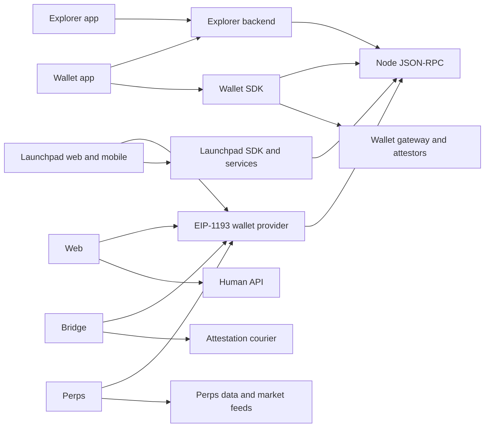
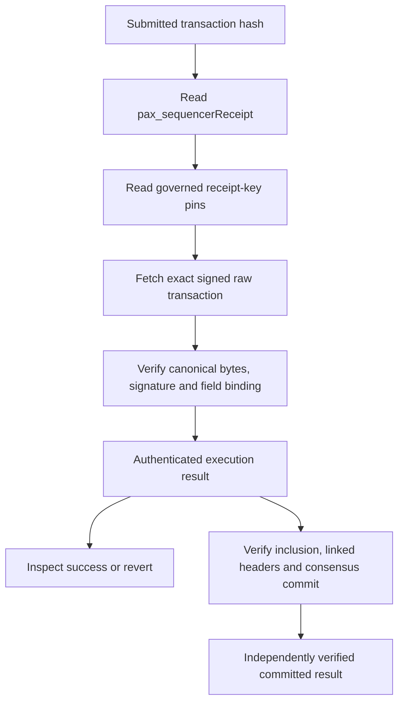

# Clients and SDKs

Applications use wallet providers, authenticated service APIs and node JSON-RPC for different purposes. The node serves EVM calls at the root path and exposes receipt and `px` reads under configured namespaces. A returned transaction hash, an authenticated execution receipt and independently verified commitment carry different evidence.

## Application and transport boundaries

| Application | Call boundary | Source |
|---|---|---|
| Web | Human API, server-side gateway calls and an injected wallet for signing | [web source](../../../../apps/web/src) |
| Wallet | Browser provider or authenticated gateway; node account/receipt reads and explorer data | [wallet app](../../../../apps/wallet), [wallet SDK](../../../../sdk/wallet/src) |
| Explorer | Typed resources select the explorer backend and optional analytics recipients | [API resource maps](../../../../apps/explorer/lib/api) |
| Launchpad | Web wallet adapter, mobile service client, generated HTTP operations and streams; on-chain role calls for trading | [web adapter](../../../../apps/launchpad/web/src/core/wallet-sdk/client.ts), [mobile client](../../../../apps/launchpad/mobile/src/runtime/service-client.ts) |
| Perps | Go perps precompile, spot rails, wallet signing and configured market-data transports | [perps source](../../../../apps/perps/src) |
| Bridge | Bridge precompile or external-chain vault; courier responses undergo attestation checks | [transfer actions](../../../../apps/bridge/src/components/bridge/transfer-actions.ts) |

Perps uses `0x1015`; spot uses `0x1021`–`0x1025`. Height-dependent dispatch selects historical exchange execution for old heights. The live perps ABI must therefore be selected for current calls. Launchpad uses `0x1017` and its registered forwarding roles; bridge uses `0x1016`.

## SDK layers

| SDK | Responsibility | Source |
|---|---|---|
| JavaScript Cosmos | `@pax-js/cosmos` declares REST clients and protobuf encoders | [package](../../../../sdk/js/package.json), [package contract](../../../../sdk/js/README.md) |
| Wallet | EIP-1193 provider adapter, authenticated wallet gateway, account/history clients, calldata, receipt polling and display ladder | [wallet SDK](../../../../sdk/wallet/src) |
| Launchpad | `SdkClient`, origin/session validation, generated service operations, stream adapters and role bindings | [packages](../../../../sdk/launchpad/packages), [Go protocol bindings](../../../../sdk/launchpad/protocol) |
| Platform | Go, JVM, .NET and Swift clients, receipt verification and portable evidence | [platform SDKs](../../../../sdk/platform) |
| Agent | Rust, TypeScript and Python clients for agent operations, identity, transaction construction and receipt proofs | [Rust crates](../../../../services/agent/crates), [language SDKs](../../../../services/agent/sdk) |
| Programs | Rust, C and AssemblyScript guest calls into versioned native host imports | [guest SDKs](../../../../programs/sdk), [ABI manifest](../../../../programs/sdk/abi-manifest.tsv) |

The JavaScript Cosmos package declares distribution exports for `types/*`, `rest` and `encoding`.

Generated service operations describe client encodings, not deployment readiness. Launchpad transport checks capabilities and refuses unavailable operations. Service HTTP and WebSocket operations remain distinct from an EVM trade call.

Programs SDK calls execute inside a guest runtime. They are host imports rather than requests to a remote program execution service. The ABI manifest declares `layerx_v1` through `layerx_v4` imports; registration and execution must agree with the configured host ABI, including supported ABI 5 extensions.

## Identity, signing keys and credentials

| Boundary | Authority |
|---|---|
| Injected wallet | The provider controls the selected EVM account and chain. Applications request signatures without receiving its private key. Account and chain changes invalidate pending write assumptions. |
| Embedded wallet | Gateway authentication and signing policy select the wallet operation; attestors hold signing shares. A service session differs from chain authority. |
| LayerX identity | The EVM secp256k1 key and Ed25519 identity are distinct. Derivation and explicit binding establish their relationship. |
| Launchpad login | The wallet challenge binds origin, account, chain 125, nonce, message and expiry. Login proof differs from a transaction signature. |
| Launchpad HTTP | Bearer mode uses `Authorization`; cookie mode uses same-origin credentials and `X-CSRF-Token` for authenticated writes. Headers are allowlisted. |
| Agent transport | Hosted gateway credentials differ from daemon client-certificate credentials. The daemon listener requires its authenticated transport. |
| Receipt signing | A governed Ed25519 key ID and permitted height range authorize the signature. The receipt key is separate from the validator consensus key. |
| Guest program | Runtime-provided program, immediate caller and invoking principal determine capability checks. A guest host call does not sign an external transaction. |

The corresponding implementations are [wallet provider](../../../../sdk/wallet/src/wallet.ts), [account derivation](../../../../services/agent/sdk/typescript/src/account-derivation.ts), [launchpad authentication](../../../../apps/launchpad/web/src/core/wallet-sdk/auth.ts), [launchpad transport](../../../../sdk/launchpad/packages/sdk/src/transport.ts), [agent transport](../../../../services/agent/sdk/typescript/src/agent-http.ts) and [guest context](../../../../programs/sdk/rust/src/context.rs).

## Receipt observations and verification

The ladder uses `submitted`, `receipted` and `committed`. The wallet SDK's [receipt reader](../../../../sdk/wallet/src/receipt.ts) authenticates signed answers; its [display ladder](../../../../sdk/wallet/src/ladder.ts) also checks the landing transaction receipt and outcome.

`readSequencerReceipt` decodes submitted observations and authenticates receipted/committed answers through `authenticateSequencerReceipt`. Authentication snapshots the input, reads `px_getReceiptKeys`, selects a covering governed pin and fetches `eth_getRawTransactionByHash`. It checks canonical receipt bytes, the signature, transaction hash and chain 125, recovered sender and transaction fields, and agreement between signed effects and the presented JSON, output and logs. The returned authentication level is `sequencer-signed` and its result is frozen.

This authenticates the execution receipt. A reported `committed` rung still needs separate consensus evidence for independent committed verification. Likewise, an authenticated failure result is a reverted transaction rather than a successful transfer.

`waitForSequencerReceipt` defaults to thirty attempts at 1,000 ms, supports a target rung and cancellation, and throws `ReceiptTimeoutError` when polling is exhausted. Transfer display additionally checks canonical landing-block identity, the EVM receipt and revert status.

Launchpad's [optimistic receipt hook](../../../../apps/launchpad/web/src/hooks/tx/use-optimistic-receipt.ts) treats stream events as wake-up hints, then reads a chain receipt and matching block hash. Bridge attestation verification authenticates external deposit/release authority; the eventual claim or release still requires its own transaction receipt.

## Independent and portable verification

The platform Go SDK exposes [VerifySequencerReceipt](../../../../sdk/platform/go/verify.go), [VerifyCommittedReceipt](../../../../sdk/platform/go/committed.go) and [VerifyPortableReceipt](../../../../sdk/platform/go/portable_receipt.go). Committed verification requires independent `CommittedTrust` in addition to receipt-key pins. The Rust [committed-proof crate](../../../../services/interop/crates/layerx-committed-proof) handles committed evidence separately from the receipt signer.

| Evidence | Check |
|---|---|
| Canonical signed receipt | Decode and byte-exact encoding; Ed25519 signature over the receipt domain and unsigned bytes |
| Governed receipt key | Key ID and inclusive height coverage match trusted pins |
| Exact raw transaction | Activity ID and signed execution fields bind to that transaction |
| Presented RPC result | JSON fields, return-data digest and log effects agree with signed bytes |
| Ordered sequence | Previous hash, sequence number and activity ID produce the signed sequence hash |
| Landing evidence | Batch and deterministic result inclusion agree with linked block headers |
| Consensus commitment | Header and validator commit verify against independent trust with strictly more than two-thirds voting power |

Portable receipts use `format: "layerx-receipt-proof-v2"`. They contain `verificationLevel`, `rawTransaction`, `signedReceipt`, `receiptDigest`, `receiptKey` and `receiptJson`. Committed bundles additionally carry `blockHeader`, `receiptInclusion`, `commit` and `validatorSet`. A key included in a bundle must match the verifier's trusted pins; it does not authorize itself.

Shared receipt fixtures live in [platform conformance](../../../../sdk/platform/conformance/fixtures). Their wire encodings and refusal cases support cross-language verification. A fixture or a UI label is distinct from verification of a particular transaction.
