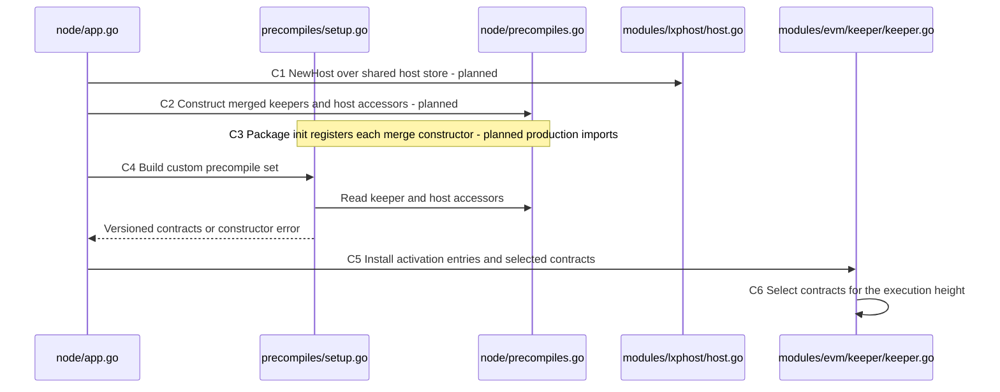
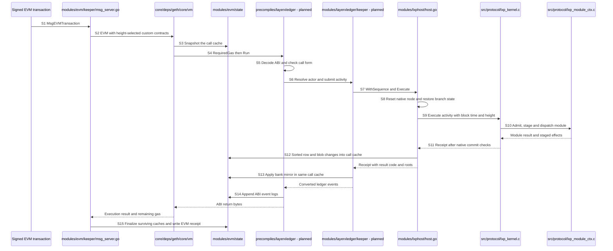
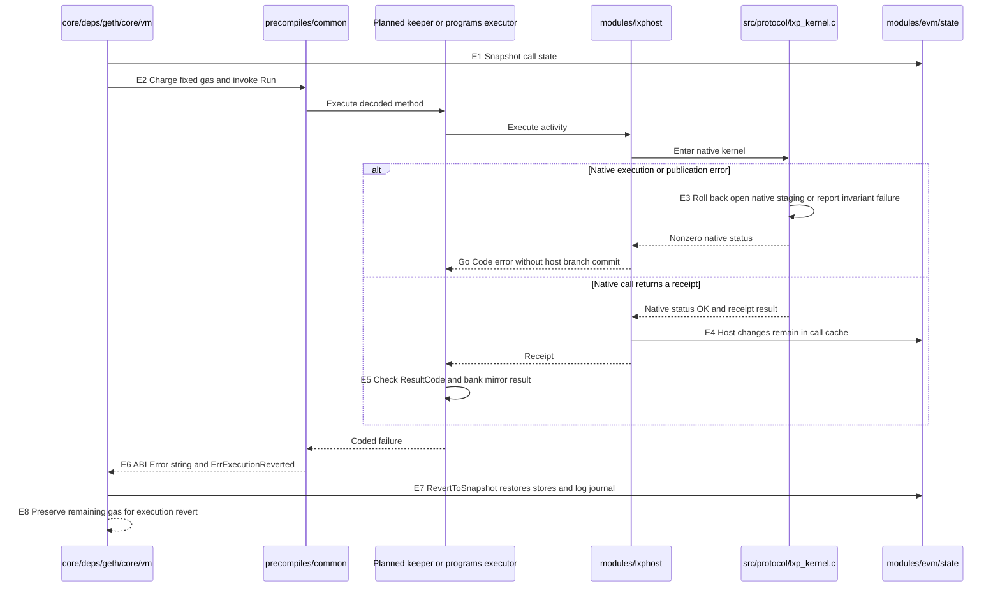
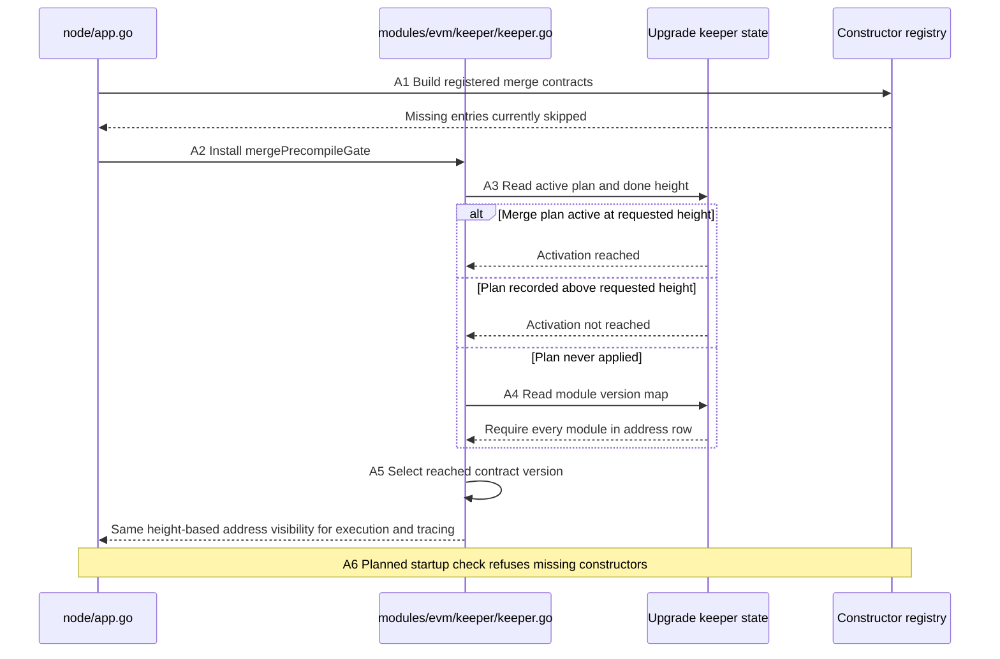

# Kernel and chain execution

This schematic separates the code at revision `2a1033aa2` from the changes described by the merged specification. Task references such as `task.2.10.1` refer to blocks in `spec.kvx`; they describe pending work, not evidence that the path is already served. Repository citations identify the defining or executing lines at that revision.

The chain already dispatches custom precompiles through its EVM keeper. The C kernel and its cgo host also exist. The connection between those two pieces is planned: no production keeper constructs or executes `lxphost.Host` at this revision, and none of the twelve merge addresses is served by the production import graph. `decision.1`, `decision.301` and `decision.1706` retain that distinction. In particular, the live perps venue at `0x1015` runs in Go; it does not enter the C kernel.

## Boundaries and construction

| Boundary | Code at HEAD | Change in the merged specification |
|---|---|---|
| EVM transaction to the chain | `EVMTransaction` creates the state database at `modules/evm/keeper/msg_server.go:69-86`; `applyEVMMessage` passes `CustomPrecompiles` to the EVM at `modules/evm/keeper/msg_server.go:231-243`. | Preserve this route. `task.2.0.4` and `task.2.13.1` prove signed transactions reach the new ledger and auth surfaces. |
| Application to constructor registry | `node/app.go:990-997` constructs the custom set and installs activation entries. `PrecompileKeepers` has existing venue, custody, bridge and xweb keepers at `node/precompiles.go:26-54`. | `task.5.19.2` constructs the shared host and ledger/auth/agent keepers; `task.5.94.2` adds pay, agent and host accessors; `task.5.19.4` links the merge constructor packages. |
| Fixed precompile to executor | `Precompile.Run` decodes input and invokes `Execute` with the state database context at `precompiles/common/precompiles.go:187-215`; `Prepare` is at `precompiles/common/precompiles.go:227-250`. | `task.2.10.1`, `task.2.11.1`, `task.2.28.1` and `task.13.22.1` implement ledger, auth, pay and programs executors respectively. |
| Executor to state owner | Existing native venues obtain Go keepers through `node/precompiles.go:56-85`; the perps/launchpad/pricefeed/spot set is built at `node/app.go:3510-3536`. | Ledger, auth and pay use keepers over the shared host. Programs uses `HostKeepers.LayerXHost` directly under `task.13.22.1`; this schematic does not insert an unwritten programs keeper into that path. |
| Go to native code | `HostExecute` is defined at `modules/lxphost/host.go:678`. Its cgo linkage includes the kernel and program sandbox archives at `modules/lxphost/host.go:6-7`. | `task.1.21.3` widens the returned receipt; `task.1.22.1` scopes restoration; `task.1.23.1` verifies binding authority; `task.1.23.3` carries delegated authority and registers budget/escrow modules. |
| Kernel to module context | `lxp_kernel_execute_activity` starts at `src/protocol/lxp_kernel.c:6950`; module-context initialization and dispatch are at `src/protocol/lxp_kernel.c:7158-7162` and `src/protocol/lxp_kernel.c:7221-7225`. | `task.1.11.1` and `task.1.11.2` add the asset binding-authority path; `task.1.15.1` removes the obsolete programs state-feed requirement. |
| Native result to chain state | `HostExecute` reads the outcome, commits rows and commits blobs at `modules/lxphost/host.go:723-742`. The destination is the supplied Cosmos context's KV store, obtained at `modules/lxphost/ctx.go:95`. | Keep the host inside the EVM call cache. `task.2.3.5` mirrors successful ledger transfers into bank in that context; `task.2.0.3` checks the resulting balance equality. |

Construction legend: `C1` and `C2` are planned, `C3` is a registry mechanism present at HEAD with missing production imports, and `C4`–`C6` reuse existing dispatch infrastructure. `C1`: `NewHost` validates its configuration at `modules/lxphost/host.go:600-609`, wired by `task.5.19.2`. `C2`: `NewPrecompileKeepers` is at `node/precompiles.go:56`, extended by `task.5.19.4` and `task.5.94.2`. `C3`: registration rejects unknown, nil and duplicate constructors at `precompiles/setup.go:89-103`; the existing tee-attestor `init` demonstrates registration at `precompiles/layerxagent/teeattestor/teeattestor.go:103-106` but is not imported by the production node. `C4`: `newMergePrecompiles` skips unregistered entries and validates constructed address/name pairs at `precompiles/setup.go:117-139`; the existing call panics on a constructor error at `precompiles/setup.go:193-195`. `task.6.6.2` and `task.5.19.1` replace that entry path with `GetCustomPrecompilesE`; `task.6.6.5` and `task.5.6.5` add missing-constructor checks. `C5`: `node/app.go:996` installs the gates. `C6`: `CustomPrecompiles` chooses ordinary or tracing lookup at `modules/evm/keeper/keeper.go:248-261`.

## Address table

Each short hexadecimal address below means its 20-byte, zero-padded form. These are the custom chain addresses in the constructor and activation sets; standard EVM cryptographic precompiles are outside this table. “Present” means the application can construct the address, subject to height/state gating. A retirement leaves a refusing contract at an address when the named task says so; it does not make the address available for reuse.

### Existing addresses

The common registration map is at `precompiles/setup.go:164-192`. Height-dependent venue replacement is at `node/app.go:3528-3535` and `node/precompiles_v6120.go:70-93`.

| Address | Surface and defining citation | HEAD route and planned change |
|---|---|---|
| `0x1001` | bank — `precompiles/bank/bank.go:36` | Present, Go bank keeper; ABI freeze `task.6.9.1`, pause refusal `task.6.3.2`, gas gate `task.6.10.1`. Ledger's kernel-to-bank mirror is separate work in `task.2.3.5`. |
| `0x1002` | wasmd — `precompiles/wasmd/wasmd.go:30` | Present, CosmWasm adapter; ABI freeze `task.6.9.3`, gas gate `task.6.10.3`. |
| `0x1003` | json — `precompiles/json/json.go:28` | Present, Go helper; ABI freeze `task.6.9.4`, gas gate `task.6.10.4`. |
| `0x1004` | addr — `precompiles/addr/addr.go:58` | Present, EVM/DID binding; ABI freeze `task.6.9.2`, gas gate `task.6.10.2`; binding supplies the planned ledger/auth/pay authority. |
| `0x1005` | staking — `precompiles/staking/staking.go:49` | Present, Go staking keeper; ABI freeze `task.6.9.5`, gas gate `task.6.10.5`. |
| `0x1006` | gov — `precompiles/gov/gov.go:30` | Present, Go governance adapter; ABI freeze `task.6.9.6`, gas gate `task.6.10.6`. |
| `0x1007` | distribution — `precompiles/distribution/distribution.go:37` | Present, Go distribution keeper; ABI freeze `task.6.9.7`, gas gate `task.6.10.7`. |
| `0x1008` | oracle — `precompiles/oracle/oracle.go:26` | Present as a refusal surface: both query implementations return the retired error at `precompiles/oracle/oracle.go:93` and `precompiles/oracle/oracle.go:104`. Do not route pricefeed requests here. |
| `0x1009` | ibc — `precompiles/ibc/ibc.go:30` | Present, IBC adapter; ABI freeze `task.6.9.8`, gas gate `task.6.10.8`. |
| `0x100A` | pointerview — `precompiles/pointerview/pointerview.go:24` | Present, pointer reads; ABI freeze `task.6.9.9`, gas gate `task.6.10.9`. |
| `0x100B` | pointer — `precompiles/pointer/pointer.go:29` | Present, pointer registration; ABI freeze `task.6.9.10`, gas gate `task.6.10.10`. |
| `0x100C` | solo — `precompiles/solo/solo.go:32` | Present, asset claim adapter; ABI freeze `task.6.9.11`, gas gate `task.6.10.11`. |
| `0x1011` | p256 — `precompiles/p256/p256.go:24` | Present, signature helper; ABI freeze `task.6.9.12`, gas gate `task.6.10.12`. |
| `0x1012` | layerxverify — `precompiles/layerxverify/layerxverify.go:52` | Present, Go verifier. `task.6.71.1` makes every method return `LXP_MODULE_DISABLED` from the merge plan while retaining registration and its gas formula; `task.6.96.2` retires receipt-verifier dependencies. |
| `0x1013` | layerxcustody — `modules/layerxcustody/types/ids.go:17` | Present, Go custody keeper. `task.6.45.1` refuses every precompile method from the merge plan; `task.6.46.1` releases stranded balances to the authority, per `decision.642`. |
| `0x1014` | layerxanchor — `precompiles/layerxanchor/layerxanchor.go:65` | Present, Go anchor keeper. `task.6.32.1` retires writes at merge; `task.6.32.2` and `task.6.32.3` retire reads at the later store-delete step; `task.6.33.1` returns bonds. |
| `0x1015` | perps / historical exchange — `modules/layerxexchange/types/ids.go:15`, `precompiles/perps/perps.go:27` | Go perps from `v6.12.0`, historical exchange below it, selected by `node/precompiles_v6120.go:38-60`. `decision.301` fixes this ownership; `task.3.27.3` refuses legacy exchange writes after the switch. |
| `0x1016` | layerxbridge — `modules/layerxbridge/types/keys.go:27` | Present, Go bridge keeper through `precompiles/setup.go:182`; it is not one of the four kernel construct addresses. |
| `0x1017` | launchpad — `modules/launchpad/types/keys.go:26` | Native Go rewrite from `v6.12.0`, historical implementation below it; `node/precompiles_v6120.go:45-60` selects the version. `decision.1704` preserves that route. |
| `0x1018` | feetoken — `precompiles/feetoken/feetoken.go:24` | Present from `v6.7`, registered at `precompiles/setup.go:185-188`; ABI freeze `task.6.9.13`, gas gate `task.6.10.13`. |
| `0x1019` | xweb — `precompiles/xweb/xweb.go:59` | Present when its plan/state gate permits, registered at `precompiles/setup.go:190-192`; planned program web forwarding is `task.13.32.1`. |
| `0x1020` | pricefeed — `precompiles/pricefeed/pricefeed.go:23` | Go pricefeed from `v6.12.0`; activation row `node/precompiles_v6120.go:25`; `decision.1702` fixes it as the venue price source. |
| `0x1021` | PECOR — `modules/spot/types/keys.go:12` | Go spot swap rail, activation row `node/precompiles_v6120.go:26`; production gas wrapper tasks `task.3.21.1` and `task.3.21.2`. |
| `0x1022` | PECOROrders — `modules/spot/types/keys.go:15` | Go spot limit orders, activation row `node/precompiles_v6120.go:27`; same wrapper tasks. |
| `0x1023` | PECORStopOrders — `modules/spot/types/keys.go:18` | Go spot stop orders, activation row `node/precompiles_v6120.go:28`; same wrapper tasks. |
| `0x1024` | PECORQuoter — `modules/spot/types/keys.go:21` | Go spot quotes, activation row `node/precompiles_v6120.go:29`; same wrapper tasks. |
| `0x1025` | PECORVault — `modules/spot/types/keys.go:24` | Go spot liquidity vault, activation row `node/precompiles_v6120.go:30`; same wrapper tasks. |

The node currently obtains the raw spot set through `NewPrecompileSet` at `node/app.go:3524`. `task.5.0.3` and `task.3.21.2` connect the planned `NewServedSet` wrapper; `task.3.21.4` hides the raw constructor. This is a gas-routing change to an existing venue, not a new kernel venue.

### Merge addresses

All twelve rows are absent from the production served set at HEAD. The table itself exists at `precompiles/setup.go:61-73`. The required module names below come from `mergePrecompileGate`, not from assumptions about what a method does. Registration tasks create a callable package; node imports and activation gates are separate requirements.

| Address | Registry name and table citation | Required genesis modules and gate citation | Planned constructor and serving tasks |
|---|---|---|---|
| `0x101A` | `layerxledger` — `precompiles/setup.go:62` | `layerxledger` — `node/upgrades.go:525` | `task.2.10.1`, `task.5.19.4`, `task.6.12.1`; keeper calls the shared host. |
| `0x101B` | `layerxpay` — `precompiles/setup.go:63` | `layerxpay` — `node/upgrades.go:526` | `task.2.28.1`, `task.5.19.4`, `task.5.94.2`, `task.6.12.2`; keeper calls the shared host. |
| `0x101C` | `layerxauth` — `precompiles/setup.go:64` | `layerxauth` — `node/upgrades.go:527` | `task.2.11.1`, `task.5.19.4`, `task.6.12.3`; keeper calls the shared host. |
| `0x101D` | `layerxprograms` — `precompiles/setup.go:65` | `layerxprograms` — `node/upgrades.go:528` | `task.13.22.1`, `task.13.32.2`, `task.5.19.4`, `task.5.94.2`, `task.6.12.4`; executor obtains the host directly. |
| `0x0901` | `orob` — `precompiles/setup.go:66` | `layerxagent` — `node/upgrades.go:529` | `task.2.37.1`, `task.5.19.4`, `task.6.12.5`. |
| `0x0902` | `clearing` — `precompiles/setup.go:67` | `layerxagent` — `node/upgrades.go:530` | `task.2.37.2`, `task.5.19.4`, `task.6.12.6`. |
| `0x0903` | `oracle aggregator` — `precompiles/setup.go:68` | `layerxagent`, `layerxexchange` — `node/upgrades.go:531` | `task.2.36.1`, `task.2.36.2`, `task.5.94.2`, `task.6.12.7`. |
| `0x0904` | `pofq` — `precompiles/setup.go:69` | `layerxagent` — `node/upgrades.go:532` | `task.2.37.3`, `task.5.19.4`, `task.6.12.8`. |
| `0x0905` | `scheduler` — `precompiles/setup.go:70` | `layerxagent` — `node/upgrades.go:533` | `task.2.34.1`, `task.2.34.2`, `task.5.94.2`, `task.6.12.9`. |
| `0x0906` | `streams` — `precompiles/setup.go:71` | `layerxpay` — `node/upgrades.go:534` | `task.2.35.1`, `task.2.35.2`, `task.5.94.2`, `task.6.12.10`; routes to the pay stream API. |
| `0x0907` | `tee attestor` — `precompiles/setup.go:72` | `layerxagent` — `node/upgrades.go:535` | Constructor already exists at `precompiles/layerxagent/teeattestor/teeattestor.go:111`; production import `task.5.19.4`, serving `task.6.12.11`. |
| `0x0908` | `eip712` — `precompiles/setup.go:73` | `layerxagent` — `node/upgrades.go:536` | `task.2.37.4`, `task.5.19.4`, `task.6.12.12`. |

An agent-function address does not imply a C call. The streams adapter reaches the pay keeper, while the tee-attestor constructor obtains the xweb keeper at `precompiles/layerxagent/teeattestor/teeattestor.go:115-123`. Follow each executor's actual dependency. `task.2.38.1` and `task.2.38.2` test production serving rather than test-local registry population.

## Transaction to the kernel and back

The next diagram is the planned successful ledger write using existing EVM, host and kernel machinery. Its ledger executor, keeper, bank mirror and event conversion are pending. The numbered steps distinguish those additions from the code already present. Auth and pay follow the same host boundary with their own authority, payload and event adapters. Programs obtains the host directly from its executor.

The `S` participant owns the Cosmos caches and EVM log journal. The `M` participant represents the context passed to a registered C module, not an independent process. Every arrow stays within the node process. The C and Rust archives are linked by the cgo directives at `modules/lxphost/host.go:6-7`.

| Step | Executing code at HEAD | Pending change or gate |
|---|---|---|
| S1 | `EVMTransaction` unwraps the context, obtains the transaction and creates `DBImpl` at `modules/evm/keeper/msg_server.go:69-86`. | `task.2.0.4`, `task.2.13.1` exercise the new surfaces through signed transactions. |
| S2 | `applyEVMMessage` constructs the EVM with `k.CustomPrecompiles(ctx)` at `modules/evm/keeper/msg_server.go:240` and executes its state transition at `modules/evm/keeper/msg_server.go:242-243`. | Constructor imports/accessors: `task.5.19.4`, `task.5.94.2`; activation completeness: `task.5.6.5`. |
| S3 | `EVM.Call` takes a snapshot at `core/deps/geth/core/vm/evm.go:215`; `DBImpl.Snapshot` creates the cache and a fresh event manager at `modules/evm/state/state.go:109-115`. | Reuse this atomic boundary; integration balance gate `task.2.0.3`. |
| S4 | Fixed dispatch checks and deducts `RequiredGas` before `Run` at `core/deps/geth/core/vm/contracts.go:237-246`. The common fixed wrapper selects a method row at `precompiles/common/precompiles.go:165-184`. | `task.2.2.5`, `task.2.2.6`, `task.2.14.3` freeze and test ledger/auth charges. |
| S5 | `Prepare` recovers the context, selects the ABI method, rejects missing table rows and unpacks arguments at `precompiles/common/precompiles.go:227-250`. The existing exchange's call-form checks are at `precompiles/layerxexchange/layerxexchange.go:205-214`. | `task.2.10.1` adds the ledger executor and rejects delegatecall, nonzero value and static writes; `task.2.11.1`, `task.2.28.1` do the corresponding auth/pay work. |
| S6 | `BindLayerX` verifies DID consent and writes both binding directions at `modules/evm/keeper/layerx_binding.go:56-80`; `KernelAuthority` currently has only actor, principal and verified key at `modules/lxphost/host.go:568-572`. | `task.2.3.2`, `task.2.6.2`, `task.2.22.2` resolve the caller; `task.2.3.3` and `task.2.22.3` enforce pause policy. `task.1.22.1` adds `Bound`; `task.1.23.3` carries authority kind/scope/grant. |
| S7 | `WithSequence` installs the context value at `modules/lxphost/ctx.go:71-73`; `newBranchCtx` checks positive sequence/time/height and monotonic sequence at `modules/lxphost/ctx.go:84-108`; `Execute` delegates at `modules/lxphost/host.go:669-670`. | `task.1.91.1` exports `NextSequence`; `task.2.3.4`, `task.2.6.4`, `task.2.22.4` construct and submit activities; `task.13.22.4` is the direct programs submitter. Idempotency conflict is recorded below. |
| S8 | `HostExecute` locks the host, pins the OS thread, resets the node and loads state at `modules/lxphost/host.go:683-715`. Reset registers governance, programs and asset at `modules/lxphost/host.go:140-147`. | `task.1.22.1` scopes KV/blob restoration; `task.1.23.3` adds budget/escrow; `task.1.24.1` registers stream/service and native perps/spot modules; `task.1.26.1` replaces the one-node mutex with a bounded pool. |
| S9 | `HostExecute` passes height, block timestamp, sequence and configured gas limit at `modules/lxphost/host.go:718-720`; `lxphost_execute` selects the registered module and calls the kernel at `modules/lxphost/host.go:446-475`. | `task.1.23.1` replaces unconditional `signature_valid = true`; `task.1.11.1` and `task.1.11.2` add the kernel-side asset binding path. |
| S10 | Admission is at `src/protocol/lxp_kernel.c:7112-7118`, journal opening at `src/protocol/lxp_kernel.c:7134-7136`, context creation at `src/protocol/lxp_kernel.c:7158-7162`, effects binding and dispatch at `src/protocol/lxp_kernel.c:7221-7225`. | Preserve the module-context path. Programs CALL has a specialized prepared route at `src/protocol/lxp_kernel.c:7020-7026`; its runtime-binding gap is recorded below. |
| S11 | The receipt receives result, fee and effects at `src/protocol/lxp_kernel.c:7347-7360`; journal/module commit and committed-state checks are at `src/protocol/lxp_kernel.c:7411-7453`. The host checks native publication/journal invariants before receipt encoding at `modules/lxphost/host.go:478-497`. | `task.1.21.3` exposes `FeeCharged`, `Events`, `Transfers` and `ProgramOutcome`; these are absent from the Go receipt at HEAD. |
| S12 | Go reads the receipt and commits at `modules/lxphost/host.go:723-742`; `branchCtx.commit` gathers and sorts mutations at `modules/lxphost/ctx.go:232-288`; blobs are sorted at `modules/lxphost/host.go:856-875`. | `task.1.22.1` prevents unrelated module rows from entering the loaded/deleted set. These writes still belong to the EVM call cache. |
| S13 | Account-to-bank address derivation exists at `modules/lxphost/accountmap.go:78`; the host itself has no bank mirror call in `modules/lxphost/host.go:727-742`. | `task.2.3.5` applies receipt transfer legs to bank and aborts on `ErrFatalSupplyMismatch`; `task.2.0.3` checks kernel/bank equality. |
| S14 | `EmitEVMLog` appends an addressed/topics/data log at `precompiles/common/evm_events.go:16-38`; `DBImpl.AddLog` journals the append at `modules/evm/state/log.go:12-15`. Cosmos events are merged only after executor success at `precompiles/common/precompiles.go:203-214`. | `task.2.3.6` converts ledger receipts; `task.2.28.3` packs pay logs from arguments/post-call records; `task.13.7.1`, `task.13.22.6`, `task.13.0.3` convert program guest/outcome events. |
| S15 | The message server finalizes at `modules/evm/keeper/msg_server.go:108` and writes the EVM receipt at `modules/evm/keeper/msg_server.go:137`; `Finalize` flushes surviving caches and events at `modules/evm/state/statedb.go:128-170`. | `task.2.0.4` and `task.2.13.1` check returned receipt logs; `task.2.14.1` checks ledger parity against direct host execution. |

## Error and rollback sequence

There are three distinct results: a native function return status, `Receipt.ResultCode`, and the outer EVM result. `result` converts a nonzero C status into a Go `Code` at `modules/lxphost/host.go:906-910`; a successful host return still carries `Receipt.ResultCode` at `modules/lxphost/host.go:727-733`. The planned keeper or programs executor must inspect both.

Error legend: `E3` is native rollback, `E7` is the outer chain rollback. Neither a native commit nor a successful `HostExecute` independently commits the EVM transaction. `E1` and `E2` execute at `core/deps/geth/core/vm/evm.go:215` and `core/deps/geth/core/vm/contracts.go:237-246`. `E3` rolls back module context and an open journal on native errors at `src/protocol/lxp_kernel.c:7323-7345`; a failed committed-state check poisons native publication at `src/protocol/lxp_kernel.c:7447-7453`, so not every fatal error can be described as an ordinary native rollback. `HostExecute` returns before its branch commit on a failing native execute/outcome read at `modules/lxphost/host.go:718-725`. The next execution resets the scratch node at `modules/lxphost/host.go:690`.

`E4` writes through the context store at `modules/lxphost/ctx.go:95` and `modules/lxphost/ctx.go:275-288`; an error after native execution can therefore require outer cache rollback. `E5` is added by `task.2.3.4`, `task.2.22.4` and `task.13.22.4`, and bank mirror failure handling by `task.2.3.5`. `E6` is the common deferred conversion at `precompiles/common/precompiles.go:189-197`; `WithLXPReasons` and `LXPReason` are at `precompiles/common/precompiles.go:107-110` and `precompiles/common/precompiles.go:134-143`. `task.2.2.3`, `task.2.2.4`, `task.2.28.2` and `task.13.21.7` provide surface-specific mappings. The ABI selector for `Error(string)` is `0x08c379a0`, encoded at `precompiles/common/precompiles.go:121-127`; this does not replace the existing perps custom-error ABI, as `task.3.4.2` explicitly preserves it.

`E7` is invoked at `core/deps/geth/core/vm/evm.go:267-268`; `RevertToSnapshot` restores the cached context and reverts journal entries at `modules/evm/state/state.go:118-141`. That includes the EVM log append journaled at `modules/evm/state/log.go:15`. `E8` follows `core/deps/geth/core/vm/evm.go:269-274`: execution reverts retain unused call gas, while other call errors consume it. Out-of-gas before `Run` occurs at `core/deps/geth/core/vm/contracts.go:238-239` and never enters a keeper or the host. `task.6.1.2` separately removes the dynamic wrapper's consensus-path error print at `precompiles/common/precompiles.go:334`.

## Gas, fees and bounded work

The EVM gas charge, Cosmos store gas, kernel context gas and kernel fee amount are separate quantities. The schematic does not equate them or infer a refund from the kernel receipt.

| Quantity | Exact baseline | Planned verification or unresolved join |
|---|---|---|
| Fixed EVM precompile gas | `MethodGas.Gas` adds a fixed surcharge to `DefaultGasCost`, saturating the surcharge addition at `precompiles/common/precompiles.go:68-73`. Read cost is `1000 + 3 × bytes`; write cost is `2000 + 30 × bytes` from `sdk/store/types/gas.go:349-357`. The common wrapper charges `input[4:]` at `precompiles/common/precompiles.go:182`. | Ledger/auth rows are frozen by `task.2.2.5` and `task.2.2.6`, checked by `task.2.14.3`. |
| Unknown fixed selector | The common wrapper returns `UnknownMethodCallGas = 3000` for short/unknown input or a missing row at `precompiles/common/precompiles.go:25` and `precompiles/common/precompiles.go:165-181`. | `Prepare` then refuses the selector at `precompiles/common/precompiles.go:232-241`; keep charging and refusal rules aligned. |
| Existing pay helper | `RequiredGas` charges the whole calldata through `gasForLength` at `precompiles/layerxpay/gas.go:82-115`. An unknown selector uses the largest write surcharge. Example `escrowOpen` surcharge is `60000` at `precompiles/layerxpay/gas.go:19`. | `task.2.28.1` instead specifies the common `WithGasTable(methodGas)` wrapper. Its argument-length and unknown-selector behavior differ; this remains a J98 reconciliation item. `task.2.40.5` compares charged gas with measured host-store work. |
| Existing programs helper | Lifecycle surcharge `100000`, execution surcharge `50000`, retirement surcharge `2 × LayerXBindSignatureGas + 20000` are at `precompiles/layerxprograms/gas.go:18-22`. The helper charges the whole input and uses read cost for unknown selectors at `precompiles/layerxprograms/gas.go:75-83`. | `task.13.22.1` specifies common `WithGasTable(gasTable)`, whose calldata and unknown-selector charges differ. This remains a J98 reconciliation item. |
| Dynamic EVM gas | Dynamic precompiles bypass the fixed dispatch branch at `core/deps/geth/core/vm/contracts.go:234-235`. The dynamic wrapper converts supplied gas to a Cosmos limit at `precompiles/common/precompiles.go:345-346` and returns the executor's remaining gas at `precompiles/common/precompiles.go:351-359`. | Existing spot must use its served dynamic wrapper under `task.3.21.1`, `task.3.21.2` and `task.5.0.3`; fixed kernel constructs must not accidentally inherit this route. |
| Kernel execution gas | Host `Config.GasLimit` is at `modules/lxphost/host.go:552`, copied into the native execution at `modules/lxphost/host.go:472` and into module context at `src/protocol/lxp_kernel.c:7158-7162`. `lxp_ctx_charge_gas` rejects overflow or excess with `LXP_ERR_GAS_EXHAUSTED` at `src/protocol/lxp_module_ctx.c:3180-3186`. | The present host passes a configured limit, not the EVM's remaining gas. `task.1.39.1` bounds store cost against unrelated rows; `task.2.40.5` checks pay's charge coverage. |
| Kernel fee and outcome | The C receipt records `fee_charged` at `src/protocol/lxp_kernel.c:7353`; the current Go `Receipt` at `modules/lxphost/host.go:574-581` does not expose a fee field. | `task.1.21.3` exposes `FeeCharged` and program outcomes; `task.1.22.1` adds the signed `Activity.FeeLimit`; `task.13.22.4` supplies the program fee limit. A kernel fee is not an EVM gas refund. |
| Host restore cost and concurrency | `branchCtx.load` scans module rows, replay rows and accounts at `modules/lxphost/ctx.go:133-176`; blob restore scans its whole prefix at `modules/lxphost/host.go:816-836`. A single host mutex serializes calls at `modules/lxphost/host.go:683-684`. | `task.1.22.1` narrows module/blob loads; `task.1.25.1` removes replay-row persistence; `task.1.26.1` adds a bounded node pool. These changes do not themselves establish absence of OCC conflicts on shared store keys. |

## Storage staging and events

The durable source of truth is the chain store supplied to the host. At entry the native node is reset and restored; at exit native pointers are copied to Go values before the host commits the resulting diff. The host's C allocation is scratch state, not an independently durable ledger. The exact load/reset/execute/commit sequence is `modules/lxphost/host.go:690-742`; native byte copies into the Go receipt are at `modules/lxphost/host.go:727-733`.

| Host key | HEAD encoding and use | Planned change |
|---|---|---|
| `0x01 || u16be module || key` | Prefix at `modules/lxphost/ctx.go:62`; builder at `modules/lxphost/ctx.go:292-296`; module values restored at `modules/lxphost/ctx.go:133-146`. | `task.1.22.1` loads only the activity module plus asset/governance modules, in ascending module order; untouched modules must never be inferred deleted. |
| `0x02` | Last host global sequence; decoded as eight big-endian bytes at `modules/lxphost/ctx.go:111-119`, written at `modules/lxphost/ctx.go:286-288`. | `task.1.91.1` exports the next-sequence reader; malformed or non-increasing values must be refused. |
| `0x03 || DID id` | Identity sequence prefix at `modules/lxphost/ctx.go:64`; builder at `modules/lxphost/ctx.go:303-305`; persisted at `modules/lxphost/ctx.go:283-285`. | Retain actor sequencing when idempotency replay retires under `decision.101`. |
| `0x04 || replay hash` | Replay prefix at `modules/lxphost/ctx.go:65`; restoration at `modules/lxphost/ctx.go:151-164`; new entries persisted at `modules/lxphost/ctx.go:280-281`. | `task.1.2.1`, `task.1.2.2`, `task.1.2.3`, `task.1.25.1` and `task.1.25.2` retire lookup, commitment, table and host access. Conflicting consumer tasks remain below. |
| `0x05 || u16be module || 32-byte blob key` | Prefix at `modules/lxphost/host.go:528`; 35-byte key validation at `modules/lxphost/host.go:821`; builder at `modules/lxphost/host.go:879-883`. | `task.1.22.1` scopes loading; sorted blob diff preserves other modules' rows. |
| `0x06 || 32-byte account id` | Prefix at `modules/lxphost/ctx.go:66`; restore validates/decode/inserts accounts and rebuilds the index at `modules/lxphost/ctx.go:187-209`; builder at `modules/lxphost/ctx.go:299-301`. | `task.2.3.1` shares host state instead of introducing a second ledger KV prefix. |

`branchCtx.commit` builds the combined account/module map, refuses duplicate keys, sorts changed/deleted keys, and then writes identity/global sequences at `modules/lxphost/ctx.go:245-288`. Blob diffs are sorted separately at `modules/lxphost/host.go:856-875`. Sorting avoids Go map iteration determining write order. The host does not create its own `CacheContext`; atomicity comes from the caller's EVM snapshot, so all mirrors and event emitters must use that same context.

The kernel effect list, Cosmos events and EVM logs are different representations. C effects are bound before dispatch at `src/protocol/lxp_kernel.c:7221-7225` and copied into a successful receipt according to fee policy at `src/protocol/lxp_kernel.c:7359-7360`. The Go receipt currently exposes encoded bytes only, besides result/sequence/time/roots. `task.1.21.3` adds ordered `Receipt.Events`, `Transfers` and `ProgramOutcome`, copying payloads before arena reset at `modules/lxphost/host.go:485`. Ledger converts those fields under `task.2.3.6`; pay uses call arguments and post-call records under `task.2.28.3`. Programs event encoding is defined by `task.13.7.1`, with emission under `task.13.22.5`, `task.13.22.6`, `task.13.22.7` and `task.13.0.3`. No diagram arrow treats native effects as already-emitted EVM logs.

## Activation and replay gating

Use `H_act` for the recorded done height of `v7.0`. The upgrade name is currently repeated at `node/upgrades.go:112`, `precompiles/setup.go:50` and `precompiles/common/precompiles.go:30`. `task.6.6.1` and `task.5.6.1` derive the setup/node constants from the common value.

Activation legend: constructing a contract, satisfying its activation predicate and selecting its historical version are separate operations. `A1` executes `newMergePrecompiles` at `precompiles/setup.go:117-139`; only registered entries enter the versioned set at `precompiles/setup.go:193-200`. `A2` is `node/app.go:996`, using the module rows at `node/upgrades.go:521-539`. `A3` and `A4` are implemented by `customPrecompileActivationLookup` at `modules/evm/keeper/keeper.go:294-326`. `A5` uses `customPrecompileReached` for ordinary execution at `modules/evm/keeper/keeper.go:333-349`, and `GetCustomPrecompilesVersions` for tracing at `modules/evm/keeper/keeper.go:356-383`. `A6` is pending `task.6.6.5`, `task.6.7.3` and `task.5.6.5`.

| Requested state | Exact HEAD behavior | Governing work |
|---|---|---|
| Constructor absent | Address never enters the custom set; gate rows alone cannot create it. `precompiles/setup.go:123-125`. A call to an absent, empty account can return successfully without invoking a precompile at `core/deps/geth/core/vm/evm.go:235-237`. | Node import/accessor tasks `task.5.19.4`, `task.5.94.2`; missing-constructor refusal `task.5.6.5`. Tests must assert served contract identity, not only absence of a transaction error. |
| Done height recorded, query below `H_act` | Gate returns false at `modules/evm/keeper/keeper.go:313-315`; merge contract is absent. | Each `task.6.12.1` through `task.6.12.12` checks its address; domain integration gates `task.2.12.1`, `task.2.12.2`, `task.2.38.1`, `task.2.38.2`, `task.13.32.2`. |
| Merge plan active at requested height | Activation predicate returns true at `modules/evm/keeper/keeper.go:310-311`; reached contract versions remain subject to the installed version map. | `task.5.6.9` rehearses activation; `task.5.6.8` checks export/import. |
| Plan never applied, all row modules in genesis version map | Gate permits activation via module presence at `modules/evm/keeper/keeper.go:317-325`; with no fork history, tracing selects latest at `modules/evm/keeper/keeper.go:380-381`. | Preserve this explicit genesis case. A module missing from the row's required set keeps the address withheld. Programs' module-registration gap is recorded below. |
| Historical venue height around `v6.12.0` | Exchange/perps and launchpad retain both historical and current contracts at `node/precompiles_v6120.go:49-60`; pricefeed/spot join only when the set is live at `node/precompiles_v6120.go:80-91`. | Preserve `decision.301`, `decision.1702`, `decision.1703`, `decision.1704`; do not substitute a new C-backed `0x1015`. |
| Merge reached but retiring surface called | Existing common retirement helper is `precompiles/common/retire.go:24-36`; current executors need the pending gates. | Verify `0x1012` under `task.6.71.1`, custody under `task.6.45.1`, anchor writes/read deletion under `task.6.32.1` through `task.6.32.3`. |

At HEAD `mergeStoreUpgrades` adds only the sequencer store at `node/upgrades.go:418-421`. `task.5.19.2` adds the ledger/auth/pay/programs/agent/host keys to the application; `task.5.6.5` adds their store upgrades and enforces complete constructors. The existing merge handler validates sequencer genesis, runs migrations, initializes the sequencer and checks leader/sequence/receipt-key state at `node/upgrades.go:432-463`. The same task adds anchor retirement and custody release. `task.6.33.2` and `task.6.47.1` exercise those releases. Their success is part of activation, not proof that the current handler already performs them.

Giga execution must fall back to the ordinary EVM route before invoking these stateful surfaces. The current `gigaV6120FailFast` copies the existing late set and adds pricefeed/spot at `node/giga_v6120.go:19-31`; it does not itself enumerate the twelve merge rows. `decision.558` chooses a separate merge fail-fast list. `task.5.45.1` adds that list, `task.5.8.1` joins it to the v6.12.0 set, and `task.5.45.2` plus `task.5.8.2` check coverage and fallback.

## Execution invariants and gates

| Invariant | HEAD basis | Task and observable gate |
|---|---|---|
| Only the intended contract is served at an address and height. | Registry address/name validation at `precompiles/setup.go:133-135`; execution/tracing selection at `modules/evm/keeper/keeper.go:248-261`. | `task.6.6.5`, `task.6.12.1` through `task.6.12.12`, `task.5.6.9`; missing constructors refuse bring-up and below/at-height tests use the production served set. |
| EVM consent and DID authority remain bound. | `BindLayerX` signature/uniqueness/nonce checks at `modules/evm/keeper/layerx_binding.go:56-80`; current host forces owner kind at `modules/lxphost/host.go:237` and signature validity at `modules/lxphost/host.go:468`. | `task.1.11.1`, `task.1.11.2`, `task.1.22.1`, `task.1.23.1`, `task.1.23.3`; forged signatures fail and unsigned calls require the verified binding flag. |
| Time and ordering come from the chain context. | Positive height/time and strictly increasing global sequence at `modules/lxphost/ctx.go:84-108`; native execution receives them at `modules/lxphost/host.go:718-720`. | `task.1.91.1` and submitters `task.2.3.4`, `task.2.6.4`, `task.2.22.4`, `task.13.22.4`; reject reused sequence rather than treating idempotency retirement as permission to replay it. |
| Native scratch state is not carried across calls. | Reset destroys/releases and clears the native node at `modules/lxphost/host.go:107-138`; every execute calls reset at `modules/lxphost/host.go:690`. | `task.1.26.1` preserves reset/load/execute/commit for each pooled node; `task.1.39.4` fuzzes the host payload path. |
| Unrelated module rows survive a call. | HEAD loads all rows at `modules/lxphost/ctx.go:133-146` and diffs loaded rows at `modules/lxphost/ctx.go:264-277`. | `task.1.22.1` limits loaded/deleted sets; `task.1.39.1` checks gas independence from unrelated module rows. |
| Kernel state, bank mirror and EVM logs share outer rollback. | EVM snapshot/cache and rollback at `modules/evm/state/state.go:109-141`; logs are journaled at `modules/evm/state/log.go:12-15`. | `task.2.3.5`, `task.2.0.3`, `task.2.0.4`; mirror errors abort rather than publishing divergent bank balances. |
| Native publication is internally consistent before host export. | Outcome refuses poisoned publication, open journal or unexpected store/account state at `modules/lxphost/host.go:482-484`; committed root failure poisons publication at `src/protocol/lxp_kernel.c:7447-7453`. | `task.1.0.3` checks root determinism across permuted loads; `task.2.14.1` checks ledger/direct-host parity. |
| Views and simulation cannot commit writes. | Read-only flag is passed to executors at `precompiles/common/precompiles.go:207`; the flag alone is not a generic write guard. | Surface guards `task.2.10.1`, `task.2.11.1`, `task.2.28.1`, `task.13.22.2`; `task.1.93.2` adds `Host.Simulate` and `task.13.24.2` uses it for `simulateCall`. |
| Gas coverage is tested through the served wrapper. | Fixed and dynamic VM branches differ at `core/deps/geth/core/vm/contracts.go:234-246`. | `task.2.14.3`, `task.2.40.5`, `task.3.21.2`; helper-only gas tests cannot prove the production dispatch charge. |

## Integration gaps requiring reconciliation

These findings concern other jobs' final input. They are recorded for the final cross-check; this schematic does not introduce new tasks or edit their fragments.

1. **Replay retirement versus consumers.** `decision.101` retires kernel idempotency replay; `task.1.2.1` stops lookup/recording, `task.1.25.1` removes host replay persistence and `task.1.25.2` removes `ReadIdempotentReceipt`. In contrast, `task.2.3.4` still requires replay behavior, `task.2.22.4` explicitly reads the soon-removed method, and `task.2.14.5` asserts a cross-module replay refusal and a `0x04` record. HEAD proves both the old lookup and row exist at `src/protocol/lxp_kernel.c:7092-7102`, `modules/lxphost/read.go:444-470` and `modules/lxphost/ctx.go:280-281`. The actor sequence remains the intended replay guard; the consumer tasks need reconciliation before their gates can all pass.
2. **Pay gas entry point.** `task.2.28.1` chooses common `WithGasTable(methodGas)`, which measures argument bytes and charges `3000` for unknown selectors; `task.2.40.5` points to the existing whole-calldata helper at `precompiles/layerxpay/gas.go:82`, which uses the largest write row for unknown selectors. The difference for a known write is four charged bytes, or `120` gas under `sdk/store/types/gas.go:356`. The final executor must choose one contract and test the actual served entry point.
3. **Programs gas entry point.** `task.13.22.1` chooses common `WithGasTable(gasTable)` while `precompiles/layerxprograms/gas.go:75-83` charges the full calldata and a read formula for unknown selectors. For a known read the selector difference is `12` gas; for a write it is `120`. The existing helper and planned wrapper must be reconciled, including unknown-selector behavior.
4. **Programs native runtime and genesis visibility.** Reset registers the programs module at `modules/lxphost/host.go:143-144` but binds the asset runtime at `modules/lxphost/host.go:159-184`. The prepared programs path requires a nonnull `module_runtime[LXP_MODULE_PROGRAMS]` with account/asset and metering/occupancy resolvers at `src/protocol/lxp_kernel.c:794-802`. `task.1.15.1` removes a state-feed requirement and `task.13.0.3` retains sandbox FFI/event exports; neither explicitly installs that programs runtime. Separately, the never-applied-plan bootstrap requires the `layerxprograms` module-version entry at `node/upgrades.go:528`, while `task.13.22.1` describes a direct host executor and `task.5.19.2` describes ledger/auth/agent module registration. An explicit native runtime binding and a ruling on the genesis module entry are still needed to claim end-to-end programs execution and genesis serving.

The component lifecycle and sequencer finality details are documented separately in the architecture set. This file freezes only the call, storage, gas, error, event and activation boundaries above.
