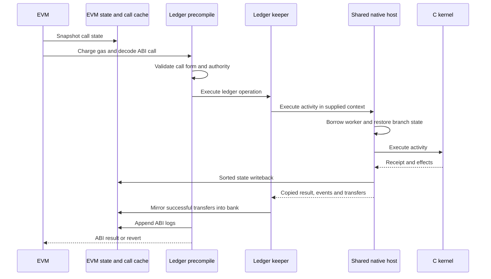

# Kernel and chain execution

The node constructs a shared `lxphost.Host` and the ledger, auth, pay, agent and chain-domain keepers in [node/app.go](../../../../node/app.go). Merge precompiles obtain these dependencies through [PrecompileKeepers](../../../../node/precompiles.go). The C kernel and Rust program sandbox are linked into the node through [the cgo host](../../../../modules/lxphost/host.go).

## Construction and activation

[The precompile registry](../../../../precompiles/setup.go) registers constructors and validates their address and name against `MergeAddressTable`. The application checks for missing merge constructors and validates the activation contract in [node/upgrades.go](../../../../node/upgrades.go). A registry entry by itself does not make a contract active at every height.

The common merge plan name is `v7.0`, defined in [precompiles/common/precompiles.go](../../../../precompiles/common/precompiles.go). [The EVM keeper](../../../../modules/evm/keeper/keeper.go) selects the contract version for the requested execution or tracing height. A recorded activation height withholds merge contracts below that height. When the plan has never been applied, the genesis module-version map must contain every module required by the address's gate.

## Address table

Each short address below denotes its zero-padded 20-byte EVM form. Standard EVM cryptographic precompiles are outside these tables. The constructor set is defined in [precompiles/setup.go](../../../../precompiles/setup.go); historical venue selection is defined in [node/precompiles_v6120.go](../../../../node/precompiles_v6120.go).

### Existing chain surfaces

| Address | Surface |
|---|---|
| `0x1001` | Bank |
| `0x1002` | CosmWasm adapter (`wasmd`) |
| `0x1003` | JSON helper |
| `0x1004` | Address and identity binding |
| `0x1005` | Staking |
| `0x1006` | Governance |
| `0x1007` | Distribution |
| `0x1008` | Retired oracle EVM query refusal; Cosmos oracle tallying is separate |
| `0x1009` | IBC |
| `0x100A` | Pointer views |
| `0x100B` | Pointer registration |
| `0x100C` | Solo asset claims |
| `0x1011` | P-256 signature helper |
| `0x1012` | Historical verifier; disabled at merge |
| `0x1013` | Historical custody; disabled at merge |
| `0x1014` | Anchor; writes retire at merge, reads retire with anchor-store deletion |
| `0x1015` | Go perps from `v6.12.0`; exchange executor at historical heights |
| `0x1016` | Bridge |
| `0x1017` | Go launchpad from `v6.12.0`; historical executor below activation |
| `0x1018` | Fee-token adapter |
| `0x1019` | xweb |
| `0x1020` | Pricefeed |
| `0x1021` | Spot market and swap rail |
| `0x1022` | Spot limit orders |
| `0x1023` | Spot stop orders |
| `0x1024` | Spot quoter |
| `0x1025` | Spot liquidity vault |

The application constructs spot through `NewServedSet`, including the served receive, multicall and dynamic gas behavior. The Go market venues do not enter the C kernel to settle their trades.

### Merge surfaces

There are thirteen merge addresses: five construct surfaces and eight agent-function surfaces. Required genesis modules come from `mergePrecompileGate` in [node/upgrades.go](../../../../node/upgrades.go).

| Address | Registry name | Required genesis modules |
|---|---|---|
| `0x101A` | `layerxledger` | `layerxledger` |
| `0x101B` | `layerxpay` | `layerxpay` |
| `0x101C` | `layerxauth` | `layerxauth` |
| `0x101D` | `layerxprograms` | `layerxprograms` |
| `0x101E` | `layerxchains` | `layerxchains` |
| `0x0901` | `orob` | `layerxagent` |
| `0x0902` | `clearing` | `layerxagent` |
| `0x0903` | `oracle aggregator` | `layerxagent`, `layerxexchange` |
| `0x0904` | `pofq` | `layerxagent` |
| `0x0905` | `scheduler` | `layerxagent` |
| `0x0906` | `streams` | `layerxpay` |
| `0x0907` | `tee attestor` | `layerxagent` |
| `0x0908` | `eip712` | `layerxagent` |

An agent-function address does not imply a kernel call. For example, streams reaches the pay keeper and the tee-attestor adapter obtains the xweb keeper. Programs obtains the shared host directly through its executor dependencies.

## Transaction execution

The [common wrapper](../../../../precompiles/common/precompiles.go) selects the ABI method and gas row before dispatch. Ledger and auth reject delegate calls, static writes and inappropriate value. Actor binding and delegated authority are checked before kernel execution. [The ledger keeper](../../../../modules/layerxledger/keeper) applies the bank mirror in the same call context.

`HostExecute` borrows a native worker, locks its operating-system thread, resets native scratch state, restores the relevant module rows, blobs and accounts, binds authority and executes the C kernel. It copies receipts and payloads into Go-owned memory before releasing the worker. `Receipt` includes ordered events, transfers, program outcome and fee charged.

The host accepts a positive block height and sequence, a nonnegative timestamp and a sequence greater than the persisted last sequence. [The branch context](../../../../modules/lxphost/ctx.go) supplies the Cosmos store. `Host.Simulate` provides simulation without committing its branch to the caller's state.

## Storage and rollback

| Prefix | Host-store value |
|---|---|
| `0x01` | Module KV rows, qualified by big-endian module ID |
| `0x02` | Last global sequence |
| `0x03` | Identity sequence |
| `0x04` | Reserved idempotency prefix |
| `0x05` | Module-qualified blobs |
| `0x06` | Account records |

The host sorts changed and deleted keys before writeback. Its native state is scratch space; it does not commit the chain independently. All writeback, bank mirrors, Cosmos events and EVM logs must remain within the supplied transaction context.

[EVM snapshots](../../../../modules/evm/state/state.go) and the [log journal](../../../../modules/evm/state/log.go) provide call rollback. A failed nested call discards its state and logs; the enclosing transaction can still retain its execution status and fee charge. A valid signed receipt can therefore describe a reverted transaction.

Kernel effects, Cosmos events and EVM logs are distinct representations. Executors translate the kernel result into the ABI and event contract of their surface. A native effect does not by itself become an EVM log.

## Gas and resource bounds

EVM gas, Cosmos store gas, kernel context gas and the kernel's fee amount are separate quantities. Fixed precompile method tables and dynamic wrappers charge according to their own implementation; a kernel fee does not imply an EVM gas refund. Unknown fixed selectors receive the common unknown-method charge and then fail decoding.

Host worker count defaults from zero to one and permits one through sixteen workers. Each native worker has a 4 MiB arena. The host configuration accepts program guest ABI values 0, 4 and 5. Application construction starts with ABI 4; merge activation sets the governed ABI to 5. Guest registration and execution must agree with the configured host ABI.

## Upgrades and replay

The merge store upgrade adds sequencer, ledger, auth, pay, programs, agent, host and chain-domain stores. The handler runs migrations and validates the resulting state. Historical venue maps preserve execution below `v6.12.0`; the merge activation gate separately controls the new surfaces.

The merge disables the historical verifier and custody interfaces, retires anchor writes and performs the configured custody and bond releases. Anchor reads end with the later `v7.0-anchor-store-delete` plan. [The activation runbook](../activation-runbook.md) describes the staged sequence.
