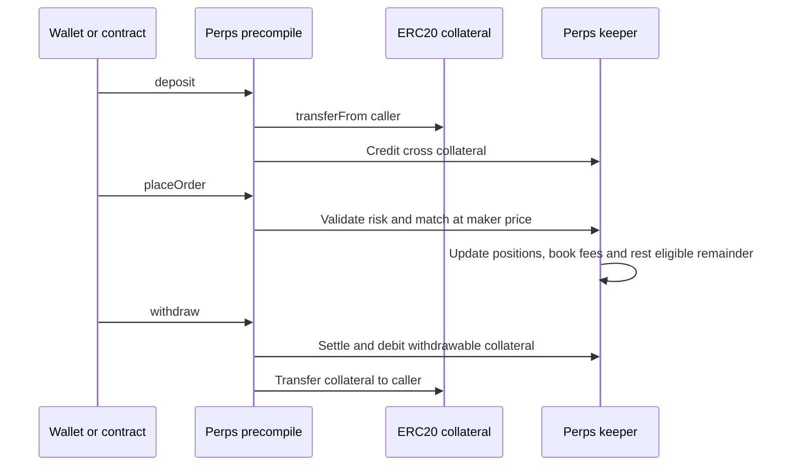

# Markets and launchpad

Perps, spot, pricefeed and launchpad execute through native Go keepers in the node. Their collateral, state and fee models are distinct. The EVM keeper selects current or historical implementations for the requested height.

## Venues and state

| Surface | Entry | State and authority |
|---|---|---|
| Perps | `0x1015` | ERC20 cross collateral, accounts, orders, positions, funding, insurance and ADL in [modules/perps](../../../../modules/perps) |
| Pricefeed | `0x1020` and Cosmos messages | Registered feed keys, observations and aggregates in [modules/pricefeed](../../../../modules/pricefeed) |
| Spot | `0x1021`–`0x1025` | Swap custody, escrowed orders, active indexes and LP shares in [modules/spot](../../../../modules/spot) |
| Launchpad | `0x1017`, fixed role surfaces and per-market pool surfaces | Markets, quote ledgers, roles and fee rights in [modules/launchpad](../../../../modules/launchpad) |
| Oracle | Cosmos vote/query services | Rate tallying in [modules/oracle](../../../../modules/oracle); the live `0x1008` EVM queries return a retired refusal |
| Epoch and mint | Block hook and Cosmos queries | Epoch rollover and scheduled bank-coin release in [modules/epoch](../../../../modules/epoch) and [modules/mint](../../../../modules/mint) |

The old exchange executor remains available for historical replay at `0x1015`; current perps calls use the Go perps ABI. [Historical dispatch](../../../../node/precompiles_v6120.go) also preserves the earlier launchpad implementation.

## Activation and block execution

[The v6.12.0 upgrade](../../../../node/upgrades_v6120.go) runs its pointer, launchpad, pricefeed, perps and spot hooks in order. New-module versions are inserted before migrations so explicit seeds initialize their state once. The precompile set selects perps and current launchpad from that activation height, along with pricefeed and spot.

Epoch rollover runs during BeginBlock. Oracle tally precedes pricefeed aggregation in MidBlock. EndBlock runs perps and spot when their activation is reached, before EVM receipt finalization. The ordering is wired in [node/app.go](../../../../node/app.go) and [legacy EndBlock](../../../../node/legacyabci/end_block.go).

## Perps collateral and orders

`createVault` ensures the caller's cross account and returns the shared precompile address. It does not deploy an individual vault. Deposit and withdrawal handlers perform ERC20 token movement; `TransferCollateral` is an internal book transfer with no ERC20 leg. See [the precompile account handlers](../../../../precompiles/perps/account.go) and [keeper account logic](../../../../modules/perps/keeper/account.go).

[Order admission](../../../../modules/perps/keeper/orders.go) checks account, order kind and deadline, sizing, leverage, order counts, client IDs, reduce-only restrictions and margin. Opening orders require an unpaused venue and an enabled market. Reduce-only orders remain eligible when the venue is paused or the market is disabled. Admission requires fresh prices for opening orders and reduce-only market orders. [Matching](../../../../modules/perps/keeper/matching.go) and [position fills](../../../../modules/perps/keeper/positions.go) use cached branches. Makers fill at maker limit prices. Closing a position is a reduce-only order and remains subject to liquidity and size bounds.

The precompile rejects delegate calls, static writes, attached value and missing keeper dependencies. Pause policy permits the defined exit operations and views. Governed risk limits, including `WithdrawFloorPpm`, constrain the keeper's execution rather than merely describing client-side limits.

## Funding, liquidation and EndBlock

[Perps EndBlock](../../../../modules/perps/keeper/endblock.go) runs nine bounded phases: prices, impact premium, hourly funding, triggers, expiries, account sweep, liquidation, deficits and backstop closes. Failed isolated units discard their writes and emit `perps_endblock_error`; a failed market is skipped for the remainder of the pass. The pass commits after its synthetic EVM receipt is written.

Funding samples produce a capped hourly rate and cumulative index. Positions realize index differences at settlement without an hourly traversal of every position. [Liquidation](../../../../modules/perps/keeper/liquidation.go) requires fresh account prices, an unhealthy maintenance ratio and the configured slice and cooldown checks. Deficits use [insurance](../../../../modules/perps/keeper/insurance.go), then bounded [ADL](../../../../modules/perps/keeper/adl.go). EndBlock books collateral state and receipt effects; ERC20 deposits and withdrawals remain explicit token operations.

## Pricefeed and oracle

[Pricefeed submission](../../../../modules/pricefeed/keeper/msg_server.go) accepts registered bonded feeders, bounds observation input and prevents repeated validator submission at one height. [The EVM feed-key handlers](../../../../precompiles/pricefeed/register.go) emit `FeedKeyRegistered` and `FeedKeyRevoked` logs. Submission and aggregation also emit Cosmos events.

[Aggregation](../../../../modules/pricefeed/keeper/aggregate.go) requires at least `MinSources` and reporting bonded voting power strictly greater than two-thirds of the total bonded power. Both conditions apply before and after divergence filtering around the first median. Successful aggregation stores the median index, smoothed mark, oldest agreeing timestamp, height and source count.

[Price reads](../../../../modules/pricefeed/keeper/price.go) report freshness only for enabled markets within age and clock-skew bounds. A skipped aggregate does not refresh an old price. Perps uses the mark/index keeper; spot refuses stale or nonpositive index prices.

Oracle Cosmos votes and tallying continue to update their separate rate store. The live [oracle EVM adapter](../../../../precompiles/oracle/oracle.go) returns its retired error after argument validation. Perps and spot price discovery uses pricefeed rather than these oracle EVM queries.

## Spot swaps and resting orders

The five spot rails are market/swaps `0x1021`, limit orders `0x1022`, stop orders `0x1023`, quoter `0x1024` and liquidity vault `0x1025`. [The node](../../../../node/app.go) constructs `NewServedSet`, including dynamic gas, multicall and receive behavior.

[Immediate swaps](../../../../modules/spot/keeper/swap.go) settle registered token custody using pricefeed prices, impact and fees. [Limit](../../../../modules/spot/keeper/orders.go) and [stop orders](../../../../modules/spot/keeper/stoporders.go) escrow their input and persist execution and expiry state.

[ExecuteResting](../../../../modules/spot/keeper/execute.go) uses a cached branch and positive work budgets. It samples eligible priced tokens, processes expiries, activates and fills orders within bounds, persists cursors and forwards events after commit. Active execution indexes have a different lifetime from the append-only user order-history index. Quoter and vault reads describe quotes, reserves, liquidity and shares; they do not submit a trade.

## Epoch hooks and mint

[Epoch rollover](../../../../modules/epoch/keeper/abci.go) occurs when elapsed time is strictly greater than the duration. It advances one epoch per invocation and runs `AfterEpochEnd` before updating the epoch, followed by `BeforeEpochStart`.

[MultiEpochHooks](../../../../modules/epoch/types/hooks.go) gives each hook its own cache. A successful hook writes its branch and forwards cached events to the parent event manager. A panic is rethrown and aborts the block rather than silently advancing the epoch.

[Mint's epoch hook](../../../../modules/mint/keeper/hooks.go) uses the previous epoch's UTC start time. It computes the daily release, mints bank coins, sends them to `fee_collector` and persists the successful mint. The daily amount is zero before the schedule or after a release already recorded that day; the remaining balance is released after the schedule end or when no days remain, otherwise it is divided over remaining days.

[Schedule validation](../../../../modules/mint/types/params.go) bounds release amounts by `math.MaxInt64`. [Minter coin construction](../../../../modules/mint/types/minter.go) uses `sdk.NewIntFromUint64`, preserving coin values without a signed narrowing conversion. Mint events reach the parent through the successful epoch-hook forwarding path.

## Launchpad migration and forwarding

[MigrateV6120](../../../../modules/launchpad/keeper/migrate_v6120.go) runs in a cache. It reconciles USDL quote custody, pool-held deltas, fee rights and liabilities, installs forwarding surfaces, records retired role addresses and checks custody and solvency before committing and forwarding events.

The [forwarding runtime](../../../../precompiles/launchpad/surface.go) installed at fixed roles and newly created pools is 51 bytes. It rejects native value, appends the original caller and uses `CALL` to `0x1017` without value. Pool migration installs the 41-byte runtime defined in [MigrateV6120](../../../../modules/launchpad/keeper/migrate_v6120.go), which appends the original caller and calls `0x1017` with zero value. [Dispatch](../../../../precompiles/launchpad/run.go) trusts the appended caller only for a registered surface. Direct calls use the aggregate ABI. Native surfaces are forwarding contracts rather than UUPS proxies.

| Role | Fixed surface address |
|---|---|
| SidioraFactory | `0x3993D004166738d1069B5C4e0a923f7B9D5D8830` |
| Router | `0x78FB06f525cD964388f2305A489035263E31C6e4` |
| Quoter | `0x793006f4F321b8863F26DBD75b11bAa01DA181dc` |
| FeesRouter | `0x05681dA6f611C2dfFD3E92611F6dE2d247647927` |
| FeeAccumulator | `0x7b14808b72f61664cDb79D25E6d1587655571a66` |
| PoolRegistry | `0x1dC357d2B7B850332a91F06A9E66634F46fC4Ba7` |
| ProtocolConfig | `0xF3669eDc475Cb6E1F0d7635240ABD8e8FB7E20C6` |
| SidioraNFT | `0xe8DcC844a8006dbf64f5Bb851bCad90292a6409B` |
| Treasury | `0xBb82d74E071e03d8E68F1d78Fae9EFe8b6b7A723` |

These on-chain addresses are defined in [surfaces.go](../../../../modules/launchpad/keeper/surfaces.go). Pool surfaces are registered per market. [Role ABIs](../../../../precompiles/launchpad/abi) include the nine fixed roles and pool role; `SidioraERC20` is used for nested token calls.

## Launchpad trades and fees

[Market creation](../../../../modules/launchpad/keeper/market.go) charges the creation fee, deploys a pool ERC20, registers its forwarding pool, mints a fee right and records the market. `CreateMarketFor` omits the fee already collected by Router. Market IDs use `launchpad/<pool>`.

[Swap](../../../../modules/launchpad/keeper/swap.go) locks the pool, checks pause, deadline, input and recipient, reconciles held balances, applies optical hooks, enforces minimum output and pays out. The buy leg moves backed fee liabilities to the accumulator. [Fee accounting](../../../../modules/launchpad/keeper/fees.go) calculates the protocol cut, per-market fee-right accrual and any optical surplus, and moves the protocol cut to Treasury.

Governance writes use `MsgUpdateParams` and `MsgTreasuryWithdraw`. Indexer projections decode factory, pool and role events but do not own settlement. HTTP capability availability is separate from a generated SDK operation's existence; an unavailable dependency must remain an explicit error.

## Read models and error contracts

[Perps-data](../../../../services/platform/perps-data) maintains market projections from chain contract reads. [Launchpad services](../../../../services/launchpad) provide indexed discovery, streams and service operations. [Client adapters](clients-and-sdks.md) use the corresponding venue ABIs, chain limits and canonical role identities.

Perps uses parameterless custom-error selectors through [its mapper](../../../../precompiles/perps/errors.go). Pricefeed uses `LXP_PRICEFEED_*` string reasons. [Launchpad errors](../../../../precompiles/launchpad/errors.go) preserve mapped selectors and arguments, keeper string reasons and nested revert data. ABI events and Cosmos events are separate output representations; clients must decode the surface they actually consume.
